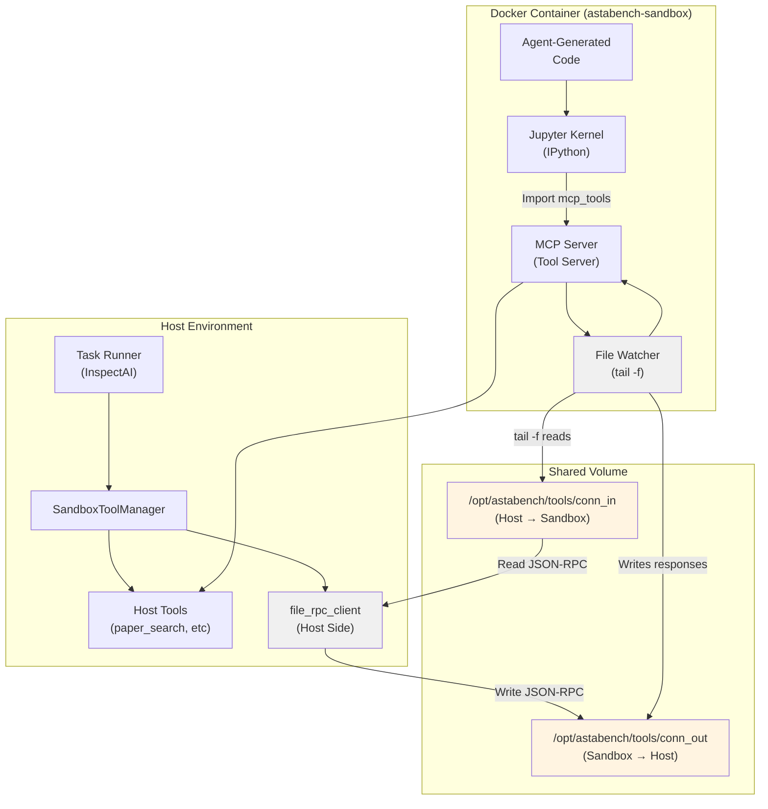
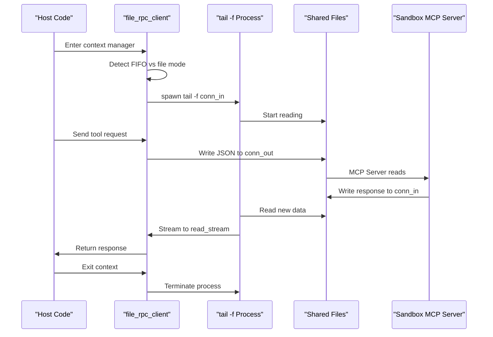
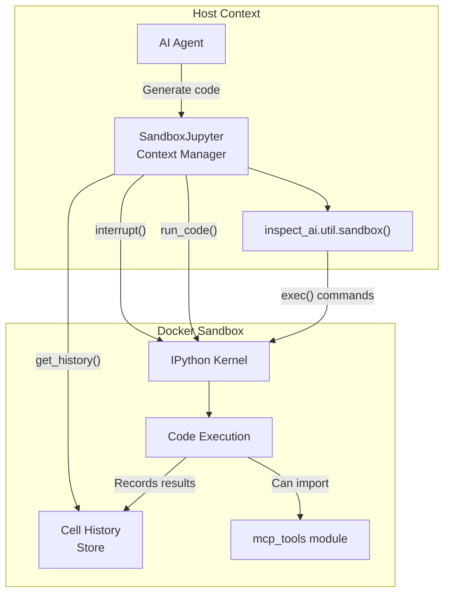
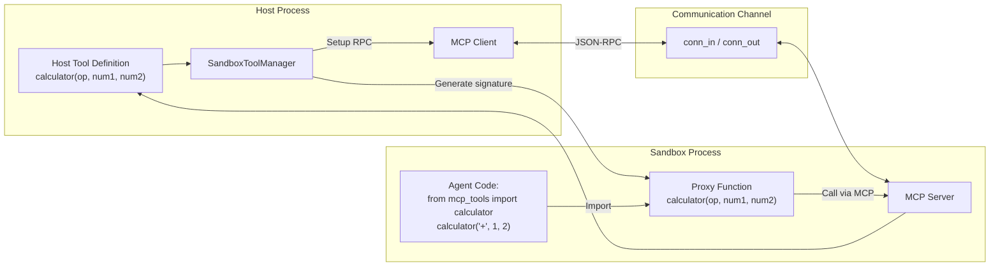
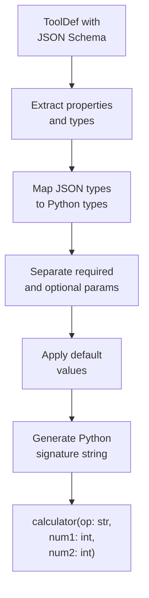

<!-- source: DeepWiki mcp.deepwiki.com · repo allenai/asta-bench · page 3.4 Sandbox and Execution Environment · fetched 2026-10-26 -->

# Sandbox and Execution Environment

<details>
<summary>Relevant source files</summary>

The following files were used as context for generating this wiki page:

- [.gitignore](.gitignore)
- [astabench/util/sandbox/static/sandbox_client.py](astabench/util/sandbox/static/sandbox_client.py)
- [tests/tasks/test_super.py](tests/tasks/test_super.py)
- [tests/tools/test_sandbox_tools.py](tests/tools/test_sandbox_tools.py)
- [tests/tools/test_toolset_config.py](tests/tools/test_toolset_config.py)

</details>


This document describes the Docker-based sandboxing infrastructure that provides isolated execution environments for code and tool execution in ASTA-Bench evaluations. The sandbox system ensures secure execution of agent-generated code while maintaining communication with the host environment through a file-based RPC mechanism.

For information about sandbox tools that agents can use (like `python_session`), see [Sandbox Tools](#4.4). For general tool configuration, see [ToolsetConfig](#4.1).

---

## Purpose and Architecture

ASTA-Bench uses Docker containers to isolate code execution from the host environment. This isolation is critical for:

- **Security**: Preventing agent-generated code from accessing the host filesystem or network
- **Reproducibility**: Ensuring consistent execution environments across different machines
- **Resource Control**: Managing memory and CPU usage through container constraints

The sandbox architecture consists of three main components:

1. **Docker Containers**: Isolated execution environments running the `astabench-sandbox` image
2. **File-Based RPC**: Communication channel between host and sandbox using file I/O
3. **Bridge Components**: `SandboxJupyter` and `SandboxToolManager` that manage sandbox lifecycle and tool execution



**Sources**: [astabench/util/sandbox/static/sandbox_client.py:1-188](), [tests/tools/test_sandbox_tools.py:1-460]()

---

## File-Based RPC Communication

The communication protocol between host and sandbox uses file-based RPC following the [Model Context Protocol (MCP)](https://modelcontextprotocol.io) specification. This approach works reliably across different Docker networking configurations.

### Communication Protocol

Messages are exchanged through two files mounted as a shared volume:

| File Path | Direction | Purpose |
|-----------|-----------|---------|
| `/opt/astabench/tools/conn_in` | Host → Sandbox | Tool requests from host to sandbox |
| `/opt/astabench/tools/conn_out` | Sandbox → Host | Tool responses from sandbox to host |

Each message is a JSON-RPC message on a single line, terminated by `\n`.

### File Transport Modes

The file-based RPC client supports two modes:

**FIFO Mode** (Named Pipes):
- Files are created as FIFOs using `mkfifo`
- Provides blocking read/write semantics
- More efficient for real-time communication
- Both input and output files must be FIFOs

**Regular File Mode**:
- Standard files with `tail -f` for watching
- Uses `-n 0` flag to skip existing content on startup
- More compatible but slightly higher latency
- Both input and output files must be regular files

The mode is automatically detected by checking file types with `stat.S_ISFIFO()`:

[astabench/util/sandbox/static/sandbox_client.py:48-63]()

### `file_rpc_client` Implementation

The `file_rpc_client` context manager creates the communication channel:



**Key implementation details**:

1. **Chunked Reading**: Reads in 65536-byte chunks to handle large outputs without hitting pipe limits [astabench/util/sandbox/static/sandbox_client.py:21-22]()

2. **Line Buffering**: Accumulates chunks until complete lines are found [astabench/util/sandbox/static/sandbox_client.py:83-98]()

3. **Async I/O**: Uses `anyio` for concurrent reading and writing [astabench/util/sandbox/static/sandbox_client.py:137-141]()

4. **Process Cleanup**: Ensures `tail` subprocess is terminated on exit [astabench/util/sandbox/static/sandbox_client.py:143-149]()

**Sources**: [astabench/util/sandbox/static/sandbox_client.py:24-150]()

### `mcp_session` Helper

The `mcp_session` context manager wraps `file_rpc_client` with MCP session initialization:

[astabench/util/sandbox/static/sandbox_client.py:152-169]()

It handles:
- Creating the file transport
- Initializing the MCP ClientSession
- Waiting up to 10 seconds for session initialization (with FIFO mode typically completing in <1 second)
- Providing the initialized session for tool calls

**Sources**: [astabench/util/sandbox/static/sandbox_client.py:152-169]()

---

## SandboxJupyter

`SandboxJupyter` provides a stateful Jupyter kernel environment within the sandbox for executing agent-generated Python code. This is used by code execution tasks like SUPER, CORE-Bench, and DS-1000.

### Architecture



### Usage Pattern

The typical usage pattern with async context manager:

```python
async with SandboxJupyter("default", cell_timeout=30) as jupy:
    result = await jupy.run_code("x = 5\nprint(x)")
    history = await jupy.get_history()
```

[tests/tasks/test_super.py:35-41]()

### Key Features

**Stateful Execution**: Each cell execution maintains kernel state, so variables persist across calls:

[tests/tasks/test_super.py:36-44]()

**Timeout Control**: Cell execution can be bounded by timeout to prevent infinite loops:

[tests/tasks/test_super.py:31-35]()

**History Tracking**: All executed cells and their outputs are tracked and retrievable:

[tests/tasks/test_super.py:41-44]()

**Interrupt Support**: Long-running cells can be interrupted via kernel interrupt mechanism

**Tool Integration**: Code executed in the Jupyter kernel can import and use `mcp_tools` to call host tools:

[tests/tools/test_sandbox_tools.py:62]()

**Sources**: [tests/tasks/test_super.py:23-72](), [tests/tools/test_sandbox_tools.py:56-76]()

---

## SandboxToolManager

`SandboxToolManager` bridges InspectAI tools (running on the host) to make them callable from within the sandbox. This allows agent code running in the sandbox to access tools like `paper_search`, `snippet_search`, and custom tools.

### Tool Bridging Architecture



### Initialization and Setup

The manager is initialized with a list of tools to expose:

[tests/tools/test_sandbox_tools.py:79-84]()

The `setup_tool_environment()` method:

1. Generates Python wrapper functions for each tool
2. Constructs proper function signatures from tool schemas
3. Writes the `mcp_tools.py` module to the sandbox
4. Starts the MCP server for handling tool calls

[tests/tools/test_sandbox_tools.py:86]()

### Tool Signature Construction

The manager converts InspectAI `ToolDef` JSON schemas into valid Python function signatures. This is critical for making tools feel like native Python functions.

**Signature Construction Process**:



**Type Mapping**:

| JSON Schema Type | Python Type | Notes |
|-----------------|-------------|-------|
| `"string"` | `str` | Basic string type |
| `"integer"` | `int` | Integer numbers |
| `"number"` | `float` | Floating point |
| `"boolean"` | `bool` | Boolean values |
| `"array"` | `list` | Lists/arrays |
| `"object"` | `dict` | Dictionaries |
| `anyOf` with null | `type \| None` | Nullable types |
| `anyOf` without null | `type1 \| type2` | Union types |

**Example Transformations**:

Simple required parameter:
[tests/tools/test_sandbox_tools.py:204-221]()

Optional parameters with defaults:
[tests/tools/test_sandbox_tools.py:223-247]()

Union types:
[tests/tools/test_sandbox_tools.py:273-295]()

Complex defaults (lists, dicts):
[tests/tools/test_sandbox_tools.py:297-316]()

**Sources**: [tests/tools/test_sandbox_tools.py:200-361]()

### Final Answer Mechanism

The manager provides a special `final_answer()` tool for agents to submit their results:

[tests/tools/test_sandbox_tools.py:82]()

This tool writes the answer to a special location that can be retrieved after execution:

[tests/tools/test_sandbox_tools.py:102-103]()

### Cleanup

The `cleanup()` method should be called to properly shut down the MCP server and clean up resources:

[tests/tools/test_sandbox_tools.py:107]()

**Sources**: [tests/tools/test_sandbox_tools.py:52-113](), [tests/tools/test_sandbox_tools.py:200-361]()

---

## Handling Large Outputs

The file-based RPC system is designed to handle large tool outputs efficiently. The chunked reading approach prevents issues with:

- **Pipe Buffer Limits**: Reading in 64KB chunks avoids blocking on full pipe buffers
- **Memory Efficiency**: Streaming approach doesn't load entire responses into memory at once
- **Line Buffering**: Ensures complete JSON-RPC messages are processed atomically

**Test Case**: The system successfully handles tool responses of 200KB+:

[tests/tools/test_sandbox_tools.py:368-460]()

The test verifies that a tool returning 200,000 bytes can be called from the sandbox and the result properly retrieved through the file transport.

**Sources**: [tests/tools/test_sandbox_tools.py:368-460](), [astabench/util/sandbox/static/sandbox_client.py:19-22]()

---

## Docker Configuration

### Sandbox Compose Configuration

The sandbox is configured via `sandbox_compose.yaml`, which defines:

- **Container Image**: `astabench-sandbox:latest` or custom image
- **Volume Mappings**: Mounting shared directories for file-based RPC
- **Environment Variables**: Passing configuration to the container
- **Resource Limits**: Memory and CPU constraints
- **Network Configuration**: Isolation settings

### Environment Variables

Key environment variables used by the sandbox:

| Variable | Purpose | Example |
|----------|---------|---------|
| `ASTA_TOOL_KEY` | API key for Asta MCP tools | Set in host environment |
| `HF_TOKEN` | HuggingFace authentication | For dataset access |
| `SANDBOX_TYPE` | Type of sandbox environment | `docker`, `local` |

### Sandbox Specification

Tasks can specify custom sandbox configurations using `SandboxEnvironmentSpec`:

[tests/tasks/test_super.py:132-140]()

This allows tasks to override:
- Sandbox type (docker, local, etc.)
- Configuration file path
- Resource limits
- Timeout settings

**Sources**: [tests/tasks/test_super.py:119-152]()

---

## Thread-Safe Async Execution

The `run_async_thread` utility enables running async operations from both sync and async contexts:

[astabench/util/sandbox/static/sandbox_client.py:172-187]()

This is particularly useful for:
- Calling sandbox operations from Jupyter notebooks (which run in async event loops)
- Bridging sync tool APIs to async sandbox operations
- Ensuring clean event loop isolation

The implementation:
1. Creates a new thread with a new event loop
2. Runs the coroutine in that loop
3. Returns the result synchronously via `Future`
4. Properly propagates exceptions

**Sources**: [astabench/util/sandbox/static/sandbox_client.py:172-187]()

---

## Testing Considerations

### Local vs Docker Sandboxes

Tests can run with different sandbox types:

**Local Sandbox**:
- Faster execution
- Shares host filesystem/network
- Good for development iteration
- Less realistic security isolation

[tests/tools/test_sandbox_tools.py:168-184]()

**Docker Sandbox**:
- Full isolation
- Realistic production environment
- Slower startup time
- Requires Docker daemon

[tests/tasks/test_super.py:119-152]()

### Test Markers

Docker-dependent tests use pytest markers:

```python
@pytest.mark.skipif(
    os.getenv("IGNORE_DOCKER_TESTS", "").lower() == "true",
    reason="Skipping Docker-dependent test due to IGNORE_DOCKER_TESTS=true",
)
```

[tests/tasks/test_super.py:119-122]()

This allows CI environments to selectively skip Docker tests if the Docker daemon is unavailable.

**Sources**: [tests/tools/test_sandbox_tools.py:168-198](), [tests/tasks/test_super.py:119-152]()

---

