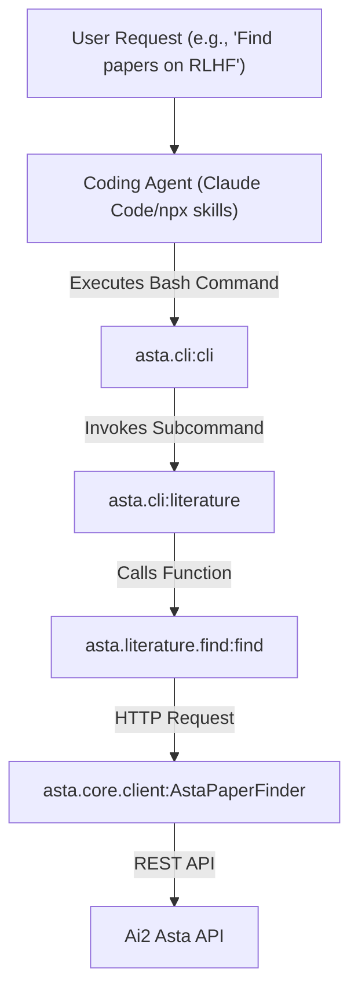
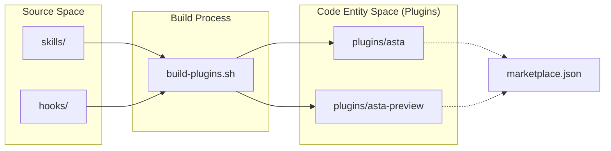

<!-- source: DeepWiki mcp.deepwiki.com · repo allenai/asta-plugins · page 1 Overview · fetched 2026-10-26 -->

# Overview

Relevant source files

The following files were used as context for generating this wiki page:

- [.claude-plugin/marketplace.json](.claude-plugin/marketplace.json)
- [DEVELOPER.md](DEVELOPER.md)
- [README.md](README.md)
- [pyproject.toml](pyproject.toml)
- [src/asta/__init__.py](src/asta/__init__.py)
- [uv.lock](uv.lock)

Asta is a comprehensive suite of scientific research tools designed to empower local coding agents (such as Claude Code, Cursor, and Copilot) with specialized capabilities for literature review, document management, and experimental analysis [README.md:1-4](). 

The system is built around a central Python-based CLI (`asta`) that serves as the primary interface for both human users and autonomous agents [README.md:48-51](). By providing a unified entry point for scientific workflows, Asta bridges the gap between high-level research objectives and low-level technical execution.

## System Architecture

The Asta ecosystem follows a CLI-first architecture where agent capabilities (skills) are thin wrappers around the `asta` command-line tool [DEVELOPER.md:7-12]().

### Core Components

*   **Asta CLI**: A [Click](https://click.palletsprojects.com)-based interface organized into logical command groups such as `literature`, `papers`, `documents`, and `experiment` [src/asta/cli.py:12-37]().
*   **Skill System**: A collection of YAML-based definitions in the `skills/` directory that describe tool interfaces to LLM-based agents [DEVELOPER.md:38-46]().
*   **Passthrough Layer**: A mechanism for the `asta` CLI to delegate complex tasks to specialized external tools like `asta-documents` or `panda`, ensuring they are installed and version-matched automatically [DEVELOPER.md:48-63]().
*   **Agent-to-Agent (A2A) Framework**: Integration with `asta-agent` to support long-running, interactive research sessions [pyproject.toml:22-24]().

### Conceptual Model: Natural Language to Code Entity

The following diagram illustrates how a user's research request flows through the system's code entities.

**Diagram: Request Flow from NL to Code**

Sources: [src/asta/cli.py:12-37](), [src/asta/literature/find.py:29-30](), [src/asta/core/client.py:15-16]()

## Plugin Distribution Model

Asta uses a two-track plugin system to balance stability with rapid feature iteration. These are managed via the `marketplace.json` manifest [.claude-plugin/marketplace.json:1-47]().

| Plugin | Content | Target Audience |
| :--- | :--- | :--- |
| **asta** | Stable, core research tools (Paper search, metadata, document management) | Production workflows and reliable research tasks. |
| **asta-preview** | All stable tools + experimental features (Literature reports, experiments, autonomous research steps) | Early adopters and developers testing new agentic workflows. |

**Diagram: Plugin Generation Pipeline**

Sources: [DEVELOPER.md:38-46](), [.claude-plugin/marketplace.json:9-46](), [README.md:22-32]()

For a detailed breakdown of how these plugins are constructed and the differences between internal and default skills, see [Plugin Architecture: asta vs asta-preview](#1.2).

## Key Research Capabilities

The system is organized into several specialized skill categories:

*   **Literature Discovery**: High-level searching via `asta literature find` and granular metadata retrieval via `asta papers` [DEVELOPER.md:27-36]().
*   **Document Management**: Local indexing and tracking of scientific PDFs and their metadata [README.md:19-19]().
*   **Automated Extraction**: PDF-to-text conversion utilizing `olmOCR` [README.md:20-20]().
*   **Advanced Orchestration**: Multi-step research loops and automated theory generation [README.md:34-37]().

## Getting Started

To begin using or developing for Asta, ensure you have Python 3.11+ and the `uv` package manager installed [DEVELOPER.md:68-72]().

1.  **Installation**: Use `make install` to set up a development environment with an editable version of the `asta` package [DEVELOPER.md:77-81]().
2.  **Authentication**: Run `asta auth login` to authenticate with Ai2 services [README.md:69-69]().
3.  **Agent Integration**: Use `npx skills add allenai/asta-plugins` to register the tools with your local agent [README.md:9-9]().

For detailed installation steps and first-use walkthroughs, see [Getting Started](#1.1).

Sources: [pyproject.toml:1-24](), [README.md:1-100](), [DEVELOPER.md:1-174]()

---

