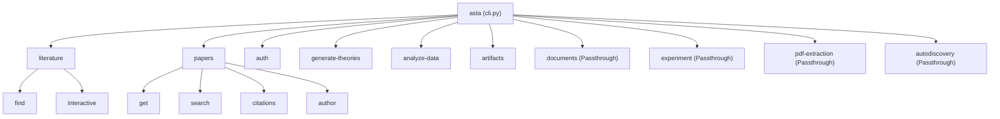
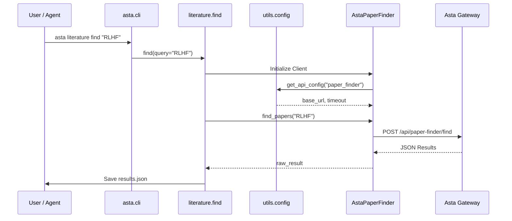

<!-- source: DeepWiki mcp.deepwiki.com · repo allenai/asta-plugins · page 2 CLI Architecture · fetched 2026-10-26 -->

# CLI Architecture

Relevant source files

The following files were used as context for generating this wiki page:

- [DEVELOPER.md](DEVELOPER.md)
- [README.md](README.md)
- [plugins/asta-preview/skills/research-step/SKILL.md](plugins/asta-preview/skills/research-step/SKILL.md)
- [src/asta/cli.py](src/asta/cli.py)
- [src/asta/literature/find.py](src/asta/literature/find.py)
- [src/asta/utils/asta.conf](src/asta/utils/asta.conf)
- [tests/test_cli.py](tests/test_cli.py)
- [tests/test_config.py](tests/test_config.py)

The `asta` CLI is the primary interface for scientific research skills, designed to be used by both human researchers and autonomous agents (e.g., Claude Code, Cursor). It follows a "CLI-first" philosophy where complex research workflows are exposed as standard terminal commands.

## Core Design Principles

The architecture is built around three major principles to ensure portability and ease of integration:

1.  **Thin CLI Layer**: The CLI uses [Click](https://click.palletsprojects.com) to provide a consistent interface, but logic is delegated to specialized clients or external tools [src/asta/cli.py:1-30]().
2.  **Dependency-Free Clients**: Core API clients (e.g., `SemanticScholarClient`) are implemented using Python standard libraries (`urllib`, `json`) to minimize installation footprint and dependency conflicts [DEVELOPER.md:50-51]().
3.  **Automatic Tool Management**: The "Passthrough" system allows the CLI to offer functionality from other repositories (like `asta-documents` or `panda`) by automatically installing them on first use [src/asta/utils/asta.conf:69-80]().

## Command Structure

The CLI is organized into hierarchical command groups. Each group represents a specific domain of scientific research.

### System Hierarchy

**Sources:** [src/asta/cli.py:33-73](), [DEVELOPER.md:9-36]()

### Primary Command Groups

| Group / Command | Code Entity | Description |
| :--- | :--- | :--- |
| `literature` | `literature.add_command` | High-level research workflows involving multi-paper synthesis. |
| `papers` | `papers.add_command` | Low-level metadata retrieval via Semantic Scholar. |
| `auth` | `cli.add_command(auth)` | Management of Auth0 device tokens and gateway access. |
| `documents` | `cli.add_command(documents)` | Passthrough to `asta-documents` for local library management. |
| `experiment` | `cli.add_command(experiment)` | Passthrough to `panda` for running computational experiments. |

**Sources:** [src/asta/cli.py:45-73]()

## Major Subsystems

The CLI relies on several internal frameworks to handle configuration, authentication, and external tool execution.

### Configuration System
Asta uses HOCON (Human-Optimized Config Object Notation) via `pyhocon`. The central configuration file `asta.conf` defines API endpoints, Auth0 parameters, and passthrough tool versions.
*   **For details, see [Configuration System](#2.1)**
*   **Key Files**: [src/asta/utils/asta.conf:1-109](), [src/asta/utils/config.py]()

### Passthrough System
This system allows the `asta` CLI to act as a wrapper for other standalone tools. If a user runs `asta documents` and the `asta-documents` package is missing, the system uses `ensure_tool_installed` to fetch it via PyPI or Git based on the configuration.
*   **For details, see [Passthrough System](#2.2)**
*   **Key Files**: [src/asta/utils/passthrough.py](), [src/asta/utils/asta.conf:81-109]()

### Authentication System
Most Asta services require authentication through the Allen Institute for AI (AI2) gateway. The CLI implements an Auth0 Device Authorization Flow, allowing users to log in via a browser and storing tokens locally for future use.
*   **For details, see [Authentication System](#2.3)**
*   **Key Files**: [src/asta/commands/auth.py](), [src/asta/utils/auth_config.py]()

### A2A Interactive Framework
The Agent-to-Agent (A2A) framework supports long-running, stateful interactions between the local agent and remote research agents. It manages "thread-dir" state and turn indexing for commands like `asta literature interactive`.
*   **For details, see [A2A Interactive Framework](#2.4)**
*   **Key Files**: [src/asta/literature/interactive.py](), [src/asta/analyze_data/__init__.py]()

## Execution Flow

The following diagram illustrates how a CLI command (e.g., `asta literature find`) moves from the user invocation through the configuration and client layers to the remote API.

**Sources:** [src/asta/literature/find.py:33-83](), [src/asta/cli.py:64-65](), [src/asta/utils/asta.conf:33-39]()

---

