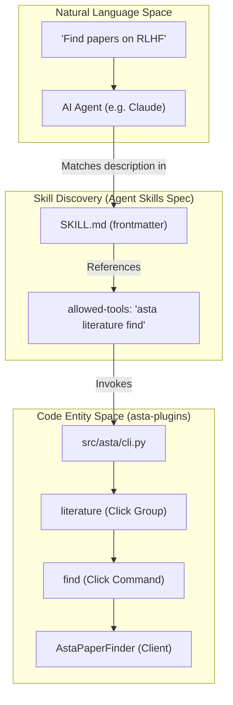
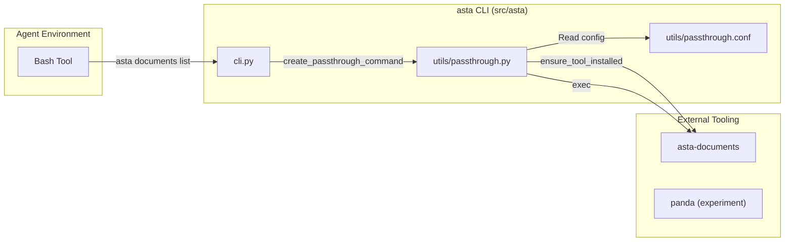

<!-- source: DeepWiki mcp.deepwiki.com · repo allenai/asta-plugins · page 3 Skills Reference · fetched 2026-10-26 -->

# Skills Reference

Relevant source files

The following files were used as context for generating this wiki page:

- [.github/workflows/ci.yml](.github/workflows/ci.yml)
- [DEVELOPER.md](DEVELOPER.md)
- [Makefile](Makefile)
- [README.md](README.md)
- [scripts/validate-skills.py](scripts/validate-skills.py)

Asta is built around a modular **Skill System** designed to extend the capabilities of AI agents (like Claude Code, Cursor, or Copilot) into the scientific research domain. A "skill" in this ecosystem is a packaged set of capabilities that allow an agent to perform specific research tasks—such as searching for literature, managing document indices, or running computational experiments—using the `asta` CLI as the underlying execution engine.

### What is a Skill?

In the Asta ecosystem, a skill is defined by a directory in the canonical `skills/` directory [DEVELOPER.md:38-38](). Each skill contains a `SKILL.md` file that follows the [Agent Skills specification](https://agentskills.io/specification) [scripts/validate-skills.py:9-10]().

#### The SKILL.md Format
The `SKILL.md` file uses YAML frontmatter to define how an agent interacts with the skill. Key fields include:
*   **`name`**: A kebab-case identifier (e.g., `find-literature`) that must match the parent directory name [scripts/validate-skills.py:35-48]().
*   **`description`**: A concise explanation (up to 1024 characters) of what the skill does, helping the agent decide when to invoke it [scripts/validate-skills.py:50-55]().
*   **`allowed-tools`**: A space-separated string of commands the agent is permitted to run (e.g., `asta literature find`) [scripts/validate-skills.py:56-62]().
*   **`metadata.internal`**: A flag used by the build pipeline to distinguish between "stable" skills (included in the default `asta` plugin) and "preview" or internal skills (included in `asta-preview`) [scripts/build-plugins.sh]().

### Skill Discovery and Distribution

Asta uses a dual-track distribution model to manage the lifecycle of research tools. The `build-plugins.sh` script processes the `skills/` directory to generate the `plugins/` marketplace packages [Makefile:87-88]().

| Track | Target Plugin | Description |
| :--- | :--- | :--- |
| **Stable** | `asta` | Production-ready skills like Semantic Scholar lookup and Document Management [README.md:16-20](). |
| **Preview** | `asta-preview` | Experimental or high-velocity skills like `research-step` and `find-literature` [README.md:22-37](). |

#### Skill Architecture Overview

The following diagram illustrates how the natural language requests from a user are mapped to specific code entities via the Skill System.

**Skill Mapping: NL Space to Code Entity Space**

**Sources:** [README.md:39-47](), [scripts/validate-skills.py:35-62](), [src/asta/cli.py:12-12](), [src/asta/literature/find.py:29-29](), [src/asta/core/client.py:15-15]()

---

### Skill Categories

The Asta skills are grouped into several functional categories. Detailed documentation for each category can be found in the sub-pages linked below.

#### [Literature Research Skills](#3.1)
Covers skills for discovering and reporting on scientific literature.
*   **`find-literature`**: High-level paper searching and citation discovery [README.md:34-34]().
*   **`semantic-scholar`**: Direct metadata queries via the Semantic Scholar API (`asta papers` commands) [README.md:18-18]().
*   **`literature-report`**: Automated generation of comprehensive synthesis reports [README.md:35-35]().

#### [Document Management Skill](#3.2)
Focuses on the `asta-documents` tool, which maintains a local YAML-based index of research papers. It supports the `asta://` URI scheme and hybrid search (BM25 + semantic) [README.md:19-19](), [src/asta/documents/passthrough.py:23-23]().

#### [Experiment and Data Analysis Skills](#3.3)
Tools for performing active research and analyzing results.
*   **`experiment`**: Interfaces with the `panda` CLI for computational experiments [README.md:36-36](), [src/asta/experiment/passthrough.py:26-26]().
*   **`analyze-data`**: Uses DataVoyager for automated data visualization and analysis.
*   **`autodiscovery`**: MCTS-based scientific discovery engine.

#### [Theory Generation and Artifacts Skills](#3.4)
Skills for higher-level synthesis and output management.
*   **`generate-theories`**: The "Theorizer" agent loop for novelty assessment and theory generation.
*   **`artifacts`**: Manages the export pipeline and `manifest.json` for research outputs.

#### [Research Orchestration Skills](#3.5)
The framework for autonomous research loops.
*   **`research-step`**: Implements the "Beads" (bd) framework, managing the transition between brainstorming, planning, and execution [README.md:37-37]().
*   **`research-challenge`**: Specific workflows for submission and reflection on research tasks.

#### [PDF Extraction, Local Paper Index, and Utility Skills](#3.6)
Support utilities for the research workflow.
*   **`pdf-extraction`**: Cloud-based OCR using `olmOCR` [README.md:20-20]().
*   **`preview`**: Quarto-based rendering for viewing research reports [README.md:60-60]().
*   **`workspace`**: Standardized devcontainer and VS Code configurations [README.md:89-92]().

---

### Skill Execution Flow

When an agent invokes a skill, it typically flows through the `asta` CLI, which may either execute logic directly or pass the command through to a specialized external tool.

**CLI Passthrough Execution Flow**

**Sources:** [DEVELOPER.md:52-63](), [src/asta/utils/passthrough.py:20-20](), [src/asta/utils/passthrough.conf:19-19]()

---

