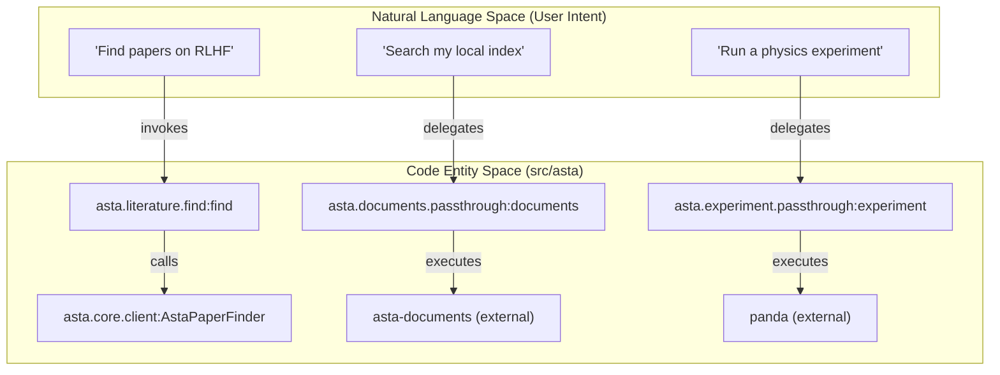
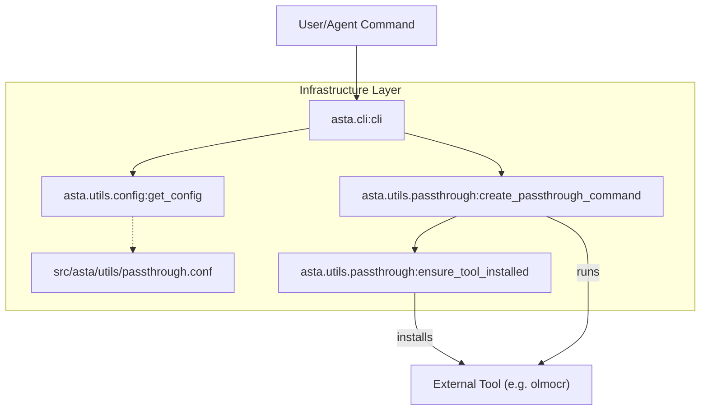

<!-- source: DeepWiki mcp.deepwiki.com · repo allenai/asta-plugins · page 4 Source Code Internals · fetched 2026-10-26 -->

# Source Code Internals

Relevant source files

The following files were used as context for generating this wiki page:

- [DEVELOPER.md](DEVELOPER.md)
- [README.md](README.md)
- [pyproject.toml](pyproject.toml)
- [src/asta/__init__.py](src/asta/__init__.py)
- [uv.lock](uv.lock)

This page provides a high-level technical overview of the `src/asta` Python package structure, its internal design principles, and the relationship between core modules. The codebase is designed as a CLI-first system where thin command wrappers delegate logic to specialized clients or external tools.

## Package Structure

The `asta` package is organized into functional sub-packages, separating core API clients from the CLI command definitions.

| Sub-package | Responsibility | Key Files |
| :--- | :--- | :--- |
| `asta.core` | Internal API clients (AstaPaperFinder) | [src/asta/core/client.py:1-16]() |
| `asta.papers` | Semantic Scholar integration | [src/asta/papers/client.py:1-36]() |
| `asta.literature` | High-level research workflows | [src/asta/literature/find.py:1-29]() |
| `asta.utils` | Shared infrastructure (Config, Passthrough, Auth) | [src/asta/utils/passthrough.py:1-20]() |
| `asta.documents` | Document management delegation | [src/asta/documents/passthrough.py:1-23]() |
| `asta.experiment` | Experiment execution delegation | [src/asta/experiment/passthrough.py:1-26]() |

**Sources:** [DEVELOPER.md:10-36](), [pyproject.toml:36-37]()

## Design Principles

The architecture follows three primary principles to ensure maintainability and agent compatibility:

1.  **Dependency-Free Core Clients**: Core logic in `asta.core.client` and `asta.papers.client` uses only the Python standard library (e.g., `urllib`, `json`) to minimize installation overhead and environment conflicts [DEVELOPER.md:50-50]().
2.  **Thin CLI Layer**: Click commands are kept lightweight, acting as entry points that parse arguments and invoke the core clients [DEVELOPER.md:51-51]().
3.  **Generic Passthrough Architecture**: Utilities in `asta.utils.passthrough` allow the CLI to act as a gateway for other tools (like `asta-documents` or `panda`), handling automatic installation and version pinning [DEVELOPER.md:52-58]().

**Sources:** [DEVELOPER.md:48-65]()

## System Context: Code to Concept Mapping

The following diagrams illustrate how natural language research concepts map to specific internal code entities and how data flows through the system.

### Research Workflow Mapping
This diagram bridges the "Natural Language Space" (user/agent intent) to the "Code Entity Space" (internal Python modules).

**Sources:** [DEVELOPER.md:9-36](), [src/asta/cli.py:27-27]()

### Command Delegation and Configuration
This diagram shows how the `asta.utils` modules manage the lifecycle of a command execution.

**Sources:** [DEVELOPER.md:52-62](), [src/asta/utils/passthrough.py:1-20]()

## Subsystem Overviews

### Papers and Literature Clients
The literature subsystem provides both direct access to Semantic Scholar and higher-level "Paper Finder" logic. The `SemanticScholarClient` is a specialized, dependency-free implementation for paper metadata, while `AstaPaperFinder` handles complex discovery tasks.

For details, see [Papers and Literature Clients](#4.1).

### AutoDiscovery Client
The AutoDiscovery subsystem manages MCTS-based scientific discovery runs. It handles the lifecycle of experiments, including creating runs, uploading data via presigned GCS URLs, and polling for completion status.

For details, see [AutoDiscovery Client](#4.2).

### Analyze Data (DataVoyager)
The `analyze_data` module integrates with the A2A (Agent-to-Agent) framework. It allows the `asta` CLI to submit data analysis tasks to a specialized DataVoyager agent and manage the resulting session state.

For details, see [Analyze Data (DataVoyager) Module](#4.3).

---
**Sources:** [DEVELOPER.md:10-46](), [pyproject.toml:5-27](), [README.md:48-58]()

---

