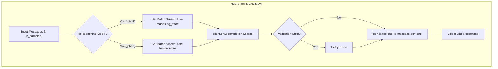
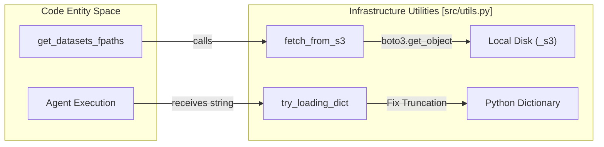

<!-- source: DeepWiki mcp.deepwiki.com · repo allenai/autodiscovery-neurips · page 6.2 LLM and Infrastructure Utilities · fetched 2026-10-26 -->

# LLM and Infrastructure Utilities

Relevant source files

The following files were used as context for generating this wiki page:

- [src/beliefs.py](src/beliefs.py)
- [src/utils.py](src/utils.py)

This section documents the foundational utility functions used across the AutoDiscovery pipeline. These utilities handle high-level LLM interactions, statistical fusion of belief distributions, cloud data synchronization, and fault-tolerant parsing of agent-generated content.

## LLM Interaction Pipeline

The `query_llm` function serves as the central interface for all model interactions. It abstracts differences between standard Chat Completion models (e.g., `gpt-4o`) and reasoning models (e.g., `o1-preview`), while providing support for batching and structured output parsing.

### Handling Reasoning Models
The utility identifies reasoning models by checking for prefixes such as `o` or `gpt-5` [src/utils.py:22-22](). When a reasoning model is detected:
*   **Batching**: The `n_samples` batch size is capped at 8 to accommodate the longer processing times and API limits associated with reasoning tokens [src/utils.py:24-24]().
*   **Parameters**: The `temperature` parameter is omitted (as it is typically not supported or fixed in reasoning APIs), and the `reasoning_effort` parameter is applied instead [src/utils.py:33-36]().

### Structured Output Parsing
The system uses the OpenAI `chat.completions.parse` interface to enforce Pydantic schemas defined in `src/structured_outputs.py`.
*   **Retry Logic**: If a `ValidationError` occurs during parsing, the utility performs an immediate retry [src/utils.py:41-45]().
*   **Extraction**: Successful responses are parsed from JSON strings back into dictionary objects for consumption by the agents [src/utils.py:50-50]().

**LLM Query Data Flow**

Sources: [src/utils.py:11-51]()

## Belief Fusion and Statistics

The system frequently needs to aggregate multiple independent LLM "opinions" into a single mathematical distribution. This is primarily handled via Product-of-Gaussians for continuous beliefs.

### Gaussian Fusion
The `fuse_gaussians` function implements the fusion of $n$ independent Gaussian beliefs $N(\mu_i, \sigma_i^2)$ [src/utils.py:64-64]().
*   **Precision Weighting**: It converts standard deviations to precisions ($\tau = 1/\sigma^2$). A `weight` parameter can be applied to scale the influence of the precision [src/utils.py:91-91]().
*   **Numerical Stability**: A small epsilon ($1e-10$) is added to variances to prevent division-by-zero errors [src/utils.py:87-88]().
*   **Fused Parameters**: The combined mean $\mu_*$ is a precision-weighted average of the input means [src/utils.py:98-98]().

### Belief Classes and KL Divergence
While `src/utils.py` provides the math, `src/beliefs.py` defines the object-oriented wrappers for different distribution types:
*   **BeliefTrueFalse**: Uses a Beta distribution (alpha/beta parameters) to track Bernoulli trials [src/beliefs.py:13-31]().
*   **KL Divergence**: Implemented for each belief type (e.g., using `betaln` and `psi` for Beta distributions) to calculate the "surprise" between prior and posterior states [src/beliefs.py:142-158]().

**Mathematical Entity Mapping**

| Code Entity | Mathematical Concept | Source |
| :--- | :--- | :--- |
| `fuse_gaussians` | Product of Gaussians (Precision-weighted fusion) | [src/utils.py:64]() |
| `BeliefTrueFalse.get_params` | Posterior Alpha/Beta for Beta Distribution | [src/beliefs.py:96]() |
| `BeliefTrueFalse.kl_divergence` | KL Divergence between two Beta distributions | [src/beliefs.py:142]() |

Sources: [src/utils.py:64-101](), [src/beliefs.py:13-158]()

## Infrastructure and Fault Tolerance

### S3 Synchronization
The `fetch_from_s3` utility manages the retrieval of datasets and metadata stored in AWS S3 [src/utils.py:104-104]().
*   **Path Resolution**: It parses S3 URLs (`s3://bucket/key`) and mirrors the key structure in a local `_s3` directory [src/utils.py:116-119]().
*   **Streaming**: It uses `boto3` to read object bodies and write them to local disk as bytes, ensuring compatibility with various file formats [src/utils.py:120-122]().

### Fault-Tolerant JSON Parsing
LLMs occasionally truncate their output, especially when reaching token limits. The `try_loading_dict` function provides a safety layer for parsing these outputs [src/utils.py:54-54]().
*   **Truncation Recovery**: If a standard `json.loads` fails, it attempts to append `"}` to the string to close an open JSON object before trying again [src/utils.py:59-59]().
*   **Fallback**: If recovery fails, it returns an empty dictionary `{}` to prevent the pipeline from crashing [src/utils.py:61-61]().

**Infrastructure Component Interaction**

Sources: [src/utils.py:54-61](), [src/utils.py:104-125]()

---

