# Page: Overview

# Overview

<details>
<summary>Relevant source files</summary>

The following files were used as context for generating this wiki page:

- [README.md](README.md)
- [artifacts/autodiscovery_logo.png](artifacts/autodiscovery_logo.png)
- [pyproject.toml](pyproject.toml)

</details>


**AutoDiscovery** is a framework for open-ended scientific discovery that uses **Bayesian Surprise** to guide an automated research process. Presented at NeurIPS 2025, the system automates the cycle of hypothesis generation, experimental design, code execution, and result analysis. By quantifying how much an experimental result changes an agent's prior beliefs, AutoDiscovery prioritizes the exploration of "surprising" scientific insights.

The system is designed to interface with diverse scientific datasets, utilizing a Multi-Agent system orchestrated by a Monte Carlo Tree Search (MCTS) engine to navigate the vast space of possible hypotheses.

### Research Goals
- **Open-ended Discovery**: Moving beyond fixed benchmarks to discover novel relationships in data without predefined targets.
- **Quantifiable Surprise**: Using Bayesian inference to measure the information gain of an experiment.
- **Systematic Exploration**: Employing MCTS to balance the exploration of new areas of a dataset with the exploitation of promising hypothesis branches.

---

## High-Level System Flow

The AutoDiscovery pipeline bridges the gap between high-level natural language scientific reasoning and concrete code execution. The following diagram illustrates how the system translates a dataset description into a tree of validated scientific discoveries.

### Discovery Pipeline: From Natural Language to Code
The system operates by transitioning between "Natural Language Space" (hypotheses, beliefs) and "Code Entity Space" (data processing, statistical tests).

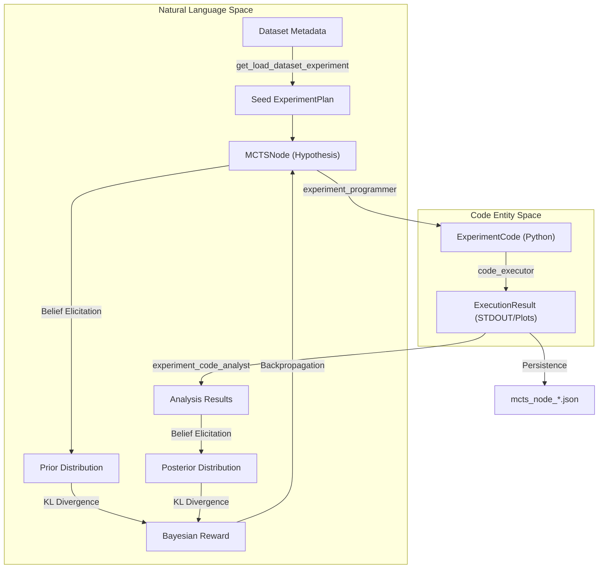
**Sources:** [README.md:2-6](), [src/run.py:31-31](), [pyproject.toml:5-15]()

---

## Key Subsystems

### 1. MCTS Discovery Loop
The core of AutoDiscovery is a Monte Carlo Tree Search. Each node in the tree represents a state of discovery containing a specific hypothesis and the experiment designed to test it. The search engine uses strategies like **UCB1** and **Progressive Widening** to decide which hypothesis to refine next.

For details on the tree structure and search algorithms, see **[MCTS Discovery Loop](#2.1)**.

### 2. Multi-Agent Orchestration
AutoDiscovery utilizes an `autogen`-based multi-agent system where specialized agents collaborate to perform research tasks. These agents include:
*   `experiment_generator`: Proposes new hypotheses.
*   `experiment_programmer`: Writes the Python code to test hypotheses.
*   `code_executor`: Runs the code in a sandbox and captures results.
*   `experiment_code_analyst`: Interprets the statistical outputs and visualizations.

For details on agent prompts and the state machine governing their interactions, see **[Multi-Agent Orchestration](#2.2)**.

### 3. Bayesian Reward System
The "value" of a discovery is not just its statistical significance, but its **Surprisal**. The system elicits a **Prior** belief distribution from an LLM before running an experiment, and a **Posterior** distribution after seeing the results. The reward is calculated based on the **KL Divergence** between these distributions.

For details on belief formats (Gaussian, Categorical, Beta) and reward formulas, see **[Belief System and Bayesian Reward](#2.3)**.

---

## Technical Mapping: Logic to Implementation

The following diagram maps the logical discovery steps to the specific classes and files responsible for executing them.

### Mapping Research Logic to Code Entities

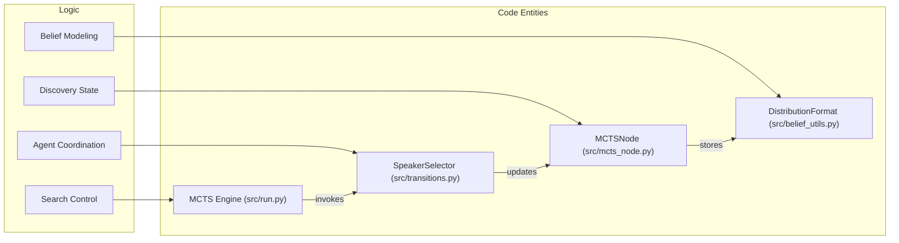
**Sources:** [src/run.py:31-31](), [pyproject.toml:31-31]()

---

## Documentation Roadmap

To get started with AutoDiscovery, follow the documentation in this order:

1.  **[Getting Started](#1.1)**: Install the environment (Python 3.10+, `pyautogen`) and run your first discovery experiment using the `autodiscovery` CLI.
2.  **[Key Concepts and Terminology](#1.2)**: Understand the domain-specific language of the project, such as "Belief Elicitation" and "DiscoveryBench".
3.  **[Core Architecture](#2)**: Dive into the implementation details of the MCTS loop and the agent transition logic.
4.  **[Dataset Integration](#3)**: Learn how to format your own scientific data for discovery using the supported metadata schemas.
5.  **[Output, Persistence, and Utilities](#5)**: Use the D3.js visualizer to explore the generated discovery trees and export results to CSV.

**Sources:** [README.md:8-41](), [README.md:85-102](), [pyproject.toml:10-28]()

---

# Page: Getting Started

# Getting Started

<details>
<summary>Relevant source files</summary>

The following files were used as context for generating this wiki page:

- [README.md](README.md)
- [environment.yml](environment.yml)
- [pyproject.toml](pyproject.toml)
- [src/args.py](src/args.py)

</details>


The AutoDiscovery system is designed for open-ended scientific discovery by optimizing for **Bayesian Surprise**. It utilizes Monte Carlo Tree Search (MCTS) to navigate a space of hypotheses and experimental plans, leveraging LLM-based agents to generate code, execute experiments, and elicit belief distributions.

### Purpose and Scope
This guide provides the technical requirements and procedures to set up the AutoDiscovery environment, install dependencies, and execute discovery runs using the provided Command Line Interface (CLI). It also details the expected data formats for dataset metadata.

---

## Environment Setup

AutoDiscovery requires **Python 3.10 or newer** due to the use of modern type hinting (e.g., `float | None`) and dependency requirements like `matplotlib 3.10` [README.md:10-12]().

### Conda Installation (Recommended)
The project provides an `environment.yml` file that specifies Python 3.11 and key scientific libraries.

```sh
conda env create -f environment.yml
conda activate autodiscovery
```
*Sources: [environment.yml:1-16](), [README.md:42-49]()*

### Pip Installation
To use the `autodiscovery` CLI command globally within your environment, install the package in editable mode from the repository root:

```sh
python -m pip install -e .
```
**Note:** Ensure your `python` and `pip` versions match. Using a Python 3.9 interpreter will result in installation failures [README.md:14-20]().

### Dependencies
The system relies on several core packages for agent orchestration and data analysis:
*   `pyautogen[openai]==0.8`: For multi-agent conversation management [pyproject.toml:22]().
*   `scikit-learn`, `scipy`, `statsmodels`: For statistical analysis and experiment execution [pyproject.toml:23-25]().
*   `streamlit`: For visualization components [pyproject.toml:16]().

*Sources: [pyproject.toml:15-28](), [README.md:8-21]()*

---

## Configuration and CLI Usage

The primary entry point is `src/run.py`, which is mapped to the `autodiscovery` command via `project.scripts` [pyproject.toml:30-31]().

### Running an Experiment
A standard run requires specifying the dataset metadata, output directories, and the number of MCTS iterations (`n_experiments`).

```sh
autodiscovery \
    --work_dir="work" \
    --out_dir="outputs" \
    --dataset_metadata="path/to/metadata.json" \
    --n_experiments=16 \
    --model="gpt-4o" \
    --belief_model="gpt-4o"
```
*Sources: [README.md:24-32](), [src/args.py:8-13](), [src/args.py:26-26]()*

### Key CLI Arguments
The `ArgParser` class in `src/args.py` defines the configuration surface:

| Argument | Type | Default | Description |
| :--- | :--- | :--- | :--- |
| `--dataset_metadata` | `str` | Required | Path to the JSON metadata file describing the dataset. |
| `--n_experiments` | `int` | Required | Total number of MCTS iterations to perform. |
| `--model` | `str` | `o4-mini` | The LLM used for discovery agents (Generator, Programmer, etc.). |
| `--belief_model` | `str` | `gpt-4o` | The LLM used specifically for belief elicitation. |
| `--mcts_selection` | `str` | `ucb1_recursive` | Strategy for tree traversal (`ucb1`, `beam_search`, `pw`, etc.). |
| `--belief_mode` | `str` | `boolean_cat` | The format of belief elicitation (e.g., `gaussian`, `categorical`). |
| `--continue_from_dir`| `str` | `None` | Path to resume a previous session using existing logs. |

*Sources: [src/args.py:8-81]()*

---

## System Architecture Overview

The following diagrams illustrate how the CLI configuration initiates the internal discovery components.

### Diagram 1: Initialization Flow
This diagram maps the CLI entry point to the core orchestration logic.

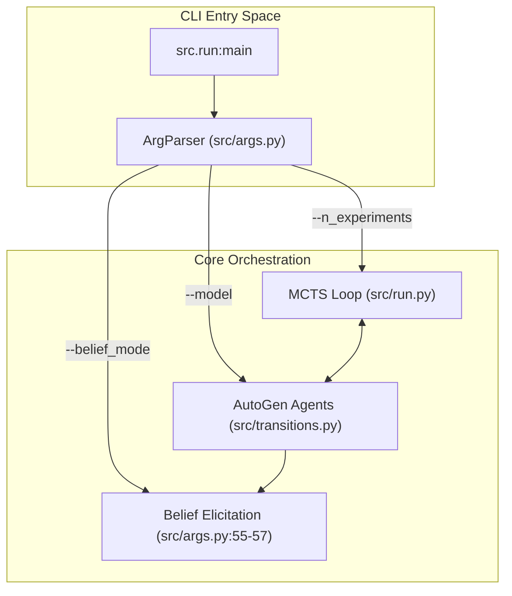
*Sources: [src.run:main](), [src/args.py:4-81](), [README.md:87-97]()*

### Diagram 2: Data Entity Mapping
Mapping natural language scientific concepts to code entities.

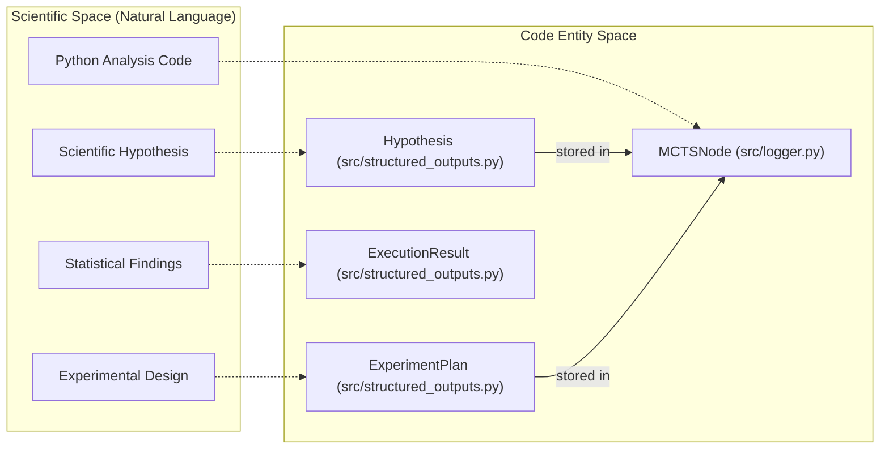
*Sources: [src/structured_outputs.py:1-60](), [src/logger.py:1-20]()*

---

## Dataset Metadata Formats

AutoDiscovery supports three primary metadata schemas to ingest scientific data. The format is selected via the `--dataset_metadata_type` flag [src/args.py:36-37]().

### 1. DiscoveryBench (`dbench`)
The default format. It requires a JSON file describing paths to CSV files and column-level descriptions.
*   **Structure:** Contains a list of dataset files and a `column_description` map.
*   **Usage:** Point `--dataset_metadata` to the `metadata_0.json` file in a DiscoveryBench task folder [README.md:28]().

### 2. BLADE (`blade`)
Used for behavioral data experiments. Requires the `BLADE` repository datasets to be cloned locally [README.md:74-80]().

### 3. Custom Datasets (BYO-Datasets)
To use custom data, provide a JSON metadata file following the DiscoveryBench structure:
*   Paths to datasets must be relative to the metadata file [README.md:83]().
*   Provide natural language descriptions for every relevant column to allow the LLM to formulate hypotheses.

*Sources: [README.md:64-84](), [src/args.py:36-37]()*

---

## Resuming Exploration
The system maintains state persistence by saving nodes to JSON files (`mcts_nodes.json`). To resume an interrupted run:
1.  Identify the output directory of the previous run.
2.  Use the `--continue_from_dir` flag [src/args.py:22-23]().
3.  The system will reload the MCTS tree and continue from the last completed iteration [README.md:99-101]().

*Sources: [src/args.py:22-25](), [README.md:99-101]()*

---

# Page: Key Concepts and Terminology

# Key Concepts and Terminology

<details>
<summary>Relevant source files</summary>

The following files were used as context for generating this wiki page:

- [README.md](README.md)
- [src/agents.py](src/agents.py)
- [src/beliefs.py](src/beliefs.py)
- [src/mcts.py](src/mcts.py)

</details>


This page defines the core domain concepts and technical implementation details of the AutoDiscovery system. It bridges the gap between scientific discovery theory (Bayesian Surprise, MCTS) and the specific code entities that implement them.

## 1. Bayesian Surprise and Belief Distributions

AutoDiscovery quantifies the value of a scientific discovery using **Bayesian Surprise**, defined as the change in an agent's belief distribution after observing experimental evidence. This is primarily implemented through KL Divergence between a **Prior** and a **Posterior** distribution.

### Implementation of Belief Modes
The system supports multiple statistical distributions to model different types of scientific hypotheses. These are managed by the `BELIEF_MODE_TO_CLS` mapping in [src/beliefs.py:108-114]().

| Concept | Code Entity | Distribution | Use Case |
| :--- | :--- | :--- | :--- |
| **Boolean Belief** | `BeliefTrueFalse` | Beta | Binary hypotheses (e.g., "Feature A affects B"). [src/beliefs.py:13-14]() |
| **Categorical** | `BeliefCategorical` | Dirichlet | Multi-bucket qualitative support (e.g., "Definitely True" to "Definitely False"). [src/beliefs.py:161-162]() |
| **Gaussian** | `BeliefGauss` | Normal | Numeric estimates (e.g., "The correlation coefficient is 0.5"). [src/beliefs.py:465-466]() |

### Reward Calculation
The reward (or "value") of a node in the search tree is derived from these beliefs.
- **KL Divergence**: Calculated between `prior` and `posterior` objects using `kl_divergence` methods [src/beliefs.py:142-158]().
- **Self Value**: The `get_self_value` function (in `src/mcts_utils.py`) computes the node's reward based on the `--reward_mode` (e.g., `kl`, `belief`, or `belief_and_kl`) [src/mcts.py:56]().

Sources: [src/beliefs.py:13-162](), [src/beliefs.py:465-466](), [src/mcts.py:58-64]()

---

## 2. Monte Carlo Tree Search (MCTS)

AutoDiscovery treats the scientific process as a search problem. The `MCTSNode` class represents a single step in this process: a hypothesis followed by an experiment.

### MCTSNode Structure
Each node in the tree stores the full state of a scientific iteration:
- **Scientific State**: `hypothesis`, `experiment_plan`, `code`, and `analysis` [src/mcts.py:46-51]().
- **Search State**: `visits`, `value` (cumulative), and `self_value` (intrinsic surprise) [src/mcts.py:54-56]().
- **Belief State**: `prior` and `posterior` distribution objects [src/mcts.py:60-61]().

### Search Process Flow
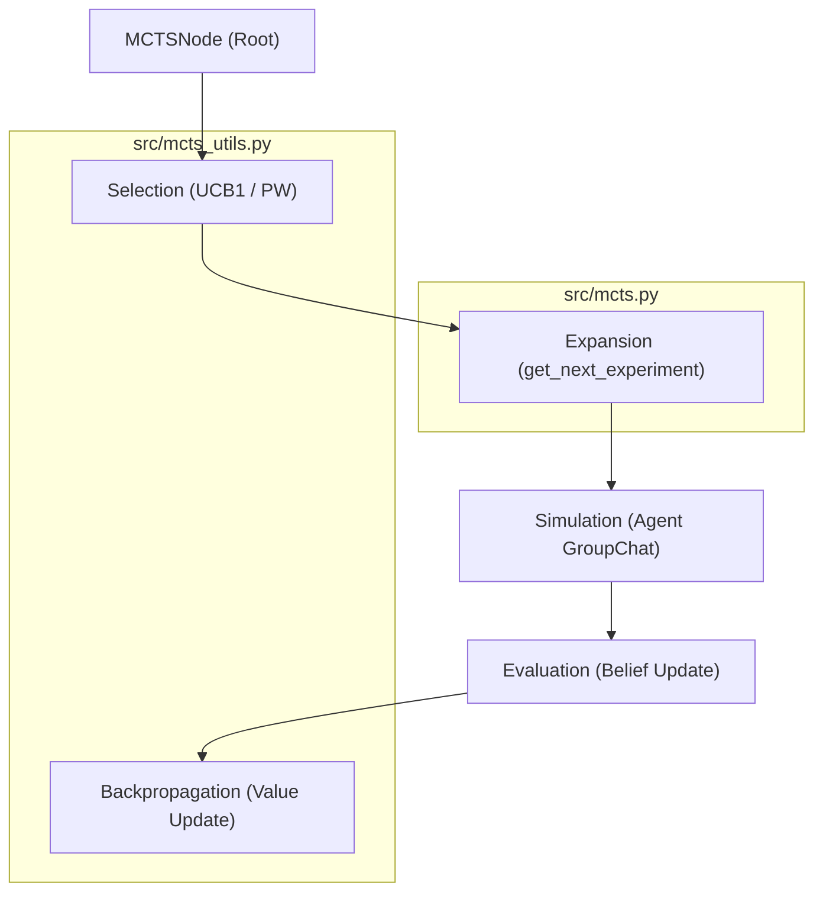
Sources: [src/mcts.py:14-64](), [src/mcts.py:118-123](), [src/mcts_utils.py:10-11]()

---

## 3. Agent Roles and Orchestration

The discovery process is executed by a multi-agent system built on `autogen`. Each agent has a specific role defined by a system prompt and a Pydantic structured output schema.

### Mapping Concepts to Code Entities
The following diagram maps the logical steps of an experiment to the specific Python classes and agents responsible for them.

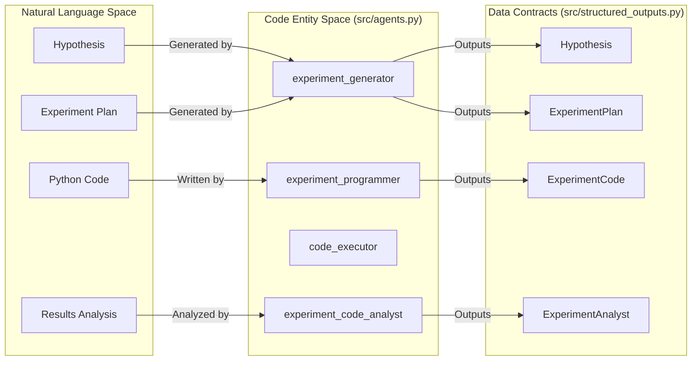

### Key Agent Definitions
- **`experiment_generator`**: Uses `ExperimentList` schema to propose falsifiable statements [src/agents.py:146-150]().
- **`experiment_programmer`**: Transforms plans into executable Python code using `ExperimentCode` schema [src/agents.py:220-225]().
- **`code_executor`**: A `UserProxyAgent` that runs code in a `LocalCommandLineCodeExecutor` [src/agents.py:246-255]().
- **`experiment_code_analyst`**: Interprets raw logs and plots (via `IMAGE_ANALYSIS_PATCH`) into scientific insights [src/agents.py:270-280]().

Sources: [src/agents.py:14-87](), [src/agents.py:143-280](), [src/structured_outputs.py:2-3]()

---

## 4. Dataset Formats

The system is designed to be dataset-agnostic, supporting several standard formats for scientific metadata.

| Format | Description | Loader/Utility |
| :--- | :--- | :--- |
| **DiscoveryBench** | Real-world scientific datasets with detailed column descriptions. | Referred to as `dbench` in CLI. [README.md:66-72]() |
| **BLADE** | Benchmarks for Language Model-Driven Exploration. | Referred to as `blade` in CLI. [README.md:74-80]() |
| **Custom JSON** | User-provided metadata mapping paths to natural language descriptions. | Passed via `--dataset_metadata`. [README.md:83-84]() |

### Data Flow to Agents
The dataset description is injected into the `experiment_generator` system prompt to ensure the LLM only uses available columns and does not simulate synthetic data [src/agents.py:157-160]().

Sources: [README.md:66-84](), [src/agents.py:157-160]()

---

## 5. System State and Persistence

To ensure reliability during long-running discovery sessions, AutoDiscovery maintains a rigorous serialization format.

### MCTS State Persistence
The entire search tree is saved as a collection of JSON files:
- **`mcts_nodes.json`**: The core tree structure including node links [src/mcts.py:65-66]().
- **`mcts_node_{id}.json`**: Detailed logs for individual nodes, including full agent conversation history (`messages`) [src/mcts.py:40](), [src/mcts.py:88]().

### The `IMAGE_ANALYSIS_PATCH`
A critical concept for "vision-capable" discovery is the `IMAGE_ANALYSIS_PATCH`. It intercepts `matplotlib.pyplot.show()` calls and redirects the plot to an LLM (typically `gpt-4o`) to generate a textual description of the results, which is then fed back to the `experiment_code_analyst` [src/agents.py:14-87]().

Sources: [src/mcts.py:65-117](), [src/agents.py:14-87]()

---

# Page: Core Architecture

# Core Architecture

<details>
<summary>Relevant source files</summary>

The following files were used as context for generating this wiki page:

- [src/agents.py](src/agents.py)
- [src/beliefs.py](src/beliefs.py)
- [src/mcts.py](src/mcts.py)
- [src/run.py](src/run.py)

</details>


The AutoDiscovery pipeline is designed as an iterative discovery engine that combines tree-based search with multi-agent orchestration to explore scientific datasets. It operates by generating hypotheses, implementing them as code, executing that code against real data, and then updating a Bayesian belief model based on the results.

## Pipeline Overview

The system architecture follows a hierarchical structure where a search algorithm manages a tree of scientific explorations. Each node in this tree represents a single experiment cycle (Hypothesis -> Code -> Result -> Analysis).

### Data Flow
1.  **Initialization**: The system loads dataset metadata and initializes a "root" experiment plan [src/dataset.py:165-175]().
2.  **MCTS Selection**: The discovery loop selects a promising node to expand based on past performance or exploration criteria [src/run.py:21-40]().
3.  **Agent Group Chat**: A specialized multi-agent team (using AutoGen) takes the selected hypothesis and carries out the implementation and analysis [src/mcts_utils.py:193-215]().
4.  **Belief Update**: An LLM-based "belief elicitation" process compares the agent's findings against a prior distribution to calculate "Surprise" (KL Divergence) [src/run.py:105-118]().
5.  **Backpropagation**: The surprise value is used as a reward to update the MCTS tree, influencing future selections [src/run.py:159-165]().

### Component Relationship
The following diagram illustrates how the natural language goals are translated into executable code entities and evaluated.

**System Entity Mapping**
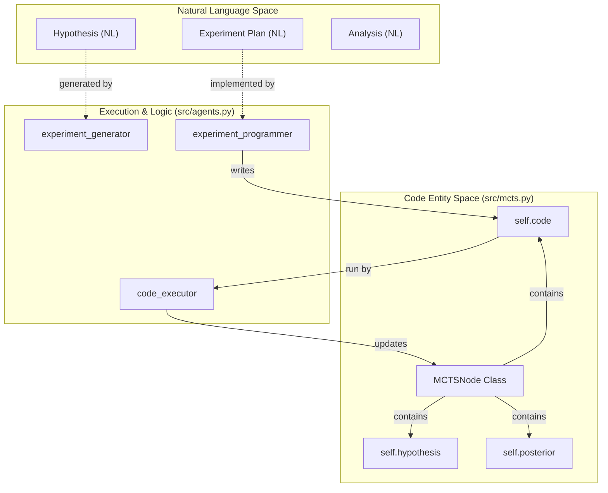
**Sources:** [src/mcts.py:14-64](), [src/agents.py:143-220](), [src/run.py:105-165]()

---

## MCTS Discovery Loop
The discovery process is framed as a search problem using **Monte Carlo Tree Search (MCTS)**. The `MCTSNode` class acts as the primary data structure, storing the state of an experiment including its code, results, and current belief metrics.

*   **Tree Structure**: Each node tracks its `level`, `node_idx`, and `parent_id` to maintain the hierarchy [src/mcts.py:24-35]().
*   **Selection Strategies**: The system supports various strategies like UCB1, Progressive Widening, and Beam Search to decide which hypothesis to pursue next [src/run.py:7-9]().
*   **State Persistence**: Nodes are serialized to JSON, allowing the system to resume interrupted runs or replay discoveries [src/mcts.py:65-116]().

For details, see [MCTS Discovery Loop](#2.1).

**Sources:** [src/mcts.py:14-64](), [src/run.py:21-40]()

---

## Multi-Agent Orchestration
AutoDiscovery uses a group of specialized LLM agents, orchestrated via `autogen`, to handle the complexity of scientific reasoning and coding.

| Agent Name | Role |
| :--- | :--- |
| `experiment_generator` | Proposes new hypotheses and experiment plans [src/agents.py:146](). |
| `experiment_programmer` | Translates plans into Python code using `pandas` and `matplotlib` [src/agents.py:175](). |
| `code_executor` | A `UserProxyAgent` that runs code in a local environment [src/agents.py:215](). |
| `experiment_code_analyst` | Interprets the raw output and visualizations from the code [src/agents.py:230](). |

The conversation flow is managed by a `SpeakerSelector` state machine that enforces strict transitions (e.g., the Programmer must follow the Generator) [src/mcts_utils.py:193-215]().

For details, see [Multi-Agent Orchestration](#2.2).

**Sources:** [src/agents.py:133-250](), [src/mcts_utils.py:193-215]()

---

## Belief System and Bayesian Reward
The "value" of a discovery is determined by its **Bayesian Surprise**. Instead of simple success/failure, the system measures how much an experiment changes the LLM's belief in a hypothesis.

**Belief Flow Diagram**
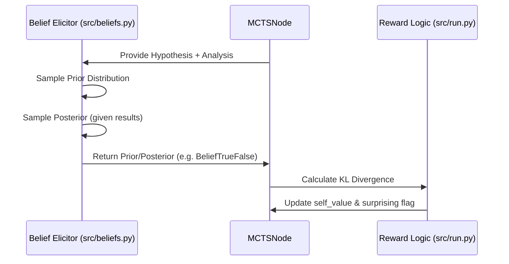

*   **Distribution Formats**: Supports Beta (True/False), Dirichlet (Categorical), and Gaussian distributions [src/beliefs.py:13-200]().
*   **KL Divergence**: Quantifies the "distance" between the prior (what we thought before the data) and the posterior (what we think after) [src/beliefs.py:142-158]().
*   **Reward Modes**: The MCTS reward can be tuned to favor high belief change, high KL divergence, or a combination [src/run.py:159-162]().

For details, see [Belief System and Bayesian Reward](#2.3).

**Sources:** [src/beliefs.py:1-160](), [src/run.py:43-118](), [src/mcts_utils.py:112-125]()

---

# Page: MCTS Discovery Loop

# MCTS Discovery Loop

<details>
<summary>Relevant source files</summary>

The following files were used as context for generating this wiki page:

- [src/mcts.py](src/mcts.py)
- [src/mcts_utils.py](src/mcts_utils.py)
- [src/run.py](src/run.py)

</details>


The **Monte Carlo Tree Search (MCTS) Discovery Loop** is the central engine driving the AutoDiscovery pipeline. It manages the iterative process of hypothesis generation, experiment execution, and belief updating. By representing the scientific discovery process as a tree search, the system can strategically balance the exploration of novel scientific territories with the exploitation of promising research directions.

## MCTS Overview and Traversal

The discovery process is structured as a tree where each node represents a specific experiment and its resulting scientific insights. The loop follows the standard MCTS phases:

1.  **Selection**: The system traverses the existing tree from the root to a leaf node using a selection strategy (e.g., UCB1).
2.  **Expansion**: At the selected node, a new experiment is proposed. If the node has "untried experiments," one is selected; otherwise, the `experiment_generator` agent may be invoked to propose new ones [src/mcts.py:118-146]().
3.  **Simulation (Experimentation)**: The system executes the experiment via the multi-agent orchestration pipeline, resulting in code output, analysis, and a review.
4.  **Backpropagation**: The "value" of the experiment—determined by the **Bayesian Surprise** (belief change or KL divergence)—is propagated back up the tree to inform future selections [src/mcts.py:171-183]().

### Natural Language to Code Entity Mapping: Search Process

The following diagram maps the conceptual MCTS phases to the specific functions and classes in the codebase.

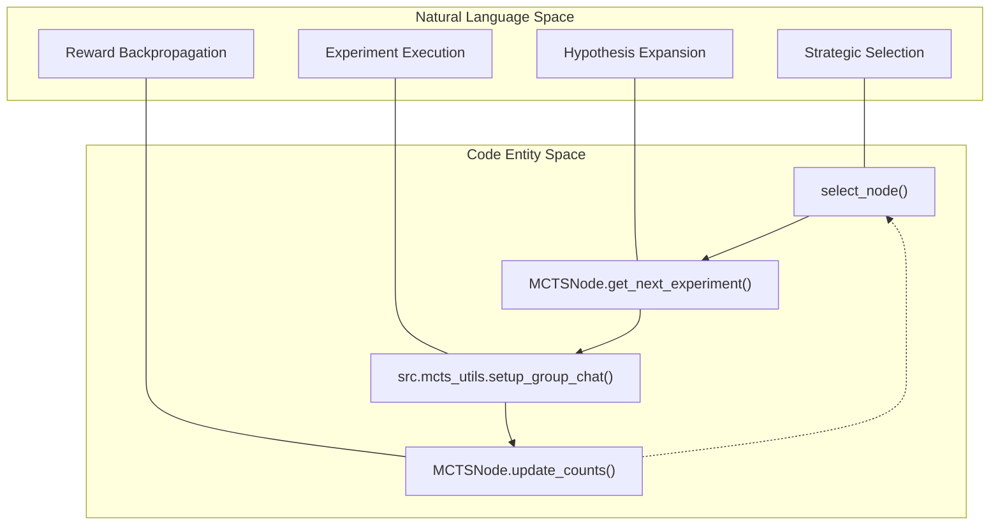
**Sources:** [src/run.py:21-41](), [src/mcts.py:118-183](), [src/mcts_utils.py:186-213]()

---

## MCTSNode Data Model

The `MCTSNode` class is the primary data structure for the search tree. It stores not only the tree topology (parent/children links) but also the full scientific context of an experiment, including the hypothesis, the executable code, and the elicited prior/posterior belief distributions.

For details on fields like `visits`, `value`, and serialization methods, see [MCTSNode Data Model](#2.1.1).

**Sources:** [src/mcts.py:14-64]()

---

## Selection Strategies

AutoDiscovery supports multiple interchangeable selection algorithms to navigate the hypothesis space. These are configured via CLI flags and determine how the system chooses which "branch" of science to investigate next.

*   **UCB1**: Balances exploration and exploitation using the standard Upper Confidence Bound formula.
*   **Progressive Widening**: Limits the number of children at a node based on the number of visits, preventing the search from becoming too shallow in high-dimensional hypothesis spaces.
*   **Beam Search**: A deterministic search strategy that maintains a fixed number of best-performing nodes at each level.

For implementation details and configuration, see [Selection Strategies](#2.1.2).

**Sources:** [src/run.py:7-8](), [src/run.py:21-41]()

---

## State Persistence and Resumption

The MCTS loop is designed for long-running experiments. The state of the tree is frequently serialized to disk to prevent data loss and allow for post-hoc analysis.

*   **Serialization**: Nodes are converted to dictionaries via `to_dict()` and saved as `mcts_nodes.json` (deduplicated) and `mcts_nodes_all.json` (full history) [src/mcts_utils.py:130-162]().
*   **Resumption**: The `load_mcts_from_json` function can reconstruct a full `MCTSNode` tree from these files, allowing the search to continue from a previous state [src/mcts_utils.py:15-90]().
*   **Replay**: During loading, the system can "replay" the `creation_idx` to correctly reconstruct `visits` and `value` counts across the tree [src/mcts_utils.py:79-89]().

### Data Flow: Persistence and Analysis

This diagram illustrates how the in-memory tree structure is transformed into persistent storage formats.

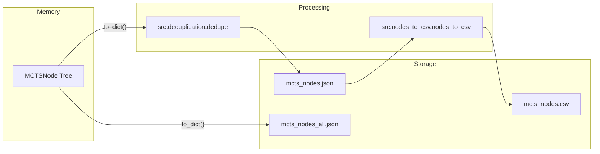
**Sources:** [src/mcts_utils.py:93-129](), [src/mcts_utils.py:130-162]()

---

## Reward and Surprisal Calculation

The "reward" that guides the MCTS is derived from **Bayesian Surprise**. After an experiment is executed and analyzed, the system elicits a `posterior` belief from an LLM. The difference between the `prior` (what the model expected) and the `posterior` (what the model learned from the data) defines the reward.

*   **Reward Modes**: Configurable via `reward_mode` (e.g., "belief", "kl", or "belief_and_kl") [src/run.py:46-47]().
*   **Surprisal**: If the belief change exceeds a certain threshold (`surprisal_width`), the node is marked as `surprising` [src/run.py:159-162]().
*   **Online Beliefs**: The system can optionally use "online" updates, where the prior for a new node is conditioned on the results of all previously discovered surprising nodes [src/run.py:51-74]().

**Sources:** [src/run.py:43-162](), [src/mcts_utils.py:228-243]()

---

# Page: MCTSNode Data Model

# MCTSNode Data Model

<details>
<summary>Relevant source files</summary>

The following files were used as context for generating this wiki page:

- [src/mcts.py](src/mcts.py)
- [src/mcts_utils.py](src/mcts_utils.py)

</details>


The `MCTSNode` class is the fundamental data structure of the AutoDiscovery system, representing a single state within the Monte Carlo Tree Search (MCTS) discovery loop. Each node encapsulates a scientific hypothesis, the experimental plan designed to test it, the resulting code, and the Bayesian belief distributions (prior and posterior) used to calculate scientific surprise.

## 1. Class Structure and Fields

The `MCTSNode` class [src/mcts.py:14-63]() serves as a container for both tree-specific metadata and agent-generated scientific content.

### 1.1 Tree and Identification Attributes
These fields manage the node's position and relationship within the search tree.

| Field | Type | Description |
| :--- | :--- | :--- |
| `id` | `str` | Unique identifier formatted as `node_{level}_{node_idx}` [src/mcts.py:26](). |
| `level` | `int` | The depth of the node in the tree (0 for root) [src/mcts.py:24](). |
| `node_idx` | `int` | Sequential index of the node within its specific level [src/mcts.py:25](). |
| `creation_idx` | `int` | Global counter used to replay MCTS steps in the exact order they occurred [src/mcts.py:21-22](). |
| `parent` | `MCTSNode` | Reference to the parent node object [src/mcts.py:28](). |
| `children` | `list` | List of child `MCTSNode` objects [src/mcts.py:27](). |

### 1.2 Scientific and Agent Attributes
These fields store the outputs from the multi-agent orchestration pipeline.

| Field | Type | Description |
| :--- | :--- | :--- |
| `hypothesis` | `dict`/`Hypothesis` | The scientific hypothesis being tested [src/mcts.py:46](). |
| `experiment_plan` | `dict`/`ExperimentPlan`| The natural language plan for the experiment [src/mcts.py:47](). |
| `code` | `str` | The Python code generated to execute the experiment [src/mcts.py:48](). |
| `code_output` | `str` | The stdout/stderr and results from code execution [src/mcts.py:49](). |
| `analysis` | `dict` | The `experiment_code_analyst`'s interpretation of results [src/mcts.py:50](). |
| `review` | `dict` | Feedback from the `experiment_reviewer` [src/mcts.py:51](). |

### 1.3 MCTS and Belief Attributes
Fields used for selection logic and reward calculation.

| Field | Type | Description |
| :--- | :--- | :--- |
| `visits` | `int` | Number of times this node (or its descendants) has been visited [src/mcts.py:54](). |
| `value` | `float` | Aggregated value (backpropagated) used for UCB1 selection [src/mcts.py:55](). |
| `self_value` | `float` | The immediate reward of this node based on belief change [src/mcts.py:56](). |
| `prior` | `DistributionFormat` | LLM-elicited belief distribution before seeing data [src/mcts.py:60](). |
| `posterior` | `DistributionFormat` | LLM-elicited belief distribution after seeing data [src/mcts.py:61](). |
| `kl_divergence` | `float` | Quantified surprise (KL divergence between prior and posterior) [src/mcts.py:63](). |

**Sources:** [src/mcts.py:14-64](), [src/mcts.py:65-117]()

## 2. Serialization and Persistence

The `MCTSNode` supports robust serialization to allow for experiment resumption and post-hoc visualization.

### 2.1 Dictionary Conversion
The `to_dict` method (referenced in `save_nodes`) converts the node and its belief objects into a JSON-serializable format [src/mcts_utils.py:113-118]().

### 2.2 Tree Reconstruction
The `init_from_dict` function [src/mcts.py:65-117]() populates a node's attributes from a dictionary. To reconstruct a full tree from disk, the `load_mcts_from_json` utility [src/mcts_utils.py:15-90]() performs a two-pass process:
1. **Instantiation**: Nodes are created and sorted by `level` and `node_idx` [src/mcts_utils.py:34-41]().
2. **Linking**: Parent-child pointers are restored using the `parent_id` and `node_map` [src/mcts_utils.py:43-51]().
3. **Replay**: If `replay_mcts=True`, the system iterates through nodes by `creation_idx` and calls `update_counts` to reconstruct the `visits` and `value` fields [src/mcts_utils.py:80-89]().

### 2.3 Storage Schema
Nodes are typically saved in two formats within the log directory:
- `mcts_nodes.json`: A list of the current tree nodes (optionally deduplicated) [src/mcts_utils.py:151-154]().
- `mcts_nodes_all.json`: A complete archive of every node generated [src/mcts_utils.py:156-158]().

**Sources:** [src/mcts.py:65-117](), [src/mcts_utils.py:15-90](), [src/mcts_utils.py:130-162]()

## 3. Data Flow and Lifecycle

The following diagrams illustrate how the `MCTSNode` bridges the gap between natural language scientific reasoning and executable code entities.

### Node Data Lifecycle
This diagram shows how a node's fields are populated as it moves through the discovery pipeline.

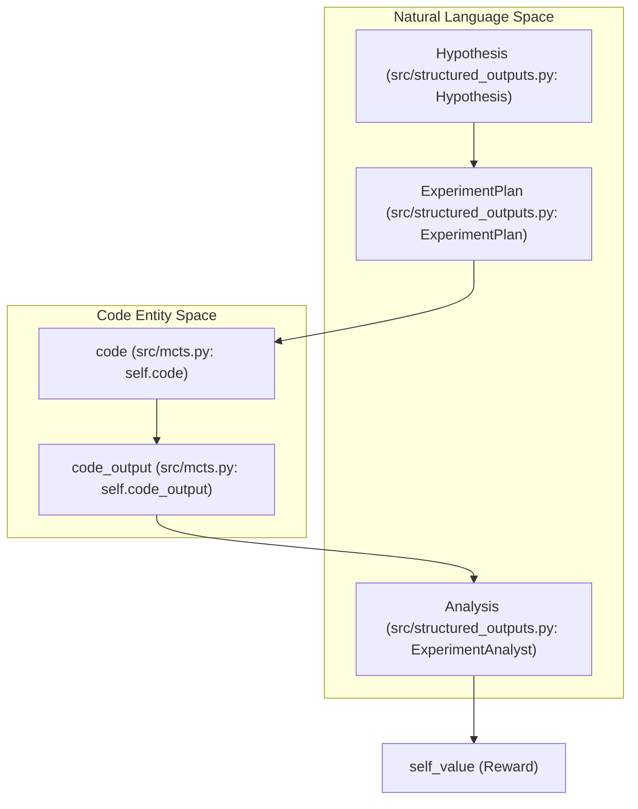
**Sources:** [src/mcts.py:46-56](), [src/structured_outputs.py:1-100]()

### Tree Linking and Parent Context
This diagram shows how `MCTSNode` instances are linked and how parent hypotheses form the context for child exploration.

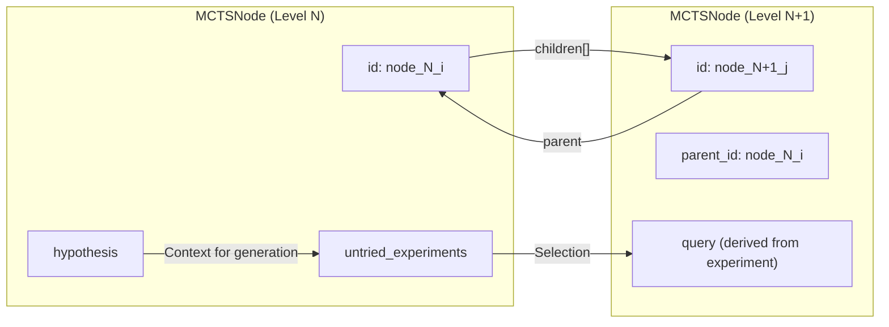
**Sources:** [src/mcts.py:24-35](), [src/mcts.py:126-152](), [src/mcts_utils.py:43-51]()

## 4. Key Methods

### 4.1 `get_next_experiment`
This method manages the transition from a parent node to a new child [src/mcts.py:118-154]().
- It pops an experiment from `untried_experiments` [src/mcts.py:127-129]().
- If empty and `allow_generate_experiments` is True, it invokes the `experiment_generator` to produce new experiment candidates based on `tried_experiments` [src/mcts.py:130-141]().

### 4.2 `update_counts`
Handles the backpropagation of rewards [src/mcts.py:166-173]().
- Increments `visits` by 1.
- Adds the `reward` to the `value` field.
- Recursively calls `parent.update_counts` until the root is reached.

**Sources:** [src/mcts.py:118-173]()

---

# Page: Selection Strategies

# Selection Strategies

<details>
<summary>Relevant source files</summary>

The following files were used as context for generating this wiki page:

- [src/args.py](src/args.py)
- [src/mcts.py](src/mcts.py)
- [src/run.py](src/run.py)

</details>


Selection strategies in AutoDiscovery define how the Monte Carlo Tree Search (MCTS) engine navigates the tree of scientific experiments to decide which hypothesis to expand next. These strategies manage the fundamental **exploration-exploitation trade-off**: exploring new, potentially high-surprise areas of the dataset versus exploiting known paths that have already yielded significant belief changes.

## Overview of Selection Flow

The selection process is triggered at the start of each MCTS iteration within the main loop [src/run.py:21-40](). The system uses a `select_node` wrapper that handles an initial "warmstart" phase before transitioning to the configured search algorithm.

### Warmstart Logic
Before the selection strategy takes over, the system can be configured to run a fixed number of initial experiments. If the number of experiments performed is less than `--n_warmstart`, the system bypasses the selection algorithm and repeatedly selects the data loader node (Level 1) to generate diverse initial seeds [src/run.py:34-38]().

### Natural Language to Code Entity Mapping: Selection

| Concept | Code Entity | File |
| :--- | :--- | :--- |
| **Selection Wrapper** | `select_node` | [src/run.py:21]() |
| **UCB1 Algorithm** | `default_mcts_selection` | [src/mcts.py:192]() |
| **Recursive UCB1** | `ucb1_recursive` | [src/mcts.py:341]() |
| **Beam Search** | `beam_search` | [src/mcts.py:223]() |
| **Progressive Widening** | `progressive_widening` | [src/mcts.py:261]() |

## Supported Strategies

### 1. UCB1 (Upper Confidence Bound)
The standard MCTS selection algorithm. It selects children based on their average value plus an exploration term that grows with the parent's total visits.

*   **Implementation**: `default_mcts_selection` [src/mcts.py:192-221]().
*   **Formula**: $Score = \frac{v_i}{n_i} + C \times \sqrt{\frac{\ln(N)}{n_i}}$, where $v_i$ is node value, $n_i$ is node visits, $N$ is parent visits, and $C$ is `--exploration_weight`.
*   **CLI Flag**: `--mcts_selection ucb1`.

### 2. Recursive UCB1
This is the default strategy for AutoDiscovery. Unlike standard UCB1 which often selects from the entire pool of nodes, this method traverses the tree level-by-level from the root, applying UCB1 at each step until a leaf or a node with untried experiments is reached.

*   **Implementation**: `ucb1_recursive` [src/mcts.py:341-367]().
*   **Behavior**: It recursively calls itself on the best child until it finds a node that can be expanded [src/mcts.py:361-364]().
*   **CLI Flag**: `--mcts_selection ucb1_recursive`.

### 3. Progressive Widening (PW)
Progressive Widening limits the number of children a node can have as a function of its visits. This prevents the search from becoming too shallow when the branching factor (number of possible hypotheses) is high.

*   **Implementation**: `progressive_widening` [src/mcts.py:261-299]().
*   **Mechanism**: A child is only eligible for selection if the number of children $k$ satisfies $k \le pw\_k \cdot n^{pw\_alpha}$ [src/mcts.py:284-285]().
*   **CLI Flags**: `--mcts_selection pw`, `--pw_k`, `--pw_alpha`.

### 4. Beam Search
A deterministic search strategy that maintains a "beam" of the top-$N$ scoring nodes across the entire tree.

*   **Implementation**: `beam_search` [src/mcts.py:223-259]().
*   **Behavior**: It flattens all nodes in the tree, filters for those with `untried_experiments`, sorts them by their `value / visits` ratio, and selects from the top nodes defined by `--beam_width` [src/mcts.py:246-255]().
*   **CLI Flag**: `--mcts_selection beam_search`, `--beam_width`.

## Data Flow and Implementation

The following diagram illustrates how the `select_node` function interacts with the `MCTSNode` tree structure and the specific selection algorithms.

**MCTS Selection Data Flow**
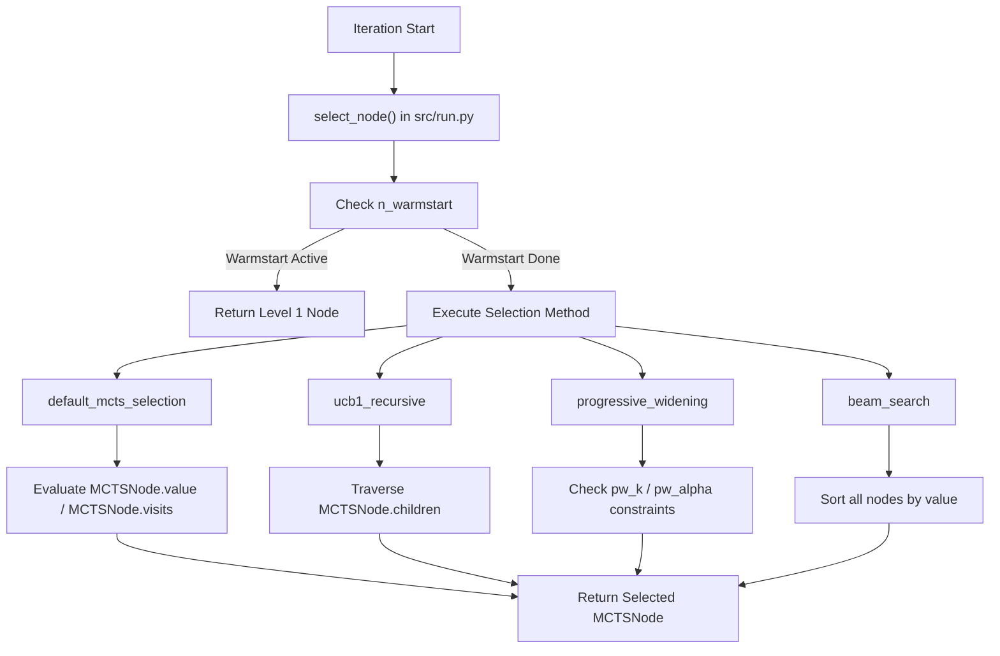
**Sources:** [src/run.py:21-40](), [src/mcts.py:192-367]()

## Configuration Reference

Selection behavior is primarily controlled via `src/args.py`.

| Flag | Type | Default | Description |
| :--- | :--- | :--- | :--- |
| `--mcts_selection` | string | `ucb1_recursive` | The algorithm to use: `ucb1`, `beam_search`, `pw`, `pw_all`, `ucb1_recursive`. [src/args.py:44-46]() |
| `--exploration_weight` | float | `2.0` | The $C$ constant in UCB1. [src/args.py:34-35]() |
| `--n_warmstart` | int | `8` | Initial experiments before search starts. [src/args.py:70-71]() |
| `--beam_width` | int | `8` | Number of nodes to consider in Beam Search. [src/args.py:41]() |
| `--pw_k` | float | `1.0` | Constant for Progressive Widening. [src/args.py:47]() |
| `--pw_alpha` | float | `0.5` | Exponent for Progressive Widening. [src/args.py:48]() |

## Code Logic: Node Selection and Expansion

When a node is selected, the system checks if it has `untried_experiments`. If it does, it pops one to create a new child node. If it does not, and `--allow_generate_experiments` is enabled, it invokes the `experiment_generator` agent to create new branches for that node [src/mcts.py:118-154]().

**Selection to Expansion Logic**
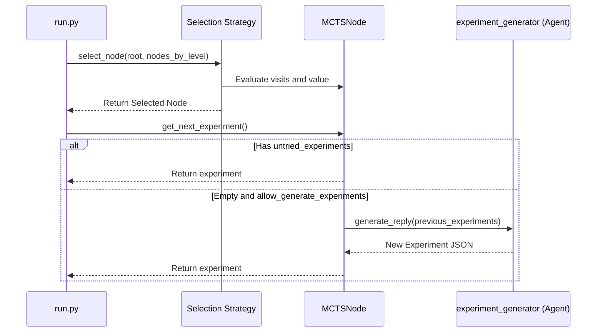
**Sources:** [src/run.py:21-40](), [src/mcts.py:118-154](), [src/args.py:28-29]()

---

# Page: Multi-Agent Orchestration

# Multi-Agent Orchestration

<details>
<summary>Relevant source files</summary>

The following files were used as context for generating this wiki page:

- [src/agents.py](src/agents.py)
- [src/mcts_utils.py](src/mcts_utils.py)
- [src/transitions.py](src/transitions.py)

</details>


This page describes how AutoDiscovery leverages the **AutoGen** framework to coordinate a specialized team of LLM-based agents. The system transforms high-level research hypotheses into executable code, analyzes experimental results, and refines ideas through a structured multi-turn conversation.

The orchestration logic is designed to ensure that experiments are not only generated but also rigorously implemented, executed in a sandboxed environment, and reviewed for scientific validity.

## Orchestration Architecture

The orchestration is built around a `GroupChat` and a `GroupChatManager` [src/mcts_utils.py:8-12](). Unlike a standard round-robin or LLM-selected conversation, AutoDiscovery uses a deterministic state machine to manage the experiment lifecycle.

### Conversation Pipeline
The pipeline follows a linear path with specific retry loops for code failures and scientific revisions:

1.  **Programming**: Translating the experiment plan into Python code.
2.  **Execution**: Running the code in a local shell and capturing output/plots.
3.  **Analysis**: Interpreting logs and visual data to determine if the hypothesis was supported.
4.  **Review**: Critiquing the methodology and results for errors or biases.
5.  **Generation**: Proposing the next set of hypotheses based on findings.

### Multi-Agent Interaction Diagram
The following diagram maps the logical flow of the orchestration to the specific classes and files that implement them.

**Diagram: Multi-Agent State Machine**
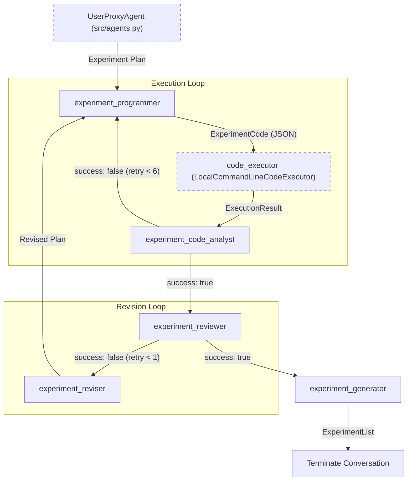
**Sources:** [src/transitions.py:23-66](), [src/agents.py:146-240]()

---

## Agent Roles and Responsibilities

Each agent is initialized as a `ConversableAgent` with a specific `system_message` and `response_format` [src/agents.py:146-240]().

| Agent Name | Primary Responsibility | Key Code Entity |
| :--- | :--- | :--- |
| `experiment_generator` | Proposes new hypotheses/plans based on history. | `ExperimentList` [src/agents.py:146]() |
| `experiment_programmer` | Writes Python code to test a specific plan. | `ExperimentCode` [src/agents.py:180]() |
| `code_executor` | Executes code and captures STDOUT/Plots. | `LocalCommandLineCodeExecutor` [src/agents.py:6]() |
| `experiment_code_analyst` | Interprets results and plot descriptions. | `ExperimentAnalyst` [src/agents.py:202]() |
| `experiment_reviewer` | Validates the scientific integrity of the result. | `ExperimentReviewer` [src/agents.py:221]() |
| `experiment_reviser` | Fixes plans if the reviewer finds flaws. | `Experiment` [src/agents.py:238]() |

For a deep dive into the specific prompts and schemas for each agent, see **[Agent Roles and Prompts (#2.2.1)]**.

**Sources:** [src/agents.py:133-240](), [src/structured_outputs.py:2-3]()

---

## State Machine and Control Flow

The orchestration is governed by the `SpeakerSelector` class in `src/transitions.py`. It implements the `select_next_speaker` logic, which acts as the "brain" of the `GroupChat` [src/transitions.py:11-66]().

### Deterministic Routing
The selector uses the `last_speaker.name` and the content of the last message to decide the next step. It handles:
*   **JSON Parsing**: It attempts to parse agent responses to find `success` flags [src/transitions.py:36-40]().
*   **Failure Budgets**: It maintains internal counters for `code_failure_count` (limit 6) and `experiment_revision_count` (limit 1) [src/transitions.py:8-9]().

### Image Analysis Integration
A unique feature of the orchestration is the `IMAGE_ANALYSIS_PATCH` [src/agents.py:14-87](). When the `experiment_programmer` writes code, the system wraps it in a transform that patches `matplotlib.pyplot.show` to automatically trigger an LLM-based image description service. This allows the `experiment_code_analyst` to "see" the plots through text descriptions.

**Diagram: Code Execution and Visual Feedback**
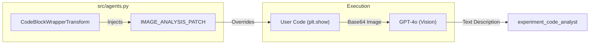
**Sources:** [src/agents.py:90-104](), [src/agents.py:39-75]()

For detailed documentation on the transition rules and retry logic, see **[Conversation Flow and Transitions (#2.2.2)]**.

---

## MCTS Integration

The multi-agent orchestration is the "Execution" phase of the larger MCTS loop.
1.  The MCTS selects a node (hypothesis).
2.  The `GroupChat` is initialized with that hypothesis as the `user_query` [src/agents.py:133-144]().
3.  The agents run through the pipeline described above.
4.  The final output of the `experiment_generator` provides the "children" (new hypotheses) for the MCTS tree [src/mcts_utils.py:65-77]().

**Sources:** [src/mcts_utils.py:15-90](), [src/agents.py:133-144]()

---

# Page: Agent Roles and Prompts

# Agent Roles and Prompts

<details>
<summary>Relevant source files</summary>

The following files were used as context for generating this wiki page:

- [src/agents.py](src/agents.py)
- [src/structured_outputs.py](src/structured_outputs.py)

</details>


This page provides a detailed reference for the multi-agent system used in AutoDiscovery. Each agent is a specialized `ConversableAgent` configured with specific system prompts, LLM configurations, and Pydantic-based structured output schemas to ensure robust transitions within the discovery pipeline.

## Overview of Agent Architecture

The agents are initialized via the `get_agents` function in [src/agents.py:133-134](). They operate within an AutoGen-based group chat, where their interactions are governed by a state machine. The system utilizes structured outputs to enforce data contracts between different stages of the experiment lifecycle, such as hypothesis generation, coding, and result analysis.

### Agent-Code Entity Mapping

The following diagram bridges the natural language roles to the specific code entities and Pydantic models that define their communication interface.

**Diagram: Agent Role to Code Entity Mapping**
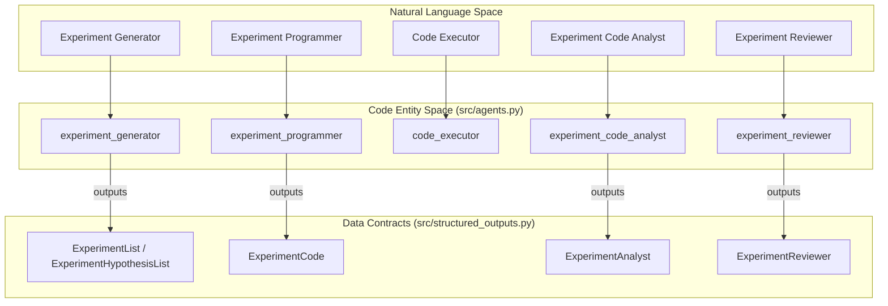
Sources: [src/agents.py:133-315](), [src/structured_outputs.py:1-160]()

---

## Agent Roles and Specifications

### 1. Experiment Generator
The `experiment_generator` is responsible for open-ended, data-driven research. It proposes verifiable hypotheses and corresponding experiment plans.

*   **System Prompt:** Instructs the agent to be creative and think of falsifiable statements using only provided datasets [src/agents.py:150-160]().
*   **Structured Output:** Uses `ExperimentList` or `ExperimentHypothesisList` [src/agents.py:148-149]().
*   **Key Constraints:** Must not simulate dummy data and must use prior experiments as inspiration without repetition [src/agents.py:158-160]().

### 2. Experiment Programmer
The `experiment_programmer` translates natural language experiment plans into executable Python code.

*   **System Prompt:** Focuses on writing modular, well-documented code. It is instructed to perform data cleaning, analysis, and visualization [src/agents.py:197-210]().
*   **Structured Output:** `ExperimentCode` [src/agents.py:195]().
*   **Retry Budget:** Handled by the `SpeakerSelector` in `src/transitions.py`, typically allowing up to 6 code execution failures before termination.

### 3. Code Executor
The `code_executor` is a `UserProxyAgent` that runs the generated code in a local environment.

*   **Implementation:** Uses `LocalCommandLineCodeExecutor` with a specified work directory [src/agents.py:230-234]().
*   **Safety:** Execution is sandboxed to the command line, and a timeout (default 30 minutes) is applied [src/agents.py:134]().

### 4. Experiment Code Analyst
The `experiment_code_analyst` interprets the output of the code execution, including logs and plot descriptions.

*   **System Prompt:** Instructed to provide a detailed analysis of the experiment outcomes and determine if the experiment successfully tested the hypothesis [src/agents.py:253-263]().
*   **Structured Output:** `ExperimentAnalyst` [src/agents.py:251](). This model requires an `analysis` string if `success` is true [src/structured_outputs.py:134-138]().

### 5. Experiment Reviewer
The `experiment_reviewer` acts as a quality gate, reviewing the analyst's conclusions against the original hypothesis.

*   **System Prompt:** Critically evaluates whether the results support or refute the hypothesis and identifies potential flaws in the experimental design [src/agents.py:279-290]().
*   **Structured Output:** `ExperimentReviewer` [src/agents.py:277](). It requires `feedback` if the experiment is marked as a failure [src/structured_outputs.py:155-159]().

### 6. Experiment Reviser
The `experiment_reviser` is invoked when an experiment fails due to logic or implementation errors.

*   **System Prompt:** Uses feedback from the reviewer to suggest specific fixes to the code or plan [src/agents.py:304-313]().
*   **Structured Output:** `ProgramCritique` [src/agents.py:302]().

Sources: [src/agents.py:146-315](), [src/structured_outputs.py:83-160]()

---

## The IMAGE_ANALYSIS_PATCH Mechanism

Because the `code_executor` runs in a headless environment, standard `matplotlib.pyplot.show()` calls would not be visible to the LLM. AutoDiscovery solves this using the `IMAGE_ANALYSIS_PATCH` [src/agents.py:14-87]().

### Implementation Details
The patch is a string of Python code prepended to every code block generated by the `experiment_programmer` via the `CodeBlockWrapperTransform` [src/agents.py:90-104]().

1.  **Redefinition:** It overrides `plt.show` using `functools.partial` to point to a custom `image_to_text` function [src/agents.py:80-86]().
2.  **Capture:** `image_to_text` iterates through all active figures, saves them to a `BytesIO` buffer as PNGs, and encodes them to base64 [src/agents.py:39-47]().
3.  **Analysis:** It sends the base64 image to `gpt-4o` with a specialized `image_analyst_prompt` [src/agents.py:24-36]().
4.  **Injection:** The resulting text description of the plot is printed to standard output, which the `code_executor` captures and passes to the `experiment_code_analyst` [src/agents.py:73-75]().

**Diagram: Image Analysis Data Flow**
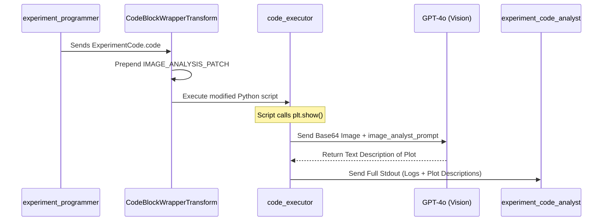
Sources: [src/agents.py:14-104]()

---

## Configuration and Retry Logic

Agents are configured with an OpenAI configuration that supports both standard GPT-4 models and the O-series reasoning models.

| Parameter | Logic | File Reference |
| :--- | :--- | :--- |
| **Temperature** | Applied to non-reasoning models; omitted for O-series. | [src/agents.py:120-129]() |
| **Reasoning Effort** | Configurable for O-series models (defaulting to "medium"). | [src/agents.py:124-126]() |
| **Max Retries** | Set to 3 at the LLM configuration level. | [src/agents.py:117]() |
| **Token Limits** | `MessageTokenLimiter` enforces a 10,000 token limit per message. | [src/agents.py:139-141]() |

Sources: [src/agents.py:110-142]()

---

# Page: Conversation Flow and Transitions

# Conversation Flow and Transitions

<details>
<summary>Relevant source files</summary>

The following files were used as context for generating this wiki page:

- [src/agents.py](src/agents.py)
- [src/transitions.py](src/transitions.py)

</details>


The conversation flow in AutoDiscovery is managed by a deterministic state machine that orchestrates the interaction between specialized agents. This logic ensures that hypotheses are systematically translated into code, executed, analyzed, and reviewed before being used to seed further discoveries.

## SpeakerSelector State Machine

The `SpeakerSelector` class in `src/transitions.py` implements the routing logic for the `GroupChat`. Unlike standard AutoGen group chats that may rely on LLM-based selection, AutoDiscovery uses a rule-based approach to ensure a reliable research pipeline.

### Deterministic Routing Rules

The transitions follow a linear path with specific loops for error correction and refinement.

| Current Speaker | Next Speaker | Condition / Logic |
| :--- | :--- | :--- |
| `user_proxy` | `experiment_programmer` | Initial handoff of the experiment plan. |
| `experiment_programmer` | `code_executor` | Handoff of generated Python code for execution. |
| `code_executor` | `experiment_code_analyst` | Handoff of execution logs and plots for interpretation. |
| `experiment_code_analyst` | `experiment_programmer` | **Retry Loop:** Triggered if `success` is `False` and `code_failure_count < 6`. |
| `experiment_code_analyst` | `experiment_reviewer` | Triggered if analysis is successful or retry budget is exhausted. |
| `experiment_reviewer` | `experiment_reviser` | **Revision Loop:** Triggered if `success` is `False` and `experiment_revision_count < 1`. |
| `experiment_reviewer` | `experiment_generator` | Triggered if review passes or revision budget is exhausted. |
| `experiment_reviser` | `experiment_programmer` | Revision feedback is sent back to the programmer to fix the experiment. |
| `experiment_generator` | `None` | Termination of the current MCTS node iteration. |

Sources: [src/transitions.py:6-66]()

### Failure Budgets and Counters

To prevent infinite loops in the multi-agent conversation, `SpeakerSelector` maintains internal state counters:

*   **`code_failure_count`**: Tracks how many times the `experiment_code_analyst` has reported a failure (e.g., runtime errors or empty results). The system allows up to **6 attempts** to fix the code via the `experiment_programmer` before moving to the review stage regardless of outcome [src/transitions.py:40-45]().
*   **`experiment_revision_count`**: Tracks how many times the `experiment_reviewer` has requested a revision of the experiment's logic. The system allows **1 revision** attempt via the `experiment_reviser` [src/transitions.py:53-58]().

## Data Flow: Natural Language to Code Entity Space

The following diagram illustrates how high-level research intents are transformed into concrete code entities and back into structured analysis.

**Entity Transition Diagram**
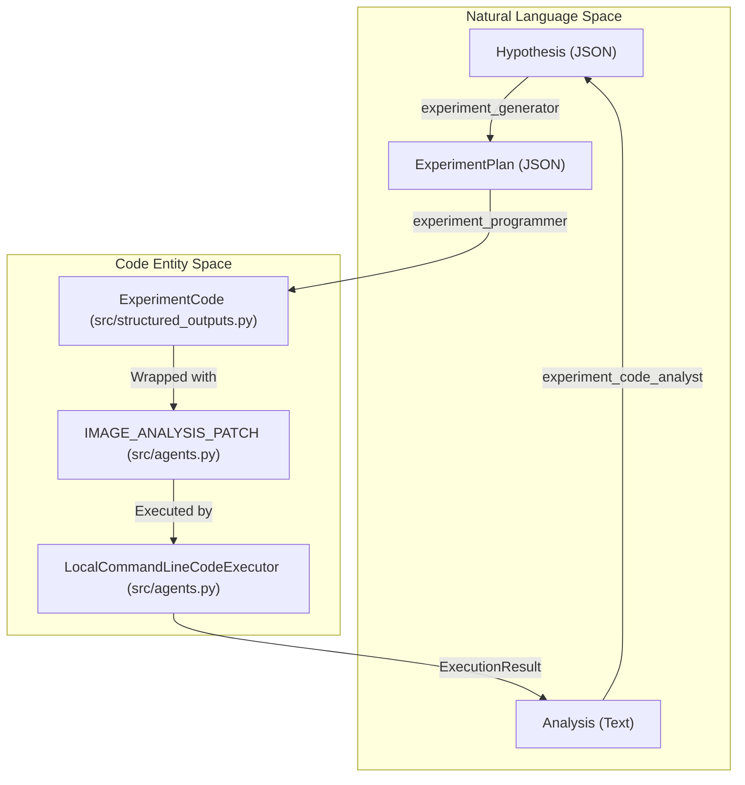
Sources: [src/agents.py:14-87](), [src/agents.py:146-160](), [src/transitions.py:23-32]()

## Success Signaling and JSON Parsing

Transitions are heavily dependent on the structured outputs of the agents. The `SpeakerSelector` parses the `content` of the last message as JSON to determine the next state.

*   **Code Analysis Success**: The `experiment_code_analyst` outputs a JSON object. If `json.loads(content).get("success")` is `False`, the selector increments `code_failure_count` and routes back to the programmer [src/transitions.py:35-42]().
*   **Review Success**: The `experiment_reviewer` outputs a JSON object. If `success` is `False`, the selector routes to the `experiment_reviser` [src/transitions.py:49-55]().
*   **Parsing Failures**: If a message cannot be parsed as JSON, the system treats it as a failure, defaulting `success` to `False` to trigger a retry or revision loop [src/transitions.py:37-39](), [src/transitions.py:51-52]().

## Termination Conditions

The conversation terminates (returns `None`) in two scenarios:
1.  The `experiment_generator` has finished its final task in the sequence [src/transitions.py:63-64]().
2.  An unrecognized speaker is encountered (fallback safety) [src/transitions.py:66]().

**Conversation Lifecycle**
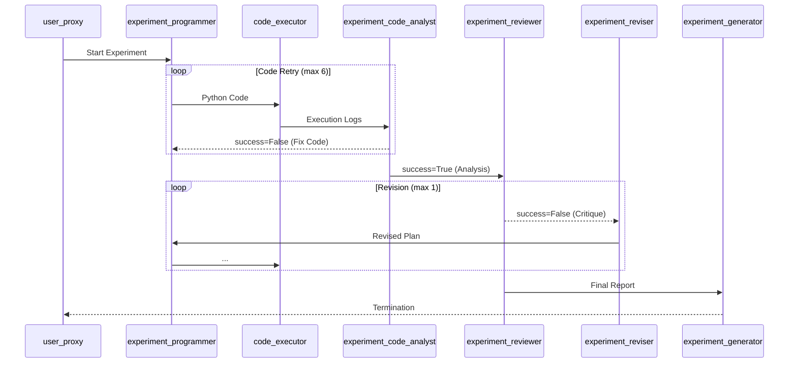
Sources: [src/transitions.py:11-66]()

---

# Page: Belief System and Bayesian Reward

# Belief System and Bayesian Reward

<details>
<summary>Relevant source files</summary>

The following files were used as context for generating this wiki page:

- [src/beliefs.py](src/beliefs.py)
- [src/mcts_utils.py](src/mcts_utils.py)
- [src/run.py](src/run.py)

</details>


The Belief System is the quantitative core of AutoDiscovery, responsible for measuring the "surprisal" of experimental results. It translates natural language hypotheses and code-generated evidence into mathematical distributions. By comparing an agent's **prior** belief (before seeing results) with its **posterior** belief (after seeing results), the system calculates a reward that guides the Monte Carlo Tree Search (MCTS) toward scientifically interesting discoveries.

### Bayesian Workflow Overview

The system follows a structured Bayesian update cycle for every node in the MCTS tree:
1.  **Prior Elicitation**: The LLM is prompted to estimate the likelihood of a hypothesis based on current scientific knowledge or previous experiment nodes [src/run.py:64-74]().
2.  **Evidence Integration**: The LLM reviews the `code_output` and `analysis` from the current experiment [src/run.py:93-102]().
3.  **Posterior Elicitation**: The LLM provides an updated belief distribution given the new evidence [src/run.py:106-118]().
4.  **Reward Calculation**: The system computes the **KL Divergence** or **Belief Change** between the prior and posterior to determine the node's `self_value` [src/run.py:159-162]().

#### Data Flow: From Results to Reward
The following diagram illustrates how experimental evidence is transformed into a Bayesian reward within the `compute_and_store_reward` pipeline.

**Belief Update and Reward Pipeline**
```mermaid
graph TD
    subgraph "Natural Language Space"
        H["MCTSNode.hypothesis"]
        A["MCTSNode.analysis"]
        R["MCTSNode.review"]
    end

    subgraph "Code Entity Space (src/beliefs.py)"
        LLM_Q["query_llm()"]
        PR["DistributionFormat (Prior)"]
        PO["DistributionFormat (Posterior)"]
        KL["kl_divergence()"]
    end

    subgraph "MCTS Integration (src/mcts_utils.py)"
        SV["get_self_value()"]
        NV["MCTSNode.value"]
    end

    H & A & R --> LLM_Q
    LLM_Q --> PR
    LLM_Q --> PO
    PR & PO --> KL
    KL --> SV
    SV --> NV
```
**Sources:** [src/run.py:43-162](), [src/beliefs.py:142-158](), [src/mcts_utils.py:18-18]()

---

### Belief Distribution Formats

The system supports multiple mathematical representations of belief, defined in `src/beliefs.py`. Each format includes a `DistributionFormat` for internal math and a `ResponseFormat` (Pydantic model) to enforce structured LLM outputs.

*   **BeliefTrueFalse (Beta Distribution)**: Models binary hypotheses using `n_true` and `n_false` counts [src/beliefs.py:13-32]().
*   **BeliefCategorical (Dirichlet Distribution)**: Models belief across five buckets from "definitely false" to "definitely true" [src/beliefs.py:161-180]().
*   **BeliefGauss (Gaussian Distribution)**: Models numeric hypotheses (e.g., "The effect size is X") using mean and variance [src/beliefs.py:535-555]().

For a detailed reference on formulas and mean calculations for each type, see **[Belief Distribution Formats](#2.3.1)**.

---

### Reward Calculation and Surprisal

The reward (or `self_value`) is the signal used by MCTS to prioritize branches of the search tree. It is primarily derived from the **Bayesian Surprise**, which quantifies how much the experimental evidence changed the system's internal model.

#### Key Reward Metrics
| Metric | Code Reference | Description |
| :--- | :--- | :--- |
| **KL Divergence** | `kl_divergence()` | Measures the information gain between prior and posterior distributions. |
| **Belief Change** | `node.belief_change` | The absolute difference between the mean of the prior and the mean of the posterior. |
| **Surprising** | `node.surprising` | A boolean flag triggered if the surprise exceeds the `surprisal_width` threshold. |

The function `get_self_value` in `src/mcts_utils.py` maps these metrics into a scalar reward based on the configured `reward_mode` (e.g., `belief`, `kl`, or `belief_and_kl`) [src/run.py:159-162]().

**Entity Mapping: Belief Metrics to Code Properties**
```mermaid
graph LR
    subgraph "src/mcts.py :: MCTSNode"
        BC["belief_change"]
        KD["kl_divergence"]
        SURP["surprising (bool)"]
        VAL["self_value (float)"]
    end

    subgraph "src/args.py :: ArgParser"
        MODE["--reward_mode"]
        WIDTH["--surprisal_width"]
        BIN["--use_binary_reward"]
    end

    BC & KD --> VAL
    MODE --> VAL
    WIDTH --> SURP
    BIN --> VAL
```
**Sources:** [src/run.py:156-162](), [src/mcts_utils.py:18-18](), [src/args.py:16-16]()

For details on the reward scaling and online belief updates, see **[Reward Calculation and Surprisal](#2.3.2)**.

---

### Online Belief Updates
When `use_online_beliefs` is enabled, the system constructs an `evidence_msg` containing the history of all previous "surprising" discoveries in the current path [src/run.py:51-62](). This ensures that the LLM's **prior** for a new experiment is conditioned on the cumulative knowledge discovered so far, preventing the system from being "surprised" by the same fact twice.

**Sources:** [src/run.py:51-74](), [src/mcts_utils.py:55-61]()

---

# Page: Belief Distribution Formats

# Belief Distribution Formats

<details>
<summary>Relevant source files</summary>

The following files were used as context for generating this wiki page:

- [src/beliefs.py](src/beliefs.py)

</details>


The AutoDiscovery system quantifies scientific belief using a Bayesian framework. It translates qualitative LLM assessments into quantitative probability distributions to calculate **Bayesian Surprise** (KL Divergence). This page documents the five supported belief modes, their underlying statistical distributions, and the implementation details for mean calculation and divergence.

## Architecture Overview

Beliefs are handled by a pair of classes for each mode: a `DistributionFormat` which manages the statistical parameters and mathematical operations, and a `ResponseFormat` (a Pydantic `BaseModel`) which defines the schema for LLM structured output.

### Data Flow: Elicitation to Reward
1. **Prompting**: The system queries an LLM with a hypothesis and experimental context.
2. **Parsing**: The `parse_response` method converts LLM JSON outputs into a `DistributionFormat` instance [[src/beliefs.py:115-117](), [src/beliefs.py:341-343]()].
3. **Updating**: New evidence is integrated into existing distributions via the `update` method [[src/beliefs.py:76-78](), [src/beliefs.py:284-286]()].
4. **Scoring**: The `kl_divergence` method calculates the information gain between the prior (pre-experiment) and posterior (post-experiment) distributions [[src/beliefs.py:142-143](), [src/beliefs.py:410-411]()].

### Natural Language to Code Entity Mapping

| Conceptual Space | Code Entity (Class/Method) | Statistical Model |
| :--- | :--- | :--- |
| Binary Support | `BeliefTrueFalse` | Beta Distribution |
| Likert Scale | `BeliefCategorical` | Dirichlet Distribution |
| Numerical Buckets | `BeliefCategoricalNumeric` | Dirichlet Distribution |
| Real-valued Estimates | `BeliefGauss` | Gaussian Distribution |
| Multi-Label Support | `BeliefTrueFalseCat` | Independent Beta Distrs |

Sources: `src/beliefs.py` [[13-161](), [161-428](), [428-567](), [567-731](), [731-855]()]

---

## 1. BeliefTrueFalse (Beta)

Used for binary "True/False" hypotheses. It models belief using a **Beta Distribution**, where `n_true` and `n_false` act as pseudo-counts (observations).

### Implementation Details
*   **Parameters**: Uses `alpha` (n_true + prior_alpha) and `beta` (n_false + prior_beta) [[src/beliefs.py:102-102]()].
*   **Mean Calculation**: The mean is calculated as $\frac{\alpha}{\alpha + \beta}$ [[src/beliefs.py:67-67]()].
*   **KL Divergence**: Implemented using the Log-Beta function (`betaln`) and Digamma function (`psi`) [[src/beliefs.py:154-158]()].

```mermaid
graph TD
    subgraph "BeliefTrueFalse Logic"
    A["LLM Response (bool)"] -- "parse_response()" --> B["DistributionFormat"]
    B -- "n_true / n_false" --> C["Beta Distribution"]
    C -- "kl_divergence()" --> D["Bayesian Surprise"]
    end
    
    style A stroke-dasharray: 5 5
```
Sources: `src/beliefs.py` [[13-160]()]

---

## 2. BeliefCategorical (Dirichlet)

Maps qualitative certainty levels to a **Dirichlet Distribution**. The LLM selects from five buckets: `definitely_false`, `maybe_false`, `uncertain`, `maybe_true`, and `definitely_true` [[src/beliefs.py:162-168]()].

### Mapping and Scoring
Each category is assigned a numerical weight for mean calculation:
*   `definitely_false`: 0.1
*   `maybe_false`: 0.3
*   `uncertain`: 0.5
*   `maybe_true`: 0.7
*   `definitely_true`: 0.9

### KL Divergence
Calculated as the divergence between two Dirichlet distributions using the sum of Digamma functions over the concentration parameters $\alpha_i$ [[src/beliefs.py:410-428]()].

Sources: `src/beliefs.py` [[161-428]()]

---

## 3. BeliefCategoricalNumeric

Similar to `BeliefCategorical`, but allows the LLM to define its own numeric categories (e.g., bins of a specific measurement). It is used when the hypothesis involves specific ranges or discrete values rather than just truth sentiment [[src/beliefs.py:428-435]()].

*   **Format**: The `ResponseFormat` requires a `category` (str) and `belief` (bool/null) [[src/beliefs.py:512-519]()].
*   **Logic**: It treats categories as independent bins in a Dirichlet distribution.

Sources: `src/beliefs.py` [[428-567]()]

---

## 4. BeliefGauss (Gaussian)

Models belief as a **Gaussian (Normal) Distribution** $\mathcal{N}(\mu, \sigma^2)$. This is preferred for hypotheses predicting continuous physical constants or effect sizes [[src/beliefs.py:567-575]()].

### Key Operations
*   **Fusion**: When multiple samples are provided, they are fused using `fuse_gaussians`, which computes the product of Gaussians (precision-weighted mean) [[src/beliefs.py:611-615](), [src/utils.py:136-150]()].
*   **KL Divergence**: Standard closed-form for two univariate Gaussians:
    $$\log(\frac{\sigma_2}{\sigma_1}) + \frac{\sigma_1^2 + (\mu_1 - \mu_2)^2}{2\sigma_2^2} - \frac{1}{2}$$
    [[src/beliefs.py:716-731]()]

```mermaid
graph LR
    subgraph "BeliefGauss Flow"
    E["LLM (mean, std)"] -- "parse_response()" --> F["DistributionFormat"]
    F -- "fuse_gaussians()" --> G["Fused Posterior"]
    G -- "kl_divergence()" --> H["Reward"]
    end
```
Sources: `src/beliefs.py` [[567-731]()], `src/utils.py` [[136-150]()]

---

## 5. BeliefTrueFalseCat

A hybrid mode used for multi-dimensional hypotheses. It maintains a dictionary of multiple `BeliefTrueFalse` distributions, indexed by category names [[src/beliefs.py:731-740]()].

*   **Structure**: `self.beliefs` is a `Dict[str, BeliefTrueFalse.DistributionFormat]` [[src/beliefs.py:756-756]()].
*   **Mean Calculation**: Returns the average mean across all categories [[src/beliefs.py:785-787]()].
*   **KL Divergence**: Returns the sum of KL divergences of the individual Beta distributions [[src/beliefs.py:848-855]()].

Sources: `src/beliefs.py` [[731-855]()]

---

## Summary Table: Distribution Properties

| Format | Underlying Distr. | Mean Calculation | KL Divergence Method |
| :--- | :--- | :--- | :--- |
| **TrueFalse** | Beta($\alpha, \beta$) | $\frac{\alpha}{\alpha+\beta}$ | `betaln` + `psi` |
| **Categorical** | Dirichlet($\alpha_1...\alpha_5$) | Weighted sum of buckets | Sum of `psi` over $\alpha_i$ |
| **Gauss** | $\mathcal{N}(\mu, \sigma^2)$ | $\mu$ | Univariate Gaussian formula |
| **TrueFalseCat** | Multiple Betas | Avg of category means | Sum of individual Beta KLs |

Sources: `src/beliefs.py` [[67](), [154-158](), [240-245](), [420-428](), [624](), [716-731](), [785-787]()]

---

# Page: Reward Calculation and Surprisal

# Reward Calculation and Surprisal

<details>
<summary>Relevant source files</summary>

The following files were used as context for generating this wiki page:

- [src/args.py](src/args.py)
- [src/mcts_utils.py](src/mcts_utils.py)
- [src/run.py](src/run.py)

</details>


In the AutoDiscovery framework, the value of a discovery is quantified through the lens of Bayesian surprise. This page details how the system converts belief shifts (the difference between what an LLM expects and what the data shows) into a numerical reward used by the Monte Carlo Tree Search (MCTS) engine to guide exploration.

## Overview of the Reward Pipeline

The reward calculation occurs within `compute_and_store_reward` in [src/run.py:43-162](). This function orchestrates the elicitation of prior and posterior beliefs and maps the resulting metrics to a `self_value` for the `MCTSNode`.

### Reward Data Flow

The following diagram illustrates the flow from experimental results to the final MCTS reward:

**Belief to Reward Transformation**
```mermaid
graph TD
    subgraph "Natural Language Space"
        A["node.analysis"] -- "Context" --> C["Belief Elicitation"]
        B["node.review"] -- "Context" --> C
        D["node.code_output"] -- "Evidence" --> C
    end

    subgraph "Code Entity Space (src/run.py)"
        C -- "calculate_prior_and_posterior_beliefs" --> E["Belief Metrics"]
        E -- "belief_change" --> F["get_self_value"]
        E -- "kl_divergence" --> F
        G["args.reward_mode"] -- "Config" --> F
        H["args.surprisal_width"] -- "Threshold" --> F
        F -- "node.self_value" --> I["node.update_counts"]
    end

    I -- "Backpropagation" --> J["MCTS Selection"]
```
Sources: [src/run.py:106-162](), [src/mcts_utils.py:175-188]()

## Reward Modes and Logic

The system supports three primary modes for calculating rewards, configured via the `--reward_mode` flag [src/args.py:78-79](). These modes determine how `belief_change` (absolute difference in means) and `kl_divergence` (information gain) are weighted.

### Reward Calculation Logic (`get_self_value`)
The function `get_self_value` in [src/mcts_utils.py:175-188]() implements the mapping:

| Mode | Logic | Purpose |
| :--- | :--- | :--- |
| `belief` | `reward = belief_change` | Favors nodes where the mean probability shifted significantly. |
| `kl` | `reward = kl_divergence / kl_scale` | Favors nodes with high information gain (reduction in uncertainty). |
| `belief_and_kl` | `reward = (belief_change + kl_divergence / kl_scale) / 2` | A balanced approach considering both mean shift and distribution shape. |

### Binary vs. Continuous Reward
By default, the system uses continuous rewards. If `--use_binary_reward` is enabled [src/args.py:58-59](), the reward becomes `1.0` if the node is "surprising" and `0.0` otherwise [src/mcts_utils.py:186]().

Sources: [src/mcts_utils.py:175-188](), [src/args.py:78-79]()

## Surprisal and Thresholding

A node is flagged as `surprising` based on the `surprisal_width` threshold [src/args.py:53-54]().

*   **Calculation**: `surprising = belief_change > surprisal_width` [src/mcts_utils.py:183]().
*   **Significance**: Surprising nodes are tracked in `all_surprisals` [src/run.py:165]() and can be used to condition future priors in online belief updates.
*   **Visualization**: In the D3 visualization, surprising nodes are typically highlighted to indicate discovery breakthroughs.

Sources: [src/run.py:159-165](), [src/mcts_utils.py:183](), [src/args.py:53-54]()

## Online Belief Updates

The system can optionally perform "online" updates where the prior for a new experiment is conditioned on the results of previous surprising discoveries.

### Implementation Detail
If `--use_online_beliefs` is enabled [src/args.py:72-73](), the system:
1.  Collects all previous surprising nodes [src/run.py:51-62]().
2.  Constructs an `evidence_msg` containing the hypothesis, analysis, and posterior mean of those past discoveries [src/run.py:53-62]().
3.  Calls `calculate_prior_and_posterior_beliefs` twice:
    *   First, to generate a **conditioned prior** based on past evidence [src/run.py:64-74]().
    *   Second, to generate the **posterior** by adding the current experiment's results to that conditioned prior [src/run.py:106-118]().

**Online Update Logic**
```mermaid
sequenceDiagram
    participant R as run.py:compute_and_store_reward
    participant B as beliefs.py:calculate_prior_and_posterior_beliefs
    
    Note over R: Check --use_online_beliefs
    R->>R: Gather past surprising nodes (all_surprisals)
    R->>B: Elicit Prior (Conditioned on past results)
    B-->>R: s_conditioned_prior
    R->>B: Elicit Posterior (Conditioned on Prior + Current Data)
    B-->>R: posterior, belief_change, kl_divergence
    R->>R: get_self_value(...)
```
Sources: [src/run.py:51-118](), [src/args.py:72-73]()

## Key Functions and Parameters

### `get_self_value` Parameters
*   `belief_change`: The absolute difference between prior mean and posterior mean [src/mcts_utils.py:175]().
*   `kl_divergence`: The KL divergence between the prior and posterior distributions [src/mcts_utils.py:175]().
*   `kl_scale`: A normalization factor (default 5.0) to bring KL values into a range comparable to probability shifts [src/args.py:76-77]().
*   `width`: The `surprisal_width` threshold [src/mcts_utils.py:175]().

### Integration with MCTS
Once the `self_value` is calculated, it is passed to `node.update_counts(visits=1, reward=node.self_value)` [src/mcts_utils.py:88](). This triggers the standard MCTS backpropagation, updating the value estimates of all ancestor nodes in the tree, thereby influencing future `select_node` decisions.

Sources: [src/run.py:159-162](), [src/mcts_utils.py:88, 175-188]()

---

# Page: Dataset Integration

# Dataset Integration

<details>
<summary>Relevant source files</summary>

The following files were used as context for generating this wiki page:

- [src/dataset.py](src/dataset.py)
- [src/utils.py](src/utils.py)

</details>


The AutoDiscovery system is designed to ingest scientific datasets through a structured pipeline that converts raw metadata into a machine-readable format for the Monte Carlo Tree Search (MCTS) discovery loop. The integration process handles both local and remote (S3) storage, parses various metadata schemas to extract semantic information about data columns, and initializes the research process with a "seed" experiment.

### High-Level Data Flow

The following diagram illustrates how the system transitions from raw metadata files to a structured experiment plan that the agents can execute.

**Dataset Ingestion and Initialization Pipeline**
```mermaid
graph TD
    subgraph "Natural Language Space"
        A["Metadata File (JSON)"] -- "get_dataset_description()" --> B["Human-Readable Description"]
        B -- "LLM Prompting" --> C["Seed Experiment Plan"]
    end

    subgraph "Code Entity Space"
        D["fetch_from_s3()"] -- "S3 Path" --> E["local_file_path"]
        E -- "get_datasets_fpaths()" --> F["Dataset File Paths"]
        F -- "get_load_dataset_experiment()" --> G["Seed Experiment Dictionary"]
        G -- "Initialization" --> H["MCTSNode (Root)"]
    end

    A -.-> D
    B -.-> G
```
Sources: [src/dataset.py:107-133](), [src/dataset.py:136-160](), [src/dataset.py:162-182](), [src/utils.py:104-125]()

---

### Metadata Formats

AutoDiscovery supports three primary metadata schemas to describe the structure and semantics of scientific datasets. These formats allow the system to understand what each column represents without needing to inspect every row of the raw data initially.

*   **DiscoveryBench (dbench):** The default format, utilizing a `datasets` list where each entry contains a `columns` object with `raw` field descriptions [src/dataset.py:125-131]().
*   **BLADE:** A format that separates data paths from descriptive metadata, often used in specific benchmarking contexts [src/dataset.py:17-55]().
*   **AI2-style:** A specialized format supporting multiple datasets within a single metadata file, including detailed column-level descriptions [src/dataset.py:63-96]().

For a detailed reference on the JSON structures and specific loader functions for these formats, see **[Metadata Formats (#3.1)]**.

Sources: [src/dataset.py:7-15](), [src/dataset.py:58-60](), [src/dataset.py:99-104]()

---

### Dataset Loading and Retrieval

The system provides utilities to resolve dataset locations, whether they are stored on a local filesystem or in Amazon S3 buckets.

| Function | Responsibility | Code Reference |
| :--- | :--- | :--- |
| `fetch_from_s3` | Downloads binary data from S3 URLs to a local `_s3` directory. | [src/utils.py:104-125]() |
| `get_datasets_fpaths` | Resolves metadata paths and downloads associated CSV files if stored on S3. | [src/dataset.py:136-160]() |
| `load_dataset_metadata` | Standard JSON loader for parsing metadata into Python dictionaries. | [src/dataset.py:99-104]() |

The retrieval logic ensures that even if metadata is provided as an S3 link, the system can synchronize all necessary files to the local execution environment before the agents begin their work.

For details on the resolution logic and S3 synchronization, see **[Dataset Loading and Experiment Initialization (#3.2)]**.

Sources: [src/dataset.py:136-160](), [src/utils.py:104-125]()

---

### Experiment Initialization

The discovery process begins with a "Seed Experiment." Instead of starting with a random hypothesis, the system uses `get_load_dataset_experiment` to create a root node in the MCTS tree [src/dataset.py:162-182]().

**Seed Experiment Components**
*   **Objective:** Instructs the agent to load the dataset and generate summary statistics [src/dataset.py:164]().
*   **Steps:** A sequence of actions including loading files and performing initial analysis [src/dataset.py:165-166]().
*   **EDA (Optional):** If the `--run_eda` flag is enabled, the system adds Exploratory Data Analysis tasks to the seed plan, helping the agents understand the data distribution before proposing hypotheses [src/dataset.py:167-169]().

**Initialization Logic**
```mermaid
graph LR
    subgraph "src/dataset.py"
        I["get_load_dataset_experiment"] --> J["load_dataset_objective"]
        I --> K["load_dataset_steps"]
    end

    subgraph "MCTS Tree"
        L["Root Node (node_idx: 0)"]
    end

    J --> L
    K --> L
```
Sources: [src/dataset.py:162-182]()

For details on how this seed experiment bootstraps the discovery loop, see **[Dataset Loading and Experiment Initialization (#3.2)]**.

---

# Page: Metadata Formats

# Metadata Formats

<details>
<summary>Relevant source files</summary>

The following files were used as context for generating this wiki page:

- [README.md](README.md)
- [src/dataset.py](src/dataset.py)

</details>


AutoDiscovery supports three distinct metadata schemas to describe scientific datasets. These formats provide the system with the necessary semantic context (natural language descriptions of columns and dataset goals) to initialize the MCTS discovery loop. The system uses these formats to bridge the gap between raw CSV files and the high-level hypotheses generated by the agents.

## Supported Formats Overview

The system categorizes metadata into three primary types:
1.  **DiscoveryBench (dbench)**: The default format used for the DiscoveryBench benchmark.
2.  **BLADE**: A format compatible with the Behavioral Laboratory for Automated Discovery and Exploitation.
3.  **AI2-style**: A legacy or internal variant of the DiscoveryBench format.

The metadata type is typically determined by CLI arguments or inferred during the dataset loading process in `src/dataset.py`.

### Metadata Loading Data Flow

The following diagram illustrates how the `src/dataset.py` module processes metadata files to generate the initial experiment plan.

**Metadata Processing Flow**
```mermaid
graph TD
    subgraph "Natural Language Space"
        A["JSON Metadata File"]
        B["Dataset Description String"]
        C["Experiment Objective"]
    end

    subgraph "Code Entity Space"
        D["load_dataset_metadata()"]
        E["get_dataset_description()"]
        F["get_blade_description()"]
        G["get_load_dataset_experiment()"]
    end

    A --> D
    D --> E
    D --> F
    E --> B
    F --> B
    B --> G
    G --> C
```
Sources: [src/dataset.py:107-133](), [src/dataset.py:162-182]()

---

## 1. DiscoveryBench (dbench)

DiscoveryBench is the primary format used by the AutoDiscovery system. It treats a "dataset" as a collection of one or more files, each with structured column descriptions.

### JSON Structure
The schema expects a top-level `datasets` key containing a list of dataset objects.

| Field | Type | Description |
| :--- | :--- | :--- |
| `name` | `string` | The filename of the CSV (relative to the metadata file). |
| `description` | `string` | High-level summary of what the dataset contains. |
| `columns` | `object` | Contains a `raw` key with a list of column definitions. |
| `columns.raw[].name` | `string` | The header name in the CSV. |
| `columns.raw[].description` | `string` | Natural language explanation of the column's meaning. |

### Implementation Details
*   **Loader**: `load_dataset_metadata` [src/dataset.py:99-104]()
*   **Description Generator**: `get_dataset_description` [src/dataset.py:107-133]()
*   **File Path Resolver**: `get_datasets_fpaths` extracts the `name` field to locate local or S3 files [src/dataset.py:148-149]().

Sources: [src/dataset.py:125-131](), [src/dataset.py:148-149]()

---

## 2. BLADE Format

The BLADE format is structured differently, often focusing on a single data path with a nested `data_desc` object.

### JSON Structure
| Field | Type | Description |
| :--- | :--- | :--- |
| `data_path` | `string` | Path to the data file. |
| `data_desc` | `object` | Contains `dataset_description` and `fields`. |
| `data_desc.fields[]` | `list` | List of objects defining columns. |
| `field.column` | `string` | The column name. |
| `field.properties.description` | `string` | The column description. |

### Implementation Details
*   **Loader**: `load_blade_metadata` [src/dataset.py:7-9]()
*   **Description Generator**: `get_blade_description` [src/dataset.py:17-55]()
*   **File Path Resolver**: In BLADE mode, `get_datasets_fpaths` defaults the filename to `data.csv` [src/dataset.py:152]().

**BLADE Metadata Mapping**
```mermaid
graph LR
    subgraph "JSON Field"
        J1["data_path"]
        J2["dataset_description"]
        J3["fields[].column"]
        J4["fields[].properties.description"]
    end

    subgraph "Code Variable in get_blade_description"
        V1["dataset_name"]
        V2["dataset_desc"]
        V3["col_name"]
        V4["col_desc"]
    end

    J1 -- "os.path.basename" --> V1
    J2 --> V2
    J3 --> V3
    J4 --> V4
```
Sources: [src/dataset.py:39-44](), [src/dataset.py:48-53]()

---

## 3. AI2-style Format

The AI2-style format is a variation of the DiscoveryBench schema, processed by specific utility functions to handle minor structural differences in how columns are nested.

### Implementation Details
*   **Loader**: `load_ai2_metadata` [src/dataset.py:58-60]()
*   **Description Generator**: `get_ai2_description` [src/dataset.py:63-96]()

This format specifically looks for `metadata.get("datasets", [])` and iterates through `dataset.get("columns", {}).get("raw", [])` [src/dataset.py:82-90]().

Sources: [src/dataset.py:82-94]()

---

## Metadata to Experiment Initialization

Regardless of the input format, the final goal of the metadata is to populate the `load_dataset_experiment` object. This object serves as the root of the MCTS tree.

### Key Function: `get_load_dataset_experiment`
This function constructs the initial prompt for the `experiment_generator` agent.

1.  **Objective Construction**: Combines a static string ("Load the dataset...") with the human-readable string generated by `get_dataset_description` or `get_blade_description` [src/dataset.py:164-173]().
2.  **Step Generation**: Automatically lists the files to be loaded based on the resolved `dataset_paths` [src/dataset.py:165]().
3.  **EDA Integration**: If `run_eda=True`, it appends steps for Exploratory Data Analysis to the initial plan [src/dataset.py:167-169]().

### Experiment Schema
The resulting dictionary follows this structure:
```python
{
    "hypothesis": None,
    "experiment_plan": {
        "objective": str,
        "steps": str,
        "deliverables": str
    }
}
```
Sources: [src/dataset.py:174-182]()

---

# Page: Dataset Loading and Experiment Initialization

# Dataset Loading and Experiment Initialization

<details>
<summary>Relevant source files</summary>

The following files were used as context for generating this wiki page:

- [src/dataset.py](src/dataset.py)
- [src/run.py](src/run.py)
- [src/utils.py](src/utils.py)

</details>


This page details the mechanisms used to ingest scientific datasets and initialize the Monte Carlo Tree Search (MCTS) discovery process. The system supports both local and remote (S3) data sources and uses metadata to bootstrap an initial "Seed Experiment" that provides the necessary context for subsequent hypothesis generation.

## Dataset Resolution and S3 Integration

The function `get_datasets_fpaths` in `src/dataset.py` is responsible for resolving dataset locations. It handles the transition from URI strings to local file system paths, supporting both standard local paths and `s3://` protocols.

### Implementation Details
- **S3 Resolution**: If a path starts with `s3`, the system uses `fetch_from_s3` [src/utils.py:104-125]() to download the metadata and the associated data files into a local `_s3` directory [src/dataset.py:137-141]().
- **Metadata Parsing**: The system reads the JSON metadata to identify specific data files. For standard datasets, it looks for the `datasets` key and extracts the `name` of each file [src/dataset.py:143-149](). For BLADE-style datasets, it defaults to `data.csv` [src/dataset.py:150-152]().
- **Path Construction**: It returns a list of absolute local paths to the data files and the path to the resolved metadata file [src/dataset.py:159]().

### Data Flow: URI to Local Path
The following diagram illustrates how the system resolves data locations during initialization.

**Dataset Path Resolution Flow**
```mermaid
graph TD
    subgraph "Natural Language Space (Input)"
        A["--dataset_metadata (CLI Arg)"]
    end

    subgraph "Code Entity Space (src/dataset.py)"
        B["get_datasets_fpaths()"]
        C{"is_s3?"}
        D["fetch_from_s3()"]
        E["Local File System"]
    end

    subgraph "Code Entity Space (src/utils.py)"
        F["boto3.client('s3')"]
    end

    A --> B
    B --> C
    C -- "Yes" --> D
    D --> F
    F --> E
    C -- "No" --> E
    E --> G["List of Local Paths"]
```
**Sources:** [src/dataset.py:136-159](), [src/utils.py:104-125]()

---

## Seed Experiment Generation

Once the dataset paths are resolved, the system creates a "Seed Experiment." This is a specialized `MCTSNode` at level 0 that does not test a hypothesis but instead performs the foundational work of loading data and generating summary statistics.

### `get_load_dataset_experiment`
This function [src/dataset.py:162-182]() constructs the initial `experiment_plan` dictionary. 

1.  **Objective**: Combines a standard loading prompt with a human-readable description of the dataset generated from metadata [src/dataset.py:164-173]().
2.  **Steps**: Defines the programmatic steps for the agent, such as "Load the dataset" and "Generate summary statistics" [src/dataset.py:165]().
3.  **Deliverables**: Specifies the expected output to ensure the `experiment_code_analyst` can verify success [src/dataset.py:166]().

### Metadata Descriptions
The system formats metadata into prompts using specific loaders:
- **DiscoveryBench**: Uses `get_dataset_description` [src/dataset.py:107-133]().
- **BLADE**: Uses `get_blade_description` [src/dataset.py:17-55]().

| Feature | DiscoveryBench Loader | BLADE Loader |
| :--- | :--- | :--- |
| **Function** | `load_dataset_metadata` | `load_blade_metadata` |
| **Fields** | `datasets`, `columns`, `raw` | `data_desc`, `fields`, `properties` |
| **Logic** | Iterates through all dataset objects. | Extracts dataset name from folder structure. |

**Sources:** [src/dataset.py:162-182](), [src/dataset.py:17-55](), [src/dataset.py:107-133]()

---

## Exploratory Data Analysis (EDA) and Warmstarting

The system provides an optional `run_eda` flag that modifies the seed experiment to perform initial exploration before the MCTS loop begins hypothesis generation.

### The EDA Step
If `run_eda` is True, the `get_load_dataset_experiment` function appends additional instructions to the experiment plan:
- **Steps**: "Perform some exploratory data analysis (EDA)... to get a better understanding of the data" [src/dataset.py:168]().
- **Deliverables**: "Exploratory data analysis (EDA) performed" [src/dataset.py:169]().

### Warmstart Logic
In `src/run.py`, the `select_node` function manages the transition from the seed experiment to the discovery tree [src/run.py:21-40]().

- **Selection Override**: If `n_warmstart` is configured and the number of child nodes at the data loader level (Level 2) is less than the warmstart threshold, the system forces the selection of the data loader node [src/run.py:34-38]().
- **Bootstrapping**: This ensures that the agent explores the data and populates the context with observations before the MCTS selection logic (e.g., UCB1) takes over.

**Initialization State Machine**
```mermaid
stateDiagram-v2
    [*] --> Resolution: get_datasets_fpaths()
    Resolution --> SeedCreation: get_load_dataset_experiment()
    SeedCreation --> MCTS_Level_0: Root Node (Data Loader)
    
    state "Warmstart Phase" as WS {
        MCTS_Level_0 --> Execute_EDA: select_node() forces Level 1
        Execute_EDA --> MCTS_Level_1: Hypothesis Generation
    }
    
    WS --> Standard_MCTS: n_warmstart reached
    Standard_MCTS --> Selection: default_mcts_selection()
```

**Sources:** [src/run.py:21-40](), [src/dataset.py:167-169]()

---

## Summary of Key Functions

| Function Name | File | Purpose |
| :--- | :--- | :--- |
| `get_datasets_fpaths` | `src/dataset.py` | Resolves S3 or local paths for datasets and metadata [src/dataset.py:136](). |
| `fetch_from_s3` | `src/utils.py` | Downloads files from S3 buckets using `boto3` [src/utils.py:104](). |
| `get_load_dataset_experiment` | `src/dataset.py` | Constructs the dictionary for the level 0 experiment plan [src/dataset.py:162](). |
| `get_dataset_description` | `src/dataset.py` | Formats DiscoveryBench metadata into a string for LLM prompts [src/dataset.py:107](). |
| `select_node` | `src/run.py` | Orchestrates whether to continue warmstarting or use MCTS selection [src/run.py:21](). |

**Sources:** [src/dataset.py:1-182](), [src/run.py:21-40](), [src/utils.py:104-125]()

---

# Page: Configuration Reference

# Configuration Reference

<details>
<summary>Relevant source files</summary>

The following files were used as context for generating this wiki page:

- [src/args.py](src/args.py)
- [src/run.py](src/run.py)

</details>


The AutoDiscovery system is configured via a comprehensive set of command-line arguments defined in the `ArgParser` class. These parameters control everything from the dataset ingestion and LLM selection to the specific mathematical formulations of the Bayesian reward system and MCTS search heuristics.

The primary entry point for configuration is [src/args.py:4-82]().

## Dataset and Output Configuration

These arguments define the input data sources, the metadata schema used to interpret those sources, and where the system should persist its state and logs.

| Argument | Type | Default | Description |
| :--- | :--- | :--- | :--- |
| `--dataset_metadata` | `str` | **Required** | Path to the dataset metadata file (local or S3). [src/args.py:8-8]() |
| `--dataset_metadata_type` | `str` | `dbench` | Format of the metadata: `dbench`, `blade`, or `ai2`. [src/args.py:36-37]() |
| `--out_dir` | `str` | **Required** | Root directory for experiment logs and serialized MCTS nodes. [src/args.py:9-9]() |
| `--timestamp_dir` | `bool` | `True` | Whether to create a unique timestamped subfolder within `out_dir`. [src/args.py:32-33]() |
| `--work_dir` | `str` | **Required** | Directory where agents write and execute python code. [src/args.py:38-38]() |
| `--delete_work_dir` | `bool` | `True` | If true, cleans up the `work_dir` after the run completes. [src/args.py:39-40]() |

**Sources:** [src/args.py:8-40]()

---

## Model Selection and Inference

AutoDiscovery utilizes a multi-agent architecture where different agents can be backed by different LLMs. Configuration allows for fine-tuning reasoning effort and temperature, particularly for OpenAI's o-series models.

| Argument | Type | Default | Description |
| :--- | :--- | :--- | :--- |
| `--model` | `str` | `o4-mini` | Primary LLM for agents (Generator, Programmer, Analyst). [src/args.py:10-11]() |
| `--belief_model` | `str` | `gpt-4o` | Specific LLM used for belief elicitation and distribution sampling. [src/args.py:12-13]() |
| `--temperature` | `float` | `1.0` | Sampling temperature for primary agents. [src/args.py:16-17]() |
| `--belief_temperature` | `float` | `1.0` | Sampling temperature for the belief elicitation agent. [src/args.py:18-19]() |
| `--reasoning_effort` | `str` | `medium` | Effort level for o-series models (`low`, `medium`, `high`). [src/args.py:20-21]() |

**Sources:** [src/args.py:10-21]()

---

## Search Strategy (MCTS)

The core discovery engine is governed by Monte Carlo Tree Search. These parameters define the branching factor, the selection logic, and how the tree explores vs. exploits.

### Logic Flow: Selection Method Mapping
The `--mcts_selection` flag determines which function from `src/mcts.py` is invoked during the discovery loop.

```mermaid
graph TD
    A["CLI: --mcts_selection"] --> B{"Value?"}
    B -- "ucb1" --> C["default_mcts_selection()"]
    B -- "beam_search" --> D["beam_search()"]
    B -- "pw" --> E["progressive_widening()"]
    B -- "pw_all" --> F["progressive_widening_all()"]
    B -- "ucb1_recursive" --> G["ucb1_recursive()"]
    
    subgraph "src/mcts.py"
    C
    D
    E
    F
    G
    end
```
*Sources: [src/args.py:44-46](), [src/run.py:7-8](), [src/run.py:40-40]()*

### Search Parameters

| Argument | Type | Default | Description |
| :--- | :--- | :--- | :--- |
| `--n_experiments` | `int` | **Required** | Total number of MCTS iterations to perform. [src/args.py:26-26]() |
| `--k_experiments` | `int` | `8` | Maximum branching factor (children per node). [src/args.py:27-27]() |
| `--exploration_weight` | `float` | `2.0` | The $C$ constant in the UCB1 formula. [src/args.py:34-35]() |
| `--pw_k` | `float` | `1.0` | Multiplier for Progressive Widening. [src/args.py:47-47]() |
| `--pw_alpha` | `float` | `0.5` | Exponent for Progressive Widening. [src/args.py:48-48]() |
| `--beam_width` | `int` | `8` | Number of nodes to track if using `beam_search`. [src/args.py:41-41]() |
| `--n_warmstart` | `int` | `8` | Initial experiments to run before MCTS selection kicks in. [src/args.py:70-71]() |

**Sources:** [src/args.py:26-71]()

---

## Belief Elicitation and Bayesian Reward

These settings control how "surprise" is calculated. The system compares a **Prior** (what the LLM expects before seeing data) to a **Posterior** (what the LLM believes after seeing code execution results).

### Belief Data Flow: From CLI to Reward
The following diagram illustrates how configuration flags influence the reward calculation in `compute_and_store_reward`.

```mermaid
graph TD
    subgraph "CLI Configuration"
    BM["--belief_mode"]
    RM["--reward_mode"]
    SW["--surprisal_width"]
    IBP["--implicit_bayes_posterior"]
    UOB["--use_online_beliefs"]
    end

    subgraph "src/run.py: compute_and_store_reward"
    UOB -->|"If True"| COND["Fetch all_surprisals"]
    COND -->|Evidence| CALC["calculate_prior_and_posterior_beliefs()"]
    BM --> CALC
    IBP --> CALC
    CALC -->|"Prior/Posterior"| REWARD["get_self_value()"]
    RM --> REWARD
    SW --> REWARD
    end

    REWARD -->|"node.self_value"| MCTS["MCTS Backpropagation"]
```
*Sources: [src/run.py:43-162](), [src/args.py:51-79]()*

### Belief Parameters

| Argument | Type | Default | Description |
| :--- | :--- | :--- | :--- |
| `--belief_mode` | `str` | `boolean_cat` | The distribution format (e.g., `gaussian`, `categorical`). [src/args.py:55-57]() |
| `--n_belief_samples`| `int` | `30` | Number of LLM samples to build the distribution. [src/args.py:30-31]() |
| `--reward_mode` | `str` | `kl` | Metric for reward: `belief` (change in mean), `kl` (divergence), or `belief_and_kl`. [src/args.py:78-79]() |
| `--surprisal_width` | `float` | `0.2` | Threshold for marking a node as "surprising". [src/args.py:53-54]() |
| `--use_online_beliefs`| `bool` | `False` | If true, priors are conditioned on all previous surprising findings. [src/args.py:72-73]() |
| `--implicit_bayes_posterior` | `bool` | `False` | If true, samples the posterior directly; if false, performs a formal Bayesian update. [src/args.py:51-52]() |
| `--kl_scale` | `float` | `5.0` | Normalization factor for KL divergence values. [src/args.py:76-77]() |

**Sources:** [src/args.py:30-79](), [src/run.py:159-162]()

---

## Execution Safety and Persistence

| Argument | Type | Default | Description |
| :--- | :--- | :--- | :--- |
| `--code_timeout` | `int` | `1800` | Max seconds for the `code_executor` to run a script. [src/args.py:66-67]() |
| `--continue_from_dir`| `str` | `None` | Path to a previous `out_dir` to resume search. [src/args.py:22-23]() |
| `--continue_from_json`| `str` | `None` | Path to a specific `mcts_nodes.json` to resume. [src/args.py:24-25]() |
| `--dedupe` | `bool` | `True` | Run embedding-based deduplication after the search. [src/args.py:60-61]() |
| `--run_eda` | `bool` | `False` | If true, the first experiment is an Exploratory Data Analysis. [src/args.py:68-69]() |

**Sources:** [src/args.py:22-69]()

---

# Page: Output, Persistence, and Utilities

# Output, Persistence, and Utilities

<details>
<summary>Relevant source files</summary>

The following files were used as context for generating this wiki page:

- [src/deduplication.py](src/deduplication.py)
- [src/log_utils.py](src/log_utils.py)
- [src/logger.py](src/logger.py)
- [src/mcts_utils.py](src/mcts_utils.py)
- [src/mcts_viz.html](src/mcts_viz.html)
- [src/nodes_to_csv.py](src/nodes_to_csv.py)

</details>


This section covers how AutoDiscovery manages the lifecycle of a discovery run beyond the live execution loop. It details the mechanisms for saving the Monte Carlo Tree Search (MCTS) state, resuming interrupted experiments, deduplicating redundant findings, and visualizing the resulting tree of hypotheses.

## Overview of Persistence and Post-Processing

The system is designed to be fault-tolerant and highly observable. Every state transition in the MCTS tree and every agent interaction is persisted to disk in real-time. This enables a robust post-processing pipeline where raw logs are transformed into structured CSV reports, deduplicated using semantic embeddings, and rendered in interactive visualizations.

### System Data Flow and Persistence

The following diagram illustrates how internal code entities interact with the file system to ensure persistence and facilitate post-processing.

**Persistence and Utility Data Flow**
```mermaid
graph TD
    subgraph "Execution & Persistence"
        MCTS["MCTSNode (src/mcts.py)"]
        TL["TreeLogger (src/logger.py)"]
        MU_SN["save_nodes (src/mcts_utils.py)"]
    end

    subgraph "Storage (Disk)"
        NODE_LOGS["node_L_I.json"]
        BELIEF_LOGS["belief_L_I.json"]
        MCTS_ALL["mcts_nodes_all.json"]
        MCTS_DEDUP["mcts_nodes.json"]
    end

    subgraph "Post-Processing & Utilities"
        DEDUP["dedupe (src/deduplication.py)"]
        CSV_UTIL["nodes_to_csv (src/nodes_to_csv.py)"]
        VIZ["mcts_viz.html (D3.js)"]
    end

    MCTS -->|logs events| TL
    TL -->|write| NODE_LOGS
    MCTS -->|serializes| MU_SN
    MU_SN -->|write raw| MCTS_ALL
    MU_SN -->|calls| DEDUP
    DEDUP -->|write cleaned| MCTS_DEDUP
    MCTS_DEDUP -->|input| CSV_UTIL
    MCTS_DEDUP -->|input| VIZ
    CSV_UTIL -->|export| FINAL_CSV["mcts_nodes.csv"]
```
Sources: [src/mcts_utils.py:93-128](), [src/logger.py:20-35](), [src/deduplication.py:141-162](), [src/nodes_to_csv.py:16-73]()

---

## 5.1 State Persistence and Resumption
AutoDiscovery uses a robust serialization format to ensure long-running MCTS explorations can be paused and resumed. The core state is stored in `mcts_nodes_all.json` (raw) and `mcts_nodes.json` (deduplicated).

- **Serialization**: `MCTSNode` objects are converted to dictionaries via `to_dict` and saved through the `save_nodes` pipeline. [src/mcts_utils.py:93-119]()
- **Resumption**: The `load_mcts_from_json` function reconstructs the tree by mapping `(level, node_idx)` pairs and re-linking parent/child pointers. It also features a `replay_mcts` mode to recalculate visit counts and values from the ground up. [src/mcts_utils.py:15-90]()
- **CLI Support**: Users can resume runs using the `--continue_from_dir` flag, which triggers the loading and replay mechanism.

For details, see [State Persistence and Resumption](#5.1).

---

## 5.2 Deduplication and CSV Export
To handle the "stochastic redundancy" of LLM-generated hypotheses, the system includes a deduplication pipeline and a reporting utility.

- **Deduplication**: The `dedupe` function in `src/deduplication.py` uses OpenAI's `text-embedding-3-large` to cluster similar hypotheses via Hierarchical Agglomerative Clustering (HAC). For clusters that are close but not identical, it uses an LLM-based `get_llm_merge_decision` to make final semantic equivalence calls. [src/deduplication.py:78-108](), [src/deduplication.py:111-139]()
- **CSV Export**: The `nodes_to_csv` utility extracts critical metrics—such as `belief_change`, `kl_divergence`, and `surprisal` status—into a sortable spreadsheet for researchers. [src/nodes_to_csv.py:39-62]()

For details, see [Deduplication and CSV Export](#5.2).

---

## 5.3 MCTS Tree Visualization
The system provides a D3.js-based interactive visualization tool, `src/mcts_viz.html`.

- **Visual Encoding**: Nodes are rendered as split circles. The left half represents the `prior` belief and the right half represents the `posterior` belief. [src/mcts_viz.html:48-58]()
- **Belief Direction**: Color coding indicates whether the belief shifted positively (green) or negatively (red) following experimentation. [src/mcts_viz.html:60-74]()
- **Interaction**: The tool allows users to upload a `mcts_nodes.json` file, pan/zoom through the tree, and click nodes to view full experiment plans, code, and analysis in a details panel. [src/mcts_viz.html:178-240]()

For details, see [MCTS Tree Visualization](#5.3).

---

## 5.4 Logging Infrastructure
Granular logging is handled by `TreeLogger` and a suite of utilities in `log_utils.py`.

- **Node Logging**: Every node in the MCTS tree has a corresponding `node_L_I.json` file containing the full conversation history of the agents involved in that node's creation. [src/logger.py:20-28]()
- **Belief Persistence**: `save_belief_distribution` records the raw LLM samples used to calculate priors and posteriors, ensuring the Bayesian reward is auditable. [src/log_utils.py:91-131]()
- **Hypothesis Inheritance**: `load_parent_hypotheses` allows child nodes to "inherit" the belief state of their ancestors, maintaining context across the search branch. [src/log_utils.py:133-185]()

For details, see [Logging Infrastructure](#5.4).

### Code Entity Association
The following table maps system concepts to their implementation files for quick reference.

| System Concept | Code Entity | File Path |
| :--- | :--- | :--- |
| **State Saving** | `save_nodes` | [src/mcts_utils.py]() |
| **State Loading** | `load_mcts_from_json` | [src/mcts_utils.py]() |
| **Clustering** | `dedupe` | [src/deduplication.py]() |
| **Report Generation** | `nodes_to_csv` | [src/nodes_to_csv.py]() |
| **Per-Node Logging** | `TreeLogger` | [src/logger.py]() |
| **Belief Storage** | `save_belief_distribution` | [src/log_utils.py]() |

Sources: [src/mcts_utils.py:15-128](), [src/deduplication.py:141-162](), [src/nodes_to_csv.py:16-73](), [src/logger.py:5-28](), [src/log_utils.py:91-131]()

---

# Page: State Persistence and Resumption

# State Persistence and Resumption

<details>
<summary>Relevant source files</summary>

The following files were used as context for generating this wiki page:

- [src/args.py](src/args.py)
- [src/mcts_utils.py](src/mcts_utils.py)
- [src/run.py](src/run.py)

</details>


AutoDiscovery provides a robust state persistence mechanism designed to ensure that the progress of a Monte Carlo Tree Search (MCTS) can be saved, analyzed, and resumed. Because discovery runs involve expensive LLM calls and long-running code executions, the system serializes the state of every `MCTSNode` to disk incrementally and provides utilities to reconstruct the entire search tree from these logs.

## Serialization Formats and Disk Layout

The system utilizes three primary JSON formats to persist the state of the discovery process within the directory specified by `--out_dir` [src/args.py:9]().

### 1. Incremental Node Logs (`mcts_node_*.json`)
Each time a node is successfully expanded or updated, its state is serialized into an individual file named `mcts_node_{level}_{node_idx}.json`. This ensures that even if a run is interrupted, the majority of the tree remains recoverable. These files contain the full `MCTSNode` data, including hypotheses, experiment plans, code, and belief distributions.

### 2. Consolidated Node Registry (`mcts_nodes.json`)
At the end of a run, or during periodic saves, the system generates `mcts_nodes.json`. This file contains a list of **deduplicated** nodes. The deduplication process uses embedding-based clustering and LLM verification to merge nodes with semantically identical hypotheses [src/mcts_utils.py:143-147]().

### 3. Full Node Registry (`mcts_nodes_all.json`)
This file contains the raw, non-deduplicated list of every node generated during the MCTS process [src/mcts_utils.py:156-159](). It serves as the ground truth for the search tree before any post-processing.

**Sources:** [src/mcts_utils.py:130-162](), [src/args.py:8-10]()

---

## The Resumption Mechanism

AutoDiscovery supports resuming interrupted runs through two primary CLI flags: `--continue_from_dir` and `--continue_from_json` [src/args.py:22-25]().

### Replay Logic
When resuming, the system invokes `load_mcts_from_json` [src/mcts_utils.py:15-90](). This function performs the following steps:
1. **Node Instantiation**: Reads all JSON files and creates `MCTSNode` objects using `node.init_from_dict(data)` [src/mcts_utils.py:38]().
2. **Tree Reconstruction**: Iterates through the nodes to re-establish parent-child links based on `parent_id` and `parent_idx` [src/mcts_utils.py:43-51]().
3. **MCTS Replay**: If `replay_mcts` is enabled, the system resets all `visits` and `value` counts to zero and then iterates through the nodes in their original `creation_idx` order [src/mcts_utils.py:80-88](). It calls `update_counts` for each node to backpropagate the rewards, ensuring the UCB1 values match the state at the time of interruption.

### Data Flow for Resumption
The following diagram illustrates how the system transitions from disk storage back into the live `MCTSNode` objects in memory.

**MCTS State Reconstruction Flow**
```mermaid
graph TD
    subgraph "Disk Storage"
        DIR["--continue_from_dir"] --> FILES["mcts_node_*.json"]
        JSON["--continue_from_json"] --> FILE["mcts_nodes.json"]
    end

    subgraph "src/mcts_utils.py: load_mcts_from_json"
        FILES --> GET_NODES["get_nodes()"]
        FILE --> GET_NODES
        GET_NODES --> SORT["Sort by Level/Idx"]
        SORT --> INIT["MCTSNode.init_from_dict()"]
        INIT --> LINK["Link parent/children"]
    end

    subgraph "State Recovery"
        LINK --> REPLAY{"replay_mcts == True?"}
        REPLAY -- "Yes" --> RESET["Reset visits/value"]
        RESET --> BACKPROP["update_counts() in creation order"]
        REPLAY -- "No" --> READY["Ready for Exploration"]
        BACKPROP --> READY
    end
```
**Sources:** [src/mcts_utils.py:15-90](), [src/args.py:22-25]()

---

## The `save_nodes` Pipeline

The `save_nodes` function in `src/mcts_utils.py` is the central coordinator for persisting the search results. It handles the transition from the `nodes_by_level` dictionary used during the run to the final structured outputs.

### Implementation Details
- **Conversion**: It converts `MCTSNode` objects into dictionaries via `to_dict()` [src/mcts_utils.py:118]().
- **Deduplication**: If `run_dedupe` is true, it calls the `dedupe` utility to merge redundant discovery paths [src/mcts_utils.py:143-147]().
- **CSV Export**: Finally, it triggers `nodes_to_csv` to create a human-readable summary of the discovery process [src/mcts_utils.py:127]().

**Entity Mapping: Persistence Logic**
```mermaid
graph LR
    subgraph "Code Entity Space"
        RN["src/run.py"]
        MU["src/mcts_utils.py"]
        MN["src/mcts.py: MCTSNode"]
        DED["src/deduplication.py: dedupe"]
        N2C["src/nodes_to_csv.py: nodes_to_csv"]
    end

    subgraph "Data Persistence Actions"
        RN -- "Calls" --> MU_SN["save_nodes()"]
        MU_SN -- "Iterates" --> MN
        MN -- "to_dict()" --> DICT["Node Dicts"]
        DICT -- "Optional" --> DED
        DED -- "Saves" --> M_JSON["mcts_nodes.json"]
        DICT -- "Always" --> M_ALL["mcts_nodes_all.json"]
        M_JSON -- "Triggers" --> N2C
        N2C -- "Writes" --> M_CSV["mcts_nodes.csv"]
    end
```
**Sources:** [src/mcts_utils.py:93-129](), [src/mcts_utils.py:130-162]()

---

## Reward and Belief Persistence

During the exploration loop in `src/run.py`, the system calculates rewards based on Bayesian surprise. These metrics are stored directly on the node and persisted to ensure that resumption maintains the same search priorities.

### Key Fields Persisted:
- `prior` & `posterior`: The belief distributions (e.g., `BeliefCategorical`) elicited from the LLM [src/run.py:154-155]().
- `belief_change` & `kl_divergence`: The calculated metrics used to determine "surprisal" [src/run.py:156-157]().
- `self_value`: The intrinsic reward of the node, computed via `get_self_value` [src/run.py:159-162]().
- `surprising`: A boolean flag indicating if the node met the `surprisal_width` threshold [src/run.py:163]().

### Online Beliefs and Context
If `--use_online_beliefs` is enabled [src/args.py:72](), the system also persists `all_surprisals` [src/run.py:165](). When resuming, this allows the system to reconstruct the `evidence_msg` used for prior conditioning, ensuring that the belief elicitation context remains consistent across sessions [src/run.py:53-62]().

**Sources:** [src/run.py:43-165](), [src/args.py:53-57](), [src/args.py:72-79]()

---

# Page: Deduplication and CSV Export

# Deduplication and CSV Export

<details>
<summary>Relevant source files</summary>

The following files were used as context for generating this wiki page:

- [src/deduplication.py](src/deduplication.py)
- [src/mcts_utils.py](src/mcts_utils.py)
- [src/mcts_viz.html](src/mcts_viz.html)
- [src/nodes_to_csv.py](src/nodes_to_csv.py)

</details>


The **Deduplication and CSV Export** pipeline is responsible for refining the MCTS output by merging redundant hypotheses and generating human-readable reports. This subsystem ensures that the final set of discoveries is unique and that surprising findings are easily accessible for analysis.

## Overview

As the MCTS exploration progresses, different branches of the tree may converge on semantically identical hypotheses expressed in slightly different natural language. The deduplication pipeline in `src/deduplication.py` uses a hybrid approach—combining Hierarchical Agglomerative Clustering (HAC) of embeddings with LLM-based verification—to collapse these duplicates [src/deduplication.py:141-144](). Following deduplication, the `nodes_to_csv` utility transforms the complex JSON node structures into a flattened, sortable CSV format optimized for identifying high-belief-change results [src/nodes_to_csv.py:16-20]().

---

## Deduplication Pipeline

The deduplication process is triggered automatically during the `save_nodes` call in the MCTS loop [src/mcts_utils.py:121-122](). It operates in three primary stages: exact matching, embedding-based clustering, and LLM-based merge decisions.

### Implementation Flow

1.  **Exact Match Filtering**: Initial removal of identical hypothesis strings [src/deduplication.py:153-159]().
2.  **Embedding Generation**: Remaining hypotheses are embedded using OpenAI's `text-embedding-3-large` model [src/deduplication.py:78-87]().
3.  **HAC Clustering**: Hierarchical Agglomerative Clustering is performed on the embeddings to group potentially similar hypotheses [src/deduplication.py:171-174]().
4.  **LLM Verification**: For each cluster, the LLM (`gpt-4o` by default) performs pairwise comparisons to decide if hypotheses are semantically the same [src/deduplication.py:111-138]().

### LLM Merge Logic
The function `get_llm_merge_decision` uses a Pydantic `ResponseFormat` to enforce a boolean `is_same` decision [src/deduplication.py:113-114](). It employs a sampling approach (`n_samples`, default 30) and a `merge_threshold` (default 0.7) to ensure robust decisions [src/deduplication.py:111-112]().

**Data Flow: Deduplication Logic**

```mermaid
graph TD
    subgraph "Code Entity Space"
        A["nodes_list (List[dict])"] --> B["get_hypotheses()"]
        B --> C["dedupe()"]
        C --> D["get_embedding()"]
        D --> E["linkage() / HAC"]
        E --> F["get_llm_merge_decision()"]
        F --> G["query_llm()"]
        G --> H["deduped_nodes (List[dict])"]
    end

    subgraph "Natural Language Space"
        C1["Raw Hypotheses"]
        C2["Semantic Similarity"]
        C3["Scientific Equivalence"]
    end

    B -.-> C1
    D -.-> C2
    F -.-> C3
```
*Sources: [src/deduplication.py:11-138](), [src/deduplication.py:141-174]()*

---

## CSV Export Utility

The `nodes_to_csv` utility extracts specific metrics from the `MCTSNode` dictionary representation to create a report that highlights "surprising" discoveries—those with high KL divergence or significant belief shifts.

### Extracted Fields
The utility maps `MCTSNode` fields to CSV columns:
| CSV Column | MCTSNode Source | Description |
| :--- | :--- | :--- |
| `id` | `node['id']` | Unique node identifier (level_idx) [src/nodes_to_csv.py:39](). |
| `surprisal` | `node['surprising']` | Boolean flag for surprising nodes [src/nodes_to_csv.py:42](). |
| `prior` | `node['prior']['mean']` | Initial belief mean [src/nodes_to_csv.py:29](). |
| `posterior` | `node['posterior']['mean']` | Updated belief mean after experiment [src/nodes_to_csv.py:30](). |
| `belief_change` | `node['belief_change']` | Absolute difference between prior and posterior [src/nodes_to_csv.py:31](). |
| `belief_kl` | `node['kl_divergence']` | KL Divergence metric [src/nodes_to_csv.py:32](). |

### Post-Processing Logic
The script automatically filters out root and level-1 nodes (which usually contain setup or metadata) [src/nodes_to_csv.py:25-26](). It also calculates a `belief_dir` ('pos', 'neg', or 'same') based on the movement of the mean [src/nodes_to_csv.py:48-50](). Finally, the list is sorted by `belief_change` in descending order so the most impactful results appear at the top [src/nodes_to_csv.py:61-62]().

**Data Flow: JSON to CSV Transformation**

```mermaid
graph LR
    subgraph "Code Entity Space"
        J["mcts_nodes.json"] -- "get_nodes()" --> L["nodes_list"]
        L -- "Iterate" --> P["nodes_to_csv()"]
        P -- "Extract" --> D["csv_node dict"]
        D -- "Sort" --> S["csv_list"]
        S -- "csv.DictWriter" --> F["mcts_nodes.csv"]
    end

    subgraph "Logic"
        P1["Skip Level 0, 1"]
        P2["Round floats (4 dec)"]
        P3["Format ExperimentPlan"]
    end

    P --> P1
    P --> P2
    P --> P3
```
*Sources: [src/nodes_to_csv.py:16-73]()*

---

## Integration in MCTS Workflow

The `save_nodes` function in `src/mcts_utils.py` acts as the orchestrator for these post-processing steps. It is typically called at the end of an exploration run or during periodic checkpoints.

### Sequence of Operations
1.  **Serialization**: `MCTSNode` objects are converted to dictionaries using `to_dict()` [src/mcts_utils.py:118]().
2.  **Deduplication**: `save_nodes_to_json` is called with `run_dedupe=True`. This produces two files: `mcts_nodes.json` (deduplicated) and `mcts_nodes_all.json` (original) [src/mcts_utils.py:151-158]().
3.  **Export**: `nodes_to_csv` is called on the deduplicated list to generate the final report [src/mcts_utils.py:126-127]().

### CLI Usage
Users can manually trigger these utilities via the command line:
*   **Deduplication**: `python -m src.deduplication --in_fpath <path_to_json> --out_fpath <output_dir>` [src/deduplication.py:14-29]().
*   **CSV Export**: `python -m src.nodes_to_csv --in_fpath <path_to_json> --out_fpath <output_csv>` [src/nodes_to_csv.py:8-13]().

*Sources: [src/mcts_utils.py:93-129](), [src/deduplication.py:14-29](), [src/nodes_to_csv.py:8-13]()*

---

# Page: MCTS Tree Visualization

# MCTS Tree Visualization

<details>
<summary>Relevant source files</summary>

The following files were used as context for generating this wiki page:

- [src/deduplication.py](src/deduplication.py)
- [src/mcts_viz.html](src/mcts_viz.html)

</details>


The MCTS Tree Visualization tool is a standalone, browser-based utility designed to provide a graphical representation of the discovery process. It allows researchers to inspect the branching logic of the Monte Carlo Tree Search, evaluate belief shifts (prior vs. posterior) at each node, and drill down into the specific code and results generated by the agentic pipeline.

## 1. Overview and Usage

The tool is implemented as a single HTML/JavaScript file `src/mcts_viz.html` using the **D3.js** library for hierarchical data rendering.

### 1.1 Loading Data
The visualizer consumes JSON log files generated during the MCTS execution, typically `mcts_nodes.json` or `mcts_nodes_all.json` [src/mcts_viz.html:164-168](). 
1. Open `src/mcts_viz.html` in a modern web browser.
2. Drag and drop the JSON log file into the "upload area" or use the file picker [src/mcts_viz.html:164-167]().
3. The tool parses the flat list of nodes and reconstructs the parent-child hierarchy based on `level` and `parent_idx` attributes [src/mcts_viz.html:203-212]().

### 1.2 Navigation
- **Zoom/Pan**: Users can use the mouse wheel to zoom and click-drag to pan across the tree canvas [src/mcts_viz.html:265-271]().
- **Surprise Counter**: A floating indicator in the top-right corner displays the total count of nodes flagged as `surprising` within the loaded dataset [src/mcts_viz.html:160-162]().

**Sources:** [src/mcts_viz.html:160-212](), [src/mcts_viz.html:265-271]()

---

## 2. Technical Implementation

The visualizer transforms the MCTS state from a serialized list into a dynamic SVG tree.

### 2.1 Data Flow: JSON to D3 Hierarchy
The visualization logic follows a standard transformation pipeline:

| Step | Function | Description |
| :--- | :--- | :--- |
| **Parsing** | `handleFiles` | Reads the local JSON file and triggers `processNodes` [src/mcts_viz.html:182-195](). |
| **Indexing** | `processNodes` | Groups nodes by `level` for efficient parent-child linking [src/mcts_viz.html:203-209](). |
| **Recursion** | `buildTreeNode` | Recursively builds a nested object structure compatible with `d3.hierarchy` [src/mcts_viz.html:223-240](). |
| **Layout** | `d3.tree()` | Computes the (x, y) coordinates for each node in the tree [src/mcts_viz.html:273-276](). |

### 2.2 System Mapping: Code Entities to Visuals
The following diagram illustrates how the MCTS data structures defined in the Python backend are mapped to D3 elements in the frontend.

**MCTS Data Mapping**
```mermaid
graph TD
    subgraph "Python Backend (State Persistence)"
        A["mcts_nodes.json"] -- "contains" --> B["MCTSNode Dict"]
        B -- "field" --> B1["level"]
        B -- "field" --> B2["node_idx"]
        B -- "field" --> B3["parent_idx"]
        B -- "field" --> B4["prior/posterior"]
    end

    subgraph "JavaScript Visualizer (src/mcts_viz.html)"
        C["processNodes()"] -- "groups by" --> D["nodesByLevel"]
        D -- "links via" --> E["buildTreeNode()"]
        E -- "creates" --> F["treeData (D3 Hierarchy)"]
        F -- "renders" --> G["SVG Group (.node)"]
        
        B1 & B2 & B3 --> E
        B4 --> H["renderNodeDetails()"]
    end
```
**Sources:** [src/mcts_viz.html:197-240](), [src/mcts_viz.html:273-280]()

---

## 3. Node Rendering and Visual Language

Nodes are not simple circles; they are complex glyphs that represent the "Belief Shift" resulting from an experiment.

### 3.1 The Split-Circle Glyph
Each node is rendered as a circle split into two halves:
- **Left Half (Prior)**: Represents the LLM's initial belief about the hypothesis before seeing the data [src/mcts_viz.html:48-52]().
- **Right Half (Posterior)**: Represents the updated belief after the experiment code has been executed and analyzed [src/mcts_viz.html:54-58]().

### 3.2 Color Coding
The visualizer uses colors to indicate the direction of the belief (e.g., Support vs. Refute):
- **Grey**: Default state or unreviewed node [src/mcts_viz.html:49-55]().
- **Green (`.positive`)**: High probability/belief in the hypothesis [src/mcts_viz.html:61-62]().
- **Red (`.negative`)**: Low probability/belief (refutation) [src/mcts_viz.html:65-66]().

### 3.3 Selection and Inspection
Clicking a node triggers the `showDetails(node)` function, which populates the **Details Panel** [src/mcts_viz.html:314-325](). This panel provides a deep dive into:
- **Hypothesis**: The natural language statement being tested.
- **Experiment Plan**: The proposed methodology.
- **Code**: The Python code generated by the `experiment_programmer` [src/mcts_viz.html:343-345]().
- **Execution Results**: Logs, errors, or data summaries from the `code_executor`.
- **Belief Visualization**: A horizontal bar chart showing the distribution of the prior vs. posterior [src/mcts_viz.html:120-143]().

**Node Interaction Logic**
```mermaid
sequenceDiagram
    participant User
    participant SVG as SVG Canvas
    participant Details as Details Panel
    participant D3 as D3 Selection

    User->>SVG: Click Node
    SVG->>D3: select(this)
    D3->>Details: updateContent(d.data)
    Details->>Details: renderBeliefBar(prior)
    Details->>Details: renderBeliefBar(posterior)
    Details->>Details: syntaxHighlight(code)
```
**Sources:** [src/mcts_viz.html:44-75](), [src/mcts_viz.html:314-350](), [src/mcts_viz.html:120-143]()

---

## 4. Key Functions Reference

| Function | File:Line | Description |
| :--- | :--- | :--- |
| `processNodes(nodes)` | [src/mcts_viz.html:197-215]() | Main entry point for data processing after file upload. |
| `buildTreeNode(node, nodesByLevel)` | [src/mcts_viz.html:223-240]() | Reconstructs the tree structure from flat JSON. |
| `renderTree()` | [src/mcts_viz.html:242-312]() | Initializes the SVG, applies zoom behaviors, and draws links/nodes. |
| `showDetails(d)` | [src/mcts_viz.html:314-360]() | Updates the sidebar with the full metadata of the selected node. |
| `createBeliefBar(belief, label)` | [src/mcts_viz.html:362-385]() | Helper to generate the visual belief distribution bars. |

**Sources:** [src/mcts_viz.html:197-385]()

---

# Page: Logging Infrastructure

# Logging Infrastructure

<details>
<summary>Relevant source files</summary>

The following files were used as context for generating this wiki page:

- [src/log_utils.py](src/log_utils.py)
- [src/logger.py](src/logger.py)

</details>


The Logging Infrastructure in AutoDiscovery is responsible for the granular persistence of the Monte Carlo Tree Search (MCTS) execution. Unlike standard application logs, this system captures the full conversational state of each node, belief distribution shifts (priors and posteriors), and the inheritance of scientific context across the search tree.

## TreeLogger Class

The `TreeLogger` class is the primary interface for persisting agent interactions at specific nodes within the discovery tree. It organizes logs hierarchically based on the tree depth and node index.

### Implementation Details
- **Storage Strategy**: Every node in the MCTS tree is associated with a dedicated JSON file named using the convention `node_{level}_{node_idx}.json` [src/logger.py:28-28]().
- **Message Handling**: The `log_node` method accepts both raw strings and dictionaries, ensuring that structured agent outputs (Pydantic models converted to dicts) are pretty-printed for readability [src/logger.py:31-34]().
- **Token-Level Logging**: The logger includes a `log_choices` method specifically for capturing LLM logprobs, which are essential for analyzing the confidence of agentic decisions [src/logger.py:62-73]().

### Logging Data Flow
The following diagram illustrates how the `TreeLogger` interacts with the agent orchestration layer to persist node state.

**Agent-to-Disk Logging Flow**
```mermaid
graph TD
    subgraph "Agent Orchestration"
        A["Agent (e.g., experiment_generator)"] -- "Sends Message" --> B["GroupChat/Manager"]
    end

    subgraph "src/logger.py"
        B -- "message, level, node_idx" --> C["TreeLogger.log_node()"]
        C --> D{"File Exists?"}
        D -- "Yes" --> E["Append to node_{level}_{node_idx}.json"]
        D -- "No" --> F["Create node_{level}_{node_idx}.json"]
    end

    subgraph "src/log_utils.py"
        G["load_node_logs()"] -- "Reads" --> E
    end
```
**Sources:** [src/logger.py:5-35](), [src/log_utils.py:6-24]()

## Belief Distribution Persistence

A critical component of the logging infrastructure is the persistence of belief distributions. This allows the system to track how an LLM's confidence in a hypothesis changes after seeing experimental evidence.

### `save_belief_distribution`
This function evaluates a hypothesis against a set of messages and saves the resulting distribution [src/log_utils.py:91-111]().
- **File Naming**: Beliefs are stored in files named `belief_{level}_{node_idx}.json` [src/log_utils.py:121-121]().
- **Record Structure**: Each record includes the `belief_result` (the distribution parameters), the `context` (current, branch, or all), and the specific `messages` that led to this belief [src/log_utils.py:113-119]().
- **Versioning**: The function appends to existing belief files, allowing a single node to have multiple belief updates (e.g., as more evidence is gathered) [src/log_utils.py:129-131]().

### `load_node_logs`
This utility parses the `node_*.json` files to reconstruct the conversation history for a specific node [src/log_utils.py:6-34](). It specifically uses `extract_node_messages` to isolate messages starting from the last `user_proxy` interaction, effectively filtering out previous MCTS iteration noise [src/log_utils.py:46-68]().

**Sources:** [src/log_utils.py:46-68](), [src/log_utils.py:91-131]()

## Parent Hypothesis Inheritance

To maintain scientific continuity, child nodes in the MCTS tree must "inherit" the hypotheses and beliefs established by their parents. This is handled by `load_parent_hypotheses`.

### Context Inheritance Mechanism
1. **Parent Resolution**: The system looks for the belief log of the parent node (`level-1`, `parent_node_idx`) [src/log_utils.py:148-148]().
2. **Posterior Retrieval**: It identifies the latest "posterior" distribution record for the specified context (e.g., "branch") [src/log_utils.py:159-166]().
3. **Hypothesis Extraction**: It iterates through the messages in that record to find entries named `my_hypotheses`, extracting the hypothesis text and the associated belief score [src/log_utils.py:169-177]().
4. **Belief Assignment**: The most recent belief result is assigned to the latest hypothesis in the list before returning it to the child node for further exploration [src/log_utils.py:182-183]().

**Hypothesis Inheritance Architecture**
```mermaid
sequenceDiagram
    participant Child as "MCTS Child Node (Level N)"
    participant Utils as "src/log_utils.py"
    participant ParentLog as "belief_{N-1}_{idx}.json"

    Child->>Utils: load_parent_hypotheses(level=N, parent_idx)
    Utils->>ParentLog: Open and Parse JSON
    Note over Utils, ParentLog: Filter for distribution == "posterior"
    Utils->>Utils: Extract latest record
    loop for msg in messages
        Utils->>Utils: Find msg["name"] == "my_hypotheses"
    end
    Utils->>Child: Return List[Hypothesis + Belief]
```
**Sources:** [src/log_utils.py:133-185]()

## Key Functions and Interfaces

| Function | File | Purpose |
| :--- | :--- | :--- |
| `TreeLogger.log_node` | [src/logger.py:20-34]() | Writes agent messages to node-specific JSON files. |
| `save_belief_distribution` | [src/log_utils.py:91-132]() | Triggers belief evaluation and saves the distribution to disk. |
| `load_node_logs` | [src/log_utils.py:6-40]() | Reconstructs node state from disk for search resumption or analysis. |
| `load_parent_hypotheses` | [src/log_utils.py:133-185]() | Transfers hypothesis state from parent nodes to child nodes. |
| `extract_node_messages` | [src/log_utils.py:46-68]() | Filters raw logs to return only relevant conversation segments. |

**Sources:** [src/logger.py:1-90](), [src/log_utils.py:1-193]()

---

# Page: Structured Outputs and LLM Utilities

# Structured Outputs and LLM Utilities

<details>
<summary>Relevant source files</summary>

The following files were used as context for generating this wiki page:

- [src/structured_outputs.py](src/structured_outputs.py)
- [src/utils.py](src/utils.py)

</details>


This section provides a reference for the foundational data structures and utility functions that enable robust communication between LLM agents and external infrastructure. The codebase relies on Pydantic for strict schema enforcement and a set of shared utilities for LLM interaction, statistical belief fusion, and data synchronization.

## Overview

The AutoDiscovery system operates by passing structured data between specialized agents (e.g., `experiment_generator`, `experiment_programmer`, `experiment_reviewer`). To ensure these agents adhere to expected data contracts, the system uses Pydantic models defined in `src/structured_outputs.py`. Complementing these schemas is `src/utils.py`, which provides the `query_llm` interface for handling batching and reasoning models, as well as mathematical utilities for Bayesian belief updates.

### System Data Flow and Code Entities

The following diagram illustrates how natural language concepts (Hypotheses, Plans) are mapped to specific Pydantic classes and handled by utility functions during the discovery process.

**Diagram: Mapping Natural Language to Code Entities**
```mermaid
graph TD
    subgraph "Natural Language Space"
        A["Scientific Hypothesis"]
        B["Experiment Strategy"]
        C["Code Critique"]
    end

    subgraph "Code Entity Space (src/structured_outputs.py)"
        A --> D["class Hypothesis"]
        D --> D1["class HypothesisDimensions"]
        D1 --> D2["class Relationship"]
        
        B --> E["class ExperimentPlan"]
        E --> F["class Experiment"]
        
        C --> G["class ProgramCritique"]
    end

    subgraph "Execution & Infrastructure (src/utils.py)"
        H["query_llm()"] -.-> D
        H -.-> F
        I["fuse_gaussians()"]
        J["fetch_from_s3()"]
    end
    
    D2 -- "defines" --> D1
    D1 -- "part of" --> D
    F -- "contains" --> E
```
Sources: [src/structured_outputs.py:6-120](), [src/utils.py:11-101]()

---

## 6.1 Pydantic Schemas

The system uses Pydantic models to enforce structured outputs from LLMs. This ensures that every agent response can be programmatically parsed and validated before being passed to the next stage of the MCTS tree or the code execution environment.

### Core Models
*   **`Hypothesis`**: Represents a declarative statement about the world. It includes a `HypothesisDimensions` object that breaks the statement down into specific variables and causal relationships [src/structured_outputs.py:34-43]().
*   **`ExperimentPlan`**: Defines the objective, steps, and expected deliverables for testing a hypothesis [src/structured_outputs.py:46-58]().
*   **`ExperimentCode`**: A simple wrapper for the Python code generated to execute an experiment [src/structured_outputs.py:103-111]().
*   **`ExperimentAnalyst` & `ExperimentReviewer`**: Models that capture the success status and textual feedback or analysis of an experiment run. They include validators to ensure that failures always include feedback [src/structured_outputs.py:123-160]().

For a detailed breakdown of every field and validator, see [Pydantic Schemas](#6.1).

Sources: [src/structured_outputs.py:1-190]()

---

## 6.2 LLM and Infrastructure Utilities

The `src/utils.py` module contains the engine for LLM interactions and helper functions for data management and mathematical operations.

### LLM Interaction
The `query_llm` function is the primary entry point for all model calls. It supports:
*   **Batching**: Automatically batches requests (size 8 for reasoning models) [src/utils.py:24-31]().
*   **Reasoning Models**: Specifically handles `o1` and `gpt-5` style models by adjusting `reasoning_effort` and omitting `temperature` [src/utils.py:22-36]().
*   **Structured Parsing**: Uses `client.chat.completions.parse` to map responses directly into the Pydantic schemas defined in `src/structured_outputs.py` [src/utils.py:42-50]().

### Infrastructure and Math
*   **`fuse_gaussians`**: Implements a product-of-Gaussians approach to fuse multiple independent Gaussian beliefs into a single distribution [src/utils.py:64-101]().
*   **`fetch_from_s3`**: Synchronizes datasets from S3 buckets to a local directory for processing [src/utils.py:104-125]().
*   **`try_loading_dict`**: A fault-tolerant JSON parser that attempts to fix common truncation errors in LLM outputs [src/utils.py:54-61]().

**Diagram: LLM Utility Logic Flow**
```mermaid
graph TD
    Start["Call query_llm()"] --> CheckModel{"Is reasoning model?"}
    CheckModel -- "Yes" --> SetReasoning["Set reasoning_effort, disable temperature"]
    CheckModel -- "No" --> SetStandard["Set temperature"]
    
    SetReasoning --> Batching["Loop: n_samples in batches"]
    SetStandard --> Batching
    
    Batching --> API["client.chat.completions.parse"]
    API --> Validate{"Validation Error?"}
    Validate -- "Yes" --> Retry["Retry once"]
    Validate -- "No" --> Collect["Append JSON to responses"]
    Retry --> Collect
    Collect --> End["Return List[Dict]"]
```

For implementation details and parameter references, see [LLM and Infrastructure Utilities](#6.2).

Sources: [src/utils.py:11-125]()

---

# Page: Pydantic Schemas

# Pydantic Schemas

<details>
<summary>Relevant source files</summary>

The following files were used as context for generating this wiki page:

- [src/structured_outputs.py](src/structured_outputs.py)

</details>


This page provides a detailed technical reference for the Pydantic models used to enforce structured data contracts between LLM agents and the core discovery engine. These schemas ensure that natural language reasoning is translated into machine-readable objects that can be serialized, validated, and executed.

## Overview of Structured Output Flow

The AutoDiscovery pipeline relies on these schemas to bridge the gap between "Natural Language Space" (where agents reason) and "Code Entity Space" (where the MCTS engine operates). Every transition in the agent group chat is governed by these models to prevent parsing errors and ensure consistent state transitions.

### Data Flow: From Hypothesis to Execution

The following diagram illustrates how different Pydantic models are instantiated throughout the lifecycle of a single experiment node within the `MCTSNode` structure.

**Figure 1: Schema Lifecycle in Experiment Pipeline**
```mermaid
graph TD
    subgraph "Natural Language Space"
        H_Text["Raw Hypothesis String"]
        EP_Text["Experiment Steps/Objectives"]
    end

    subgraph "Code Entity Space (src/structured_outputs.py)"
        H_Model["Hypothesis"]
        EP_Model["ExperimentPlan"]
        E_Model["Experiment"]
        EC_Model["ExperimentCode"]
        EA_Model["ExperimentAnalyst"]
        ER_Model["ExperimentReviewer"]
    end

    H_Text --> H_Model
    EP_Text --> EP_Model
    H_Model & EP_Model --> E_Model
    E_Model -->|"experiment_programmer"| EC_Model
    EC_Model -->|"code_executor"| EX["ExecutionResult"]
    EX -->|"experiment_code_analyst"| EA_Model
    EA_Model -->|"experiment_reviewer"| ER_Model
```
**Sources:** [src/structured_outputs.py:6-190]()

---

## Core Hypothesis Models

The hypothesis is the central unit of discovery. It is decomposed into structured dimensions to allow for precise comparison and deduplication.

### `Hypothesis`
The top-level container for a scientific assertion.
- **`hypothesis`** (`str`): The full natural-language statement.
- **`dimensions`** (`HypothesisDimensions`): Structured breakdown of the claim.

### `HypothesisDimensions`
Deconstructs a hypothesis into testable components.
- **`contexts`** (`list[str]`): Boundary conditions and assumptions (e.g., "In low-income urban areas").
- **`variables`** (`list[str]`): Key concepts or data columns involved.
- **`relationships`** (`list[Relationship]`): Causal or correlative links between variables.

### `Relationship`
Defines the interaction between two specific variables.
- **`explanatory`** (`str`): The independent variable.
- **`response`** (`str`): The dependent variable.
- **`relationship`** (`str`): Description of the effect (e.g., "positively correlates with").

**Sources:** [src/structured_outputs.py:6-44]()

---

## Experimentation and Execution Models

These models govern the planning, coding, and technical execution of an experiment.

### `ExperimentPlan`
Defines the "how" of the verification process.
- **`objective`** (`str`): The primary goal.
- **`steps`** (`str`): Sequential instructions for implementation.
- **`deliverables`** (`str`): Expected outputs (e.g., "A scatter plot of X vs Y").

### `Experiment` and `ExperimentHypothesis`
Wrapper classes that pair a hypothesis with its corresponding plan. `Experiment` is typically used during the generation phase, while `ExperimentHypothesis` is used in list contexts.
- **`hypothesis`** (`str`)
- **`experiment_plan`** (`ExperimentPlan`)

### `ExperimentCode`
The output of the `experiment_programmer` agent.
- **`code`** (`str`): The actual Python code to be executed.

### `ExecutionResult`
Captures the raw output from the `code_executor`.
- **`exit_code`** (`int`): `0` for success, non-zero for runtime errors.
- **`result`** (`str`): The standard output (stdout) or error trace (stderr) from the Python subprocess.

**Sources:** [src/structured_outputs.py:46-111](), [src/structured_outputs.py:187-190]()

---

## Analysis and Feedback Models

These models facilitate the "Self-Correction" loop within the multi-agent system.

### `ExperimentAnalyst`
The structured interpretation of the `ExecutionResult`.
- **`analysis`** (`str`): Detailed textual interpretation of the data/plots.
- **`success`** (`bool`): Indicates if the experiment successfully addressed the hypothesis.
- **Validation:** Includes a `model_validator` that mandates an `analysis` string if `success` is `True` [src/structured_outputs.py:134-138]().

### `ExperimentReviewer`
The final quality gate before a node is finalized in the MCTS tree.
- **`feedback`** (`str`): Instructions for improvement or reasons for failure.
- **`success`** (`bool`): Final determination of experiment validity.
- **Validation:** Includes a `model_validator` that mandates `feedback` if `success` is `False` [src/structured_outputs.py:155-159]().

### `ProgramCritique`
Used by the `experiment_reviser` to suggest specific code fixes.
- **`fixes`** (`list[str]`): A list of granular improvements for the next iteration of `ExperimentCode`.

**Sources:** [src/structured_outputs.py:113-160]()

---

## Visual and Multi-Modal Analysis

When experiments generate plots, the system uses the `IMAGE_ANALYSIS_PATCH` mechanism to translate pixels into structured insights.

### `ImageAnalysis`
Used by the `experiment_code_analyst` when processing visual outputs.

| Attribute | Type | Description |
| :--- | :--- | :--- |
| `plot_type` | `str` | e.g., "scatter", "histogram", "heatmap" |
| `title` | `str` | The title extracted from the plot |
| `x_axis_label` | `str` | Label for the X-axis |
| `y_axis_label` | `str` | Label for the Y-axis |
| `x_axis_range` | `list[int\|float]` | Numerical range of the X-axis |
| `data_trends` | `list[str]` | Observed patterns (e.g., "linear increase") |
| `statistical_insights`| `list[str]` | Metrics or statistical observations |

**Sources:** [src/structured_outputs.py:162-185]()

---

## System Mapping: Agent to Schema

The following diagram maps specific system agents to the Pydantic models they are responsible for producing.

**Figure 2: Agent-Schema Responsibility Map**
```mermaid
graph LR
    subgraph "Agents (src/transitions.py)"
        Gen["experiment_generator"]
        Prog["experiment_programmer"]
        Ana["experiment_code_analyst"]
        Rev["experiment_reviewer"]
        Crit["experiment_reviser"]
    end

    subgraph "Schemas (src/structured_outputs.py)"
        S_Exp["Experiment"]
        S_Code["ExperimentCode"]
        S_Ana["ExperimentAnalyst"]
        S_Rev["ExperimentReviewer"]
        S_Crit["ProgramCritique"]
    end

    Gen -->|"outputs"| S_Exp
    Prog -->|"outputs"| S_Code
    Ana -->|"outputs"| S_Ana
    Rev -->|"outputs"| S_Rev
    Crit -->|"outputs"| S_Crit
```

**Sources:** [src/structured_outputs.py:1-190](), [src/transitions.py:1-200]()

---

# Page: LLM and Infrastructure Utilities

# LLM and Infrastructure Utilities

<details>
<summary>Relevant source files</summary>

The following files were used as context for generating this wiki page:

- [src/beliefs.py](src/beliefs.py)
- [src/utils.py](src/utils.py)

</details>


This section documents the foundational utility functions used across the AutoDiscovery pipeline. These utilities handle high-level LLM interactions, statistical fusion of belief distributions, cloud data synchronization, and fault-tolerant parsing of agent-generated content.

## LLM Interaction Pipeline

The `query_llm` function serves as the central interface for all model interactions. It abstracts differences between standard Chat Completion models (e.g., `gpt-4o`) and reasoning models (e.g., `o1-preview`), while providing support for batching and structured output parsing.

### Handling Reasoning Models
The utility identifies reasoning models by checking for prefixes such as `o` or `gpt-5` [src/utils.py:22-22](). When a reasoning model is detected:
*   **Batching**: The `n_samples` batch size is capped at 8 to accommodate the longer processing times and API limits associated with reasoning tokens [src/utils.py:24-24]().
*   **Parameters**: The `temperature` parameter is omitted (as it is typically not supported or fixed in reasoning APIs), and the `reasoning_effort` parameter is applied instead [src/utils.py:33-36]().

### Structured Output Parsing
The system uses the OpenAI `chat.completions.parse` interface to enforce Pydantic schemas defined in `src/structured_outputs.py`.
*   **Retry Logic**: If a `ValidationError` occurs during parsing, the utility performs an immediate retry [src/utils.py:41-45]().
*   **Extraction**: Successful responses are parsed from JSON strings back into dictionary objects for consumption by the agents [src/utils.py:50-50]().

**LLM Query Data Flow**

```mermaid
graph TD
    subgraph "query_llm [src/utils.py]"
        A["Input Messages & n_samples"] --> B{"Is Reasoning Model?"}
        B -- "Yes (o1/o3)" --> C["Set Batch Size=8, Use reasoning_effort"]
        B -- "No (gpt-4o)" --> D["Set Batch Size=n, Use temperature"]
        C --> E["client.chat.completions.parse"]
        D --> E
        E --> F{"Validation Error?"}
        F -- "Yes" --> G["Retry Once"]
        F -- "No" --> H["json.loads(choice.message.content)"]
        G --> H
        H --> I["List of Dict Responses"]
    end
```
Sources: [src/utils.py:11-51]()

## Belief Fusion and Statistics

The system frequently needs to aggregate multiple independent LLM "opinions" into a single mathematical distribution. This is primarily handled via Product-of-Gaussians for continuous beliefs.

### Gaussian Fusion
The `fuse_gaussians` function implements the fusion of $n$ independent Gaussian beliefs $N(\mu_i, \sigma_i^2)$ [src/utils.py:64-64]().
*   **Precision Weighting**: It converts standard deviations to precisions ($\tau = 1/\sigma^2$). A `weight` parameter can be applied to scale the influence of the precision [src/utils.py:91-91]().
*   **Numerical Stability**: A small epsilon ($1e-10$) is added to variances to prevent division-by-zero errors [src/utils.py:87-88]().
*   **Fused Parameters**: The combined mean $\mu_*$ is a precision-weighted average of the input means [src/utils.py:98-98]().

### Belief Classes and KL Divergence
While `src/utils.py` provides the math, `src/beliefs.py` defines the object-oriented wrappers for different distribution types:
*   **BeliefTrueFalse**: Uses a Beta distribution (alpha/beta parameters) to track Bernoulli trials [src/beliefs.py:13-31]().
*   **KL Divergence**: Implemented for each belief type (e.g., using `betaln` and `psi` for Beta distributions) to calculate the "surprise" between prior and posterior states [src/beliefs.py:142-158]().

**Mathematical Entity Mapping**

| Code Entity | Mathematical Concept | Source |
| :--- | :--- | :--- |
| `fuse_gaussians` | Product of Gaussians (Precision-weighted fusion) | [src/utils.py:64]() |
| `BeliefTrueFalse.get_params` | Posterior Alpha/Beta for Beta Distribution | [src/beliefs.py:96]() |
| `BeliefTrueFalse.kl_divergence` | KL Divergence between two Beta distributions | [src/beliefs.py:142]() |

Sources: [src/utils.py:64-101](), [src/beliefs.py:13-158]()

## Infrastructure and Fault Tolerance

### S3 Synchronization
The `fetch_from_s3` utility manages the retrieval of datasets and metadata stored in AWS S3 [src/utils.py:104-104]().
*   **Path Resolution**: It parses S3 URLs (`s3://bucket/key`) and mirrors the key structure in a local `_s3` directory [src/utils.py:116-119]().
*   **Streaming**: It uses `boto3` to read object bodies and write them to local disk as bytes, ensuring compatibility with various file formats [src/utils.py:120-122]().

### Fault-Tolerant JSON Parsing
LLMs occasionally truncate their output, especially when reaching token limits. The `try_loading_dict` function provides a safety layer for parsing these outputs [src/utils.py:54-54]().
*   **Truncation Recovery**: If a standard `json.loads` fails, it attempts to append `"}` to the string to close an open JSON object before trying again [src/utils.py:59-59]().
*   **Fallback**: If recovery fails, it returns an empty dictionary `{}` to prevent the pipeline from crashing [src/utils.py:61-61]().

**Infrastructure Component Interaction**

```mermaid
graph LR
    subgraph "Infrastructure Utilities [src/utils.py]"
        S3["fetch_from_s3"] -- "boto3.get_object" --> Local["Local Disk (_s3)"]
        JSON["try_loading_dict"] -- "Fix Truncation" --> Dict["Python Dictionary"]
    end
    subgraph "Code Entity Space"
        DS["get_datasets_fpaths"] -- "calls" --> S3
        AG["Agent Execution"] -- "receives string" --> JSON
    end
```
Sources: [src/utils.py:54-61](), [src/utils.py:104-125]()

---

# Page: Glossary

# Glossary

<details>
<summary>Relevant source files</summary>

The following files were used as context for generating this wiki page:

- [README.md](README.md)
- [src/agents.py](src/agents.py)
- [src/args.py](src/args.py)
- [src/beliefs.py](src/beliefs.py)
- [src/dataset.py](src/dataset.py)
- [src/deduplication.py](src/deduplication.py)
- [src/mcts.py](src/mcts.py)
- [src/mcts_utils.py](src/mcts_utils.py)
- [src/mcts_viz.html](src/mcts_viz.html)
- [src/run.py](src/run.py)
- [src/structured_outputs.py](src/structured_outputs.py)
- [src/transitions.py](src/transitions.py)
- [src/utils.py](src/utils.py)

</details>


This page provides a comprehensive reference for the domain-specific terminology, architectural components, and implementation details of the AutoDiscovery system.

## Core Concepts

### Bayesian Surprise
The fundamental metric used to guide discovery. It quantifies how much an experiment's results change the system's belief distribution regarding a hypothesis. In this codebase, surprise is operationalized as the **KL Divergence** between the prior belief and the posterior belief after observing experimental evidence [src/run.py:106-118]().

### MCTS (Monte Carlo Tree Search)
The search engine that navigates the space of possible scientific discoveries. Unlike traditional MCTS used in games, this implementation explores a hierarchy of experiments where nodes represent specific experimental executions and their resulting beliefs [src/mcts.py:14-64]().

### Belief Distribution
A probabilistic representation of the truth of a hypothesis. The system supports multiple distribution types (e.g., Beta for True/False, Dirichlet for Categorical) to model LLM uncertainty [src/beliefs.py:13-161]().

---

## Technical Terms & Code Entities

### 1. Discovery Loop Entities
| Term | Code Entity | Description |
| :--- | :--- | :--- |
| **Root Node** | `MCTSNode(level=0)` | The starting point, usually representing the dataset loading phase [src/mcts_utils.py:54-63](). |
| **Selection Strategy** | `mcts_selection` | Logic to pick the next node to expand (e.g., `ucb1_recursive`, `pw`) [src/args.py:44-46](). |
| **Self Value** | `node.self_value` | The immediate reward of a node based on its surprisal [src/run.py:159-162](). |
| **Backpropagation** | `node.update_counts` | Updating the aggregate value and visit counts from a leaf up to the root [src/mcts_utils.py:87-88](). |

**Sources:** [src/mcts.py:14-64](), [src/mcts_utils.py:54-90](), [src/run.py:159-165](), [src/args.py:44-46]()

### 2. Belief & Reward System
| Term | Code Entity | Description |
| :--- | :--- | :--- |
| **Prior** | `node.prior` | The belief distribution *before* the experiment is run [src/run.py:154](). |
| **Posterior** | `node.posterior` | The belief distribution *after* analyzing experimental results [src/run.py:155](). |
| **Belief Change** | `node.belief_change` | The absolute difference between prior and posterior means [src/run.py:156](). |
| **Surprisal Width** | `surprisal_width` | Threshold (default 0.2) to determine if a result is "surprising" [src/args.py:53-54](). |

**Sources:** [src/run.py:106-162](), [src/args.py:53-54](), [src/beliefs.py:54-74]()

---

## Agent Roles and Orchestration

The system uses a multi-agent group chat (via AutoGen) to execute the scientific process.

### Code-to-Concept Mapping: Agent Pipeline
The following diagram maps the conceptual scientific steps to the specific classes and prompts used in `src/agents.py` and `src/transitions.py`.

**Scientific Discovery Flow**
```mermaid
graph TD
    subgraph "Natural Language Space (Conceptual)"
        A["Generate Hypothesis"] --> B["Plan Experiment"]
        B --> C["Write Code"]
        D["Execute & Observe"] --> E["Analyze Results"]
        E --> F["Review & Critique"]
    end

    subgraph "Code Entity Space (Implementation)"
        A1["experiment_generator"] -- "Prompt: 'Be creative... falsifiable'" --> B1["ExperimentList / ExperimentHypothesisList"]
        B1 --> C1["experiment_programmer"]
        C1 -- "IMAGE_ANALYSIS_PATCH" --> D1["LocalCommandLineCodeExecutor"]
        D1 --> E1["experiment_code_analyst"]
        E1 --> F1["experiment_reviewer"]
    end

    A --- A1
    B --- B1
    C --- C1
    D --- D1
    E --- E1
    F --- F1
```
**Sources:** [src/agents.py:143-200](), [src/structured_outputs.py:83-101](), [src/transitions.py:1-20]()

---

## Data Model and Persistence

### MCTSNode Implementation
The `MCTSNode` class is the primary data structure for the discovery tree.

| Field | Type | Description |
| :--- | :--- | :--- |
| `hypothesis` | `str` | The natural language assertion being tested [src/mcts.py:46](). |
| `experiment_plan` | `dict` | Objective, steps, and deliverables [src/mcts.py:47](). |
| `code` | `str` | Python code generated to test the hypothesis [src/mcts.py:48](). |
| `code_output` | `str` | Stdout/stderr and plot descriptions from execution [src/mcts.py:49](). |
| `analysis` | `str` | LLM-generated interpretation of the `code_output` [src/mcts.py:50](). |
| `surprising` | `bool` | Flag indicating if KL divergence exceeded threshold [src/mcts.py:59](). |

**Sources:** [src/mcts.py:14-64](), [src/structured_outputs.py:46-58]()

### State Serialization Flow
The system persists the tree to enable resumption and visualization.

**Persistence Pipeline**
```mermaid
graph LR
    node["MCTSNode Object"] -- "to_dict()" --> dict["Python Dictionary"]
    dict -- "json.dump()" --> json["mcts_nodes.json"]
    json -- "dedupe()" --> deduped["mcts_nodes.json (Merged)"]
    deduped -- "nodes_to_csv()" --> csv["mcts_nodes.csv"]
    
    subgraph "Visualization"
        json -- "Fetch" --> d3["mcts_viz.html (D3.js)"]
    end
```
**Sources:** [src/mcts.py:65-117](), [src/mcts_utils.py:93-162](), [src/deduplication.py:141-160](), [src/mcts_viz.html:182-215]()

---

## Dataset Formats

The system supports three primary metadata schemas to describe scientific data:

1.  **DiscoveryBench (dbench):** Standard format using a `datasets` key with nested `columns` and `raw` descriptions [src/dataset.py:107-133]().
2.  **BLADE:** Uses `data_desc` with `fields` and `properties` [src/dataset.py:17-55]().
3.  **AI2:** Similar to DiscoveryBench but with a specific `raw` column nesting structure [src/dataset.py:63-96]().

**Sources:** [src/dataset.py:7-133](), [src/args.py:36-37]()

---

## Abbreviations

*   **EDA:** Exploratory Data Analysis. An optional warm-start step where the agent explores the dataset before forming targeted hypotheses [src/args.py:68-69]().
*   **KL:** Kullback–Leibler Divergence. Used as the reward signal for MCTS [src/beliefs.py:142-158]().
*   **PW:** Progressive Widening. A selection strategy to handle large or infinite branching factors in the discovery tree [src/run.py:7-8]().
*   **UCB1:** Upper Confidence Bound 1. The standard algorithm for balancing exploration and exploitation in MCTS [src/run.py:7-8]().

**Sources:** [src/args.py:44-46](), [src/run.py:7-8](), [src/beliefs.py:142-158]()