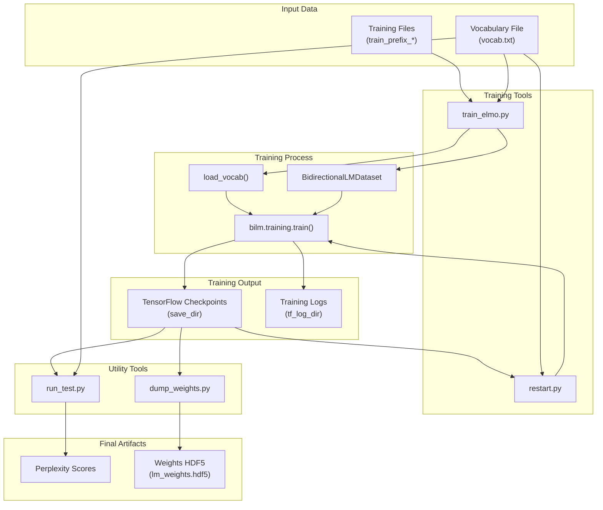
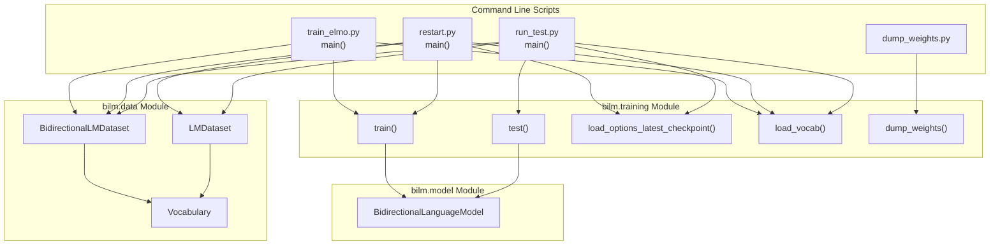

<!-- source: DeepWiki mcp.deepwiki.com · repo allenai/bilm-tf · page 4 Command Line Tools · fetched 2026-10-26 -->

# Command Line Tools

<details>
<summary>Relevant source files</summary>

The following files were used as context for generating this wiki page:

- [bin/dump_weights.py](bin/dump_weights.py)
- [bin/restart.py](bin/restart.py)
- [bin/run_test.py](bin/run_test.py)
- [bin/train_elmo.py](bin/train_elmo.py)

</details>


This page documents the command-line utilities provided in the `bin/` directory for training, evaluating, and managing ELMo language models. These tools provide a high-level interface to the core bilm-tf functionality for common workflows like model training, checkpoint management, and weight extraction.

For detailed information about the core model components these tools interact with, see [Core Components](#3). For training system internals, see [Training System](#3.4).

## Overview

The bilm-tf repository provides four primary command-line tools that handle the complete model lifecycle:

| Tool | Purpose | Primary Function |
|------|---------|------------------|
| `train_elmo.py` | Initial model training | Creates new models from scratch |
| `restart.py` | Resume training | Continues training from checkpoints |
| `run_test.py` | Model evaluation | Computes perplexity on test data |
| `dump_weights.py` | Weight extraction | Converts checkpoints to HDF5 format |

## Training Workflow

The training workflow connects raw text data through vocabulary processing to trained model checkpoints:



Sources: [bin/train_elmo.py:1-74](), [bin/restart.py:1-59](), [bin/run_test.py:1-44](), [bin/dump_weights.py:1-16]()

## Training Tools

### train_elmo.py

The primary training script that initializes new ELMo model training from scratch. It configures a complete bidirectional language model with character-level CNN and LSTM layers.

**Key Configuration**:
- Uses hardcoded model architecture parameters [bin/train_elmo.py:21-55]()
- Supports multi-GPU training with 3 GPUs by default [bin/train_elmo.py:16]()
- Batch size of 128 per GPU [bin/train_elmo.py:15]()
- Character CNN with filters from 1-7 characters [bin/train_elmo.py:24-32]()
- 2-layer LSTM with 4096 hidden units and 512 projection [bin/train_elmo.py:39-45]()

**Command Line Arguments**:

| Argument | Required | Description |
|----------|----------|-------------|
| `--save_dir` | Yes | Directory for saving checkpoints and logs |
| `--vocab_file` | Yes | Path to vocabulary file |
| `--train_prefix` | Yes | Prefix for training data files |

**Usage Example**:
```bash
python bin/train_elmo.py \
    --save_dir /path/to/checkpoints \
    --vocab_file vocab.txt \
    --train_prefix /data/train
```

The script calls `load_vocab()` with a fixed max word length of 50 characters [bin/train_elmo.py:12]() and creates a `BidirectionalLMDataset` [bin/train_elmo.py:58-59]().

### restart.py

Allows resuming training from existing checkpoints with modified parameters. This tool loads previous training configuration and continues from the latest checkpoint.

**Key Features**:
- Automatically loads latest checkpoint using `load_options_latest_checkpoint()` [bin/restart.py:10]()
- Supports overriding training parameters [bin/restart.py:34-39]()
- Handles both bidirectional and unidirectional models [bin/restart.py:25-28]()
- Preserves character CNN settings from original training [bin/restart.py:12-15]()

**Command Line Arguments**:

| Argument | Required | Description |
|----------|----------|-------------|
| `--save_dir` | Yes | Directory containing checkpoints |
| `--vocab_file` | Yes | Vocabulary file (must match original) |
| `--train_prefix` | Yes | Prefix for training data files |
| `--n_gpus` | No | Number of GPUs (default: 1) |
| `--batch_size` | No | Override batch size (default: use original) |
| `--n_train_tokens` | No | Override token count (default: use original) |
| `--n_epochs` | No | Override epoch count (default: use original) |

**Usage Example**:
```bash
python bin/restart.py \
    --save_dir /path/to/checkpoints \
    --vocab_file vocab.txt \  
    --train_prefix /data/train \
    --n_gpus 2 \
    --batch_size 64
```

Sources: [bin/train_elmo.py:1-74](), [bin/restart.py:1-59]()

## Evaluation & Utilities

### run_test.py

Evaluates trained models by computing perplexity on test datasets. This tool loads a trained checkpoint and measures language modeling performance.

**Key Features**:
- Automatically detects model configuration from checkpoints [bin/run_test.py:8]()
- Supports both bidirectional and unidirectional models [bin/run_test.py:24-27]()
- Uses test dataset configuration (no shuffling) [bin/run_test.py:19-22]()
- Calls `bilm.training.test()` function [bin/run_test.py:29]()

**Command Line Arguments**:

| Argument | Required | Description |
|----------|----------|-------------|
| `--save_dir` | Yes | Directory containing trained checkpoints |
| `--vocab_file` | Yes | Vocabulary file used during training |
| `--test_prefix` | Yes | Prefix for test data files |
| `--batch_size` | No | Batch size for evaluation (default: 256) |

### dump_weights.py

Converts TensorFlow checkpoint files to HDF5 format for easier distribution and loading. This utility extracts trained weights into a portable format.

**Key Features**:
- Simple wrapper around `bilm.training.dump_weights()` [bin/dump_weights.py:14]()
- Produces HDF5 files compatible with the ELMo loading interface
- Enables model sharing without TensorFlow checkpoint dependencies

**Command Line Arguments**:

| Argument | Required | Description |
|----------|----------|-------------|
| `--save_dir` | Yes | Directory containing TensorFlow checkpoints |
| `--outfile` | Yes | Output path for HDF5 weights file |

**Usage Example**:
```bash
python bin/dump_weights.py \
    --save_dir /path/to/checkpoints \
    --outfile lm_weights.hdf5
```

Sources: [bin/run_test.py:1-44](), [bin/dump_weights.py:1-16]()

## Command Line Tool Integration

The relationship between command line tools and core bilm components shows how high-level scripts orchestrate the training pipeline:



Sources: [bin/train_elmo.py:6-7](), [bin/restart.py:6-7](), [bin/run_test.py:4-5](), [bin/dump_weights.py:5]()

## Common Usage Patterns

### Initial Training Workflow

1. **Prepare Data**: Organize training files with consistent prefix
2. **Create Vocabulary**: Generate vocabulary file sorted by frequency  
3. **Start Training**: Use `train_elmo.py` with appropriate paths
4. **Monitor Progress**: Check logs in save_dir for training metrics

### Resume Training Workflow

1. **Identify Checkpoint**: Locate save_dir with existing checkpoints
2. **Resume Training**: Use `restart.py` with same vocab_file
3. **Adjust Parameters**: Override batch_size, n_epochs as needed
4. **Continue Monitoring**: Training resumes from latest checkpoint

### Model Evaluation Workflow

1. **Prepare Test Data**: Organize test files with consistent prefix
2. **Run Evaluation**: Use `run_test.py` with trained checkpoint
3. **Analyze Results**: Review perplexity scores for model quality
4. **Export Weights**: Use `dump_weights.py` for model distribution

Sources: [bin/train_elmo.py:10-63](), [bin/restart.py:9-42](), [bin/run_test.py:7-29](), [bin/dump_weights.py:8-14]()

---

