# Page: Overview

# Overview

<details>
<summary>Relevant source files</summary>

The following files were used as context for generating this wiki page:

- [README.md](README.md)
- [bilm/__init__.py](bilm/__init__.py)
- [usage_character.py](usage_character.py)

</details>


This document provides a technical overview of the bilm-tf repository, a TensorFlow implementation for training bidirectional language models (biLMs) and generating ELMo (Embeddings from Language Models) representations. The system enables both training new language models on custom corpora and using pre-trained models to generate contextualized word embeddings for downstream NLP tasks.

For detailed installation and setup instructions, see [Getting Started](#2). For in-depth documentation of individual components, see [Core Components](#3).

## System Purpose

The bilm-tf repository implements the bidirectional language model architecture from "Deep contextualized word representations" (Peters et al., 2018). The system serves two primary functions:

1. **Training Infrastructure**: Complete pipeline for training bidirectional language models on large text corpora
2. **Inference Engine**: Efficient computation of ELMo embeddings from pre-trained models using three different usage patterns

The core innovation is generating context-dependent word representations by combining embeddings from multiple layers of bidirectional LSTM language models, weighted and combined through the `weight_layers` function.

Sources: [README.md:1-21](), [bilm/__init__.py:1-7]()

## System Architecture

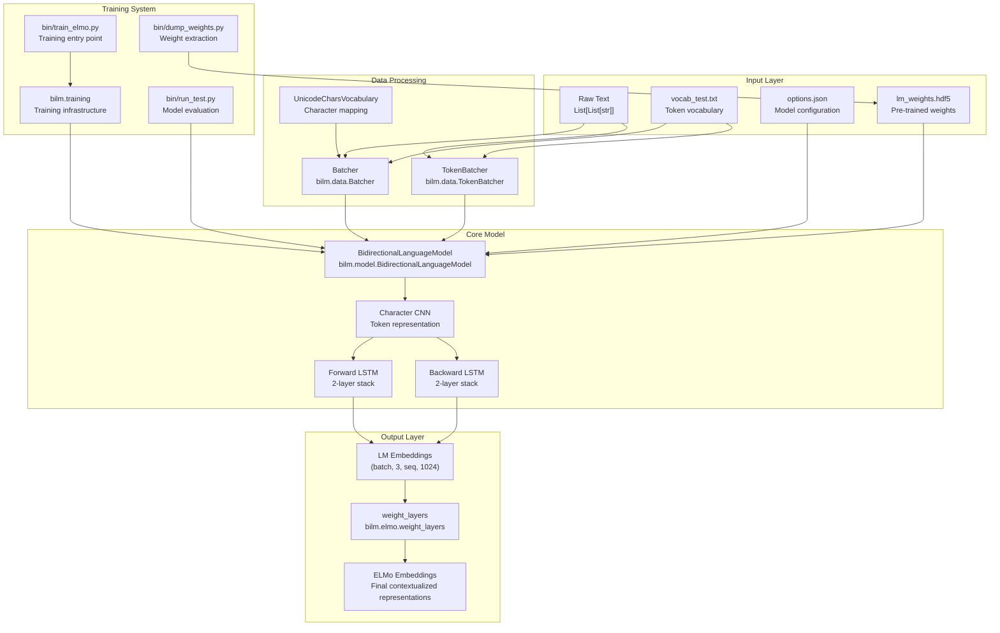

This architecture shows the complete data flow from raw text input through the bidirectional language model to final ELMo embeddings. The system separates data processing, model computation, and output generation into distinct layers, with the `BidirectionalLanguageModel` serving as the central computational engine.

Sources: [bilm/__init__.py:2-5](), [README.md:44-65](), [usage_character.py:18-30]()

## Three Usage Patterns

```mermaid
graph TD
    subgraph "Pattern 1: Character Input"
        Text1["Raw Text"] --> Batcher1["Batcher(vocab_file, 50)"]
        Batcher1 --> CharIDs["Character IDs<br/>(batch, seq, 50)"]
        CharIDs --> BiLM1["BidirectionalLanguageModel<br/>use_character_inputs=True"]
        BiLM1 --> Embeddings1["LM Embeddings<br/>(batch, 3, seq, 1024)"]
        Embeddings1 --> WeightLayers1["weight_layers('input', embeddings_op)"]
        WeightLayers1 --> ELMo1["ELMo Output"]
    end
    
    subgraph "Pattern 2: Pre-computed Tokens"
        Text2["Raw Text"] --> TokenBatcher2["TokenBatcher(vocab_file)"]
        DumpTokenEmbeddings["dump_token_embeddings<br/>Pre-compute step"]
        TokenEmbeddingsHDF5["token_embeddings.hdf5<br/>Cached representations"]
        TokenBatcher2 --> TokenIDs["Token IDs<br/>(batch, seq)"]
        TokenIDs --> BiLM2["BidirectionalLanguageModel<br/>use_character_inputs=False"]
        TokenEmbeddingsHDF5 --> BiLM2
        BiLM2 --> Embeddings2["LM Embeddings"]
        Embeddings2 --> WeightLayers2["weight_layers"]
        WeightLayers2 --> ELMo2["ELMo Output"]
        DumpTokenEmbeddings --> TokenEmbeddingsHDF5
    end
    
    subgraph "Pattern 3: Cached Dataset"
        Dataset["Text Dataset<br/>One sentence per line"]
        Dataset --> DumpBiLMEmbeddings["dump_bilm_embeddings"]
        DumpBiLMEmbeddings --> CachedHDF5["cached_embeddings.hdf5<br/>Keyed by sentence_id"]
        CachedHDF5 --> DirectLoad["Direct HDF5 Load<br/>dataset[str(sentence_id)]"]
        DirectLoad --> PrecomputedELMo["Pre-computed ELMo<br/>(3, n_tokens, 1024)"]
    end
    
    %% Performance annotations
    Text1 -.->|"Most flexible<br/>Highest compute cost"| ELMo1
    Text2 -.->|"Fixed vocabulary<br/>Medium compute cost"| ELMo2
    Dataset -.->|"Pre-computed<br/>Lowest compute cost"| PrecomputedELMo
```

The three usage patterns provide different trade-offs between flexibility and computational efficiency. Pattern 1 handles arbitrary text with character-level processing, Pattern 2 optimizes inference for fixed vocabularies, and Pattern 3 pre-computes all embeddings for maximum inference speed.

Sources: [README.md:52-58](), [README.md:94-125](), [bilm/__init__.py:3-4]()

## Data Flow and Tensor Shapes

```mermaid
flowchart LR
    subgraph "Input Processing"
        RawSentences["List[List[str]]<br/>Tokenized sentences"]
        VocabFile["vocab_test.txt<br/>Token list"]
    end
    
    subgraph "Character Path"
        BatcherChar["Batcher(vocab_file, 50)"]
        CharTensor["Character Tensor<br/>(n_sentences, max_len+2, 50)"]
        CharCNN["Character CNN<br/>+ Highway layers"]
        TokenRepresentations["Token Representations<br/>(batch, seq, projection_dim)"]
    end
    
    subgraph "Token Path"
        BatcherToken["TokenBatcher(vocab_file)"]
        TokenTensor["Token IDs<br/>(n_sentences, max_len+2)"]
        EmbeddingLookup["Embedding Lookup<br/>From token_embeddings.hdf5"]
    end
    
    subgraph "BiLM Core"
        ForwardLSTM["Forward LSTM<br/>n_lstm_layers deep"]
        BackwardLSTM["Backward LSTM<br/>n_lstm_layers deep"]
        ConcatLayers["Concatenate<br/>Token + Forward + Backward"]
        LMEmbeddings["LM Embeddings<br/>(batch, 3, seq_len, 1024)"]
    end
    
    subgraph "ELMo Generation"
        WeightLayersFunc["weight_layers(name, lm_embeddings)<br/>Learned scalar weights"]
        WeightedSum["Weighted Sum<br/>+ Layer normalization"]
        FinalELMo["ELMo Embeddings<br/>(batch, seq_len, 1024)"]
    end
    
    %% Data flow
    RawSentences --> BatcherChar
    RawSentences --> BatcherToken
    VocabFile --> BatcherChar
    VocabFile --> BatcherToken
    
    BatcherChar --> CharTensor
    CharTensor --> CharCNN
    CharCNN --> TokenRepresentations
    
    BatcherToken --> TokenTensor
    TokenTensor --> EmbeddingLookup
    EmbeddingLookup --> TokenRepresentations
    
    TokenRepresentations --> ForwardLSTM
    TokenRepresentations --> BackwardLSTM
    ForwardLSTM --> ConcatLayers
    BackwardLSTM --> ConcatLayers
    TokenRepresentations --> ConcatLayers
    
    ConcatLayers --> LMEmbeddings
    LMEmbeddings --> WeightLayersFunc
    WeightLayersFunc --> WeightedSum
    WeightedSum --> FinalELMo
```

This diagram shows the complete tensor transformation pipeline from tokenized text to final ELMo embeddings. The key insight is that the system produces three representations (token-level, forward LSTM, backward LSTM) which are then weighted and combined by `weight_layers` to produce the final contextualized embeddings.

Sources: [README.md:66-83](), [usage_character.py:38-52](), [bilm/data.py:220]()

## Key Components and Responsibilities

| Component | File Location | Primary Responsibility | Key Methods/Attributes |
|-----------|---------------|----------------------|----------------------|
| `BidirectionalLanguageModel` | [bilm/model.py]() | Core biLM computation engine | `__call__()`, `_build()`, `_build_word_embeddings()` |
| `Batcher` | [bilm/data.py]() | Character-level input processing | `batch_sentences()`, character ID conversion |
| `TokenBatcher` | [bilm/data.py]() | Token-level input processing | `batch_sentences()`, token ID conversion |
| `weight_layers` | [bilm/elmo.py]() | ELMo embedding generation | Learned layer weighting, L2 regularization |
| `dump_token_embeddings` | [bilm/model.py]() | Pre-compute token representations | HDF5 caching for Pattern 2 usage |
| `dump_bilm_embeddings` | [bilm/model.py]() | Pre-compute full embeddings | HDF5 caching for Pattern 3 usage |
| Training System | [bilm/training.py]() | Model training infrastructure | Multi-GPU support, checkpointing |

The system architecture separates concerns cleanly: data processing components (`Batcher`, `TokenBatcher`) handle input transformation, the core model (`BidirectionalLanguageModel`) performs the biLM computation, and utility functions (`weight_layers`, dump functions) enable flexible usage patterns and caching strategies.

Sources: [bilm/__init__.py:2-5](), [README.md:108-115](), [README.md:118-125]()

---

# Page: Getting Started

# Getting Started

<details>
<summary>Relevant source files</summary>

The following files were used as context for generating this wiki page:

- [README.md](README.md)
- [setup.py](setup.py)
- [usage_character.py](usage_character.py)

</details>


This document provides installation instructions and initial usage guidance for the bilm-tf system. It covers the essential steps to set up the environment and introduces the three primary usage patterns for generating ELMo embeddings from bidirectional language models.

For detailed information about specific components, see [Core Components](#3). For training new models, see [Command Line Tools](#4).

## Prerequisites and Installation

The bilm-tf system requires Python 3.5 or later with specific dependencies for TensorFlow-based computation and HDF5 file handling.

### System Requirements

| Component | Version | Purpose |
|-----------|---------|---------|
| Python | 3.5+ | Runtime environment |
| TensorFlow | 1.2 | Neural network computation |
| h5py | Latest | HDF5 file operations |
| CUDA-compatible GPU | - | Recommended for performance |

### Package Installation

Install the required dependencies and bilm-tf package:

```bash
pip install tensorflow-gpu==1.2 h5py
python setup.py install
```

Verify the installation by running the test suite:

```bash
python -m unittest discover tests/
```

**Installation Flow**

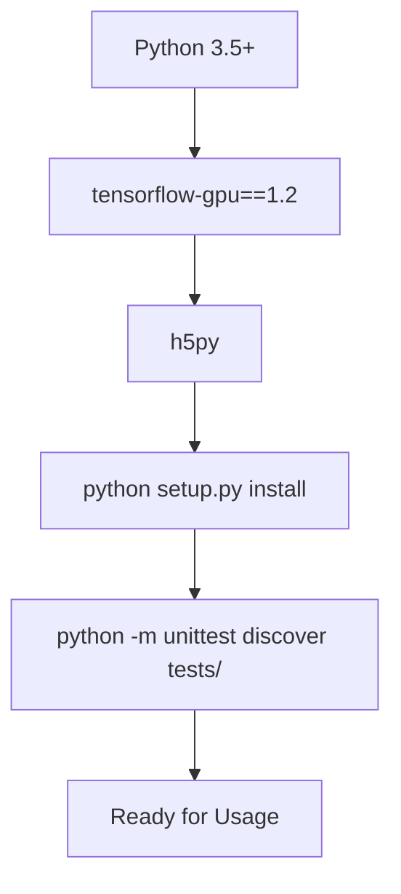

Sources: [README.md:24-34](), [setup.py:19-22]()

### Docker Installation

For containerized deployment with GPU support:

```bash
sudo nvidia-docker run -t allennlp/bilm-tf:training-gpu
```

The Docker image includes all dependencies and requires `nvidia-docker` for GPU access.

Sources: [README.md:36-42]()

## Usage Patterns

The bilm-tf system supports three distinct usage patterns, each optimized for different performance and flexibility requirements.

### Pattern Overview

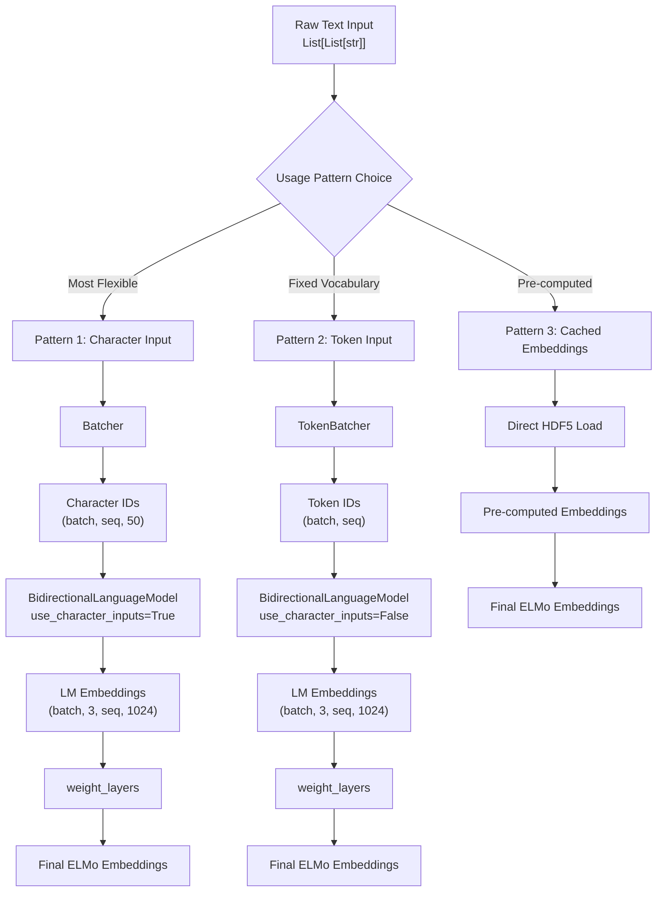

Sources: [README.md:52-64]()

### Pattern 1: Character-Level Input

The most general method that handles any input text by processing characters directly. This approach provides maximum flexibility but requires the most computation.

**Key Components:**
- `Batcher` class for character ID conversion
- `BidirectionalLanguageModel` with `use_character_inputs=True`
- `weight_layers` function for final ELMo computation

**Data Shape Flow:**
```
Raw Text → Batcher → (n_sentences, max_length + 2, 50) → BiLM → (n_sentences, 3, max_length, 1024)
```

Sources: [README.md:54](), [README.md:66-83](), [usage_character.py:1-80]()

### Pattern 2: Pre-computed Token Representations

Optimized for fixed vocabularies by caching context-independent token representations. This reduces computational cost but limits vocabulary flexibility.

**Key Components:**
- `TokenBatcher` class for token ID conversion
- `dump_token_embeddings` function for preprocessing
- `BidirectionalLanguageModel` with `use_character_inputs=False`

**Workflow:**
1. Create vocabulary file with unique tokens plus `<S>` and `</S>`
2. Run `dump_token_embeddings` to generate HDF5 token embeddings
3. Use `TokenBatcher` with pre-computed embeddings file

Sources: [README.md:55](), [README.md:98-116]()

### Pattern 3: Cached Dataset Embeddings

Pre-computes embeddings for entire datasets and stores them in HDF5 format. Optimal for smaller datasets or cross-framework usage.

**Key Components:**
- `dump_bilm_embeddings` function for batch processing
- HDF5 storage with `sentence_id` keys
- Direct embedding retrieval without model inference

**Storage Format:**
- Each sentence stored as `str(sentence_id)` dataset key
- Embeddings shape: `(3, n_tokens, 1024)` per sentence

Sources: [README.md:56](), [README.md:118-125]()

## Basic Workflow Components

The core workflow involves three primary components that transform raw text into contextualized embeddings.

### Component Interaction

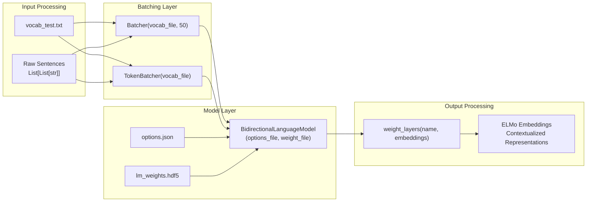

Sources: [README.md:61-64](), [usage_character.py:18-26]()

### Required Files

Each usage pattern requires specific configuration and weight files:

| File Type | Purpose | Format | Source |
|-----------|---------|--------|--------|
| `options.json` | Model hyperparameters | JSON | Pre-trained or custom |
| `lm_weights.hdf5` | Model weights | HDF5 | Pre-trained or trained |
| `vocab_*.txt` | Vocabulary mapping | Text | Token per line |

### Vocabulary File Format

The vocabulary file structure is critical for proper tokenization:
- One token per line, separated by `\n`
- Must include special tokens: `<S>`, `</S>`, `<UNK>`
- Tokens cached as 50-character ID sequences
- Case-sensitive special tokens

Sources: [README.md:85-92]()

### Shape Conventions

Understanding data shapes through the pipeline:

| Stage | Shape | Description |
|-------|-------|-------------|
| Input Batch | `(n_sentences, max_length + 2, 50)` | Character IDs with padding |
| BiLM Output | `(n_sentences, 3, max_length, 1024)` | Multi-layer embeddings |
| ELMo Final | `(n_sentences, max_length, embed_dim)` | Weighted representations |

The `+2` in input shape accounts for special begin/end tokens added by `Batcher`.

Sources: [README.md:66-83]()

## Quick Start Example

Here's a minimal example using the character-level input pattern:

```python
# Core imports
from bilm import Batcher, BidirectionalLanguageModel, weight_layers
import tensorflow as tf

# Initialize components
batcher = Batcher(vocab_file, 50)
bilm = BidirectionalLanguageModel(options_file, weight_file)

# Create TensorFlow placeholders
character_ids = tf.placeholder('int32', shape=(None, None, 50))

# Build computation graph
embeddings_op = bilm(character_ids)
elmo_op = weight_layers('elmo', embeddings_op, l2_coef=0.0)

# Process text
tokenized_sentences = [sentence.split() for sentence in raw_sentences]
character_id_batch = batcher.batch_sentences(tokenized_sentences)

# Compute embeddings
with tf.Session() as sess:
    sess.run(tf.global_variables_initializer())
    elmo_embeddings = sess.run(
        elmo_op['weighted_op'],
        feed_dict={character_ids: character_id_batch}
    )
```

This example demonstrates the essential workflow from raw text to ELMo embeddings using the most flexible character-level input approach.

Sources: [usage_character.py:8-78]()

---

# Page: Installation & Setup

# Installation & Setup

<details>
<summary>Relevant source files</summary>

The following files were used as context for generating this wiki page:

- [Dockerfile](Dockerfile)
- [README.md](README.md)
- [run_tests_before_shell.sh](run_tests_before_shell.sh)
- [setup.py](setup.py)
- [usage_character.py](usage_character.py)

</details>


This document provides comprehensive instructions for installing and configuring the bilm-tf system for both development and production environments. It covers Python package installation, Docker containerization, and system verification procedures.

For information about using the installed system, see [Usage Patterns](#2.2). For details about model configuration, see [Model Configuration](#5.1).

## System Requirements

The bilm-tf system requires specific versions of core dependencies to function correctly:

| Component | Version | Purpose |
|-----------|---------|---------|
| Python | 3.5+ | Runtime environment |
| TensorFlow | 1.2 | Neural network computation backend |
| h5py | Latest | HDF5 file format support for model weights |
| CUDA/GPU | 8.0+ | GPU acceleration (optional but recommended) |

**Installation Dependencies Flow**

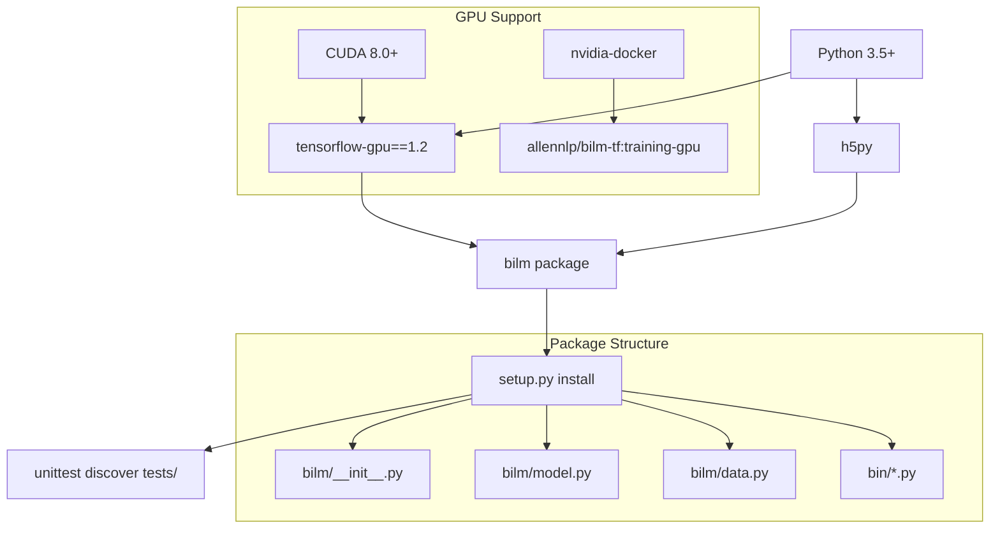

Sources: [README.md:24-34](), [setup.py:19-22](), [Dockerfile:32-46]()

## Python Package Installation

### Standard Installation Process

The bilm-tf package follows a two-step installation process that first installs system dependencies, then builds the package from source:

```bash
# Step 1: Install core dependencies
pip install tensorflow-gpu==1.2 h5py

# Step 2: Install bilm package from source
python setup.py install
```

**Package Installation Workflow**

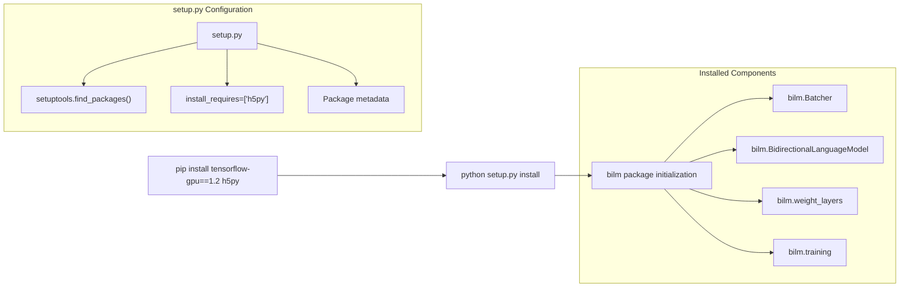

Sources: [README.md:24-29](), [setup.py:7-22]()

### Alternative: PyPI Installation

The package is also available via PyPI for simplified installation:

```bash
pip install bilm
```

This method automatically handles dependency resolution but may not include the latest development features.

Sources: [setup.py:8-9]()

## Docker Installation

### Container Setup

For users requiring a complete isolated environment, Docker containers provide GPU-accelerated bilm-tf installations:

```bash
# Run pre-built container with GPU support
sudo nvidia-docker run -t allennlp/bilm-tf:training-gpu
```

**Docker Environment Architecture**

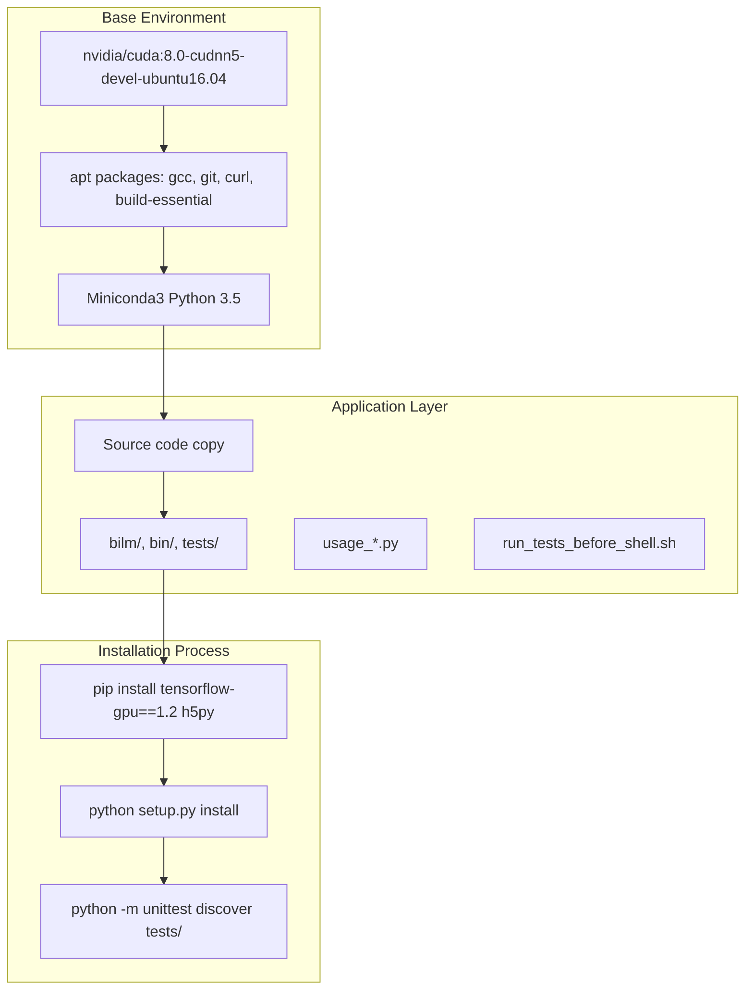

### Docker Build Process

The Dockerfile implements a multi-stage build process:

1. **Base System Setup**: [Dockerfile:1-24]() - CUDA environment with Ubuntu 16.04
2. **Python Environment**: [Dockerfile:26-33]() - Miniconda installation with Python 3.5
3. **Source Code Integration**: [Dockerfile:35-42]() - Copy bilm source and examples
4. **Package Installation**: [Dockerfile:44-46]() - Install dependencies and build package
5. **Verification**: [Dockerfile:48-50]() - Run test suite before shell access

Sources: [Dockerfile:1-51](), [README.md:36-42]()

## Installation Verification

### Test Suite Execution

After installation, verify system functionality by running the comprehensive test suite:

```bash
python -m unittest discover tests/
```

The test suite validates core functionality including:
- Model loading and initialization
- Data processing pipelines
- ELMo embedding generation
- Training procedures

**Verification Process Flow**

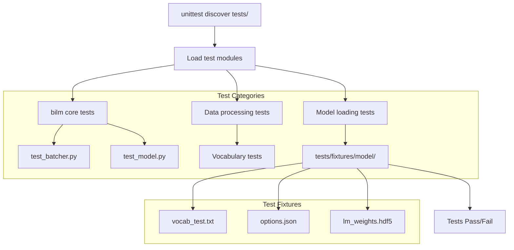

### Docker Verification

The Docker container automatically runs verification tests through the `run_tests_before_shell.sh` script:

```bash
#!/usr/bin/env bash
set -e
PYTHONDONTWRITEBYTECODE=1 python -m unittest discover tests/
echo "Tests passed!"
/bin/bash
```

Sources: [README.md:31-34](), [run_tests_before_shell.sh:1-9](), [Dockerfile:48-50]()

## Configuration Files and Dependencies

### Required Model Assets

The bilm-tf system requires specific configuration files for operation:

| File Type | Purpose | Example Location |
|-----------|---------|------------------|
| `options.json` | Model hyperparameters and architecture | `tests/fixtures/model/options.json` |
| `lm_weights.hdf5` | Pre-trained model weights | `tests/fixtures/model/lm_weights.hdf5` |
| `vocab_*.txt` | Vocabulary mappings | `tests/fixtures/model/vocab_test.txt` |

### Pre-trained Model Downloads

Pre-trained models are available from the AllenNLP model repository. Each model consists of paired files:

- **Options File**: JSON configuration with hyperparameters
- **Weights File**: HDF5 format with trained parameters

Access pre-trained models at: https://allennlp.org/elmo

**Model Asset Dependencies**

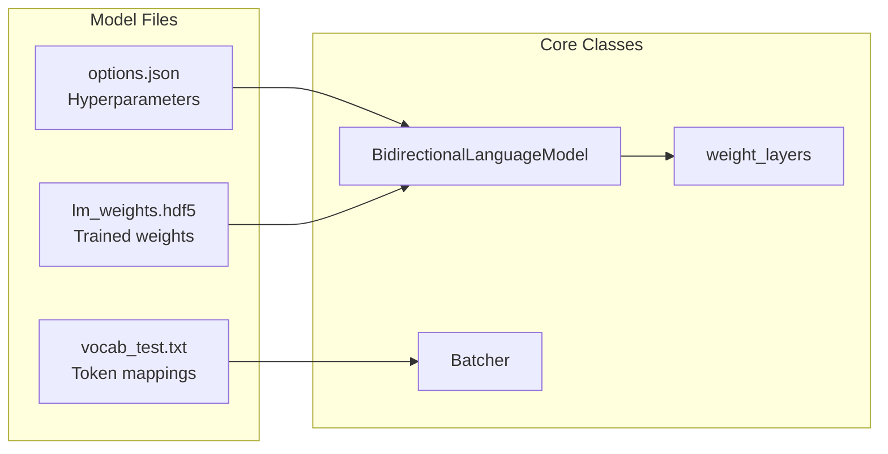

Sources: [README.md:44-49](), [usage_character.py:12-16]()

## Troubleshooting Common Issues

### GPU Support Verification

Ensure CUDA compatibility for GPU acceleration:

```bash
# Check CUDA installation
nvidia-smi

# Verify TensorFlow GPU detection
python -c "import tensorflow as tf; print(tf.config.list_physical_devices('GPU'))"
```

### Version Compatibility

The system specifically requires TensorFlow 1.2 due to API dependencies. Newer versions may cause compatibility issues with the trained models and checkpoint formats.

### Docker GPU Access

Docker GPU support requires nvidia-docker runtime:

```bash
# Install nvidia-docker2
sudo apt-get install nvidia-docker2
sudo systemctl restart docker

# Test GPU access
sudo docker run --gpus all nvidia/cuda:8.0-runtime-ubuntu16.04 nvidia-smi
```

Sources: [README.md:38-39](), [Dockerfile:1]()

---

# Page: Usage Patterns

# Usage Patterns

<details>
<summary>Relevant source files</summary>

The following files were used as context for generating this wiki page:

- [README.md](README.md)
- [usage_cached.py](usage_cached.py)
- [usage_character.py](usage_character.py)
- [usage_token.py](usage_token.py)

</details>


This document explains the three main usage patterns for generating ELMo embeddings with the bilm-tf system. Each pattern represents a different trade-off between computational flexibility, performance, and storage requirements. For details on the core model architecture, see [BidirectionalLanguageModel](#3.1). For information about data processing utilities, see [Data Processing](#3.2).

## Overview of Usage Patterns

The bilm-tf system provides three distinct approaches for integrating ELMo representations into downstream tasks:

1. **Character-level input processing** - Most general and flexible approach
2. **Pre-computed token embeddings** - Balanced approach for fixed vocabularies  
3. **Cached dataset embeddings** - Highest performance for static datasets

Each pattern involves different components and offers distinct advantages depending on your use case requirements.

## Pattern 1: Character-Level Input Processing

### Character-Level Data Flow

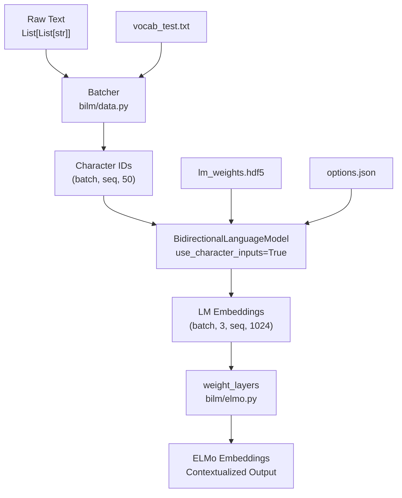

Sources: [README.md:54-58](), [usage_character.py:1-80]()

### Character-Level Implementation Details

This pattern uses the `Batcher` class to convert raw text into character-level representations. The process involves:

- **Input Processing**: Text is tokenized into `List[List[str]]` format
- **Character Mapping**: `Batcher` converts tokens to character IDs with shape `(n_sentences, max_sentence_length + 2, 50)`
- **Model Inference**: `BidirectionalLanguageModel` processes character inputs directly
- **ELMo Generation**: `weight_layers` computes final weighted representations

Key characteristics:
- Handles any input text, including out-of-vocabulary tokens
- Most computationally expensive approach
- Required for evaluation on unseen data
- Uses full character-based representation

Sources: [README.md:54-58](), [README.md:66-83](), [usage_character.py:18-26]()

## Pattern 2: Pre-Computed Token Embeddings

### Token-Level Data Flow

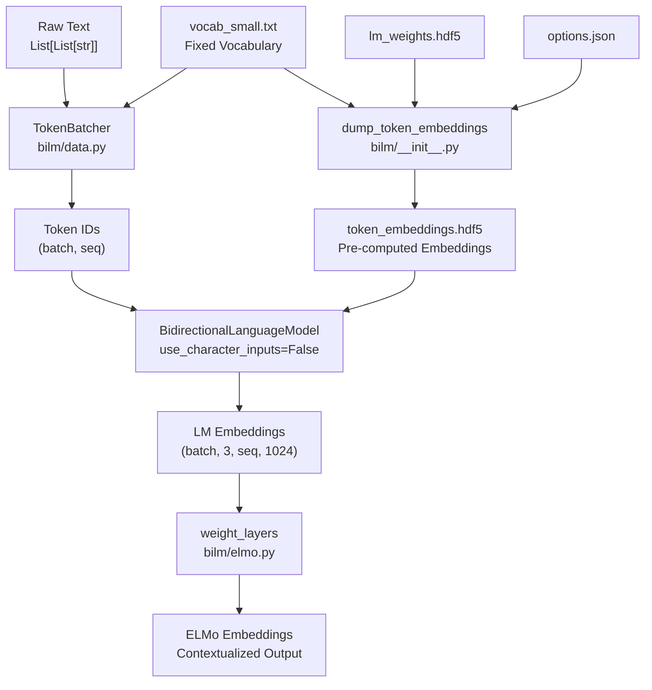

Sources: [README.md:98-116](), [usage_token.py:1-106]()

### Token-Level Implementation Details

This pattern optimizes performance by pre-computing context-independent token representations:

**Pre-computation Phase**:
- Create vocabulary file with all unique tokens including `<S>` and `</S>`
- Use `dump_token_embeddings` to generate token embedding file
- Requires fixed vocabulary - no fallback for out-of-vocabulary words

**Inference Phase**:
- `TokenBatcher` maps text to token IDs rather than character IDs
- `BidirectionalLanguageModel` loads pre-computed token embeddings via `embedding_weight_file` parameter
- Processes only the biLSTM layers, skipping character-level processing

Key characteristics:
- Faster inference than character-level processing
- Requires fixed, predetermined vocabulary
- Good compromise for large datasets with defined vocabularies
- Used for datasets like SNLI and SQuAD

Sources: [README.md:98-116](), [usage_token.py:39-62]()

## Pattern 3: Cached Dataset Embeddings

### Cached Embeddings Data Flow

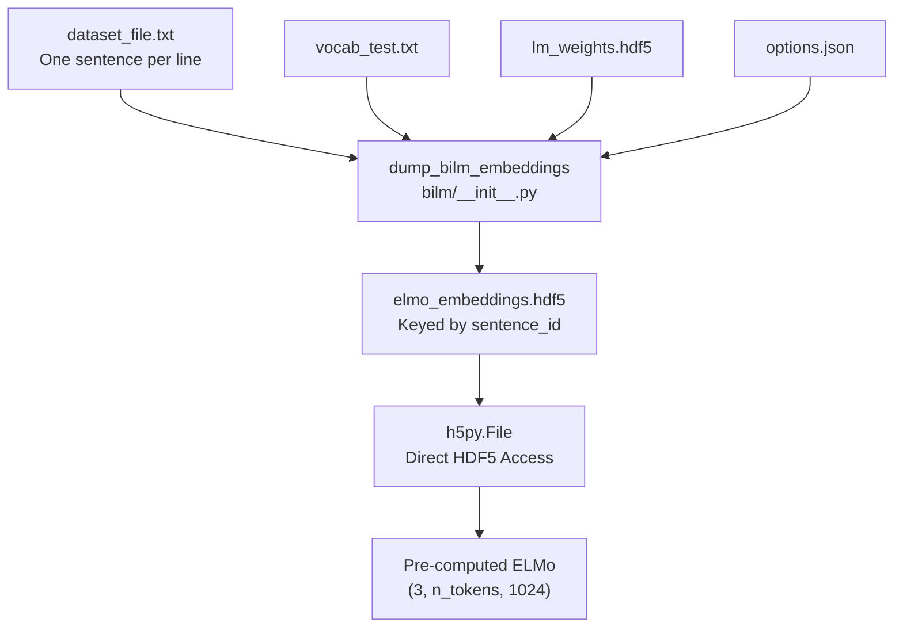

Sources: [README.md:118-125](), [usage_cached.py:1-43]()

### Cached Embeddings Implementation Details

This pattern pre-computes all ELMo embeddings for an entire dataset:

**Pre-computation Phase**:
- Create dataset file with one tokenized sentence per line
- Use `dump_bilm_embeddings` to generate embeddings for all sentences
- Embeddings stored in HDF5 format with sentence ID as key

**Usage Phase**:
- Direct HDF5 file access using `h5py`
- Each sentence stored as dataset with key `str(sentence_id)`
- Embeddings have shape `(3, n_tokens, 1024)` representing the three biLM layers

Key characteristics:
- Highest performance - no model inference required
- Requires significant storage space
- Best for smaller datasets or when using ELMo in other frameworks
- Eliminates computational overhead during training/inference

Sources: [README.md:118-125](), [usage_cached.py:33-41]()

## Pattern Comparison and Selection

### Performance vs Flexibility Trade-offs

| Pattern | Flexibility | Performance | Storage | Use Case |
|---------|-------------|-------------|---------|----------|
| Character-level | Highest | Lowest | None | Unseen data, test evaluation |
| Pre-computed tokens | Medium | Medium | Token embeddings | Large datasets, fixed vocab |
| Cached dataset | Lowest | Highest | Full embeddings | Small datasets, cross-framework |

### Common Implementation Components

All patterns share these core components:

**Model Configuration**:
- `options.json` - Model hyperparameters and architecture settings
- `lm_weights.hdf5` - Pre-trained model weights
- Vocabulary file - Token-to-ID mapping

**Core Processing**:
- `BidirectionalLanguageModel` - Central model class
- `weight_layers` - Final ELMo representation computation
- TensorFlow session management and variable initialization

**Data Shapes**:
- Input varies by pattern: character IDs `(batch, seq, 50)` or token IDs `(batch, seq)`
- LM embeddings: `(batch, 3, seq, 1024)` representing token + forward + backward layers
- Final ELMo: `(batch, seq, embedding_dim)` after weighted combination

Sources: [README.md:52-64](), [usage_character.py:25-30](), [usage_token.py:56-67]()

---

# Page: Core Components

# Core Components

<details>
<summary>Relevant source files</summary>

The following files were used as context for generating this wiki page:

- [bilm/data.py](bilm/data.py)
- [bilm/elmo.py](bilm/elmo.py)
- [bilm/model.py](bilm/model.py)
- [bilm/training.py](bilm/training.py)
- [tests/test_elmo.py](tests/test_elmo.py)

</details>


This document covers the main architectural components that make up the bilm-tf system: the `BidirectionalLanguageModel` for inference, data processing utilities, ELMo embedding generation, and the training infrastructure. These components work together to enable both training bidirectional language models and using pre-trained models to generate contextualized ELMo embeddings.

For information about command-line tools and training scripts, see [Command Line Tools](#4). For model configuration and hyperparameters, see [Model Configuration](#5.1).

## System Architecture Overview

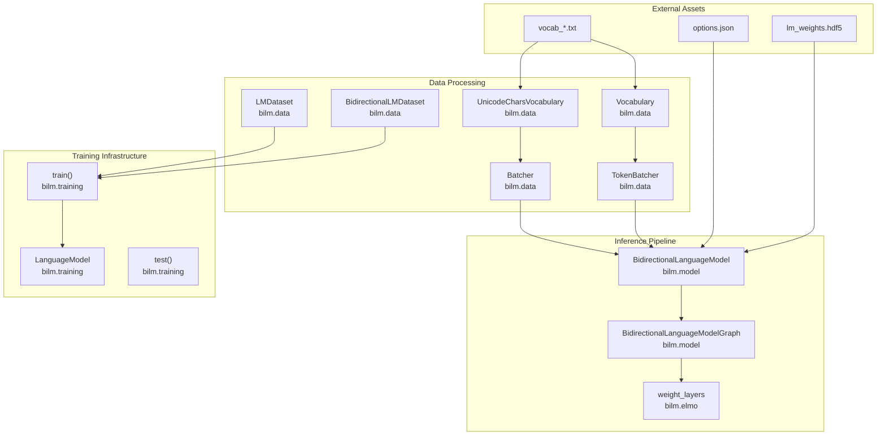

**Core Component Architecture**
Sources: [bilm/model.py:1-677](), [bilm/data.py:1-466](), [bilm/elmo.py:1-115](), [bilm/training.py:1-1109]()

## BidirectionalLanguageModel

The `BidirectionalLanguageModel` class is the primary interface for loading pre-trained bidirectional language models and generating contextualized embeddings. It supports two input modes: character-level processing (the default) and token-level processing with pre-computed embeddings.

### Core Interface

| Parameter | Type | Purpose |
|-----------|------|---------|
| `options_file` | str | Path to JSON file with model hyperparameters |
| `weight_file` | str | Path to HDF5 file with pre-trained weights |
| `use_character_inputs` | bool | If True, use character CNNs; if False, use token embeddings |
| `embedding_weight_file` | str | Required when `use_character_inputs=False` |
| `max_batch_size` | int | Maximum allowable batch size (default: 128) |

### Usage Patterns

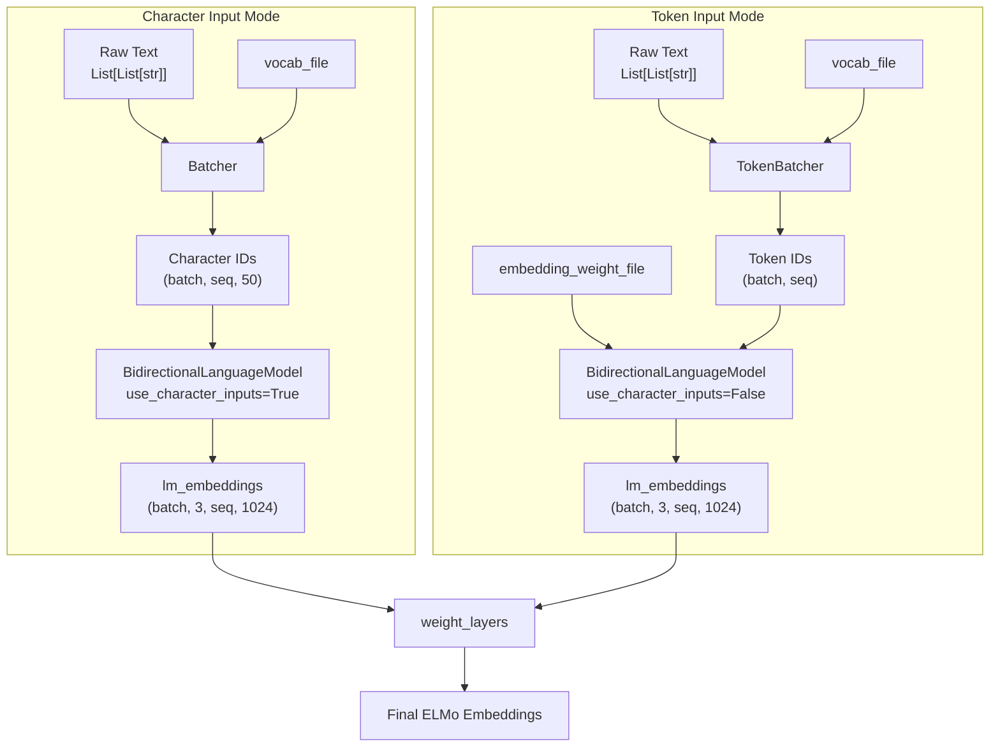

**Input Processing Modes**
Sources: [bilm/model.py:14-113](), [bilm/data.py:193-261]()

### Internal Architecture

The `BidirectionalLanguageModel.__call__()` method creates a `BidirectionalLanguageModelGraph` that builds the computational graph:

1. **Character CNN Pipeline** (when `use_character_inputs=True`):
   - Character embeddings → Convolutions → Highway layers → Projection
2. **Token Embedding Pipeline** (when `use_character_inputs=False`):
   - Direct token embedding lookup
3. **Bidirectional LSTM Stack**:
   - Forward and backward LSTM layers with optional skip connections
4. **Output Processing**:
   - Concatenates token embeddings + forward outputs + backward outputs
   - Removes BOS/EOS tokens and applies sequence masking

### Return Values

The `__call__()` method returns a dictionary with TensorFlow operations:

| Key | Shape | Description |
|-----|-------|-------------|
| `lm_embeddings` | `(batch, 3, seq, 1024)` | Layer outputs: token + forward + backward |
| `lengths` | `(batch,)` | Sequence lengths without BOS/EOS |
| `mask` | `(batch, seq)` | Boolean mask for valid positions |
| `token_embeddings` | `(batch, seq, dim)` | Raw token embeddings |

Sources: [bilm/model.py:62-184](), [bilm/model.py:245-601]()

## Data Processing Components

The data processing system handles vocabulary management, text batching, and dataset iteration for both inference and training workflows.

### Vocabulary Management

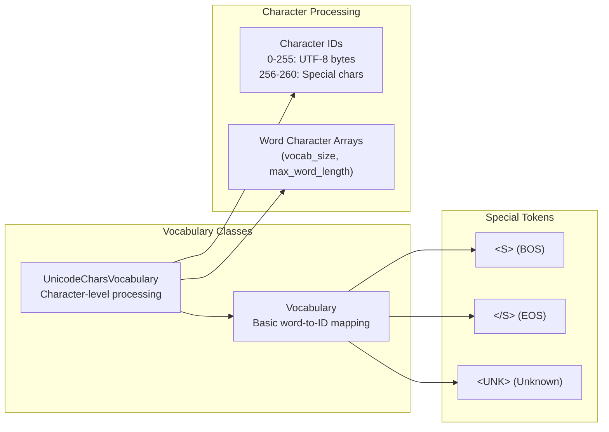

**Vocabulary Architecture**
Sources: [bilm/data.py:10-191]()

#### Vocabulary Class Features

- **Word-to-ID mapping**: Bidirectional lookup between tokens and integer IDs
- **Special token handling**: Required `<S>`, `</S>`, and `<UNK>` tokens
- **Encoding/decoding**: Convert between text and ID sequences with BOS/EOS

#### UnicodeCharsVocabulary Features

- **Character-level representation**: Maps each word to character ID arrays
- **UTF-8 encoding**: Character IDs 0-255 from `ord(c)` for UTF-8 bytes
- **Special character IDs**: 256-260 for begin sentence, end sentence, begin word, end word, padding
- **Fixed-width arrays**: All words represented as `(max_word_length,)` arrays

### Text Batching

| Class | Input Type | Output Shape | Purpose |
|-------|------------|--------------|---------|
| `Batcher` | Character-based | `(batch, seq, 50)` | Character ID matrices |
| `TokenBatcher` | Token-based | `(batch, seq)` | Token ID matrices |

Both batchers:
- Add BOS/EOS tokens automatically
- Apply +1 offset to create padding ID of 0
- Handle variable-length sequences with padding

Sources: [bilm/data.py:193-261]()

### Dataset Management

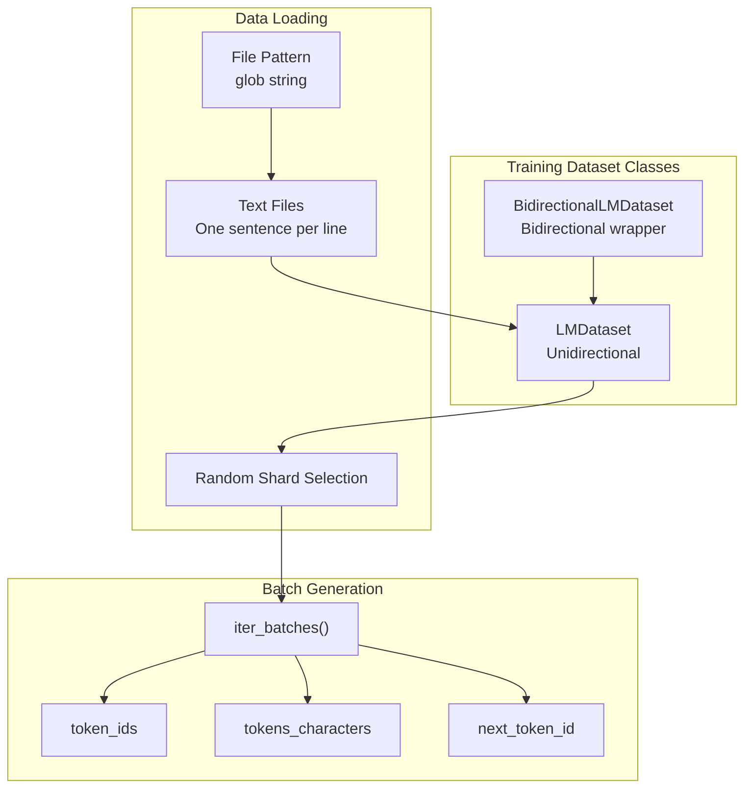

**Dataset Processing Pipeline**
Sources: [bilm/data.py:315-461]()

#### LMDataset Features

- **Multi-file support**: Processes multiple text files via glob patterns
- **Random shard selection**: Randomly selects files for training diversity
- **Streaming processing**: Loads one file at a time to handle large datasets
- **Flexible iteration**: Supports both training (infinite) and test (single-pass) modes
- **Character/token dual support**: Generates both character and token representations

#### BidirectionalLMDataset Features

- **Forward/backward data**: Generates both normal and reversed token sequences
- **Synchronized batching**: Ensures corresponding forward/backward batches
- **Suffix handling**: Adds `_reverse` suffix to backward data keys

Sources: [bilm/data.py:435-461]()

## ELMo Embeddings

The `weight_layers` function combines the multiple layers from a bidirectional language model into final ELMo representations using learned scalar weights.

### Function Interface

```python
weight_layers(name, bilm_ops, l2_coef=None, use_top_only=False, do_layer_norm=False)
```

| Parameter | Type | Purpose |
|-----------|------|---------|
| `name` | str | Prefix for trainable variable names |
| `bilm_ops` | dict | Output from `BidirectionalLanguageModel()` |
| `l2_coef` | float | L2 regularization coefficient |
| `use_top_only` | bool | If True, only use the top LSTM layer |
| `do_layer_norm` | bool | Apply layer normalization to biLM layers |

### Layer Combination Process

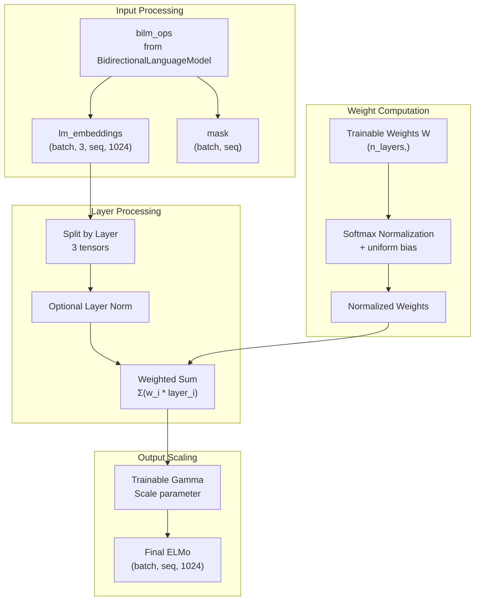

**ELMo Layer Combination Process**
Sources: [bilm/elmo.py:4-113]()

### Trainable Parameters

1. **Layer weights (`W`)**: Softmax-normalized weights for each biLM layer
2. **Scale parameter (`gamma`)**: Global scaling factor for the weighted sum
3. **Regularization**: Optional L2 penalty on layer weights

### Return Values

| Key | Description |
|-----|-------------|
| `weighted_op` | Final ELMo embeddings tensor |
| `regularization_op` | L2 regularization loss terms |

The function automatically adds regularization terms to `tf.GraphKeys.REGULARIZATION_LOSSES` for integration with training loops.

Sources: [bilm/elmo.py:31-113]()

## Training System

The training infrastructure centers around the `LanguageModel` class, which implements the computational graph for training bidirectional language models from scratch.

### LanguageModel Architecture

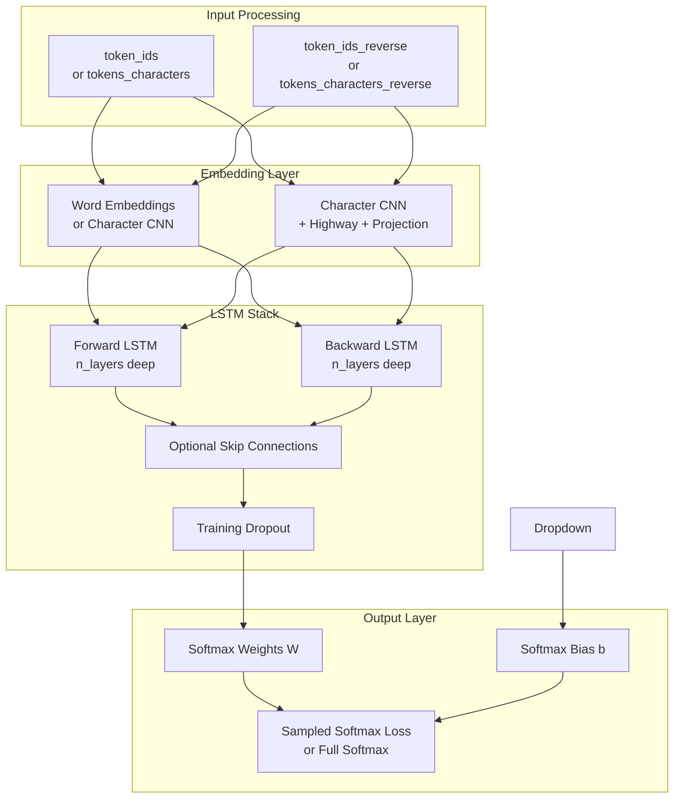

**Training Model Architecture**
Sources: [bilm/training.py:30-531]()

### Key Training Components

#### Character CNN Processing
- **Convolutional filters**: Multiple filter widths (1-7) with varying numbers
- **Activation functions**: Configurable tanh or ReLU activation
- **Highway networks**: Optional highway layers for enhanced representation
- **Projection layer**: Projects CNN output to LSTM input dimension

#### LSTM Configuration
- **Multi-layer support**: Configurable number of LSTM layers
- **Projection**: Optional projection from hidden size to output size  
- **Skip connections**: ResidualWrapper for deep networks
- **Clipping**: Cell state and projection clipping for stability

#### Loss Computation
- **Bidirectional loss**: Average of forward and backward language modeling losses
- **Sampled softmax**: Efficient training with large vocabularies
- **Shared embeddings**: Optional weight sharing between embeddings and softmax

### Training Infrastructure

| Function | Purpose | Key Features |
|----------|---------|--------------|
| `train()` | Main training loop | Multi-GPU, gradient clipping, checkpointing |
| `test()` | Model evaluation | Perplexity computation on test data |
| `dump_weights()` | Weight extraction | Converts TensorFlow checkpoints to HDF5 |

#### Multi-GPU Training Features
- **Data parallelism**: Splits batches across multiple GPUs
- **Gradient averaging**: Averages gradients across GPU towers
- **Efficient batching**: Handles IndexedSlices for sparse gradients

Sources: [bilm/training.py:675-897](), [bilm/training.py:955-1044](), [bilm/training.py:1065-1109]()

---

# Page: BidirectionalLanguageModel

# BidirectionalLanguageModel

<details>
<summary>Relevant source files</summary>

The following files were used as context for generating this wiki page:

- [README.md](README.md)
- [bilm/model.py](bilm/model.py)
- [tests/test_model.py](tests/test_model.py)
- [usage_character.py](usage_character.py)

</details>


The `BidirectionalLanguageModel` class is the core component for loading and running pretrained bidirectional language models to generate contextualized embeddings. This class provides the computational graph and operations necessary for computing ELMo representations from either character-level or token-level inputs.

This documentation covers the architecture, configuration, and usage of the `BidirectionalLanguageModel` class. For information about training new models, see [Training System](#3.4). For details about processing the outputs into final ELMo embeddings, see [ELMo Embeddings](#3.3).

## Architecture Overview

The `BidirectionalLanguageModel` serves as a high-level interface that manages the underlying computational graph and pretrained weights. It supports two distinct input modes and maintains stateful LSTM layers for efficient batch processing.

### Core Architecture

```mermaid
graph TB
    subgraph "BidirectionalLanguageModel"
        Init["__init__()"]
        Call["__call__()"]
        BuildOps["_build_ops()"]
    end
    
    subgraph "BidirectionalLanguageModelGraph"
        Build["_build()"]
        BuildCharEmbed["_build_word_char_embeddings()"]
        BuildTokenEmbed["_build_word_embeddings()"]
        BuildLSTMs["_build_lstms()"]
    end
    
    subgraph "Pretrained Weights"
        OptionsFile["options.json"]
        WeightFile["lm_weights.hdf5"]
        EmbedFile["embedding_weight_file.hdf5"]
    end
    
    subgraph "Input Processing"
        CharIds["Character IDs<br/>(batch, seq, 50)"]
        TokenIds["Token IDs<br/>(batch, seq)"]
    end
    
    subgraph "Output Operations"
        LMEmbeddings["lm_embeddings<br/>(batch, 3, seq, 1024)"]
        Lengths["lengths<br/>(batch,)"]
        Mask["mask<br/>(batch, seq)"]
        TokenEmbeddings["token_embeddings<br/>(batch, seq, projection_dim)"]
    end
    
    Init --> OptionsFile
    Init --> WeightFile
    Init --> EmbedFile
    
    Call --> Build
    Build --> BuildCharEmbed
    Build --> BuildTokenEmbed
    Build --> BuildLSTMs
    
    Call --> BuildOps
    BuildOps --> LMEmbeddings
    BuildOps --> Lengths
    BuildOps --> Mask
    BuildOps --> TokenEmbeddings
    
    CharIds --> Call
    TokenIds --> Call
```

Sources: [bilm/model.py:14-183](), [bilm/model.py:245-601]()

## Input Modes

The `BidirectionalLanguageModel` supports two input modes, controlled by the `use_character_inputs` parameter:

### Character Input Mode

When `use_character_inputs=True`, the model processes character-level representations:

```mermaid
graph LR
    subgraph "Character Mode Pipeline"
        RawText["Raw Text"] --> Batcher["Batcher"]
        VocabFile["vocab_file.txt"] --> Batcher
        Batcher --> CharIds["Character IDs<br/>(batch, seq, 50)"]
        CharIds --> CharEmbed["Character Embeddings<br/>char_embed layer"]
        CharEmbed --> CNN["Character CNN<br/>Filters + Highway"]
        CNN --> Projection["CNN Projection<br/>to projection_dim"]
        Projection --> BiLSTM["Bidirectional LSTM"]
        BiLSTM --> Output["LM Embeddings"]
    end
```

Sources: [bilm/model.py:19](), [bilm/model.py:286-461](), [usage_character.py:18-30]()

### Token Input Mode

When `use_character_inputs=False`, the model uses precomputed token embeddings:

```mermaid
graph LR
    subgraph "Token Mode Pipeline"
        RawText["Raw Text"] --> TokenBatcher["TokenBatcher"]
        VocabFile["vocab_file.txt"] --> TokenBatcher
        EmbedFile["embedding_weight_file.hdf5"] --> TokenEmbed["Token Embeddings<br/>embedding layer"]
        TokenBatcher --> TokenIds["Token IDs<br/>(batch, seq)"]
        TokenIds --> TokenEmbed
        TokenEmbed --> BiLSTM["Bidirectional LSTM"]
        BiLSTM --> Output["LM Embeddings"]
    end
```

Sources: [bilm/model.py:20](), [bilm/model.py:463-474](), [tests/test_model.py:143-220]()

## Key Components

### Initialization Parameters

| Parameter | Type | Description |
|-----------|------|-------------|
| `options_file` | str | Path to JSON file containing model hyperparameters |
| `weight_file` | str | Path to HDF5 file containing pretrained weights |
| `use_character_inputs` | bool | Whether to use character-level (True) or token-level (False) inputs |
| `embedding_weight_file` | str | Path to precomputed token embeddings (required when `use_character_inputs=False`) |
| `max_batch_size` | int | Maximum allowable batch size for state management |

Sources: [bilm/model.py:15-42]()

### Character CNN Architecture

When using character inputs, the model applies a convolutional neural network to character embeddings:

```mermaid
graph TB
    subgraph "Character CNN Components"
        CharEmbed["Character Embeddings<br/>Shape: (batch, seq, 50, embed_dim)"]
        
        subgraph "Convolution Filters"
            Conv1["Conv1D width=1, filters=32"]
            Conv2["Conv1D width=2, filters=32"]
            Conv3["Conv1D width=3, filters=64"]
            Conv4["Conv1D width=4, filters=128"]
            Conv5["Conv1D width=5, filters=256"]
            Conv6["Conv1D width=6, filters=512"]
            Conv7["Conv1D width=7, filters=512"]
        end
        
        MaxPool["Max Pooling<br/>Over character dimension"]
        Activation["Activation Function<br/>(tanh or relu)"]
        Concat["Concatenate Filter Outputs"]
        Highway["Highway Layers<br/>(n_highway layers)"]
        Projection["CNN Projection<br/>to projection_dim"]
        
        CharEmbed --> Conv1
        CharEmbed --> Conv2
        CharEmbed --> Conv3
        CharEmbed --> Conv4
        CharEmbed --> Conv5
        CharEmbed --> Conv6
        CharEmbed --> Conv7
        
        Conv1 --> MaxPool
        Conv2 --> MaxPool
        Conv3 --> MaxPool
        Conv4 --> MaxPool
        Conv5 --> MaxPool
        Conv6 --> MaxPool
        Conv7 --> MaxPool
        
        MaxPool --> Activation
        Activation --> Concat
        Concat --> Highway
        Highway --> Projection
    end
```

Sources: [bilm/model.py:315-460]()

### Bidirectional LSTM Layers

The core of the model consists of stacked bidirectional LSTM layers:

```mermaid
graph TB
    subgraph "Bidirectional LSTM Architecture"
        Input["Token Embeddings<br/>projection_dim"]
        
        subgraph "Forward Direction"
            ForwardInput["Forward Input<br/>(original sequence)"]
            ForwardLSTM1["Forward LSTM Layer 0<br/>RNN_0/RNN/MultiRNNCell/Cell0"]
            ForwardLSTM2["Forward LSTM Layer 1<br/>RNN_0/RNN/MultiRNNCell/Cell1"]
            ForwardOutput["Forward Outputs<br/>List[Tensor]"]
        end
        
        subgraph "Backward Direction"
            BackwardInput["Backward Input<br/>(reversed sequence)"]
            BackwardLSTM1["Backward LSTM Layer 0<br/>RNN_1/RNN/MultiRNNCell/Cell0"]
            BackwardLSTM2["Backward LSTM Layer 1<br/>RNN_1/RNN/MultiRNNCell/Cell1"]
            BackwardOutput["Backward Outputs<br/>List[Tensor]"]
        end
        
        subgraph "State Management"
            InitStates["Initial States<br/>lstm_init_states"]
            FinalStates["Final States<br/>lstm_final_states"]
            UpdateOp["State Update Op<br/>update_state_op"]
        end
        
        Input --> ForwardInput
        Input --> BackwardInput
        
        ForwardInput --> ForwardLSTM1
        ForwardLSTM1 --> ForwardLSTM2
        ForwardLSTM2 --> ForwardOutput
        
        BackwardInput --> BackwardLSTM1
        BackwardLSTM1 --> BackwardLSTM2
        BackwardLSTM2 --> BackwardOutput
        
        InitStates --> ForwardLSTM1
        InitStates --> ForwardLSTM2
        InitStates --> BackwardLSTM1
        InitStates --> BackwardLSTM2
        
        ForwardLSTM1 --> FinalStates
        ForwardLSTM2 --> FinalStates
        BackwardLSTM1 --> FinalStates
        BackwardLSTM2 --> FinalStates
        
        FinalStates --> UpdateOp
    end
```

Sources: [bilm/model.py:476-601]()

## Configuration and Weights

### Options File Structure

The `options.json` file contains model hyperparameters. Key sections include:

| Section | Parameters | Description |
|---------|------------|-------------|
| `char_cnn` | `n_characters`, `max_characters_per_token`, `filters`, `activation`, `embedding`, `n_highway` | Character CNN configuration |
| `lstm` | `dim`, `projection_dim`, `n_layers`, `cell_clip`, `proj_clip`, `use_skip_connections` | LSTM layer configuration |

Sources: [bilm/model.py:43-44](), [bilm/model.py:288-313]()

### Weight Loading

The model uses a custom getter function to load pretrained weights:

```mermaid
graph LR
    subgraph "Weight Loading Process"
        WeightFile["lm_weights.hdf5"] --> CustomGetter["_pretrained_initializer"]
        EmbedFile["embedding_weight_file.hdf5"] --> CustomGetter
        CustomGetter --> VarInit["Variable Initialization"]
        VarInit --> TFVars["TensorFlow Variables"]
        
        subgraph "Weight Mapping"
            GraphName["TensorFlow Variable Name"] --> FileMapping["Weight Name Mapping"]
            FileMapping --> FileName["HDF5 Dataset Name"]
        end
        
        CustomGetter --> FileMapping
    end
```

Sources: [bilm/model.py:186-242](), [bilm/model.py:261-266]()

## Output Structure

The `BidirectionalLanguageModel` returns a dictionary of TensorFlow operations:

### Return Dictionary

| Key | Shape | Description |
|-----|-------|-------------|
| `lm_embeddings` | `(batch, 3, seq_len, 1024)` | Concatenated token + forward + backward representations |
| `lengths` | `(batch,)` | Sequence lengths without BOS/EOS tokens |
| `mask` | `(batch, seq_len)` | Boolean mask for valid positions |
| `token_embeddings` | `(batch, seq_len, projection_dim)` | Raw token embeddings before LSTM processing |

Sources: [bilm/model.py:178-183]()

### Layer Composition

The `lm_embeddings` tensor contains three layers concatenated along axis 1:

```mermaid
graph TB
    subgraph "LM Embeddings Structure"
        TokenLayer["Layer 0: Token Embeddings<br/>Concatenated with itself<br/>Shape: (batch, seq, 2*projection_dim)"]
        ForwardLayer["Layer 1: Forward LSTM Output<br/>Concatenated with Backward<br/>Shape: (batch, seq, 2*projection_dim)"]
        BackwardLayer["Layer 2: Bidirectional Layer N<br/>Final LSTM layer outputs<br/>Shape: (batch, seq, 2*projection_dim)"]
        
        subgraph "Final Output"
            LMEmbeddings["lm_embeddings<br/>Shape: (batch, 3, seq, 1024)"]
        end
        
        TokenLayer --> LMEmbeddings
        ForwardLayer --> LMEmbeddings
        BackwardLayer --> LMEmbeddings
    end
```

Sources: [bilm/model.py:115-157]()

## Usage Patterns

### Basic Usage

```python
# Initialize model
bilm = BidirectionalLanguageModel(options_file, weight_file)

# Create placeholder
char_ids = tf.placeholder('int32', shape=(None, None, 50))

# Get operations
ops = bilm(char_ids)

# Run inference
with tf.Session() as sess:
    sess.run(tf.global_variables_initializer())
    embeddings = sess.run(ops['lm_embeddings'], 
                         feed_dict={char_ids: batch_data})
```

Sources: [usage_character.py:26-30](), [tests/test_model.py:62-66]()

### State Management

The model maintains stateful LSTM cells across batches for efficiency. The `max_batch_size` parameter determines the maximum state buffer size, and states are updated after each forward pass through the `update_state_op`.

Sources: [bilm/model.py:543-594](), [tests/test_model.py:102-131]()

---

# Page: Data Processing

# Data Processing

<details>
<summary>Relevant source files</summary>

The following files were used as context for generating this wiki page:

- [bilm/data.py](bilm/data.py)
- [tests/test_data.py](tests/test_data.py)

</details>


This document covers the data processing components in bilm-tf, which handle vocabulary management, text batching, and dataset preparation for training and inference. These components transform raw text inputs into the numerical representations required by the bidirectional language model.

For information about the core BiLM model architecture, see [BidirectionalLanguageModel](#3.1). For details on how processed data flows into ELMo embedding generation, see [ELMo Embeddings](#3.3).

## Vocabulary Management

The vocabulary system provides mapping between tokens and integer IDs, with support for both word-level and character-level representations.

### Vocabulary Class

The `Vocabulary` class provides basic token-to-ID mapping functionality:

| Property | Description | Special Token |
|----------|-------------|---------------|
| `bos` | Beginning of sentence ID | `<S>` |
| `eos` | End of sentence ID | `</S>` |
| `unk` | Unknown token ID | `<UNK>` |
| `size` | Total vocabulary size | - |

Key methods include `word_to_id()`, `id_to_word()`, `encode()` for converting sentences to ID sequences, and `decode()` for the reverse operation. The `encode()` method automatically adds BOS/EOS tokens and supports reverse ordering for backward language modeling.

### UnicodeCharsVocabulary Class

The `UnicodeCharsVocabulary` extends the base vocabulary with character-level representations. It maps each word to a fixed-length array of character IDs based on UTF-8 encoding:

| Character Range | Purpose |
|-----------------|---------|
| 0-255 | UTF-8 byte values |
| 256 | `<begin sentence>` |
| 257 | `<end sentence>` |
| 258 | `<begin word>` |
| 259 | `<end word>` |
| 260 | `<padding>` |

Each word is converted to a character array with format: `[<begin word>, char1, char2, ..., <end word>, <padding>...]` up to `max_word_length`.

**Sources:** [bilm/data.py:10-96](), [bilm/data.py:98-191]()

## Data Batching

The batching system converts lists of tokenized sentences into numerical matrices suitable for model input.

### Batcher vs TokenBatcher

```mermaid
graph TD
    sentences["List[List[str]]<br/>Raw tokenized sentences"]
    
    subgraph "Character-based Path"
        batcher["Batcher"]
        vocab_chars["UnicodeCharsVocabulary"]
        char_matrix["Character ID Matrix<br/>(batch, seq_len, max_char_len)"]
    end
    
    subgraph "Token-based Path"  
        token_batcher["TokenBatcher"]
        vocab_tokens["Vocabulary"]
        token_matrix["Token ID Matrix<br/>(batch, seq_len)"]
    end
    
    sentences --> batcher
    sentences --> token_batcher
    vocab_chars --> batcher
    vocab_tokens --> token_batcher
    batcher --> char_matrix
    token_batcher --> token_matrix
```

### Batcher Class

The `Batcher` class creates character-level input matrices with shape `(n_sentences, max_length, max_token_length)`. It adds +1 to all character IDs to reserve 0 as a mask value for padding positions.

### TokenBatcher Class

The `TokenBatcher` class creates token-level input matrices with shape `(n_sentences, max_length)`. Like `Batcher`, it adds +1 to token IDs for masking purposes.

Both batchers automatically handle:
- Sentence length padding to the maximum length in the batch
- Addition of BOS/EOS tokens
- Conversion to numpy arrays with appropriate dtypes

**Sources:** [bilm/data.py:193-230](), [bilm/data.py:232-261]()

## Dataset Management

The dataset classes handle loading and streaming of training data from text files.

### LMDataset Architecture

```mermaid
graph TB
    subgraph "File System"
        files["Text Files<br/>filepattern glob"]
        vocab_file["Vocabulary File"]
    end
    
    subgraph "LMDataset"
        lm_dataset["LMDataset"]
        vocab["Vocabulary or<br/>UnicodeCharsVocabulary"]
        shard_loader["_load_random_shard()"]
        sentence_gen["get_sentence()"]
        batch_gen["iter_batches()"]
    end
    
    subgraph "Output Batches"
        batch_data["Batch Dictionary:<br/>token_ids, tokens_characters, next_token_id"]
    end
    
    files --> lm_dataset
    vocab_file --> vocab
    vocab --> lm_dataset
    lm_dataset --> shard_loader
    shard_loader --> sentence_gen
    sentence_gen --> batch_gen
    batch_gen --> batch_data
```

### LMDataset Class

The `LMDataset` class manages streaming data from multiple text files:

- **File handling**: Loads files matching a glob pattern, randomly shuffling between shards
- **Sentence processing**: Converts raw text lines to token/character ID sequences
- **Batch generation**: Groups sentences into training batches via `iter_batches()`
- **Directional support**: Supports both forward and reverse token ordering

Key configuration options:
- `reverse`: Process sentences in reverse order for backward LM
- `test`: Iterate through data once vs. infinite streaming
- `shuffle_on_load`: Randomize sentence order within each file

### BidirectionalLMDataset Class

The `BidirectionalLMDataset` combines forward and reverse `LMDataset` instances to generate training batches for bidirectional language modeling. It merges batches by adding `_reverse` suffix to keys from the reverse dataset.

**Sources:** [bilm/data.py:315-434](), [bilm/data.py:435-461]()

## Data Processing Pipeline

### Character-Level Processing Flow

```mermaid
flowchart LR
    subgraph "Input"
        raw_text["Raw Text<br/>['The', 'first', 'sentence']"]
        vocab_file["vocab_test.txt"]
    end
    
    subgraph "Vocabulary Setup"
        unicode_vocab["UnicodeCharsVocabulary<br/>max_word_length=50"]
        char_mapping["Character Mapping<br/>UTF-8 bytes + special chars"]
    end
    
    subgraph "Batching Process"
        batcher_inst["Batcher instance"]
        encode_chars["encode_chars()<br/>Add BOS/EOS tokens"]
        char_matrix["Character Matrix<br/>(batch, seq, 50)"]
        add_one["Add +1 for masking<br/>0 = padding"]
    end
    
    subgraph "Output"
        final_matrix["Final Matrix<br/>Ready for BiLM input"]
    end
    
    raw_text --> batcher_inst
    vocab_file --> unicode_vocab
    unicode_vocab --> batcher_inst
    unicode_vocab --> char_mapping
    batcher_inst --> encode_chars
    encode_chars --> char_matrix
    char_matrix --> add_one
    add_one --> final_matrix
```

### Training Data Flow

```mermaid
graph TD
    subgraph "Training Files"
        shard1["train_shard_1.txt"]
        shard2["train_shard_2.txt"]
        shard_n["train_shard_n.txt"]
    end
    
    subgraph "LMDataset Processing"
        choose_shard["_choose_random_shard()"]
        load_shard["_load_shard()<br/>Read & tokenize sentences"]
        encode_step["vocab.encode() +<br/>vocab.encode_chars()"]
        sentence_stream["get_sentence()<br/>Infinite generator"]
    end
    
    subgraph "Batch Generation"
        get_batch["_get_batch()<br/>Group sentences"]
        batch_dict["Batch Dictionary:<br/>- token_ids: (batch, steps)<br/>- tokens_characters: (batch, steps, chars)<br/>- next_token_id: (batch, steps)"]
    end
    
    shard1 --> choose_shard
    shard2 --> choose_shard
    shard_n --> choose_shard
    choose_shard --> load_shard
    load_shard --> encode_step
    encode_step --> sentence_stream
    sentence_stream --> get_batch
    get_batch --> batch_dict
```

**Sources:** [bilm/data.py:264-313](), [bilm/data.py:370-405](), [bilm/data.py:422-429]()

## Usage Patterns Integration

The data processing components support the three main usage patterns described in [Usage Patterns](#2.2):

1. **Character-level input**: Uses `Batcher` with `UnicodeCharsVocabulary` for maximum flexibility
2. **Token-level input**: Uses `TokenBatcher` with pre-computed token embeddings for faster processing  
3. **Cached embeddings**: Bypasses real-time processing entirely using pre-computed results

The `+1` offset applied by both `Batcher` and `TokenBatcher` ensures compatibility with the BiLM model's expectation that 0 represents masked/padded positions.

**Sources:** [bilm/data.py:110-114](), [bilm/data.py:226-227](), [bilm/data.py:257-258]()

---

# Page: ELMo Embeddings

# ELMo Embeddings

<details>
<summary>Relevant source files</summary>

The following files were used as context for generating this wiki page:

- [README.md](README.md)
- [bilm/elmo.py](bilm/elmo.py)
- [tests/test_elmo.py](tests/test_elmo.py)
- [usage_character.py](usage_character.py)

</details>


This document covers the generation of ELMo (Embeddings from Language Models) representations from bidirectional language model outputs. ELMo embeddings are contextualized word representations created by computing weighted combinations of internal biLM layer activations.

For information about the underlying bidirectional language model architecture, see [BidirectionalLanguageModel](#3.1). For data processing and batching, see [Data Processing](#3.2).

## Overview

ELMo embeddings are produced by the `weight_layers` function, which takes multi-layer representations from a trained bidirectional language model and combines them into task-specific contextualized embeddings. The core concept is that different layers of the biLM capture different types of linguistic information, and the optimal combination varies by downstream task.

## Architecture Overview

The ELMo embedding generation process fits into the larger system as follows:

```mermaid
flowchart TB
    subgraph "Input Processing"
        RawText["Raw Text<br/>List[List[str]]"]
        Batcher["Batcher<br/>bilm.data"]
    end
    
    subgraph "BiLM Processing"
        CharIDs["Character IDs<br/>(batch, seq, 50)"]
        BiLM["BidirectionalLanguageModel<br/>bilm.model"]
        BiLMOps["bilm_ops<br/>{'lm_embeddings': tensor, 'mask': tensor}"]
    end
    
    subgraph "ELMo Generation"
        WeightLayers["weight_layers<br/>bilm.elmo"]
        ELMoWeights["Trainable Weights<br/>W: (n_layers,), gamma: (1,)"]
        FinalELMo["ELMo Embeddings<br/>(batch, seq, embed_dim)"]
    end
    
    RawText --> Batcher
    Batcher --> CharIDs
    CharIDs --> BiLM
    BiLM --> BiLMOps
    BiLMOps --> WeightLayers
    ELMoWeights --> WeightLayers
    WeightLayers --> FinalELMo
```

Sources: [README.md:52-65](), [bilm/elmo.py:4-31](), [usage_character.py:32-52]()

## The weight_layers Function

The `weight_layers` function is the core component for generating ELMo embeddings. It computes a weighted linear combination of the biLM's internal layer representations.

### Function Signature and Parameters

```mermaid
graph TB
    subgraph "weight_layers Parameters"
        Name["name: str<br/>Variable name prefix"]
        BiLMOps["bilm_ops: dict<br/>{'lm_embeddings': tensor, 'mask': tensor}"]
        L2Coef["l2_coef: float<br/>L2 regularization coefficient"]
        UseTopOnly["use_top_only: bool<br/>Use only the top layer"]
        DoLayerNorm["do_layer_norm: bool<br/>Apply layer normalization"]
    end
    
    subgraph "Output"
        WeightedOp["weighted_op: tensor<br/>Final ELMo embeddings"]
        RegOp["regularization_op: tensor<br/>L2 regularization loss"]
    end
    
    Name --> WeightedOp
    BiLMOps --> WeightedOp
    L2Coef --> RegOp
    UseTopOnly --> WeightedOp
    DoLayerNorm --> WeightedOp
```

Sources: [bilm/elmo.py:4-31]()

### Core Algorithm

The `weight_layers` function implements the following algorithm:

1. **Extract biLM outputs**: Gets `lm_embeddings` with shape `(batch, n_layers, seq_len, embed_dim)` and attention `mask`
2. **Create trainable weights**: 
   - `W`: Layer mixing weights with shape `(n_layers,)`
   - `gamma`: Scaling parameter with shape `(1,)`
3. **Normalize layer weights**: Apply softmax to `W + 1.0/n_layers` for balanced initialization
4. **Optional layer normalization**: Apply layer norm to each biLM layer if `do_layer_norm=True`
5. **Weighted combination**: Compute `sum(w_i * layer_i)` across all layers
6. **Scale output**: Multiply by `gamma` parameter

| Parameter | Default | Purpose |
|-----------|---------|---------|
| `l2_coef` | `None` | L2 regularization on layer weights |
| `use_top_only` | `False` | Skip weighting, use only top layer |
| `do_layer_norm` | `False` | Normalize each layer before weighting |

Sources: [bilm/elmo.py:38-113]()

## Implementation Details

### Trainable Variables

The function creates two types of trainable variables per call:

```mermaid
graph LR
    subgraph "Trainable Variables"
        ELMoW["{name}_ELMo_W<br/>Shape: (n_lm_layers,)<br/>Initializer: zeros"]
        ELMoGamma["{name}_ELMo_gamma<br/>Shape: (1,)<br/>Initializer: ones"]
    end
    
    subgraph "Regularization"
        L2Reg["L2 Regularization<br/>Applied to W only"]
    end
    
    ELMoW --> L2Reg
```

Sources: [bilm/elmo.py:68-108]()

### Layer Normalization

When `do_layer_norm=True`, the function applies custom layer normalization that respects the sequence mask:

- Computes mean and variance only over valid (non-masked) positions
- Uses `mask_float` to exclude padding tokens from normalization statistics
- Applies batch normalization with computed statistics

Sources: [bilm/elmo.py:50-59]()

## Usage Patterns

### Basic Usage

```python
# Get biLM representations
bilm_ops = model(character_ids)

# Create ELMo embeddings
elmo_ops = weight_layers('task_name', bilm_ops, l2_coef=0.001)

# Extract final embeddings
elmo_embeddings = elmo_ops['weighted_op']
regularization_loss = elmo_ops['regularization_op']
```

### Multiple ELMo Representations

For tasks requiring ELMo at multiple model layers:

```mermaid
flowchart TD
    subgraph "Shared BiLM"
        BiLMOps["bilm_ops<br/>Single forward pass"]
    end
    
    subgraph "Multiple ELMo Layers"
        InputELMo["weight_layers('input', bilm_ops)<br/>Input layer embeddings"]
        OutputELMo["weight_layers('output', bilm_ops)<br/>Output layer embeddings"]
    end
    
    subgraph "Variable Scoping"
        ReuseScope["tf.variable_scope('', reuse=True)<br/>Share weights across inputs"]
    end
    
    BiLMOps --> InputELMo
    BiLMOps --> OutputELMo
    ReuseScope --> OutputELMo
```

Sources: [usage_character.py:38-52]()

## Configuration Options

### Performance vs Quality Trade-offs

| Option | Performance | Quality | Use Case |
|--------|-------------|---------|----------|
| `use_top_only=True` | Fastest | Lower | Quick prototyping |
| `use_top_only=False` | Slower | Higher | Production systems |
| `do_layer_norm=True` | Slowest | Highest | Research applications |

### Regularization Settings

- `l2_coef=None` or `l2_coef=0.0`: No regularization
- `l2_coef=0.001`: Light regularization (typical)
- `l2_coef=0.01`: Strong regularization (small datasets)

Sources: [bilm/elmo.py:20-24](), [tests/test_elmo.py:117-124]()

## Testing and Validation

The system includes comprehensive tests that validate:

- Correct tensor shapes and operations
- Proper masking behavior for variable-length sequences  
- Layer normalization implementation
- Regularization term computation
- Variable sharing across multiple `weight_layers` calls

The test suite creates fixtures with known weights and verifies that the computed ELMo embeddings match analytical expectations.

Sources: [tests/test_elmo.py:17-125]()

---

# Page: Training System

# Training System

<details>
<summary>Relevant source files</summary>

The following files were used as context for generating this wiki page:

- [bilm/training.py](bilm/training.py)
- [tests/test_training.py](tests/test_training.py)

</details>


The Training System provides the core infrastructure for training bidirectional language models in the bilm-tf repository. This system handles model architecture definition, multi-GPU distributed training, gradient computation and clipping, checkpointing, and evaluation. The training system supports both character-level and word-level inputs, with configurable LSTM architectures and bidirectional processing.

For information about using pre-trained models for inference, see [BidirectionalLanguageModel](#3.1). For data preparation and batching utilities, see [Data Processing](#3.2).

## Core Architecture

The training system is built around the `LanguageModel` class which constructs the TensorFlow computational graph for neural language modeling. This class supports both unidirectional and bidirectional language models with configurable architectures.

### LanguageModel Class Structure

```mermaid
graph TB
    subgraph "LanguageModel Class"
        LM[LanguageModel] --> Build["_build()"]
        Build --> WordEmb["_build_word_embeddings()"]
        Build --> CharEmb["_build_word_char_embeddings()"]
        Build --> BuildLoss["_build_loss()"]
        
        WordEmb --> TokenIds["token_ids placeholder"]
        WordEmb --> EmbedWeights["embedding_weights"]
        
        CharEmb --> TokensChars["tokens_characters placeholder"]
        CharEmb --> CharEmbedding["char_embedding"]
        CharEmb --> CNN["Character CNN layers"]
        CharEmb --> Highway["Highway layers"]
        
        BuildLoss --> SoftmaxW["softmax_W"]
        BuildLoss --> SoftmaxB["softmax_b"]
        BuildLoss --> TotalLoss["total_loss"]
    end
    
    subgraph "LSTM Stack"
        LSTMCells["LSTM cells with projection"]
        SkipConn["ResidualWrapper for skip connections"]
        Dropout["DropoutWrapper"]
        MultiRNN["MultiRNNCell"]
    end
    
    Build --> LSTMCells
    LSTMCells --> SkipConn
    SkipConn --> Dropout
    Dropout --> MultiRNN
```

**Sources:** [bilm/training.py:55-72](), [bilm/training.py:325-431]()

### Input Processing Architecture

The system supports two input modalities: word tokens and character sequences. The character CNN architecture processes variable-length character sequences into fixed-size token representations.

```mermaid
graph LR
    subgraph "Word Input Path"
        WordTokens[token_ids] --> EmbeddingLookup[embedding_weights lookup]
        EmbeddingLookup --> TokenEmbed[token embeddings]
    end
    
    subgraph "Character Input Path"
        CharTokens[tokens_characters] --> CharEmbed[char_embedding lookup]
        CharEmbed --> ConvFilters["CNN filters [1,2,3,4,5,6,7]"]
        ConvFilters --> MaxPool[max pooling]
        MaxPool --> Activation[tanh/relu activation]
        Activation --> Concat[concatenate filters]
        Concat --> HighwayLayers[highway_layers]
        HighwayLayers --> Projection[CNN projection]
        Projection --> TokenEmbed
    end
    
    TokenEmbed --> LSTMStack[LSTM layers]
    LSTMStack --> OutputProj[output projection]
    OutputProj --> SoftmaxLoss[softmax loss]
```

**Sources:** [bilm/training.py:74-104](), [bilm/training.py:105-324]()

## Training Infrastructure

The training system implements distributed multi-GPU training with gradient averaging and sophisticated state management for LSTM networks.

### Multi-GPU Training Setup

```mermaid
graph TB
    subgraph "CPU Coordinator"
        GlobalStep[global_step variable]
        Optimizer[AdagradOptimizer]
        AverageGrads[average_gradients function]
        ClipGrads[clip_grads function]
    end
    
    subgraph "GPU Tower 0"
        Model0[LanguageModel instance]
        Loss0[total_loss computation]
        Grads0[compute_gradients]
    end
    
    subgraph "GPU Tower 1"
        Model1[LanguageModel instance]
        Loss1[total_loss computation]
        Grads1[compute_gradients]
    end
    
    subgraph "GPU Tower N"
        ModelN[LanguageModel instance]
        LossN[total_loss computation]
        GradsN[compute_gradients]
    end
    
    Model0 --> Loss0
    Loss0 --> Grads0
    Model1 --> Loss1
    Loss1 --> Grads1
    ModelN --> LossN
    LossN --> GradsN
    
    Grads0 --> AverageGrads
    Grads1 --> AverageGrads
    GradsN --> AverageGrads
    
    AverageGrads --> ClipGrads
    ClipGrads --> Optimizer
    Optimizer --> GlobalStep
```

**Sources:** [bilm/training.py:675-744](), [bilm/training.py:532-586]()

### Training Loop Flow

The training loop manages LSTM state persistence across batches, distributed batch processing, and periodic checkpointing and evaluation.

```mermaid
graph TD
    DataGen[data.iter_batches] --> BatchLoop[batch processing loop]
    BatchLoop --> SliceBatch[slice batch for GPUs]
    SliceBatch --> FeedDict[construct feed_dict]
    FeedDict --> InitStates[init_lstm_state tensors]
    InitStates --> RunTrain[sess.run train_op]
    RunTrain --> FinalStates[final_lstm_state tensors]
    FinalStates --> UpdateStates[update init_state_values]
    UpdateStates --> CheckBatch{batch_no % 1250?}
    CheckBatch -->|Yes| SaveCheckpoint[save checkpoint]
    CheckBatch -->|No| NextBatch[next batch]
    SaveCheckpoint --> NextBatch
    NextBatch --> BatchLoop
    
    RunTrain --> Summaries[summary_op execution]
    Summaries --> TensorBoard[write to TensorBoard]
    
    RunTrain --> HistSummaries{batch_no % 1250?}
    HistSummaries -->|Yes| HistogramOps[histogram summaries]
```

**Sources:** [bilm/training.py:763-897]()

## Model Configuration Options

The `LanguageModel` class accepts a comprehensive options dictionary that controls all aspects of model architecture and training behavior.

### Key Configuration Parameters

| Parameter Category | Key Options | Description |
|-------------------|-------------|-------------|
| **Model Architecture** | `bidirectional` | Enable bidirectional processing |
| | `n_tokens_vocab` | Vocabulary size |
| | `batch_size` | Training batch size |
| | `unroll_steps` | LSTM unroll length |
| **LSTM Configuration** | `lstm.dim` | LSTM hidden state size |
| | `lstm.projection_dim` | Output projection dimension |
| | `lstm.n_layers` | Number of LSTM layers |
| | `lstm.use_skip_connections` | Enable residual connections |
| | `lstm.cell_clip` | Cell state clipping value |
| | `lstm.proj_clip` | Projection clipping value |
| **Character CNN** | `char_cnn.filters` | CNN filter specifications |
| | `char_cnn.n_highway` | Number of highway layers |
| | `char_cnn.activation` | Activation function |
| **Training** | `dropout` | Dropout probability |
| | `learning_rate` | Optimizer learning rate |
| | `n_epochs` | Training epochs |
| | `sample_softmax` | Use sampled softmax loss |

**Sources:** [bilm/training.py:40-54](), [bilm/training.py:107-131]()

### Character CNN Architecture Options

The character CNN processes character sequences through multiple convolutional filters with different widths:

```mermaid
graph LR
    subgraph "Character Processing"
        CharSeq[character sequence] --> CharEmbed[character embeddings]
        CharEmbed --> Conv1[1-char filters]
        CharEmbed --> Conv2[2-char filters]
        CharEmbed --> Conv3[3-char filters]
        CharEmbed --> Conv4[4-char filters]
        CharEmbed --> Conv5[5-char filters]
        CharEmbed --> Conv6[6-char filters]
        CharEmbed --> Conv7[7-char filters]
        
        Conv1 --> MaxPool1[max pool]
        Conv2 --> MaxPool2[max pool]
        Conv3 --> MaxPool3[max pool]
        Conv4 --> MaxPool4[max pool]
        Conv5 --> MaxPool5[max pool]
        Conv6 --> MaxPool6[max pool]
        Conv7 --> MaxPool7[max pool]
        
        MaxPool1 --> ConcatFilters[concatenate all filters]
        MaxPool2 --> ConcatFilters
        MaxPool3 --> ConcatFilters
        MaxPool4 --> ConcatFilters
        MaxPool5 --> ConcatFilters
        MaxPool6 --> ConcatFilters
        MaxPool7 --> ConcatFilters
    end
```

**Sources:** [bilm/training.py:175-221]()

## Gradient Processing

The training system implements sophisticated gradient clipping and averaging mechanisms for stable multi-GPU training.

### Gradient Averaging Process

The `average_gradients` function handles both dense and sparse (IndexedSlices) gradients across multiple GPU towers:

```mermaid
graph TD
    TowerGrads[tower_grads from all GPUs] --> ProcessGrad{gradient type?}
    ProcessGrad -->|IndexedSlices| SparseGrad[sparse gradient processing]
    ProcessGrad -->|Dense Tensor| DenseGrad[dense gradient processing]
    
    SparseGrad --> ConcatIndices[concat indices]
    SparseGrad --> ConcatValues[concat values]
    ConcatIndices --> Deduplicate[_deduplicate_indexed_slices]
    ConcatValues --> Deduplicate
    Deduplicate --> NewIndexedSlices[create new IndexedSlices]
    
    DenseGrad --> ExpandDims[expand_dims for tower dimension]
    ExpandDims --> ConcatTensors[concat across towers]
    ConcatTensors --> ReduceMean[reduce_mean across towers]
    
    NewIndexedSlices --> AverageGrads[averaged gradients]
    ReduceMean --> AverageGrads
```

**Sources:** [bilm/training.py:532-586](), [bilm/training.py:627-642]()

## Evaluation System

The `test` function provides perplexity evaluation on held-out datasets using trained model checkpoints.

### Test Evaluation Flow

```mermaid
graph TD
    LoadModel[load LanguageModel with test options] --> LoadCheckpoint[restore from checkpoint]
    LoadCheckpoint --> InitTestState[initialize LSTM states]
    InitTestState --> TestLoop[iterate test batches]
    TestLoop --> ComputeLoss[compute total_loss]
    ComputeLoss --> UpdateStates[update LSTM states]
    UpdateStates --> AccumLoss[accumulate batch losses]
    AccumLoss --> CheckDone{more batches?}
    CheckDone -->|Yes| TestLoop
    CheckDone -->|No| FinalPerplexity[compute final perplexity]
    FinalPerplexity --> ReturnResult[return exp(avg_loss)]
```

**Sources:** [bilm/training.py:955-1044]()

## Utility Functions

The training system provides several utility functions for model management and weight extraction.

### Key Utility Functions

| Function | Purpose | Key Features |
|----------|---------|--------------|
| `dump_weights` | Extract trained weights to HDF5 | Converts TensorFlow variables to HDF5 format |
| `load_options_latest_checkpoint` | Load model configuration | Reads options.json and finds latest checkpoint |
| `clip_grads` | Gradient clipping with summaries | Global norm clipping with TensorBoard logging |
| `print_variable_summary` | Debug model variables | Pretty-prints all TensorFlow variables |

**Sources:** [bilm/training.py:1065-1108](), [bilm/training.py:1047-1062](), [bilm/training.py:926-952](), [bilm/training.py:24-27]()

---

# Page: Command Line Tools

# Command Line Tools

<details>
<summary>Relevant source files</summary>

The following files were used as context for generating this wiki page:

- [bin/dump_weights.py](bin/dump_weights.py)
- [bin/restart.py](bin/restart.py)
- [bin/run_test.py](bin/run_test.py)
- [bin/train_elmo.py](bin/train_elmo.py)

</details>


This page documents the command-line utilities provided in the `bin/` directory for training, evaluating, and managing ELMo language models. These tools provide a high-level interface to the core bilm-tf functionality for common workflows like model training, checkpoint management, and weight extraction.

For detailed information about the core model components these tools interact with, see [Core Components](#3). For training system internals, see [Training System](#3.4).

## Overview

The bilm-tf repository provides four primary command-line tools that handle the complete model lifecycle:

| Tool | Purpose | Primary Function |
|------|---------|------------------|
| `train_elmo.py` | Initial model training | Creates new models from scratch |
| `restart.py` | Resume training | Continues training from checkpoints |
| `run_test.py` | Model evaluation | Computes perplexity on test data |
| `dump_weights.py` | Weight extraction | Converts checkpoints to HDF5 format |

## Training Workflow

The training workflow connects raw text data through vocabulary processing to trained model checkpoints:

```mermaid
flowchart TD
    subgraph Input["Input Data"]
        TrainFiles["Training Files<br/>(train_prefix_*)"]
        VocabFile["Vocabulary File<br/>(vocab.txt)"]
    end
    
    subgraph TrainingTools["Training Tools"]
        TrainScript["train_elmo.py"]
        RestartScript["restart.py"]
    end
    
    subgraph Training["Training Process"]
        LoadVocab["load_vocab()"]
        BidirDataset["BidirectionalLMDataset"]
        TrainFunc["bilm.training.train()"]
    end
    
    subgraph Output["Training Output"]
        Checkpoints["TensorFlow Checkpoints<br/>(save_dir)"]
        Logs["Training Logs<br/>(tf_log_dir)"]
    end
    
    subgraph Utilities["Utility Tools"]
        TestScript["run_test.py"]
        DumpScript["dump_weights.py"]
    end
    
    subgraph FinalOutput["Final Artifacts"]
        TestResults["Perplexity Scores"]
        WeightsHDF5["Weights HDF5<br/>(lm_weights.hdf5)"]
    end
    
    TrainFiles --> TrainScript
    VocabFile --> TrainScript
    TrainScript --> LoadVocab
    TrainScript --> BidirDataset
    LoadVocab --> TrainFunc
    BidirDataset --> TrainFunc
    TrainFunc --> Checkpoints
    TrainFunc --> Logs
    
    Checkpoints --> RestartScript
    VocabFile --> RestartScript
    RestartScript --> TrainFunc
    
    Checkpoints --> TestScript
    VocabFile --> TestScript
    TestScript --> TestResults
    
    Checkpoints --> DumpScript
    DumpScript --> WeightsHDF5
```

Sources: [bin/train_elmo.py:1-74](), [bin/restart.py:1-59](), [bin/run_test.py:1-44](), [bin/dump_weights.py:1-16]()

## Training Tools

### train_elmo.py

The primary training script that initializes new ELMo model training from scratch. It configures a complete bidirectional language model with character-level CNN and LSTM layers.

**Key Configuration**:
- Uses hardcoded model architecture parameters [bin/train_elmo.py:21-55]()
- Supports multi-GPU training with 3 GPUs by default [bin/train_elmo.py:16]()
- Batch size of 128 per GPU [bin/train_elmo.py:15]()
- Character CNN with filters from 1-7 characters [bin/train_elmo.py:24-32]()
- 2-layer LSTM with 4096 hidden units and 512 projection [bin/train_elmo.py:39-45]()

**Command Line Arguments**:

| Argument | Required | Description |
|----------|----------|-------------|
| `--save_dir` | Yes | Directory for saving checkpoints and logs |
| `--vocab_file` | Yes | Path to vocabulary file |
| `--train_prefix` | Yes | Prefix for training data files |

**Usage Example**:
```bash
python bin/train_elmo.py \
    --save_dir /path/to/checkpoints \
    --vocab_file vocab.txt \
    --train_prefix /data/train
```

The script calls `load_vocab()` with a fixed max word length of 50 characters [bin/train_elmo.py:12]() and creates a `BidirectionalLMDataset` [bin/train_elmo.py:58-59]().

### restart.py

Allows resuming training from existing checkpoints with modified parameters. This tool loads previous training configuration and continues from the latest checkpoint.

**Key Features**:
- Automatically loads latest checkpoint using `load_options_latest_checkpoint()` [bin/restart.py:10]()
- Supports overriding training parameters [bin/restart.py:34-39]()
- Handles both bidirectional and unidirectional models [bin/restart.py:25-28]()
- Preserves character CNN settings from original training [bin/restart.py:12-15]()

**Command Line Arguments**:

| Argument | Required | Description |
|----------|----------|-------------|
| `--save_dir` | Yes | Directory containing checkpoints |
| `--vocab_file` | Yes | Vocabulary file (must match original) |
| `--train_prefix` | Yes | Prefix for training data files |
| `--n_gpus` | No | Number of GPUs (default: 1) |
| `--batch_size` | No | Override batch size (default: use original) |
| `--n_train_tokens` | No | Override token count (default: use original) |
| `--n_epochs` | No | Override epoch count (default: use original) |

**Usage Example**:
```bash
python bin/restart.py \
    --save_dir /path/to/checkpoints \
    --vocab_file vocab.txt \  
    --train_prefix /data/train \
    --n_gpus 2 \
    --batch_size 64
```

Sources: [bin/train_elmo.py:1-74](), [bin/restart.py:1-59]()

## Evaluation & Utilities

### run_test.py

Evaluates trained models by computing perplexity on test datasets. This tool loads a trained checkpoint and measures language modeling performance.

**Key Features**:
- Automatically detects model configuration from checkpoints [bin/run_test.py:8]()
- Supports both bidirectional and unidirectional models [bin/run_test.py:24-27]()
- Uses test dataset configuration (no shuffling) [bin/run_test.py:19-22]()
- Calls `bilm.training.test()` function [bin/run_test.py:29]()

**Command Line Arguments**:

| Argument | Required | Description |
|----------|----------|-------------|
| `--save_dir` | Yes | Directory containing trained checkpoints |
| `--vocab_file` | Yes | Vocabulary file used during training |
| `--test_prefix` | Yes | Prefix for test data files |
| `--batch_size` | No | Batch size for evaluation (default: 256) |

### dump_weights.py

Converts TensorFlow checkpoint files to HDF5 format for easier distribution and loading. This utility extracts trained weights into a portable format.

**Key Features**:
- Simple wrapper around `bilm.training.dump_weights()` [bin/dump_weights.py:14]()
- Produces HDF5 files compatible with the ELMo loading interface
- Enables model sharing without TensorFlow checkpoint dependencies

**Command Line Arguments**:

| Argument | Required | Description |
|----------|----------|-------------|
| `--save_dir` | Yes | Directory containing TensorFlow checkpoints |
| `--outfile` | Yes | Output path for HDF5 weights file |

**Usage Example**:
```bash
python bin/dump_weights.py \
    --save_dir /path/to/checkpoints \
    --outfile lm_weights.hdf5
```

Sources: [bin/run_test.py:1-44](), [bin/dump_weights.py:1-16]()

## Command Line Tool Integration

The relationship between command line tools and core bilm components shows how high-level scripts orchestrate the training pipeline:

```mermaid
flowchart TD
    subgraph CLI["Command Line Scripts"]
        TrainELMo["train_elmo.py<br/>main()"]
        Restart["restart.py<br/>main()"] 
        RunTest["run_test.py<br/>main()"]
        DumpWeights["dump_weights.py"]
    end
    
    subgraph BilmTraining["bilm.training Module"]
        TrainFunc["train()"]
        TestFunc["test()"]
        LoadOptions["load_options_latest_checkpoint()"]
        LoadVocab["load_vocab()"]
        DumpWeightsFunc["dump_weights()"]
    end
    
    subgraph BilmData["bilm.data Module"]
        BidirLMDataset["BidirectionalLMDataset"]
        LMDataset["LMDataset"]
        Vocab["Vocabulary"]
    end
    
    subgraph BilmModel["bilm.model Module"]
        BidirLM["BidirectionalLanguageModel"]
    end
    
    TrainELMo --> TrainFunc
    TrainELMo --> LoadVocab
    TrainELMo --> BidirLMDataset
    
    Restart --> LoadOptions
    Restart --> LoadVocab
    Restart --> TrainFunc
    Restart --> BidirLMDataset
    Restart --> LMDataset
    
    RunTest --> LoadOptions
    RunTest --> LoadVocab
    RunTest --> TestFunc
    RunTest --> BidirLMDataset
    RunTest --> LMDataset
    
    DumpWeights --> DumpWeightsFunc
    
    TrainFunc --> BidirLM
    TestFunc --> BidirLM
    BidirLMDataset --> Vocab
    LMDataset --> Vocab
```

Sources: [bin/train_elmo.py:6-7](), [bin/restart.py:6-7](), [bin/run_test.py:4-5](), [bin/dump_weights.py:5]()

## Common Usage Patterns

### Initial Training Workflow

1. **Prepare Data**: Organize training files with consistent prefix
2. **Create Vocabulary**: Generate vocabulary file sorted by frequency  
3. **Start Training**: Use `train_elmo.py` with appropriate paths
4. **Monitor Progress**: Check logs in save_dir for training metrics

### Resume Training Workflow

1. **Identify Checkpoint**: Locate save_dir with existing checkpoints
2. **Resume Training**: Use `restart.py` with same vocab_file
3. **Adjust Parameters**: Override batch_size, n_epochs as needed
4. **Continue Monitoring**: Training resumes from latest checkpoint

### Model Evaluation Workflow

1. **Prepare Test Data**: Organize test files with consistent prefix
2. **Run Evaluation**: Use `run_test.py` with trained checkpoint
3. **Analyze Results**: Review perplexity scores for model quality
4. **Export Weights**: Use `dump_weights.py` for model distribution

Sources: [bin/train_elmo.py:10-63](), [bin/restart.py:9-42](), [bin/run_test.py:7-29](), [bin/dump_weights.py:8-14]()

---

# Page: Training Tools

# Training Tools

<details>
<summary>Relevant source files</summary>

The following files were used as context for generating this wiki page:

- [README.md](README.md)
- [bin/restart.py](bin/restart.py)
- [bin/train_elmo.py](bin/train_elmo.py)
- [usage_character.py](usage_character.py)

</details>


This document covers the command-line tools provided for training bidirectional language models (biLMs) in the bilm-tf system. These tools enable users to train new ELMo models from scratch or fine-tune existing models on custom datasets.

For information about model evaluation and testing, see [Evaluation & Utilities](#4.2). For details about the underlying training system architecture, see [Training System](#3.4).

## Overview

The bilm-tf repository provides two primary training tools:
- `train_elmo.py` - Main training script for training biLMs from scratch
- `restart.py` - Tool for resuming training from existing checkpoints or fine-tuning pre-trained models

Both tools utilize the core training infrastructure from the `bilm.training` module and require prepared datasets with vocabulary files.

## Main Training Script

The primary training tool is located at [bin/train_elmo.py](). This script implements the complete training pipeline used to create the original ELMo models.

### Core Functionality

The training script performs the following operations:
1. Loads vocabulary from the specified vocabulary file using `load_vocab` [bin/train_elmo.py:12]()
2. Defines model architecture and training hyperparameters [bin/train_elmo.py:21-55]()
3. Creates a `BidirectionalLMDataset` for data loading [bin/train_elmo.py:58-59]()
4. Initiates training using the `train` function [bin/train_elmo.py:63]()

### Training Configuration

The script includes hardcoded hyperparameters that match the original ELMo model:

| Parameter | Value | Description |
|-----------|-------|-------------|
| `batch_size` | 128 | Batch size per GPU |
| `n_gpus` | 3 | Number of GPUs for distributed training |
| `n_train_tokens` | 768,648,884 | Total tokens in 1B Word Benchmark |
| `n_epochs` | 10 | Training epochs |
| `unroll_steps` | 20 | LSTM unroll steps |

The model architecture is configured with:
- Bidirectional LSTM with 2 layers of 4096 dimensions [bin/train_elmo.py:39-45]()
- Character CNN with 7 filter sizes [bin/train_elmo.py:24-35]()
- Highway networks and dropout regularization [bin/train_elmo.py:35,37]()

Sources: [bin/train_elmo.py:1-75](), [README.md:162-176]()

## Training Resumption Tool

The restart script [bin/restart.py]() enables resuming training from existing checkpoints or fine-tuning pre-trained models on new datasets.

### Key Features

The restart tool provides:
- Automatic loading of previous training options and checkpoint files [bin/restart.py:10]()
- Parameter override capabilities for batch size, epochs, and token counts [bin/restart.py:34-39]()
- Support for both unidirectional and bidirectional language models [bin/restart.py:25-28]()

### Usage Parameters

The restart script accepts the following command-line arguments:

| Argument | Type | Description |
|----------|------|-------------|
| `--save_dir` | string | Directory containing checkpoint files |
| `--vocab_file` | string | Path to vocabulary file |
| `--train_prefix` | string | Prefix pattern for training files |
| `--n_gpus` | int | Number of GPUs (default: 1) |
| `--batch_size` | int | Override batch size (optional) |
| `--n_train_tokens` | int | Override token count (optional) |
| `--n_epochs` | int | Override epoch count (optional) |

Sources: [bin/restart.py:1-59](), [README.md:218-223]()

## Training Workflow

The following diagram illustrates the training process flow and the relationship between the training tools and core components:

```mermaid
flowchart TD
    subgraph "Input Preparation"
        TrainFiles["Training Files<br/>(tokenized text)"]
        VocabFile["Vocabulary File<br/>(sorted by frequency)"]
        OptionsCreate["Create options.json<br/>(architecture config)"]
    end
    
    subgraph "Training Tools"
        TrainScript["bin/train_elmo.py<br/>Main training script"]
        RestartScript["bin/restart.py<br/>Resume/fine-tune script"]
    end
    
    subgraph "Core Training Infrastructure"
        LoadVocab["load_vocab()<br/>bilm.training"]
        BidiDataset["BidirectionalLMDataset<br/>bilm.data"]
        TrainFunc["train()<br/>bilm.training"]
        LoadCheckpoint["load_options_latest_checkpoint()<br/>bilm.training"]
    end
    
    subgraph "Training Process"
        MultiGPU["Multi-GPU Training<br/>Distributed across 3 GPUs"]
        Checkpoints["TensorFlow Checkpoints<br/>Model state snapshots"]
        Monitoring["Training Monitoring<br/>Loss and perplexity"]
    end
    
    TrainFiles --> TrainScript
    VocabFile --> TrainScript
    TrainScript --> LoadVocab
    LoadVocab --> BidiDataset
    BidiDataset --> TrainFunc
    TrainFunc --> MultiGPU
    MultiGPU --> Checkpoints
    MultiGPU --> Monitoring
    
    Checkpoints --> RestartScript
    VocabFile --> RestartScript
    RestartScript --> LoadCheckpoint
    LoadCheckpoint --> TrainFunc
```

This diagram shows how the training tools coordinate data preparation, model configuration, and the core training infrastructure to produce trained models.

Sources: [bin/train_elmo.py:10-63](), [bin/restart.py:9-42](), [README.md:127-176]()

## Data Requirements and Setup

Both training tools require specific data preparation following the bilm-tf conventions:

### Vocabulary File Format
- Text file with one token per line [README.md:145]()
- Must include special tokens: `<S>`, `</S>`, and `<UNK>` [README.md:145]()
- Tokens sorted in descending order by frequency [README.md:147]()
- Special tokens should appear first in the file [README.md:147]()

### Training Data Format
- Multiple files containing pre-tokenized text [README.md:151-153]()
- One sentence per line with whitespace-separated tokens [README.md:153]()
- No special begin/end tokens in training data [README.md:154]()
- Random split across multiple files for efficient loading [README.md:151-152]()

### Training Configuration Workflow

The following diagram shows the relationship between configuration files, training scripts, and the training process:

```mermaid
flowchart LR
    subgraph "Configuration"
        HyperParams["Hyperparameters<br/>batch_size, n_epochs, etc."]
        ModelArch["Model Architecture<br/>LSTM dims, CNN filters"]
        TrainParams["Training Parameters<br/>n_train_tokens, dropout"]
    end
    
    subgraph "Training Scripts"
        TrainElmo["train_elmo.py<br/>Hardcoded config"]
        RestartPy["restart.py<br/>Load + override config"]
    end
    
    subgraph "Core Functions"
        LoadVocabFunc["load_vocab(vocab_file, max_word_length)<br/>bilm.training"]
        TrainFunction["train(options, data, n_gpus, save_dir)<br/>bilm.training"]
        LoadOptsFunc["load_options_latest_checkpoint(save_dir)<br/>bilm.training"]
    end
    
    HyperParams --> TrainElmo
    ModelArch --> TrainElmo
    TrainParams --> TrainElmo
    
    TrainElmo --> LoadVocabFunc
    TrainElmo --> TrainFunction
    
    RestartPy --> LoadOptsFunc
    RestartPy --> LoadVocabFunc
    RestartPy --> TrainFunction
    
    LoadOptsFunc --> HyperParams
```

This diagram illustrates how training configuration flows from hardcoded parameters or loaded checkpoints through the training scripts to the core training functions.

Sources: [bin/train_elmo.py:11-63](), [bin/restart.py:10-42](), [README.md:138-161]()

## Multi-GPU Training Support

Both training tools support distributed multi-GPU training through the underlying `train` function:

- Default configuration uses 3 GPUs [bin/train_elmo.py:16]()
- Restart tool accepts `--n_gpus` parameter for customization [bin/restart.py:50-51]()
- GPU visibility controlled via `CUDA_VISIBLE_DEVICES` environment variable [README.md:171]()
- Batch size specified per GPU, with total effective batch size multiplied by GPU count

The training process automatically distributes computation across available GPUs while maintaining gradient synchronization and model consistency.

Sources: [bin/train_elmo.py:15-16](), [bin/restart.py:50-51](), [README.md:165-176]()

---

# Page: Evaluation & Utilities

# Evaluation & Utilities

<details>
<summary>Relevant source files</summary>

The following files were used as context for generating this wiki page:

- [README.md](README.md)
- [bin/dump_weights.py](bin/dump_weights.py)
- [bin/run_test.py](bin/run_test.py)
- [usage_character.py](usage_character.py)

</details>


This page documents the evaluation scripts and utility tools provided in the bilm-tf system for testing trained models, converting model formats, and extracting embeddings. These tools support the complete workflow from model training through deployment and usage.

For information about training tools, see [Training Tools](#4.1). For model configuration details, see [Model Configuration](#5.1).

## Model Evaluation

The primary evaluation tool is the `run_test.py` script, which computes perplexity metrics on held-out test data to assess model performance.

### Test Perplexity Evaluation

The `run_test.py` script loads a trained model checkpoint and evaluates it against test data:

```bash
python bin/run_test.py \
    --test_prefix='/path/to/test/data/*' \
    --vocab_file /path/to/vocab.txt \
    --save_dir /path/to/checkpoint \
    --batch_size 256
```

The evaluation process follows this workflow:

```mermaid
graph TD
    TestData["Test Data Files<br/>--test_prefix"] --> LoadData["Load Test Dataset<br/>LMDataset or BidirectionalLMDataset"]
    VocabFile["Vocabulary File<br/>--vocab_file"] --> LoadVocab["load_vocab()"]
    CheckpointDir["Checkpoint Directory<br/>--save_dir"] --> LoadCheckpoint["load_options_latest_checkpoint()"]
    
    LoadCheckpoint --> Options["Model Options<br/>options dict"]
    LoadCheckpoint --> CkptFile["Checkpoint File<br/>*.ckpt path"]
    
    LoadVocab --> Vocab["UnicodeCharsVocabulary<br/>vocab object"]
    Options --> DatasetChoice{"Bidirectional?<br/>options.get('bidirectional')"}
    
    DatasetChoice -->|Yes| BidirDataset["BidirectionalLMDataset<br/>test=True, shuffle_on_load=False"]
    DatasetChoice -->|No| UnidirDataset["LMDataset<br/>test=True, shuffle_on_load=False"]
    
    LoadData --> Dataset["Test Dataset<br/>configured for evaluation"]
    BidirDataset --> Dataset
    UnidirDataset --> Dataset
    Vocab --> Dataset
    
    Options --> TestFunc["test() function<br/>bilm.training.test"]
    CkptFile --> TestFunc
    Dataset --> TestFunc
    BatchSize["--batch_size<br/>default: 256"] --> TestFunc
    
    TestFunc --> Perplexity["Test Perplexity<br/>printed to stdout"]
```

**Key Components:**

- **`load_options_latest_checkpoint()`**: Loads model configuration and finds the latest checkpoint file
- **`load_vocab()`**: Creates vocabulary object with proper character limit handling
- **Dataset Selection**: Chooses between `LMDataset` and `BidirectionalLMDataset` based on model type
- **`test()` Function**: Performs the actual perplexity computation

Sources: [bin/run_test.py:1-44](), [bilm/training.py](), [README.md:178-188]()

## Weight Conversion Utilities

### Checkpoint to HDF5 Conversion

The `dump_weights.py` script converts TensorFlow checkpoint files to HDF5 format for use in prediction:

```mermaid
graph LR
    TFCheckpoint["TensorFlow Checkpoint<br/>*.ckpt files"] --> DumpScript["bin/dump_weights.py<br/>--save_dir --outfile"]
    DumpScript --> DumpFunction["dump_weights()<br/>bilm.training.dw"]
    DumpFunction --> HDF5File["HDF5 Weights File<br/>lm_weights.hdf5"]
    
    OptionsJSON["options.json<br/>manually created"] --> PredictionModel["BidirectionalLanguageModel<br/>for prediction"]
    HDF5File --> PredictionModel
```

**Usage:**
```bash
python bin/dump_weights.py \
    --save_dir /path/to/checkpoint \
    --outfile /path/to/weights.hdf5
```

**Important Notes:**
- Requires manual creation of `options.json` file with model hyperparameters
- Must set `n_characters=262` in `options.json` for prediction (vs. 261 during training)
- Enables model deployment without TensorFlow checkpoint dependencies

Sources: [bin/dump_weights.py:1-16](), [README.md:190-203]()

## Embedding Extraction Utilities

The system provides utilities for pre-computing and caching embeddings at different levels of the model pipeline.

### Token Embedding Extraction

The `dump_token_embeddings` function pre-computes context-independent token representations:

```mermaid
graph TD
    VocabFile["Vocabulary File<br/>unique tokens + <S> </S>"] --> TokenDump["dump_token_embeddings<br/>bilm function"]
    PretrainedModel["Full BiLM Model<br/>with weights"] --> TokenDump
    
    TokenDump --> TokenEmbedHDF5["Token Embeddings HDF5<br/>context-independent"]
    
    TokenEmbedHDF5 --> TokenBatcher["TokenBatcher<br/>use_token_inputs=False"]
    VocabFile --> TokenBatcher
    TokenBatcher --> FastInference["Faster Inference<br/>fixed vocabulary only"]
    
    UserInput["User Text<br/>fixed vocabulary"] --> TokenBatcher
```

**Workflow:**
1. Create vocabulary file with all unique tokens
2. Run `dump_token_embeddings` with full model
3. Use `TokenBatcher` with the output HDF5 file
4. Pass `use_token_inputs=False` to `BidirectionalLanguageModel`

**Limitations:**
- No fallback to character inputs for OOV words
- Only suitable for fixed, defined vocabularies

Sources: [README.md:98-116](), [usage_token.py]()

### Full Dataset Embedding Extraction

The `dump_bilm_embeddings` function processes entire datasets and caches complete embeddings:

```mermaid
graph TD
    DatasetFile["Dataset Text File<br/>one sentence per line"] --> DumpBiLM["dump_bilm_embeddings<br/>bilm function"]
    PretrainedModel["BiLM Model"] --> DumpBiLM
    
    DumpBiLM --> EmbedHDF5["Embeddings HDF5<br/>keyed by sentence_id"]
    
    EmbedHDF5 --> DirectAccess["Direct Access<br/>sentence_embeddings = f[str(sentence_id)]"]
    DirectAccess --> EmbedArray["Embedding Array<br/>shape: (3, n_tokens, 1024)"]
    
    LineNumber["Line Number<br/>sentence_id = line index"] --> Key["HDF5 Key<br/>str(sentence_id)"]
    Key --> DirectAccess
```

**Storage Format:**
- HDF5 file with sentence-level datasets
- Keys: `str(sentence_id)` where `sentence_id` is 0-indexed line number
- Values: Shape `(3, n_tokens, 1024)` arrays (3 layers, token count, embedding dimension)

**Use Cases:**
- Smaller datasets where file size is manageable
- Integration with non-TensorFlow frameworks
- Scenarios requiring pre-computed embeddings

Sources: [README.md:118-125](), [usage_cached.py]()

## Utility Workflows

### Complete Model Deployment Pipeline

The following diagram shows how evaluation and utility tools work together in a complete model lifecycle:

```mermaid
graph TD
    subgraph "Training Phase"
        TrainData["Training Data"] --> TrainScript["bin/train_elmo.py"]
        TrainScript --> Checkpoint["TF Checkpoint<br/>saved to --save_dir"]
    end
    
    subgraph "Evaluation Phase"
        TestData["Test Data"] --> RunTest["bin/run_test.py<br/>--test_prefix --vocab_file --save_dir"]
        Checkpoint --> RunTest
        VocabFile["Vocabulary File"] --> RunTest
        RunTest --> Perplexity["Test Perplexity<br/>model validation"]
    end
    
    subgraph "Deployment Preparation"
        Checkpoint --> DumpWeights["bin/dump_weights.py<br/>--save_dir --outfile"]
        DumpWeights --> HDF5Weights["lm_weights.hdf5"]
        ManualConfig["Manual Creation"] --> OptionsJSON["options.json<br/>n_characters=262"]
    end
    
    subgraph "Production Usage"
        HDF5Weights --> BiLM["BidirectionalLanguageModel<br/>for inference"]
        OptionsJSON --> BiLM
        BiLM --> ELMoEmbeddings["ELMo Embeddings<br/>downstream tasks"]
    end
    
    subgraph "Optional Optimizations"
        BiLM --> TokenDump["dump_token_embeddings<br/>fixed vocabulary"]
        BiLM --> DatasetDump["dump_bilm_embeddings<br/>entire datasets"]
        TokenDump --> TokenHDF5["Token Embeddings HDF5"]
        DatasetDump --> EmbedHDF5["Dataset Embeddings HDF5"]
    end
```

### Character Limit Configuration

An important utility consideration is the character limit configuration that differs between training and prediction:

| Phase | `n_characters` Value | Reason |
|-------|---------------------|--------|
| Training | 261 | No padding token needed; batches filled to exact size |
| Prediction | 262 | Padding token required for variable-length sentences |

**Implementation Details:**
- Training uses `UnicodeCharsVocabulary` with fixed 261 character embeddings
- Prediction requires padding in `Batcher` for variable sentence lengths
- Must be manually set in `options.json` during deployment preparation

Sources: [README.md:260-271](), [bilm/data.py:220]()

## Error Handling and Troubleshooting

### Common Issues

**Serialization Warnings:**
The system may produce warnings about `lstm_output_embeddings` serialization that can be safely ignored.

**State Carryover:**
Due to stateful LSTM implementation, slight non-determinism may occur between runs, especially in first batches.

**Vocabulary Mismatches:**
Training and prediction vocabularies may differ, but prediction vocabulary should include `<S>`, `</S>`, and `<UNK>` tokens.

Sources: [README.md:245-248](), [README.md:277-283]()

---

# Page: Configuration & Testing

# Configuration & Testing

<details>
<summary>Relevant source files</summary>

The following files were used as context for generating this wiki page:

- [tests/fixtures/model/options.json](tests/fixtures/model/options.json)
- [tests/test_data.py](tests/test_data.py)
- [tests/test_model.py](tests/test_model.py)

</details>


This document covers the configuration system and testing framework for the bilm-tf repository. It explains how model hyperparameters are specified, how the system validates correctness through comprehensive testing, and the relationship between configuration files and model behavior.

For detailed model configuration options, see [Model Configuration](#5.1). For comprehensive testing procedures and test suite documentation, see [Testing Framework](#5.2).

## Configuration System

The bilm-tf system uses JSON configuration files to specify model architecture and hyperparameters. The primary configuration mechanism centers around `options.json` files that define the complete model specification.

### Configuration Flow Architecture

```mermaid
graph TD
    OptionsJSON["options.json"] --> BiLM["BidirectionalLanguageModel"]
    WeightsHDF5["lm_weights.hdf5"] --> BiLM
    VocabFile["vocab_test.txt"] --> Batcher["Batcher/TokenBatcher"] 
    Batcher --> BiLM
    BiLM --> LMEmbeddings["lM_embeddings"]
    
    subgraph "Configuration Components"
        LSTMConfig["lstm: {cell_clip, n_layers, proj_clip, projection_dim, dim}"]
        CharCNNConfig["char_cnn: {embedding, filters, n_highway, n_characters, max_characters_per_token, activation}"]
        OptionsJSON --> LSTMConfig
        OptionsJSON --> CharCNNConfig
    end
    
    LSTMConfig --> BiLM
    CharCNNConfig --> BiLM
```

Sources: [tests/fixtures/model/options.json:1-2](), [tests/test_model.py:59-63]()

The configuration system follows a hierarchical structure where the `BidirectionalLanguageModel` class accepts an `options_file` parameter that points to a JSON configuration file containing nested configuration objects for different model components.

### Core Configuration Parameters

| Component | Parameters | Purpose |
|-----------|------------|---------|
| `lstm` | `cell_clip`, `use_skip_connections`, `n_layers`, `proj_clip`, `projection_dim`, `dim` | LSTM architecture and clipping |
| `char_cnn` | `embedding.dim`, `filters`, `n_highway`, `n_characters`, `max_characters_per_token`, `activation` | Character-level CNN processing |

Sources: [tests/fixtures/model/options.json:1-2]()

## Testing Framework

The bilm-tf testing framework provides comprehensive validation of model behavior, data processing, and embedding generation. The test suite is organized around core component validation and uses fixtures to ensure reproducible test conditions.

### Testing Architecture

```mermaid
graph TB
    subgraph "Test Structure"
        TestModel["TestBidirectionalLanguageModel"]
        TestModelToken["TestBidirectionalLanguageModelTokenInput"] 
        TestData["TestVocabulary, TestUnicodeCharsVocabulary, TestBatcher, TestTokenBatcher, TestLMDataset"]
    end
    
    subgraph "Test Fixtures"
        FixturesModel["tests/fixtures/model/"]
        FixturesData["tests/fixtures/data/"]
        FixturesTrain["tests/fixtures/train/"]
        
        OptionsJSON["options.json"] 
        WeightsHDF5["lm_weights.hdf5"]
        VocabTest["vocab_test.txt"]
        LMEmbeddings["lm_embeddings_*.hdf5"]
        SentencesJSON["lm_embeddings_sentences.json"]
    end
    
    TestModel --> FixturesModel
    TestModelToken --> FixturesModel
    TestData --> FixturesData
    TestData --> FixturesTrain
    
    FixturesModel --> OptionsJSON
    FixturesModel --> WeightsHDF5  
    FixturesModel --> LMEmbeddings
    FixturesModel --> SentencesJSON
    FixturesData --> VocabTest
```

Sources: [tests/test_model.py:15](), [tests/test_data.py:10-11]()

### Component Testing Coverage

The testing framework validates the following core components:

#### Model Testing
- **Character Input Path**: Tests `BidirectionalLanguageModel` with character-level inputs via `Batcher`
- **Token Input Path**: Tests `BidirectionalLanguageModel` with pre-computed token embeddings via `TokenBatcher`  
- **Embedding Validation**: Compares generated embeddings against expected fixtures with tolerance `atol=1.0e-6`
- **State Management**: Validates LSTM state updates and batch size handling

Sources: [tests/test_model.py:51-101](), [tests/test_model.py:143-220]()

#### Data Processing Testing
- **Vocabulary Management**: Tests `Vocabulary` and `UnicodeCharsVocabulary` encoding and decoding
- **Batching Logic**: Validates `Batcher` and `TokenBatcher` sentence batching with proper padding
- **Dataset Iteration**: Tests `LMDataset` and `BidirectionalLMDataset` batch generation

Sources: [tests/test_data.py:14-38](), [tests/test_data.py:101-187](), [tests/test_data.py:202-364]()

### Test Execution Patterns

```mermaid
sequenceDiagram
    participant TestRunner
    participant TestCase
    participant TensorFlowSession
    participant Fixtures
    
    TestRunner->>TestCase: "setUp()"
    TestCase->>TensorFlowSession: "tf.Session()"
    TestCase->>Fixtures: "Load test data"
    
    TestRunner->>TestCase: "test_method()"
    TestCase->>TensorFlowSession: "Run operations"
    TestCase->>TestCase: "Assert results"
    
    TestRunner->>TestCase: "tearDown()"
    TestCase->>TensorFlowSession: "tf.reset_default_graph()"
    TestCase->>TensorFlowSession: "session.close()"
```

Sources: [tests/test_model.py:44-49](), [tests/test_model.py:134-141]()

The testing framework follows a consistent pattern where each test class manages TensorFlow session lifecycle, loads appropriate fixtures, executes model operations, and validates results against expected outputs. This ensures isolation between tests and reproducible validation of system behavior.

### Testing Data Flow

Testing Data Flow Architecture shows how test data flows through the validation process:

```mermaid
graph LR
    subgraph "Input Fixtures"
        SentencesJSON["lm_embeddings_sentences.json"]
        ExpectedEmbeds["lm_embeddings_*.hdf5"]
        VocabFile["vocab_test.txt"]
    end
    
    subgraph "Test Execution"
        LoadSentences["_load_sentences_embeddings()"]
        BatcherTest["Batcher.batch_sentences()"]
        ModelRun["BidirectionalLanguageModel()"]
        EmbedValidation["np.allclose() validation"]
    end
    
    SentencesJSON --> LoadSentences
    ExpectedEmbeds --> LoadSentences
    VocabFile --> BatcherTest
    LoadSentences --> BatcherTest
    BatcherTest --> ModelRun
    ModelRun --> EmbedValidation
    LoadSentences --> EmbedValidation
```

Sources: [tests/test_model.py:18-40](), [tests/test_model.py:74-100]()

## Configuration-Testing Integration

The configuration and testing systems are tightly integrated, with test fixtures providing canonical examples of valid configuration files and expected model behavior. This integration ensures that configuration changes are automatically validated through the comprehensive test suite.

The `TestBidirectionalLanguageModel` class specifically validates that models instantiated with fixture configurations produce expected embeddings, creating a direct validation path from configuration to model behavior.

Sources: [tests/test_model.py:59-60](), [tests/fixtures/model/options.json:1-2]()

---

# Page: Model Configuration

# Model Configuration

<details>
<summary>Relevant source files</summary>

The following files were used as context for generating this wiki page:

- [README.md](README.md)
- [bilm/training.py](bilm/training.py)
- [tests/fixtures/model/options.json](tests/fixtures/model/options.json)
- [usage_character.py](usage_character.py)

</details>


This document covers the model configuration system in bilm-tf, including the structure of configuration files, available hyperparameters, and how configuration options control model architecture and training behavior. For information about the training process itself, see [Training System](#3.4). For testing configuration, see [Testing Framework](#5.2).

## Configuration System Overview

The bilm-tf system uses JSON configuration files (`options.json`) to specify all model hyperparameters and architectural choices. These configuration files work in conjunction with HDF5 weight files to define complete pre-trained models that can be loaded for inference or fine-tuning.

```mermaid
graph TB
    subgraph "Configuration Files"
        OptionsJSON["options.json<br/>Hyperparameters"]
        WeightsHDF5["lm_weights.hdf5<br/>Model Weights"]
        VocabTXT["vocab_*.txt<br/>Vocabulary"]
    end
    
    subgraph "Core Classes"
        LanguageModel["LanguageModel<br/>bilm/training.py"]
        BiLM["BidirectionalLanguageModel<br/>bilm/model.py"]
    end
    
    subgraph "Configuration Consumers"
        CharCNN["Character CNN<br/>_build_word_char_embeddings"]
        LSTMStack["LSTM Stack<br/>_build"]
        Softmax["Softmax Layer<br/>_build_loss"]
    end
    
    OptionsJSON --> LanguageModel
    OptionsJSON --> BiLM
    WeightsHDF5 --> BiLM
    VocabTXT --> BiLM
    
    LanguageModel --> CharCNN
    LanguageModel --> LSTMStack  
    LanguageModel --> Softmax
    
    BiLM --> LanguageModel
```

Sources: [bilm/training.py:30-72](), [bilm/model.py](), [README.md:47-49](), [usage_character.py:15-16]()

## Configuration File Structure

Configuration files are JSON documents with a hierarchical structure containing the following main sections:

| Section | Purpose | Required |
|---------|---------|----------|
| `lstm` | LSTM architecture parameters | Yes |
| `char_cnn` | Character CNN configuration | Optional* |
| Training parameters | Batch size, dropout, etc. | Yes |
| Vocabulary parameters | Token/character counts | Yes |

*Required when using character inputs

### Basic Configuration Template

```mermaid
graph TD
    subgraph "options.json Structure"
        Root["Root Object"]
        LSTM["lstm<br/>{...}"]
        CharCNN["char_cnn<br/>{...}"]
        BatchSize["batch_size"]
        Dropout["dropout"]
        NTokens["n_tokens_vocab"]
        Other["Other Parameters"]
    end
    
    Root --> LSTM
    Root --> CharCNN
    Root --> BatchSize
    Root --> Dropout
    Root --> NTokens
    Root --> Other
    
    subgraph "LSTM Configuration"
        LSTMDim["dim: 4096"]
        ProjDim["projection_dim: 512"]
        NLayers["n_layers: 2"]
        CellClip["cell_clip: 5"]
        ProjClip["proj_clip: 5"]
        SkipConn["use_skip_connections: true"]
    end
    
    LSTM --> LSTMDim
    LSTM --> ProjDim  
    LSTM --> NLayers
    LSTM --> CellClip
    LSTM --> ProjClip
    LSTM --> SkipConn
    
    subgraph "Character CNN Configuration"
        NChars["n_characters: 262"]
        MaxChars["max_characters_per_token: 50"]
        Filters["filters: [[1,32], [2,32], ...]"]
        Activation["activation: 'tanh'"]
        Embedding["embedding: {dim: 16}"]
        NHighway["n_highway: 2"]
    end
    
    CharCNN --> NChars
    CharCNN --> MaxChars
    CharCNN --> Filters
    CharCNN --> Activation
    CharCNN --> Embedding
    CharCNN --> NHighway
```

Sources: [bilm/training.py:43-54](), [bilm/training.py:107-131](), [tests/fixtures/model/options.json:1]()

## LSTM Configuration

The `lstm` section controls the bidirectional LSTM architecture that forms the core of the language model.

### LSTM Parameters

| Parameter | Type | Purpose | Example Value |
|-----------|------|---------|---------------|
| `dim` | int | Hidden state size | 4096 |
| `projection_dim` | int | Output projection size | 512 |
| `n_layers` | int | Number of LSTM layers | 2 |
| `cell_clip` | float | Cell state clipping value | 5 |
| `proj_clip` | float | Projection clipping value | 5 |
| `use_skip_connections` | bool | Enable residual connections | true |

The relationship between `dim` and `projection_dim` is crucial: when `projection_dim < dim`, the LSTM uses a projection layer to reduce dimensionality. When they are equal, no projection is used.

```mermaid
graph LR
    subgraph "LSTM Cell Configuration"
        Input["Input<br/>projection_dim"]
        
        subgraph "LSTM Cell"
            CellState["Cell State<br/>dim"]
            HiddenState["Hidden State<br/>dim"]
        end
        
        Projection["Projection Layer<br/>dim → projection_dim"]
        Output["Output<br/>projection_dim"]
        
        Input --> CellState
        CellState --> HiddenState
        HiddenState --> Projection
        Projection --> Output
        
        subgraph "Clipping"
            CellClip["cell_clip: 5"]
            ProjClip["proj_clip: 5"]
        end
        
        CellClip -.-> CellState
        ProjClip -.-> Projection
    end
    
    subgraph "Multi-Layer Stack"
        Layer1["LSTM Layer 1"]
        Layer2["LSTM Layer 2"] 
        Skip["Skip Connections<br/>use_skip_connections"]
        
        Layer1 --> Layer2
        Skip -.-> Layer2
    end
```

Sources: [bilm/training.py:43-54](), [bilm/training.py:332-334](), [bilm/training.py:368-376](), [bilm/training.py:378-386]()

## Character CNN Configuration

The `char_cnn` section configures the character-level input processing when `use_character_inputs=True`.

### Character CNN Parameters

| Parameter | Type | Purpose | Default |
|-----------|------|---------|---------|
| `n_characters` | int | Character vocabulary size | 262 (inference), 261 (training) |
| `max_characters_per_token` | int | Maximum characters per token | 50 |
| `embedding.dim` | int | Character embedding dimension | 16 |
| `filters` | list | CNN filter specifications | [[1,32], [2,32], ...] |
| `activation` | str | Activation function | "tanh" or "relu" |
| `n_highway` | int | Number of highway layers | 2 |

### Filter Configuration

The `filters` parameter specifies convolutional filters as `[width, num_filters]` pairs:

```mermaid
graph TD
    subgraph "Character Processing Pipeline"
        CharEmbed["Character Embeddings<br/>n_characters × embedding.dim"]
        
        subgraph "CNN Filters"
            Filter1["Filter [1, 32]<br/>1-gram features"]
            Filter2["Filter [2, 32]<br/>2-gram features"] 
            Filter3["Filter [3, 64]<br/>3-gram features"]
            Filter4["Filter [4, 128]<br/>4-gram features"]
            FilterN["Filter [width, num]<br/>n-gram features"]
        end
        
        Concat["Concatenate<br/>Sum of all num_filters"]
        
        subgraph "Highway Layers"
            Highway1["Highway Layer 1"]
            Highway2["Highway Layer 2"]
        end
        
        Projection["Projection to<br/>lstm.projection_dim"]
        TokenEmbedding["Token Embeddings"]
    end
    
    CharEmbed --> Filter1
    CharEmbed --> Filter2
    CharEmbed --> Filter3
    CharEmbed --> Filter4
    CharEmbed --> FilterN
    
    Filter1 --> Concat
    Filter2 --> Concat
    Filter3 --> Concat
    Filter4 --> Concat
    FilterN --> Concat
    
    Concat --> Highway1
    Highway1 --> Highway2
    Highway2 --> Projection
    Projection --> TokenEmbedding
```

Sources: [bilm/training.py:105-147](), [bilm/training.py:175-221](), [bilm/training.py:234-323]()

## Training Configuration Parameters

These parameters control the training process and model behavior during both training and inference.

### Core Training Parameters

| Parameter | Type | Purpose | Typical Value |
|-----------|------|---------|---------------|
| `batch_size` | int | Training batch size | 128 |
| `unroll_steps` | int | LSTM unroll length | 20 |
| `n_tokens_vocab` | int | Vocabulary size | 793471 |
| `dropout` | float | Dropout probability | 0.1 |
| `bidirectional` | bool | Use bidirectional LSTM | true |
| `n_epochs` | int | Training epochs | 10 |
| `n_train_tokens` | int | Total training tokens | 768648884 |

### Advanced Training Parameters

| Parameter | Type | Purpose | Default |
|-----------|------|---------|---------|
| `share_embedding_softmax` | bool | Share embedding/softmax weights | false |
| `sample_softmax` | bool | Use sampled softmax | true |
| `n_negative_samples_batch` | int | Negative samples for sampled softmax | 8192 |
| `learning_rate` | float | Learning rate | 0.2 |
| `all_clip_norm_val` | float | Gradient clipping value | 5.0 |

Sources: [bilm/training.py:675-681](), [bilm/training.py:787-790](), [bilm/training.py:64-70](), [bilm/training.py:688-691]()

## Configuration Validation and Constraints

### Character Count Constraint

The `n_characters` parameter has different values for training vs. inference due to padding requirements:

- **Training**: `n_characters = 261` (no padding token needed)
- **Inference**: `n_characters = 262` (includes padding token)

```mermaid
flowchart TD
    subgraph "Training Mode"
        TrainBatch["Fixed 20-token batches<br/>No padding needed"]
        TrainChars["n_characters = 261<br/>UnicodeCharsVocabulary"]
    end
    
    subgraph "Inference Mode"  
        InferBatch["Variable-length sentences<br/>Padding required"]
        InferChars["n_characters = 262<br/>Includes padding token"]
    end
    
    subgraph "Validation Logic"
        ValidationCheck["InvalidNumberOfCharacters<br/>if n_characters != 261 in training"]
    end
    
    TrainBatch --> TrainChars
    InferBatch --> InferChars
    TrainChars --> ValidationCheck
```

Sources: [bilm/training.py:143-146](), [README.md:261-270](), [README.md:195]()

### Architecture Constraints

Several configuration parameters have interdependencies:

1. **Character inputs + shared embeddings**: Cannot use `share_embedding_softmax=true` with character inputs
2. **Projection dimension**: Must be ≤ LSTM hidden dimension
3. **Filter constraints**: Total CNN filters must match or be projected to `lstm.projection_dim`

Sources: [bilm/training.py:66-68](), [bilm/training.py:248](), [bilm/training.py:238-239]()

## Configuration Loading and Usage

### Configuration File Loading

```mermaid
sequenceDiagram
    participant App as "Application Code"
    participant BiLM as "BidirectionalLanguageModel"
    participant LM as "LanguageModel"
    participant TF as "TensorFlow Graph"
    
    App->>BiLM: __init__(options_file, weight_file)
    BiLM->>BiLM: Load options.json
    BiLM->>LM: LanguageModel(options, is_training=False)
    LM->>LM: Validate configuration
    LM->>TF: Build computational graph
    LM->>TF: Load weights from HDF5
    BiLM->>App: Ready for inference
```

### Example Configuration Files

A minimal configuration for testing:
```json
{
  "lstm": {
    "cell_clip": 3,
    "use_skip_connections": false,
    "n_layers": 2, 
    "proj_clip": 3,
    "projection_dim": 16,
    "dim": 64
  },
  "char_cnn": {
    "embedding": {"dim": 4},
    "filters": [[1, 4], [2, 8], [3, 16], [4, 32], [5, 64]],
    "n_highway": 2,
    "n_characters": 262,
    "max_characters_per_token": 50,
    "activation": "relu"
  }
}
```

A production-scale configuration:
```json
{
  "lstm": {
    "cell_clip": 5,
    "use_skip_connections": true,
    "n_layers": 2,
    "proj_clip": 5, 
    "projection_dim": 512,
    "dim": 4096
  },
  "char_cnn": {
    "embedding": {"dim": 16},
    "filters": [[1,32], [2,32], [3,64], [4,128], [5,256], [6,512], [7,512]],
    "n_highway": 2,
    "n_characters": 262,
    "max_characters_per_token": 50,
    "activation": "tanh"
  }
}
```

Sources: [tests/fixtures/model/options.json:1](), [README.md:192-195](), [bilm/training.py:676-681](), [usage_character.py:15]()

---

# Page: Testing Framework

# Testing Framework

<details>
<summary>Relevant source files</summary>

The following files were used as context for generating this wiki page:

- [tests/test_data.py](tests/test_data.py)
- [tests/test_model.py](tests/test_model.py)
- [tests/test_training.py](tests/test_training.py)

</details>


This document covers the comprehensive testing framework for the bilm-tf repository, including unit tests for core components, integration tests for end-to-end workflows, and test fixtures that validate model behavior. The testing framework ensures correctness of the bidirectional language model implementation, data processing pipeline, and training system.

For information about model configuration validation, see [Model Configuration](#5.1). For API reference details, see [API Reference](#6.1).

## Test Suite Architecture

The testing framework is organized into three main test modules that correspond to the core system components:

```mermaid
graph TB
    subgraph "Test Modules"
        TestModel["TestBidirectionalLanguageModel<br/>TestBidirectionalLanguageModelTokenInput<br/>tests/test_model.py"]
        TestData["TestVocabulary<br/>TestUnicodeCharsVocabulary<br/>TestBatcher<br/>TestTokenBatcher<br/>TestLMDataset<br/>tests/test_data.py"]
        TestTraining["TestLanguageModel<br/>tests/test_training.py"]
    end
    
    subgraph "Test Fixtures"
        ModelFixtures["tests/fixtures/model/<br/>vocab_test.txt<br/>options.json<br/>lm_weights.hdf5<br/>lm_embeddings_*.hdf5"]
        DataFixtures["tests/fixtures/data/<br/>vocab_test.txt"]
        TrainFixtures["tests/fixtures/train/<br/>vocab.txt<br/>data.txt"]
    end
    
    subgraph "Core Components Under Test"
        BiLMModel["BidirectionalLanguageModel<br/>bilm/model.py"]
        DataPipeline["Vocabulary<br/>UnicodeCharsVocabulary<br/>Batcher<br/>TokenBatcher<br/>LMDataset<br/>bilm/data.py"]
        TrainingSystem["train<br/>test<br/>bilm/training.py"]
    end
    
    TestModel --> ModelFixtures
    TestModel --> BiLMModel
    
    TestData --> DataFixtures
    TestData --> DataPipeline
    
    TestTraining --> TrainFixtures
    TestTraining --> TrainingSystem
```

**Sources:** [tests/test_model.py:1-225](), [tests/test_data.py:1-371](), [tests/test_training.py:1-153]()

## Test Fixtures and Expected Data

The testing framework relies on pre-computed fixtures that contain expected model outputs for validation:

```mermaid
graph LR
    subgraph "Model Test Fixtures"
        VocabTest["vocab_test.txt<br/>Word vocabulary"]
        OptionsJSON["options.json<br/>Model configuration"]
        WeightsHDF5["lm_weights.hdf5<br/>Pre-trained weights"]
        SentencesJSON["lm_embeddings_sentences.json<br/>Test sentences"]
        EmbeddingsHDF5["lm_embeddings_0.hdf5<br/>lm_embeddings_1.hdf5<br/>lm_embeddings_2.hdf5<br/>Expected embeddings"]
    end
    
    subgraph "Data Processing Tests"
        LoadSentences["_load_sentences_embeddings()<br/>tests/test_model.py:18-40"]
        BiLMTest["test_bilm()<br/>tests/test_model.py:51-131"]
        TokenTest["test_bilm_token()<br/>tests/test_model.py:143-220"]
    end
    
    VocabTest --> BiLMTest
    OptionsJSON --> BiLMTest
    WeightsHDF5 --> BiLMTest
    SentencesJSON --> LoadSentences
    EmbeddingsHDF5 --> LoadSentences
    LoadSentences --> BiLMTest
    LoadSentences --> TokenTest
```

**Sources:** [tests/test_model.py:18-40](), [tests/test_model.py:51-131](), [tests/test_model.py:143-220]()

## Core Component Testing

### BidirectionalLanguageModel Testing

The model tests validate both character-level and token-level input processing:

| Test Class | Purpose | Key Methods |
|------------|---------|-------------|
| `TestBidirectionalLanguageModel` | Character input processing | `test_bilm()` |
| `TestBidirectionalLanguageModelTokenInput` | Token input with embeddings | `test_bilm_token()` |

**Character Input Test Flow:**
1. Load sentences from `lm_embeddings_sentences.json`
2. Create `Batcher` with `vocab_test.txt` and 50 character limit
3. Load `BidirectionalLanguageModel` with `options.json` and `lm_weights.hdf5`
4. Process 10 batches of 3 sentences each
5. Compare generated embeddings against expected values from HDF5 files
6. Validate LSTM state management and batch size handling

**Token Input Test Flow:**
1. Generate unique vocabulary from test sentences
2. Use `dump_token_embeddings()` to create pre-computed token embeddings
3. Create `TokenBatcher` for token-level processing
4. Load model with `use_character_inputs=False` and `embedding_weight_file`
5. Validate identical output to character-level processing

**Sources:** [tests/test_model.py:43-131](), [tests/test_model.py:133-220]()

### Data Processing Testing

The data tests ensure correct vocabulary encoding, batching, and dataset iteration:

```mermaid
graph TD
    subgraph "Vocabulary Tests"
        TestVocab["TestVocabulary<br/>Basic word-to-ID encoding"]
        TestUnicode["TestUnicodeCharsVocabulary<br/>Character-level encoding"]
    end
    
    subgraph "Batching Tests"
        TestBatcher["TestBatcher<br/>Character ID batching"]
        TestTokenBatcher["TestTokenBatcher<br/>Token ID batching"]
    end
    
    subgraph "Dataset Tests"
        TestLMDataset["TestLMDataset<br/>Forward/reverse iteration<br/>Character/token modes<br/>Bidirectional batches"]
    end
    
    subgraph "Test Data Flow"
        TempVocab["Temporary vocab files<br/>tempfile.mkstemp()"]
        ExpectedArrays["Expected numpy arrays<br/>Hard-coded expectations"]
        BatchComparison["Array equality validation<br/>np.allclose()"]
    end
    
    TempVocab --> TestVocab
    TempVocab --> TestUnicode
    ExpectedArrays --> TestBatcher
    ExpectedArrays --> TestTokenBatcher
    BatchComparison --> TestLMDataset
```

**Key Test Validations:**
- Vocabulary encoding: `vocab.encode()` produces correct token IDs [tests/test_data.py:22-34]()
- Character encoding: `word_to_char_ids()` handles Unicode correctly [tests/test_data.py:48-59]()
- Batch formation: Character arrays match expected shapes [tests/test_data.py:181-186]()
- Dataset iteration: Forward/reverse/bidirectional modes produce correct batches [tests/test_data.py:338-363]()

**Sources:** [tests/test_data.py:14-98](), [tests/test_data.py:101-200](), [tests/test_data.py:202-363]()

### Training System Testing

The training tests validate end-to-end model training and evaluation:

| Training Configuration | Test Method | Validation |
|------------------------|-------------|------------|
| Single direction, no chars | `test_train_single_direction()` | Perplexity < 20.0 |
| Bidirectional with chars | `test_train_bilm_chars()` | Perplexity < 20.0 |
| Shared embedding/softmax | `test_train_shared_softmax_embedding()` | Configuration validation |
| Skip connections | `test_train_skip_connections()` | Architecture validation |

**Training Test Pattern:**
1. Generate vocabulary and dataset from `tests/fixtures/train/`
2. Configure training options (batch size, LSTM dimensions, etc.)
3. Execute `train()` function with temporary directories
4. Reset TensorFlow graph and load checkpoint with `load_options_latest_checkpoint()`
5. Run `test()` function and validate perplexity threshold

**Sources:** [tests/test_training.py:80-147]()

## Test Execution and Integration

### Session Management and Setup

All test classes implement proper TensorFlow session lifecycle management:

```mermaid
graph LR
    subgraph "Test Lifecycle"
        Setup["setUp()<br/>Create tf.Session()<br/>Create temp directories"]
        TestExecution["Test Methods<br/>Model operations<br/>Data processing"]
        Cleanup["tearDown()<br/>tf.reset_default_graph()<br/>sess.close()<br/>Clean temp files"]
    end
    
    Setup --> TestExecution
    TestExecution --> Cleanup
    
    subgraph "Resource Management"
        TempFiles["tempfile.mkstemp()<br/>tempfile.mkdtemp()"]
        TFSession["tf.Session()<br/>tf.global_variables_initializer()"]
        Validation["np.allclose()<br/>assertEqual()<br/>assertTrue()"]
    end
    
    TempFiles --> Setup
    TFSession --> Setup
    Validation --> TestExecution
```

**Sources:** [tests/test_model.py:44-49](), [tests/test_data.py:15-21](), [tests/test_training.py:18-26]()

### Assertion Patterns

The tests use consistent validation patterns:

- **Embedding Validation:** `np.allclose(actual, expected, atol=1.0e-6)` for floating-point comparisons
- **Array Equality:** `(array1 == array2).all()` for exact integer matches  
- **Perplexity Bounds:** `self.assertTrue(perplexity < 20.0)` for training effectiveness
- **Variable Counting:** `len(tf.trainable_variables()) == 0` for inference-only models
- **State Validation:** LSTM state arrays have expected zero padding

**Sources:** [tests/test_model.py:94-100](), [tests/test_data.py:26-27](), [tests/test_training.py:88-89]()

---

# Page: Reference

# Reference

<details>
<summary>Relevant source files</summary>

The following files were used as context for generating this wiki page:

- [.gitignore](.gitignore)
- [LICENSE](LICENSE)
- [bilm/__init__.py](bilm/__init__.py)

</details>


This page provides comprehensive reference documentation for the bilm-tf repository, including API documentation, license information, and development resources. The reference materials are organized to help developers understand the public interfaces, legal requirements, and technical specifications of the bilm-tf system.

For detailed API documentation of specific classes and functions, see [API Reference](#6.1). For licensing terms and legal information, see [License & Legal](#6.2).

## Public API Overview

The bilm-tf package exposes a clean public API through its main package interface. The following diagram shows the mapping between high-level functionality and the specific code entities that implement them:

```mermaid
graph TB
    subgraph "Data Processing Interface"
        RawText["Raw Text Input"] --> Batcher["Batcher"]
        TokenizedText["Pre-tokenized Input"] --> TokenBatcher["TokenBatcher"]
    end
    
    subgraph "Core Model Interface"
        BiLMClass["BidirectionalLanguageModel"] --> ModelInference["Model Inference"]
        BiLMClass --> EmbeddingDump["Embedding Export"]
    end
    
    subgraph "Embedding Generation Interface"
        LayerOutputs["Layer Outputs"] --> WeightLayers["weight_layers"]
        WeightLayers --> ELMoEmbeddings["ELMo Embeddings"]
    end
    
    subgraph "Utility Functions"
        TokenDump["dump_token_embeddings"] --> TokenExport["Token Embedding Export"]
        BiLMDump["dump_bilm_embeddings"] --> BiLMExport["BiLM Embedding Export"]
    end
    
    Batcher --> BiLMClass
    TokenBatcher --> BiLMClass
    BiLMClass --> LayerOutputs
    
    style Batcher fill:#f9f9f9
    style TokenBatcher fill:#f9f9f9
    style BiLMClass fill:#f9f9f9
    style WeightLayers fill:#f9f9f9
    style TokenDump fill:#f9f9f9
    style BiLMDump fill:#f9f9f9
```

**Public API Code Entity Mapping**

Sources: [bilm/__init__.py:1-7]()

The public API consists of six main entities imported in the package initialization:

| Functionality | Code Entity | Source Module | Purpose |
|---------------|-------------|---------------|---------|
| Character-level batching | `Batcher` | `bilm.data` | Converts raw text to character ID tensors |
| Token-level batching | `TokenBatcher` | `bilm.data` | Converts tokenized text to token ID tensors |
| Core language model | `BidirectionalLanguageModel` | `bilm.model` | Main BiLM implementation for generating embeddings |
| ELMo weight combination | `weight_layers` | `bilm.elmo` | Combines BiLM layers into final ELMo representations |  
| Token embedding export | `dump_token_embeddings` | `bilm.model` | Exports token-level embeddings to HDF5 |
| BiLM embedding export | `dump_bilm_embeddings` | `bilm.model` | Exports full BiLM embeddings to HDF5 |

## API Usage Patterns

The following diagram illustrates how the public API entities work together in typical usage scenarios:

```mermaid
sequenceDiagram
    participant User as "User Code"
    participant Batcher as "Batcher"
    participant BiLM as "BidirectionalLanguageModel"
    participant WeightLayers as "weight_layers"
    
    Note over User,WeightLayers: Character-level Processing Pattern
    User->>Batcher: "Initialize with vocab file"
    User->>Batcher: "batch_sentences(sentences)"
    Batcher-->>User: "character_ids, lengths"
    User->>BiLM: "Initialize with options, weights"
    User->>BiLM: "__call__(character_ids)"
    BiLM-->>User: "lm_embeddings dict"
    User->>WeightLayers: "weight_layers(lm_embeddings)"
    WeightLayers-->>User: "elmo_embeddings"
    
    Note over User,WeightLayers: Token-level Processing Pattern  
    User->>BiLM: "dump_token_embeddings(vocab_file, options, weights)"
    BiLM-->>User: "token_embeddings.hdf5"
    User->>TokenBatcher: "Initialize with vocab, token_embeddings"
    User->>TokenBatcher: "batch_sentences(sentences)"
    TokenBatcher-->>User: "token_ids, lengths"
    User->>BiLM: "__call__(token_ids, use_character_inputs=False)"
    BiLM-->>User: "lm_embeddings dict"
```

**API Interaction Flow**

Sources: [bilm/__init__.py:2-5]()

## Development Resources

### Repository Structure

The bilm-tf repository follows standard Python package conventions with specific organization for TensorFlow-based deep learning projects:

```mermaid
graph TD
    subgraph "Package Distribution"
        Root["/"] --> BilmPackage["bilm/"]
        Root --> BinScripts["bin/"]
        Root --> SetupFiles["setup.py, requirements.txt"]
        Root --> DockerConfig["Dockerfile"]
        Root --> GitConfig[".gitignore"]
    end
    
    subgraph "Core Implementation"
        BilmPackage --> InitFile["__init__.py"]
        BilmPackage --> DataModule["data.py"]
        BilmPackage --> ModelModule["model.py"] 
        BilmPackage --> ELMoModule["elmo.py"]
        BilmPackage --> TrainingModule["training.py"]
    end
    
    subgraph "Command Line Tools"
        BinScripts --> TrainScript["train_elmo.py"]
        BinScripts --> TestScript["run_test.py"]
        BinScripts --> DumpScript["dump_weights.py"]
        BinScripts --> RestartScript["restart.py"]
    end
    
    subgraph "Development Configuration"
        GitConfig --> IgnoredFiles["*.pyc, *.swp, build/, dist/"]
    end
```

**Repository Organization**

Sources: [.gitignore:1-10](), [bilm/__init__.py:1-7]()

### Development Patterns

The codebase follows several important development patterns:

| Pattern | Implementation | Files |
|---------|----------------|-------|
| Public API Isolation | Clean import interface in `__init__.py` | [bilm/__init__.py:1-7]() |
| Build Artifact Exclusion | Git ignores Python bytecode and build directories | [.gitignore:1-10]() |
| Modular Architecture | Separate modules for data, model, embeddings, training | [bilm/__init__.py:2-5]() |

## License Information

The bilm-tf project is distributed under the Apache License 2.0, which provides broad permissions for use, modification, and distribution while maintaining copyright notices and disclaimers.

### Key License Terms

| Aspect | Requirement |
|--------|-------------|
| **Usage Rights** | Commercial and private use permitted |
| **Modification Rights** | Modification and distribution permitted |
| **Attribution** | Must include license and copyright notices |
| **Warranty** | No warranty provided ("AS IS" basis) |
| **Liability** | No liability for damages |

### License Compliance

When using or redistributing bilm-tf:

1. **Include License Text**: The Apache License 2.0 text must be included
2. **Maintain Copyright Notices**: Original copyright notices must be preserved  
3. **Document Changes**: Modified files should carry prominent change notices
4. **Include NOTICE File**: If present, NOTICE file contents must be included in distributions

For complete license terms and conditions, see [License & Legal](#6.2).

Sources: [LICENSE:1-202]()

## Package Metadata

The bilm-tf package provides the following public interface contracts:

### Import Structure
```python
from bilm import Batcher, TokenBatcher
from bilm import BidirectionalLanguageModel
from bilm import dump_token_embeddings, dump_bilm_embeddings  
from bilm import weight_layers
```

### Version Compatibility
- **Python**: 3.5+
- **TensorFlow**: 1.2+
- **File Formats**: HDF5 for model weights and embeddings

Sources: [bilm/__init__.py:1-7]()

---

# Page: API Reference

# API Reference

<details>
<summary>Relevant source files</summary>

The following files were used as context for generating this wiki page:

- [bilm/__init__.py](bilm/__init__.py)
- [bilm/data.py](bilm/data.py)
- [bilm/elmo.py](bilm/elmo.py)
- [bilm/model.py](bilm/model.py)
- [tests/test_elmo.py](tests/test_elmo.py)

</details>


This document provides complete API reference documentation for the `bilm` package, covering all public classes and functions available for generating ELMo embeddings from bidirectional language models. For installation and basic usage patterns, see [Getting Started](#2). For detailed documentation of internal components and architecture, see [Core Components](#3).

The `bilm` package exposes a minimal but complete API consisting of three main classes and three utility functions for different usage scenarios.

## Public API Overview

The `bilm` package provides the following public interface:

| Component | Type | Purpose |
|-----------|------|---------|
| `BidirectionalLanguageModel` | Class | Main interface for loading pre-trained models and computing embeddings |
| `Batcher` | Class | Converts raw text to character-level input matrices |
| `TokenBatcher` | Class | Converts raw text to token-level input matrices |
| `weight_layers` | Function | Combines BiLM layers into final ELMo representations |
| `dump_token_embeddings` | Function | Pre-computes token embeddings for efficiency |
| `dump_bilm_embeddings` | Function | Pre-computes sentence embeddings for datasets |

**API Components Relationship**
```mermaid
graph TB
    subgraph "Input Processing"
        RawText["Raw Text<br/>List[List[str]]"]
        Batcher["Batcher"]
        TokenBatcher["TokenBatcher"]
    end
    
    subgraph "Core Model"
        BiLM["BidirectionalLanguageModel"]
        CharIDs["Character IDs<br/>(batch, seq, 50)"]
        TokenIDs["Token IDs<br/>(batch, seq)"]
    end
    
    subgraph "Output Processing"
        LMEmbeds["LM Embeddings<br/>(batch, 3, seq, 1024)"]
        WeightLayers["weight_layers"]
        ELMoOut["ELMo Embeddings<br/>(batch, seq, dim)"]
    end
    
    subgraph "Utilities"
        DumpToken["dump_token_embeddings"]
        DumpBiLM["dump_bilm_embeddings"]
        TokenEmbed["Token Embeddings HDF5"]
        SentEmbed["Sentence Embeddings HDF5"]
    end
    
    RawText --> Batcher
    RawText --> TokenBatcher
    Batcher --> CharIDs
    TokenBatcher --> TokenIDs
    CharIDs --> BiLM
    TokenIDs --> BiLM
    TokenEmbed --> BiLM
    BiLM --> LMEmbeds
    LMEmbeds --> WeightLayers
    WeightLayers --> ELMoOut
    
    DumpToken --> TokenEmbed
    DumpBiLM --> SentEmbed
```

Sources: [bilm/__init__.py:1-7](), [bilm/model.py:14-113](), [bilm/data.py:193-261](), [bilm/elmo.py:4-113]()

## BidirectionalLanguageModel

The primary class for loading pre-trained bidirectional language models and computing contextualized embeddings.

### Constructor

```python
BidirectionalLanguageModel(
    options_file: str,
    weight_file: str, 
    use_character_inputs=True,
    embedding_weight_file=None,
    max_batch_size=128
)
```

**Parameters:**
- `options_file`: Path to JSON file containing model hyperparameters and architecture configuration
- `weight_file`: Path to HDF5 file containing pre-trained model weights
- `use_character_inputs`: If `True`, expects character-level inputs from `Batcher`. If `False`, expects token-level inputs from `TokenBatcher`
- `embedding_weight_file`: Required when `use_character_inputs=False`. Path to HDF5 file with pre-computed token embeddings
- `max_batch_size`: Maximum allowable batch size for memory allocation

### __call__ Method

```python
def __call__(self, ids_placeholder) -> dict
```

Returns a dictionary of TensorFlow operations for computing embeddings:

**Return Value:**
```python
{
    'lm_embeddings': tf.Tensor,    # Shape: (batch, 3, seq_len, 1024)
    'lengths': tf.Tensor,          # Shape: (batch,) 
    'token_embeddings': tf.Tensor, # Shape: (batch, seq_len, projection_dim)
    'mask': tf.Tensor             # Shape: (batch, seq_len)
}
```

**Input Requirements:**
- When `use_character_inputs=True`: `ids_placeholder` shape `(batch, seq_len, 50)`
- When `use_character_inputs=False`: `ids_placeholder` shape `(batch, seq_len)`

Sources: [bilm/model.py:14-113](), [bilm/model.py:62-83](), [bilm/model.py:115-183]()

## Data Processing Classes

### Batcher

Converts tokenized sentences into character-level input matrices suitable for character-based BiLM processing.

```python
class Batcher:
    def __init__(self, lm_vocab_file: str, max_token_length: int)
    def batch_sentences(self, sentences: List[List[str]]) -> np.ndarray
```

**Parameters:**
- `lm_vocab_file`: Path to vocabulary file (one token per line)
- `max_token_length`: Maximum characters per token (typically 50)

**Input Format:**
```python
sentences = [
    ['The', 'first', 'sentence', '.'],
    ['Another', 'sentence']
]
```

**Output Shape:** `(batch_size, max_seq_len, max_token_length)`

### TokenBatcher

Converts tokenized sentences into token-level input matrices for token-based BiLM processing.

```python
class TokenBatcher:
    def __init__(self, lm_vocab_file: str)
    def batch_sentences(self, sentences: List[List[str]]) -> np.ndarray
```

**Output Shape:** `(batch_size, max_seq_len)`

Sources: [bilm/data.py:193-261](), [bilm/data.py:208-229](), [bilm/data.py:243-260]()

## weight_layers Function

Combines multiple BiLM layers into final ELMo representations using learned weights.

```python
def weight_layers(
    name: str,
    bilm_ops: dict,
    l2_coef=None,
    use_top_only=False,
    do_layer_norm=False
) -> dict
```

**Parameters:**
- `name`: String prefix for trainable variable names
- `bilm_ops`: Dictionary returned by `BidirectionalLanguageModel.__call__()`
- `l2_coef`: L2 regularization coefficient for weights (None for no regularization)
- `use_top_only`: If `True`, only use the top BiLM layer
- `do_layer_norm`: If `True`, apply layer normalization to each BiLM layer

**Return Value:**
```python
{
    'weighted_op': tf.Tensor,      # Final ELMo embeddings
    'regularization_op': tf.Tensor # L2 regularization loss
}
```

**ELMo Weighting Process**
```mermaid
graph LR
    subgraph "BiLM Layers"
        L0["Token Embeddings<br/>Layer 0"]
        L1["Forward + Backward<br/>Layer 1"] 
        L2["Forward + Backward<br/>Layer 2"]
    end
    
    subgraph "Weighting"
        W["Trainable Weights<br/>W = [w0, w1, w2]"]
        Softmax["Softmax Normalization"]
        Scale["Scale Parameter γ"]
    end
    
    subgraph "Output"
        ELMo["Final ELMo<br/>Σ(wi * Li) * γ"]
    end
    
    L0 --> W
    L1 --> W  
    L2 --> W
    W --> Softmax
    Softmax --> Scale
    Scale --> ELMo
```

Sources: [bilm/elmo.py:4-113](), [tests/test_elmo.py:25-116]()

## Utility Functions

### dump_token_embeddings

Pre-computes token embeddings for all vocabulary items to enable token-based BiLM usage.

```python
def dump_token_embeddings(
    vocab_file: str,
    options_file: str, 
    weight_file: str,
    outfile: str
)
```

Creates an HDF5 file containing embeddings for each vocabulary token, which can be used as `embedding_weight_file` parameter.

### dump_bilm_embeddings

Pre-computes BiLM embeddings for an entire dataset to enable fast cached lookups.

```python
def dump_bilm_embeddings(
    vocab_file: str,
    dataset_file: str,
    options_file: str,
    weight_file: str, 
    outfile: str
)
```

Creates an HDF5 file with embeddings keyed by sentence ID for efficient batch processing.

Sources: [bilm/model.py:603-676]()

## Usage Patterns

The API supports three primary usage patterns with different performance characteristics:

**Character-Level Processing (Most Flexible)**
```mermaid
sequenceDiagram
    participant User
    participant Batcher
    participant BiLM as BidirectionalLanguageModel
    participant WeightLayers as weight_layers
    
    User->>Batcher: batch_sentences(sentences)
    Batcher->>User: char_ids (batch, seq, 50)
    User->>BiLM: __call__(char_ids)
    BiLM->>User: bilm_ops dict
    User->>WeightLayers: weight_layers(name, bilm_ops)
    WeightLayers->>User: ELMo embeddings
```

**Token-Level Processing (Pre-computed)**
```mermaid
sequenceDiagram
    participant User
    participant DumpToken as dump_token_embeddings
    participant TokenBatcher
    participant BiLM as BidirectionalLanguageModel
    
    User->>DumpToken: Pre-compute token embeddings
    DumpToken->>User: token_embeddings.hdf5
    User->>TokenBatcher: batch_sentences(sentences)
    TokenBatcher->>User: token_ids (batch, seq)
    User->>BiLM: __call__(token_ids, embedding_weight_file)
    BiLM->>User: ELMo embeddings
```

**Cached Processing (Fastest)**
```mermaid
sequenceDiagram
    participant User
    participant DumpBiLM as dump_bilm_embeddings
    participant Cache as HDF5 Cache
    
    User->>DumpBiLM: Pre-compute dataset embeddings
    DumpBiLM->>Cache: Store by sentence_id
    User->>Cache: Load embeddings by sentence_id
    Cache->>User: Pre-computed ELMo embeddings
```

Sources: [bilm/model.py:14-113](), [bilm/data.py:193-261](), [bilm/elmo.py:4-113]()

## Data Structures

### Model Configuration (options.json)

The options file defines the BiLM architecture:

```python
{
    "char_cnn": {
        "n_characters": 262,
        "max_characters_per_token": 50,
        "filters": [[1, 32], [2, 32], [3, 64], [4, 128], [5, 256], [6, 512], [7, 512]],
        "activation": "tanh",
        "embedding": {"dim": 16},
        "n_highway": 2
    },
    "lstm": {
        "dim": 4096,
        "projection_dim": 512,
        "n_layers": 2,
        "cell_clip": 3,
        "proj_clip": 3,
        "use_skip_connections": True
    }
}
```

### Embedding Tensor Shapes

| Tensor | Shape | Description |
|--------|-------|-------------|
| `lm_embeddings` | `(batch, 3, seq_len, 1024)` | All BiLM layers concatenated |
| `token_embeddings` | `(batch, seq_len, projection_dim)` | Token-level embeddings from CNN |
| `lengths` | `(batch,)` | Sequence lengths excluding BOS/EOS |
| `mask` | `(batch, seq_len)` | Boolean mask for valid positions |
| Final ELMo | `(batch, seq_len, dim)` | Weighted combination of layers |

Sources: [bilm/model.py:115-183](), [bilm/model.py:286-461](), [bilm/elmo.py:38-113]()

---

# Page: License & Legal

# License & Legal

<details>
<summary>Relevant source files</summary>

The following files were used as context for generating this wiki page:

- [LICENSE](LICENSE)
- [setup.py](setup.py)

</details>


This document provides comprehensive license information and legal details for the bilm-tf project. It covers the software license terms, copyright ownership, usage rights, distribution requirements, and attribution obligations. For API usage details and technical implementation, see [API Reference](#6.1).

## License Overview

The bilm-tf project is released under the **Apache License 2.0**, a permissive open-source license that allows both commercial and non-commercial use, modification, and distribution of the software.

| License Type | Apache License 2.0 |
|--------------|-------------------|
| **License File** | [LICENSE:1-202]() |
| **Package Declaration** | [setup.py:18]() |
| **OSI Classification** | [setup.py:24]() |
| **Effective Date** | January 2004 |

The Apache 2.0 license provides users with broad permissions while maintaining appropriate protections for contributors and maintaining attribution requirements.

**License Structure and Application**

```mermaid
flowchart TD
    ApacheLicense["Apache License 2.0"] --> CorePermissions["Core Permissions"]
    ApacheLicense --> Conditions["Conditions & Limitations"]
    
    CorePermissions --> CommercialUse["Commercial Use"]
    CorePermissions --> Modification["Modification"]
    CorePermissions --> Distribution["Distribution"]
    CorePermissions --> PrivateUse["Private Use"]
    CorePermissions --> PatentRights["Patent Rights"]
    
    Conditions --> IncludeLicense["Include License"]
    Conditions --> IncludeCopyright["Include Copyright"]
    Conditions --> StateChanges["State Changes"]
    Conditions --> NoTrademark["No Trademark Use"]
    
    ApacheLicense --> AppliesTo["Applies To"]
    AppliesTo --> SourceCode["Source Code Files"]
    AppliesTo --> PackageDistribution["setup.py Package"]
    AppliesTo --> BinaryDist["Binary Distribution"]
    AppliesTo --> DerivativeWorks["Derivative Works"]
```

Sources: [LICENSE:1-202](), [setup.py:18](), [setup.py:24]()

## Copyright and Authorship

The bilm-tf project is authored by a team of researchers and developers primarily affiliated with the Allen Institute for Artificial Intelligence.

**Primary Authors and Contributors**

| Role | Name(s) |
|------|---------|
| **Authors** | Matthew E. Peters, Mark Neumann, Mohit Iyyer, Matt Gardner, Christopher Clark, Kenton Lee, Luke Zettlemoyer |
| **Maintainer** | Matthew Peters |
| **Contact** | allennlp-contact@allenai.org |
| **Organization** | Allen Institute for Artificial Intelligence |

**Copyright Ownership Structure**

```mermaid
flowchart TB
    Copyright["Copyright Ownership"] --> Authors["Original Authors"]
    Copyright --> Contributors["Contributors"]
    
    Authors --> MatthewPeters["Matthew E. Peters"]
    Authors --> MarkNeumann["Mark Neumann"] 
    Authors --> MohitIyyer["Mohit Iyyer"]
    Authors --> MattGardner["Matt Gardner"]
    Authors --> ChristopherClark["Christopher Clark"]
    Authors --> KentonLee["Kenton Lee"]
    Authors --> LukeZettlemoyer["Luke Zettlemoyer"]
    
    Contributors --> CommunityContribs["Community Contributors"]
    Contributors --> AllenAI["Allen Institute for AI"]
    
    Copyright --> ContactPoint["allennlp-contact@allenai.org"]
    Copyright --> MaintainerRole["Matthew Peters (Maintainer)"]
```

Sources: [setup.py:42-44]()

## Usage Rights and Permissions

Under the Apache License 2.0, users receive extensive rights to use, modify, and distribute the bilm-tf software.

**Granted Permissions**

| Permission | Description | License Section |
|------------|-------------|-----------------|
| **Use** | Run the software for any purpose | [LICENSE:66-72]() |
| **Modify** | Create derivative works and modifications | [LICENSE:66-72]() |
| **Distribute** | Share original or modified versions | [LICENSE:89-128]() |
| **Sublicense** | Include in projects with different licenses | [LICENSE:66-72]() |
| **Commercial Use** | Use in commercial products and services | [LICENSE:66-72]() |
| **Patent Rights** | Protection from patent claims by contributors | [LICENSE:74-87]() |

**Rights Application to Code Components**

```mermaid
flowchart LR
    UsageRights["Usage Rights"] --> PythonPackage["bilm Python Package"]
    UsageRights --> CLITools["Command Line Tools"]
    UsageRights --> Documentation["Documentation"]
    
    PythonPackage --> BilmModel["bilm.model.BidirectionalLanguageModel"]
    PythonPackage --> BilmData["bilm.data.Batcher"]
    PythonPackage --> BilmElmo["bilm.elmo.weight_layers"]
    PythonPackage --> BilmTraining["bilm.training.train"]
    
    CLITools --> TrainScript["bin/train_elmo.py"]
    CLITools --> TestScript["bin/run_test.py"]
    CLITools --> DumpScript["bin/dump_weights.py"]
    CLITools --> RestartScript["bin/restart.py"]
    
    Documentation --> README["README.md"]
    Documentation --> SetupConfig["setup.py"]
```

Sources: [LICENSE:66-87](), [setup.py:7-45]()

## Distribution Requirements

When distributing bilm-tf or derivative works, specific conditions must be met to comply with the Apache License 2.0.

**Required Inclusions for Distribution**

| Requirement | File/Content | Applies To |
|-------------|--------------|------------|
| **License Text** | [LICENSE:1-202]() | All distributions |
| **Copyright Notice** | Original copyright statements | Source distributions |
| **Attribution Notice** | Author information from [setup.py:42-44]() | All distributions |
| **Change Documentation** | Notice of modifications | Modified versions |
| **NOTICE File** | If present, include attribution notices | All distributions |

**Distribution Compliance Flow**

```mermaid
flowchart TD
    Distribution["Distribution"] --> SourceDist["Source Distribution"]
    Distribution --> BinaryDist["Binary Distribution"]
    Distribution --> ModifiedDist["Modified Distribution"]
    
    SourceDist --> IncludeLicenseFile["Include LICENSE file"]
    SourceDist --> IncludeCopyright["Include original copyright"]
    SourceDist --> IncludeSetupPy["Include setup.py metadata"]
    
    BinaryDist --> LicenseInDocs["License in documentation"]
    BinaryDist --> AttributionInfo["Attribution information"]
    
    ModifiedDist --> ChangeNotices["Document changes made"]
    ModifiedDist --> RetainOriginal["Retain original attribution"]
    ModifiedDist --> AddOwnNotices["Add your attribution"]
    
    IncludeLicenseFile --> Compliance["License Compliance"]
    LicenseInDocs --> Compliance
    ChangeNotices --> Compliance
```

Sources: [LICENSE:89-128](), [setup.py:18](), [setup.py:42-44]()

## Attribution Requirements

Proper attribution is essential when using bilm-tf in research, products, or derivative works.

**Required Attribution Elements**

```mermaid
flowchart TB
    Attribution["Attribution Requirements"] --> ResearchUse["Research Use"]
    Attribution --> ProductUse["Product Integration"]
    Attribution --> ModifiedUse["Modified Versions"]
    
    ResearchUse --> CitePaper["Cite Original Paper"]
    ResearchUse --> AcknowledgeCode["Acknowledge bilm-tf"]
    ResearchUse --> ListAuthors["List Authors"]
    
    ProductUse --> IncludeLicense["Include License"]
    ProductUse --> AttributeAuthors["Attribute Authors"]
    ProductUse --> LinkRepo["Link to Repository"]
    
    ModifiedUse --> StateChanges["State Modifications"]
    ModifiedUse --> RetainAttribution["Retain Original Attribution"]
    ModifiedUse --> AddYourAttribution["Add Your Attribution"]
    
    ListAuthors --> AuthorList["Peters, Neumann, Iyyer, Gardner, Clark, Lee, Zettlemoyer"]
    LinkRepo --> RepoURL["github.com/allenai/bilm-tf"]
```

**Recommended Attribution Text**

For research papers:
```
This work uses ELMo embeddings from the bilm-tf implementation by 
Peters et al. (https://github.com/allenai/bilm-tf)
```

For software products:
```
This product includes software developed by the Allen Institute for 
Artificial Intelligence (https://github.com/allenai/bilm-tf).
Licensed under the Apache License 2.0.
```

Sources: [setup.py:10](), [setup.py:42-44](), [LICENSE:89-128]()

## Legal Limitations and Disclaimers

The Apache License 2.0 includes important limitations on liability and warranty disclaimers that users must understand.

**Key Legal Limitations**

| Limitation Type | Description | License Section |
|----------------|-------------|-----------------|
| **No Warranty** | Software provided "AS IS" without warranties | [LICENSE:143-151]() |
| **Liability Limitation** | Contributors not liable for damages | [LICENSE:153-163]() |
| **Trademark Restriction** | No permission to use contributor trademarks | [LICENSE:138-141]() |
| **Patent Termination** | Patent license terminates if you sue | [LICENSE:81-87]() |

**Risk and Responsibility Framework**

```mermaid
flowchart TD
    LegalFramework["Legal Framework"] --> UserResponsibility["User Responsibility"]
    LegalFramework --> ContributorProtection["Contributor Protection"]
    
    UserResponsibility --> AssumesRisk["Assumes all risks"]
    UserResponsibility --> DeterminesUse["Determines appropriateness"]
    UserResponsibility --> TestingSuitable["Testing and validation"]
    
    ContributorProtection --> NoWarranty["No warranty provided"]
    ContributorProtection --> LimitedLiability["Limited liability"]
    ContributorProtection --> TrademarkProtected["Trademark protection"]
    
    AssumesRisk --> ModelAccuracy["Model accuracy risks"]
    AssumesRisk --> PerformanceRisks["Performance risks"]
    AssumesRisk --> SecurityRisks["Security considerations"]
```

Sources: [LICENSE:143-163](), [LICENSE:138-141]()

---

# Page: Examples & Fixtures

# Examples & Fixtures

<details>
<summary>Relevant source files</summary>

The following files were used as context for generating this wiki page:

- [tests/fixtures/model/lm_embeddings_sentences.json](tests/fixtures/model/lm_embeddings_sentences.json)
- [tests/fixtures/train/data.txt](tests/fixtures/train/data.txt)
- [tests/fixtures/train/vocab.txt](tests/fixtures/train/vocab.txt)

</details>


This page documents the test fixtures, example data, and reference implementations provided in the bilm-tf repository. These resources demonstrate proper data formatting, provide testing infrastructure, and serve as templates for users implementing their own bilm-tf workflows.

For information about configuration options and model parameters, see [Model Configuration](#5.1). For details about the core training system, see [Training System](#3.4).

## Test Data Fixtures

The repository includes several fixture files that demonstrate the expected data formats and provide test cases for system validation.

### Training Data Format

The training data fixture shows the expected text format for model training:

| File | Purpose | Format |
|------|---------|---------|
| `tests/fixtures/train/data.txt` | Example training sentences | One sentence per line, tokenized |
| `tests/fixtures/train/vocab.txt` | Example vocabulary file | One token per line, frequency-ordered |

The training data consists of simple sentences about neural language models, demonstrating the plain text format expected by the `Batcher` class:

```mermaid
flowchart TD
    DataTxt["tests/fixtures/train/data.txt"]
    VocabTxt["tests/fixtures/train/vocab.txt"] 
    Batcher["bilm.data.Batcher"]
    Vocabulary["bilm.data.Vocabulary"]
    
    DataTxt --> Batcher
    VocabTxt --> Vocabulary
    Vocabulary --> Batcher
    
    Batcher --> CharacterIDs["Character ID Arrays"]
    CharacterIDs --> BiLM["BidirectionalLanguageModel"]
```

**Training Data Structure**
The fixture demonstrates proper sentence formatting where each line contains a complete sentence with standard tokenization. The content focuses on neural language modeling concepts, providing domain-relevant training examples.

Sources: [tests/fixtures/train/data.txt:1-5]()

### Vocabulary Structure

The vocabulary fixture illustrates the expected token ordering and special token handling:

```mermaid
flowchart LR
    VocabFile["vocab.txt"] --> SpecialTokens["Special Tokens<br/>&lt;S&gt;, &lt;/S&gt;, &lt;UNK&gt;"]
    VocabFile --> FreqTokens["Frequency-Ordered Tokens<br/>Most common first"]
    
    SpecialTokens --> VocabClass["bilm.data.Vocabulary"]
    FreqTokens --> VocabClass
    
    VocabClass --> WordToId["word_to_id mapping"]
    VocabClass --> IdToWord["id_to_word mapping"]
```

**Special Token Requirements**
The vocabulary must begin with three special tokens in this exact order:
- `<S>` - Sentence start marker
- `</S>` - Sentence end marker  
- `<UNK>` - Unknown word token

**Token Frequency Ordering**
Following the special tokens, words are ordered by frequency with most common tokens first. This ordering optimizes memory usage and processing efficiency in the `Vocabulary` class.

Sources: [tests/fixtures/train/vocab.txt:1-33]()

## Model Testing Fixtures

### Embedding Test Data

The model testing fixtures provide more complex sentence structures for validating embedding generation:

| Component | File | Content Type |
|-----------|------|--------------|
| Test sentences | `tests/fixtures/model/lm_embeddings_sentences.json` | JSON array of sentence batches |

```mermaid
flowchart TB
    JsonFixture["lm_embeddings_sentences.json"]
    
    JsonFixture --> Batch1["Batch 1: 10 sentences<br/>Complex news articles"]
    JsonFixture --> Batch2["Batch 2: 10 sentences<br/>Mixed domains"]  
    JsonFixture --> Batch3["Batch 3: 10 sentences<br/>Varied sentence lengths"]
    
    Batch1 --> TestCases["Test Cases"]
    Batch2 --> TestCases
    Batch3 --> TestCases
    
    TestCases --> BiLMTest["BidirectionalLanguageModel<br/>embedding generation"]
    TestCases --> ELMoTest["weight_layers<br/>output validation"]
```

**Sentence Complexity Characteristics**
The test sentences demonstrate various linguistic patterns:
- Long sentences with complex punctuation
- News article excerpts with proper nouns
- Questions and exclamations
- Technical terminology and numbers
- Multiple sentence types within batches

Sources: [tests/fixtures/model/lm_embeddings_sentences.json:1]()

## Data Processing Examples

### Character-Level Processing Pipeline

The fixtures demonstrate the complete data processing pipeline from raw text to model input:

```mermaid
flowchart TD
    RawSentences["Raw Text Sentences<br/>From data.txt"]
    VocabTokens["Vocabulary Tokens<br/>From vocab.txt"]
    
    RawSentences --> TokenBatcher["bilm.data.TokenBatcher<br/>sentence tokenization"]
    VocabTokens --> VocabObj["bilm.data.Vocabulary<br/>token mapping"]
    
    TokenBatcher --> SentenceTokens["Tokenized Sentences"]
    VocabObj --> WordToId["word_to_id mapping"]
    
    SentenceTokens --> Batcher["bilm.data.Batcher<br/>character processing"]
    WordToId --> Batcher
    
    Batcher --> CharIds["Character ID Arrays<br/>(batch_size, max_sentence_length, max_word_length)"]
    CharIds --> ModelInput["Model Input Tensors"]
```

**Processing Steps**
1. Raw sentences are tokenized using standard whitespace splitting
2. Vocabulary provides word-to-ID mapping with OOV handling
3. `Batcher` converts words to character-level representations
4. Character IDs are padded to consistent array dimensions

Sources: [tests/fixtures/train/data.txt:1-5](), [tests/fixtures/train/vocab.txt:1-33]()

## Testing Infrastructure Integration

### Fixture Usage Patterns

The test fixtures integrate with the testing framework to validate system components:

```mermaid
flowchart LR
    TestFixtures["Test Fixtures"]
    
    TestFixtures --> DataValidation["Data Processing Tests<br/>bilm.data module"]
    TestFixtures --> ModelTests["Model Architecture Tests<br/>bilm.model module"] 
    TestFixtures --> EmbeddingTests["Embedding Generation Tests<br/>bilm.elmo module"]
    
    DataValidation --> BatcherTest["test_batcher_functionality"]
    DataValidation --> VocabTest["test_vocabulary_loading"]
    
    ModelTests --> BiLMTest["test_bidirectional_lm"]
    EmbeddingTests --> WeightLayersTest["test_weight_layers"]
```

**Test Coverage Areas**
- Data format validation and parsing
- Vocabulary construction and token mapping
- Character-level batch generation
- Model input tensor shapes and types
- Embedding output dimensions and values

Sources: [tests/fixtures/train/data.txt:1-5](), [tests/fixtures/train/vocab.txt:1-33](), [tests/fixtures/model/lm_embeddings_sentences.json:1]()

## Data Format Requirements

### Input Text Specifications

| Requirement | Description | Example |
|-------------|-------------|---------|
| Encoding | UTF-8 text encoding | Standard Unicode characters |
| Tokenization | Whitespace-separated tokens | `"neural language models use"` |
| Sentence boundaries | One sentence per line | Each line is complete sentence |
| Special characters | Preserved in tokenization | Punctuation, hyphens, quotes |

### Vocabulary File Specifications  

| Component | Format | Requirements |
|-----------|--------|--------------|
| Special tokens | First 3 lines | `<S>`, `</S>`, `<UNK>` in order |
| Word tokens | Subsequent lines | One token per line, frequency-ordered |
| Token count | Total vocabulary size | Determines model embedding dimensions |

**Vocabulary Construction Guidelines**
The vocabulary should include all tokens that appear in training data, with rare words potentially replaced by `<UNK>` during preprocessing. The frequency ordering enables efficient batching and memory usage optimization.

Sources: [tests/fixtures/train/vocab.txt:1-33]()