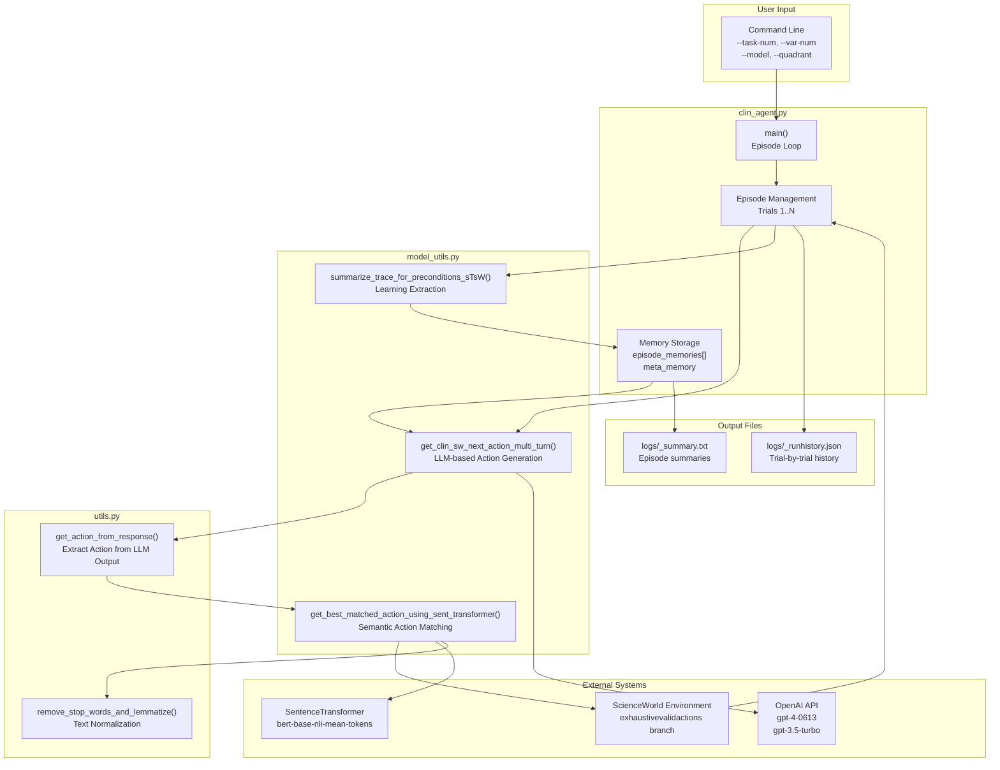
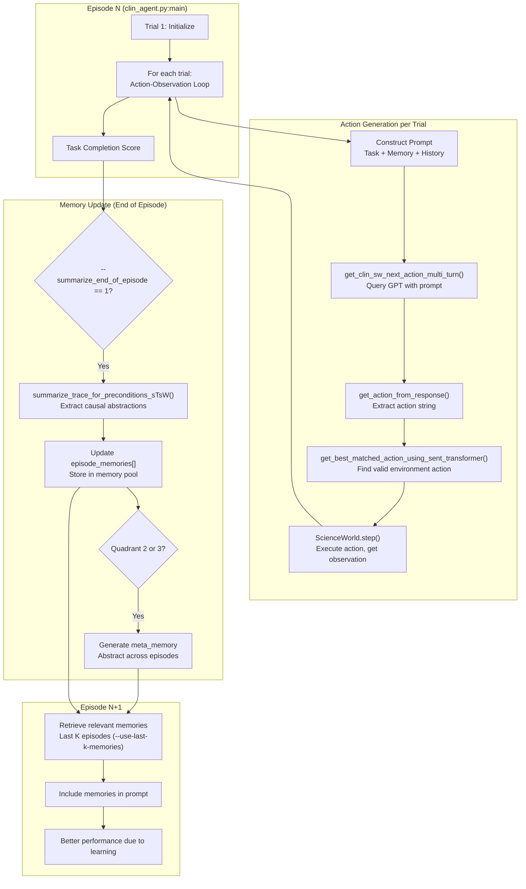

<!-- source: DeepWiki mcp.deepwiki.com · repo allenai/clin · page 1 Home · fetched 2026-10-26 -->

# Home

<details>
<summary>Relevant source files</summary>

The following files were used as context for generating this wiki page:

- [README.md](README.md)
- [index.html](index.html)
- [requirements.txt](requirements.txt)

</details>


## Purpose and Scope

This wiki documents the **CLIN (Continually Learning Language Agent)** codebase, a research system for rapid task adaptation and generalization using persistent textual memory. This home page provides an architectural overview and explains the core concepts. For installation instructions and running experiments, see [Getting Started](#2). For detailed technical documentation of individual components, see [System Architecture](#4). For research findings and results, see [Research and Results](#6).

---

## What is CLIN?

CLIN is a language-based agent that **continually learns without parameter updates**. Unlike traditional agents that require model fine-tuning or reinforcement learning, CLIN uses a **persistent, dynamic, textual memory** to accumulate knowledge across multiple trials and episodes. The agent operates in the ScienceWorld environment, performing complex scientific tasks such as growing plants, finding objects, or conducting experiments.

The system is implemented in Python and consists of three core modules:
- **`scienceworld/clin_agent.py`** - Agent orchestration, episode/trial management, and memory coordination
- **`scienceworld/model_utils.py`** - LLM integration, action generation, and learning summarization
- **`scienceworld/utils.py`** - Text processing utilities for action parsing and normalization

**Key Innovation**: CLIN learns by maintaining **causal abstractions** in memory (e.g., "moving to room X MAY BE NECESSARY to find object Y") rather than through model parameter updates, enabling rapid adaptation without retraining.

**Sources**: [README.md:1-11](), [index.html:150-157]()

---

## Core Problem and Solution

### Problem
Language agents powered by Large Language Models (LLMs) can interact with environments but typically:
1. Do not improve performance across multiple trials on the same task
2. Cannot transfer learned knowledge to new environments or tasks
3. Require expensive fine-tuning or reinforcement learning to adapt

### Solution
CLIN addresses these limitations through:

| Capability | Mechanism |
|------------|-----------|
| **Rapid Adaptation** | Accumulates episode memories encoding what actions helped/hindered success |
| **Cross-Task Transfer** | Generates meta-memories that abstract learnings for new tasks (Quadrant 3) |
| **Cross-Environment Transfer** | Reuses episode memories with environment-specific adaptations (Quadrant 2) |
| **No Parameter Updates** | All learning stored in textual memory, no model fine-tuning required |

CLIN outperforms state-of-the-art reflective agents (Reflexion) by **23 absolute points** on adaptation tasks and achieves **positive transfer learning** to new environments (+4 points) and tasks (+13 points).

**Sources**: [index.html:150-157](), [index.html:190-204]()

---

## System Architecture Overview

The following diagram shows CLIN's architecture with actual code file paths and primary functions:



**Sources**: [README.md:45-48]()

---

## Key Components

### 1. Agent Orchestrator (`clin_agent.py`)
The main entry point that manages the continual learning lifecycle:

- **Episode Loop**: Sequences of trials on the same or related tasks
- **Trial Execution**: Individual attempts at solving a task, accumulating observations and actions
- **Memory Management**: Stores and retrieves episode memories and meta-memories
- **History Tracking**: Records all actions, observations, rationales, and scores

The orchestrator coordinates between LLM-based decision making, environment interaction, and memory updates. For detailed documentation, see [Agent Orchestration](#4.2).

### 2. LLM Integration Layer (`model_utils.py`)
Interfaces with GPT models to generate actions and extract learnings:

- **`get_clin_sw_next_action_multi_turn()`**: Multi-turn conversation with LLM to generate next action given task, memory, and history
- **`get_best_matched_action_using_sent_transformer()`**: Semantic matching to find the closest valid environment action to LLM output
- **`summarize_trace_for_preconditions_sTsW()`**: Extracts causal abstractions from successful/failed trials

For implementation details, see [LLM Integration Layer](#4.3) and [Learning and Summarization System](#4.5).

### 3. Text Processing Utilities (`utils.py`)
Helper functions for action parsing and text normalization:

- **`get_action_from_response()`**: Extracts structured action from LLM's natural language response
- **`remove_stop_words_and_lemmatize()`**: Normalizes text for semantic matching

For complete documentation, see [Text Processing Utilities](#7.2).

### 4. External Dependencies

| Dependency | Purpose | Configuration |
|------------|---------|---------------|
| OpenAI API | GPT-3.5/GPT-4 for action generation and summarization | Requires `OPENAI_API_KEY` environment variable |
| ScienceWorld | Interactive text-based scientific tasks | Must clone from `allenai/ScienceWorld` repo, `exhaustivevalidactions` branch |
| SentenceTransformer | Semantic similarity for action matching | Downloads `bert-base-nli-mean-tokens` model automatically |
| tiktoken | Token counting for prompt management | Installed via pip |

**Sources**: [README.md:13-36](), [requirements.txt:1-4]()

---

## Continual Learning Workflow

The following diagram illustrates CLIN's learning cycle with specific code functions:



### Memory Structure

CLIN's memory consists of **causal abstractions** with the following semantic structure:

```
[Action X] [Relation] [Goal Y]

Relations:
- MAY BE NECESSARY to
- SHOULD BE NECESSARY to  
- DOES NOT CONTRIBUTE to

Confidence Levels:
- MAY: Low confidence (from limited observations)
- SHOULD: High confidence (from repeated observations)
```

**Example Memory Entries**:
- "Moving to the kitchen MAY BE NECESSARY to find seeds"
- "Opening the door SHOULD BE NECESSARY to move between rooms"
- "Reading the thermometer DOES NOT CONTRIBUTE to growing a plant"

For detailed explanation of memory architecture and causal abstractions, see [Memory Architecture](#3.2) and [Causal Abstractions](#3.3).

**Sources**: [index.html:172-177](), [index.html:184-188]()

---

## Evaluation Quadrants

CLIN is evaluated across three scenarios that test different aspects of continual learning:

| Quadrant | Scenario | Memory Strategy |
|----------|----------|-----------------|
| **Q1: Adaptation** | Same task, same environment variant across trials | Use episode memories from recent trials directly |
| **Q2: Cross-Environment** | Same task, different environment variants across episodes | Generate meta-memory abstracting common patterns |
| **Q3: Cross-Task** | Different tasks across episodes | Generate meta-memory with high-level task strategies |

The `--quadrant` command-line argument controls which evaluation mode is used. For detailed results and performance metrics, see [Evaluation Quadrants](#3.4) and [Research and Results](#6).

**Sources**: [README.md:47](), [index.html:195-204]()

---

## Research Context

CLIN was developed by researchers at the Allen Institute for AI (AI2), University of Arizona, and University of Pennsylvania. The system demonstrates:

- **23-point improvement** over Reflexion on adaptation tasks (Quadrant 1)
- **4-point zero-shot transfer** to new environments (Quadrant 2)
- **13-point zero-shot transfer** to new tasks (Quadrant 3)
- **17-point additional gain** from continued adaptation after transfer (Q2)

The research is published on arXiv and includes:
- **Paper**: [https://arxiv.org/pdf/2310.10134.pdf](https://arxiv.org/pdf/2310.10134.pdf)
- **Project Website**: [https://allenai.github.io/clin/](https://allenai.github.io/clin)
- **Code Repository**: [https://github.com/allenai/clin](https://github.com/allenai/clin)

The project website (`index.html`) contains additional visualizations, architecture diagrams, and result charts. For related work and comparison with other systems (Voyager, ExpeL, Reflexion), see [Related Work](#6.5).

**Sources**: [index.html:1-252](), [README.md:1-9](), [README.md:50-58]()

---

## Getting Started

To begin using CLIN:

1. **Prerequisites**: Install Java 1.8+, Python 3.8, and obtain an OpenAI API key (see [Prerequisites](#2.1))
2. **Installation**: Set up the Python environment and clone ScienceWorld (see [Installation](#2.2))
3. **Run First Experiment**: Execute the example command to run a test trial (see [Quick Start Example](#2.3))

**Example Command**:
```bash
python scienceworld/clin_agent.py \
  --task-num "4" \
  --var-num 1 \
  --env-step-limit 2 \
  --num-episodes 1 \
  --gpt-model "gpt-4-0613" \
  --summarize_end_of_episode 1 \
  --device "cpu" \
  --temperature 0.0 \
  --use-gold-memory-in-ep0 0 \
  --gold-traces "" \
  --use-last-k-memories 3 \
  --quadrant 1 \
  --simplifications-preset "easy" \
  --output-path-prefix logs/testrun/
```

For complete command-line argument documentation, see [Command-Line Arguments Reference](#5.1).

**Sources**: [README.md:13-48]()

---

## Repository Structure

The repository contains two primary layers:

### Execution Layer (Core System)
- **`scienceworld/clin_agent.py`** - Main agent orchestrator (importance: 21.29)
- **`scienceworld/model_utils.py`** - LLM and action utilities (importance: 4.25)
- **`scienceworld/utils.py`** - Text processing helpers (importance: 2.25)
- **`requirements.txt`** - Python dependencies
- **`README.md`** - Setup and usage instructions
- **`.gitignore`** - Repository configuration

### Presentation Layer (Research Website)
- **`index.html`** - Project website with abstract, results, and visualizations (importance: 11.11)
- **`static/`** - CSS styles, JavaScript, images, and video assets
- **`static/images/`** - Architecture diagrams, result charts, and logos

For detailed code structure and developer guidance, see [Code Structure](#7.1) and [Developer Guide](#7).

**Sources**: [README.md:1-59](), [index.html:1-252]()

---

## Next Steps

- **To install and run CLIN**: Proceed to [Getting Started](#2)
- **To understand core concepts**: Read [Core Concepts](#3) for continual learning theory
- **To explore implementation details**: See [System Architecture](#4)
- **To run experiments**: Consult [Usage Guide](#5)
- **To review research findings**: See [Research and Results](#6)
- **To extend or modify CLIN**: Read [Developer Guide](#7)

---

