<!-- source: DeepWiki mcp.deepwiki.com · repo allenai/clin · page 5.2 Running Experiments · fetched 2026-10-26 -->

# Running Experiments

<details>
<summary>Relevant source files</summary>

The following files were used as context for generating this wiki page:

- [README.md](README.md)
- [requirements.txt](requirements.txt)
- [scienceworld/clin_agent.py](scienceworld/clin_agent.py)

</details>


This page provides practical guidance for executing CLIN experiments in the ScienceWorld environment. It covers experiment setup, configuration patterns, and execution workflows for different evaluation scenarios.

For detailed information about individual command-line arguments, see [Command-Line Arguments Reference](#5.1). For specifics on gold trace usage, see [Gold Traces and Memory Initialization](#5.3). For understanding experiment outputs, see [Understanding Output Files](#5.4).

---

## Basic Experiment Execution

A CLIN experiment is executed by running `clin_agent.py` with appropriate command-line arguments. The minimal command structure requires specifying the task, model, device, and evaluation quadrant.

**Basic Command Structure**

```bash
python scienceworld/clin_agent.py \
  --task-num <task_id> \
  --var-num <variation_id> \
  --gpt-model <model_name> \
  --device <device> \
  --quadrant <quadrant_number>
```

**Example Minimal Experiment**

```bash
python scienceworld/clin_agent.py \
  --task-num "4" \
  --var-num 1 \
  --gpt-model "gpt-4-0613" \
  --device "cpu" \
  --quadrant 1 \
  --output-path-prefix logs/test/
```

The agent executes through the following high-level flow:

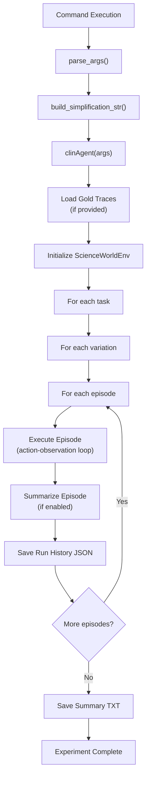

**Sources:** [README.md:45-48](), [scienceworld/clin_agent.py:17-393](), [scienceworld/clin_agent.py:419-470](), [scienceworld/clin_agent.py:473-482]()

---

## Experiment Types: Evaluation Quadrants

CLIN experiments are organized into three evaluation quadrants that determine how memory is utilized and what type of learning is being tested. The quadrant parameter fundamentally changes the experimental setup.

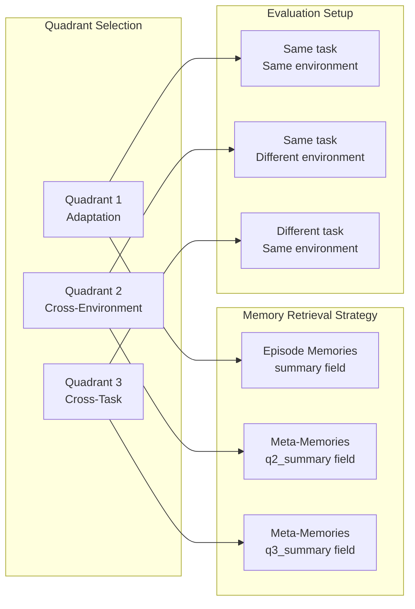

| Quadrant | Evaluation Type | Memory Used | Typical Use Case |
|----------|----------------|-------------|------------------|
| 1 | Adaptation | `summary` | Learning within a single task-environment combination |
| 2 | Cross-Environment | `q2_summary` | Generalizing task knowledge to new environments |
| 3 | Cross-Task | `q3_summary` | Transferring knowledge to different tasks |

**Quadrant Implementation Details**

The quadrant parameter affects memory loading in `clinAgent()`:

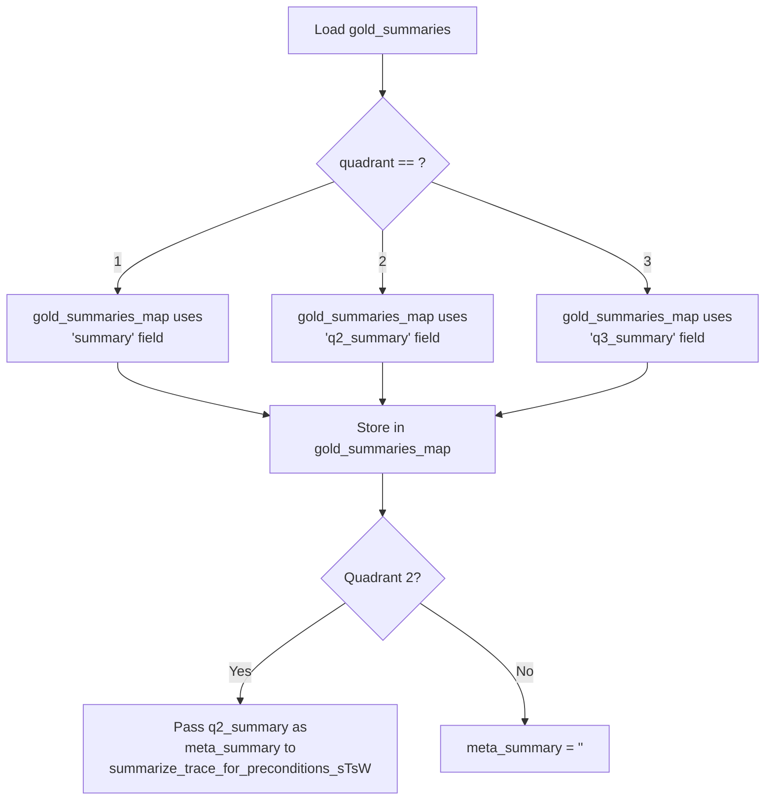

**Example Commands by Quadrant**

Quadrant 1 (Adaptation):
```bash
python scienceworld/clin_agent.py \
  --task-num "4" --var-num 1 \
  --num-episodes 5 \
  --quadrant 1 \
  --use-last-k-memories 3 \
  --gpt-model "gpt-4-0613" --device "cpu"
```

Quadrant 2 (Cross-Environment):
```bash
python scienceworld/clin_agent.py \
  --task-num "4" --var-num 2 \
  --num-episodes 3 \
  --quadrant 2 \
  --gold-traces path/to/q2_gold_traces.json \
  --use-gold-memory-in-ep0 1 \
  --gpt-model "gpt-4-0613" --device "cpu"
```

Quadrant 3 (Cross-Task):
```bash
python scienceworld/clin_agent.py \
  --task-num "8" --var-num 0 \
  --num-episodes 3 \
  --quadrant 3 \
  --gold-traces path/to/q3_gold_traces.json \
  --gpt-model "gpt-4-0613" --device "cpu"
```

**Sources:** [scienceworld/clin_agent.py:51-73](), [scienceworld/clin_agent.py:352-354](), [scienceworld/clin_agent.py:446-450]()

---

## Configuring Task and Variation

ScienceWorld provides multiple tasks, each with multiple variations. Task and variation selection determines what specific problem the agent attempts to solve.

**Task and Variation Loop Structure**

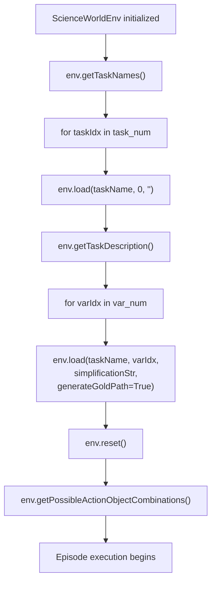

**Retrieving Available Tasks**

The agent retrieves task names at runtime:


**Task Selection Examples**

Single task, single variation:
```bash
python scienceworld/clin_agent.py \
  --task-num "4" \
  --var-num 1 \
  --num-episodes 3
```

The code structure uses list comprehension that allows future extension to multiple tasks/variations, but the current implementation focuses on single task-variation pairs:

| Code Location | Purpose |
|---------------|---------|
| [clin_agent.py:97](scienceworld/clin_agent.py:97-98)() | `for taskIdx in [task_num]:` - Task loop |
| [clin_agent.py:104](scienceworld/clin_agent.py:104)() | `for varIdx in [var_num]:` - Variation loop |
| [clin_agent.py:99-102](scienceworld/clin_agent.py:99-102)() | Task name retrieval and loading |

**Sources:** [scienceworld/clin_agent.py:91-127](), [scienceworld/clin_agent.py:424-427]()

---

## Episode Configuration

Episodes are the core unit of continual learning in CLIN. Each episode represents a complete attempt at solving the task, and the agent learns across episodes by accumulating and reusing memory.

**Episode Loop and Memory Flow**

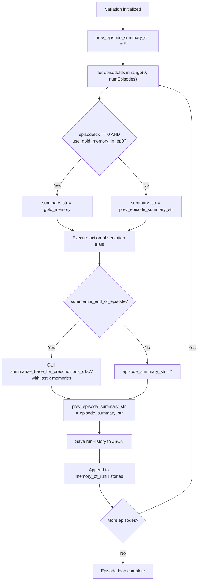

**Episode Configuration Parameters**

| Parameter | Type | Purpose | Typical Values |
|-----------|------|---------|----------------|
| `--num-episodes` | int | Number of episodes to run | 1 (testing), 3-5 (evaluation) |
| `--env-step-limit` | int | Maximum steps per episode | 100 (default), 2 (quick test) |
| `--use-gold-memory-in-ep0` | int (bool) | Bootstrap episode 0 with gold memory | 0 or 1 |
| `--summarize_end_of_episode` | int (bool) | Generate learnings after each episode | 0 or 1 |

**Episode Configurations**

Single Episode (No Learning):
```bash
python scienceworld/clin_agent.py \
  --task-num "4" --var-num 1 \
  --num-episodes 1 \
  --summarize_end_of_episode 0 \
  --env-step-limit 100 \
  --gpt-model "gpt-4-0613" --device "cpu" --quadrant 1
```

Multi-Episode with Learning:
```bash
python scienceworld/clin_agent.py \
  --task-num "4" --var-num 1 \
  --num-episodes 5 \
  --summarize_end_of_episode 1 \
  --use-last-k-memories 3 \
  --env-step-limit 100 \
  --gpt-model "gpt-4-0613" --device "cpu" --quadrant 1
```

Gold-Bootstrapped Learning:
```bash
python scienceworld/clin_agent.py \
  --task-num "4" --var-num 1 \
  --num-episodes 5 \
  --use-gold-memory-in-ep0 1 \
  --gold-traces path/to/gold_traces/ \
  --summarize_end_of_episode 1 \
  --gpt-model "gpt-4-0613" --device "cpu" --quadrant 1
```

**Sources:** [scienceworld/clin_agent.py:109-363](), [scienceworld/clin_agent.py:430-435](), [scienceworld/clin_agent.py:440-445]()

---

## Memory and Learning Settings

CLIN's continual learning depends on proper memory configuration. These settings control how the agent accumulates and utilizes knowledge across episodes.

**Memory System Flow**

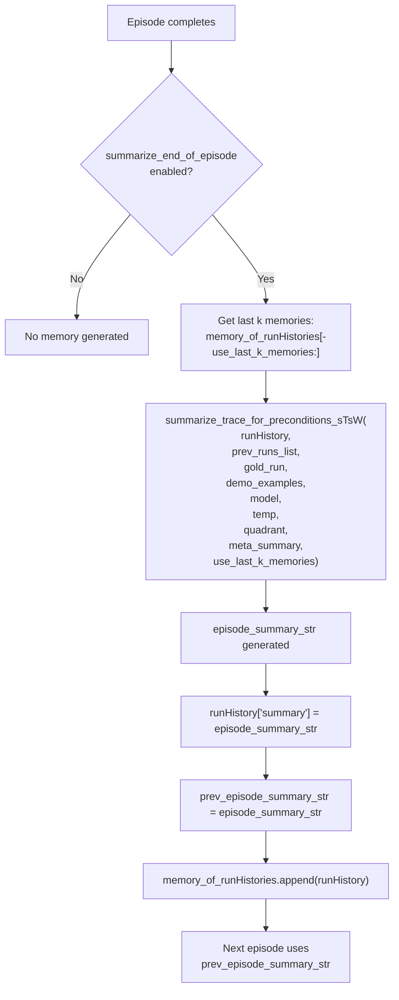

**Key Memory Parameters**

| Parameter | Function | Impact |
|-----------|----------|--------|
| `--summarize_end_of_episode` | Controls memory generation | 0 = no learning, 1 = generate learnings |
| `--use-last-k-memories` | Number of recent episodes to reference | Typical: 3, affects summarization context |
| `--use-gold-memory-in-ep0` | Bootstrap with gold trace memory | Only applies to episode 0 |
| `--gold-traces` | Path to gold trace files | Required if using gold memory |

**Memory Usage by Episode**

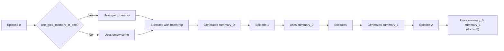

**Memory Configuration Examples**

No Learning (Testing):
```bash
python scienceworld/clin_agent.py \
  --task-num "4" --var-num 1 \
  --num-episodes 1 \
  --summarize_end_of_episode 0 \
  --gpt-model "gpt-4-0613" --device "cpu" --quadrant 1
```

Full Continual Learning:
```bash
python scienceworld/clin_agent.py \
  --task-num "4" --var-num 1 \
  --num-episodes 5 \
  --summarize_end_of_episode 1 \
  --use-last-k-memories 3 \
  --gpt-model "gpt-4-0613" --device "cpu" --quadrant 1
```

Bootstrap with Gold Memory:
```bash
python scienceworld/clin_agent.py \
  --task-num "4" --var-num 1 \
  --num-episodes 5 \
  --use-gold-memory-in-ep0 1 \
  --gold-traces gold_traces/task4_var1.json \
  --summarize_end_of_episode 1 \
  --use-last-k-memories 3 \
  --gpt-model "gpt-4-0613" --device "cpu" --quadrant 1
```

**Quadrant-Specific Memory Handling**

For Quadrant 2 (cross-environment), the Q2 meta-summary is passed to the summarization function:

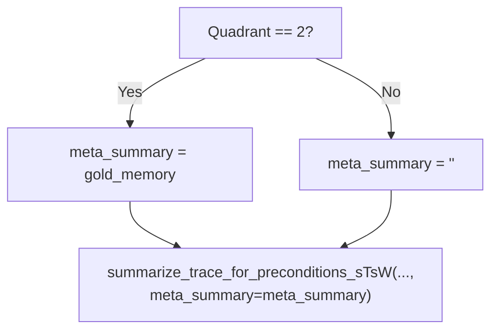

**Sources:** [scienceworld/clin_agent.py:343-356](), [scienceworld/clin_agent.py:444-445](), [scienceworld/clin_agent.py:184-188]()

---

## Output Organization

CLIN generates structured outputs for each experiment, organized by task, variation, and episode. Understanding the output structure is essential for analyzing results and debugging experiments.

**Output File Structure**

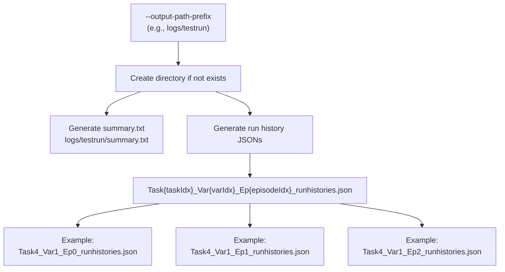

**Filename Generation Code Flow**

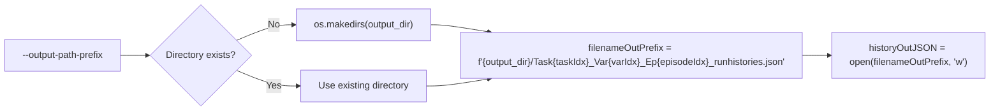

**Output File Organization Table**

| File Type | Naming Pattern | Content | Generated When |
|-----------|----------------|---------|----------------|
| Summary | `summary.txt` | Final scores, completion status for all episodes | Once per experiment |
| Run History | `Task{T}_Var{V}_Ep{E}_runhistories.json` | Detailed episode trace with actions, observations, rationales | Per episode |

**Example Output Directory Structure**

```
logs/testrun/
├── summary.txt
├── Task4_Var1_Ep0_runhistories.json
├── Task4_Var1_Ep1_runhistories.json
├── Task4_Var1_Ep2_runhistories.json
└── Task4_Var1_Ep3_runhistories.json
```

**Specifying Output Paths**

Default behavior (creates `save-histories/` in current directory):
```bash
python scienceworld/clin_agent.py \
  --task-num "4" --var-num 1 \
  --gpt-model "gpt-4-0613" --device "cpu" --quadrant 1
```

Custom output directory:
```bash
python scienceworld/clin_agent.py \
  --task-num "4" --var-num 1 \
  --output-path-prefix logs/experiment_q1_task4/ \
  --gpt-model "gpt-4-0613" --device "cpu" --quadrant 1
```

Organizing by experiment type:
```bash
# Quadrant 1 experiments
--output-path-prefix logs/q1_adaptation/task4_var1/

# Quadrant 2 experiments
--output-path-prefix logs/q2_crossenv/task4_var2/

# Ablation studies
--output-path-prefix logs/ablation/no_memory/
```

**Sources:** [scienceworld/clin_agent.py:85-90](), [scienceworld/clin_agent.py:115-116](), [scienceworld/clin_agent.py:451-452]()

---

## Common Experiment Patterns

This section provides practical command templates for common experimental scenarios.

**Quick Test Run (Minimal Steps)**

For rapid testing and debugging:

```bash
python scienceworld/clin_agent.py \
  --task-num "4" \
  --var-num 1 \
  --env-step-limit 2 \
  --num-episodes 1 \
  --gpt-model "gpt-3.5-turbo" \
  --summarize_end_of_episode 0 \
  --device "cpu" \
  --temperature 0.0 \
  --use-gold-memory-in-ep0 0 \
  --gold-traces "" \
  --use-last-k-memories 3 \
  --quadrant 1 \
  --simplifications-preset "easy" \
  --output-path-prefix logs/quicktest/
```

Key settings: `--env-step-limit 2`, `--num-episodes 1`, `--summarize_end_of_episode 0` minimize execution time.

**Full Evaluation Run (Publication Settings)**

For replicating paper results:

```bash
python scienceworld/clin_agent.py \
  --task-num "4" \
  --var-num 1 \
  --env-step-limit 100 \
  --num-episodes 5 \
  --gpt-model "gpt-4-0613" \
  --summarize_end_of_episode 1 \
  --device "cpu" \
  --temperature 0.0 \
  --use-gold-memory-in-ep0 0 \
  --gold-traces "" \
  --use-last-k-memories 3 \
  --quadrant 1 \
  --simplifications-preset "easy" \
  --output-path-prefix logs/eval_q1_task4_var1/
```

**Experiment Pattern Comparison**

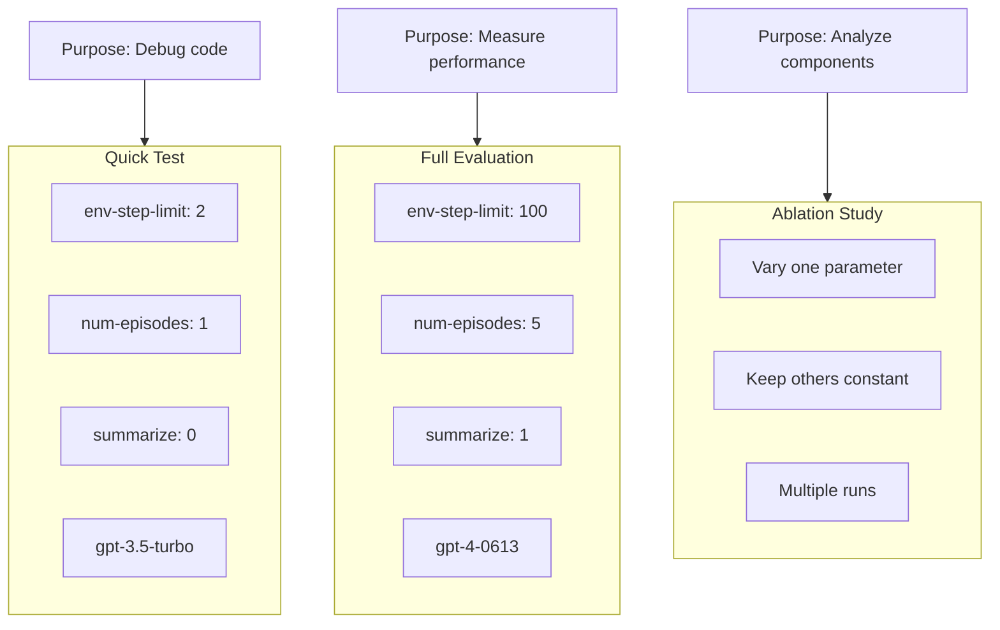

**Ablation Study: Memory Window Size**

Testing different values of `--use-last-k-memories`:

```bash
# k=1
python scienceworld/clin_agent.py \
  --task-num "4" --var-num 1 \
  --use-last-k-memories 1 \
  --num-episodes 5 \
  --output-path-prefix logs/ablation_k1/ \
  [... other standard args ...]

# k=3
python scienceworld/clin_agent.py \
  --task-num "4" --var-num 1 \
  --use-last-k-memories 3 \
  --num-episodes 5 \
  --output-path-prefix logs/ablation_k3/ \
  [... other standard args ...]

# k=5
python scienceworld/clin_agent.py \
  --task-num "4" --var-num 1 \
  --use-last-k-memories 5 \
  --num-episodes 5 \
  --output-path-prefix logs/ablation_k5/ \
  [... other standard args ...]
```

**Ablation Study: Gold Memory Impact**

Testing with and without gold memory bootstrapping:

```bash
# Without gold memory
python scienceworld/clin_agent.py \
  --task-num "4" --var-num 1 \
  --use-gold-memory-in-ep0 0 \
  --gold-traces "" \
  --num-episodes 5 \
  --output-path-prefix logs/ablation_no_gold/ \
  [... other standard args ...]

# With gold memory
python scienceworld/clin_agent.py \
  --task-num "4" --var-num 1 \
  --use-gold-memory-in-ep0 1 \
  --gold-traces gold_traces/task4_var1.json \
  --num-episodes 5 \
  --output-path-prefix logs/ablation_with_gold/ \
  [... other standard args ...]
```

**Model Comparison**

Testing GPT-3.5 vs GPT-4:

```bash
# GPT-3.5-turbo
python scienceworld/clin_agent.py \
  --gpt-model "gpt-3.5-turbo" \
  --output-path-prefix logs/gpt35_task4/ \
  [... other standard args ...]

# GPT-4-0613
python scienceworld/clin_agent.py \
  --gpt-model "gpt-4-0613" \
  --output-path-prefix logs/gpt4_task4/ \
  [... other standard args ...]
```

**Temperature Exploration**

Testing different temperature settings:

```bash
# Deterministic (temperature = 0.0)
python scienceworld/clin_agent.py \
  --temperature 0.0 \
  --output-path-prefix logs/temp00/ \
  [... other standard args ...]

# Moderate randomness (temperature = 0.3)
python scienceworld/clin_agent.py \
  --temperature 0.3 \
  --output-path-prefix logs/temp03/ \
  [... other standard args ...]
```

**Batch Experiment Script Pattern**

For running multiple experiments systematically:

```bash
#!/bin/bash

# Experiment configuration
TASKS=(4 5 6)
VARS=(0 1 2)
QUADRANTS=(1 2 3)
OUTPUT_BASE="logs/batch_experiments"

# Loop through configurations
for task in "${TASKS[@]}"; do
  for var in "${VARS[@]}"; do
    for quad in "${QUADRANTS[@]}"; do
      OUTPUT_DIR="${OUTPUT_BASE}/Q${quad}_T${task}_V${var}"
      
      echo "Running: Task=$task, Var=$var, Quadrant=$quad"
      
      python scienceworld/clin_agent.py \
        --task-num "$task" \
        --var-num "$var" \
        --quadrant "$quad" \
        --num-episodes 5 \
        --env-step-limit 100 \
        --gpt-model "gpt-4-0613" \
        --device "cpu" \
        --temperature 0.0 \
        --summarize_end_of_episode 1 \
        --use-last-k-memories 3 \
        --simplifications-preset "easy" \
        --output-path-prefix "$OUTPUT_DIR/"
        
      echo "Completed: $OUTPUT_DIR"
    done
  done
done

echo "All experiments complete"
```

**Sources:** [README.md:45-48](), [scienceworld/clin_agent.py:432-439]()

---

## Monitoring Experiment Progress

CLIN provides console output for monitoring experiment execution in real-time.

**Console Output Structure**

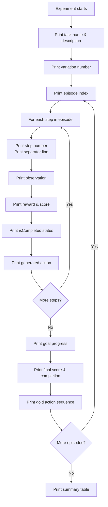

**Key Console Output Points**

| Output Location | Information Displayed | Code Reference |
|----------------|----------------------|----------------|
| Episode start | Task name, variation, description | [clin_agent.py:125-127](scienceworld/clin_agent.py:125-127)() |
| Each step | Step number, separator line | [clin_agent.py:155-156](scienceworld/clin_agent.py:155-156)() |
| After action | Observation, reward, score, completion | [clin_agent.py:173-176](scienceworld/clin_agent.py:173-176)() |
| Action generation | GPT-generated action, rationale | [clin_agent.py:215-216](scienceworld/clin_agent.py:215-216)() |
| Action matching | Best match action, top-N candidates | [clin_agent.py:272-277](scienceworld/clin_agent.py:272-277)() |
| Episode end | Goal progress, final score, gold path | [clin_agent.py:296-317](scienceworld/clin_agent.py:296-317)() |
| Experiment end | Summary table of all episodes | [clin_agent.py:368-392](scienceworld/clin_agent.py:368-392)() |

**Example Console Output Flow**

```
Task Name: task-4-boil
Task Variation: 1
Task Description: Your task is to boil water. [...]

----------------------------------------------------------------
Step: 0
>>> You are in a kitchen. [observation text...]
Reward: 0.0
Score: 0.0
isCompleted: False
GPT4 generated action: pick up pot
Reasoning rationale: [reasoning text...]
Next ChatGPT action: pick up pot
Next ChatGPT action (mapped): pick up pot from counter

----------------------------------------------------------------
Step: 1
[continues...]
```

**Experiment Completion Summary**

The final summary table format:

```
---------------------------------------------------------------------
 Summary (ChatGPT Agent)
 Simplifications: easy
---------------------------------------------------------------------
task    Name            var    epi    score    complete?
4       task-4-boil     1      0      0.5      False
4       task-4-boil     1      1      0.7      False
4       task-4-boil     1      2      1.0      True
---------------------------------------------------------------------
```

**Sources:** [scienceworld/clin_agent.py:155-277](), [scienceworld/clin_agent.py:296-317](), [scienceworld/clin_agent.py:368-392]()

---

