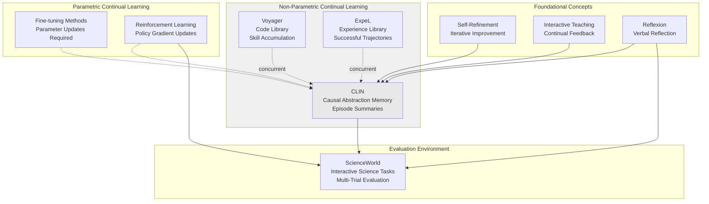
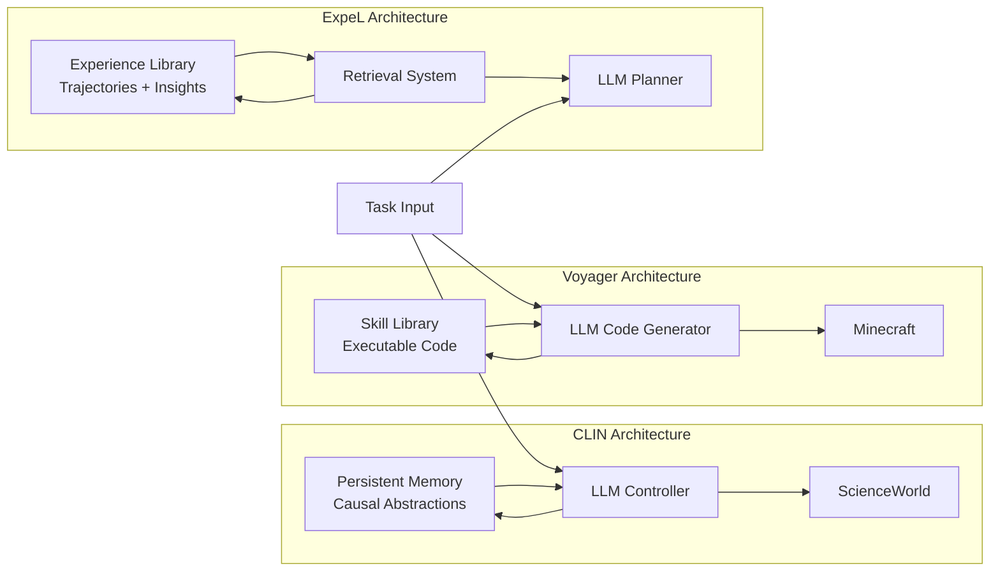
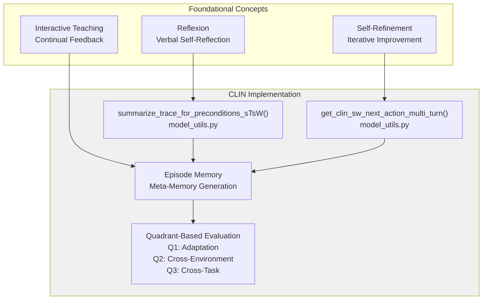
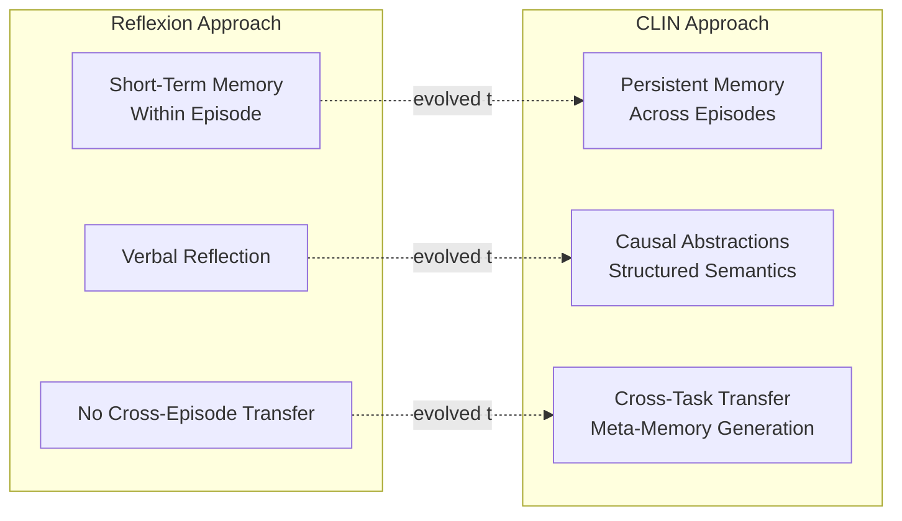
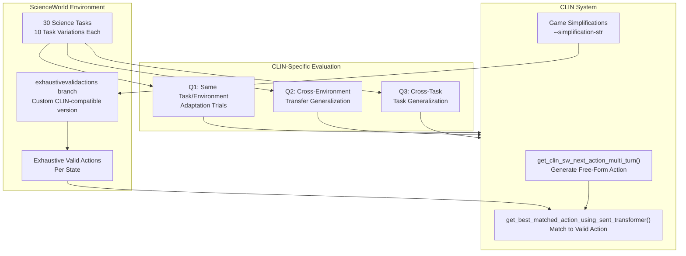
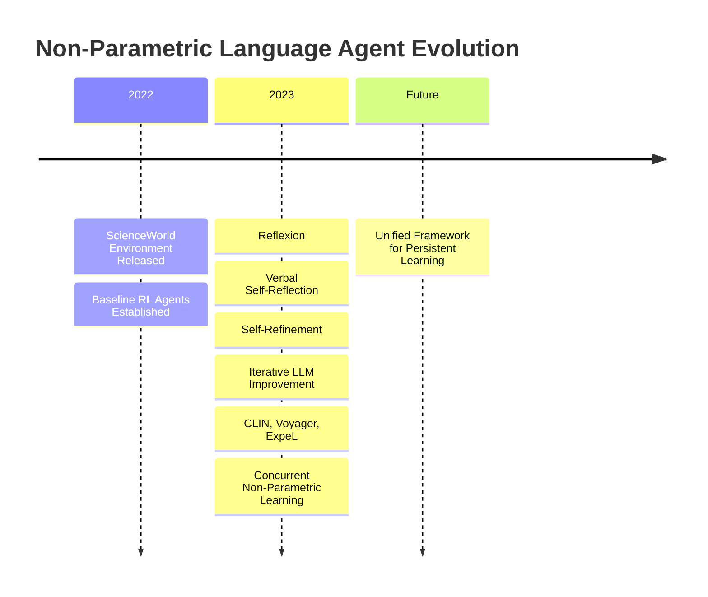

<!-- source: DeepWiki mcp.deepwiki.com · repo allenai/clin · page 6.5 Related Work · fetched 2026-10-26 -->

# Related Work

Relevant source files

The following files were used as context for generating this wiki page:

- [index.html](index.html)

## Purpose and Scope

This page positions CLIN within the broader research landscape of continually learning language agents, describing related systems and approaches that share similar goals or methodologies. It focuses on the relationship between CLIN and concurrent work (Voyager, ExpeL), foundational concepts (interactive learning, self-refinement), and the evaluation framework (ScienceWorld). For CLIN's specific implementation details, see [System Architecture](#4). For empirical comparisons with specific baselines, see [Comparison with Baselines](#6.4).

---

## Research Landscape Overview

CLIN operates at the intersection of three research areas: **continual learning without parameter updates**, **language-based agents**, and **interactive task learning**. The following diagram illustrates how different systems approach these problems:

### Diagram: Continual Learning Approaches for Language Agents

**Sources:** [index.html:205-208]()

| System | Learning Type | Memory Structure | Domain | Transfer Capability |
|--------|---------------|------------------|---------|---------------------|
| **CLIN** | Non-parametric | Causal abstractions with confidence levels | Science tasks | Cross-environment, cross-task |
| **Voyager** | Non-parametric | Code library of skills | Minecraft | Within-domain skill composition |
| **ExpeL** | Non-parametric | Successful trajectory library | Various | Experience retrieval and reuse |
| **Reflexion** | In-context | Short-term verbal reflections | Various | Limited (within episode) |
| **RL Agents** | Parametric | Neural network weights | Science tasks | Requires retraining |

---

## Concurrent Non-Parametric Systems

CLIN shares the core philosophy of non-parametric continual learning with two concurrent systems, but differs in memory representation and learning scope.

### Diagram: Non-Parametric Learning Architectures Comparison

**Sources:** [index.html:207]()

### Voyager

**Concurrent Work**: Voyager (Wang et al., 2023) operates in Minecraft, accumulating a library of executable code skills. Key differences from CLIN:

- **Memory Representation**: Code functions vs. causal abstractions
- **Granularity**: Low-level motor skills vs. high-level causal relationships
- **Domain**: Open-world exploration vs. goal-directed science tasks
- **Compositionality**: Skill chaining vs. causal reasoning

### ExpeL

**Concurrent Work**: ExpeL (Zhao et al., 2023) maintains a library of successful experiences with extracted insights. Key differences from CLIN:

- **Memory Content**: Full trajectories vs. causal abstractions
- **Abstraction Level**: Experience retrieval vs. semantic generalization
- **Update Mechanism**: Library augmentation vs. memory revision with confidence levels
- **Memory Structure**: Flat experience pool vs. hierarchical (episodes + meta-memories)

**Sources:** [index.html:207]()

---

## Foundational Concepts

CLIN builds on three foundational concepts from prior work, with specific implementation choices reflected in the codebase.

### Diagram: CLIN's Foundations Mapped to Implementation

**Sources:** [index.html:207-208]()

### Self-Refinement

**Foundation**: Large language models can iteratively improve their outputs through self-critique (Madaan et al., 2023). CLIN extends this to multi-trial learning:

| Concept | CLIN Implementation | Code Location |
|---------|---------------------|---------------|
| Iterative improvement | Multi-turn conversation with history | [model_utils.py:get_clin_sw_next_action_multi_turn]() |
| Self-critique | Episode summarization and learning extraction | [model_utils.py:summarize_trace_for_preconditions_sTsW]() |
| Refinement persistence | Memory updates across trials | [clin_agent.py]() memory management |

**Key Difference**: While self-refinement operates within a single session, CLIN persists learnings across episodes and trials, enabling true continual improvement.

### Interactive Teaching Systems

**Foundation**: Prior work on interactive teaching with continual feedback (Allen AI's earlier research) demonstrated that agents can improve through human guidance. CLIN automates this process:

| Interactive Teaching | CLIN Equivalent |
|---------------------|-----------------|
| Human feedback | LLM self-reflection on trial outcomes |
| Teachable moments | End-of-trial summarization |
| Knowledge accumulation | Persistent memory with episode summaries |
| Curriculum learning | Quadrant-based evaluation (Q1 → Q2 → Q3) |

**Implementation Note**: CLIN's memory generation process [model_utils.py:summarize_trace_for_preconditions_sTsW]() functions as an automated "teacher" that extracts learnings after each trial.

### Reflexion

**Foundation**: Reflexion (Shinn et al., 2023) introduced verbal self-reflection for language agents. CLIN advances this in several dimensions:

**Empirical Comparison**: CLIN outperforms Reflexion by 23 absolute points on adaptation tasks (see [Comparison with Baselines](#6.4)). The key architectural differences:

| Feature | Reflexion | CLIN |
|---------|-----------|------|
| Memory scope | Single episode | Multiple episodes |
| Memory structure | Unstructured text | Causal abstractions (necessary/does not contribute) |
| Confidence modeling | None | Linguistic uncertainty (may/should) |
| Transfer mechanism | None | Meta-memory for generalization |
| Code implementation | External to CLIN | [model_utils.py:summarize_trace_for_preconditions_sTsW]() |

**Sources:** [index.html:192](), [index.html:207]()

---

## ScienceWorld Evaluation Framework

CLIN is evaluated in **ScienceWorld** (Jansen et al., 2022), an interactive text-based environment for science tasks. The relationship between CLIN and ScienceWorld:

### Diagram: CLIN-ScienceWorld Integration

**Sources:** [index.html:207](), README (implied by ScienceWorld references)

| Aspect | ScienceWorld Baseline | CLIN's Use |
|--------|----------------------|------------|
| Environment version | Main branch | `exhaustivevalidactions` branch |
| Action validation | Manual validation | Semantic matching with SentenceTransformer |
| Evaluation paradigm | Single-episode success | Multi-trial continual learning |
| Task variations | Fixed variations | Cross-environment and cross-task evaluation |
| Simplifications | Standard settings | Configurable via `--simplification-str` |

**Key Integration Point**: CLIN requires the `exhaustivevalidactions` branch because [model_utils.py:get_best_matched_action_using_sent_transformer]() needs access to all valid actions for semantic matching. This differs from typical ScienceWorld usage where agents must discover valid actions.

---

## CLIN's Unique Contributions

The following table summarizes how CLIN distinguishes itself from related work:

| Dimension | Related Work | CLIN Innovation | Code Implementation |
|-----------|--------------|-----------------|---------------------|
| **Memory Semantics** | Unstructured text (Reflexion) or code (Voyager) | Causal abstractions with linguistic confidence | [model_utils.py:summarize_trace_for_preconditions_sTsW]() |
| **Learning Scope** | Within-episode (Reflexion) or domain-specific (Voyager) | Cross-environment and cross-task | Quadrant evaluation in [clin_agent.py]() |
| **Memory Update** | Append-only (ExpeL) | Revision with confidence updates | Memory management in [clin_agent.py]() |
| **Transfer Mechanism** | None (Reflexion) or implicit (Voyager) | Explicit meta-memory generation | Meta-memory prompts in [model_utils.py]() |
| **Action Validation** | Direct execution | Semantic matching to valid actions | [model_utils.py:get_best_matched_action_using_sent_transformer]() |
| **Evaluation Framework** | Single metrics | Three-quadrant continual learning | Episode loop in [clin_agent.py]() |

**Sources:** [index.html:151-156](), [index.html:207]()

---

## Research Context and Timeline

CLIN (Majumder et al., 2023) was developed concurrently with Voyager and ExpeL in 2023, representing a convergence of thinking about non-parametric continual learning for language agents:

This convergence suggests that **persistent textual memory** represents a promising direction for enabling continual learning in frozen language models, complementing parametric approaches like fine-tuning.

**Sources:** [index.html:207]()

---

## Further Reading

The project website [index.html:205-208]() provides links to:
- **Voyager**: [https://voyager.minedojo.org/](https://voyager.minedojo.org)
- **ExpeL**: [https://arxiv.org/pdf/2308.10144.pdf](https://arxiv.org/pdf/2308.10144.pdf)
- **Interactive Teaching**: Allen AI blog post on teachable reasoning systems
- **Self-Refinement**: [https://selfrefine.info/](https://selfrefine.info)
- **ScienceWorld**: [https://sciworld.apps.allenai.org/](https://sciworld.apps.allenai.org)

For CLIN's specific research contributions and empirical results, see:
- [Research Overview](#6.1): High-level contribution summary
- [Rapid Adaptation Results](#6.2): Q1 performance metrics
- [Generalization Performance](#6.3): Q2 and Q3 transfer results
- [Comparison with Baselines](#6.4): Head-to-head comparisons

**Sources:** [index.html:205-208]()

---

