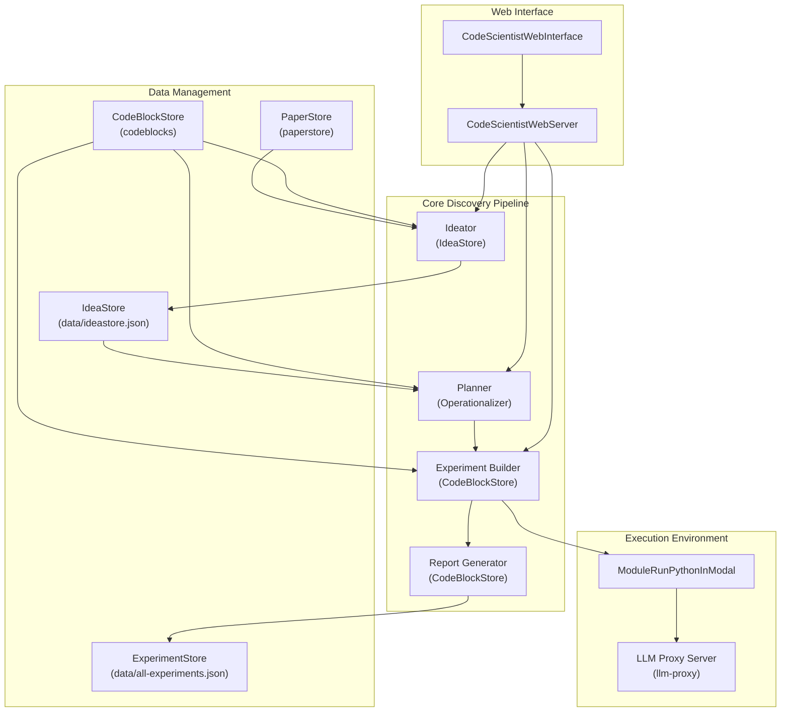
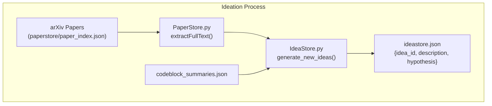
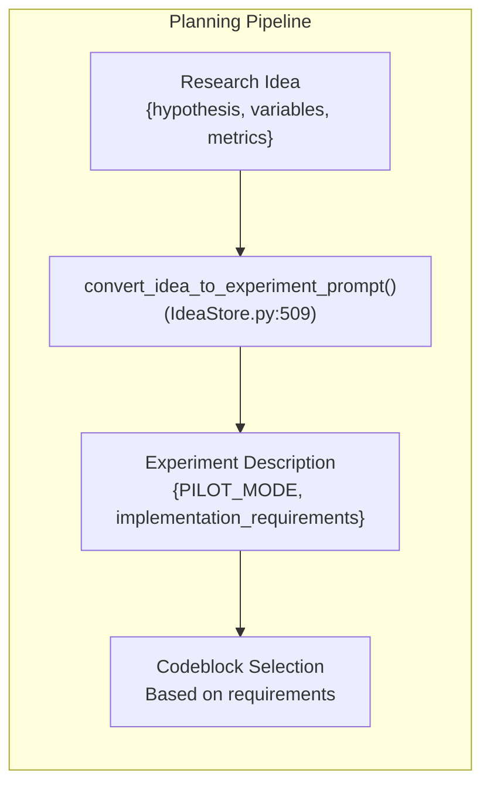
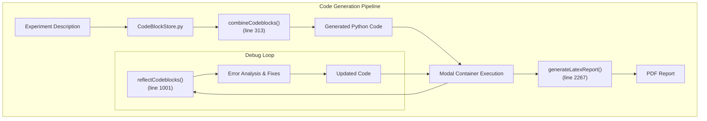
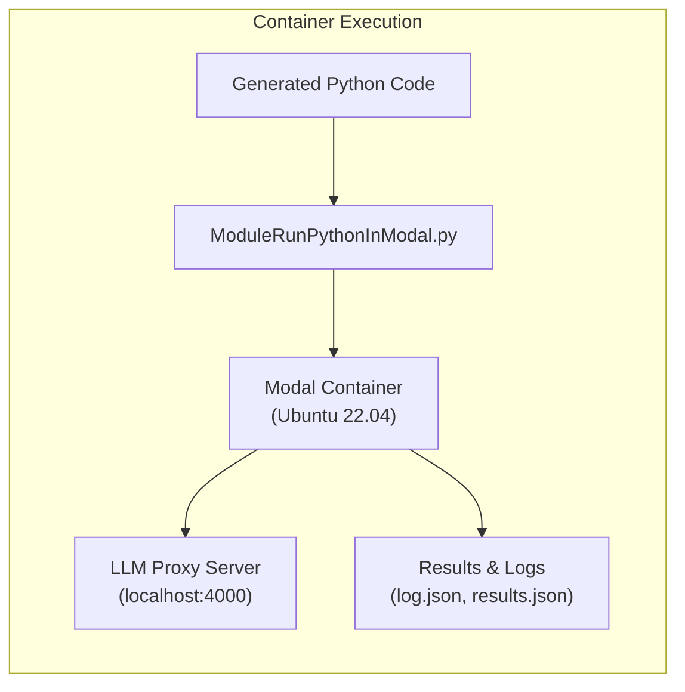
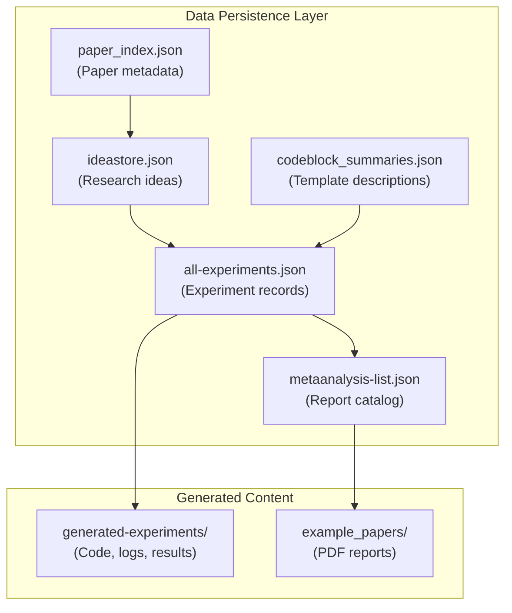

<!-- source: DeepWiki mcp.deepwiki.com · repo allenai/codescientist · page 2 Core System Architecture · fetched 2026-10-26 -->

# Core System Architecture

<details>
<summary>Relevant source files</summary>

The following files were used as context for generating this wiki page:

- [README.md](README.md)
- [data/all-experiments.json](data/all-experiments.json)

</details>


This document provides a detailed explanation of CodeScientist's core system components, focusing on the main discovery pipeline modules, data management systems, and execution infrastructure. The architecture enables semi-automated scientific discovery through idea generation, experiment planning, code construction, and automated execution.

For information about specific agent architectures used within experiments, see [Agent Architectures](#3). For details about the web interface and user interaction patterns, see [Web Interface and User Interaction](#2.1). For data storage specifics, see [Data Storage and Management](#2.2).

## System Overview

CodeScientist implements a four-stage discovery pipeline that transforms research papers and code templates into executable experiments. The system operates through distinct modules that handle ideation, planning, experiment construction, and result reporting.



**Sources:** [README.md:12-16](), [data/all-experiments.json:1-50]()

## Ideation System

The `IdeaStore` class manages the generation and storage of research ideas by combining scientific papers with available code capabilities. Ideas are generated through LLM-driven mutation and combination of existing research concepts.

| Component | File Path | Primary Functions |
|-----------|-----------|------------------|
| IdeaStore | `src/IdeaStore.py` | `generate_new_ideas()`, `convert_idea_to_experiment_prompt()` |
| PaperStore | `src/PaperStore.py` | Paper ingestion, full-text extraction from arXiv |
| BatchPregeneratedIdeator | `src/BatchPregeneratedIdeator.py` | Bulk idea generation |



**Sources:** [src/IdeaStore.py:128](), [README.md:798-799](), [data/all-experiments.json:24-98]()

## Planning and Operationalization

The planning system converts abstract research ideas into concrete experiment specifications. The `convert_idea_to_experiment_prompt()` function in `IdeaStore` serves as the operationalizer, generating detailed experiment descriptions with specific parameters, metrics, and implementation requirements.



The operationalization process includes:
- **Pilot Mode Definition**: `MINI_PILOT`, `PILOT`, `FULL_EXPERIMENT` stages
- **Parameter Specification**: Sample sizes, environment configurations, baseline comparisons
- **Implementation Requirements**: Specific LLM models, logging requirements, statistical analysis methods
- **Codeblock Dependencies**: Automatic selection of required code templates

**Sources:** [src/IdeaStore.py:509](), [data/all-experiments.json:99-116](), [README.md:800]()

## Experiment Builder

The `CodeBlockStore` class orchestrates experiment construction by combining code templates into executable Python scripts. The system uses a multi-stage debugging process with LLM-driven reflection to handle implementation errors.



### Code Template System

Codeblocks are stored in the `codeblocks/` directory with metadata headers defining their usage patterns:

```python
# Name: ScienceWorld API Example
# Description: Interactive text-based game for elementary science
# inclusion_criteria: Agent interaction with ScienceWorld scenarios
# exclusion_criteria: Non-ScienceWorld environments
# python_version: 3.8
# pip_requirement: scienceworld
```

The `CodeBlockStore` automatically selects relevant templates based on experiment requirements and combines them into working implementations.

**Sources:** [src/CodeBlockStore.py:313](), [src/CodeBlockStore.py:1001](), [src/CodeBlockStore.py:2267](), [README.md:801-803]()

## Execution Infrastructure

### Modal Container System

The `ModuleRunPythonInModal` class manages containerized experiment execution on Modal's cloud platform. Each experiment runs in an isolated Ubuntu 22.04 environment with controlled resource limits and cost monitoring.

| Parameter | Configuration |
|-----------|--------------|
| Base Image | `ubuntu:22.04` |
| Python Version | 3.12 |
| Default Packages | `git`, `wget`, `curl`, `openjdk-17-jre` |
| Cost Limit | `max_llm_cost_container` (typically $1-10) |
| Timeout | `max_time_per_iteration_mins` (20-120 minutes) |



### LLM Proxy System

The LLM proxy (`llm-proxy/llm-proxy-server.py`) provides controlled access to language models within containers, implementing cost monitoring and hard limits to prevent runaway expenses.

**Sources:** [src/modules/ModuleRunPythonInModal.py](), [README.md:644-657](), [llm-proxy/llm-proxy-server.py]()

## Data Flow Architecture

The system maintains several JSON-based data stores that track the complete experimental lifecycle:



Each experiment record in `all-experiments.json` contains complete provenance information including:
- **Experiment Metadata**: Name, timestamp, status, cost tracking
- **Original Idea**: Full research hypothesis and design specifications  
- **Operationalization**: Generated experiment prompt and selected codeblocks
- **Execution Results**: Success/failure status, iteration count, generated summaries

**Sources:** [data/all-experiments.json:1-20](), [README.md:741-744](), [README.md:820-821]()

## Web Server Architecture

The `CodeScientistWebServer` provides REST endpoints for experiment management, while `CodeScientistWebInterface` delivers the frontend interface. The server coordinates between all system components and manages the experiment queue.

| Endpoint Category | Functionality |
|------------------|---------------|
| Ideation | Trigger idea generation, browse idea lists |
| Experimentation | Submit experiments, monitor progress |
| Reporting | Generate meta-analyses, view results |
| Data Management | Upload papers, manage codeblocks |

**Sources:** [src/CodeScientistWebServer.py](), [src/CodeScientistWebInterface.py](), [README.md:316-335]()

---

