# Page: CodeScientist Overview

# CodeScientist Overview

<details>
<summary>Relevant source files</summary>

The following files were used as context for generating this wiki page:

- [LICENSE](LICENSE)
- [README.md](README.md)

</details>


## Purpose and Scope

This document provides a comprehensive overview of the CodeScientist system - a semi-automated scientific discovery platform that designs, implements, and analyzes scientific experiments expressed as Python code. CodeScientist uses Large Language Models (LLMs) to generate novel research ideas through genetic mutation of scientific papers and code templates, automatically builds experiment implementations, and produces scientific reports.

For detailed information about specific subsystems, see: [Agent Architectures](#3), [Game Environments](#4), [Knowledge Systems](#5), [LLM Integration](#6), and [Experiment Infrastructure](#7).

## System Architecture

### High-Level Component Architecture

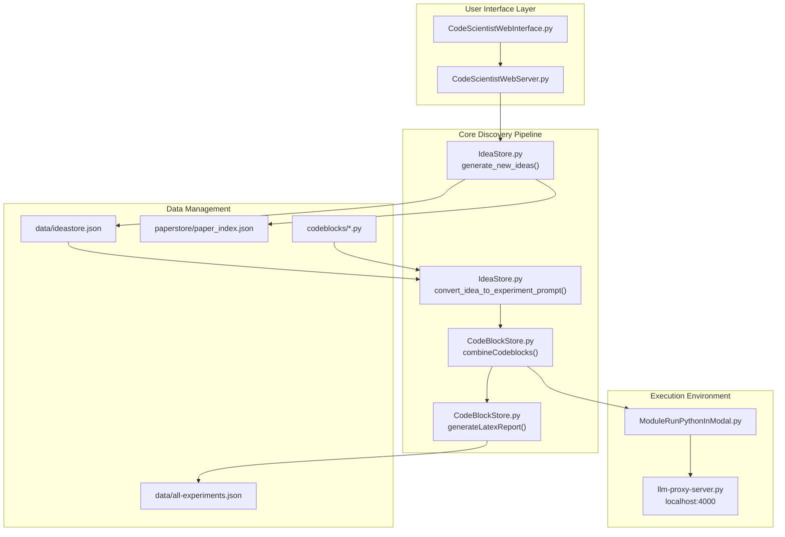

Sources: [README.md:1-895](), [src/CodeScientistWebInterface.py](), [src/CodeScientistWebServer.py](), [src/IdeaStore.py:128](), [src/CodeBlockStore.py:313]()

### Code Entity to System Function Mapping

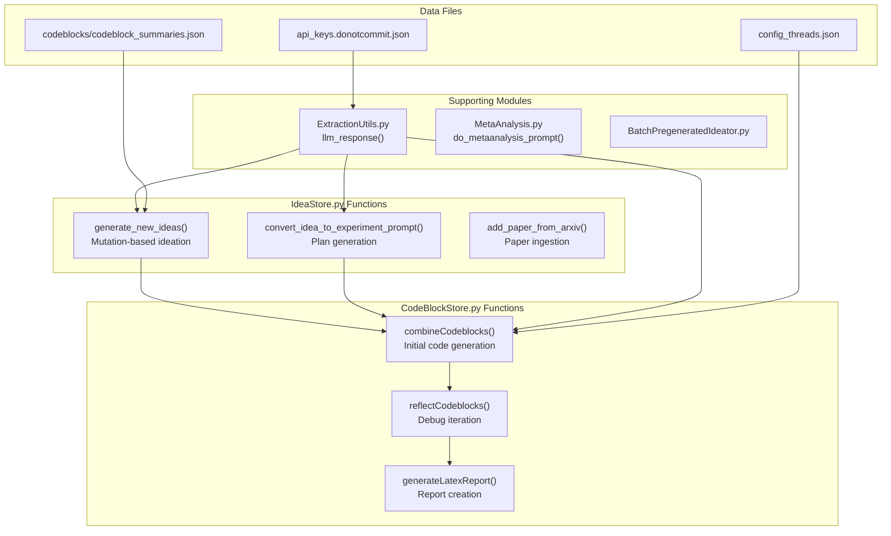

Sources: [src/IdeaStore.py:128](), [src/IdeaStore.py:509](), [src/CodeBlockStore.py:313](), [src/CodeBlockStore.py:1001](), [src/CodeBlockStore.py:2267](), [src/MetaAnalysis.py:15]()

## Core Discovery Workflow

CodeScientist operates through a structured pipeline that transforms research papers into executable experiments:

| Stage | Component | Key Functions | Input | Output |
|-------|-----------|---------------|-------|--------|
| **Ideation** | `IdeaStore.py` | `generate_new_ideas()` | ArXiv papers + codeblocks | Research ideas |
| **Planning** | `IdeaStore.py` | `convert_idea_to_experiment_prompt()` | Ideas + expert comments | Experiment plans |
| **Implementation** | `CodeBlockStore.py` | `combineCodeblocks()` | Plans + codeblock library | Python code |
| **Execution** | `ModuleRunPythonInModal.py` | `run_python_in_modal()` | Code + dependencies | Results + logs |
| **Debugging** | `CodeBlockStore.py` | `reflectCodeblocks()` | Errors + logs | Fixed code |
| **Reporting** | `CodeBlockStore.py` | `generateLatexReport()` | Results + metadata | LaTeX reports |

### Experiment Execution Stages

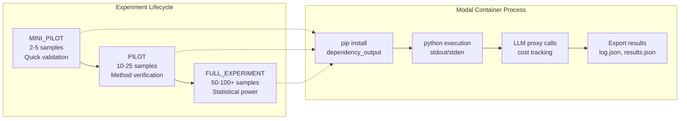

Sources: [src/modules/ModuleRunPythonInModal.py](), [README.md:578-626]()

## Key System Components

### Ideation Engine

The ideation system uses LLM-based genetic mutation to combine scientific papers with code templates:

- **Paper Ingestion**: `PaperStore.py` downloads and processes ArXiv papers
- **Mutation Logic**: `IdeaStore.generate_new_ideas()` creates novel combinations
- **Filtering**: `BatchIdeatorRanker.py` scores ideas by implementability

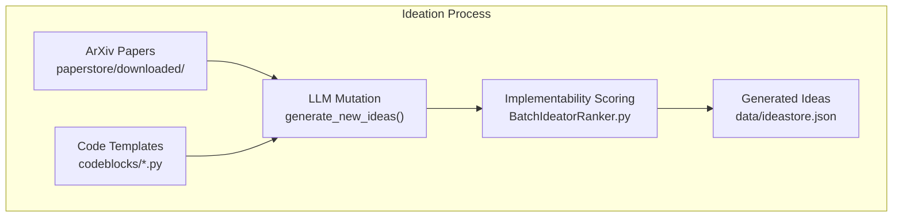

Sources: [src/IdeaStore.py:128](), [src/PaperStore.py](), [src/BatchIdeatorRanker.py]()

### Code Generation and Debugging

The experiment builder combines codeblocks and iteratively debugs the result:

- **Initial Generation**: `CodeBlockStore.combineCodeblocks()` assembles code from templates
- **Reflection Loop**: `CodeBlockStore.reflectCodeblocks()` fixes errors using container feedback
- **Common Library**: `experiment_common_library.py` provides reusable functions

### Cost Control and Monitoring

CodeScientist implements multiple layers of cost protection:

| Component | Mechanism | Location |
|-----------|-----------|----------|
| **Hard Limit** | `LLM_COST_HARD_LIMIT` global check | `ExtractionUtils.py:20` |
| **Proxy Metering** | Per-container cost tracking | `llm-proxy-server.py` |
| **Model Costs** | Pricing configuration | `llm-proxy/experiment-llm-cost.json` |
| **Usage Logging** | Request/token counting | Container `llm_usage.json` |

Sources: [src/ExtractionUtils.py:20](), [llm-proxy/llm-proxy-server.py](), [llm-proxy/experiment-llm-cost.json]()

## Integration Points

### External Services

- **Modal.com**: Cloud container execution via `modal` Python package
- **LLM APIs**: OpenAI, Anthropic, Deepseek through `litellm`
- **ArXiv**: Paper download and LaTeX source extraction

### Game Environment APIs

CodeScientist integrates with multiple text-based research environments:

| Environment | API Module | Research Domain |
|-------------|------------|-----------------|
| **DiscoveryWorld** | `env_discoveryworld_*.py` | Scientific discovery tasks |
| **ScienceWorld** | `env_scienceworld_*.py` | Elementary science knowledge |
| **TextWorldExpress** | `env_textworldexpress_*.py` | Interactive text games |

### Knowledge Base Integration

- **ConceptNet**: Semantic relationship queries via `knowledge_conceptnet.py`
- **WordNet**: Lexical database access through `knowledge_wordnet.py`
- **Custom APIs**: Extensible knowledge base framework

Sources: [codeblocks/env_discoveryworld_random_agent.py](), [codeblocks/env_scienceworld_random_agent.py](), [codeblocks/knowledge_conceptnet.py](), [codeblocks/knowledge_wordnet.py]()

## Configuration and Customization

### Key Configuration Files

| File | Purpose | Key Settings |
|------|---------|--------------|
| `api_keys.donotcommit.json` | LLM provider credentials | OpenAI, Anthropic, Deepseek keys |
| `config_threads.json` | Concurrency control | `max_experiment_threads` |
| `cleaner_config.yaml` | Text processing rules | LaTeX cleaning patterns |
| `codeblock_summaries.json` | Template metadata | Inclusion/exclusion criteria |

### Codeblock Library Structure

Each codeblock in `codeblocks/` contains standardized metadata:

```python
# Name: [Descriptive name]
# Description: [Functionality overview]  
# inclusion_criteria: [When to use]
# exclusion_criteria: [When not to use]
# python_version: [Required version]
# pip_requirement: [Dependencies]
```

Sources: [README.md:603-621](), [codeblocks/env_scienceworld_random_agent.py:613-619]()

---

# Page: Core System Architecture

# Core System Architecture

<details>
<summary>Relevant source files</summary>

The following files were used as context for generating this wiki page:

- [README.md](README.md)
- [data/all-experiments.json](data/all-experiments.json)

</details>


This document provides a detailed explanation of CodeScientist's core system components, focusing on the main discovery pipeline modules, data management systems, and execution infrastructure. The architecture enables semi-automated scientific discovery through idea generation, experiment planning, code construction, and automated execution.

For information about specific agent architectures used within experiments, see [Agent Architectures](#3). For details about the web interface and user interaction patterns, see [Web Interface and User Interaction](#2.1). For data storage specifics, see [Data Storage and Management](#2.2).

## System Overview

CodeScientist implements a four-stage discovery pipeline that transforms research papers and code templates into executable experiments. The system operates through distinct modules that handle ideation, planning, experiment construction, and result reporting.

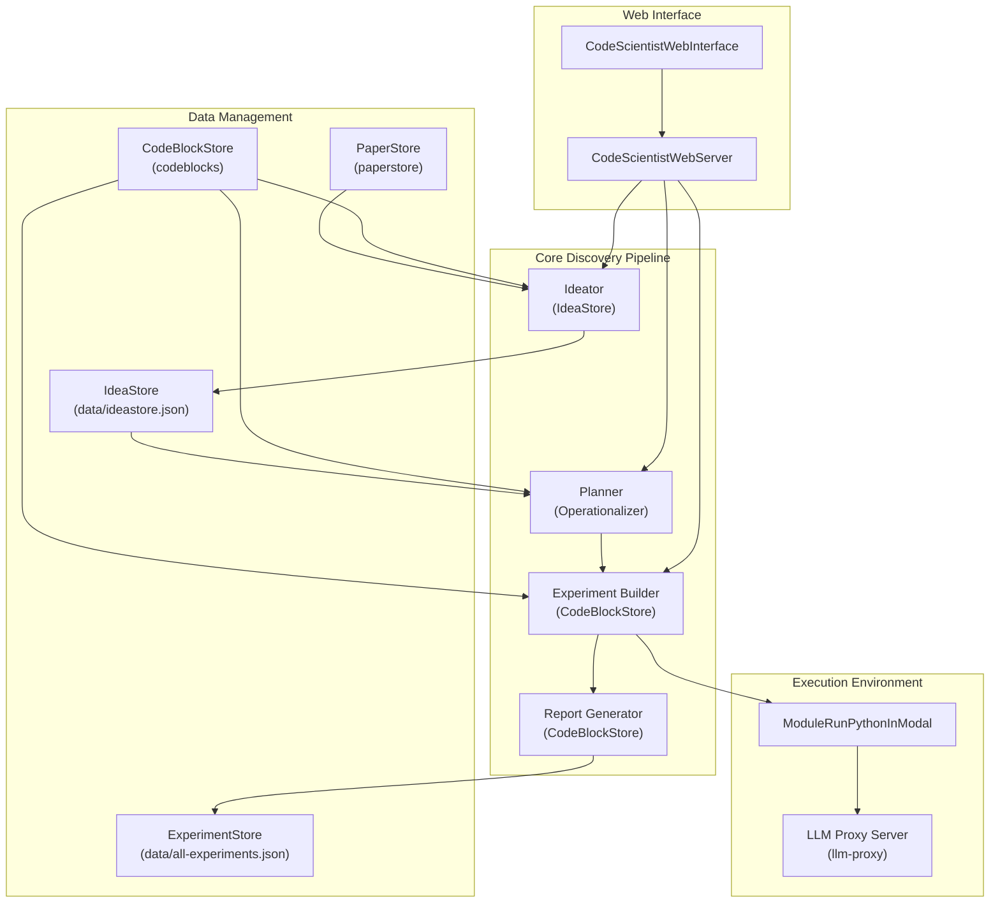

**Sources:** [README.md:12-16](), [data/all-experiments.json:1-50]()

## Ideation System

The `IdeaStore` class manages the generation and storage of research ideas by combining scientific papers with available code capabilities. Ideas are generated through LLM-driven mutation and combination of existing research concepts.

| Component | File Path | Primary Functions |
|-----------|-----------|------------------|
| IdeaStore | `src/IdeaStore.py` | `generate_new_ideas()`, `convert_idea_to_experiment_prompt()` |
| PaperStore | `src/PaperStore.py` | Paper ingestion, full-text extraction from arXiv |
| BatchPregeneratedIdeator | `src/BatchPregeneratedIdeator.py` | Bulk idea generation |

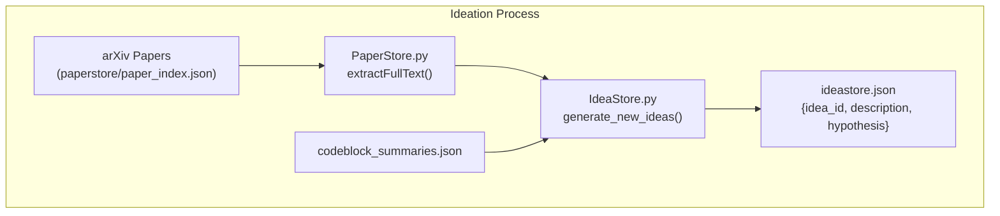

**Sources:** [src/IdeaStore.py:128](), [README.md:798-799](), [data/all-experiments.json:24-98]()

## Planning and Operationalization

The planning system converts abstract research ideas into concrete experiment specifications. The `convert_idea_to_experiment_prompt()` function in `IdeaStore` serves as the operationalizer, generating detailed experiment descriptions with specific parameters, metrics, and implementation requirements.

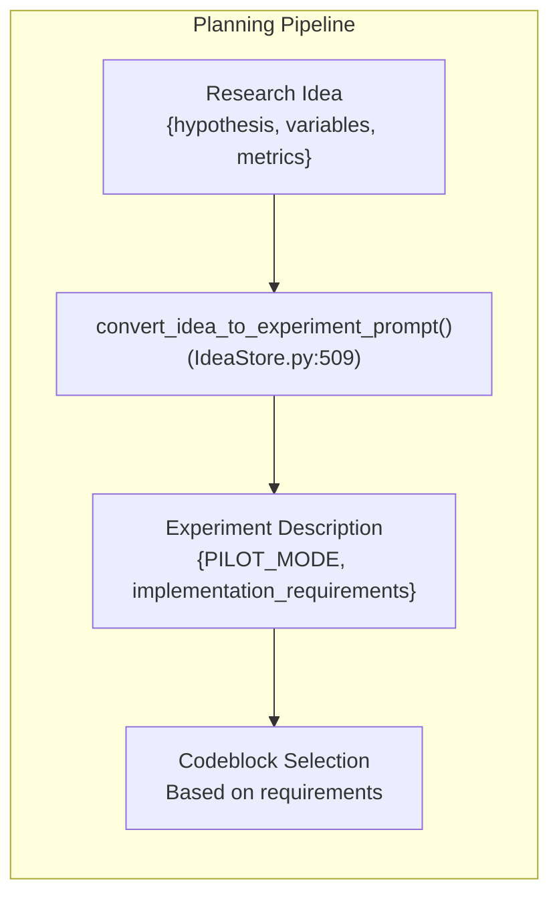

The operationalization process includes:
- **Pilot Mode Definition**: `MINI_PILOT`, `PILOT`, `FULL_EXPERIMENT` stages
- **Parameter Specification**: Sample sizes, environment configurations, baseline comparisons
- **Implementation Requirements**: Specific LLM models, logging requirements, statistical analysis methods
- **Codeblock Dependencies**: Automatic selection of required code templates

**Sources:** [src/IdeaStore.py:509](), [data/all-experiments.json:99-116](), [README.md:800]()

## Experiment Builder

The `CodeBlockStore` class orchestrates experiment construction by combining code templates into executable Python scripts. The system uses a multi-stage debugging process with LLM-driven reflection to handle implementation errors.

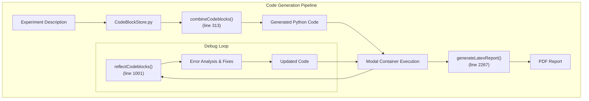

### Code Template System

Codeblocks are stored in the `codeblocks/` directory with metadata headers defining their usage patterns:

```python
# Name: ScienceWorld API Example
# Description: Interactive text-based game for elementary science
# inclusion_criteria: Agent interaction with ScienceWorld scenarios
# exclusion_criteria: Non-ScienceWorld environments
# python_version: 3.8
# pip_requirement: scienceworld
```

The `CodeBlockStore` automatically selects relevant templates based on experiment requirements and combines them into working implementations.

**Sources:** [src/CodeBlockStore.py:313](), [src/CodeBlockStore.py:1001](), [src/CodeBlockStore.py:2267](), [README.md:801-803]()

## Execution Infrastructure

### Modal Container System

The `ModuleRunPythonInModal` class manages containerized experiment execution on Modal's cloud platform. Each experiment runs in an isolated Ubuntu 22.04 environment with controlled resource limits and cost monitoring.

| Parameter | Configuration |
|-----------|--------------|
| Base Image | `ubuntu:22.04` |
| Python Version | 3.12 |
| Default Packages | `git`, `wget`, `curl`, `openjdk-17-jre` |
| Cost Limit | `max_llm_cost_container` (typically $1-10) |
| Timeout | `max_time_per_iteration_mins` (20-120 minutes) |

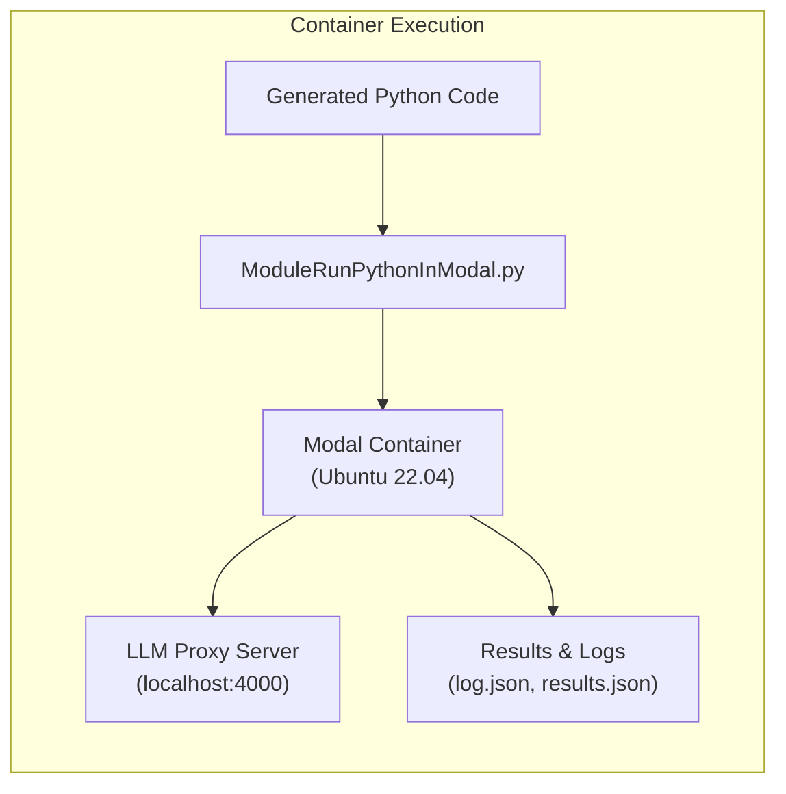

### LLM Proxy System

The LLM proxy (`llm-proxy/llm-proxy-server.py`) provides controlled access to language models within containers, implementing cost monitoring and hard limits to prevent runaway expenses.

**Sources:** [src/modules/ModuleRunPythonInModal.py](), [README.md:644-657](), [llm-proxy/llm-proxy-server.py]()

## Data Flow Architecture

The system maintains several JSON-based data stores that track the complete experimental lifecycle:

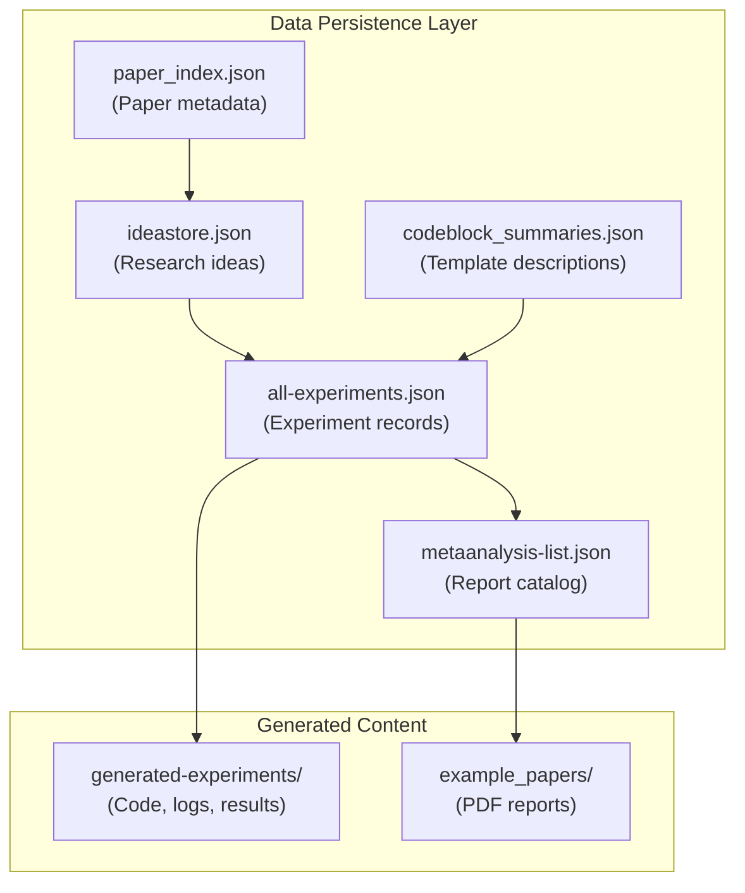

Each experiment record in `all-experiments.json` contains complete provenance information including:
- **Experiment Metadata**: Name, timestamp, status, cost tracking
- **Original Idea**: Full research hypothesis and design specifications  
- **Operationalization**: Generated experiment prompt and selected codeblocks
- **Execution Results**: Success/failure status, iteration count, generated summaries

**Sources:** [data/all-experiments.json:1-20](), [README.md:741-744](), [README.md:820-821]()

## Web Server Architecture

The `CodeScientistWebServer` provides REST endpoints for experiment management, while `CodeScientistWebInterface` delivers the frontend interface. The server coordinates between all system components and manages the experiment queue.

| Endpoint Category | Functionality |
|------------------|---------------|
| Ideation | Trigger idea generation, browse idea lists |
| Experimentation | Submit experiments, monitor progress |
| Reporting | Generate meta-analyses, view results |
| Data Management | Upload papers, manage codeblocks |

**Sources:** [src/CodeScientistWebServer.py](), [src/CodeScientistWebInterface.py](), [README.md:316-335]()

---

# Page: Web Interface and User Interaction

# Web Interface and User Interaction

<details>
<summary>Relevant source files</summary>

The following files were used as context for generating this wiki page:

- [README.md](README.md)

</details>


This document covers the web-based user interface that provides human-in-the-loop control over CodeScientist's scientific discovery pipeline. The interface enables users to create research ideas, configure experiments, monitor execution progress, and analyze results through a browser-based graphical interface.

For information about the underlying data storage and management systems that support these interfaces, see [Data Storage and Management](#2.2). For details about the core system architecture components that the web interface orchestrates, see [Core System Architecture](#2).

## Web Interface Architecture

CodeScientist's web interface consists of two main components that work together to provide a complete user experience:

**Web Interface Architecture**
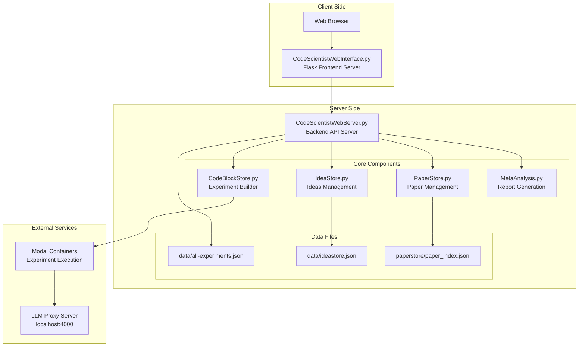

Sources: [README.md:315-325](), [README.md:333-334]()

The frontend server ([src/CodeScientistWebInterface.py]()) serves HTML pages and handles user interactions, while the backend server ([src/CodeScientistWebServer.py]()) provides API endpoints for all core functionality. Users access the system through a web browser pointed to the frontend server, typically running on `http://127.0.0.1:8080/`.

## Main Menu Interface

The main menu provides access to all major CodeScientist functions through a centralized interface:

**Main Menu Functions**
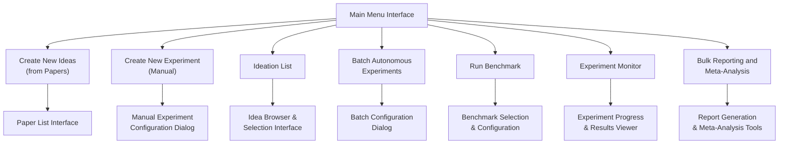

Sources: [README.md:333-334](), [README.md:342-352]()

## Core User Workflows

CodeScientist supports three primary user workflows, each optimized for different use cases:

| Workflow Type | Description | Key Interface Components |
|---------------|-------------|-------------------------|
| **Manual** | User-driven idea generation and experiment selection | `Create New Ideas`, `Ideation List`, Manual experiment creation |
| **Automatic** | Fully autonomous idea generation and experimentation | `Batch Autonomous Experiments` |
| **Benchmark/Batch** | Pre-generated ideas with filtering and batch execution | `Run Benchmark`, External idea filtering tools |

**User Workflow State Transitions**
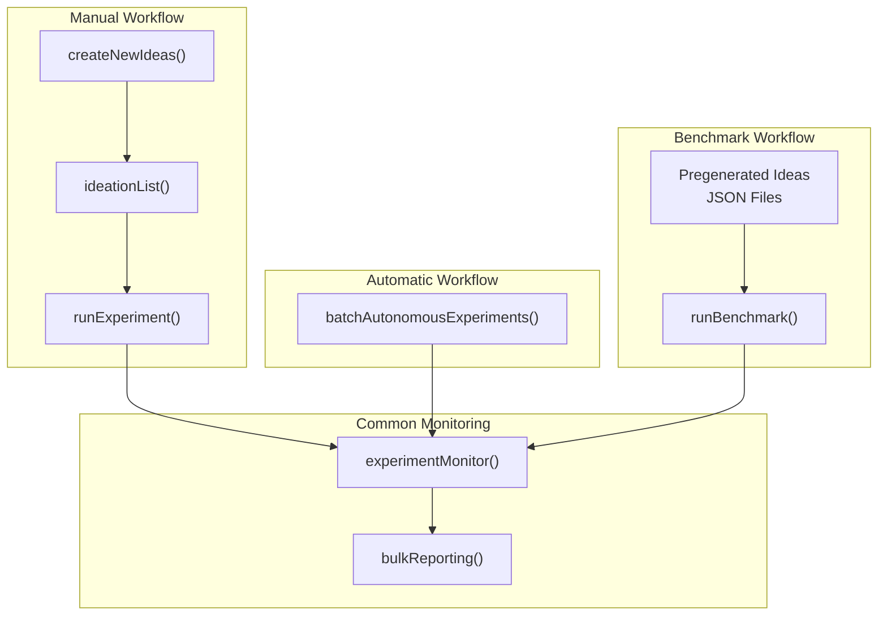

Sources: [README.md:342-352]()

## Paper Management Interface

The paper list interface enables users to create new research ideas by combining scientific papers from the system's corpus:

**Paper Interface Components**
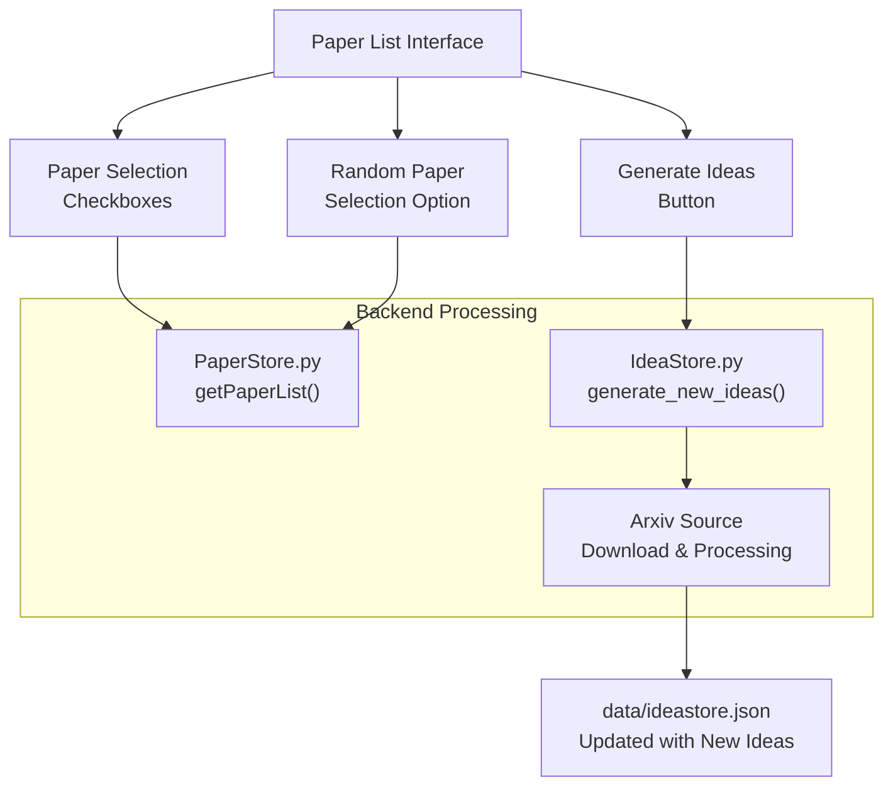

Sources: [README.md:354-367](), [README.md:798-799]()

The interface requires papers to be added as Arxiv links to enable full-text extraction from LaTeX source, avoiding PDF-to-text conversion challenges. Ideas typically take several minutes to generate and appear in the ideation list upon completion.

## Manual Experiment Creation

The manual experiment creation dialog allows users to bypass the ideator/planner and directly specify experiments:

**Manual Experiment Configuration**
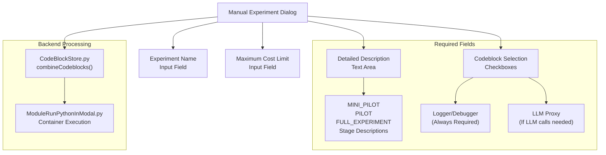

Sources: [README.md:369-382](), [README.md:538-568]()

## Ideation List and Experiment Planning

The ideation list provides a browseable interface for all generated ideas with experiment execution capabilities:

**Ideation List Workflow**
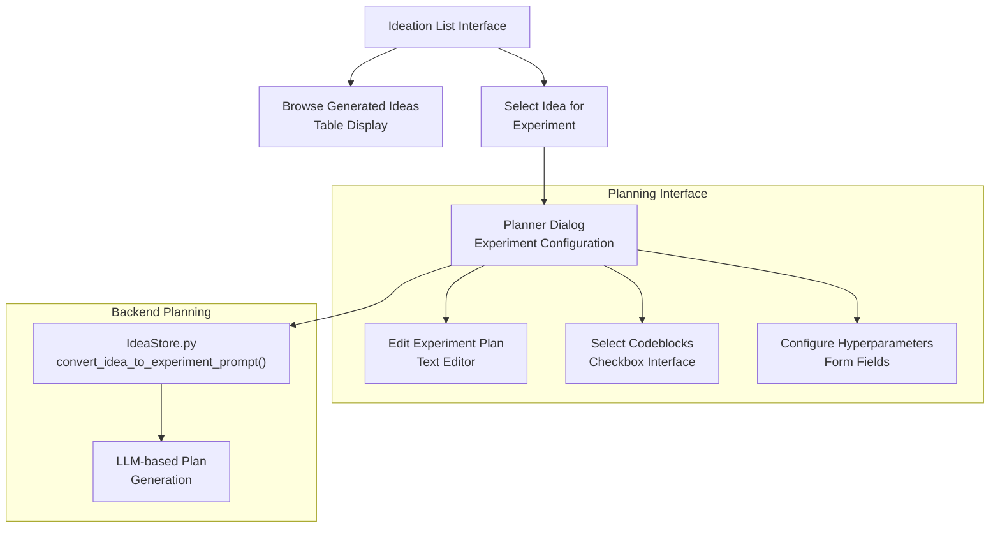

Sources: [README.md:384-396](), [README.md:799-800]()

## Experiment Monitoring Interface

The experiment monitor tracks all submitted experiments and provides access to results:

**Experiment Monitor Components**
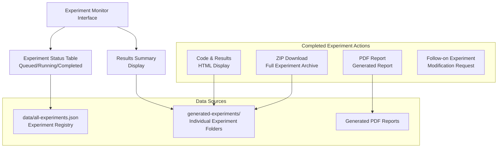

Sources: [README.md:420-434]()

## Bulk Reporting and Meta-Analysis Interface

The meta-analysis interface processes multiple related experiments to generate summary reports:

**Meta-Analysis Interface Structure**
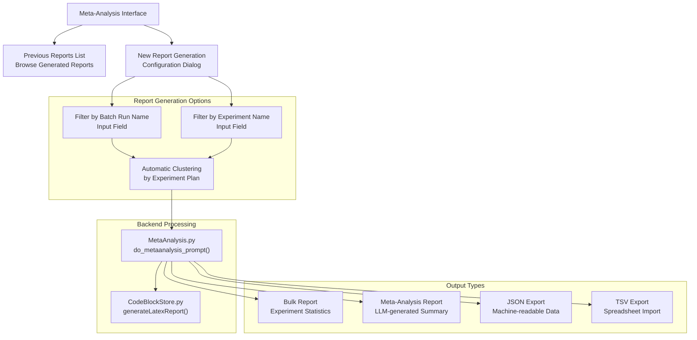

Sources: [README.md:436-472](), [README.md:804-805]()

## Configuration and Cost Control

The web interface includes several configuration mechanisms for controlling system behavior and costs:

| Configuration File | Purpose | Location |
|-------------------|---------|----------|
| `config_threads.json` | Maximum simultaneous experiment threads | Root directory |
| `api_keys.donotcommit.json` | LLM API keys and credentials | Root directory |
| `llm-proxy/experiment-llm-cost.json` | LLM cost per token pricing | LLM proxy directory |

**Cost Control Integration**
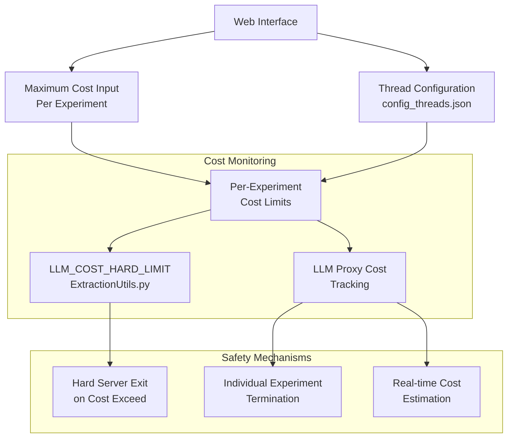

Sources: [README.md:248-253](), [README.md:285-287](), [README.md:292-311]()

The interface enforces multiple layers of cost protection, including per-experiment limits set through the UI, a system-wide hard limit, and real-time monitoring through the LLM proxy system.

Sources: [README.md:315-325](), [README.md:333-568](), [src/CodeScientistWebServer.py](), [src/CodeScientistWebInterface.py]()

---

# Page: Data Storage and Management

# Data Storage and Management

<details>
<summary>Relevant source files</summary>

The following files were used as context for generating this wiki page:

- [data/all-experiments.json](data/all-experiments.json)
- [data/ideastore.json](data/ideastore.json)
- [data/metaanalysis-list.json](data/metaanalysis-list.json)

</details>


This document explains how CodeScientist stores and organizes research ideas, experiments, papers, and results across its various data stores. The system uses primarily JSON-based file storage for persistence, with structured schemas for different data types.

For information about the web interface for accessing this data, see [Web Interface and User Interaction](#2.1). For details about the experiment execution infrastructure, see [Experiment Infrastructure](#7).

## Data Store Architecture

CodeScientist maintains several specialized data stores that work together to support the complete research workflow:

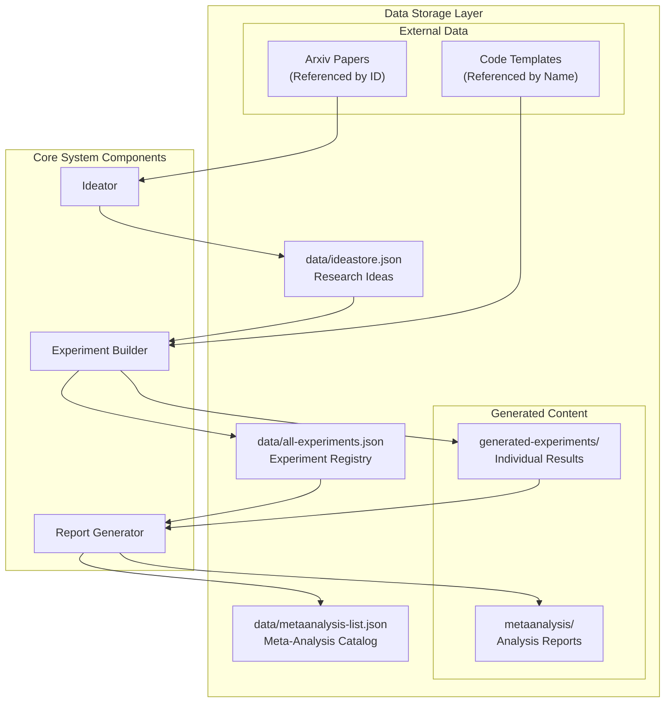

**Core Data Stores:**
- **Idea Store**: Central repository for research ideas with metadata and operationalization details
- **Experiment Registry**: Master catalog of all experiments with status, results, and execution metadata  
- **Meta-Analysis Catalog**: Index of generated analysis reports and bulk experiment runs

Sources: [data/all-experiments.json:1-10](), [data/ideastore.json:1-25](), [data/metaanalysis-list.json:1-10]()

## Idea Store Structure

The `data/ideastore.json` file maintains a comprehensive catalog of research ideas, each containing detailed specification and metadata:

| Field | Type | Description |
|-------|------|-------------|
| `research_idea_name` | String | Unique identifier for the idea |
| `research_idea_long_description` | String | Detailed description of the research proposal |
| `research_idea_hypothesis` | String | Testable hypothesis |
| `research_idea_variables` | String | Independent, dependent, and control variables |
| `research_idea_metric` | String | Primary and secondary evaluation metrics |
| `research_idea_codeblocks` | Array | Required code template names |
| `inspiring_paper_ids` | Array | Arxiv paper IDs that inspired the idea |
| `generated_using_model` | String | LLM model used for generation |
| `id` | String | Unique idea identifier |

```mermaid
graph LR
    subgraph "Idea Lifecycle"
        Generation["Idea Generation<br/>inspiring_paper_ids<br/>generated_using_model"]
        Storage["Storage<br/>ideastore.json<br/>research_idea_*"]
        Operationalization["Operationalization<br/>operationalization_*"]
        Execution["Experiment Execution<br/>codeblock_names_to_use"]
    end
    
    Generation --> Storage
    Storage --> Operationalization  
    Operationalization --> Execution
    
    subgraph "External References"
        Papers["Arxiv Papers<br/>inspiring_paper_ids"]
        Templates["Code Templates<br/>research_idea_codeblocks"]
    end
    
    Papers --> Generation
    Templates --> Execution
```

Sources: [data/ideastore.json:2-50](), [data/ideastore.json:24-98]()

## Experiment Registry Schema

The `data/all-experiments.json` file serves as the master registry tracking all experiment executions with comprehensive metadata:

**Experiment Record Structure:**
```mermaid
graph TB
    subgraph "Experiment Record"
        Identity["experiment_name_short<br/>batch_name<br/>id"]
        Config["model_str<br/>codeblock_names_to_use<br/>max_time_per_iteration_mins"]
        Execution["timestamp_created<br/>timestamp_finished<br/>status<br/>num_iterations_run"]
        Results["results_summary<br/>results_summary_short<br/>interesting_results"]
        Costs["cost_so_far<br/>total_cost_build_debug<br/>max_llm_cost_container"]
        
        subgraph "Nested Objects"
            OriginalIdea["original_idea<br/>{full idea specification}"]
            Operationalization["operationalization<br/>{process metadata}"]
            BenchmarkProblem["full_original_benchmark_problem<br/>{complete problem def}"]
        end
    end
    
    Identity --> Config
    Config --> Execution  
    Execution --> Results
    Results --> Costs
    Costs --> OriginalIdea
    OriginalIdea --> Operationalization
    Operationalization --> BenchmarkProblem
```

**Key Status Values:**
- `completed`: Experiment finished successfully
- `failed`: Experiment encountered fatal error
- `running`: Currently executing
- `queued`: Waiting for execution

Sources: [data/all-experiments.json:4-100](), [data/all-experiments.json:234-247]()

## File Organization and Storage Patterns

CodeScientist follows a hierarchical file organization pattern with generated content isolated from core data:

```mermaid
graph TB
    subgraph "File System Organization"
        DataRoot["data/<br/>Core Data Storage"]
        GenRoot["generated-experiments/<br/>Experiment Results"]
        MetaRoot["metaanalysis/<br/>Analysis Reports"]
        
        subgraph "Core Data Files"
            AllExp["all-experiments.json<br/>Master experiment registry"]
            IdeaStore["ideastore.json<br/>Research idea catalog"]  
            MetaList["metaanalysis-list.json<br/>Report index"]
        end
        
        subgraph "Generated Structure"
            ExpDir["experiment-name-timestamp/<br/>Individual experiment folder"]
            ExpResults["experiment results<br/>logs, plots, data files"]
            BulkReports["bulk analysis reports<br/>.tsv, .json files"]
        end
        
        DataRoot --> AllExp
        DataRoot --> IdeaStore
        DataRoot --> MetaList
        GenRoot --> ExpDir
        ExpDir --> ExpResults
        MetaRoot --> BulkReports
    end
```

**Storage Conventions:**
- **Core Data**: JSON files in `data/` directory for system state
- **Generated Results**: Timestamped directories under `generated-experiments/`
- **Analysis Reports**: Bulk processing outputs in `metaanalysis/`
- **Experiment Paths**: Stored in registry as `experiment_path` field

Sources: [data/all-experiments.json:241](), [data/metaanalysis-list.json:3-5]()

## Data Relationships and Lifecycle

The data stores maintain referential relationships that support the complete research workflow:

```mermaid
graph TD
    subgraph "Data Flow and References"
        Papers["Arxiv Papers<br/>inspiring_paper_ids[]"]
        Ideas["Research Ideas<br/>ideastore.json"]
        Experiments["Experiments<br/>all-experiments.json"]
        Results["Generated Results<br/>experiment_path"]
        MetaAnalysis["Meta-Analysis<br/>metaanalysis-list.json"]
        
        Papers -->|"inspires"| Ideas
        Ideas -->|"idea_id reference"| Experiments
        Experiments -->|"stores path to"| Results
        Experiments -->|"batched into"| MetaAnalysis
        
        subgraph "Experiment Lifecycle States"
            Created["timestamp_created"]
            Running["status: running"]
            Finished["timestamp_finished"]
            Analyzed["interesting_results"]
        end
        
        Created --> Running
        Running --> Finished
        Finished --> Analyzed
    end
```

**Reference Patterns:**
- **Ideas → Experiments**: `idea_id` field links experiment to originating idea
- **Experiments → Results**: `experiment_path` field points to generated output directory
- **Batches → Meta-Analysis**: `batch_name` groups experiments for bulk analysis
- **Papers → Ideas**: `inspiring_paper_ids` array references external Arxiv papers

Sources: [data/all-experiments.json:23](), [data/all-experiments.json:241](), [data/ideastore.json:195-198]()

## Meta-Analysis and Reporting

The system maintains a catalog of generated analysis reports that aggregate results across multiple experiments:

| Field | Description |
|-------|-------------|
| `filename_bulk_report` | TSV file with individual experiment results |
| `filename_metaanalysis_report` | TSV file with aggregated analysis |  
| `filename_metaanalysis_report_json` | JSON version of analysis |
| `batch_run` | Associated batch identifier |
| `timestamp` | Report generation time |
| `notes` | Human-readable description |

```mermaid
graph LR
    subgraph "Meta-Analysis Pipeline"
        BatchExps["Batch Experiments<br/>same batch_name"]
        BulkReport["Bulk Report<br/>.bulk.tsv"]
        MetaReport["Meta-Analysis<br/>.meta-analysis.tsv/.json"]
        Catalog["Report Catalog<br/>metaanalysis-list.json"]
    end
    
    BatchExps --> BulkReport
    BulkReport --> MetaReport
    MetaReport --> Catalog
```

Sources: [data/metaanalysis-list.json:3-11](), [data/metaanalysis-list.json:13-21]()

## Cost and Performance Tracking

The experiment registry includes detailed cost and performance metrics for system monitoring:

**Cost Tracking Fields:**
- `cost_so_far`: Total accumulated cost for experiment
- `total_cost_build_debug`: Cost for building and debugging phase
- `total_cost_llm_proxy`: Cost for LLM API calls during execution
- `max_llm_cost_container`: Cost limit for experiment execution

**Performance Metrics:**
- `runtime_seconds`: Total wall-clock execution time
- `num_iterations_run`: Number of debug/refinement iterations
- `max_debug_iterations`: Configured iteration limit

Sources: [data/all-experiments.json:239-246](), [data/all-experiments.json:482-490]()

---

# Page: Agent Architectures

# Agent Architectures

<details>
<summary>Relevant source files</summary>

The following files were used as context for generating this wiki page:

- [codeblocks/agent_memory_example.py](codeblocks/agent_memory_example.py)
- [codeblocks/agent_react_example.py](codeblocks/agent_react_example.py)
- [codeblocks/codeblock_summaries.json](codeblocks/codeblock_summaries.json)

</details>


This document covers the AI agent architectures implemented in CodeScientist for conducting automated scientific discovery experiments. These agents serve as the core reasoning and action-taking components that interact with text-based game environments to test scientific hypotheses and gather experimental data.

For information about the game environments that agents interact with, see [Game Environments](#4). For details about the experiment infrastructure and common utilities that support agent operations, see [Experiment Infrastructure](#7).

## Overview

CodeScientist implements multiple agent architectures that can be deployed across different experimental scenarios. Each architecture represents a different approach to AI reasoning and decision-making in interactive text-based environments.

```mermaid
graph TB
    subgraph "Agent Architecture Types"
        ReactAgent[ReActAgent<br/>"react_agent_one_step()"]
        MemoryAgent[MemoryAgent<br/>"memory_agent_one_step()"] 
        RandomAgent[RandomAgent<br/>"Baseline"]
    end
    
    subgraph "Core Components"
        LLMProxy[LLMProxy<br/>"get_llm_response()"]
        History[History<br/>"add_step_to_history()"]
        ActionSpace[ActionSpace<br/>"get_action_space()"]
    end
    
    subgraph "Game Environments"
        DiscoveryWorld[DiscoveryWorld<br/>"Simulator"]
        ScienceWorld[ScienceWorld<br/>"Simulator"] 
        TextWorldExpress[TextWorldExpress<br/>"Simulator"]
    end
    
    ReactAgent --> LLMProxy
    MemoryAgent --> LLMProxy
    ReactAgent --> History
    MemoryAgent --> History
    
    ReactAgent --> DiscoveryWorld
    ReactAgent --> ScienceWorld
    ReactAgent --> TextWorldExpress
    
    MemoryAgent --> DiscoveryWorld
    MemoryAgent --> ScienceWorld
    MemoryAgent --> TextWorldExpress
    
    RandomAgent --> DiscoveryWorld
    RandomAgent --> ScienceWorld 
    RandomAgent --> TextWorldExpress
    
    DiscoveryWorld --> ActionSpace
    ScienceWorld --> ActionSpace
    TextWorldExpress --> ActionSpace
```

**Agent Architecture Components:**

| Component | Function | Implementation |
|-----------|----------|----------------|
| `react_agent_one_step()` | Single step reasoning and action | [codeblocks/agent_react_example.py:74-133]() |
| `memory_agent_one_step()` | Memory-augmented reasoning and action | [codeblocks/agent_memory_example.py:157-217]() |
| `add_step_to_history()` | History tracking for context | [codeblocks/agent_react_example.py:214-221]() |
| `AgentMemory` | Memory management system | [codeblocks/agent_memory_example.py:17-59]() |

Sources: [codeblocks/agent_react_example.py](), [codeblocks/agent_memory_example.py](), [codeblocks/codeblock_summaries.json]()

## ReAct Agent Architecture

The ReAct (Reasoning and Acting) agent architecture implements a two-step process where the agent first reasons about its current situation, then chooses an action based on that reasoning.

```mermaid
graph TD
    Start[Start] --> GetObs["get_observation()"]
    GetObs --> CommonPrompt["make_common_prompt()<br/>Task + Observation + History"]
    CommonPrompt --> ThinkStep["Think Step<br/>get_llm_response()"]
    ThinkStep --> ActStep["Act Step<br/>get_llm_response()"]
    ActStep --> ParseAction["Parse action_str from JSON"]
    ParseAction --> AddHistory["add_step_to_history()"]
    AddHistory --> TakeAction["take_action()"]
    TakeAction --> CheckComplete{"is_completed()?"}
    CheckComplete -->|No| GetObs
    CheckComplete -->|Yes| End[End]
```

**ReAct Agent Flow:**

1. **Observation Phase**: Retrieves current environment state via `get_observation()`
2. **Think Phase**: Generates reasoning about the situation using LLM
3. **Act Phase**: Selects action from available `action_space` based on reasoning  
4. **Execution Phase**: Executes action in environment via `take_action()`

The ReAct implementation separates thinking and acting into distinct LLM calls to provide clearer reasoning traces and better debugging capabilities.

**Key Functions:**

- `react_agent_one_step()`: Single step execution [codeblocks/agent_react_example.py:74-133]()
- `react_agent_multiple_steps()`: Multi-step episode execution [codeblocks/agent_react_example.py:136-209]()

Sources: [codeblocks/agent_react_example.py:74-133](), [codeblocks/agent_react_example.py:136-209]()

## Memory-Augmented Agent Architecture

The Memory-Augmented agent extends basic agent capabilities by maintaining and utilizing a persistent memory system that stores relevant information across interaction steps.

```mermaid
graph TD
    Start[Start] --> InitMemory["AgentMemory()"]
    InitMemory --> GetObs["get_observation()"]
    GetObs --> CommonPrompt["make_common_prompt()<br/>Task + Observation + History + Memory"]
    CommonPrompt --> MemoryReflect["Memory Reflection Step<br/>get_llm_response(jsonResponse=True)"]
    MemoryReflect --> UpdateMemory["memory.add_memory(key, value)"]
    UpdateMemory --> ActPrompt["Action Selection Prompt"]
    ActPrompt --> ActStep["Act Step<br/>get_llm_response()"]
    ActStep --> ParseAction["Parse action_str from JSON"]
    ParseAction --> AddHistory["add_step_to_history()"]
    AddHistory --> TakeAction["take_action()"]
    TakeAction --> CheckComplete{"is_completed()?"}
    CheckComplete -->|No| GetObs
    CheckComplete -->|Yes| End[End]
```

**Memory Management System:**

The `AgentMemory` class provides key-value storage for agent experiences:

| Method | Purpose | Implementation |
|--------|---------|----------------|
| `add_memory(key, value)` | Store/update memory entry | [codeblocks/agent_memory_example.py:23-24]() |
| `get_memory(key)` | Retrieve specific memory | [codeblocks/agent_memory_example.py:27-30]() |
| `get_all_memories()` | Export all memories | [codeblocks/agent_memory_example.py:33-34]() |
| `memories_to_prompt()` | Format memories for LLM | [codeblocks/agent_memory_example.py:46-52]() |
| `clone()` | Deep copy memory state | [codeblocks/agent_memory_example.py:55-58]() |

**Memory Reflection Process:**

1. **Reflection Step**: Agent analyzes recent observations and actions
2. **Memory Update**: Agent adds/modifies memory entries in JSON format
3. **Action Selection**: Agent chooses action considering both current state and memories

The memory system allows agents to build up knowledge over time, avoiding repeated mistakes and leveraging learned patterns.

Sources: [codeblocks/agent_memory_example.py:17-59](), [codeblocks/agent_memory_example.py:157-217]()

## Environment Integration

Both agent architectures integrate with multiple game environments through a standardized simulator interface.

```mermaid
graph LR
    subgraph "Agent Interface"
        AgentStep["agent_one_step()"]
        History["history[]"]
        Memory["AgentMemory"]
    end
    
    subgraph "Simulator Interface"
        Initialize["initialize()"]
        GetTask["get_task_description()"]
        GetObs["get_observation()"]  
        GetActions["get_action_space()"]
        TakeAction["take_action(action)"]
        GetScore["get_score()"]
        IsComplete["is_completed()"]
        WasWon["was_won()"]
    end
    
    subgraph "Environment Implementations"
        DiscoveryWorldAPI["DiscoveryWorld<br/>Scientific Discovery"]
        ScienceWorldAPI["ScienceWorld<br/>Elementary Science"]
        TextWorldExpressAPI["TextWorldExpress<br/>Text Games"]
    end
    
    AgentStep --> GetObs
    AgentStep --> GetActions
    AgentStep --> TakeAction
    History --> GetScore
    
    GetObs --> DiscoveryWorldAPI
    GetObs --> ScienceWorldAPI
    GetObs --> TextWorldExpressAPI
    
    GetActions --> DiscoveryWorldAPI
    GetActions --> ScienceWorldAPI  
    GetActions --> TextWorldExpressAPI
    
    TakeAction --> DiscoveryWorldAPI
    TakeAction --> ScienceWorldAPI
    TakeAction --> TextWorldExpressAPI
```

**Standard Simulator Interface:**

All environments implement these core methods:

- `initialize()`: Set up new episode/task
- `get_task_description()`: Return task objective  
- `get_observation()`: Get current environment state
- `get_action_space()`: List available actions
- `take_action(action)`: Execute action and update state
- `get_score()`: Return current performance score
- `is_completed()`: Check if episode finished
- `was_won()`: Check if task was completed successfully

Sources: [codeblocks/agent_react_example.py:17-53](), [codeblocks/agent_memory_example.py:63-99]()

## Common Agent Infrastructure

Both agent architectures share common infrastructure components for execution management and error handling.

**Episode Management:**

```mermaid
graph TD
    StartEpisode["Initialize Episode"] --> InitHistory["history = []"]
    InitHistory --> InitErrors["num_errors = 0"]
    InitErrors --> StepLoop{"Step < max_steps?"}
    StepLoop -->|Yes| RunStep["Run agent_one_step()"]
    RunStep --> CheckAction{"action != None?"}
    CheckAction -->|Yes| ResetErrors["num_consecutive_errors = 0"]
    CheckAction -->|No| IncrementErrors["num_consecutive_errors += 1"]
    ResetErrors --> CheckComplete{"is_completed()?"}
    IncrementErrors --> CheckMaxErrors{"consecutive_errors >= 3?"}
    CheckMaxErrors -->|Yes| EndEpisode["End Episode"]
    CheckMaxErrors -->|No| CheckComplete
    CheckComplete -->|No| StepLoop
    CheckComplete -->|Yes| EndEpisode
    StepLoop -->|No| EndEpisode
    EndEpisode --> ReturnResults["Return history, score, completion status"]
```

**Error Handling:**

Both architectures implement consistent error handling:

- **Action Parsing Errors**: When LLM fails to generate valid JSON action
- **Consecutive Error Limits**: Stop episode after 3 consecutive failures  
- **Maximum Step Limits**: Prevent infinite loops with step bounds

**History Tracking:**

Each step records:
- `step_idx`: Step number in episode
- `observation`: Environment state
- `think`: Agent reasoning (ReAct only)  
- `memory`: Agent memory state (Memory agent only)
- `action`: Selected action

Sources: [codeblocks/agent_react_example.py:136-209](), [codeblocks/agent_memory_example.py:220-296]()

---

# Page: ReAct Agents

# ReAct Agents

<details>
<summary>Relevant source files</summary>

The following files were used as context for generating this wiki page:

- [codeblocks/agent_react_example.py](codeblocks/agent_react_example.py)

</details>


## Purpose and Scope

This document covers the ReAct (Reasoning and Acting) agent architecture used in CodeScientist for scientific discovery experiments. ReAct agents implement a "think-then-act" pattern where the agent first reasons about the current situation and then selects an action to take. These agents are designed to work with text-based game environments and maintain conversation history for context-aware decision making.

For information about memory-augmented agents that extend beyond the basic ReAct pattern, see [Memory-Augmented Agents](#3.2). For details about the specific game environments these agents interact with, see [Game Environments](#4).

## Agent Architecture Overview

ReAct agents in CodeScientist follow a two-phase decision-making process implemented through separate LLM calls. The architecture emphasizes modularity and clear separation between reasoning and action selection.

```mermaid
graph TB
    subgraph "ReAct Agent Core Loop"
        GetObservation["get_observation()"]
        ThinkStep["react_agent_one_step()<br/>Think Phase"]
        ActStep["react_agent_one_step()<br/>Act Phase"] 
        TakeAction["take_action()"]
        UpdateHistory["add_step_to_history()"]
        CheckTermination["is_completed() / was_won()"]
    end
    
    subgraph "LLM Integration"
        ThinkLLM["get_llm_response()<br/>Think Prompt"]
        ActLLM["get_llm_response()<br/>Act Prompt + JSON"]
    end
    
    subgraph "Environment Interface"
        TaskDesc["get_task_description()"]
        ActionSpace["get_action_space()"]
        Score["get_score()"]
    end
    
    subgraph "History Management"
        History["history[]<br/>observation, think, action"]
        ContextWindow["num_past_steps_to_show"]
    end
    
    GetObservation --> ThinkStep
    ThinkStep --> ThinkLLM
    ThinkLLM --> ActStep
    ActStep --> ActLLM
    ActLLM --> TakeAction
    TakeAction --> UpdateHistory
    UpdateHistory --> History
    UpdateHistory --> CheckTermination
    CheckTermination --> GetObservation
    
    TaskDesc --> ThinkStep
    ActionSpace --> ThinkStep
    History --> ThinkStep
    ContextWindow --> ThinkStep
```

**Sources:** [codeblocks/agent_react_example.py:72-133](), [codeblocks/agent_react_example.py:136-209]()

## Implementation Components

### Core Functions

The ReAct agent implementation centers around several key functions that handle the decision-making loop:

| Function | Purpose | Input | Output |
|----------|---------|--------|--------|
| `react_agent_one_step` | Single reasoning+acting cycle | task_description, observation, history | action string |
| `react_agent_multiple_steps` | Main agent loop | simulator, max_steps | results dict |
| `add_step_to_history` | History management | observation, think, action, step_idx | updates history list |
| `get_llm_response` | LLM interface placeholder | prompt, model, parameters | text or JSON response |

**Sources:** [codeblocks/agent_react_example.py:74-133](), [codeblocks/agent_react_example.py:136-209](), [codeblocks/agent_react_example.py:214-221](), [codeblocks/agent_react_example.py:56-65]()

### Think-Act Separation

The ReAct implementation deliberately separates thinking and acting into distinct LLM calls, unlike many implementations that combine them:

```mermaid
graph LR
    subgraph "Think Phase"
        CommonPrompt["promptCommon<br/>task + observation + history"]
        ThinkPrompt["promptThink<br/>+ reflection request"]
        ThinkResponse["thinkResponse<br/>reasoning text"]
    end
    
    subgraph "Act Phase"
        ActPrompt["promptAct<br/>+ think result"]
        ActResponse["actResponse<br/>JSON with action_str"]
        ActionExtract["action = actResponse['action_str']"]
    end
    
    CommonPrompt --> ThinkPrompt
    ThinkPrompt --> ThinkResponse
    CommonPrompt --> ActPrompt
    ThinkResponse --> ActPrompt
    ActPrompt --> ActResponse
    ActResponse --> ActionExtract
```

**Sources:** [codeblocks/agent_react_example.py:74-106](), [codeblocks/agent_react_example.py:107-132]()

## Environment Integration

### Simulator Interface

ReAct agents interact with environments through a standardized `Simulator` interface that provides the necessary methods for agent-environment interaction:

```mermaid
graph TB
    subgraph "Simulator Interface"
        InitSim["initialize()"]
        GetTask["get_task_description()"]
        GetObs["get_observation()"]
        GetActions["get_action_space()"]
        TakeAct["take_action(action_str)"]
        GetScore["get_score()"]
        IsComplete["is_completed()"]
        WasWon["was_won()"]
    end
    
    subgraph "ReAct Agent Methods"
        ReactLoop["react_agent_multiple_steps()"]
        ReactStep["react_agent_one_step()"]
    end
    
    subgraph "Concrete Environments"
        DiscoveryWorld["DiscoveryWorld"]
        ScienceWorld["ScienceWorld"] 
        TextWorldExpress["TextWorldExpress"]
    end
    
    ReactLoop --> InitSim
    ReactLoop --> GetTask
    ReactLoop --> GetObs
    ReactLoop --> GetActions
    ReactLoop --> TakeAct
    ReactLoop --> GetScore
    ReactLoop --> IsComplete
    ReactLoop --> WasWon
    
    ReactStep --> GetObs
    ReactStep --> GetActions
    
    DiscoveryWorld -.-> InitSim
    ScienceWorld -.-> InitSim
    TextWorldExpress -.-> InitSim
```

**Sources:** [codeblocks/agent_react_example.py:17-53](), [codeblocks/agent_react_example.py:136-209]()

### Context Management

The agent maintains context through a structured history mechanism that prevents prompt length issues while preserving relevant information:

```mermaid
graph TB
    subgraph "History Structure"
        HistoryList["history[]"]
        StepEntry["step_idx, observation, think, action"]
    end
    
    subgraph "Context Window"
        MaxSteps["num_past_steps_to_show=5"]
        WindowSlice["history[-num_past_steps_to_show:]"]
        PromptHistory["promptCommon += history slice"]
    end
    
    subgraph "Error Handling"
        ErrorCounter["num_consecutive_errors"]
        MaxErrors["MAX_CONSECUTIVE_ERRORS=3"]
        TerminateOnError["Stop if consecutive errors >= 3"]
    end
    
    HistoryList --> StepEntry
    StepEntry --> WindowSlice
    MaxSteps --> WindowSlice
    WindowSlice --> PromptHistory
    
    ErrorCounter --> TerminateOnError
    MaxErrors --> TerminateOnError
```

**Sources:** [codeblocks/agent_react_example.py:82-92](), [codeblocks/agent_react_example.py:148-193](), [codeblocks/agent_react_example.py:214-221]()

## Prompt Engineering

### Think Phase Prompt Structure

The thinking phase uses a comprehensive prompt that includes task context, current observation, and relevant history:

```mermaid
graph TB
    subgraph "Think Prompt Components"
        TaskSection["Task description in code blocks"]
        CurrentObs["Current observation in code blocks"]
        HistorySection["Recent history: observation + think + action"]
        ActionSpace["Available actions list"]
        ThinkRequest["Request for reasoning about next action"]
    end
    
    subgraph "LLM Configuration"
        Model["model='gpt-4o-mini'"]
        MaxTokens["max_tokens=300"]
        Temperature["temperature=0.0"]
        JsonMode["jsonResponse=False"]
    end
    
    TaskSection --> ThinkRequest
    CurrentObs --> ThinkRequest
    HistorySection --> ThinkRequest
    ActionSpace --> ThinkRequest
    
    ThinkRequest --> Model
    Model --> MaxTokens
    MaxTokens --> Temperature
    Temperature --> JsonMode
```

**Sources:** [codeblocks/agent_react_example.py:76-105]()

### Act Phase Prompt Structure

The action phase incorporates the thinking result and enforces structured JSON output for reliable action parsing:

```mermaid
graph TB
    subgraph "Act Prompt Components"
        SameContext["Same task + observation + history"]
        ThinkResult["Recent thought: thinkResponse"]
        ActionRequest["Choose action from list"]
        JsonFormat["JSON format requirement"]
        ExampleJson["Example: {'action_str': 'Go north'}"]
        ParsingNote["Exact match requirement warning"]
    end
    
    subgraph "JSON Response Handling"
        JsonLLM["jsonResponse=True"]
        ActionExtract["actResponse['action_str']"]
        TypeCheck["isinstance(action, str)"]
        ErrorHandle["action = None if invalid"]
    end
    
    SameContext --> ActionRequest
    ThinkResult --> ActionRequest
    ActionRequest --> JsonFormat
    JsonFormat --> ExampleJson
    ExampleJson --> ParsingNote
    
    ParsingNote --> JsonLLM
    JsonLLM --> ActionExtract
    ActionExtract --> TypeCheck
    TypeCheck --> ErrorHandle
```

**Sources:** [codeblocks/agent_react_example.py:107-132]()

## Usage Patterns

### Basic Agent Execution

The standard usage pattern involves creating a simulator instance and running the agent loop with termination conditions:

```mermaid
graph TB
    subgraph "Setup Phase"
        CreateSim["example_simulator = Simulator()"]
        SetParams["max_steps=10, debugMode=True"]
    end
    
    subgraph "Execution Phase"
        RunAgent["react_agent_multiple_steps()"]
        GetResults["results dict"]
    end
    
    subgraph "Results Structure"
        History["results['history']"]
        Score["results['score']"]
        Completed["results['is_completed']"]
        Won["results['was_won']"]
    end
    
    subgraph "Termination Conditions"
        MaxSteps["Reach max_steps limit"]
        GameComplete["simulator.is_completed()"]
        TooManyErrors["num_consecutive_errors >= 3"]
    end
    
    CreateSim --> RunAgent
    SetParams --> RunAgent
    RunAgent --> GetResults
    GetResults --> History
    GetResults --> Score
    GetResults --> Completed
    GetResults --> Won
    
    MaxSteps --> GetResults
    GameComplete --> GetResults
    TooManyErrors --> GetResults
```

**Sources:** [codeblocks/agent_react_example.py:224-244](), [codeblocks/agent_react_example.py:201-209]()

**Sources:** [codeblocks/agent_react_example.py:1-250]()

---

# Page: Memory-Augmented Agents

# Memory-Augmented Agents

<details>
<summary>Relevant source files</summary>

The following files were used as context for generating this wiki page:

- [codeblocks/agent_memory_example.py](codeblocks/agent_memory_example.py)

</details>


This document covers the memory-augmented agent architecture used in CodeScientist for scientific discovery experiments. Memory-augmented agents maintain and utilize memory of past experiences to improve decision-making over time.

For information about other agent architectures, see [ReAct Agents](#3.1). For details on the game environments these agents operate in, see [Game Environments](#4).

## Overview

Memory-augmented agents extend basic agent architectures by maintaining a persistent memory system that stores key insights, observations, and learned patterns from past interactions. Unlike stateless agents that only consider immediate context, memory-augmented agents can accumulate knowledge across multiple steps and episodes.

The implementation follows a two-phase approach at each step:
1. **Memory Reflection Phase**: Analyze recent observations and update stored memories
2. **Action Selection Phase**: Choose actions based on current state and accumulated memory

Sources: [codeblocks/agent_memory_example.py:1-337]()

## Core Architecture

```mermaid
graph TB
    subgraph "Memory Agent System"
        MemoryAgent["memory_agent_one_step()"]
        MemoryReflection["Memory Reflection Phase"]
        ActionSelection["Action Selection Phase"]
        
        subgraph "Memory Storage"
            AgentMemory["AgentMemory Class"]
            MemoryDict["memory: dict"]
            MemoryOps["add_memory()<br/>get_memory()<br/>clear_memory()"]
        end
        
        subgraph "Prompt Generation"
            CommonPrompt["make_common_prompt()"]
            MemoryPrompt["Memory Update Prompt"]
            ActionPrompt["Action Selection Prompt"]
        end
    end
    
    subgraph "External Systems"
        LLMResponse["get_llm_response()"]
        Simulator["Simulator Interface"]
        History["history: list"]
    end
    
    MemoryAgent --> MemoryReflection
    MemoryAgent --> ActionSelection
    
    MemoryReflection --> CommonPrompt
    MemoryReflection --> MemoryPrompt
    MemoryReflection --> LLMResponse
    LLMResponse --> AgentMemory
    
    ActionSelection --> CommonPrompt
    ActionSelection --> ActionPrompt
    ActionSelection --> LLMResponse
    
    AgentMemory --> MemoryOps
    MemoryOps --> MemoryDict
    
    CommonPrompt --> History
    CommonPrompt --> AgentMemory
    
    Simulator --> MemoryAgent
    MemoryAgent --> Simulator
```

Sources: [codeblocks/agent_memory_example.py:17-58](), [codeblocks/agent_memory_example.py:154-216]()

## Memory System Implementation

The `AgentMemory` class provides a key-value storage system for agent memories:

| Method | Purpose | Parameters |
|--------|---------|------------|
| `add_memory(key, value)` | Store or update a memory | key: str, value: str |
| `get_memory(key)` | Retrieve a specific memory | key: str |
| `get_all_memories()` | Get complete memory dictionary | None |
| `clear_memory(key)` | Remove a specific memory | key: str |
| `clear_all_memories()` | Reset all memories | None |
| `memories_to_prompt()` | Format memories for LLM prompt | None |
| `clone()` | Create deep copy of memory | None |

The memory system uses JSON serialization for structured storage and supports nested data structures including dictionaries, lists, and primitive types.

```mermaid
graph LR
    subgraph "AgentMemory Structure"
        MemoryDict["memory: dict"]
        KeyValue["Key-Value Pairs"]
        JSONData["JSON Serializable Data"]
    end
    
    subgraph "Memory Operations"
        AddMem["add_memory()"]
        GetMem["get_memory()"]
        Clone["clone()"]
        ToPrompt["memories_to_prompt()"]
    end
    
    subgraph "Persistence"
        History["Step History"]
        MemorySnapshot["Memory Snapshots"]
    end
    
    MemoryDict --> KeyValue
    KeyValue --> JSONData
    
    AddMem --> MemoryDict
    GetMem --> MemoryDict
    Clone --> MemoryDict
    ToPrompt --> MemoryDict
    
    Clone --> MemorySnapshot
    MemorySnapshot --> History
```

Sources: [codeblocks/agent_memory_example.py:17-58](), [codeblocks/agent_memory_example.py:301-308]()

## Agent Execution Flow

The memory-augmented agent follows a structured execution pattern within the `memory_agent_multiple_steps()` function:

```mermaid
graph TD
    Start["memory_agent_multiple_steps()"]
    Init["simulator.initialize()"]
    TaskDesc["simulator.get_task_description()"]
    InitMemory["agent_memory = AgentMemory()"]
    
    subgraph "Main Loop (max_steps)"
        GetObs["simulator.get_observation()"]
        GetActions["simulator.get_action_space()"]
        OneStep["memory_agent_one_step()"]
        
        subgraph "One Step Detail"
            MakePrompt["make_common_prompt()"]
            MemPhase["Memory Reflection Phase"]
            LLMMemory["get_llm_response(jsonResponse=True)"]
            UpdateMem["memory.add_memory()"]
            ActPhase["Action Selection Phase"]
            LLMAction["get_llm_response(jsonResponse=True)"]
            ParseAction["Extract action_str"]
        end
        
        TakeAction["simulator.take_action()"]
        AddHistory["add_step_to_history()"]
        CheckComplete["simulator.is_completed()"]
        CheckErrors["num_consecutive_errors"]
    end
    
    Return["Return results dict"]
    
    Start --> Init
    Init --> TaskDesc
    TaskDesc --> InitMemory
    InitMemory --> GetObs
    
    GetObs --> GetActions
    GetActions --> OneStep
    OneStep --> MakePrompt
    MakePrompt --> MemPhase
    MemPhase --> LLMMemory
    LLMMemory --> UpdateMem
    UpdateMem --> ActPhase
    ActPhase --> LLMAction
    LLMAction --> ParseAction
    
    ParseAction --> TakeAction
    TakeAction --> AddHistory
    AddHistory --> CheckComplete
    CheckComplete --> CheckErrors
    CheckErrors --> GetObs
    CheckErrors --> Return
    CheckComplete --> Return
```

Sources: [codeblocks/agent_memory_example.py:219-295](), [codeblocks/agent_memory_example.py:154-216]()

## Memory Reflection and Prompt Engineering

The memory reflection phase uses structured prompts to guide the LLM in updating agent memory. The `make_common_prompt()` function creates context that includes:

- Task description from the simulator
- Current observation 
- Recent action history (limited by `num_past_steps_to_show`)
- Current memory contents in JSON format
- Available action space

The memory update prompt specifically instructs the agent to:
- Reflect on recent actions and observations
- Consider what information would be useful for future decisions
- Output memory updates as JSON key-value pairs
- Support both adding new memories and updating existing ones

```mermaid
graph TB
    subgraph "Prompt Components"
        TaskDesc["Task Description"]
        CurrObs["Current Observation"]
        History["Recent History<br/>(num_past_steps_to_show)"]
        Memory["Current Memory JSON"]
        ActionSpace["Available Actions"]
    end
    
    subgraph "Memory Prompt Structure"
        CommonBase["make_common_prompt()"]
        MemoryInstr["Memory Reflection Instructions"]
        JSONFormat["JSON Response Format"]
        Examples["Add/Update Examples"]
    end
    
    subgraph "LLM Processing"
        LLMCall["get_llm_response()<br/>jsonResponse=True"]
        JSONParse["Parse JSON Response"]
        MemoryUpdate["Update AgentMemory"]
    end
    
    TaskDesc --> CommonBase
    CurrObs --> CommonBase
    History --> CommonBase
    Memory --> CommonBase
    ActionSpace --> CommonBase
    
    CommonBase --> MemoryInstr
    MemoryInstr --> JSONFormat
    JSONFormat --> Examples
    
    Examples --> LLMCall
    LLMCall --> JSONParse
    JSONParse --> MemoryUpdate
```

Sources: [codeblocks/agent_memory_example.py:118-152](), [codeblocks/agent_memory_example.py:159-192]()

## Integration with Game Environments

Memory-augmented agents interface with game environments through a standardized simulator interface. The agent expects the simulator to provide:

| Method | Return Type | Purpose |
|--------|-------------|---------|
| `initialize()` | None | Reset environment state |
| `get_task_description()` | str | Task instructions |
| `get_observation()` | str | Current environment state |
| `get_action_space()` | list | Available actions |
| `take_action(action)` | None | Execute action |
| `get_score()` | int/float | Current performance metric |
| `is_completed()` | bool | Episode termination check |
| `was_won()` | bool | Success condition check |

This interface allows memory-augmented agents to work with multiple game environments including DiscoveryWorld, ScienceWorld, and TextWorldExpress without modification.

Sources: [codeblocks/agent_memory_example.py:62-99](), [codeblocks/agent_memory_example.py:222-287]()

## History and Memory Persistence

The agent maintains detailed execution history through the `add_step_to_history()` function, which stores:

- Step index and observation
- Complete memory state snapshot (via `memory.clone()`)
- Selected action

This history serves multiple purposes:
- Provides context for future decision-making
- Enables debugging and analysis of agent behavior
- Supports memory persistence across episodes when needed

```mermaid
graph LR
    subgraph "History Structure"
        StepData["Step Dictionary"]
        StepIdx["step_idx: int"]
        Observation["observation: str"]
        MemoryClone["memory: AgentMemory.clone()"]
        Action["action: str"]
    end
    
    subgraph "Memory Lifecycle"
        EpisodeStart["New AgentMemory()"]
        StepUpdate["Memory Updates"]
        Clone["memory.clone()"]
        EpisodeEnd["Results Collection"]
    end
    
    StepData --> StepIdx
    StepData --> Observation
    StepData --> MemoryClone
    StepData --> Action
    
    EpisodeStart --> StepUpdate
    StepUpdate --> Clone
    Clone --> MemoryClone
    StepUpdate --> EpisodeEnd
```

Sources: [codeblocks/agent_memory_example.py:301-308](), [codeblocks/agent_memory_example.py:229-232]()

---

# Page: Game Environments

# Game Environments

<details>
<summary>Relevant source files</summary>

The following files were used as context for generating this wiki page:

- [codeblocks/env_discoveryworld_random_agent.py](codeblocks/env_discoveryworld_random_agent.py)
- [codeblocks/env_scienceworld_random_agent.py](codeblocks/env_scienceworld_random_agent.py)
- [codeblocks/env_textworldexpress_random_agent.py](codeblocks/env_textworldexpress_random_agent.py)

</details>


This document covers the text-based game environments that serve as experimental testbeds for scientific discovery agents in the CodeScientist system. These environments provide controlled, interactive simulations where agents can perform scientific experiments, test hypotheses, and demonstrate reasoning capabilities.

For information about the agent architectures that interact with these environments, see [Agent Architectures](#3). For details about the experiment execution infrastructure, see [Experiment Infrastructure](#7).

## Overview

CodeScientist integrates three primary game environments, each designed to test different aspects of scientific reasoning and discovery:

- **DiscoveryWorld** - Complex scientific discovery tasks requiring end-to-end hypothesis formation and testing
- **ScienceWorld** - Elementary science knowledge testing through interactive scenarios  
- **TextWorldExpress** - General interactive text games including navigation, object manipulation, and problem-solving

These environments are accessed through standardized APIs and executed within containerized Modal environments to ensure reproducibility and cost control.

## Environment Integration Architecture

```mermaid
graph TB
    subgraph "CodeScientist Core"
        ExpBuilder["Experiment Builder"]
        Modal["Modal Container Execution"]
    end
    
    subgraph "Game Environment APIs"
        DWAPI["DiscoveryWorldAPI"]
        SWAPI["ScienceWorldEnv"] 
        TWEAPI["TextWorldExpressEnv"]
    end
    
    subgraph "Environment Implementation"
        DW["DiscoveryWorld<br/>Scientific Discovery"]
        SW["ScienceWorld<br/>Elementary Science"]
        TWE["TextWorldExpress<br/>Interactive Games"]
    end
    
    subgraph "Agent Interaction"
        RandomAgent["Random Baseline Agents"]
        ReActAgent["ReAct Agents"]
        MemoryAgent["Memory-Augmented Agents"]
    end
    
    ExpBuilder --> Modal
    Modal --> DWAPI
    Modal --> SWAPI
    Modal --> TWEAPI
    
    DWAPI --> DW
    SWAPI --> SW
    TWEAPI --> TWE
    
    RandomAgent --> DWAPI
    RandomAgent --> SWAPI
    RandomAgent --> TWEAPI
    
    ReActAgent --> DWAPI
    ReActAgent --> SWAPI
    ReActAgent --> TWEAPI
    
    MemoryAgent --> DWAPI
    MemoryAgent --> SWAPI
    MemoryAgent --> TWEAPI
```

Sources: [codeblocks/env_discoveryworld_random_agent.py:8-9](), [codeblocks/env_scienceworld_random_agent.py:9](), [codeblocks/env_textworldexpress_random_agent.py:13-14]()

## Common API Patterns

All three environments follow similar interaction patterns, making it easier to develop agents that can work across multiple environments:

```mermaid
graph LR
    subgraph "Common Interaction Flow"
        Init["Environment<br/>Initialization"]
        Load["load()<br/>Task/Scenario"]
        Reset["reset()<br/>Episode Start"]
        Loop["Action Loop"]
        Step["step(action)<br/>Environment Response"]
        Score["Score<br/>Evaluation"]
    end
    
    Init --> Load
    Load --> Reset
    Reset --> Loop
    Loop --> Step
    Step --> Loop
    Loop --> Score
    
    subgraph "Common Elements"
        Obs["Observation<br/>Text Description"]
        Actions["Valid Actions<br/>List"]
        Reward["Reward/Score<br/>Float"]
        Done["Episode Complete<br/>Boolean"]
    end
    
    Step --> Obs
    Step --> Actions
    Step --> Reward
    Step --> Done
```

Sources: [codeblocks/env_discoveryworld_random_agent.py:102](), [codeblocks/env_scienceworld_random_agent.py:72](), [codeblocks/env_textworldexpress_random_agent.py:103]()

## Environment-Specific Features

| Environment | Primary Purpose | Key Features | Scoring Method |
|-------------|----------------|--------------|----------------|
| DiscoveryWorld | Scientific Discovery | Multi-step experiments, discovery feed, detailed scorecard | Procedure score + Task completion + Explanatory knowledge |
| ScienceWorld | Elementary Science | 30 task types, goal progress tracking, simplification options | Normalized score (0-1) with failure detection |
| TextWorldExpress | Interactive Games | 6 game types, gold path generation, parametric variations | Game-specific scoring with success/failure |

## Random Agent Implementations

Each environment includes a reference random agent implementation that demonstrates the API usage patterns:

### DiscoveryWorld Random Agent
- Function: `randomAgent()` in [codeblocks/env_discoveryworld_random_agent.py:67]()
- Handles both dialog and normal actions
- Supports video export functionality
- Provides detailed scorecard analysis

### ScienceWorld Random Agent  
- Function: `randomModel()` in [codeblocks/env_scienceworld_random_agent.py:26]()
- Supports task variations and simplification modes
- Includes goal progress tracking
- Handles negative score failure detection

### TextWorldExpress Random Agent
- Function: `randomModel()` in [codeblocks/env_textworldexpress_random_agent.py:56]()
- Supports multiple game types with parametric variations
- Includes gold path generation for training data
- Provides comprehensive timing statistics

## Environment Configuration

### Package Requirements
```
discoveryworld==0.0.2
scienceworld
textworld-express==1.0.4
```

### Execution Parameters
All environments support common configuration options:
- **Thread ID**: For concurrent execution isolation
- **Random Seed**: For reproducible experiments  
- **Step Limits**: Maximum actions per episode
- **Debug Mode**: Verbose output for development

Sources: [codeblocks/env_discoveryworld_random_agent.py:6](), [codeblocks/env_scienceworld_random_agent.py:6](), [codeblocks/env_textworldexpress_random_agent.py:6]()

## Integration with Experiment System

The game environments are tightly integrated with CodeScientist's experiment infrastructure:

1. **Codeblock Library**: Environment-specific code templates are stored as codeblocks for experiment generation
2. **Modal Execution**: All environments run in containerized Modal instances for isolation and scalability
3. **Cost Control**: Environment usage is monitored through the LLM proxy system for budget management
4. **Result Storage**: Game scores and trajectories are captured for analysis and reporting

For detailed information about specific environments, see:
- [DiscoveryWorld Environment](#4.1) - Complex scientific discovery scenarios
- [ScienceWorld Environment](#4.2) - Elementary science knowledge testing  
- [TextWorldExpress Environment](#4.3) - Interactive text-based games

Sources: [codeblocks/env_discoveryworld_random_agent.py:1-7](), [codeblocks/env_scienceworld_random_agent.py:1-7](), [codeblocks/env_textworldexpress_random_agent.py:1-7]()

---

# Page: DiscoveryWorld Environment

# DiscoveryWorld Environment

<details>
<summary>Relevant source files</summary>

The following files were used as context for generating this wiki page:

- [codeblocks/env_discoveryworld_knowledge_scorer.py](codeblocks/env_discoveryworld_knowledge_scorer.py)
- [codeblocks/env_discoveryworld_random_agent.py](codeblocks/env_discoveryworld_random_agent.py)

</details>


This document covers the DiscoveryWorld environment system within CodeScientist, which provides an interactive text-based game platform for testing agents' scientific discovery capabilities. DiscoveryWorld supports both textual and 2D visual interaction modes, with comprehensive scoring systems for evaluating agent performance across multiple dimensions.

For information about other game environments used in CodeScientist, see [ScienceWorld Environment](#4.2) and [TextWorldExpress Environment](#4.3). For details about the agent architectures that interact with these environments, see [Agent Architectures](#3).

## API Structure and Core Components

The DiscoveryWorld environment is accessed through the `DiscoveryWorldAPI` class, which provides the primary interface for loading scenarios, managing agent interactions, and collecting performance metrics.

### DiscoveryWorld API Core Components

```mermaid
graph TB
    subgraph "DiscoveryWorld API Layer"
        API["DiscoveryWorldAPI"]
        ScenarioMaker["ScenarioMaker"]
        ThreadManager["Thread Management<br/>(threadID isolation)"]
    end
    
    subgraph "Game World Components"
        World["world (Game State)"]
        TaskScorer["taskScorer"]
        Agents["Agent Management<br/>(UI instances)"]
    end
    
    subgraph "Scenario Configuration"
        Scenarios["SCENARIOS<br/>(scenario definitions)"]
        ScenarioNames["SCENARIO_NAMES<br/>(available scenarios)"]
        ScenarioInfos["SCENARIO_INFOS<br/>(metadata)"]
        DifficultyOptions["SCENARIO_DIFFICULTY_OPTIONS"]
    end
    
    subgraph "Action System"
        ActionTypes["ActionType enumeration<br/>(PICKUP, DROP, MOVE, etc.)"]
        ActionValidator["Action validation"]
        ActionExecutor["Action execution"]
    end
    
    API --> World
    API --> ScenarioMaker
    ScenarioMaker --> Scenarios
    World --> TaskScorer
    World --> Agents
    API --> ThreadManager
    API --> ActionTypes
    ActionTypes --> ActionValidator
    ActionValidator --> ActionExecutor
    
    style API fill:#f9f9f9
    style World fill:#e8f4f8
    style TaskScorer fill:#f0f8e8
```

Sources: [codeblocks/env_discoveryworld_random_agent.py:8-9](), [codeblocks/env_discoveryworld_random_agent.py:284-287]()

### Scenario Loading and Configuration

DiscoveryWorld scenarios are loaded through a standardized interface that accepts scenario names, difficulty levels, and random seeds for reproducible experiments.

```mermaid
graph LR
    subgraph "Scenario Selection"
        ScenarioName["scenarioName<br/>(string)"]
        Difficulty["difficultyStr<br/>('Easy', 'Normal', 'Challenge')"]
        Seed["randomSeed<br/>(integer)"]
        NumAgents["numUserAgents<br/>(typically 1)"]
    end
    
    subgraph "Loading Process"
        LoadScenario["api.loadScenario()"]
        Validation["Scenario validation"]
        WorldInit["World initialization"]
    end
    
    subgraph "Available Scenarios"
        Tutorial["Tutorial"]
        Chemistry["Combinatorial Chemistry"]
        Archaeology["Archaeology Dating"]
        PlantNutrients["Plant Nutrients"]
        ReactorLab["Reactor Lab"]
        Translation["Lost in Translation"]
        SpaceSick["Space Sick"]
        Proteomics["Proteomics"]
        RocketScience["It's (not) Rocket Science!"]
        SmallSkills["Small Skills: Dialog Test<br/>Pick and Place Test<br/>Navigation Test<br/>etc."]
    end
    
    ScenarioName --> LoadScenario
    Difficulty --> LoadScenario
    Seed --> LoadScenario
    NumAgents --> LoadScenario
    LoadScenario --> Validation
    Validation --> WorldInit
    
    style LoadScenario fill:#f9f9f9
    style WorldInit fill:#e8f4f8
```

Sources: [codeblocks/env_discoveryworld_random_agent.py:458-461](), [codeblocks/env_discoveryworld_random_agent.py:284-290]()

## Observation System

DiscoveryWorld provides rich observations that include textual descriptions, visual information, and structured data about the game state. The observation system is designed to support both human players and AI agents.

### Observation Structure

| Component | Description | Key Fields |
|-----------|-------------|------------|
| `errors` | Error messages from invalid actions | List of error strings |
| `vision` | 2D visual representation | `base64_no_grid`, `base64_with_grid` |
| `ui` | Primary interface data | Inventory, environment objects, location, tasks |
| `ui.accessibleEnvironmentObjects` | Directly interactable objects | `name`, `description`, `uuid` |
| `ui.inventoryObjects` | Agent's current inventory | `name`, `description`, `uuid` |
| `ui.agentLocation` | Agent's position and orientation | `x`, `y`, `faceDirection`, movement options |
| `ui.taskProgress` | Current task status | `taskName`, `description`, `completed` |
| `ui.nearbyObjects` | Objects within visual range | Directional mapping with distances |
| `ui.discoveryFeed` | Social/discovery updates | Posts with author, content, timestamps |

Sources: [codeblocks/env_discoveryworld_random_agent.py:102-117]()

### Agent Observation Workflow

```mermaid
sequenceDiagram
    participant Agent
    participant API as "DiscoveryWorldAPI"
    participant World as "Game World"
    participant UI as "UI System"
    
    Agent->>API: getAgentObservation(agentIdx=0)
    API->>World: Request current state
    World->>UI: Generate UI components
    UI->>API: Return observation dict
    API->>Agent: Complete observation
    
    Note over Agent,API: Observation includes:<br/>- Environment objects<br/>- Inventory state<br/>- Task progress<br/>- Visual data (base64)<br/>- Location info
```

Sources: [codeblocks/env_discoveryworld_random_agent.py:102]()

## Action System

DiscoveryWorld supports a comprehensive action space that covers object manipulation, movement, communication, and environment interaction.

### Core Action Types

```mermaid
graph TB
    subgraph "Object Manipulation"
        Pickup["PICKUP<br/>(arg1: object_uuid)"]
        Drop["DROP<br/>(arg1: object_uuid)"]
        Put["PUT<br/>(arg1: object_uuid, arg2: target_uuid)"]
        Open["OPEN<br/>(arg1: object_uuid)"]
        Close["CLOSE<br/>(arg1: object_uuid)"]
        Activate["ACTIVATE<br/>(arg1: object_uuid)"]
        Deactivate["DEACTIVATE<br/>(arg1: object_uuid)"]
        Use["USE<br/>(arg1: tool_uuid, arg2: target_uuid)"]
    end
    
    subgraph "Movement & Navigation"
        MoveDirection["MOVE_DIRECTION<br/>(arg1: 'north'|'east'|'south'|'west')"]
        RotateDirection["ROTATE_DIRECTION<br/>(arg1: direction)"]
        TeleportLocation["TELEPORT_TO_LOCATION<br/>(arg1: location_name)"]
        TeleportObject["TELEPORT_TO_OBJECT<br/>(arg1: object_uuid)"]
    end
    
    subgraph "Communication & Information"
        Talk["TALK<br/>(arg1: agent_uuid)"]
        Read["READ<br/>(arg1: object_uuid)"]
        Eat["EAT<br/>(arg1: object_uuid)"]
        DiscoveryFeedGet["DISCOVERY_FEED_GET_UPDATES<br/>(no args)"]
        DiscoveryFeedPost["DISCOVERY_FEED_GET_POST_BY_ID<br/>(arg1: post_id)"]
    end
    
    subgraph "Dialog System"
        DialogResponse["Dialog Option Selection<br/>(chosen_dialog_option_int: integer)"]
    end
    
    style Pickup fill:#e8f4f8
    style MoveDirection fill:#f0f8e8
    style Talk fill:#f8f0e8
    style DialogResponse fill:#e8e8f8
```

Sources: [codeblocks/env_discoveryworld_random_agent.py:184-205](), [codeblocks/env_discoveryworld_random_agent.py:227-257]()

### Action Execution Process

```mermaid
sequenceDiagram
    participant Agent
    participant API as "DiscoveryWorldAPI"
    participant ActionValidator as "Action Validator"
    participant World as "Game World"
    
    Agent->>API: performAgentAction(agentIdx, actionJSON)
    API->>ActionValidator: Validate action format
    
    alt Valid Action
        ActionValidator->>World: Execute action
        World->>World: Update game state
        World->>API: Return success/failure
        API->>Agent: Action result
    else Invalid Action
        ActionValidator->>API: Return error
        API->>Agent: Error message
    end
    
    Agent->>API: tick() - Advance world state
    API->>World: Process world tick
    World->>API: Updated state
```

Sources: [codeblocks/env_discoveryworld_random_agent.py:167](), [codeblocks/env_discoveryworld_random_agent.py:263-267](), [codeblocks/env_discoveryworld_random_agent.py:269]()

## Scoring and Evaluation System

DiscoveryWorld employs a multi-dimensional scoring system that evaluates agent performance across procedural execution, task completion, and explanatory knowledge discovery.

### Scoring Components

```mermaid
graph TB
    subgraph "Performance Metrics"
        ProcedureScore["Procedure Score<br/>(milestone-based)"]
        TaskCompletion["Task Completion<br/>(binary success/failure)"]
        KnowledgeScore["Explanatory Knowledge Score<br/>(critical questions)"]
    end
    
    subgraph "Scorecard Structure"
        TaskScorecard["getTaskScorecard()"]
        ScoreComponents["scoreCard[]<br/>(individual milestones)"]
        MaxScore["maxScore<br/>(total possible points)"]
        NormalizedScore["scoreNormalized<br/>(0.0 to 1.0)"]
    end
    
    subgraph "Knowledge Evaluation"
        CriticalQuestions["criticalQuestions[]<br/>(oracle knowledge)"]
        CriticalHypotheses["criticalHypotheses[]<br/>(discovery targets)"]
        KnowledgeScorer["KnowledgeScorer class"]
        LLMEvaluation["LLM-based evaluation<br/>(GPT-4o)"]
    end
    
    TaskScorecard --> ProcedureScore
    TaskScorecard --> TaskCompletion
    ScoreComponents --> ProcedureScore
    MaxScore --> NormalizedScore
    CriticalQuestions --> KnowledgeScorer
    KnowledgeScorer --> LLMEvaluation
    LLMEvaluation --> KnowledgeScore
    
    style TaskScorecard fill:#f9f9f9
    style KnowledgeScorer fill:#e8f4f8
    style LLMEvaluation fill:#f8e8e8
```

Sources: [codeblocks/env_discoveryworld_random_agent.py:128-136](), [codeblocks/env_discoveryworld_random_agent.py:305-307](), [codeblocks/env_discoveryworld_knowledge_scorer.py:16-38]()

### Knowledge Scoring Implementation

The `KnowledgeScorer` class provides automated evaluation of agent knowledge against predefined critical questions using Large Language Models.

```mermaid
graph LR
    subgraph "Knowledge Scorer Workflow"
        LoadScenario["Load scenario<br/>(scenarioName, difficulty, seed)"]
        ExtractQuestions["Extract critical questions<br/>from taskScorer"]
        AgentKnowledge["Agent knowledge base<br/>(string or JSON)"]
        LLMPrompt["Generate evaluation prompt<br/>(task + knowledge + question)"]
        LLMResponse["LLM evaluation<br/>(0 or 1 + explanation)"]
        ScoreAggregation["Aggregate scores<br/>(normalize by question count)"]
    end
    
    LoadScenario --> ExtractQuestions
    ExtractQuestions --> LLMPrompt
    AgentKnowledge --> LLMPrompt
    LLMPrompt --> LLMResponse
    LLMResponse --> ScoreAggregation
    
    style LoadScenario fill:#f9f9f9
    style LLMPrompt fill:#e8f4f8
    style ScoreAggregation fill:#f0f8e8
```

Sources: [codeblocks/env_discoveryworld_knowledge_scorer.py:123-228](), [codeblocks/env_discoveryworld_knowledge_scorer.py:161-193]()

## Random Agent Implementation

The provided random agent serves as both a baseline and an example of proper DiscoveryWorld API usage. It demonstrates the complete interaction cycle while making random action selections.

### Random Agent Architecture

```mermaid
graph TB
    subgraph "Random Agent Components"
        Initialization["Agent initialization<br/>(seed, numSteps)"]
        ObservationLoop["Observation loop<br/>(getAgentObservation)"]
        ActionSelection["Random action selection<br/>(from valid actions)"]
        ActionExecution["Action execution<br/>(performAgentAction)"]
        WorldTick["World state update<br/>(tick)"]
    end
    
    subgraph "Action Selection Logic"
        DialogCheck["Check if in dialog<br/>(isAgentInDialog)"]
        DialogAction["Select dialog option<br/>(random choice)"]
        NormalAction["Select normal action<br/>(random from action space)"]
        ArgumentPopulation["Populate action arguments<br/>(random objects/directions)"]
    end
    
    subgraph "Special Action Handling"
        Movement["Movement actions<br/>(random direction)"]
        Teleport["Teleport actions<br/>(random location)"]
        DiscoveryFeed["Discovery feed actions<br/>(random post ID)"]
    end
    
    Initialization --> ObservationLoop
    ObservationLoop --> DialogCheck
    DialogCheck --> DialogAction
    DialogCheck --> NormalAction
    NormalAction --> ArgumentPopulation
    ArgumentPopulation --> Movement
    ArgumentPopulation --> Teleport
    ArgumentPopulation --> DiscoveryFeed
    DialogAction --> ActionExecution
    Movement --> ActionExecution
    Teleport --> ActionExecution
    DiscoveryFeed --> ActionExecution
    ActionExecution --> WorldTick
    WorldTick --> ObservationLoop
    
    style Initialization fill:#f9f9f9
    style DialogCheck fill:#e8f4f8
    style ActionExecution fill:#f0f8e8
```

Sources: [codeblocks/env_discoveryworld_random_agent.py:67-279](), [codeblocks/env_discoveryworld_random_agent.py:141-169](), [codeblocks/env_discoveryworld_random_agent.py:229-257]()

## Integration with CodeScientist

DiscoveryWorld integrates with the broader CodeScientist system through standardized interfaces that support automated experiment generation and execution.

### Integration Points

| Component | Integration Method | Purpose |
|-----------|-------------------|---------|
| Experiment Builder | Code template inclusion | Generates agent experiments using DiscoveryWorld |
| Knowledge Systems | External knowledge bases | Provides background knowledge for agents |
| LLM Integration | Proxy server communication | Powers intelligent agents and knowledge scoring |
| Statistical Analysis | Scorecard data collection | Enables meta-analysis across experiments |
| Video Generation | `createAgentVideo()` method | Produces visual records of agent behavior |

Sources: [codeblocks/env_discoveryworld_random_agent.py:423-425](), [codeblocks/env_discoveryworld_knowledge_scorer.py:193]()

The DiscoveryWorld environment provides a comprehensive platform for testing scientific discovery capabilities in AI agents, with robust scoring mechanisms and extensive action spaces that enable complex experimental scenarios within the CodeScientist framework.

---

# Page: ScienceWorld Environment

# ScienceWorld Environment

<details>
<summary>Relevant source files</summary>

The following files were used as context for generating this wiki page:

- [codeblocks/env_scienceworld_random_agent.py](codeblocks/env_scienceworld_random_agent.py)

</details>


## Purpose and Scope

This document covers the ScienceWorld Environment integration within CodeScientist, specifically how the system interfaces with ScienceWorld for elementary science knowledge testing. ScienceWorld is an interactive text-based game environment that challenges agents to demonstrate understanding of basic scientific concepts through 30 different task scenarios.

For information about other game environments used in CodeScientist, see DiscoveryWorld Environment ([4.1](#4.1)) and TextWorldExpress Environment ([4.3](#4.3)). For details about the agent architectures that interact with these environments, see Agent Architectures ([3](#3)).

## Core Architecture

ScienceWorld provides a standardized interface for elementary science experiments through the `ScienceWorldEnv` class. The environment supports 30 distinct task types, each with multiple parametric variations distributed across train/dev/test splits.

### ScienceWorld Environment Integration

```mermaid
graph TB
    subgraph "CodeScientist Integration"
        RandomAgent[randomModel]
        Args[args_dict]
        Results[packedResults]
    end
    
    subgraph "ScienceWorldEnv Core"
        Env[ScienceWorldEnv]
        JarPath[jar_path]
        EnvStepLimit[envStepLimit]
    end
    
    subgraph "Task Management"
        TaskNames[get_task_names]
        LoadTask[load]
        TaskVariations[get_variations_train/dev/test]
        MaxVariations[get_max_variations]
    end
    
    subgraph "Episode Control"
        Reset[reset]
        Step[step]
        GetActions[get_possible_actions]
        GetObjects[get_possible_objects]
        GetCombinations[get_possible_action_object_combinations]
        ValidCombinations[get_valid_action_object_combinations_with_templates]
    end
    
    subgraph "Observation Interface"
        Look[look]
        Inventory[inventory]
        TaskDescription[get_task_description]
        GoalProgress[get_goal_progress]
    end
    
    Args --> Env
    JarPath --> Env
    EnvStepLimit --> Env
    
    Env --> TaskNames
    TaskNames --> LoadTask
    LoadTask --> TaskVariations
    LoadTask --> MaxVariations
    
    LoadTask --> Reset
    Reset --> Step
    Step --> GetActions
    Step --> GetObjects
    Step --> GetCombinations
    Step --> ValidCombinations
    
    Reset --> Look
    Reset --> Inventory
    Reset --> TaskDescription
    Step --> GoalProgress
    
    RandomAgent --> Args
    Step --> Results
```

Sources: [codeblocks/env_scienceworld_random_agent.py:1-214]()

## Task Structure

ScienceWorld provides 30 distinct task types covering various elementary science domains. Each task has multiple parametric variations to ensure diverse testing scenarios.

### Available Task Types

| Task Category | Example Tasks | Task Index Range |
|---------------|---------------|------------------|
| State Changes | `boil`, `freeze`, `melt`, `change-the-state-of-matter-of` | 0-4, 22 |
| Chemistry | `chemistry-mix`, `chemistry-mix-paint-secondary-color`, `chemistry-mix-paint-tertiary-color` | 2-4 |
| Biology | `find-animal`, `find-plant`, `find-living-thing`, `find-non-living-thing`, `grow-fruit`, `grow-plant` | 5-11 |
| Life Sciences | `identify-life-stages-1`, `identify-life-stages-2`, `lifespan-longest-lived`, `lifespan-shortest-lived` | 12-19 |
| Physics | `inclined-plane-determine-angle`, `inclined-plane-friction-named-surfaces`, `test-conductivity` | 14-16, 27-28 |
| Genetics | `mendelian-genetics-known-plant`, `mendelian-genetics-unknown-plant` | 23-24 |
| Energy | `power-component`, `power-component-renewable-vs-nonrenewable-energy` | 25-26 |
| Measurement | `measure-melting-point-known-substance`, `use-thermometer` | 20-21, 29 |

### Task Variation Management

```mermaid
graph TB
    subgraph "Task Selection Process"
        TaskIdx[task_num]
        TaskNames[taskNames_list]
        TaskName[taskName]
        LoadTask[env.load_taskName_0_empty]
    end
    
    subgraph "Variation Distribution"
        MaxVariations[get_max_variations]
        TrainSet[get_variations_train]
        DevSet[get_variations_dev]
        TestSet[get_variations_test]
        VariationSet[variation_set_arg]
    end
    
    subgraph "Episode Initialization"
        RandomChoice[random.choice]
        RandVariationIdx[randVariationIdx]
        LoadVariation[env.load_taskName_variation_simplification]
        Reset[env.reset]
    end
    
    TaskIdx --> TaskNames
    TaskNames --> TaskName
    TaskName --> LoadTask
    LoadTask --> MaxVariations
    
    VariationSet --> TrainSet
    VariationSet --> DevSet
    VariationSet --> TestSet
    
    TrainSet --> RandomChoice
    DevSet --> RandomChoice
    TestSet --> RandomChoice
    RandomChoice --> RandVariationIdx
    
    RandVariationIdx --> LoadVariation
    LoadVariation --> Reset
```

Sources: [codeblocks/env_scienceworld_random_agent.py:40-72]()

## Environment Interface

The ScienceWorld environment provides multiple interface methods for accessing game state, possible actions, and environment feedback.

### Action and Object Discovery

The environment exposes several methods for discovering valid actions and objects:

| Method | Return Type | Description |
|--------|-------------|-------------|
| `get_possible_actions()` | `List[str]` | Action templates like "activate OBJ", "close OBJ" |
| `get_possible_objects()` | `List[str]` | Available objects like "apple", "door", "key" |
| `get_possible_action_object_combinations()` | `Tuple[List[dict], dict]` | All action-object combinations with lookup table |
| `get_valid_action_object_combinations_with_templates()` | `List[dict]` | Only currently valid action-object combinations |

### Episode Flow and Scoring

```mermaid
graph TB
    subgraph "Episode Initialization"
        Load[env.load]
        Reset[env.reset]
        InitialObs[initialObs]
        InitialDict[initialDict]
    end
    
    subgraph "Action Loop"
        UserInput[userInputStr]
        Step[env.step]
        Observation[observation]
        Reward[reward]
        IsCompleted[isCompleted]
        Info[info]
    end
    
    subgraph "Scoring Logic"
        NextScore[info_score]
        NegativeCheck[score_lt_0]
        TaskFailure[task_failure]
        UpdateScore[score_update]
    end
    
    subgraph "Action Selection"
        ValidActions[get_valid_action_object_combinations_with_templates]
        RandomChoice[random.choice]
        NextAction[next_action]
    end
    
    Load --> Reset
    Reset --> InitialObs
    Reset --> InitialDict
    
    InitialObs --> UserInput
    UserInput --> Step
    Step --> Observation
    Step --> Reward
    Step --> IsCompleted
    Step --> Info
    
    Info --> NextScore
    NextScore --> NegativeCheck
    NegativeCheck --> TaskFailure
    NegativeCheck --> UpdateScore
    
    UpdateScore --> ValidActions
    ValidActions --> RandomChoice
    RandomChoice --> NextAction
    NextAction --> UserInput
    
    TaskFailure --> IsCompleted
```

Sources: [codeblocks/env_scienceworld_random_agent.py:92-144]()

## Simplification Modes

ScienceWorld supports various simplification modes to adjust task difficulty:

### Available Simplifications

| Simplification | Effect |
|----------------|--------|
| `easy` | All simplifications applied (common setting) |
| `teleportAction` | Enables instant movement between locations |
| `selfWateringFlowerPots` | Plants water themselves automatically |
| `openContainers` | All containers start open |
| `openDoors` | All doors start open |
| `noElectricalAction` | Disables electrical interactions |

The simplification string is passed as a CSV parameter to the `load()` method: [codeblocks/env_scienceworld_random_agent.py:70]()

## Episode Lifecycle and Logging

### Episode Execution Pattern

```mermaid
graph TB
    subgraph "Episode Setup"
        PickVariation[random.choice_variations]
        LoadEnv[env.load_task_variation_simplification]
        ResetEnv[env.reset]
        InitScore[score_0]
    end
    
    subgraph "Step Loop"
        GetAction[get_valid_actions]
        RandomSelect[random.choice]
        ExecuteStep[env.step]
        ProcessResponse[observation_reward_isCompleted_info]
    end
    
    subgraph "Score Management"
        CheckNegative[if_score_lt_0]
        SetCompleted[isCompleted_True]
        UpdateScore[score_info_score]
        ContinueLoop[continue_episode]
    end
    
    subgraph "Episode Completion"
        GoalProgress[get_goal_progress]
        RecordScore[finalScores.append]
        StoreHistory[store_run_history]
        SaveBuffer[save_run_histories_buffer_if_full]
    end
    
    PickVariation --> LoadEnv
    LoadEnv --> ResetEnv
    ResetEnv --> InitScore
    
    InitScore --> GetAction
    GetAction --> RandomSelect
    RandomSelect --> ExecuteStep
    ExecuteStep --> ProcessResponse
    
    ProcessResponse --> CheckNegative
    CheckNegative --> SetCompleted
    CheckNegative --> UpdateScore
    UpdateScore --> ContinueLoop
    ContinueLoop --> GetAction
    
    SetCompleted --> GoalProgress
    ContinueLoop --> GoalProgress
    GoalProgress --> RecordScore
    RecordScore --> StoreHistory
    StoreHistory --> SaveBuffer
```

Sources: [codeblocks/env_scienceworld_random_agent.py:66-163]()

### Data Persistence

The environment provides built-in logging capabilities:

- `store_run_history(episodeIdx, notes)` - Stores episode history with optional notes
- `save_run_histories_buffer_if_full(filenamePrefix, max_per_file, force_save)` - Exports histories to files when buffer is full

The logging system automatically manages file creation with configurable episodes per file limits.

## Integration with CodeScientist

### Return Data Structure

The `randomModel()` function returns a standardized results dictionary:

```python
packedResults = {
    'task_name': taskName,
    'task_idx': taskIdx, 
    'simplification_str': simplificationStr,
    'num_episodes': numEpisodes,
    'max_steps': args['env_step_limit'],
    'final_scores': finalScores,
    'average_score': avg
}
```

This structure enables integration with CodeScientist's experiment tracking and analysis systems.

### Configuration Parameters

| Parameter | Type | Description | Typical Value |
|-----------|------|-------------|---------------|
| `task_num` | `int` | Task index (0-29) | 0 |
| `simplification_str` | `str` | CSV of simplifications | "easy" |
| `num_episodes` | `int` | Episodes to run | 10-100 |
| `env_step_limit` | `int` | Max steps per episode | 100 |
| `output_path_prefix` | `str` | Log file prefix | "mylogprefix-" |
| `max_episode_per_file` | `int` | Episodes per log file | 100 |
| `variation_set` | `str` | train/dev/test split | "train" |

Sources: [codeblocks/env_scienceworld_random_agent.py:13-25](), [codeblocks/env_scienceworld_random_agent.py:196-206]()

---

# Page: TextWorldExpress Environment

# TextWorldExpress Environment

<details>
<summary>Relevant source files</summary>

The following files were used as context for generating this wiki page:

- [codeblocks/env_textworldexpress_random_agent.py](codeblocks/env_textworldexpress_random_agent.py)

</details>


This document covers the TextWorldExpress environment integration within CodeScientist, including its API structure, supported games, and usage patterns for conducting scientific discovery experiments. TextWorldExpress provides a fast simulator for interactive text-based games that agents can use to test reasoning and decision-making capabilities.

For information about other game environments in CodeScientist, see DiscoveryWorld Environment ([4.1](#4.1)) and ScienceWorld Environment ([4.2](#4.2)). For details on agent architectures that interact with these environments, see Agent Architectures ([3](#3)).

## Environment Overview

TextWorldExpress is a lightweight simulator that reimplements a subset of existing text-based interactive fiction games optimized for fast execution. The environment supports parametric generation of game instances based on provided seeds, with separate train/dev/test sets for controlled experimentation.

```mermaid
graph TB
    subgraph "TextWorldExpress Environment"
        TWXEnv["TextWorldExpressEnv"]
        GameLoader["Game Loader"]
        SeedManager["Seed Manager"] 
        StateTracker["State Tracker"]
        ActionValidator["Action Validator"]
    end
    
    subgraph "Supported Games"
        CookingWorld["cookingworld"]
        TWC["twc (TextWorld Common Sense)"]
        CoinCollector["coin (Coin Collector)"]
        MapReader["mapreader"]
        Arithmetic["arithmetic"]
        Sorting["sorting"]
    end
    
    subgraph "Agent Interface"
        Agent["Agent (ReAct/Memory/Random)"]
        Actions["Action Selection"]
        Observations["Observation Processing"]
    end
    
    subgraph "Data Structures"
        InfoDict["infos dict"]
        ValidActions["validActions list"]
        History["runHistory"]
        GoldPath["goldActionSequence"]
    end
    
    Agent --> Actions
    Actions --> TWXEnv
    TWXEnv --> GameLoader
    GameLoader --> CookingWorld
    GameLoader --> TWC
    GameLoader --> CoinCollector
    GameLoader --> MapReader
    GameLoader --> Arithmetic
    GameLoader --> Sorting
    
    TWXEnv --> SeedManager
    TWXEnv --> StateTracker
    TWXEnv --> ActionValidator
    
    ActionValidator --> ValidActions
    StateTracker --> InfoDict
    StateTracker --> History
    SeedManager --> GoldPath
    
    TWXEnv --> Observations
    Observations --> Agent
    
    InfoDict --> Agent
    ValidActions --> Agent
```

Sources: [codeblocks/env_textworldexpress_random_agent.py:1-294]()

## Supported Games and Parameters

TextWorldExpress includes six distinct games, each with configurable parameters that control complexity and task characteristics:

| Game | Description | Key Parameters |
|------|-------------|----------------|
| `cookingworld` | Recipe-based cooking tasks | `numLocations` (1-11), `numIngredients` (1-5), `numDistractorItems` (0-10), `includeDoors` (0/1), `limitInventorySize` (0/1) |
| `twc` | TextWorld Common Sense item organization | `numLocations` (1-3), `numItemsToPutAway` (1-10), `includeDoors` (0/1), `limitInventorySize` (0/1) |
| `coin` | Coin collection navigation | `numLocations` (1-11), `numDistractorItems` (0-10), `includeDoors` (0/1), `limitInventorySize` (0/1) |
| `mapreader` | Map-based navigation tasks | `numLocations` (1-50), `maxDistanceApart` (1-8), `maxDistractorItemsPerLocation` (0-3), `includeDoors` (0/1), `limitInventorySize` (0/1) |
| `arithmetic` | Mathematical problem solving | No configurable parameters |
| `sorting` | Sequence ordering tasks | No configurable parameters |

```mermaid
graph LR
    subgraph "Game Categories"
        NavigationGames["Navigation-Based"]
        TaskGames["Task-Based"]
        LogicGames["Logic-Based"]
    end
    
    subgraph "Navigation-Based Games"
        CookingWorld["cookingworld"]
        CoinCollector["coin"]
        MapReader["mapreader"]
        TWC["twc"]
    end
    
    subgraph "Logic-Based Games"
        Arithmetic["arithmetic"]
        Sorting["sorting"]
    end
    
    NavigationGames --> CookingWorld
    NavigationGames --> CoinCollector
    NavigationGames --> MapReader
    NavigationGames --> TWC
    
    LogicGames --> Arithmetic
    LogicGames --> Sorting
    
    CookingWorld --> "Recipe Following"
    CoinCollector --> "Item Collection"
    MapReader --> "Spatial Navigation"
    TWC --> "Common Sense Reasoning"
    Arithmetic --> "Mathematical Operations"
    Sorting --> "Sequence Ordering"
```

Sources: [codeblocks/env_textworldexpress_random_agent.py:16-49]()

## API Structure and Core Classes

The TextWorldExpress API centers around the `TextWorldExpressEnv` class, which provides the main interface for loading games, managing episodes, and executing actions.

### Environment Initialization

```mermaid
graph TB
    subgraph "Environment Setup"
        Import["import textworld_express as twx"]
        CreateEnv["TextWorldExpressEnv(envStepLimit=max_steps)"]
        GetGames["env.getGameNames()"]
        LoadGame["env.load(gameName, gameParams)"]
    end
    
    subgraph "Game Configuration"
        GameName["gameName: str"]
        GameParams["gameParams: str"]
        MaxSteps["envStepLimit: int"]
    end
    
    subgraph "Valid Games List"
        GamesList["['cookingworld', 'twc', 'coin', 'mapreader', 'arithmetic', 'sorting']"]
    end
    
    Import --> CreateEnv
    CreateEnv --> GetGames
    GetGames --> GamesList
    LoadGame --> GameName
    LoadGame --> GameParams
    CreateEnv --> MaxSteps
    GetGames --> LoadGame
```

Sources: [codeblocks/env_textworldexpress_random_agent.py:70-81]()

### Episode Management

The environment follows a standard reset-step loop with seed-based parametric generation:

```mermaid
graph TB
    subgraph "Episode Lifecycle"
        GetSeeds["env.getValidSeedsTrain/Dev/Test()"]
        ResetEnv["env.reset(gameFold, generateGoldPath, seed)"]
        StepLoop["Action-Observation Loop"]
        CheckDone["Check infos['done']"]
        GetHistory["env.getRunHistory()"]
    end
    
    subgraph "Reset Parameters"
        GameFold["gameFold: 'train'/'dev'/'test'"]
        GoldPath["generateGoldPath: bool"]
        Seed["seed: int or None"]
    end
    
    subgraph "Step Loop"
        GetActions["infos['validActions']"]
        SelectAction["Agent selects action"]
        ExecuteStep["obs, _, _, infos = env.step(action)"]
        UpdateState["Update agent state"]
    end
    
    GetSeeds --> ResetEnv
    ResetEnv --> GameFold
    ResetEnv --> GoldPath
    ResetEnv --> Seed
    ResetEnv --> StepLoop
    StepLoop --> GetActions
    GetActions --> SelectAction
    SelectAction --> ExecuteStep
    ExecuteStep --> UpdateState
    UpdateState --> CheckDone
    CheckDone --> StepLoop
    CheckDone --> GetHistory
```

Sources: [codeblocks/env_textworldexpress_random_agent.py:86-103](), [codeblocks/env_textworldexpress_random_agent.py:148-175]()

## Data Structures and Interfaces

### Information Dictionary Structure

The `infos` dictionary returned by `env.step()` and `env.reset()` contains comprehensive state information:

| Key | Type | Description |
|-----|------|-------------|
| `observation` | str | Current environment description |
| `look` | str | Room description from 'look around' |
| `inventory` | str | Player inventory description |
| `validActions` | list[str] | Complete valid action strings |
| `scoreRaw` | float | Raw game score |
| `score` | float | Normalized score |
| `tasksuccess` | bool | Task completion status |
| `taskfailure` | bool | Task failure status |
| `reward` | int | Reward for last action |
| `done` | bool | Episode termination status |
| `numMoves` | int | Current step count |
| `taskDescription` | str | Natural language task description |

```mermaid
graph LR
    subgraph "Agent Input"
        Observation["observation: str"]
        ValidActions["validActions: list[str]"]
        TaskDesc["taskDescription: str"]
        Inventory["inventory: str"]
    end
    
    subgraph "Agent Output"
        SelectedAction["selected_action: str"]
    end
    
    subgraph "Environment Feedback"
        Score["score: float"]
        Success["tasksuccess: bool"]
        Done["done: bool"]
        Reward["reward: int"]
    end
    
    subgraph "Agent Decision Process"
        ActionSelection["Action Selection Logic"]
    end
    
    Observation --> ActionSelection
    ValidActions --> ActionSelection
    TaskDesc --> ActionSelection
    Inventory --> ActionSelection
    ActionSelection --> SelectedAction
    SelectedAction --> Score
    SelectedAction --> Success
    SelectedAction --> Done
    SelectedAction --> Reward
```

Sources: [codeblocks/env_textworldexpress_random_agent.py:104-132]()

### Gold Path Generation

For training data generation, the environment can provide optimal action sequences:

```mermaid
graph TB
    subgraph "Gold Path System"
        CheckGoldPath["generateGoldPath == True"]
        GetGoldSeq["env.getGoldActionSequence()"]
        GoldActions["goldSequence: list[str]"]
    end
    
    subgraph "Training Usage"
        TrainingSet["gameFold == 'train'"]
        OracleKnowledge["Oracle Training Data"]
        AgentTraining["Agent Training Process"]
    end
    
    CheckGoldPath --> TrainingSet
    TrainingSet --> GetGoldSeq
    GetGoldSeq --> GoldActions
    GoldActions --> OracleKnowledge
    OracleKnowledge --> AgentTraining
```

Sources: [codeblocks/env_textworldexpress_random_agent.py:142-145]()

## Integration with CodeScientist Agents

TextWorldExpress integrates with CodeScientist's agent architectures through a standardized interface that supports both random baseline agents and sophisticated reasoning agents.

### Agent-Environment Interface

```mermaid
graph TB
    subgraph "CodeScientist Agent Types"
        ReActAgent["ReAct Agent"]
        MemoryAgent["Memory-Augmented Agent"]  
        RandomAgent["Random Baseline Agent"]
    end
    
    subgraph "TextWorldExpress Interface"
        EnvStep["env.step(action_string)"]
        ValidActions["validActions filtering"]
        StateProcessing["Observation processing"]
    end
    
    subgraph "Agent Capabilities"
        ActionReasoning["Action reasoning"]
        StateMemory["State memory"]
        GoalTracking["Goal tracking"]
        RandomSelection["Random selection"]
    end
    
    ReActAgent --> ActionReasoning
    MemoryAgent --> StateMemory
    MemoryAgent --> GoalTracking
    RandomAgent --> RandomSelection
    
    ActionReasoning --> EnvStep
    StateMemory --> EnvStep
    GoalTracking --> EnvStep
    RandomSelection --> EnvStep
    
    EnvStep --> ValidActions
    ValidActions --> StateProcessing
    StateProcessing --> ReActAgent
    StateProcessing --> MemoryAgent
    StateProcessing --> RandomAgent
```

Sources: [codeblocks/env_textworldexpress_random_agent.py:154-165]()

### Experiment Execution Pattern

The typical experiment pattern involves running multiple episodes with different seeds to gather statistical data:

```mermaid
graph TB
    subgraph "Experiment Setup"
        LoadEnv["Load TextWorldExpress Environment"]
        SetParams["Configure game parameters"]
        GetSeeds["Get valid seeds for train/dev/test"]
        ShuffleSeeds["Shuffle seeds for diversity"]
    end
    
    subgraph "Episode Loop"
        SelectSeed["Select seed for episode"]
        ResetEnv["Reset environment with seed"]
        RunEpisode["Execute action-observation loop"]
        CollectResults["Collect scores and metrics"]
    end
    
    subgraph "Results Analysis"
        FinalScores["finalScores: list[float]"]
        GamesWon["gamesWon: list[int]"]
        AvgScore["avgFinalScore: float"]
        WinRate["propGamesWon: float"]
    end
    
    LoadEnv --> SetParams
    SetParams --> GetSeeds
    GetSeeds --> ShuffleSeeds
    ShuffleSeeds --> SelectSeed
    SelectSeed --> ResetEnv
    ResetEnv --> RunEpisode
    RunEpisode --> CollectResults
    CollectResults --> SelectSeed
    CollectResults --> FinalScores
    FinalScores --> AvgScore
    CollectResults --> GamesWon
    GamesWon --> WinRate
```

Sources: [codeblocks/env_textworldexpress_random_agent.py:85-91](), [codeblocks/env_textworldexpress_random_agent.py:200-227]()

## Configuration and Usage

### Environment Configuration

TextWorldExpress requires minimal configuration compared to other environments in the CodeScientist system:

```mermaid
graph LR
    subgraph "Required Configuration"
        PipRequirement["textworld-express==1.0.4"]
        PythonVersion["Python 3.8+"]
    end
    
    subgraph "Runtime Parameters"
        MaxSteps["envStepLimit: int"]
        GameChoice["gameName: str"]
        GameParams["gameParams: str"]
        Verbose["verbose: bool"]
    end
    
    subgraph "Experiment Parameters"
        NumEpisodes["num_episodes: int"]
        RandomSeed["seed: int"]
        GoldPaths["gold_paths: bool"]
        GameFold["game_fold: str"]
    end
    
    PipRequirement --> MaxSteps
    PythonVersion --> MaxSteps
    MaxSteps --> GameChoice
    GameChoice --> GameParams
    GameParams --> NumEpisodes
    NumEpisodes --> RandomSeed
    RandomSeed --> GoldPaths
    GoldPaths --> GameFold
```

Sources: [codeblocks/env_textworldexpress_random_agent.py:5-6](), [codeblocks/env_textworldexpress_random_agent.py:238-262]()

The TextWorldExpress environment provides a fast, controlled testbed for evaluating agent reasoning capabilities across diverse interactive text-based scenarios, supporting CodeScientist's goal of automated scientific discovery through systematic experimentation.

Sources: [codeblocks/env_textworldexpress_random_agent.py:1-294]()

---

# Page: Knowledge Systems

# Knowledge Systems

<details>
<summary>Relevant source files</summary>

The following files were used as context for generating this wiki page:

- [codeblocks/knowledgebase_ConvertConceptNet.py](codeblocks/knowledgebase_ConvertConceptNet.py)
- [codeblocks/knowledgebase_conceptnet.py](codeblocks/knowledgebase_conceptnet.py)
- [codeblocks/knowledgebase_wordnet.py](codeblocks/knowledgebase_wordnet.py)

</details>


## Purpose and Scope

The Knowledge Systems provide structured access to external knowledge bases that enhance agent reasoning capabilities within CodeScientist. This infrastructure enables agents to leverage semantic relationships, word meanings, and conceptual hierarchies when performing scientific discovery tasks.

This document covers the integration and preprocessing of ConceptNet and WordNet knowledge bases. For agent architectures that utilize these knowledge systems, see [Agent Architectures](#3). For the common library utilities that provide the underlying access methods, see [Common Experiment Library](#7.1).

## Architecture Overview

CodeScientist integrates two primary knowledge bases to support agent reasoning: ConceptNet for broad conceptual relationships and WordNet for lexical semantic information. These systems are accessed through a common interface provided by the `experiment_common_library` module.

### Knowledge Base Integration Architecture

```mermaid
graph TB
    subgraph "Knowledge Sources"
        ConceptNetRaw["conceptnet-assertions-5.7.0.csv"]
        WordNetNLTK["WordNet via NLTK"]
    end
    
    subgraph "Preprocessing Layer"
        ConceptNetConverter["knowledgebase_ConvertConceptNet.py"]
        WordNetSetup["setup_wordnet()"]
    end
    
    subgraph "Processed Knowledge Stores"
        ConceptNetJSON["conceptnet-assertions-5.7.0.reduced.lookup.json"]
        WordNetCorpus["NLTK WordNet Corpus"]
    end
    
    subgraph "Access Layer"
        ConceptNetClass["ConceptNet class"]
        WordNetFunctions["WordNet functions"]
        CommonLibrary["experiment_common_library"]
    end
    
    subgraph "Agent Systems"
        ReActAgent["ReAct Agent"]
        MemoryAgent["Memory Agent"]
        KnowledgeScorer["Knowledge Scorer"]
    end
    
    ConceptNetRaw --> ConceptNetConverter
    ConceptNetConverter --> ConceptNetJSON
    WordNetNLTK --> WordNetSetup
    WordNetSetup --> WordNetCorpus
    
    ConceptNetJSON --> ConceptNetClass
    WordNetCorpus --> WordNetFunctions
    ConceptNetClass --> CommonLibrary
    WordNetFunctions --> CommonLibrary
    
    CommonLibrary --> ReActAgent
    CommonLibrary --> MemoryAgent
    CommonLibrary --> KnowledgeScorer
```

Sources: [codeblocks/knowledgebase_ConvertConceptNet.py:1-86](), [codeblocks/knowledgebase_conceptnet.py:8-64](), [codeblocks/knowledgebase_wordnet.py:9-254]()

## ConceptNet Integration

ConceptNet provides a large-scale semantic network with relationships between concepts expressed in natural language. The CodeScientist implementation focuses on the English subset for performance and relevance.

### ConceptNet Data Processing Pipeline

```mermaid
graph LR
    subgraph "Raw Data Processing"
        CSVInput["conceptnet-assertions-5.7.0.csv"]
        LineFilter["Filter /c/en/ lines"]
        FieldExtraction["Extract relation, nodeStart, nodeEnd"]
        PathCleaning["Remove /r/ and /c/en/ prefixes"]
        EnglishFilter["Filter non-English nodes"]
    end
    
    subgraph "Output Formats"
        RelationList["relations array"]
        LookupTable["look_up_table dictionary"]
        InverseRelations["INV_ inverse relations"]
    end
    
    subgraph "JSON Outputs"
        ReducedJSON["conceptnet-assertions-5.7.0.reduced.json"]
        LookupJSON["conceptnet-assertions-5.7.0.reduced.lookup.json"]
    end
    
    CSVInput --> LineFilter
    LineFilter --> FieldExtraction
    FieldExtraction --> PathCleaning
    PathCleaning --> EnglishFilter
    
    EnglishFilter --> RelationList
    EnglishFilter --> LookupTable
    LookupTable --> InverseRelations
    
    RelationList --> ReducedJSON
    LookupTable --> LookupJSON
    InverseRelations --> LookupJSON
```

Sources: [codeblocks/knowledgebase_ConvertConceptNet.py:10-86]()

The preprocessing pipeline transforms ConceptNet's raw CSV format into optimized JSON structures. Key transformations include:

| Processing Step | Purpose | Implementation |
|-----------------|---------|----------------|
| English Filtering | Reduce dataset size | Filter lines containing `/c/en/` [codeblocks/knowledgebase_ConvertConceptNet.py:17-18]() |
| Prefix Removal | Simplify node names | Remove `/r/` and `/c/en/` prefixes [codeblocks/knowledgebase_ConvertConceptNet.py:29-35]() |
| Inverse Relations | Bidirectional lookup | Create `INV_` prefixed relations [codeblocks/knowledgebase_ConvertConceptNet.py:74-76]() |
| Lookup Table | Fast access | Dictionary keyed by subject nodes [codeblocks/knowledgebase_ConvertConceptNet.py:63-82]() |

### ConceptNet Access Interface

The `ConceptNet` class provides methods for querying the processed knowledge base:

```mermaid
graph TB
    subgraph "ConceptNet Class Methods"
        FindNodes["find_nodes(term, strict=False)"]
        GetEdges["get_node_edges(node_name, filter_relation_types=None)"]
        GetRelations["get_all_relations()"]
        GetAllNodes["get_all_nodes()"]
    end
    
    subgraph "Query Types"
        StrictQuery["Strict matching: 'cat' → ['cat/n', 'cat/v/wn/contact']"]
        FuzzyQuery["Fuzzy matching: 'cat' → ['catheterized', 'categorize']"]
        RelationFilter["Filtered relations: ['IsA', 'INV_IsA']"]
        AllRelations["Full relation set: ['Antonym', 'AtLocation', ...]"]
    end
    
    subgraph "Data Structures"
        EdgeFormat["[subject, relation, object]"]
        NodeFormat["node_name strings"]
        RelationFormat["relation_type strings"]
    end
    
    FindNodes --> StrictQuery
    FindNodes --> FuzzyQuery
    GetEdges --> RelationFilter
    GetEdges --> EdgeFormat
    GetRelations --> AllRelations
    GetAllNodes --> NodeFormat
```

Sources: [codeblocks/knowledgebase_conceptnet.py:14-60]()

## WordNet Integration

WordNet provides lexical semantic relationships including synonyms, antonyms, hypernyms, hyponyms, and meronyms. The integration uses NLTK's WordNet interface with setup utilities from the common library.

### WordNet Function Categories

| Function Category | Methods | Return Type | Example |
|-------------------|---------|-------------|---------|
| Synset Operations | `get_synsets()`, `get_synset_definition()`, `get_words_in_synset()` | Synset objects, strings, lists | `car.n.01` synset |
| Synonym/Antonym | `get_synonyms()`, `get_antonyms()` | List of strings | `['car', 'auto', 'automobile']` |
| Hierarchical | `get_direct_hypernyms()`, `get_continuous_hypernyms()` | List of Synset objects | Hypernym chains |
| Part Relations | `get_part_meronyms()` | List of Synset objects | Car parts like `accelerator.n.01` |

Sources: [codeblocks/knowledgebase_wordnet.py:12-254]()

### WordNet Semantic Relationship Mapping

```mermaid
graph TB
    subgraph "WordNet Relationship Types"
        Synonyms["get_synonyms('car')"]
        Antonyms["get_antonyms('good')"]
        DirectHyper["get_direct_hypernyms('car')"]
        ContHyper["get_continuous_hypernyms('car')"]
        DirectHypo["get_direct_hyponyms('car')"]
        ContHypo["get_continuous_hyponyms('car')"]
        PartMero["get_part_meronyms('car')"]
    end
    
    subgraph "Semantic Hierarchy"
        EntityRoot["entity.n.01"]
        VehicleLevel["vehicle.n.01"]
        MotorVehicle["motor_vehicle.n.01"]
        CarLevel["car.n.01"]
        SpecificCars["ambulance.n.01, sports_car.n.01"]
    end
    
    subgraph "Part Relationships"
        CarParts["accelerator.n.01, brake.n.01, steering_wheel.n.01"]
    end
    
    DirectHyper --> MotorVehicle
    ContHyper --> EntityRoot
    ContHyper --> VehicleLevel
    ContHyper --> MotorVehicle
    DirectHypo --> SpecificCars
    ContHypo --> SpecificCars
    PartMero --> CarParts
    
    MotorVehicle --> CarLevel
    CarLevel --> SpecificCars
```

Sources: [codeblocks/knowledgebase_wordnet.py:98-254]()

## Integration with Agent Systems

Knowledge systems are accessed by agents through the `experiment_common_library` module, which provides unified interfaces for both ConceptNet and WordNet. This design allows agents to leverage semantic knowledge without directly managing knowledge base connections.

### Agent Knowledge Access Pattern

```mermaid
graph LR
    subgraph "Agent Layer"
        AgentCode["Agent Implementation"]
        KnowledgeQuery["Knowledge Query Logic"]
    end
    
    subgraph "Common Library Interface"
        ConceptNetImport["from experiment_common_library import ConceptNet"]
        WordNetSetup["from experiment_common_library import setup_wordnet"]
        UnifiedAPI["Unified Knowledge API"]
    end
    
    subgraph "Knowledge Base Layer"
        ConceptNetInstance["ConceptNet() instance"]
        WordNetCorpus["NLTK WordNet corpus"]
    end
    
    subgraph "Processed Data"
        ConceptNetLookup["conceptnet lookup.json"]
        WordNetData["WordNet synsets"]
    end
    
    AgentCode --> KnowledgeQuery
    KnowledgeQuery --> ConceptNetImport
    KnowledgeQuery --> WordNetSetup
    ConceptNetImport --> UnifiedAPI
    WordNetSetup --> UnifiedAPI
    
    UnifiedAPI --> ConceptNetInstance
    UnifiedAPI --> WordNetCorpus
    ConceptNetInstance --> ConceptNetLookup
    WordNetCorpus --> WordNetData
```

Sources: [codeblocks/knowledgebase_conceptnet.py:12](), [codeblocks/knowledgebase_wordnet.py:9]()

The knowledge systems enable agents to perform semantic reasoning by providing access to:

- **Conceptual relationships** through ConceptNet's `IsA`, `PartOf`, `UsedFor`, and other semantic relations
- **Lexical semantics** through WordNet's synonym, hypernym, and meronym relationships  
- **Inverse relationship traversal** via ConceptNet's `INV_` prefixed relations
- **Hierarchical concept navigation** through WordNet's hypernym/hyponym chains

This semantic knowledge enhances agent reasoning capabilities in scientific discovery tasks by providing structured background knowledge about concepts, their relationships, and semantic hierarchies.

---

# Page: ConceptNet Integration

# ConceptNet Integration

<details>
<summary>Relevant source files</summary>

The following files were used as context for generating this wiki page:

- [codeblocks/knowledgebase_ConvertConceptNet.py](codeblocks/knowledgebase_ConvertConceptNet.py)
- [codeblocks/knowledgebase_conceptnet.py](codeblocks/knowledgebase_conceptnet.py)

</details>


## Purpose and Scope

The ConceptNet Integration system provides fast, local access to a preprocessed English subset of the ConceptNet knowledge base within the CodeScientist framework. This system enables agents to query commonsense knowledge about concepts, relationships, and semantic associations during scientific discovery tasks.

For information about other knowledge base integrations, see [WordNet Integration](#5.2). For broader knowledge system architecture, see [Knowledge Systems](#5).

## System Architecture

The ConceptNet integration consists of two main components: a preprocessing pipeline that converts raw ConceptNet data into optimized formats, and a runtime interface that provides efficient querying capabilities.

```mermaid
graph TD
    RawData["conceptnet-assertions-5.7.0.csv"]
    Preprocessor["knowledgebase_ConvertConceptNet.py"]
    ReducedJSON["conceptnet-assertions-5.7.0.reduced.json"]
    LookupJSON["conceptnet-assertions-5.7.0.reduced.lookup.json"]
    
    CommonLib["experiment_common_library"]
    ConceptNetClass["ConceptNet class"]
    Codeblock["knowledgebase_conceptnet.py"]
    
    Agents["Agent Systems"]
    ExpBuilder["Experiment Builder"]
    
    RawData --> Preprocessor
    Preprocessor --> ReducedJSON
    Preprocessor --> LookupJSON
    
    LookupJSON --> ConceptNetClass
    CommonLib --> ConceptNetClass
    ConceptNetClass --> Codeblock
    
    Codeblock --> Agents
    Codeblock --> ExpBuilder
```

**Sources:** [codeblocks/knowledgebase_ConvertConceptNet.py:1-86](), [codeblocks/knowledgebase_conceptnet.py:1-65]()

## Data Preprocessing Pipeline

The preprocessing system transforms raw ConceptNet CSV data into optimized JSON formats suitable for fast local querying.

### Preprocessing Steps

| Step | Operation | Purpose |
|------|-----------|---------|
| **Filtering** | Extract lines containing `/c/en/` | English-only content |
| **Parsing** | Split TSV fields into components | Extract relation triplets |
| **Normalization** | Remove `/r/` and `/c/en/` prefixes | Clean node/relation names |
| **Inverse Relations** | Add `INV_` prefixed relations | Bidirectional lookup |
| **Lookup Generation** | Create node-to-edges mapping | Fast query performance |

```mermaid
graph LR
    Input["Raw CSV<br/>conceptnet-assertions-5.7.0.csv"]
    Filter["Filter English<br/>(/c/en/ check)"]
    Parse["Parse TSV<br/>(tab-separated fields)"]
    Clean["Clean Prefixes<br/>(remove /r/, /c/en)"]
    Inverse["Add Inverse Relations<br/>(INV_ prefix)"]
    Output1["Reduced JSON<br/>(list format)"]
    Output2["Lookup JSON<br/>(node-to-edges mapping)"]
    
    Input --> Filter
    Filter --> Parse
    Parse --> Clean
    Clean --> Inverse
    Inverse --> Output1
    Inverse --> Output2
```

**Sources:** [codeblocks/knowledgebase_ConvertConceptNet.py:10-86]()

### Data Structure Format

The preprocessing creates two output formats:

**Reduced Format** (list of relations):
```json
[
  {
    "subj": "cat",
    "relation": "IsA", 
    "obj": "animal"
  }
]
```

**Lookup Format** (node-to-edges mapping):
```json
{
  "cat": [
    ["IsA", "animal"],
    ["INV_HasProperty", "furry"]
  ]
}
```

**Sources:** [codeblocks/knowledgebase_ConvertConceptNet.py:49-77]()

## ConceptNet Class Interface

The `ConceptNet` class from `experiment_common_library` provides the runtime interface for querying the preprocessed ConceptNet data.

```mermaid
graph TD
    ConceptNetClass["ConceptNet"]
    
    FindNodes["find_nodes(term, strict=False)"]
    GetEdges["get_node_edges(node_name, filter_relation_types=None)"]
    GetRelations["get_all_relations()"]
    GetAllNodes["get_all_nodes()"]
    
    ConceptNetClass --> FindNodes
    ConceptNetClass --> GetEdges
    ConceptNetClass --> GetRelations
    ConceptNetClass --> GetAllNodes
    
    FindNodes --> NodeList["List of matching nodes"]
    GetEdges --> EdgeList["List of [relation, target] pairs"]
    GetRelations --> RelationList["List of all relation types"]
    GetAllNodes --> AllNodesList["List of all node names"]
```

**Sources:** [codeblocks/knowledgebase_conceptnet.py:12-59]()

### Core Methods

| Method | Parameters | Return Type | Description |
|--------|------------|-------------|-------------|
| `find_nodes()` | `term: str, strict: bool` | `List[str]` | Find nodes matching term prefix |
| `get_node_edges()` | `node_name: str, filter_relation_types: List[str]` | `List[List[str]]` | Get edges for specific node |
| `get_all_relations()` | None | `List[str]` | Get all relation types in graph |
| `get_all_nodes()` | None | `List[str]` | Get all node names |

**Sources:** [codeblocks/knowledgebase_conceptnet.py:21-59]()

## Usage Patterns and Examples

### Node Discovery

The system supports both strict and non-strict node searching:

```python
# Non-strict search (contains substring)
nodes = conceptNet.find_nodes("cat", strict=False)
# Returns: ['catheterized', 'categorize/v/wn/cognition', ...]

# Strict search (exact prefix match)  
nodes = conceptNet.find_nodes("cat", strict=True)
# Returns: ['cat/n/wn/animal', 'cat/n/wn/artifact', ...]
```

**Sources:** [codeblocks/knowledgebase_conceptnet.py:21-31]()

### Relationship Querying

The system provides efficient edge lookup with optional relation filtering:

```python
# Get all edges for a node
edges = conceptNet.get_node_edges("cat/n")
# Returns: [['INV_FormOf', 'cats'], ['IsA', 'felis/n'], ...]

# Filter by specific relation types
edges = conceptNet.get_node_edges("cat/n/wn/animal", 
                                 filter_relation_types=["IsA", "INV_IsA"])
# Returns: [['INV_IsA', 'domestic_cat/n/wn/animal'], ['IsA', 'feline/n/wn/animal']]
```

**Sources:** [codeblocks/knowledgebase_conceptnet.py:33-53]()

## Relation Types and Semantics

The ConceptNet integration supports a comprehensive set of relation types, including both forward and inverse relations.

### Core Relation Categories

| Category | Examples | Description |
|----------|----------|-------------|
| **Taxonomic** | `IsA`, `INV_IsA` | Hierarchical relationships |
| **Meronymic** | `PartOf`, `INV_PartOf` | Part-whole relationships |
| **Functional** | `UsedFor`, `CapableOf` | Purpose and capability |
| **Spatial** | `AtLocation`, `LocatedNear` | Spatial relationships |
| **Causal** | `Causes`, `CausesDesire` | Causal relationships |
| **Linguistic** | `Synonym`, `Antonym` | Lexical relationships |

### Inverse Relation Handling

The system automatically generates inverse relations with `INV_` prefixes, enabling bidirectional traversal:

- `Cat IsA Animal` ↔ `Animal INV_IsA Cat`
- `Wheel PartOf Car` ↔ `Car INV_PartOf Wheel`

This design allows efficient lookup in both directions without duplicating storage.

**Sources:** [codeblocks/knowledgebase_conceptnet.py:44-45](), [codeblocks/knowledgebase_ConvertConceptNet.py:73-76]()

## Integration with Codeblock System

The ConceptNet integration is packaged as a codeblock template for use in experiment generation.

### Codeblock Metadata

| Field | Value | Purpose |
|-------|-------|---------|
| **Name** | "ConceptNet Knowledge Base" | Template identifier |
| **Description** | Fast local access to English ConceptNet subset | Capability description |
| **Inclusion Criteria** | Need ConceptNet access, English subset | When to use |
| **Exclusion Criteria** | No ConceptNet needed, other languages | When not to use |
| **Requirements** | `gdown` package | External dependencies |

**Sources:** [codeblocks/knowledgebase_conceptnet.py:1-6]()

---

# Page: WordNet Integration

# WordNet Integration

<details>
<summary>Relevant source files</summary>

The following files were used as context for generating this wiki page:

- [codeblocks/knowledgebase_wordnet.py](codeblocks/knowledgebase_wordnet.py)

</details>


This document covers the WordNet lexical database integration in CodeScientist, which provides access to semantic relationships between words including synonyms, antonyms, hypernyms, hyponyms, and meronyms through the NLTK library. 

For information about ConceptNet knowledge base integration, see [ConceptNet Integration](#5.1). For broader knowledge system architecture, see [Knowledge Systems](#5).

## Purpose and Scope

The WordNet integration provides a standardized interface for accessing lexical semantic relationships in scientific discovery experiments. WordNet serves as a structured lexical database that organizes English words into synsets (synonym sets) and defines semantic relationships between them. This integration is implemented as a codeblock template that can be incorporated into experiments requiring lexical knowledge.

The system focuses specifically on:
- Synset extraction and definition retrieval
- Synonym and antonym identification  
- Hierarchical relationships (hypernyms/hyponyms)
- Part-whole relationships (meronyms)
- Integration with the experiment infrastructure through `setup_wordnet()`

## WordNet System Architecture

```mermaid
graph TB
    subgraph "Knowledge Systems Layer"
        WordNetIntegration["knowledgebase_wordnet.py"]
        ConceptNetIntegration["ConceptNet Integration"]
        KnowledgeAPI["Knowledge Base APIs"]
    end
    
    subgraph "NLTK WordNet Interface"
        WordNetCorpus["wordnet corpus"]
        Synsets["synsets()"]
        Lemmas["lemmas()"]
        Hypernyms["hypernyms()"]
        Hyponyms["hyponyms()"]
        Meronyms["meronyms()"]
    end
    
    subgraph "Experiment Infrastructure"
        ExperimentCommon["experiment_common_library"]
        SetupWordNet["setup_wordnet()"]
        Agents["Agent Systems"]
    end
    
    subgraph "Codeblock System"
        CodeblockLibrary["Codeblock Library"]
        ExperimentBuilder["Experiment Builder"]
    end
    
    WordNetIntegration --> SetupWordNet
    WordNetIntegration --> WordNetCorpus
    WordNetCorpus --> Synsets
    WordNetCorpus --> Lemmas
    WordNetCorpus --> Hypernyms
    WordNetCorpus --> Hyponyms
    WordNetCorpus --> Meronyms
    
    SetupWordNet --> ExperimentCommon
    WordNetIntegration --> CodeblockLibrary
    CodeblockLibrary --> ExperimentBuilder
    ExperimentBuilder --> Agents
    
    WordNetIntegration --> KnowledgeAPI
    ConceptNetIntegration --> KnowledgeAPI
```

Sources: [codeblocks/knowledgebase_wordnet.py:1-255]()

## Core WordNet Functions

The WordNet integration provides a comprehensive set of functions for lexical analysis organized around different types of semantic relationships.

### Synset Operations

```mermaid
graph TD
    subgraph "Synset Core Functions"
        GetSynsets["get_synsets(word)"]
        GetDefinition["get_synset_definition(synset)"]
        GetWords["get_words_in_synset(synset)"]
    end
    
    subgraph "NLTK Backend"
        WNSynsets["wn.synsets()"]
        SynsetDef["synset.definition()"]
        SynsetLemmas["synset.lemmas()"]
    end
    
    subgraph "Return Types"
        SynsetList["list[wn.Synset]"]
        DefinitionStr["str"]
        WordList["list[str]"]
    end
    
    GetSynsets --> WNSynsets
    GetDefinition --> SynsetDef
    GetWords --> SynsetLemmas
    
    WNSynsets --> SynsetList
    SynsetDef --> DefinitionStr
    SynsetLemmas --> WordList
```

Sources: [codeblocks/knowledgebase_wordnet.py:12-49]()

### Lexical Relationship Functions

| Function | Purpose | Return Type | NLTK Method |
|----------|---------|-------------|-------------|
| `get_synonyms(word)` | Extract all synonyms across synsets | `list[str]` | `synset.lemmas()` |
| `get_antonyms(word)` | Extract antonyms from lemmas | `list[str]` | `lemma.antonyms()` |
| `get_direct_hypernyms(word)` | Get immediate broader terms | `list[wn.Synset]` | `synset.hypernyms()` |
| `get_continuous_hypernyms(word)` | Get complete hypernym chain | `list[wn.Synset]` | `synset.hypernym_paths()` |
| `get_direct_hyponyms(word)` | Get immediate narrower terms | `list[wn.Synset]` | `synset.hyponyms()` |
| `get_continuous_hyponyms(word)` | Get complete hyponym tree | `list[wn.Synset]` | `synset.closure()` |
| `get_part_meronyms(word)` | Get component parts | `list[wn.Synset]` | `synset.part_meronyms()` |

Sources: [codeblocks/knowledgebase_wordnet.py:51-210]()

## Hierarchical Relationship Processing

```mermaid
graph TB
    subgraph "Hypernym Processing"
        DirectHyper["get_direct_hypernyms()"]
        ContinuousHyper["get_continuous_hypernyms()"]
        HypernymPaths["hypernym_paths()"]
    end
    
    subgraph "Hyponym Processing"
        DirectHypo["get_direct_hyponyms()"]
        ContinuousHypo["get_continuous_hyponyms()"]
        HyponymClosure["closure(lambda s: s.hyponyms())"]
    end
    
    subgraph "WordNet Synset Hierarchy"
        Entity["entity.n.01"]
        PhysicalEntity["physical_entity.n.01"]
        Object["object.n.01"]
        Vehicle["vehicle.n.01"]
        MotorVehicle["motor_vehicle.n.01"]
        Car["car.n.01"]
        SportsCar["sports_car.n.01"]
    end
    
    DirectHyper --> MotorVehicle
    ContinuousHyper --> HypernymPaths
    HypernymPaths --> Entity
    HypernymPaths --> PhysicalEntity
    HypernymPaths --> Vehicle
    
    DirectHypo --> SportsCar
    ContinuousHypo --> HyponymClosure
    
    Entity --> PhysicalEntity
    PhysicalEntity --> Object
    Object --> Vehicle
    Vehicle --> MotorVehicle
    MotorVehicle --> Car
    Car --> SportsCar
```

Sources: [codeblocks/knowledgebase_wordnet.py:98-187]()

## Integration with Experiment Infrastructure

### Setup and Initialization

The WordNet integration requires initialization through the `experiment_common_library.setup_wordnet()` function, which handles NLTK data download and configuration.

```mermaid
graph LR
    subgraph "Initialization Flow"
        MainFunc["__main__"]
        SetupCall["setup_wordnet()"]
        ExampleUsage["example_usage()"]
    end
    
    subgraph "Experiment Common Library"
        SetupWordNetFunc["setup_wordnet()"]
        NLTKDownload["NLTK data download"]
        WordNetData["WordNet corpus"]
    end
    
    MainFunc --> SetupCall
    SetupCall --> SetupWordNetFunc
    SetupWordNetFunc --> NLTKDownload
    NLTKDownload --> WordNetData
    SetupCall --> ExampleUsage
```

Sources: [codeblocks/knowledgebase_wordnet.py:9-10](), [codeblocks/knowledgebase_wordnet.py:252-254]()

### Codeblock Template Structure

The WordNet integration follows the standard codeblock template format with metadata and inclusion criteria:

| Metadata Field | Value |
|----------------|-------|
| `inclusion_criteria` | Use when explicitly requiring WordNet lexical database |
| `exclusion_criteria` | Avoid when not explicitly using WordNet |
| `python_version` | `>=3.8` |
| `pip_requirement` | `nltk` |

Sources: [codeblocks/knowledgebase_wordnet.py:1-6]()

## Example Usage and Output

The system includes comprehensive example usage demonstrating all major functions:

```mermaid
graph TD
    subgraph "Example Workflow"
        InputWord["word = 'car'"]
        GetSynsets["get_synsets('car')"]
        GetDef["get_synset_definition()"]
        GetSyns["get_synonyms('car')"]
        GetHyper["get_direct_hypernyms('car')"]
        GetHypo["get_direct_hyponyms('car')"]
        GetMero["get_part_meronyms('car')"]
    end
    
    subgraph "Expected Outputs"
        SynsetOutput["[Synset('car.n.01'), Synset('car.n.02'), ...]"]
        DefOutput["'a motor vehicle with four wheels...'"]
        SynOutput["['car', 'auto', 'automobile', 'motorcar', ...]"]
        HyperOutput["[Synset('motor_vehicle.n.01')]"]
        HypoOutput["[Synset('ambulance.n.01'), Synset('limousine.n.01'), ...]"]
        MeroOutput["[Synset('accelerator.n.01'), Synset('brake.n.01'), ...]"]
    end
    
    InputWord --> GetSynsets
    GetSynsets --> SynsetOutput
    GetSynsets --> GetDef
    GetDef --> DefOutput
    GetSynsets --> GetSyns
    GetSyns --> SynOutput
    GetSynsets --> GetHyper
    GetHyper --> HyperOutput
    GetSynsets --> GetHypo
    GetHypo --> HypoOutput
    GetSynsets --> GetMero
    GetMero --> MeroOutput
```

Sources: [codeblocks/knowledgebase_wordnet.py:212-250]()

## Data Processing and Deduplication

The integration implements deduplication strategies to handle overlapping results from multiple synsets:

- **Synonym extraction**: Uses `list(set(synonyms))` to remove duplicates across synsets
- **Antonym extraction**: Uses `list(set(antonyms))` for unique antonyms
- **Hypernym/hyponym processing**: Uses `list(set())` to deduplicate synset objects
- **Meronym extraction**: Applies deduplication to component relationships

Sources: [codeblocks/knowledgebase_wordnet.py:72](), [codeblocks/knowledgebase_wordnet.py:96](), [codeblocks/knowledgebase_wordnet.py:118](), [codeblocks/knowledgebase_wordnet.py:142](), [codeblocks/knowledgebase_wordnet.py:164](), [codeblocks/knowledgebase_wordnet.py:187](), [codeblocks/knowledgebase_wordnet.py:209]()

---

# Page: LLM Integration and Cost Control

# LLM Integration and Cost Control

<details>
<summary>Relevant source files</summary>

The following files were used as context for generating this wiki page:

- [api_keys.donotcommit.json](api_keys.donotcommit.json)
- [codeblocks/llm_proxy_usage.py](codeblocks/llm_proxy_usage.py)
- [codeblocks/llm_submit_proxy.py](codeblocks/llm_submit_proxy.py)

</details>


This document covers the Large Language Model (LLM) integration system used throughout CodeScientist, including the proxy server architecture, cost monitoring, and API management. The system provides a unified interface for accessing multiple LLM providers (OpenAI, Anthropic, Deepseek) while implementing hard cost limits and usage tracking.

For detailed information about the LLM proxy server implementation, see [LLM Proxy System](#6.1). For API key management and provider configuration, see [API Configuration](#6.2).

## System Architecture

The LLM integration is built around a centralized proxy server that handles all communication with external LLM providers. This architecture ensures cost control, unified error handling, and consistent request formatting across the entire codebase.

### LLM Proxy Architecture

```mermaid
graph TB
    subgraph "CodeScientist Components"
        ExperimentBuilder["Experiment Builder"]
        Agents["Agent Systems"]
        DataGeneration["Data Generation"]
        KnowledgeScorer["Knowledge Scorer"]
    end
    
    subgraph "LLM Client Functions"
        llm_response["llm_response()"]
        llm_get_embedding["llm_get_embedding()"]
        cosine_embedding["cosine_embedding()"]
    end
    
    subgraph "Proxy Server localhost:4000"
        ProxyServer["LLM Proxy Server"]
        CostMonitor["Cost Monitor"]
        ErrorTracker["Error Tracker"]
        RequestRouter["Request Router"]
    end
    
    subgraph "API Configuration"
        ApiKeys["api_keys.donotcommit.json"]
    end
    
    subgraph "LLM Providers"
        OpenAI["OpenAI APIs<br/>gpt-4o, gpt-4o-mini, o1-mini"]
        Anthropic["Anthropic APIs<br/>claude-3-5-sonnet"]
        Deepseek["Deepseek APIs"]
        TogetherAI["Together.AI APIs<br/>Mixtral, Llama"]
    end
    
    ExperimentBuilder --> llm_response
    Agents --> llm_response
    DataGeneration --> llm_response
    KnowledgeScorer --> llm_response
    
    llm_response --> ProxyServer
    llm_get_embedding --> ProxyServer
    cosine_embedding --> llm_get_embedding
    
    ProxyServer --> CostMonitor
    ProxyServer --> ErrorTracker
    ProxyServer --> RequestRouter
    
    ApiKeys --> ProxyServer
    
    RequestRouter --> OpenAI
    RequestRouter --> Anthropic
    RequestRouter --> Deepseek
    RequestRouter --> TogetherAI
```

Sources: [codeblocks/llm_proxy_usage.py](), [codeblocks/llm_submit_proxy.py](), [api_keys.donotcommit.json]()

## API Configuration

The system uses a centralized configuration file to manage API keys for all supported LLM providers. This ensures secure credential management and easy provider switching.

### Configuration Structure

| Provider | Configuration Key | Supported Models |
|----------|-------------------|------------------|
| OpenAI | `openai` | gpt-4o, gpt-4o-mini, o1-mini, o1-preview |
| Anthropic | `anthropic` | claude-3-5-sonnet-20240620, claude-3-5-sonnet-20241022 |
| Deepseek | `deepseek` | deepseek models |

The API keys are stored in [api_keys.donotcommit.json:1-5]() with the following structure:

```json
{
    "openai": "YOUR_OPENAI_API_KEY_HERE",
    "anthropic": "YOUR_ANTHROPIC_API_KEY_HERE", 
    "deepseek": "YOUR_DEEPSEEK_API_KEY_HERE"
}
```

Sources: [api_keys.donotcommit.json:1-5]()

## Core LLM Functions

The system provides three primary functions for LLM interaction, all accessible through the `experiment_common_library` module.

### Text Generation Function Flow

```mermaid
graph TB
    subgraph "Client Code"
        ClientCall["llm_response(prompt, model, temperature, max_tokens, json_out)"]
    end
    
    subgraph "Function Processing"
        MessagePack["Pack messages array"]
        PacketAssembly["Assemble request packet"]
        ProxyRequest["POST to localhost:4000/chat/completions"]
    end
    
    subgraph "Response Handling"
        ErrorCheck["Check for error response"]
        CostLimitCheck["Check cost_limit_exceeded"]
        TooManyErrorsCheck["Check too_many_errors"]
        ExtractResponse["Extract response text"]
    end
    
    subgraph "Debug Features"
        PromptDump["Save prompt to prompts/ directory"]
        ResponseDump["Save response to prompts/ directory"]
    end
    
    ClientCall --> MessagePack
    MessagePack --> PacketAssembly
    PacketAssembly --> ProxyRequest
    PacketAssembly --> PromptDump
    
    ProxyRequest --> ErrorCheck
    ErrorCheck --> CostLimitCheck
    CostLimitCheck --> TooManyErrorsCheck
    TooManyErrorsCheck --> ExtractResponse
    ExtractResponse --> ResponseDump
```

Sources: [codeblocks/llm_proxy_usage.py:18-78]()

### Embedding Generation

The `llm_get_embedding()` function handles vector embeddings for text similarity calculations:

- **Endpoint**: `http://localhost:4000/embeddings`
- **Input**: List of strings to embed, model name
- **Output**: List of embedding vectors
- **Error Handling**: Same cost and error limits as text generation

Key implementation details from [codeblocks/llm_proxy_usage.py:87-145]():
- Supports batch embedding of multiple strings
- Maintains order through index tracking
- Validates that all requested embeddings are returned

### Cosine Similarity Calculation

The `cosine_embedding()` function provides local similarity computation:

```python
cosine_similarity = dot_product / (magnitude1 * magnitude2)
```

This function operates locally without proxy calls, calculating similarity between embedding vectors from [codeblocks/llm_proxy_usage.py:152-174]().

Sources: [codeblocks/llm_proxy_usage.py:87-174]()

## Cost Control Mechanisms

The system implements multiple layers of cost control to prevent runaway LLM usage.

### Cost Monitoring Features

| Control Type | Implementation | Error Response |
|--------------|----------------|----------------|
| Hard Cost Limits | Proxy-level tracking | `cost_limit_exceeded` |
| Error Rate Limiting | Request failure tracking | `too_many_errors` |
| Token Limits | Per-request max_tokens | Request truncation |

### Model Cost Structure

The system tracks costs for different model tiers as documented in [codeblocks/llm_submit_proxy.py:14-33]():

**Text Generation Models:**
- **GPT-4o**: $2.50 per 1M prompt tokens, $10.00 per 1M completion tokens
- **GPT-4o-mini**: $0.15 per 1M prompt tokens, $0.60 per 1M completion tokens  
- **Claude-3.5-Sonnet**: $3.00 per 1M prompt tokens, $15.00 per 1M completion tokens
- **Together.AI Models**: $0.18-$0.60 per 1M tokens

**Embedding Models:**
- **text-embedding-3-small**: $0.02 per 1M tokens
- **text-embedding-3-large**: $0.12 per 1M tokens

### Error Handling Flow

```mermaid
graph TB
    subgraph "Request Processing"
        SendRequest["Send request to proxy"]
        CheckResponse["Check response for errors"]
    end
    
    subgraph "Error Classification"
        ErrorType["Parse error type"]
        CostLimit["cost_limit_exceeded"]
        TooManyErrors["too_many_errors"]
        GenericError["Generic error"]
    end
    
    subgraph "Response Actions"
        StopProcessing["Return False, stop processing"]
        LogError["Log error message"]
        ContinueProcessing["Continue normal processing"]
    end
    
    SendRequest --> CheckResponse
    CheckResponse --> ErrorType
    
    ErrorType --> CostLimit
    ErrorType --> TooManyErrors
    ErrorType --> GenericError
    
    CostLimit --> StopProcessing
    TooManyErrors --> StopProcessing
    GenericError --> LogError
    
    StopProcessing --> LogError
```

Sources: [codeblocks/llm_proxy_usage.py:53-63](), [codeblocks/llm_proxy_usage.py:98-109]()

## Supported Models and Providers

The system supports multiple LLM providers through standardized model names:

### Provider Integration

| Provider | Access Method | Model Prefix |
|----------|---------------|--------------|
| OpenAI | Direct API | None |
| Anthropic | Direct API | None |
| Together.AI | Prefixed routing | `together_ai/` |
| Deepseek | Direct API | None |

### Example Model Usage

From [codeblocks/llm_submit_proxy.py:38-39](), the system supports queries across multiple models:

```python
models = ["gpt-4o", "gpt-4o-mini", "o1-mini", "claude-3-5-sonnet-20240620", 
          "together_ai/mistralai/Mixtral-8x7B-Instruct-v0.1", 
          "together_ai/meta-llama/Meta-Llama-3.1-8B-Instruct-Turbo"]
```

Sources: [codeblocks/llm_submit_proxy.py:14-39]()

## Debug and Development Features

The system includes comprehensive debugging capabilities for development and troubleshooting.

### Request/Response Logging

All LLM interactions are automatically logged with timestamps:
- **Prompt files**: `prompts/prompt-debug.{timestamp}.txt`
- **Response files**: `prompts/prompt-debug.{timestamp}.response.txt`

This logging is implemented in [codeblocks/llm_proxy_usage.py:22-29]() and [codeblocks/llm_proxy_usage.py:71-74]().

### JSON Response Parsing

The system provides utilities for structured response handling, including codeblock extraction for JSON responses as shown in [codeblocks/llm_submit_proxy.py:78-108]().

Sources: [codeblocks/llm_proxy_usage.py:22-74](), [codeblocks/llm_submit_proxy.py:78-108]()

---

# Page: LLM Proxy System

# LLM Proxy System

<details>
<summary>Relevant source files</summary>

The following files were used as context for generating this wiki page:

- [codeblocks/llm_proxy_usage.py](codeblocks/llm_proxy_usage.py)
- [codeblocks/llm_submit_proxy.py](codeblocks/llm_submit_proxy.py)

</details>


## Purpose and Scope

The LLM Proxy System provides centralized access to Large Language Model APIs with integrated cost monitoring and error handling. This system acts as a middleware layer between CodeScientist components and external LLM providers, ensuring controlled resource usage and consistent error management across all LLM interactions.

The proxy server runs locally on `localhost:4000` and routes requests to multiple LLM providers including OpenAI, Anthropic, and Together.AI. All LLM interactions within CodeScientist must go through this proxy to maintain cost controls and usage tracking.

For information about API key configuration and provider setup, see [API Configuration](#6.2). For broader LLM integration patterns, see [LLM Integration and Cost Control](#6).

## Architecture Overview

The LLM Proxy System operates as a standalone server that manages all external LLM API communications:

```mermaid
graph TB
    subgraph "CodeScientist Components"
        ExpBuilder["Experiment Builder"]
        Agents["Agent Systems"]
        DataGen["Data Generation"]
        KnowledgeScorer["Knowledge Scorer"]
    end
    
    subgraph "LLM Proxy Server (localhost:4000)"
        ProxyServer["LLM Proxy Server"]
        CostMonitor["Cost Monitor"]
        ErrorHandler["Error Handler"]
        
        subgraph "API Endpoints"
            ChatEndpoint["/chat/completions"]
            EmbeddingEndpoint["/embeddings"]
        end
    end
    
    subgraph "External LLM Providers"
        OpenAI["OpenAI<br/>gpt-4o, gpt-4o-mini, o1-mini"]
        Anthropic["Anthropic<br/>claude-3-5-sonnet"]
        TogetherAI["Together.AI<br/>Mixtral, Llama"]
    end
    
    subgraph "Client Functions"
        LLMResponse["llm_response()"]
        LLMEmbedding["llm_get_embedding()"]
        CosineCalc["cosine_embedding()"]
    end
    
    ExpBuilder --> LLMResponse
    Agents --> LLMResponse
    DataGen --> LLMResponse
    KnowledgeScorer --> LLMResponse
    
    LLMResponse --> ChatEndpoint
    LLMEmbedding --> EmbeddingEndpoint
    
    ChatEndpoint --> ProxyServer
    EmbeddingEndpoint --> ProxyServer
    
    ProxyServer --> CostMonitor
    ProxyServer --> ErrorHandler
    
    ProxyServer --> OpenAI
    ProxyServer --> Anthropic
    ProxyServer --> TogetherAI
    
    CosineCalc --> LLMEmbedding
```

**Sources:** [codeblocks/llm_proxy_usage.py:48-50](), [codeblocks/llm_submit_proxy.py:12]()

## API Endpoints and Request Flow

The proxy exposes two primary endpoints that mirror standard LLM API patterns:

### Chat Completions Endpoint

The `/chat/completions` endpoint handles text generation requests with the following request structure:

```mermaid
graph TD
    subgraph "Request Processing Flow"
        ClientReq["Client Request<br/>llm_response()"]
        PacketAssembly["Packet Assembly"]
        ProxyReq["POST /chat/completions"]
        ResponseParse["Response Parsing"]
        ErrorCheck["Error Checking"]
        ClientResp["Client Response<br/>(success, text)"]
    end
    
    subgraph "Request Packet Structure"
        Messages["messages: [{'role': 'user', 'content': prompt}]"]
        Model["model: string"]
        Temperature["temperature: float"]
        MaxTokens["max_tokens: int"]
        ResponseFormat["response_format: json_object (optional)"]
        ExtraHeaders["extra_headers: dict (optional)"]
    end
    
    ClientReq --> PacketAssembly
    PacketAssembly --> Messages
    PacketAssembly --> Model
    PacketAssembly --> Temperature
    PacketAssembly --> MaxTokens
    PacketAssembly --> ResponseFormat
    PacketAssembly --> ExtraHeaders
    PacketAssembly --> ProxyReq
    ProxyReq --> ResponseParse
    ResponseParse --> ErrorCheck
    ErrorCheck --> ClientResp
```

**Sources:** [codeblocks/llm_proxy_usage.py:39-49](), [codeblocks/llm_submit_proxy.py:42]()

### Embeddings Endpoint

The `/embeddings` endpoint processes text embedding requests:

```mermaid
graph TD
    subgraph "Embedding Request Flow"
        EmbedReq["llm_get_embedding()"]
        EmbedPacket["Packet Creation"]
        EmbedPost["POST /embeddings"]
        EmbedExtract["Embedding Extraction"]
        EmbedVerify["Verification"]
        EmbedResp["(success, embeddings[])"]
    end
    
    subgraph "Embedding Packet"
        Input["input: list[str]"]
        EmbedModel["model: string"]
    end
    
    subgraph "Response Processing"
        DataField["response['data']"]
        IndexField["embedding_struct['index']"]
        EmbeddingField["embedding_struct['embedding']"]
        CountCheck["count_extracted_embeddings == len(input)"]
    end
    
    EmbedReq --> EmbedPacket
    EmbedPacket --> Input
    EmbedPacket --> EmbedModel
    EmbedPacket --> EmbedPost
    EmbedPost --> EmbedExtract
    EmbedExtract --> DataField
    EmbedExtract --> IndexField
    EmbedExtract --> EmbeddingField
    EmbedExtract --> EmbedVerify
    EmbedVerify --> CountCheck
    EmbedVerify --> EmbedResp
```

**Sources:** [codeblocks/llm_proxy_usage.py:87-95](), [codeblocks/llm_proxy_usage.py:119-141]()

## Cost Management and Error Handling

The proxy implements comprehensive cost monitoring and error management:

### Error Response Types

| Error Type | Description | Client Action |
|------------|-------------|---------------|
| `cost_limit_exceeded` | Total usage has exceeded configured limits | Stop making requests, exit |
| `too_many_errors` | Excessive API errors detected | Stop making requests, investigate |
| Generic errors | Other API or processing failures | Handle gracefully, may continue |

**Sources:** [codeblocks/llm_proxy_usage.py:54-63](), [codeblocks/llm_proxy_usage.py:100-109]()

### Model Cost Structure

The system tracks costs for both text generation and embeddings:

| Model | Prompt Cost (per 1M tokens) | Completion Cost (per 1M tokens) |
|-------|------------------------------|----------------------------------|
| `gpt-4o` | $2.50 | $10.00 |
| `gpt-4o-mini` | $0.15 | $0.60 |
| `o1-mini` | $3.00 | $12.00 |
| `claude-3-5-sonnet-20240620` | $3.00 | $15.00 |
| `together_ai/mistralai/Mixtral-8x7B-Instruct-v0.1` | $0.60 | $0.60 |

| Embedding Model | Cost (per 1M tokens) |
|-----------------|----------------------|
| `text-embedding-3-small` | $0.02 |
| `text-embedding-3-large` | $0.12 |

**Sources:** [codeblocks/llm_submit_proxy.py:14-33]()

## Core Client Functions

The proxy system provides three primary client functions accessible through the `experiment_common_library`:

### Text Generation Function

```python
def llm_response(prompt: str, model: str, temperature: float = 0, 
                max_tokens: int = 100, json_out: bool = False) -> tuple[bool, str]
```

This function returns a tuple where the first element indicates success status and the second contains either the response text or an error message.

**Sources:** [codeblocks/llm_proxy_usage.py:18](), [codeblocks/llm_submit_proxy.py:42]()

### Embedding Generation Function

```python
def llm_get_embedding(strings_to_embed: list[str], model: str) -> tuple[bool, list]
```

Returns embeddings for input strings, with success status and either embedding vectors or error messages.

**Sources:** [codeblocks/llm_proxy_usage.py:87](), [codeblocks/llm_submit_proxy.py:118]()

### Cosine Similarity Function

```python
def cosine_embedding(embedding1: list, embedding2: list) -> float
```

Calculates cosine similarity between two embedding vectors using dot product and magnitude calculations.

**Sources:** [codeblocks/llm_proxy_usage.py:152-174](), [codeblocks/llm_submit_proxy.py:139]()

## Usage Patterns and Best Practices

### JSON Response Parsing

The system supports structured JSON responses through format prompting rather than the `json_out` parameter:

```mermaid
graph LR
    subgraph "JSON Response Pattern"
        FormatPrompt["Format Prompt<br/>with code ticks"]
        LLMCall["llm_response()"]
        FindCodeblocks["find_codeblocks()"]
        JSONParse["json.loads()"]
        ExtractData["Extract Response Data"]
    end
    
    FormatPrompt --> LLMCall
    LLMCall --> FindCodeblocks
    FindCodeblocks --> JSONParse
    JSONParse --> ExtractData
```

**Sources:** [codeblocks/llm_submit_proxy.py:54-108]()

### Debug and Logging Features

The proxy system includes comprehensive logging capabilities:

- **Prompt Logging**: All prompts are saved to timestamped files in the `prompts/` directory
- **Response Logging**: LLM responses are saved alongside prompts for debugging
- **Error Tracking**: Detailed error information is captured and returned to clients

**Sources:** [codeblocks/llm_proxy_usage.py:22-29](), [codeblocks/llm_proxy_usage.py:71-74]()

### Embedding Processing Constraints

When working with embeddings, observe these limitations:
- Maximum string length: ~8000 characters
- Maximum batch size: ~100 strings per request
- Embedding extraction includes index verification to ensure complete responses

**Sources:** [codeblocks/llm_submit_proxy.py:112](), [codeblocks/llm_proxy_usage.py:139-141]()

---

# Page: API Configuration

# API Configuration

<details>
<summary>Relevant source files</summary>

The following files were used as context for generating this wiki page:

- [api_keys.donotcommit.json](api_keys.donotcommit.json)

</details>


## Purpose and Scope

This document covers the API key configuration and provider setup for Large Language Model (LLM) access in the CodeScientist system. It describes how API credentials are structured, stored, and used to authenticate with different LLM providers. For details about how these configurations are consumed by the LLM proxy server, see [LLM Proxy System](#6.1). For broader information about LLM integration architecture, see [LLM Integration and Cost Control](#6).

## API Keys Configuration File

The CodeScientist system uses a centralized configuration file to manage API credentials for multiple LLM providers. This configuration is stored in `api_keys.donotcommit.json` and follows a simple key-value structure where each key represents a provider identifier and the value contains the corresponding API key.

### Configuration Structure

The API keys configuration file uses the following structure:

| Provider Key | Purpose | Required |
|--------------|---------|----------|
| `openai` | OpenAI API access (GPT-4o, GPT-4o-mini models) | Yes |
| `anthropic` | Anthropic API access (Claude models) | Yes |
| `deepseek` | Deepseek API access | Yes |

**API Keys Configuration Structure**
```mermaid
graph TB
    ConfigFile["api_keys.donotcommit.json"]
    
    subgraph "Provider Configurations"
        OpenAIKey["openai: YOUR_OPENAI_API_KEY_HERE"]
        AnthropicKey["anthropic: YOUR_ANTHROPIC_API_KEY_HERE"]
        DeepseekKey["deepseek: YOUR_DEEPSEEK_API_KEY_HERE"]
    end
    
    ConfigFile --> OpenAIKey
    ConfigFile --> AnthropicKey
    ConfigFile --> DeepseekKey
```

Sources: [api_keys.donotcommit.json:1-5]()

## Provider Configuration Details

### OpenAI Configuration

The `openai` key configures access to OpenAI's API services. This enables the system to use models like GPT-4o and GPT-4o-mini for text generation and reasoning tasks.

### Anthropic Configuration

The `anthropic` key configures access to Anthropic's Claude models. This provides an alternative LLM provider for text generation and analysis tasks.

### Deepseek Configuration

The `deepseek` key configures access to Deepseek's API services, offering another LLM provider option for the system.

## Configuration Flow in System Architecture

The API configuration integrates with the broader LLM infrastructure through a well-defined flow from configuration to actual API usage.

**API Configuration Data Flow**
```mermaid
graph TD
    APIKeysFile["api_keys.donotcommit.json"]
    
    subgraph "Configuration Loading"
        ConfigLoader["Configuration Loader"]
    end
    
    subgraph "LLM Proxy Infrastructure"
        LLMProxy["LLM Proxy Server<br/>localhost:4000"]
        CostControl["Cost Monitoring"]
    end
    
    subgraph "LLM Providers"
        OpenAIAPI["OpenAI API<br/>GPT-4o, GPT-4o-mini"]
        AnthropicAPI["Anthropic API<br/>Claude models"]
        DeepseekAPI["Deepseek API"]
    end
    
    subgraph "Client Systems"
        ExperimentBuilder["Experiment Builder"]
        AgentSystems["Agent Systems"]
        DataGeneration["Data Generation"]
    end
    
    APIKeysFile --> ConfigLoader
    ConfigLoader --> LLMProxy
    LLMProxy --> CostControl
    
    LLMProxy --> OpenAIAPI
    LLMProxy --> AnthropicAPI
    LLMProxy --> DeepseekAPI
    
    ExperimentBuilder --> LLMProxy
    AgentSystems --> LLMProxy
    DataGeneration --> LLMProxy
```

Sources: [api_keys.donotcommit.json:1-5]()

## Security Considerations

### File Naming Convention

The configuration file uses the `.donotcommit` naming convention to prevent accidental version control commits of sensitive API credentials. This naming pattern should be respected in deployment and development environments.

### Credential Management

API keys should be treated as sensitive credentials and managed according to security best practices:

- Store actual API keys in place of placeholder values
- Ensure file permissions restrict access to authorized users only
- Use environment-specific configuration files for different deployment stages
- Rotate API keys regularly according to provider recommendations

### Configuration Validation

The system expects all three provider keys to be present in the configuration file. Missing or invalid keys may result in LLM proxy server initialization failures or reduced functionality when specific providers are unavailable.

Sources: [api_keys.donotcommit.json:1-5]()

---

# Page: Experiment Infrastructure

# Experiment Infrastructure

<details>
<summary>Relevant source files</summary>

The following files were used as context for generating this wiki page:

- [codeblocks/data_generation_with_llm.py](codeblocks/data_generation_with_llm.py)
- [codeblocks/experiment_common_library.py](codeblocks/experiment_common_library.py)
- [codeblocks/logger_debugging.py](codeblocks/logger_debugging.py)

</details>


This document covers the supporting infrastructure for running and analyzing experiments in CodeScientist. This includes logging systems, statistical analysis tools, data generation utilities, visualization capabilities, and common experiment libraries. For information about the core system architecture and experiment execution, see [Core System Architecture](#2). For details about LLM integration, see [LLM Integration and Cost Control](#6).

## Infrastructure Component Architecture

The experiment infrastructure is built around a centralized common library that provides essential utilities for all experiments. The core component is the `experiment_common_library.py` module which serves as the foundation for logging, LLM interaction, statistical analysis, and data management.

```mermaid
graph TB
    subgraph "experiment_common_library.py"
        Logger["Logger class"]
        LLMWrappers["LLM Wrapper Functions<br/>llm_response<br/>llm_get_embedding<br/>cosine_embedding"]
        StatUtils["Statistical Utilities<br/>bootstrap_resampling<br/>generate_difference_scores_dict"]
        DataGenUtils["Dataset Generation<br/>generate_dataset_json<br/>save_dataset_json<br/>load_dataset_json"]
        KnowledgeBases["Knowledge Integration<br/>ConceptNet class<br/>setup_wordnet"]
        VisualizationUtils["Visualization Tools<br/>run_dot_graphviz<br/>check_and_install_dot_graphviz"]
        ParsingUtils["Parsing Utilities<br/>find_codeblocks"]
    end
    
    subgraph "Usage Examples"
        DataGenExample["data_generation_with_llm.py<br/>example1<br/>example2_negative"]
        LoggerExample["logger_debugging.py<br/>Logger usage examples"]
    end
    
    subgraph "External Dependencies"
        LLMProxy["llm_proxy_usage.py<br/>llm_response_<br/>llm_get_embedding_<br/>cosine_embedding_"]
        SystemTools["System Tools<br/>apt-get<br/>wget<br/>unzip<br/>dot/graphviz"]
    end
    
    Logger --> LoggerExample
    LLMWrappers --> LLMProxy
    LLMWrappers --> DataGenExample
    DataGenUtils --> DataGenExample
    VisualizationUtils --> SystemTools
    KnowledgeBases --> SystemTools
    
    style Logger fill:#f9f9f9
    style LLMWrappers fill:#f9f9f9
    style StatUtils fill:#f9f9f9
```

Sources: [codeblocks/experiment_common_library.py:1-581](), [codeblocks/data_generation_with_llm.py:1-89](), [codeblocks/logger_debugging.py:1-61]()

## Logging and Debugging System

The logging infrastructure centers around the `Logger` class which provides structured, timestamped logging with automatic file persistence. All experiments must use this logging system for proper debugging and monitoring.

### Logger Class Implementation

The `Logger` class implements a JSON-based logging system that captures runtime information, error messages, and debug data:

| Component | Description | File Location |
|-----------|-------------|---------------|
| `Logger` class | Core logging functionality with timestamp tracking | [codeblocks/experiment_common_library.py:18-39]() |
| `logMessage` method | Primary logging interface with message type categorization | [codeblocks/experiment_common_library.py:30-38]() |
| Log file | JSON output file at fixed path `log.json` | [codeblocks/experiment_common_library.py:20]() |

### Message Types and Usage

The logging system supports categorized message types for efficient filtering and debugging:

- **info**: General information about code execution and processing status
- **warning**: Non-fatal issues that might indicate potential problems  
- **error**: Fatal errors that prevent code continuation
- **debug**: Detailed information for troubleshooting specific issues

```mermaid
graph LR
    subgraph "Logger Workflow"
        LogCall["logMessage(type, message)"]
        Timestamp["Calculate runtime_seconds<br/>from start_time"]
        LogEntry["Create log entry<br/>{type, runtime_sec, message}"]
        AppendLog["Append to self.log array"]
        WriteFile["Write to log.json"]
    end
    
    LogCall --> Timestamp
    Timestamp --> LogEntry
    LogEntry --> AppendLog
    AppendLog --> WriteFile
    
    subgraph "Usage Examples"
        InfoLog["logger.logMessage('info', 'Processing data')"]
        ErrorLog["logger.logMessage('error', 'Failed validation')"]
        DebugLog["logger.logMessage('debug', 'Variable state: ' + str(data))"]
    end
    
    InfoLog --> LogCall
    ErrorLog --> LogCall
    DebugLog --> LogCall
```

Sources: [codeblocks/experiment_common_library.py:18-39](), [codeblocks/logger_debugging.py:8-61]()

## Data Generation Infrastructure

The data generation system enables LLM-driven dataset creation with automatic validation, error handling, and batch processing. This infrastructure supports consistent dataset generation across experiments while maintaining data quality.

### Dataset Generation Pipeline

The core dataset generation process uses the `generate_dataset_json` function which orchestrates batch-based LLM calls with error recovery:

```mermaid
graph TD
    subgraph "Dataset Generation Flow"
        StartGen["generate_dataset_json()"]
        CheckExisting["load_dataset_json()<br/>Check if dataset exists"]
        InitBatch["Initialize batch processing<br/>dataset = []<br/>errors = []"]
        GenerateBatch["generate_dataset_one_pass()<br/>Call LLM with prompt"]
        ParseResponse["find_codeblocks()<br/>Extract JSON from response"]
        ValidateData["Validate list of dictionaries"]
        AddSamples["Append to existing_dataset_so_far"]
        CheckComplete["len(dataset) < num_total_samples?"]
        SaveDataset["save_dataset_json()<br/>Persist to retain/ directory"]
    end
    
    StartGen --> CheckExisting
    CheckExisting --> InitBatch
    InitBatch --> GenerateBatch
    GenerateBatch --> ParseResponse
    ParseResponse --> ValidateData
    ValidateData --> AddSamples
    AddSamples --> CheckComplete
    CheckComplete -->|Yes| GenerateBatch
    CheckComplete -->|No| SaveDataset
    
    subgraph "LLM Integration"
        LLMCall["llm_response(prompt, model, temperature)"]
        ResponseText["Extract codeblocks with ```"]
        JSONParse["json.loads(codeblockStr)"]
    end
    
    GenerateBatch --> LLMCall
    LLMCall --> ResponseText
    ResponseText --> JSONParse
    JSONParse --> ValidateData
```

Sources: [codeblocks/experiment_common_library.py:401-546](), [codeblocks/data_generation_with_llm.py:14-47]()

### Dataset Persistence and Retrieval

The system provides functions for consistent dataset storage and retrieval:

| Function | Purpose | Storage Location |
|----------|---------|------------------|
| `save_dataset_json` | Persist dataset to JSON file | `retain/{dataset_name}.json` |
| `load_dataset_json` | Load existing dataset or return None | `retain/{dataset_name}.json` |
| `generate_dataset_json` | Complete generation pipeline with batching | Calls both save and load functions |

Sources: [codeblocks/experiment_common_library.py:549-581]()

## Statistical Analysis Tools

The statistical analysis infrastructure provides non-parametric bootstrap resampling for comparing model performance, along with utilities for preparing difference scores from experimental data.

### Bootstrap Resampling Implementation

The `bootstrap_resampling` function implements statistical significance testing using resampling methodology:

```mermaid
graph TB
    subgraph "Bootstrap Analysis Pipeline"
        InputData["difference_scores array<br/>mean_baseline<br/>mean_experimental"]
        InitResampling["Initialize random generator<br/>count_better = 0<br/>num_resamples = 10000"]
        ResampleLoop["For i in range(num_resamples)"]
        SampleWithReplacement["Sample array_size indices<br/>with replacement"]
        CalcMean["Calculate resampled_mean"]
        CheckBetter["resampled_mean > 0?"]
        IncrementCounter["count_better += 1"]
        CalcProbability["probability_better = count_better / num_resamples"]
        CalcPValue["p_value = 1 - probability_better"]
        PackOutput["Return statistical results dictionary"]
    end
    
    InputData --> InitResampling
    InitResampling --> ResampleLoop
    ResampleLoop --> SampleWithReplacement
    SampleWithReplacement --> CalcMean
    CalcMean --> CheckBetter
    CheckBetter -->|Yes| IncrementCounter
    CheckBetter -->|No| ResampleLoop
    IncrementCounter --> ResampleLoop
    ResampleLoop -->|Complete| CalcProbability
    CalcProbability --> CalcPValue
    CalcPValue --> PackOutput
    
    subgraph "Data Preparation Functions"
        DictPrep["generate_difference_scores_dict()<br/>Process array of dictionaries"]
        ArrayPrep["generate_difference_scores_parallel_arrays()<br/>Process parallel score arrays"]
    end
    
    DictPrep --> InputData
    ArrayPrep --> InputData
```

Sources: [codeblocks/experiment_common_library.py:287-394]()

### Statistical Output Format

The bootstrap analysis returns a structured dictionary containing:

| Field | Description | Data Type |
|-------|-------------|-----------|
| `mean_baseline` | Average performance of baseline model | float |
| `mean_experimental` | Average performance of experimental model | float |
| `p_value` | Statistical significance (1 - probability_better) | float |
| `dataset_size` | Number of data points in analysis | int |
| `num_resamples` | Number of bootstrap iterations performed | int |

Sources: [codeblocks/experiment_common_library.py:321-328]()

## Visualization Infrastructure

The visualization system provides tools for creating graphs and plots using both Graphviz DOT format and matplotlib integration. The infrastructure handles automatic installation of dependencies and file format conversion.

### Graphviz DOT Integration

The DOT graph visualization system provides functions for creating and rendering network diagrams:

```mermaid
graph LR
    subgraph "DOT Visualization Pipeline"
        CheckInstall["check_and_install_dot_graphviz()"]
        InstallDep["apt-get install -y graphviz"]
        CreateDOT["Generate .dot file"]
        RunDOT["run_dot_graphviz(dot_file, output_file)"]
        GeneratePDF["dot -Tpdf input.dot -o output.pdf"]
    end
    
    CheckInstall --> InstallDep
    InstallDep --> CreateDOT
    CreateDOT --> RunDOT
    RunDOT --> GeneratePDF
    
    subgraph "System Dependencies"
        AptGet["apt-get package manager"]
        DotExecutable["dot command-line tool"]
        GraphvizLib["Graphviz library"]
    end
    
    InstallDep --> AptGet
    GeneratePDF --> DotExecutable
    DotExecutable --> GraphvizLib
```

Sources: [codeblocks/experiment_common_library.py:238-280]()

## Knowledge Base Integration

The infrastructure provides integrated access to external knowledge bases including ConceptNet and WordNet for semantic analysis and concept relationships.

### ConceptNet Knowledge Base

The `ConceptNet` class provides preprocessed access to the ConceptNet semantic network:

| Method | Purpose | Return Type |
|--------|---------|-------------|
| `download_and_load_conceptnet` | Download and parse knowledge base | None |
| `find_nodes` | Search nodes by prefix with strict/loose matching | list[str] |
| `get_node_edges` | Retrieve edges for a node with optional filtering | list[list] |
| `get_all_relations` | List all relation types in the graph | list[str] |

### WordNet Integration

WordNet access is provided through NLTK with automatic setup and download:

```mermaid
graph TB
    subgraph "Knowledge Base Setup"
        SetupWordNet["setup_wordnet()"]
        CheckNLTK["nltk.data.find('corpora/wordnet.zip')"]
        DownloadWN["nltk.download('wordnet')<br/>nltk.download('omw-1.4')"]
    end
    
    subgraph "ConceptNet Setup" 
        InitCN["ConceptNet.__init__()"]
        DownloadCN["wget conceptnet-assertions-5.7.0.reduced.lookup.zip"]
        UnzipCN["unzip -o conceptnet file"]
        LoadJSON["json.load(knowledgebase_file)"]
        BuildIndices["Create nodeNames and relations sets"]
    end
    
    SetupWordNet --> CheckNLTK
    CheckNLTK -->|Missing| DownloadWN
    
    InitCN --> DownloadCN
    DownloadCN --> UnzipCN
    UnzipCN --> LoadJSON
    LoadJSON --> BuildIndices
```

Sources: [codeblocks/experiment_common_library.py:106-230]()

## LLM Integration Utilities

The infrastructure provides wrapper functions for LLM access through the proxy system, with parsing utilities for structured responses.

### LLM Wrapper Functions

| Function | Purpose | Parameters |
|----------|---------|------------|
| `llm_response` | Text generation wrapper | prompt, model, temperature, max_tokens, json_out |
| `llm_get_embedding` | Embedding generation wrapper | strings_to_embed, model |
| `cosine_embedding` | Similarity calculation | embedding1, embedding2 |
| `find_codeblocks` | Extract code blocks from LLM responses | input_str |

### Response Parsing Pipeline

The `find_codeblocks` function extracts structured data from LLM responses by identifying markdown code blocks:

```mermaid
graph LR
    subgraph "Codeblock Parsing"
        InputStr["LLM response string"]
        SplitLines["input_str.split('\\n')"]
        ProcessLines["Iterate through lines"]
        DetectStart["line.startswith('```')?"]
        ToggleActive["active = True/False"]
        AppendLine["current_codeblock.append(line)"]
        FinishBlock["codeblocks.append(current_codeblock)"]
        ReturnBlocks["Return list of codeblocks"]
    end
    
    InputStr --> SplitLines
    SplitLines --> ProcessLines
    ProcessLines --> DetectStart
    DetectStart -->|Yes| ToggleActive
    DetectStart -->|No| AppendLine
    ToggleActive --> ProcessLines
    AppendLine --> ProcessLines
    ProcessLines -->|Complete| FinishBlock
    FinishBlock --> ReturnBlocks
```

Sources: [codeblocks/experiment_common_library.py:45-98]()

---

# Page: Common Experiment Library

# Common Experiment Library

<details>
<summary>Relevant source files</summary>

The following files were used as context for generating this wiki page:

- [codeblocks/experiment_common_library.py](codeblocks/experiment_common_library.py)

</details>


The Common Experiment Library provides shared utilities and infrastructure components used across all experiments in the CodeScientist system. This library serves as the foundation layer that experiment code imports to access logging, LLM integration, knowledge bases, statistical analysis, and dataset generation capabilities.

For LLM proxy configuration and cost management details, see [LLM Integration and Cost Control](#6). For specific knowledge base implementations, see [Knowledge Systems](#5). For detailed logging system documentation, see [Logging and Debugging](#7.2).

## Library Architecture Overview

The experiment common library is organized into several core functional areas that work together to support scientific discovery experiments.

```mermaid
graph TB
    subgraph "experiment_common_library.py"
        Logger["Logger class<br/>log.json output"]
        LLMWrappers["LLM Wrapper Functions<br/>llm_response, llm_get_embedding"]
        LLMParsing["LLM Response Parsing<br/>find_codeblocks"]
        
        subgraph "Knowledge Base Integration"
            WordNetSetup["setup_wordnet()<br/>NLTK integration"]
            ConceptNetClass["ConceptNet class<br/>Knowledge graph access"]
        end
        
        subgraph "Visualization"
            GraphvizUtils["DOT Graphviz utilities<br/>check_and_install_dot_graphviz"]
        end
        
        subgraph "Statistical Analysis"
            BootstrapResampling["bootstrap_resampling()<br/>Non-parametric testing"]
            DifferenceScores["generate_difference_scores_*<br/>Data preparation"]
        end
        
        subgraph "Dataset Generation"
            DatasetGeneration["generate_dataset_json()<br/>LLM-driven creation"]
            DatasetIO["save_dataset_json<br/>load_dataset_json"]
        end
    end
    
    subgraph "External Dependencies"
        LLMProxy["llm_proxy_usage module<br/>llm_response_, llm_get_embedding_"]
        NLTK["NLTK WordNet<br/>Lexical database"]
        ConceptNetData["ConceptNet KB<br/>conceptnet-assertions-5.7.0"]
        Graphviz["System Graphviz<br/>dot command"]
    end
    
    LLMWrappers --> LLMProxy
    WordNetSetup --> NLTK
    ConceptNetClass --> ConceptNetData
    GraphvizUtils --> Graphviz
    DatasetGeneration --> LLMWrappers
    BootstrapResampling --> DifferenceScores
```

Sources: [codeblocks/experiment_common_library.py:1-581]()

## Core Logging Infrastructure

The `Logger` class provides centralized logging functionality that all experiments must use. It maintains a structured log with timestamps and message types.

```mermaid
graph LR
    ExperimentCode["Experiment Code"]
    LoggerInstance["Logger instance<br/>self.log = []"]
    LogJSON["log.json<br/>Structured output"]
    
    ExperimentCode -->|"logMessage(type, message)"| LoggerInstance
    LoggerInstance -->|"Automatic save"| LogJSON
    
    subgraph "Message Types"
        InfoMsg["info: Processing status"]
        WarningMsg["warning: Potential issues"]
        ErrorMsg["error: Critical failures"]
        DebugMsg["debug: Development aid"]
    end
    
    LoggerInstance --> InfoMsg
    LoggerInstance --> WarningMsg
    LoggerInstance --> ErrorMsg
    LoggerInstance --> DebugMsg
```

The logger automatically calculates runtime timestamps relative to program start and saves the log after each message to ensure data persistence even if experiments crash.

Sources: [codeblocks/experiment_common_library.py:18-38]()

## LLM Integration Layer

The library provides wrapper functions that interface with the LLM proxy system, abstracting away the underlying proxy communication while maintaining the same API surface.

```mermaid
graph TB
    subgraph "Experiment Code Interface"
        LLMResponse["llm_response(prompt, model, temperature, max_tokens, json_out)"]
        LLMEmbedding["llm_get_embedding(strings_to_embed, model)"]
        CosineCalc["cosine_embedding(embedding1, embedding2)"]
    end
    
    subgraph "Wrapper Layer"
        WrapperResponse["llm_response_() wrapper"]
        WrapperEmbedding["llm_get_embedding_() wrapper"]
        WrapperCosine["cosine_embedding_() wrapper"]
    end
    
    subgraph "LLM Proxy Backend"
        ProxyModule["llm_proxy_usage module<br/>Container-provided"]
    end
    
    LLMResponse --> WrapperResponse
    LLMEmbedding --> WrapperEmbedding
    CosineCalc --> WrapperCosine
    
    WrapperResponse --> ProxyModule
    WrapperEmbedding --> ProxyModule
    WrapperCosine --> ProxyModule
```

The `find_codeblocks()` function extracts structured data from LLM responses by parsing markdown code blocks, which is essential for getting structured outputs from language models.

Sources: [codeblocks/experiment_common_library.py:45-98]()

## Knowledge Base Integration

The library provides access to two major knowledge bases: WordNet through NLTK and a preprocessed version of ConceptNet.

### ConceptNet Integration Architecture

```mermaid
graph TB
    subgraph "ConceptNet Class Interface"
        Constructor["ConceptNet.__init__()<br/>Auto-download and load"]
        FindNodes["find_nodes(startswith, strict)<br/>Node search"]
        GetEdges["get_node_edges(node_name, filter_relation_types)<br/>Relationship retrieval"]
        GetRelations["get_all_relations()<br/>Relation types"]
        GetAllNodes["get_all_nodes()<br/>Node enumeration"]
    end
    
    subgraph "Data Management"
        Download["download_and_load_conceptnet()<br/>wget + unzip"]
        LoadData["JSON knowledge base<br/>conceptnet-assertions-5.7.0.reduced.lookup.json"]
        ProcessData["self.conceptnet = {node: [[relation, end_node]]}<br/>Graph structure"]
    end
    
    subgraph "External Resources"
        RemoteZip["cognitiveai.org ZIP file<br/>Preprocessed ConceptNet"]
        AptPackages["unzip system package<br/>install_apt_get()"]
    end
    
    Constructor --> Download
    Download --> RemoteZip
    Download --> AptPackages
    Download --> LoadData
    LoadData --> ProcessData
    
    FindNodes --> ProcessData
    GetEdges --> ProcessData
    GetRelations --> ProcessData
    GetAllNodes --> ProcessData
```

The ConceptNet integration uses a specially preprocessed English-only version that simplifies node names (e.g., "cat" instead of "/c/en/cat") and provides efficient lookup capabilities.

Sources: [codeblocks/experiment_common_library.py:122-230]()

## Statistical Analysis Infrastructure

The library implements bootstrap resampling for non-parametric statistical testing, commonly used to compare model performance.

```mermaid
graph LR
    subgraph "Input Data Formats"
        DictFormat["Array of dictionaries<br/>generate_difference_scores_dict()"]
        ArrayFormat["Parallel arrays<br/>generate_difference_scores_parallel_arrays()"]
    end
    
    subgraph "Processing Pipeline"
        DiffScores["Difference scores<br/>experimental - baseline"]
        Resampling["bootstrap_resampling()<br/>10,000 iterations"]
        Statistics["P-value calculation<br/>Probability assessment"]
    end
    
    subgraph "Output"
        Results["Packed results<br/>mean_baseline, mean_experimental, p_value"]
    end
    
    DictFormat --> DiffScores
    ArrayFormat --> DiffScores
    DiffScores --> Resampling
    Resampling --> Statistics
    Statistics --> Results
```

The bootstrap resampling procedure generates resampled datasets through random sampling with replacement and calculates the probability that the experimental model performs better than the baseline.

Sources: [codeblocks/experiment_common_library.py:287-393]()

## Dataset Generation System

The library provides LLM-driven dataset generation capabilities that create structured datasets according to specified formats and requirements.

```mermaid
graph TB
    subgraph "Generation Control"
        MainFunction["generate_dataset_json()<br/>Batch coordination"]
        BatchFunction["generate_dataset_one_pass()<br/>Single batch generation"]
    end
    
    subgraph "LLM Interaction"
        PromptConstruction["Task description + Format prompt<br/>+ Existing data context"]
        LLMCall["llm_response() call<br/>JSON structured output"]
        ResponseParsing["find_codeblocks()<br/>Extract JSON data"]
    end
    
    subgraph "Data Management"
        Validation["JSON format validation<br/>List of dictionaries check"]
        Accumulation["Incremental dataset building<br/>Avoid duplication"]
        Persistence["save_dataset_json()<br/>retain/ directory"]
    end
    
    subgraph "Error Handling"
        ErrorTracking["MAX_ERRORS = 10<br/>Failure threshold"]
        BatchLimits["MAX_BATCHES = 100<br/>Generation limits"]
    end
    
    MainFunction --> BatchFunction
    BatchFunction --> PromptConstruction
    PromptConstruction --> LLMCall
    LLMCall --> ResponseParsing
    ResponseParsing --> Validation
    Validation --> Accumulation
    MainFunction --> Persistence
    
    BatchFunction --> ErrorTracking
    MainFunction --> BatchLimits
```

The system generates datasets in configurable batch sizes (typically ≤10 samples per batch to maintain quality) and automatically saves completed datasets to the `retain/` directory.

Sources: [codeblocks/experiment_common_library.py:401-581]()

## Visualization Support

The library provides Graphviz integration for creating graph visualizations, with automatic installation of required system dependencies.

| Function | Purpose | Dependencies |
|----------|---------|-------------|
| `check_and_install_dot_graphviz()` | Verify and install Graphviz | `apt-get install graphviz` |
| `run_dot_graphviz(dot_file, image_filename_out)` | Generate PDF from DOT | System `dot` command |

The visualization system automatically handles system package installation and supports PDF output generation from DOT graph specifications.

Sources: [codeblocks/experiment_common_library.py:238-280]()

## Usage Integration Patterns

Experiments typically follow this integration pattern with the common library:

```mermaid
graph TD
    ExperimentStart["Experiment initialization"]
    LoggerSetup["logger = Logger()<br/>Initialize logging"]
    KBSetup["Setup knowledge bases<br/>setup_wordnet(), ConceptNet()"]
    
    subgraph "Experiment Loop"
        LLMCalls["LLM interactions<br/>llm_response(), llm_get_embedding()"]
        DataCollection["Result collection<br/>Structured logging"]
        KBQueries["Knowledge base queries<br/>ConceptNet.find_nodes()"]
    end
    
    StatAnalysis["Statistical analysis<br/>bootstrap_resampling()"]
    Visualization["Graph generation<br/>run_dot_graphviz()"]
    DatasetGen["Dataset creation<br/>generate_dataset_json()"]
    
    ExperimentStart --> LoggerSetup
    LoggerSetup --> KBSetup
    KBSetup --> LLMCalls
    LLMCalls --> DataCollection
    DataCollection --> KBQueries
    KBQueries --> LLMCalls
    
    DataCollection --> StatAnalysis
    StatAnalysis --> Visualization
    LLMCalls --> DatasetGen
```

This common library serves as the foundational layer that enables consistent experiment infrastructure across all CodeScientist research activities.

Sources: [codeblocks/experiment_common_library.py:1-581]()

---

# Page: Logging and Debugging

# Logging and Debugging

<details>
<summary>Relevant source files</summary>

The following files were used as context for generating this wiki page:

- [codeblocks/logger_debugging.py](codeblocks/logger_debugging.py)

</details>


This document covers the logging and debugging infrastructure used throughout the CodeScientist system. The logging system provides centralized message recording for experiments, agent operations, and system debugging, while debugging utilities help developers troubleshoot issues during experiment execution.

For information about the broader experiment infrastructure, see [Experiment Infrastructure](#7). For details about the common experiment library that provides the logging foundation, see [Common Experiment Library](#7.1).

## Logger System Overview

The CodeScientist logging system is built around a centralized `Logger` class from the `experiment_common_library`. This logger is designed to be used as a global singleton throughout experiment execution to capture messages, errors, and debugging information in a structured format.

### Core Logger Architecture

```mermaid
graph TB
    subgraph "Logging System Architecture"
        LoggerClass["Logger class<br/>(experiment_common_library)"]
        GlobalInstance["Global logger instance"]
        LogFile["log.json<br/>(LOGGER_FILENAME)"]
    end
    
    subgraph "Message Types"
        InfoMsg["info messages"]
        WarnMsg["warning messages"] 
        ErrorMsg["error messages"]
        DebugMsg["debug messages"]
    end
    
    subgraph "System Components Using Logger"
        Agents["Agent Systems"]
        ExpBuilder["Experiment Builder"]
        KnowledgeSys["Knowledge Systems"]
        DataGen["Data Generation"]
    end
    
    LoggerClass --> GlobalInstance
    GlobalInstance --> LogFile
    
    InfoMsg --> GlobalInstance
    WarnMsg --> GlobalInstance
    ErrorMsg --> GlobalInstance
    DebugMsg --> GlobalInstance
    
    Agents --> GlobalInstance
    ExpBuilder --> GlobalInstance
    KnowledgeSys --> GlobalInstance
    DataGen --> GlobalInstance
```

Sources: [codeblocks/logger_debugging.py:1-61]()

## Logger Implementation Details

### Basic Logger Usage

The logger follows a simple pattern of importing, instantiating globally, and using throughout the codebase:

| Component | Description | Code Reference |
|-----------|-------------|----------------|
| Import | `from experiment_common_library import Logger` | [codeblocks/logger_debugging.py:8]() |
| Global Instance | `logger = Logger()` | [codeblocks/logger_debugging.py:11]() |
| Message Logging | `logger.logMessage(level, message)` | [codeblocks/logger_debugging.py:16-19]() |
| File Output | `logger.LOGGER_FILENAME` | [codeblocks/logger_debugging.py:60]() |

### Message Levels and Methods

The logger supports four standard message levels:

- **info**: Informational messages for tracking normal operation
- **warning**: Warning messages for potential issues
- **error**: Error messages for caught exceptions and failures  
- **debug**: Debug messages for detailed troubleshooting

All messages are logged using the `logMessage(level, message)` method pattern.

Sources: [codeblocks/logger_debugging.py:16-19](), [codeblocks/logger_debugging.py:54-57]()

## Integration with Experiment Infrastructure

### Logger Data Flow

```mermaid
graph TD
    subgraph "Experiment Execution Flow"
        ExpStart["Experiment Start"]
        AgentInit["Agent Initialization"]
        TaskExec["Task Execution"]
        ErrorHandle["Error Handling"]
        ExpComplete["Experiment Complete"]
    end
    
    subgraph "Logger Integration Points"
        GlobalLogger["Global logger instance"]
        LogMessages["logMessage() calls"]
        LogFile["log.json output"]
    end
    
    subgraph "Message Sources"
        InfoLogs["Normal operation info"]
        ErrorLogs["Exception handling"]
        DebugLogs["Troubleshooting data"]
        WarnLogs["Potential issues"]
    end
    
    ExpStart --> GlobalLogger
    AgentInit --> InfoLogs
    TaskExec --> InfoLogs
    TaskExec --> DebugLogs
    ErrorHandle --> ErrorLogs
    ErrorHandle --> WarnLogs
    ExpComplete --> InfoLogs
    
    InfoLogs --> LogMessages
    ErrorLogs --> LogMessages  
    DebugLogs --> LogMessages
    WarnLogs --> LogMessages
    
    LogMessages --> GlobalLogger
    GlobalLogger --> LogFile
```

Sources: [codeblocks/logger_debugging.py:36-46](), [codeblocks/logger_debugging.py:25-48]()

## Usage Patterns and Best Practices

### Global Logger Pattern

The codeblock template emphasizes creating a single global logger instance to prevent log file overwrites and ensure consistent logging across the experiment:

```
# THIS SHOULD ALMOST ALWAYS BE GLOBAL, SO IT CAN BE USED THROUGHOUT YOUR CODE.  
# ALSO, IF MULTIPLE INSTANCES ARE CREATED, THE LOG FILE WILL BE OVERWRITTEN, LOSING INFORMATION.
```

### Error Handling with Logging

The recommended pattern for error handling includes informative logging that aids in debugging:

| Pattern | Purpose | Example Usage |
|---------|---------|---------------|
| Try-Catch with Logging | Capture and log exceptions with context | [codeblocks/logger_debugging.py:38-43]() |
| Informative Error Messages | Include variable values and types | [codeblocks/logger_debugging.py:43]() |
| Operation Boundaries | Log start and end of operations | [codeblocks/logger_debugging.py:36](), [codeblocks/logger_debugging.py:45]() |

### Structured Information Logging

The logger supports detailed error information including:
- Variable names and values
- Data types causing issues
- Context about the operation being performed
- Clear identification of the failure point

Sources: [codeblocks/logger_debugging.py:10-11](), [codeblocks/logger_debugging.py:38-48]()

## Debugging Utilities

### Example Debugging Scenarios

The logger codeblock provides two example debugging scenarios:

1. **Basic Message Logging** (`example1`): Demonstrates logging different message types for normal operation tracking
2. **Exception Handling** (`example2`): Shows proper error catching and logging with informative messages for type mismatches

### File Output and Access

The logger writes to a file accessible via the `LOGGER_FILENAME` attribute, allowing developers to:
- Review execution logs after experiment completion
- Debug issues by examining the sequence of logged events
- Trace errors back to their source with detailed context information

Sources: [codeblocks/logger_debugging.py:14-22](), [codeblocks/logger_debugging.py:25-48](), [codeblocks/logger_debugging.py:60]()

---

# Page: Data Generation

# Data Generation

<details>
<summary>Relevant source files</summary>

The following files were used as context for generating this wiki page:

- [codeblocks/data_generation_with_llm.py](codeblocks/data_generation_with_llm.py)

</details>


## Purpose and Scope

This document covers the LLM-driven dataset generation capabilities within CodeScientist. The data generation system enables automated creation of structured datasets using large language models for scientific experiments and agent training. For information about LLM integration and proxy configuration, see [LLM Integration and Cost Control](#6). For details about the common experiment library that provides the underlying functions, see [Common Experiment Library](#7.1).

## System Overview

The data generation system provides a standardized approach to creating datasets using large language models. It implements caching mechanisms to ensure dataset consistency across experiments, batch processing for efficiency, and error handling for robust dataset creation.

### Core Data Generation Workflow

```mermaid
flowchart TD
    Start["Start Dataset Generation"] --> CheckCache["load_dataset_json(dataset_name)"]
    CheckCache --> CacheExists{"Dataset exists?"}
    
    CacheExists -->|Yes| LoadCached["Return cached dataset"]
    CacheExists -->|No| DefineTask["Define task_description and format_prompt"]
    
    DefineTask --> ConfigGen["Configure generation parameters"]
    ConfigGen --> BatchGen["generate_dataset_json()"]
    
    BatchGen --> LLMCall["llm_response() for each batch"]
    LLMCall --> ParseJSON["Parse JSON responses"]
    ParseJSON --> Validate["Validate format"]
    
    Validate --> Success{"All batches successful?"}
    Success -->|Yes| SaveDataset["save_dataset_json()"]
    Success -->|No| ErrorReport["Return error details"]
    
    SaveDataset --> LoadCached
    ErrorReport --> End["End with errors"]
    LoadCached --> End["End with dataset"]
```

Sources: [codeblocks/data_generation_with_llm.py:1-89]()

## Core Functions and API

### Dataset Management Functions

The data generation system provides three primary functions for dataset management:

| Function | Purpose | Return Type |
|----------|---------|-------------|
| `load_dataset_json(name)` | Load existing dataset by name | `dict` or `None` |
| `save_dataset_json(name, dataset)` | Save dataset with given name | `bool` |
| `generate_dataset_json(...)` | Generate new dataset using LLM | `dict` with success status |

### Dataset Generation Parameters

The `generate_dataset_json()` function accepts the following parameters:

| Parameter | Type | Description |
|-----------|------|-------------|
| `dataset_name` | `str` | Unique identifier for caching |
| `task_description` | `str` | Natural language task specification |
| `format_prompt` | `str` | JSON schema and formatting instructions |
| `model` | `str` | LLM model identifier (e.g., "gpt-4o-mini") |
| `num_total_samples` | `int` | Total number of samples to generate |
| `num_to_generate_per_batch` | `int` | Batch size for generation |
| `temperature` | `float` | LLM temperature parameter |
| `max_tokens` | `int` | Maximum tokens per LLM response |

Sources: [codeblocks/data_generation_with_llm.py:35](), [codeblocks/data_generation_with_llm.py:70]()

### Data Generation Architecture

```mermaid
flowchart TB
    subgraph "Dataset Configuration"
        TaskDesc["task_description"]
        FormatPrompt["format_prompt"]
        GenParams["Generation Parameters"]
    end
    
    subgraph "Core Generation Engine"
        GenerateFunc["generate_dataset_json()"]
        BatchProcessor["Batch Processing Logic"]
        JSONParser["JSON Response Parser"]
    end
    
    subgraph "LLM Integration Layer"
        LLMResponse["llm_response()"]
        LLMProxy["LLM Proxy Server"]
        Models["LLM Models (GPT-4o-mini, etc)"]
    end
    
    subgraph "Dataset Storage"
        LoadFunc["load_dataset_json()"]
        SaveFunc["save_dataset_json()"]
        DatasetCache["Dataset Cache Files"]
    end
    
    subgraph "Error Handling"
        ValidationEngine["JSON Validation"]
        ErrorReporting["Error Collection & Reporting"]
    end
    
    TaskDesc --> GenerateFunc
    FormatPrompt --> GenerateFunc
    GenParams --> GenerateFunc
    
    GenerateFunc --> BatchProcessor
    BatchProcessor --> LLMResponse
    LLMResponse --> LLMProxy
    LLMProxy --> Models
    
    LLMResponse --> JSONParser
    JSONParser --> ValidationEngine
    ValidationEngine --> ErrorReporting
    
    GenerateFunc --> LoadFunc
    GenerateFunc --> SaveFunc
    LoadFunc --> DatasetCache
    SaveFunc --> DatasetCache
```

Sources: [codeblocks/data_generation_with_llm.py:10](), [codeblocks/data_generation_with_llm.py:35]()

## Implementation Examples

### Science Questions Dataset Generation

The system includes a complete example for generating multiple-choice science questions:

```python
# Example configuration from the codebase
dataset_name = "science-questions-1"
task_description = "Please generate multiple choice 4-choice questions about any topic covered in 4th grade science in the United States. For this condition, the distractors (i.e. incorrect answers) should all have the following property: one should be obviously incorrect, the remaining two distractors should contain words that are highly associated with the correct answer."

format_prompt = "Each dictionary should have the following keys:\n"
format_prompt += " 1. 'question': The question text.\n"
format_prompt += " 2. 'choices': A dictionary of answer choices (keys = A, B, C, D, values = the answer choice)\n"
format_prompt += " 3. 'correct': The correct answer choice (A, B, C, or D).\n"
format_prompt += " 4. 'explanation': An explanation of the correct answer.\n"
```

### Dataset Caching Strategy

The system implements a mandatory caching strategy to ensure dataset consistency:

1. **Check for existing dataset**: `load_dataset_json(dataset_name)` returns `None` if not found
2. **Generate only if needed**: Dataset generation occurs only when cache miss
3. **Automatic versioning**: Change dataset name (e.g., "science-questions-2") to force regeneration
4. **Persistent storage**: Successfully generated datasets are automatically saved

Sources: [codeblocks/data_generation_with_llm.py:17-21](), [codeblocks/data_generation_with_llm.py:54-58]()

## Best Practices and Guidelines

### Appropriate Use Cases

The data generation system is designed for tasks where:
- Creativity and linguistic variation are beneficial
- Manual dataset creation would be time-intensive
- The task requires domain knowledge that LLMs possess
- JSON-structured output is desired

### Inappropriate Use Cases

The system includes a negative example demonstrating when not to use LLM generation:

```python
# Example of inappropriate use: 10-digit multiplication problems
# LLMs are generally bad at arithmetic, and a simple Python script 
# could generate this more accurately
```

This highlights that LLM-based generation should be avoided for:
- Mathematical calculations requiring precision
- Tasks where deterministic algorithms are more reliable
- Simple pattern-based data that doesn't require linguistic creativity

Sources: [codeblocks/data_generation_with_llm.py:49-82]()

## Integration with Experiment Infrastructure

### Connection to Common Library

The data generation system integrates with the broader experiment infrastructure through the `experiment_common_library`:

| Import | Purpose |
|--------|---------|
| `llm_response` | Core LLM interaction function |
| `find_codeblocks` | Code template discovery |
| `load_dataset_json` | Dataset loading utility |
| `save_dataset_json` | Dataset persistence utility |
| `generate_dataset_json` | Main generation orchestrator |

### Experiment Workflow Integration

```mermaid
flowchart LR
    subgraph "Experiment Pipeline"
        IdeaGen["Idea Generation"]
        Planning["Experiment Planning"]
        DataGen["Data Generation"]
        ExpExecution["Experiment Execution"]
    end
    
    subgraph "Data Generation Components"
        DataGenLLM["data_generation_with_llm.py"]
        CommonLib["experiment_common_library"]
        LLMSystem["LLM Integration"]
    end
    
    Planning --> DataGen
    DataGen --> DataGenLLM
    DataGenLLM --> CommonLib
    CommonLib --> LLMSystem
    DataGen --> ExpExecution
```

Sources: [codeblocks/data_generation_with_llm.py:10]()

## Error Handling and Validation

The system provides comprehensive error handling through the `generate_dataset_json()` return structure:

```python
# Return format for dataset generation
{
    "success": bool,      # Generation success status
    "dataset": dict,      # Generated dataset (if successful)
    "errors": list        # List of error messages (if unsuccessful)
}
```

This enables experiments to gracefully handle generation failures and provide meaningful feedback for debugging dataset creation issues.

Sources: [codeblocks/data_generation_with_llm.py:37-42](), [codeblocks/data_generation_with_llm.py:72-77]()

---

# Page: Statistical Analysis

# Statistical Analysis

<details>
<summary>Relevant source files</summary>

The following files were used as context for generating this wiki page:

- [codeblocks/stats_nonparametric_bootstrap_resampling.py](codeblocks/stats_nonparametric_bootstrap_resampling.py)

</details>


## Purpose and Scope

This document covers the statistical testing and analysis tools used within the CodeScientist experiment infrastructure. The statistical analysis system provides non-parametric bootstrap resampling capabilities for comparing agent performance across different experimental conditions. This system is primarily used to determine whether experimental agents significantly outperform baseline agents in various scientific discovery tasks.

For information about the broader experiment infrastructure, see [Experiment Infrastructure](#7). For logging and debugging capabilities, see [Logging and Debugging](#7.2). For visualization of statistical results, see [Visualization Tools](#7.5).

## Statistical Analysis Architecture

The statistical analysis system is built around bootstrap resampling methodology and integrates with the experiment evaluation pipeline to provide rigorous statistical testing of agent performance differences.

```mermaid
flowchart TD
    ExperimentData[Experiment Results] --> DataFormats["Data Format Processing"]
    
    DataFormats --> DictFormat["generate_difference_scores_dict"]
    DataFormats --> ArrayFormat["generate_difference_scores_parallel_arrays"]
    
    DictFormat --> DifferenceScores["Difference Scores Calculation"]
    ArrayFormat --> DifferenceScores
    
    DifferenceScores --> BootstrapResampling["bootstrap_resampling"]
    
    BootstrapResampling --> PValueCalculation["P-Value Calculation"]
    BootstrapResampling --> MeanComparison["Mean Performance Comparison"]
    
    PValueCalculation --> SignificanceTest["Significance Testing"]
    MeanComparison --> SignificanceTest
    
    SignificanceTest --> SingleHypothesis["Single Hypothesis Test"]
    SignificanceTest --> MultipleHypothesis["Multiple Hypothesis Testing"]
    
    MultipleHypothesis --> BonferroniCorrection["Bonferroni Correction"]
    
    SingleHypothesis --> StatisticalResults["Statistical Results"]
    BonferroniCorrection --> StatisticalResults
```

**Core Statistical Analysis Flow**

Sources: [codeblocks/stats_nonparametric_bootstrap_resampling.py:14-15]()

## Bootstrap Resampling Implementation

The system implements non-parametric bootstrap resampling through the `experiment_common_library` module. Bootstrap resampling enables hypothesis testing without making distributional assumptions about the underlying data.

```mermaid
flowchart LR
    OriginalData["Original Performance Data"] --> SampleGeneration["Bootstrap Sample Generation"]
    
    SampleGeneration --> ResampledData1["Resampled Dataset 1"]
    SampleGeneration --> ResampledData2["Resampled Dataset 2"]
    SampleGeneration --> ResampledDataN["Resampled Dataset N"]
    
    ResampledData1 --> MeanDiff1["Mean Difference 1"]
    ResampledData2 --> MeanDiff2["Mean Difference 2"]  
    ResampledDataN --> MeanDiffN["Mean Difference N"]
    
    MeanDiff1 --> BootstrapDistribution["Bootstrap Distribution"]
    MeanDiff2 --> BootstrapDistribution
    MeanDiffN --> BootstrapDistribution
    
    BootstrapDistribution --> PValue["P-Value Calculation"]
    BootstrapDistribution --> ConfidenceInterval["Confidence Intervals"]
```

**Bootstrap Resampling Process**

The `bootstrap_resampling` function generates a distribution of mean differences through repeated resampling, enabling statistical inference about performance differences between baseline and experimental conditions.

Sources: [codeblocks/stats_nonparametric_bootstrap_resampling.py:42-43](), [codeblocks/stats_nonparametric_bootstrap_resampling.py:73-74]()

## Data Format Support

The statistical analysis system supports multiple data formats to accommodate different experimental designs and data collection patterns.

### Dictionary-Based Format

```mermaid
graph TB
    DataDict["List of Dictionaries"] --> QuestionKey["question"]
    DataDict --> BaselineKey["baseline_model_score"]
    DataDict --> ExperimentalKey["experimental_model_score"]
    
    QuestionKey --> PairedComparison["Paired Comparison Analysis"]
    BaselineKey --> PairedComparison
    ExperimentalKey --> PairedComparison
    
    PairedComparison --> generate_difference_scores_dict["generate_difference_scores_dict"]
```

**Dictionary Data Format Processing**

| Field | Purpose | Example |
|-------|---------|---------|
| `question` | Unique identifier for test instance | "What is the capital of France?" |
| `baseline_model_score` | Performance score for baseline agent | 0.8 |
| `experimental_model_score` | Performance score for experimental agent | 0.9 |

Sources: [codeblocks/stats_nonparametric_bootstrap_resampling.py:25-37](), [codeblocks/stats_nonparametric_bootstrap_resampling.py:40]()

### Parallel Arrays Format

```mermaid
graph TB
    BaselineArray["baseline_scores[]"] --> IndexAlignment["Index-Based Alignment"]
    ExperimentalArray["experimental_scores[]"] --> IndexAlignment
    
    IndexAlignment --> generate_difference_scores_parallel_arrays["generate_difference_scores_parallel_arrays"]
    
    generate_difference_scores_parallel_arrays --> DifferenceScores["Difference Scores Array"]
```

**Parallel Arrays Data Format Processing**

The parallel arrays format stores baseline and experimental scores in separate arrays, with corresponding indices representing the same evaluation instance.

Sources: [codeblocks/stats_nonparametric_bootstrap_resampling.py:67-68](), [codeblocks/stats_nonparametric_bootstrap_resampling.py:71]()

## Hypothesis Testing Workflow

The statistical analysis system implements a standardized workflow for hypothesis testing that integrates with the experiment evaluation pipeline.

```mermaid
sequenceDiagram
    participant Data as "Experiment Data"
    participant Processor as "Data Processor"
    participant Bootstrap as "bootstrap_resampling"
    participant Evaluator as "Statistical Evaluator"
    
    Data->>Processor: Raw performance scores
    Processor->>Processor: Calculate difference scores
    Processor->>Bootstrap: difference_scores, mean_baseline, mean_experimental
    Bootstrap->>Bootstrap: Generate bootstrap distribution
    Bootstrap->>Evaluator: p_value, confidence intervals
    Evaluator->>Evaluator: Compare p_value to threshold
    Evaluator->>Data: Significance determination
```

**Statistical Testing Sequence**

### Hypothesis Test Results Structure

The `bootstrap_resampling` function returns a structured results dictionary containing:

| Field | Description |
|-------|-------------|
| `p_value` | Probability of observing the difference by chance |
| `mean_baseline` | Mean performance of baseline condition |
| `mean_experimental` | Mean performance of experimental condition |
| `confidence_intervals` | Bootstrap confidence intervals |

Sources: [codeblocks/stats_nonparametric_bootstrap_resampling.py:49-55](), [codeblocks/stats_nonparametric_bootstrap_resampling.py:80-86]()

## Multiple Hypothesis Testing

The system supports multiple hypothesis testing scenarios, particularly relevant for evaluating agent performance across different tasks or parametric variations.

```mermaid
flowchart TD
    MultiTaskData["Multi-Task Experiment Data"] --> TaskSeparation["Task-Based Data Separation"]
    
    TaskSeparation --> Task1["Task: finder"]
    TaskSeparation --> Task2["Task: counting"]
    TaskSeparation --> TaskN["Task: ..."]
    
    Task1 --> IndividualTest1["Individual Hypothesis Test"]
    Task2 --> IndividualTest2["Individual Hypothesis Test"]
    TaskN --> IndividualTestN["Individual Hypothesis Test"]
    
    IndividualTest1 --> PValue1["p_value_1"]
    IndividualTest2 --> PValue2["p_value_2"] 
    IndividualTestN --> PValueN["p_value_N"]
    
    PValue1 --> BonferroniCorrection["Bonferroni Correction"]
    PValue2 --> BonferroniCorrection
    PValueN --> BonferroniCorrection
    
    BonferroniCorrection --> AdjustedThreshold["bonferroni_threshold = α / N"]
    AdjustedThreshold --> SignificanceEvaluation["Task-Specific Significance"]
```

**Multiple Hypothesis Testing with Bonferroni Correction**

### Bonferroni Correction Implementation

The system applies Bonferroni correction to control family-wise error rate when testing multiple hypotheses simultaneously:

```
bonferroni_threshold = maximum_p_value_threshold / number_of_tasks
```

This ensures that the overall Type I error rate remains at the desired significance level across all tested conditions.

Sources: [codeblocks/stats_nonparametric_bootstrap_resampling.py:145-173](), [codeblocks/stats_nonparametric_bootstrap_resampling.py:148-149]()

## Text-Game Task Analysis

The statistical system provides specialized support for analyzing performance in text-based game environments, where agents are evaluated across multiple parametric variations and repeated attempts.

### Text-Game Data Structure

| Field | Purpose |
|-------|---------|
| `task` | Game environment identifier (e.g., "finder", "counting") |
| `parametric_variation` | Environment configuration variant |
| `attempt` | Repeated run number for stochastic evaluation |
| `baseline_score` | Baseline agent performance |
| `experimental_score` | Experimental agent performance |

```mermaid
graph TB
    TextGameData["Text-Game Experiment Data"] --> TaskFiltering["Task-Specific Filtering"]
    
    TaskFiltering --> FinderTask["task == 'finder'"]
    TaskFiltering --> CountingTask["task == 'counting'"]
    
    FinderTask --> FinderVariations["parametric_variation 1,2,3"]
    CountingTask --> CountingVariations["parametric_variation 1,2,3"]
    
    FinderVariations --> FinderAttempts["Multiple attempts per variation"]
    CountingVariations --> CountingAttempts["Multiple attempts per variation"]
    
    FinderAttempts --> TaskSpecificAnalysis["Task-Specific Statistical Analysis"]
    CountingAttempts --> TaskSpecificAnalysis
```

**Text-Game Statistical Analysis Structure**

Sources: [codeblocks/stats_nonparametric_bootstrap_resampling.py:95-114](), [codeblocks/stats_nonparametric_bootstrap_resampling.py:152-157]()

## Integration with Experiment Pipeline

The statistical analysis system integrates with the broader CodeScientist experiment infrastructure through the `experiment_common_library` module, providing standardized statistical evaluation capabilities for all experiment types.

```mermaid
graph LR
    ExperimentBuilder["Experiment Builder"] --> ExperimentResults["Experiment Results"]
    ExperimentResults --> StatisticalAnalysis["Statistical Analysis"]
    
    StatisticalAnalysis --> experiment_common_library["experiment_common_library"]
    
    experiment_common_library --> generate_difference_scores_dict
    experiment_common_library --> generate_difference_scores_parallel_arrays  
    experiment_common_library --> bootstrap_resampling
    
    bootstrap_resampling --> ReportGeneration["Report Generation"]
    bootstrap_resampling --> VisualizationTools["Visualization Tools"]
```

**Statistical Analysis Integration Architecture**

The statistical analysis functions are designed as reusable components that can be integrated into various experiment evaluation workflows throughout the CodeScientist system.

Sources: [codeblocks/stats_nonparametric_bootstrap_resampling.py:14-15]()

---

# Page: Visualization Tools

# Visualization Tools

<details>
<summary>Relevant source files</summary>

The following files were used as context for generating this wiki page:

- [codeblocks/plotting_dot_graphviz.py](codeblocks/plotting_dot_graphviz.py)
- [codeblocks/plotting_matplotlib_line_plot.py](codeblocks/plotting_matplotlib_line_plot.py)

</details>


This document covers the visualization capabilities within the CodeScientist system, specifically the tools for generating line plots and graph diagrams. These visualization tools are primarily used for presenting experimental results, statistical analyses, and graphical representations of data structures or relationships discovered during scientific experiments.

The visualization system provides two main types of output: statistical line plots using matplotlib and graph diagrams using DOT/Graphviz. For information about the statistical analysis that feeds into these visualizations, see [Statistical Analysis](#7.4). For the broader reporting infrastructure that incorporates these visualizations, see [Experiment Infrastructure](#7).

## Core Visualization Architecture

The visualization system consists of reusable codeblock templates that can be incorporated into generated experiments, along with supporting utilities in the common experiment library.

```mermaid
graph TB
    subgraph "Codeblock Templates"
        MatplotlibTemplate["plotting_matplotlib_line_plot.py"]
        GraphvizTemplate["plotting_dot_graphviz.py"]
    end
    
    subgraph "Core Functions"
        PlotMultipleSeries["plot_multiple_series()"]
        RunDotGraphviz["run_dot_graphviz()"]
    end
    
    subgraph "Common Library"
        ExpCommonLib["experiment_common_library"]
    end
    
    subgraph "Output Formats"
        PDFOutput["PDF Files"]
        DisplayOutput["Screen Display"]
    end
    
    subgraph "Data Sources"
        ExperimentResults["Experiment Results"]
        StatisticalData["Statistical Analysis"]
        GraphData["Node/Edge Data"]
    end
    
    MatplotlibTemplate --> PlotMultipleSeries
    GraphvizTemplate --> RunDotGraphviz
    RunDotGraphviz --> ExpCommonLib
    
    ExperimentResults --> PlotMultipleSeries
    StatisticalData --> PlotMultipleSeries
    GraphData --> RunDotGraphviz
    
    PlotMultipleSeries --> PDFOutput
    PlotMultipleSeries --> DisplayOutput
    RunDotGraphviz --> PDFOutput
```

Sources: [codeblocks/plotting_matplotlib_line_plot.py:1-116](), [codeblocks/plotting_dot_graphviz.py:1-45]()

## Matplotlib Line Plot System

The matplotlib-based visualization system provides comprehensive line plotting capabilities for displaying experimental data and statistical results.

### Plot Function Interface

The primary plotting function `plot_multiple_series` accepts structured data and produces publication-ready line plots:

| Parameter | Type | Description |
|-----------|------|-------------|
| `series_list` | List of lists of dictionaries | Multiple data series to plot |
| `x_key` | String | Dictionary key for x-axis values (default: 'x') |
| `y_key` | String | Dictionary key for y-axis values (default: 'y') |
| `labels` | List of strings | Series labels for legend |
| `title` | String | Plot title |
| `xlabel` | String | X-axis label |
| `ylabel` | String | Y-axis label |
| `filename` | String | Output PDF filename (optional) |

### Configuration and Backend

The matplotlib system uses the Agg backend for headless server environments, which is critical for containerized execution:

```python
matplotlib.use("Agg")  # Required for headless environments
```

This configuration prevents the system from freezing in containerized environments where display servers are not available.

Sources: [codeblocks/plotting_matplotlib_line_plot.py:9-13](), [codeblocks/plotting_matplotlib_line_plot.py:15-61]()

## DOT/Graphviz Graph Generation

The Graphviz system enables creation of structured diagrams representing relationships, workflows, or data structures discovered during experiments.

### Graph Creation Workflow

```mermaid
graph LR
    subgraph "Graph Definition"
        CreateDOT["Create DOT String"]
        DefineNodes["Define Nodes"]
        DefineEdges["Define Edges"]
        AddLabels["Add Edge Labels"]
    end
    
    subgraph "File Operations"
        WriteDOT["Write .dot File"]
        CallGraphviz["run_dot_graphviz()"]
    end
    
    subgraph "Output Generation"
        GeneratePDF["Generate PDF"]
    end
    
    CreateDOT --> DefineNodes
    DefineNodes --> DefineEdges
    DefineEdges --> AddLabels
    AddLabels --> WriteDOT
    WriteDOT --> CallGraphviz
    CallGraphviz --> GeneratePDF
```

### DOT Format Structure

The system supports standard DOT format for directed graphs:

- Basic edges: `A -> B;`
- Labeled edges: `A -> B [label="Edge Description"];`
- Graph declaration: `digraph G { ... }`

### Integration with Common Library

The `run_dot_graphviz` function from the experiment common library handles the conversion from DOT files to PDF output, abstracting the underlying Graphviz command-line tools.

Sources: [codeblocks/plotting_dot_graphviz.py:8-24](), [codeblocks/plotting_dot_graphviz.py:26-40]()

## Data Format Requirements

Both visualization systems expect structured input data formats that align with experimental output patterns.

### Matplotlib Data Format

Data must be provided as lists of dictionaries with consistent key structures:

```python
series_data = [
    {'time': 0, 'value': 1.0},
    {'time': 1, 'value': 2.5},
    {'time': 2, 'value': 1.8}
]
```

### Graphviz Data Format

Graph data is constructed programmatically as DOT language strings:

```python
dot_content = "digraph G {\n"
dot_content += "    NodeA -> NodeB [label=\"relationship\"];\n"
dot_content += "}\n"
```

Sources: [codeblocks/plotting_matplotlib_line_plot.py:66-68](), [codeblocks/plotting_dot_graphviz.py:13-17]()

## Output Management

Both visualization systems support PDF output for consistent formatting across different execution environments. The matplotlib system additionally supports direct display for interactive development scenarios.

### File Naming and Organization

- Matplotlib outputs: User-specified `.pdf` filenames
- Graphviz outputs: Corresponding `.pdf` files generated from `.dot` sources
- All outputs are saved to the current working directory during execution

### Headless Execution Compatibility

The visualization tools are designed for execution in containerized environments without display capabilities, making them suitable for automated experiment pipelines running on remote servers.

Sources: [codeblocks/plotting_matplotlib_line_plot.py:53-60](), [codeblocks/plotting_dot_graphviz.py:23-24]()

---

# Page: Configuration and Setup

# Configuration and Setup

<details>
<summary>Relevant source files</summary>

The following files were used as context for generating this wiki page:

- [cleaner_config.yaml](cleaner_config.yaml)
- [config_threads.json](config_threads.json)

</details>


This document covers the configuration files and setup procedures required to operate the CodeScientist system. The configuration system manages API credentials, thread limits, text processing rules, and other runtime parameters. For information about the LLM proxy system configuration, see [LLM Proxy System](#6.1). For API key management details, see [API Configuration](#6.2).

## Overview

The CodeScientist system uses a distributed configuration approach with multiple configuration files serving different subsystems. The configuration system enables control over experiment execution limits, text processing behavior, and external service integration.

**Configuration Architecture**

```mermaid
graph TB
    subgraph "Core Configuration Files"
        ThreadConfig["config_threads.json<br/>Thread Management"]
        CleanerConfig["cleaner_config.yaml<br/>Text Processing"]
        APIKeys["api_keys.donotcommit.json<br/>API Credentials"]
    end
    
    subgraph "System Components"
        ExpBuilder["Experiment Builder"]
        TextCleaner["Text Cleaning System"]
        LLMProxy["LLM Proxy Server<br/>localhost:4000"]
        Modal["Modal Containers"]
    end
    
    subgraph "External Services"
        OpenAI["OpenAI API"]
        Anthropic["Anthropic API"] 
        Deepseek["Deepseek API"]
    end
    
    ThreadConfig --> ExpBuilder
    CleanerConfig --> TextCleaner
    APIKeys --> LLMProxy
    
    ExpBuilder --> Modal
    LLMProxy --> OpenAI
    LLMProxy --> Anthropic
    LLMProxy --> Deepseek
```

Sources: [config_threads.json:1-4](), [cleaner_config.yaml:1-26]()

## Thread Management Configuration

The `config_threads.json` file controls concurrent experiment execution limits to prevent resource exhaustion and manage computational costs.

**Thread Configuration Structure**

| Parameter | Type | Description | Default |
|-----------|------|-------------|---------|
| `max_experiment_threads` | integer | Maximum concurrent experiment threads | 10 |

**Configuration File Format**

```json
{
    "max_experiment_threads": 10
}
```

This configuration is consumed by the Experiment Builder component to limit parallel experiment execution. The thread limit applies to experiments running in Modal containers and helps prevent overwhelming the LLM proxy system.

Sources: [config_threads.json:1-4]()

## Text Processing Configuration

The `cleaner_config.yaml` file defines patterns and rules for processing LaTeX and other text content. This configuration supports the text cleaning system used throughout the codebase.

**Text Cleaner Configuration Diagram**

```mermaid
graph TB
    subgraph "cleaner_config.yaml Structure"
        Patterns["patterns_and_insertions<br/>Regex Patterns & Replacements"]
        Commands["commands_to_delete<br/>LaTeX Commands to Remove"]
        Environments["environments_to_delete<br/>LaTeX Environments to Remove"]
        Verbose["verbose<br/>Logging Control"]
    end
    
    subgraph "Pattern Structure"
        Pattern["pattern<br/>Regex with Named Groups"]
        Insertion["insertion<br/>Replacement Template"]
        Description["description<br/>Human Readable Name"]
        StripWS["strip_whitespace<br/>Optional Whitespace Control"]
    end
    
    subgraph "Processing Pipeline"
        TextInput["Raw LaTeX Text"]
        PatternMatch["Pattern Matching"]
        Replacement["Template Replacement"]
        CommandDel["Command Deletion"]
        EnvDel["Environment Deletion"]
        CleanOutput["Cleaned Text"]
    end
    
    Patterns --> Pattern
    Patterns --> Insertion
    Patterns --> Description
    Patterns --> StripWS
    
    TextInput --> PatternMatch
    PatternMatch --> Replacement
    Replacement --> CommandDel
    CommandDel --> EnvDel
    EnvDel --> CleanOutput
```

**Configuration Parameters**

| Section | Parameter | Purpose |
|---------|-----------|---------|
| `patterns_and_insertions` | Array of pattern objects | Define regex patterns and replacement templates |
| `commands_to_delete` | Array of strings | LaTeX commands to remove from text |
| `environments_to_delete` | Array of strings | LaTeX environments to remove from text |
| `verbose` | Boolean | Enable detailed logging during processing |

**Pattern Object Structure**

Each pattern in `patterns_and_insertions` contains:
- `pattern`: Python regex with named groups
- `insertion`: Replacement template using named group references
- `description`: Human-readable description of the transformation
- `strip_whitespace`: Optional parameter to control whitespace handling

**Example Pattern Configuration**

```yaml
patterns_and_insertions:
    - pattern: '(?:\\figcomp{\s*)(?P<first>.*?)\s*}\s*{\s*(?P<second>.*?)\s*}\s*{\s*(?P<third>.*?)\s*}'
      insertion: '\parbox[c]{{ {second} \linewidth}} {{ \includegraphics[width= {third} \linewidth]{{figures/{first} }} }}'
      description: "Replace figcomp"
```

Sources: [cleaner_config.yaml:1-26]()

## API Configuration Setup

The system requires API credentials for accessing external LLM services. The configuration follows a secure pattern where sensitive credentials are stored in a `.donotcommit` file that should not be version controlled.

**API Configuration Structure**

```mermaid
graph TB
    subgraph "API Configuration Flow"
        APIFile["api_keys.donotcommit.json<br/>Credential Storage"]
        LLMProxy["LLM Proxy Server<br/>localhost:4000"]
        CostControl["Cost Monitoring<br/>& Hard Limits"]
    end
    
    subgraph "LLM Providers"
        OpenAI["OpenAI<br/>GPT-4o, GPT-4o-mini"]
        Anthropic["Anthropic<br/>Claude"]
        Deepseek["Deepseek"]
    end
    
    subgraph "Client Components"
        ExpBuilder["Experiment Builder"]
        Agents["Agent Systems"]
        DataGen["Data Generation"]
    end
    
    APIFile --> LLMProxy
    LLMProxy --> CostControl
    LLMProxy --> OpenAI
    LLMProxy --> Anthropic
    LLMProxy --> Deepseek
    
    ExpBuilder --> LLMProxy
    Agents --> LLMProxy
    DataGen --> LLMProxy
```

**Required API Keys**

The `api_keys.donotcommit.json` file should contain credentials for:
- OpenAI API access
- Anthropic API access  
- Deepseek API access

**Security Considerations**

- The `.donotcommit` extension prevents accidental version control inclusion
- API keys are loaded by the LLM proxy server at startup
- Cost monitoring prevents accidental high usage

Sources: Configuration references from system architecture diagrams

## Environment Setup Procedures

Setting up a CodeScientist instance requires configuring multiple interconnected systems and ensuring proper credential management.

**Setup Dependencies**

```mermaid
graph TB
    subgraph "Prerequisites"
        Python["Python Environment"]
        Modal["Modal Account & CLI"]
        APIs["LLM Provider APIs"]
        Storage["Local Storage Setup"]
    end
    
    subgraph "Configuration Steps"
        ConfigFiles["Create Config Files"]
        APISetup["Configure API Keys"]
        ThreadConfig["Set Thread Limits"]
        CleanerSetup["Configure Text Processing"]
    end
    
    subgraph "Service Startup"
        ProxyStart["Start LLM Proxy<br/>localhost:4000"]
        WebServer["Start Web Server"]
        ModalDeploy["Deploy Modal Functions"]
    end
    
    subgraph "Verification"
        TestAPI["Test API Connectivity"]
        TestExp["Run Test Experiment"]
        TestClean["Test Text Processing"]
    end
    
    Python --> ConfigFiles
    Modal --> ConfigFiles
    APIs --> APISetup
    Storage --> ConfigFiles
    
    ConfigFiles --> ProxyStart
    APISetup --> ProxyStart
    ThreadConfig --> WebServer
    CleanerSetup --> WebServer
    
    ProxyStart --> TestAPI
    WebServer --> TestExp
    ModalDeploy --> TestExp
    
    TestAPI --> TestExp
    TestExp --> TestClean
```

**Configuration File Checklist**

1. **Thread Configuration**: Create `config_threads.json` with appropriate thread limits
2. **Text Processing**: Configure `cleaner_config.yaml` for LaTeX processing rules  
3. **API Credentials**: Set up `api_keys.donotcommit.json` with provider keys
4. **Storage Directories**: Ensure proper permissions for experiment data storage

**Service Dependencies**

- LLM Proxy Server must be running on localhost:4000
- Modal CLI must be authenticated and configured
- Web server requires thread configuration to be present
- Text cleaning system needs cleaner configuration for LaTeX processing

Sources: [config_threads.json:1-4](), [cleaner_config.yaml:1-26]()

---

# Page: Code Templates and Examples

# Code Templates and Examples

<details>
<summary>Relevant source files</summary>

The following files were used as context for generating this wiki page:

- [codeblocks/codeblock_summaries.json](codeblocks/codeblock_summaries.json)

</details>


This document describes the codeblock library system used by CodeScientist for experiment generation. The codeblock library provides reusable code templates that can be combined and adapted to create scientific discovery experiments. For information about how these templates are integrated into the experiment generation pipeline, see [Core System Architecture](#2). For details about the specific execution environment where these templates run, see [Experiment Infrastructure](#7).

## Codeblock System Architecture

The codeblock library serves as a foundational component in CodeScientist's experiment generation pipeline. It provides pre-built, tested code templates that can be selected and combined based on experimental requirements.

```mermaid
graph TB
    subgraph "Experiment Generation Pipeline"
        IdeaStore["IdeaStore"]
        Planner["Planner/Operationalizer"]
        CodeblockStore["codeblock_summaries.json"]
        ExpBuilder["Experiment Builder"]
    end
    
    subgraph "Codeblock Selection"
        InclusionCriteria["inclusion_criteria"]
        ExclusionCriteria["exclusion_criteria"]
        WhenToUse["when_to_use"]
        SelectionEngine["Template Selection Engine"]
    end
    
    subgraph "Generated Experiment"
        CombinedCode["Combined Code Template"]
        LibraryImports["Required Libraries"]
        ExecutionEnvironment["Modal Container"]
    end
    
    IdeaStore --> Planner
    Planner --> SelectionEngine
    CodeblockStore --> SelectionEngine
    InclusionCriteria --> SelectionEngine
    ExclusionCriteria --> SelectionEngine
    WhenToUse --> SelectionEngine
    
    SelectionEngine --> ExpBuilder
    ExpBuilder --> CombinedCode
    CodeblockStore --> LibraryImports
    CombinedCode --> ExecutionEnvironment
```

Sources: [codeblocks/codeblock_summaries.json:1-199]()

## Codeblock Structure and Metadata

Each codeblock in the library contains structured metadata that enables automated selection and combination. The metadata includes descriptive information, technical requirements, and usage guidelines.

```mermaid
graph LR
    subgraph "Codeblock Metadata Structure"
        CodeblockEntry["Codeblock Entry"]
        Name["name"]
        Description["description"]
        Libraries["libraries[]"]
        WhenToUse["when_to_use"]
        Examples["examples"]
        KindsOfIdeas["kinds_of_ideas"]
        InclusionCriteria["inclusion_criteria"]
        ExclusionCriteria["exclusion_criteria"]
    end
    
    CodeblockEntry --> Name
    CodeblockEntry --> Description
    CodeblockEntry --> Libraries
    CodeblockEntry --> WhenToUse
    CodeblockEntry --> Examples
    CodeblockEntry --> KindsOfIdeas
    CodeblockEntry --> InclusionCriteria
    CodeblockEntry --> ExclusionCriteria
```

### Core Metadata Fields

| Field | Purpose | Example |
|-------|---------|---------|
| `name` | Human-readable identifier | "ReAct Agent Example" |
| `description` | Detailed explanation of functionality | Template implementation details |
| `libraries` | Required Python packages | `["json", "copy"]` |
| `when_to_use` | Usage context guidelines | Environment-specific conditions |
| `examples` | Code usage demonstrations | Function call examples |
| `kinds_of_ideas` | Applicable research domains | Agent-based simulations, NLP tasks |
| `inclusion_criteria` | Positive selection rules | "You would normally use this codeblock if..." |
| `exclusion_criteria` | Negative selection rules | "If you're not implementing an agent..." |

Sources: [codeblocks/codeblock_summaries.json:19-30](), [codeblocks/codeblock_summaries.json:44-55]()

## Codeblock Categories

The library contains templates organized into several functional categories, each serving specific experimental needs.

### Game Environment APIs

Templates for interacting with text-based scientific discovery environments:

- **DiscoveryWorld API Example**: Interactive scientific discovery simulations
  - Libraries: `discoveryworld`, `json`, `time`, `random`, `copy`, `traceback`
  - Usage: Agent interaction with scientific discovery scenarios
  
- **ScienceWorld API Example**: Elementary science knowledge testing
  - Libraries: `scienceworld`, `random`
  - Usage: Text-based science education games
  
- **TextWorldExpress API Example**: Interactive text-based games
  - Libraries: `textworld_express`, `time`, `random`, `argparse`, `json`
  - Usage: Parametrically generated game environments

### Agent Architectures

Templates implementing different AI agent patterns:

- **ReAct Agent Example**: Reasoning-then-acting agent architecture
  - Libraries: `json`
  - Usage: Think-then-act decision making in constrained action spaces
  
- **Memory Agent Example**: Memory-augmented agent architecture
  - Libraries: `json`, `copy`
  - Usage: Agents requiring historical context for decision making

### Knowledge Systems

Templates for accessing structured knowledge bases:

- **ConceptNet Knowledge Base**: English subset of ConceptNet
  - Libraries: `os`, `json`, `subprocess`, `experiment_common_library`
  - Usage: Semantic network operations and relationship queries
  
- **WordNet with NLTK**: Lexical database operations
  - Libraries: `nltk`
  - Usage: Synonyms, antonyms, hypernyms, hyponyms, meronyms

### LLM Integration

Templates for language model interaction:

- **LLM example through proxy server**: API-based language model access
  - Libraries: `os`, `time`, `json`, `requests`, `experiment_common_library`
  - Usage: Cost-managed LLM queries through `litellm` proxy

### Data Analysis and Visualization

Templates for statistical analysis and visualization:

- **Non-parametric Bootstrap Resampling**: Statistical hypothesis testing
  - Libraries: `random`, `json`, `sys`, `os`, `experiment_common_library`
  - Usage: Model performance comparison with significance testing
  
- **MatPlotLib Line Plot**: Line plot generation for headless environments
  - Libraries: `matplotlib`, `numpy`
  - Usage: Time series visualization and multi-series comparison
  
- **DOT Graphviz Graph**: Graph visualization using DOT format
  - Libraries: `experiment_common_library`
  - Usage: Node-edge graph creation and PDF export

### Core Utilities

Essential templates required for all experiments:

- **Logger/Debugging**: Required logging and debugging functionality
  - Libraries: `experiment_common_library`
  - Usage: Universal logging for all experiments (always required)
  
- **Data generation with LLM**: LLM-driven dataset creation
  - Libraries: `os`, `json`, `experiment_common_library`
  - Usage: Creative data generation for experiments

Sources: [codeblocks/codeblock_summaries.json:2-18](), [codeblocks/codeblock_summaries.json:97-109](), [codeblocks/codeblock_summaries.json:137-152](), [codeblocks/codeblock_summaries.json:44-55](), [codeblocks/codeblock_summaries.json:72-84](), [codeblocks/codeblock_summaries.json:122-136](), [codeblocks/codeblock_summaries.json:153-168](), [codeblocks/codeblock_summaries.json:169-184](), [codeblocks/codeblock_summaries.json:19-30]()

## Selection Criteria System

The codeblock library uses a dual-criteria system to automatically select appropriate templates based on experimental requirements. This system enables the Planner component to make informed decisions about which templates to include.

```mermaid
graph TD
    subgraph "Criteria Evaluation Process"
        ExperimentIdea["Experiment Idea"]
        InclusionEval["Inclusion Criteria Evaluation"]
        ExclusionEval["Exclusion Criteria Evaluation"]
        LibraryCheck["Library Compatibility Check"]
        FinalSelection["Selected Codeblocks"]
    end
    
    subgraph "Criteria Types"
        PositiveCriteria["Positive Selection Rules"]
        NegativeCriteria["Negative Selection Rules"]
        DomainSpecific["Domain-Specific Requirements"]
        TechnicalReqs["Technical Requirements"]
    end
    
    ExperimentIdea --> InclusionEval
    ExperimentIdea --> ExclusionEval
    PositiveCriteria --> InclusionEval
    NegativeCriteria --> ExclusionEval
    DomainSpecific --> InclusionEval
    TechnicalReqs --> LibraryCheck
    
    InclusionEval --> FinalSelection
    ExclusionEval --> FinalSelection
    LibraryCheck --> FinalSelection
```

### Inclusion Criteria Examples

| Template | Inclusion Criteria |
|----------|-------------------|
| `Logger/Debugging` | "This codeblock helps you log and debug, and is always useful." |
| `ReAct Agent Example` | "You would normally use this codeblock if you'd like to implement a ReAct agent" |
| `DiscoveryWorld API Example` | "You would normally use this codeblock if you'd like an agent to play/interact with DiscoveryWorld" |
| `LLM example through proxy server` | "If you need to use an API-based language model, then you *need* this codeblock." |

### Exclusion Criteria Examples

| Template | Exclusion Criteria |
|----------|-------------------|
| `Logger/Debugging` | "There are no exclusion criteria -- you must ALWAYS include the logger/debugger codeblock." |
| `DiscoveryWorld Knowledge Scorer` | "If you are not specifically evaluating explanatory knowledge *in DiscoveryWorld*, this codeblock is unlikely to be useful." |
| `ConceptNet Knowledge Base` | "If you don't need to access ConceptNet knowledge base, or need a different language subset, this codeblock is unlikely to be useful." |

Sources: [codeblocks/codeblock_summaries.json:28-29](), [codeblocks/codeblock_summaries.json:53-54](), [codeblocks/codeblock_summaries.json:16-17](), [codeblocks/codeblock_summaries.json:166-167]()

## Integration with Experiment Generation

The codeblock library integrates with CodeScientist's experiment generation pipeline through several key mechanisms that ensure appropriate template selection and combination.

```mermaid
graph TB
    subgraph "Pipeline Integration"
        PlannerComponent["Planner Component"]
        TemplateSelector["Template Selector"]
        CodeCombiner["Code Combiner"]
        LibraryResolver["Library Resolver"]
        ExperimentBuilder["Experiment Builder"]
    end
    
    subgraph "Template Processing"
        codeblock_summaries["codeblock_summaries.json"]
        TemplateCode["Individual Template Code"]
        CombinedTemplate["Combined Code Template"]
        DependencyList["Resolved Dependencies"]
    end
    
    subgraph "Execution Preparation"
        ModalContainer["Modal Container"]
        RequiredLibraries["pip install requirements"]
        ExecutableCode["Executable Experiment"]
    end
    
    PlannerComponent --> TemplateSelector
    codeblock_summaries --> TemplateSelector
    TemplateSelector --> CodeCombiner
    TemplateCode --> CodeCombiner
    CodeCombiner --> CombinedTemplate
    CodeCombiner --> LibraryResolver
    LibraryResolver --> DependencyList
    
    CombinedTemplate --> ExperimentBuilder
    DependencyList --> ExperimentBuilder
    ExperimentBuilder --> ModalContainer
    DependencyList --> RequiredLibraries
    CombinedTemplate --> ExecutableCode
```

### Library Dependency Resolution

The system automatically resolves library dependencies by aggregating requirements from selected templates:

| Library Category | Common Dependencies |
|------------------|-------------------|
| Core Utilities | `experiment_common_library`, `os`, `json`, `time` |
| Game Environments | `discoveryworld`, `scienceworld`, `textworld_express` |
| Knowledge Systems | `nltk`, `subprocess` |
| LLM Integration | `requests`, `openai` |
| Visualization | `matplotlib`, `numpy` |
| Statistical Analysis | `random`, `sys` |

### Template Combination Rules

1. **Mandatory Templates**: The `Logger/Debugging` template is always included
2. **Environment-Specific**: Only one game environment API template per experiment
3. **Agent Architecture**: Typically one primary agent architecture template
4. **Utility Templates**: Selected based on experimental analysis requirements

Sources: [codeblocks/codeblock_summaries.json:22-24](), [codeblocks/codeblock_summaries.json:34-37](), [codeblocks/codeblock_summaries.json:156-162]()

---

# Page: Benchmarks and Research Ideas

# Benchmarks and Research Ideas

<details>
<summary>Relevant source files</summary>

The following files were used as context for generating this wiki page:

- [data/benchmark_micro_textgames_jan24.operationalized.simple.claude-3-5-sonnet-20241022.conditioned.expert_notes.json](data/benchmark_micro_textgames_jan24.operationalized.simple.claude-3-5-sonnet-20241022.conditioned.expert_notes.json)
- [data/benchmark_textgames_jan24.operationalized.simple.claude-3-5-sonnet-20241022.conditioned.expert_notes.json](data/benchmark_textgames_jan24.operationalized.simple.claude-3-5-sonnet-20241022.conditioned.expert_notes.json)
- [data/benchmark_textgames_jan24.operationalized.simple.claude-3-5-sonnet-20241022.conditioned.json](data/benchmark_textgames_jan24.operationalized.simple.claude-3-5-sonnet-20241022.conditioned.json)
- [data/benchmark_tiny_textgames_jan24.operationalized.simple.claude-3-5-sonnet-20241022.conditioned.expert_notes.json](data/benchmark_tiny_textgames_jan24.operationalized.simple.claude-3-5-sonnet-20241022.conditioned.expert_notes.json)

</details>


This document covers the benchmark experiment system and research idea collection framework within CodeScientist. The system generates, operationalizes, and executes research ideas as automated experiments across multiple game environments including TextWorldExpress, ScienceWorld, and DiscoveryWorld.

For information about the core experiment execution infrastructure, see [Experiment Infrastructure](#7). For details about agent architectures used in these benchmarks, see [Agent Architectures](#3).

## Research Idea Structure and Metadata

The CodeScientist system stores research ideas as structured JSON objects with comprehensive metadata and operationalization details. Each research idea follows a standardized format that enables automatic processing and execution.

### Core Research Idea Schema

```mermaid
graph TB
    subgraph "Research Idea JSON Structure"
        MetaData["metadata"]
        Scores["scores"]
        Rating["rating + rating_notes"]
        Operationalization["operationalization"]
        
        subgraph "Core Fields"
            Name["research_idea_name"]
            LongDesc["research_idea_long_description"] 
            ShortDesc["research_idea_short_description"]
            Hypothesis["research_idea_hypothesis"]
            Variables["research_idea_variables"]
            Metric["research_idea_metric"]
            Pilot["research_idea_pilot"]
            DesignPrompt["research_idea_design_prompt"]
            Codeblocks["research_idea_codeblocks"]
        end
        
        subgraph "Metadata Fields"
            DateGen["date_generated"]
            Model["generated_using_model"]
            Cost["cost_for_this_idea"]
            TimeSeconds["time_seconds_for_this_idea"]
            PaperIds["inspiring_paper_ids"]
        end
        
        subgraph "Operationalization Fields"
            OpSuccess["success"]
            OpMethod["operationalization_method"]
            OpModel["operationalization_model"]
            OpDesc["operationalization_description"]
            OpCodeblocks["operationalization_codeblocks"]
            OpCost["operationalization_cost"]
        end
    end
```

Sources: [data/benchmark_textgames_jan24.operationalized.simple.claude-3-5-sonnet-20241022.conditioned.expert_notes.json:1-120](), [data/benchmark_micro_textgames_jan24.operationalized.simple.claude-3-5-sonnet-20241022.conditioned.expert_notes.json:1-60]()

### Research Idea Categories

The benchmark system organizes research ideas across several key categories based on their experimental focus:

| Category | Description | Example Ideas |
|----------|-------------|---------------|
| LLM Confidence Analysis | Testing LLM self-assessment capabilities | `simulation-confidence-analysis`, `basic-confidence-simulation` |
| Memory Management | Agent memory and pruning strategies | `simple-memory-pruning` |
| Knowledge Integration | Using external knowledge sources | `react-knowledge-retrieval`, `simple-property-verification` |
| Graph-Based Methods | Knowledge graphs and graph reasoning | `llm-graph-verification`, `simple-graph-alignment` |
| Agent Architectures | Hierarchical and planning agents | `two-level-discovery-agent`, `simple-planning-agent` |
| Environment-Specific | Game-specific optimization strategies | `wordnet-cooking-exploration`, `hierarchical-elimination` |

Sources: [data/benchmark_textgames_jan24.operationalized.simple.claude-3-5-sonnet-20241022.conditioned.expert_notes.json:3-711]()

## Operationalization Process

Research ideas undergo an operationalization process that converts high-level concepts into executable experimental code. This process uses LLM-based code generation with specific conditioning on available codeblocks.

### Operationalization Workflow

```mermaid
graph TD
    RawIdea["Raw Research Idea"]
    --> Scoring["Idea Scoring & Rating"]
    --> OpProcess["Operationalization Process"]
    --> CodeGen["Code Generation"]
    --> Validation["Validation & Testing"]
    --> Storage["Storage in Benchmark"]
    
    subgraph "Operationalization Components"
        OpMethod["operationalization_method: 'simple'"]
        OpModel["operationalization_model: 'claude-3-5-sonnet-20241022'"]
        ExpertNotes["operationalization_expert_notes"]
        Conditioning["operationalization_extra_conditioning_text"]
        Codeblocks["operationalization_codeblocks"]
    end
    
    OpProcess --> OpMethod
    OpProcess --> OpModel
    OpProcess --> ExpertNotes
    OpProcess --> Conditioning
    OpProcess --> Codeblocks
```

The operationalization process includes several standardized components:

- **Method**: Currently uses `"simple"` operationalization approach
- **Model**: Typically `"claude-3-5-sonnet-20241022"` for code generation
- **Expert Notes**: Human expert feedback incorporated into operationalization
- **Conditioning Text**: Standard instruction like `"Please use gpt-4o-mini for all LLM calls, because it's fast and inexpensive"`
- **Codeblocks**: References to existing code templates that can be reused

Sources: [data/benchmark_textgames_jan24.operationalized.simple.claude-3-5-sonnet-20241022.conditioned.expert_notes.json:42-59](), [data/benchmark_micro_textgames_jan24.operationalized.simple.claude-3-5-sonnet-20241022.conditioned.expert_notes.json:42-59]()

## Pilot Execution Framework

All operationalized experiments follow a three-tier pilot execution framework that enables incremental testing and validation before full-scale execution.

### Pilot Mode Configuration

```mermaid
graph LR
    subgraph "MINI_PILOT"
        MP_Episodes["2-3 episodes"]
        MP_Steps["10-20 steps max"]
        MP_Purpose["Quick validation"]
    end
    
    subgraph "PILOT" 
        P_Episodes["10-25 episodes"]
        P_Steps["25-50 steps max"]
        P_Purpose["Initial results"]
    end
    
    subgraph "FULL_EXPERIMENT"
        F_Episodes["50-200 episodes"]
        F_Steps["50-100+ steps max"]
        F_Purpose["Final evaluation"]
    end
    
    MINI_PILOT --> PILOT
    PILOT --> FULL_EXPERIMENT
```

The pilot framework is controlled by a global `PILOT_MODE` variable in each experiment:

- **MINI_PILOT**: Minimal execution for debugging and basic functionality verification
- **PILOT**: Medium-scale execution for preliminary results and parameter tuning  
- **FULL_EXPERIMENT**: Full-scale execution for final results (requires manual approval)

Experiments automatically progress from MINI_PILOT to PILOT if successful, but stop before FULL_EXPERIMENT to allow human verification.

Sources: [data/benchmark_textgames_jan24.operationalized.simple.claude-3-5-sonnet-20241022.conditioned.expert_notes.json:49-50](), [data/benchmark_micro_textgames_jan24.operationalized.simple.claude-3-5-sonnet-20241022.conditioned.expert_notes.json:49-50]()

## Benchmark Data Organization

The benchmark system organizes data files by scope and processing stage, enabling systematic management of research ideas and experimental results.

### File Naming Convention

```mermaid
graph TB
    subgraph "Benchmark File Structure"
        Micro["benchmark_micro_textgames_jan24"]
        Tiny["benchmark_tiny_textgames_jan24"] 
        Full["benchmark_textgames_jan24"]
        
        subgraph "Processing Stages"
            Operationalized[".operationalized"]
            Method[".simple"]
            Model[".claude-3-5-sonnet-20241022"]
            Conditioning[".conditioned"]
            ExpertNotes[".expert_notes"]
        end
        
        subgraph "File Extensions"
            JSON[".json"]
        end
    end
    
    Micro --> Operationalized
    Tiny --> Operationalized
    Full --> Operationalized
    
    Operationalized --> Method
    Method --> Model
    Model --> Conditioning
    Conditioning --> ExpertNotes
    ExpertNotes --> JSON
```

The file naming follows a hierarchical pattern:
- **Scope**: `micro`, `tiny`, or full-scale benchmarks
- **Domain**: `textgames` for TextWorldExpress experiments  
- **Date**: `jan24` indicating generation timeframe
- **Processing**: `operationalized.simple` for operationalization method
- **Model**: `claude-3-5-sonnet-20241022` for the LLM used
- **Conditioning**: `conditioned` indicating expert conditioning applied
- **Expert Notes**: `expert_notes` when human expert feedback included

Sources: [data/benchmark_micro_textgames_jan24.operationalized.simple.claude-3-5-sonnet-20241022.conditioned.expert_notes.json:1](), [data/benchmark_textgames_jan24.operationalized.simple.claude-3-5-sonnet-20241022.conditioned.expert_notes.json:1](), [data/benchmark_tiny_textgames_jan24.operationalized.simple.claude-3-5-sonnet-20241022.conditioned.expert_notes.json:1]()

## Scoring and Rating System

Research ideas undergo systematic evaluation using both automated scoring and human expert ratings to prioritize execution and identify promising research directions.

### Scoring Components

Each research idea includes standardized scoring fields:

```json
{
  "scores": {
    "score": 13,
    "num_unknown_components": 0
  },
  "rating": "could work",
  "rating_notes": "Expert analysis of feasibility and potential impact"
}
```

**Score Categories**:
- Numerical score (typically 1-20 range)
- `num_unknown_components` tracking missing dependencies

**Rating Categories**:
- `"very interesting"` - High-potential ideas with strong experimental design
- `"could work"` - Feasible ideas with moderate potential  
- Expert rating notes provide detailed feasibility analysis

Sources: [data/benchmark_textgames_jan24.operationalized.simple.claude-3-5-sonnet-20241022.conditioned.expert_notes.json:135-141](), [data/benchmark_micro_textgames_jan24.operationalized.simple.claude-3-5-sonnet-20241022.conditioned.expert_notes.json:94-101]()

## Codeblock Integration

The benchmark system leverages a library of reusable code templates (codeblocks) that are referenced during operationalization and execution.

### Common Codeblock Categories

```mermaid
graph TB
    subgraph "Environment APIs"
        TWE["TextWorldExpress API Example"]
        SW["ScienceWorld API Example"] 
        DW["DiscoveryWorld API Example"]
    end
    
    subgraph "Agent Architectures"
        ReAct["ReAct Agent Example"]
        Memory["Memory Agent Example"]
        Random["Random Agent Baseline"]
    end
    
    subgraph "Analysis Tools"
        Bootstrap["Non-parametric Bootstrap Resampling"]
        Logger["Logger/Debugging"]
        Plots["MatPlotLib Line Plot"]
        Graph["DOT Graphviz Graph"]
    end
    
    subgraph "Knowledge Systems"
        ConceptNet["ConceptNet Knowledge Base"]
        WordNet["WordNet with NLTK"]
        LLM["LLM example through proxy server"]
    end
    
    subgraph "Specialized Tools"
        Scorer["DiscoveryWorld Knowledge Scorer Script"]
    end
```

The most frequently used codeblocks across benchmarks include:

| Codeblock | Usage Count | Purpose |
|-----------|-------------|---------|
| `"TextWorldExpress API Example"` | Very High | Environment interaction |
| `"Logger/Debugging"` | Very High | Experiment logging |
| `"Non-parametric Bootstrap Resampling"` | High | Statistical analysis |
| `"MatPlotLib Line Plot"` | High | Visualization |
| `"LLM example through proxy server"` | High | LLM integration |
| `"ReAct Agent Example"` | Medium | Agent baseline |

Sources: [data/benchmark_textgames_jan24.operationalized.simple.claude-3-5-sonnet-20241022.conditioned.expert_notes.json:11-17](), [data/benchmark_micro_textgames_jan24.operationalized.simple.claude-3-5-sonnet-20241022.conditioned.expert_notes.json:11-17]()

## Example Research Ideas

### LLM Confidence Analysis

The `simulation-confidence-analysis` research idea investigates LLM self-assessment capabilities:

```json
{
  "research_idea_name": "simulation-confidence-analysis",
  "research_idea_hypothesis": "LLM confidence scores will correlate with prediction accuracy, allowing for identification of potentially incorrect predictions",
  "research_idea_metric": "Correlation between confidence scores and accuracy. Precision/recall for identifying incorrect predictions using confidence thresholds"
}
```

**Key Experimental Components**:
- State prediction with confidence scoring
- LLM-as-judge accuracy evaluation  
- ROC curve analysis for confidence thresholds
- Bootstrap resampling for statistical validation

Sources: [data/benchmark_micro_textgames_jan24.operationalized.simple.claude-3-5-sonnet-20241022.conditioned.expert_notes.json:3-10]()

### Memory Management Research

The `simple-memory-pruning` idea compares memory management strategies:

```json
{
  "research_idea_name": "simple-memory-pruning", 
  "research_idea_hypothesis": "Frequency-based memory pruning (removing least-used memories) will lead to better task performance than time-based pruning",
  "research_idea_variables": "Independent variables: (1) Memory pruning strategy (time-based, frequency-based, no pruning)"
}
```

**Experimental Framework**:
- ReAct agent augmented with memory system
- Comparison of pruning strategies: time-based, frequency-based, random, none
- Task score progression as primary metric
- ScienceWorld boiling water task as test environment

Sources: [data/benchmark_textgames_jan24.operationalized.simple.claude-3-5-sonnet-20241022.conditioned.expert_notes.json:604-612]()

## Expert Feedback Integration

The benchmark system incorporates human expert feedback through rating notes that guide operationalization and execution:

**Common Expert Guidance Patterns**:

- **Metric Recommendations**: "Should use task score rather than task completion rate since task completion is rare"
- **Environment Constraints**: "Should likely be run on very simple (e.g. 3 room maximum) environments"  
- **Architecture Suggestions**: "It could (for example) augment a ReAct agent with a memory"
- **Implementation Notes**: "Would benefit from having a word vector similarity codeblock"

This feedback is incorporated into the `operationalization_expert_notes` field and influences the final experimental implementation.

Sources: [data/benchmark_textgames_jan24.operationalized.simple.claude-3-5-sonnet-20241022.conditioned.expert_notes.json:98](), [data/benchmark_textgames_jan24.operationalized.simple.claude-3-5-sonnet-20241022.conditioned.expert_notes.json:604](), [data/benchmark_textgames_jan24.operationalized.simple.claude-3-5-sonnet-20241022.conditioned.expert_notes.json:207]()