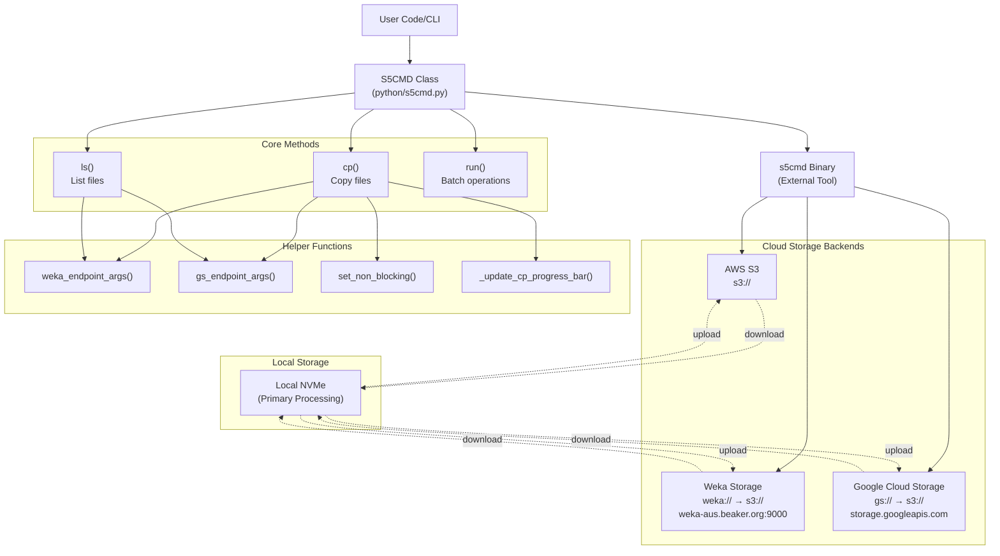
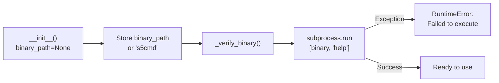
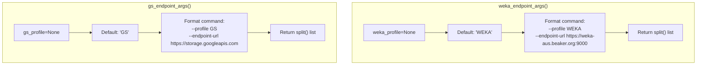
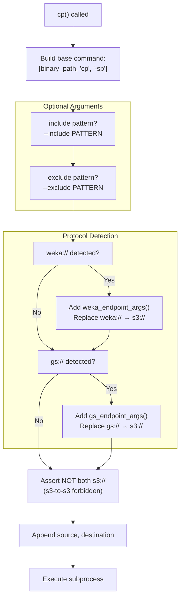
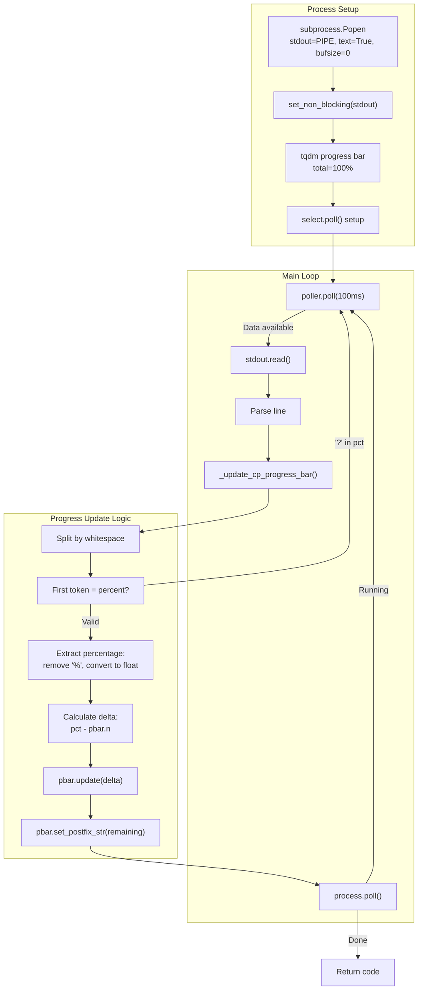
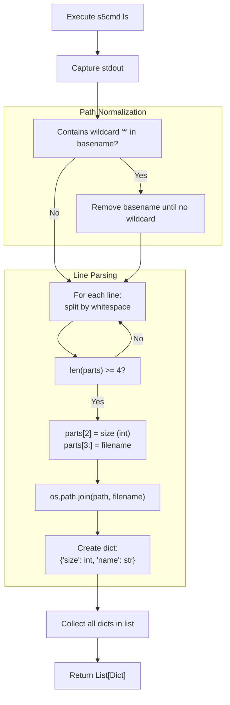
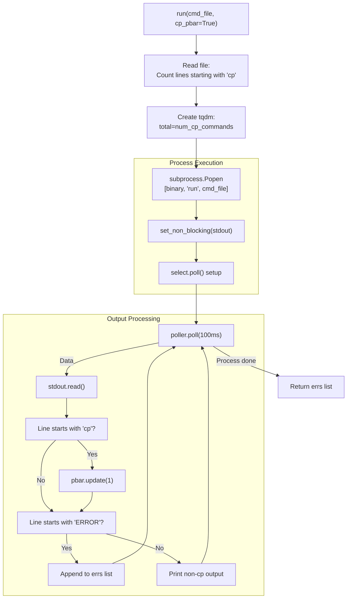
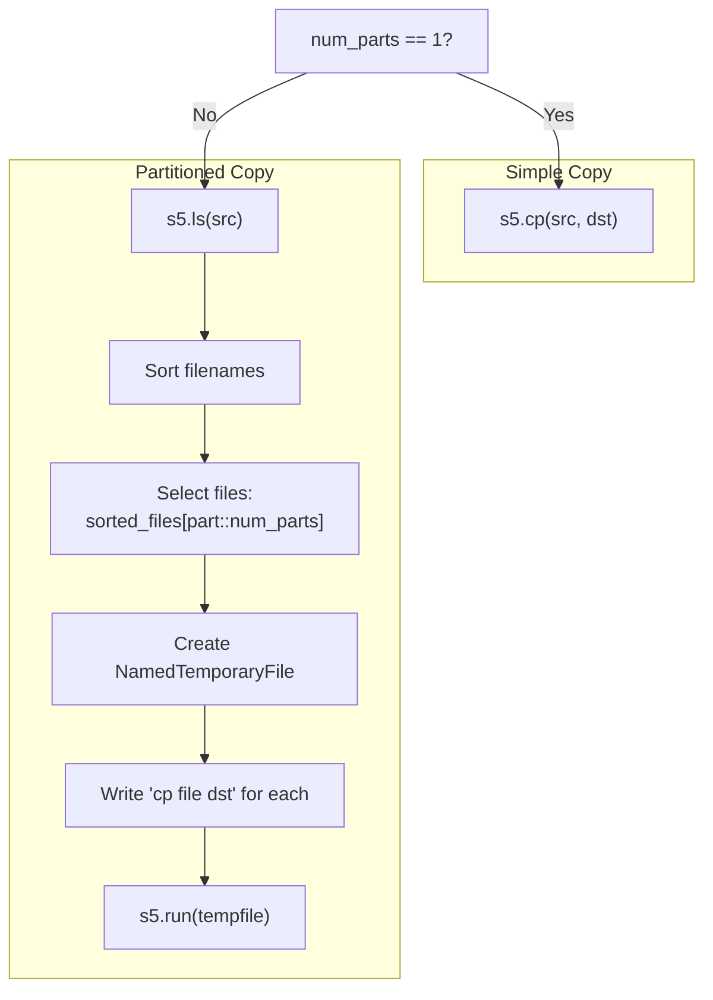
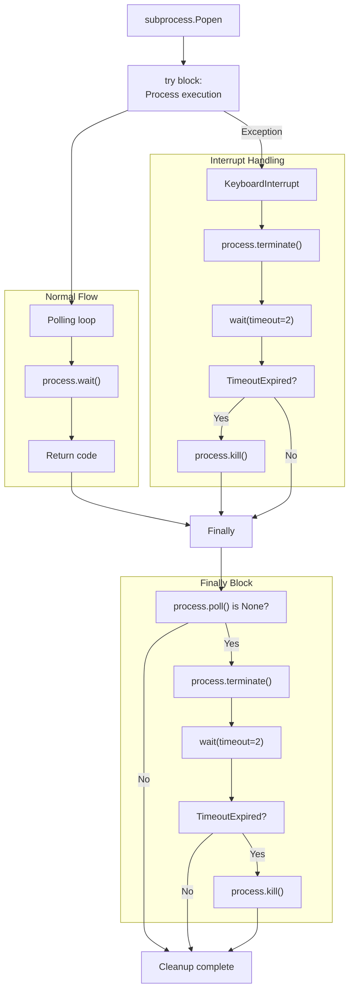
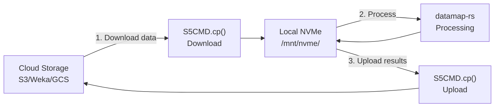

<!-- source: DeepWiki mcp.deepwiki.com · repo allenai/datamap-rs · page 7.2 S5CMD Wrapper for Cloud Storage · fetched 2026-10-26 -->

# S5CMD Wrapper for Cloud Storage

<details>
<summary>Relevant source files</summary>

The following files were used as context for generating this wiki page:

- [.gitignore](.gitignore)
- [python/s5cmd.py](python/s5cmd.py)

</details>


## Purpose and Scope

This page documents the Python wrapper for `s5cmd`, a high-performance command-line tool for transferring data between local storage and cloud object stores. The wrapper provides a programmatic interface to s5cmd with progress tracking, error handling, and unified support for AWS S3, Weka storage, and Google Cloud Storage.

This utility is part of the **Python Utilities Layer** and handles all cloud I/O operations in the typical datamap-rs workflow. For information about the overall data flow and storage strategy, see [Data Flow and Storage Strategy](#2.3). For information about downloading ML models and datasets, see [HuggingFace Downloaders](#7.1).

**Key Responsibilities:**
- Wrapping s5cmd binary with Python API
- Providing unified interface for S3, Weka, and GCS protocols
- Real-time progress tracking for data transfers
- Batch operations via command file execution
- Error collection and reporting

Sources: [python/s5cmd.py:1-402]()

---

## Architecture Overview

The s5cmd wrapper consists of a single Python class `S5CMD` that manages subprocess execution of the s5cmd binary. It translates protocol-specific URLs (weka://, gs:) into s3:// URLs with appropriate endpoint configurations, handles progress bar updates by parsing s5cmd output, and manages process lifecycle including graceful shutdown.

### Component Diagram



Sources: [python/s5cmd.py:51-266]()

---

## S5CMD Class Initialization

The `S5CMD` class is initialized with an optional path to the s5cmd binary. If no path is provided, it assumes the binary is available in the system PATH.

### Initialization Flow



**Implementation Details:**
- Constructor accepts `binary_path` parameter (defaults to `"s5cmd"`)
- Verification runs `s5cmd help` to ensure binary is executable
- Raises `RuntimeError` if binary cannot be executed

Sources: [python/s5cmd.py:56-80]()

---

## Protocol Support and Endpoint Configuration

The wrapper provides unified support for three cloud storage protocols by translating non-S3 URLs to S3-compatible endpoints with appropriate configuration.

### Protocol Translation Table

| Protocol | Input URL Pattern | Translated URL | Endpoint Configuration | Profile |
|----------|------------------|----------------|------------------------|---------|
| AWS S3 | `s3://bucket/path` | (unchanged) | (none) | Default AWS profile |
| Weka | `weka://bucket/path` | `s3://bucket/path` | `https://weka-aus.beaker.org:9000` | `WEKA` (default) |
| GCS | `gs://bucket/path` | `s3://bucket/path` | `https://storage.googleapis.com` | `GS` (default) |

### Endpoint Helper Functions



**Key Implementation Details:**
- Both functions default to specific profile names if not provided
- Return command arguments as split lists for subprocess
- Endpoint URLs are hardcoded for consistency

Sources: [python/s5cmd.py:35-48]()

---

## Copy Operation (cp)

The `cp` method is the primary data transfer operation, supporting file copies between local storage and cloud backends with progress tracking.

### Method Signature and Parameters

```python
def cp(
    source: str,
    destination: str,
    include: Optional[str] = None,
    exclude: Optional[str] = None,
    weka_profile: Optional[str] = None,
    gs_profile: Optional[str] = None,
) -> int
```

### Command Construction Flow



**Important Constraint:**
The method explicitly forbids S3-to-S3 transfers (both source and destination as s3:). This ensures all transfers involve local storage, maintaining the local-first architecture.

Sources: [python/s5cmd.py:82-130]()

### Progress Tracking Implementation

The `cp` method includes a sophisticated progress tracking system that parses s5cmd's output in real-time.



**Key Implementation Details:**
- Uses `fcntl` to set stdout to non-blocking mode
- `select.poll()` with 100ms timeout for responsive monitoring
- Skips lines with "?" in percentage (indeterminate progress)
- Calculates delta to avoid progress bar jumping backwards
- Extracts postfix information (throughput, ETA) from remaining tokens

Sources: [python/s5cmd.py:131-213]()

---

## List Operation (ls)

The `ls` method lists files in cloud storage or local directories, with support for recursive listing.

### Method Signature

```python
def ls(
    path: str,
    recursive: bool = False,
    weka_profile: Optional[str] = None,
    gs_profile: Optional[str] = None
) -> List[Dict]
```

### Output Parsing Logic



**Output Format:**
Each file is returned as a dictionary with two keys:
- `size`: File size in bytes (integer)
- `name`: Full path including the base path prefix

Sources: [python/s5cmd.py:215-265]()

---

## Batch Run Operation

The `run` method executes a file containing multiple s5cmd commands, enabling efficient batch operations. This is particularly useful for parallelized downloads where different workers process different subsets of files.

### Command File Format

Each line in the command file should be a complete s5cmd command:
```
cp s3://bucket/file1.jsonl.zst /local/path/
cp s3://bucket/file2.jsonl.zst /local/path/
cp s3://bucket/file3.jsonl.zst /local/path/
```

### Batch Execution Flow



**Progress Tracking Strategy:**
- Progress bar increments per completed `cp` command (not by file transfer percentage)
- Provides coarse-grained progress for large batch operations
- Collects all ERROR lines for post-execution review

Sources: [python/s5cmd.py:267-351]()

---

## CLI Commands

The module provides two CLI commands for direct command-line usage via Click framework.

### Download Command

```bash
python -m s5cmd download --src <source> --dst <destination> [--part N] [--num-parts M]
```

**Parameters:**
- `--src`: Source path (S3/Weka/GCS URL)
- `--dst`: Destination local path
- `--part`: Current partition index (0-based)
- `--num-parts`: Total number of partitions

**Partitioning Logic:**



**Use Case:** Enables parallel downloads by splitting file list across multiple workers. Worker 0 downloads files 0, M, 2M, ...; worker 1 downloads files 1, M+1, 2M+1, etc.

Sources: [python/s5cmd.py:359-388]()

### Upload Command

```bash
python -m s5cmd upload --src <source> [--dst <destination>]
```

**Parameters:**
- `--src`: Source local path
- `--dst`: Destination cloud URL (optional)

Simple wrapper around `S5CMD.cp()` for uploading local files to cloud storage.

Sources: [python/s5cmd.py:391-397]()

---

## Process Management and Error Handling

The wrapper includes robust process management to handle interruptions and ensure cleanup.

### Process Lifecycle Management



**Key Features:**
- Graceful termination on KeyboardInterrupt
- 2-second timeout before force kill
- Finally block ensures process cleanup
- Handles `OSError` during kill attempts

Sources: [python/s5cmd.py:177-199](), [python/s5cmd.py:327-349]()

---

## Non-Blocking I/O Implementation

The wrapper uses `fcntl` to configure file descriptors for non-blocking I/O, enabling responsive progress monitoring without deadlocks.

### Non-Blocking Setup

```python
def set_non_blocking(file_obj):
    """Set file object to non-blocking mode"""
    fd = file_obj.fileno()
    fl = fcntl.fcntl(fd, fcntl.F_GETFL)
    fcntl.fcntl(fd, fcntl.F_SETFL, fl | os.O_NONBLOCK)
```

**Technical Details:**
1. Get file descriptor number via `fileno()`
2. Read current flags with `F_GETFL`
3. Set flags with `F_SETFL`, adding `O_NONBLOCK`

This prevents `read()` calls from blocking when no data is available, allowing the polling loop to check process status regularly.

Sources: [python/s5cmd.py:28-32]()

---

## Usage Patterns

### Pattern 1: Simple Transfer

```python
from python.s5cmd import S5CMD

s5 = S5CMD()
return_code = s5.cp(
    source="s3://my-bucket/data/*.jsonl.zst",
    destination="/local/nvme/data/"
)
```

### Pattern 2: Weka Storage Transfer

```python
s5 = S5CMD()
return_code = s5.cp(
    source="weka://my-bucket/data/*.jsonl.zst",
    destination="/local/nvme/data/",
    weka_profile="WEKA"  # Optional, defaults to "WEKA"
)
```

### Pattern 3: Filtered Copy

```python
s5 = S5CMD()
return_code = s5.cp(
    source="s3://my-bucket/data/",
    destination="/local/nvme/data/",
    include="*.jsonl.zst",
    exclude="*test*"
)
```

### Pattern 4: List and Selective Download

```python
s5 = S5CMD()

# List all files
files = s5.ls("s3://my-bucket/data/", recursive=True)

# Filter and download
large_files = [f for f in files if f["size"] > 1_000_000]
for file_info in large_files:
    s5.cp(file_info["name"], "/local/nvme/data/")
```

### Pattern 5: Parallel Download via CLI

```bash
# Worker 0 of 4
python -m python.s5cmd download \
    --src s3://my-bucket/data/*.jsonl.zst \
    --dst /local/nvme/data/ \
    --part 0 \
    --num-parts 4

# Worker 1 of 4
python -m python.s5cmd download \
    --src s3://my-bucket/data/*.jsonl.zst \
    --dst /local/nvme/data/ \
    --part 1 \
    --num-parts 4
```

Sources: [python/s5cmd.py:82-397]()

---

## Integration with datamap-rs Workflow

The S5CMD wrapper is a critical component of the datamap-rs data lifecycle. It handles all cloud I/O operations in the typical workflow:

### Typical Workflow Integration



**Workflow Steps:**
1. **Download:** Use `S5CMD.cp()` to sync data from cloud to local NVMe
2. **Process:** Run datamap-rs commands (map, reshard, partition, etc.) on local data
3. **Upload:** Use `S5CMD.cp()` to sync results back to cloud storage

This local-first approach is essential for performance, as cloud I/O latency would severely impact processing throughput. The high-speed s5cmd tool ensures data transfer is not the bottleneck.

Sources: [python/s5cmd.py:1-402]()

---

## Dependencies

| Dependency | Purpose | Used In |
|------------|---------|---------|
| `subprocess` | Execute s5cmd binary | All operations |
| `fcntl` | Non-blocking I/O configuration | Progress tracking |
| `select` | Polling for data availability | Progress tracking |
| `boto3` | AWS SDK (imported but not actively used) | Future extensibility |
| `click` | CLI framework | download/upload commands |
| `tqdm` | Progress bar display | cp and run operations |

Sources: [python/s5cmd.py:1-15]()

---

## Performance Considerations

1. **s5cmd is Fast:** The underlying s5cmd tool uses parallel connections and optimized protocols for high throughput
2. **Non-Blocking I/O:** Prevents progress monitoring from impacting transfer speed
3. **Batch Operations:** `run()` method enables efficient handling of thousands of files
4. **Local-First Architecture:** All processing happens on local NVMe, eliminating network latency from critical path
5. **Progress Overhead:** Progress bar parsing adds minimal overhead due to efficient line-by-line processing

The wrapper adds minimal overhead to s5cmd's native performance while providing essential progress feedback and error handling for production workflows.

Sources: [python/s5cmd.py:1-402]()

---

