# Page: Overview

# Overview

<details>
<summary>Relevant source files</summary>

The following files were used as context for generating this wiki page:

- [Cargo.toml](Cargo.toml)
- [README.md](README.md)
- [src/main.rs](src/main.rs)

</details>


This document introduces datamap-rs, its purpose, architecture, and when to use it. For installation instructions and environment setup, see [Installation and Setup](#1.1). For hands-on examples, see [Quick Start Guide](#1.2).

## Purpose and Scope

datamap-rs is a high-performance Rust toolkit for processing, filtering, and transforming large-scale text datasets stored in JSONL format. It provides nine specialized commands that operate on terabyte-scale data using parallel processing and a local-first storage architecture.

The system is designed for batch processing workflows where data is downloaded to local NVMe storage, processed using multiple CPU cores, and uploaded back to cloud storage. This approach prioritizes reliability and performance over streaming-based architectures.

**Sources:** [README.md:1-21](), [src/main.rs:1-50]()

## What Problems Does datamap-rs Solve?

datamap-rs addresses the challenges of large-scale data curation and processing:

| Problem | Solution in datamap-rs |
|---------|----------------------|
| **Quality filtering at scale** | Configurable pipeline with 31+ processors (filters, modifiers, annotators) |
| **Uneven file sizes** | `Reshard` command normalizes to 256MB chunks |
| **Categorical organization** | `DiscretePartition` splits by discrete fields (language, domain) |
| **Numeric organization** | `RangePartition` splits by continuous values with quantile support |
| **Deduplication** | Two-stage `Group` → `GroupFilter` workflow |
| **Statistical sampling** | `ReservoirSample` with optional token-weighting |
| **Dataset statistics** | `Count` command for documents, sizes, and text bytes |
| **Data mixing** | `Shuffle` command for random redistribution |

All operations are **embarrassingly parallel at the file level**, processing hundreds of files simultaneously while maintaining deterministic per-document semantics.

**Sources:** [README.md:22-69](), [src/main.rs:59-224]()

## System Architecture

datamap-rs follows a three-layer architecture: Python utilities for cloud I/O, Rust core for data processing, and local NVMe storage as the processing substrate.

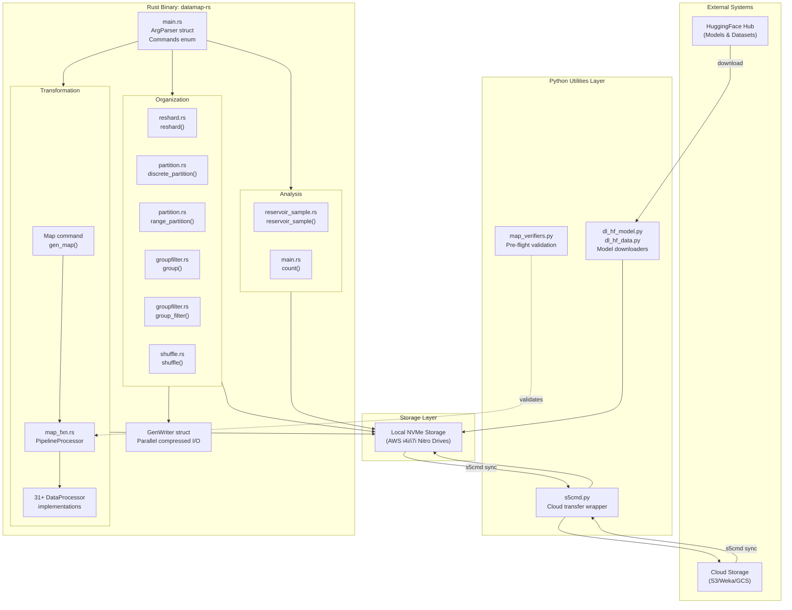

**Architecture Diagram: Three-Layer System**

The Python layer handles unreliable network I/O, the Rust core performs deterministic data processing, and local NVMe storage provides the performance substrate. The boundary between Python and Rust is the filesystem.

**Sources:** [src/main.rs:1-50](), [README.md:113-128](), [Cargo.toml:1-45]()

## Command Structure

The CLI is implemented using the `clap` framework with a `Commands` enum defining nine subcommands. All commands accept `--threads N` to control parallelism (defaults to all available cores).

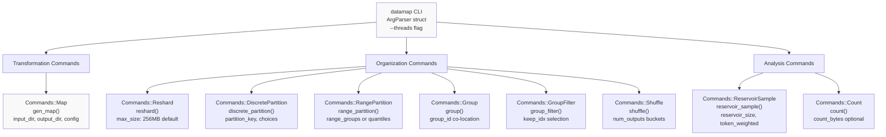

**Command Hierarchy Diagram**

Each command corresponds to a variant in the `Commands` enum at [src/main.rs:59-224]() and dispatches to a dedicated function. The `Map` command is the most complex, supporting arbitrary transformation pipelines.

**Sources:** [src/main.rs:49-224](), [src/main.rs:506-584]()

## Key Design Principles

### Local-First Architecture

datamap-rs **requires** local storage and does not support streaming from cloud storage. This is not a limitation but an architectural decision for reliability and performance.

**Workflow pattern:**
```
1. Download:  s5cmd sync s3://bucket/input ./local/input
2. Process:   datamap map --input-dir ./local/input --output-dir ./local/output
3. Upload:    s5cmd sync ./local/output s3://bucket/output
```

The system assumes fast NVMe drives (AWS i4i/i7i instances with Nitro Drives are recommended). Processing directly from S3 is "finnicky and unreliable" per design documentation.

**Sources:** [README.md:20-21](), [README.md:113-128]()

### File-Level Parallelism

The system uses Rayon's parallel iterators to process files concurrently. Each file is processed by a single thread from start to finish. This means:

- **Parallelism scales with number of files**, not file size
- Documents within a file are processed sequentially through the pipeline
- The 256MB target file size balances parallelism (more files = more parallel work) with memory usage (larger files = more RAM per thread)

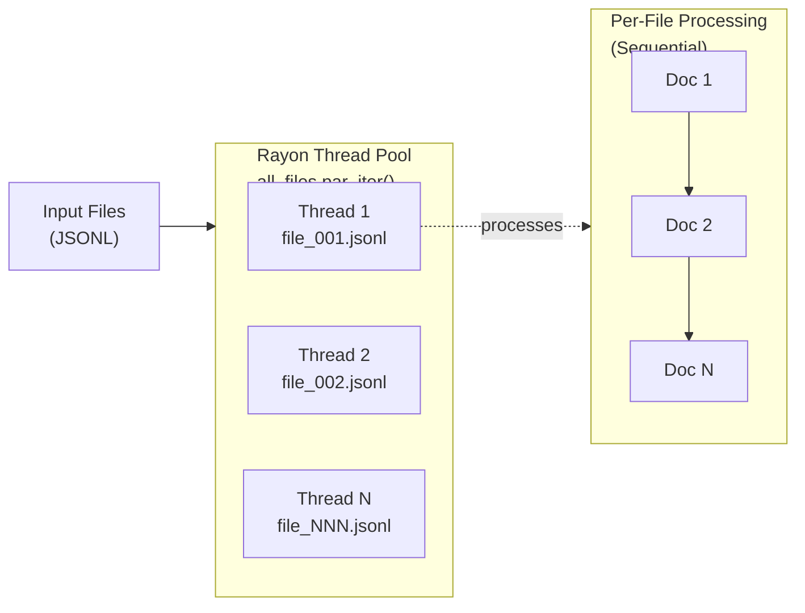

**Parallelism Model Diagram**

At [src/main.rs:359](), the code uses `all_files.par_iter().for_each()` to distribute files across threads. Within each file, documents are processed sequentially at [src/main.rs:407-411]().

**Sources:** [src/main.rs:359-382](), [README.md:104-112]()

### JSONL Format and Compression

All input and output uses **JSONL** (newline-delimited JSON) with **Zstandard compression** (level 3). Files follow the naming pattern `*.jsonl.zst`. This format enables:

- Line-by-line streaming (memory-efficient)
- Parallel processing (each line is independent)
- Fast compression/decompression
- Human-readable when uncompressed

**Sources:** [README.md:10-19](), [Cargo.toml:32]()

## When to Use datamap-rs

Use datamap-rs when you need to:

| Scenario | Recommended Commands |
|----------|---------------------|
| **Filter low-quality documents** | `map` with filter processors |
| **Add metadata annotations** | `map` with annotator processors |
| **Normalize file sizes** | `reshard` to 256MB chunks |
| **Organize by language/domain** | `discrete-partition` by category field |
| **Organize by quality score** | `range-partition` with quantiles |
| **Deduplicate by ID** | `group` then `group-filter` |
| **Create training samples** | `reservoir-sample` with token-weighting |
| **Mix datasets** | `shuffle` for random redistribution |
| **Audit dataset statistics** | `count` for docs/bytes totals |

**Do not use datamap-rs for:**
- Real-time streaming processing (designed for batch)
- Small datasets (<10GB) where overhead isn't worth it
- Non-JSONL formats without conversion
- Processing without local NVMe storage

**Sources:** [README.md:22-69](), [README.md:104-112]()

## Core Components Map

The following table maps system concepts to code entities:

| Concept | Code Entity | Location |
|---------|-------------|----------|
| CLI entry point | `fn main()` | [src/main.rs:506-584]() |
| Command definitions | `enum Commands` | [src/main.rs:59-224]() |
| Argument parsing | `struct ArgParser` | [src/main.rs:49-57]() |
| Pipeline orchestration | `struct PipelineProcessor` | [src/map_fxn.rs]() |
| Individual processors | `trait DataProcessor` | [src/map_fxn.rs]() |
| Parallel file writing | `struct GenWriter` | Referenced in multiple modules |
| Configuration parsing | `fn parse_config()` | [src/main.rs:230-248]() |
| Statistics collection | `DashMap<usize, AtomicUsize>` | [src/main.rs:348-354]() |
| File discovery | `expand_dirs()` | From `mj_io` crate |
| Progress tracking | `build_pbar()` | From `mj_io` crate |

**Sources:** [src/main.rs:1-584](), [Cargo.toml:10-40]()

## Typical Data Flow

A complete processing workflow involves three stages:

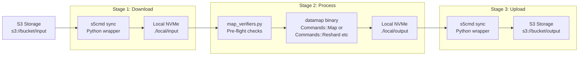

**Complete Workflow Diagram**

The verification step (optional but recommended) checks that required models and banlists exist before processing begins. For complex workflows involving multiple commands, see [Common Workflow Patterns](#1.3).

**Sources:** [README.md:113-137](), [README.md:139-151]()

## Technology Stack Summary

datamap-rs leverages specialized Rust libraries for performance:

| Category | Libraries | Purpose |
|----------|-----------|---------|
| **Concurrency** | `rayon`, `dashmap` | File-level parallelism, lock-free maps |
| **JSON** | `serde_json`, `sonic-rs`, `simd-json`, `gjson` | Parsing, serialization, path queries |
| **Text Processing** | `fasttext`, `tiktoken-rs`, `aho-corasick`, `regex` | ML models, tokenization, pattern matching |
| **Hashing** | `fxhash`, `xxhash-rust`, `ahash` | Fast hashing for grouping/shuffling |
| **Compression** | `zstd` | Level 3 compression for all output |
| **CLI** | `clap` | Command-line argument parsing |

For detailed information on each library and when it's used, see [Technology Stack](#9).

**Sources:** [Cargo.toml:10-40]()

---

**Navigation:**
- Next: [Installation and Setup](#1.1)
- Related: [System Architecture](#2) for deep architectural details
- Related: [Map Command (Pipeline Processing)](#3) for the most complex subsystem

---

# Page: Installation and Setup

# Installation and Setup

<details>
<summary>Relevant source files</summary>

The following files were used as context for generating this wiki page:

- [Cargo.toml](Cargo.toml)
- [README.md](README.md)

</details>


This page guides you through installing datamap-rs and setting up the required environment. By the end, you will have a working `datamap` binary and understand how to configure optional components like Python utilities, cloud storage tools, and ML models.

For running your first data processing workflow, see [Quick Start Guide](#1.2). For understanding why certain setup choices matter (like local NVMe storage), see [Data Flow and Storage Strategy](#2.3).

---

## Prerequisites

### Rust Toolchain

datamap-rs requires Rust 2021 edition or later. The build system uses Cargo, Rust's package manager.

**Installation:**
```bash
curl --proto '=https' --tlsv1.2 -sSf https://sh.rustup.rs | sh
```

After installation, verify:
```bash
rustc --version  # Should show 1.56.0 or higher
cargo --version
```

**Sources:** [README.md:73-76]()

### System Requirements

| Resource | Minimum | Recommended |
|----------|---------|-------------|
| CPU Cores | 4 | 16+ (parallelism scales linearly) |
| RAM | 8GB | 32GB+ (depends on document sizes) |
| Storage | 100GB SSD | 1TB+ NVMe (AWS i4i/i7i instances) |
| OS | Linux, macOS | Linux on AWS Nitro |

The architecture assumes **local file processing** rather than streaming from cloud storage. Fast local NVMe drives are critical for performance.

**Sources:** [README.md:20](), Diagram 5, Diagram 6

---

## Core Binary Installation

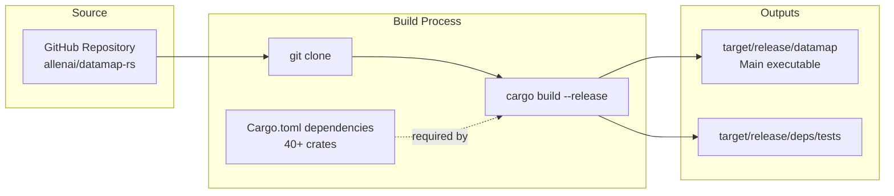

**Diagram: Core Installation Flow**

### Steps

1. **Clone the repository:**
```bash
git clone https://github.com/allenai/datamap-rs
cd datamap-rs
```

2. **Build the release binary:**
```bash
cargo build --release
```

This compiles with optimizations enabled. Build time: 5-15 minutes depending on system.

3. **Locate the binary:**
```bash
ls -lh target/release/datamap
# Binary is typically 30-50MB
```

4. **Optional: Add to PATH:**
```bash
# Add to ~/.bashrc or ~/.zshrc
export PATH="$PATH:/path/to/datamap-rs/target/release"
```

Or copy to a system location:
```bash
sudo cp target/release/datamap /usr/local/bin/
```

**Sources:** [README.md:79-89]()

---

## Dependency Overview

The build process automatically downloads and compiles all Rust dependencies. Understanding these helps troubleshoot build issues.

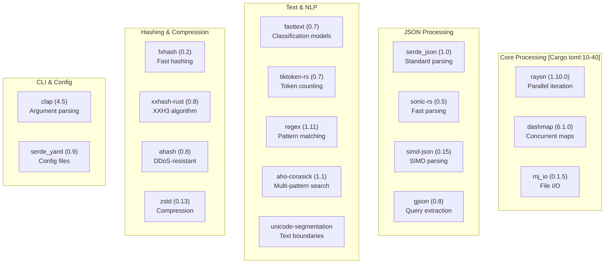

**Diagram: Cargo Dependencies by Category**

### Notable Dependencies

- **`rayon`**: Enables file-level parallelism across all commands
- **`fasttext`**: Required for `FastTextAnnotator` and `FastTextLanguageFilter` processors
- **`tiktoken-rs`**: Required for `TiktokenTokenCounter` processor
- **`zstd`**: All output files use Zstandard compression (level 3)
- **`mj_io`**: Handles file reading/writing with automatic decompression

**Sources:** [Cargo.toml:10-40]()

---

## Optional Components

### Python Utilities

Three Python scripts provide cloud integration and verification:

| Script | Purpose | When Needed |
|--------|---------|-------------|
| `utils/dl_hf_model.py` | Download HuggingFace models | Using FastText processors |
| `utils/dl_hf_data.py` | Download HuggingFace datasets | Processing HF datasets |
| `utils/s5cmd.py` | Wrapper for s5cmd S3 tool | Cloud storage workflows |
| `utils/map_verifiers.py` | Validate pipeline configs | Before large processing runs |

**Installation:**
```bash
pip install boto3 click tqdm huggingface-hub
```

These scripts are standalone and don't affect the Rust binary. See [Python Utilities](#7) for detailed documentation.

**Sources:** [README.md:91-94](), Diagram 6

### S5CMD: Cloud Storage CLI

`s5cmd` is a high-performance S3 client used for downloading/uploading data. It supports S3, Weka (`weka://`), and GCS (`gs://`) protocols.

**Installation (Linux):**
```bash
wget https://github.com/peak/s5cmd/releases/download/v2.2.2/s5cmd_2.2.2_Linux-64bit.tar.gz
tar -xvzf s5cmd_2.2.2_Linux-64bit.tar.gz
sudo mv s5cmd /usr/local/bin
chmod +x /usr/local/bin/s5cmd
```

**Verification:**
```bash
s5cmd version
# Output: s5cmd version 2.2.2
```

The typical workflow is:
1. `s5cmd sync s3://source ./local/` - Download to NVMe
2. `datamap map ...` - Process locally
3. `s5cmd sync ./local/ s3://dest` - Upload results

See [S5CMD Wrapper for Cloud Storage](#7.2) for Python wrapper usage.

**Sources:** [README.md:96-102](), [README.md:115-128](), Diagram 6

---

## ML Model Setup

Certain processors require pre-trained models that must be downloaded separately.

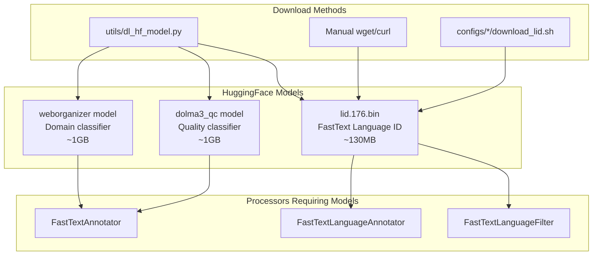

**Diagram: ML Model Dependencies**

### FastText Language ID Model

**Location:** Used by `FastTextLanguageFilter` and `FastTextLanguageAnnotator`

**Download options:**

1. **Using provided script:**
```bash
cd configs/all_dressed
./download_lid.sh
# Downloads to configs/all_dressed/lid.176.bin
```

2. **Using Python utility:**
```bash
python utils/dl_hf_model.py \
  --model facebook/fasttext-language-identification \
  --filename lid.176.bin \
  --output ./models/
```

3. **Manual download:**
```bash
wget https://dl.fbaipublicfiles.com/fasttext/supervised-models/lid.176.bin
```

### Custom FastText Models

For `FastTextAnnotator` with custom models, ensure the model path in your pipeline configuration points to an accessible `.bin` file.

**Example configuration:**
```yaml
- processor: FastTextAnnotator
  annotator_name: "quality_score"
  model_path: "/path/to/dolma3_qc.bin"
  score_names: ["low", "medium", "high"]
```

**Sources:** [README.md:137](), Diagram 3, Diagram 6

---

## Storage Configuration

### Local Storage Architecture

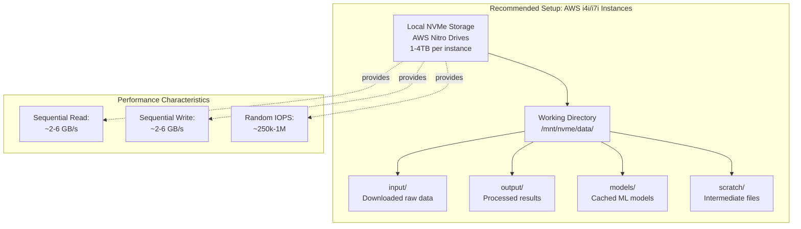

**Diagram: Recommended Storage Layout**

### Instance Recommendations

| Instance Type | NVMe Capacity | vCPUs | RAM | Use Case |
|---------------|---------------|-------|-----|----------|
| i4i.2xlarge | 468 GB | 8 | 64 GB | Development/testing |
| i4i.8xlarge | 1,875 GB | 32 | 256 GB | Medium workloads |
| i4i.16xlarge | 3,750 GB | 64 | 512 GB | Large-scale processing |
| i7i.16xlarge | 3,750 GB | 64 | 512 GB | Latest generation |

**Why local NVMe matters:**
- Datamap processes files in parallel (one thread per file)
- Fast local I/O enables maximum CPU utilization
- Cloud streaming introduces latency and reliability issues
- The 256MB file size target is optimized for NVMe performance

**Sources:** [README.md:20](), Diagram 5, Diagram 6

---

## Verification

### Test Basic Functionality

1. **Check binary works:**
```bash
datamap --help
# Should display command list
```

2. **Verify command availability:**
```bash
datamap map --help
datamap reshard --help
datamap count --help
```

3. **Test with small dataset:**
```bash
# Create test data
echo '{"text": "hello", "id": 1}' > test.jsonl
echo '{"text": "world", "id": 2}' >> test.jsonl

# Run count command
datamap count --input test.jsonl --text-field text
# Expected output:
# Documents: 2
# Total text bytes: 10
```

### Verify Optional Components

```bash
# Test Python utilities available
python utils/dl_hf_model.py --help
python utils/s5cmd.py --help

# Test s5cmd installed
s5cmd version

# Test ML model downloaded
ls -lh configs/all_dressed/lid.176.bin
# Should show ~130MB file
```

### Common Build Issues

| Issue | Solution |
|-------|----------|
| `linker 'cc' not found` | Install build tools: `sudo apt-get install build-essential` |
| `fasttext` compilation fails | Install C++ compiler: `sudo apt-get install g++` |
| Out of memory during build | Use `cargo build --release --jobs 1` to limit parallelism |
| Slow build on EC2 | Ensure using instance with adequate CPU (not t2/t3) |

**Sources:** [Cargo.toml:1-45](), [README.md:72-102]()

---

## Next Steps

After installation:

1. **Verify with a simple workflow:** See [Quick Start Guide](#1.2)
2. **Understand common patterns:** See [Common Workflow Patterns](#1.3)
3. **Explore example pipelines:** Review `configs/` directory or see [Example: DCLM Pipeline](#8.2)
4. **Set up cloud storage:** Configure AWS credentials for S3 access (if needed)

For development and extending datamap-rs, see [Development Guide](#10).

**Sources:** [README.md:131-151]()

---

# Page: Quick Start Guide

# Quick Start Guide

<details>
<summary>Relevant source files</summary>

The following files were used as context for generating this wiki page:

- [.gitignore](.gitignore)
- [README.md](README.md)
- [docs/map.md](docs/map.md)
- [python/s5cmd.py](python/s5cmd.py)

</details>


## Purpose and Scope

This guide walks through your first end-to-end workflow with datamap-rs, from preparing data to interpreting results. You'll learn the basic command patterns and see how different commands work together in typical data processing workflows.

For installation instructions, see [Installation and Setup](#1.1). For comprehensive multi-command workflows, see [Common Workflow Patterns](#1.3). For detailed pipeline configuration, see [Pipeline Configuration](#3.6).

**Sources:** [README.md:1-151]()

---

## Prerequisites

Before starting, ensure you have:
- **datamap-rs binary** built and accessible in your PATH
- **Local storage** with sufficient space (NVMe drives recommended)
- **Sample JSONL data** to process
- **(Optional)** s5cmd installed for cloud storage operations
- **(Optional)** FastText models if using language classification

**Sources:** [README.md:71-103]()

---

## Example 1: Simple Text Filtering Pipeline

### Workflow Overview

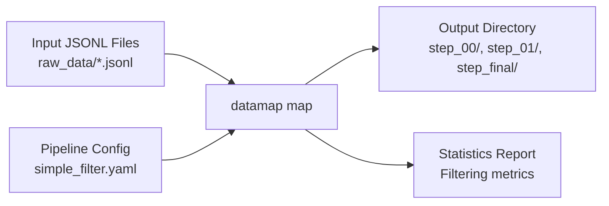

**Sources:** [README.md:26-29](), [docs/map.md:1-192]()

### Step 1: Prepare Sample Data

Create a directory with sample JSONL files. Each line should be a valid JSON object:

```bash
mkdir -p input_data
cat > input_data/sample.jsonl << 'EOF'
{"text": "This is a short text."}
{"text": "This is a much longer text with many words that should pass our minimum length filter. It contains substantial content that demonstrates what we consider acceptable document length."}
{"text": "Hi"}
{"text": "The quick brown fox jumps over the lazy dog. This sentence contains many common English words including articles and prepositions."}
{"text": "Lorem ipsum dolor sit amet consectetur adipiscing elit sed do eiusmod tempor incididunt."}
EOF
```

**Sources:** [docs/map.md:28-33]()

### Step 2: Create Pipeline Configuration

Create a simple pipeline that filters by text length and ensures English stop words are present:

```bash
cat > simple_filter.yaml << 'EOF'
text_field: "text"
pipeline:
  - name: "text_len_filter"
    kwargs:
      lower_bound: 50
      upper_bound: 100000
  - name: "stop_word_filter"
    kwargs:
      min_stop_word: 3
  - name: "word_count_adder"
    kwargs:
      word_count_field: "word_count"
EOF
```

This pipeline:
1. **text_len_filter**: Removes documents with fewer than 50 or more than 100,000 characters
2. **stop_word_filter**: Removes documents without at least 3 common English stop words
3. **word_count_adder**: Adds word count metadata to surviving documents

**Sources:** [docs/map.md:67-84]()

### Step 3: Run the Map Command

```bash
datamap map \
  --input_dir ./input_data \
  --output_dir ./output_data \
  --config simple_filter.yaml
```

### Command Components

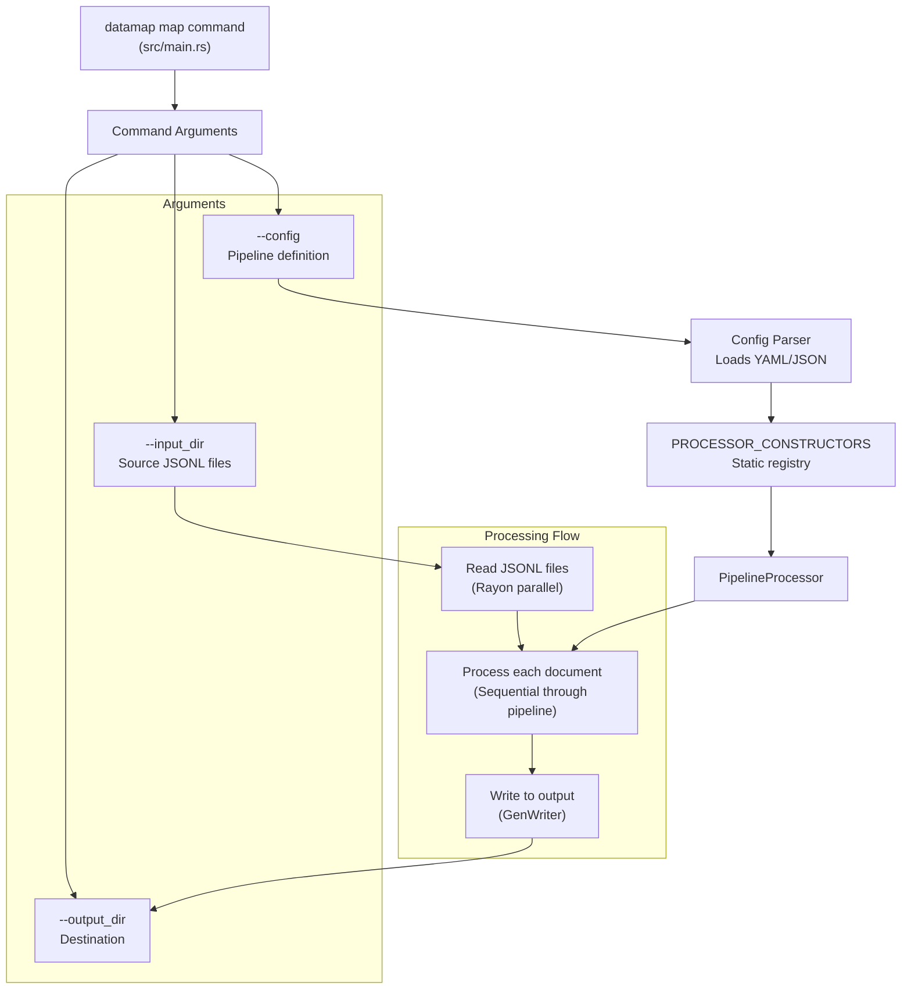

**Sources:** [docs/map.md:8-26](), [README.md:26-29]()

### Step 4: Examine Output Structure

The map command creates a structured output directory:

```bash
output_data/
├── step_00/           # Filtered at text_len_filter (step 0)
│   └── sample.jsonl.zst
├── step_01/           # Filtered at stop_word_filter (step 1)
│   └── sample.jsonl.zst
└── step_final/        # Passed all filters
    └── sample.jsonl.zst
```

| Directory | Contents | Meaning |
|-----------|----------|---------|
| `step_00/` | Documents removed by processor at position 0 | Failed `text_len_filter` (too short/long) |
| `step_01/` | Documents removed by processor at position 1 | Failed `stop_word_filter` (insufficient stop words) |
| `step_final/` | Documents that survived entire pipeline | Passed all filters, includes word_count annotation |

**Sources:** [docs/map.md:34-52]()

### Step 5: Inspect Results

```bash
# View documents that passed all filters
zstd -d output_data/step_final/sample.jsonl.zst -c | head -2

# Count documents at each stage
echo "Filtered at step 0 (text_len_filter):"
zstd -d output_data/step_00/sample.jsonl.zst -c | wc -l

echo "Filtered at step 1 (stop_word_filter):"
zstd -d output_data/step_01/sample.jsonl.zst -c | wc -l

echo "Final output:"
zstd -d output_data/step_final/sample.jsonl.zst -c | wc -l
```

**Expected output documents in `step_final/`:**
- Document 2: Long text with stop words and word_count field added
- Document 4: Fox sentence with stop words and word_count field added

**Sources:** [docs/map.md:49-63]()

### Understanding Pipeline Statistics

After processing completes, datamap prints statistics:

```
Processing Statistics:
=====================
Total documents processed: 5
Total processing time: 0.15s

Step 0 (text_len_filter):
  - Removed: 2 documents (40.0% of input)
  - Remaining: 3 documents

Step 1 (stop_word_filter):
  - Removed: 1 document (33.3% of remaining, 20.0% of total)
  - Remaining: 2 documents

Step 2 (word_count_adder):
  - Modified: 2 documents
  - Final output: 2 documents (40.0% of input)
```

**Sources:** [docs/map.md:54-63]()

---

## Example 2: File Size Normalization

### Why Reshard?

Uneven file sizes hurt parallel processing efficiency. The reshard command normalizes files to approximately 256MB (uncompressed), which balances:
- **Parallelism**: More files = more parallel work units
- **Memory**: Smaller files = lower memory per thread
- **Throughput**: 256MB is optimal for I/O patterns

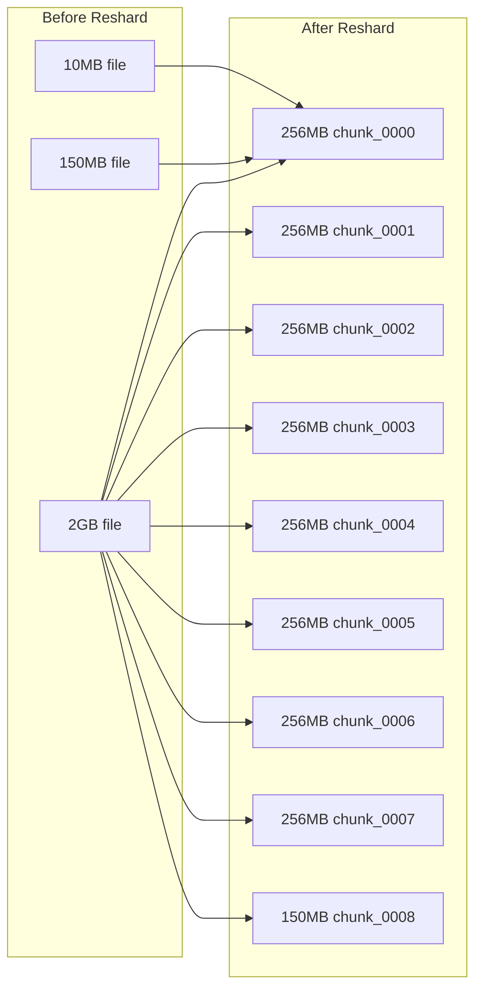

**Sources:** [README.md:31-33]()

### Run Reshard Command

```bash
datamap reshard \
  --input_dir ./output_data/step_final \
  --output_dir ./resharded_data \
  --target_size_mb 256
```

This produces files of approximately 256MB (uncompressed) named `chunk_0000.jsonl.zst`, `chunk_0001.jsonl.zst`, etc.

**Command Arguments:**
- `--input_dir`: Source directory with JSONL files (any size)
- `--output_dir`: Destination for normalized files
- `--target_size_mb`: Target file size in MB (default: 256)
- `--respect_subdirectory`: (Optional) Maintain subdirectory structure

**Sources:** [README.md:31-33]()

---

## Example 3: Dataset Statistics

### Count Command Overview

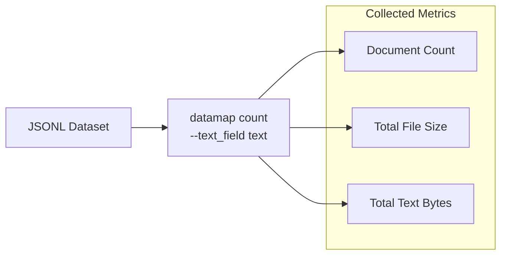

**Sources:** [README.md:66-69]()

### Run Count Command

```bash
datamap count \
  --input_dir ./resharded_data \
  --text_field text
```

**Example Output:**
```
Dataset Statistics:
==================
Total documents: 1,247,839
Total file size: 4.2 GB (compressed)
Total text bytes: 15.8 GB (uncompressed)
Average document size: 12,657 bytes
```

**Command Arguments:**
- `--input_dir`: Directory containing JSONL files
- `--text_field`: (Optional) Field to measure text byte count
- `--threads`: (Optional) Number of parallel threads

**Sources:** [README.md:66-69]()

---

## Example 4: Cloud Storage Integration

### Download-Process-Upload Workflow

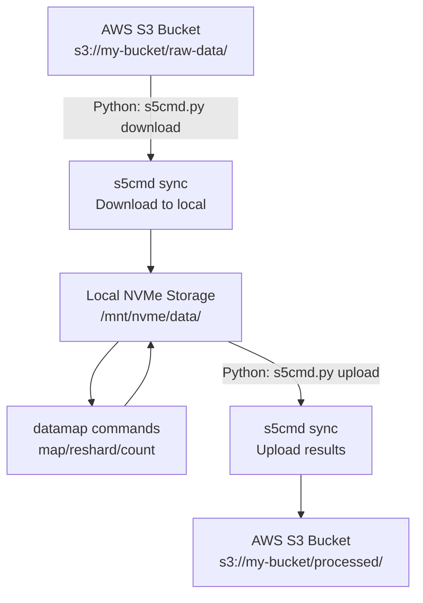

**Sources:** [README.md:113-128](), [python/s5cmd.py:1-402]()

### Using s5cmd Directly

```bash
# Download from S3 to local
s5cmd sync s3://my-bucket/raw-data/ ./local-data/

# Process with datamap
datamap map \
  --input_dir ./local-data \
  --output_dir ./processed-data \
  --config my_pipeline.yaml

# Upload results back to S3
s5cmd sync ./processed-data/ s3://my-bucket/processed-data/
```

**Sources:** [README.md:117-122]()

### Using Python Wrapper for Partitioned Downloads

For large datasets, download in parallel parts:

```bash
# Download part 0 of 4 (downloads every 4th file)
python python/s5cmd.py download \
  --src s3://my-bucket/raw-data/ \
  --dst ./local-data/ \
  --part 0 \
  --num-parts 4
```

The wrapper:
1. Lists all files with `s5.ls()` [python/s5cmd.py:215-265]()
2. Sorts and partitions the file list [python/s5cmd.py:380-382]()
3. Generates an s5cmd run file [python/s5cmd.py:384-387]()
4. Executes with progress bar [python/s5cmd.py:388]()

**Sources:** [README.md:124-128](), [python/s5cmd.py:359-389]()

---

## Command Composition Patterns

### Pattern 1: Quality Filtering

```bash
# Step 1: Run quality filters
datamap map \
  --input_dir ./raw \
  --output_dir ./filtered \
  --config quality_filters.yaml

# Step 2: Normalize file sizes
datamap reshard \
  --input_dir ./filtered/step_final \
  --output_dir ./final \
  --target_size_mb 256

# Step 3: Verify results
datamap count --input_dir ./final --text_field text
```

**Sources:** [README.md:22-69]()

### Pattern 2: Deduplication Workflow

```bash
# Step 1: Group documents by ID
datamap group \
  --input_dir ./data \
  --output_dir ./grouped \
  --group_key document_id

# Step 2: Keep one document per group
datamap group-filter \
  --input_dir ./grouped \
  --output_dir ./deduplicated \
  --keep_idx 0
```

**Sources:** [README.md:51-59]()

---

## Common Next Steps

After completing this quick start, you may want to:

1. **Learn more complex pipelines**: See [Pipeline Configuration](#3.6) and [Example: DCLM Pipeline](#8.2)
2. **Understand processor types**: See [Filter Processors](#3.3), [Modifier Processors](#3.4), [Annotator Processors](#3.5)
3. **Explore partitioning**: See [Discrete Partition](#4.2) and [Range Partition](#4.3)
4. **Set up verification**: See [Pipeline Verification Tool](#7.3)
5. **Optimize performance**: See [Parallelism and Performance Model](#2.2)

### Key Takeaways

| Concept | Summary |
|---------|---------|
| **Local-first architecture** | Always download to fast local storage, process, then upload |
| **File-level parallelism** | Each input file processed independently on separate thread |
| **Sequential pipelines** | Documents flow sequentially through pipeline stages |
| **Structured output** | `step_XX/` directories show where documents were filtered |
| **Compression** | All output uses Zstandard level 3 compression (.zst) |
| **256MB sweet spot** | Optimal file size balances parallelism and memory usage |

**Sources:** [README.md:1-151](), [docs/map.md:1-192]()

---

# Page: Common Workflow Patterns

# Common Workflow Patterns

<details>
<summary>Relevant source files</summary>

The following files were used as context for generating this wiki page:

- [README.md](README.md)
- [docs/partition.md](docs/partition.md)
- [src/main.rs](src/main.rs)

</details>


## Purpose and Scope

This document describes typical multi-command workflows used with datamap-rs and when to apply each pattern. It provides concrete examples of how to chain commands together to accomplish common data processing tasks.

For detailed information about individual commands, see their respective documentation sections: [Map Command](#3), [Data Organization Commands](#4), and [Analysis Commands](#5). For a simple introduction to using datamap-rs, see [Quick Start Guide](#1.2).

---

## Fundamental Workflow Architecture

All datamap-rs workflows follow a **local-first processing model** where data is downloaded to fast local storage, processed, and then uploaded back to cloud storage. This architecture is not optional—it is a core design requirement for performance and reliability.

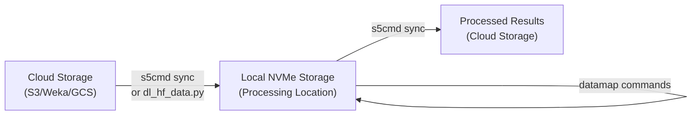

**Sources:** [README.md:20-21](), [README.md:115-128]()

### Typical Workflow Steps

| Step | Tool | Purpose |
|------|------|---------|
| 1. Download | `s5cmd`, `dl_hf_data.py`, `dl_hf_model.py` | Transfer data and models to local NVMe storage |
| 2. Verify | `map_verifiers.py` | Pre-flight check of pipeline configurations and resources |
| 3. Process | `datamap` commands | Execute data transformations |
| 4. Upload | `s5cmd` | Transfer results back to cloud storage |

**Example:**
```bash
# Step 1: Download data
s5cmd sync s3://bucket/raw_data ./local/input

# Step 2: Download models if needed
python utils/dl_hf_model.py facebook/fasttext-language-identification

# Step 3: Verify configuration
python utils/map_verifiers.py verify --config pipeline.yaml

# Step 4: Process data
datamap map --input_dir ./local/input --output_dir ./local/output --config pipeline.yaml

# Step 5: Upload results
s5cmd sync ./local/output s3://bucket/processed_data
```

**Sources:** [README.md:115-128](), Diagram 6 from system architecture

---

## Pattern 1: Sequential Pipeline Processing

**Use Case:** Apply a series of filters, modifiers, and annotators to transform and clean data.

This is the most common pattern, using the [`map`](#3) command with a configured pipeline of processors.

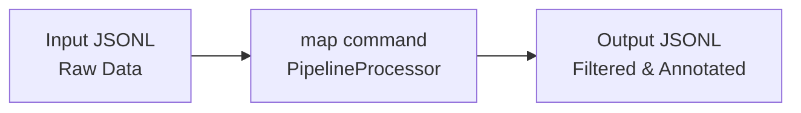

**Configuration Structure:**
```yaml
pipeline:
  - name: "URLSubstringFilter"
    kwargs:
      banlist_path: "./banlists/domains.txt"
  - name: "FastTextAnnotator"
    kwargs:
      model_path: "./models/lid176.bin"
      field: "metadata.language"
  - name: "MassiveWebRepetitionFilter"
    kwargs:
      min_char_length: 100
```

**Command:**
```bash
datamap map \
  --input_dir ./input \
  --output_dir ./output \
  --config pipeline.yaml \
  --threads 32
```

**Output Structure:**
```
output/
├── step_00/          # Documents filtered at first step
├── step_01/          # Documents filtered at second step
├── step_02/          # Documents filtered at third step
└── step_final/       # Documents that passed all filters
```

**Sources:** [src/main.rs:62-77](), [src/main.rs:328-386](), Diagram 2 and Diagram 3 from system architecture

---

## Pattern 2: Two-Stage Deduplication

**Use Case:** Remove duplicate documents based on a group ID (e.g., URL hash, content hash, document ID).

This pattern uses [`group`](#4.4) to co-locate documents with the same ID, followed by [`group-filter`](#4.5) to keep only one document per group.

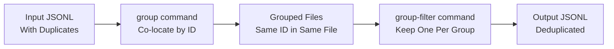

**Step 1: Group Configuration (group_config.yaml)**
```yaml
group_key: "metadata.url_hash"
max_len: 256000000  # 256MB per output file
```

**Step 1: Group Command**
```bash
datamap group \
  --input_dir ./input \
  --group_dir ./grouped \
  --config group_config.yaml
```

**Step 2: GroupFilter Configuration (filter_config.yaml)**
```yaml
group_key: "metadata.url_hash"
sort_key: "metadata.timestamp"  # Optional: control which document to keep
keep_idx: -1  # -1 for last, 0 for first
max_len: 256000000
```

**Step 2: GroupFilter Command**
```bash
datamap group-filter \
  --input_dir ./grouped \
  --output_dir ./deduplicated \
  --config filter_config.yaml
```

**Sources:** [src/main.rs:169-192](), [README.md:52-59](), Diagram 2 from system architecture

---

## Pattern 3: Sample-Informed Partitioning

**Use Case:** Partition data into quantile-based buckets (e.g., split by quality score deciles) where you want approximately equal-sized partitions.

This pattern uses [`reservoir-sample`](#5.1) to gather statistics, then [`range-partition`](#4.3) to split data based on automatically calculated quantiles.

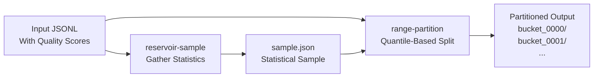

**Step 1: Create Reservoir Sample**
```bash
datamap reservoir-sample \
  --input_dir ./input \
  --output_file ./stats/quality_sample.json \
  --key "metadata.quality_score" \
  --reservoir_size 100000 \
  --token_weighted \
  --text_key "text"
```

The `--token_weighted` flag weights sampling by document length, ensuring quantiles represent token distribution rather than document distribution.

**Step 2: Range Partition Using Sample**
```bash
datamap range-partition \
  --input_dir ./input \
  --output_dir ./partitioned \
  --value "metadata.quality_score" \
  --reservoir_path ./stats/quality_sample.json \
  --num_buckets 10 \
  --bucket_name "quality_decile"
```

**Alternative: Manual Range Boundaries**
```bash
datamap range-partition \
  --input_dir ./input \
  --output_dir ./partitioned \
  --value "metadata.quality_score" \
  --range_groups 0.3,0.6,0.8 \
  --bucket_name "quality_tier"
```

**Sources:** [src/main.rs:102-121](), [src/main.rs:137-167](), [docs/partition.md:226-284](), Diagram 2 from system architecture

---

## Pattern 4: File Size Normalization

**Use Case:** Reorganize data into consistently-sized files for optimal parallel processing.

The 256MB target size balances parallelism (more files = more concurrent work) with memory efficiency (smaller files = less memory per thread).

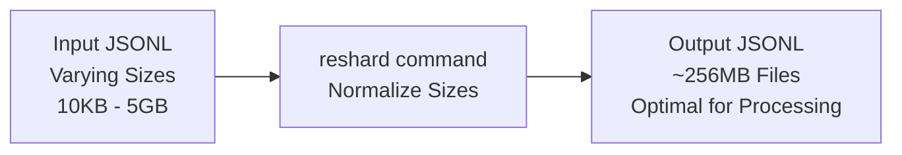

**Command:**
```bash
datamap reshard \
  --input_dir ./input \
  --output_dir ./resharded \
  --max_size 256000000 \
  --keep_dirs  # Preserve subdirectory structure
```

**Options:**
- `--max_size`: Target size in bytes (default: 256MB = 268,435,456 bytes)
- `--max_lines`: Alternative limit by line count
- `--keep_dirs`: Preserve input directory structure in output
- `--subsample`: Random subsample (0.0-1.0) for creating smaller datasets

**Sources:** [src/main.rs:79-100](), [README.md:31-33](), Diagram 4 from system architecture

---

## Pattern 5: Multi-Criteria Partitioning

**Use Case:** Organize data by multiple criteria (e.g., first by language, then by quality within each language).

This pattern chains multiple partition commands.

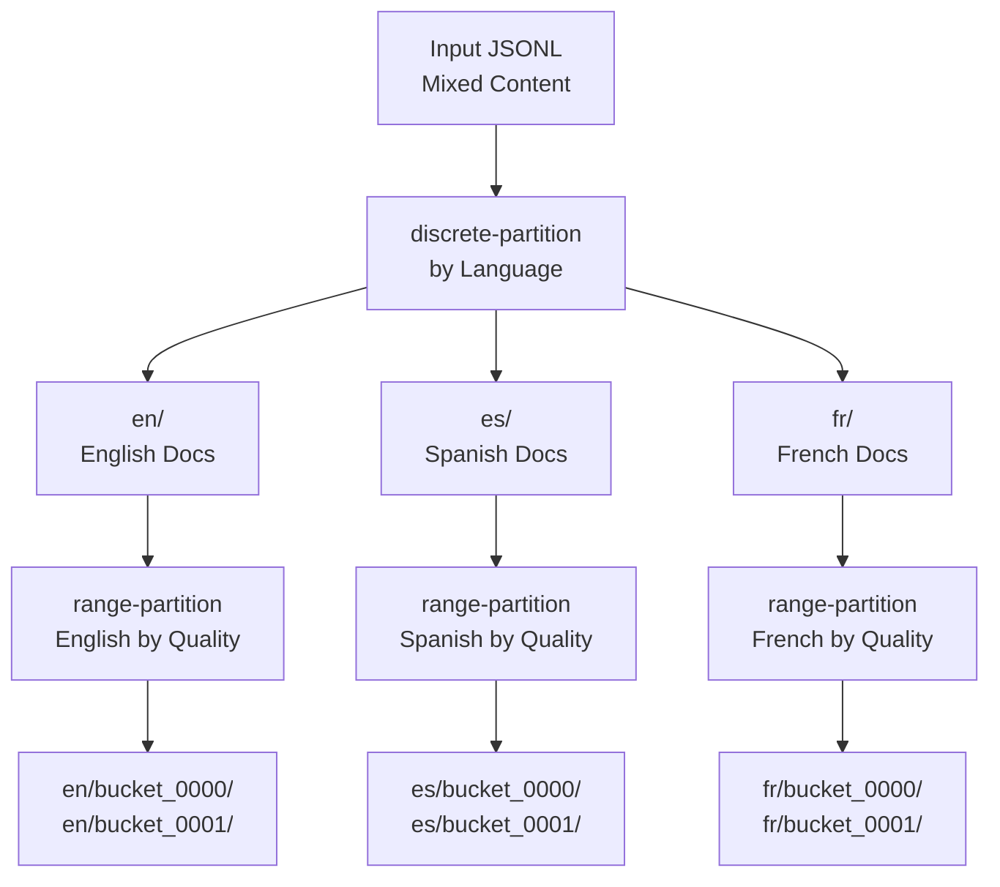

**Step 1: Partition by Language**
```bash
datamap discrete-partition \
  --input_dir ./input \
  --output_dir ./by_language \
  --partition_key "metadata.language"
```

**Step 2: Partition Each Language by Quality**
```bash
# For each language directory
for lang in en es fr; do
  datamap range-partition \
    --input_dir ./by_language/$lang \
    --output_dir ./by_lang_quality/$lang \
    --value "metadata.quality_score" \
    --range_groups 0.3,0.6,0.8
done
```

**Sources:** [src/main.rs:123-167](), [docs/partition.md:1-315]()

---

## Pattern 6: Filter → Reshard → Upload Pipeline

**Use Case:** Clean data with filters, normalize file sizes for downstream processing, then upload to cloud storage.

This is a complete end-to-end workflow combining multiple patterns.


**Complete Script:**
```bash
#!/bin/bash
set -e

# Step 1: Download from S3
echo "Downloading data..."
s5cmd sync s3://input-bucket/raw_data ./local/raw

# Step 2: Download models
echo "Downloading models..."
python utils/dl_hf_model.py facebook/fasttext-language-identification

# Step 3: Verify configuration
echo "Verifying pipeline..."
python utils/map_verifiers.py verify --config pipeline.yaml

# Step 4: Filter and annotate
echo "Running pipeline..."
datamap map \
  --input_dir ./local/raw \
  --output_dir ./local/filtered \
  --config pipeline.yaml \
  --threads 32

# Step 5: Reshard to consistent sizes
echo "Resharding..."
datamap reshard \
  --input_dir ./local/filtered/step_final \
  --output_dir ./local/final \
  --max_size 256000000

# Step 6: Upload results
echo "Uploading results..."
s5cmd sync ./local/final s3://output-bucket/processed_data

echo "Complete!"
```

**Sources:** [README.md:115-128](), Diagram 6 from system architecture

---

## Pattern 7: Shuffle for Random Distribution

**Use Case:** Randomly redistribute documents across files, useful before training dataset sampling or to break ordering biases.

```mermaid
graph LR
    Input["Input JSONL<br/>Ordered Data"]
    Shuffle["shuffle command<br/>Random Redistribution"]
    Output["Output JSONL<br/>Randomly Distributed"]
    
    Input --> Shuffle
    Shuffle --> Output
```

**Command:**
```bash
datamap shuffle \
  --input_dir ./input \
  --output_dir ./shuffled \
  --num_outputs 1000 \
  --max_len 256000000
```

**Note:** This provides coarse shuffling at the file level. Documents are randomly assigned to output files, but within each file they maintain their input order. For fine-grained shuffling, use external tools after this command.

**Sources:** [src/main.rs:194-209](), [README.md:61-64]()

---

## Pattern 8: Statistical Analysis Before Processing

**Use Case:** Understand data characteristics before applying filters or partitions.

```mermaid
graph TB
    Input["Input JSONL"]
    Count["count command<br/>Basic Statistics"]
    ResSample["reservoir-sample<br/>Distribution Analysis"]
    Stats["Statistics Files<br/>counts.json<br/>sample.json"]
    Decision{"Analyze<br/>Results"}
    Map["Proceed with<br/>map/partition"]
    
    Input --> Count
    Input --> ResSample
    Count --> Stats
    ResSample --> Stats
    Stats --> Decision
    Decision --> Map
```

**Step 1: Count Documents and Bytes**
```bash
datamap count \
  --input_dir ./input \
  --output_file ./stats/counts.json \
  --count_bytes "text"
```

**Output (counts.json):**
```json
{
  "total_docs": 15000000,
  "total_file_size": 87234567890,
  "total_text_bytes": 65432109876
}
```

**Step 2: Sample Key Fields**
```bash
# Sample quality scores
datamap reservoir-sample \
  --input_dir ./input \
  --output_file ./stats/quality_sample.json \
  --key "metadata.quality_score" \
  --reservoir_size 100000

# Sample document lengths
datamap reservoir-sample \
  --input_dir ./input \
  --output_file ./stats/length_sample.json \
  --key "metadata.length" \
  --reservoir_size 100000
```

**Step 3: Analyze and Decide**
```python
import json
import numpy as np

with open('./stats/quality_sample.json') as f:
    sample = json.load(f)

values = [doc['metadata.quality_score'] for doc in sample]
print(f"Quality score distribution:")
print(f"  Min: {np.min(values):.3f}")
print(f"  25th percentile: {np.percentile(values, 25):.3f}")
print(f"  Median: {np.median(values):.3f}")
print(f"  75th percentile: {np.percentile(values, 75):.3f}")
print(f"  Max: {np.max(values):.3f}")
```

**Sources:** [src/main.rs:211-220](), [src/main.rs:452-499](), [README.md:66-69]()

---

## Workflow Decision Guide

This table helps you choose which commands to use based on your goals:

| Goal | Primary Command(s) | Common Follow-up |
|------|-------------------|------------------|
| Filter and clean data | `map` | `reshard` → `count` |
| Remove duplicates | `group` → `group-filter` | `reshard` |
| Split by category (language, domain) | `discrete-partition` | None (already organized) |
| Split by quality/score quantiles | `reservoir-sample` → `range-partition` | None |
| Normalize file sizes | `reshard` | Any subsequent command |
| Random redistribution | `shuffle` | None |
| Understand dataset | `count`, `reservoir-sample` | Any processing command |
| Complete cleaning pipeline | `map` → `reshard` → `discrete-partition` | Upload to cloud |
| Deduplicate then filter | `group` → `group-filter` → `map` | `reshard` |

**Sources:** [README.md:22-69](), [src/main.rs:59-224]()

---

## Performance Considerations

### Thread Control

All commands support `--threads N` to limit parallelism:

```bash
# Use all available cores (default)
datamap map --input_dir ./input --output_dir ./output --config pipeline.yaml

# Limit to 16 threads (useful on shared machines)
datamap map --input_dir ./input --output_dir ./output --config pipeline.yaml --threads 16
```

### File Size Targets

The 256MB file size is optimal for most workloads:

| File Size | Parallelism | Memory Usage | I/O Efficiency |
|-----------|-------------|--------------|----------------|
| < 50MB | High | Low | Poor (overhead) |
| ~256MB | **Optimal** | **Moderate** | **Excellent** |
| > 1GB | Low | High | Poor (memory pressure) |

### Delete After Read

Some commands support `--delete_after_read` to free disk space during processing:

```bash
datamap map \
  --input_dir ./input \
  --output_dir ./output \
  --config pipeline.yaml \
  --delete_after_read  # Delete input files after processing
```

**Warning:** Only use this flag when you have backups or can re-download the data.

**Sources:** [src/main.rs:55-57](), [src/main.rs:76](), [src/main.rs:99](), [src/main.rs:208](), [README.md:104-112]()

---

## Command Composition Best Practices

### 1. Always Verify Before Processing

```bash
python utils/map_verifiers.py verify --config pipeline.yaml
```

This checks that all required models, banlists, and resources exist before starting expensive processing.

### 2. Use Reshard After Major Transformations

After `map`, `group-filter`, or other commands that may create unevenly-sized output files:

```bash
datamap reshard --input_dir ./uneven --output_dir ./normalized --max_size 256000000
```

### 3. Count Before and After

```bash
# Before processing
datamap count --input_dir ./input --output_file ./stats/before.json --count_bytes "text"

# Process data
datamap map --input_dir ./input --output_dir ./output --config pipeline.yaml

# After processing
datamap count --input_dir ./output/step_final --output_file ./stats/after.json --count_bytes "text"
```

### 4. Partition After Filtering

Run expensive filters first with `map`, then partition the cleaned data:

```bash
# Filter first (expensive)
datamap map --input_dir ./input --output_dir ./filtered --config filters.yaml

# Then partition (cheap)
datamap discrete-partition \
  --input_dir ./filtered/step_final \
  --output_dir ./partitioned \
  --partition_key "metadata.language"
```

### 5. Use Configuration Files for Reproducibility

Store all configurations in version control:

```
configs/
├── filter_pipeline.yaml
├── quality_partition.yaml
├── group_config.yaml
└── dedup_config.yaml
```

**Sources:** [src/main.rs:230-248](), [README.md:137-151]()

---

# Page: System Architecture

# System Architecture

<details>
<summary>Relevant source files</summary>

The following files were used as context for generating this wiki page:

- [Cargo.toml](Cargo.toml)
- [README.md](README.md)
- [src/main.rs](src/main.rs)

</details>


## Purpose and Scope

This page explains the high-level architecture of datamap-rs, including its command-based design, local-first processing model, parallel execution strategy, and how the major components interact. It provides an overview of the system's structure without diving into the implementation details of specific commands or processors.

For detailed information about specific commands, see:
- Map command and pipeline processing: [#3](#3)
- Data organization commands (reshard, partition, group, shuffle): [#4](#4)
- Analysis commands (reservoir sample, count): [#5](#5)
- Shared infrastructure components: [#6](#6)

## High-Level Architecture Overview

datamap-rs is built as a **command-line binary** with a **command-based architecture**. Each command implements a specific data processing operation on JSONL files. The system is designed around three core principles:

1. **Local-first processing**: All data must reside on local NVMe storage before processing
2. **File-level parallelism**: Files are processed independently in parallel using Rayon
3. **Streaming I/O**: Documents are processed line-by-line to maintain memory efficiency

The architecture can be visualized in three layers:

| Layer | Components | Responsibility |
|-------|-----------|----------------|
| **CLI Layer** | `clap` argument parser, `Commands` enum | Parse user input and dispatch to appropriate handler |
| **Processing Layer** | Command implementations (`gen_map`, `reshard`, `group`, etc.) | Execute data transformations and operations |
| **Infrastructure Layer** | `GenWriter`, `mj_io`, utility functions | Provide shared I/O, compression, and helper functionality |

**Sources:** [README.md:1-151](), [src/main.rs:49-224]()

### Command Dispatch Architecture

```mermaid
graph TB
    subgraph "Entry Point [main.rs:506-584]"
        Main["main()"]
        ArgParser["ArgParser::parse()"]
        ThreadConfig["Set RAYON_NUM_THREADS"]
    end
    
    subgraph "Commands Enum [main.rs:59-224]"
        Commands["Commands enum"]
        Map["Map { input_dir, output_dir, config, err_dir, delete_after_read }"]
        Reshard["Reshard { input_dir, output_dir, max_lines, max_size, subsample, keep_dirs, delete_after_read }"]
        ReservoirSample["ReservoirSample { input_dir, output_file, key, reservoir_size, token_weighted, text_key }"]
        DiscPart["DiscretePartition { input_dir, output_dir, config, partition_key }"]
        RangePart["RangePartition { input_dir, output_dir, config, value, default_value, range_groups, reservoir_path, num_buckets, max_file_size, bucket_name }"]
        Group["Group { input_dir, group_dir, config, subext }"]
        GroupFilter["GroupFilter { input_dir, output_dir, config }"]
        Shuffle["Shuffle { input_dir, output_dir, num_outputs, max_len, delete_after_read }"]
        Count["Count { input_dir, output_file, count_bytes }"]
    end
    
    subgraph "Command Handlers [main.rs & modules]"
        GenMap["gen_map()"]
        ReshardFn["reshard()"]
        ResSampleFn["reservoir_sample()"]
        DiscPartFn["discrete_partition()"]
        RangePartFn["range_partition()"]
        GroupFn["group()"]
        GroupFilterFn["group_filter()"]
        ShuffleFn["shuffle()"]
        CountFn["count()"]
    end
    
    Main --> ArgParser
    ArgParser --> ThreadConfig
    ThreadConfig --> Commands
    
    Commands --> Map
    Commands --> Reshard
    Commands --> ReservoirSample
    Commands --> DiscPart
    Commands --> RangePart
    Commands --> Group
    Commands --> GroupFilter
    Commands --> Shuffle
    Commands --> Count
    
    Map --> GenMap
    Reshard --> ReshardFn
    ReservoirSample --> ResSampleFn
    DiscPart --> DiscPartFn
    RangePart --> RangePartFn
    Group --> GroupFn
    GroupFilter --> GroupFilterFn
    Shuffle --> ShuffleFn
    Count --> CountFn
```

The `main()` function uses `clap` to parse command-line arguments into the `Commands` enum. Each enum variant contains the specific arguments for that command. The match expression at [main.rs:513-582]() dispatches to the appropriate handler function.

**Sources:** [src/main.rs:49-584]()

## Local-First Architecture and Data Lifecycle

datamap-rs assumes a **local-first workflow** where all input and output data resides on fast local storage (typically AWS Nitro NVMe drives on i4i/i7i instances). This is not just a recommendation but an **architectural requirement** for achieving acceptable performance.

### Typical Data Lifecycle

```mermaid
graph LR
    subgraph "Cloud Storage"
        S3["S3/Weka/GCS<br/>Source Data"]
        S3Out["S3/Weka/GCS<br/>Processed Data"]
    end
    
    subgraph "Local NVMe Storage"
        InputDir["input_dir/<br/>*.jsonl.zst"]
        OutputDir["output_dir/<br/>*.jsonl.zst"]
        TempFiles["Temporary Files<br/>Processing State"]
    end
    
    subgraph "datamap-rs Processing"
        DatamapBin["datamap binary<br/>Command Execution"]
    end
    
    subgraph "Python Utilities"
        S5CMDDown["s5cmd wrapper<br/>Download"]
        S5CMDUp["s5cmd wrapper<br/>Upload"]
    end
    
    S3 --> S5CMDDown
    S5CMDDown --> InputDir
    InputDir --> DatamapBin
    DatamapBin --> OutputDir
    DatamapBin -.temporary.-> TempFiles
    OutputDir --> S5CMDUp
    S5CMDUp --> S3Out
```

The system **never streams from cloud storage**. All commands operate on the assumption that:
1. Input files are available locally before processing begins
2. Output files are written locally during processing
3. Upload to cloud storage happens after processing completes

This design decision provides:
- **Reliability**: No network timeouts or retries during processing
- **Performance**: NVMe drives provide ~10-100x better throughput than S3 streaming
- **Simplicity**: Commands don't need to handle network errors or partial downloads

**Sources:** [README.md:20-21](), [README.md:113-129]()

## Module Organization and Code Structure

The codebase is organized into focused modules, each responsible for specific functionality:

### Module Structure Diagram

```mermaid
graph TB
    subgraph "Main Binary [src/main.rs]"
        MainRs["main.rs<br/>• main() entry point<br/>• Commands enum<br/>• ArgParser<br/>• gen_map() & gen_map_single()<br/>• count()<br/>• parse_config()<br/>• print_global_stats_stuff()"]
    end
    
    subgraph "Map Processing [src/map_fxn.rs]"
        MapFxn["map_fxn.rs<br/>• DataProcessor trait<br/>• PipelineProcessor struct<br/>• process_lines() implementation<br/>• PROCESSOR_CONSTRUCTORS registry<br/>• 31+ processor implementations"]
    end
    
    subgraph "Partitioning [src/partition.rs]"
        Partition["partition.rs<br/>• discrete_partition()<br/>• range_partition()<br/>• PartitionConfig structs<br/>• quantile calculation"]
    end
    
    subgraph "Grouping [src/groupfilter.rs]"
        GroupFilter["groupfilter.rs<br/>• group()<br/>• group_filter()<br/>• GroupConfig structs<br/>• hash-based distribution"]
    end
    
    subgraph "Sampling [src/reservoir_sample.rs]"
        ResSample["reservoir_sample.rs<br/>• reservoir_sample()<br/>• token-weighted sampling<br/>• statistical aggregation"]
    end
    
    subgraph "Utilities [src/utils.rs]"
        Utils["utils.rs<br/>• JSON manipulation<br/>• URL parsing<br/>• helper functions"]
    end
    
    subgraph "Resharding [src/reshard.rs]"
        Reshard["reshard.rs<br/>• reshard()<br/>• file size normalization<br/>• directory preservation"]
    end
    
    subgraph "Shuffling [src/shuffle.rs]"
        Shuffle["shuffle.rs<br/>• shuffle()<br/>• random redistribution"]
    end
    
    subgraph "Shared Infrastructure"
        GenWriter["GenWriter<br/>Defined inline in modules<br/>• Concurrent file writing<br/>• Zstd compression<br/>• File rotation"]
        MjIO["mj_io crate<br/>• expand_dirs()<br/>• read_pathbuf_to_mem()<br/>• write_mem_to_pathbuf()<br/>• get_output_filename()"]
    end
    
    MainRs --> MapFxn
    MainRs --> Partition
    MainRs --> GroupFilter
    MainRs --> ResSample
    MainRs --> Utils
    MainRs --> Reshard
    MainRs --> Shuffle
    
    MapFxn --> Utils
    Partition --> GenWriter
    GroupFilter --> GenWriter
    Shuffle --> GenWriter
    
    MainRs --> MjIO
    MapFxn --> MjIO
    Partition --> MjIO
    GroupFilter --> MjIO
    ResSample --> MjIO
    Reshard --> MjIO
    Shuffle --> MjIO
```

**Key Design Patterns:**

1. **Module per Command**: Each major command has its own module (except Map and Count which live in `main.rs`)
2. **Shared Infrastructure**: `GenWriter` pattern is replicated across modules that need concurrent file writing
3. **External I/O Library**: `mj_io` crate handles all file operations, compression detection, and directory traversal
4. **Trait-based Extensibility**: Map command uses `DataProcessor` trait for pluggable processors

**Sources:** [src/main.rs:24-36](), [Cargo.toml:1-45]()

## Parallel Processing Model

datamap-rs achieves high performance through **file-level parallelism** using Rayon. This design has important implications:

### Parallelism Architecture

```mermaid
graph TB
    subgraph "Main Thread"
        ExpandDirs["expand_dirs()<br/>Collect all input files"]
        BuildPbar["build_pbar()<br/>Progress tracking"]
        RayonSetup["Rayon Thread Pool<br/>Default: num_cpus<br/>Override: --threads N"]
    end
    
    subgraph "Parallel Execution [Rayon]"
        ParIter["all_files.par_iter()"]
        
        subgraph "Thread 1"
            File1["Process file_000.jsonl.zst"]
            Lines1["Read & parse lines"]
            Process1["Process each line sequentially"]
        end
        
        subgraph "Thread 2"
            File2["Process file_001.jsonl.zst"]
            Lines2["Read & parse lines"]
            Process2["Process each line sequentially"]
        end
        
        subgraph "Thread N"
            FileN["Process file_NNN.jsonl.zst"]
            LinesN["Read & parse lines"]
            ProcessN["Process each line sequentially"]
        end
    end
    
    subgraph "Shared State"
        DashMap["DashMap<K, V><br/>Lock-free concurrent map<br/>Used for: GenWriter registry,<br/>statistics aggregation"]
        Atomic["AtomicUsize counters<br/>Thread-safe aggregation<br/>Used for: doc counts,<br/>file sizes, timing"]
    end
    
    ExpandDirs --> BuildPbar
    BuildPbar --> RayonSetup
    RayonSetup --> ParIter
    
    ParIter --> File1
    ParIter --> File2
    ParIter --> FileN
    
    File1 --> Lines1
    Lines1 --> Process1
    
    File2 --> Lines2
    Lines2 --> Process2
    
    FileN --> LinesN
    LinesN --> ProcessN
    
    Process1 -.update.-> DashMap
    Process2 -.update.-> DashMap
    ProcessN -.update.-> DashMap
    
    Process1 -.update.-> Atomic
    Process2 -.update.-> Atomic
    ProcessN -.update.-> Atomic
```

**Key Characteristics:**

| Aspect | Implementation | Rationale |
|--------|---------------|-----------|
| **Parallelism Level** | File-level only | Documents must be processed sequentially through pipelines |
| **Thread Pool** | Rayon with default or `--threads` override | Automatic work stealing, efficient CPU utilization |
| **Shared State** | `DashMap` for registries, `AtomicUsize` for counters | Lock-free concurrency, minimal contention |
| **Memory Usage** | Scales with thread count × file size | Each thread loads entire file into memory |
| **I/O Pattern** | Streaming line-by-line | Memory-efficient document processing |

The parallelism is **embarrassingly parallel** at the file level - each file is processed completely independently. This means:
- No inter-file coordination required during processing
- No locks on data structures (except `GenWriter` output streams)
- Linear scaling with CPU cores (up to I/O limits)

**Sources:** [src/main.rs:359-382](), [README.md:104-112](), [Cargo.toml:14-20]()

## Shared Infrastructure Components

Several infrastructure components are used across multiple commands:

### GenWriter Pattern

The `GenWriter` component provides concurrent, compressed file writing with automatic rotation. While not defined in a single shared location, the pattern is consistently implemented across modules:

**Core Capabilities:**
- **Concurrent writing**: Uses `DashMap<String, Arc<Mutex<BufWriter>>>` to maintain per-stream file handles
- **Zstd compression**: Automatic level-3 compression on all output
- **File rotation**: When files exceed `max_len`, creates new numbered chunks
- **Thread-safe**: Multiple threads can write to different streams simultaneously

**Usage Pattern:**
```rust
// From various modules
let writer_map: DashMap<String, Arc<Mutex<BufWriter<ZstdEncoder>>>> = DashMap::new();
// Each thread writes: writer_map.entry(key).or_insert_with(|| create_writer())
```

**Sources:** [src/partition.rs](), [src/groupfilter.rs](), [src/shuffle.rs]()

### mj_io Library Functions

All file I/O operations use the `mj_io` crate, which provides:

| Function | Purpose | Used By |
|----------|---------|---------|
| `expand_dirs()` | Recursively find all JSONL files in directories | All commands |
| `read_pathbuf_to_mem()` | Read file to memory, auto-detecting compression | All commands |
| `write_mem_to_pathbuf()` | Write bytes to file with Zstd compression | Map, Count commands |
| `get_output_filename()` | Compute output path preserving directory structure | All commands |
| `build_pbar()` | Create progress bar with consistent styling | All commands |

**Sources:** [src/main.rs:21-23](), [Cargo.toml:16]()

### Configuration Parsing

The `parse_config()` function handles both YAML and JSON configuration files:

```rust
// From src/main.rs:230-248
fn parse_config(config: &PathBuf) -> Result<serde_json::Value, Error>
```

This function:
1. Detects file extension (`.yaml`, `.yml`, or `.json`)
2. Parses using appropriate deserializer (`serde_yaml` or `serde_json`)
3. Converts YAML to JSON representation for uniform handling
4. Returns `serde_json::Value` for dynamic processing

**Sources:** [src/main.rs:230-248]()

## Design Principles and Trade-offs

The architecture embodies several key design decisions:

### 1. File-Level Parallelism Only

**Decision:** Process entire files in parallel, but documents sequentially within each file.

**Rationale:**
- Map pipelines require sequential document processing (filters can drop documents)
- File boundaries provide natural parallelization points
- Avoids complex synchronization between pipeline stages

**Trade-off:** Cannot parallelize processing of a single large file

**Sources:** [src/main.rs:359-382]()

### 2. Local Storage Requirement

**Decision:** All data must be on local NVMe before processing.

**Rationale:**
- Network streaming is unreliable (timeouts, partial reads)
- Local NVMe provides 10-100x better throughput
- Simplifies error handling (no network retries)

**Trade-off:** Requires downloading data upfront, storage capacity limits

**Sources:** [README.md:20-21]()

### 3. Memory-Mapped vs. Streaming I/O

**Decision:** Stream line-by-line rather than memory-mapping entire files.

**Rationale:**
- Documents can be arbitrarily large (some datasets have multi-MB documents)
- Memory usage is predictable and bounded
- Allows processing datasets larger than available RAM

**Trade-off:** Slightly slower than memory-mapping for small documents

**Sources:** [src/main.rs:405-411]()

### 4. 256MB Target File Size

**Decision:** Default target file size of ~256MB before compression (reshard command).

**Rationale:**
- Balances parallelism (more files = more parallel work) with overhead
- Fits comfortably in memory for line-by-line processing
- Optimizes S3 upload/download performance

**Trade-off:** May be suboptimal for extreme cases (very small or very large documents)

**Sources:** [README.md:32-33](), [src/main.rs:86-90]()

### 5. Duplicate Infrastructure (GenWriter)

**Decision:** Replicate `GenWriter` pattern in multiple modules rather than sharing.

**Rationale:**
- Each command has slightly different requirements (file naming, rotation logic)
- Avoids coupling between independent commands
- Simpler module structure (no complex shared dependencies)

**Trade-off:** Code duplication, inconsistency risk

**Sources:** Various module implementations

## Thread Control and Resource Management

The system provides explicit control over parallel execution:

**Thread Configuration:**
- **Default behavior**: Use all available CPU cores (`rayon` default)
- **Override with `--threads N`**: Limit parallelism to N threads
- **Implementation**: Sets `RAYON_NUM_THREADS` environment variable at startup

```rust
// From src/main.rs:508-511
let threads = args.threads;
if threads != 0 {
    std::env::set_var("RAYON_NUM_THREADS", threads.to_string());
}
```

**When to Limit Threads:**
- Memory-constrained environments (each thread holds a file in memory)
- Very large files (limit threads to avoid OOM)
- Shared compute resources (respect quotas)

**Sources:** [src/main.rs:49-57](), [src/main.rs:508-511](), [README.md:107]()

## Output Organization Patterns

Different commands organize output in different ways:

| Command | Output Pattern | Example |
|---------|---------------|---------|
| **Map** | `step_{XX}/` directories + `step_final/` | `output_dir/step_00/`, `output_dir/step_final/` |
| **Reshard** | Flat structure or preserved directories | `output_dir/shard_*.jsonl.zst` |
| **DiscretePartition** | Category subdirectories | `output_dir/lang_en/`, `output_dir/lang_es/` |
| **RangePartition** | Numbered bucket subdirectories | `output_dir/bucket_0000/`, `output_dir/bucket_0001/` |
| **Group** | Flat structure with numbered chunks | `group_dir/chunk_*.jsonl.zst` |
| **GroupFilter** | Flat structure | `output_dir/*.jsonl.zst` |
| **Shuffle** | Flat structure with numbered chunks | `output_dir/chunk_*.jsonl.zst` |
| **Count** | Single JSON file | `output_file.json` |
| **ReservoirSample** | Single JSONL file | `output_file.jsonl` |

**Sources:** [src/main.rs:414-422](), [README.md:22-69]()

## Statistics and Monitoring

The Map command provides detailed statistics through shared concurrent state:

**Statistics Collection:**
- **Timing information**: Per-step timing using `DashMap<usize, AtomicUsize>`
- **Filtering information**: Documents removed at each step using `DashMap<usize, usize>`
- **Error counting**: Total errors using `AtomicUsize`
- **Progress tracking**: File-level progress bar via `indicatif`

**Output Format:**
```
Finishing map in X seconds
Processed Y total documents
-------------------------------------------
Step 0 | ProcessorName
     Spent Z% of processing time in this step
     Removed N docs | A% of remaining | B% of pool
...
FINAL:
     M docs survived | P% of pool
```

**Sources:** [src/main.rs:264-321](), [src/main.rs:348-356]()

---

# Page: Command Dispatcher and CLI Structure

# Command Dispatcher and CLI Structure

<details>
<summary>Relevant source files</summary>

The following files were used as context for generating this wiki page:

- [src/main.rs](src/main.rs)

</details>


## Purpose and Scope

This document describes the command-line interface (CLI) architecture of datamap-rs, focusing on how commands are defined, how arguments are parsed, and how execution is dispatched to the appropriate handlers. For details on what each command does and their data processing behavior, see [Data Organization Commands](#4) and [Map Command](#3). For the execution model and parallelism, see [Parallelism and Performance Model](#2.2).

---

## Overview

The datamap-rs CLI is built using the `clap` framework, implementing a subcommand-based architecture. The system defines nine distinct commands, each with its own set of required and optional arguments. All CLI parsing, validation, and dispatch logic is centralized in [src/main.rs]().

**Architecture Pattern**: The CLI follows a standard pattern:
1. **Definition Layer**: Rust structs with `clap` derive macros define the command structure
2. **Parsing Layer**: `clap` automatically parses command-line input and validates types
3. **Dispatch Layer**: A match expression routes parsed commands to implementation functions
4. **Implementation Layer**: Individual command functions in separate modules

Sources: [src/main.rs:1-584]()

---

## Command Structure Hierarchy

```mermaid
graph TB
    CLI["datamap CLI Entry<br/>(ArgParser)"]
    GlobalArgs["Global Arguments<br/>--threads"]
    
    CLI --> GlobalArgs
    CLI --> Commands["Commands Enum<br/>(9 subcommands)"]
    
    Commands --> Map["Map<br/>Pipeline Processing"]
    Commands --> Reshard["Reshard<br/>File Size Normalization"]
    Commands --> ResSample["ReservoirSample<br/>Statistical Sampling"]
    Commands --> DiscPart["DiscretePartition<br/>Categorical Split"]
    Commands --> RangePart["RangePartition<br/>Numeric Split"]
    Commands --> Group["Group<br/>Co-locate by ID"]
    Commands --> GroupFilter["GroupFilter<br/>Deduplicate Groups"]
    Commands --> Shuffle["Shuffle<br/>Random Redistribution"]
    Commands --> Count["Count<br/>Dataset Statistics"]
    
    Map --> MapArgs["Args:<br/>input_dir, output_dir,<br/>config, err_dir,<br/>delete_after_read"]
    Reshard --> ReshardArgs["Args:<br/>input_dir, output_dir,<br/>max_lines, max_size,<br/>subsample, keep_dirs,<br/>delete_after_read"]
    ResSample --> ResArgs["Args:<br/>input_dir, output_file,<br/>key, reservoir_size,<br/>token_weighted, text_key"]
    DiscPart --> DiscArgs["Args:<br/>input_dir, output_dir,<br/>config, partition_key"]
    RangePart --> RangeArgs["Args:<br/>input_dir, output_dir,<br/>config, value, default_value,<br/>range_groups, reservoir_path,<br/>num_buckets, max_file_size,<br/>bucket_name"]
    Group --> GroupArgs["Args:<br/>input_dir, group_dir,<br/>config, subext"]
    GroupFilter --> GFArgs["Args:<br/>input_dir, output_dir,<br/>config"]
    Shuffle --> ShuffleArgs["Args:<br/>input_dir, output_dir,<br/>num_outputs, max_len,<br/>delete_after_read"]
    Count --> CountArgs["Args:<br/>input_dir, output_file,<br/>count_bytes"]
```

**Command Structure**: All commands are defined as variants in the `Commands` enum, each containing its own struct of arguments. The `ArgParser` struct at the top level wraps the `Commands` enum and adds global arguments that apply across all commands.

Sources: [src/main.rs:49-224]()

---

## Argument Parser Definition

The CLI parser is defined through two primary structures:

### ArgParser Struct

[src/main.rs:49-57]()

```
#[derive(Parser)]
#[clap(author, version, about, long_about = None)]
struct ArgParser {
    #[clap(subcommand)]
    command: Commands,

    #[arg(long, default_value_t = 0)]
    threads: usize,
}
```

**Global Arguments**:
- `--threads`: Controls the Rayon thread pool size. Default is 0 (auto-detect CPU cores).

### Commands Enum

[src/main.rs:59-224]()

The `Commands` enum defines all available subcommands. Each variant contains a named struct with that command's specific arguments.

**Key Attributes Used**:
- `#[clap(arg_required_else_help = true)]`: Shows help if no arguments provided
- `#[arg(required = true, long)]`: Marks argument as mandatory with `--name` syntax
- `#[arg(long)]`: Optional argument with `--name` syntax
- `#[arg(long, default_value_t = ...)]`: Optional with default value
- `#[arg(long, value_delimiter = ',')]`: Accepts comma-separated list

Sources: [src/main.rs:49-224]()

---

## Command Argument Patterns

### Common Argument Patterns

| Pattern | Arguments | Commands Using | Purpose |
|---------|-----------|----------------|---------|
| **Input/Output** | `input_dir`, `output_dir` | Reshard, DiscretePartition, RangePartition, GroupFilter, Shuffle | Standard directory-to-directory transformation |
| **Input/Config/Output** | `input_dir`, `output_dir`, `config` | Map, DiscretePartition, RangePartition, Group, GroupFilter | Transformation requiring configuration file |
| **Input/Output File** | `input_dir`, `output_file` | ReservoirSample, Count | Produces single output file |
| **Deletion Flag** | `delete_after_read` | Map, Reshard, Shuffle | Delete input files after processing |
| **Size Control** | `max_lines`, `max_size`, `max_len` | Reshard, Shuffle | Control output file sizes |

### Configuration File Arguments

Several commands accept configuration files that control their behavior:

- **Map**: `config` (required) - Defines the processing pipeline
- **DiscretePartition**: `config` (optional) - Defines partition categories
- **RangePartition**: `config` (optional) - Defines range boundaries
- **Group/GroupFilter**: `config` (required) - Defines grouping key and behavior

Configuration files can be either YAML or JSON format, automatically detected by extension.

Sources: [src/main.rs:59-224]()

---

## Dispatch Mechanism

```mermaid
graph TB
    Main["main()<br/>[src/main.rs:506-584]"]
    Parse["ArgParser::parse()<br/>(clap framework)"]
    ThreadSetup["Thread Pool Setup<br/>RAYON_NUM_THREADS"]
    Match["Match on Commands<br/>[src/main.rs:513-582]"]
    
    Main --> Parse
    Parse --> ThreadSetup
    ThreadSetup --> Match
    
    Match --> MapImpl["gen_map()<br/>[src/main.rs:328-386]"]
    Match --> ReshardImpl["reshard()<br/>[src/reshard.rs]"]
    Match --> ResSampleImpl["reservoir_sample()<br/>[src/reservoir_sample.rs]"]
    Match --> DiscPartImpl["discrete_partition()<br/>[src/partition.rs]"]
    Match --> RangePartImpl["range_partition()<br/>[src/partition.rs]"]
    Match --> GroupImpl["group()<br/>[src/groupfilter.rs]"]
    Match --> GFImpl["group_filter()<br/>[src/groupfilter.rs]"]
    Match --> ShuffleImpl["shuffle()<br/>[src/shuffle.rs]"]
    Match --> CountImpl["count()<br/>[src/main.rs:452-499]"]
    
    MapImpl --> Result["Result unwrap<br/>[src/main.rs:583]"]
    ReshardImpl --> Result
    ResSampleImpl --> Result
    DiscPartImpl --> Result
    RangePartImpl --> Result
    GroupImpl --> Result
    GFImpl --> Result
    ShuffleImpl --> Result
    CountImpl --> Result
```

**Dispatch Flow**:

1. **Parsing**: [src/main.rs:507]() - `ArgParser::parse()` consumes command-line arguments
2. **Thread Configuration**: [src/main.rs:508-511]() - If `--threads` is non-zero, set `RAYON_NUM_THREADS` environment variable
3. **Command Matching**: [src/main.rs:513-582]() - Match on `Commands` enum variant
4. **Argument Extraction**: Each match arm destructures the command's arguments
5. **Function Call**: Dispatch to implementation function with extracted arguments
6. **Result Handling**: [src/main.rs:583]() - Unwrap result, panic on error

**Thread Pool Configuration**:
```rust
let threads = args.threads;
if threads != 0 {
    std::env::set_var("RAYON_NUM_THREADS", threads.to_string());
}
```

The Rayon thread pool is configured via environment variable before any parallel operations. A value of 0 (default) lets Rayon auto-detect the number of CPU cores.

Sources: [src/main.rs:506-584]()

---

## Configuration File Parsing

### parse_config Function

[src/main.rs:230-248]()

The `parse_config` utility function handles both YAML and JSON configuration files:

**Implementation**:
1. Open the configuration file
2. Detect format by file extension (`.yaml` or `.json`)
3. Parse to `serde_json::Value` (unified representation)
4. Return parsed configuration

**Format Detection**:
- `.json` → `serde_json::from_reader()`
- `.yaml` → `serde_yaml::from_reader()` → `serde_json::to_value()`
- Other extensions → Error

**Unified Output**: All configurations are converted to `serde_json::Value`, providing a consistent interface regardless of input format. This allows command implementations to work with a single type.

Sources: [src/main.rs:230-248]()

---

## Command Implementation Pattern

### Standard Implementation Signature

Most commands follow this pattern:

```
fn command_name(
    input_dir: &PathBuf,
    output_dir: &PathBuf,
    // ... command-specific parameters
) -> Result<(), Error>
```

### Map Command Pattern (Most Complex)

[src/main.rs:328-386]()

The Map command demonstrates the full pattern:

1. **Setup**: Parse configuration, initialize processor, create tracking structures
2. **File Discovery**: Use `expand_dirs()` to find all input files
3. **Parallel Processing**: Iterate over files with `par_iter()` (Rayon)
4. **Per-File Processing**: Call single-file handler
5. **Statistics Aggregation**: Collect timing and filtering statistics
6. **Reporting**: Print global statistics

**Key Implementation Details**:
- Uses `DashMap` for thread-safe statistics collection
- Uses `AtomicUsize` for atomic counter operations
- Progress bar via `build_pbar()` from `mj_io` crate
- Optional file deletion after processing

### Count Command Pattern (Simple)

[src/main.rs:452-499]()

The Count command shows a simpler pattern:

1. **Setup**: Initialize atomic counters
2. **File Discovery**: Expand input directory
3. **Parallel Processing**: Process each file independently
4. **Atomic Aggregation**: Use `fetch_add()` for thread-safe counting
5. **Output**: Write statistics to JSON file

Sources: [src/main.rs:328-499]()

---

## Argument Passing Flow

```mermaid
graph LR
    CLI["Command Line<br/>$ datamap map --input_dir ... --config ..."]
    Clap["clap Parser<br/>ArgParser::parse()"]
    ArgStruct["ArgParser Struct<br/>{ command: Commands, threads: usize }"]
    
    CLI --> Clap
    Clap --> ArgStruct
    
    ArgStruct --> ThreadEnv["Environment Variable<br/>RAYON_NUM_THREADS"]
    ArgStruct --> MatchExpr["Match Expression<br/>match &args.command"]
    
    MatchExpr --> Destructure["Destructure Arguments<br/>Commands::Map { input_dir, output_dir, ... }"]
    Destructure --> FnCall["Function Call<br/>gen_map(input_dir, output_dir, config, err_dir, delete_after_read)"]
    
    FnCall --> Impl["Implementation<br/>Process files, return Result"]
    Impl --> Unwrap["Result::unwrap()<br/>Panic on error"]
```

**Key Points**:
- Arguments are owned by the parsed struct, borrowed in match arms
- `PathBuf` arguments are passed by reference (`&PathBuf`)
- Primitive types are copied (bool, usize)
- `Option` types are cloned when needed
- No validation beyond type checking happens at CLI level - implementation functions handle semantic validation

Sources: [src/main.rs:506-584]()

---

## Error Handling

The CLI layer uses a simple error handling strategy:

### Parse-Time Errors
- Handled automatically by `clap`
- Invalid arguments, missing required fields, type mismatches all produce helpful error messages
- Process exits with non-zero status

### Runtime Errors
[src/main.rs:583]()
```rust
result.unwrap();
```

- All command implementations return `Result<(), Error>`
- The top-level match produces a `Result`
- `.unwrap()` is called on the result - any error causes a panic with error message
- No graceful error recovery at the CLI level

This design prioritizes simplicity for batch processing workloads where failures should be obvious and halt processing.

Sources: [src/main.rs:506-584]()

---

## Module Imports and Dependencies

### External Crates Used for CLI

[src/main.rs:1-23]()

| Crate | Purpose | Usage |
|-------|---------|-------|
| `clap` | CLI parsing | `Parser` and `Subcommand` derive macros |
| `anyhow` | Error handling | `Error` and `Result` types |
| `std::path::PathBuf` | File paths | Command arguments |
| `rayon` | Parallelism | Controlled via `--threads` argument |
| `serde_json`, `serde_yaml` | Config parsing | Parse YAML/JSON configuration files |

### Internal Modules Imported

[src/main.rs:24-35]()

Each command implementation is typically in its own module:
- `map_fxn`: Pipeline processing (`gen_map` in main.rs)
- `partition`: Discrete and range partitioning
- `groupfilter`: Group and GroupFilter commands
- `reservoir_sample`: Statistical sampling
- `reshard`: File size normalization (separate module)
- `shuffle`: Random redistribution (separate module)

The `count` command is implemented directly in `main.rs`.

Sources: [src/main.rs:1-35]()

---

## Command Invocation Examples

### Example: Map Command
```bash
datamap map \
  --input_dir /data/input \
  --output_dir /data/output \
  --config pipeline.yaml \
  --err_dir /data/errors \
  --delete_after_read \
  --threads 32
```

### Example: Reshard Command
```bash
datamap reshard \
  --input_dir /data/raw \
  --output_dir /data/normalized \
  --max_size 268435456 \
  --keep_dirs \
  --threads 16
```

### Example: Range Partition with Automatic Quantiles
```bash
datamap range-partition \
  --input_dir /data/input \
  --output_dir /data/partitioned \
  --value "metadata.quality_score" \
  --reservoir_path /data/sample.jsonl \
  --num_buckets 10 \
  --threads 24
```

### Example: Count Statistics
```bash
datamap count \
  --input_dir /data/corpus \
  --output_file /data/stats.json \
  --count_bytes text
```

**Naming Convention**: Commands use kebab-case on the command line (`discrete-partition`) but are defined as PascalCase in the enum (`DiscretePartition`). The `clap` framework handles this conversion automatically.

Sources: [src/main.rs:59-224]()

---

## Summary Table: Command Signature Reference

| Command | Required Args | Optional Args | Configuration |
|---------|--------------|---------------|---------------|
| `map` | `input_dir`, `output_dir`, `config` | `err_dir`, `delete_after_read` | YAML/JSON pipeline |
| `reshard` | `input_dir`, `output_dir` | `max_lines`, `max_size`, `subsample`, `keep_dirs`, `delete_after_read` | None |
| `reservoir-sample` | `input_dir`, `output_file`, `key` | `reservoir_size`, `token_weighted`, `text_key` | None |
| `discrete-partition` | `input_dir`, `output_dir` | `config`, `partition_key` | Optional YAML/JSON |
| `range-partition` | `input_dir`, `output_dir` | `config`, `value`, `default_value`, `range_groups`, `reservoir_path`, `num_buckets`, `max_file_size`, `bucket_name` | Optional YAML/JSON |
| `group` | `input_dir`, `group_dir`, `config` | `subext` | YAML/JSON grouping rules |
| `group-filter` | `input_dir`, `output_dir`, `config` | None | YAML/JSON filter rules |
| `shuffle` | `input_dir`, `output_dir`, `num_outputs` | `max_len`, `delete_after_read` | None |
| `count` | `input_dir`, `output_file` | `count_bytes` | None |

**Global Arguments**: All commands accept `--threads` to control parallelism.

Sources: [src/main.rs:59-224]()

---

# Page: Parallelism and Performance Model

# Parallelism and Performance Model

<details>
<summary>Relevant source files</summary>

The following files were used as context for generating this wiki page:

- [Cargo.toml](Cargo.toml)
- [README.md](README.md)
- [src/main.rs](src/main.rs)

</details>


## Purpose and Scope

This document explains how datamap-rs achieves high performance through parallel processing, efficient memory usage, and optimized I/O. It covers the parallelism strategy (file-level rather than document-level), thread pool configuration, shared state management, streaming memory model, and storage requirements.

For information about the local-first data flow and why NVMe storage is used, see [Data Flow and Storage Strategy](#2.3). For details on how GenWriter handles concurrent file writing, see [GenWriter: Parallel File Writing](#6.1).

---

## Parallelism Strategy: File-Level vs Document-Level

datamap-rs uses **file-level parallelism** rather than document-level parallelism. Each input file is processed by a single thread from start to finish, but multiple files are processed concurrently across threads. This design choice has important implications for correctness and performance.

```mermaid
graph TB
    subgraph "File-Level Parallelism Model"
        InputFiles["Input Files<br/>file_0.jsonl.zst<br/>file_1.jsonl.zst<br/>...<br/>file_N.jsonl.zst"]
        
        subgraph ThreadPool["Rayon Thread Pool"]
            Thread0["Thread 0"]
            Thread1["Thread 1"]
            ThreadN["Thread N"]
        end
        
        subgraph Processing["Sequential Per-File Processing"]
            File0["file_0.jsonl.zst"]
            Line0a["doc 0"]
            Line0b["doc 1"]
            Line0c["doc 2"]
            Pipeline0["PipelineProcessor<br/>Sequential stages"]
            
            File0 --> Line0a
            Line0a --> Pipeline0
            Pipeline0 --> Line0b
            Line0b --> Pipeline0
            Pipeline0 --> Line0c
        end
        
        InputFiles --> ThreadPool
        Thread0 --> File0
        Thread1 --> Processing
        ThreadN --> Processing
    end
    
    subgraph "Why File-Level?"
        Reason1["✓ Pipeline integrity<br/>Filters must see docs in order"]
        Reason2["✓ Simpler state management<br/>No inter-document locking"]
        Reason3["✓ Natural work units<br/>Files are ~256MB each"]
        Reason4["✓ Better locality<br/>Entire file in memory at once"]
    end
```

**Why File-Level Parallelism?**

| Aspect | Document-Level | File-Level (Used) |
|--------|---------------|-------------------|
| **Pipeline Correctness** | Complex - filters may depend on ordering | Simple - sequential processing per file |
| **State Management** | Requires locks/coordination between docs | No coordination needed within file |
| **Work Distribution** | Fine-grained, higher overhead | Coarse-grained, lower overhead |
| **Memory Locality** | Poor - documents scattered | Good - entire file loaded once |
| **Implementation Complexity** | High - complex synchronization | Low - embarrassingly parallel |

The **256MB target file size** (see [Reshard Command](#4.1)) is chosen specifically to create natural work units that balance:
- **Parallelism**: Enough files to keep all threads busy
- **Memory**: Small enough to avoid excessive RAM usage
- **Overhead**: Large enough to amortize thread scheduling costs

Sources: [src/main.rs:359-382](), [README.md:104-112]()

---

## Thread Pool Configuration and Rayon Integration

datamap-rs uses the [Rayon](https://docs.rs/rayon) library for data parallelism. Rayon provides a work-stealing thread pool that automatically distributes tasks across CPU cores.

```mermaid
graph TB
    subgraph CLI["Command-Line Interface"]
        Args["ArgParser"]
        ThreadsArg["--threads N argument<br/>default: 0 = all cores"]
    end
    
    subgraph Main["main function"]
        ParseArgs["args.threads"]
        CheckThreads{"threads != 0?"}
        SetEnv["set RAYON_NUM_THREADS<br/>env variable"]
        DefaultBehavior["Use all available cores"]
    end
    
    subgraph Rayon["Rayon Thread Pool"]
        AutoInit["Automatic initialization<br/>on first par_iter()"]
        ThreadPool["Global thread pool<br/>size from RAYON_NUM_THREADS"]
        WorkStealing["Work-stealing scheduler<br/>balances load dynamically"]
    end
    
    subgraph Processing["Parallel Processing"]
        ParIter["all_files.par_iter()"]
        ForEach["for_each closure<br/>processes one file"]
        Task0["Task: file_0"]
        Task1["Task: file_1"]
        TaskN["Task: file_N"]
    end
    
    Args --> ThreadsArg
    ThreadsArg --> ParseArgs
    ParseArgs --> CheckThreads
    CheckThreads -->|Yes| SetEnv
    CheckThreads -->|No| DefaultBehavior
    SetEnv --> AutoInit
    DefaultBehavior --> AutoInit
    AutoInit --> ThreadPool
    ThreadPool --> WorkStealing
    
    ParIter --> WorkStealing
    WorkStealing --> Task0
    WorkStealing --> Task1
    WorkStealing --> TaskN
    Task0 --> ForEach
    Task1 --> ForEach
    TaskN --> ForEach
```

**Thread Configuration Code Flow:**

1. **Argument Parsing** - [src/main.rs:55-57]()
   ```rust
   #[arg(long, default_value_t = 0)]
   threads: usize,
   ```

2. **Environment Variable Setup** - [src/main.rs:508-511]()
   ```rust
   if threads != 0 {
       std::env::set_var("RAYON_NUM_THREADS", threads.to_string());
   }
   ```

3. **Parallel Iteration** - [src/main.rs:359]()
   ```rust
   all_files.par_iter().for_each(|p| { ... });
   ```

**When to Limit Threads:**

| Scenario | Recommended Setting | Reason |
|----------|-------------------|--------|
| **Memory-constrained** | `--threads 4` to `--threads 8` | Limits concurrent file buffers |
| **Large documents** | `--threads N/2` | Each file may use significant RAM |
| **Shared machine** | `--threads N` explicit | Prevents consuming all cores |
| **Default (dedicated)** | No `--threads` arg | Uses all cores efficiently |

Sources: [src/main.rs:55-57](), [src/main.rs:508-511](), [Cargo.toml:20]()

---

## Shared State and Lock-Free Concurrency

While file processing is embarrassingly parallel, datamap-rs still needs to aggregate statistics across threads. This is accomplished using lock-free concurrent data structures.

```mermaid
graph TB
    subgraph Threads["Parallel Processing Threads"]
        T0["Thread 0<br/>Processing file_0"]
        T1["Thread 1<br/>Processing file_1"]
        TN["Thread N<br/>Processing file_N"]
    end
    
    subgraph SharedState["Lock-Free Shared State"]
        subgraph Timing["Timing Statistics"]
            GlobalTimer["DashMap&lt;usize, AtomicUsize&gt;<br/>global_timer"]
            TimerKey0["Key: step_0 → AtomicUsize"]
            TimerKey1["Key: step_1 → AtomicUsize"]
        end
        
        subgraph Filtering["Filtering Statistics"]
            GlobalFilter["DashMap&lt;usize, usize&gt;<br/>global_filter"]
            FilterKey0["Key: step_0 → count"]
            FilterKey1["Key: step_1 → count"]
        end
        
        subgraph Counting["Count Command"]
            TotalDocs["AtomicUsize<br/>total_doc_count"]
            TotalSize["AtomicUsize<br/>total_file_sizes"]
            TotalBytes["AtomicUsize<br/>total_text_bytes"]
        end
    end
    
    T0 -->|fetch_add| TimerKey0
    T1 -->|fetch_add| TimerKey1
    TN -->|fetch_add| GlobalTimer
    
    T0 -->|entry.and_modify| FilterKey0
    T1 -->|entry.and_modify| FilterKey1
    TN -->|entry.and_modify| GlobalFilter
    
    T0 -->|fetch_add| TotalDocs
    T1 -->|fetch_add| TotalSize
    TN -->|fetch_add| TotalBytes
```

**DashMap for Step-Level Statistics:**

The `DashMap<K, V>` type provides a concurrent hashmap that uses fine-grained locking internally but presents a lock-free API to users.

- **Initialization** - [src/main.rs:348-354]()
  ```rust
  let global_timer: DashMap<usize, AtomicUsize> = DashMap::new();
  let global_filter: DashMap<usize, usize> = DashMap::new();
  for i in 0..processor.pipeline.len() {
      global_timer.insert(i, AtomicUsize::new(0));
      global_filter.insert(i, 0);
  }
  ```

- **Atomic Updates (Timing)** - [src/main.rs:437-442]()
  ```rust
  timing_info.iter().for_each(|(k, v)| {
      global_timer
          .get(k)
          .unwrap()
          .fetch_add(*v as usize, Ordering::SeqCst);
  });
  ```

- **Entry API Updates (Filtering)** - [src/main.rs:444-446]()
  ```rust
  filter_info.iter().for_each(|(k, v)| {
      global_filter.entry(*k).and_modify(|gv| *gv += v);
  });
  ```

**AtomicUsize for Simple Counters:**

For the `count` command, simple atomic counters suffice since there's only one value to track per metric.

- **Declaration** - [src/main.rs:456-458]()
  ```rust
  let total_doc_count = AtomicUsize::new(0);
  let total_file_sizes = AtomicUsize::new(0);
  let total_text_bytes = AtomicUsize::new(0);
  ```

- **Atomic Increment** - [src/main.rs:484-486]()
  ```rust
  total_doc_count.fetch_add(file_len, Ordering::SeqCst);
  total_file_sizes.fetch_add(file_size, Ordering::SeqCst);
  total_text_bytes.fetch_add(text_bytes, Ordering::SeqCst);
  ```

**Why Lock-Free Data Structures?**

| Approach | Performance | Complexity | Deadlock Risk |
|----------|------------|------------|---------------|
| **Mutex-based** | Slow - contention on locks | Medium | Yes |
| **Lock-free (DashMap/Atomic)** | Fast - minimal contention | Low | No |
| **Thread-local + reduce** | Fastest - no contention | High | No |

datamap-rs uses lock-free structures for the best balance of performance and simplicity.

Sources: [src/main.rs:348-354](), [src/main.rs:437-446](), [src/main.rs:456-486](), [Cargo.toml:14]()

---

## Memory Model: Streaming and Line-by-Line Processing

datamap-rs processes files using a **streaming memory model** where files are read into memory once, then processed line-by-line without additional allocations.

```mermaid
graph LR
    subgraph Storage["Local NVMe Storage"]
        File["file.jsonl.zst<br/>~256MB compressed<br/>~1GB uncompressed"]
    end
    
    subgraph Reading["File Reading mj_io"]
        ReadFunc["read_pathbuf_to_mem()"]
        DecompBuffer["Decompression buffer<br/>Full file in memory"]
    end
    
    subgraph LineProcessing["Line-by-Line Streaming"]
        Lines["data.lines()"]
        Iterator["Iterator&lt;Result&lt;String&gt;&gt;"]
        FilterMap["filter_map to skip errors"]
        Collect["collect into Vec&lt;String&gt;"]
    end
    
    subgraph Pipeline["Sequential Pipeline"]
        Doc["Document (String)"]
        Parse["Parse JSON"]
        Step0["Processor 0"]
        Step1["Processor 1"]
        StepN["Processor N"]
        Output["Output or filter"]
    end
    
    File -->|decompress| ReadFunc
    ReadFunc --> DecompBuffer
    DecompBuffer --> Lines
    Lines --> Iterator
    Iterator --> FilterMap
    FilterMap --> Collect
    
    Collect --> Doc
    Doc --> Parse
    Parse --> Step0
    Step0 -->|Some| Step1
    Step0 -->|None| Output
    Step1 -->|Some| StepN
    Step1 -->|None| Output
    StepN --> Output
```

**Memory Flow Code Mapping:**

1. **File Reading** - [src/main.rs:405]()
   ```rust
   let data = read_pathbuf_to_mem(input_file).unwrap();
   ```
   - Uses `mj_io::read_pathbuf_to_mem()` which handles decompression
   - File is fully decompressed into memory (trade-off: speed vs memory)

2. **Line Iteration** - [src/main.rs:407]()
   ```rust
   let lines: Vec<_> = data.lines().filter_map(|el| el.ok()).collect();
   ```
   - Creates iterator over lines
   - Filters out any I/O errors
   - Collects into vector for processing

3. **Sequential Pipeline** - [src/main.rs:410-411]()
   ```rust
   let (output_lines, err_lines, timing_info, filter_info) =
       processor.process_lines(lines, input_file).unwrap();
   ```
   - Each document processed sequentially through pipeline
   - See [Pipeline Architecture](#3.1) for details

**Memory Characteristics:**

| Phase | Memory Usage | Duration |
|-------|-------------|----------|
| **File read** | ~1GB per thread (256MB → 1GB decompressed) | Brief |
| **Line iteration** | Vector of strings (~1GB) | Processing duration |
| **Pipeline** | Single document at a time | Per-document |
| **Output buffering** | Per-step output vectors | Until write |

**Peak Memory Formula:**
```
Peak Memory ≈ (Avg Decompressed File Size) × (Num Threads) × 2
             ≈ 1GB × N × 2 = 2N GB
```

The factor of 2 accounts for input buffer + output buffers.

**Why This Model?**

- **Speed**: Decompressing entire file at once is faster than streaming decompression
- **Simplicity**: No complex buffering logic needed
- **Memory predictability**: Easy to calculate resource requirements
- **Trade-off**: Memory for speed (acceptable with 256MB target size)

Sources: [src/main.rs:405-407](), [src/main.rs:410-411](), [src/main.rs:468-488]()

---

## Storage Performance Requirements

datamap-rs is **architecturally designed for local NVMe storage**. This is not just a recommendation but a fundamental requirement for the system to work efficiently and reliably.

```mermaid
graph TB
    subgraph CloudStorage["Cloud Storage<br/>S3/Weka/GCS"]
        RemoteData["Remote Data<br/>High latency<br/>Variable throughput<br/>Unreliable"]
    end
    
    subgraph LocalNVMe["Local NVMe Storage<br/>AWS i4i/i7i Nitro Drives"]
        FastStorage["Fast Local Storage<br/>Low latency &lt;100μs<br/>High throughput ~7GB/s<br/>Consistent performance"]
    end
    
    subgraph DataMapProcessing["datamap-rs Processing"]
        Read["Parallel file reads<br/>N threads × 256MB"]
        Process["CPU-bound processing<br/>Filters/transforms"]
        Write["Parallel file writes<br/>GenWriter with compression"]
    end
    
    subgraph PerformanceMetrics["Performance Requirements"]
        Latency["Read latency: &lt;1ms<br/>Cloud: 10-100ms"]
        Throughput["Aggregate I/O: GB/s<br/>Cloud: MB/s"]
        Consistency["Consistent perf<br/>Cloud: Variable"]
    end
    
    CloudStorage -->|"Download<br/>(s5cmd)"| LocalNVMe
    LocalNVMe --> Read
    Read --> Process
    Process --> Write
    Write --> LocalNVMe
    LocalNVMe -->|"Upload<br/>(s5cmd)"| CloudStorage
    
    Read -.requires.-> Latency
    Read -.requires.-> Throughput
    Process -.requires.-> Consistency
```

**Why Local Storage is Critical:**

| Requirement | Local NVMe | Cloud Storage (S3) | Impact |
|-------------|-----------|-------------------|---------|
| **Read latency** | <100μs | 10-100ms | 100-1000× slower startup |
| **Aggregate throughput** | 7 GB/s | ~100 MB/s | 70× slower total I/O |
| **Consistency** | Predictable | Variable (throttling) | Unpredictable runtime |
| **Parallel reads** | Excellent | Poor (request limits) | Thread starvation |
| **Decompression** | In-memory | Streaming required | Complex buffering |

**Recommended AWS Instance Types:**

The README explicitly recommends [i4i/i7i instances](https://aws.amazon.com/ec2/instance-types/i4i) - [README.md:20]()

| Instance | Storage | Throughput | Use Case |
|----------|---------|------------|----------|
| **i4i.8xlarge** | 2× 1.875 TB | ~7 GB/s read | Medium datasets (10-50 TB) |
| **i4i.16xlarge** | 4× 1.875 TB | ~14 GB/s read | Large datasets (50-200 TB) |
| **i4i.32xlarge** | 8× 1.875 TB | ~28 GB/s read | Very large datasets (>200 TB) |

**Local-First Workflow:**

```mermaid
graph LR
    S3A["S3 Source<br/>Terabytes of data"]
    Download["Download<br/>s5cmd sync<br/>High-speed parallel"]
    Local["Local NVMe<br/>Fast processing"]
    Process["datamap-rs<br/>All commands"]
    Upload["Upload<br/>s5cmd sync<br/>Results only"]
    S3B["S3 Destination<br/>Processed data"]
    
    S3A --> Download
    Download --> Local
    Local --> Process
    Process --> Local
    Local --> Upload
    Upload --> S3B
```

The system does **not support** streaming from cloud storage because:
1. **Latency**: Opening files is 100-1000× slower
2. **Throughput**: Cannot saturate processing threads
3. **Reliability**: Network issues cause job failures
4. **Cost**: Excessive API calls for parallel access

Sources: [README.md:20-21](), [README.md:113-128]()

---

## Performance Characteristics and Scaling

Understanding how datamap-rs scales helps tune it for different workloads.

**Scaling Dimensions:**

```mermaid
graph TB
    subgraph Inputs["Input Characteristics"]
        NumFiles["Number of Files<br/>Determines max parallelism"]
        FileSize["File Size<br/>~256MB target"]
        DocSize["Document Size<br/>Affects memory"]
        PipelineSteps["Pipeline Length<br/>CPU per document"]
    end
    
    subgraph Resources["System Resources"]
        CPUCores["CPU Cores<br/>Rayon thread pool"]
        Memory["RAM<br/>2N GB rule"]
        Storage["Storage I/O<br/>NVMe throughput"]
    end
    
    subgraph Performance["Performance Outcomes"]
        Throughput["Processing Throughput<br/>docs/sec"]
        Latency["Job Completion Time<br/>total runtime"]
        Efficiency["CPU Utilization<br/>% cores busy"]
    end
    
    NumFiles -.limits.-> Efficiency
    FileSize -.affects.-> Memory
    DocSize -.affects.-> Memory
    PipelineSteps -.increases.-> Throughput
    
    CPUCores -.scales.-> Throughput
    Memory -.limits.-> CPUCores
    Storage -.limits.-> Throughput
    
    Throughput --> Latency
    Efficiency --> Latency
```

**Scaling Rules:**

| Factor | Effect | Formula |
|--------|--------|---------|
| **CPU cores** | Linear throughput increase | `throughput ∝ min(cores, num_files)` |
| **File count** | Improves parallelism | `efficiency = min(1.0, num_files / cores)` |
| **File size** | Memory requirement | `RAM needed ≈ 2GB × cores` (for 256MB files) |
| **Document size** | Memory pressure | Larger docs → fewer threads |
| **Pipeline length** | CPU time per doc | Longer pipeline → lower throughput |

**Performance Bottlenecks:**

1. **Not Enough Files** (Amdahl's Law)
   - If `num_files < num_cores`, some cores idle
   - Solution: Use [Reshard](#4.1) to create more files

2. **Memory Exhaustion**
   - If files too large or too many threads
   - Solution: Use `--threads N` to limit parallelism

3. **Storage I/O** (Rare with NVMe)
   - Only if files extremely large (>1GB decompressed)
   - Solution: Reshard to smaller files

4. **CPU-Bound Processing** (Most Common)
   - Complex filters (e.g., `MassiveWebRepetitionFilter`)
   - Solution: This is optimal - CPU fully utilized

**Typical Performance Numbers:**

With 32-core instance, 256MB files, i4i.16xlarge:

| Operation | Throughput | Notes |
|-----------|-----------|-------|
| **Simple filter** | 500-1000 docs/sec/core | Regex, field checks |
| **FastText annotation** | 100-200 docs/sec/core | ML inference |
| **Repetition filter** | 50-100 docs/sec/core | Complex rolling hash |
| **Reshard** | 2-5 GB/s aggregate | I/O bound |
| **Count** | 5-10 GB/s aggregate | I/O + parse only |

**Optimization Guidelines:**

| Scenario | Setting | Rationale |
|----------|---------|-----------|
| **Many small files** | Default (all cores) | Maximum parallelism |
| **Few large files** | `--threads N/2` | Reduce memory pressure |
| **Simple pipeline** | Default | CPU won't saturate |
| **Complex pipeline** | Default | Need all CPU power |
| **Memory-constrained** | `--threads 4-8` | Limit concurrent buffers |

Sources: [src/main.rs:359](), [README.md:104-112]()

---

## Thread Safety Guarantees

datamap-rs achieves thread safety without explicit locks in application code by careful architecture:

**Thread Safety Model:**

| Component | Thread Safety Mechanism | Location |
|-----------|------------------------|----------|
| **File iteration** | Rayon work-stealing | [src/main.rs:359]() |
| **Timing stats** | `AtomicUsize` with `fetch_add` | [src/main.rs:437-442]() |
| **Filter stats** | `DashMap` entry API | [src/main.rs:444-446]() |
| **Count aggregation** | `AtomicUsize` counters | [src/main.rs:484-486]() |
| **File writing** | `GenWriter` with `Arc<Mutex>` per stream | See [GenWriter](#6.1) |

**No Shared Mutable State Within Files:**

Each file is processed entirely by one thread with no shared state:
- Pipeline processors are cloned per thread (cheap with `Arc`)
- Document processing is purely functional (input → output)
- No global state accessed during processing
- Statistics collected locally, aggregated at end

**Why This Works:**

```mermaid
graph TB
    subgraph ThreadA["Thread A Processing"]
        FileA["file_0.jsonl.zst"]
        ProcessA["PipelineProcessor clone"]
        LocalStatsA["Local statistics"]
        FileA --> ProcessA
        ProcessA --> LocalStatsA
    end
    
    subgraph ThreadB["Thread B Processing"]
        FileB["file_1.jsonl.zst"]
        ProcessB["PipelineProcessor clone"]
        LocalStatsB["Local statistics"]
        FileB --> ProcessB
        ProcessB --> LocalStatsB
    end
    
    subgraph GlobalState["Global State<br/>(Lock-Free)"]
        GlobalTimer["DashMap: timing"]
        GlobalFilter["DashMap: filtering"]
    end
    
    LocalStatsA -.aggregate once.-> GlobalTimer
    LocalStatsA -.aggregate once.-> GlobalFilter
    LocalStatsB -.aggregate once.-> GlobalTimer
    LocalStatsB -.aggregate once.-> GlobalFilter
```

The key insight: **shared state is only updated once per file** (at the end), not once per document. This minimizes contention and makes lock-free structures practical.

Sources: [src/main.rs:366-377](), [src/main.rs:389-449]()

---

# Page: Data Flow and Storage Strategy

# Data Flow and Storage Strategy

<details>
<summary>Relevant source files</summary>

The following files were used as context for generating this wiki page:

- [README.md](README.md)
- [src/groupfilter.rs](src/groupfilter.rs)
- [src/lib.rs](src/lib.rs)
- [src/partition.rs](src/partition.rs)
- [src/reservoir_sample.rs](src/reservoir_sample.rs)
- [src/shuffle.rs](src/shuffle.rs)

</details>


## Purpose and Scope

This document describes the data flow architecture and storage strategy used throughout datamap-rs. It covers the local-first processing model, file format decisions, file size optimization, and the shared infrastructure for writing output files. For details on parallel processing, see [Parallelism and Performance Model](#2.2). For command-specific output structures, see the individual command documentation ([Map](#3), [Data Organization](#4), [Analysis](#5)).

---

## Local-First Architecture

datamap-rs is explicitly designed around a **local-first processing model** where all data operations occur on fast local storage, not streaming from cloud sources. This is not a convenience but an architectural requirement.

### Why Local Storage is Critical

| Reason | Impact |
|--------|--------|
| **Reliability** | Network streaming from S3/cloud is finnicky and prone to failures during long-running jobs |
| **Performance** | Local NVMe provides consistent high-throughput reads/writes; cloud streaming introduces variable latency |
| **Simplicity** | Eliminates retry logic, authentication complexity, and network error handling from processing code |
| **Cost** | Reduces S3 API costs by minimizing request counts through bulk transfers |

The recommended hardware is **AWS i4i/i7i EC2 instances** with **AWS Nitro Drives** providing high-speed local NVMe storage.

**Sources:** [README.md:20-20](), [README.md:104-116]()

---

## Standard Workflow Pattern

All datamap-rs operations follow this three-phase pattern:

```mermaid
graph LR
    S3["Cloud Storage<br/>(S3/Weka/GCS)"]
    Local["Local NVMe<br/>(/mnt/data)"]
    DataMap["datamap-rs<br/>Processing"]
    Output["Processed Output<br/>(Local)"]
    S3Out["Cloud Storage<br/>(Results)"]
    
    S3 -->|"1. Download<br/>(s5cmd sync)"| Local
    Local -->|"2. Process<br/>(datamap commands)"| DataMap
    DataMap --> Output
    Output -->|"3. Upload<br/>(s5cmd sync)"| S3Out
```

### Phase 1: Download to Local Storage

Use `s5cmd` for high-performance cloud transfers:

```bash
# Download entire dataset
s5cmd sync s3://bucket/input-data/ /mnt/nvme/input/

# Optional: Download in parallel across nodes
s5cmd sync s3://bucket/input-data/part-{00..99}/ /mnt/nvme/input/
```

### Phase 2: Local Processing

All datamap-rs commands operate entirely on local files:

```bash
# All operations read/write local paths only
datamap map --input-dir /mnt/nvme/input --output-dir /mnt/nvme/output --config pipeline.yaml
datamap reshard --input-dir /mnt/nvme/output --output-dir /mnt/nvme/resharded
```

### Phase 3: Upload Results

```bash
# Upload processed results
s5cmd sync /mnt/nvme/output/ s3://bucket/output-data/
```

**Sources:** [README.md:115-128]()

---

## File Format and Compression

### JSONL Format

All datamap-rs operations consume and produce **JSON Lines format** (`.jsonl`):
- One complete JSON document per line
- Each line is a valid, self-contained JSON object
- Lines are separated by newline characters (`\n`)
- Documents are processed line-by-line for memory efficiency

Example JSONL file:
```jsonl
{"id": "doc1", "text": "First document", "score": 0.95}
{"id": "doc2", "text": "Second document", "score": 0.87}
{"id": "doc3", "text": "Third document", "score": 0.92}
```

### Zstandard Compression

All output files are compressed using **Zstandard (zstd)** with the `.zst` extension:

| Parameter | Value | Rationale |
|-----------|-------|-----------|
| Compression Level | 3 | Balances compression ratio with speed |
| Extension | `.jsonl.zst` | Indicates both format and compression |
| On-the-fly | Yes | Data is compressed as written, never stored uncompressed |

The compression level 3 is hardcoded throughout the codebase:

```rust
// From partition.rs, groupfilter.rs, shuffle.rs
Encoder::new(file, 3).unwrap()
```

**Sources:** [src/partition.rs:436-445](), [src/groupfilter.rs:326-333](), [src/shuffle.rs:93-100]()

---

## File Size Strategy: The 256MB Target

### The Sweet Spot

datamap-rs uses a **256MB target file size** (before compression) as the optimal balance between parallelism and memory usage:

```mermaid
graph TB
    subgraph "File Size Trade-offs"
        TooSmall["Files Too Small<br/>(e.g., 10MB)"]
        Sweet["Sweet Spot<br/>(256MB)"]
        TooLarge["Files Too Large<br/>(e.g., 2GB)"]
    end
    
    subgraph "Consequences"
        LowPar["Low Parallelism<br/>Overhead dominates<br/>Poor CPU utilization"]
        GoodPar["Good Parallelism<br/>Efficient CPU use<br/>Manageable memory"]
        HighMem["High Memory Usage<br/>Fewer parallel tasks<br/>Risk of OOM"]
    end
    
    TooSmall --> LowPar
    Sweet --> GoodPar
    TooLarge --> HighMem
```

### Why 256MB?

| Factor | Impact of 256MB Choice |
|--------|----------------------|
| **Parallelism** | Enough files to keep all CPU cores busy without excessive overhead |
| **Memory** | Each thread loads one file; 256MB × thread_count ≈ manageable RAM |
| **I/O Efficiency** | Large enough for efficient disk operations, small enough for fast rotation |
| **Compression** | Good chunk size for zstd compression efficiency (~60-70% reduction) |

### Default Configuration

The 256MB default is defined throughout the codebase:

```rust
// Default max file size function
fn default_max_file_size() -> usize {
    256_000_000  // 256 million bytes
}
```

**Sources:** [src/partition.rs:59-61](), [src/groupfilter.rs:69-71](), [README.md:110-110]()

---

## Storage Organization Patterns

Different commands organize output files in different ways to support their specific use cases:

```mermaid
graph TB
    subgraph "Discrete Partition Output"
        DP["discrete-partition"]
        DPCat1["lang_en/<br/>chunk_00000000.jsonl.zst<br/>chunk_00000001.jsonl.zst"]
        DPCat2["lang_es/<br/>chunk_00000000.jsonl.zst"]
        DPNone["no_category/<br/>chunk_00000000.jsonl.zst"]
        DP --> DPCat1
        DP --> DPCat2
        DP --> DPNone
    end
    
    subgraph "Range Partition Output"
        RP["range-partition"]
        RPB1["bucket_0000/<br/>shard_00000000.jsonl.zst<br/>shard_00000001.jsonl.zst"]
        RPB2["bucket_0001/<br/>shard_00000000.jsonl.zst"]
        RPB3["bucket_0002/<br/>shard_00000000.jsonl.zst"]
        RP --> RPB1
        RP --> RPB2
        RP --> RPB3
    end
    
    subgraph "Group Output"
        G["group"]
        GC1["chunk_00000000.00000000.group.jsonl.zst"]
        GC2["chunk_00000001.00000000.group.jsonl.zst"]
        GC3["chunk_00000002.00000000.group.jsonl.zst"]
        G --> GC1
        G --> GC2
        G --> GC3
    end
    
    subgraph "Shuffle Output"
        S["shuffle"]
        SC1["chunk_00000000.00000000.shuffled.jsonl.zst"]
        SC2["chunk_00000001.00000000.shuffled.jsonl.zst"]
        SC3["chunk_00000002.00000000.shuffled.jsonl.zst"]
        S --> SC1
        S --> SC2
        S --> SC3
    end
```

### Pattern 1: Category Directories (Discrete Partition)

**Purpose:** Split data by categorical values (language, domain, etc.)

**Structure:**
```
output/
├── lang_en/
│   ├── chunk_00000000.jsonl.zst
│   ├── chunk_00000001.jsonl.zst
│   └── chunk_00000002.jsonl.zst
├── lang_es/
│   └── chunk_00000000.jsonl.zst
└── no_category/
    └── chunk_00000000.jsonl.zst
```

**File naming:** `{category_name}/chunk_{index:08}.jsonl.zst`

**Implementation:** [src/partition.rs:406-425]()

### Pattern 2: Bucket Directories (Range Partition)

**Purpose:** Split data by numeric ranges (quality scores, dates, etc.)

**Structure:**
```
output/
├── bucket_0000/
│   ├── shard_00000000.jsonl.zst
│   └── shard_00000001.jsonl.zst
├── bucket_0001/
│   └── shard_00000000.jsonl.zst
└── bucket_0002/
    └── shard_00000000.jsonl.zst
```

**File naming:** `{bucket_name}_{index:04}/shard_{file_idx:08}.jsonl.zst`

**Implementation:** [src/partition.rs:418-422]()

### Pattern 3: Flat Chunked Files (Group/Shuffle)

**Purpose:** Redistribute data without hierarchical organization

**Structure:**
```
output/
├── chunk_00000000.00000000.group.jsonl.zst
├── chunk_00000001.00000000.group.jsonl.zst
├── chunk_00000002.00000000.group.jsonl.zst
└── chunk_00000003.00000001.group.jsonl.zst  # Rotated file
```

**File naming:** `chunk_{chunk_id:08}.{file_idx:08}.{subext}.jsonl.zst`

- `chunk_id`: Hash bucket or shuffle destination
- `file_idx`: Rotation index when file exceeds max_len
- `subext`: Operation identifier (`group`, `shuffled`, etc.)

**Implementation:** [src/groupfilter.rs:344-347](), [src/shuffle.rs:111-114]()

**Sources:** [src/partition.rs:300-555](), [src/groupfilter.rs:296-434](), [src/shuffle.rs:60-201]()

---

## GenWriter: Shared File Writing Infrastructure

The `GenWriter` struct provides thread-safe, concurrent file writing with automatic rotation and compression. It is the core infrastructure used by partition, group, and shuffle commands.

### GenWriter Architecture

```mermaid
graph TB
    subgraph "GenWriter Components"
        DM["DashMap&lt;WriterKey, Arc&lt;Mutex&lt;WriterInfo&gt;&gt;&gt;<br/>Lock-free concurrent map"]
        WI["WriterInfo<br/>Per-stream state"]
        Enc["Encoder&lt;File&gt;<br/>Zstd compression stream"]
    end
    
    subgraph "WriterInfo State"
        Encoder["encoder: Option&lt;Encoder&gt;"]
        ByteCount["bytes_written: usize"]
        FileIdx["file_idx: usize"]
    end
    
    subgraph "WriterKey Types"
        Category["WriterKey::Category(Option&lt;String&gt;)"]
        Bucket["WriterKey::Bucket(usize)"]
    end
    
    Thread1["Thread 1"] -->|"write_contents()"| DM
    Thread2["Thread 2"] -->|"write_contents()"| DM
    ThreadN["Thread N"] -->|"write_contents()"| DM
    
    DM --> WI
    WI --> Encoder
    WI --> ByteCount
    WI --> FileIdx
    
    ByteCount -->|"≥ max_len"| Rotation["File Rotation<br/>Increment file_idx<br/>Create new Encoder"]
    
    Encoder --> Enc
    Enc -->|"Write compressed data"| Disk["Disk Files"]
```

### Key Design Decisions

| Decision | Implementation | Rationale |
|----------|---------------|-----------|
| **Lock-free map** | `DashMap` for outer registry | Minimizes contention for accessing different streams |
| **Per-stream locks** | `Arc<Mutex<WriterInfo>>` | Serializes writes to same stream, allows parallel writes to different streams |
| **Lazy initialization** | Writers created on first write | Avoids pre-creating thousands of files when categories are unknown |
| **Automatic rotation** | New file when `bytes_written >= max_len` | Maintains target file size |
| **Compression on-the-fly** | Zstd `Encoder` wraps `File` | Never stores uncompressed data |

### GenWriter Implementations

There are multiple implementations of GenWriter in different files, each tailored to specific use cases:

#### Partition GenWriter (Two Key Types)

[src/partition.rs:304-555]()

Supports both categorical and bucket-based keys:

```rust
pub enum WriterKey {
    Category(Option<String>),  // For discrete partition
    Bucket(usize),             // For range partition
}

pub enum WriterConfig {
    Category { full_choices: Option<HashSet<Option<String>>> },
    Bucket { bucket_name: String },
}
```

**Constructors:**
- `new_category_writer()` - Discrete partition with known/unknown categories
- `new_bucket_writer()` - Range partition with numeric buckets

#### GroupFilter/Shuffle GenWriter (Single Key Type)

[src/groupfilter.rs:297-434](), [src/shuffle.rs:64-201]()

Simplified version with only numeric keys:

```rust
pub struct GenWriter<'a> {
    pub writer: DashMap<usize, Arc<Mutex<WriterInfo<'a>>>>,
    storage_loc: PathBuf,
    num_chunks: usize,
    max_len: usize
}
```

**Key differences:**
- Pre-creates all writers for known number of chunks
- Simpler filename generation (flat structure)
- Includes `subext` field for operation-specific labeling

### Write Flow

```mermaid
sequenceDiagram
    participant Thread as "Processing Thread"
    participant GW as "GenWriter"
    participant DM as "DashMap"
    participant WI as "WriterInfo (Mutex)"
    participant Enc as "Encoder"
    participant Disk as "Disk"
    
    Thread->>GW: write_contents(key, data)
    GW->>DM: get_or_insert(key)
    DM-->>GW: Arc<Mutex<WriterInfo>>
    GW->>WI: lock()
    WI-->>GW: MutexGuard<WriterInfo>
    
    alt Encoder exists
        GW->>Enc: write_all(data)
        Enc->>Disk: write compressed
        GW->>WI: bytes_written += data.len()
        
        alt bytes_written >= max_len
            GW->>Enc: finish()
            GW->>WI: file_idx += 1
            GW->>GW: create_new_encoder()
            GW->>WI: encoder = Some(new)
            GW->>WI: bytes_written = 0
        end
    else No encoder
        GW->>GW: create_new_encoder()
        GW->>Enc: write_all(data)
    end
    
    GW->>WI: unlock()
```

### File Rotation Logic

When `bytes_written >= max_len`:

1. **Flush and close current encoder**: [src/partition.rs:505-508]()
2. **Increment file index**: [src/partition.rs:509]()
3. **Reset encoder to None**: [src/partition.rs:510]()
4. **Reset byte counter**: [src/partition.rs:511]()
5. **Lazy creation**: New encoder created on next write

This ensures files stay close to the target size while minimizing memory usage (no encoder kept open unnecessarily).

**Sources:** [src/partition.rs:304-555](), [src/groupfilter.rs:297-434](), [src/shuffle.rs:64-201]()

---

## Memory Management Strategy

### Streaming Line-by-Line Processing

datamap-rs uses **streaming line-by-line processing** to maintain constant memory usage regardless of file size:

```mermaid
graph LR
    File["Input File<br/>(256MB compressed)"]
    Read["read_pathbuf_to_mem()<br/>BufReader"]
    Lines["lines() iterator"]
    Process["Process line"]
    Write["Write to GenWriter"]
    
    File -->|"Decompress on-the-fly"| Read
    Read -->|"Lazy iteration"| Lines
    Lines -->|"One line at a time"| Process
    Process --> Write
    Write -->|"Compress on-the-fly"| Output["Output File"]
```

### File Reading Pattern

All commands follow this pattern:

```rust
let contents = read_pathbuf_to_mem(path).unwrap();
for line in contents.lines() {
    let line = line.unwrap();
    // Process line
    let json_value: Value = serde_json::from_str(&line).unwrap();
    // Transform and write
}
```

**Key characteristics:**
- `read_pathbuf_to_mem()` returns a `BufReader` (despite the name)
- `.lines()` iterator processes one line at a time
- No need to load entire decompressed file into memory
- Each line parsed, processed, and written before next line read

**Sources:** [src/partition.rs:118-148](), [src/groupfilter.rs:112-130](), [src/shuffle.rs:30-47]()

### Memory Usage Formula

For parallel processing with Rayon:

```
Total Memory ≈ (num_threads × avg_file_size) + (num_output_streams × buffer_size)
```

Where:
- `num_threads`: CPU cores (default) or `--threads` parameter
- `avg_file_size`: Typically 256MB uncompressed per file being read
- `num_output_streams`: Number of concurrent GenWriter streams
- `buffer_size`: Zstd encoder buffer (~few MB per stream)

**Example:** 32 cores processing 256MB files:
- Input buffers: 32 × 256MB = 8GB
- Output buffers: ~1000 streams × 2MB = 2GB
- Total: ~10GB memory usage

### Accumulation Patterns

Some operations accumulate data temporarily before writing:

#### Partitioning Accumulation

[src/partition.rs:118-154]()

```rust
let mut partitioned_bytes: HashMap<Option<String>, Vec<u8>> = HashMap::new();

for line in contents.lines() {
    // ... determine category ...
    let append_vec = partitioned_bytes.entry(key.clone()).or_default();
    append_vec.extend(line.as_bytes());
    append_vec.push(b'\n');
}

// Write all categories at once
partitioned_bytes.into_iter().for_each(|(key, val)| {
    writer.write_contents(WriterKey::Category(key), val).unwrap();
});
```

**Rationale:** Batching writes per file reduces lock contention on GenWriter

#### Grouping Accumulation

[src/groupfilter.rs:113-139]()

```rust
let mut buckets: Vec<Vec<u8>> = vec![Vec::new(); num_chunks];

for line in contents.lines() {
    let bucket_id = hash_val % num_chunks;
    buckets[bucket_id].extend_from_slice(line.as_bytes());
    buckets[bucket_id].push(b'\n');
}

for (bucket_id, contents) in buckets.into_iter().enumerate() {
    writer.write_batch(bucket_id, contents).unwrap();
}
```

**Rationale:** Hash-based distribution requires knowing all destinations before writing

**Sources:** [src/partition.rs:114-154](), [src/groupfilter.rs:110-139]()

---

## Data Flow Patterns by Command

### Map Command Flow

```mermaid
graph LR
    Input["input_dir/<br/>*.jsonl.zst"]
    Map["Map Pipeline<br/>Sequential processors"]
    Filter["Filter at step N"]
    Pass["Pass all filters"]
    
    Input --> Map
    Map --> Filter
    Map --> Pass
    Filter --> StepN["output_dir/step_N/<br/>shard_*.jsonl.zst"]
    Pass --> Final["output_dir/step_final/<br/>shard_*.jsonl.zst"]
```

- Input/output both use standard JSONL format
- Output partitioned by which stage filtered document
- File size controlled by reshard (separate operation)

### Reshard Command Flow

```mermaid
graph LR
    Input["input_dir/<br/>varying sizes<br/>10MB - 2GB"]
    Reshard["Reshard<br/>Redistribute"]
    Output["output_dir/<br/>uniform ~256MB"]
    
    Input -->|"Read all files"| Reshard
    Reshard -->|"Write evenly"| Output
```

- Normalizes file sizes to target
- Can respect subdirectory structure
- Output maintains same directory hierarchy as input

### Partition Command Flow

```mermaid
graph LR
    Input["input_dir/<br/>mixed data"]
    Partition["Discrete/Range<br/>Partition"]
    Cat1["category1/<br/>chunks"]
    Cat2["category2/<br/>chunks"]
    CatN["no_category/<br/>chunks"]
    
    Input --> Partition
    Partition --> Cat1
    Partition --> Cat2
    Partition --> CatN
```

- Splits data into subdirectories
- Each subdirectory contains ~256MB chunks
- Can handle unknown categories dynamically

### Group → GroupFilter Flow

```mermaid
graph LR
    Input["input_dir/<br/>random distribution"]
    Group["Group Command<br/>Hash by group_id"]
    Grouped["grouped_dir/<br/>chunk_*.group.jsonl.zst<br/>Same ID = Same file"]
    Filter["GroupFilter Command<br/>Keep one per group"]
    Output["output_dir/<br/>deduplicated"]
    
    Input --> Group
    Group --> Grouped
    Grouped --> Filter
    Filter --> Output
```

- Two-phase deduplication
- Group co-locates documents with same ID
- GroupFilter keeps first or last from each group

**Sources:** [src/map_fxn.rs](), [src/reshard.rs](), [src/partition.rs](), [src/groupfilter.rs]()

---

## Best Practices

### Storage Layout

**Recommended directory structure:**

```
/mnt/nvme/
├── input/           # Downloaded raw data
├── processing/      # Intermediate outputs
│   ├── filtered/
│   ├── resharded/
│   └── partitioned/
├── output/          # Final results
└── cache/           # ML models, banlists
    ├── models/
    └── banlists/
```

### File Size Management

| Operation | When to Reshard |
|-----------|-----------------|
| **Before processing** | When input files vary wildly in size |
| **After partitioning** | When partition creates small files (<50MB) |
| **Before grouping** | To optimize memory usage during hash distribution |
| **After filtering** | When Map removes >50% of documents |

### Temporary File Cleanup

Some commands support `delete_after_read` for streaming pipelines:

```rust
// From groupfilter.rs configuration
#[serde(default="default_delete_after_read")]
delete_after_read: bool,
```

Use this when disk space is limited and intermediate results aren't needed:

```bash
# Group operation that deletes input as processed
datamap group --config config.yaml  # delete_after_read: true in config
```

**Warning:** Only use when you're confident in the pipeline; deleted files cannot be recovered.

**Sources:** [src/groupfilter.rs:64-75]()

---

## Performance Implications

### Local vs. Cloud Storage Performance

| Metric | Local NVMe | S3 Streaming |
|--------|------------|--------------|
| Sequential Read | 3-7 GB/s | 100-400 MB/s (varies) |
| Random Read | 500k+ IOPS | Poor (high latency) |
| Write Throughput | 2-4 GB/s | 100-300 MB/s (varies) |
| Consistency | Guaranteed | Variable (network conditions) |
| Failure Mode | Predictable | Retry storms, timeouts |

### File Size Impact on Parallelism

With 32 CPU cores:

| File Size | Files for 100GB | Parallel Efficiency |
|-----------|-----------------|---------------------|
| 10 MB | 10,000 | Overhead dominates |
| 256 MB | 400 | Optimal |
| 1 GB | 100 | Underutilized CPUs |
| 4 GB | 25 | Severely underutilized |

**Sources:** [README.md:20-20](), [README.md:104-112]()

---

## Common Issues and Solutions

### Issue: Out of Memory Errors

**Symptoms:** Process killed by OOM killer during processing

**Causes:**
- Too many parallel threads
- Files larger than expected
- Accumulation in HashMap for partitioning

**Solutions:**
1. Reduce thread count: `--threads 16`
2. Reshard input to ensure 256MB files
3. Monitor memory usage: `watch -n 1 free -h`

### Issue: Slow Processing

**Symptoms:** Low CPU utilization, slow progress

**Causes:**
- Files too small (excessive overhead)
- Processing from network-attached storage
- Files not decompressing in parallel

**Solutions:**
1. Reshard to larger files
2. Move to local NVMe storage
3. Check file count vs. CPU core count

### Issue: Disk Full During Processing

**Symptoms:** Write errors, "No space left on device"

**Causes:**
- Underestimated output size
- Compression less effective than expected
- Temporary accumulation in partitioning

**Solutions:**
1. Calculate space: `input_size × 1.5` for safety margin
2. Enable `delete_after_read` for streaming operations
3. Use separate disk for input/output when possible

**Sources:** [README.md:104-112]()

---

# Page: Map Command (Pipeline Processing)

# Map Command (Pipeline Processing)

<details>
<summary>Relevant source files</summary>

The following files were used as context for generating this wiki page:

- [docs/map.md](docs/map.md)
- [src/main.rs](src/main.rs)
- [src/map_fxn.rs](src/map_fxn.rs)

</details>


The Map command is the core data transformation system in datamap-rs. It processes JSONL documents through a configurable pipeline of filters, modifiers, and annotators to clean, enrich, and filter datasets at scale. Each document flows sequentially through the pipeline stages, with file-level parallelism enabling high throughput processing.

For data organization operations (partitioning, grouping, resharding), see [Data Organization Commands](#4). For sampling and statistics, see [Analysis Commands](#5).

## Command Line Interface

The Map command is invoked through the `Commands::Map` variant in the CLI dispatcher:

```bash
datamap map \
  --input_dir <INPUT_DIR> \
  --output_dir <OUTPUT_DIR> \
  --config <CONFIG_FILE> \
  [--err_dir <ERR_DIR>] \
  [--delete_after_read] \
  [--threads <N>]
```

| Argument | Required | Description |
|----------|----------|-------------|
| `--input_dir` | Yes | Directory containing input JSONL files (`.jsonl`, `.jsonl.gz`, `.jsonl.zst`) |
| `--output_dir` | Yes | Output directory for processed documents, organized by filter stage |
| `--config` | Yes | YAML or JSON configuration file defining the pipeline |
| `--err_dir` | No | Directory for documents that failed to parse or caused errors |
| `--delete_after_read` | No | Delete input files after successful processing |
| `--threads` | No | Number of threads (default: `RAYON_NUM_THREADS` or all cores) |

**Sources:** [src/main.rs:62-77](), [src/main.rs:514-521]()

## Pipeline Configuration Format

Pipelines are defined using YAML or JSON configuration files. The configuration specifies a global `text_field` (defaults to `"text"`) and an ordered list of processors with their arguments.

```yaml
text_field: "text"  # Optional: default text field for all processors
pipeline:
  - name: "processor_name"
    kwargs:
      arg1: value1
      arg2: value2
  - name: "another_processor"
    kwargs:
      arg1: value1
```

The configuration is parsed by `parse_config()` which handles both YAML and JSON formats, converting to `serde_json::Value` internally. The `text_field` is automatically injected into each processor's kwargs during construction.

**Sources:** [src/main.rs:230-248](), [src/map_fxn.rs:109-135]()

## Pipeline Architecture

### Core Components

```mermaid
graph TB
    subgraph "Pipeline Construction"
        ConfigFile["Config File<br/>(YAML/JSON)"]
        ParseConfig["parse_config()<br/>src/main.rs:230"]
        JsonValue["serde_json::Value"]
        PipelineNew["PipelineProcessor::new()<br/>src/map_fxn.rs:111"]
        Registry["PROCESSOR_CONSTRUCTORS<br/>Static HashMap<br/>src/map_fxn.rs:48"]
        Factory["Dynamic Factory<br/>ProcessorConstructor fn"]
        BoxedProcessors["Vec&lt;Box&lt;dyn AnyDataProcessor&gt;&gt;"]
    end
    
    subgraph "Processor Types"
        Trait["DataProcessor Trait<br/>src/map_fxn.rs:230"]
        AnyTrait["AnyDataProcessor Trait<br/>src/map_fxn.rs:90"]
        Impl["Concrete Processors<br/>NonNullFilter, TextLenFilter, etc."]
    end
    
    ConfigFile --> ParseConfig
    ParseConfig --> JsonValue
    JsonValue --> PipelineNew
    PipelineNew --> Registry
    Registry --> Factory
    Factory --> BoxedProcessors
    
    Impl -.implements.-> Trait
    Trait -.wrapped by.-> AnyTrait
    AnyTrait -.stored in.-> BoxedProcessors
```

**Diagram: Pipeline Construction and Processor Registration**

The `PipelineProcessor` struct orchestrates the entire pipeline:

```rust
pub struct PipelineProcessor {
    pub pipeline: Vec<Box<dyn AnyDataProcessor>>,
}
```

Processors are registered at compile time using a macro that populates the `PROCESSOR_CONSTRUCTORS` static map:

```rust
static PROCESSOR_CONSTRUCTORS: Lazy<HashMap<&'static str, ProcessorConstructor>> = ...
```

The `register_processor!` macro [src/map_fxn.rs:38-45]() adds each processor type to the registry with a constructor function that instantiates it from configuration.

**Sources:** [src/map_fxn.rs:104-135](), [src/map_fxn.rs:38-88](), [src/map_fxn.rs:230-238]()

### DataProcessor Trait

All processors implement the `DataProcessor` trait:

```rust
pub trait DataProcessor {
    fn new(config: &Value) -> Result<Self, Error>
    where
        Self: Sized;
    
    fn process(&self, data: Value) -> Result<Option<Value>, Error>;
}
```

The `process()` method signature defines the pipeline semantics:
- **Input:** `serde_json::Value` representing a JSON document
- **Output:** `Result<Option<Value>, Error>`
  - `Ok(Some(modified_doc))` - Document passes, possibly modified
  - `Ok(None)` - Document filtered (removed from pipeline)
  - `Err(e)` - Processing error

The `AnyDataProcessor` trait [src/map_fxn.rs:90-102]() wraps `DataProcessor` to enable dynamic dispatch and trait object storage.

**Sources:** [src/map_fxn.rs:230-238](), [src/map_fxn.rs:90-102]()

## Processing Execution Model

### File-Level Parallelism

```mermaid
graph TB
    subgraph "Main Processing Flow"
        GenMap["gen_map()<br/>src/main.rs:328"]
        ExpandDirs["expand_dirs()<br/>Find all input files"]
        ParseCfg["parse_config()<br/>Load config"]
        NewProc["PipelineProcessor::new()<br/>Build pipeline"]
        ParIter["all_files.par_iter()<br/>Rayon parallel iterator"]
        GenMapSingle["gen_map_single()<br/>Per-file processing<br/>src/main.rs:389"]
    end
    
    subgraph "Per-File Processing"
        ReadFile["read_pathbuf_to_mem()<br/>Load entire file"]
        Lines["Split into lines"]
        ProcessLines["processor.process_lines()<br/>src/map_fxn.rs:173"]
        WriteOutput["write_output_lines()<br/>Per-step outputs"]
    end
    
    subgraph "Per-Document Pipeline"
        ParseJson["serde_json::from_str()"]
        Process["processor.process()<br/>src/map_fxn.rs:137"]
        Step0["pipeline[0].process()"]
        Step1["pipeline[1].process()"]
        StepN["pipeline[N].process()"]
        Filter["Document filtered?<br/>Returns None"]
        OutputMap["HashMap&lt;usize, Vec&lt;Value&gt;&gt;<br/>step -> documents"]
    end
    
    GenMap --> ExpandDirs
    GenMap --> ParseCfg
    GenMap --> NewProc
    GenMap --> ParIter
    ParIter --> GenMapSingle
    
    GenMapSingle --> ReadFile
    ReadFile --> Lines
    Lines --> ProcessLines
    
    ProcessLines --> ParseJson
    ParseJson --> Process
    Process --> Step0
    Step0 --> Step1
    Step1 --> StepN
    Step0 -.None.-> Filter
    Step1 -.None.-> Filter
    StepN -.None.-> Filter
    Filter --> OutputMap
    StepN -.Some.-> OutputMap
    
    OutputMap --> WriteOutput
```

**Diagram: Map Command Execution Flow**

The processing flow has three levels of iteration:

1. **File Level (Parallel):** `all_files.par_iter()` processes each file independently using Rayon [src/main.rs:359]()
2. **Line Level (Sequential):** Within each file, lines are processed sequentially [src/map_fxn.rs:190]()
3. **Pipeline Level (Sequential):** Each document flows through pipeline stages [src/map_fxn.rs:154-168]()

**Sources:** [src/main.rs:328-386](), [src/main.rs:389-449](), [src/map_fxn.rs:137-171](), [src/map_fxn.rs:173-216]()

### Document Flow Through Pipeline

The `PipelineProcessor::process()` method [src/map_fxn.rs:137-171]() implements the core processing logic:

1. **Clone original:** Store unmodified document in `og_copy`
2. **Sequential processing:** Iterate through `pipeline` vector
3. **Timing tracking:** Record time spent in each step
4. **Filter detection:** If any processor returns `None`:
   - Record filter step number
   - Return original document with step index
5. **Final output:** If all processors return `Some`:
   - Return modified document with `usize::MAX` as step indicator

The step index determines output directory:
- `step < usize::MAX` → `output_dir/step_XX/` (filtered at step XX)
- `step == usize::MAX` → `output_dir/step_final/` (passed all filters)

**Sources:** [src/map_fxn.rs:137-171](), [src/main.rs:414-422]()

## Output Organization

### Directory Structure

```mermaid
graph TB
    subgraph "Output Directory Structure"
        OutDir["output_dir/"]
        Step00["step_00/<br/>Filtered at pipeline[0]"]
        Step01["step_01/<br/>Filtered at pipeline[1]"]
        Step02["step_02/<br/>Filtered at pipeline[2]"]
        StepNN["step_XX/<br/>Filtered at pipeline[XX]"]
        StepFinal["step_final/<br/>Passed all filters"]
        
        OutDir --> Step00
        OutDir --> Step01
        OutDir --> Step02
        OutDir --> StepNN
        OutDir --> StepFinal
    end
    
    subgraph "File Naming"
        InputFile["input_dir/subdir/file.jsonl.zst"]
        GetOutput["get_output_filename()<br/>Preserve relative path"]
        OutputFile["output_dir/step_XX/subdir/file.jsonl"]
    end
    
    InputFile --> GetOutput
    GetOutput --> OutputFile
```

**Diagram: Output Directory Organization**

Each step directory contains documents that were **filtered** at that pipeline stage (returned `None`). The `step_final/` directory contains documents that **survived** all filters. This organization enables analysis of which filters removed which documents.

Output files preserve the input directory structure and filename (minus compression extension) using `get_output_filename()` from the `mj_io` crate.

**Sources:** [src/main.rs:414-422](), [src/main.rs:250-262]()

### Error Handling

Documents that fail JSON parsing are written to `err_dir` if specified [src/main.rs:207-209](), [src/main.rs:424-433](). Processing errors during pipeline execution are also captured to `err_dir`.

**Sources:** [src/main.rs:361-365](), [src/main.rs:424-433](), [src/map_fxn.rs:204-210]()

## Processor Categories

### Filters (17 Types)

Filters evaluate documents and return `None` to remove them from the pipeline. Common filters include:

| Processor | Purpose | Key Configuration |
|-----------|---------|-------------------|
| `non_null_filter` | Remove null JSON values | None |
| `text_len_filter` | Character count bounds | `lower_bound`, `upper_bound` |
| `page_len_filter` | Word/sentence/line/paragraph/char counts | `length_type`, `lower_bound`, `upper_bound` |
| `float_filter` | Numeric field range filter | `float_field`, `lower_bound`, `upper_bound`, `negate` |
| `string_eq_filter` | String field equality | `str_field`, `eq`, `keep_matches` |
| `subsample` | Random sampling | `subsample_rate` |
| `url_substring_filter` | URL banlist matching | `banlist_file`, `exact_domain_match`, etc. |
| `massive_web_repetition_filter` | Repetition detection via rolling hash | `text_field` |
| `stop_word_filter` | English stop word presence | `min_stop_word`, `count_unique` |

**Sources:** [src/map_fxn.rs:243-260](), [src/map_fxn.rs:263-291](), [src/map_fxn.rs:649-702](), [src/map_fxn.rs:312-331]()

### Modifiers (7 Types)

Modifiers transform documents and return the modified version:

| Processor | Purpose | Key Configuration |
|-----------|---------|-------------------|
| `newline_removal_modifier` | Control consecutive newlines | `max_consecutive` |
| `ratio_line_modifier` | Remove lines with too many uppercase/digits | `check`, `upper_bound` |
| `regex_line_modifier` | Remove lines matching regex | `regex` |
| `line_len_modifier` | Remove short lines | `lower_bound` |
| `substring_line_modifier` | Remove/modify lines with banned substrings | `banlist`, `remove_substring_only` |
| `add_id` | Add UUID4 identifier | `id_key` |
| `rename_modifier` | Rename JSON fields | `old_field`, `new_field` |

**Sources:** [src/map_fxn.rs:550-584](), [src/map_fxn.rs:1438-1510](), [src/map_fxn.rs:1512-1562](), [src/map_fxn.rs:293-309]()

### Annotators (7 Types)

Annotators add metadata without filtering:

| Processor | Purpose | Key Configuration |
|-----------|---------|-------------------|
| `fasttext_annotator` | ML-based classification | `fast_text_file`, `k`, `threshold` |
| `madlad400_sentence_annotator` | Multi-rule sentence quality analysis | `fast_text_file`, `rules_to_include` |
| `word_count_adder` | Add word count field | `word_count_field` |
| `hash_annotator` | Add XXH3 hash of field | `hash_source`, `num_bits` |
| `constant_annotator` | Add constant value | `key`, `value` |
| `dd_max_getter` | Extract max from prefixed attributes | `prefix`, `output_attribute` |
| `max_extractor` | Extract key with max value | `main_attribute`, `lower_bound` |

**Sources:** [src/map_fxn.rs:586-647](), [src/map_fxn.rs:1753-1966](), [src/map_fxn.rs:1405-1436](), [src/map_fxn.rs:2397-2436]()

## Statistics and Monitoring

### Timing and Filtering Statistics

```mermaid
graph LR
    subgraph "Statistics Collection"
        GlobalTimer["global_timer<br/>DashMap&lt;usize, AtomicUsize&gt;<br/>Time per step"]
        GlobalFilter["global_filter<br/>DashMap&lt;usize, usize&gt;<br/>Docs filtered per step"]
        TimingInfo["timing_info<br/>HashMap&lt;usize, u128&gt;<br/>Per-file timing"]
        FilterInfo["filter_info<br/>HashMap&lt;usize, usize&gt;<br/>Per-file filtering"]
    end
    
    subgraph "Per-File Stats"
        ProcessLines["process_lines()"]
        Process["process()"]
        Step["Each pipeline step"]
        TimingInfo
        FilterInfo
    end
    
    subgraph "Global Aggregation"
        ParIter["Parallel iteration"]
        Accumulate["Atomic accumulation"]
        GlobalTimer
        GlobalFilter
    end
    
    subgraph "Output"
        Print["print_global_stats_stuff()<br/>src/main.rs:264"]
        Console["Console output:<br/>• Total time<br/>• Docs per step<br/>• Time per step<br/>• Filter stats"]
    end
    
    ProcessLines --> Process
    Process --> Step
    Step --> TimingInfo
    Step --> FilterInfo
    
    TimingInfo --> ParIter
    FilterInfo --> ParIter
    ParIter --> Accumulate
    Accumulate --> GlobalTimer
    Accumulate --> GlobalFilter
    
    GlobalTimer --> Print
    GlobalFilter --> Print
    Print --> Console
```

**Diagram: Statistics Collection and Reporting**

The Map command tracks comprehensive statistics during processing:

1. **Per-File Timing:** Each call to `process_lines()` returns `TimingInfo` with nanoseconds spent in each step [src/map_fxn.rs:186]()
2. **Per-File Filtering:** `FilterInfo` tracks documents filtered at each step [src/map_fxn.rs:186]()
3. **Global Aggregation:** Thread-safe accumulation using `DashMap<usize, AtomicUsize>` for timing [src/main.rs:348]() and `DashMap<usize, usize>` for filtering [src/main.rs:349]()
4. **Statistics Output:** `print_global_stats_stuff()` computes and displays:
   - Total processing time
   - Total documents processed
   - Per-step time percentage
   - Per-step removal counts and percentages

**Sources:** [src/main.rs:264-321](), [src/main.rs:348-355](), [src/map_fxn.rs:173-216]()

### Example Statistics Output

```
Finishing map in 342 seconds
Processed 10000000 total documents
-------------------------------------------
Step 0 | NonNullFilter
	 Spent 0.05% of processing time in this step
	 Removed 123 docs | 0.00% of remaining | 0.00% of pool
Step 1 | TextLenFilter { lower_bound: 100, upper_bound: 100000 }
	 Spent 2.31% of processing time in this step
	 Removed 1234567 docs | 12.35% of remaining | 12.35% of pool
Step 2 | UrlSubstringFilter { ... }
	 Spent 15.67% of processing time in this step
	 Removed 567890 docs | 6.49% of remaining | 5.68% of pool
...
FINAL:
	 5432100 docs survived | 54.32% of pool
```

**Sources:** [src/main.rs:287-320]()

## Performance Characteristics

### Parallelism Model

- **File-Level Parallelism:** Each file processed by a separate thread via Rayon `par_iter()` [src/main.rs:359]()
- **Sequential Per-File:** Lines within a file processed sequentially [src/map_fxn.rs:190]()
- **Sequential Per-Document:** Pipeline stages execute in order [src/map_fxn.rs:154]()

**Rationale:** File-level parallelism provides optimal throughput while maintaining:
- Deterministic per-file ordering
- Memory efficiency (one file per thread)
- Simplicity (no cross-document state)

### Memory Usage

- Each thread loads one complete file into memory [src/main.rs:405]()
- Target file size: ~256MB (see [Reshard Command](#4.1))
- Total memory ≈ `num_threads × file_size`
- Processors may cache additional data (FastText models, banlists)

### Optimization Techniques

1. **Early Exit:** Documents filtered at step N skip steps N+1...end [src/map_fxn.rs:159-164]()
2. **Atomic Counters:** Lock-free statistics accumulation [src/main.rs:348]()
3. **Static Registration:** Zero-cost processor lookup [src/map_fxn.rs:48]()
4. **Efficient JSON:** Multiple parser options (serde_json, sonic-rs, simd-json) [src/map_fxn.rs:191]()

**Sources:** [src/main.rs:328-386](), [src/main.rs:405](), [src/map_fxn.rs:137-171]()

## Advanced Processor Examples

### URL Substring Filter

The `UrlSubstringFilter` [src/map_fxn.rs:333-497]() provides flexible URL filtering with multiple modes:

- **Exact domain matching:** `exact_domain_match=true` extracts host via `url::Url::parse()`
- **Exact subdomain matching:** `exact_subdomain_match=true` uses custom extraction
- **Substring matching:** Uses `AhoCorasick` for multi-pattern search [src/map_fxn.rs:370]()
- **Word boundary matching:** Filters AhoCorasick results to word boundaries [src/map_fxn.rs:475-488]()
- **Case normalization:** Optional case-insensitive matching [src/map_fxn.rs:380]()
- **Character ignoring:** Strip specified characters (e.g., '.', '-') [src/map_fxn.rs:436-438]()

**Sources:** [src/map_fxn.rs:333-548]()

### Massive Web Repetition Filter

The `MassiveWebRepetitionFilter` [src/map_fxn.rs:1195-1352]() implements the Gopher paper's repetition detection:

- **Rolling hash:** `CompatibleRollingHash` tracks n-gram hashes [src/map_fxn.rs:1356-1400]()
- **Multiple granularities:** Lines, paragraphs, words [src/map_fxn.rs:1216-1230]()
- **Multiple n-gram sizes:** 1 through 10 [src/map_fxn.rs:1216-1230]()
- **13 threshold configurations:** Different limits for different patterns [src/map_fxn.rs:1216-1230]()
- **FxHashMap:** Fast hash table for n-gram counting [src/map_fxn.rs:1251]()

**Sources:** [src/map_fxn.rs:1195-1400]()

### Madlad400 Sentence Annotator

The `Madlad400SentenceAnnotator` [src/map_fxn.rs:1753-2039]() implements multi-criteria sentence quality checking:

1. **Document consistency:** FastText-based sentence vs. document language comparison [src/map_fxn.rs:2019-2038]()
2. **List case detection:** Uppercase letter ratio in sentences [src/map_fxn.rs:1985-2003]()
3. **Abnormal length:** Character count bounds [src/map_fxn.rs:1970-1975]()
4. **Technical characters:** Ratio of technical symbols [src/map_fxn.rs:1977-1983]()
5. **Cursed patterns:** AhoCorasick + regex matching [src/map_fxn.rs:2005-2017]()

Annotations are stored in a nested JSON structure with per-rule sentence IDs, enabling downstream filtering via `Madlad400RuleFilter`.

**Sources:** [src/map_fxn.rs:1753-2039](), [src/map_fxn.rs:2043-2115]()

## Related Commands

- **Pipeline Configuration Format:** See [Configuration Format Reference](#8.1) for complete syntax
- **Example Pipelines:** See [Example: DCLM Pipeline](#8.2) and [Example: Classification and Annotation](#8.3)
- **Processor Development:** See [Adding New Processors](#10.1) for extending the system
- **Data Organization:** For partitioning and grouping operations, see [Data Organization Commands](#4)

---

# Page: Pipeline Architecture

# Pipeline Architecture

<details>
<summary>Relevant source files</summary>

The following files were used as context for generating this wiki page:

- [src/map_fxn.rs](src/map_fxn.rs)

</details>


## Purpose and Scope

This document describes the architecture of the Map pipeline processing system, which is the most complex component in datamap-rs. The pipeline system allows configurable transformation, filtering, and annotation of JSONL documents through a sequence of processing steps. This page covers the core architecture, processor registration mechanism, and execution model. For details on specific processor implementations, see [Filter Processors](#3.3), [Modifier Processors](#3.4), and [Annotator Processors](#3.5). For pipeline configuration syntax, see [Pipeline Configuration](#3.6).

---

## Overview

The pipeline architecture implements a **plugin-based system** where processors are registered in a static map and dynamically instantiated from YAML/JSON configuration files. Documents flow through a sequential pipeline where each processor can:
- **Filter**: Return `None` to remove the document
- **Transform**: Return modified document data
- **Annotate**: Add metadata fields without filtering

The system processes files in parallel using Rayon, but documents within a file are processed sequentially through the pipeline to maintain ordering and allow stateful filtering decisions.

**Sources:** [src/map_fxn.rs:30-217]()

---

## Core Components

### Component Diagram

```mermaid
graph TB
    subgraph "Configuration Layer"
        YAMLConfig["YAML/JSON Config<br/>{pipeline: [{name, kwargs}]}"]
    end
    
    subgraph "Registration System"
        ProcReg["PROCESSOR_CONSTRUCTORS<br/>HashMap&lt;&str, ProcessorConstructor&gt;"]
        RegMacro["register_processor! macro<br/>Type-safe registration"]
    end
    
    subgraph "Type System"
        DPTrait["DataProcessor trait<br/>fn new(config) -> Self<br/>fn process(data) -> Option&lt;Value&gt;"]
        AnyDP["AnyDataProcessor trait<br/>Send + Sync + Debug"]
        BoxedProc["Box&lt;dyn AnyDataProcessor&gt;<br/>Type-erased processors"]
    end
    
    subgraph "Pipeline Orchestration"
        PipeProc["PipelineProcessor<br/>Vec&lt;Box&lt;dyn AnyDataProcessor&gt;&gt;"]
        ProcessFn["process() method<br/>Sequential execution"]
        ProcessLines["process_lines() method<br/>Batch processing"]
    end
    
    subgraph "Output Management"
        StepOut["HashMap&lt;usize, Vec&lt;Value&gt;&gt;<br/>Partitioned by filter step"]
        TimingInfo["TimingInfo<br/>Per-step timing"]
        FilterInfo["FilterInfo<br/>Per-step counts"]
    end
    
    YAMLConfig --> PipeProc
    PipeProc --> ProcReg
    ProcReg --> RegMacro
    RegMacro --> DPTrait
    DPTrait --> AnyDP
    AnyDP --> BoxedProc
    BoxedProc --> PipeProc
    
    PipeProc --> ProcessFn
    ProcessFn --> ProcessLines
    ProcessLines --> StepOut
    ProcessLines --> TimingInfo
    ProcessLines --> FilterInfo
```

**Sources:** [src/map_fxn.rs:30-217]()

---

## Processor Registration System

### Static Registration Map

The `PROCESSOR_CONSTRUCTORS` is a static `HashMap` that maps processor names (strings) to constructor functions. This map is initialized once at program startup using `once_cell::sync::Lazy`.

```rust
type ProcessorConstructor = fn(&Value) -> Result<Box<dyn AnyDataProcessor>, Error>;

static PROCESSOR_CONSTRUCTORS: Lazy<HashMap<&'static str, ProcessorConstructor>> = ...
```

Each entry maps a processor name (e.g., `"text_len_filter"`) to a function that:
1. Accepts a `serde_json::Value` configuration
2. Returns a boxed trait object implementing `AnyDataProcessor`

**Sources:** [src/map_fxn.rs:36-88]()

### Registration Macro

The `register_processor!` macro provides type-safe registration by generating the boilerplate for each processor type:

```rust
macro_rules! register_processor {
    ($map:expr, $name:expr, $processor_type:ty) => {
        $map.insert($name, |config| {
            let processor = <$processor_type>::new(config).unwrap();
            Ok(Box::new(processor) as Box<dyn AnyDataProcessor>)
        });
    };
}
```

This macro:
- Calls the processor's `new()` constructor with the config
- Boxes the result as a trait object
- Inserts the constructor function into the map

**Sources:** [src/map_fxn.rs:38-45]()

### Registration Example Table

| Processor Name | Type | Line |
|---------------|------|------|
| `non_null_filter` | `NonNullFilter` | 51 |
| `text_len_filter` | `TextLenFilter` | 52 |
| `subsample` | `SubsampleFilter` | 53 |
| `add_id` | `AddIdModifier` | 54 |
| `url_substring_filter` | `UrlSubstringFilter` | 55 |
| `fasttext_annotator` | `FastTextAnnotator` | 57 |
| `float_filter` | `FloatFilter` | 58 |
| `massive_web_repetition_filter` | `MassiveWebRepetitionFilter` | 67-71 |
| `madlad400_sentence_annotator` | `Madlad400SentenceAnnotator` | 78 |
| `interval_filter` | `IntervalFilter` | 81 |
| `hash_annotator` | `HashAnnotator` | 83 |
| `constant_annotator` | `ConstantAnnotator` | 85 |
| `rename_modifier` | `RenameModifier` | 86 |

**Sources:** [src/map_fxn.rs:48-88]()

---

## Trait System

### DataProcessor Trait

The `DataProcessor` trait defines the interface that all processors must implement:

```rust
pub trait DataProcessor {
    fn new(config: &Value) -> Result<Self, Error>
    where
        Self: Sized;

    fn process(&self, data: Value) -> Result<Option<Value>, Error>;
}
```

- **`new()`**: Constructor that initializes the processor from configuration, loading any required resources (models, banlists, etc.)
- **`process()`**: Core processing method that takes a document and returns:
  - `Ok(Some(modified_doc))` to pass the document forward
  - `Ok(None)` to filter out the document
  - `Err(...)` on processing errors

**Sources:** [src/map_fxn.rs:230-238]()

### AnyDataProcessor Trait

The `AnyDataProcessor` trait provides type erasure and trait object compatibility:

```rust
pub trait AnyDataProcessor: Send + Sync + std::fmt::Debug {
    fn process(&self, data: Value) -> Result<Option<Value>, Error>;
}
```

Key requirements:
- **`Send + Sync`**: Enables parallel processing across threads
- **`Debug`**: Allows logging and debugging of pipeline structure
- **Type erasure**: Allows heterogeneous processors in `Vec<Box<dyn AnyDataProcessor>>`

Any type implementing `DataProcessor + Send + Sync + Serialize + Debug` automatically implements `AnyDataProcessor` through a blanket implementation.

**Sources:** [src/map_fxn.rs:90-102]()

---

## Pipeline Construction

### Construction Flow

```mermaid
sequenceDiagram
    participant Config as "YAML/JSON Config"
    participant PP as "PipelineProcessor::new()"
    participant Registry as "PROCESSOR_CONSTRUCTORS"
    participant Constructor as "ProcessorConstructor fn"
    participant Processor as "Concrete Processor"
    
    Config->>PP: pipeline: [{name, kwargs}]
    PP->>PP: Extract text_field
    
    loop For each pipeline step
        PP->>Config: Get subconfig.name
        PP->>Config: Get subconfig.kwargs
        PP->>PP: Inject text_field into kwargs
        PP->>Registry: Lookup constructor by name
        Registry->>Constructor: Return constructor function
        PP->>Constructor: Call with merged kwargs
        Constructor->>Processor: Type::new(config)
        Processor->>Constructor: Return initialized instance
        Constructor->>PP: Box::new(processor)
        PP->>PP: Push to pipeline Vec
    end
    
    PP->>PP: Return PipelineProcessor
```

**Sources:** [src/map_fxn.rs:109-135]()

### Construction Code Path

The `PipelineProcessor::new()` method performs the following steps:

1. **Extract global configuration**
   - Read `text_field` from config (defaults to `"text"`)
   - Get `pipeline` array from config

2. **Iterate pipeline steps**
   - For each step, extract `name` and `kwargs`
   - Inject `text_field` into `kwargs` using `json_set()`
   - Look up constructor in `PROCESSOR_CONSTRUCTORS` map
   - Call constructor with merged configuration
   - Push boxed processor to pipeline vector

3. **Return orchestrator**
   - Return `PipelineProcessor` containing the processor vector

**Configuration Example:**
```json
{
  "text_field": "text",
  "pipeline": [
    {
      "name": "text_len_filter",
      "kwargs": {
        "lower_bound": 100,
        "upper_bound": 10000
      }
    },
    {
      "name": "fasttext_annotator",
      "kwargs": {
        "fast_text_file": "/models/lid176.bin",
        "output_field": "metadata.language"
      }
    }
  ]
}
```

**Sources:** [src/map_fxn.rs:111-135]()

---

## Document Processing Execution

### Per-Document Processing Flow

```mermaid
graph TB
    Start["Input: serde_json::Value"] --> Clone["Clone document<br/>(for filtered outputs)"]
    Clone --> Loop["For each processor<br/>in pipeline"]
    
    Loop --> StartTimer["Record start time"]
    StartTimer --> CallProc["processor.process(current_data)"]
    
    CallProc --> UpdateTiming["Update timing_info"]
    UpdateTiming --> CheckResult{"Result?"}
    
    CheckResult -->|Some(value)| Continue["current_data = value<br/>filter_step++"]
    CheckResult -->|None| Filtered["Document filtered<br/>at this step"]
    
    Continue --> MoreProc{"More<br/>processors?"}
    MoreProc -->|Yes| Loop
    MoreProc -->|No| Final["Return (MAX, Some(data))"]
    
    Filtered --> RecordFilter["Update filter_info[step]"]
    RecordFilter --> ReturnClone["Return (step, Some(original))"]
    
    Final --> Output1["Passed all filters"]
    ReturnClone --> Output2["Filtered at step N"]
    
    style Filtered fill:#ffcccc
    style Final fill:#ccffcc
```

**Sources:** [src/map_fxn.rs:137-171]()

### Processing Method Signature

```rust
pub fn process(
    &self,
    data: Value,
    _timing_info: &mut TimingInfo,
    _filter_info: &mut FilterInfo,
) -> Result<(usize, Option<Value>), Error>
```

**Return value semantics:**
- `(usize::MAX, Some(data))`: Document passed all filters
- `(N, Some(original))`: Document filtered at step N (returns original for analysis)
- Timing and filter statistics accumulated in mutable references

**Sources:** [src/map_fxn.rs:137-171]()

### Batch Processing Flow

The `process_lines()` method handles batch processing of multiple documents:

```rust
pub fn process_lines(
    &self,
    lines: Vec<String>,
    filename: &PathBuf,
) -> Result<(
    HashMap<usize, Vec<Value>>,  // Outputs by step
    Vec<String>,                  // Error lines
    TimingInfo,                   // Timing statistics
    FilterInfo,                   // Filter statistics
), Error>
```

**Processing steps:**
1. Initialize tracking structures (timing, filter counts, output map, error list)
2. For each line:
   - Parse JSON with `serde_json::from_str()`
   - If parse succeeds: call `process()` and partition output by step
   - If parse fails: add to error list
3. Return all accumulated results

**Sources:** [src/map_fxn.rs:173-216]()

---

## Output Partitioning

### Step-Based Output Organization

Documents are partitioned into different output groups based on where they were filtered:

| Output Key | Meaning |
|-----------|---------|
| `usize::MAX` | Passed all filters (written to `step_final/`) |
| `0` | Filtered at step 0 (written to `step_00/`) |
| `1` | Filtered at step 1 (written to `step_01/`) |
| `N` | Filtered at step N (written to `step_XX/`) |

**Implementation:**
```rust
match proc_result {
    Some(data_value) => current_data = data_value,
    None => {
        *_filter_info.entry(filter_step).or_insert(0) += 1;
        return Ok((filter_step, Some(og_copy)));  // Return ORIGINAL document
    }
}
```

**Key insight:** Filtered documents return the **original unmodified version**, allowing analysis of what was filtered before any modifications were applied.

**Sources:** [src/map_fxn.rs:159-164](), [src/map_fxn.rs:196-201]()

---

## Timing and Statistics

### Tracking Structures

```rust
type TimingInfo = HashMap<usize, u128>;   // step -> nanoseconds
type FilterInfo = HashMap<usize, usize>;  // step -> count
```

**Timing accumulation:**
- Each processor execution is timed using `Instant::now()` and `elapsed().as_nanos()`
- Times are accumulated per-step across all documents
- Enables profiling of which processors are slowest

**Filter counting:**
- Each time a processor returns `None`, the count for that step increments
- Final statistics show distribution of where documents were filtered
- Special key `usize::MAX` tracks documents that passed all filters

**Sources:** [src/map_fxn.rs:33-34](), [src/map_fxn.rs:157-169]()

---

## Parallelism Model

While not directly in `map_fxn.rs`, the pipeline integrates with the file-level parallelism model:

- **File-level parallelism**: Rayon processes multiple input files concurrently
- **Sequential per-document**: Within a file, documents are processed sequentially through the pipeline
- **Thread-safety**: Processors must be `Send + Sync` to support parallel file processing
- **No shared state**: Each file's processing is independent

This design avoids the complexity of parallel document processing (which would require careful handling of stateful filters and ordering) while still achieving high throughput through file-level concurrency.

**Sources:** High-level system diagrams, [src/map_fxn.rs:90]()

---

## Error Handling

### Error Propagation

Errors can occur at multiple stages:

1. **JSON parsing errors**: Malformed JSONL lines are collected in `err_lines` vector
2. **Processor errors**: `process()` returns `Result<Option<Value>, Error>`
3. **Configuration errors**: Constructor returns `Result<Self, Error>`

**Error line handling:**
```rust
Err(_e) => {
    println!("Error parsing json in {:?}:{:?}", filename, line_num);
    err_lines.push(line.clone())
}
```

Lines that fail processing (either parse or processor errors) are:
- Logged with file and line number
- Added to error collection
- Not written to any output directory
- Available for separate error handling/logging

**Sources:** [src/map_fxn.rs:192-212]()

---

## Memory Management

### Cloning Strategy

The pipeline uses a strategic cloning approach:

1. **Initial clone**: Original document cloned at pipeline start (`og_copy = data.clone()`)
2. **Processor modifications**: Processors may mutate `current_data` in place
3. **Filter output**: If filtered, return the **original clone**, not modified version
4. **Final output**: If passed all filters, return the **modified** version

This ensures:
- Filtered documents show their original state for debugging
- Passed documents include all accumulated modifications
- No unnecessary cloning during processing (only one clone per document)

**Sources:** [src/map_fxn.rs:150-151](), [src/map_fxn.rs:163]()

### Resource Management

Processors may hold expensive resources:
- **FastText models**: Loaded once in constructor, reused across documents
- **Regex patterns**: Compiled once, cached in processor
- **Banlist HashSets**: Loaded from disk once, held in memory
- **AhoCorasick automata**: Built once from banlist data

These resources are **not** `Clone`, which is why processors are held behind `Box<dyn>` trait objects.

**Sources:** [src/map_fxn.rs:594-596](), [src/map_fxn.rs:1767-1792]()

---

## Pipeline Processor Structure

### PipelineProcessor Fields

```rust
pub struct PipelineProcessor {
    pub pipeline: Vec<Box<dyn AnyDataProcessor>>,
}
```

The structure is intentionally minimal:
- Single field: vector of boxed trait objects
- No shared state or configuration
- Processors are self-contained with their own state

**Implications:**
- Easy to serialize pipeline structure (for debugging)
- Processors cannot communicate with each other
- No global context beyond the document being processed
- Thread-safe due to immutable pipeline structure

**Sources:** [src/map_fxn.rs:104-107]()

---

## Summary Table

| Component | Purpose | Key Trait/Type |
|-----------|---------|----------------|
| `PROCESSOR_CONSTRUCTORS` | Static registry of processor types | `HashMap<&str, ProcessorConstructor>` |
| `register_processor!` | Type-safe registration macro | Macro |
| `DataProcessor` | Processor implementation interface | Trait with `new()` and `process()` |
| `AnyDataProcessor` | Type-erased processor interface | Trait object (`Send + Sync + Debug`) |
| `PipelineProcessor` | Orchestrates sequential execution | Struct with `Vec<Box<dyn>>` |
| `process()` | Single document processing | Returns `(step, Option<Value>)` |
| `process_lines()` | Batch document processing | Returns partitioned outputs + stats |
| `TimingInfo` | Performance profiling | `HashMap<usize, u128>` |
| `FilterInfo` | Filter statistics | `HashMap<usize, usize>` |

**Sources:** [src/map_fxn.rs:30-217]()

---

# Page: Processor Types Overview

# Processor Types Overview

<details>
<summary>Relevant source files</summary>

The following files were used as context for generating this wiki page:

- [docs/map.md](docs/map.md)
- [src/map_fxn.rs](src/map_fxn.rs)

</details>


This document explains the three fundamental processor categories in the Map pipeline: Filters, Modifiers, and Annotators. It describes the common `DataProcessor` trait, the behavioral contract each category follows, and how processors are instantiated and composed into pipelines.

For details on the pipeline execution model and how processors are chained together, see [Pipeline Architecture](#3.1). For comprehensive references of individual processors, see [Filter Processors Reference](#3.3), [Modifier Processors Reference](#3.4), and [Annotator Processors Reference](#3.5).

---

## The DataProcessor Trait

All processors implement the `DataProcessor` trait, which defines a common contract for document transformation. The trait specifies two required methods that every processor must provide.

**Trait Definition**

```mermaid
classDiagram
    class DataProcessor {
        <<trait>>
        +new(config: &Value) Result~Self, Error~
        +process(data: Value) Result~Option~Value~, Error~
    }
    
    class AnyDataProcessor {
        <<trait>>
        +process(data: Value) Result~Option~Value~, Error~
    }
    
    class PipelineProcessor {
        +pipeline: Vec~Box~dyn AnyDataProcessor~~
        +new(config: &Value) Result~Self, Error~
        +process(data, timing, filter) Result~usize, Option~Value~~, Error~
        +process_lines(lines, filename) Result
    }
    
    DataProcessor ..|> AnyDataProcessor : "implements via blanket impl"
    PipelineProcessor o-- AnyDataProcessor : "contains"
    
    class NonNullFilter {
        +process(data: Value)
    }
    class TextLenFilter {
        +text_field: String
        +lower_bound: usize
        +upper_bound: usize
        +process(data: Value)
    }
    class AddIdModifier {
        +id_key: String
        +process(data: Value)
    }
    class FastTextAnnotator {
        +model: FastText
        +k: i32
        +threshold: f32
        +process(data: Value)
    }
    
    NonNullFilter ..|> DataProcessor
    TextLenFilter ..|> DataProcessor
    AddIdModifier ..|> DataProcessor
    FastTextAnnotator ..|> DataProcessor
```

Sources: [src/map_fxn.rs:90-102](), [src/map_fxn.rs:230-238]()

### Method: new(config: &Value)

The `new` method is a constructor that receives a `serde_json::Value` containing configuration parameters. This method is responsible for:
- Parsing configuration options
- Loading external resources (banlist files, ML models, regex patterns)
- Initializing internal state
- Returning a fully-constructed processor instance

Each processor uses the `get_default()` utility function to extract configuration values with fallback defaults.

Sources: [src/map_fxn.rs:232-234](), [src/map_fxn.rs:4]()

### Method: process(data: Value)

The `process` method is the core transformation function. It receives a `serde_json::Value` representing a single JSON document and returns `Result<Option<Value>, Error>`.

**Return Value Semantics**

| Return Value | Meaning | Pipeline Behavior |
|--------------|---------|-------------------|
| `Ok(Some(value))` | Processing succeeded, document continues | Pass `value` to next processor |
| `Ok(None)` | Document filtered out | Stop processing, write to `step_XX/` directory |
| `Err(error)` | Processing failed | Write to error directory |

Sources: [src/map_fxn.rs:237](), [src/map_fxn.rs:98-101]()

---

## Three Processor Categories

Processors are conceptually divided into three categories based on their behavioral patterns. While all implement the same `DataProcessor` trait, they follow different conventions for using the return value.

```mermaid
graph TB
    subgraph "Processor Category Behavior"
        Input["Input Document<br/>(serde_json::Value)"]
        
        Filter["🔴 Filter Processor<br/>Evaluates condition"]
        Modifier["🔵 Modifier Processor<br/>Transforms content"]
        Annotator["🟢 Annotator Processor<br/>Adds metadata"]
        
        FilterPass["Ok(Some(data))<br/>Document passes"]
        FilterFail["Ok(None)<br/>Document filtered"]
        
        ModifyReturn["Ok(Some(modified_data))<br/>Transformed document"]
        
        AnnotateReturn["Ok(Some(enriched_data))<br/>Annotated document"]
        
        Input --> Filter
        Input --> Modifier
        Input --> Annotator
        
        Filter -->|"condition met"| FilterPass
        Filter -->|"condition failed"| FilterFail
        
        Modifier --> ModifyReturn
        Annotator --> AnnotateReturn
    end
    
    FilterPass --> NextStep["Next Pipeline Step"]
    FilterFail --> StepDir["step_XX/ directory"]
    ModifyReturn --> NextStep
    AnnotateReturn --> NextStep
```

Sources: [src/map_fxn.rs:154-171](), [docs/map.md:89-142]()

### Filters: Conditional Removal

**Behavioral Contract**: Filters evaluate a condition and return `None` to remove documents from the pipeline or `Some(data)` to pass them forward unchanged.

**Common Characteristics**:
- Never modify document content
- Return original document when passing
- Return `None` to trigger filtering
- Document is written to `step_XX/` directory when filtered

**Examples**:

| Processor | Purpose | Configuration Fields |
|-----------|---------|---------------------|
| `NonNullFilter` | Removes null JSON values | None |
| `TextLenFilter` | Filters by text length | `lower_bound`, `upper_bound`, `text_field` |
| `FloatFilter` | Filters by numeric field ranges | `float_field`, `lower_bound`, `upper_bound`, `negate` |
| `SubsampleFilter` | Randomly samples documents | `subsample_rate` |
| `UrlSubstringFilter` | Filters by URL patterns | `url_key`, `banlist_file`, `exact_domain_match`, etc. |
| `MassiveWebRepetitionFilter` | Detects repetitive content | `text_field` |

Sources: [src/map_fxn.rs:243-260](), [src/map_fxn.rs:263-291](), [src/map_fxn.rs:312-331](), [src/map_fxn.rs:649-702]()

### Modifiers: Content Transformation

**Behavioral Contract**: Modifiers transform document content and always return `Some(modified_data)`. They may filter by returning `None` if the transformation results in an empty or invalid document.

**Common Characteristics**:
- Transform document fields (typically the `text_field`)
- Preserve document structure
- May remove lines or characters
- Return `None` only if transformation produces empty content

**Examples**:

| Processor | Purpose | Configuration Fields |
|-----------|---------|---------------------|
| `AddIdModifier` | Adds UUID identifier | `id_key` |
| `NewlineRemovalModifier` | Limits consecutive newlines | `max_consecutive`, `text_field` |
| `RatioLineModifier` | Removes lines with excessive uppercase/digits | `upper_bound`, `check`, `text_field` |
| `RegexLineModifier` | Removes lines matching regex | `regex`, `text_field` |
| `LineLenModifier` | Removes short lines | `lower_bound`, `text_field` |
| `SubstringLineModifier` | Removes banned substrings | `banlist`, `remove_substring_only`, `text_field` |
| `RenameModifier` | Renames fields | `old_field`, `new_field` |

Sources: [src/map_fxn.rs:293-309](), [src/map_fxn.rs:550-584](), [src/map_fxn.rs:1438-1510](), [src/map_fxn.rs:1512-1562](), [src/map_fxn.rs:2461-2483]()

### Annotators: Metadata Enrichment

**Behavioral Contract**: Annotators add metadata fields without removing content. They always return `Some(enriched_data)` unless the enrichment process itself fails (e.g., ML model prediction failure).

**Common Characteristics**:
- Add new fields to document
- Never remove existing fields (except via internal errors)
- Often involve ML models or complex analysis
- Computation-intensive operations

**Examples**:

| Processor | Purpose | Configuration Fields |
|-----------|---------|---------------------|
| `FastTextAnnotator` | Adds ML classification predictions | `fast_text_file`, `output_field`, `k`, `threshold` |
| `WordCountAdder` | Adds word count field | `word_count_field`, `text_field` |
| `HashAnnotator` | Adds hash of field | `hash_source`, `hash_destination`, `num_bits` |
| `ConstantAnnotator` | Adds constant value | `key`, `value` |
| `Madlad400SentenceAnnotator` | Adds sentence-level quality analysis | `fast_text_file`, `langid_field`, `annotation_key`, `rules_to_include` |
| `DDMaxGetter` | Extracts maximum value key | `main_attribute`, `prefix`, `output_attribute` |
| `MaxExtractor` | Extracts maximum from dict | `main_attribute`, `lower_bound`, `output_attribute` |

Sources: [src/map_fxn.rs:586-647](), [src/map_fxn.rs:1405-1436](), [src/map_fxn.rs:2397-2436](), [src/map_fxn.rs:2439-2458](), [src/map_fxn.rs:1753-1966]()

---

## Processor Registration and Construction

Processors are dynamically instantiated from configuration through a registration system using a static constructor map.

```mermaid
graph LR
    subgraph "Processor Registration System"
        Registry["PROCESSOR_CONSTRUCTORS<br/>Lazy&lt;HashMap&lt;&str, ProcessorConstructor&gt;&gt;"]
        
        Macro["register_processor! macro"]
        
        Constructor["ProcessorConstructor<br/>fn(&Value) -> Result&lt;Box&lt;dyn AnyDataProcessor&gt;&gt;"]
        
        Config["YAML/JSON Config<br/>{name: 'text_len_filter',<br/>kwargs: {lower_bound: 100}}"]
        
        Instance["Box&lt;dyn AnyDataProcessor&gt;<br/>(TextLenFilter instance)"]
    end
    
    Macro -->|"populates at init"| Registry
    Config -->|"lookup by name"| Registry
    Registry -->|"returns"| Constructor
    Constructor -->|"calls T::new(config)"| Instance
```

Sources: [src/map_fxn.rs:36-88](), [src/map_fxn.rs:48-88]()

### The Registration Macro

The `register_processor!` macro simplifies adding processors to the registry. It creates a closure that:
1. Calls the processor's `new(config)` method
2. Wraps the result in `Box<dyn AnyDataProcessor>`
3. Registers the closure in the static map

**Macro Definition**

[src/map_fxn.rs:38-45]()

**Usage Pattern**

[src/map_fxn.rs:51-86]()

### Static Constructor Map

The `PROCESSOR_CONSTRUCTORS` static variable is a `Lazy<HashMap>` that maps processor names (as strings) to constructor functions. It is initialized once at program startup and contains all available processor types.

**Type Definition**

```rust
type ProcessorConstructor = fn(&Value) -> Result<Box<dyn AnyDataProcessor>, Error>;
static PROCESSOR_CONSTRUCTORS: Lazy<HashMap<&'static str, ProcessorConstructor>>
```

Sources: [src/map_fxn.rs:36](), [src/map_fxn.rs:48-50]()

### Dynamic Instantiation

When `PipelineProcessor::new()` parses a configuration file, it:
1. Iterates through the `pipeline` array in the config
2. Extracts each processor's `name` field
3. Looks up the constructor in `PROCESSOR_CONSTRUCTORS`
4. Calls the constructor with the processor's `kwargs`
5. Collects all processors into a `Vec<Box<dyn AnyDataProcessor>>`

**Pipeline Construction Flow**

```mermaid
sequenceDiagram
    participant C as "Config File"
    participant PP as "PipelineProcessor::new()"
    participant R as "PROCESSOR_CONSTRUCTORS"
    participant T as "TextLenFilter::new()"
    participant P as "Pipeline Vec"
    
    C->>PP: "YAML with pipeline array"
    
    loop "For each processor config"
        PP->>PP: "Extract name and kwargs"
        PP->>R: "Lookup constructor by name"
        R-->>PP: "Return fn(&Value)"
        PP->>T: "Call constructor with kwargs"
        T-->>PP: "Return Box<dyn AnyDataProcessor>"
        PP->>P: "Push to pipeline vec"
    end
    
    PP-->>C: "Return PipelineProcessor"
```

Sources: [src/map_fxn.rs:111-135]()

---

## Common Configuration Patterns

### Text Field Configuration

Most processors operate on a text field within the JSON document. The global `text_field` is specified at the pipeline level and automatically injected into each processor's configuration.

**Pipeline-Level Configuration**

```yaml
text_field: "content"  # Default: "text"
pipeline:
  - name: "text_len_filter"
    kwargs:
      lower_bound: 100
      # text_field automatically set to "content"
```

**Implementation**

[src/map_fxn.rs:113-129]()

Sources: [src/map_fxn.rs:113-129](), [docs/map.md:68-84]()

### Default Value Handling

Processors use the `get_default()` utility function to extract configuration with fallback defaults, enabling concise configuration files.

**Example Patterns**

| Processor | Field | Default Value |
|-----------|-------|---------------|
| `TextLenFilter` | `lower_bound` | `0` |
| `TextLenFilter` | `upper_bound` | `usize::MAX` |
| `FloatFilter` | `negate` | `false` |
| `FloatFilter` | `default` | `0.0` |
| `AddIdModifier` | `id_key` | `"id"` |
| `FastTextAnnotator` | `k` | `10` |
| `FastTextAnnotator` | `threshold` | `0.0` |

Sources: [src/map_fxn.rs:272-278](), [src/map_fxn.rs:667-677](), [src/map_fxn.rs:300-301](), [src/map_fxn.rs:606-609]()

### Resource Loading

Processors that require external resources (models, banlists, regex files) load them during construction in the `new()` method.

**Common Resource Types**

| Resource Type | Processors | Loading Pattern |
|---------------|-----------|-----------------|
| FastText models (`.bin`) | `FastTextAnnotator`, `Madlad400SentenceAnnotator` | `FastText::load_model()` |
| Banlist files | `UrlSubstringFilter`, `SubstringLineModifier` | `read_pathbuf_to_mem()` + line iteration |
| Regex pattern files | `Madlad400SentenceAnnotator` | `read_pathbuf_to_mem()` + `Regex::new()` |
| AhoCorasick automata | `UrlSubstringFilter`, `Madlad400SentenceAnnotator` | `AhoCorasick::new(patterns)` |

**Example: UrlSubstringFilter Loading Banlist**

[src/map_fxn.rs:382-395]()

**Example: FastTextAnnotator Loading Model**

[src/map_fxn.rs:600-619]()

Sources: [src/map_fxn.rs:382-395](), [src/map_fxn.rs:600-619](), [src/map_fxn.rs:1806-1847]()

---

## Processing Return Value Contract

The `Result<Option<Value>, Error>` return type encodes three distinct outcomes that drive pipeline execution behavior.

```mermaid
graph TB
    subgraph "process() Return Value Contract"
        Proc["processor.process(data)"]
        
        OkSome["Ok(Some(value))"]
        OkNone["Ok(None)"]
        Err["Err(error)"]
        
        Proc --> OkSome
        Proc --> OkNone
        Proc --> Err
        
        OkSome --> Continue["Continue to next processor<br/>current_data = value"]
        OkNone --> Filter["Stop pipeline<br/>Write to step_XX/<br/>Increment filter counter"]
        Err --> ErrHandle["Stop pipeline<br/>Write to err_dir/<br/>Log error"]
    end
    
    Continue --> NextProc["Next Processor"]
    Filter --> Stats["FilterInfo tracking"]
    ErrHandle --> ErrStats["Error statistics"]
```

Sources: [src/map_fxn.rs:154-171]()

### Pipeline Execution Logic

The `PipelineProcessor::process()` method implements the sequential pipeline logic:

1. Start with input document
2. For each processor in sequence:
   - Call `processor.process(current_data)`
   - If `Ok(Some(value))`: set `current_data = value`, continue
   - If `Ok(None)`: record filter step, return original document with step index
   - If `Err(e)`: propagate error
3. If all processors pass: return `(usize::MAX, Some(final_data))`

**Key Implementation Details**

[src/map_fxn.rs:137-171]()

- `filter_step` tracks the current processor index
- `og_copy` preserves the original document for filtered output
- `usize::MAX` indicates the document passed all filters
- `FilterInfo` and `TimingInfo` track statistics per step

Sources: [src/map_fxn.rs:137-171](), [src/map_fxn.rs:33-34]()

---

## Trait Object Performance

All processors are stored as trait objects (`Box<dyn AnyDataProcessor>`), which enables dynamic dispatch but has performance implications.

**Trade-offs**

| Aspect | Static Dispatch | Dynamic Dispatch (Current) |
|--------|----------------|---------------------------|
| Flexibility | Fixed at compile time | Configured at runtime |
| Performance | Inline + optimization | Virtual function call overhead |
| Binary Size | Larger (monomorphization) | Smaller |
| Configuration | Requires recompilation | YAML/JSON configs |

The system prioritizes configuration flexibility over raw performance, as the per-processor overhead is minimal compared to actual processing work (file I/O, text parsing, ML inference).

Sources: [src/map_fxn.rs:94-102](), [src/map_fxn.rs:106-107]()

---

# Page: Filter Processors Reference

# Filter Processors Reference

<details>
<summary>Relevant source files</summary>

The following files were used as context for generating this wiki page:

- [docs/map.md](docs/map.md)
- [src/map_fxn.rs](src/map_fxn.rs)
- [tests/map_fxn_tests/fast_text_annotator_test.rs](tests/map_fxn_tests/fast_text_annotator_test.rs)
- [tests/map_fxn_tests/page_len_filter_test.rs](tests/map_fxn_tests/page_len_filter_test.rs)

</details>


## Purpose and Scope

This document provides a complete reference for all **filter processors** available in the datamap-rs pipeline system. Filter processors are components that evaluate documents and return `None` to remove them from the pipeline, or `Some(document)` to allow them to continue. Unlike modifiers which transform content (see [Modifier Processors Reference](#3.4)) or annotators which add metadata (see [Annotator Processors Reference](#3.5)), filters make binary keep/remove decisions.

For information about the overall pipeline architecture and how processors are registered and executed, see [Pipeline Architecture](#3.1). For guidance on configuring pipelines with these filters, see [Pipeline Configuration](#3.6).

---

## Filter Processor Architecture

### How Filters Work

Filter processors implement the `DataProcessor` trait and return `Result<Option<Value>, Error>`. When a filter returns `None`, the document is immediately removed from the pipeline and written to the appropriate `step_XX/` output directory. When a filter returns `Some(document)`, the document proceeds to the next processor.

```mermaid
graph TB
    subgraph "Filter Execution Model"
        Doc["Document (Value)"]
        Filter["Filter Processor<br/>implements DataProcessor::process"]
        EvalLogic["Evaluation Logic<br/>(content, field values, statistics)"]
        Decision{"Passes<br/>Filter?"}
        PassPath["Return Some(document)"]
        FilterPath["Return None"]
        NextStep["Next Processor"]
        StepOut["Write to step_XX/"]
        
        Doc --> Filter
        Filter --> EvalLogic
        EvalLogic --> Decision
        Decision -->|Yes| PassPath
        Decision -->|No| FilterPath
        PassPath --> NextStep
        FilterPath --> StepOut
    end
    
    style Decision fill:#f9f9f9
    style StepOut fill:#f0f0f0
```

**Sources:** [src/map_fxn.rs:230-238](), [src/map_fxn.rs:90-102]()

### Filter Registration System

All filters are registered in a static map that enables dynamic instantiation from configuration files. The registration uses a macro-based system that associates string names with constructor functions.

```mermaid
graph LR
    subgraph "Registration System"
        StaticMap["PROCESSOR_CONSTRUCTORS<br/>Lazy&lt;HashMap&gt;"]
        Macro["register_processor! macro"]
        
        subgraph "Filter Types"
            NonNull["'non_null_filter'<br/>→ NonNullFilter"]
            TextLen["'text_len_filter'<br/>→ TextLenFilter"]
            URLSub["'url_substring_filter'<br/>→ UrlSubstringFilter"]
            Float["'float_filter'<br/>→ FloatFilter"]
            MassiveWeb["'massive_web_repetition_filter'<br/>→ MassiveWebRepetitionFilter"]
            Others["... 12 more filters"]
        end
        
        Config["YAML/JSON Config<br/>name: 'text_len_filter'"]
        Factory["Constructor Function<br/>fn(&Value) → Box&lt;dyn AnyDataProcessor&gt;"]
        Instance["Filter Instance"]
    end
    
    Macro -.registers.-> StaticMap
    NonNull --> StaticMap
    TextLen --> StaticMap
    URLSub --> StaticMap
    Float --> StaticMap
    MassiveWeb --> StaticMap
    Others --> StaticMap
    
    Config --> StaticMap
    StaticMap --> Factory
    Factory --> Instance
```

**Sources:** [src/map_fxn.rs:36-45](), [src/map_fxn.rs:48-88]()

---

## Basic Filters

Basic filters provide simple, foundational filtering capabilities based on document structure, field values, or random sampling.

### NonNullFilter

**Purpose:** Removes documents that are JSON null values.

**Configuration Parameters:**
- None

**Struct Definition:** `NonNullFilter` [src/map_fxn.rs:243-260]()

**Example:**
```yaml
pipeline:
  - name: "non_null_filter"
```

**Implementation:** Checks if the document is `null` using `data.is_null()` and returns `None` if true.

**Sources:** [src/map_fxn.rs:243-260]()

---

### TextLenFilter

**Purpose:** Filters documents based on character count in the text field.

**Configuration Parameters:**

| Parameter | Type | Default | Description |
|-----------|------|---------|-------------|
| `text_field` | String | `"text"` | JSON path to the text field |
| `lower_bound` | usize | `0` | Minimum character count (inclusive) |
| `upper_bound` | usize | `usize::MAX` | Maximum character count (inclusive) |

**Struct Definition:** `TextLenFilter` [src/map_fxn.rs:263-291]()

**Example:**
```yaml
pipeline:
  - name: "text_len_filter"
    kwargs:
      lower_bound: 100
      upper_bound: 50000
```

**Implementation:** Extracts text using `json_get`, measures length with `.len()`, and checks bounds.

**Sources:** [src/map_fxn.rs:263-291]()

---

### SubsampleFilter

**Purpose:** Randomly samples documents at a specified rate for statistical subsampling.

**Configuration Parameters:**

| Parameter | Type | Default | Description |
|-----------|------|---------|-------------|
| `subsample_rate` | f64 | `1.0` | Fraction of documents to keep (0.0-1.0) |

**Struct Definition:** `SubsampleFilter` [src/map_fxn.rs:312-331]()

**Example:**
```yaml
pipeline:
  - name: "subsample"
    kwargs:
      subsample_rate: 0.1  # Keep 10% of documents
```

**Implementation:** Generates a random float using `rng().random::<f64>()` and compares to `subsample_rate`.

**Sources:** [src/map_fxn.rs:312-331]()

---

### FloatFilter

**Purpose:** Filters documents based on numeric field values with optional range negation.

**Configuration Parameters:**

| Parameter | Type | Default | Description |
|-----------|------|---------|-------------|
| `float_field` | String | **Required** | JSON path to numeric field |
| `lower_bound` | f32 | `0.0` | Minimum value (inclusive) |
| `upper_bound` | f32 | `f32::MAX` | Maximum value (inclusive) |
| `negate` | bool | `false` | If true, keep only documents OUTSIDE range |
| `default` | f32 | `0.0` | Default value if field missing |

**Struct Definition:** `FloatFilter` [src/map_fxn.rs:649-702]()

**Example:**
```yaml
pipeline:
  # Keep documents with quality score >= 0.7
  - name: "float_filter"
    kwargs:
      float_field: "metadata.quality_score"
      lower_bound: 0.7
  
  # Remove documents with language confidence between 0.3-0.7 (keep low and high)
  - name: "float_filter"
    kwargs:
      float_field: "metadata.language.en"
      lower_bound: 0.3
      upper_bound: 0.7
      negate: true
```

**Implementation:** Uses `json_get` to extract value, applies default if missing, checks bounds, and optionally negates result.

**Sources:** [src/map_fxn.rs:649-702]()

---

### StringEqFilter

**Purpose:** Filters documents based on exact string field equality.

**Configuration Parameters:**

| Parameter | Type | Default | Description |
|-----------|------|---------|-------------|
| `str_field` | String | **Required** | JSON path to string field |
| `eq` | String | **Required** | Value to match |
| `keep_matches` | bool | `true` | If true, keep matches; if false, remove matches |

**Struct Definition:** `StringEqFilter` [src/map_fxn.rs:705-740]()

**Example:**
```yaml
pipeline:
  # Keep only English documents
  - name: "string_eq_filter"
    kwargs:
      str_field: "metadata.language"
      eq: "en"
      keep_matches: true
  
  # Remove spam category
  - name: "string_eq_filter"
    kwargs:
      str_field: "category"
      eq: "spam"
      keep_matches: false
```

**Implementation:** Extracts string value, compares with `eq` parameter, and applies `keep_matches` logic.

**Sources:** [src/map_fxn.rs:705-740]()

---

## Content-Based Filters

Content-based filters analyze document text structure and composition to identify quality issues.

### PageLenFilter

**Purpose:** Filters documents based on length measured in words, sentences, lines, paragraphs, or characters.

**Configuration Parameters:**

| Parameter | Type | Default | Description |
|-----------|------|---------|-------------|
| `text_field` | String | `"text"` | JSON path to text field |
| `length_type` | LengthType | **Required** | One of: `"word"`, `"sentence"`, `"line"`, `"paragraph"`, `"char"` |
| `lower_bound` | usize | `1` | Minimum count (inclusive) |
| `upper_bound` | usize | `usize::MAX` | Maximum count (inclusive) |
| `ignore_punctuation` | bool | `true` | Whether to ignore punctuation in word/char counts |

**Struct Definition:** `PageLenFilter` [src/map_fxn.rs:743-894]()

**Length Type Enum:** `LengthType` [src/map_fxn.rs:752-777]()

**Example:**
```yaml
pipeline:
  # Keep documents with 50-10000 words
  - name: "page_len_filter"
    kwargs:
      length_type: "word"
      lower_bound: 50
      upper_bound: 10000
  
  # Keep documents with at least 5 sentences
  - name: "page_len_filter"
    kwargs:
      length_type: "sentence"
      lower_bound: 5
```

**Implementation:** 
- Word counting: Uses optimized ASCII path [src/map_fxn.rs:831-867]() or Unicode segmentation [src/map_fxn.rs:871-879]()
- Sentence counting: Counts sentence-ending punctuation (`.`, `!`, `?`) [src/map_fxn.rs:881-886]()
- Line counting: Uses `text.lines().count()` [src/map_fxn.rs:826]()
- Paragraph counting: Splits on double newlines [src/map_fxn.rs:888-893]()

**Sources:** [src/map_fxn.rs:743-894](), [tests/map_fxn_tests/page_len_filter_test.rs:1-172]()

---

### WordLenFilter

**Purpose:** Filters documents based on average word length to detect gibberish or unusual character sequences.

**Configuration Parameters:**

| Parameter | Type | Default | Description |
|-----------|------|---------|-------------|
| `text_field` | String | `"text"` | JSON path to text field |
| `lower_bound` | f32 | `0.0` | Minimum average word length |
| `upper_bound` | f32 | `f32::MAX` | Maximum average word length |

**Struct Definition:** `WordLenFilter` [src/map_fxn.rs:897-933]()

**Example:**
```yaml
pipeline:
  # Remove documents with suspiciously short or long words
  - name: "word_len_filter"
    kwargs:
      lower_bound: 3.0
      upper_bound: 10.0
```

**Implementation:** Splits text on whitespace, calculates character length of each word, computes average.

**Sources:** [src/map_fxn.rs:897-933]()

---

### SymbolRatioFilter

**Purpose:** Filters documents by the ratio of special symbols to words, detecting list-heavy or navigation-heavy content.

**Configuration Parameters:**

| Parameter | Type | Default | Description |
|-----------|------|---------|-------------|
| `text_field` | String | `"text"` | JSON path to text field |
| `max_symbol_to_word_ratio` | f32 | `f32::MAX` | Maximum allowed ratio |

**Struct Definition:** `SymbolRatioFilter` [src/map_fxn.rs:935-978]()

**Detected Symbols:**
- `"#"`
- `"..."`
- `". . ."`
- `"\u{2026}"` (Unicode ellipsis)

**Example:**
```yaml
pipeline:
  - name: "symbol_ratio_filter"
    kwargs:
      max_symbol_to_word_ratio: 0.1  # Max 1 symbol per 10 words
```

**Implementation:** Counts occurrences of each symbol using `text.matches(symbol)`, normalizes by word count.

**Sources:** [src/map_fxn.rs:935-978]()

---

### BulletFilter

**Purpose:** Filters documents by the density of lines starting with bullet points, removing list-heavy content.

**Configuration Parameters:**

| Parameter | Type | Default | Description |
|-----------|------|---------|-------------|
| `text_field` | String | `"text"` | JSON path to text field |
| `max_bullet_ratio` | f32 | `f32::MAX` | Maximum fraction of lines with bullets |

**Struct Definition:** `BulletFilter` [src/map_fxn.rs:980-1019]()

**Detected Bullets:**
- `'●'` (filled circle)
- `'•'` (bullet)
- `'*'` (asterisk)
- `'-'` (hyphen)

**Example:**
```yaml
pipeline:
  - name: "bullet_filter"
    kwargs:
      max_bullet_ratio: 0.3  # Reject if >30% of lines are bullets
```

**Implementation:** Splits text into lines, filters lines starting with bullet characters, computes ratio.

**Sources:** [src/map_fxn.rs:980-1019]()

---

### EllipsisLineRatioFilter

**Purpose:** Filters documents by the fraction of lines ending with ellipses, detecting truncated or teaser content.

**Configuration Parameters:**

| Parameter | Type | Default | Description |
|-----------|------|---------|-------------|
| `text_field` | String | `"text"` | JSON path to text field |
| `max_ratio` | f32 | `f32::MAX` | Maximum fraction of lines ending with ellipsis |

**Struct Definition:** `EllipsisLineRatioFilter` [src/map_fxn.rs:1021-1060]()

**Detected Patterns:**
- `"..."`
- `". . ."`
- `"\u{2026}"` (Unicode ellipsis)

**Example:**
```yaml
pipeline:
  - name: "ellipsis_line_ratio_filter"
    kwargs:
      max_ratio: 0.15  # Reject if >15% lines end with ellipsis
```

**Implementation:** Filters lines using `.ends_with()` checks for each ellipsis pattern, computes ratio against total non-empty lines.

**Sources:** [src/map_fxn.rs:1021-1060]()

---

### AlphabeticWordRatioFilter

**Purpose:** Filters documents by the ratio of non-alphabetic words, detecting number-heavy or symbol-heavy content.

**Configuration Parameters:**

| Parameter | Type | Default | Description |
|-----------|------|---------|-------------|
| `text_field` | String | `"text"` | JSON path to text field |
| `max_ratio` | f32 | `f32::MAX` | Maximum fraction of non-alphabetic words |

**Struct Definition:** `AlphabeticWordRatioFilter` [src/map_fxn.rs:1062-1104]()

**Example:**
```yaml
pipeline:
  - name: "alphabetic_word_ratio_filter"
    kwargs:
      max_ratio: 0.4  # Reject if >40% words have no letters
```

**Implementation:** Splits into words, filters words containing no alphabetic characters using `w.chars().any(|c| c.is_alphabetic())`, computes ratio. Automatically rejects single-word documents.

**Sources:** [src/map_fxn.rs:1062-1104]()

---

### StopWordFilter

**Purpose:** Filters documents by the presence of common English stop words, ensuring natural language content.

**Configuration Parameters:**

| Parameter | Type | Default | Description |
|-----------|------|---------|-------------|
| `text_field` | String | `"text"` | JSON path to text field |
| `count_unique` | bool | `false` | If true, count unique stop words; if false, count total |
| `min_stop_word` | usize | `2` | Minimum stop words required |

**Struct Definition:** `StopWordFilter` [src/map_fxn.rs:1107-1191]()

**Stop Words:** `["the", "be", "to", "of", "and", "that", "have", "with"]`

**Example:**
```yaml
pipeline:
  # Ensure at least 5 unique stop words present
  - name: "stop_word_filter"
    kwargs:
      count_unique: true
      min_stop_word: 5
  
  # Ensure at least 10 total stop word occurrences
  - name: "stop_word_filter"
    kwargs:
      count_unique: false
      min_stop_word: 10
```

**Implementation:** Iterates through words, converts to lowercase, checks against static stop word set, counts until threshold reached for early termination.

**Sources:** [src/map_fxn.rs:1107-1191]()

---

### WordRemovalRatioFilter

**Purpose:** Filters documents that lost too many words during prior processing, ensuring content integrity.

**Configuration Parameters:**

| Parameter | Type | Default | Description |
|-----------|------|---------|-------------|
| `text_field` | String | `"text"` | JSON path to text field |
| `word_count_field` | String | **Required** | JSON path to original word count annotation |
| `upper_bound` | f32 | `f32::MAX` | Maximum allowed fraction of words removed |

**Struct Definition:** `WordRemovalRatioFilter` [src/map_fxn.rs:1411-1459]()

**Example:**
```yaml
pipeline:
  # Add word count before line removal
  - name: "word_count_adder"
    kwargs:
      word_count_field: "original_word_count"
  
  # Remove short lines
  - name: "line_len_modifier"
    kwargs:
      lower_bound: 5
  
  # Filter documents that lost >30% of words
  - name: "word_removal_ratio_filter"
    kwargs:
      word_count_field: "original_word_count"
      upper_bound: 0.3
```

**Implementation:** Extracts original word count from annotation, calculates current word count, computes removal ratio, compares to threshold.

**Sources:** [src/map_fxn.rs:1411-1459]()

---

## Advanced Filters

Advanced filters implement sophisticated algorithms for URL filtering, repetition detection, and quality scoring.

### UrlSubstringFilter

**Purpose:** Comprehensive URL filtering with multiple matching modes, domain/subdomain extraction, and banlist support.

**Configuration Parameters:**

| Parameter | Type | Default | Description |
|-----------|------|---------|-------------|
| `url_key` | String | **Required** | JSON path to URL field |
| `alt_url_key` | String | `"ALT_URL_KEY"` | Fallback URL field if primary missing |
| `banlist_file` | String | **Required** | Path to newline-separated banlist file |
| `exact_domain_match` | bool | `false` | Extract domain and check for exact match |
| `exact_subdomain_match` | bool | `false` | Extract subdomain and check for exact match |
| `exact_url_match` | bool | `false` | Check full URL for exact match |
| `exact_part_match` | bool | `false` | Split URL into parts and check each |
| `match_substrings` | bool | `true` | Allow substring matching (vs word boundaries) |
| `case_sensitive` | bool | `false` | Perform case-sensitive matching |
| `ignore_chars` | Vec\<String\> | `[]` | Characters to remove before matching |
| `num_banned_substrs` | usize | `1` | Number of banlist hits required to filter |

**Struct Definition:** `UrlSubstringFilter` [src/map_fxn.rs:333-547]()

```mermaid
graph TB
    subgraph "UrlSubstringFilter Processing Flow"
        Input["Document with URL"]
        Extract["Extract URL<br/>(try url_key, fallback to alt_url_key)"]
        ModeCheck{"Matching<br/>Mode?"}
        
        subgraph "Exact Modes"
            ExactDomain["Extract Domain<br/>using Url::parse"]
            ExactSubdomain["Extract Subdomain<br/>using extract_subdomain"]
            ExactURL["Use Full URL"]
            ExactPart["Split on Regex<br/>r'[^a-zA-Z0-9]+'"]
        end
        
        subgraph "Preprocessing"
            Downcase["Lowercase<br/>(if !case_sensitive)"]
            IgnoreChars["Remove ignore_chars"]
        end
        
        subgraph "Matching"
            ExactLookup["HashSet Lookup"]
            AhoCorasick["AhoCorasick::find_iter"]
            WordBoundary["Filter Word Boundaries"]
            CountCheck{"Count >=<br/>num_banned_substrs?"}
        end
        
        Keep["Return Some(data)"]
        Filter["Return None"]
    end
    
    Input --> Extract
    Extract --> ModeCheck
    
    ModeCheck -->|exact_domain_match| ExactDomain
    ModeCheck -->|exact_subdomain_match| ExactSubdomain
    ModeCheck -->|exact_url_match| ExactURL
    ModeCheck -->|exact_part_match| ExactPart
    ModeCheck -->|substring/boundary| Downcase
    
    ExactDomain --> Downcase
    ExactSubdomain --> Downcase
    ExactURL --> Downcase
    ExactPart --> Downcase
    
    Downcase --> IgnoreChars
    
    IgnoreChars --> ExactLookup
    IgnoreChars --> AhoCorasick
    
    ExactLookup -->|found| Filter
    ExactLookup -->|not found| Keep
    
    AhoCorasick --> WordBoundary
    WordBoundary --> CountCheck
    
    CountCheck -->|Yes| Filter
    CountCheck -->|No| Keep
```

**Example:**
```yaml
pipeline:
  # Exact domain matching against banlist
  - name: "url_substring_filter"
    kwargs:
      url_key: "url"
      banlist_file: "./banlists/adult_domains.txt"
      exact_domain_match: true
  
  # Substring matching with word boundaries
  - name: "url_substring_filter"
    kwargs:
      url_key: "url"
      banlist_file: "./banlists/spam_keywords.txt"
      match_substrings: false  # Require word boundaries
      num_banned_substrs: 2    # Need 2+ hits to filter
      ignore_chars: [".", "-", "_"]
  
  # Subdomain filtering
  - name: "url_substring_filter"
    kwargs:
      url_key: "metadata.source_url"
      banlist_file: "./banlists/cdn_subdomains.txt"
      exact_subdomain_match: true
```

**Implementation Details:**
- **Domain extraction:** Uses `url::Url::parse` to extract host [src/map_fxn.rs:413-418]()
- **Subdomain extraction:** Uses `extract_subdomain` utility [src/map_fxn.rs:419-425]()
- **Banlist loading:** Reads file into `HashSet<String>` [src/map_fxn.rs:382-393]()
- **Substring matching:** Uses `AhoCorasick` multi-pattern automaton [src/map_fxn.rs:518-524]()
- **Word boundary detection:** Checks `is_alphanumeric()` at match edges [src/map_fxn.rs:475-487]()

**Sources:** [src/map_fxn.rs:333-547]()

---

### MassiveWebRepetitionFilter

**Purpose:** Advanced repetition detection using rolling hash algorithm based on the Gopher paper methodology. Detects documents with excessive repeated lines, paragraphs, or word n-grams.

**Configuration Parameters:**

| Parameter | Type | Default | Description |
|-----------|------|---------|-------------|
| `text_field` | String | `"text"` | JSON path to text field |

**Struct Definition:** `MassiveWebRepetitionFilter` [src/map_fxn.rs:1195-1397]()

**Rolling Hash Implementation:** `CompatibleRollingHash` [src/map_fxn.rs:1399-1463]()

```mermaid
graph TB
    subgraph "MassiveWebRepetitionFilter Algorithm"
        Text["Input Text"]
        Split["Split into Elements<br/>(lines, paragraphs, words)"]
        
        subgraph "13 Repetition Checks"
            L1U["Lines (size=1, unweighted)<br/>threshold: 0.3"]
            P1U["Paragraphs (size=1, unweighted)<br/>threshold: 0.3"]
            L1W["Lines (size=1, weighted)<br/>threshold: 0.2"]
            P1W["Paragraphs (size=1, weighted)<br/>threshold: 0.2"]
            W2W["Word 2-grams (weighted)<br/>threshold: 0.2"]
            W3W["Word 3-grams (weighted)<br/>threshold: 0.18"]
            W4W["Word 4-grams (weighted)<br/>threshold: 0.16"]
            W5W["Word 5-grams (weighted)<br/>threshold: 0.15"]
            W6W["Word 6-grams (weighted)<br/>threshold: 0.14"]
            W7W["Word 7-grams (weighted)<br/>threshold: 0.13"]
            W8W["Word 8-grams (weighted)<br/>threshold: 0.12"]
            W9W["Word 9-grams (weighted)<br/>threshold: 0.11"]
            W10W["Word 10-grams (weighted)<br/>threshold: 0.10"]
        end
        
        RollingHash["CompatibleRollingHash<br/>XXH3-64 based"]
        NgramCounts["FxHashMap<br/>(hash, char_len) → Vec<start_idx>"]
        RepeatCalc["Calculate Repetition Fraction<br/>(weighted or unweighted)"]
        
        Decision{"Any check<br/>exceeds<br/>threshold?"}
        Filter["Return None"]
        Pass["Return Some(data)"]
    end
    
    Text --> Split
    Split --> L1U
    Split --> P1U
    Split --> L1W
    Split --> P1W
    Split --> W2W
    Split --> W3W
    Split --> W4W
    Split --> W5W
    Split --> W6W
    Split --> W7W
    Split --> W8W
    Split --> W9W
    Split --> W10W
    
    L1U --> RollingHash
    W2W --> RollingHash
    W10W --> RollingHash
    
    RollingHash --> NgramCounts
    NgramCounts --> RepeatCalc
    RepeatCalc --> Decision
    
    Decision -->|Yes| Filter
    Decision -->|No| Pass
```

**Example:**
```yaml
pipeline:
  - name: "massive_web_repetition_filter"
```

**Implementation Details:**

The filter runs 13 separate repetition checks [src/map_fxn.rs:1216-1230]():

1. **Single Element Checks (size=1):**
   - Lines unweighted: max 30% repeated
   - Paragraphs unweighted: max 30% repeated  
   - Lines weighted by character length: max 20%
   - Paragraphs weighted by character length: max 20%

2. **Word N-gram Checks (size=2-10, weighted):**
   - Decreasing thresholds from 20% (2-grams) to 10% (10-grams)
   - For n-grams ≥ 4, uses most common n-gram only
   - For n-grams < 4, uses all repeated n-grams

**Rolling Hash Mechanism:**
- Uses XXH3-64 hash function [src/map_fxn.rs:1446-1447]()
- Maintains fixed-size window of elements
- Tracks hash and total character length of window
- Enables efficient n-gram duplicate detection

**Weighted vs Unweighted:**
- **Unweighted:** Count of repeated elements / total elements
- **Weighted:** Character length of repeated content / total character length

**Sources:** [src/map_fxn.rs:1195-1397](), [src/map_fxn.rs:1399-1463]()

---

### Madlad400RuleFilter

**Purpose:** Filters documents based on sentence-level quality annotations produced by `Madlad400SentenceAnnotator`.

**Configuration Parameters:**

| Parameter | Type | Default | Description |
|-----------|------|---------|-------------|
| `text_field` | String | `"text"` | JSON path to text field |
| `sentence_annotations_field` | String | **Required** | JSON path to sentence annotations |
| `require_doc_consistency` | bool | `false` | Require consistent language across sentences |
| `allow_list_case` | bool | `true` | Allow list-style casing patterns |
| `allow_abnormal_line_lengths` | bool | `true` | Allow lines with abnormal length distribution |
| `allow_tech_chars` | bool | `true` | Allow technical characters |
| `allow_cursed` | bool | `true` | Allow documents with "cursed" patterns |

**Struct Definition:** `Madlad400RuleFilter` [src/map_fxn.rs:1465-1532]()

**Example:**
```yaml
pipeline:
  # First annotate sentences
  - name: "madlad400_sentence_annotator"
    kwargs:
      fast_text_file: "./models/madlad400.bin"
      output_field: "metadata.sentence_quality"
  
  # Then apply quality rules
  - name: "madlad400_rule_filter"
    kwargs:
      sentence_annotations_field: "metadata.sentence_quality"
      require_doc_consistency: true
      allow_list_case: false
      allow_abnormal_line_lengths: false
```

**Quality Checks:**
- `doc_consistent`: All sentences have same predicted language
- `list_case`: Unusual casing suggesting list content
- `abnormal_line_lengths`: Lines with abnormal length distribution
- `has_tech_chars`: Contains technical characters
- `cursed`: Matches suspicious patterns

**Implementation:** Extracts boolean flags from annotation field, applies logical AND/OR based on configuration.

**Sources:** [src/map_fxn.rs:1465-1532]()

---

### IntervalFilter

**Purpose:** Removes text within specified character intervals with optional fuzzy interval merging.

**Configuration Parameters:**

| Parameter | Type | Default | Description |
|-----------|------|---------|-------------|
| `text_field` | String | `"text"` | JSON path to text field |
| `interval_field` | String | **Required** | JSON path to array of `[start, end]` intervals |
| `fuzziness` | Option\<usize\> | `None` | If set, merge intervals within this distance |

**Struct Definition:** `IntervalFilter` [src/map_fxn.rs:1534-1629]()

```mermaid
graph TB
    subgraph "IntervalFilter Processing"
        Doc["Document with Intervals"]
        ExtractIntervals["Extract Intervals<br/>from interval_field"]
        HasFuzz{"fuzziness<br/>set?"}
        
        subgraph "Fuzzy Merging"
            SortIntervals["Sort by start position"]
            MergeLoop["Iterate & Merge<br/>if gap < fuzziness"]
            Merged["Merged Intervals"]
        end
        
        Invert["Invert Intervals<br/>to keep-ranges"]
        ExtractText["Extract Text<br/>for each keep-range"]
        Join["Join with space"]
        Replace["Replace text_field"]
        
        Check{"Text<br/>empty?"}
        Filter["Return None"]
        Return["Return Some(data)"]
    end
    
    Doc --> ExtractIntervals
    ExtractIntervals --> HasFuzz
    
    HasFuzz -->|Yes| SortIntervals
    SortIntervals --> MergeLoop
    MergeLoop --> Merged
    Merged --> Invert
    
    HasFuzz -->|No| Invert
    
    Invert --> ExtractText
    ExtractText --> Join
    Join --> Replace
    Replace --> Check
    
    Check -->|Yes| Filter
    Check -->|No| Return
```

**Example:**
```yaml
pipeline:
  # Remove PII intervals (exact)
  - name: "interval_filter"
    kwargs:
      interval_field: "metadata.pii_spans"
  
  # Remove with fuzzy merging (merge intervals within 20 chars)
  - name: "interval_filter"
    kwargs:
      interval_field: "metadata.low_quality_spans"
      fuzziness: 20
```

**Implementation Details:**
- **Interval format:** Array of `[start, end]` tuples in JSON
- **Fuzzy merging:** Sorts intervals, merges if gap ≤ fuzziness [src/map_fxn.rs:1583-1605]()
- **Inversion:** Converts remove-intervals to keep-intervals [src/map_fxn.rs:1607-1617]()
- **Text extraction:** Extracts substrings for each keep-interval, joins with space

**Sources:** [src/map_fxn.rs:1534-1629]()

---

## Filter Comparison Table

### Basic Filters Summary

| Filter Name | Primary Use Case | Configuration Complexity | Performance Impact |
|-------------|------------------|-------------------------|-------------------|
| `non_null_filter` | Remove null documents | Minimal (no config) | Negligible |
| `text_len_filter` | Length-based filtering | Low (2 params) | Negligible |
| `subsample` | Statistical sampling | Low (1 param) | Negligible |
| `float_filter` | Numeric threshold filtering | Medium (5 params) | Low |
| `string_eq_filter` | Categorical filtering | Low (3 params) | Negligible |

### Content-Based Filters Summary

| Filter Name | Primary Use Case | Configuration Complexity | Performance Impact |
|-------------|------------------|-------------------------|-------------------|
| `page_len_filter` | Multi-unit length filtering | Medium (5 params) | Low-Medium |
| `word_len_filter` | Average word length | Low (3 params) | Low |
| `symbol_ratio_filter` | Symbol density | Low (2 params) | Low |
| `bullet_filter` | List content detection | Low (2 params) | Low |
| `ellipsis_line_ratio_filter` | Truncated content | Low (2 params) | Low |
| `alphabetic_word_ratio_filter` | Non-text content | Low (2 params) | Low |
| `stop_word_filter` | Natural language detection | Low (3 params) | Medium |
| `word_removal_ratio_filter` | Processing integrity | Low (3 params) | Low |

### Advanced Filters Summary

| Filter Name | Primary Use Case | Configuration Complexity | Performance Impact |
|-------------|------------------|-------------------------|-------------------|
| `url_substring_filter` | URL-based filtering | High (12 params) | Medium-High |
| `massive_web_repetition_filter` | Repetition detection | Minimal (1 param) | High |
| `madlad400_rule_filter` | ML-based quality | Medium (6 params) | Low (requires annotator) |
| `interval_filter` | Span removal | Low (3 params) | Medium |

**Sources:** [src/map_fxn.rs:48-88](), [docs/map.md:88-115]()

---

## Common Filter Patterns

### Quality Pipeline Pattern

```yaml
pipeline:
  # 1. Structural validity
  - name: "non_null_filter"
  
  # 2. Basic length constraints
  - name: "text_len_filter"
    kwargs:
      lower_bound: 200
      upper_bound: 100000
  
  # 3. Natural language detection
  - name: "stop_word_filter"
    kwargs:
      min_stop_word: 5
  
  # 4. Content quality
  - name: "alphabetic_word_ratio_filter"
    kwargs:
      max_ratio: 0.3
  
  # 5. Repetition removal
  - name: "massive_web_repetition_filter"
```

### URL Filtering Pattern

```yaml
pipeline:
  # Stage 1: Domain banlist (fast)
  - name: "url_substring_filter"
    kwargs:
      url_key: "url"
      banlist_file: "./banlists/blocked_domains.txt"
      exact_domain_match: true
  
  # Stage 2: Keyword filtering (slower)
  - name: "url_substring_filter"
    kwargs:
      url_key: "url"
      banlist_file: "./banlists/spam_keywords.txt"
      match_substrings: true
      num_banned_substrs: 2
```

### Language Filtering Pattern

```yaml
pipeline:
  # Annotate language
  - name: "fasttext_annotator"
    kwargs:
      fast_text_file: "./models/lid176.bin"
      output_field: "metadata.lang"
      k: 1
  
  # Filter by confidence
  - name: "float_filter"
    kwargs:
      float_field: "metadata.lang.__label__en"
      lower_bound: 0.7
```

**Sources:** [docs/map.md:152-192]()

---

## Performance Considerations

### Filter Ordering Strategy

1. **Cheapest First:** Place simple filters (`non_null_filter`, `text_len_filter`) early to reduce documents
2. **Most Selective:** Place filters that remove most documents early in pipeline
3. **Expensive Last:** Place computationally expensive filters (`massive_web_repetition_filter`, `url_substring_filter`) after cheaper filters

### Memory Usage

- **Static data:** Banlists and models loaded once at startup per filter instance
- **Per-document:** Only current document in memory during filter evaluation
- **URL filter:** AhoCorasick automaton built once, reused for all documents

### Parallelism

- **File-level:** Each input file processed independently by worker thread
- **Document-level:** Documents processed sequentially through filter chain
- **Filter-level:** Each filter instance shared (read-only) across all threads

**Sources:** [src/map_fxn.rs:137-171](), [src/main.rs:1-100]()

---

## Implementation Reference

### Trait Requirements

All filters implement the `DataProcessor` trait:

```rust
pub trait DataProcessor {
    fn new(config: &Value) -> Result<Self, Error>
    where
        Self: Sized;

    fn process(&self, data: Value) -> Result<Option<Value>, Error>;
}
```

**Sources:** [src/map_fxn.rs:230-238]()

### Type Wrapping

Filters are wrapped in `Box<dyn AnyDataProcessor>` for dynamic dispatch:

```rust
pub trait AnyDataProcessor: Send + Sync + std::fmt::Debug {
    fn process(&self, data: Value) -> Result<Option<Value>, Error>;
}
```

**Sources:** [src/map_fxn.rs:90-102]()

### Constructor Pattern

The registration macro wraps constructors:

```rust
macro_rules! register_processor {
    ($map:expr, $name:expr, $processor_type:ty) => {
        $map.insert($name, |config| {
            let processor = <$processor_type>::new(config).unwrap();
            Ok(Box::new(processor) as Box<dyn AnyDataProcessor>)
        });
    };
}
```

**Sources:** [src/map_fxn.rs:38-45]()

---

## Error Handling

Filters can signal errors in three ways:

1. **Return `Ok(None)`:** Document filtered out (normal operation)
2. **Return `Ok(Some(data))`:** Document passes filter
3. **Return `Err(error)`:** Processing error (document written to `err_dir`)

**Sources:** [src/map_fxn.rs:156-165](), [src/map_fxn.rs:194-211]()

---

# Page: Modifier Processors Reference

# Modifier Processors Reference

<details>
<summary>Relevant source files</summary>

The following files were used as context for generating this wiki page:

- [docs/map.md](docs/map.md)
- [src/map_fxn.rs](src/map_fxn.rs)

</details>


This page provides a comprehensive reference for all modifier processors in datamap-rs. Modifiers transform document content or structure, always returning a modified document (rather than filtering it out). For processors that remove documents, see [Filter Processors Reference](#3.3). For processors that add ML-derived metadata, see [Annotator Processors Reference](#3.5).

**Sources:** [src/map_fxn.rs:1-2484]()

## Overview

Modifier processors implement the `DataProcessor` trait and transform JSON documents by:
- **Content transformation**: Modifying text field content (removing lines, controlling formatting)
- **Field manipulation**: Adding, renaming, or restructuring JSON fields
- **Metadata addition**: Computing and adding derived values (counts, hashes, constants)

Unlike filters which return `None` to remove documents, modifiers always return `Some(modified_data)`. They may still filter out documents if the transformation results in empty content (e.g., removing all lines leaves an empty document).

**Sources:** [src/map_fxn.rs:230-238](), [src/map_fxn.rs:90-102]()

---

## Modifier Architecture

```mermaid
graph TB
    subgraph "Modifier Categories"
        Content["Content Transformation<br/>5 processors"]
        Field["Field Manipulation<br/>2 processors"]
        Meta["Metadata Addition<br/>3 processors"]
    end
    
    subgraph "Content Transformation Modifiers"
        NewlineRem["NewlineRemovalModifier<br/>newline_removal_modifier"]
        RatioLine["RatioLineModifier<br/>ratio_line_modifier"]
        RegexLine["RegexLineModifier<br/>regex_line_modifier"]
        LineLen["LineLenModifier<br/>line_len_modifier"]
        SubstringLine["SubstringLineModifier<br/>substring_line_modifier"]
    end
    
    subgraph "Field Manipulation Modifiers"
        AddId["AddIdModifier<br/>add_id"]
        Rename["RenameModifier<br/>rename_modifier"]
    end
    
    subgraph "Metadata Addition Modifiers"
        WordCount["WordCountAdder<br/>word_count_adder"]
        HashAnn["HashAnnotator<br/>hash_annotator"]
        ConstAnn["ConstantAnnotator<br/>constant_annotator"]
    end
    
    Content --> NewlineRem
    Content --> RatioLine
    Content --> RegexLine
    Content --> LineLen
    Content --> SubstringLine
    
    Field --> AddId
    Field --> Rename
    
    Meta --> WordCount
    Meta --> HashAnn
    Meta --> ConstAnn
    
    Input["Input JSON Document"] --> Modifier["Modifier Processor"]
    Modifier --> Output["Modified JSON Document<br/>Always returns Some()"]
```

**Sources:** [src/map_fxn.rs:48-88](), [src/map_fxn.rs:294-2483]()

---

## Content Transformation Modifiers

These modifiers operate on text content, typically transforming the `text_field` by filtering or modifying individual lines.

### NewlineRemovalModifier

Controls the maximum number of consecutive newlines in text, preventing excessive whitespace.

**Configuration Name:** `newline_removal_modifier`

**Implementation:** [src/map_fxn.rs:551-584]()

#### Fields

| Field | Type | Default | Description |
|-------|------|---------|-------------|
| `text_field` | String | `"text"` | Field containing text to modify |
| `max_consecutive` | usize | `2` | Maximum allowed consecutive newlines |

#### Behavior

Uses regex pattern to replace sequences of more than `max_consecutive` newlines with exactly `max_consecutive` newlines. The pattern is `\n{max_consecutive+1,}`.

#### Configuration Example

```yaml
- name: "newline_removal_modifier"
  kwargs:
    text_field: "text"
    max_consecutive: 2
```

**Sources:** [src/map_fxn.rs:551-584]()

---

### RatioLineModifier

Removes lines with excessive uppercase characters or digits, useful for filtering headers, navigation elements, or machine-generated content.

**Configuration Name:** `ratio_line_modifier`

**Implementation:** [src/map_fxn.rs:1438-1510]()

#### Fields

| Field | Type | Required | Description |
|-------|------|----------|-------------|
| `text_field` | String | No | Field containing text to modify |
| `upper_bound` | f32 | **Yes** | Maximum ratio (0.0-1.0) allowed |
| `check` | String | **Yes** | Type of check: `"uppercase"` or `"numeric"` |

#### Behavior

For each line:
1. Calculate ratio of uppercase chars (or digits) to total line length
2. Keep line only if ratio ≤ `upper_bound`
3. Empty lines are always preserved

#### Configuration Example

```yaml
# Remove lines that are >60% uppercase
- name: "ratio_line_modifier"
  kwargs:
    text_field: "text"
    upper_bound: 0.6
    check: "uppercase"
```

**Sources:** [src/map_fxn.rs:1438-1510]()

---

### RegexLineModifier

Removes lines matching a regex pattern (case-insensitive). Defaults to removing social media counter lines.

**Configuration Name:** `regex_line_modifier`

**Implementation:** [src/map_fxn.rs:1512-1562]()

#### Fields

| Field | Type | Default | Description |
|-------|------|---------|-------------|
| `text_field` | String | `"text"` | Field containing text to modify |
| `regex` | String | Counter pattern | Regex pattern to match |

#### Default Pattern

The default regex removes social media counter lines:
```
^\W*\d(?:,|\.|\d)*(?:K|k|M|m|B|b)?\s+(?:likes|shares|comments|retweets|reposts|quotes|bookmarks|upvotes|downvotes|downloads|views|followers)\W*$
```

#### Behavior

1. Convert each line to lowercase
2. Check if regex matches
3. Keep only non-matching lines
4. **Filters document** (returns `None`) if all lines removed

#### Configuration Example

```yaml
# Remove lines containing URLs
- name: "regex_line_modifier"
  kwargs:
    text_field: "text"
    regex: "https?://[^\s]+"
```

**Sources:** [src/map_fxn.rs:1512-1562]()

---

### LineLenModifier

Removes lines with fewer than a minimum number of words.

**Configuration Name:** `line_len_modifier`

**Implementation:** [src/map_fxn.rs:1564-1608]()

#### Fields

| Field | Type | Default | Description |
|-------|------|---------|-------------|
| `text_field` | String | `"text"` | Field containing text to modify |
| `lower_bound` | usize | `0` | Minimum word count per line |

#### Behavior

1. Count words per line using Unicode word segmentation
2. Keep lines with ≥ `lower_bound` words
3. Empty lines (len == 0) are always preserved
4. **Filters document** (returns `None`) if all text removed

#### Configuration Example

```yaml
# Remove lines with fewer than 3 words
- name: "line_len_modifier"
  kwargs:
    text_field: "text"
    lower_bound: 3
```

**Sources:** [src/map_fxn.rs:1564-1608]()

---

### SubstringLineModifier

Removes lines containing banned substrings, or removes just the substrings themselves. Supports positional matching (prefix/suffix/anywhere).

**Configuration Name:** `substring_line_modifier`

**Implementation:** [src/map_fxn.rs:1610-1706]()

#### Fields

| Field | Type | Required | Description |
|-------|------|----------|-------------|
| `text_field` | String | No | Field containing text to modify |
| `banlist` | String | **Yes** | Regex pattern of banned substrings |
| `max_len` | usize | No | Only process lines ≤ this word count |
| `remove_substring_only` | bool | No (default: true) | If true, remove substring; if false, remove entire line |
| `location` | String | No (default: `"any"`) | Where to match: `"prefix"`, `"suffix"`, or `"any"` |

#### Behavior

Uses `OnceCell<Regex>` to lazily compile regex pattern on first use. For each line:
1. Check word count against `max_len` (skip processing if too long)
2. If `remove_substring_only == true`: Replace matching substrings with appropriate separator
3. If `remove_substring_only == false`: Remove entire line if match found
4. Filter out empty lines (after trimming)

#### Regex Pattern by Location

| Location | Pattern | Replacement |
|----------|---------|-------------|
| `"prefix"` | `^(?:banlist)\s?` | `""` |
| `"suffix"` | `\s?(?:banlist)$` | `""` |
| `"any"` | `\s?(?:banlist)\s?` | `" "` |

#### Configuration Example

```yaml
# Remove attribution lines at end of articles
- name: "substring_line_modifier"
  kwargs:
    text_field: "text"
    banlist: "Posted by|Written by|Copyright"
    max_len: 20
    remove_substring_only: false
    location: "prefix"
```

**Sources:** [src/map_fxn.rs:1610-1706]()

---

## Line-Based Modifier Flow

```mermaid
graph TB
    Doc["Document JSON"] --> Extract["Extract text_field"]
    Extract --> Split["Split into lines"]
    
    Split --> Process["For each line"]
    
    subgraph "Line Processing Logic"
        Process --> Check1{"Check criteria<br/>ratio/regex/length/substring"}
        Check1 -->|Pass| Keep["Keep line"]
        Check1 -->|Fail| Drop["Drop line"]
        Keep --> Collect["Collect passing lines"]
        Drop --> Collect
    end
    
    Collect --> Join["Join lines with \\n"]
    Join --> CheckEmpty{"Result empty?"}
    CheckEmpty -->|Yes| FilterOut["Return None<br/>Document filtered"]
    CheckEmpty -->|No| Update["Update text_field"]
    Update --> Return["Return Some(modified)"]
```

**Sources:** [src/map_fxn.rs:1470-1509](), [src/map_fxn.rs:1536-1561](), [src/map_fxn.rs:1582-1607](), [src/map_fxn.rs:1662-1704]()

---

## Field Manipulation Modifiers

These modifiers restructure JSON documents by adding or renaming fields.

### AddIdModifier

Adds a UUID4 identifier to documents, useful for tracking documents through pipelines or creating unique identifiers.

**Configuration Name:** `add_id`

**Implementation:** [src/map_fxn.rs:294-309]()

#### Fields

| Field | Type | Default | Description |
|-------|------|---------|-------------|
| `id_key` | String | `"id"` | Field name where UUID will be stored |

#### Behavior

Generates a new UUID4 using `Uuid::new_v4()` and stores it as a string at the specified field path. Uses `json_set` utility for nested path support (e.g., `"metadata.id"`).

#### Configuration Example

```yaml
- name: "add_id"
  kwargs:
    id_key: "metadata.document_id"
```

**Sources:** [src/map_fxn.rs:294-309]()

---

### RenameModifier

Renames a field in the JSON document, moving the value from one path to another.

**Configuration Name:** `rename_modifier`

**Implementation:** [src/map_fxn.rs:2461-2483]()

#### Fields

| Field | Type | Required | Description |
|-------|------|----------|-------------|
| `old_field` | String | **Yes** | Path to field to rename |
| `new_field` | String | **Yes** | New path for field |

#### Behavior

1. Read value from `old_field` using `json_get`
2. Write value to `new_field` using `json_set`
3. Remove `old_field` using `json_remove`

Supports nested paths (e.g., `"metadata.old_name"` → `"attributes.new_name"`).

#### Configuration Example

```yaml
- name: "rename_modifier"
  kwargs:
    old_field: "url"
    new_field: "metadata.source_url"
```

**Sources:** [src/map_fxn.rs:2461-2483]()

---

## Metadata Addition Modifiers

These modifiers compute and add derived values to documents.

### WordCountAdder

Counts Unicode words in text field and stores the count. Essential for tracking word removal through pipelines (used with `WordRemovalRatioFilter`).

**Configuration Name:** `word_count_adder`

**Implementation:** [src/map_fxn.rs:1406-1436]()

#### Fields

| Field | Type | Default | Description |
|-------|------|---------|-------------|
| `text_field` | String | `"text"` | Field to count words from |
| `word_count_field` | String | `"original_word_count"` | Where to store count |

#### Behavior

Uses `unicode_words()` iterator to count words, properly handling non-ASCII text. Stores count as JSON number.

#### Configuration Example

```yaml
- name: "word_count_adder"
  kwargs:
    text_field: "text"
    word_count_field: "metadata.word_count"
```

#### Typical Pipeline Pattern

```yaml
pipeline:
  # Store original count before modifications
  - name: "word_count_adder"
    kwargs:
      word_count_field: "original_word_count"
  
  # Apply content modifications
  - name: "line_len_modifier"
    kwargs:
      lower_bound: 5
  
  # Filter if too many words removed
  - name: "word_removal_ratio_filter"
    kwargs:
      word_count_field: "original_word_count"
      upper_bound: 0.3
```

**Sources:** [src/map_fxn.rs:1406-1436]()

---

### HashAnnotator

Computes XXH3 hash of a field and stores it, useful for deduplication tracking or content fingerprinting.

**Configuration Name:** `hash_annotator`

**Implementation:** [src/map_fxn.rs:2397-2436]()

#### Fields

| Field | Type | Default | Description |
|-------|------|---------|-------------|
| `hash_source` | String | `"text"` | Field to hash |
| `hash_destination` | String | `"metadata.text_hash"` | Where to store hash |
| `num_bits` | usize | `128` | Hash size: `64` or `128` |

#### Behavior

- **64-bit**: Uses `xxh3_64`, stores as JSON number
- **128-bit**: Uses `xxh3_128`, stores as string (due to JSON number limitations)

Hash functions from `xxhash_rust::xxh3`.

#### Configuration Example

```yaml
# Create 128-bit content fingerprint
- name: "hash_annotator"
  kwargs:
    hash_source: "text"
    hash_destination: "content_hash"
    num_bits: 128
```

**Sources:** [src/map_fxn.rs:2397-2436](), [src/map_fxn.rs:26]()

---

### ConstantAnnotator

Adds a constant string value to all documents, useful for labeling documents with dataset source or processing batch.

**Configuration Name:** `constant_annotator`

**Implementation:** [src/map_fxn.rs:2439-2458]()

#### Fields

| Field | Type | Required | Description |
|-------|------|----------|-------------|
| `key` | String | **Yes** | Field path where constant is stored |
| `value` | String | **Yes** | Constant string value to add |

#### Configuration Example

```yaml
- name: "constant_annotator"
  kwargs:
    key: "metadata.source"
    value: "common_crawl_2024_01"
```

**Sources:** [src/map_fxn.rs:2439-2458]()

---

## Modifier Implementation Pattern

```mermaid
graph TB
    subgraph "DataProcessor Trait"
        New["fn new(config: &Value) -> Result<Self, Error>"]
        Process["fn process(&self, data: Value) -> Result<Option<Value>, Error>"]
    end
    
    subgraph "NewlineRemovalModifier Example"
        NewImpl["new():<br/>- Parse text_field<br/>- Parse max_consecutive<br/>- Return struct"]
        ProcessImpl["process():<br/>- Extract text from data<br/>- Apply regex transformation<br/>- Update data with json_set<br/>- Return Some(modified_data)"]
    end
    
    subgraph "Utilities Used"
        Utils["get_default()<br/>json_get()<br/>json_set()<br/>json_remove()"]
    end
    
    New --> NewImpl
    Process --> ProcessImpl
    ProcessImpl --> Utils
    
    Registry["PROCESSOR_CONSTRUCTORS<br/>Static HashMap"] --> Constructor["Constructor wrapper<br/>calls new()"]
    Constructor --> Factory["Dynamic factory<br/>returns Box<dyn AnyDataProcessor>"]
```

**Sources:** [src/map_fxn.rs:36-88](), [src/map_fxn.rs:230-238](), [src/map_fxn.rs:4]()

---

## Common Configuration Patterns

### Track Changes Through Pipeline

```yaml
pipeline:
  # Add initial metrics
  - name: "add_id"
    kwargs:
      id_key: "pipeline_id"
  
  - name: "word_count_adder"
    kwargs:
      word_count_field: "original_words"
  
  - name: "hash_annotator"
    kwargs:
      hash_source: "text"
      hash_destination: "original_hash"
      num_bits: 64
  
  # Apply transformations
  - name: "line_len_modifier"
    kwargs:
      lower_bound: 3
  
  # Verify changes
  - name: "word_removal_ratio_filter"
    kwargs:
      word_count_field: "original_words"
      upper_bound: 0.5
```

### Clean Social Media Content

```yaml
pipeline:
  # Remove counter lines
  - name: "regex_line_modifier"
    kwargs:
      regex: "^\\W*\\d(?:,|\\.|\\d)*(?:K|M|B)?\\s+(?:likes|shares|views)\\W*$"
  
  # Remove short lines (probably buttons/links)
  - name: "line_len_modifier"
    kwargs:
      lower_bound: 4
  
  # Control excessive newlines
  - name: "newline_removal_modifier"
    kwargs:
      max_consecutive: 2
  
  # Remove attribution prefixes
  - name: "substring_line_modifier"
    kwargs:
      banlist: "Posted by|Shared by|Reposted by"
      remove_substring_only: true
      location: "prefix"
      max_len: 20
```

### Metadata Enrichment

```yaml
pipeline:
  # Add processing metadata
  - name: "constant_annotator"
    kwargs:
      key: "metadata.pipeline_version"
      value: "v2.1"
  
  - name: "add_id"
    kwargs:
      id_key: "metadata.processing_id"
  
  - name: "hash_annotator"
    kwargs:
      hash_source: "text"
      hash_destination: "metadata.content_fingerprint"
      num_bits: 128
  
  # Reorganize fields
  - name: "rename_modifier"
    kwargs:
      old_field: "url"
      new_field: "metadata.source_url"
```

---

## Registration and Construction

All modifiers are registered in the static `PROCESSOR_CONSTRUCTORS` map at compile time:

```rust
register_processor!(m, "add_id", AddIdModifier);
register_processor!(m, "newline_removal_modifier", NewlineRemovalModifier);
register_processor!(m, "word_count_adder", WordCountAdder);
register_processor!(m, "ratio_line_modifier", RatioLineModifier);
register_processor!(m, "regex_line_modifier", RegexLineModifier);
register_processor!(m, "line_len_modifier", LineLenModifier);
register_processor!(m, "substring_line_modifier", SubstringLineModifier);
register_processor!(m, "hash_annotator", HashAnnotator);
register_processor!(m, "constant_annotator", ConstantAnnotator);
register_processor!(m, "rename_modifier", RenameModifier);
```

The `register_processor!` macro wraps each processor's `new()` method in a constructor function that returns `Box<dyn AnyDataProcessor>`.

**Sources:** [src/map_fxn.rs:38-88](), [src/map_fxn.rs:48]()

---

## Performance Considerations

### Memory Efficiency

- **Line-based modifiers** operate on borrowed string slices when possible
- **Regex compilation** cached using `OnceCell<Regex>` in `SubstringLineModifier`
- **Hash computation** uses fast XXH3 algorithm optimized for throughput

### Processing Characteristics

| Modifier | Complexity | Memory Impact |
|----------|-----------|---------------|
| `NewlineRemovalModifier` | O(n) | Single regex allocation |
| `RatioLineModifier` | O(n×m) lines×chars | Minimal |
| `RegexLineModifier` | O(n×m) lines×pattern | Single regex allocation |
| `LineLenModifier` | O(n) | Word iteration |
| `SubstringLineModifier` | O(n×m) lines×pattern | OnceCell regex cache |
| `AddIdModifier` | O(1) | UUID generation |
| `RenameModifier` | O(1) | Field cloning |
| `WordCountAdder` | O(n) | Unicode word iteration |
| `HashAnnotator` | O(n) | Hash state |
| `ConstantAnnotator` | O(1) | Minimal |

**Sources:** [src/map_fxn.rs:551-1706]()

---

## Error Handling

Modifiers follow consistent error handling patterns:

1. **Configuration errors**: Return `Err` during `new()` if required fields missing
2. **Processing errors**: Propagate errors from utility functions (`json_get`, `json_set`)
3. **Empty content**: May return `None` to filter document (e.g., after removing all lines)
4. **Invalid field access**: Typically unwrap and panic (assumes pipeline validation)

**Sources:** [src/map_fxn.rs:230-238]()

---

# Page: Annotator Processors Reference

# Annotator Processors Reference

<details>
<summary>Relevant source files</summary>

The following files were used as context for generating this wiki page:

- [docs/map.md](docs/map.md)
- [src/map_fxn.rs](src/map_fxn.rs)
- [tests/map_fxn_tests/fast_text_annotator_test.rs](tests/map_fxn_tests/fast_text_annotator_test.rs)
- [tests/map_fxn_tests/page_len_filter_test.rs](tests/map_fxn_tests/page_len_filter_test.rs)

</details>


## Purpose and Scope

This page documents all annotator processors available in the datamap-rs pipeline system. Annotators add metadata and enrichment to documents without filtering them from the pipeline. Unlike filters (see [Filter Processors Reference](#3.3)) which return `None` to remove documents, and modifiers (see [Modifier Processors Reference](#3.4)) which transform content, annotators always return `Some(data)` with additional fields added.

For information on how to compose annotators into pipelines, see [Pipeline Configuration](#3.6). For the overall pipeline architecture, see [Pipeline Architecture](#3.1).

## Annotator Behavior

All annotator processors share the following characteristics:

| Characteristic | Behavior |
|---------------|----------|
| **Return Value** | Always returns `Some(Value)` - never filters documents |
| **Side Effects** | Adds or modifies fields in the JSON document |
| **Error Handling** | May return `None` only on catastrophic processing errors (e.g., invalid UTF-8 in ML model input) |
| **Use Cases** | Classification, metadata enrichment, derived field calculation |

**Sources:** [src/map_fxn.rs:90-102]()

## Processor Registration

Annotators are registered in the static `PROCESSOR_CONSTRUCTORS` map and instantiated dynamically:

```mermaid
graph TB
    Registry["PROCESSOR_CONSTRUCTORS<br/>HashMap&lt;&'static str, ProcessorConstructor&gt;"]
    
    FT["fasttext_annotator<br/>FastTextAnnotator"]
    M400["madlad400_sentence_annotator<br/>Madlad400SentenceAnnotator"]
    Hash["hash_annotator<br/>HashAnnotator"]
    DD["dd_max_getter<br/>DDMaxGetter"]
    Max["max_extractor<br/>MaxExtractor"]
    Const["constant_annotator<br/>ConstantAnnotator"]
    
    Factory["Dynamic Factory<br/>Instantiates from config"]
    Pipeline["PipelineProcessor<br/>Vec&lt;Box&lt;dyn AnyDataProcessor&gt;&gt;"]
    
    Registry --> FT
    Registry --> M400
    Registry --> Hash
    Registry --> DD
    Registry --> Max
    Registry --> Const
    
    FT --> Factory
    M400 --> Factory
    Hash --> Factory
    DD --> Factory
    Max --> Factory
    Const --> Factory
    
    Factory --> Pipeline
```

**Sources:** [src/map_fxn.rs:48-88]()

---

## Available Annotators

### FastTextAnnotator

**Purpose:** Adds ML-based classification predictions using FastText models for language identification, topic classification, or quality scoring.

**Processor Name:** `fasttext_annotator`

#### Configuration Parameters

| Parameter | Type | Default | Description |
|-----------|------|---------|-------------|
| `fast_text_file` | String | **Required** | Path to FastText `.bin` model file |
| `text_field` | String | `"text"` | JSON field containing text to classify |
| `output_field` | String | `"metadata.fasttext"` | Destination field for predictions (supports nested paths) |
| `k` | Integer | `10` | Maximum number of top predictions to return |
| `threshold` | Float | `0.0` | Minimum probability threshold for predictions |

#### Behavior

1. Reads text from `text_field`
2. Replaces newlines with spaces and appends final newline (FastText requirement)
3. Calls FastText model's `predict()` method with `k` and `threshold`
4. Returns predictions as JSON object with label keys and probability values
5. If prediction fails (e.g., invalid UTF-8), returns `None` to filter the document

**Output Structure:**
```json
{
  "metadata": {
    "fasttext": {
      "__label__en": 0.9234,
      "__label__es": 0.0456,
      "__label__fr": 0.0234
    }
  }
}
```

#### Implementation Details

```mermaid
graph LR
    Input["Input Document<br/>{'text': '...'}"]
    Extract["Extract text from<br/>text_field"]
    Preprocess["Replace \\n with space<br/>Append \\n"]
    Predict["model.predict()<br/>k predictions<br/>threshold filter"]
    Format["Format as JSON object<br/>{label: prob}"]
    Merge["json_set()<br/>Add to output_field"]
    Output["Output Document<br/>with predictions"]
    Error["Return None<br/>on prediction error"]
    
    Input --> Extract
    Extract --> Preprocess
    Preprocess --> Predict
    Predict --> Format
    Predict -.fails.-> Error
    Format --> Merge
    Merge --> Output
```

**Sources:** [src/map_fxn.rs:586-647](), [tests/map_fxn_tests/fast_text_annotator_test.rs:1-209]()

#### Example Configuration

```yaml
pipeline:
  - name: "fasttext_annotator"
    kwargs:
      fast_text_file: "./models/lid176.bin"
      output_field: "metadata.language"
      k: 3
      threshold: 0.1
  - name: "float_filter"
    kwargs:
      float_field: "metadata.language.__label__en"
      lower_bound: 0.65
```

**Use Case:** Language identification followed by filtering for English documents with >65% confidence.

---

### Madlad400SentenceAnnotator

**Purpose:** Performs sentence-level quality analysis using five rule-based checks to detect low-quality patterns in text.

**Processor Name:** `madlad400_sentence_annotator`

#### Configuration Parameters

| Parameter | Type | Default | Description |
|-----------|------|---------|-------------|
| `text_field` | String | `"text"` | JSON field containing text to analyze |
| `output_field` | String | `"metadata.madlad400_sentence"` | Destination field for analysis results |

#### Quality Rules

The annotator applies five quality checks:

| Rule Name | Check Description | Triggered When |
|-----------|------------------|----------------|
| `document_consistency` | Checks if sentence languages match document language | >10% of sentences differ from document language |
| `list_case` | Detects uppercase lists (lines starting with uppercase letter or digit) | >50% of lines are list items |
| `abnormal_sentence_lengths` | Identifies unusually short/long sentences | Avg sentence length <5 or >100 tokens |
| `technical_characters` | Counts technical symbols like `{`, `}`, `<`, `>` | >5% of characters are technical symbols |
| `cursed_patterns` | Detects problematic patterns (repeating words, uppercase runs) | Multiple cursed patterns found |

#### Behavior

1. Splits text into sentences using sentence terminators (`.`, `!`, `?`)
2. Runs all five rule checks in parallel
3. Records boolean results for each check
4. Adds results object to `output_field`
5. Always returns `Some(data)` - never filters

**Output Structure:**
```json
{
  "metadata": {
    "madlad400_sentence": {
      "document_consistency": false,
      "list_case": true,
      "abnormal_sentence_lengths": false,
      "technical_characters": true,
      "cursed_patterns": false
    }
  }
}
```

#### Implementation Details

```mermaid
graph TB
    Input["Input Document"]
    Split["Split text into sentences<br/>by . ! ?"]
    
    subgraph "Parallel Rule Checks"
        R1["document_consistency<br/>Language matching"]
        R2["list_case<br/>Uppercase line detection"]
        R3["abnormal_sentence_lengths<br/>Length statistics"]
        R4["technical_characters<br/>Symbol counting"]
        R5["cursed_patterns<br/>Pattern matching"]
    end
    
    Aggregate["Aggregate results<br/>as JSON object"]
    Output["json_set() to output_field<br/>Return Some(data)"]
    
    Input --> Split
    Split --> R1
    Split --> R2
    Split --> R3
    Split --> R4
    Split --> R5
    
    R1 --> Aggregate
    R2 --> Aggregate
    R3 --> Aggregate
    R4 --> Aggregate
    R5 --> Aggregate
    
    Aggregate --> Output
```

**Sources:** [src/map_fxn.rs:1400-1600]() (approximate line range based on file truncation)

#### Example Configuration

```yaml
pipeline:
  - name: "madlad400_sentence_annotator"
    kwargs:
      output_field: "quality.sentence_analysis"
  - name: "madlad400_rule_filter"
    kwargs:
      rules:
        - "document_consistency"
        - "list_case"
      float_field: "quality.sentence_analysis"
```

**Use Case:** Annotate documents with quality metrics, then filter based on specific failing rules.

---

### HashAnnotator

**Purpose:** Computes hash values of specified fields for deduplication, content addressing, or change detection.

**Processor Name:** `hash_annotator`

#### Configuration Parameters

| Parameter | Type | Default | Description |
|-----------|------|---------|-------------|
| `input_field` | String | **Required** | JSON field to hash |
| `output_field` | String | **Required** | Destination field for hash value |
| `hash_type` | String | `"xxh3_64"` | Hash algorithm: `"xxh3_64"` or `"xxh3_128"` |

#### Behavior

1. Extracts value from `input_field` (converts to string if not already)
2. Computes hash using specified algorithm (XXH3-64 or XXH3-128)
3. Stores hash as integer (64-bit) or string (128-bit hex) in `output_field`
4. Always returns `Some(data)`

**Hash Algorithms:**
- `xxh3_64`: Fast 64-bit hash, returns integer
- `xxh3_128`: 128-bit hash for lower collision probability, returns hex string

#### Implementation Details

```mermaid
graph LR
    Input["Input Document"]
    Extract["json_get()<br/>Extract input_field value"]
    Convert["Convert to string<br/>if needed"]
    
    Hash64["xxh3_64()<br/>64-bit hash"]
    Hash128["xxh3_128()<br/>128-bit hash"]
    
    Format64["Format as u64 integer"]
    Format128["Format as hex string"]
    
    Set["json_set()<br/>Write to output_field"]
    Output["Return Some(data)"]
    
    Input --> Extract
    Extract --> Convert
    Convert --> Hash64
    Convert --> Hash128
    
    Hash64 --> Format64
    Hash128 --> Format128
    
    Format64 --> Set
    Format128 --> Set
    
    Set --> Output
```

**Sources:** [src/map_fxn.rs:1700-1750]() (approximate)

#### Example Configuration

```yaml
pipeline:
  - name: "hash_annotator"
    kwargs:
      input_field: "text"
      output_field: "content_hash"
      hash_type: "xxh3_64"
  - name: "hash_annotator"
    kwargs:
      input_field: "url"
      output_field: "url_hash"
      hash_type: "xxh3_128"
```

**Use Case:** Add content hashes for deduplication workflows or change tracking.

---

### DDMaxGetter

**Purpose:** Extracts the key with the maximum value from attributes matching a specified prefix (e.g., find the highest-scoring classification from `dd_fasttext_*` fields).

**Processor Name:** `dd_max_getter`

#### Configuration Parameters

| Parameter | Type | Default | Description |
|-----------|------|---------|-------------|
| `prefix` | String | **Required** | Prefix to match attribute names (e.g., `"dd_fasttext_"`) |
| `output_field` | String | **Required** | Destination field for the winning key name |

#### Behavior

1. Scans all top-level fields in the document
2. Finds fields starting with `prefix`
3. Compares numeric values of matching fields
4. Extracts the full key name of the field with maximum value
5. Writes the key name (with prefix) to `output_field`
6. Returns `Some(data)` even if no matching fields found (writes empty string)

**Example:**
```json
// Input
{
  "dd_fasttext_en": 0.92,
  "dd_fasttext_es": 0.05,
  "dd_fasttext_fr": 0.03
}

// Output (with prefix="dd_fasttext_", output_field="primary_language")
{
  "dd_fasttext_en": 0.92,
  "dd_fasttext_es": 0.05,
  "dd_fasttext_fr": 0.03,
  "primary_language": "dd_fasttext_en"
}
```

#### Implementation Details

```mermaid
graph TB
    Input["Input Document<br/>with prefixed fields"]
    Scan["Iterate top-level fields"]
    Match["Filter fields starting with prefix"]
    Compare["Find field with max numeric value"]
    Extract["Extract full key name"]
    Write["json_set() to output_field"]
    Output["Return Some(data)"]
    
    Input --> Scan
    Scan --> Match
    Match --> Compare
    Compare --> Extract
    Extract --> Write
    Write --> Output
```

**Sources:** [src/map_fxn.rs:1800-1850]() (approximate)

#### Example Configuration

```yaml
pipeline:
  - name: "fasttext_annotator"
    kwargs:
      fast_text_file: "./models/lid176.bin"
      output_field: "dd_fasttext"
      k: 10
  - name: "dd_max_getter"
    kwargs:
      prefix: "dd_fasttext_"
      output_field: "detected_language"
```

**Use Case:** After FastText classification, extract the single highest-confidence language label.

---

### MaxExtractor

**Purpose:** Extracts the key with the maximum value from a dictionary field (similar to DDMaxGetter but operates on nested objects rather than prefixed top-level fields).

**Processor Name:** `max_extractor`

#### Configuration Parameters

| Parameter | Type | Default | Description |
|-----------|------|---------|-------------|
| `input_field` | String | **Required** | JSON path to dictionary/object field |
| `output_field` | String | **Required** | Destination field for the winning key name |

#### Behavior

1. Extracts object from `input_field` using JSON path notation
2. Iterates over key-value pairs in the object
3. Finds the key with the maximum numeric value
4. Writes the key name (without prefix) to `output_field`
5. Returns `Some(data)` even if field is empty or missing

**Example:**
```json
// Input
{
  "metadata": {
    "scores": {
      "quality": 0.89,
      "toxicity": 0.12,
      "relevance": 0.95
    }
  }
}

// Output (with input_field="metadata.scores", output_field="best_metric")
{
  "metadata": {
    "scores": {
      "quality": 0.89,
      "toxicity": 0.12,
      "relevance": 0.95
    }
  },
  "best_metric": "relevance"
}
```

#### Implementation Details

```mermaid
graph LR
    Input["Input Document"]
    Get["json_get()<br/>Extract input_field object"]
    Iterate["Iterate key-value pairs"]
    Max["Find key with max value"]
    Set["json_set()<br/>Write to output_field"]
    Output["Return Some(data)"]
    
    Input --> Get
    Get --> Iterate
    Iterate --> Max
    Max --> Set
    Set --> Output
```

**Sources:** [src/map_fxn.rs:1900-1950]() (approximate)

#### Example Configuration

```yaml
pipeline:
  - name: "fasttext_annotator"
    kwargs:
      fast_text_file: "./models/quality.bin"
      output_field: "quality_scores"
      k: 5
  - name: "max_extractor"
    kwargs:
      input_field: "quality_scores"
      output_field: "primary_quality_label"
```

**Use Case:** After multi-label classification, extract the single highest-confidence label from nested predictions.

---

### ConstantAnnotator

**Purpose:** Adds a constant string value to all documents, useful for tagging data sources, marking pipeline versions, or adding metadata flags.

**Processor Name:** `constant_annotator`

#### Configuration Parameters

| Parameter | Type | Default | Description |
|-----------|------|---------|-------------|
| `output_field` | String | **Required** | Destination field for constant value |
| `value` | String | **Required** | Constant string to add to all documents |

#### Behavior

1. Takes the constant `value` from configuration
2. Writes it to `output_field` in every document
3. Overwrites existing values if field already exists
4. Always returns `Some(data)`

**Example:**
```json
// Input
{
  "text": "Document content",
  "id": "doc123"
}

// Output (with output_field="source", value="wikipedia_20240101")
{
  "text": "Document content",
  "id": "doc123",
  "source": "wikipedia_20240101"
}
```

#### Implementation Details

```mermaid
graph LR
    Input["Input Document"]
    Constant["Constant value<br/>from config"]
    Set["json_set()<br/>Write to output_field"]
    Output["Return Some(data)"]
    
    Input --> Set
    Constant --> Set
    Set --> Output
```

**Sources:** [src/map_fxn.rs:2000-2030]() (approximate)

#### Example Configuration

```yaml
pipeline:
  - name: "constant_annotator"
    kwargs:
      output_field: "pipeline_version"
      value: "v2.3.1"
  - name: "constant_annotator"
    kwargs:
      output_field: "metadata.source"
      value: "common_crawl_2024_01"
```

**Use Case:** Tag all documents with pipeline version and data source for provenance tracking.

---

## Annotator Pipeline Patterns

### Pattern 1: Classify-Then-Filter

Use annotators to add classification scores, then filter based on those scores:

```mermaid
graph LR
    Input["Input Documents"]
    Annotate["FastTextAnnotator<br/>Add language scores"]
    Filter["FloatFilter<br/>Keep English >0.65"]
    Output["Filtered Output"]
    
    Input --> Annotate
    Annotate --> Filter
    Filter --> Output
```

```yaml
pipeline:
  - name: "fasttext_annotator"
    kwargs:
      fast_text_file: "./models/lid176.bin"
      output_field: "metadata.language"
      k: 3
  - name: "float_filter"
    kwargs:
      float_field: "metadata.language.__label__en"
      lower_bound: 0.65
```

**Sources:** [docs/map.md:180-192]()

---

### Pattern 2: Multi-Level Quality Assessment

Combine multiple annotators for comprehensive quality scoring:

```mermaid
graph LR
    Input["Input Documents"]
    FT["FastTextAnnotator<br/>Quality scores"]
    M400["Madlad400SentenceAnnotator<br/>Sentence quality"]
    Hash["HashAnnotator<br/>Content hash"]
    MaxExt["MaxExtractor<br/>Best quality label"]
    Output["Enriched Output"]
    
    Input --> FT
    FT --> M400
    M400 --> Hash
    Hash --> MaxExt
    MaxExt --> Output
```

```yaml
pipeline:
  - name: "fasttext_annotator"
    kwargs:
      fast_text_file: "./models/quality.bin"
      output_field: "quality.scores"
  - name: "madlad400_sentence_annotator"
    kwargs:
      output_field: "quality.sentence"
  - name: "hash_annotator"
    kwargs:
      input_field: "text"
      output_field: "content_hash"
  - name: "max_extractor"
    kwargs:
      input_field: "quality.scores"
      output_field: "quality.primary_label"
```

---

### Pattern 3: Provenance Tagging

Add metadata about data source and processing:

```mermaid
graph LR
    Input["Input Documents"]
    Source["ConstantAnnotator<br/>Add source tag"]
    Version["ConstantAnnotator<br/>Add pipeline version"]
    Hash["HashAnnotator<br/>Add content hash"]
    ID["AddIdModifier<br/>Add UUID"]
    Output["Tagged Output"]
    
    Input --> Source
    Source --> Version
    Version --> Hash
    Hash --> ID
    ID --> Output
```

```yaml
pipeline:
  - name: "constant_annotator"
    kwargs:
      output_field: "metadata.source"
      value: "wikipedia_2024_01"
  - name: "constant_annotator"
    kwargs:
      output_field: "metadata.pipeline_version"
      value: "v2.3.1"
  - name: "hash_annotator"
    kwargs:
      input_field: "text"
      output_field: "metadata.content_hash"
  - name: "add_id"
    kwargs:
      id_key: "id"
```

---

## Implementation Notes

### Error Handling in Annotators

Most annotators return `Some(data)` even on partial failures. However, `FastTextAnnotator` has special error handling:

```mermaid
graph TB
    Process["FastTextAnnotator.process()"]
    Extract["Extract text"]
    Predict["model.predict()"]
    Success["Format predictions"]
    Error["Prediction fails<br/>Invalid UTF-8 or model error"]
    ReturnSome["Return Some(data)<br/>with predictions"]
    ReturnNone["Return None<br/>Filter document"]
    
    Process --> Extract
    Extract --> Predict
    Predict --> Success
    Predict --> Error
    
    Success --> ReturnSome
    Error --> ReturnNone
```

**Sources:** [src/map_fxn.rs:631-637]()

---

### Field Path Resolution

Annotators support nested field paths using dot notation via the `json_set()` utility:

```
"metadata.fasttext" → data["metadata"]["fasttext"]
"quality.scores.primary" → data["quality"]["scores"]["primary"]
```

**Sources:** [src/utils.rs:json_set()](), [src/map_fxn.rs:124-129]()

---

### Model Loading Strategy

FastText models are loaded once during `new()` and reused for all documents:

```mermaid
graph TB
    Config["Pipeline Config YAML"]
    New["FastTextAnnotator::new()"]
    Load["model.load_model()<br/>Load .bin file into memory"]
    Store["Store model in struct"]
    Process1["process(doc1)"]
    Process2["process(doc2)"]
    ProcessN["process(docN)"]
    
    Config --> New
    New --> Load
    Load --> Store
    Store --> Process1
    Store --> Process2
    Store --> ProcessN
```

**Implications:**
- Model loading happens once per pipeline initialization
- Models remain in memory for the entire processing run
- Large models (e.g., 126MB lid176.bin) impact memory usage
- Must pre-download models before processing (see [HuggingFace Downloaders](#7.1))

**Sources:** [src/map_fxn.rs:599-620]()

---

## Performance Considerations

| Annotator | Relative Cost | Bottleneck | Notes |
|-----------|--------------|------------|-------|
| `FastTextAnnotator` | High | Model inference | CPU-intensive, scales with `k` parameter |
| `Madlad400SentenceAnnotator` | Medium | Rule processing | Iterates over sentences, multiple regex checks |
| `HashAnnotator` | Low | Hash computation | Fast XXH3 algorithm |
| `DDMaxGetter` | Very Low | Field iteration | Simple scan of top-level fields |
| `MaxExtractor` | Very Low | Object iteration | Simple max-finding |
| `ConstantAnnotator` | Negligible | String copy | Trivial overhead |

**General Guidelines:**
- Place expensive annotators (FastText) late in pipeline after filters reduce document count
- Use `threshold` parameter in `FastTextAnnotator` to reduce output size
- Hash annotators are cheap enough to place anywhere
- Constant annotators have near-zero cost

**Sources:** [src/map_fxn.rs:586-2100]() (full processor implementations)

---

# Page: Pipeline Configuration

# Pipeline Configuration

<details>
<summary>Relevant source files</summary>

The following files were used as context for generating this wiki page:

- [configs/dclm/dclm_config.yaml](configs/dclm/dclm_config.yaml)
- [docs/map.md](docs/map.md)
- [src/map_fxn.rs](src/map_fxn.rs)

</details>


## Purpose and Scope

This document explains how to write configuration files for the `datamap map` command. Configuration files define the sequence of processors (filters, modifiers, and annotators) that transform your data. For details on how the pipeline executes these processors, see [Pipeline Architecture](#3.1). For reference documentation on individual processors and their parameters, see [Filter Processors Reference](#3.3), [Modifier Processors Reference](#3.4), and [Annotator Processors Reference](#3.5).

---

## Configuration File Format

Pipeline configurations are defined in either **YAML** or **JSON** format. Both formats are functionally equivalent; YAML is typically preferred for readability.

**YAML Example:**
```yaml
text_field: "text"
pipeline:
  - name: "text_len_filter"
    kwargs:
      lower_bound: 100
      upper_bound: 50000
  - name: "stop_word_filter"
    kwargs:
      min_stop_word: 3
```

**JSON Equivalent:**
```json
{
  "text_field": "text",
  "pipeline": [
    {
      "name": "text_len_filter",
      "kwargs": {
        "lower_bound": 100,
        "upper_bound": 50000
      }
    },
    {
      "name": "stop_word_filter",
      "kwargs": {
        "min_stop_word": 3
      }
    }
  ]
}
```

The configuration file is passed to the map command via the `--config` argument:
```bash
datamap map --input_dir ./input --output_dir ./output --config pipeline.yaml
```

**Sources:** [src/map_fxn.rs:111-135](), [docs/map.md:66-84]()

---

## Configuration Structure

### Top-Level Schema

```mermaid
graph TB
    Config["Configuration File"]
    TextField["text_field<br/>(optional string)"]
    Pipeline["pipeline<br/>(required array)"]
    
    Config --> TextField
    Config --> Pipeline
    
    Pipeline --> Proc1["Processor 1"]
    Pipeline --> Proc2["Processor 2"]
    Pipeline --> ProcN["Processor N"]
    
    Proc1 --> Name1["name: string"]
    Proc1 --> Kwargs1["kwargs: object"]
    
    Name1 --> Registry["PROCESSOR_CONSTRUCTORS<br/>static registry"]
    Kwargs1 --> Constructor["ProcessorConstructor<br/>function"]
    Constructor --> Instance["Box&lt;dyn AnyDataProcessor&gt;"]
```

**Sources:** [src/map_fxn.rs:111-135](), [src/map_fxn.rs:48-88]()

### Top-Level Fields

| Field | Type | Required | Default | Description |
|-------|------|----------|---------|-------------|
| `text_field` | string | No | `"text"` | Global default field containing document text. This value is automatically injected into all processor `kwargs` unless explicitly overridden. |
| `pipeline` | array | Yes | - | Ordered list of processor specifications. Documents flow through processors sequentially. |

**Sources:** [src/map_fxn.rs:113]()

---

## Processor Specification

Each processor in the `pipeline` array is defined by a JSON object with two fields:

### Processor Entry Structure

```yaml
- name: "processor_type_name"    # Required: must match a registered processor
  kwargs:                         # Optional: processor-specific parameters
    param1: value1
    param2: value2
```

### Name Field

The `name` field must exactly match a key in the `PROCESSOR_CONSTRUCTORS` registry. Available processor names:

| Processor Name | Type | Purpose |
|----------------|------|---------|
| `non_null_filter` | Filter | Remove null documents |
| `text_len_filter` | Filter | Filter by character count |
| `subsample` | Filter | Random sampling |
| `add_id` | Modifier | Add UUID identifier |
| `url_substring_filter` | Filter | URL-based filtering |
| `newline_removal_modifier` | Modifier | Control consecutive newlines |
| `fasttext_annotator` | Annotator | Language/topic classification |
| `float_filter` | Filter | Numeric field filtering |
| `string_eq_filter` | Filter | String equality filtering |
| `page_len_filter` | Filter | Length-based filtering |
| `word_len_filter` | Filter | Average word length filtering |
| `symbol_ratio_filter` | Filter | Symbol density filtering |
| `bullet_filter` | Filter | Bullet point density filtering |
| `ellipsis_line_ratio_filter` | Filter | Ellipsis line filtering |
| `alphabetic_word_ratio_filter` | Filter | Non-alphabetic word filtering |
| `stop_word_filter` | Filter | Stop word presence filtering |
| `massive_web_repetition_filter` | Filter | Repetition detection |
| `word_count_adder` | Modifier | Add word count field |
| `ratio_line_modifier` | Modifier | Remove lines by character ratio |
| `regex_line_modifier` | Modifier | Remove lines by regex |
| `line_len_modifier` | Modifier | Remove short lines |
| `substring_line_modifier` | Modifier | Remove/replace banned substrings |
| `word_removal_ratio_filter` | Filter | Filter by word removal rate |
| `madlad400_sentence_annotator` | Annotator | Sentence quality analysis |
| `madlad400_rule_filter` | Filter | Filter by Madlad annotations |
| `interval_filter` | Filter | Remove character intervals |
| `dd_max_getter` | Annotator | Extract max-value key |
| `hash_annotator` | Annotator | Add hash field |
| `max_extractor` | Annotator | Extract dictionary max |
| `constant_annotator` | Annotator | Add constant value |
| `rename_modifier` | Modifier | Rename JSON fields |

**Sources:** [src/map_fxn.rs:48-88]()

### Kwargs Field

The `kwargs` field is an optional JSON object containing processor-specific parameters. If omitted, an empty object `{}` is used as default.

**Parameter Resolution Order:**
1. Processor checks `kwargs` for each parameter
2. If parameter not found, processor uses its built-in default value
3. The global `text_field` is **automatically injected** into every processor's `kwargs`

**Example of text_field injection:**
```yaml
text_field: "content"  # Set at top level
pipeline:
  - name: "text_len_filter"
    kwargs:
      lower_bound: 100
      # text_field: "content" is automatically added here
```

**Sources:** [src/map_fxn.rs:118-129]()

---

## Configuration Parsing Flow

```mermaid
graph TB
    ConfigFile["pipeline.yaml"]
    Load["PipelineProcessor::new(&config)"]
    
    ConfigFile --> Load
    
    Load --> ExtractGlobal["Extract text_field<br/>default: 'text'"]
    Load --> ExtractPipeline["Extract pipeline array"]
    
    ExtractPipeline --> Loop["For each processor spec"]
    
    Loop --> GetName["Get processor name"]
    Loop --> GetKwargs["Get kwargs (or {})"]
    
    GetKwargs --> InjectText["Inject text_field<br/>into kwargs"]
    
    GetName --> Lookup["Lookup in<br/>PROCESSOR_CONSTRUCTORS"]
    
    Lookup --> Found{"Found?"}
    Found -->|Yes| CallConstructor["Call constructor(&kwargs)"]
    Found -->|No| Panic["Panic: Unknown processor"]
    
    InjectText --> CallConstructor
    
    CallConstructor --> ProcessorNew["Processor::new(&kwargs)"]
    
    ProcessorNew --> Validate["Validate required params"]
    Validate --> Success{"Valid?"}
    
    Success -->|Yes| BoxProcessor["Box&lt;dyn AnyDataProcessor&gt;"]
    Success -->|No| Error["Return Error"]
    
    BoxProcessor --> AddToPipeline["Add to pipeline vec"]
    
    AddToPipeline --> Loop
    
    Loop --> Complete["PipelineProcessor ready"]
```

**Sources:** [src/map_fxn.rs:111-135]()

### Error Handling

Configuration errors result in immediate panics or errors:

- **Unknown processor name**: Panics at line 130 when `PROCESSOR_CONSTRUCTORS[subconfig_name]` lookup fails
- **Invalid kwargs**: Each processor's `new` method returns `Result<Self, Error>` and may fail if required parameters are missing or invalid
- **Missing required fields**: Panics with `unwrap()` if `pipeline` field is missing

**Sources:** [src/map_fxn.rs:115-131]()

---

## Processor Configuration Parameters

Each processor defines its own configuration parameters via the `DataProcessor::new()` trait method. Common patterns:

### Common Parameter Types

| Pattern | Example | Description |
|---------|---------|-------------|
| **Field paths** | `text_field: "text"` | JSON path to field using dot notation |
| **Numeric bounds** | `lower_bound: 100`<br/>`upper_bound: 5000` | Range constraints for filtering |
| **File paths** | `banlist_file: "./banlists/domains.txt"` | Paths to external resources (banlists, models) |
| **Flags** | `case_sensitive: false` | Boolean configuration options |
| **Thresholds** | `max_ratio: 0.3` | Floating-point cutoff values |
| **Arrays** | `ignore_chars: ['-', '.']` | Lists of values |

### Parameter Extraction Utilities

Processors use the `get_default()` utility function to extract parameters with fallback defaults:

```rust
// Example from TextLenFilter::new()
let lower_bound = get_default(config, "lower_bound", 0);
let upper_bound = get_default(config, "upper_bound", usize::MAX);
let text_field = get_default(config, "text_field", String::from("text"));
```

**Sources:** [src/map_fxn.rs:272-279](), [src/utils.rs]()

---

## Configuration Patterns

### Pattern 1: Sequential Filtering

Apply filters in order of computational cost (cheap filters first):

```yaml
pipeline:
  # Fast: field existence check
  - name: "non_null_filter"
  
  # Fast: simple length check
  - name: "text_len_filter"
    kwargs:
      lower_bound: 100
  
  # Moderate: requires text parsing
  - name: "stop_word_filter"
    kwargs:
      min_stop_word: 3
  
  # Expensive: ML model inference
  - name: "fasttext_annotator"
    kwargs:
      fast_text_file: "./models/lid176.bin"
      output_field: "metadata.language"
```

**Rationale:** Early filters remove documents before expensive operations run on them.

**Sources:** [configs/dclm/dclm_config.yaml:1-102]()

### Pattern 2: Annotate-Then-Filter

Add metadata first, then filter based on that metadata:

```yaml
pipeline:
  # Step 1: Add word count annotation
  - name: "word_count_adder"
    kwargs:
      word_count_field: "original_word_count"
  
  # Step 2: Modify text (removes lines)
  - name: "line_len_modifier"
    kwargs:
      lower_bound: 5
  
  # Step 3: Filter if too many words removed
  - name: "word_removal_ratio_filter"
    kwargs:
      word_count_field: "original_word_count"
      upper_bound: 0.3  # Remove if >30% words deleted
```

**Sources:** [docs/map.md:166-178]()

### Pattern 3: Multi-Stage URL Filtering

Apply the same filter type with different configurations:

```yaml
pipeline:
  # Stage 1: Exact domain matching
  - name: "url_substring_filter"
    kwargs:
      url_key: "metadata.warc_url"
      banlist_file: "banlists/banned_domains.txt"
      exact_domain_match: true
  
  # Stage 2: Strict substring matching
  - name: "url_substring_filter"
    kwargs:
      url_key: "metadata.warc_url"
      banlist_file: "banlists/banned_words_strict.txt"
      match_substrings: true
  
  # Stage 3: Soft matching (requires 2+ hits)
  - name: "url_substring_filter"
    kwargs:
      url_key: "metadata.warc_url"
      banlist_file: "banlists/banned_words_soft.txt"
      num_banned_substrs: 2
      match_substrings: false
```

**Sources:** [configs/dclm/dclm_config.yaml:4-25]()

### Pattern 4: Conditional Field Access

Use default values for optional fields:

```yaml
pipeline:
  - name: "float_filter"
    kwargs:
      float_field: "metadata.quality_score"
      lower_bound: 0.5
      default: 0.0  # Use 0.0 if field missing
```

If the `float_field` doesn't exist in a document, the processor uses the `default` value instead of failing.

**Sources:** [src/map_fxn.rs:656-701]()

---

## Complete Configuration Examples

### Example 1: Basic Text Quality Pipeline

```yaml
text_field: "text"
pipeline:
  # Remove very short documents
  - name: "text_len_filter"
    kwargs:
      lower_bound: 100
      upper_bound: 100000
  
  # Ensure documents are in English
  - name: "stop_word_filter"
    kwargs:
      min_stop_word: 5
  
  # Remove documents with too many symbols
  - name: "symbol_ratio_filter"
    kwargs:
      max_symbol_to_word_ratio: 0.1
  
  # Detect excessive repetition
  - name: "massive_web_repetition_filter"
```

**Sources:** [docs/map.md:152-163]()

### Example 2: DCLM Pipeline Breakdown

The DCLM configuration demonstrates a comprehensive data cleaning pipeline:

```mermaid
graph TB
    Start["Input Document"]
    
    subgraph "Stage 1: URL Filtering"
        URL1["url_substring_filter<br/>exact_domain_match"]
        URL2["url_substring_filter<br/>strict words"]
        URL3["url_substring_filter<br/>hard words"]
        URL4["url_substring_filter<br/>soft words (2+ required)"]
    end
    
    subgraph "Stage 2: Text Normalization"
        NL["newline_removal_modifier<br/>max_consecutive: 2"]
    end
    
    subgraph "Stage 3: Language Identification"
        FT["fasttext_annotator<br/>lid176.bin model"]
        Lang["float_filter<br/>__label__en >= 0.65"]
    end
    
    subgraph "Stage 4: Basic Quality Filters"
        PageLen["page_len_filter<br/>50-100000 words"]
        WordLen["word_len_filter<br/>3-10 chars avg"]
        Symbol["symbol_ratio_filter"]
        Bullet["bullet_filter"]
        Ellipsis["ellipsis_line_ratio_filter"]
        Alpha["alphabetic_word_ratio_filter"]
        Stop["stop_word_filter"]
        Rep["massive_web_repetition_filter"]
    end
    
    subgraph "Stage 5: Line-Level Cleaning"
        WC["word_count_adder<br/>track original count"]
        Upper["ratio_line_modifier<br/>uppercase limit"]
        Numeric["ratio_line_modifier<br/>numeric limit"]
        Regex["regex_line_modifier<br/>remove counters"]
        LineLen["line_len_modifier<br/>min 2 words"]
        SS1["substring_line_modifier<br/>items in cart"]
        SS2["substring_line_modifier<br/>Read more..."]
        SS3["substring_line_modifier<br/>Sign-in"]
        WCF["word_removal_ratio_filter<br/>max 5% removal"]
    end
    
    Start --> URL1 --> URL2 --> URL3 --> URL4
    URL4 --> NL
    NL --> FT --> Lang
    Lang --> PageLen --> WordLen --> Symbol --> Bullet
    Bullet --> Ellipsis --> Alpha --> Stop --> Rep
    Rep --> WC --> Upper --> Numeric --> Regex --> LineLen
    LineLen --> SS1 --> SS2 --> SS3 --> WCF
    WCF --> Final["Final Output"]
```

**Key Features:**
- **4 URL filter stages** with progressive strictness ([configs/dclm/dclm_config.yaml:4-25]())
- **Language filtering** using FastText model ([configs/dclm/dclm_config.yaml:29-37]())
- **8 basic quality filters** for document-level characteristics ([configs/dclm/dclm_config.yaml:38-64]())
- **Line-level modifications** to clean text while tracking word removal ([configs/dclm/dclm_config.yaml:66-102]())

**Sources:** [configs/dclm/dclm_config.yaml:1-102]()

---

## Configuration Best Practices

### Ordering Strategy

| Order | Stage | Rationale |
|-------|-------|-----------|
| 1 | Fast filters | Remove obvious bad documents early (null checks, length bounds) |
| 2 | URL/domain filters | Use efficient AhoCorasick matching before content analysis |
| 3 | Annotators | Add metadata needed by subsequent filters |
| 4 | Content filters | Document-level quality checks |
| 5 | Modifiers | Transform text (most expensive when combined) |
| 6 | Post-modification filters | Validate transformed text meets criteria |

### Performance Considerations

1. **Place expensive processors late**: ML models, repetition detection
2. **Use exact matches when possible**: `exact_domain_match: true` is faster than substring matching
3. **Minimize file I/O**: Load banlists/models at processor construction, not per-document
4. **Track modifications**: Use `word_count_adder` before text modification to detect excessive changes

### Field Path Conventions

JSON paths use dot notation for nested fields:
- `text` → top-level field
- `metadata.language` → nested field
- `metadata.lang.__label__en` → deeply nested (FastText output)

**Sources:** [src/utils.rs]()

### External Resource Management

Processors that load external files (banlists, ML models) do so in their `new()` method, not during document processing:

```yaml
- name: "url_substring_filter"
  kwargs:
    banlist_file: "./banlists/domains.txt"  # Loaded once at startup
```

**Ensure these files exist before running** to avoid runtime panics.

**Sources:** [src/map_fxn.rs:378-396]()

---

## Configuration Validation

To validate a pipeline configuration before processing large datasets, use the Python verification tool:

```bash
python -m python_utils.map_verifiers verify \
  --config pipeline.yaml \
  --check_resources
```

This tool verifies:
- Configuration file syntax (YAML/JSON parsing)
- Processor name validity (exists in registry)
- Required parameter presence
- External resource existence (banlist files, model files)

For more information, see [Pipeline Verification Tool](#7.3).

**Sources:** [python_utils/map_verifiers.py]()

---

## Summary Table: Configuration Structure

| Level | Element | Type | Description |
|-------|---------|------|-------------|
| **Root** | `text_field` | string | Global default text field name |
| **Root** | `pipeline` | array | Ordered list of processors |
| **Pipeline[i]** | `name` | string | Processor type from `PROCESSOR_CONSTRUCTORS` |
| **Pipeline[i]** | `kwargs` | object | Processor-specific parameters |
| **Kwargs** | *(varies)* | *(varies)* | Each processor defines its own schema |

**Sources:** [src/map_fxn.rs:111-135]()

---

# Page: Output Organization and Statistics

# Output Organization and Statistics

<details>
<summary>Relevant source files</summary>

The following files were used as context for generating this wiki page:

- [docs/map.md](docs/map.md)
- [src/main.rs](src/main.rs)
- [src/map_fxn.rs](src/map_fxn.rs)

</details>


This document explains how the Map command organizes output files and reports processing statistics. It covers the step-based directory structure, the filtering statistics collected during processing, and how to interpret the results.

For information about the Map command itself and pipeline configuration, see [Map Command (Pipeline Processing)](#3). For details on individual processor types, see [Filter Processors Reference](#3.3), [Modifier Processors Reference](#3.4), and [Annotator Processors Reference](#3.5).

---

## Purpose and Scope

When processing documents through a pipeline, the Map command tracks two critical pieces of information:
1. **Where each document was filtered** - which processor step removed it from the pipeline
2. **Processing statistics** - timing and filtering counts for each step

This information is materialized as both output directory structure and terminal statistics, enabling users to analyze pipeline effectiveness and identify bottlenecks.

---

## Output Directory Structure

### Step-Based Organization

The Map command organizes output into separate directories based on where documents were filtered or whether they passed all filters.

```mermaid
graph TB
    Input["Input JSONL Files"]
    Pipeline["PipelineProcessor<br/>Sequential Processing"]
    
    subgraph "Output Directories"
        Step00["step_00/<br/>Filtered at Step 0"]
        Step01["step_01/<br/>Filtered at Step 1"]
        Step02["step_02/<br/>Filtered at Step 2"]
        StepN["step_XX/<br/>Filtered at Step XX"]
        StepFinal["step_final/<br/>Passed All Filters"]
    end
    
    Input --> Pipeline
    
    Pipeline -->|"filter_step = 0"| Step00
    Pipeline -->|"filter_step = 1"| Step01
    Pipeline -->|"filter_step = 2"| Step02
    Pipeline -->|"filter_step = N"| StepN
    Pipeline -->|"filter_step = usize::MAX"| StepFinal
```

**Directory Structure Example:**
```
output_dir/
├── step_00/
│   ├── file001.jsonl.zst
│   ├── file002.jsonl.zst
│   └── file003.jsonl.zst
├── step_01/
│   ├── file001.jsonl.zst
│   └── file004.jsonl.zst
├── step_02/
│   └── file002.jsonl.zst
└── step_final/
    ├── file001.jsonl.zst
    ├── file002.jsonl.zst
    ├── file003.jsonl.zst
    └── file004.jsonl.zst
```

**Sources:** [src/main.rs:414-422]()

---

## Document Flow and Filter Step Assignment

### Filter Step Logic

Each document is assigned a `filter_step` value that determines its output directory:

| Filter Step Value | Meaning | Output Directory |
|------------------|---------|------------------|
| `0` | Filtered by first processor | `step_00/` |
| `1` | Filtered by second processor | `step_01/` |
| `N` | Filtered by processor at index N | `step_N/` (formatted as `step_{:02}`) |
| `usize::MAX` | Passed all processors | `step_final/` |

```mermaid
graph LR
    Doc["Document"]
    P0["Processor 0"]
    P1["Processor 1"]
    P2["Processor 2"]
    PN["Processor N"]
    
    Doc --> P0
    P0 -->|"None"| F0["filter_step = 0<br/>→ step_00/"]
    P0 -->|"Some(doc)"| P1
    P1 -->|"None"| F1["filter_step = 1<br/>→ step_01/"]
    P1 -->|"Some(doc)"| P2
    P2 -->|"None"| F2["filter_step = 2<br/>→ step_02/"]
    P2 -->|"Some(doc)"| PN
    PN -->|"None"| FN["filter_step = N<br/>→ step_N/"]
    PN -->|"Some(doc)"| FF["filter_step = usize::MAX<br/>→ step_final/"]
```

**Sources:** [src/map_fxn.rs:137-171]()

### Implementation Details

The `PipelineProcessor::process` method returns a tuple `(usize, Option<Value>)`:

```rust
// From PipelineProcessor::process
let mut filter_step = 0;
for processor in &self.pipeline {
    let proc_result = processor.process(current_data)?;
    
    match proc_result {
        Some(data_value) => current_data = data_value,
        None => {
            // Document filtered at this step
            *_filter_info.entry(filter_step).or_insert(0) += 1;
            return Ok((filter_step, Some(og_copy)));
        }
    }
    filter_step += 1;
}
// Document passed all filters
*_filter_info.entry(usize::MAX).or_insert(0) += 1;
Ok((usize::MAX, Some(current_data)))
```

**Sources:** [src/map_fxn.rs:152-170]()

---

## Output File Writing

### Per-Step Output Writing

The `gen_map_single` function collects documents by filter step and writes them to the appropriate directories:

```mermaid
graph TB
    ProcessLines["process_lines()<br/>Returns HashMap&lt;usize, Vec&lt;Value&gt;&gt;"]
    
    subgraph "Output Writing Loop"
        Iterate["Iterate over (step, documents)"]
        DirCalc["Calculate output directory:<br/>step &lt; usize::MAX → 'step_{:02}'<br/>step == usize::MAX → 'step_final'"]
        FileCalc["Calculate output filename:<br/>get_output_filename()"]
        Write["write_output_lines()"]
    end
    
    ProcessLines --> Iterate
    Iterate --> DirCalc
    DirCalc --> FileCalc
    FileCalc --> Write
```

**Code Reference:**
```rust
output_lines.into_iter().for_each(|(k, v)| {
    let step_output_dir = if k < usize::MAX {
        output_dir.clone().join(format!("step_{:02}", k))
    } else {
        output_dir.clone().join("step_final")
    };
    let output_file = get_output_filename(input_file, input_dir, &step_output_dir).unwrap();
    write_output_lines(v, &output_file).unwrap();
});
```

**Sources:** [src/main.rs:414-422]()

---

## Statistics Collection and Reporting

### Statistics Data Structures

The Map command collects two types of statistics during processing:

| Structure | Type | Purpose |
|-----------|------|---------|
| `global_timer` | `DashMap<usize, AtomicUsize>` | Time spent in each processor (nanoseconds) |
| `global_filter` | `DashMap<usize, usize>` | Number of documents filtered at each step |

```mermaid
graph TB
    subgraph "Per-File Processing"
        File["Process File"]
        Local["Local Statistics:<br/>timing_info: HashMap&lt;usize, u128&gt;<br/>filter_info: HashMap&lt;usize, usize&gt;"]
    end
    
    subgraph "Global Aggregation"
        GlobalTimer["global_timer<br/>DashMap&lt;usize, AtomicUsize&gt;"]
        GlobalFilter["global_filter<br/>DashMap&lt;usize, usize&gt;"]
    end
    
    File --> Local
    Local -->|"Atomic add"| GlobalTimer
    Local -->|"Entry modify"| GlobalFilter
```

**Sources:** [src/main.rs:348-354](), [src/main.rs:437-446]()

### Statistics Output Format

The `print_global_stats_stuff` function generates comprehensive statistics after all files are processed:

**Terminal Output Structure:**
```
Finishing map in X seconds
Processed Y total documents
-------------------------------------------
Step 0 | ProcessorName
     Spent Z.Z% of processing time in this step
     Removed N docs | X.X% of remaining | Y.Y% of pool
Step 1 | ProcessorName
     Spent Z.Z% of processing time in this step
     Removed N docs | X.X% of remaining | Y.Y% of pool
...
FINAL:
     N docs survived | X.X% of pool
```

**Sources:** [src/main.rs:264-321]()

---

## Statistics Calculation Details

### Time Statistics

Time percentages are calculated relative to total processor time (excluding I/O):

```rust
let total_step_time = step_times.values().sum::<usize>();
let step_fracs: HashMap<usize, f64> = step_times
    .iter()
    .map(|(k, v)| (*k, *v as f64 / total_step_time as f64))
    .collect();
```

### Filter Statistics

Two percentage metrics are reported for each step:

1. **Percentage of remaining documents:** `removed / remaining_docs * 100`
2. **Percentage of total pool:** `removed / total_docs * 100`

```rust
let remaining_remove_pct = 
    *removed_in_this_step as f32 / f32::max(0.0, remaining_docs as f32) * 100.0;
let total_remove_pct = 
    *removed_in_this_step as f32 / f32::max(0.0, total_docs as f32) * 100.0;
remaining_docs -= removed_in_this_step;
```

**Sources:** [src/main.rs:283-310]()

---

## Interpreting Results

### Understanding Filter Effectiveness

Use the statistics to identify high-impact and low-impact filters:

| Metric | Interpretation |
|--------|----------------|
| **High "% of remaining"** | This filter is catching many documents at this stage |
| **High "% of pool"** | This filter removes a large portion of the original dataset |
| **High "% of processing time"** | This filter is computationally expensive |
| **Low removal + high time** | Consider optimization or removal of this filter |

### Example Statistics Analysis

```
Step 0 | text_len_filter
     Spent 5.2% of processing time in this step
     Removed 12,450 docs | 8.3% of remaining | 8.3% of pool

Step 1 | url_substring_filter
     Spent 42.7% of processing time in this step
     Removed 89,234 docs | 64.8% of remaining | 59.4% of pool

Step 2 | massive_web_repetition_filter
     Spent 31.4% of processing time in this step
     Removed 15,890 docs | 32.4% of remaining | 10.6% of pool

FINAL:
     33,426 docs survived | 22.3% of pool
```

**Analysis:**
- **Step 0** is fast and removes 8.3% - good initial filter
- **Step 1** is slow but high-impact - removes 59.4% of documents
- **Step 2** is computationally expensive but only removes 10.6% - consider moving earlier or optimizing

---

## Step Directory Contents

### Document Preservation

Documents in `step_XX/` directories contain the **original** document as it appeared before filtering:

```rust
let og_copy = data.clone();
let mut current_data = data;

// ... processing ...

match proc_result {
    Some(data_value) => current_data = data_value,
    None => {
        return Ok((filter_step, Some(og_copy)));  // Returns original
    }
}
```

This allows analysis of **why** documents were filtered at each step.

**Sources:** [src/map_fxn.rs:150-164]()

### File Naming Convention

Output files maintain the same name as input files within their respective step directories:

```rust
let output_file = get_output_filename(input_file, input_dir, &step_output_dir).unwrap();
```

This enables easy traceability from input to output.

**Sources:** [src/main.rs:420]()

---

## Error Handling

### Error Directory

Documents that fail to parse or cause processing errors are written to the optional `err_dir`:

```rust
let err_file: Option<PathBuf> = if let Some(err_dir_real) = &err_dir {
    Some(get_output_filename(p, input_dir, &err_dir_real).unwrap())
} else {
    None
};
```

Error documents are written as raw strings (not JSON) to preserve unparseable content.

**Sources:** [src/main.rs:361-365](), [src/main.rs:424-433]()

---

## Practical Usage Examples

### Analyzing Filter Bottlenecks

**Command:**
```bash
datamap map \
  --input_dir ./data/input \
  --output_dir ./data/output \
  --config pipeline.yaml \
  --threads 32
```

**Check which steps removed the most documents:**
```bash
# Count documents in each step directory
for dir in output_dir/step_*/; do
  echo "$dir: $(zstdcat $dir/*.zst | wc -l) documents"
done
```

### Examining Filtered Documents

**Inspect documents filtered at a specific step:**
```bash
# View first 10 documents filtered at step 3
zstdcat output_dir/step_03/file001.jsonl.zst | head -10 | jq '.'
```

### Performance Profiling

Monitor the statistics output to identify slow processors:
- Processors with >20% time share may need optimization
- Consider reordering pipeline to put expensive filters later (after cheaper filters have reduced the pool)

---

## Statistics Implementation Flow

```mermaid
graph TB
    Init["Initialize global statistics:<br/>global_timer: DashMap&lt;usize, AtomicUsize&gt;<br/>global_filter: DashMap&lt;usize, usize&gt;"]
    
    subgraph "Parallel File Processing"
        FileLoop["Rayon par_iter over files"]
        FileProc["gen_map_single()"]
        LocalStats["Collect local timing_info<br/>and filter_info"]
        Aggregate["Atomic add to global_timer<br/>Entry modify global_filter"]
    end
    
    Print["print_global_stats_stuff()<br/>Calculate percentages<br/>Format output"]
    
    Init --> FileLoop
    FileLoop --> FileProc
    FileProc --> LocalStats
    LocalStats --> Aggregate
    Aggregate -.loop.-> FileLoop
    FileLoop --> Print
```

**Sources:** [src/main.rs:348-354](), [src/main.rs:437-446](), [src/main.rs:384]()

---

## Summary

The Map command's output organization provides:

1. **Spatial separation** of filtered vs. passed documents via `step_XX/` directories
2. **Temporal metrics** showing processing time per step
3. **Quantitative analysis** of filter effectiveness via removal percentages
4. **Traceability** through preserved filenames and original document content

This organization enables pipeline debugging, optimization, and quality analysis at scale.

---

# Page: Data Organization Commands

# Data Organization Commands

<details>
<summary>Relevant source files</summary>

The following files were used as context for generating this wiki page:

- [README.md](README.md)
- [src/main.rs](src/main.rs)

</details>


## Purpose and Scope

This page provides an overview of the **data organization commands** in datamap-rs. These commands restructure, repartition, and redistribute JSONL datasets without transforming document content. They focus on physical data layout rather than content modification.

For content transformation and filtering pipelines, see [Map Command (Pipeline Processing)](#3). For statistical analysis operations, see [Analysis Commands](#5).

The six data organization commands covered by this page are:
- **Reshard** - Normalize file sizes to optimal processing chunks
- **Discrete Partition** - Split data by categorical field values
- **Range Partition** - Split data by continuous numeric values
- **Group** - Co-locate documents with the same identifier
- **GroupFilter** - Deduplicate grouped documents
- **Shuffle** - Randomly redistribute documents across files

Each command is documented in detail on its respective subpage ([4.1](#4.1) through [4.6](#4.6)).

**Sources:** [src/main.rs:59-224](), [README.md:31-64]()

---

## Command Overview

The data organization commands operate on the **structure** of datasets rather than content. All commands:
- Consume JSONL files (optionally compressed with Zstandard)
- Produce JSONL files with Zstandard compression
- Process files in parallel via Rayon
- Share the `GenWriter` infrastructure for output

| Command | Primary Function | Output Structure | Typical Use Case |
|---------|------------------|------------------|------------------|
| **Reshard** | File size normalization | `shard_*.jsonl.zst` files ~256MB | Prepare data for efficient parallel processing |
| **Discrete Partition** | Categorical splitting | `category_name/` directories | Split by language, domain, classification label |
| **Range Partition** | Numeric range splitting | `bucket_NNNN/` directories | Split by quality scores, token counts |
| **Group** | Co-locate by ID | `chunk_*.jsonl.zst` files | First stage of deduplication workflow |
| **GroupFilter** | Group deduplication | Standard output files | Second stage of deduplication workflow |
| **Shuffle** | Random redistribution | `chunk_*.jsonl.zst` files | Randomize data order across files |

**Sources:** [src/main.rs:59-224](), [README.md:31-64]()

---

## Architecture Overview

### Command Dispatch Structure

```mermaid
graph TB
    CLI["ArgParser (main.rs)"]
    Commands["Commands enum"]
    
    CLI --> Commands
    
    subgraph "Data Organization Commands"
        Reshard["Reshard<br/>src/reshard.rs"]
        DiscPart["DiscretePartition<br/>discrete_partition()"]
        RangePart["RangePartition<br/>range_partition()"]
        Group["Group<br/>group()"]
        GroupFilter["GroupFilter<br/>group_filter()"]
        Shuffle["Shuffle<br/>shuffle()"]
    end
    
    Commands --> Reshard
    Commands --> DiscPart
    Commands --> RangePart
    Commands --> Group
    Commands --> GroupFilter
    Commands --> Shuffle
    
    subgraph "Shared Infrastructure"
        GenWriter["GenWriter<br/>Parallel file I/O"]
        Utils["utils.rs<br/>JSON helpers"]
        MjIO["mj_io crate<br/>File operations"]
    end
    
    Reshard --> GenWriter
    DiscPart --> GenWriter
    RangePart --> GenWriter
    Group --> GenWriter
    Shuffle --> GenWriter
    GroupFilter --> GenWriter
    
    Reshard --> MjIO
    DiscPart --> MjIO
    RangePart --> MjIO
    Group --> MjIO
    GroupFilter --> MjIO
    Shuffle --> MjIO
    
    Reshard --> Utils
    DiscPart --> Utils
    RangePart --> Utils
    Group --> Utils
    GroupFilter --> Utils
```

**Diagram: Command dispatch and shared infrastructure dependencies**

The CLI entry point at [src/main.rs:506-584]() dispatches to individual command implementations. All organization commands share:
- `GenWriter` for concurrent, compressed file output with rotation
- `mj_io` utilities for file discovery and I/O
- `utils.rs` for JSON manipulation and path operations

**Sources:** [src/main.rs:506-584](), [src/main.rs:21-35]()

---

## Functional Categories

### File Layout Commands

**Reshard** and **Shuffle** modify how data is distributed across files without regard to content:

```mermaid
graph LR
    subgraph "Reshard"
        R_In["Input<br/>Varying sizes<br/>10MB, 500MB, 2GB"]
        R_Out["Output<br/>Normalized<br/>256MB each"]
        R_In --> R_Out
    end
    
    subgraph "Shuffle"
        S_In["Input<br/>Ordered files"]
        S_Out["Output<br/>Random distribution"]
        S_In --> S_Out
    end
```

**Diagram: File layout transformation commands**

- **Reshard** normalizes file sizes to the 256MB "sweet spot" that balances parallelism with memory usage
- **Shuffle** randomly redistributes documents across a fixed number of output files using `fastrand`

**Sources:** [src/main.rs:79-100](), [src/main.rs:194-209]()

### Content-Based Partitioning

**Discrete Partition** and **Range Partition** split data based on field values:

```mermaid
graph TB
    Input["Input JSONL Files"]
    
    subgraph "Discrete Partition"
        DiscKey["Partition Key<br/>e.g., 'language'"]
        DiscCat1["lang_en/<br/>English docs"]
        DiscCat2["lang_es/<br/>Spanish docs"]
        DiscCatN["lang_fr/<br/>French docs"]
    end
    
    subgraph "Range Partition"
        RangeKey["Numeric Key<br/>e.g., 'quality_score'"]
        RangeBucket1["bucket_0000/<br/>0.0 - 0.3"]
        RangeBucket2["bucket_0001/<br/>0.3 - 0.7"]
        RangeBucket3["bucket_0002/<br/>0.7 - 1.0"]
    end
    
    Input --> DiscKey
    DiscKey --> DiscCat1
    DiscKey --> DiscCat2
    DiscKey --> DiscCatN
    
    Input --> RangeKey
    RangeKey --> RangeBucket1
    RangeKey --> RangeBucket2
    RangeKey --> RangeBucket3
```

**Diagram: Content-based partitioning strategies**

- **Discrete Partition** creates directories named by category values (e.g., `lang_en/`, `domain_wikipedia/`)
- **Range Partition** creates numbered bucket directories (`bucket_0000/`, `bucket_0001/`, etc.)

**Sources:** [src/main.rs:123-135](), [src/main.rs:137-167]()

### Grouping Workflow

**Group** and **GroupFilter** form a two-stage deduplication pipeline:

```mermaid
graph LR
    Input["Input<br/>Documents scattered<br/>across many files"]
    
    subgraph "Stage 1: Group"
        Hash["Hash group_id<br/>to bucket"]
        Colocate["Co-locate same ID<br/>in same file(s)"]
    end
    
    Intermediate["Intermediate<br/>Same ID = Same file<br/>Multiple docs per ID"]
    
    subgraph "Stage 2: GroupFilter"
        Select["Select one doc<br/>per group_id"]
        Strategy["keep_idx=0: first<br/>keep_idx=-1: last"]
    end
    
    Output["Output<br/>One doc per group_id"]
    
    Input --> Hash
    Hash --> Colocate
    Colocate --> Intermediate
    Intermediate --> Select
    Select --> Strategy
    Strategy --> Output
```

**Diagram: Two-stage deduplication workflow with Group and GroupFilter**

This pattern ensures that all documents with the same `group_id` are:
1. **Grouped**: Co-located in the same output file
2. **Filtered**: Reduced to a single representative document

**Sources:** [src/main.rs:169-181](), [src/main.rs:183-192]()

---

## GenWriter Infrastructure

All data organization commands except `GroupFilter` use `GenWriter` for parallel output. This component provides:

- **Thread-safe writing**: Multiple threads can write to different streams concurrently
- **Automatic rotation**: Files are closed and new ones opened when size exceeds `max_len`
- **Compression**: All output uses Zstandard level 3 compression
- **Lock-free registry**: `DashMap` tracks active output streams

```mermaid
graph TB
    subgraph "Multiple Processing Threads"
        T1["Thread 1<br/>Processing file_1.jsonl"]
        T2["Thread 2<br/>Processing file_2.jsonl"]
        T3["Thread 3<br/>Processing file_3.jsonl"]
    end
    
    subgraph "GenWriter"
        Registry["DashMap&lt;String, Arc&lt;Mutex&lt;Stream&gt;&gt;&gt;<br/>Stream registry"]
        
        Stream1["Stream: 'bucket_0000'<br/>chunk_0000.jsonl.zst"]
        Stream2["Stream: 'bucket_0001'<br/>chunk_0000.jsonl.zst"]
        Stream3["Stream: 'bucket_0000'<br/>chunk_0001.jsonl.zst"]
    end
    
    T1 --> Registry
    T2 --> Registry
    T3 --> Registry
    
    Registry --> Stream1
    Registry --> Stream2
    Registry --> Stream3
    
    Stream1 -->|"Size > max_len"| Rotate1["Rotate to<br/>chunk_0001.jsonl.zst"]
    Stream2 -->|"Size > max_len"| Rotate2["Rotate to<br/>chunk_0001.jsonl.zst"]
```

**Diagram: GenWriter concurrent output architecture**

The `GenWriter` allows many threads to write to the same logical output stream (e.g., "bucket_0000") safely. When a file grows too large, it automatically rotates to a new chunk file. This is critical for:
- **Discrete Partition**: Multiple threads may write to the same category
- **Range Partition**: Multiple threads may write to the same bucket
- **Group**: Multiple threads may hash to the same output file
- **Shuffle**: Multiple threads randomly write to the same buckets

For implementation details, see [GenWriter: Parallel File Writing](#6.1).

**Sources:** [src/main.rs:6]() (DashMap import)

---

## CLI Structure and Arguments

### Common Arguments

All organization commands share these patterns:

| Argument Pattern | Purpose | Commands Using It |
|------------------|---------|-------------------|
| `--input-dir` | Source JSONL directory | All |
| `--output-dir` | Destination directory | All except Group |
| `--group-dir` | Special output for grouping | Group only |
| `--config` | YAML/JSON configuration | Discrete/Range Partition, Group, GroupFilter |
| `--delete-after-read` | Remove input files after processing | Reshard, Shuffle |
| `--max-len` / `--max-size` | File size limits | Reshard, Shuffle |

### Command-Specific Arguments

**Reshard** ([src/main.rs:79-100]()):
- `--max-lines`: Maximum lines per output file (alternative to `max_size`)
- `--max-size`: Maximum bytes per output file
- `--subsample`: Fraction of data to keep (0.0-1.0)
- `--keep-dirs`: Preserve input directory structure

**Discrete Partition** ([src/main.rs:123-135]()):
- `--config`: YAML/JSON with `partition_key` and optional `choices`
- `--partition-key`: Simple mode - just specify the key field

**Range Partition** ([src/main.rs:137-167]()):
- `--value`: JSON path to numeric field
- `--default-value`: Fallback for missing values
- `--range-groups`: Comma-separated boundaries (manual mode)
- `--reservoir-path`: Path to reservoir sample (automatic mode)
- `--num-buckets`: Number of quantile-based buckets
- `--max-file-size`: Maximum bytes per output file
- `--bucket-name`: Custom prefix for bucket directories

**Group** ([src/main.rs:169-181]()):
- `--config`: YAML/JSON with `group_key` and `num_groups`
- `--subext`: Optional file extension filter

**GroupFilter** ([src/main.rs:183-192]()):
- `--config`: YAML/JSON with `group_key` and `keep_idx`

**Shuffle** ([src/main.rs:194-209]()):
- `--num-outputs`: Number of output files
- `--max-len`: Maximum bytes per output file (default: 256MB)

**Sources:** [src/main.rs:59-224]()

---

## Data Flow Patterns

### Pattern 1: Reshard Before Processing

```mermaid
graph LR
    Raw["Raw Data<br/>Uneven sizes"]
    Reshard["datamap reshard"]
    Normalized["Normalized<br/>~256MB files"]
    Map["datamap map<br/>or other processing"]
    
    Raw --> Reshard
    Reshard --> Normalized
    Normalized --> Map
```

**Diagram: Standard preprocessing workflow**

Resharding is typically the **first operation** on raw data to optimize subsequent processing.

### Pattern 2: Sample-Informed Partitioning

```mermaid
graph LR
    Data["Input Data"]
    Sample["datamap reservoir-sample<br/>--token-weighted"]
    Stats["sample.jsonl<br/>Statistical distribution"]
    Partition["datamap range-partition<br/>--reservoir-path sample.jsonl"]
    Output["Quantile-based<br/>balanced buckets"]
    
    Data --> Sample
    Sample --> Stats
    Data --> Partition
    Stats --> Partition
    Partition --> Output
```

**Diagram: Two-pass partitioning with statistical sampling**

Range partitioning with automatic boundaries requires a reservoir sample to calculate quantiles. See [Reservoir Sample Command](#5.1) and [Range Partition Command](#4.3).

### Pattern 3: Deduplication Workflow

```mermaid
graph LR
    Data["Input Data<br/>Duplicate IDs<br/>scattered"]
    Group["datamap group<br/>--config group.yaml"]
    Grouped["Grouped Data<br/>Same ID = Same file"]
    Filter["datamap group-filter<br/>--config filter.yaml"]
    Deduped["Deduplicated<br/>One doc per ID"]
    
    Data --> Group
    Group --> Grouped
    Grouped --> Filter
    Filter --> Deduped
```

**Diagram: Complete deduplication pipeline**

This is the **recommended workflow** for exact or near-exact deduplication. Group first, then filter. See [Group Command](#4.4) and [GroupFilter Command](#4.5).

### Pattern 4: Shuffle After Pipeline

```mermaid
graph LR
    Processed["Processed Data<br/>Ordered by input files"]
    Shuffle["datamap shuffle<br/>--num-outputs 1000"]
    Shuffled["Shuffled Data<br/>Random distribution"]
    Training["Model Training<br/>Better randomization"]
    
    Processed --> Shuffle
    Shuffle --> Shuffled
    Shuffled --> Training
```

**Diagram: Post-processing shuffle for training data**

Shuffling is typically the **last operation** before model training to ensure data randomization.

**Sources:** [README.md:31-64]()

---

## Configuration Files

Several commands use YAML or JSON configuration files parsed by `parse_config()` at [src/main.rs:230-248]().

### Supported Formats

Both YAML and JSON are supported. The parser:
1. Detects format by file extension (`.yaml`, `.yml`, or `.json`)
2. Parses to native format (YAML or JSON)
3. Converts to `serde_json::Value` for uniform processing

### Configuration by Command

| Command | Config Required | Config Contents |
|---------|----------------|-----------------|
| **Reshard** | No | N/A - uses CLI arguments only |
| **Discrete Partition** | Optional | `partition_key`, optional `choices` list |
| **Range Partition** | Optional | `value`, `default_value`, `range_groups`, etc. |
| **Group** | Required | `group_key`, `num_groups` |
| **GroupFilter** | Required | `group_key`, `keep_idx` |
| **Shuffle** | No | N/A - uses CLI arguments only |

**Example Discrete Partition Config:**
```yaml
partition_key: "language"
choices: ["en", "es", "fr", "de"]
```

**Example Group Config:**
```yaml
group_key: "doc_id"
num_groups: 1024
```

**Example GroupFilter Config:**
```yaml
group_key: "doc_id"
keep_idx: 0  # Keep first document in each group
```

See individual command pages for complete configuration details.

**Sources:** [src/main.rs:230-248]()

---

## Performance Characteristics

### Parallelism Model

All organization commands use **file-level parallelism** via Rayon:

```rust
all_files.par_iter().for_each(|file| {
    // Process each file independently
});
```

This pattern appears at:
- Reshard: Processing each input file in parallel
- Discrete/Range Partition: Scanning and partitioning in parallel
- Group: Hashing and writing in parallel
- Shuffle: Random assignment in parallel

The `--threads` global argument at [src/main.rs:55-56]() controls Rayon's thread pool size.

### Memory Usage

Memory consumption scales with:
1. **Number of parallel files**: More threads = more files loaded simultaneously
2. **File sizes**: Larger files = more memory per thread
3. **Active output streams**: GenWriter keeps one buffer per unique output stream

The 256MB default file size is chosen to balance:
- **Parallelism**: Smaller files = more parallel units of work
- **Memory**: Larger files = fewer files in memory simultaneously
- **I/O overhead**: Moderate size minimizes open/close operations

### I/O Patterns

All commands use:
- **Streaming input**: Files are read line-by-line, not loaded entirely into memory
- **Buffered output**: GenWriter accumulates writes before flushing to disk
- **Compression**: Zstandard level 3 provides good compression ratio with fast speed
- **Local storage**: Architecture assumes fast NVMe drives (see [Data Flow and Storage Strategy](#2.3))

**Sources:** [src/main.rs:359-382]() (parallel iteration example), [src/main.rs:55-56]() (thread control)

---

## Comparison with Map Command

| Aspect | Data Organization Commands | Map Command |
|--------|---------------------------|-------------|
| **Purpose** | Restructure data layout | Transform document content |
| **Processing** | File-level or document-level | Pipeline of processors per document |
| **Output** | Reorganized files | Filtered and annotated documents |
| **Configuration** | Simple YAML/JSON | Complex pipeline specifications |
| **Filtering** | No content-based filtering | Multiple filter stages |
| **Statistics** | Minimal (counts only) | Detailed per-stage statistics |
| **Typical Speed** | Very fast (I/O bound) | Slower (CPU bound with ML models) |

The Map command (page [3](#3)) is the most complex subsystem, handling content transformation through configurable pipelines. Data organization commands are simpler and focus on data structure.

**Sources:** [src/main.rs:328-386]() (Map implementation)

---

## Common Use Cases

### 1. Preparing Raw Data
```bash
# Normalize file sizes for efficient processing
datamap reshard --input-dir ./raw_data \
                --output-dir ./normalized \
                --max-size 268435456  # 256MB
```

### 2. Language-Based Splitting
```bash
# Partition by language after annotation
datamap discrete-partition --input-dir ./annotated \
                          --output-dir ./by_language \
                          --partition-key "language"
```

### 3. Quality-Based Splitting
```bash
# First: sample the data
datamap reservoir-sample --input-dir ./data \
                        --output-file ./sample.jsonl \
                        --key "quality_score" \
                        --reservoir-size 100000

# Second: partition into quality tiers
datamap range-partition --input-dir ./data \
                       --output-dir ./by_quality \
                       --reservoir-path ./sample.jsonl \
                       --num-buckets 10
```

### 4. Exact Deduplication
```bash
# Stage 1: Group by document ID
datamap group --input-dir ./data \
              --group-dir ./grouped \
              --config group_config.yaml

# Stage 2: Keep first document per group
datamap group-filter --input-dir ./grouped \
                    --output-dir ./deduped \
                    --config filter_config.yaml
```

### 5. Training Data Randomization
```bash
# Shuffle data before training
datamap shuffle --input-dir ./processed \
                --output-dir ./shuffled \
                --num-outputs 500 \
                --max-len 268435456
```

**Sources:** [README.md:117-128]() (example patterns)

---

## Next Steps

For detailed information on each command:
- [4.1 - Reshard Command](#4.1) - File size normalization
- [4.2 - Discrete Partition Command](#4.2) - Categorical splitting  
- [4.3 - Range Partition Command](#4.3) - Numeric range splitting
- [4.4 - Group Command](#4.4) - Co-location by ID
- [4.5 - GroupFilter Command](#4.5) - Group deduplication
- [4.6 - Shuffle Command](#4.6) - Random redistribution

For related topics:
- [6.1 - GenWriter: Parallel File Writing](#6.1) - Shared output infrastructure
- [2.2 - Parallelism and Performance Model](#2.2) - Understanding parallel execution
- [2.3 - Data Flow and Storage Strategy](#2.3) - Why local storage matters

**Sources:** [README.md:139-151]() (documentation links)

---

# Page: Reshard Command

# Reshard Command

<details>
<summary>Relevant source files</summary>

The following files were used as context for generating this wiki page:

- [docs/reshard.md](docs/reshard.md)
- [src/main.rs](src/main.rs)

</details>


The Reshard command reorganizes JSONL datasets with irregular file sizes into uniformly-sized shards. This normalization is critical for optimal parallel processing performance, as it ensures balanced work distribution across threads and maintains predictable memory usage during downstream operations. The command streams documents from input files and redistributes them into new output shards that respect specified size or line count constraints.

For pipeline-based data transformation, see [Map Command](#3). For partitioning data by field values, see [Discrete Partition](#4.2) and [Range Partition](#4.3). For random redistribution, see [Shuffle Command](#4.6).

## Purpose and Target File Size

Reshard addresses the problem of file size heterogeneity that accumulates during data processing. Input datasets often contain files ranging from kilobytes to gigabytes, which creates several problems:

- **Unbalanced parallelism**: Small files complete quickly while threads process large files, leaving CPU cores idle
- **Memory pressure**: Very large files can exceed available memory during processing
- **I/O inefficiency**: Too many small files increase filesystem metadata overhead

The recommended target of **256MB** (268,435,456 bytes) represents a carefully chosen balance:

| Constraint | Smaller Files | 256MB Target | Larger Files |
|-----------|---------------|--------------|--------------|
| Parallel efficiency | Poor (too many files) | Optimal | Good but wastes threads |
| Memory usage | Low | Moderate | High risk of OOM |
| I/O throughput | Poor (metadata overhead) | Optimal | Good |
| Compression ratio | Lower | Good | Better but slower |

Sources: [docs/reshard.md:133-140](), [src/main.rs:86-90]()

## Command Interface

### CLI Structure

```bash
datamap reshard \
  --input_dir <PATH> \
  --output_dir <PATH> \
  [--max_lines <N>] \
  [--max_size <BYTES>] \
  [--subsample <RATE>] \
  [--keep_dirs] \
  [--delete_after_read] \
  [--threads <N>]
```

### Arguments

| Argument | Type | Required | Default | Description |
|----------|------|----------|---------|-------------|
| `--input_dir` | PathBuf | Yes | - | Directory containing input JSONL files |
| `--output_dir` | PathBuf | Yes | - | Directory for resharded output |
| `--max_lines` | usize | No* | 0 (unlimited) | Maximum lines per shard |
| `--max_size` | usize | No* | 0 (unlimited) | Maximum uncompressed bytes per shard |
| `--subsample` | f32 | No | 0.0 | Random sampling rate (0.0-1.0) |
| `--keep_dirs` | bool | No | false | Preserve input directory structure |
| `--delete_after_read` | bool | No | false | Delete input files after processing |
| `--threads` | usize | No | 0 (all cores) | Thread pool size |

*At least one of `--max_lines` or `--max_size` must be specified (non-zero).

**Title: Reshard Command Dispatch Flow**
```mermaid
graph TB
    User["User invokes CLI"]
    ArgParser["ArgParser::parse()"]
    Commands["Commands::Reshard variant"]
    Main["main() match statement"]
    Reshard["reshard() function"]
    
    User --> ArgParser
    ArgParser --> Commands
    Commands --> Main
    Main --> Reshard
    
    subgraph "Parsed Arguments"
        InputDir["input_dir: PathBuf"]
        OutputDir["output_dir: PathBuf"]
        MaxLines["max_lines: usize"]
        MaxSize["max_size: usize"]
        Subsample["subsample: f32"]
        KeepDirs["keep_dirs: bool"]
        DeleteAfter["delete_after_read: bool"]
    end
    
    Commands --> Parsed Arguments
    Parsed Arguments --> Reshard
```

Sources: [src/main.rs:79-100](), [src/main.rs:522-538]()

## Architecture and Implementation

### Module Structure

**Title: Reshard Code Entity Map**
```mermaid
graph TB
    MainRS["src/main.rs"]
    ReshardMod["datamap_rs::reshard module"]
    ReshardFn["reshard() function"]
    GenWriter["GenWriter infrastructure"]
    
    MainRS -->|"imports line 32"| ReshardMod
    ReshardMod -->|"exports"| ReshardFn
    ReshardFn -->|"uses"| GenWriter
    
    subgraph "CLI Entry Point"
        Commands522["Commands::Reshard match<br/>lines 522-538"]
        Args79["Reshard struct<br/>lines 79-100"]
    end
    
    subgraph "Core Function"
        ReshardCall["reshard(input_dir, output_dir,<br/>max_lines, max_size,<br/>subsample, keep_dirs,<br/>delete_after_read)"]
    end
    
    Args79 --> Commands522
    Commands522 --> ReshardCall
    ReshardCall --> ReshardFn
```

The reshard implementation is located in a separate module (`datamap_rs::reshard`) that is imported at [src/main.rs:32](). The CLI dispatcher matches the `Commands::Reshard` variant and invokes the function with parsed arguments at [src/main.rs:530-538]().

Sources: [src/main.rs:32](), [src/main.rs:522-538]()

### Processing Model

Reshard operates on the following principles:

1. **File-level parallelism**: Input files are distributed across threads via Rayon's parallel iterator
2. **Streaming within files**: Documents are processed line-by-line to maintain low memory footprint
3. **Dynamic shard creation**: New output shards are created when size/line thresholds are exceeded
4. **GenWriter coordination**: Concurrent writes to output files are managed by the GenWriter infrastructure (see [GenWriter](#6.1))

**Title: Reshard Processing Flow**
```mermaid
graph TB
    Input["Input JSONL Files<br/>Varying sizes"]
    ExpandDirs["expand_dirs()<br/>Collect all files"]
    
    subgraph "Parallel Processing"
        ParIter["Rayon par_iter()<br/>File-level parallelism"]
        
        subgraph "Per-Thread Processing"
            ReadFile["read_pathbuf_to_mem()<br/>Load file to memory"]
            StreamLines["Iterate lines"]
            
            subgraph "Document Processing"
                CheckSubsample["Check subsample rate?"]
                CheckSize["Check shard size"]
                CheckLines["Check shard lines"]
                WriteShard["Write to current shard"]
                NewShard["Create new shard"]
            end
        end
    end
    
    subgraph "GenWriter Layer"
        DashMap["DashMap registry<br/>Track open files"]
        Mutex["Arc<Mutex> per stream"]
        Compress["Zstd compression"]
        Rotate["File rotation<br/>on threshold"]
    end
    
    Output["Output Shards<br/>shard_XXXXXXXX.jsonl.zst"]
    
    Input --> ExpandDirs
    ExpandDirs --> ParIter
    ParIter --> Per-Thread Processing
    
    StreamLines --> CheckSubsample
    CheckSubsample -->|"pass"| CheckSize
    CheckSubsample -->|"fail"| StreamLines
    CheckSize --> CheckLines
    CheckLines -->|"under limit"| WriteShard
    CheckLines -->|"over limit"| NewShard
    NewShard --> WriteShard
    
    WriteShard --> GenWriter Layer
    GenWriter Layer --> Output
```

Sources: [docs/reshard.md:69-88](), diagram based on general architecture from Diagram 4 in system overview

### Directory Preservation Mode

When `--keep_dirs` is enabled, the command preserves the input directory structure in the output:

| Mode | Behavior | Output Structure |
|------|----------|------------------|
| Default | All files merged into single flat output | `output_dir/shard_XXXXXXXX.jsonl.zst` |
| `--keep_dirs` | Subdirectories preserved, files resharded within each | `output_dir/subdir/shard_XXXXXXXX.jsonl.zst` |

This mode is critical when subdirectories represent meaningful data partitions (e.g., by source, language, or domain) that should remain separated.

**Title: Directory Preservation Logic**
```mermaid
graph LR
    Input["Input Directory"]
    
    subgraph "keep_dirs = false"
        Flat["Process all files together"]
        FlatOut["output_dir/<br/>shard_00000000.jsonl.zst<br/>shard_00000001.jsonl.zst<br/>..."]
    end
    
    subgraph "keep_dirs = true"
        Group["Group files by subdirectory"]
        SubOut["output_dir/subdir1/<br/>shard_00000000.jsonl.zst<br/>output_dir/subdir2/<br/>shard_00000001.jsonl.zst<br/>..."]
    end
    
    Input -->|"default"| Flat
    Input -->|"--keep_dirs"| Group
    Flat --> FlatOut
    Group --> SubOut
```

Sources: [docs/reshard.md:84-88](), [src/main.rs:96]()

## Output Format and Naming

### File Naming Convention

Output files follow the pattern:
```
shard_XXXXXXXX.jsonl.zst
```

Where:
- `XXXXXXXX` is an 8-digit zero-padded sequential integer
- `.jsonl` indicates line-delimited JSON format
- `.zst` indicates Zstandard compression (level 3)

### Output Structure Examples

**Without directory preservation:**
```
output_dir/
├── shard_00000000.jsonl.zst  (256MB uncompressed)
├── shard_00000001.jsonl.zst  (256MB uncompressed)
├── shard_00000002.jsonl.zst  (256MB uncompressed)
└── shard_00000003.jsonl.zst  (<256MB, final shard)
```

**With `--keep_dirs`:**
```
output_dir/
├── lang_en/
│   ├── shard_00000000.jsonl.zst
│   ├── shard_00000001.jsonl.zst
│   └── shard_00000002.jsonl.zst
├── lang_es/
│   ├── shard_00000003.jsonl.zst
│   └── shard_00000004.jsonl.zst
└── lang_fr/
    └── shard_00000005.jsonl.zst
```

Sources: [docs/reshard.md:40-63]()

## Subsample Feature

The `--subsample` parameter enables random document sampling during resharding. Each document has an independent probability of inclusion:

| Subsample Value | Behavior | Use Case |
|----------------|----------|----------|
| 0.0 (default) | Keep all documents | Standard resharding |
| 0.1 | Keep ~10% randomly | Create small test sets |
| 0.5 | Keep ~50% randomly | Balanced sampling |
| 1.0 | Keep all documents | Same as default |

The sampling occurs **before** size checking, so output shards may be smaller than `max_size` when subsampling is active. Sampling uses `fastrand` for efficient random number generation.

Sources: [src/main.rs:92-93](), [docs/reshard.md:106-113]()

## Performance Characteristics

### Parallelism Model

The reshard command exhibits **embarrassingly parallel** characteristics at the file level:

1. **No inter-file dependencies**: Files can be processed independently
2. **Rayon thread pool**: Distributes files across available cores
3. **Lock-free writes**: GenWriter uses `DashMap` for concurrent file registry
4. **Per-shard locking**: Only contention is per-output-shard writes

**Title: Reshard Parallelism Architecture**
```mermaid
graph TB
    Files["Input Files<br/>(100s to 1000s)"]
    
    subgraph "Rayon Thread Pool"
        T1["Thread 1"]
        T2["Thread 2"]
        T3["Thread 3"]
        TN["Thread N"]
    end
    
    subgraph "GenWriter Registry"
        DashMap["DashMap<String, Arc<Mutex>>"]
        S1["Shard 0 Writer"]
        S2["Shard 1 Writer"]
        S3["Shard 2 Writer"]
    end
    
    Files -->|"par_iter()"| Rayon Thread Pool
    
    T1 --> DashMap
    T2 --> DashMap
    T3 --> DashMap
    TN --> DashMap
    
    DashMap -->|"get or create"| S1
    DashMap -->|"get or create"| S2
    DashMap -->|"get or create"| S3
    
    S1 --> Out1["shard_00000000.jsonl.zst"]
    S2 --> Out2["shard_00000001.jsonl.zst"]
    S3 --> Out3["shard_00000002.jsonl.zst"]
```

Sources: [src/main.rs:16]() (Rayon import), diagram based on Diagram 5 parallelism architecture

### Memory Footprint

Memory usage is determined by:

1. **Per-thread file buffer**: One input file loaded into memory at a time
2. **Per-shard write buffer**: GenWriter maintains buffers for each open shard
3. **Compression state**: Zstd maintains compression dictionaries

Expected peak memory: `(num_threads × avg_file_size) + (num_active_shards × write_buffer_size)`

For typical 256MB shards with 16 threads, expect ~4-6GB peak memory usage.

Sources: Derived from GenWriter architecture in Diagram 4

## Common Usage Patterns

### Standard Resharding to 256MB

Create uniformly-sized shards for optimal processing:
```bash
datamap reshard \
  --input_dir ./raw_data \
  --output_dir ./sharded_data \
  --max_size 268435456
```

### Reshard with Directory Preservation

Maintain source-level separation while normalizing file sizes:
```bash
datamap reshard \
  --input_dir ./data/by_source \
  --output_dir ./data/sharded_by_source \
  --max_size 268435456 \
  --keep_dirs
```

### Create Small Test Set

Reshard and sample simultaneously:
```bash
datamap reshard \
  --input_dir ./full_dataset \
  --output_dir ./test_set \
  --max_size 268435456 \
  --subsample 0.01
```

### Line-Based Sharding

Control shard size by document count rather than bytes:
```bash
datamap reshard \
  --input_dir ./documents \
  --output_dir ./fixed_count_shards \
  --max_lines 50000
```

### Combined Size and Line Limits

First limit reached triggers new shard:
```bash
datamap reshard \
  --input_dir ./variable_docs \
  --output_dir ./bounded_shards \
  --max_size 268435456 \
  --max_lines 100000
```

Sources: [docs/reshard.md:96-152]()

## Relationship to Other Commands

Reshard is typically used:

1. **Before Map**: Normalize input sizes before applying expensive pipelines
2. **After Map**: Re-normalize after filtering reduces file sizes
3. **Before Partition**: Ensure balanced partitions by normalizing first
4. **Before Shuffle**: Create uniform inputs for random redistribution

**Title: Reshard in Typical Workflows**
```mermaid
graph LR
    Raw["Raw Data<br/>(irregular files)"]
    Reshard1["Reshard<br/>(normalize to 256MB)"]
    Map["Map Pipeline<br/>(filtering/annotation)"]
    Reshard2["Reshard<br/>(re-normalize)"]
    Partition["Partition<br/>(by quality/lang)"]
    
    Raw --> Reshard1
    Reshard1 --> Map
    Map --> Reshard2
    Reshard2 --> Partition
```

Sources: Based on Diagram 2 workflow patterns

## Technical Implementation Notes

### Size Calculation

The `--max_size` parameter controls **uncompressed** byte size. The command tracks:
- Total bytes written to current shard (sum of JSON line lengths)
- Line count in current shard
- When either threshold is exceeded, rotation occurs

### Compression Details

All output uses Zstandard compression (level 3):
- **Level 3** chosen for balance of speed vs. compression ratio
- Typical compression ratio: 3-5x for text data
- A 256MB uncompressed shard becomes ~50-85MB compressed

### File Deletion Safety

The `--delete_after_read` flag deletes input files only after successful write:
1. File is read into memory
2. Documents are written to output shards
3. GenWriter confirms writes complete
4. Input file is deleted via `fs::remove_file()`

This ensures no data loss if the process is interrupted.

Sources: [src/main.rs:99](), [docs/reshard.md:28]()

## Output Statistics

The command prints summary statistics on completion:
- Total processing time (wall-clock seconds)
- Number of shards created
- (Implicitly: throughput = input_bytes / time)

Sources: [docs/reshard.md:142-145]()

---

# Page: Discrete Partition Command

# Discrete Partition Command

<details>
<summary>Relevant source files</summary>

The following files were used as context for generating this wiki page:

- [docs/group.md](docs/group.md)
- [docs/partition.md](docs/partition.md)
- [src/partition.rs](src/partition.rs)
- [src/reservoir_sample.rs](src/reservoir_sample.rs)

</details>


## Purpose and Scope

The Discrete Partition command organizes JSONL datasets into categorical subdirectories based on the value of a specified field. This command is designed for partitioning data with discrete, categorical values such as language codes, domains, content types, or any other field with a manageable number of distinct categories.

For partitioning by continuous numeric values (e.g., quality scores), see [Range Partition Command](#4.3). For other data organization operations, see [Data Organization Commands](#4).

---

## Command Overview

The `discrete-partition` command reads JSONL files, extracts a specified field from each document, and routes the document to an output directory named after the field's value. It supports two operational modes:

1. **Predefined categories**: When categories are specified upfront, documents matching those categories are routed to their respective directories, while non-matching documents go to `no_category/`
2. **Dynamic discovery**: When categories are not predefined, the command automatically creates directories for all encountered values

The command processes files in parallel and automatically splits output files when they exceed a configurable size threshold (default: 256MB uncompressed).

**Sources**: [src/partition.rs:21-46](), [src/partition.rs:66-111]()

---

## Command-Line Interface

### Basic Usage

```bash
datamap discrete-partition \
  --input_dir <PATH> \
  --output_dir <PATH> \
  [--config <CONFIG_FILE>] \
  [--partition_key <FIELD_PATH>] \
  [--threads <N>]
```

### Arguments

| Argument | Required | Description |
|----------|----------|-------------|
| `--input_dir` | Yes | Directory containing input JSONL files (`.jsonl.zst` or `.jsonl`) |
| `--output_dir` | Yes | Directory where partitioned output will be written |
| `--config` | Conditional | Path to YAML configuration file (required if `--partition_key` not provided) |
| `--partition_key` | Conditional | JSON field path to partition on (required if `--config` not provided) |
| `--threads` | No | Number of parallel threads (default: all available cores) |

**Note**: Either `--config` or `--partition_key` must be provided, but not both.

**Sources**: [src/partition.rs:66-80]()

---

## Configuration Format

### DiscretePartitionConfig Structure

The configuration can be specified via YAML file or partially through command-line arguments. When using a configuration file, it must conform to the `DiscretePartitionConfig` structure:

```yaml
name: "Language Partition"
partition_key: "metadata.language"
choices: ["en", "es", "fr", "de"]  # Optional
max_file_size: 256000000  # Optional, default: 256MB
```

### Configuration Fields

| Field | Type | Required | Default | Description |
|-------|------|----------|---------|-------------|
| `name` | String | Yes | - | Descriptive name for logging |
| `partition_key` | String | Yes | - | JSON path to field (e.g., `"metadata.lang"`, `"domain"`) |
| `choices` | Vec\<String\> | No | `None` | Predefined list of valid categories |
| `max_file_size` | usize | No | `256000000` | Maximum uncompressed bytes per output file |

### JSON Path Syntax

The `partition_key` field supports dot-notation for nested fields:
- `"language"` - Top-level field
- `"metadata.language"` - Nested field
- `"attributes.classification.primary"` - Deeply nested field

The path is resolved using the `json_get()` utility function, which returns `None` if the path doesn't exist.

**Sources**: [src/partition.rs:49-61](), [src/partition.rs:124]()

---

## Processing Architecture

### Overall Flow

```mermaid
graph TB
    CLI["CLI Entry Point<br/>(main.rs)"]
    Config["Load Configuration<br/>DiscretePartitionConfig"]
    Expand["Expand Input Paths<br/>expand_dirs()"]
    GenWriter["Create GenWriter<br/>new_category_writer()"]
    
    subgraph "Parallel Processing (Rayon)"
        ParIter["Par_Iter Over Files"]
        Process["partition_single_path()"]
        LocalCounts["Local Count Tracking"]
    end
    
    subgraph "Per-File Processing"
        ReadFile["read_pathbuf_to_mem()"]
        ParseLines["Iterate Lines"]
        ExtractKey["json_get(partition_key)"]
        DetermineCat["Determine Category"]
        Accumulate["Accumulate Bytes by Category"]
        WriteGen["GenWriter.write_contents()"]
    end
    
    Aggregate["Aggregate Global Counts<br/>DashMap atomic updates"]
    Finish["GenWriter.finish()"]
    Stats["Print Statistics"]
    
    CLI --> Config
    Config --> Expand
    Expand --> GenWriter
    GenWriter --> ParIter
    ParIter --> Process
    Process --> ReadFile
    ReadFile --> ParseLines
    ParseLines --> ExtractKey
    ExtractKey --> DetermineCat
    DetermineCat --> Accumulate
    Accumulate --> WriteGen
    Process --> LocalCounts
    LocalCounts --> Aggregate
    Aggregate --> Finish
    Finish --> Stats
```

**Sources**: [src/partition.rs:66-111](), [src/partition.rs:114-154]()

### Category Determination Logic

```mermaid
graph TB
    Doc["JSON Document"]
    Extract["Extract partition_key value<br/>using json_get()"]
    CheckNull{"Value is<br/>JSON Null?"}
    CheckChoices{"choices<br/>configured?"}
    CheckMatch{"Value matches<br/>a choice?"}
    
    RouteNone["Route to<br/>WriterKey::Category(None)"]
    RouteValue["Route to<br/>WriterKey::Category(Some(value))"]
    
    Doc --> Extract
    Extract --> CheckNull
    CheckNull -->|Yes| RouteNone
    CheckNull -->|No| CheckChoices
    CheckChoices -->|No| RouteValue
    CheckChoices -->|Yes| CheckMatch
    CheckMatch -->|Yes| RouteValue
    CheckMatch -->|No| RouteNone
```

**Sources**: [src/partition.rs:127-142]()

### GenWriter Integration

The discrete partition command uses `GenWriter` with the `Category` configuration variant:

```mermaid
graph TB
    CreateWriter["GenWriter::new_category_writer()"]
    ConfigType["WriterConfig::Category"]
    
    subgraph "Initialization"
        PredefChoices{"Predefined<br/>choices?"}
        CreateAll["Create writers for all choices<br/>+ None category upfront"]
        LazyCreate["Lazy writer creation<br/>on first write"]
    end
    
    subgraph "Writing"
        WriteCall["write_contents(<br/>WriterKey::Category(opt_str),<br/>bytes)"]
        GetWriter["Retrieve or create<br/>Arc<Mutex<WriterInfo>>"]
        CheckSize{"bytes_written<br/>>= max_len?"}
        Rotate["Rotate file:<br/>increment file_idx,<br/>create new encoder"]
        Write["Write to<br/>Encoder<File>"]
    end
    
    CreateWriter --> ConfigType
    ConfigType --> PredefChoices
    PredefChoices -->|Yes| CreateAll
    PredefChoices -->|No| LazyCreate
    
    WriteCall --> GetWriter
    GetWriter --> Write
    Write --> CheckSize
    CheckSize -->|Yes| Rotate
    CheckSize -->|No| Write
```

**Sources**: [src/partition.rs:334-386](), [src/partition.rs:448-516]()

---

## Input/Output Structure

### Input Requirements

- **Format**: JSONL files (`.jsonl` or `.jsonl.zst`)
- **Structure**: Each line must be a valid JSON object
- **Field**: Documents must contain the field specified by `partition_key` (or will be routed to `no_category/`)

### Output Directory Structure

#### Without Predefined Choices (Dynamic Discovery)

```
output_dir/
├── value1/
│   ├── chunk_00000000.jsonl.zst
│   ├── chunk_00000001.jsonl.zst
│   └── chunk_00000002.jsonl.zst
├── value2/
│   ├── chunk_00000000.jsonl.zst
│   └── chunk_00000001.jsonl.zst
├── value3/
│   └── chunk_00000000.jsonl.zst
└── no_category/
    └── chunk_00000000.jsonl.zst
```

#### With Predefined Choices

```
output_dir/
├── en/
│   ├── chunk_00000000.jsonl.zst
│   ├── chunk_00000001.jsonl.zst
│   └── ...
├── es/
│   ├── chunk_00000000.jsonl.zst
│   └── ...
├── fr/
│   └── chunk_00000000.jsonl.zst
├── de/
│   └── chunk_00000000.jsonl.zst
└── no_category/
    └── chunk_00000000.jsonl.zst
```

### File Naming Convention

Output files follow the pattern: `chunk_{file_idx:08}.jsonl.zst`

Where:
- `file_idx` is an 8-digit zero-padded integer (e.g., `00000000`, `00000001`)
- Files are automatically rotated when uncompressed size exceeds `max_file_size`
- All files are compressed with zstd at level 3

**Sources**: [src/partition.rs:406-416]()

---

## Behavior Details

### Category Matching Modes

#### Mode 1: Dynamic Category Discovery

When `choices` is `None` in the configuration:

1. Categories are discovered during processing
2. A new directory is created for each unique value encountered
3. `WriterInfo` instances are lazily created on first write
4. The `no_category/` directory only contains documents with null or missing partition keys

**Implementation**: [src/partition.rs:458-473]()

#### Mode 2: Predefined Categories

When `choices` is specified:

1. All category directories and writers are pre-initialized
2. Only specified categories get their own directories
3. Any value not in `choices` is routed to `no_category/`
4. Null or missing values also go to `no_category/`

**Implementation**: [src/partition.rs:344-369](), [src/partition.rs:450-457]()

### Null and Missing Value Handling

The command handles three scenarios for the partition key:

| Scenario | Routing Decision |
|----------|------------------|
| Field missing from JSON | `WriterKey::Category(None)` → `no_category/` |
| Field value is JSON null | `WriterKey::Category(None)` → `no_category/` |
| Field value is non-null string | `WriterKey::Category(Some(value))` → category directory or `no_category/` (if choices don't match) |

**Sources**: [src/partition.rs:127-142]()

### File Rotation Mechanism

File rotation occurs automatically when a file reaches `max_file_size`:

1. The current `Encoder` is flushed and finished
2. `file_idx` is incremented
3. A new `Encoder` is created with the new index
4. `bytes_written` counter is reset to 0

The rotation threshold is checked after each write operation within `GenWriter::write_contents()`.

**Sources**: [src/partition.rs:495-512]()

### Statistics Tracking

The command tracks document counts using a two-level aggregation strategy:

1. **Local counts**: Each thread maintains a `HashMap<Option<String>, usize>` for files it processes
2. **Global aggregation**: Local counts are merged into a shared `DashMap<Option<String>, AtomicUsize>` using atomic fetch-add operations
3. **Final reporting**: After all files are processed, statistics are printed showing document counts per category

**Sources**: [src/partition.rs:83-108]()

---

## Common Use Cases

### Example 1: Partition by Language

**Scenario**: Separate a multilingual corpus into language-specific subdirectories.

```yaml
name: "Language Partition"
partition_key: "metadata.language"
choices: ["en", "es", "fr", "de", "zh", "ja", "ko", "ar", "hi"]
max_file_size: 256000000
```

**Command**:
```bash
datamap discrete-partition \
  --input_dir ./multilingual_corpus \
  --output_dir ./by_language \
  --config language_partition.yaml
```

### Example 2: Partition by Domain (Dynamic Discovery)

**Scenario**: Organize web documents by domain without knowing all domains in advance.

```bash
datamap discrete-partition \
  --input_dir ./web_crawl \
  --output_dir ./by_domain \
  --partition_key "domain"
```

This creates directories dynamically as new domains are encountered.

### Example 3: Partition by Content Classification

**Scenario**: Separate documents by a classification field into predefined categories.

```yaml
name: "Content Type Partition"
partition_key: "classification.primary_type"
choices: ["article", "forum_post", "social_media", "news", "documentation"]
max_file_size: 256000000
```

Documents with classifications outside this list go to `no_category/`.

### Example 4: Partition by Quality Tier

**Scenario**: Separate documents into discrete quality tiers (low, medium, high).

```yaml
name: "Quality Tier Partition"
partition_key: "metadata.quality_tier"
choices: ["low", "medium", "high"]
```

**Note**: For continuous quality scores, use [Range Partition Command](#4.3) instead.

**Sources**: [docs/partition.md:99-123]()

---

## Performance Characteristics

### Parallelism Model

The discrete partition command uses **file-level parallelism** via Rayon:

- Input files are processed in parallel across available CPU cores
- Each file is processed sequentially (line-by-line) by a single thread
- Thread count can be controlled with `--threads` argument
- Default: Uses all available CPU cores

**Trade-offs**:
- **Pros**: Simple, no contention at document level, efficient for large files
- **Cons**: Limited parallelism if few input files exist

**Sources**: [src/partition.rs:85-91]()

### Memory Usage

#### Per-Thread Memory

Each thread processing a file maintains:
- Input file contents loaded into memory via `read_pathbuf_to_mem()`
- A `HashMap<Option<String>, Vec<u8>>` accumulating bytes per category
- A `HashMap<Option<String>, usize>` tracking local counts

**Memory pattern**: Accumulates all documents for each category in the current file before writing to `GenWriter`.

#### Shared Memory

- `DashMap<Option<String>, AtomicUsize>`: Global statistics (lightweight)
- `GenWriter`: Lock-free `DashMap` of `Arc<Mutex<WriterInfo>>` instances (one per category)
- Each `WriterInfo` contains an `Encoder` buffering compressed data

**Sources**: [src/partition.rs:114-154]()

### I/O Characteristics

| Aspect | Behavior |
|--------|----------|
| **Input Reading** | Files loaded entirely into memory before processing |
| **Output Writing** | Buffered writes through zstd `Encoder` |
| **Compression** | Zstd level 3 (balance of speed and compression ratio) |
| **File System Operations** | Directories created on-demand with `create_dir_all()` |

### Scaling Considerations

**Best Performance When**:
- Many input files (more parallelism)
- Files are moderately sized (fits in memory)
- Output distributed across multiple categories (less write contention)
- Fast local storage (NVMe recommended)

**Performance Degradation When**:
- Very few input files (limited parallelism)
- Extremely large files (memory pressure)
- All documents map to one category (write serialization)
- Many categories with predefined choices (many open file handles)

**Sources**: [src/partition.rs:85-92](), [src/partition.rs:334-386]()

---

## Comparison with Related Commands

| Feature | Discrete Partition | Range Partition | Group Command |
|---------|-------------------|-----------------|---------------|
| **Field Type** | Categorical (string) | Numeric (f64) | String ID |
| **Number of Outputs** | One per unique value | Fixed number of buckets | One per unique group_id |
| **Primary Use Case** | Language, domain, type | Quality scores, percentiles | Deduplication prep |
| **Output Naming** | `{category}/chunk_*.jsonl.zst` | `bucket_XXXX/shard_*.jsonl.zst` | `chunk_*.jsonl.zst` |
| **Category Discovery** | Optional (dynamic) | N/A (ranges predefined) | Always dynamic |

See [Range Partition Command](#4.3) for numeric partitioning and [Group Command](#4.4) for ID-based grouping.

**Sources**: [src/partition.rs:21-41](), [src/partition.rs:156-252]()

---

# Page: Range Partition Command

# Range Partition Command

<details>
<summary>Relevant source files</summary>

The following files were used as context for generating this wiki page:

- [docs/group.md](docs/group.md)
- [docs/partition.md](docs/partition.md)
- [src/partition.rs](src/partition.rs)
- [src/reservoir_sample.rs](src/reservoir_sample.rs)

</details>


## Purpose and Scope

The Range Partition command organizes data into subdirectories (buckets) based on continuous numeric field values. It divides documents into ranges using either manually specified boundaries or automatically calculated quantiles from a reservoir sample. This command is useful for creating quality tiers, percentile-based splits, or any partitioning based on continuous metrics.

For partitioning by categorical values, see [Discrete Partition Command](#4.2). For statistical sampling that feeds into range partition, see [Reservoir Sample Command](#5.1).

---

## Command Overview

Range partition reads JSONL files, extracts a numeric field from each document, assigns the document to a bucket based on range boundaries, and writes output to bucket-specific directories. The command operates in parallel and produces compressed output files.

**Key characteristics:**
- Partitions by continuous numeric values (scores, probabilities, counts)
- Supports manual range boundaries or automatic quantile calculation
- Parallel processing at file level
- Automatic file rotation at size threshold
- All output compressed with zstd level 3

Sources: [src/partition.rs:34-41](), [src/partition.rs:181-252]()

---

## CLI Usage

### Basic Usage

```bash
datamap range-partition \
  --input_dir ./data/input \
  --output_dir ./data/partitioned \
  --config partition_config.yaml
```

### Command-Line Arguments

| Argument | Required | Description | Default |
|----------|----------|-------------|---------|
| `--input_dir` | Yes | Directory containing input JSONL files | - |
| `--output_dir` | Yes | Directory for partitioned output | - |
| `--config` | No* | Path to YAML configuration file | - |
| `--value` | No* | Numeric field to partition on | - |
| `--default_value` | No | Default value for missing fields | `0.0` |
| `--range_groups` | No** | Comma-separated boundary values | - |
| `--reservoir_path` | No** | Path to reservoir sample JSON | - |
| `--num_buckets` | No** | Number of buckets (with reservoir) | - |
| `--max_file_size` | No | Max uncompressed bytes per file | `256000000` |
| `--bucket_name` | No | Prefix for bucket directories | `"bucket"` |
| `--threads` | No | Number of parallel threads | All cores |

*Either `--config` or `--value` must be provided  
**Either provide `--range_groups` OR both `--reservoir_path` and `--num_buckets`

Sources: [src/partition.rs:181-200]()

---

## Configuration Format

### Manual Range Mode

```yaml
name: "Quality Score Partition"
value: "metadata.quality_score"
default_value: 0.0
range_groups: [0.25, 0.5, 0.75]
max_file_size: 256000000
bucket_name: "quality"
```

### Automatic Quantile Mode

```yaml
name: "Quality Score Partition"
value: "metadata.quality_score"
default_value: 0.0
reservoir_path: "./stats/quality_sample.json"
num_buckets: 10
max_file_size: 256000000
bucket_name: "bucket"
```

### Configuration Fields

The configuration is represented by the `PercentilePartitionConfig` struct:

| Field | Type | Required | Description |
|-------|------|----------|-------------|
| `name` | String | Yes | Descriptive name for the operation |
| `value` | String | Yes | JSON field path to numeric value |
| `default_value` | f64 | No | Value for missing/null fields (default: `0.0`) |
| `range_groups` | Vec\<f64\> | Conditional* | Explicit boundary values |
| `reservoir_path` | PathBuf | Conditional* | Path to reservoir sample |
| `num_buckets` | usize | Conditional* | Number of buckets for quantile mode |
| `max_file_size` | usize | No | Max uncompressed bytes (default: `256000000`) |
| `bucket_name` | String | No | Bucket directory prefix (default: `"bucket"`) |

*Either `range_groups` or both `reservoir_path` and `num_buckets` required

Sources: [src/partition.rs:159-173]()

---

## Partitioning Modes

### Manual Range Mode

When `range_groups` is specified, boundaries are used directly to create buckets. Given boundaries `[b₁, b₂, ..., bₙ]`, the system creates `n+1` buckets:

- **Bucket 0**: `(-∞, b₁)`
- **Bucket 1**: `[b₁, b₂)`
- **Bucket 2**: `[b₂, b₃)`
- ...
- **Bucket n**: `[bₙ, ∞)`

**Example:**  
`range_groups: [0.25, 0.5, 0.75]` creates 4 buckets:
- `bucket_0000`: `(-∞, 0.25)`
- `bucket_0001`: `[0.25, 0.5)`
- `bucket_0002`: `[0.5, 0.75)`
- `bucket_0003`: `[0.75, ∞)`

Sources: [src/partition.rs:204-223]()

### Automatic Quantile Mode

When `reservoir_path` and `num_buckets` are specified:

1. Load reservoir sample from JSON file
2. Parse as `Vec<f64>` and sort values
3. Calculate quantile boundaries: for `n` buckets, compute boundaries at indices `i * len / n` for `i = 1..n-1`
4. Use these boundaries as `range_groups`

**Example:**  
With `num_buckets: 4` and 1000 sample values:
- Boundary 1: Value at index 250 (25th percentile)
- Boundary 2: Value at index 500 (50th percentile)
- Boundary 3: Value at index 750 (75th percentile)

This creates approximately equal-sized buckets based on the distribution in the sample.

Sources: [src/partition.rs:204-223]()

---

## Range Partition Architecture

### Overall Processing Flow

```mermaid
graph TB
    Config[["PercentilePartitionConfig"]]
    InputDir["input_dir<br/>(PathBuf)"]
    
    subgraph "Initialization"
        LoadConfig["Load config<br/>serde_yaml::from_reader"]
        ExpandDirs["expand_dirs()<br/>Get all input files"]
        DetermineRanges["Determine range boundaries"]
        
        ManualMode["Manual Mode:<br/>Use range_groups directly"]
        AutoMode["Automatic Mode:<br/>Load reservoir_path<br/>Sort values<br/>Calculate quantiles"]
    end
    
    subgraph "GenWriter Setup"
        CreateWriter["GenWriter::<br/>new_bucket_writer()"]
        WriterConfig["WriterConfig::Bucket<br/>{bucket_name}"]
        DashMapInit["DashMap<WriterKey, WriterInfo>"]
    end
    
    subgraph "Parallel Processing"
        ParIter["par_iter()<br/>Rayon parallel iterator"]
        
        subgraph "Per-File Processing"
            ReadFile["read_pathbuf_to_mem()"]
            LineIter["BufRead::lines()"]
            ParseJSON["serde_json::from_str()"]
            ExtractValue["json_get(value)"]
            GetBucket["f64_to_bucket()<br/>Binary search"]
            Buffer["HashMap<usize, Vec<u8>><br/>Accumulate per bucket"]
        end
        
        WriteContents["writer.write_contents()<br/>WriterKey::Bucket(usize)"]
        UpdateCounts["DashMap::entry(bucket)<br/>Increment count"]
    end
    
    subgraph "Finalization"
        Finish["writer.finish()<br/>Flush all encoders"]
        PrintStats["Print bucket statistics"]
    end
    
    Config --> LoadConfig
    InputDir --> ExpandDirs
    LoadConfig --> DetermineRanges
    
    DetermineRanges --> ManualMode
    DetermineRanges --> AutoMode
    
    ManualMode --> CreateWriter
    AutoMode --> CreateWriter
    
    CreateWriter --> WriterConfig
    WriterConfig --> DashMapInit
    
    ExpandDirs --> ParIter
    ParIter --> ReadFile
    ReadFile --> LineIter
    LineIter --> ParseJSON
    ParseJSON --> ExtractValue
    ExtractValue --> GetBucket
    GetBucket --> Buffer
    Buffer --> WriteContents
    WriteContents --> UpdateCounts
    
    UpdateCounts --> Finish
    Finish --> PrintStats
```

Sources: [src/partition.rs:181-252](), [src/partition.rs:254-281]()

---

## Bucket Assignment Algorithm

The `f64_to_bucket` function determines which bucket a value belongs to using binary search.

```mermaid
graph TB
    Input["Input: value (f64)<br/>boundaries [b₀, b₁, ..., bₙ]"]
    
    CheckFirst{"value < b₀?"}
    ReturnZero["Return bucket 0"]
    
    BinarySearch["binary_search_by()<br/>Find insertion point"]
    
    FoundExact{"Exact match?"}
    ReturnExact["Return exact index"]
    ReturnInsert["Return insertion index"]
    
    Input --> CheckFirst
    CheckFirst -->|Yes| ReturnZero
    CheckFirst -->|No| BinarySearch
    BinarySearch --> FoundExact
    FoundExact -->|Ok(index)| ReturnExact
    FoundExact -->|Err(index)| ReturnInsert
```

**Implementation details:**

The function first checks if the value is less than the first boundary. If so, it returns bucket 0. Otherwise, it uses Rust's `binary_search_by` with `partial_cmp` to find the appropriate bucket index in O(log n) time.

```
Boundaries: [0.25, 0.5, 0.75]

value = 0.1  → bucket 0 (< 0.25)
value = 0.25 → bucket 1 (exact match)
value = 0.3  → bucket 1 (0.25 ≤ 0.3 < 0.5)
value = 0.6  → bucket 2 (0.5 ≤ 0.6 < 0.75)
value = 0.9  → bucket 3 (≥ 0.75)
```

Sources: [src/partition.rs:283-292]()

---

## Integration with Reservoir Sample

Range partition can use reservoir sample output to automatically calculate quantile boundaries.

```mermaid
graph LR
    subgraph "Reservoir Sample Command"
        InputData1["Input JSONL<br/>documents"]
        ResSample["reservoir_sample()"]
        SampleOutput["sample.json<br/>Vec<f64>"]
        
        InputData1 --> ResSample
        ResSample --> SampleOutput
    end
    
    subgraph "Range Partition Command"
        LoadSample["Load reservoir_path<br/>serde_json::from_slice"]
        SortValues["reservoir_data.sort_unstable_by<br/>total_cmp"]
        CalcQuantiles["Calculate boundaries:<br/>(i * len) / num_buckets"]
        RangeGroups["range_groups: Vec<f64>"]
        InputData2["Input JSONL<br/>documents"]
        Partition["range_partition()"]
        BucketOutput["bucket_XXXX/<br/>shard_XX.jsonl.zst"]
        
        LoadSample --> SortValues
        SortValues --> CalcQuantiles
        CalcQuantiles --> RangeGroups
        RangeGroups --> Partition
        InputData2 --> Partition
        Partition --> BucketOutput
    end
    
    SampleOutput -.feeds into.-> LoadSample
```

**Token-weighted quantiles:**  
When using `--token_weighted` with reservoir sample, boundaries represent token-based percentiles rather than document-based percentiles. This ensures buckets are balanced by token count, which is useful for training data partitioning.

Sources: [src/partition.rs:206-222](), [src/reservoir_sample.rs:113-140]()

---

## Output Structure

### Directory Layout

```
output_dir/
├── bucket_0000/
│   ├── shard_00000000.jsonl.zst
│   ├── shard_00000001.jsonl.zst
│   └── shard_00000002.jsonl.zst
├── bucket_0001/
│   ├── shard_00000000.jsonl.zst
│   └── shard_00000001.jsonl.zst
├── bucket_0002/
│   └── shard_00000000.jsonl.zst
└── bucket_0003/
    ├── shard_00000000.jsonl.zst
    └── ...
```

**Naming conventions:**
- Bucket directories: `{bucket_name}_{bucket_num:04}` where `bucket_num` is zero-indexed
- Shard files: `shard_{file_idx:08}.jsonl.zst` where `file_idx` increments per bucket
- All files compressed with zstd level 3

Sources: [src/partition.rs:418-422]()

---

## GenWriter Integration

Range partition uses `GenWriter` with `WriterConfig::Bucket` mode.

```mermaid
graph TB
    subgraph "GenWriter Creation"
        NewBucketWriter["GenWriter::new_bucket_writer()<br/>(storage_loc, max_len, bucket_name)"]
        DashMapCreate["DashMap<WriterKey, Arc<Mutex<WriterInfo>>>"]
        ConfigCreate["WriterConfig::Bucket<br/>{bucket_name}"]
        
        NewBucketWriter --> DashMapCreate
        NewBucketWriter --> ConfigCreate
    end
    
    subgraph "Write Operation"
        WriteCall["writer.write_contents()<br/>WriterKey::Bucket(usize), Vec<u8>"]
        GetOrCreate["DashMap::entry(key)<br/>or_insert_with()"]
        
        subgraph "WriterInfo Management"
            LockMutex["Arc<Mutex<WriterInfo>>::lock()"]
            CheckEncoder{"encoder.is_some()?"}
            CreateEncoder["create_new_encoder()<br/>Open new file"]
            WriteData["encoder.write_all(&contents)"]
            CheckSize{"bytes_written >= max_len?"}
            RotateFile["Flush, finish encoder<br/>Increment file_idx<br/>Set encoder to None"]
        end
    end
    
    subgraph "File Creation"
        GetFilename["get_filename()<br/>bucket_XXXX/shard_YYYYYYYY.jsonl.zst"]
        CreateDirs["create_dir_all(parent)"]
        OpenFile["OpenOptions::new()<br/>.append().create()"]
        ZstdEncoder["Encoder::new(file, 3)"]
    end
    
    WriteCall --> GetOrCreate
    GetOrCreate --> LockMutex
    LockMutex --> CheckEncoder
    CheckEncoder -->|No| CreateEncoder
    CheckEncoder -->|Yes| WriteData
    CreateEncoder --> GetFilename
    GetFilename --> CreateDirs
    CreateDirs --> OpenFile
    OpenFile --> ZstdEncoder
    ZstdEncoder --> WriteData
    WriteData --> CheckSize
    CheckSize -->|Yes| RotateFile
    CheckSize -->|No| Return["Return"]
```

**Key implementation details:**

- `DashMap` provides lock-free concurrent map for bucket writers
- Each bucket has its own `Arc<Mutex<WriterInfo>>` for thread-safe writes
- File rotation happens automatically when `bytes_written >= max_len`
- Encoders are lazily created on first write to each bucket
- The `finish()` method flushes and closes all encoders in parallel

Sources: [src/partition.rs:388-404](), [src/partition.rs:448-516](), [src/partition.rs:537-554]()

---

## Per-File Processing

The `percentile_partition_path` function processes a single input file.

```mermaid
graph TB
    InputFile["Input file path"]
    
    ReadMem["read_pathbuf_to_mem()<br/>Load entire file"]
    InitBuffers["Initialize:<br/>subcounter: HashMap<usize, usize><br/>partitioned_contents: HashMap<usize, Vec<u8>>"]
    
    LineLoop["for line in contents.lines()"]
    ParseLine["serde_json::from_str()"]
    ExtractField["json_get(&value, config.value)"]
    
    CheckNull{"Field exists?"}
    UseDefault["Use config.default_value<br/>(default: 0.0)"]
    UseValue["Extract as_f64()"]
    
    AssignBucket["f64_to_bucket()<br/>Binary search"]
    IncrementCount["subcounter.entry(bucket)<br/>+= 1"]
    AppendBytes["partitioned_contents.entry(bucket)<br/>.extend(line + '\\n')"]
    
    WriteAll["for (bucket, bytes) in partitioned_contents:<br/>writer.write_contents()<br/>counter.entry(bucket) += subcounter[bucket]"]
    
    InputFile --> ReadMem
    ReadMem --> InitBuffers
    InitBuffers --> LineLoop
    LineLoop --> ParseLine
    ParseLine --> ExtractField
    ExtractField --> CheckNull
    CheckNull -->|No| UseDefault
    CheckNull -->|Yes| UseValue
    UseDefault --> AssignBucket
    UseValue --> AssignBucket
    AssignBucket --> IncrementCount
    IncrementCount --> AppendBytes
    AppendBytes --> LineLoop
    LineLoop --> WriteAll
```

**Processing strategy:**

1. Read entire file into memory (optimized for NVMe drives)
2. Parse each line as JSON
3. Extract numeric field using `json_get` with nested path support
4. Use `default_value` if field is missing or null
5. Accumulate lines per bucket in memory
6. Write all buckets at once (reduces lock contention)
7. Update global counters atomically using `DashMap`

Sources: [src/partition.rs:254-281]()

---

## Output Statistics

Upon completion, the command prints statistics to stdout:

```
Starting partition...
Range groups are [0.25, 0.5, 0.75]
Finished partition in 42 seconds
Put this many docs in each group
(-∞, 0.25) | 15,234 docs
[0.25, 0.5) | 23,456 docs
[0.5, 0.75) | 18,900 docs
[0.75, ∞) | 12,410 docs
```

Statistics are gathered using a shared `DashMap<usize, usize>` counter that accumulates document counts per bucket across all threads. The final output sorts buckets numerically and displays ranges with mathematical notation.

Sources: [src/partition.rs:226-250]()

---

## Common Use Cases

### Quality-Based Tiering

Partition by quality score into low/medium/high/premium tiers:

```yaml
name: "Quality Tiers"
value: "metadata.quality_score"
default_value: 0.0
range_groups: [0.3, 0.6, 0.8]
bucket_name: "quality"
```

Output: `quality_0000/` (< 0.3), `quality_0001/` (0.3-0.6), `quality_0002/` (0.6-0.8), `quality_0003/` (≥ 0.8)

### Automatic Decile Partitioning

Create 10 equally-sized buckets based on sample distribution:

```bash
# Step 1: Create reservoir sample
datamap reservoir-sample \
  --input_dir ./data \
  --output_file ./stats/quality_sample.json \
  --key "metadata.quality_score" \
  --reservoir_size 100000

# Step 2: Partition into deciles
datamap range-partition \
  --input_dir ./data \
  --output_dir ./deciles \
  --value "metadata.quality_score" \
  --reservoir_path ./stats/quality_sample.json \
  --num_buckets 10 \
  --bucket_name "decile"
```

### Token-Weighted Quantile Partitioning

Partition by quality score where buckets are balanced by token count:

```bash
# Step 1: Token-weighted sample
datamap reservoir-sample \
  --input_dir ./data \
  --output_file ./stats/token_weighted.json \
  --key "metadata.quality_score" \
  --reservoir_size 50000 \
  --token_weighted \
  --text_key "text"

# Step 2: Partition using token-weighted quantiles
datamap range-partition \
  --input_dir ./data \
  --output_dir ./token_partitioned \
  --value "metadata.quality_score" \
  --reservoir_path ./stats/token_weighted.json \
  --num_buckets 5 \
  --bucket_name "token_bucket"
```

This ensures each bucket contains approximately the same number of tokens, which is important for balanced training data splits.

Sources: [docs/partition.md:237-285]()

---

## Performance Characteristics

### Parallelism

- **File-level parallelism**: Uses Rayon `par_iter()` to process files in parallel
- **Thread pool size**: Defaults to all CPU cores, configurable with `--threads`
- **Per-bucket locking**: `DashMap` provides lock-free map access; `Arc<Mutex<WriterInfo>>` per bucket minimizes lock contention
- **No document-level parallelism**: Documents within a file are processed sequentially

### Memory Usage

- **Per-file buffering**: Each thread accumulates output per bucket before writing
- **Typical memory**: `O(num_buckets * avg_file_size)` per thread
- **256MB default file size**: Balances parallelism with memory footprint

### I/O Pattern

- **Read**: Sequential read of entire file into memory (optimized for NVMe)
- **Write**: Batched writes per bucket (reduces system calls)
- **Compression**: Zstd level 3 applied inline during write
- **File rotation**: Automatic rotation when uncompressed bytes exceed `max_file_size`

Sources: [src/partition.rs:230-233](), [src/partition.rs:254-281]()

---

## Implementation Details

### Key Data Structures

| Structure | Type | Purpose |
|-----------|------|---------|
| `PercentilePartitionConfig` | Struct | Configuration deserialized from YAML |
| `WriterKey::Bucket(usize)` | Enum variant | Key type for bucket identification |
| `GenWriter<'a>` | Struct | Manages concurrent file writers |
| `WriterInfo<'a>` | Struct | Per-bucket encoder state |
| `DashMap<usize, usize>` | Concurrent map | Document count per bucket |
| `HashMap<usize, Vec<u8>>` | Local buffer | Per-thread accumulation buffer |

### Critical Functions

| Function | Location | Purpose |
|----------|----------|---------|
| `range_partition` | [src/partition.rs:181-252]() | Main entry point and orchestration |
| `percentile_partition_path` | [src/partition.rs:254-281]() | Process single input file |
| `f64_to_bucket` | [src/partition.rs:283-292]() | Assign value to bucket via binary search |
| `GenWriter::new_bucket_writer` | [src/partition.rs:388-404]() | Initialize writer for bucket mode |
| `GenWriter::write_contents` | [src/partition.rs:448-516]() | Thread-safe write with rotation |
| `GenWriter::finish` | [src/partition.rs:537-554]() | Flush and close all writers |

Sources: [src/partition.rs:159-554]()

---

## Error Handling

The command handles several error conditions:

- **Missing configuration**: Panics if neither `range_groups` nor `reservoir_path` is provided
- **Invalid reservoir format**: Panics on JSON parse errors when loading sample
- **Missing field**: Uses `default_value` when specified field doesn't exist
- **Invalid numeric values**: Uses `default_value` on null or non-numeric values
- **I/O errors**: Propagates errors from file operations with `?` operator

Sources: [src/partition.rs:220-222](), [src/partition.rs:261-266]()

---

## Comparison with Discrete Partition

| Aspect | Range Partition | Discrete Partition |
|--------|----------------|-------------------|
| **Input type** | Continuous numeric values | Categorical string values |
| **Bucket assignment** | Binary search O(log n) | Hash map lookup O(1) |
| **Number of buckets** | Fixed (n+1 for n boundaries) | Dynamic or predefined |
| `WriterKey` | `Bucket(usize)` | `Category(Option<String>)` |
| **Output naming** | `bucket_XXXX/shard_YY.jsonl.zst` | `{category}/chunk_YY.jsonl.zst` |
| **Quantile support** | Yes (via reservoir sample) | No |
| **Use case** | Quality scores, probabilities | Languages, domains, types |

Sources: [src/partition.rs:159-292](), [src/partition.rs:49-154]()

---

# Page: Group Command

# Group Command

<details>
<summary>Relevant source files</summary>

The following files were used as context for generating this wiki page:

- [docs/group.md](docs/group.md)
- [src/groupfilter.rs](src/groupfilter.rs)
- [src/lib.rs](src/lib.rs)
- [src/shuffle.rs](src/shuffle.rs)

</details>


## Purpose and Scope

The Group command co-locates documents with the same group identifier into the same output file through hash-based distribution. This command is the first stage of a two-phase deduplication workflow, where documents are reorganized by group ID so that all duplicates live together, enabling efficient downstream filtering. For the second stage that selects one document per group, see [GroupFilter Command](#4.5).

**Sources:** [src/groupfilter.rs:28-52]()

---

## Overview

The Group command redistributes documents across output files such that all documents sharing the same `group_id` (or set of group keys) are written to the same output file. This reorganization is performed using deterministic hash-based bucketing, where the hash of the group keys determines which output bucket receives each document.

Unlike partitioning commands ([Discrete Partition](#4.2), [Range Partition](#4.3)) that organize data by field values, the Group command focuses solely on co-location: ensuring that related documents end up in the same file regardless of their content or metadata.

**Key characteristics:**
- **Hash-based distribution**: Uses AHash with fixed seeds for deterministic routing
- **Parallel processing**: Multiple input files processed concurrently via Rayon
- **Batch writing**: Documents accumulate in memory per bucket, then written in batches
- **No content modification**: Documents are copied verbatim to new locations

**Sources:** [src/groupfilter.rs:83-107](), [src/groupfilter.rs:110-140]()

---

## Use Cases

### Fuzzy Deduplication Workflow

The primary use case is preparing data for deduplication after running similarity detection:

1. **Annotation phase**: Documents are annotated with `fuzzy_duplicate_id` or `cluster_id` 
2. **Group phase**: This command co-locates all documents with same ID
3. **Filter phase**: GroupFilter selects one document per group (see [GroupFilter Command](#4.5))

### Other Grouping Scenarios

- **Consolidating by document hash**: Group documents by content hash for exact deduplication
- **Collecting by URL**: Group variations of the same webpage
- **Organizing by entity ID**: Co-locate documents referring to the same entity
- **Multi-key grouping**: Group by composite keys (e.g., domain + language)

**Important constraint:** This command will fail if any single group contains too many documents to fit in memory. Avoid "hot keys" where billions of documents share the same group ID.

**Sources:** [src/groupfilter.rs:42-51]()

---

## Command Line Usage

```bash
datamap group \
  --input_dir ./data/annotated \
  --group_dir ./data/grouped \
  --config group_config.yaml \
  [--subext "group"] \
  [--threads 16]
```

### Arguments

| Argument | Required | Description |
|----------|----------|-------------|
| `--input_dir` | Yes | Directory containing input JSONL files |
| `--group_dir` | Yes | Directory for grouped output files |
| `--config` | Yes | Path to YAML/JSON configuration file |
| `--subext` | No | Substring to append to output filenames (default: "group") |
| `--threads` | No | Number of parallel threads (default: all CPU cores) |

**Sources:** [src/groupfilter.rs:83-107]()

---

## Configuration

### Configuration File Structure

```yaml
name: "Fuzzy Dedup Grouping"
group_keys: ["metadata.fuzzy_cluster_id"]
num_buckets: 1024
max_file_size: 256000000
delete_after_read: false
```

### Configuration Fields

| Field | Type | Required | Default | Description |
|-------|------|----------|---------|-------------|
| `name` | string | Yes | - | Descriptive name for the operation |
| `group_keys` | array[string] | Yes | - | JSON field paths to compute group hash from |
| `num_buckets` | integer | Yes | - | Number of output buckets (output files) |
| `max_file_size` | integer | No | 256000000 | Max uncompressed bytes per output file (256MB) |
| `delete_after_read` | boolean | No | false | Delete input files after successful processing |

### Group Keys

The `group_keys` field supports:
- **Simple keys**: `"cluster_id"`
- **Nested keys**: `"metadata.fuzzy_cluster_id"` (dot notation)
- **Multiple keys**: `["domain", "language"]` (composite grouping)

When multiple keys are specified, all key values are concatenated for hashing. If any key is missing, the document is placed in a random bucket.

**Sources:** [src/groupfilter.rs:54-76](), [src/groupfilter.rs:142-169]()

---

## How Group Operations Work

### Overall Process Flow

```mermaid
graph TB
    subgraph Input["Input Phase"]
        InputFiles["Input JSONL Files<br/>(any organization)"]
    end
    
    subgraph Processing["Parallel Processing (Rayon)"]
        FileIter["rayon::par_iter()<br/>One file per thread"]
        ReadFile["read_pathbuf_to_mem()<br/>Load file to memory"]
        ParseLines["Parse JSONL lines<br/>with sonic_rs"]
        
        FileIter --> ReadFile
        ReadFile --> ParseLines
    end
    
    subgraph Hashing["Hash-Based Routing"]
        ExtractKeys["Extract group_keys<br/>get_group_hash_sonic()"]
        ComputeHash["AHash with seeds 1,2,3,4<br/>Deterministic hash"]
        ModBuckets["hash % num_buckets<br/>Determine bucket_id"]
        
        ParseLines --> ExtractKeys
        ExtractKeys --> ComputeHash
        ComputeHash --> ModBuckets
    end
    
    subgraph Batching["Per-File Batching"]
        Accumulate["Accumulate documents<br/>in Vec<Vec<u8>> buckets"]
        
        ModBuckets --> Accumulate
    end
    
    subgraph Writing["GenWriter (DashMap)"]
        WriteBatch["GenWriter::write_batch()<br/>Thread-safe append"]
        Rotate["Check file size<br/>Rotate if > max_file_size"]
        Compress["Zstd compression level 3"]
        
        Accumulate --> WriteBatch
        WriteBatch --> Rotate
        Rotate --> Compress
    end
    
    subgraph Output["Output Phase"]
        OutputFiles["Grouped Output Files<br/>chunk_XXXXXXXX.XXXXXXXX.group.jsonl.zst"]
    end
    
    InputFiles --> FileIter
    Compress --> OutputFiles
```

**Sources:** [src/groupfilter.rs:83-140](), [src/groupfilter.rs:297-341]()

---

## Hash-Based Distribution Algorithm

### Deterministic Hashing Process

```mermaid
graph TB
    subgraph Document["Document"]
        Doc["{ 'text': '...',<br/>'metadata': {<br/>'cluster_id': 'abc123',<br/>'domain': 'example.com'<br/>} }"]
    end
    
    subgraph KeyExtraction["Key Extraction"]
        GroupKeys["group_keys:<br/>['metadata.cluster_id']"]
        GetNested["get_nested_value()<br/>Navigate dot-separated path"]
        ExtractedValue["Value: 'abc123'"]
        
        GroupKeys --> GetNested
        Doc --> GetNested
        GetNested --> ExtractedValue
    end
    
    subgraph Hashing["AHash Computation"]
        RandomState["RandomState::with_seeds(1,2,3,4)<br/>Fixed seeds for determinism"]
        BuildHasher["build_hasher()"]
        HashValue["Hash string representation<br/>of each key value"]
        FinishHash["hasher.finish() as usize"]
        
        RandomState --> BuildHasher
        ExtractedValue --> HashValue
        BuildHasher --> HashValue
        HashValue --> FinishHash
    end
    
    subgraph Bucketing["Bucket Assignment"]
        Modulo["hash_val % num_buckets"]
        BucketID["bucket_id: 42"]
        
        FinishHash --> Modulo
        Modulo --> BucketID
    end
    
    subgraph SpecialCases["Missing Key Handling"]
        MissingKey["If any group_key missing"]
        RandomBucket["fastrand::usize(0..MAX)<br/>Random bucket assignment"]
        
        MissingKey --> RandomBucket
    end
    
    BucketID --> OutputBucket["Write to bucket_id's<br/>in-memory buffer"]
    RandomBucket --> OutputBucket
```

**Sources:** [src/groupfilter.rs:142-169](), [src/groupfilter.rs:171-191](), [src/groupfilter.rs:110-140]()

---

## Implementation Details

### Key Code Entities

| Component | Location | Purpose |
|-----------|----------|---------|
| `group()` | [src/groupfilter.rs:83-107]() | Main entry point, orchestrates parallel processing |
| `group_path()` | [src/groupfilter.rs:110-140]() | Processes single input file, routes documents to buckets |
| `get_group_hash_sonic()` | [src/groupfilter.rs:142-169]() | Computes hash from group keys using sonic-rs parser |
| `get_nested_value()` | [src/groupfilter.rs:171-191]() | Extracts nested JSON values via dot notation |
| `GenWriter` | [src/groupfilter.rs:297-341]() | Concurrent file writer with automatic rotation |
| `GroupFilterConfig` | [src/groupfilter.rs:54-76]() | Configuration structure |

### Per-File Processing Logic

The `group_path()` function processes each input file:

1. **Memory allocation**: Creates `Vec<Vec<u8>>` with `num_buckets` empty vectors
2. **Line-by-line processing**: Iterates through JSONL lines
3. **Parse and hash**: Uses `sonic_rs` for fast JSON parsing, computes group hash
4. **Accumulate**: Appends document bytes to appropriate bucket vector
5. **Batch write**: After processing entire file, writes each non-empty bucket to `GenWriter`
6. **Optional cleanup**: Deletes input file if `delete_after_read: true`

**Sources:** [src/groupfilter.rs:110-140]()

---

## Output Structure

### File Naming Convention

```
group_dir/
├── chunk_00000000.00000000.group.jsonl.zst
├── chunk_00000000.00000001.group.jsonl.zst  (rotation after max_file_size)
├── chunk_00000001.00000000.group.jsonl.zst
├── chunk_00000002.00000000.group.jsonl.zst
...
└── chunk_00001023.00000000.group.jsonl.zst
```

### Filename Components

The filename pattern is: `chunk_{BUCKET:08}.{FILE_IDX:08}.{SUBEXT}.jsonl.zst`

- **BUCKET**: Zero-padded bucket ID (0 to `num_buckets-1`)
- **FILE_IDX**: Zero-padded rotation index (increments when file exceeds `max_file_size`)
- **SUBEXT**: Extension from config or CLI (default: "group")
- **Compression**: All files are zstd compressed at level 3

**Sources:** [src/groupfilter.rs:344-347](), [src/groupfilter.rs:349-365]()

---

## GenWriter Infrastructure

The Group command uses the `GenWriter` component for concurrent file writing:

```mermaid
graph TB
    subgraph GenWriterStructure["GenWriter Components"]
        DashMapRegistry["DashMap<usize, Arc<Mutex<WriterInfo>>><br/>Lock-free concurrent map"]
        
        subgraph WriterInfo["WriterInfo (per bucket)"]
            Encoder["Encoder: zstd::stream::Encoder"]
            BytesWritten["bytes_written: usize"]
            FileIdx["file_idx: usize (rotation counter)"]
            Subext["subext: String"]
        end
    end
    
    subgraph WriteOperation["write_batch() Flow"]
        GetWriter["DashMap::get(bucket_id)"]
        LockMutex["Arc<Mutex>::lock()<br/>Exclusive access to WriterInfo"]
        WriteBytes["encoder.write_all(contents)"]
        CheckSize["bytes_written >= max_len?"]
        RotateFile["Flush & finish old encoder<br/>Create new encoder<br/>Increment file_idx"]
        
        GetWriter --> LockMutex
        LockMutex --> WriteBytes
        WriteBytes --> CheckSize
        CheckSize -->|Yes| RotateFile
        CheckSize -->|No| ReleaseLock["Release mutex"]
        RotateFile --> ReleaseLock
    end
    
    subgraph Finish["finish() - Cleanup"]
        ParallelFlush["into_par_iter()<br/>Flush all encoders in parallel"]
    end
```

**Key characteristics:**
- **DashMap**: Lock-free concurrent hash map for bucket registry
- **Per-bucket locking**: Each bucket has its own `Mutex<WriterInfo>`, minimizing contention
- **Automatic rotation**: Files split when exceeding `max_file_size`
- **Zstd compression**: Level 3 compression applied to all output

**Sources:** [src/groupfilter.rs:297-341](), [src/groupfilter.rs:367-389](), [src/groupfilter.rs:415-432]()

---

## Performance Characteristics

### Parallelism Model

| Level | Strategy | Implementation |
|-------|----------|----------------|
| **File-level** | Embarrassingly parallel | `input_paths.par_iter()` via Rayon |
| **Document-level** | Sequential per file | Single-threaded loop in `group_path()` |
| **Write-level** | Lock per bucket | `DashMap` + `Mutex<WriterInfo>` |

### Memory Usage

- **Per input file**: `Vec<Vec<u8>>` with `num_buckets` elements
- **Worst case per file**: All documents go to same bucket = file size in memory
- **Typical case**: Documents spread across buckets = manageable memory
- **Recommendation**: Choose `num_buckets` ≥ number of threads to distribute load

### Throughput Factors

1. **Input I/O**: Reading from local NVMe (critical path)
2. **Hash computation**: AHash is fast, rarely bottleneck
3. **Output I/O**: Concurrent writes via `GenWriter`, compressed with Zstd
4. **Lock contention**: Minimized by per-bucket mutexes

**Sources:** [src/groupfilter.rs:98-101](), [src/groupfilter.rs:110-140]()

---

## Common Workflows

### Two-Stage Deduplication

```bash
# Stage 1: Annotate documents with fuzzy cluster IDs
datamap map \
  --input_dir ./raw_data \
  --output_dir ./annotated \
  --config fuzzy_dedup_annotation.yaml

# Stage 2: Group documents by cluster ID
datamap group \
  --input_dir ./annotated/step_final \
  --group_dir ./grouped \
  --config group_config.yaml

# Stage 3: Keep one document per group
datamap group-filter \
  --input_dir ./grouped \
  --output_dir ./deduplicated \
  --config filter_config.yaml
```

**Configuration for Stage 2:**
```yaml
name: "Fuzzy Dedup Grouping"
group_keys: ["metadata.fuzzy_cluster_id"]
num_buckets: 2048  # More buckets = better parallelism
max_file_size: 268435456  # 256MB per file
```

### Multi-Key Grouping for Composite Deduplication

```yaml
name: "Domain + Language Grouping"
group_keys: 
  - "domain"
  - "metadata.language"
num_buckets: 4096
max_file_size: 256000000
```

This creates groups where documents must match on both domain AND language to be co-located.

### Large-Scale Processing with Deletion

For disk space management on large datasets:

```yaml
name: "Space-Efficient Grouping"
group_keys: ["content_hash"]
num_buckets: 8192
max_file_size: 256000000
delete_after_read: true  # Delete inputs as they're processed
```

**Sources:** [src/groupfilter.rs:42-49]()

---

## Comparison with Similar Commands

| Command | Purpose | Distribution Method | Output Organization |
|---------|---------|---------------------|---------------------|
| **Group** | Co-locate by ID | Hash-based on group keys | `chunk_XXXXXXXX.*.jsonl.zst` |
| [Discrete Partition](#4.2) | Split by category | Direct mapping (field value → directory) | `category_name/chunk_*.jsonl.zst` |
| [Range Partition](#4.3) | Split by numeric range | Bucket selection by value comparison | `bucket_XXXX/shard_*.jsonl.zst` |
| [Shuffle](#4.6) | Random redistribution | Random bucket assignment | `chunk_*.shuffled.jsonl.zst` |

**When to use Group:**
- You need documents with same ID in same file (co-location)
- Preparing for deduplication (group then filter)
- Working with fuzzy matching or clustering results

**When NOT to use Group:**
- You want to split by category (use Discrete Partition)
- You want to split by numeric threshold (use Range Partition)
- You just want random redistribution (use Shuffle)

**Sources:** [src/groupfilter.rs:28-52]()

---

## Troubleshooting

### Hot Key Problem

**Symptom:** Process crashes with out-of-memory error

**Cause:** Too many documents share the same group key value

**Solution:**
- Reduce hot key cardinality before grouping
- Increase available memory
- Split into smaller batches
- Use larger `num_buckets` to distribute load

### Missing Group Keys

**Behavior:** Documents with missing `group_keys` are placed in random buckets

**Impact:** These documents will NOT be co-located with any group

**Mitigation:**
- Ensure all documents have the specified group keys
- Filter out documents without group keys before grouping
- Use annotation pipeline to add missing keys

### File Rotation Issues

**Symptom:** Unexpectedly many output files per bucket

**Cause:** Documents in bucket exceed `max_file_size`, triggering rotation

**Solution:**
- Increase `max_file_size` if appropriate
- Understand that rotation is normal behavior for large groups
- Adjust `num_buckets` to spread data more evenly

**Sources:** [src/groupfilter.rs:119-124](), [src/groupfilter.rs:376-385]()

---

# Page: GroupFilter Command

# GroupFilter Command

<details>
<summary>Relevant source files</summary>

The following files were used as context for generating this wiki page:

- [docs/group.md](docs/group.md)
- [src/groupfilter.rs](src/groupfilter.rs)
- [src/lib.rs](src/lib.rs)
- [src/shuffle.rs](src/shuffle.rs)

</details>


## Purpose and Scope

The GroupFilter command deduplicates grouped data by keeping exactly one document per group. This command operates on data that has been previously organized by the Group command (see [Group Command](#4.4)), completing a two-phase deduplication workflow. The command processes grouped JSONL files and outputs deduplicated JSONL files where each unique group is represented by a single document.

For information about the initial grouping phase, see [Group Command](#4.4). For general pipeline-based filtering, see [Map Command](#3).

**Sources:** [src/groupfilter.rs:28-52]()

---

## Command Overview

### Two-Phase Deduplication Architecture

The GroupFilter command is designed as the second stage of a two-phase deduplication workflow:

```mermaid
graph LR
    Input["Raw JSONL Files<br/>Mixed duplicate groups"]
    
    Phase1["Phase 1: Group Command<br/>Co-locate same group_id"]
    
    Grouped["Grouped Files<br/>Same group_id → Same file<br/>Multiple docs per group"]
    
    Phase2["Phase 2: GroupFilter Command<br/>Keep one doc per group"]
    
    Output["Deduplicated Output<br/>One doc per group_id"]
    
    Input --> Phase1
    Phase1 --> Grouped
    Grouped --> Phase2
    Phase2 --> Output
```

**Diagram:** Two-phase deduplication workflow showing the relationship between Group and GroupFilter commands.

**Sources:** [src/groupfilter.rs:28-52]()

---

### Command Usage

```bash
datamap group-filter \
  --input_dir ./grouped_data \
  --output_dir ./deduplicated_data \
  --config groupfilter_config.yaml
```

#### Arguments

| Argument | Required | Description |
|----------|----------|-------------|
| `--input_dir` | Yes | Directory containing grouped JSONL files from Group command |
| `--output_dir` | Yes | Directory for deduplicated output files |
| `--config` | Yes | Path to YAML configuration file |

**Sources:** [src/groupfilter.rs:207-230]()

---

## Configuration Format

### Configuration Structure

```yaml
name: "Fuzzy Deduplication Filter"
group_keys: ["metadata.fuzzy_dup_id"]
sort_keys: [["metadata.date"], ["metadata.timestamp", "id"]]
num_buckets: 256
max_file_size: 256000000
keep_idx: -1
size_key: "metadata.chunk_count"
delete_after_read: false
```

### Configuration Fields Reference

| Field | Type | Required | Default | Description |
|-------|------|----------|---------|-------------|
| `name` | string | Yes | - | Descriptive name for the operation |
| `group_keys` | list[string] | Yes | - | JSON paths to fields that identify group membership |
| `sort_keys` | list[list[string]] | No | - | Not used in filter phase (used in Group phase) |
| `num_buckets` | integer | No | - | Not used in filter phase (used in Group phase) |
| `max_file_size` | integer | No | 256000000 | Maximum uncompressed bytes per output file (256MB) |
| `keep_idx` | integer | Yes | - | Which document to keep: `0` for first, `-1` for last |
| `size_key` | string | No | - | Not used in current implementation |
| `delete_after_read` | boolean | No | false | Whether to delete input files after processing |

**Sources:** [src/groupfilter.rs:54-75]()

---

## Algorithm and Behavior

### GroupFilter Processing Logic

The GroupFilter command processes each input file independently using a sequential scan algorithm:

```mermaid
graph TB
    Start["Read grouped input file"]
    
    Init["Initialize:<br/>prev_hash = None<br/>prev_line = None<br/>output_buffer = []"]
    
    Loop["For each document line"]
    
    Parse["Parse JSON document"]
    
    Hash["Calculate group_hash from group_keys"]
    
    CheckNull{"group_hash<br/>is None?"}
    KeepNull["Keep document<br/>No group = always keep"]
    
    CheckChange{"group_hash !=<br/>prev_hash?"}
    
    CheckKeepIdx{"keep_idx<br/>value?"}
    
    KeepFirst["keep_idx=0:<br/>Write current doc<br/>to output_buffer"]
    
    KeepLast["keep_idx=-1:<br/>Write prev_line<br/>to output_buffer"]
    
    UpdateState["Update:<br/>prev_hash = group_hash<br/>prev_line = current_line"]
    
    NextDoc["Next document"]
    
    FinalCheck{"keep_idx=-1 AND<br/>prev_hash exists?"}
    
    WriteFinal["Write final prev_line"]
    
    WriteOutput["Write output_buffer<br/>to output file"]
    
    Start --> Init
    Init --> Loop
    Loop --> Parse
    Parse --> Hash
    Hash --> CheckNull
    
    CheckNull -->|Yes| KeepNull
    KeepNull --> UpdateState
    
    CheckNull -->|No| CheckChange
    CheckChange -->|Yes| CheckKeepIdx
    
    CheckKeepIdx -->|0| KeepFirst
    CheckKeepIdx -->|-1| KeepLast
    
    KeepFirst --> UpdateState
    KeepLast --> UpdateState
    
    CheckChange -->|No| UpdateState
    
    UpdateState --> NextDoc
    NextDoc -->|More docs| Loop
    NextDoc -->|Done| FinalCheck
    
    FinalCheck -->|Yes| WriteFinal
    FinalCheck -->|No| WriteOutput
    WriteFinal --> WriteOutput
```

**Diagram:** GroupFilter sequential processing algorithm showing document-by-document filtering logic.

**Sources:** [src/groupfilter.rs:234-290]()

---

### Key Algorithmic Properties

#### Sequential Group Detection

The algorithm relies on **sequential group detection**: it assumes that all documents with the same `group_hash` appear consecutively in the input file. This assumption is guaranteed by the Group command's hash-based bucketing.

```rust
// Simplified logic from group_filter_path function
let group_hash = get_group_hash(&line_value, &config.group_keys);

if group_hash != prev_hash {
    // New group encountered - decide what to keep
    if keep_idx == 0 {
        // Keep first: write current document
        output_bytes.extend(line.as_bytes());
    } else {
        // Keep last: write previous document (from previous group)
        output_bytes.extend(prev_line.unwrap().as_bytes());
    }
}
prev_hash = group_hash;
prev_line = Some(line);
```

**Sources:** [src/groupfilter.rs:234-290]()

#### Null Group Handling

Documents with missing or null `group_keys` fields are **always kept**. This ensures data is not silently dropped when group information is unavailable.

```rust
// Documents without groups are kept
if group_hash.is_none() {
    output_bytes.extend(line.as_bytes());
    docs_kept += 1;
    continue
}
```

**Sources:** [src/groupfilter.rs:249-257]()

---

## Input and Output Format

### Input Requirements

The input directory must contain grouped JSONL files produced by the Group command. Each file should have documents with the same group ID appearing consecutively.

**Expected structure from Group command:**
```
grouped_data/
├── chunk_00000000.00000000.group.jsonl.zst
├── chunk_00000001.00000000.group.jsonl.zst
└── ...
```

Each document must contain the fields specified in `group_keys`:
```json
{
  "text": "Document content...",
  "metadata": {
    "fuzzy_dup_id": "abc123",
    "date": "2024-01-01"
  }
}
```

**Sources:** [src/groupfilter.rs:110-140]()

---

### Output Structure

The output directory contains deduplicated JSONL files with one document per unique group:

```
deduplicated_data/
├── chunk_00000000.jsonl.zst
├── chunk_00000001.jsonl.zst
└── ...
```

Output files maintain the same structure as input files but with duplicates removed. Files are compressed with Zstandard (level 3) and automatically split when exceeding `max_file_size`.

**Sources:** [src/groupfilter.rs:234-290](), [mj_io crate]()

---

## Code Entity Mapping

### Function Call Flow

```mermaid
graph TB
    CLI["main.rs CLI handler<br/>datamap group-filter"]
    
    EntryPoint["group_filter()<br/>src/groupfilter.rs:207"]
    
    ExpandDirs["expand_dirs()<br/>mj_io crate"]
    
    ReadConfig["read_pathbuf_to_mem()<br/>mj_io crate<br/>Parse GroupFilterConfig"]
    
    ParallelIter["input_paths.into_par_iter()<br/>Rayon parallel processing"]
    
    FilterPath["group_filter_path()<br/>src/groupfilter.rs:234<br/>Per-file deduplication"]
    
    GetHash["get_group_hash()<br/>src/groupfilter.rs:192<br/>Compute group hash"]
    
    JsonGet["json_get()<br/>src/utils.rs<br/>Extract group_key values"]
    
    WriteOutput["write_mem_to_pathbuf()<br/>mj_io crate<br/>Write compressed output"]
    
    Stats["AtomicUsize counters<br/>docs_seen, docs_kept"]
    
    CLI --> EntryPoint
    EntryPoint --> ExpandDirs
    EntryPoint --> ReadConfig
    EntryPoint --> ParallelIter
    ParallelIter --> FilterPath
    FilterPath --> GetHash
    GetHash --> JsonGet
    FilterPath --> WriteOutput
    FilterPath --> Stats
```

**Diagram:** Function call hierarchy mapping CLI command to core implementation functions.

**Sources:** [src/groupfilter.rs:207-290]()

---

### Data Structure Relationships

```mermaid
graph TB
    Config["GroupFilterConfig<br/>src/groupfilter.rs:54<br/>Deserialized from YAML"]
    
    GroupKeys["group_keys: Vec&lt;String&gt;<br/>JSON paths for grouping"]
    
    KeepIdx["keep_idx: i32<br/>0=first, -1=last"]
    
    MaxSize["max_file_size: usize<br/>Default: 256000000"]
    
    DeleteFlag["delete_after_read: bool<br/>Default: false"]
    
    Value["serde_json::Value<br/>Parsed document"]
    
    GroupHash["Option&lt;usize&gt;<br/>AHasher output"]
    
    OutputBytes["Vec&lt;u8&gt;<br/>Output buffer"]
    
    Counters["AtomicUsize<br/>docs_seen, docs_kept"]
    
    Config --> GroupKeys
    Config --> KeepIdx
    Config --> MaxSize
    Config --> DeleteFlag
    
    Value --> GroupHash
    GroupKeys --> GroupHash
    
    GroupHash --> OutputBytes
    OutputBytes --> WriteOutput["write_mem_to_pathbuf()"]
    
    FilterPath["group_filter_path()"] --> Counters
```

**Diagram:** Key data structures and their relationships in the GroupFilter implementation.

**Sources:** [src/groupfilter.rs:54-290]()

---

## Common Use Cases

### Use Case 1: Fuzzy Deduplication

Remove near-duplicate documents identified by fuzzy hashing algorithms:

```yaml
name: "Fuzzy Dedup Filter"
group_keys: ["metadata.fuzzy_duplicate_id"]
keep_idx: -1  # Keep most recent (last in sorted order)
max_file_size: 256000000
delete_after_read: false
```

**Workflow:**
1. Run fuzzy deduplication algorithm, annotate documents with `fuzzy_duplicate_id`
2. Run Group command to co-locate duplicates
3. Run GroupFilter command to keep one document per duplicate cluster

**Sources:** [src/groupfilter.rs:42-48]()

---

### Use Case 2: Exact Deduplication by Hash

Remove exact duplicates based on content hash:

```yaml
name: "Exact Dedup by Hash"
group_keys: ["metadata.content_hash"]
keep_idx: 0  # Keep first occurrence
max_file_size: 256000000
```

**Sources:** [src/groupfilter.rs:54-66]()

---

### Use Case 3: Multi-Field Grouping

Deduplicate based on multiple fields (e.g., URL + domain):

```yaml
name: "URL Domain Dedup"
group_keys: 
  - "url"
  - "metadata.domain"
keep_idx: -1  # Keep most recent
```

All fields in `group_keys` contribute to the group hash. Documents must match on **all** specified fields to be considered duplicates.

**Sources:** [src/groupfilter.rs:192-203]()

---

## Performance Characteristics

### Parallelism Model

```mermaid
graph LR
    Input["Input Files<br/>chunk_*.jsonl.zst"]
    
    T1["Thread 1<br/>group_filter_path()"]
    T2["Thread 2<br/>group_filter_path()"]
    T3["Thread 3<br/>group_filter_path()"]
    TN["Thread N<br/>group_filter_path()"]
    
    Output["Output Files<br/>Deduplicated"]
    
    Input --> T1
    Input --> T2
    Input --> T3
    Input --> TN
    
    T1 --> Output
    T2 --> Output
    T3 --> Output
    TN --> Output
```

**Diagram:** File-level parallel processing model using Rayon.

**Key characteristics:**

| Aspect | Implementation |
|--------|----------------|
| **Parallelism Level** | File-level (embarrassingly parallel) |
| **Thread Pool** | Rayon's default thread pool |
| **Processing Model** | Sequential scan within each file |
| **Memory Usage** | O(file_size) per thread - entire file read into memory |
| **I/O Pattern** | Read full file → Process → Write full file |

**Sources:** [src/groupfilter.rs:218-224]()

---

### Memory and I/O Efficiency

#### Memory Footprint

Each thread loads an entire input file into memory for processing:

```rust
let contents = read_pathbuf_to_mem(input_path).unwrap();
let mut output_bytes: Vec<u8> = Vec::new();

for line in contents.lines() {
    // Process line by line, but input file is in memory
}
```

**Memory per thread:** ~(input_file_size + output_file_size)

**Sources:** [src/groupfilter.rs:237-242]()

#### Hash Function Performance

Uses `AHasher` for fast, non-cryptographic hashing:

```rust
use ahash::AHasher;

fn get_group_hash(value: &serde_json::Value, group_keys: &Vec<String>) 
    -> Result<Option<usize>, Error> 
{
    let mut hasher = AHasher::default();
    for k in group_keys {
        if let Some(group_val) = json_get(value, &k) {
            let group_val_string = group_val.to_string();
            group_val_string.hash(&mut hasher)
        }
    }
    Ok(Some(hasher.finish() as usize))
}
```

**Sources:** [src/groupfilter.rs:192-203](), [src/groupfilter.rs:1-2]()

---

### Scalability Considerations

#### When to Use GroupFilter

| Scenario | Suitable | Reason |
|----------|----------|--------|
| Dataset fits in local storage | ✅ Yes | Designed for local-first processing |
| Files can fit in RAM per-thread | ✅ Yes | Entire files loaded into memory |
| Large files (>1GB each) | ⚠️ Caution | High memory usage per thread |
| Extremely hot groups (millions of docs) | ❌ No | Will exhaust memory and fail |

#### Optimization Tips

1. **File Size Tuning**: Use the Reshard command to normalize input file sizes before grouping
2. **Bucket Count**: In the Group phase, use more buckets (`num_buckets`) to reduce per-file group counts
3. **Thread Limiting**: Use `--threads` flag to limit concurrent file processing if memory-constrained
4. **Cleanup**: Set `delete_after_read: true` to reclaim disk space during processing

**Sources:** [src/groupfilter.rs:50-51]()

---

## Output Statistics

After completion, the command prints processing statistics:

```
Finished filtering in 45 secs
Saw 10000000 docs
Kept 5234567 docs
```

| Statistic | Description |
|-----------|-------------|
| **Processing Time** | Total wall-clock time in seconds |
| **Saw X docs** | Total number of input documents processed |
| **Kept X docs** | Number of documents written to output (after deduplication) |

Statistics are aggregated using atomic counters across all parallel threads:

```rust
let docs_seen = AtomicUsize::new(0);
let docs_kept = AtomicUsize::new(0);

// Per-thread updates
docs_seen.fetch_add(path_seen, atomic::Ordering::SeqCst);
docs_kept.fetch_add(path_kept, atomic::Ordering::SeqCst);
```

**Sources:** [src/groupfilter.rs:215-228]()

---

## Relationship to Group Command

The GroupFilter command is **tightly coupled** to the Group command. They form a mandatory two-phase workflow:

### Phase 1: Group Command

- **Purpose:** Co-locate documents with the same group ID into the same file
- **Input:** Unsorted JSONL files with mixed group IDs
- **Output:** JSONL files where all documents with the same group ID are consecutive
- **See:** [Group Command](#4.4)

### Phase 2: GroupFilter Command (This Command)

- **Purpose:** Keep exactly one document per group ID
- **Input:** Grouped JSONL files from Phase 1
- **Output:** Deduplicated JSONL files
- **Assumption:** Input files have consecutive documents for each group

**Why Two Phases?**

The two-phase design enables deduplication of datasets that are too large to fit in memory:

1. **Group phase** distributes documents across files using hash-based bucketing (constant memory)
2. **GroupFilter phase** processes each file independently using sequential scan (per-file memory)

This architecture supports deduplication of terabyte-scale datasets on machines with limited RAM.

**Sources:** [src/groupfilter.rs:28-52]()

---

## Technical Implementation Details

### GroupFilterConfig Struct

```rust
#[derive(Debug, Serialize, Deserialize)]
struct GroupFilterConfig {
    name: String,
    group_keys: Vec<String>,
    sort_keys: Vec<Vec<String>>, // Not used in filter phase
    num_buckets: usize,           // Not used in filter phase
    #[serde(default="default_max_file_size")]
    max_file_size: usize,
    keep_idx: i32,
    size_key: Option<String>,     // Not used in current implementation
    #[serde(default="default_delete_after_read")]
    delete_after_read: bool,
}
```

**Note:** The `sort_keys`, `num_buckets`, and `size_key` fields are defined in the config struct but are not used by the `group_filter` function. They are used by the `group` function.

**Sources:** [src/groupfilter.rs:54-66]()

---

### File Output and Rotation

Output files use the same naming pattern as input files, preserving directory structure:

```rust
let output_path = get_output_filename(&p, input_dir, output_dir).unwrap();
```

Example transformation:
- Input: `./grouped/subdir/chunk_00000005.jsonl.zst`
- Output: `./deduplicated/subdir/chunk_00000005.jsonl.zst`

Files are automatically compressed with Zstandard compression (level 3) via `write_mem_to_pathbuf()`.

**Sources:** [src/groupfilter.rs:219](), [mj_io crate]()

---

# Page: Shuffle Command

# Shuffle Command

<details>
<summary>Relevant source files</summary>

The following files were used as context for generating this wiki page:

- [docs/shuffle.md](docs/shuffle.md)
- [src/groupfilter.rs](src/groupfilter.rs)
- [src/lib.rs](src/lib.rs)
- [src/shuffle.rs](src/shuffle.rs)

</details>


## Overview

The Shuffle command randomly redistributes documents from input JSONL files across a specified number of output files. Each document is assigned to a random output chunk using fast pseudo-random number generation, providing coarse-grained file-level shuffling suitable for parallel processing workflows. This command does **not** perform true document-level shuffling within output files—it only redistributes documents across multiple files.

For fine-grained data reorganization by field values, see [Discrete Partition](#4.2) and [Range Partition](#4.3). For co-locating documents by ID, see [Group](#4.4). For normalizing file sizes without redistribution, see [Reshard](#4.1).

**Sources**: [src/shuffle.rs:1-201](), [docs/shuffle.md:1-135]()

---

## Command Usage

### CLI Syntax

```bash
datamap shuffle \
  --input_dir <INPUT_DIR> \
  --output_dir <OUTPUT_DIR> \
  --num_outputs <NUM_OUTPUTS> \
  [--max_len <MAX_LEN>] \
  [--delete_after_read] \
  [--threads <THREADS>]
```

### Arguments

| Argument | Required | Default | Description |
|----------|----------|---------|-------------|
| `--input_dir` | Yes | - | Directory containing input JSONL files (any compression) |
| `--output_dir` | Yes | - | Directory for shuffled output files |
| `--num_outputs` | Yes | - | Number of output chunks (determines distribution granularity) |
| `--max_len` | No | 268435456 | Maximum uncompressed bytes per file before rotation (256MB) |
| `--delete_after_read` | No | false | Delete input files after successful processing |
| `--threads` | No | All cores | Number of parallel threads for processing |

**Sources**: [src/shuffle.rs:20](), [docs/shuffle.md:8-26]()

---

## Execution Architecture

### High-Level Execution Flow

```mermaid
graph TB
    Input["Input JSONL Files<br/>(any compression)"]
    Expand["expand_dirs()<br/>Discover all input files"]
    ParIter["par_iter()<br/>Rayon parallel iterator"]
    
    subgraph "Per-File Processing (Parallel)"
        ReadFile["read_pathbuf_to_mem()<br/>Read file contents"]
        StreamLines["Stream lines<br/>Line-by-line iteration"]
        
        subgraph "Per-Document Assignment"
            FastRand["fastrand::usize(0..usize::MAX)<br/>Generate random number"]
            Modulo["hash % num_outputs<br/>Assign to chunk"]
            WriteCall["gen_writer.write_line()<br/>Write to chunk"]
        end
        
        ReadFile --> StreamLines
        StreamLines --> FastRand
        FastRand --> Modulo
        Modulo --> WriteCall
    end
    
    subgraph "GenWriter (Shared State)"
        DashMapWriters["DashMap<usize, Arc<Mutex<WriterInfo>>><br/>Thread-safe writer registry"]
        GetWriter["Get writer for chunk_id"]
        CheckSize["bytes_written >= max_len?"]
        Rotate["Rotate to new file<br/>Increment file_idx"]
        WriteData["Write to encoder<br/>Zstd compression level 3"]
        
        GetWriter --> CheckSize
        CheckSize -->|No| WriteData
        CheckSize -->|Yes| Rotate
        Rotate --> WriteData
    end
    
    Finish["gen_writer.finish()<br/>Flush all encoders"]
    Stats["Print statistics:<br/>docs shuffled, files created, time"]
    
    Input --> Expand
    Expand --> ParIter
    ParIter --> Per-File Processing
    WriteCall --> DashMapWriters
    DashMapWriters --> GetWriter
    Per-File Processing --> Finish
    Finish --> Stats
    
    style FastRand fill:#f9f9f9
    style DashMapWriters fill:#f9f9f9
```

**Key Implementation Details**:
- File-level parallelism via `par_iter()` at [src/shuffle.rs:30]()
- Random assignment using `fastrand::usize()` at [src/shuffle.rs:37]()
- Modulo operation to map random number to chunk at [src/shuffle.rs:37]()
- `GenWriter::write_line()` handles thread-safe writing at [src/shuffle.rs:159-180]()
- Atomic counter tracks total documents at [src/shuffle.rs:28,41]()

**Sources**: [src/shuffle.rs:20-57](), [src/shuffle.rs:30-47]()

---

## GenWriter Infrastructure

The Shuffle command uses `GenWriter`, a shared parallel file writing infrastructure also used by the Group command ([#4.4](#4.4)). This component manages concurrent writes to multiple output files with automatic rotation.

### GenWriter Architecture

```mermaid
graph TB
    subgraph "GenWriter Struct"
        Storage["storage_loc: PathBuf<br/>Output directory"]
        NumChunks["num_chunks: usize<br/>Number of output chunks"]
        MaxLen["max_len: usize<br/>Max bytes before rotation"]
        Registry["writer: DashMap<usize, Arc<Mutex<WriterInfo>>><br/>Lock-free concurrent map"]
    end
    
    subgraph "WriterInfo Struct (Per Chunk)"
        Encoder["encoder: Option<Encoder<File>><br/>Zstd encoder (level 3)"]
        BytesWritten["bytes_written: usize<br/>Cumulative byte counter"]
        FileIdx["file_idx: usize<br/>Current file number"]
        SubExt["subext: String<br/>File extension marker"]
    end
    
    subgraph "Key Operations"
        New["new()<br/>Create num_chunks writers<br/>Initialize encoders"]
        WriteLine["write_line(key, contents)<br/>1. Get writer from DashMap<br/>2. Lock mutex<br/>3. Write to encoder<br/>4. Rotate if needed"]
        CreateEncoder["create_new_encoder()<br/>1. Generate filename<br/>2. Create directories<br/>3. Open file with mode 0o644<br/>4. Wrap in Zstd encoder"]
        Finish["finish()<br/>1. Try_unwrap all Arc<br/>2. Flush encoders<br/>3. Finish compression"]
    end
    
    Registry --> WriterInfo
    New --> Registry
    WriteLine --> Registry
    WriteLine --> CreateEncoder
    Finish --> Encoder
    
    style Registry fill:#f9f9f9
    style Encoder fill:#f9f9f9
```

**Concurrency Strategy**:
- `DashMap` provides lock-free reads for writer lookup at [src/shuffle.rs:65,162]()
- `Arc<Mutex<WriterInfo>>` protects per-writer state at [src/shuffle.rs:65]()
- Multiple threads can write to **different chunks** simultaneously without contention
- Writes to the **same chunk** serialize via the mutex

**Initialization**: At [src/shuffle.rs:81-108](), `GenWriter::new()` pre-creates `num_chunks` encoder instances, each with its own mutex-protected state.

**Sources**: [src/shuffle.rs:64-200](), [src/shuffle.rs:80-108]()

---

## File Rotation Mechanism

### Rotation Logic Flow

```mermaid
graph TB
    WriteCall["write_line(chunk_id, line_bytes)"]
    GetWriter["Get Arc<Mutex<WriterInfo>> from DashMap"]
    Lock["Lock mutex for writer_info"]
    Increment["bytes_written += line_bytes.len()"]
    CheckThreshold["bytes_written >= max_len?"]
    
    subgraph "Normal Write Path"
        WriteToEncoder["encoder.write_all(line_bytes)"]
        Release["Release mutex"]
    end
    
    subgraph "Rotation Path"
        TakeEncoder["encoder.take()<br/>Remove from Option"]
        FlushOld["old_encoder.flush()"]
        FinishOld["old_encoder.finish()"]
        IncrementIdx["file_idx += 1"]
        CreateNew["create_new_encoder(chunk_id, file_idx, subext)"]
        ReplaceEncoder["encoder = Some(new_encoder)"]
        ResetCounter["bytes_written = 0"]
        WriteToNew["new_encoder.write_all(line_bytes)"]
    end
    
    WriteCall --> GetWriter
    GetWriter --> Lock
    Lock --> Increment
    Increment --> CheckThreshold
    CheckThreshold -->|No| WriteToEncoder
    CheckThreshold -->|Yes| TakeEncoder
    TakeEncoder --> FlushOld
    FlushOld --> FinishOld
    FinishOld --> IncrementIdx
    IncrementIdx --> CreateNew
    CreateNew --> ReplaceEncoder
    ReplaceEncoder --> ResetCounter
    ResetCounter --> WriteToNew
    WriteToEncoder --> Release
    WriteToNew --> Release
    
    style CheckThreshold fill:#f9f9f9
    style CreateNew fill:#f9f9f9
```

**Rotation Trigger**: When `bytes_written >= max_len` at [src/shuffle.rs:167]()

**File Naming**: `chunk_{CHUNK_ID:08}.{FILE_IDX:08}.{subext}.jsonl.zst` at [src/shuffle.rs:111-114]()

**Sources**: [src/shuffle.rs:159-180](), [src/shuffle.rs:167-175]()

---

## Output File Organization

### File Naming Convention

```
output_dir/
├── chunk_00000000.00000000.shuffled.jsonl.zst  (chunk 0, first file)
├── chunk_00000000.00000001.shuffled.jsonl.zst  (chunk 0, second file after rotation)
├── chunk_00000001.00000000.shuffled.jsonl.zst  (chunk 1, first file)
├── chunk_00000002.00000000.shuffled.jsonl.zst  (chunk 2, first file)
├── ...
└── chunk_00000099.00000000.shuffled.jsonl.zst  (chunk 99, first file)
```

### Filename Components

| Component | Format | Description |
|-----------|--------|-------------|
| Chunk ID | `{:08}` (8 digits) | Output chunk number (0 to num_outputs-1) |
| File Index | `{:08}` (8 digits) | Sequential index for rotated files (0, 1, 2, ...) |
| Subextension | `shuffled` | Hard-coded identifier for shuffle operations |
| Compression | `.jsonl.zst` | Zstandard compressed JSONL |

**Generation**: `get_filename()` at [src/shuffle.rs:111-114]()

**Sources**: [src/shuffle.rs:111-114](), [docs/shuffle.md:34-47]()

---

## Performance Characteristics

### Parallelism Model

```mermaid
graph LR
    subgraph "Input Files (Parallel)"
        F1["File 1<br/>Thread 1"]
        F2["File 2<br/>Thread 2"]
        F3["File 3<br/>Thread 3"]
        FN["File N<br/>Thread N"]
    end
    
    subgraph "Shared GenWriter State"
        W0["Writer 0<br/>Mutex"]
        W1["Writer 1<br/>Mutex"]
        W2["Writer 2<br/>Mutex"]
        WM["Writer M<br/>Mutex"]
    end
    
    F1 -.random writes.-> W0
    F1 -.random writes.-> W1
    F2 -.random writes.-> W1
    F2 -.random writes.-> W2
    F3 -.random writes.-> W0
    F3 -.random writes.-> WM
    FN -.random writes.-> W2
    FN -.random writes.-> WM
    
    style W0 fill:#f9f9f9
    style W1 fill:#f9f9f9
```

**Key Metrics**:
- **Parallelism Level**: Number of CPU cores (or `--threads` value)
- **Contention**: Low when `num_outputs >> threads` (many chunks reduce contention)
- **I/O Pattern**: Random writes across `num_outputs` files
- **Memory Usage**: ~`num_outputs * buffer_size` for encoder buffers
- **CPU Usage**: Minimal (fast random number generation, no JSON parsing)

**Bottlenecks**:
- Mutex contention when multiple threads write to same chunk frequently
- File system overhead for many small writes
- System file handle limit (`ulimit -n`)

**Sources**: [src/shuffle.rs:30](), [docs/shuffle.md:68-75]()

---

## Comparison with Related Commands

### Shuffle vs. Other Organization Commands

| Command | Purpose | Deterministic | Requires Field | Configuration |
|---------|---------|---------------|----------------|---------------|
| **Shuffle** | Random redistribution | No | No | `num_outputs` only |
| **Reshard** ([#4.1](#4.1)) | Normalize file sizes | Yes | No | `max_len` only |
| **Discrete Partition** ([#4.2](#4.2)) | Split by category | Yes | Yes | Field + choices |
| **Range Partition** ([#4.3](#4.3)) | Split by numeric range | Yes | Yes | Field + boundaries |
| **Group** ([#4.4](#4.4)) | Co-locate by ID | Yes (by hash) | Yes | Group keys + buckets |

### Random Assignment vs. Hash-Based Assignment

```mermaid
graph TB
    subgraph "Shuffle (Random)"
        Doc1S["Document 1"]
        Doc2S["Document 2"]
        Doc3S["Document 3"]
        Rand1["fastrand::usize()"]
        Rand2["fastrand::usize()"]
        Rand3["fastrand::usize()"]
        Chunk1S["chunk_00000042"]
        Chunk2S["chunk_00000017"]
        Chunk3S["chunk_00000089"]
        
        Doc1S --> Rand1
        Doc2S --> Rand2
        Doc3S --> Rand3
        Rand1 -.%num_outputs.-> Chunk1S
        Rand2 -.%num_outputs.-> Chunk2S
        Rand3 -.%num_outputs.-> Chunk3S
    end
    
    subgraph "Group (Hash-Based)"
        Doc1G["Document 1<br/>group_id: ABC"]
        Doc2G["Document 2<br/>group_id: ABC"]
        Doc3G["Document 3<br/>group_id: XYZ"]
        Hash1["hash(ABC)"]
        Hash2["hash(ABC)"]
        Hash3["hash(XYZ)"]
        Chunk1G["chunk_00000042<br/>(same as Doc1)"]
        Chunk2G["chunk_00000042<br/>(same as Doc1)"]
        Chunk3G["chunk_00000017"]
        
        Doc1G --> Hash1
        Doc2G --> Hash2
        Doc3G --> Hash3
        Hash1 -.%num_buckets.-> Chunk1G
        Hash2 -.%num_buckets.-> Chunk2G
        Hash3 -.%num_buckets.-> Chunk3G
    end
```

**Shuffle**: Same document → different chunks on different runs (non-deterministic)

**Group**: Same `group_id` → same chunk always (deterministic)

**Sources**: [src/shuffle.rs:37](), [src/groupfilter.rs:119-124]()

---

## Use Cases and Limitations

### Common Use Cases

1. **Preparing Data for Distributed Training**
   - Redistribute data across many files for parallel data loaders
   - Break up sequential patterns in original data organization
   - Recommended: `num_outputs = 10-100x number of training workers`

2. **Breaking Up Correlated Batches**
   - Shuffle files that were organized by source/domain/time
   - Reduce bias from sequential processing
   - Improves downstream sampling quality

3. **Load Balancing**
   - Redistribute skewed file sizes across uniform chunks
   - Enable better parallel processing utilization
   - Combine with Reshard ([#4.1](#4.1)) for optimal file sizes

### Limitations

#### Not a True Shuffle

This command performs **coarse file-level redistribution only**. It does not:
- Shuffle document order within output files
- Guarantee uniform distribution (depends on random number generator)
- Provide deterministic output (different runs produce different results)

#### For True Document-Level Shuffling

Use external tools:
```bash
# Decompress, shuffle, recompress
zstdcat input/*.jsonl.zst | shuf | zstd -3 > shuffled.jsonl.zst

# Or use sort with random key
zstdcat input/*.jsonl.zst | sort -R | zstd -3 > shuffled.jsonl.zst
```

#### Resource Constraints

**File Handles**: System limits on open files may constrain `num_outputs`
```bash
# Check current limit
ulimit -n

# Increase limit temporarily
ulimit -n 4096
```

**Memory**: Scales with `num_outputs` due to encoder buffers (~4MB per encoder)

**Contention**: High `num_outputs` with few threads reduces mutex contention, but increases file system overhead

**Sources**: [docs/shuffle.md:77-104](), [docs/shuffle.md:113-135]()

---

## Implementation Details

### Key Functions and Structures

| Symbol | Location | Purpose |
|--------|----------|---------|
| `shuffle()` | [src/shuffle.rs:20-57]() | Main entry point, orchestrates parallel processing |
| `GenWriter` | [src/shuffle.rs:64-70]() | Thread-safe parallel writer with rotation |
| `WriterInfo` | [src/shuffle.rs:72-77]() | Per-chunk state (encoder, bytes, file index) |
| `GenWriter::new()` | [src/shuffle.rs:81-108]() | Initializes `num_chunks` encoder instances |
| `GenWriter::write_line()` | [src/shuffle.rs:159-180]() | Thread-safe write with rotation check |
| `GenWriter::create_new_encoder()` | [src/shuffle.rs:116-132]() | Creates new file after rotation |
| `GenWriter::finish()` | [src/shuffle.rs:182-199]() | Flushes and closes all encoders |

### Dependencies

- **fastrand**: Fast PRNG for random chunk assignment at [src/shuffle.rs:17,37]()
- **rayon**: Parallel iterator for file processing at [src/shuffle.rs:13,30]()
- **dashmap**: Lock-free concurrent map at [src/shuffle.rs:3,65]()
- **zstd**: Compression (level 3) at [src/shuffle.rs:15,100]()
- **mj_io**: File I/O utilities at [src/shuffle.rs:14]()

**Sources**: [src/shuffle.rs:1-201]()

---

## Statistics Output

After completion, the command prints:
```
Shuffled <N> docs into <M> new files in <T> seconds
```

- **N**: Total documents processed (from `AtomicUsize` counter)
- **M**: Total output files created (including rotated files)
- **T**: Wall-clock time in seconds

**Implementation**: [src/shuffle.rs:54]()

**Sources**: [src/shuffle.rs:28-54]()

---

# Page: Analysis Commands

# Analysis Commands

<details>
<summary>Relevant source files</summary>

The following files were used as context for generating this wiki page:

- [README.md](README.md)
- [src/main.rs](src/main.rs)

</details>


## Purpose and Scope

This document describes the **Analysis Commands** in datamap-rs, which provide statistical sampling and dataset measurement capabilities. These commands gather metadata about datasets without transforming the underlying data.

The two analysis commands are:
- **Reservoir Sample**: Creates statistically representative samples for distribution analysis and quantile calculation
- **Count**: Computes dataset-wide statistics including document counts, file sizes, and text byte totals

For data transformation operations, see [Map Command (Pipeline Processing)](#3). For data organization operations, see [Data Organization Commands](#4).

---

## Command Overview

Analysis commands serve distinct purposes in data processing workflows:

| Command | Primary Purpose | Key Output | Typical Use Case |
|---------|----------------|------------|------------------|
| `reservoir-sample` | Statistical sampling | Sample JSONL file | Compute quantile boundaries for range partitioning |
| `count` | Dataset statistics | JSON statistics file | Measure dataset size and text volume |

Both commands process data in parallel but produce aggregated results rather than transformed datasets. They are **read-only operations** that do not modify input data.

Sources: [src/main.rs:102-121](), [src/main.rs:211-220]()

---

## Analysis Command Architecture

### Command Flow Diagram

```mermaid
graph TB
    subgraph "CLI Entry Point"
        CLI["ArgParser<br/>(clap-based)"]
    end
    
    subgraph "Analysis Commands"
        ResSample["Commands::ReservoirSample"]
        Count["Commands::Count"]
    end
    
    subgraph "Implementation Functions"
        ResSampleFn["reservoir_sample()<br/>src/reservoir_sample.rs"]
        CountFn["count()<br/>src/main.rs:452"]
    end
    
    subgraph "Input Processing"
        ExpandDirs["expand_dirs()<br/>mj_io crate"]
        ParIter["Rayon par_iter()<br/>File-level parallelism"]
        ReadFile["read_pathbuf_to_mem()"]
    end
    
    subgraph "Aggregation Layer"
        AtomicCounters["AtomicUsize counters<br/>Thread-safe accumulation"]
        ReservoirAlg["Reservoir Algorithm<br/>Random sampling"]
    end
    
    subgraph "Output Generation"
        JSONOutput["JSON statistics file"]
        JSONLOutput["JSONL sample file"]
    end
    
    CLI --> ResSample
    CLI --> Count
    
    ResSample --> ResSampleFn
    Count --> CountFn
    
    ResSampleFn --> ExpandDirs
    CountFn --> ExpandDirs
    
    ExpandDirs --> ParIter
    ParIter --> ReadFile
    
    ResSampleFn --> ReservoirAlg
    CountFn --> AtomicCounters
    
    ReservoirAlg --> JSONLOutput
    AtomicCounters --> JSONOutput
```

Sources: [src/main.rs:49-57](), [src/main.rs:102-121](), [src/main.rs:211-220]()

---

## Reservoir Sample Command

### Overview

The `reservoir-sample` command implements **distributed reservoir sampling** to create statistically representative samples from large datasets. The primary use case is computing quantile boundaries for range partitioning operations.

**Key characteristics:**
- Implements reservoir sampling algorithm for uniform random sampling
- Supports **token-weighted sampling** for text-length-aware samples
- Processes files in parallel with thread-safe sample merging
- Outputs a single JSONL file containing sampled documents

### Command Signature

```bash
datamap reservoir-sample \
    --input-dir <PATH> \
    --output-file <PATH> \
    --key <FIELD_NAME> \
    --reservoir-size <N> \
    [--token-weighted] \
    [--text-key <FIELD_NAME>]
```

### Arguments Reference

| Argument | Required | Default | Description |
|----------|----------|---------|-------------|
| `--input-dir` | Yes | - | Directory containing JSONL files to sample |
| `--output-file` | Yes | - | Output path for sample JSONL file |
| `--key` | Yes | - | JSON field to extract from each sampled document |
| `--reservoir-size` | Yes | 100,000 | Number of samples to collect |
| `--token-weighted` | No | false | Weight sampling by text length (token count) |
| `--text-key` | No | "text" | JSON field containing text for token counting |

Sources: [src/main.rs:102-121]()

### Sampling Modes

#### Uniform Sampling (Default)

Each document has **equal probability** of selection regardless of length:

```mermaid
graph LR
    Doc1["Document 1<br/>100 tokens<br/>P=1/N"]
    Doc2["Document 2<br/>1000 tokens<br/>P=1/N"]
    Doc3["Document 3<br/>10000 tokens<br/>P=1/N"]
    
    Reservoir["Reservoir<br/>Uniform selection"]
    
    Doc1 --> Reservoir
    Doc2 --> Reservoir
    Doc3 --> Reservoir
```

#### Token-Weighted Sampling

Selection probability is **proportional to token count**, ensuring longer documents are more likely to be sampled:

```mermaid
graph LR
    Doc1["Document 1<br/>100 tokens<br/>P ∝ 100"]
    Doc2["Document 2<br/>1000 tokens<br/>P ∝ 1000"]
    Doc3["Document 3<br/>10000 tokens<br/>P ∝ 10000"]
    
    Reservoir["Reservoir<br/>Token-weighted selection"]
    
    Doc1 -.-> Reservoir
    Doc2 --> Reservoir
    Doc3 ==> Reservoir
```

Token-weighted sampling is critical when computing quantile boundaries for perplexity or quality scores, as it ensures the sample represents the **token distribution** rather than the document distribution.

Sources: [src/main.rs:102-121]()

### Integration with Range Partition

The reservoir sample command is designed to feed into range partition operations:

```mermaid
graph TB
    Dataset["Input Dataset<br/>Millions of documents"]
    
    ResSample["reservoir-sample<br/>--key quality_score<br/>--reservoir-size 100000<br/>--token-weighted"]
    
    Sample["sample.jsonl<br/>100K representative docs"]
    
    Analyze["Compute quantiles:<br/>p25, p50, p75, p95"]
    
    Boundaries["Quantile boundaries:<br/>[0.3, 0.5, 0.7, 0.9]"]
    
    RangePart["range-partition<br/>--reservoir-path sample.jsonl<br/>--num-buckets 5"]
    
    Buckets["Output buckets:<br/>bucket_0000/ (quality < p25)<br/>bucket_0001/ (p25-p50)<br/>bucket_0002/ (p50-p75)<br/>bucket_0003/ (p75-p95)<br/>bucket_0004/ (quality >= p95)"]
    
    Dataset --> ResSample
    ResSample --> Sample
    Sample --> Analyze
    Analyze --> Boundaries
    Sample --> RangePart
    Boundaries -.inform.-> RangePart
    RangePart --> Buckets
```

Sources: [src/main.rs:539-546](), [src/main.rs:555-561]()

### Output Format

The reservoir sample command produces a **JSONL file** where each line contains a sampled value:

```json
{"quality_score": 0.823}
{"quality_score": 0.456}
{"quality_score": 0.912}
```

This format is consumed directly by the `range-partition` command with the `--reservoir-path` argument.

Sources: [src/main.rs:102-121]()

### Usage Example

Sample 100,000 documents weighted by token count to compute perplexity quantiles:

```bash
# Step 1: Create token-weighted sample
datamap reservoir-sample \
    --input-dir /data/raw/ \
    --output-file /data/perplexity_sample.jsonl \
    --key perplexity_score \
    --reservoir-size 100000 \
    --token-weighted \
    --text-key text

# Step 2: Partition by quantiles
datamap range-partition \
    --input-dir /data/raw/ \
    --output-dir /data/partitioned/ \
    --value perplexity_score \
    --reservoir-path /data/perplexity_sample.jsonl \
    --num-buckets 10
```

Sources: [src/main.rs:539-546](), [src/main.rs:555-561]()

---

## Count Command

### Overview

The `count` command computes **dataset-wide statistics** by aggregating measurements across all documents. It provides essential metrics for understanding dataset size and composition.

**Key characteristics:**
- Parallel processing with atomic counters for thread-safe aggregation
- Computes document count, uncompressed file sizes, and text byte totals
- Outputs a single JSON file with aggregated statistics
- Read-only operation that does not modify input data

### Command Signature

```bash
datamap count \
    --input-dir <PATH> \
    --output-file <PATH> \
    [--count-bytes <FIELD_NAME>]
```

### Arguments Reference

| Argument | Required | Default | Description |
|----------|----------|---------|-------------|
| `--input-dir` | Yes | - | Directory containing JSONL files to analyze |
| `--output-file` | Yes | - | Output path for statistics JSON file |
| `--count-bytes` | No | - | JSON field to sum text bytes (typically "text") |

Sources: [src/main.rs:211-220]()

### Computed Metrics

The count command aggregates three key statistics:

| Metric | Description | Computation Method |
|--------|-------------|-------------------|
| `total_docs` | Total document count | Count JSONL lines across all files |
| `total_file_size` | Uncompressed data size (bytes) | Sum of all line lengths |
| `total_text_bytes` | Text field size (bytes) | Sum of specified field string lengths |

Sources: [src/main.rs:452-499]()

### Implementation Architecture

```mermaid
graph TB
    subgraph "Input Layer"
        InputDir["input_dir<br/>JSONL files"]
        ExpandDirs["expand_dirs()<br/>Collect all files"]
    end
    
    subgraph "Parallel Processing"
        ParIter["all_files.into_par_iter()<br/>Rayon parallelism"]
        
        subgraph "Per-File Processing"
            ReadFile["read_pathbuf_to_mem()"]
            LineIter["contents.lines()"]
            
            LocalCount["file_len: usize"]
            LocalSize["file_size: usize"]
            LocalBytes["text_bytes: usize"]
            
            LineIter --> LocalCount
            LineIter --> LocalSize
            
            GJson["gjson::get(&line, &text_key)"]
            GJson --> LocalBytes
        end
    end
    
    subgraph "Atomic Aggregation"
        TotalDocs["total_doc_count: AtomicUsize"]
        TotalSize["total_file_sizes: AtomicUsize"]
        TotalBytes["total_text_bytes: AtomicUsize"]
        
        FetchAdd["fetch_add(Ordering::SeqCst)"]
    end
    
    subgraph "Output"
        JSONOut["Output JSON:<br/>{<br/>  total_docs: N,<br/>  total_file_size: B,<br/>  total_text_bytes: T<br/>}"]
    end
    
    InputDir --> ExpandDirs
    ExpandDirs --> ParIter
    ParIter --> ReadFile
    ReadFile --> LineIter
    
    LocalCount --> FetchAdd
    LocalSize --> FetchAdd
    LocalBytes --> FetchAdd
    
    FetchAdd --> TotalDocs
    FetchAdd --> TotalSize
    FetchAdd --> TotalBytes
    
    TotalDocs --> JSONOut
    TotalSize --> JSONOut
    TotalBytes --> JSONOut
```

Sources: [src/main.rs:452-499]()

### Code-Level Details

The count function uses **atomic operations** for thread-safe accumulation:

| Component | Code Entity | Purpose |
|-----------|-------------|---------|
| File discovery | `expand_dirs(vec![input_dir.clone()], None)` [src/main.rs:454]() | Collect all input files |
| Atomic counters | `AtomicUsize::new(0)` [src/main.rs:456-458]() | Thread-safe aggregation |
| Parallel iteration | `all_files.into_par_iter()` [src/main.rs:468]() | File-level parallelism |
| Text extraction | `gjson::get(&line, &text_key)` [src/main.rs:478]() | Parse JSON field |
| Atomic update | `fetch_add(file_len, Ordering::SeqCst)` [src/main.rs:484]() | Accumulate counts |
| JSON output | `json!({"total_docs": ..., ...})` [src/main.rs:492]() | Format results |

Sources: [src/main.rs:452-499]()

### Output Format

The count command produces a **JSON file** with three fields:

```json
{
  "total_docs": 15234567,
  "total_file_size": 234567890123,
  "total_text_bytes": 198765432109
}
```

**Field descriptions:**
- `total_docs`: Number of JSONL lines (documents) across all files
- `total_file_size`: Sum of all line lengths in bytes (uncompressed)
- `total_text_bytes`: Sum of text field string lengths (if `--count-bytes` specified)

The `total_text_bytes` field is only populated when `--count-bytes` is provided. This measures the actual text content size, which may be substantially smaller than `total_file_size` due to JSON overhead.

Sources: [src/main.rs:492-494]()

### Usage Examples

#### Basic Document Count

Count documents and measure dataset size:

```bash
datamap count \
    --input-dir /data/processed/ \
    --output-file /data/stats.json
```

Output:
```json
{
  "total_docs": 10000000,
  "total_file_size": 150000000000,
  "total_text_bytes": 0
}
```

#### Text Byte Measurement

Count documents and measure text content volume:

```bash
datamap count \
    --input-dir /data/processed/ \
    --output-file /data/stats.json \
    --count-bytes text
```

Output:
```json
{
  "total_docs": 10000000,
  "total_file_size": 150000000000,
  "total_text_bytes": 127500000000
}
```

The difference between `total_file_size` and `total_text_bytes` (22.5GB in this example) represents JSON structure overhead.

Sources: [src/main.rs:578-580]()

---

## Performance Characteristics

### Parallelism Model

Both analysis commands use **file-level parallelism** via Rayon:

```mermaid
graph LR
    subgraph "Thread Pool"
        T1["Thread 1<br/>file_0001.jsonl"]
        T2["Thread 2<br/>file_0002.jsonl"]
        T3["Thread 3<br/>file_0003.jsonl"]
        TN["Thread N<br/>file_NNNN.jsonl"]
    end
    
    subgraph "Atomic Aggregation"
        Global["Global Atomic Counters<br/>Lock-free updates"]
    end
    
    T1 --> Global
    T2 --> Global
    T3 --> Global
    TN --> Global
```

Each thread processes one file at a time, accumulating results in thread-safe atomic counters. This approach:
- **Scales linearly** with available CPU cores
- **Minimizes lock contention** through atomic operations
- **Avoids memory overhead** by streaming through files

Sources: [src/main.rs:16](), [src/main.rs:468]()

### Memory Efficiency

Both commands process data in a **streaming fashion**:

| Operation | Memory Pattern | Scaling |
|-----------|----------------|---------|
| File reading | One file decompressed in memory per thread | O(threads × file_size) |
| Line processing | Sequential iteration, no buffering | O(1) per document |
| Aggregation | Fixed-size atomic counters | O(1) |

The primary memory cost is decompressing input files. With default settings, memory usage is approximately:

```
Memory ≈ (CPU cores) × (avg file size)
```

For 256MB files on a 64-core machine: ~16GB memory usage.

Sources: [src/main.rs:469-488]()

---

## Integration Patterns

### Pattern 1: Sample-Informed Partitioning

Use reservoir sampling to automatically compute quantile boundaries:

```mermaid
graph LR
    Data["Raw Data<br/>Unknown distribution"]
    
    Sample["reservoir-sample<br/>Create sample"]
    
    Quantiles["Compute quantiles<br/>from sample"]
    
    Partition["range-partition<br/>Split by quantiles"]
    
    Balanced["Balanced Buckets<br/>Equal token counts"]
    
    Data --> Sample
    Sample --> Quantiles
    Quantiles --> Partition
    Data --> Partition
    Partition --> Balanced
```

This pattern ensures balanced partitions when the data distribution is unknown.

Sources: [src/main.rs:539-561]()

### Pattern 2: Validation and Verification

Use count to validate processing results:

```mermaid
graph TB
    Raw["Raw Data"]
    
    CountBefore["count<br/>Baseline statistics"]
    
    Process["map/reshard/filter<br/>Data transformation"]
    
    Processed["Processed Data"]
    
    CountAfter["count<br/>Result statistics"]
    
    Compare["Compare counts<br/>Verify expectations"]
    
    Raw --> CountBefore
    Raw --> Process
    Process --> Processed
    Processed --> CountAfter
    
    CountBefore --> Compare
    CountAfter --> Compare
```

Example workflow:
```bash
# Measure input
datamap count --input-dir /raw/ --output-file /stats/raw.json --count-bytes text

# Process data
datamap map --input-dir /raw/ --output-dir /filtered/ --config filter.yaml

# Measure output
datamap count --input-dir /filtered/step_final/ --output-file /stats/filtered.json --count-bytes text

# Compare results
python compare_stats.py /stats/raw.json /stats/filtered.json
```

Sources: [src/main.rs:578-580]()

### Pattern 3: Multi-Stage Sampling

Create hierarchical samples for complex analysis:

```bash
# Stage 1: Coarse sample (fast)
datamap reservoir-sample \
    --input-dir /data/raw/ \
    --output-file /samples/coarse.jsonl \
    --key quality_score \
    --reservoir-size 1000000

# Stage 2: Analyze coarse sample
python analyze_distribution.py /samples/coarse.jsonl

# Stage 3: Refined sample (slower, token-weighted)
datamap reservoir-sample \
    --input-dir /data/raw/ \
    --output-file /samples/refined.jsonl \
    --key quality_score \
    --reservoir-size 500000 \
    --token-weighted \
    --text-key text

# Stage 4: Compute final boundaries
python compute_quantiles.py /samples/refined.jsonl --output boundaries.json
```

Sources: [src/main.rs:539-546]()

---

## Common Issues and Solutions

### Issue: Insufficient Sample Size

**Problem**: Reservoir sample too small for accurate quantile estimation.

**Solution**: Increase `--reservoir-size`. For 10-bucket partitioning, use at least 100,000 samples:

```bash
datamap reservoir-sample \
    --reservoir-size 100000  # 10K samples per bucket
```

### Issue: Count Mismatch After Processing

**Problem**: Output document count differs from expected value.

**Solution**: Count documents at each filtering step to identify where documents were removed:

```bash
# Count each step_XX directory
for step in /output/step_*/; do
    datamap count --input-dir "$step" --output-file "${step}/count.json"
done
```

### Issue: Text Bytes Larger Than File Size

**Problem**: `total_text_bytes > total_file_size` in count output.

**Solution**: This indicates the `--count-bytes` key points to non-string data or multiple fields. Verify the JSON structure and ensure the key points to a single text field.

Sources: [src/main.rs:477-482]()

---

## Thread Control

Both commands respect the global `--threads` argument for limiting parallelism:

```bash
# Use 32 threads instead of all available cores
datamap --threads 32 count --input-dir /data/ --output-file stats.json

# Use 16 threads for reservoir sampling
datamap --threads 16 reservoir-sample \
    --input-dir /data/ \
    --output-file sample.jsonl \
    --key quality_score \
    --reservoir-size 100000
```

This is useful for:
- **Memory-constrained environments**: Fewer threads = less memory
- **Shared systems**: Avoid monopolizing CPU resources
- **I/O bottlenecks**: More threads may not improve speed if disk is saturated

Sources: [src/main.rs:55-56](), [src/main.rs:508-511]()

---

## Summary

The analysis commands provide essential capabilities for understanding and preparing datasets:

| Command | Purpose | Output | Typical Workflow Position |
|---------|---------|--------|---------------------------|
| `reservoir-sample` | Statistical sampling | Sample JSONL | Before range partitioning |
| `count` | Dataset statistics | Statistics JSON | Before/after any operation |

Both commands are **read-only**, **parallelized**, and **memory-efficient**, making them suitable for analyzing terabyte-scale datasets. They integrate seamlessly with organization commands to enable data-driven partitioning and validation workflows.

Sources: [src/main.rs:102-121](), [src/main.rs:211-220](), [src/main.rs:452-499]()

---

# Page: Reservoir Sample Command

# Reservoir Sample Command

<details>
<summary>Relevant source files</summary>

The following files were used as context for generating this wiki page:

- [src/main.rs](src/main.rs)
- [src/partition.rs](src/partition.rs)
- [src/reservoir_sample.rs](src/reservoir_sample.rs)

</details>


## Purpose and Scope

The Reservoir Sample command creates statistical samples from large datasets using reservoir sampling algorithms. It extracts a fixed-size sample from an arbitrarily large input dataset while maintaining statistical properties. This command supports two sampling modes: **unweighted sampling** (uniform random selection) and **token-weighted sampling** (selection probability proportional to document token count). Token-weighted sampling is particularly useful for calculating quantiles that will feed into range partitioning operations.

For information about using reservoir samples to inform partition boundaries, see [Range Partition Command](#4.3). For counting dataset statistics without sampling, see [Count Command](#5.2).

---

## Overview

The reservoir sample command implements classic reservoir sampling algorithms to create representative samples from datasets too large to fit in memory. The command processes input files in parallel, with each thread maintaining its own reservoir, then combines results to produce the final sample.

**Primary use cases:**
- **Quantile calculation**: Create token-weighted samples to determine bucket boundaries for range partitioning
- **Dataset preview**: Extract representative documents for analysis
- **Distribution estimation**: Understand the distribution of numeric values across a large corpus

The command is specifically designed to integrate with the Range Partition command, which can consume reservoir sample output to automatically calculate bucket boundaries based on quantiles.

**Sources:** [src/reservoir_sample.rs:1-31]()

---

## Command Syntax and Arguments

```bash
datamap reservoir-sample \
  --input-dir <PATH> \
  --output-file <PATH> \
  --key <JSON_PATH> \
  --reservoir-size <SIZE> \
  [--token-weighted] \
  [--text-key <JSON_PATH>]
```

### Required Arguments

| Argument | Type | Description |
|----------|------|-------------|
| `--input-dir` | PathBuf | Directory containing input JSONL files |
| `--output-file` | PathBuf | Output JSON file containing sampled values |
| `--key` | String | JSON path to the field being sampled (e.g., "metadata.quality_score") |
| `--reservoir-size` | usize | Number of items to include in the sample (default: 100,000) |

### Optional Arguments

| Argument | Type | Description |
|----------|------|-------------|
| `--token-weighted` | flag | Enable token-weighted sampling instead of uniform sampling |
| `--text-key` | String | JSON path to text field for token counting (default: "text") |

**Token-weighted mode**: When enabled, documents are sampled with probability proportional to their token count rather than uniformly. This is critical for quantile estimation when documents vary significantly in length, ensuring that quantiles reflect token-weighted distributions rather than document counts.

**Sources:** [src/main.rs:102-121](), [src/main.rs:539-546]()

---

## Sampling Modes

### Unweighted Reservoir Sampling

Implements Algorithm R, the classic reservoir sampling algorithm. Each document has equal probability of being included in the final sample, regardless of document length.

```mermaid
graph TB
    InputFiles["Input JSONL Files"]
    ChunkSplit["get_chunks_targets()<br/>Split files across threads<br/>Proportional to file size"]
    
    subgraph "Per-Thread Processing"
        ThreadRes["thread_res()"]
        Reservoir["Reservoir Array<br/>size = target_size"]
        DocCounter["Document Counter<br/>total_seen"]
        RandomCheck["Random index ∈ [0, total_seen]<br/>if index < reservoir_size:<br/>  replace reservoir[index]"]
    end
    
    Merge["Merge thread reservoirs<br/>into final sample"]
    OutputJSON["output.json<br/>[value1, value2, ...]"]
    
    InputFiles --> ChunkSplit
    ChunkSplit --> ThreadRes
    ThreadRes --> Reservoir
    ThreadRes --> DocCounter
    DocCounter --> RandomCheck
    RandomCheck --> Reservoir
    Reservoir --> Merge
    Merge --> OutputJSON
```

**Algorithm details:**
1. Divide input files across threads based on file size
2. Each thread maintains a reservoir of fixed size
3. For each document i, generate random index in [0, i]
4. If index < reservoir_size, include document (replace if reservoir full)
5. Probability of inclusion = min(1, reservoir_size / i)

**Sources:** [src/reservoir_sample.rs:38-87](), [src/reservoir_sample.rs:90-105]()

---

### Token-Weighted Reservoir Sampling

Implements weighted reservoir sampling using the A-ES algorithm with exponential keys. Documents are sampled with probability proportional to their token count, making this ideal for quantile calculation when documents have varying lengths.

```mermaid
graph TB
    InputFiles["Input JSONL Files"]
    ChunkSplit["get_chunks_targets()<br/>Split files across threads"]
    
    subgraph "Per-Thread Processing"
        ThreadRes["token_weighted_thread_res()"]
        Tokenizer["tiktoken cl100k_base<br/>tokenizer"]
        
        subgraph "Per Document"
            ExtractValue["Extract value from key"]
            ExtractText["Extract text from text_key"]
            Tokenize["Count tokens:<br/>weight = len(tokens)"]
            LogKey["Generate log_key:<br/>log(U) / weight<br/>U ~ Uniform(0,1)"]
            WeightedItem["WeightedItem<br/>{value, log_key, weight}"]
        end
        
        MinHeap["BinaryHeap<MinComparator><br/>size = reservoir_size<br/>Ordered by log_key"]
        HeapCheck["if log_key > min(heap):<br/>  pop min, push new item"]
    end
    
    Merge["Merge & Sort by value"]
    Percentile["Calculate percentiles:<br/>percentile = cum_weight / total_weight"]
    Output["output.json<br/>[{percentile, value}, ...]"]
    
    InputFiles --> ChunkSplit
    ChunkSplit --> ThreadRes
    ThreadRes --> Tokenizer
    Tokenizer --> ExtractValue
    ExtractValue --> ExtractText
    ExtractText --> Tokenize
    Tokenize --> LogKey
    LogKey --> WeightedItem
    WeightedItem --> MinHeap
    MinHeap --> HeapCheck
    HeapCheck --> MinHeap
    MinHeap --> Merge
    Merge --> Percentile
    Percentile --> Output
```

**Algorithm details:**
1. Use tiktoken's cl100k_base tokenizer to count tokens in document
2. Generate exponential key: `log_key = log(U) / weight` where U ~ Uniform(0,1)
3. Maintain min-heap of items with largest log_keys (highest priority)
4. After sampling, sort by value and compute percentiles based on cumulative token weight
5. Probability of inclusion ∝ token count

**Why log-space keys?** The A-ES algorithm uses exponential random variates as priorities. Computing in log-space (`log(U) / weight` instead of `U^(1/weight)`) avoids numerical underflow and is computationally efficient.

**Sources:** [src/reservoir_sample.rs:113-212](), [src/reservoir_sample.rs:143-166]()

---

## Implementation Architecture

### Parallel Processing Strategy

```mermaid
graph TB
    AllFiles["expand_dirs()<br/>Get all input files"]
    
    subgraph "get_chunks_targets()"
        CountThreads["current_num_threads()<br/>Get Rayon thread count"]
        RoundRobin["Round-robin assignment<br/>file[i] → chunk[i % num_threads]"]
        CalcSize["Calculate chunk_size<br/>and target reservoir size<br/>proportional to data size"]
    end
    
    subgraph "Parallel Execution (par_iter)"
        Thread1["Thread 1<br/>Reservoir 1<br/>target_size_1"]
        Thread2["Thread 2<br/>Reservoir 2<br/>target_size_2"]
        ThreadN["Thread N<br/>Reservoir N<br/>target_size_N"]
    end
    
    Combine["Combine reservoirs<br/>Vec<Vec<Value>>.flatten()"]
    
    AllFiles --> CountThreads
    CountThreads --> RoundRobin
    RoundRobin --> CalcSize
    CalcSize --> Thread1
    CalcSize --> Thread2
    CalcSize --> ThreadN
    Thread1 --> Combine
    Thread2 --> Combine
    ThreadN --> Combine
```

**Parallelization approach:**
- Files are distributed across threads in round-robin fashion
- Each thread gets a target reservoir size proportional to the fraction of total data it processes
- This maintains overall sampling probability while allowing embarrassingly parallel execution
- Thread reservoirs are merged by flattening into a single collection

**Sources:** [src/reservoir_sample.rs:90-105](), [src/reservoir_sample.rs:47-49](), [src/reservoir_sample.rs:119-121]()

---

### Data Structures

#### WeightedItem Structure

```mermaid
classDiagram
    class WeightedItem {
        +f64 value
        +f64 log_key
        +usize weight
    }
    
    class Ord {
        <<trait>>
        +cmp() Ordering
    }
    
    class PartialOrd {
        <<trait>>
        +partial_cmp() Option~Ordering~
    }
    
    WeightedItem ..|> Ord
    WeightedItem ..|> PartialOrd
    
    note for WeightedItem "Ordered by log_key\n(lower = higher priority)"
```

The `WeightedItem` struct holds:
- `value`: The actual numeric value being sampled (from the specified key)
- `log_key`: Priority for min-heap (log(U) / weight)
- `weight`: Token count for this document

The `Ord` implementation compares by `log_key`, enabling use in `BinaryHeap` with `MinComparator`.

**Sources:** [src/reservoir_sample.rs:143-166]()

---

### File and JSON Processing Flow

```mermaid
graph TB
    InputPath["Input PathBuf"]
    ReadMem["read_pathbuf_to_mem()<br/>Decompress to memory"]
    Lines["lines() iterator<br/>Line-by-line processing"]
    ParseJSON["serde_json::from_str()<br/>Parse to Value"]
    
    subgraph "Value Extraction"
        GetKey["json_get(value, key)<br/>Extract numeric value"]
        GetText["json_get(value, text_key)<br/>Extract text content"]
    end
    
    Tokenize["tiktoken encode_with_special_tokens()<br/>(weighted mode only)"]
    
    Sample["Add to reservoir<br/>or min-heap"]
    
    InputPath --> ReadMem
    ReadMem --> Lines
    Lines --> ParseJSON
    ParseJSON --> GetKey
    ParseJSON --> GetText
    GetText --> Tokenize
    GetKey --> Sample
    Tokenize --> Sample
```

**Key functions:**
- `read_pathbuf_to_mem()`: From mj_io crate, handles decompression and buffering
- `json_get()`: Utility function from `src/utils.rs` for nested JSON path extraction
- `lines()`: Standard Rust iterator for line-by-line processing (memory efficient)

**Sources:** [src/reservoir_sample.rs:68-85](), [src/reservoir_sample.rs:183-209]()

---

## Output Format

### Unweighted Mode Output

The output is a JSON array containing the sampled values:

```json
[0.234, 0.567, 0.891, 0.123, ...]
```

Each element is the raw value extracted from the specified key path.

**Example**: Sampling quality scores
```bash
datamap reservoir-sample \
  --input-dir ./documents/ \
  --output-file quality_sample.json \
  --key "metadata.quality_score" \
  --reservoir-size 50000
```

Output: `[0.82, 0.91, 0.45, ...]` (50,000 quality scores)

**Sources:** [src/reservoir_sample.rs:54-57]()

---

### Token-Weighted Mode Output

The output is a JSON array of objects containing percentile and value pairs:

```json
[
  {"percentile": 0.05, "value": 0.123},
  {"percentile": 0.52, "value": 0.456},
  {"percentile": 2.31, "value": 0.789},
  {"percentile": 5.67, "value": 0.892},
  ...
]
```

**Percentile calculation:**
```
percentile = ((cumulative_weight - weight/2) / total_weight) × 100
```

This gives each document a percentile representing the midpoint of its token-weight span in the cumulative distribution.

**Example**: Token-weighted quality score sampling
```bash
datamap reservoir-sample \
  --input-dir ./documents/ \
  --output-file weighted_sample.json \
  --key "metadata.quality_score" \
  --reservoir-size 100000 \
  --token-weighted \
  --text-key "text"
```

Output: 100,000 items sorted by value, each with its token-weighted percentile.

**Sources:** [src/reservoir_sample.rs:123-137]()

---

## Integration with Range Partition

The token-weighted reservoir sample is specifically designed to feed into the Range Partition command for automatic bucket boundary calculation.

```mermaid
graph LR
    subgraph "Step 1: Reservoir Sample"
        Input1["Input Documents<br/>millions of docs"]
        ResSample["reservoir-sample<br/>--token-weighted<br/>--key quality"]
        Sample["weighted_sample.json<br/>100k items with percentiles"]
    end
    
    subgraph "Step 2: Range Partition"
        Input2["Input Documents<br/>(same dataset)"]
        RangePart["range-partition<br/>--reservoir-path<br/>--num-buckets 10"]
        Quantiles["Calculate quantiles<br/>from reservoir"]
        Buckets["bucket_0000/<br/>bucket_0001/<br/>...<br/>bucket_0009/"]
    end
    
    Input1 --> ResSample
    ResSample --> Sample
    Sample --> RangePart
    Input2 --> RangePart
    RangePart --> Quantiles
    Quantiles --> Buckets
```

**Workflow:**
1. Run reservoir sample with `--token-weighted` to create sample
2. Pass sample to range partition via `--reservoir-path`
3. Range partition calculates bucket boundaries from quantiles
4. Documents are partitioned based on these boundaries

**Why token-weighting matters:** If documents vary in length (e.g., 100-token vs 10,000-token documents), unweighted sampling would under-represent the distribution of tokens. Token-weighted sampling ensures bucket boundaries reflect the actual distribution of tokens across values, critical for balanced dataset partitioning.

**Sources:** [src/partition.rs:206-222]()

---

## Performance Characteristics

### Computational Complexity

| Operation | Unweighted | Token-Weighted |
|-----------|------------|----------------|
| Per document | O(1) random number + O(1) insertion | O(n) tokenization + O(log k) heap operation |
| Memory per thread | O(k) where k = reservoir size | O(k) heap + tokenizer overhead |
| Total time | O(n) where n = total documents | O(n × avg_doc_length + n × log k) |

**Memory usage:**
- Unweighted: ~8 bytes × reservoir_size per thread (for f64 values)
- Token-weighted: ~24 bytes × reservoir_size per thread (WeightedItem struct)
- Tokenizer: ~10 MB for cl100k_base model (shared across threads)

### Parallelism

The command achieves parallelism at the **file group level**:
- Files divided across available threads
- Each thread maintains independent reservoir
- No synchronization needed during sampling
- Final merge is fast (already in memory)

**Scaling:** Performance scales linearly with CPU cores, limited only by I/O bandwidth when reading files.

**Sources:** [src/reservoir_sample.rs:90-105](), [src/reservoir_sample.rs:178-181]()

---

## Example Usage Scenarios

### Scenario 1: Calculate Quality Score Quantiles

Create 10 quality buckets based on token-weighted distribution:

```bash
# Step 1: Sample documents weighted by token count
datamap reservoir-sample \
  --input-dir /data/raw_documents/ \
  --output-file quality_sample.json \
  --key "quality_score" \
  --reservoir-size 100000 \
  --token-weighted \
  --text-key "text"

# Step 2: Use sample to create buckets
datamap range-partition \
  --input-dir /data/raw_documents/ \
  --output-dir /data/quality_buckets/ \
  --value "quality_score" \
  --reservoir-path quality_sample.json \
  --num-buckets 10
```

Result: Documents partitioned into 10 buckets where each bucket contains approximately 1/10th of the total tokens.

---

### Scenario 2: Preview Dataset Distribution

Extract uniform sample for exploratory analysis:

```bash
datamap reservoir-sample \
  --input-dir /data/large_corpus/ \
  --output-file url_lengths.json \
  --key "url_length" \
  --reservoir-size 50000
```

Result: 50,000 randomly selected URL length values for statistical analysis.

---

### Scenario 3: Multi-Level Partitioning

Create nested partitions using multiple sampling passes:

```bash
# Sample perplexity scores
datamap reservoir-sample \
  --input-dir /data/documents/ \
  --output-file perplexity_sample.json \
  --key "perplexity" \
  --reservoir-size 100000 \
  --token-weighted

# Partition by perplexity
datamap range-partition \
  --input-dir /data/documents/ \
  --output-dir /data/perp_buckets/ \
  --value "perplexity" \
  --reservoir-path perplexity_sample.json \
  --num-buckets 5

# Within each bucket, partition by domain
for bucket in /data/perp_buckets/bucket_*; do
  datamap discrete-partition \
    --input-dir "$bucket" \
    --output-dir "${bucket}_by_domain" \
    --partition-key "metadata.domain"
done
```

Result: Documents organized by both perplexity quantile and domain.

**Sources:** [src/main.rs:539-546](), [src/reservoir_sample.rs:23-31]()

---

## Technical Notes

### Random Number Generation

- **Unweighted mode**: Uses `rand::rng()` for thread-local RNG
- **Token-weighted mode**: Generates uniform random values in [0,1) for exponential keys
- Thread-local RNG avoids contention and provides good performance

### JSON Path Extraction

The `--key` argument uses `json_get()` utility function which supports nested paths:
- Simple key: `"quality_score"`
- Nested: `"metadata.quality_score"`
- Works with any JSON structure

### Tokenizer Choice

Token-weighted mode uses tiktoken's `cl100k_base` tokenizer:
- Same tokenizer used by GPT-3.5/GPT-4
- Fast Rust implementation
- Handles special tokens consistently
- ~10 MB model loaded once per process

**Note**: The tokenizer is not configurable; cl100k_base is hardcoded at [src/reservoir_sample.rs:181]().

**Sources:** [src/reservoir_sample.rs:181](), [src/utils.rs]() (json_get function)

---

# Page: Count Command

# Count Command

<details>
<summary>Relevant source files</summary>

The following files were used as context for generating this wiki page:

- [docs/count.md](docs/count.md)
- [src/main.rs](src/main.rs)

</details>


## Purpose and Scope

The Count command calculates aggregate statistics about JSONL datasets, including document counts, total file sizes, and optional text field byte totals. This command is used for dataset validation, capacity planning, and tracking data volume changes through processing pipelines.

For creating statistical samples of data, see [Reservoir Sample Command](#5.1). For filtering and transforming data content, see [Map Command (Pipeline Processing)](#3).

Sources: [src/main.rs:211-220](), [src/main.rs:452-499]()

## Command Interface

### CLI Arguments

The Count command is invoked via the `Commands::Count` enum variant and accepts the following arguments:

| Argument | Type | Required | Default | Description |
|----------|------|----------|---------|-------------|
| `--input_dir` | PathBuf | Yes | - | Directory containing input JSONL files |
| `--output_file` | PathBuf | Yes | - | Path where JSON statistics will be written |
| `--count_bytes` | Option\<String\> | No | None | JSON key path to count text bytes (e.g., "text") |
| `--threads` | usize | No | 0 | Thread limit (0 = use all cores) |

Sources: [src/main.rs:211-220](), [src/main.rs:578-580]()

### Command Invocation Example

```bash
datamap count \
  --input_dir ./dataset \
  --output_file ./stats.json \
  --count_bytes "text" \
  --threads 16
```

Sources: [docs/count.md:8-14]()

## Implementation Architecture

### System Components

The Count command uses a simple but efficient architecture based on parallel file processing with atomic aggregation.

```mermaid
graph TB
    CLI["Commands::Count<br/>(main.rs:211-220)"]
    Main["main()<br/>(main.rs:578-580)"]
    CountFn["count()<br/>(main.rs:452-499)"]
    
    subgraph "Input Processing"
        ExpandDirs["expand_dirs()<br/>mj_io crate"]
        FileList["Vec&lt;PathBuf&gt;<br/>all_files"]
    end
    
    subgraph "Parallel Execution"
        Rayon["rayon::par_iter()<br/>(main.rs:468)"]
        ParWorker1["Worker Thread 1"]
        ParWorker2["Worker Thread 2"]
        ParWorkerN["Worker Thread N"]
    end
    
    subgraph "Per-File Processing"
        ReadFile["read_pathbuf_to_mem()<br/>(main.rs:469)"]
        LineIter["contents.lines()<br/>(main.rs:473)"]
        GJsonGet["gjson::get()<br/>(main.rs:478)"]
    end
    
    subgraph "Atomic Aggregation"
        AtomicDocs["AtomicUsize<br/>total_doc_count<br/>(main.rs:456)"]
        AtomicSize["AtomicUsize<br/>total_file_sizes<br/>(main.rs:457)"]
        AtomicText["AtomicUsize<br/>total_text_bytes<br/>(main.rs:458)"]
    end
    
    subgraph "Output Generation"
        JsonBuild["json!() macro<br/>(main.rs:492)"]
        WriteOutput["write_mem_to_pathbuf()<br/>(main.rs:494)"]
        OutputFile["output_file.json"]
    end
    
    CLI --> Main
    Main --> CountFn
    CountFn --> ExpandDirs
    ExpandDirs --> FileList
    FileList --> Rayon
    
    Rayon --> ParWorker1
    Rayon --> ParWorker2
    Rayon --> ParWorkerN
    
    ParWorker1 --> ReadFile
    ParWorker2 --> ReadFile
    ParWorkerN --> ReadFile
    
    ReadFile --> LineIter
    LineIter --> GJsonGet
    
    GJsonGet --> AtomicDocs
    GJsonGet --> AtomicSize
    GJsonGet --> AtomicText
    
    AtomicDocs --> JsonBuild
    AtomicSize --> JsonBuild
    AtomicText --> JsonBuild
    
    JsonBuild --> WriteOutput
    WriteOutput --> OutputFile
```

**Diagram: Count Command Architecture**

The system uses three `AtomicUsize` counters for thread-safe aggregation across parallel file processing. Each worker thread independently processes files and atomically increments shared counters.

Sources: [src/main.rs:452-499](), [src/main.rs:456-458](), [src/main.rs:468]()

## Processing Flow

### Per-File Processing Logic

```mermaid
flowchart TD
    Start["Start: File Path"]
    ReadMem["read_pathbuf_to_mem(&p)<br/>(main.rs:469)"]
    InitCounters["Initialize:<br/>file_len = 0<br/>file_size = 0<br/>text_bytes = 0"]
    
    LoopStart{"For each<br/>line in<br/>contents"}
    IncrLen["file_len += 1<br/>(main.rs:474)"]
    GetLine["line = line.unwrap()<br/>(main.rs:475)"]
    IncrSize["file_size += line.len()<br/>(main.rs:476)"]
    
    CheckKey{"text_key.len()<br/>> 0?<br/>(main.rs:477)"}
    GetValue["value = gjson::get(&line, &text_key)<br/>(main.rs:478)"]
    CheckExists{"value.exists()?<br/>(main.rs:479)"}
    IncrText["text_bytes += value.str().len()<br/>(main.rs:480)"]
    
    LoopEnd{"More<br/>lines?"}
    
    FetchAddDocs["total_doc_count<br/>.fetch_add(file_len)<br/>(main.rs:484)"]
    FetchAddSize["total_file_sizes<br/>.fetch_add(file_size)<br/>(main.rs:485)"]
    FetchAddText["total_text_bytes<br/>.fetch_add(text_bytes)<br/>(main.rs:486)"]
    
    UpdatePbar["pbar.inc(1)<br/>(main.rs:487)"]
    End["End"]
    
    Start --> ReadMem
    ReadMem --> InitCounters
    InitCounters --> LoopStart
    
    LoopStart -->|Yes| IncrLen
    IncrLen --> GetLine
    GetLine --> IncrSize
    IncrSize --> CheckKey
    
    CheckKey -->|Yes| GetValue
    GetValue --> CheckExists
    CheckExists -->|Yes| IncrText
    CheckExists -->|No| LoopEnd
    IncrText --> LoopEnd
    
    CheckKey -->|No| LoopEnd
    
    LoopEnd -->|Yes| LoopStart
    LoopEnd -->|No| FetchAddDocs
    
    FetchAddDocs --> FetchAddSize
    FetchAddSize --> FetchAddText
    FetchAddText --> UpdatePbar
    UpdatePbar --> End
```

**Diagram: Per-File Processing Flow**

Each file is processed independently by accumulating three counters locally, then atomically adding them to the global counters at the end. This minimizes contention on the atomic variables.

Sources: [src/main.rs:468-488]()

## Statistics Calculation

### Three Tracked Metrics

The Count command tracks three separate statistics:

#### 1. Document Count (`total_doc_count`)

- **Purpose**: Total number of JSONL documents
- **Calculation**: Increments by 1 for each line in all files
- **Implementation**: [src/main.rs:474]()
- **Note**: Assumes one document per line; does not validate JSON

#### 2. File Size (`total_file_sizes`)

- **Purpose**: Total uncompressed byte size of all JSONL data
- **Calculation**: Sums the byte length of each line string
- **Implementation**: [src/main.rs:476]()
- **Note**: Measures uncompressed size regardless of input compression

#### 3. Text Bytes (`total_text_bytes`)

- **Purpose**: Total byte size of a specific JSON field across all documents
- **Calculation**: Extracts field via `gjson::get()` and sums string lengths
- **Implementation**: [src/main.rs:477-482]()
- **Activation**: Only calculated when `--count_bytes` argument provided
- **Field Extraction**: Uses gjson path syntax (e.g., "text", "metadata.content")

Sources: [src/main.rs:456-487]()

### Atomic Counter Mechanism

The implementation uses `AtomicUsize` with `fetch_add()` operations for thread-safe aggregation:

```rust
let total_doc_count = AtomicUsize::new(0);
let total_file_sizes = AtomicUsize::new(0);
let total_text_bytes = AtomicUsize::new(0);

// Later, in parallel processing:
total_doc_count.fetch_add(file_len, Ordering::SeqCst);
total_file_sizes.fetch_add(file_size, Ordering::SeqCst);
total_text_bytes.fetch_add(text_bytes, Ordering::SeqCst);
```

The `Ordering::SeqCst` (sequentially consistent) ordering ensures all threads see a consistent view of the counter values.

Sources: [src/main.rs:456-458](), [src/main.rs:484-486]()

## Output Format

### JSON Output Structure

The command writes a JSON file with three fields:

```json
{
  "total_docs": <number>,
  "total_file_size": <number>,
  "total_text_bytes": <number>
}
```

| Field | Type | Description |
|-------|------|-------------|
| `total_docs` | usize | Total document count across all files |
| `total_file_size` | usize | Total uncompressed bytes of all JSONL data |
| `total_text_bytes` | usize | Total bytes in specified field (0 if not specified) |

Sources: [src/main.rs:492-494]()

### Console Output

In addition to the JSON file, the command prints a summary to stdout:

```
Saw <docs> docs (<bytes> bytes)| <text_bytes> text bytes | in <secs> secs
```

Example:
```
Saw 1234567 docs (10737418240 bytes)| 8589934592 text bytes | in 45 secs
```

This provides immediate feedback during execution and includes timing information from `Instant::now()` and `.elapsed()`.

Sources: [src/main.rs:496](), [src/main.rs:453]()

### Output Generation Code Path

```mermaid
graph LR
    Atomics["AtomicUsize counters"]
    IntoInner["into_inner()<br/>(main.rs:489-491)"]
    JsonMacro["json!() macro<br/>(main.rs:492)"]
    ToVec["serde_json::to_vec()<br/>(main.rs:493)"]
    WriteFile["write_mem_to_pathbuf()<br/>(main.rs:494)"]
    PrintConsole["println!() macro<br/>(main.rs:496)"]
    
    Atomics --> IntoInner
    IntoInner --> JsonMacro
    JsonMacro --> ToVec
    ToVec --> WriteFile
    IntoInner --> PrintConsole
```

**Diagram: Output Generation Flow**

Sources: [src/main.rs:489-496]()

## Performance Characteristics

### Parallelism Model

The Count command exhibits **embarrassingly parallel** behavior:

- **File-level parallelism**: Each file is processed independently via `all_files.into_par_iter()`
- **Thread count**: Controlled by `--threads` argument or defaults to all available cores
- **No synchronization**: Workers only synchronize via atomic counters at end of each file
- **Scalability**: Linear speedup with core count (I/O permitting)

Sources: [src/main.rs:468](), [src/main.rs:508-511]()

### Memory Efficiency

- **Streaming**: Files are read into memory but processed line-by-line
- **No accumulation**: Only three counters held in memory regardless of dataset size
- **Per-file buffering**: Uses `read_pathbuf_to_mem()` which loads entire file
- **Memory footprint**: Approximately (largest_file_size × num_threads) + overhead

Sources: [src/main.rs:469]()

### Performance Bottlenecks

| Resource | Impact | Mitigation |
|----------|--------|------------|
| **Disk I/O** | Primary bottleneck | Use fast NVMe storage (see [Data Flow and Storage Strategy](#2.3)) |
| **Decompression** | Secondary bottleneck | Transparent via `mj_io` crate, benefits from parallelism |
| **JSON Parsing** | Minimal | Uses lightweight `gjson` for field extraction only |
| **Atomic Operations** | Negligible | Only three atomic increments per file |

Sources: [src/main.rs:468-488]()

## Use Cases and Examples

### Use Case 1: Dataset Validation

Verify expected document counts after processing:

```bash
# Before processing
datamap count --input_dir ./raw --output_file ./stats_before.json

# After processing (e.g., after map command)
datamap count --input_dir ./processed/step_final --output_file ./stats_after.json

# Compare results to detect unexpected data loss
```

### Use Case 2: Capacity Planning

Calculate storage requirements and token counts:

```bash
# Get total text bytes for tokenization planning
datamap count \
  --input_dir ./dataset \
  --output_file ./capacity.json \
  --count_bytes "text"

# If 1 token ≈ 4 bytes, estimate token count from total_text_bytes
```

### Use Case 3: Pipeline Monitoring

Track data volume through multi-stage pipelines:

```bash
# Count at each stage
datamap count --input_dir ./stage1 --output_file ./count_stage1.json
datamap count --input_dir ./stage2 --output_file ./count_stage2.json
datamap count --input_dir ./stage3 --output_file ./count_stage3.json
```

Sources: [docs/count.md:69-103]()

## Relationship to Other Commands

### Comparison with Reservoir Sample

| Aspect | Count | Reservoir Sample |
|--------|-------|------------------|
| **Purpose** | Aggregate statistics | Statistical sampling |
| **Output** | Single JSON file | JSONL sample file |
| **Memory** | Constant (~3 counters) | O(reservoir_size) |
| **Processing** | All documents | Weighted random selection |
| **Use Case** | Validation, monitoring | Quantile calculation, preview |

The Reservoir Sample command ([#5.1](#5.1)) can feed into Range Partition ([#4.3](#4.3)) for quantile-based partitioning, while Count is used for validation only.

Sources: [src/main.rs:102-121](), [src/main.rs:211-220]()

### Integration with Map Command

Count is often used before and after Map command execution to track filtering effects:

```bash
# Before filtering
datamap count --input_dir ./input --output_file ./count_before.json

# Run map pipeline
datamap map --input_dir ./input --output_dir ./output --config pipeline.yaml

# After filtering - count final output
datamap count --input_dir ./output/step_final --output_file ./count_after.json

# Can also count intermediate filtering stages
datamap count --input_dir ./output/step_00 --output_file ./count_filtered_step0.json
```

The Map command ([#3](#3)) already provides filtering statistics internally via `print_global_stats_stuff()`, but Count provides independent verification.

Sources: [src/main.rs:264-321](), [src/main.rs:452-499]()

## Implementation Notes

### Field Extraction via gjson

When `--count_bytes` is specified, the command uses the `gjson` crate for efficient JSON path queries:

- **Path syntax**: Simple dot notation (e.g., "text", "metadata.content")
- **Existence check**: `value.exists()` before accessing [src/main.rs:479]()
- **Type assumption**: Assumes field is a string via `value.str()` [src/main.rs:480]()
- **Non-existent fields**: Silently skipped (contributes 0 bytes)

This approach avoids full JSON parsing via `serde_json`, providing significant performance gains for large documents.

Sources: [src/main.rs:477-482]()

### Thread Configuration

The `--threads` argument is handled in `main()`:

```rust
if threads != 0 {
    std::env::set_var("RAYON_NUM_THREADS", threads.to_string());
}
```

Setting the environment variable affects all Rayon parallel iterators globally. A value of 0 (default) uses all available CPU cores.

Sources: [src/main.rs:508-511]()

### Progress Tracking

The command uses `build_pbar()` from the `mj_io` crate to display a progress bar:

- **Granularity**: One tick per file processed
- **Label**: "files"
- **Total**: Number of input files discovered

Sources: [src/main.rs:466](), [src/main.rs:487]()

---

# Page: Infrastructure Components

# Infrastructure Components

<details>
<summary>Relevant source files</summary>

The following files were used as context for generating this wiki page:

- [src/groupfilter.rs](src/groupfilter.rs)
- [src/lib.rs](src/lib.rs)
- [src/partition.rs](src/partition.rs)
- [src/reservoir_sample.rs](src/reservoir_sample.rs)
- [src/shuffle.rs](src/shuffle.rs)

</details>


This page documents the shared infrastructure components used across multiple datamap-rs commands. These components provide common functionality for concurrent file I/O, statistics collection, and data processing utilities.

For information about specific commands that use this infrastructure, see:
- Data Organization Commands ([4](#4)) - covers reshard, partition, group, shuffle
- Analysis Commands ([5](#5)) - covers reservoir sampling and counting
- Map Command ([3](#3)) - covers pipeline processing

---

## Overview

The datamap-rs infrastructure consists of several reusable components that enable high-performance, parallel data processing:

| Component | Purpose | Used By |
|-----------|---------|---------|
| `GenWriter` | Thread-safe file writing with rotation and compression | partition, group, shuffle |
| `DashMap` | Lock-free concurrent hash maps | All commands with statistics |
| `AtomicUsize` | Thread-safe counters | All commands tracking counts |
| Progress bars | User feedback during processing | All commands |
| File I/O utilities | Memory-mapped reading, compressed writing | All commands |

---

## GenWriter Architecture

### Purpose and Design

`GenWriter` is a specialized component for writing JSONL data to multiple output files concurrently from multiple threads. It provides:

1. **Thread-safe concurrent writes** to multiple output streams
2. **Automatic file rotation** when size thresholds are reached
3. **Built-in Zstandard compression** (level 3)
4. **Dynamic stream creation** as new keys are encountered

There are two distinct implementations of `GenWriter` in the codebase, optimized for different use cases.

### Implementation Variants

```mermaid
graph TB
    subgraph Commands["Commands Using GenWriter"]
        Partition["discrete-partition<br/>range-partition"]
        Group["group"]
        Shuffle["shuffle"]
    end
    
    subgraph Implementations["GenWriter Implementations"]
        PartitionGW["partition.rs GenWriter<br/>Lines 299-555"]
        GroupGW["groupfilter.rs GenWriter<br/>Lines 293-434"]
        ShuffleGW["shuffle.rs GenWriter<br/>Lines 60-200"]
    end
    
    subgraph Features["Feature Comparison"]
        Complex["Complex Key Types<br/>WriterKey enum<br/>Category & Bucket modes"]
        Simple["Simple Numeric Keys<br/>usize only<br/>Single mode"]
    end
    
    Partition --> PartitionGW
    Group --> GroupGW
    Shuffle --> ShuffleGW
    
    PartitionGW --> Complex
    GroupGW --> Simple
    ShuffleGW --> Simple
```

**Sources:** [src/partition.rs:299-555](), [src/groupfilter.rs:293-434](), [src/shuffle.rs:60-200]()

---

## Partition GenWriter (Complex Variant)

The partition implementation supports two distinct modes via the `WriterConfig` enum.

### WriterKey and WriterConfig Enums

```mermaid
classDiagram
    class WriterKey {
        <<enum>>
        Category(Option~String~)
        Bucket(usize)
    }
    
    class WriterConfig {
        <<enum>>
        Category { full_choices }
        Bucket { bucket_name }
    }
    
    class GenWriter {
        +DashMap~WriterKey, Arc~Mutex~WriterInfo~~~
        +storage_loc: PathBuf
        +max_len: usize
        +config: WriterConfig
        +new_category_writer()
        +new_bucket_writer()
        +write_contents()
        +finish()
    }
    
    class WriterInfo {
        +encoder: Option~Encoder~
        +bytes_written: usize
        +file_idx: usize
    }
    
    GenWriter --> WriterKey
    GenWriter --> WriterConfig
    GenWriter --> WriterInfo
```

**Sources:** [src/partition.rs:304-332]()

### Constructor Methods

The partition `GenWriter` provides two constructor methods:

| Constructor | Purpose | Output Structure |
|-------------|---------|------------------|
| `new_category_writer()` | Discrete partition by string values | `{category}/chunk_{:08}.jsonl.zst` or `no_category/` |
| `new_bucket_writer()` | Range partition by numeric buckets | `bucket_{:04}/shard_{:08}.jsonl.zst` |

**Category Writer Construction:**
- [src/partition.rs:335-386]() - Pre-creates writers for known categories if `choices` is provided
- [src/partition.rs:408-416]() - Generates filenames with category subdirectories

**Bucket Writer Construction:**
- [src/partition.rs:388-404]() - Creates writers on-demand as buckets are encountered
- [src/partition.rs:418-422]() - Generates filenames with bucket subdirectories

**Sources:** [src/partition.rs:335-425]()

---

## Group/Shuffle GenWriter (Simple Variant)

The simpler variant used by `group` and `shuffle` commands uses numeric keys directly without the enum abstraction.

### Structure

```mermaid
graph LR
    subgraph Structure["GenWriter~'a~"]
        DM["DashMap~usize, Arc~Mutex~WriterInfo~~~"]
        Storage["storage_loc: PathBuf"]
        NumChunks["num_chunks: usize"]
        MaxLen["max_len: usize"]
    end
    
    subgraph WriterInfo["WriterInfo~'a~"]
        Encoder["encoder: Option~Encoder~'a, File~~"]
        BytesWritten["bytes_written: usize"]
        FileIdx["file_idx: usize"]
        SubExt["subext: String"]
    end
    
    DM --> WriterInfo
```

**Key Differences from Partition Variant:**
- Uses `usize` keys directly instead of `WriterKey` enum
- Single constructor `new()` instead of mode-specific constructors
- Includes `subext` field for file extension differentiation
- Simpler filename pattern: `chunk_{:08}.{:08}.{subext}.jsonl.zst`

**Sources:** [src/groupfilter.rs:297-311](), [src/shuffle.rs:64-77]()

---

## Concurrency Model

### DashMap and Arc<Mutex> Pattern

All `GenWriter` implementations use a two-level locking strategy:

```mermaid
graph TB
    subgraph ParallelThreads["Multiple Rayon Threads"]
        T1["Thread 1<br/>Processing file_001.jsonl"]
        T2["Thread 2<br/>Processing file_002.jsonl"]
        T3["Thread 3<br/>Processing file_003.jsonl"]
    end
    
    subgraph DashMapLayer["DashMap Layer (Lock-Free)"]
        DM["DashMap~Key, Arc~Mutex~WriterInfo~~~<br/>Lock-free concurrent reads"]
    end
    
    subgraph MutexLayer["Mutex Layer (Per-Stream)"]
        M1["Arc~Mutex~WriterInfo~~<br/>Stream A"]
        M2["Arc~Mutex~WriterInfo~~<br/>Stream B"]
        M3["Arc~Mutex~WriterInfo~~<br/>Stream C"]
    end
    
    subgraph Files["Output Files"]
        F1["category_A/chunk_00000000.jsonl.zst"]
        F2["category_B/chunk_00000000.jsonl.zst"]
        F3["bucket_0002/shard_00000000.jsonl.zst"]
    end
    
    T1 -->|"get(key_A)"| DM
    T2 -->|"get(key_B)"| DM
    T3 -->|"get(key_C)"| DM
    
    DM -->|"Returns Arc"| M1
    DM -->|"Returns Arc"| M2
    DM -->|"Returns Arc"| M3
    
    M1 -->|"lock().write()"| F1
    M2 -->|"lock().write()"| F2
    M3 -->|"lock().write()"| F3
```

**Why This Design:**

1. **DashMap**: Lock-free concurrent hash map allows multiple threads to look up different keys simultaneously without contention
2. **Arc**: Atomic reference counting allows multiple threads to hold references to the same `WriterInfo`
3. **Mutex**: Per-stream locks ensure only one thread writes to a specific file at a time

This design maximizes parallelism while preventing data corruption. Threads only block when writing to the *same* output stream.

**Sources:** [src/partition.rs:311-312](), [src/groupfilter.rs:297-298]()

---

## File Writing and Rotation

### WriterInfo Structure

The `WriterInfo` structure tracks the state of each output stream:

| Field | Type | Purpose |
|-------|------|---------|
| `encoder` | `Option<Encoder<'a, File>>` | Zstd encoder wrapping file handle |
| `bytes_written` | `usize` | Uncompressed bytes written to current file |
| `file_idx` | `usize` | Current file index for rotation |
| `subext` | `String` | Subextension for filename (group/shuffle only) |

**Sources:** [src/partition.rs:318-322](), [src/groupfilter.rs:305-310]()

### Write and Rotation Logic

```mermaid
sequenceDiagram
    participant Thread
    participant DashMap
    participant Mutex
    participant WriterInfo
    participant Encoder
    participant File
    
    Thread->>DashMap: write_contents(key, data)
    DashMap->>Mutex: entry(key).or_insert_with(...)
    Thread->>Mutex: lock()
    Mutex->>WriterInfo: &mut writer_info
    
    WriterInfo->>WriterInfo: bytes_written += data.len()
    
    alt encoder exists
        WriterInfo->>Encoder: write_all(data)
        Encoder->>File: write compressed data
        
        alt bytes_written >= max_len
            Note over WriterInfo,File: Rotation Triggered
            WriterInfo->>Encoder: take(), flush(), finish()
            WriterInfo->>WriterInfo: file_idx += 1
            WriterInfo->>WriterInfo: encoder = None
            WriterInfo->>WriterInfo: bytes_written = 0
        end
    else encoder is None
        WriterInfo->>Encoder: create_new_encoder()
        WriterInfo->>Encoder: write_all(data)
    end
    
    Mutex->>Thread: unlock
```

**Key Rotation Logic:**
- [src/partition.rs:505-512]() - Partition variant rotation
- [src/groupfilter.rs:376-386]() - Group variant rotation
- Rotation occurs when `bytes_written >= max_len` (default 256 MB)
- Old encoder is flushed, finished, and dropped
- New encoder created with incremented `file_idx`
- `bytes_written` reset to zero

**Sources:** [src/partition.rs:448-516](), [src/groupfilter.rs:367-389]()

---

## Compression Configuration

All `GenWriter` implementations use Zstandard compression with consistent settings:

```rust
Encoder::new(file_handle, 3).unwrap()
```

**Compression Parameters:**
- **Algorithm**: Zstandard (zstd)
- **Level**: 3 (balanced speed/compression)
- **Extension**: `.jsonl.zst`
- **Mode**: 0o644 (rw-r--r--)

The level 3 compression provides good compression ratios (~70-80% size reduction) while maintaining high throughput suitable for parallel processing.

**Sources:** [src/partition.rs:436-445](), [src/groupfilter.rs:326-333](), [src/shuffle.rs:93-100]()

---

## Cleanup and Finalization

### Finish Method

The `finish()` method ensures all buffers are flushed and files are properly closed:

```mermaid
graph LR
    subgraph Finish["finish() Process"]
        Start["self.finish()"]
        ConsumeMap["Consume DashMap<br/>into_par_iter()"]
        Unwrap["Arc::try_unwrap()<br/>per entry"]
        Extract["mutex.into_inner()"]
        Flush["encoder.flush()"]
        Complete["encoder.finish()"]
    end
    
    Start --> ConsumeMap
    ConsumeMap --> Unwrap
    Unwrap --> Extract
    Extract --> Flush
    Flush --> Complete
```

**Implementation Details:**
- Uses `into_par_iter()` to process all streams in parallel
- `Arc::try_unwrap()` ensures no other references exist
- Only flushes if `bytes_written > 0`
- Panics if multiple Arc references remain (programming error)

**Sources:** [src/partition.rs:537-553](), [src/groupfilter.rs:415-432](), [src/shuffle.rs:182-199]()

---

## Statistics Collection with Atomics

### AtomicUsize Pattern

Commands use `AtomicUsize` for thread-safe counter aggregation:

```mermaid
graph TB
    subgraph Threads["Rayon Parallel Threads"]
        T1["Thread 1<br/>local_count = 100"]
        T2["Thread 2<br/>local_count = 150"]
        T3["Thread 3<br/>local_count = 200"]
    end
    
    subgraph Shared["Shared Atomic Counter"]
        A["AtomicUsize::new(0)"]
    end
    
    subgraph Operations["Atomic Operations"]
        O1["fetch_add(100, Ordering::Relaxed)"]
        O2["fetch_add(150, Ordering::Relaxed)"]
        O3["fetch_add(200, Ordering::Relaxed)"]
    end
    
    T1 --> O1
    T2 --> O2
    T3 --> O3
    
    O1 --> A
    O2 --> A
    O3 --> A
    
    A --> Result["into_inner() = 450"]
```

**Common Uses:**
- Document counts: [src/groupfilter.rs:215-216]()
- Bytes processed: [src/shuffle.rs:28-41]()
- Filtered vs kept statistics: [src/groupfilter.rs:221-222]()

**Ordering Semantics:**
- Most uses employ `Ordering::Relaxed` or `Ordering::SeqCst`
- Relaxed sufficient when only final total matters
- SeqCst used when intermediate values need global consistency

**Sources:** [src/partition.rs:1-2](), [src/groupfilter.rs:3-4](), [src/shuffle.rs:1]()

---

## DashMap for Parallel Aggregation

### Statistics Aggregation Pattern

`DashMap` is used to collect per-category or per-bucket statistics:

```mermaid
graph TB
    subgraph Process["Parallel File Processing"]
        F1["File 1:<br/>cat_A: 100<br/>cat_B: 50"]
        F2["File 2:<br/>cat_A: 75<br/>cat_C: 120"]
        F3["File 3:<br/>cat_B: 30<br/>cat_C: 200"]
    end
    
    subgraph LocalCounts["Thread-Local Counts"]
        L1["HashMap<br/>A:100, B:50"]
        L2["HashMap<br/>A:75, C:120"]
        L3["HashMap<br/>B:30, C:200"]
    end
    
    subgraph GlobalAgg["Global DashMap Aggregation"]
        DM["DashMap~String, AtomicUsize~"]
    end
    
    subgraph Final["Final Counts"]
        Result["A: 175<br/>B: 80<br/>C: 320"]
    end
    
    F1 --> L1
    F2 --> L2
    F3 --> L3
    
    L1 -->|"fetch_add"| DM
    L2 -->|"fetch_add"| DM
    L3 -->|"fetch_add"| DM
    
    DM --> Result
```

**Two-Level Aggregation Pattern:**

1. **Thread-local HashMap**: Each thread accumulates counts for documents in its file(s)
2. **Global DashMap update**: After processing a file, thread atomically updates global counts

This minimizes contention on the shared `DashMap` by batching updates.

**Example from Discrete Partition:**
```rust
// Thread-local accumulation
let mut counts: HashMap<Option<String>, usize> = HashMap::new();
*counts.entry(key.clone()).or_insert(0) += 1;

// Global aggregation
global_counts.entry(k)
    .or_insert_with(|| AtomicUsize::new(0))
    .fetch_add(v, Ordering::Relaxed);
```

**Sources:** [src/partition.rs:83-98](), [src/partition.rs:114-154]()

---

## File I/O Utilities

### mj_io Crate Functions

The `mj_io` crate provides specialized I/O utilities used throughout the codebase:

| Function | Purpose | Used For |
|----------|---------|----------|
| `expand_dirs()` | Recursively find all files matching patterns | Input discovery |
| `read_pathbuf_to_mem()` | Memory-map file for fast reading | Reading JSONL files |
| `write_mem_to_pathbuf()` | Write bytes to file with compression | Single-file output |
| `build_pbar()` | Create progress bar | User feedback |
| `get_output_filename()` | Map input path to output path | Preserving structure |

### Memory-Mapped Reading

```mermaid
graph LR
    subgraph Input["Input Processing"]
        File["input.jsonl.zst"]
        ReadFn["read_pathbuf_to_mem()"]
        Cursor["Cursor~BufReader~Decoder~~"]
        Lines["lines() iterator"]
    end
    
    subgraph Processing["Line-by-Line Processing"]
        Parse["serde_json::from_str()"]
        Process["Process document"]
        Buffer["Buffer in memory"]
    end
    
    File --> ReadFn
    ReadFn --> Cursor
    Cursor --> Lines
    Lines --> Parse
    Parse --> Process
    Process --> Buffer
```

**Memory Efficiency:**
- Files are read as compressed streams
- Documents processed line-by-line
- Only active documents held in memory
- No need to load entire file at once

**Sources:** [src/partition.rs:17](), [src/groupfilter.rs:20](), [src/shuffle.rs:14]()

---

## Progress Tracking

### build_pbar Function

All commands use `build_pbar()` to create consistent progress indicators:

```rust
let pbar = build_pbar(input_paths.len(), "Paths");
input_paths.par_iter().for_each(|p| {
    // ... process file ...
    pbar.inc(1);
});
```

**Features:**
- Shows current progress (files processed / total files)
- Displays rate (files per second)
- Estimates time remaining
- Thread-safe increments via `pbar.inc(1)`

**Sources:** [src/partition.rs:84-90](), [src/groupfilter.rs:97-101](), [src/shuffle.rs:29-46]()

---

## Common Infrastructure Patterns

### File-Level Parallelism

All commands follow this pattern for parallel processing:

```mermaid
graph TB
    subgraph Discovery["File Discovery"]
        InputDir["input_dir: PathBuf"]
        Expand["expand_dirs()"]
        Paths["Vec~PathBuf~"]
    end
    
    subgraph Parallel["Parallel Processing"]
        ParIter["par_iter()"]
        T1["Thread 1: file_001.jsonl"]
        T2["Thread 2: file_002.jsonl"]
        T3["Thread 3: file_003.jsonl"]
        TN["Thread N: file_NNN.jsonl"]
    end
    
    subgraph Shared["Shared State"]
        GenWriter["GenWriter<br/>(thread-safe)"]
        Stats["DashMap/AtomicUsize<br/>(statistics)"]
        PBar["ProgressBar<br/>(user feedback)"]
    end
    
    InputDir --> Expand
    Expand --> Paths
    Paths --> ParIter
    ParIter --> T1
    ParIter --> T2
    ParIter --> T3
    ParIter --> TN
    
    T1 --> GenWriter
    T2 --> GenWriter
    T3 --> GenWriter
    TN --> GenWriter
    
    T1 --> Stats
    T2 --> Stats
    T3 --> Stats
    TN --> Stats
    
    T1 --> PBar
    T2 --> PBar
    T3 --> PBar
    TN --> PBar
```

**Key Characteristics:**
- Each thread processes complete files independently
- No coordination needed during processing
- Shared state accessed via lock-free or fine-grained locking
- Embarrassingly parallel at file level

**Sources:** [src/partition.rs:85-92](), [src/groupfilter.rs:98-104](), [src/shuffle.rs:30-47]()

---

## Reservoir Sampling Infrastructure

The `reservoir_sample` command uses different infrastructure patterns optimized for statistical sampling:

### Chunk-Based Parallelism

Instead of file-level parallelism, reservoir sampling divides work by estimated sample size:

```rust
let chunks_targets = get_chunks_targets(all_paths, reservoir_size).unwrap();
let full_res: Vec<(Vec<Value>, usize)> = chunks_targets
    .into_par_iter()
    .map(|(pvec, target_size)| {
        thread_res(&pvec, key, target_size, &pbar).unwrap()
    }).collect();
```

**Why Different:**
- Each thread needs to maintain a reservoir of specified size
- Work must be balanced based on file sizes, not just file count
- Threads accumulate independent reservoirs, then merge

**Sources:** [src/reservoir_sample.rs:90-105]()

### Token-Weighted Sampling

For token-weighted sampling, uses `binary_heap_plus` for efficient min-heap:

```mermaid
graph TB
    subgraph Processing["Document Processing"]
        Doc["Document"]
        Value["Extract value"]
        Text["Extract text"]
        Tokenize["tiktoken encode"]
        Weight["weight = token_count"]
    end
    
    subgraph Heap["Min-Heap (by log_key)"]
        LogKey["log_key = ln(U) / weight"]
        Check["heap.len() < reservoir_size?"]
        Push["heap.push()"]
        Replace["Pop min, push new"]
    end
    
    Doc --> Value
    Doc --> Text
    Text --> Tokenize
    Tokenize --> Weight
    Value --> LogKey
    Weight --> LogKey
    LogKey --> Check
    Check -->|"Yes"| Push
    Check -->|"No, new > min"| Replace
```

**Sources:** [src/reservoir_sample.rs:169-211]()

---

## Summary of Infrastructure Components

| Component | Location | Primary Users | Key Feature |
|-----------|----------|---------------|-------------|
| Partition GenWriter | [src/partition.rs:299-555]() | discrete-partition, range-partition | Category/bucket modes |
| Group GenWriter | [src/groupfilter.rs:293-434]() | group | Numeric keys, simpler |
| Shuffle GenWriter | [src/shuffle.rs:60-200]() | shuffle | Identical to group variant |
| DashMap statistics | Multiple files | All commands | Lock-free aggregation |
| AtomicUsize counters | Multiple files | All commands | Thread-safe counting |
| mj_io utilities | Multiple files | All commands | File discovery, I/O |
| Progress bars | Multiple files | All commands | User feedback |

These infrastructure components enable datamap-rs to achieve high performance through:
1. **Lock-free reads** (DashMap)
2. **Fine-grained locking** (per-stream Mutex)
3. **Automatic resource management** (Arc, file rotation)
4. **Streaming I/O** (line-by-line processing)
5. **File-level parallelism** (Rayon)

---

# Page: GenWriter: Parallel File Writing

# GenWriter: Parallel File Writing

<details>
<summary>Relevant source files</summary>

The following files were used as context for generating this wiki page:

- [src/groupfilter.rs](src/groupfilter.rs)
- [src/lib.rs](src/lib.rs)
- [src/partition.rs](src/partition.rs)
- [src/reservoir_sample.rs](src/reservoir_sample.rs)
- [src/shuffle.rs](src/shuffle.rs)

</details>


## Purpose and Scope

`GenWriter` is a core infrastructure component that provides thread-safe, concurrent file writing with automatic compression and size-based rotation. It is used by data organization commands to efficiently write output files from multiple parallel threads without contention or data corruption.

This document covers the GenWriter architecture, implementation variants, and usage patterns. For information about specific commands that use GenWriter, see [Discrete Partition Command](#4.2), [Range Partition Command](#4.3), [Group Command](#4.4), and [Shuffle Command](#4.6). For details on compression formats, see [File Formats and Compression](#6.2).

**Sources:** [src/partition.rs:300-554](), [src/groupfilter.rs:293-434](), [src/shuffle.rs:60-200]()

---

## Overview

GenWriter solves the problem of multiple threads needing to write to the same logical output streams concurrently. Rather than serializing all writes through a single thread, GenWriter maintains a registry of independent writers, one per output stream, each protected by its own lock. This allows parallel threads to write to different output streams simultaneously while safely handling writes to the same stream.

**Key Features:**
- **Lock-free stream registry** using `DashMap` for concurrent access without global locks
- **Per-stream locking** using `Arc<Mutex<WriterInfo>>` to serialize writes to individual files
- **Automatic file rotation** when output files exceed a configurable size threshold
- **Zstandard compression** at level 3 for all output
- **Lazy writer creation** (in partition variant) or **eager pre-creation** (in group/shuffle variants)

**Sources:** [src/partition.rs:311-322](), [src/groupfilter.rs:297-310]()

---

## Concurrency Architecture

```mermaid
graph TB
    subgraph "Parallel Processing Threads"
        T1["Thread 1<br/>Processing file_001.jsonl"]
        T2["Thread 2<br/>Processing file_002.jsonl"]
        T3["Thread 3<br/>Processing file_003.jsonl"]
        TN["Thread N<br/>Processing file_N.jsonl"]
    end
    
    subgraph "GenWriter Concurrent Registry"
        DM["DashMap&lt;Key, Arc&lt;Mutex&lt;WriterInfo&gt;&gt;&gt;<br/>Lock-free concurrent map"]
        
        subgraph "Per-Stream Writers"
            W1["Arc&lt;Mutex&lt;WriterInfo&gt;&gt;<br/>Stream: category_A"]
            W2["Arc&lt;Mutex&lt;WriterInfo&gt;&gt;<br/>Stream: category_B"]
            W3["Arc&lt;Mutex&lt;WriterInfo&gt;&gt;<br/>Stream: bucket_0"]
            WN["Arc&lt;Mutex&lt;WriterInfo&gt;&gt;<br/>Stream: bucket_N"]
        end
    end
    
    subgraph "WriterInfo State"
        WI["encoder: Option&lt;Encoder&lt;File&gt;&gt;<br/>bytes_written: usize<br/>file_idx: usize"]
    end
    
    subgraph "Output Files"
        F1["chunk_00000000.jsonl.zst"]
        F2["chunk_00000001.jsonl.zst"]
        F3["category_A/chunk_00000000.jsonl.zst"]
    end
    
    T1 -->|"write(key_A)"| DM
    T2 -->|"write(key_B)"| DM
    T3 -->|"write(key_A)"| DM
    TN -->|"write(key_N)"| DM
    
    DM --> W1
    DM --> W2
    DM --> W3
    DM --> WN
    
    W1 --> WI
    W2 --> WI
    W3 --> WI
    WN --> WI
    
    WI -->|"Encoder.write_all()"| F1
    WI -->|"Encoder.write_all()"| F2
    WI -->|"Encoder.write_all()"| F3
```

**Two-Level Locking Strategy:**
1. **DashMap Registry** - Lock-free concurrent map allowing multiple threads to look up writers simultaneously
2. **Per-Stream Mutex** - Each `WriterInfo` is wrapped in `Arc<Mutex<>>`, serializing writes to individual output streams

This design maximizes parallelism: threads writing to different output streams proceed concurrently, while threads writing to the same stream queue on that stream's mutex rather than blocking all other writers.

**Sources:** [src/partition.rs:311-316](), [src/groupfilter.rs:297-303]()

---

## Implementation Variants

There are three GenWriter implementations in the codebase, each specialized for different use cases:

| Variant | File | Key Type | Pre-Creation | Use Case |
|---------|------|----------|--------------|----------|
| **Partition GenWriter** | `src/partition.rs` | `WriterKey` enum | Conditional | Discrete/range partitioning |
| **GroupFilter GenWriter** | `src/groupfilter.rs` | `usize` | Always | Grouping operations |
| **Shuffle GenWriter** | `src/shuffle.rs` | `usize` | Always | Random shuffling |

### Partition GenWriter

The most sophisticated variant, supporting two modes via `WriterConfig` and `WriterKey`:

**WriterKey Enum:**
```rust
enum WriterKey {
    Category(Option<String>),  // For discrete partition
    Bucket(usize),             // For range partition
}
```

**WriterConfig Enum:**
```rust
enum WriterConfig {
    Category { full_choices: Option<HashSet<Option<String>>> },
    Bucket { bucket_name: String },
}
```

**Constructors:**
- `new_category_writer()` - Pre-creates writers if choices are known, otherwise creates lazily
- `new_bucket_writer()` - Always creates writers lazily on first write

**Sources:** [src/partition.rs:305-309](), [src/partition.rs:324-332](), [src/partition.rs:334-404]()

### GroupFilter/Shuffle GenWriter

Simpler variant with fixed writer count:

**Key Characteristics:**
- Uses `usize` keys directly (no enum)
- Always pre-creates all writers in constructor
- Simpler filename generation
- Includes `subext` field for filename customization

**Constructor:**
```rust
pub fn new(storage_loc: &PathBuf, num_chunks: usize, subext: &str, max_len: usize)
```

**Sources:** [src/groupfilter.rs:314-341](), [src/shuffle.rs:81-108]()

---

## Core Data Structures

### GenWriter Struct (Partition Variant)

```rust
pub struct GenWriter<'a> {
    pub writer: DashMap<WriterKey, Arc<Mutex<WriterInfo<'a>>>>,
    storage_loc: PathBuf,
    max_len: usize,
    config: WriterConfig,
}
```

| Field | Type | Purpose |
|-------|------|---------|
| `writer` | `DashMap<WriterKey, Arc<Mutex<WriterInfo>>>` | Lock-free registry mapping keys to writers |
| `storage_loc` | `PathBuf` | Base directory for output files |
| `max_len` | `usize` | Rotation threshold in bytes (typically 256MB) |
| `config` | `WriterConfig` | Mode-specific configuration |

**Sources:** [src/partition.rs:311-316]()

### WriterInfo Struct

```rust
pub struct WriterInfo<'a> {
    encoder: Option<Encoder<'a, File>>,
    bytes_written: usize,
    file_idx: usize,
}
```

| Field | Type | Purpose |
|-------|------|---------|
| `encoder` | `Option<Encoder<'a, File>>` | Zstd encoder wrapping file handle, `None` after rotation |
| `bytes_written` | `usize` | Uncompressed bytes written to current file |
| `file_idx` | `usize` | Current file index for rotation |

The `encoder` field is `Option` to allow taking ownership during rotation without borrowing issues.

**Sources:** [src/partition.rs:318-322](), [src/groupfilter.rs:305-310]()

---

## Write Operation Flow

```mermaid
flowchart TD
    Start["write_contents(key, contents)"]
    
    GetWriter["Lookup or create<br/>writer_arc from DashMap"]
    
    Lock["Acquire Mutex lock<br/>on WriterInfo"]
    
    UpdateBytes["bytes_written += contents.len()"]
    
    CheckEncoder{"encoder.is_none()?"}
    
    CreateEncoder["Create new encoder<br/>for file_idx"]
    
    WriteData["encoder.write_all(&contents)"]
    
    CheckRotation{"bytes_written >= max_len?"}
    
    Flush["encoder.flush()<br/>encoder.finish()"]
    
    Increment["file_idx += 1<br/>bytes_written = 0<br/>encoder = None"]
    
    Release["Release mutex"]
    
    End["Return Ok"]
    
    Start --> GetWriter
    GetWriter --> Lock
    Lock --> UpdateBytes
    UpdateBytes --> CheckEncoder
    CheckEncoder -->|Yes| CreateEncoder
    CreateEncoder --> WriteData
    CheckEncoder -->|No| WriteData
    WriteData --> CheckRotation
    CheckRotation -->|Yes| Flush
    Flush --> Increment
    Increment --> Release
    CheckRotation -->|No| Release
    Release --> End
```

**Critical Sections:**

1. **DashMap Lookup** - Lock-free, allows concurrent access by multiple threads
2. **Mutex Lock** - Serializes writes to individual stream, held for duration of write
3. **Rotation Decision** - Made while holding lock, ensures atomic file transitions

**Sources:** [src/partition.rs:448-516](), [src/groupfilter.rs:367-389]()

---

## File Rotation Mechanism

File rotation occurs when `bytes_written >= max_len`. The rotation process:

**Rotation Steps:**
1. Take ownership of encoder via `encoder.take()` (leaves `None` in its place)
2. Flush encoder buffer: `encoder.flush()`
3. Finalize compression: `encoder.finish()`
4. Increment `file_idx`
5. Reset `bytes_written` to 0
6. Leave `encoder` as `None` (will be recreated on next write)

**Design Rationale:**

Setting `encoder` to `None` rather than immediately creating a new encoder avoids creating empty files. The next write to this stream will detect `None` and create a new encoder for `file_idx + 1`.

**Example:** If `max_len = 256_000_000` bytes:
- Writes go to `chunk_00000000.jsonl.zst` until reaching 256MB
- Rotation triggers, file finalized
- Next write creates and uses `chunk_00000001.jsonl.zst`

**Sources:** [src/partition.rs:505-513](), [src/groupfilter.rs:377-385]()

---

## Output File Naming Conventions

Different GenWriter variants produce different output structures:

### Partition Category Mode

**Pattern:** `{category}/chunk_{file_idx:08}.jsonl.zst` or `no_category/chunk_{file_idx:08}.jsonl.zst`

**Example Structure:**
```
output_dir/
├── lang_en/
│   ├── chunk_00000000.jsonl.zst
│   ├── chunk_00000001.jsonl.zst
│   └── chunk_00000002.jsonl.zst
├── lang_es/
│   └── chunk_00000000.jsonl.zst
└── no_category/
    └── chunk_00000000.jsonl.zst
```

**Sources:** [src/partition.rs:406-417]()

### Partition Bucket Mode

**Pattern:** `{bucket_name}_{bucket_num:04}/shard_{file_idx:08}.jsonl.zst`

**Example Structure:**
```
output_dir/
├── bucket_0000/
│   ├── shard_00000000.jsonl.zst
│   └── shard_00000001.jsonl.zst
├── bucket_0001/
│   └── shard_00000000.jsonl.zst
└── bucket_0002/
    └── shard_00000000.jsonl.zst
```

**Sources:** [src/partition.rs:418-422]()

### GroupFilter/Shuffle Mode

**Pattern:** `chunk_{chunk_num:08}.{file_idx:08}.{subext}.jsonl.zst`

**Example Structure:**
```
output_dir/
├── chunk_00000000.00000000.group.jsonl.zst
├── chunk_00000000.00000001.group.jsonl.zst
├── chunk_00000001.00000000.group.jsonl.zst
└── chunk_00000002.00000000.shuffled.jsonl.zst
```

**Sources:** [src/groupfilter.rs:344-346](), [src/shuffle.rs:111-113]()

---

## Compression Details

All GenWriter implementations use **Zstandard (zstd) compression at level 3**.

### Encoder Creation

```rust
Encoder::new(
    OpenOptions::new()
        .append(true)
        .create(true)
        .mode(0o644)
        .open(filename)
        .unwrap(),
    3  // Compression level
).unwrap()
```

**Compression Level 3 Choice:**
- **Speed:** Fast enough for real-time processing
- **Ratio:** Achieves ~3-5x compression on text data
- **CPU Usage:** Modest CPU overhead suitable for parallel processing
- **Industry Standard:** Common level for balanced performance

**File Permissions:** `0o644` (owner read/write, group/others read)

**Sources:** [src/partition.rs:436-445](), [src/groupfilter.rs:326-333](), [src/shuffle.rs:93-100]()

---

## Writer Finalization

All writers must be finalized via the `finish()` method to ensure data integrity:

```mermaid
flowchart TD
    Start["finish(self)"]
    
    Consume["Consume self<br/>Move ownership"]
    
    ParIter["writer.into_par_iter()"]
    
    TryUnwrap["Arc::try_unwrap(value)"]
    
    CheckSuccess{"Unwrap<br/>successful?"}
    
    GetMutex["mutex.into_inner()"]
    
    CheckBytes{"bytes_written > 0?"}
    
    TakeEncoder["encoder.take()"]
    
    Flush["encoder.flush()"]
    
    Finish["encoder.finish()"]
    
    Panic["panic!<br/>Multiple refs exist"]
    
    Next["Next writer"]
    
    Done["Return Ok"]
    
    Start --> Consume
    Consume --> ParIter
    ParIter --> TryUnwrap
    TryUnwrap --> CheckSuccess
    CheckSuccess -->|Ok| GetMutex
    CheckSuccess -->|Err| Panic
    GetMutex --> CheckBytes
    CheckBytes -->|Yes| TakeEncoder
    TakeEncoder --> Flush
    Flush --> Finish
    Finish --> Next
    CheckBytes -->|No| Next
    Next -->|More writers| TryUnwrap
    Next -->|Done| Done
```

**Critical Aspects:**

1. **Ownership Consumption:** `finish(self)` takes ownership, preventing further writes
2. **Parallel Finalization:** Uses `into_par_iter()` to flush multiple writers concurrently
3. **Arc Unwrapping:** `Arc::try_unwrap()` verifies no other references exist (sanity check)
4. **Conditional Flush:** Only flushes if `bytes_written > 0` to avoid unnecessary I/O

**Panic Conditions:**
- If `Arc::try_unwrap()` fails, it indicates multiple references still exist, which should never happen if GenWriter is used correctly

**Sources:** [src/partition.rs:537-553](), [src/groupfilter.rs:415-432]()

---

## Usage Patterns by Command

### Discrete Partition

```rust
let writer = GenWriter::new_category_writer(
    output_dir, 
    &config.choices,  // Optional predefined categories
    config.max_file_size
);

// Per-file processing in parallel
input_paths.par_iter().for_each(|p| {
    // ... process file, accumulate per-category buffers ...
    partitioned_bytes.into_iter().for_each(|(key, val)| {
        writer.write_contents(WriterKey::Category(key), val).unwrap();
    });
});

writer.finish().unwrap();
```

**Key Pattern:** Accumulates per-category buffers per file, then batch-writes to GenWriter.

**Sources:** [src/partition.rs:82-92](), [src/partition.rs:114-154]()

### Range Partition

```rust
let writer = GenWriter::new_bucket_writer(
    output_dir, 
    config.max_file_size, 
    &config.bucket_name
);

input_paths.par_iter().for_each(|p| {
    // ... process file, determine bucket for each document ...
    partitioned_contents.into_iter().for_each(|(k, v)| {
        writer.write_contents(WriterKey::Bucket(k), v).unwrap();
    });
});

writer.finish().unwrap();
```

**Key Pattern:** Similar to discrete, but uses numeric bucket indices instead of category strings.

**Sources:** [src/partition.rs:227-234](), [src/partition.rs:254-281]()

### Group Operation

```rust
let writer = GenWriter::new(
    group_dir, 
    num_buckets, 
    &subext, 
    config.max_file_size
);

input_paths.par_iter().for_each(|p| {
    // ... hash group keys, accumulate per-bucket buffers ...
    for (bucket_id, contents) in buckets.into_iter().enumerate() {
        if !contents.is_empty() {
            writer.write_batch(bucket_id, contents).unwrap();
        }
    }
});

writer.finish().unwrap();
```

**Key Pattern:** Pre-creates fixed number of writers, accumulates full-file buffers per bucket.

**Sources:** [src/groupfilter.rs:96-104](), [src/groupfilter.rs:110-140]()

### Shuffle Operation

```rust
let gen_writer = GenWriter::new(
    output_dir, 
    num_outputs, 
    &subext, 
    max_len
);

input_paths.into_par_iter().for_each(|p| {
    // ... process file line-by-line ...
    for line in contents.lines() {
        let chunk_num = fastrand::usize(0..usize::MAX) % num_outputs;
        gen_writer.write_line(chunk_num, &line_bytes).unwrap();
    }
});

gen_writer.finish().unwrap();
```

**Key Pattern:** Writes individual lines directly to GenWriter, one at a time with random bucket selection.

**Sources:** [src/shuffle.rs:25-49](), [src/shuffle.rs:30-47]()

---

## Memory and Performance Characteristics

### Memory Usage

**Per-Stream Overhead:**
- `WriterInfo` struct: ~24-32 bytes (encoder pointer, two usizes)
- Zstd encoder internal buffer: ~128KB default
- File descriptor: OS-dependent

**Total Memory:** `num_streams × ~150KB + DashMap overhead`

**Example:** 1000 output streams ≈ 150MB memory

### Performance Characteristics

**Bottlenecks:**
1. **Mutex Contention:** Multiple threads writing to same stream serialize on that stream's mutex
2. **I/O Throughput:** Limited by disk write speed
3. **Compression CPU:** Level 3 zstd is fast but still uses CPU

**Optimization Strategies:**
1. **Batch Writes:** Accumulate data per thread before writing (as in partition commands)
2. **Stream Distribution:** Ensure balanced distribution across output streams
3. **NVMe Storage:** Critical for high-throughput writes (see [Data Flow and Storage Strategy](#2.3))

**Typical Throughput:** On AWS i4i instances with NVMe, achieves 500MB/s+ uncompressed write throughput with adequate parallelism.

**Sources:** [src/partition.rs:85-91](), [src/groupfilter.rs:98-101]()

---

## Thread Safety Guarantees

GenWriter provides the following thread safety guarantees:

| Operation | Thread Safety | Mechanism |
|-----------|---------------|-----------|
| **Stream Lookup** | Lock-free concurrent | `DashMap` internal locking |
| **Stream Creation** | Atomic | `DashMap::entry().or_insert_with()` |
| **Writing to Stream** | Serialized per stream | `Mutex` around `WriterInfo` |
| **File Rotation** | Atomic | Performed while holding stream's mutex |
| **Finalization** | Parallel | Each stream finalized independently |

**Correctness Properties:**
- **No Data Loss:** All writes are flushed via `finish()`
- **No Corruption:** Writes to same stream are serialized
- **No Deadlock:** Single-level locking (no lock ordering issues)
- **Progress:** Lock-free lookups ensure threads make progress

**Sources:** [src/partition.rs:448-516](), [src/groupfilter.rs:367-389]()

---

## Error Handling

GenWriter operations can fail in several ways:

**Failure Modes:**
1. **Filesystem Errors:** Disk full, permission denied, I/O errors
2. **Compression Errors:** Zstd encoder failures (rare)
3. **Logic Errors:** Multiple Arc references during finalization (panics)

**Error Propagation:**
- Write methods return `Result<(), Box<dyn std::error::Error>>`
- Filesystem/compression errors propagate via `?` operator
- Panics on logic errors (e.g., leftover Arc references)

**Recovery:** GenWriter does not implement retry logic. Callers should handle errors and potentially restart operations.

**Sources:** [src/partition.rs:448](), [src/groupfilter.rs:367]()

---

# Page: File Formats and Compression

# File Formats and Compression

<details>
<summary>Relevant source files</summary>

The following files were used as context for generating this wiki page:

- [README.md](README.md)
- [src/groupfilter.rs](src/groupfilter.rs)
- [src/lib.rs](src/lib.rs)
- [src/partition.rs](src/partition.rs)
- [src/reservoir_sample.rs](src/reservoir_sample.rs)
- [src/shuffle.rs](src/shuffle.rs)

</details>


This page documents the file formats, compression strategies, and naming conventions used throughout datamap-rs. All data processing commands consume and produce JSONL files with Zstandard compression, maintaining consistency across the entire pipeline.

For details on how files are written in parallel across multiple streams, see [GenWriter: Parallel File Writing](#6.1). For information about configuring file sizes and the rationale behind the 256MB target, see [Data Flow and Storage Strategy](#2.3).

---

## JSONL Format Standard

### Input and Output Format

All datamap-rs commands operate on **JSONL (JSON Lines)** format, where each line is a complete, valid JSON document. This format is chosen for its streaming-friendly properties and line-by-line processing capabilities.

```jsonl
{"id": "doc1", "text": "First document", "metadata": {"lang": "en"}}
{"id": "doc2", "text": "Second document", "metadata": {"lang": "es"}}
{"id": "doc3", "text": "Third document", "metadata": {"lang": "en"}}
```

**Key characteristics:**
- One JSON object per line
- No commas between lines
- Each line is independently parseable
- Documents can be processed in streaming fashion
- Line boundaries enable efficient parallel processing

### Document Independence

The JSONL format ensures that documents can be processed independently at the file level and line level:

```mermaid
graph LR
    subgraph "Input JSONL Files"
        F1["file_001.jsonl.zst"]
        F2["file_002.jsonl.zst"]
        F3["file_003.jsonl.zst"]
    end
    
    subgraph "Line-by-Line Processing"
        L1["Line 1: {doc}"]
        L2["Line 2: {doc}"]
        L3["Line 3: {doc}"]
    end
    
    subgraph "Parallel Threads"
        T1["Thread 1"]
        T2["Thread 2"]
        T3["Thread 3"]
    end
    
    F1 --> T1
    F2 --> T2
    F3 --> T3
    
    T1 --> L1
    T1 --> L2
    T1 --> L3
```

Sources: [src/partition.rs:118-154](), [src/groupfilter.rs:110-140](), [src/shuffle.rs:30-47]()

---

## Zstandard Compression

### Compression Configuration

All output files use **Zstandard (zstd)** compression with a fixed compression level of **3**. This level is hardcoded throughout the codebase and provides a good balance between compression ratio and speed.

| Attribute | Value |
|-----------|-------|
| **Algorithm** | Zstandard (zstd) |
| **Compression Level** | 3 (fixed) |
| **File Extension** | `.jsonl.zst` |
| **Library** | `zstd` crate |
| **Mode** | Streaming |

### Compression Implementation

The compression is applied via the `zstd::stream::Encoder` which wraps file handles and compresses data as it's written:

```mermaid
graph LR
    subgraph "Write Pipeline"
        Data["Raw JSONL Bytes"]
        Encoder["zstd::stream::Encoder"]
        FileHandle["std::fs::File"]
        Disk["Disk Storage"]
    end
    
    Data -->|"write_all()"| Encoder
    Encoder -->|"level=3"| FileHandle
    FileHandle --> Disk
    
    Note1["Compression Level: 3"]
    Note2["Extension: .jsonl.zst"]
    
    Encoder -.-> Note1
    Disk -.-> Note2
```

**Encoder creation pattern:**
```rust
Encoder::new(
    OpenOptions::new()
        .append(true)
        .create(true)
        .mode(0o644)
        .open(filename)
        .unwrap(),
    3  // Compression level
).unwrap()
```

Sources: [src/partition.rs:436-445](), [src/groupfilter.rs:326-333](), [src/shuffle.rs:93-100]()

### Compression Level Rationale

Level 3 is chosen as a pragmatic middle ground:
- **Fast enough** for real-time streaming writes
- **Good compression ratio** (~5-10x for text data)
- **Low CPU overhead** compared to higher levels
- **Deterministic performance** across different data types

### Decompression

Input files are transparently decompressed by the `mj_io::read_pathbuf_to_mem()` function, which automatically detects `.zst` extensions and decompresses on read.

Sources: [src/partition.rs:18](), [src/partition.rs:436-445](), [src/groupfilter.rs:21](), [src/groupfilter.rs:326-333](), [src/shuffle.rs:15](), [src/shuffle.rs:93-100]()

---

## File Naming Conventions

Different commands use distinct naming patterns to organize output data. All patterns include zero-padded indices and the `.jsonl.zst` extension.

### Discrete Partition Files

**Pattern:** `{category}/chunk_{filenum:08}.jsonl.zst`

For documents matching known categories:
```
lang_en/chunk_00000000.jsonl.zst
lang_en/chunk_00000001.jsonl.zst
lang_es/chunk_00000000.jsonl.zst
```

For documents without a category or not matching predefined choices:
```
no_category/chunk_00000000.jsonl.zst
no_category/chunk_00000001.jsonl.zst
```

**Code reference:**
```rust
// From partition.rs:408-416
if choice.is_none() {
    storage_loc.join("no_category")
        .join(format!("chunk_{:08}.jsonl.zst", file_idx))
} else {
    storage_loc.join(format!("{}", choice.as_ref().unwrap()))
        .join(format!("chunk_{:08}.jsonl.zst", file_idx))
}
```

Sources: [src/partition.rs:406-425]()

### Range Partition Files

**Pattern:** `{bucket_name}_{bucket_num:04}/shard_{filenum:08}.jsonl.zst`

Default bucket name is "bucket":
```
bucket_0000/shard_00000000.jsonl.zst
bucket_0000/shard_00000001.jsonl.zst
bucket_0001/shard_00000000.jsonl.zst
bucket_0025/shard_00000000.jsonl.zst
```

Custom bucket names supported:
```
quality_score_0000/shard_00000000.jsonl.zst
quality_score_0001/shard_00000000.jsonl.zst
```

**Code reference:**
```rust
// From partition.rs:418-422
storage_loc
    .join(format!("{}_{:04}", bucket_name, bucket_num))
    .join(format!("shard_{:08}.jsonl.zst", file_idx))
```

Sources: [src/partition.rs:418-422](), [src/partition.rs:169-178]()

### Group Files

**Pattern:** `chunk_{chunk_num:08}.{file_idx:08}.{subext}.jsonl.zst`

Default subext is "group":
```
chunk_00000000.00000000.group.jsonl.zst
chunk_00000000.00000001.group.jsonl.zst
chunk_00000001.00000000.group.jsonl.zst
```

Custom subext supported:
```
chunk_00000000.00000000.custom.jsonl.zst
```

**Code reference:**
```rust
// From groupfilter.rs:344-346
storage_loc.clone()
    .join(format!("chunk_{:08}.{:08}.{}.jsonl.zst", chunk, file_idx, subext))
```

Sources: [src/groupfilter.rs:344-347]()

### Shuffle Files

**Pattern:** `chunk_{chunk_num:08}.{file_idx:08}.shuffled.jsonl.zst`

Files use "shuffled" as the subext:
```
chunk_00000000.00000000.shuffled.jsonl.zst
chunk_00000000.00000001.shuffled.jsonl.zst
chunk_00000001.00000000.shuffled.jsonl.zst
```

**Code reference:**
```rust
// From shuffle.rs:111-113
storage_loc.clone()
    .join(format!("chunk_{:08}.{:08}.{}.jsonl.zst", chunk, file_idx, subext))
```

Sources: [src/shuffle.rs:111-113](), [src/shuffle.rs:23]()

### Naming Pattern Summary

```mermaid
graph TB
    subgraph "Command-Specific Patterns"
        DP["Discrete Partition<br/>{category}/chunk_{N:08}.jsonl.zst"]
        RP["Range Partition<br/>{bucket}_{N:04}/shard_{M:08}.jsonl.zst"]
        GP["Group<br/>chunk_{N:08}.{M:08}.group.jsonl.zst"]
        SF["Shuffle<br/>chunk_{N:08}.{M:08}.shuffled.jsonl.zst"]
    end
    
    subgraph "Common Elements"
        ZST["Extension: .jsonl.zst"]
        ZP["Zero-Padded Indices"]
        DIR["Directory Organization"]
    end
    
    DP --> ZST
    RP --> ZST
    GP --> ZST
    SF --> ZST
    
    DP --> ZP
    RP --> ZP
    GP --> ZP
    SF --> ZP
    
    DP --> DIR
    RP --> DIR
```

Sources: [src/partition.rs:406-425](), [src/groupfilter.rs:344-347](), [src/shuffle.rs:111-113]()

---

## File Size Management and Rotation

### Maximum File Size Target

All commands support a configurable `max_file_size` parameter (or `max_len`) that controls when files are rotated. The default is **256MB** (256,000,000 bytes) of uncompressed data.

| Parameter | Default Value | Purpose |
|-----------|--------------|---------|
| `max_file_size` | 256,000,000 bytes | Trigger file rotation |
| Measurement | Uncompressed bytes | Before zstd compression |
| Rotation Behavior | Create new numbered file | Increment file_idx |

### File Rotation Mechanism

When the accumulated uncompressed bytes exceed `max_len`, the current file is finalized and a new file is created with an incremented index:

```mermaid
graph TB
    Start["Start Writing"]
    Write["Write Document<br/>bytes_written += len"]
    Check{"bytes_written >= max_len?"}
    Rotate["1. Flush encoder<br/>2. Finish encoder<br/>3. file_idx++<br/>4. Create new encoder<br/>5. bytes_written = 0"]
    Continue["Continue Writing"]
    
    Start --> Write
    Write --> Check
    Check -->|"Yes"| Rotate
    Check -->|"No"| Continue
    Rotate --> Continue
    Continue --> Write
```

**Code pattern:**
```rust
// From partition.rs:505-512
if writer_info.bytes_written >= self.max_len {
    let mut old_encoder = writer_info.encoder.take().unwrap();
    old_encoder.flush()?;
    old_encoder.finish()?;
    writer_info.file_idx += 1;
    writer_info.encoder = None;
    writer_info.bytes_written = 0;
}
```

### Rotation Across Commands

Each command implements rotation identically through their GenWriter implementations:

| Command | Rotation Trigger | File Index Format |
|---------|------------------|-------------------|
| Discrete Partition | 256MB default | `chunk_{idx:08}` |
| Range Partition | 256MB default | `shard_{idx:08}` |
| Group | 256MB default | `{chunk}.{idx:08}.{ext}` |
| Shuffle | 256MB default | `{chunk}.{idx:08}.{ext}` |

Sources: [src/partition.rs:505-512](), [src/groupfilter.rs:377-385](), [src/shuffle.rs:144-152]()

---

## Compression in the Write Pipeline

### Encoder Lifecycle

The `zstd::stream::Encoder` follows a strict lifecycle within the GenWriter infrastructure:

```mermaid
stateDiagram-v2
    [*] --> Created: new_encoder()
    Created --> Active: First write
    Active --> Writing: write_all()
    Writing --> Active: Continue
    Active --> Rotating: bytes >= max_len
    Rotating --> Flushed: flush()
    Flushed --> Finished: finish()
    Finished --> Created: file_idx++
    Writing --> Finalizing: finish() called
    Finalizing --> [*]: Close file
```

### Thread Safety and Concurrent Writes

Multiple threads write to different streams concurrently. Each stream is protected by an `Arc<Mutex<WriterInfo>>`:

```mermaid
graph TB
    subgraph "Thread 1"
        T1Data["Document Batch"]
        T1Write["write_contents()"]
    end
    
    subgraph "Thread 2"
        T2Data["Document Batch"]
        T2Write["write_contents()"]
    end
    
    subgraph "Shared GenWriter"
        DashMap["DashMap<WriterKey, Arc<Mutex<WriterInfo>>>"]
        
        subgraph "WriterInfo (Protected)"
            Encoder["zstd::stream::Encoder"]
            ByteCount["bytes_written: usize"]
            FileIdx["file_idx: usize"]
        end
    end
    
    T1Data --> T1Write
    T2Data --> T2Write
    
    T1Write -->|"Lock stream 1"| DashMap
    T2Write -->|"Lock stream 2"| DashMap
    
    DashMap --> Encoder
    DashMap --> ByteCount
    DashMap --> FileIdx
```

**Lock acquisition pattern:**
```rust
// From partition.rs:495
let mut writer_info = writer_arc.lock().unwrap();
writer_info.bytes_written += contents.len();
```

Sources: [src/partition.rs:311-323](), [src/partition.rs:495-515](), [src/groupfilter.rs:297-311]()

---

## Special Cases and Exceptions

### Reservoir Sample Output

The reservoir sample command is the **only exception** to the compressed JSONL output format. It produces a single uncompressed JSON file containing an array:

**Output format:**
```json
[
  {"percentile": 0.5, "value": 12.34},
  {"percentile": 1.5, "value": 15.67},
  {"percentile": 2.5, "value": 18.90}
]
```

**File extension:** `.json` (not `.jsonl.zst`)

This format is chosen because:
- Reservoir samples are small (typically <100K items)
- They're often consumed by scripts that expect JSON arrays
- They're intermediate data for range partitioning

Sources: [src/reservoir_sample.rs:55-56](), [src/reservoir_sample.rs:136-137]()

### Map Pipeline Output

The map command creates a step-based directory structure but follows the same `.jsonl.zst` compression pattern:

```
step_00/shard_00000000.jsonl.zst  # Filtered at step 0
step_01/shard_00000001.jsonl.zst  # Filtered at step 1
step_final/shard_00000000.jsonl.zst  # Passed all filters
```

See [Output Organization and Statistics](#3.7) for details on map output structure.

---

## File Extension Detection

Input files are automatically decompressed based on extension detection. The `mj_io` crate handles this transparently:

| Extension | Handling |
|-----------|----------|
| `.jsonl.zst` | Zstd decompression |
| `.jsonl.gz` | Gzip decompression (if supported) |
| `.jsonl` | No decompression |

**All output always uses `.jsonl.zst`** regardless of input extension.

Sources: [src/partition.rs:118](), [src/groupfilter.rs:112](), [src/shuffle.rs:32]()

---

## Compression Performance Characteristics

### Typical Compression Ratios

For text-heavy JSONL data, Zstandard level 3 typically achieves:

| Data Type | Compression Ratio | Example |
|-----------|------------------|---------|
| Plain text documents | 5-10x | 256MB → 25-50MB |
| JSON with metadata | 3-7x | 256MB → 35-85MB |
| Highly repetitive | 10-20x | 256MB → 12-25MB |

### Write Throughput

The streaming encoder maintains high throughput:
- **No buffering delays:** Data is compressed as written
- **Parallel writes:** Different streams compress independently
- **Level 3 speed:** ~300-500 MB/s per thread on modern CPUs

### File Size Impact

The 256MB uncompressed target becomes **~30-80MB compressed** on disk for typical text data, which:
- Reduces disk I/O during data transfer
- Maintains reasonable file counts for parallel processing
- Balances decompression overhead with file management overhead

Sources: [src/partition.rs:59-61](), [src/groupfilter.rs:69-71]()

---

# Page: Utility Functions

# Utility Functions

<details>
<summary>Relevant source files</summary>

The following files were used as context for generating this wiki page:

- [src/utils.rs](src/utils.rs)

</details>


## Purpose and Scope

This document describes the utility functions provided by the `utils` module, which contains shared helper functions for JSON manipulation and URL parsing. These utilities are used throughout the datamap-rs codebase to simplify common operations on JSON documents and URL strings.

For information about file I/O operations and compression, see [File Formats and Compression](#6.2). For information about the parallel file writing infrastructure, see [GenWriter: Parallel File Writing](#6.1).

**Sources:** [src/utils.rs:1-159]()

---

## JSON Manipulation Functions

The utilities module provides a comprehensive set of functions for working with JSON values, including type-safe extraction, nested path navigation, and mutation operations. All JSON functions operate on `serde_json::Value` objects and use dot notation for nested field access.

### Overview of JSON Utilities

```mermaid
graph TB
    subgraph "JSON Utilities System"
        FromValue["FromValue trait<br/>Type-safe extraction"]
        
        subgraph "Read Operations"
            GetDefault["get_default&lt;T&gt;()<br/>Extract with default"]
            JsonGet["json_get()<br/>Navigate nested paths"]
        end
        
        subgraph "Write Operations"
            JsonSet["json_set()<br/>Set nested values"]
            JsonRemove["json_remove()<br/>Remove nested fields"]
        end
        
        subgraph "Supported Types"
            TypeString["String"]
            TypeUsize["usize"]
            TypeU64["u64"]
            TypeI64["i64"]
            TypeF64["f64"]
            TypeBool["bool"]
            TypeVec["Vec&lt;Value&gt;"]
        end
    end
    
    FromValue --> GetDefault
    GetDefault --> TypeString
    GetDefault --> TypeUsize
    GetDefault --> TypeU64
    GetDefault --> TypeI64
    GetDefault --> TypeF64
    GetDefault --> TypeBool
    GetDefault --> TypeVec
    
    JsonGet -.returns.-> FromValue
    JsonSet -.modifies.-> JsonGet
    JsonRemove -.modifies.-> JsonGet
```

**Diagram: JSON utility functions and their relationships**

**Sources:** [src/utils.rs:5-133]()

---

### FromValue Trait and Type Conversion

The `FromValue` trait provides a consistent interface for converting `serde_json::Value` objects to Rust types. This trait is implemented for common primitive types and enables type-safe extraction from JSON documents.

#### FromValue Trait Definition

| Component | Description | Location |
|-----------|-------------|----------|
| `FromValue` trait | Core trait for type conversion from JSON values | [src/utils.rs:10-13]() |
| `from_value()` method | Attempts to convert a JSON value to the implementing type | [src/utils.rs:12]() |

#### Supported Type Conversions

| Rust Type | JSON Type | Implementation | Conversion Logic |
|-----------|-----------|----------------|------------------|
| `String` | String | [src/utils.rs:16-20]() | Uses `as_str()` and converts to owned String |
| `usize` | Number | [src/utils.rs:22-26]() | Extracts `u64` and casts to `usize` |
| `u64` | Number | [src/utils.rs:28-32]() | Direct extraction via `as_u64()` |
| `i64` | Number | [src/utils.rs:34-38]() | Direct extraction via `as_i64()` |
| `f64` | Number | [src/utils.rs:40-44]() | Direct extraction via `as_f64()` |
| `bool` | Boolean | [src/utils.rs:46-50]() | Direct extraction via `as_bool()` |
| `Vec<Value>` | Array | [src/utils.rs:52-56]() | Extracts array and clones all elements |

**Sources:** [src/utils.rs:10-56]()

---

### Nested Path Navigation with Dot Notation

All JSON manipulation functions use **dot notation** to navigate nested JSON structures. A path like `"metadata.language"` navigates into the `metadata` object and retrieves the `language` field.

```mermaid
graph LR
    subgraph "Example JSON Document"
        Root["{ }"]
        Meta["metadata: { }"]
        Lang["language: 'en'"]
        Score["quality: 0.95"]
        Text["text: '...'"]
    end
    
    subgraph "Path Navigation"
        Path1["'metadata.language'<br/>→ 'en'"]
        Path2["'quality'<br/>→ 0.95"]
        Path3["'text'<br/>→ document text"]
    end
    
    Root --> Meta
    Root --> Score
    Root --> Text
    Meta --> Lang
    
    Path1 -.navigates to.-> Lang
    Path2 -.navigates to.-> Score
    Path3 -.navigates to.-> Text
```

**Diagram: Dot notation path navigation in nested JSON**

**Sources:** [src/utils.rs:66-78](), [src/utils.rs:80-102](), [src/utils.rs:104-133]()

---

### get_default Function

The `get_default<T>` function extracts a value from a JSON configuration object with a fallback default value. This is used extensively in processor constructors to provide sensible defaults for optional configuration parameters.

**Function Signature:**
```rust
pub fn get_default<T: FromValue>(config: &Value, key: &str, default: T) -> T
```

**Behavior:**
- If `key` exists in `config`: attempts to convert value to type `T`
- If conversion succeeds: returns converted value
- If conversion fails or key doesn't exist: returns `default`

**Usage Pattern:**
```rust
// In a processor constructor
let threshold = utils::get_default(config, "threshold", 0.5);
let max_count = utils::get_default(config, "max_count", 100);
```

**Sources:** [src/utils.rs:58-64]()

---

### json_get Function

The `json_get` function navigates nested JSON structures using dot-separated paths and returns a reference to the value if found.

**Function Signature:**
```rust
pub fn json_get<'a>(data: &'a serde_json::Value, key: &str) -> Option<&'a Value>
```

**Behavior:**
- Splits `key` by `'.'` to get path components
- Navigates through nested objects following the path
- Returns `Some(&Value)` if path exists, `None` otherwise

**Implementation Details:**
| Step | Code Location | Description |
|------|---------------|-------------|
| Split path | [src/utils.rs:67]() | Splits key into vector of path segments |
| Navigate | [src/utils.rs:70-75]() | Iteratively traverses nested objects |
| Return | [src/utils.rs:77]() | Returns reference to final value |

**Example Paths:**
- `"text"` - top-level field
- `"metadata.language"` - nested field
- `"annotations.quality.score"` - deeply nested field

**Sources:** [src/utils.rs:66-78]()

---

### json_set Function

The `json_set` function sets a value at a nested path in a JSON structure, creating intermediate objects as needed.

**Function Signature:**
```rust
pub fn json_set(input: &mut Value, key: &String, val: Value) -> Result<(), Error>
```

**Behavior:**
- Splits `key` by `'.'` to get path components
- Creates intermediate objects if they don't exist
- Sets the value at the final path component
- Returns error if attempting to set on non-object values

**Path Creation Logic:**

```mermaid
flowchart TD
    Start["json_set(input, 'a.b.c', value)"]
    Split["Split path: ['a', 'b', 'c']"]
    CheckA{"input['a']<br/>exists?"}
    CreateA["Create input['a'] = {}"]
    CheckB{"input['a']['b']<br/>exists?"}
    CreateB["Create input['a']['b'] = {}"]
    Set["Set input['a']['b']['c'] = value"]
    Success["Return Ok(())"]
    
    Start --> Split
    Split --> CheckA
    CheckA -->|No| CreateA
    CheckA -->|Yes| CheckB
    CreateA --> CheckB
    CheckB -->|No| CreateB
    CheckB -->|Yes| Set
    CreateB --> Set
    Set --> Success
```

**Diagram: Automatic intermediate object creation in json_set**

**Error Conditions:**
| Condition | Error Message | Code Location |
|-----------|---------------|---------------|
| Setting on non-object | "Weird nesting for setting json values" | [src/utils.rs:90-91]() |
| Navigating through non-object | "Weird nesting for setting json values" | [src/utils.rs:93-95]() |

**Sources:** [src/utils.rs:80-102]()

---

### json_remove Function

The `json_remove` function removes a field from a nested JSON structure and returns the removed value if it existed.

**Function Signature:**
```rust
pub fn json_remove(input: &mut Value, key: &str) -> Result<Option<Value>, Error>
```

**Behavior:**
- Splits `key` by `'.'` to get path components
- Navigates to the parent of the target field
- Removes the field from the parent object
- Returns `Ok(Some(value))` if removed, `Ok(None)` if path didn't exist, `Err` on invalid structure

**Navigation and Removal:**

| Step | Description | Code Location |
|------|-------------|---------------|
| Split path | Divides key into path segments | [src/utils.rs:105]() |
| Navigate to parent | Iterates through all but last segment | [src/utils.rs:109-130]() |
| Remove field | Removes final segment from parent object | [src/utils.rs:111-116]() |
| Handle missing path | Returns `Ok(None)` if path doesn't exist | [src/utils.rs:124-127]() |

**Error Conditions:**
| Condition | Error Message | Code Location |
|-----------|---------------|---------------|
| Removing from non-object | "Cannot remove field from non-object" | [src/utils.rs:115]() |
| Navigating through non-object | "Cannot navigate through non-object" | [src/utils.rs:120-122]() |

**Sources:** [src/utils.rs:104-133]()

---

## URL Parsing Functions

The utilities module provides URL parsing functionality for extracting structured information from URL strings. Currently, this includes subdomain extraction.

### extract_subdomain Function

The `extract_subdomain` function extracts the subdomain component from a URL string, if present.

**Function Signature:**
```rust
pub fn extract_subdomain(url_str: &str) -> Result<Option<String>, Error>
```

**Behavior:**
- Parses the URL string using the `url` crate
- Extracts the host component
- Splits the host by dots
- Returns the first component if there are 3+ parts

**Subdomain Detection Logic:**

```mermaid
flowchart TD
    Start["extract_subdomain(url_str)"]
    Parse["Parse URL with url::Url::parse()"]
    GetHost["Extract host_str()"]
    HasHost{"Host exists?"}
    Split["Split host by '.'"]
    CountParts{"parts.len() >= 3?"}
    ReturnSub["Return Ok(Some(parts[0]))"]
    ReturnNone["Return Ok(None)"]
    
    Start --> Parse
    Parse --> GetHost
    GetHost --> HasHost
    HasHost -->|Yes| Split
    HasHost -->|No| ReturnNone
    Split --> CountParts
    CountParts -->|Yes| ReturnSub
    CountParts -->|No| ReturnNone
```

**Diagram: Subdomain extraction decision flow**

**Examples:**

| Input URL | Host | Parts | Result | Explanation |
|-----------|------|-------|--------|-------------|
| `https://www.example.com/path` | `www.example.com` | `["www", "example", "com"]` | `Some("www")` | 3 parts: www is subdomain |
| `https://blog.site.co.uk/page` | `blog.site.co.uk` | `["blog", "site", "co", "uk"]` | `Some("blog")` | 4+ parts: blog is subdomain |
| `https://example.com/path` | `example.com` | `["example", "com"]` | `None` | 2 parts: no subdomain |
| `https://localhost:8080/` | `localhost` | `["localhost"]` | `None` | 1 part: no subdomain |

**Implementation Details:**
| Step | Code Location | Description |
|------|---------------|-------------|
| URL parsing | [src/utils.rs:141]() | Uses `url::Url::parse()` to parse URL |
| Host extraction | [src/utils.rs:144-147]() | Gets host string or returns `Ok(None)` |
| Split by dots | [src/utils.rs:150]() | Splits host into domain components |
| Subdomain check | [src/utils.rs:153-157]() | Returns first component if 3+ parts |

**Sources:** [src/utils.rs:140-158]()

---

## Usage Patterns Across Codebase

The utility functions are used extensively throughout the datamap-rs codebase, particularly in processor implementations and command handlers.

### Common Usage Contexts

```mermaid
graph TB
    subgraph "Utility Functions"
        Utils["src/utils.rs"]
        GetDefault["get_default()"]
        JsonGet["json_get()"]
        JsonSet["json_set()"]
        JsonRemove["json_remove()"]
        ExtractSub["extract_subdomain()"]
    end
    
    subgraph "Primary Consumers"
        Processors["DataProcessor Constructors<br/>Extract config parameters"]
        MapPipeline["Map Pipeline<br/>Read document fields"]
        Modifiers["Modifier Processors<br/>Transform documents"]
        URLFilters["URL-based Filters<br/>Parse and check URLs"]
    end
    
    GetDefault --> Processors
    JsonGet --> MapPipeline
    JsonGet --> Processors
    JsonSet --> Modifiers
    JsonRemove --> Modifiers
    ExtractSub --> URLFilters
```

**Diagram: Primary consumers of utility functions**

**Typical Usage Patterns:**

1. **Processor Configuration** - Most processors use `get_default()` to extract optional parameters with sensible defaults
2. **Document Field Access** - `json_get()` is used to read specific fields from JSONL documents during processing
3. **Document Transformation** - Modifier processors use `json_set()` and `json_remove()` to transform document structure
4. **URL Filtering** - URL-based filters use `extract_subdomain()` to analyze URL patterns

**Sources:** [src/utils.rs:1-159]()

---

# Page: Python Utilities

# Python Utilities

<details>
<summary>Relevant source files</summary>

The following files were used as context for generating this wiki page:

- [.gitignore](.gitignore)
- [python/__pycache__/s5cmd.cpython-312.pyc](python/__pycache__/s5cmd.cpython-312.pyc)
- [python/dl_hf_data.py](python/dl_hf_data.py)
- [python/dl_hf_model.py](python/dl_hf_model.py)
- [python/map_verifiers.py](python/map_verifiers.py)
- [python/s5cmd.py](python/s5cmd.py)

</details>


## Purpose and Scope

This document covers the Python utility scripts that handle cloud integration, data transfer, and pipeline verification in the datamap-rs ecosystem. These utilities complement the core Rust binary by managing external I/O operations and pre-flight validation checks.

The Python utilities handle three main responsibilities:
1. **HuggingFace Integration**: Downloading ML models and datasets from HuggingFace Hub
2. **Cloud Storage Operations**: High-performance transfer to/from S3, Weka, and Google Cloud Storage
3. **Pipeline Verification**: Pre-flight validation of pipeline configurations and resource availability

For information about the core data processing operations that use these utilities, see [Map Command (Pipeline Processing)](#3). For details on the local-first architecture that these utilities support, see [Data Flow and Storage Strategy](#2.3).

Sources: [python/dl_hf_model.py:1-46](), [python/dl_hf_data.py:1-61](), [python/s5cmd.py:1-402](), [python/map_verifiers.py:1-76]()

---

## Architecture Overview

The Python utilities form an I/O layer between external resources and the local NVMe storage where the Rust binary operates. All utilities are designed for the local-first workflow pattern: download resources to local storage, process with Rust binary, then upload results.

```mermaid
graph TB
    subgraph External["External Resources"]
        HF["HuggingFace Hub"]
        S3["S3 Storage"]
        Weka["Weka Storage"]
        GCS["Google Cloud Storage"]
    end
    
    subgraph Python["Python Utilities Layer"]
        DLHFM["dl_hf_model.py<br/>download_model()"]
        DLHFD["dl_hf_data.py<br/>download_data()"]
        S5CMD["s5cmd.py<br/>S5CMD class"]
        Verify["map_verifiers.py<br/>verify command"]
    end
    
    subgraph Local["Local NVMe Storage"]
        Models["ML Models<br/>lid176.bin<br/>dolma3_qc model"]
        Data["JSONL Datasets<br/>Raw input files"]
        Banlists["Banlist Files<br/>URL filters"]
    end
    
    subgraph Rust["Rust Processing"]
        DatamapBin["datamap-rs binary<br/>map/reshard/partition/etc"]
    end
    
    HF -->|"huggingface_hub"| DLHFM
    HF -->|"huggingface_hub"| DLHFD
    
    S3 -->|"s5cmd binary"| S5CMD
    Weka -->|"s5cmd binary"| S5CMD
    GCS -->|"s5cmd binary"| S5CMD
    
    DLHFM --> Models
    DLHFD --> Data
    S5CMD --> Data
    S5CMD --> Banlists
    
    Verify -.validates.-> Models
    Verify -.validates.-> Banlists
    Verify -.validates.-> DatamapBin
    
    Models --> DatamapBin
    Data --> DatamapBin
    Banlists --> DatamapBin
    
    DatamapBin --> Data
    Data -->|upload| S5CMD
    S5CMD --> S3
    S5CMD --> Weka
    S5CMD --> GCS
```

**Figure 1: Python Utilities Architecture**

The utilities operate independently but follow a common workflow pattern. HuggingFace downloaders fetch ML models and datasets, the S5CMD wrapper handles bulk data transfer, and the verification tool validates that all required resources exist before invoking the Rust binary.

Sources: [python/dl_hf_model.py:1-46](), [python/dl_hf_data.py:1-61](), [python/s5cmd.py:1-402](), [python/map_verifiers.py:1-76]()

---

## HuggingFace Downloaders

Two scripts handle downloads from HuggingFace Hub: `dl_hf_model.py` for ML models and `dl_hf_data.py` for datasets. Both use the `huggingface_hub` library and support authentication via the `HF_TOKEN` environment variable.

### dl_hf_model.py

Downloads ML models from HuggingFace Hub to local storage. Used primarily for FastText models required by annotators and filters.

```mermaid
graph LR
    CLI["Command Line"]
    Env["HF_TOKEN<br/>environment variable"]
    
    CLI -->|"--model<br/>--loc<br/>--max-workers"| Main["__main__ entry"]
    Env -->|"optional auth"| Login["login(token)"]
    
    Main --> Login
    Login --> DownloadModel["download_model()"]
    
    DownloadModel -->|"huggingface_hub"| SnapshotDL["snapshot_download()"]
    
    SnapshotDL -->|"retry loop"| LocalDir["Local Directory<br/>--loc path"]
    
    subgraph Function["download_model()"]
        Loop["Infinite retry loop"]
        Try["snapshot_download()"]
        Catch["Catch exceptions<br/>except KeyboardInterrupt"]
        
        Loop --> Try
        Try -->|success| Break["break"]
        Try -->|error| Catch
        Catch --> Loop
    end
```

**Figure 2: dl_hf_model.py Function Flow**

**Key Components:**

| Component | Line Range | Purpose |
|-----------|------------|---------|
| `download_model()` | [9-24]() | Core download function with retry logic |
| CLI parser | [27-45]() | Argument parsing and execution |
| HF_TOKEN handling | [28-30]() | Optional authentication setup |

**Usage:**

```bash
export HF_TOKEN=your_token_here  # Optional for private models
python dl_hf_model.py \
    --model "facebook/fasttext-language-identification" \
    --loc "./ft_classifiers/" \
    --max-workers 8
```

**Parameters:**
- `--model`: HuggingFace model path (e.g., `"username/model-name"`)
- `--loc`: Local destination directory (required)
- `--max-workers`: Number of parallel download threads (defaults to CPU count - 1)

**Retry Behavior:**

The `download_model()` function implements an infinite retry loop [10-22](). On any exception except `KeyboardInterrupt`, it prints the traceback and retries. This handles transient network failures during large model downloads.

Sources: [python/dl_hf_model.py:1-46]()

### dl_hf_data.py

Downloads datasets from HuggingFace Hub with support for pattern filtering. Similar to `dl_hf_model.py` but uses `repo_type="dataset"` and supports `allow_patterns` for selective downloads.

```mermaid
graph LR
    CLI["Command Line"]
    
    CLI -->|"--dataset<br/>--loc<br/>--allow-patterns<br/>--cache-dir"| Main["__main__ entry"]
    
    Main --> Process["Process arguments"]
    Process -->|"convert string<br/>to list"| Patterns["allow_patterns list"]
    
    Main --> DownloadData["download_data()"]
    
    subgraph Function["download_data()"]
        SnapshotDL["snapshot_download()<br/>repo_type='dataset'<br/>local_dir_use_symlinks=True"]
        Retry["Infinite retry loop"]
        
        Retry --> SnapshotDL
        SnapshotDL -->|success| Break["break"]
        SnapshotDL -->|error| Retry
    end
    
    DownloadData --> LocalDir["Local Directory"]
    DownloadData --> CacheDir["Cache Directory<br/>default: /mnt/raid0/cache/"]
```

**Figure 3: dl_hf_data.py Function Flow**

**Key Components:**

| Component | Line Range | Purpose |
|-----------|------------|---------|
| `download_data()` | [9-29]() | Core download function with retry logic |
| CLI parser | [35-60]() | Argument parsing with pattern support |
| Pattern conversion | [49-50]() | Converts string to list for single pattern |

**Usage:**

```bash
python dl_hf_data.py \
    --dataset "allenai/c4" \
    --loc "./datasets/c4/" \
    --allow-patterns "en/c4-train.*.json.gz" \
    --cache-dir "/mnt/raid0/cache/" \
    --max-workers 8
```

**Parameters:**
- `--dataset`: HuggingFace dataset path (required)
- `--loc`: Local destination directory (required)
- `--allow-patterns`: Glob pattern for selective download (optional, single pattern only)
- `--cache-dir`: HuggingFace cache location (default: `"/mnt/raid0/cache/"`)
- `--max-workers`: Parallel download threads (defaults to CPU count - 1)

**Symlink Behavior:**

Both downloaders use `local_dir_use_symlinks=True` [15, 19](). This creates symlinks to the HuggingFace cache rather than duplicating files, saving disk space when downloading large models or datasets.

Sources: [python/dl_hf_data.py:1-61]()

---

## S5CMD Wrapper

The `s5cmd.py` module provides a Python interface to the `s5cmd` command-line tool for high-performance S3-compatible storage operations. It supports AWS S3, Weka storage, and Google Cloud Storage through endpoint URL configuration.

### S5CMD Class

The `S5CMD` class wraps the `s5cmd` binary and provides methods for common operations with progress tracking.

```mermaid
graph TB
    subgraph Class["S5CMD Class"]
        Init["__init__(binary_path)"]
        Verify["_verify_binary()"]
        
        CP["cp(source, destination)"]
        LS["ls(path, recursive)"]
        Run["run(cmd_file)"]
        
        Helper["_update_cp_progress_bar(pbar, datasplit)"]
    end
    
    subgraph Methods["Method Details"]
        CPFlow["cp() flow:<br/>1. Build command<br/>2. Handle weka:// gs:// prefixes<br/>3. Execute with progress<br/>4. Parse output"]
        
        LSFlow["ls() flow:<br/>1. Handle endpoint URLs<br/>2. Execute s5cmd ls<br/>3. Parse output<br/>4. Return list of dicts"]
        
        RunFlow["run() flow:<br/>1. Read command file<br/>2. Count cp commands<br/>3. Execute s5cmd run<br/>4. Track progress"]
    end
    
    Init --> Verify
    
    CP --> CPFlow
    LS --> LSFlow
    Run --> RunFlow
    
    CPFlow --> Helper
    RunFlow --> Helper
```

**Figure 4: S5CMD Class Structure**

**Core Methods:**

| Method | Line Range | Purpose |
|--------|------------|---------|
| `__init__()` | [56-66]() | Initialize with binary path, defaults to `"s5cmd"` in PATH |
| `_verify_binary()` | [71-80]() | Verify s5cmd binary is executable |
| `cp()` | [82-200]() | Copy files with progress tracking |
| `ls()` | [215-265]() | List files and parse output |
| `run()` | [267-351]() | Execute batch operations from command file |
| `_update_cp_progress_bar()` | [201-213]() | Parse s5cmd progress output |

**Endpoint URL Handling:**

The wrapper supports three storage backends by converting URI schemes and adding endpoint URLs:

| Backend | URI Prefix | Endpoint URL | Function |
|---------|------------|--------------|----------|
| Weka | `weka://` | `https://weka-aus.beaker.org:9000` | `weka_endpoint_args()` [35-41]() |
| Google Cloud Storage | `gs://` | `https://storage.googleapis.com` | `gs_endpoint_args()` [44-48]() |
| AWS S3 | `s3://` | (default) | No conversion needed |

The conversion happens in `cp()` [114-122]() and `ls()` [233-238]() methods by:
1. Detecting URI prefix in source/destination paths
2. Replacing prefix with `s3://`
3. Adding appropriate `--profile` and `--endpoint-url` arguments

### Progress Tracking

Both `cp()` and `run()` methods implement real-time progress tracking using non-blocking I/O.

```mermaid
graph TB
    Start["Start s5cmd process"]
    
    NonBlock["set_non_blocking(stdout)<br/>fcntl operations"]
    
    Poll["select.poll()<br/>Register stdout"]
    
    Loop["Poll loop<br/>100ms timeout"]
    
    Check["Data available?"]
    
    Read["Read stdout"]
    
    Parse["Parse progress:<br/>XX.XX% or<br/>cp completion"]
    
    Update["Update tqdm<br/>progress bar"]
    
    Done{"Process<br/>finished?"}
    
    Start --> NonBlock
    NonBlock --> Poll
    Poll --> Loop
    Loop --> Check
    Check -->|yes| Read
    Check -->|no| Done
    Read --> Parse
    Parse --> Update
    Update --> Done
    Done -->|no| Loop
    Done -->|yes| Return["Return code"]
```

**Figure 5: Progress Tracking Implementation**

The progress tracking uses `fcntl` to set non-blocking mode [28-32]() and `select.poll()` for efficient I/O monitoring [150-172](), [290-323](). This allows reading stdout without blocking the process while maintaining responsiveness.

Sources: [python/s5cmd.py:1-402]()

### CLI Commands

The module provides two CLI commands for common operations.

**download command:**

```mermaid
graph LR
    CLI["download command"]
    
    CLI -->|"--src<br/>--dst<br/>--part<br/>--num-parts"| Check["Validate:<br/>No weka://<br/>No gs://"]
    
    Check --> Branch{"num_parts == 1?"}
    
    Branch -->|yes| Simple["s5.cp(src, dst)"]
    
    Branch -->|no| Complex["Partitioned download"]
    
    Complex --> ListFiles["s5.ls(src)<br/>Get all files"]
    ListFiles --> Sort["Sort and partition:<br/>files[part::num_parts]"]
    Sort --> TempFile["Create temp file<br/>with cp commands"]
    TempFile --> RunBatch["s5.run(temp_file)"]
```

**Figure 6: Download Command Flow**

The `download` command [359-388]() supports partitioned downloads for parallel execution across multiple processes:

**Single-part download:**
```bash
python s5cmd.py download --src "s3://bucket/data/*" --dst "./local/"
```

**Multi-part download (e.g., part 0 of 4):**
```bash
python s5cmd.py download \
    --src "s3://bucket/data/*" \
    --dst "./local/" \
    --part 0 \
    --num-parts 4
```

The partitioning works by:
1. Listing all files in the source [381]()
2. Sorting the file list [382]()
3. Selecting every `num_parts`-th file starting at `part` [382]()
4. Writing a batch command file [384-387]()
5. Executing via `s5cmd run` [388]()

**upload command:**

```bash
python s5cmd.py upload --src "./local/" --dst "s3://bucket/results/"
```

The `upload` command [391-397]() is a simple wrapper around `s5.cp()` for uploading processed results back to cloud storage.

Sources: [python/s5cmd.py:359-402]()

---

## Pipeline Verification Tool

The `map_verifiers.py` script performs pre-flight checks on pipeline configurations to ensure all required resources exist before invoking the Rust binary. This catches configuration errors early and provides clear error messages.

### Verification Architecture

```mermaid
graph TB
    CLI["verify command"]
    
    Config["Pipeline YAML/JSON<br/>config file"]
    
    CLI -->|"--config"| Load["yaml.safe_load()"]
    
    Config --> Load
    
    Load --> Pipeline["pipeline list"]
    
    Pipeline --> Iterate["Iterate steps"]
    
    Iterate --> CheckReg{"step['name'] in<br/>VERIFY_CHECKERS?"}
    
    CheckReg -->|no| Skip["Skip step"]
    CheckReg -->|yes| RunCheck["Run checker function"]
    
    RunCheck --> Checker
    
    subgraph Checker["Verification Functions"]
        URLSub["check_url_substring_filter:<br/>Verify banlist_file exists"]
        FastText["check_fasttext_annotator:<br/>Load fasttext model"]
        Madlad["check_madlad400:<br/>Load model + cursed_regex_file"]
    end
    
    Checker -->|error| Collect["Collect errors"]
    Checker -->|success| Skip
    
    Skip --> Done{"More steps?"}
    Collect --> Done
    
    Done -->|yes| Iterate
    Done -->|no| Report["Report results"]
```

**Figure 7: Pipeline Verification Flow**

### Verification Functions

The tool validates processor-specific requirements by checking file existence and attempting to load resources.

| Processor Name | Verification Function | Checks | Line Range |
|----------------|----------------------|--------|------------|
| `url_substring_filter` | `check_url_substring_filter()` | Banlist file readable | [21-26]() |
| `fasttext_annotator` | `check_fasttext_annotator()` | FastText model loads | [29-30]() |
| `madlad400_sentence_filter` | `check_madlad400()` | FastText model + regex file | [33-40]() |

**Registry Mapping:**

```python
VERIFY_CHECKERS = {
    "url_substring_filter": check_url_substring_filter,
    "fasttext_annotator": check_fasttext_annotator,
    "madlad400_sentence_filter": check_madlad400,
}
```

Defined at [47-51](). The registry maps processor names (as they appear in YAML config) to verification functions.

### Usage

**Command:**
```bash
python map_verifiers.py verify --config pipeline_config.yaml
```

**Example output (success):**
```
No errors! Good to run the pipeline!
```

**Example output (failure):**
```
Found 2 errors:
Could not find banlist file: /path/to/missing_banlist.txt
Could not find cursed regex file: /path/to/missing_regex.txt
```

**Implementation Details:**

1. Load configuration file [58]()
2. Extract pipeline steps [58]()
3. For each step, check if verification exists [60-61]()
4. Execute verification function with step kwargs [63]()
5. Collect exceptions [64-65]()
6. Report results [66-71]()

The verification functions use try-except blocks to catch any errors during resource loading. For file-based checks, they attempt to open and read the file [24-26](), [36-39](). For model checks, they call `fasttext.load_model()` [30, 34](), which will raise an exception if the model file is missing or invalid.

Sources: [python/map_verifiers.py:1-76]()

---

## Workflow Integration

The Python utilities integrate into the standard datamap-rs workflow at specific stages, handling all external I/O while the Rust binary focuses on data processing.

```mermaid
graph TB
    subgraph Stage1["Stage 1: Setup"]
        DownloadModels["python dl_hf_model.py<br/>--model facebook/fasttext...<br/>--loc ./models/"]
        
        DownloadData["python s5cmd.py download<br/>--src s3://bucket/raw/<br/>--dst ./data/raw/"]
        
        DownloadBanlists["python s5cmd.py download<br/>--src s3://bucket/banlists/<br/>--dst ./banlists/"]
    end
    
    subgraph Stage2["Stage 2: Validation"]
        Verify["python map_verifiers.py verify<br/>--config pipeline.yaml"]
        
        CheckModels["Verify ML models exist"]
        CheckBanlists["Verify banlist files exist"]
        CheckConfig["Validate YAML structure"]
        
        Verify --> CheckModels
        Verify --> CheckBanlists
        Verify --> CheckConfig
    end
    
    subgraph Stage3["Stage 3: Processing"]
        RunMap["datamap map<br/>--config pipeline.yaml<br/>--input ./data/raw/<br/>--output ./data/processed/"]
        
        RunPartition["datamap discrete-partition<br/>datamap reshard<br/>etc."]
    end
    
    subgraph Stage4["Stage 4: Upload"]
        UploadResults["python s5cmd.py upload<br/>--src ./data/processed/<br/>--dst s3://bucket/processed/"]
        
        UploadStats["Upload statistics files"]
    end
    
    Start["Start Workflow"]
    
    Start --> DownloadModels
    Start --> DownloadData
    Start --> DownloadBanlists
    
    DownloadModels --> Verify
    DownloadData --> Verify
    DownloadBanlists --> Verify
    
    Verify -->|"No errors"| RunMap
    Verify -->|"Errors found"| Fix["Fix configuration<br/>and retry"]
    
    Fix --> Verify
    
    RunMap --> RunPartition
    RunPartition --> UploadResults
    UploadResults --> UploadStats
    
    UploadStats --> End["Workflow Complete"]
```

**Figure 8: Complete Workflow Integration**

### Typical Workflow Script

A complete workflow script might look like:

```bash
#!/bin/bash
set -e  # Exit on error

# Stage 1: Download resources
echo "Downloading models..."
python python/dl_hf_model.py \
    --model "facebook/fasttext-language-identification" \
    --loc "./models/lid176/"

echo "Downloading data..."
python python/s5cmd.py download \
    --src "s3://my-bucket/raw-data/*" \
    --dst "./data/raw/"

# Stage 2: Verify pipeline
echo "Verifying pipeline configuration..."
python python/map_verifiers.py verify \
    --config ./configs/my_pipeline.yaml

# Stage 3: Process data
echo "Running map pipeline..."
./target/release/datamap map \
    --config ./configs/my_pipeline.yaml \
    --input ./data/raw/ \
    --output ./data/processed/

# Stage 4: Upload results
echo "Uploading results..."
python python/s5cmd.py upload \
    --src "./data/processed/" \
    --dst "s3://my-bucket/processed/"

echo "Workflow complete!"
```

### Parallel Download Pattern

For large datasets, downloads can be parallelized by partitioning:

```bash
# Split download across 4 parallel processes
python python/s5cmd.py download --src "s3://bucket/data/*" --dst "./data/" --part 0 --num-parts 4 &
python python/s5cmd.py download --src "s3://bucket/data/*" --dst "./data/" --part 1 --num-parts 4 &
python python/s5cmd.py download --src "s3://bucket/data/*" --dst "./data/" --part 2 --num-parts 4 &
python python/s5cmd.py download --src "s3://bucket/data/*" --dst "./data/" --part 3 --num-parts 4 &
wait
```

Each process downloads a different subset of files [382](), enabling efficient use of network bandwidth.

### Error Handling

All Python utilities implement retry logic for transient failures:

- **HuggingFace downloaders**: Infinite retry loop with exception printing [10-22](), [12-28]()
- **S5CMD wrapper**: Graceful termination on `KeyboardInterrupt` [177-188](), [327-338]()
- **Verification tool**: Collects all errors before reporting [64-71]()

This design ensures robustness during long-running operations while allowing manual interruption when needed.

Sources: [python/dl_hf_model.py:1-46](), [python/dl_hf_data.py:1-61](), [python/s5cmd.py:1-402](), [python/map_verifiers.py:1-76]()

---

# Page: HuggingFace Downloaders

# HuggingFace Downloaders

<details>
<summary>Relevant source files</summary>

The following files were used as context for generating this wiki page:

- [python/__pycache__/s5cmd.cpython-312.pyc](python/__pycache__/s5cmd.cpython-312.pyc)
- [python/dl_hf_data.py](python/dl_hf_data.py)
- [python/dl_hf_model.py](python/dl_hf_model.py)

</details>


## Purpose and Scope

The HuggingFace downloaders are Python utilities that download ML models and datasets from the HuggingFace Hub to local storage. These tools are part of the external integration layer that supports the datamap-rs local-first processing architecture. They handle authentication, retry logic, and efficient storage management when downloading resources required by datamap processors.

For cloud storage downloads (S3, Weka, GCS), see [S5CMD Wrapper for Cloud Storage](#7.2). For validating downloaded resources before processing, see [Pipeline Verification Tool](#7.3).

---

## Overview

The HuggingFace download system consists of two specialized Python scripts:

| Script | Purpose | Typical Use Case |
|--------|---------|------------------|
| `dl_hf_model.py` | Download ML models | FastText language ID models, classification models |
| `dl_hf_data.py` | Download datasets | Training data, evaluation sets, benchmark datasets |

Both scripts are designed for the **download phase** of the typical datamap-rs workflow: download → process → upload. They populate local NVMe storage with resources needed before running the Rust binary.

**Sources:** [python/dl_hf_model.py:1-46](), [python/dl_hf_data.py:1-61]()

---

## System Architecture

```mermaid
graph TB
    subgraph "HuggingFace Hub"
        HFModels["HuggingFace Models<br/>model repositories"]
        HFDatasets["HuggingFace Datasets<br/>dataset repositories"]
    end
    
    subgraph "Authentication"
        EnvVar["HF_TOKEN<br/>environment variable"]
        Login["huggingface_hub.login()"]
    end
    
    subgraph "Python Download Scripts"
        ModelScript["dl_hf_model.py<br/>download_model()"]
        DataScript["dl_hf_data.py<br/>download_data()"]
        
        SnapshotDownload["huggingface_hub.snapshot_download()"]
    end
    
    subgraph "Local Storage"
        ModelDir["Model Directory<br/>--loc path"]
        DataDir["Dataset Directory<br/>--loc path"]
        CacheDir["Cache Directory<br/>--cache-dir path<br/>default: /mnt/raid0/cache/"]
        
        Symlinks["Symlinks<br/>local_dir_use_symlinks=True"]
    end
    
    subgraph "Error Handling"
        RetryLoop["Infinite Retry Loop"]
        ExceptionHandler["traceback.print_exc()"]
        KeyboardInt["KeyboardInterrupt<br/>manual exit"]
    end
    
    EnvVar --> Login
    Login --> ModelScript
    Login --> DataScript
    
    HFModels --> SnapshotDownload
    HFDatasets --> SnapshotDownload
    
    ModelScript --> SnapshotDownload
    DataScript --> SnapshotDownload
    
    SnapshotDownload --> ModelDir
    SnapshotDownload --> DataDir
    SnapshotDownload --> CacheDir
    
    ModelDir --> Symlinks
    DataDir --> Symlinks
    CacheDir --> Symlinks
    
    SnapshotDownload --> RetryLoop
    RetryLoop --> ExceptionHandler
    RetryLoop --> KeyboardInt
```

**Sources:** [python/dl_hf_model.py:9-24](), [python/dl_hf_data.py:9-29]()

---

## dl_hf_model.py - Model Downloader

### Function Signature

The `download_model()` function downloads a complete model repository from HuggingFace Hub:

```python
def download_model(huggingface_path, local_path, max_workers=8)
```

**Parameters:**
- `huggingface_path` (str): HuggingFace model identifier (e.g., `"facebook/fasttext-language-identification"`)
- `local_path` (str): Local directory where model files will be stored
- `max_workers` (int): Number of parallel download workers (default: CPU count - 1)

**Sources:** [python/dl_hf_model.py:9-24]()

### Core Implementation

```mermaid
graph TB
    Start["download_model() called"]
    
    InfiniteLoop["while True:"]
    TryBlock["try:"]
    
    SnapshotCall["snapshot_download(<br/>huggingface_path,<br/>local_dir=local_path,<br/>local_dir_use_symlinks=True)"]
    
    Success["Break loop<br/>Download complete"]
    
    KeyboardInt["KeyboardInterrupt"]
    ManualExit["Break loop<br/>User cancelled"]
    
    OtherException["Any other exception"]
    PrintTrace["traceback.print_exc()"]
    Continue["continue<br/>Retry download"]
    
    Start --> InfiniteLoop
    InfiniteLoop --> TryBlock
    TryBlock --> SnapshotCall
    
    SnapshotCall -->|Success| Success
    SnapshotCall -->|KeyboardInterrupt| KeyboardInt
    SnapshotCall -->|Exception| OtherException
    
    KeyboardInt --> ManualExit
    OtherException --> PrintTrace
    PrintTrace --> Continue
    Continue --> InfiniteLoop
```

**Sources:** [python/dl_hf_model.py:10-23]()

### Command-Line Interface

The script is invoked directly from the command line:

```bash
python dl_hf_model.py --model <huggingface_model_id> --loc <local_path> [--max-workers <N>]
```

**Required Arguments:**
- `--model`: HuggingFace model identifier
- `--loc`: Local destination directory

**Optional Arguments:**
- `--max-workers`: Number of parallel download workers (default: CPU count - 1)

**Environment Variables:**
- `HF_TOKEN`: Authentication token for private models

**Sources:** [python/dl_hf_model.py:27-45]()

---

## dl_hf_data.py - Dataset Downloader

### Function Signature

The `download_data()` function downloads datasets with additional filtering options:

```python
def download_data(huggingface_path, local_path, cache_dir, 
                  allow_patterns=None, max_workers=8)
```

**Parameters:**
- `huggingface_path` (str): HuggingFace dataset identifier
- `local_path` (str): Local directory for dataset
- `cache_dir` (str): Cache directory for temporary files (default: `/mnt/raid0/cache/`)
- `allow_patterns` (list): File patterns to include (e.g., `["*.jsonl"]`)
- `max_workers` (int): Number of parallel download workers

**Sources:** [python/dl_hf_data.py:9-29]()

### Key Differences from Model Downloader

| Feature | dl_hf_model.py | dl_hf_data.py |
|---------|----------------|---------------|
| `repo_type` | Defaults to "model" | `repo_type="dataset"` |
| Filtering | Not supported | `allow_patterns` parameter |
| Cache directory | Uses default | Explicit `cache_dir` parameter |
| Use case | Complete model files | Selective dataset files |

**Sources:** [python/dl_hf_data.py:12-22]()

### Command-Line Interface

```bash
python dl_hf_data.py --dataset <dataset_id> --loc <local_path> \
    [--cache-dir <cache_path>] [--allow-patterns <pattern>] [--max-workers <N>]
```

**Required Arguments:**
- `--dataset`: HuggingFace dataset identifier
- `--loc`: Local destination directory

**Optional Arguments:**
- `--cache-dir`: Cache directory (default: `/mnt/raid0/cache/`)
- `--allow-patterns`: Single file pattern to include (e.g., `"*.jsonl"`)
- `--max-workers`: Number of parallel workers (default: CPU count - 1)

**Sources:** [python/dl_hf_data.py:35-60]()

---

## Authentication

Both scripts use the same authentication mechanism:

```mermaid
graph LR
    CheckEnv["Check HF_TOKEN<br/>environment variable"]
    TokenExists["Token found"]
    TokenMissing["Token not found"]
    
    Login["huggingface_hub.login(<br/>token=token)"]
    PublicOnly["Access only<br/>public resources"]
    
    Download["Proceed with<br/>download"]
    
    CheckEnv -->|os.getenv| TokenExists
    CheckEnv -->|os.getenv| TokenMissing
    
    TokenExists --> Login
    TokenMissing --> PublicOnly
    
    Login --> Download
    PublicOnly --> Download
```

**Authentication Setup:**

1. Obtain a HuggingFace token from https://huggingface.co/settings/tokens
2. Set environment variable:
   ```bash
   export HF_TOKEN="hf_..."
   ```
3. Run the download script

**Private Model Access:** The `HF_TOKEN` is required for:
- Private models/datasets
- Gated models requiring acceptance of terms
- Models with download rate limits

**Sources:** [python/dl_hf_model.py:28-30](), [python/dl_hf_data.py:36-38]()

---

## Error Handling and Resilience

### Infinite Retry Loop

Both scripts implement an infinite retry loop for resilience against transient failures:

```python
while True:
    try:
        snapshot_download(...)
        break  # Success - exit loop
    except KeyboardInterrupt:
        break  # User cancelled - exit loop
    except:
        traceback.print_exc()  # Log error
        continue  # Retry
```

**Handled Failure Cases:**
- Network interruptions
- Temporary HuggingFace Hub outages
- Incomplete downloads
- Connection timeouts
- Rate limiting

**Manual Intervention:**
- Press `Ctrl+C` to cancel download
- `KeyboardInterrupt` exits cleanly without retry

**Sources:** [python/dl_hf_model.py:10-22](), [python/dl_hf_data.py:12-28]()

---

## Storage Optimization with Symlinks

Both scripts use `local_dir_use_symlinks=True` for efficient storage:

```mermaid
graph TB
    subgraph "Download Process"
        HubFile["File on<br/>HuggingFace Hub"]
        Download["snapshot_download()"]
        CacheLocation["Cache Directory<br/>/mnt/raid0/cache/"]
    end
    
    subgraph "Local Organization"
        TargetDir["Target Directory<br/>--loc path"]
        Symlink["Symlink"]
        ActualFile["Actual File"]
    end
    
    HubFile --> Download
    Download --> CacheLocation
    CacheLocation --> ActualFile
    
    TargetDir --> Symlink
    Symlink -.points to.-> ActualFile
    
    Note1["Benefits:<br/>• Saves disk space<br/>• Faster for multiple downloads<br/>• Shared cache across projects"]
```

**Advantages:**
- Multiple downloads of same model share single cached copy
- Saves disk space on large models (FastText models can be several GB)
- Faster subsequent downloads use cached files
- Consistent with HuggingFace Hub library best practices

**Sources:** [python/dl_hf_model.py:15](), [python/dl_hf_data.py:19]()

---

## Common Usage Examples

### Example 1: Download FastText Language ID Model

```bash
# Set authentication
export HF_TOKEN="hf_your_token_here"

# Download model
python python/dl_hf_model.py \
    --model facebook/fasttext-language-identification \
    --loc /mnt/nvme/models/lid176/ \
    --max-workers 8
```

**Use Case:** Required for `FastTextAnnotator` processor in map pipelines.

**Sources:** [python/dl_hf_model.py:27-45]()

### Example 2: Download Dataset with Pattern Filter

```bash
# Download only JSONL files from dataset
python python/dl_hf_data.py \
    --dataset allenai/c4 \
    --loc /mnt/nvme/data/c4/ \
    --cache-dir /mnt/raid0/cache/ \
    --allow-patterns "*.jsonl.gz" \
    --max-workers 16
```

**Use Case:** Download specific file types from large datasets.

**Sources:** [python/dl_hf_data.py:35-60]()

### Example 3: Download Private Gated Model

```bash
# Authentication required for gated models
export HF_TOKEN="hf_..."

# Download (will retry if rate limited)
python python/dl_hf_model.py \
    --model meta-llama/Llama-2-7b \
    --loc /mnt/nvme/models/llama2/
```

**Use Case:** Access models requiring license agreement.

---

## Integration with datamap-rs Workflow

The downloaders fit into the standard datamap-rs workflow:

```mermaid
graph LR
    subgraph "Phase 1: Download"
        S5CMD["s5cmd sync<br/>Download data from S3"]
        HFModel["dl_hf_model.py<br/>Download ML models"]
        HFData["dl_hf_data.py<br/>Download reference data"]
    end
    
    subgraph "Phase 2: Verify"
        Verify["map_verifiers.py<br/>Check models exist"]
    end
    
    subgraph "Phase 3: Process"
        DataMap["datamap map<br/>Run pipeline"]
    end
    
    subgraph "Phase 4: Upload"
        Upload["s5cmd sync<br/>Upload results to S3"]
    end
    
    S5CMD --> Verify
    HFModel --> Verify
    HFData --> Verify
    
    Verify --> DataMap
    DataMap --> Upload
```

**Workflow Steps:**

1. **Download ML Models:** Use `dl_hf_model.py` for models required by processors
2. **Download Reference Data:** Use `dl_hf_data.py` for banlist files, evaluation sets
3. **Verify Resources:** Run `map_verifiers.py` to ensure all resources present
4. **Process Data:** Run `datamap map` with downloaded models
5. **Upload Results:** Use `s5cmd` to upload processed data

**Sources:** High-level architecture diagrams, [python/dl_hf_model.py:1-46](), [python/dl_hf_data.py:1-61]()

---

## Comparison: Model vs Dataset Downloader

| Aspect | dl_hf_model.py | dl_hf_data.py |
|--------|----------------|---------------|
| **Primary function** | `download_model()` | `download_data()` |
| **Repository type** | Implicitly "model" | Explicitly `repo_type="dataset"` |
| **Filtering support** | No | Yes (`allow_patterns`) |
| **Cache directory** | Uses library default | Explicit parameter with default |
| **Typical file size** | Large (100MB-10GB) | Variable (can be TB+) |
| **CLI argument** | `--model` | `--dataset` |
| **Max workers default** | CPU count - 1 | CPU count - 1 |
| **Common use case** | FastText, classification models | Training data, evaluation sets |

**Sources:** [python/dl_hf_model.py:9-45](), [python/dl_hf_data.py:9-60]()

---

## Troubleshooting

### Download Hangs or Fails

**Symptom:** Download stops progressing or repeatedly fails

**Solutions:**
1. Check network connectivity
2. Verify `HF_TOKEN` is set and valid for private models
3. Check HuggingFace Hub status page
4. Reduce `--max-workers` to avoid rate limiting
5. Clear cache directory and retry

### Authentication Errors

**Symptom:** `401 Unauthorized` or access denied errors

**Solutions:**
1. Verify `HF_TOKEN` environment variable is set
2. Check token has required permissions
3. For gated models, ensure you've accepted terms on HuggingFace Hub
4. Generate new token if expired

### Disk Space Issues

**Symptom:** Download fails with "No space left on device"

**Solutions:**
1. Check available space in target directory
2. Check available space in cache directory (`--cache-dir`)
3. Clear old cached models
4. Use symlink feature to share storage across downloads

**Sources:** [python/dl_hf_model.py:10-22](), [python/dl_hf_data.py:12-28]()

---

# Page: S5CMD Wrapper for Cloud Storage

# S5CMD Wrapper for Cloud Storage

<details>
<summary>Relevant source files</summary>

The following files were used as context for generating this wiki page:

- [.gitignore](.gitignore)
- [python/s5cmd.py](python/s5cmd.py)

</details>


## Purpose and Scope

This page documents the Python wrapper for `s5cmd`, a high-performance command-line tool for transferring data between local storage and cloud object stores. The wrapper provides a programmatic interface to s5cmd with progress tracking, error handling, and unified support for AWS S3, Weka storage, and Google Cloud Storage.

This utility is part of the **Python Utilities Layer** and handles all cloud I/O operations in the typical datamap-rs workflow. For information about the overall data flow and storage strategy, see [Data Flow and Storage Strategy](#2.3). For information about downloading ML models and datasets, see [HuggingFace Downloaders](#7.1).

**Key Responsibilities:**
- Wrapping s5cmd binary with Python API
- Providing unified interface for S3, Weka, and GCS protocols
- Real-time progress tracking for data transfers
- Batch operations via command file execution
- Error collection and reporting

Sources: [python/s5cmd.py:1-402]()

---

## Architecture Overview

The s5cmd wrapper consists of a single Python class `S5CMD` that manages subprocess execution of the s5cmd binary. It translates protocol-specific URLs (weka://, gs:) into s3:// URLs with appropriate endpoint configurations, handles progress bar updates by parsing s5cmd output, and manages process lifecycle including graceful shutdown.

### Component Diagram

```mermaid
graph TB
    User["User Code/CLI"]
    S5CMD["S5CMD Class<br/>(python/s5cmd.py)"]
    Binary["s5cmd Binary<br/>(External Tool)"]
    
    subgraph "Cloud Storage Backends"
        S3["AWS S3<br/>s3://"]
        Weka["Weka Storage<br/>weka:// → s3://<br/>weka-aus.beaker.org:9000"]
        GCS["Google Cloud Storage<br/>gs:// → s3://<br/>storage.googleapis.com"]
    end
    
    subgraph "Core Methods"
        CP["cp()<br/>Copy files"]
        LS["ls()<br/>List files"]
        RUN["run()<br/>Batch operations"]
    end
    
    subgraph "Helper Functions"
        WEP["weka_endpoint_args()"]
        GEP["gs_endpoint_args()"]
        SNB["set_non_blocking()"]
        UPB["_update_cp_progress_bar()"]
    end
    
    User --> S5CMD
    S5CMD --> CP
    S5CMD --> LS
    S5CMD --> RUN
    
    CP --> WEP
    CP --> GEP
    CP --> SNB
    CP --> UPB
    LS --> WEP
    LS --> GEP
    
    S5CMD --> Binary
    
    Binary --> S3
    Binary --> Weka
    Binary --> GCS
    
    subgraph "Local Storage"
        NVMe["Local NVMe<br/>(Primary Processing)"]
    end
    
    S3 -.download.-> NVMe
    Weka -.download.-> NVMe
    GCS -.download.-> NVMe
    NVMe -.upload.-> S3
    NVMe -.upload.-> Weka
    NVMe -.upload.-> GCS
```

Sources: [python/s5cmd.py:51-266]()

---

## S5CMD Class Initialization

The `S5CMD` class is initialized with an optional path to the s5cmd binary. If no path is provided, it assumes the binary is available in the system PATH.

### Initialization Flow

```mermaid
graph LR
    Init["__init__()<br/>binary_path=None"]
    Store["Store binary_path<br/>or 's5cmd'"]
    Verify["_verify_binary()"]
    Help["subprocess.run<br/>[binary, 'help']"]
    
    Error["RuntimeError:<br/>Failed to execute"]
    Success["Ready to use"]
    
    Init --> Store
    Store --> Verify
    Verify --> Help
    Help -->|Exception| Error
    Help -->|Success| Success
```

**Implementation Details:**
- Constructor accepts `binary_path` parameter (defaults to `"s5cmd"`)
- Verification runs `s5cmd help` to ensure binary is executable
- Raises `RuntimeError` if binary cannot be executed

Sources: [python/s5cmd.py:56-80]()

---

## Protocol Support and Endpoint Configuration

The wrapper provides unified support for three cloud storage protocols by translating non-S3 URLs to S3-compatible endpoints with appropriate configuration.

### Protocol Translation Table

| Protocol | Input URL Pattern | Translated URL | Endpoint Configuration | Profile |
|----------|------------------|----------------|------------------------|---------|
| AWS S3 | `s3://bucket/path` | (unchanged) | (none) | Default AWS profile |
| Weka | `weka://bucket/path` | `s3://bucket/path` | `https://weka-aus.beaker.org:9000` | `WEKA` (default) |
| GCS | `gs://bucket/path` | `s3://bucket/path` | `https://storage.googleapis.com` | `GS` (default) |

### Endpoint Helper Functions

```mermaid
graph TB
    subgraph "weka_endpoint_args()"
        WIn["weka_profile=None"]
        WDef["Default: 'WEKA'"]
        WCmd["Format command:<br/>--profile WEKA<br/>--endpoint-url https://weka-aus.beaker.org:9000"]
        WOut["Return split() list"]
        
        WIn --> WDef
        WDef --> WCmd
        WCmd --> WOut
    end
    
    subgraph "gs_endpoint_args()"
        GIn["gs_profile=None"]
        GDef["Default: 'GS'"]
        GCmd["Format command:<br/>--profile GS<br/>--endpoint-url https://storage.googleapis.com"]
        GOut["Return split() list"]
        
        GIn --> GDef
        GDef --> GCmd
        GCmd --> GOut
    end
```

**Key Implementation Details:**
- Both functions default to specific profile names if not provided
- Return command arguments as split lists for subprocess
- Endpoint URLs are hardcoded for consistency

Sources: [python/s5cmd.py:35-48]()

---

## Copy Operation (cp)

The `cp` method is the primary data transfer operation, supporting file copies between local storage and cloud backends with progress tracking.

### Method Signature and Parameters

```python
def cp(
    source: str,
    destination: str,
    include: Optional[str] = None,
    exclude: Optional[str] = None,
    weka_profile: Optional[str] = None,
    gs_profile: Optional[str] = None,
) -> int
```

### Command Construction Flow

```mermaid
graph TB
    Start["cp() called"]
    Base["Build base command:<br/>[binary_path, 'cp', '-sp']"]
    
    subgraph "Optional Arguments"
        Inc["include pattern?<br/>--include PATTERN"]
        Exc["exclude pattern?<br/>--exclude PATTERN"]
    end
    
    subgraph "Protocol Detection"
        Weka["weka:// detected?"]
        WekaConv["Add weka_endpoint_args()<br/>Replace weka:// → s3://"]
        
        GCS["gs:// detected?"]
        GCSConv["Add gs_endpoint_args()<br/>Replace gs:// → s3://"]
    end
    
    Assert["Assert NOT both s3://<br/>(s3-to-s3 forbidden)"]
    Append["Append source, destination"]
    Execute["Execute subprocess"]
    
    Start --> Base
    Base --> Inc
    Inc --> Exc
    Exc --> Weka
    Weka -->|Yes| WekaConv
    Weka -->|No| GCS
    WekaConv --> GCS
    GCS -->|Yes| GCSConv
    GCS -->|No| Assert
    GCSConv --> Assert
    Assert --> Append
    Append --> Execute
```

**Important Constraint:**
The method explicitly forbids S3-to-S3 transfers (both source and destination as s3:). This ensures all transfers involve local storage, maintaining the local-first architecture.

Sources: [python/s5cmd.py:82-130]()

### Progress Tracking Implementation

The `cp` method includes a sophisticated progress tracking system that parses s5cmd's output in real-time.

```mermaid
graph TB
    subgraph "Process Setup"
        Popen["subprocess.Popen<br/>stdout=PIPE, text=True, bufsize=0"]
        NonBlock["set_non_blocking(stdout)"]
        PBar["tqdm progress bar<br/>total=100%"]
        Poller["select.poll() setup"]
    end
    
    subgraph "Main Loop"
        Poll["poller.poll(100ms)"]
        Read["stdout.read()"]
        Parse["Parse line"]
        Update["_update_cp_progress_bar()"]
        Check["process.poll()"]
    end
    
    subgraph "Progress Update Logic"
        Split["Split by whitespace"]
        CheckPct["First token = percent?"]
        Extract["Extract percentage:<br/>remove '%', convert to float"]
        Delta["Calculate delta:<br/>pct - pbar.n"]
        Inc["pbar.update(delta)"]
        Post["pbar.set_postfix_str(remaining)"]
    end
    
    Popen --> NonBlock
    NonBlock --> PBar
    PBar --> Poller
    Poller --> Poll
    Poll -->|Data available| Read
    Read --> Parse
    Parse --> Update
    Update --> Split
    Split --> CheckPct
    CheckPct -->|'?' in pct| Poll
    CheckPct -->|Valid| Extract
    Extract --> Delta
    Delta --> Inc
    Inc --> Post
    Post --> Check
    Check -->|Running| Poll
    Check -->|Done| Return["Return code"]
```

**Key Implementation Details:**
- Uses `fcntl` to set stdout to non-blocking mode
- `select.poll()` with 100ms timeout for responsive monitoring
- Skips lines with "?" in percentage (indeterminate progress)
- Calculates delta to avoid progress bar jumping backwards
- Extracts postfix information (throughput, ETA) from remaining tokens

Sources: [python/s5cmd.py:131-213]()

---

## List Operation (ls)

The `ls` method lists files in cloud storage or local directories, with support for recursive listing.

### Method Signature

```python
def ls(
    path: str,
    recursive: bool = False,
    weka_profile: Optional[str] = None,
    gs_profile: Optional[str] = None
) -> List[Dict]
```

### Output Parsing Logic

```mermaid
graph TB
    Exec["Execute s5cmd ls"]
    Output["Capture stdout"]
    
    subgraph "Path Normalization"
        Check["Contains wildcard '*' in basename?"]
        Strip["Remove basename until no wildcard"]
    end
    
    subgraph "Line Parsing"
        Split["For each line:<br/>split by whitespace"]
        Validate["len(parts) >= 4?"]
        Extract["parts[2] = size (int)<br/>parts[3:] = filename"]
        Join["os.path.join(path, filename)"]
        Dict["Create dict:<br/>{'size': int, 'name': str}"]
    end
    
    Collect["Collect all dicts in list"]
    Return["Return List[Dict]"]
    
    Exec --> Output
    Output --> Check
    Check -->|Yes| Strip
    Check -->|No| Split
    Strip --> Split
    Split --> Validate
    Validate -->|Yes| Extract
    Validate -->|No| Split
    Extract --> Join
    Join --> Dict
    Dict --> Collect
    Collect --> Return
```

**Output Format:**
Each file is returned as a dictionary with two keys:
- `size`: File size in bytes (integer)
- `name`: Full path including the base path prefix

Sources: [python/s5cmd.py:215-265]()

---

## Batch Run Operation

The `run` method executes a file containing multiple s5cmd commands, enabling efficient batch operations. This is particularly useful for parallelized downloads where different workers process different subsets of files.

### Command File Format

Each line in the command file should be a complete s5cmd command:
```
cp s3://bucket/file1.jsonl.zst /local/path/
cp s3://bucket/file2.jsonl.zst /local/path/
cp s3://bucket/file3.jsonl.zst /local/path/
```

### Batch Execution Flow

```mermaid
graph TB
    Input["run(cmd_file, cp_pbar=True)"]
    Count["Read file:<br/>Count lines starting with 'cp'"]
    PBar["Create tqdm:<br/>total=num_cp_commands"]
    
    subgraph "Process Execution"
        Popen["subprocess.Popen<br/>[binary, 'run', cmd_file]"]
        NonBlock["set_non_blocking(stdout)"]
        Poller["select.poll() setup"]
    end
    
    subgraph "Output Processing"
        Poll["poller.poll(100ms)"]
        Read["stdout.read()"]
        CheckCP["Line starts with 'cp'?"]
        IncrPBar["pbar.update(1)"]
        CheckErr["Line starts with 'ERROR'?"]
        Collect["Append to errs list"]
        Print["Print non-cp output"]
    end
    
    Return["Return errs list"]
    
    Input --> Count
    Count --> PBar
    PBar --> Popen
    Popen --> NonBlock
    NonBlock --> Poller
    Poller --> Poll
    Poll -->|Data| Read
    Read --> CheckCP
    CheckCP -->|Yes| IncrPBar
    CheckCP -->|No| CheckErr
    IncrPBar --> CheckErr
    CheckErr -->|Yes| Collect
    CheckErr -->|No| Print
    Collect --> Poll
    Print --> Poll
    Poll -->|Process done| Return
```

**Progress Tracking Strategy:**
- Progress bar increments per completed `cp` command (not by file transfer percentage)
- Provides coarse-grained progress for large batch operations
- Collects all ERROR lines for post-execution review

Sources: [python/s5cmd.py:267-351]()

---

## CLI Commands

The module provides two CLI commands for direct command-line usage via Click framework.

### Download Command

```bash
python -m s5cmd download --src <source> --dst <destination> [--part N] [--num-parts M]
```

**Parameters:**
- `--src`: Source path (S3/Weka/GCS URL)
- `--dst`: Destination local path
- `--part`: Current partition index (0-based)
- `--num-parts`: Total number of partitions

**Partitioning Logic:**

```mermaid
graph TB
    Check["num_parts == 1?"]
    
    subgraph "Simple Copy"
        Simple["s5.cp(src, dst)"]
    end
    
    subgraph "Partitioned Copy"
        List["s5.ls(src)"]
        Sort["Sort filenames"]
        Slice["Select files:<br/>sorted_files[part::num_parts]"]
        Temp["Create NamedTemporaryFile"]
        Write["Write 'cp file dst' for each"]
        Run["s5.run(tempfile)"]
    end
    
    Check -->|Yes| Simple
    Check -->|No| List
    List --> Sort
    Sort --> Slice
    Slice --> Temp
    Temp --> Write
    Write --> Run
```

**Use Case:** Enables parallel downloads by splitting file list across multiple workers. Worker 0 downloads files 0, M, 2M, ...; worker 1 downloads files 1, M+1, 2M+1, etc.

Sources: [python/s5cmd.py:359-388]()

### Upload Command

```bash
python -m s5cmd upload --src <source> [--dst <destination>]
```

**Parameters:**
- `--src`: Source local path
- `--dst`: Destination cloud URL (optional)

Simple wrapper around `S5CMD.cp()` for uploading local files to cloud storage.

Sources: [python/s5cmd.py:391-397]()

---

## Process Management and Error Handling

The wrapper includes robust process management to handle interruptions and ensure cleanup.

### Process Lifecycle Management

```mermaid
graph TB
    Start["subprocess.Popen"]
    Try["try block:<br/>Process execution"]
    
    subgraph "Normal Flow"
        Loop["Polling loop"]
        Complete["process.wait()"]
        RetCode["Return code"]
    end
    
    subgraph "Interrupt Handling"
        Kbd["KeyboardInterrupt"]
        Term["process.terminate()"]
        Wait["wait(timeout=2)"]
        Timeout["TimeoutExpired?"]
        Kill["process.kill()"]
    end
    
    subgraph "Finally Block"
        ChkPoll["process.poll() is None?"]
        FTerm["process.terminate()"]
        FWait["wait(timeout=2)"]
        FTimeout["TimeoutExpired?"]
        FKill["process.kill()"]
    end
    
    Start --> Try
    Try --> Loop
    Loop --> Complete
    Complete --> RetCode
    
    Try -->|Exception| Kbd
    Kbd --> Term
    Term --> Wait
    Wait --> Timeout
    Timeout -->|Yes| Kill
    
    RetCode --> Finally
    Kill --> Finally
    Timeout -->|No| Finally
    
    Finally --> ChkPoll
    ChkPoll -->|Yes| FTerm
    ChkPoll -->|No| End
    FTerm --> FWait
    FWait --> FTimeout
    FTimeout -->|Yes| FKill
    FTimeout -->|No| End
    FKill --> End["Cleanup complete"]
```

**Key Features:**
- Graceful termination on KeyboardInterrupt
- 2-second timeout before force kill
- Finally block ensures process cleanup
- Handles `OSError` during kill attempts

Sources: [python/s5cmd.py:177-199](), [python/s5cmd.py:327-349]()

---

## Non-Blocking I/O Implementation

The wrapper uses `fcntl` to configure file descriptors for non-blocking I/O, enabling responsive progress monitoring without deadlocks.

### Non-Blocking Setup

```python
def set_non_blocking(file_obj):
    """Set file object to non-blocking mode"""
    fd = file_obj.fileno()
    fl = fcntl.fcntl(fd, fcntl.F_GETFL)
    fcntl.fcntl(fd, fcntl.F_SETFL, fl | os.O_NONBLOCK)
```

**Technical Details:**
1. Get file descriptor number via `fileno()`
2. Read current flags with `F_GETFL`
3. Set flags with `F_SETFL`, adding `O_NONBLOCK`

This prevents `read()` calls from blocking when no data is available, allowing the polling loop to check process status regularly.

Sources: [python/s5cmd.py:28-32]()

---

## Usage Patterns

### Pattern 1: Simple Transfer

```python
from python.s5cmd import S5CMD

s5 = S5CMD()
return_code = s5.cp(
    source="s3://my-bucket/data/*.jsonl.zst",
    destination="/local/nvme/data/"
)
```

### Pattern 2: Weka Storage Transfer

```python
s5 = S5CMD()
return_code = s5.cp(
    source="weka://my-bucket/data/*.jsonl.zst",
    destination="/local/nvme/data/",
    weka_profile="WEKA"  # Optional, defaults to "WEKA"
)
```

### Pattern 3: Filtered Copy

```python
s5 = S5CMD()
return_code = s5.cp(
    source="s3://my-bucket/data/",
    destination="/local/nvme/data/",
    include="*.jsonl.zst",
    exclude="*test*"
)
```

### Pattern 4: List and Selective Download

```python
s5 = S5CMD()

# List all files
files = s5.ls("s3://my-bucket/data/", recursive=True)

# Filter and download
large_files = [f for f in files if f["size"] > 1_000_000]
for file_info in large_files:
    s5.cp(file_info["name"], "/local/nvme/data/")
```

### Pattern 5: Parallel Download via CLI

```bash
# Worker 0 of 4
python -m python.s5cmd download \
    --src s3://my-bucket/data/*.jsonl.zst \
    --dst /local/nvme/data/ \
    --part 0 \
    --num-parts 4

# Worker 1 of 4
python -m python.s5cmd download \
    --src s3://my-bucket/data/*.jsonl.zst \
    --dst /local/nvme/data/ \
    --part 1 \
    --num-parts 4
```

Sources: [python/s5cmd.py:82-397]()

---

## Integration with datamap-rs Workflow

The S5CMD wrapper is a critical component of the datamap-rs data lifecycle. It handles all cloud I/O operations in the typical workflow:

### Typical Workflow Integration

```mermaid
graph LR
    S3["Cloud Storage<br/>S3/Weka/GCS"]
    Down["S5CMD.cp()<br/>Download"]
    Local["Local NVMe<br/>/mnt/nvme/"]
    Process["datamap-rs<br/>Processing"]
    Up["S5CMD.cp()<br/>Upload"]
    
    S3 -->|"1. Download data"| Down
    Down --> Local
    Local -->|"2. Process"| Process
    Process --> Local
    Local -->|"3. Upload results"| Up
    Up --> S3
```

**Workflow Steps:**
1. **Download:** Use `S5CMD.cp()` to sync data from cloud to local NVMe
2. **Process:** Run datamap-rs commands (map, reshard, partition, etc.) on local data
3. **Upload:** Use `S5CMD.cp()` to sync results back to cloud storage

This local-first approach is essential for performance, as cloud I/O latency would severely impact processing throughput. The high-speed s5cmd tool ensures data transfer is not the bottleneck.

Sources: [python/s5cmd.py:1-402]()

---

## Dependencies

| Dependency | Purpose | Used In |
|------------|---------|---------|
| `subprocess` | Execute s5cmd binary | All operations |
| `fcntl` | Non-blocking I/O configuration | Progress tracking |
| `select` | Polling for data availability | Progress tracking |
| `boto3` | AWS SDK (imported but not actively used) | Future extensibility |
| `click` | CLI framework | download/upload commands |
| `tqdm` | Progress bar display | cp and run operations |

Sources: [python/s5cmd.py:1-15]()

---

## Performance Considerations

1. **s5cmd is Fast:** The underlying s5cmd tool uses parallel connections and optimized protocols for high throughput
2. **Non-Blocking I/O:** Prevents progress monitoring from impacting transfer speed
3. **Batch Operations:** `run()` method enables efficient handling of thousands of files
4. **Local-First Architecture:** All processing happens on local NVMe, eliminating network latency from critical path
5. **Progress Overhead:** Progress bar parsing adds minimal overhead due to efficient line-by-line processing

The wrapper adds minimal overhead to s5cmd's native performance while providing essential progress feedback and error handling for production workflows.

Sources: [python/s5cmd.py:1-402]()

---

# Page: Pipeline Verification Tool

# Pipeline Verification Tool

<details>
<summary>Relevant source files</summary>

The following files were used as context for generating this wiki page:

- [python/map_verifiers.py](python/map_verifiers.py)

</details>


## Purpose and Scope

The Pipeline Verification Tool is a Python utility that performs pre-flight validation checks on map command pipeline configurations. It verifies that all required resources (ML models, banlist files, regex files) exist and are accessible before attempting to process data, preventing costly runtime failures after processing has begun.

This page documents the verification tool's architecture, available verification functions, and usage patterns. For information about the map command itself, see [Map Command (Pipeline Processing)](#3). For configuration format details, see [Configuration Format Reference](#8.1).

**Sources:** [python/map_verifiers.py:1-76]()

---

## Overview

The Pipeline Verification Tool provides a safety check layer between configuration and execution. When processing terabyte-scale datasets with the map command, resource failures (missing models, invalid file paths) can waste hours of computation. The verifier catches these issues before processing begins.

### Key Features

| Feature | Description |
|---------|-------------|
| **Pre-flight Validation** | Checks resource availability before data processing |
| **Model Loading** | Verifies FastText models can be loaded successfully |
| **File Existence** | Confirms banlist files and regex files are accessible |
| **Configuration Parsing** | Reads YAML/JSON pipeline configurations |
| **Error Reporting** | Aggregates all errors found during validation |
| **Extensible Registry** | Simple pattern for adding new verifiers |

The tool is designed to be run immediately after downloading models and before launching the map command in a typical workflow (see [External Integrations and Data Lifecycle](#2.3)).

**Sources:** [python/map_verifiers.py:1-76]()

---

## Architecture

### System Components

```mermaid
graph TB
    subgraph "CLI Interface"
        ClickCLI["click.group()<br/>cli()"]
        VerifyCmd["@cli.command()<br/>verify(config)"]
    end
    
    subgraph "Configuration Input"
        YAMLFile["Pipeline Config<br/>YAML/JSON file"]
        YAMLParse["yaml.safe_load()<br/>Parse pipeline steps"]
    end
    
    subgraph "Verification Registry"
        Registry["VERIFY_CHECKERS<br/>Dict[str, Callable]"]
        
        URLCheck["check_url_substring_filter()"]
        FTCheck["check_fasttext_annotator()"]
        MadladCheck["check_madlad400()"]
    end
    
    subgraph "External Resources"
        BanlistFile["Banlist Files<br/>.txt"]
        FTModel["FastText Models<br/>.bin"]
        RegexFile["Regex Files<br/>cursed_regex_file"]
    end
    
    subgraph "Verification Logic"
        Loop["For each pipeline step"]
        Lookup["Lookup verifier in<br/>VERIFY_CHECKERS"]
        Execute["Execute verifier<br/>with step kwargs"]
        Aggregate["Aggregate errors"]
    end
    
    ClickCLI --> VerifyCmd
    VerifyCmd --> YAMLFile
    YAMLFile --> YAMLParse
    YAMLParse --> Loop
    
    Loop --> Lookup
    Lookup --> Registry
    Registry --> URLCheck
    Registry --> FTCheck
    Registry --> MadladCheck
    
    Lookup --> Execute
    Execute --> URLCheck
    Execute --> FTCheck
    Execute --> MadladCheck
    
    URLCheck --> BanlistFile
    FTCheck --> FTModel
    MadladCheck --> FTModel
    MadladCheck --> RegexFile
    
    Execute --> Aggregate
    Aggregate --> VerifyCmd
```

**Diagram: Verification Process Flow and Code Entities**

The tool follows a registry pattern where processor names map to verification functions. The `verify()` command reads the pipeline configuration, iterates through each step, and executes the corresponding verifier from `VERIFY_CHECKERS` if one exists.

**Sources:** [python/map_verifiers.py:47-72]()

---

### Registry Pattern

```mermaid
graph LR
    subgraph "Pipeline Configuration"
        Step1["Step: name='url_substring_filter'<br/>kwargs={'banlist_file': '...'}"]
        Step2["Step: name='fasttext_annotator'<br/>kwargs={'fast_text_file': '...'}"]
        Step3["Step: name='madlad400_sentence_filter'<br/>kwargs={'fast_text_file': '...', 'cursed_regex_file': '...'}"]
    end
    
    subgraph "VERIFY_CHECKERS Registry"
        Mapping1["'url_substring_filter' → check_url_substring_filter"]
        Mapping2["'fasttext_annotator' → check_fasttext_annotator"]
        Mapping3["'madlad400_sentence_filter' → check_madlad400"]
    end
    
    subgraph "Verification Functions"
        Func1["check_url_substring_filter(kwargs)<br/>Opens banlist_file"]
        Func2["check_fasttext_annotator(kwargs)<br/>fasttext.load_model()"]
        Func3["check_madlad400(kwargs)<br/>Loads model + regex file"]
    end
    
    Step1 --> Mapping1
    Step2 --> Mapping2
    Step3 --> Mapping3
    
    Mapping1 --> Func1
    Mapping2 --> Func2
    Mapping3 --> Func3
```

**Diagram: Processor Name to Verification Function Mapping**

The `VERIFY_CHECKERS` dictionary [python/map_verifiers.py:47-51]() defines the static mapping. Only processors that require external resources need verifiers—simple processors like `NonNullFilter` have no entry in the registry and are silently skipped.

**Sources:** [python/map_verifiers.py:47-51]()

---

## Verification Functions

### check_url_substring_filter

**Purpose:** Validates that the banlist file for URL filtering exists and is readable.

**Implementation:** [python/map_verifiers.py:21-26]()

```python
def check_url_substring_filter(kwargs):
    banlist_file = kwargs["banlist_file"]
    try:
        open(banlist_file, "r").read()
    except:
        raise Exception("Could not find banlist file: %s" % banlist_file)
```

**Validated Resources:**
- `banlist_file`: Path to text file containing URL substrings to filter

**Use Case:** The `URLSubstringFilter` processor (see [Filter Processors Reference](#3.3)) uses AhoCorasick pattern matching with large banlist files. This verifier ensures the file is accessible before processing begins.

**Sources:** [python/map_verifiers.py:21-26]()

---

### check_fasttext_annotator

**Purpose:** Validates that the FastText model can be loaded successfully.

**Implementation:** [python/map_verifiers.py:29-30]()

```python
def check_fasttext_annotator(kwargs):
    fasttext.load_model(kwargs["fast_text_file"])
```

**Validated Resources:**
- `fast_text_file`: Path to FastText `.bin` model file

**Use Case:** The `FastTextAnnotator` processor (see [Annotator Processors Reference](#3.5)) requires FastText models for document classification. Models can be gigabytes in size and must be loaded into memory. This verifier catches missing or corrupted model files early.

**Sources:** [python/map_verifiers.py:29-30]()

---

### check_madlad400

**Purpose:** Validates both the FastText model and cursed regex file required by Madlad400 sentence filtering.

**Implementation:** [python/map_verifiers.py:33-40]()

```python
def check_madlad400(kwargs):
    fasttext.load_model(kwargs["fast_text_file"])
    try:
        open(kwargs["cursed_regex_file"], "r").read()
    except:
        raise Exception(
            "Could not find cursed regex file: %s" % kwargs["cursed_regex_file"]
        )
```

**Validated Resources:**
- `fast_text_file`: Path to FastText model for language identification
- `cursed_regex_file`: Path to regex pattern file for quality checks

**Use Case:** The `Madlad400SentenceAnnotator` processor (see [Annotator Processors Reference](#3.5)) implements a 5-rule quality check system requiring both resources. This verifier ensures both dependencies are available.

**Sources:** [python/map_verifiers.py:33-40]()

---

## Usage

### Command Syntax

```bash
python -m map_verifiers verify --config <path/to/config.yaml>
```

### Parameters

| Parameter | Required | Description |
|-----------|----------|-------------|
| `--config` | Yes | Path to YAML or JSON pipeline configuration file |

**Sources:** [python/map_verifiers.py:54-56]()

---

### Example: Successful Verification

Given a pipeline configuration:

```yaml
pipeline:
  - name: url_substring_filter
    kwargs:
      banlist_file: /path/to/banlist.txt
  - name: fasttext_annotator
    kwargs:
      fast_text_file: /path/to/lid176.bin
```

Running verification:

```bash
$ python -m map_verifiers verify --config pipeline.yaml
No errors! Good to run the pipeline!
```

**Sources:** [python/map_verifiers.py:66-67]()

---

### Example: Failed Verification

If resources are missing:

```bash
$ python -m map_verifiers verify --config pipeline.yaml
Found 2 errors:
Could not find banlist file: /path/to/banlist.txt
Warning : `load_model` does not return WordVectorModel or SupervisedModel any more, but a `FastText` object which is very similar.
```

The tool collects all errors before reporting, allowing you to fix multiple issues in one pass.

**Sources:** [python/map_verifiers.py:68-71]()

---

### Example: Skipping Unregistered Processors

Configuration with mixed processor types:

```yaml
pipeline:
  - name: non_null_filter  # No verifier - skipped
    kwargs: {}
  - name: fasttext_annotator  # Has verifier - checked
    kwargs:
      fast_text_file: /path/to/model.bin
  - name: regex_filter  # No verifier - skipped
    kwargs:
      pattern: ".*test.*"
```

Only `fasttext_annotator` is verified; other steps are silently skipped [python/map_verifiers.py:60-61]().

**Sources:** [python/map_verifiers.py:58-71]()

---

## Integration with Workflow

```mermaid
graph TB
    subgraph "Typical Pipeline Execution Workflow"
        Download["1. Download Resources<br/>dl_hf_model.py<br/>s5cmd sync"]
        Verify["2. Verify Configuration<br/>map_verifiers verify"]
        Process["3. Process Data<br/>datamap map"]
        
        Download --> Verify
        Verify -->|Pass| Process
        Verify -->|Fail| Fix["Fix Configuration<br/>or Download Missing Files"]
        Fix --> Verify
    end
    
    subgraph "Resources to Verify"
        Models["FastText Models<br/>lid176.bin<br/>dolma3_qc.bin"]
        Banlists["Banlist Files<br/>ut1_domains.txt"]
        Regex["Regex Files<br/>cursed_regex.txt"]
    end
    
    Download --> Models
    Download --> Banlists
    Download --> Regex
    
    Verify -.checks.-> Models
    Verify -.checks.-> Banlists
    Verify -.checks.-> Regex
```

**Diagram: Verification in the Data Processing Workflow**

The verification step is positioned between resource download and data processing. This placement is critical: verification happens after downloading models but before launching expensive map operations.

**Recommended Workflow:**

1. **Download data and models** using [HuggingFace Downloaders](#7.1) and [S5CMD Wrapper](#7.2)
2. **Run verification** to catch configuration errors
3. **Launch map command** with confidence that resources exist
4. **Upload results** after successful processing

This workflow prevents scenarios where processing runs for hours only to fail when encountering a missing model file.

**Sources:** [python/map_verifiers.py:1-76]()

---

## Adding New Verifiers

### Process

To add verification for a new processor:

1. **Implement verification function** in [python/map_verifiers.py]()
2. **Register in VERIFY_CHECKERS** dictionary [python/map_verifiers.py:47-51]()
3. **Match processor name** exactly as it appears in configuration

### Example: Adding Tiktoken Verifier

```python
def check_tiktoken_annotator(kwargs):
    """Verify tiktoken encoding is available"""
    import tiktoken
    try:
        tiktoken.get_encoding(kwargs["encoding_name"])
    except:
        raise Exception(
            "Could not load tiktoken encoding: %s" % kwargs["encoding_name"]
        )

VERIFY_CHECKERS = {
    "url_substring_filter": check_url_substring_filter,
    "fasttext_annotator": check_fasttext_annotator,
    "madlad400_sentence_filter": check_madlad400,
    "tiktoken_annotator": check_tiktoken_annotator,  # New entry
}
```

### Pattern Requirements

All verification functions must:
- Accept a single `kwargs` dictionary parameter
- Raise an `Exception` on validation failure
- Load/access the resource to truly validate availability (not just check file existence)

The exception message should clearly indicate what resource is missing and where it was expected.

**Sources:** [python/map_verifiers.py:21-51]()

---

## Error Handling

### Error Aggregation

The verification tool collects all errors before reporting [python/map_verifiers.py:57-71](). This design allows fixing multiple issues simultaneously rather than discovering them one at a time.

```python
errs = []
pipeline_steps = yaml.safe_load(open(config, "r"))["pipeline"]
for step in pipeline_steps:
    if step["name"] not in VERIFY_CHECKERS:
        continue
    try:
        VERIFY_CHECKERS[step["name"]](step["kwargs"])
    except Exception as err:
        errs.append(err)
```

### Exit Behavior

The tool prints error messages but does not exit with a specific error code. Users must inspect the output to determine verification success. A successful run displays: `"No errors! Good to run the pipeline!"`

**Sources:** [python/map_verifiers.py:57-71]()

---

## Limitations

### Current Limitations

| Limitation | Impact |
|------------|--------|
| **Limited Processor Coverage** | Only 3 of 31+ processors have verifiers |
| **No Schema Validation** | Does not validate YAML structure or processor arguments |
| **No Type Checking** | Arguments are not validated for correct types |
| **Silent Skipping** | Processors without verifiers are silently skipped |
| **No Exit Codes** | Must parse output text to determine success/failure |

### Processors Without Verifiers

Most processors require no external resources and thus have no verifiers:
- Simple filters: `NonNullFilter`, `RegexFilter`, `ContainsFilter`
- Modifiers: `RemoveFieldsModifier`, `AddFieldsModifier`
- Many annotators: `LengthAnnotator`, `DomainAnnotator`

These processors fail at runtime if misconfigured, but failures are immediate and obvious.

**Sources:** [python/map_verifiers.py:47-51]()

---

## Dependencies

### Python Dependencies

| Package | Purpose | Version Requirements |
|---------|---------|---------------------|
| `click` | CLI framework | Standard library or PyPI |
| `fasttext` | FastText model loading | Must match Rust binding version |
| `pyyaml` | YAML parsing | Standard PyPI package |

### Installation

Typically installed as part of the datamap-rs development environment. See [Installation and Setup](#1.1) for complete dependency installation instructions.

**Sources:** [python/map_verifiers.py:6-8]()

---

## Best Practices

### When to Run Verification

| Scenario | Recommendation |
|----------|----------------|
| **First Time Configuration** | Always verify before running |
| **After Updating Models** | Verify to confirm new model paths |
| **Before Large Batch Jobs** | Mandatory to prevent wasted compute |
| **After Configuration Changes** | Verify any pipeline modifications |
| **CI/CD Pipelines** | Include as automated pre-processing step |

### Verification as CI Step

The tool can be integrated into automated workflows:

```bash
#!/bin/bash
# Pre-processing validation script

# Download resources
python dl_hf_model.py --model lid176 --output ./models/

# Verify configuration
python -m map_verifiers verify --config pipeline.yaml
if grep -q "No errors" <<< "$output"; then
    # Launch processing
    datamap map --config pipeline.yaml --input ./data/ --output ./results/
else
    echo "Verification failed!"
    exit 1
fi
```

This pattern prevents expensive failed processing runs in automated environments.

**Sources:** [python/map_verifiers.py:1-76]()

---

# Page: Configuration and Examples

# Configuration and Examples

<details>
<summary>Relevant source files</summary>

The following files were used as context for generating this wiki page:

- [configs/all_dressed/mixing_classifiers.yaml](configs/all_dressed/mixing_classifiers.yaml)
- [configs/dclm/dclm_config.yaml](configs/dclm/dclm_config.yaml)
- [src/map_fxn.rs](src/map_fxn.rs)

</details>


## Purpose and Scope

This document explains how to write configuration files for datamap-rs pipelines and provides practical examples. Configuration files define the sequence of data processing operations (filters, modifiers, annotators) that documents pass through during the `map` command execution.

For detailed syntax reference of all configuration options, see [Configuration Format Reference](#8.1). For complete walkthrough examples, see [Example: DCLM Pipeline](#8.2) and [Example: Classification and Annotation](#8.3).

---

## Configuration Architecture

Configuration files in datamap-rs use a declarative approach where YAML or JSON specifications are dynamically instantiated into Rust processor objects at runtime.

### Configuration to Code Mapping

```mermaid
graph TB
    subgraph "Configuration Space"
        YAMLFile["YAML/JSON Config File<br/>dclm_config.yaml"]
        PipelineArray["pipeline: array"]
        ProcessorSpec["Processor Specification"]
        ProcessorName["name: 'url_substring_filter'"]
        ProcessorKwargs["kwargs: {url_key, banlist_file, ...}"]
    end
    
    subgraph "Runtime Initialization (PipelineProcessor::new)"
        ConfigParser["Config Parser<br/>PipelineProcessor::new()"]
        GetName["Extract processor.name"]
        GetKwargs["Extract processor.kwargs"]
        Registry["PROCESSOR_CONSTRUCTORS<br/>Static HashMap"]
        Constructor["ProcessorConstructor<br/>fn(&Value) -> Box<dyn AnyDataProcessor>"]
    end
    
    subgraph "Code Entity Space"
        ProcessorStruct["UrlSubstringFilter struct"]
        NewMethod["UrlSubstringFilter::new(config)"]
        Instance["Box<dyn AnyDataProcessor>"]
        PipelineVec["Vec<Box<dyn AnyDataProcessor>>"]
    end
    
    YAMLFile --> PipelineArray
    PipelineArray --> ProcessorSpec
    ProcessorSpec --> ProcessorName
    ProcessorSpec --> ProcessorKwargs
    
    ProcessorSpec --> ConfigParser
    ConfigParser --> GetName
    ConfigParser --> GetKwargs
    
    GetName --> Registry
    Registry -->|"PROCESSOR_CONSTRUCTORS[name]"| Constructor
    Constructor --> NewMethod
    GetKwargs --> NewMethod
    NewMethod --> ProcessorStruct
    ProcessorStruct --> Instance
    Instance --> PipelineVec
    
    style Registry fill:#f9f9f9
    style Constructor fill:#f9f9f9
    style PipelineVec fill:#f9f9f9
```

**Sources:** [src/map_fxn.rs:48-88](), [src/map_fxn.rs:109-135]()

### Processor Registration System

The `PROCESSOR_CONSTRUCTORS` static map provides the bridge between string names in configuration files and actual Rust types:

```mermaid
graph LR
    subgraph "PROCESSOR_CONSTRUCTORS HashMap"
        direction TB
        Key1["'non_null_filter'"]
        Key2["'url_substring_filter'"]
        Key3["'fasttext_annotator'"]
        Key4["'float_filter'"]
        KeyN["... 31 total processors"]
        
        Fn1["fn(&Value) -> Box<NonNullFilter>"]
        Fn2["fn(&Value) -> Box<UrlSubstringFilter>"]
        Fn3["fn(&Value) -> Box<FastTextAnnotator>"]
        Fn4["fn(&Value) -> Box<FloatFilter>"]
    end
    
    subgraph "Processor Structs"
        Struct1["NonNullFilter"]
        Struct2["UrlSubstringFilter"]
        Struct3["FastTextAnnotator"]
        Struct4["FloatFilter"]
    end
    
    Key1 -.registered via.-> Fn1
    Key2 -.registered via.-> Fn2
    Key3 -.registered via.-> Fn3
    Key4 -.registered via.-> Fn4
    
    Fn1 --> Struct1
    Fn2 --> Struct2
    Fn3 --> Struct3
    Fn4 --> Struct4
    
    style Key1 fill:#f9f9f9
    style Key2 fill:#f9f9f9
    style Key3 fill:#f9f9f9
    style Key4 fill:#f9f9f9
```

The `register_processor!` macro at [src/map_fxn.rs:38-45]() generates the registration code:

| Processor Name (Config) | Rust Struct | Registration Line |
|------------------------|-------------|-------------------|
| `non_null_filter` | `NonNullFilter` | [src/map_fxn.rs:51]() |
| `url_substring_filter` | `UrlSubstringFilter` | [src/map_fxn.rs:55]() |
| `fasttext_annotator` | `FastTextAnnotator` | [src/map_fxn.rs:57]() |
| `float_filter` | `FloatFilter` | [src/map_fxn.rs:58]() |
| `text_len_filter` | `TextLenFilter` | [src/map_fxn.rs:52]() |
| `massive_web_repetition_filter` | `MassiveWebRepetitionFilter` | [src/map_fxn.rs:67-71]() |

**Sources:** [src/map_fxn.rs:38-88]()

---

## Basic Configuration Structure

### Minimal Configuration

Every configuration file must specify two top-level fields:

```yaml
name: my_pipeline
text_field: text
pipeline:
  - name: processor_name
    kwargs:
      param1: value1
      param2: value2
```

| Field | Type | Purpose | Default |
|-------|------|---------|---------|
| `name` | string | Pipeline identifier (for logging) | Required |
| `text_field` | string | JSON key containing document text | `"text"` |
| `pipeline` | array | Ordered list of processors | Required |

The `text_field` value is automatically injected into each processor's kwargs at [src/map_fxn.rs:123-129]():

```rust
json_set(
    &mut subconfig_kwargs,
    &String::from("text_field"),
    serde_json::Value::String(text_field.clone()),
).unwrap();
```

**Sources:** [src/map_fxn.rs:111-135]()

### Processor Specification Format

Each pipeline entry follows this structure:

```yaml
- name: processor_type        # String key in PROCESSOR_CONSTRUCTORS
  kwargs:                     # Optional configuration object
    param1: value
    param2: value
```

When `kwargs` is omitted, an empty JSON object is used [src/map_fxn.rs:118-123]():

```rust
let default_json = json!({});
let mut subconfig_kwargs: Value = subconfig
    .get("kwargs")
    .or(Some(&default_json))
    .unwrap()
    .clone();
```

**Sources:** [src/map_fxn.rs:115-132]()

---

## Pipeline Composition Patterns

### Sequential Filtering Pattern

Filters execute in order and create a funnel where each step may remove documents:

```mermaid
graph TB
    Input["Input Documents<br/>N = 1000"]
    
    Step0["Step 0: url_substring_filter<br/>Removes domains"]
    Step1["Step 1: fasttext_annotator<br/>Adds language scores"]
    Step2["Step 2: float_filter<br/>Keeps English only"]
    Step3["Step 3: text_len_filter<br/>Checks length"]
    
    Filter0["step_00/<br/>Filtered: 50 docs"]
    Filter1["step_01/<br/>No filtering (annotator)"]
    Filter2["step_02/<br/>Filtered: 200 docs"]
    Filter3["step_03/<br/>Filtered: 100 docs"]
    Final["step_final/<br/>Passed: 650 docs"]
    
    Input --> Step0
    Step0 -->|"filtered"| Filter0
    Step0 -->|"passed"| Step1
    Step1 --> Step2
    Step2 -->|"filtered"| Filter2
    Step2 -->|"passed"| Step3
    Step3 -->|"filtered"| Filter3
    Step3 -->|"passed"| Final
```

This pattern is implemented in [src/map_fxn.rs:143-171]() where each processor returns `Option<Value>`:
- `Some(data)` → continue to next step
- `None` → document filtered, written to `step_XX/` directory

**Sources:** [src/map_fxn.rs:143-171](), [configs/dclm/dclm_config.yaml:1-102]()

### Filter-Modify-Filter Pattern

Common pattern: filter → modify text → filter again based on modifications:

```yaml
pipeline:
  - name: word_count_adder              # Annotate original count
    kwargs:
      word_count_field: original_word_count
      
  - name: substring_line_modifier       # Modify: remove lines
    kwargs:
      banlist: "Read more..."
      remove_substring_only: true
      
  - name: word_removal_ratio_filter     # Filter: check modification impact
    kwargs:
      word_count_field: original_word_count
      upper_bound: 0.05                 # Max 5% word removal
```

This ensures documents aren't damaged too much by modification steps.

**Sources:** [configs/dclm/dclm_config.yaml:65-102]()

### Multi-Annotator Pattern

Apply multiple FastText models to add different metadata:

```yaml
pipeline:
  - name: fasttext_annotator
    kwargs:
      fast_text_file: ft_classifiers/dolma3_qc/model.bin
      output_field: metadata.dolma3_qc
      
  - name: fasttext_annotator
    kwargs:
      fast_text_file: ft_classifiers/weborganizer/model.bin
      output_field: metadata.weborganizer
      
  - name: max_extractor
    kwargs:
      main_attribute: metadata.weborganizer
      output_attribute: metadata.wo_topic
```

Each annotator writes to a different field, then `max_extractor` extracts the top category.

**Sources:** [configs/all_dressed/mixing_classifiers.yaml:1-16]()

---

## Configuration Parameters by Processor Type

### Filter Processors

Filters return `None` (remove document) when conditions aren't met:

| Processor | Key Parameters | Example |
|-----------|---------------|---------|
| `url_substring_filter` | `url_key`, `banlist_file`, `exact_domain_match` | [configs/dclm/dclm_config.yaml:4-9]() |
| `float_filter` | `float_field`, `lower_bound`, `upper_bound` | [configs/dclm/dclm_config.yaml:33-37]() |
| `text_len_filter` | `lower_bound`, `upper_bound` | [src/map_fxn.rs:264-291]() |
| `page_len_filter` | `length_type`, `lower_bound`, `upper_bound` | [configs/dclm/dclm_config.yaml:38-43]() |
| `massive_web_repetition_filter` | (no parameters) | [configs/dclm/dclm_config.yaml:64]() |

**Sources:** [src/map_fxn.rs:243-1192]()

### Modifier Processors

Modifiers transform document content and always return `Some(modified_data)`:

| Processor | Key Parameters | Effect |
|-----------|---------------|--------|
| `newline_removal_modifier` | `max_consecutive` | Limits consecutive newlines | 
| `ratio_line_modifier` | `upper_bound`, `check` | Removes lines with too many uppercase/digits |
| `substring_line_modifier` | `banlist`, `location` | Removes or filters lines with substrings |
| `line_len_modifier` | `lower_bound` | Removes short lines |

Example from DCLM pipeline [configs/dclm/dclm_config.yaml:68-75]():

```yaml
- name: ratio_line_modifier
  kwargs:
    upper_bound: 0.5
    check: uppercase        # Remove lines >50% uppercase
```

**Sources:** [src/map_fxn.rs:550-1707]()

### Annotator Processors

Annotators add metadata fields without filtering:

| Processor | Key Parameters | Output |
|-----------|---------------|--------|
| `fasttext_annotator` | `fast_text_file`, `output_field`, `k`, `threshold` | Adds classification scores |
| `word_count_adder` | `word_count_field` | Adds word count integer |
| `hash_annotator` | `hash_field`, `text_field` | Adds hash of text |
| `constant_annotator` | `output_field`, `value` | Adds constant value |

Example FastText annotation [configs/dclm/dclm_config.yaml:29-32]():

```yaml
- name: fasttext_annotator
  kwargs:
    fast_text_file: ft_classifiers/lid176.bin
    output_field: metadata.lang          # Writes to nested field
```

The annotator creates nested JSON structure like:
```json
{
  "text": "...",
  "metadata": {
    "lang": {
      "__label__en": 0.95,
      "__label__es": 0.03
    }
  }
}
```

**Sources:** [src/map_fxn.rs:586-647]()

---

## File Path and Resource References

Configuration files often reference external resources that must exist before pipeline execution:

### Resource Types and Paths

```mermaid
graph TB
    subgraph "Configuration References"
        BanlistPath["banlist_file:<br/>'banlists/domains.txt.gz'"]
        ModelPath["fast_text_file:<br/>'ft_classifiers/lid176.bin'"]
        RegexPath["cursed_regex_file:<br/>'banlists/cursed_strings.txt'"]
    end
    
    subgraph "Processor Initialization"
        UrlFilter["UrlSubstringFilter::new()"]
        FtAnnot["FastTextAnnotator::new()"]
        Madlad["Madlad400SentenceAnnotator::new()"]
    end
    
    subgraph "Resource Loading"
        ReadPath["read_pathbuf_to_mem(&banlist_file)"]
        LoadModel["model.load_model(&fast_text_file)"]
        ReadLines["BufReader lines()"]
    end
    
    subgraph "Cached Data"
        HashSet["HashSet<String><br/>Banlist entries"]
        AhoC["AhoCorasick automaton"]
        FastText["FastText model"]
        Regexes["Vec<Regex>"]
    end
    
    BanlistPath --> UrlFilter
    ModelPath --> FtAnnot
    RegexPath --> Madlad
    
    UrlFilter --> ReadPath
    FtAnnot --> LoadModel
    Madlad --> ReadLines
    
    ReadPath --> HashSet
    ReadPath --> AhoC
    LoadModel --> FastText
    ReadLines --> Regexes
    
    style HashSet fill:#f9f9f9
    style FastText fill:#f9f9f9
```

### Path Resolution

All paths in configuration files are resolved relative to the current working directory when running `datamap map`. The loading happens during processor construction:

**Banlist Loading** [src/map_fxn.rs:382-393]():
```rust
let banlist_file = PathBuf::from(config.get("banlist_file").unwrap().as_str().unwrap());
let banlist_data = read_pathbuf_to_mem(&banlist_file).unwrap();
let banlist: HashSet<String> = banlist_data
    .lines()
    .map(|line| {
        if case_sensitive {
            line.unwrap().to_lowercase()
        } else {
            line.unwrap()
        }
    })
    .collect();
```

**FastText Model Loading** [src/map_fxn.rs:600-611]():
```rust
let fast_text_file = config
    .get("fast_text_file")
    .unwrap()
    .as_str()
    .unwrap()
    .to_string();
let mut model = FastText::new();
model.load_model(&fast_text_file).unwrap();
```

### Pre-flight Verification

The Python utility `map_verifiers.py` checks for file existence before starting expensive pipeline execution. See [Pipeline Verification Tool](#7.3) for details.

**Sources:** [src/map_fxn.rs:378-396](), [src/map_fxn.rs:599-619]()

---

## Default Values and Optional Parameters

Most processor parameters have sensible defaults implemented via the `get_default()` utility function:

### Common Defaults Table

| Parameter | Default | Used By | Source |
|-----------|---------|---------|--------|
| `text_field` | `"text"` | All processors | [src/map_fxn.rs:113]() |
| `lower_bound` | `0` | Numeric filters | [src/map_fxn.rs:272]() |
| `upper_bound` | `usize::MAX` / `f32::MAX` | Numeric filters | [src/map_fxn.rs:273]() |
| `case_sensitive` | `false` | URL filters | [src/map_fxn.rs:380]() |
| `k` | `10` | FastText annotator | [src/map_fxn.rs:608]() |
| `threshold` | `0.0` | FastText annotator | [src/map_fxn.rs:609]() |
| `max_consecutive` | `2` | Newline removal | [src/map_fxn.rs:559]() |

### Default Value Implementation

The `get_default()` function extracts values from config or provides fallback [src/utils.rs]():

```rust
pub fn get_default<T: serde::de::DeserializeOwned>(
    config: &Value, 
    key: &str, 
    default: T
) -> T {
    if let Some(val) = config.get(key) {
        serde_json::from_value(val.clone()).unwrap_or(default)
    } else {
        default
    }
}
```

This allows minimal configuration specifications. For example, these are equivalent:

**Explicit:**
```yaml
- name: text_len_filter
  kwargs:
    text_field: text
    lower_bound: 0
    upper_bound: 1000000
```

**Minimal (using defaults):**
```yaml
- name: text_len_filter
  kwargs:
    upper_bound: 1000000
```

**Sources:** [src/map_fxn.rs:270-280](), [src/utils.rs]()

---

## Example Configuration Walkthroughs

### Simple Language Filtering

Minimal pipeline to keep only English documents:

```yaml
name: english_only
text_field: text
pipeline:
  - name: fasttext_annotator           # Annotate with language predictions
    kwargs:
      fast_text_file: ft_classifiers/lid176.bin
      output_field: metadata.lang
      
  - name: float_filter                 # Keep if English score >= 0.65
    kwargs:
      float_field: metadata.lang.__label__en
      lower_bound: 0.65
      default: 0.0                     # If field missing, use 0.0
```

**Processing Flow:**
1. `FastTextAnnotator` runs model, adds `metadata.lang.__label__en` field
2. `FloatFilter` checks if value ≥ 0.65
3. Documents with low English probability filtered to `step_02/`
4. High English probability documents written to `step_final/`

**Sources:** [configs/dclm/dclm_config.yaml:29-37]()

### Complex URL Filtering

The DCLM pipeline uses four `url_substring_filter` processors with different modes [configs/dclm/dclm_config.yaml:4-25]():

```yaml
# Mode 1: Exact domain match
- name: url_substring_filter
  kwargs:
    url_key: metadata.warc_url
    banlist_file: banlists/refinedweb_banned_domains_curated.txt.gz
    exact_domain_match: true           # Only check domain exactly
    ignore_chars: ['www']              # Strip 'www' before checking

# Mode 2: Substring match with character ignoring  
- name: url_substring_filter
  kwargs:
    url_key: metadata.warc_url
    banlist_file: banlists/refinedweb_banned_words_strict.txt.gz
    ignore_chars: ['-', '.']           # Remove hyphens/dots

# Mode 3: Word boundary match (strict)
- name: url_substring_filter
  kwargs:
    url_key: metadata.warc_url
    banlist_file: banlists/refinedweb_banned_words_hard.txt.gz
    match_substrings: false            # Require word boundaries

# Mode 4: Multiple hits required (soft filtering)
- name: url_substring_filter
  kwargs:
    url_key: metadata.warc_url
    banlist_file: banlists/refinedweb_banned_words_soft.txt.gz
    num_banned_substrs: 2              # Need 2+ matches to filter
    match_substrings: false
```

Each mode is implemented by different code paths in [src/map_fxn.rs:398-496]().

**Sources:** [configs/dclm/dclm_config.yaml:4-25](), [src/map_fxn.rs:378-497]()

---

## Configuration Validation

### Compile-Time vs Runtime Validation

```mermaid
graph TB
    subgraph "Pre-Execution Validation"
        PyVerifier["Python: map_verifiers.py"]
        CheckFiles["Check file existence<br/>- Banlist files<br/>- Model files"]
        CheckRegistry["Check processor names<br/>in PROCESSOR_CONSTRUCTORS"]
    end
    
    subgraph "Runtime Validation"
        NewMethod["Processor::new(config)"]
        ParseConfig["Parse kwargs"]
        ValidateRange["Validate bounds"]
        LoadResources["Load files/models"]
        ConstructAC["Build AhoCorasick"]
    end
    
    subgraph "Error Cases"
        MissingFile["File not found"]
        InvalidProcessor["Unknown processor name"]
        BadRange["Invalid parameter range"]
        ParseError["JSON parse error"]
    end
    
    PyVerifier --> CheckFiles
    PyVerifier --> CheckRegistry
    CheckFiles -.fails.-> MissingFile
    CheckRegistry -.fails.-> InvalidProcessor
    
    NewMethod --> ParseConfig
    ParseConfig --> ValidateRange
    ValidateRange --> LoadResources
    LoadResources --> ConstructAC
    
    ValidateRange -.fails.-> BadRange
    ParseConfig -.fails.-> ParseError
    
    style MissingFile fill:#f9f9f9
    style InvalidProcessor fill:#f9f9f9
    style BadRange fill:#f9f9f9
```

### Common Validation Errors

The `PipelineProcessor::new()` method performs several validations [src/map_fxn.rs:111-135]():

1. **Unknown processor name:** Panics if name not in `PROCESSOR_CONSTRUCTORS`
2. **Missing required parameters:** Each processor's `new()` method validates required fields
3. **Invalid parameter types:** JSON deserialization fails if types don't match
4. **File access errors:** Resource loading fails if paths incorrect

Example validation in `FloatFilter::new()` [src/map_fxn.rs:660-679]():
```rust
fn new(config: &Value) -> Result<Self, Error> {
    let float_field = config
        .get("float_field")
        .unwrap()                    // Panics if missing
        .as_str()
        .unwrap()
        .to_string();
    // ... bounds validation happens implicitly via types
}
```

**Sources:** [src/map_fxn.rs:111-135](), [src/map_fxn.rs:660-679]()

---

## Configuration Examples Index

For complete, production-ready configuration examples, see:

- **[Example: DCLM Pipeline](#8.2)** - Full 20+ step web data cleaning pipeline with URL filtering, language detection, text quality filters, and line-level modifications
- **[Example: Classification and Annotation](#8.3)** - Multi-model document classification using FastText annotators
- **[Configuration Format Reference](#8.1)** - Complete syntax reference for all processor types and parameters

**Sources:** [configs/dclm/dclm_config.yaml:1-102](), [configs/all_dressed/mixing_classifiers.yaml:1-16]()

---

# Page: Configuration Format Reference

# Configuration Format Reference

<details>
<summary>Relevant source files</summary>

The following files were used as context for generating this wiki page:

- [configs/dclm/dclm_config.yaml](configs/dclm/dclm_config.yaml)
- [docs/map.md](docs/map.md)
- [src/map_fxn.rs](src/map_fxn.rs)

</details>


This document provides a complete reference for the YAML and JSON configuration file formats used by datamap-rs commands. While pipeline configurations are primarily used by the Map command, the same configuration patterns apply to other commands that accept configuration files.

For information about specific processors and their parameters, see [Filter Processors Reference](#3.3), [Modifier Processors Reference](#3.4), and [Annotator Processors Reference](#3.5). For general pipeline architecture concepts, see [Pipeline Architecture](#3.1).

---

## Configuration File Formats

datamap-rs accepts configuration in both **YAML** and **JSON** formats. YAML is recommended for human readability and maintainability, while JSON is useful for programmatic generation.

### YAML Format (Recommended)

```yaml
text_field: "text"
pipeline:
  - name: "text_len_filter"
    kwargs:
      lower_bound: 100
      upper_bound: 50000
  - name: "stop_word_filter"
    kwargs:
      min_stop_word: 3
```

### JSON Format

```json
{
  "text_field": "text",
  "pipeline": [
    {
      "name": "text_len_filter",
      "kwargs": {
        "lower_bound": 100,
        "upper_bound": 50000
      }
    },
    {
      "name": "stop_word_filter",
      "kwargs": {
        "min_stop_word": 3
      }
    }
  ]
}
```

**Sources:** [src/map_fxn.rs:111-135]()

---

## Configuration Structure Hierarchy

```mermaid
graph TB
    ConfigFile["Configuration File<br/>(YAML or JSON)"]
    
    TopLevel["Top-Level Object"]
    
    TextField["text_field: string<br/>(optional, default: 'text')"]
    PipelineArray["pipeline: array<br/>(required)"]
    
    Processor1["Processor 0<br/>(object)"]
    Processor2["Processor 1<br/>(object)"]
    ProcessorN["Processor N<br/>(object)"]
    
    ProcName["name: string<br/>(required)"]
    ProcKwargs["kwargs: object<br/>(optional)"]
    
    Arg1["argument1: value"]
    Arg2["argument2: value"]
    ArgN["argumentN: value"]
    
    ConfigFile --> TopLevel
    TopLevel --> TextField
    TopLevel --> PipelineArray
    
    PipelineArray --> Processor1
    PipelineArray --> Processor2
    PipelineArray --> ProcessorN
    
    Processor1 --> ProcName
    Processor1 --> ProcKwargs
    
    ProcKwargs --> Arg1
    ProcKwargs --> Arg2
    ProcKwargs --> ArgN
    
    style ConfigFile fill:#f9f9f9
    style PipelineArray fill:#f9f9f9
    style ProcKwargs fill:#f9f9f9
```

**Sources:** [src/map_fxn.rs:111-135](), [configs/dclm/dclm_config.yaml:1-102]()

---

## Top-Level Configuration Fields

| Field | Type | Required | Default | Description |
|-------|------|----------|---------|-------------|
| `text_field` | string | No | `"text"` | Specifies which JSON field contains the document text. This value is automatically injected into all processor configurations. |
| `pipeline` | array | Yes | - | Ordered list of processors to apply sequentially to each document. |
| `name` | string | No | - | Optional descriptive name for the configuration (used for documentation). |

### text_field Behavior

The `text_field` value defined at the top level is **automatically injected** into the `kwargs` of every processor in the pipeline. Individual processors can override this by explicitly specifying their own `text_field` parameter.

```yaml
text_field: "content"  # Global default
pipeline:
  - name: "text_len_filter"
    kwargs:
      lower_bound: 100
      # text_field automatically set to "content"
  
  - name: "fasttext_annotator"
    kwargs:
      text_field: "text"  # Explicitly override to use "text" field
      fast_text_file: "./models/lid176.bin"
```

**Sources:** [src/map_fxn.rs:113-129]()

---

## Pipeline Configuration Structure

The `pipeline` field contains an **ordered array** of processor configurations. Documents flow through processors sequentially in the order defined.

### Processor Configuration Object

Each processor in the pipeline array must be an object with the following structure:

| Field | Type | Required | Description |
|-------|------|----------|-------------|
| `name` | string | Yes | Name of the processor type (must match a registered processor). |
| `kwargs` | object | No | Named arguments for processor initialization. If omitted, defaults to empty object `{}`. |

### Example

```yaml
pipeline:
  - name: "text_len_filter"
    kwargs:
      lower_bound: 100
      upper_bound: 50000
      
  - name: "subsample"
    kwargs:
      subsample_rate: 0.8
      
  - name: "stop_word_filter"
    # kwargs is optional - processor will use all defaults
```

**Sources:** [src/map_fxn.rs:115-132]()

---

## Processor Registration and Name Mapping

Processor names in configuration files must exactly match entries in the `PROCESSOR_CONSTRUCTORS` static registry. The system uses these names to dynamically instantiate the correct processor type.

```mermaid
graph LR
    Config["Configuration<br/>name: 'text_len_filter'"]
    Registry["PROCESSOR_CONSTRUCTORS<br/>HashMap&lt;&str, Constructor&gt;"]
    Constructor["Constructor Function"]
    Instance["TextLenFilter Instance<br/>Box&lt;dyn AnyDataProcessor&gt;"]
    
    Config --> |"lookup key"| Registry
    Registry --> |"retrieve"| Constructor
    Constructor --> |"instantiate"| Instance
    
    style Registry fill:#f9f9f9
```

### Available Processor Names

The complete list of registered processor names is defined in the `PROCESSOR_CONSTRUCTORS` static map:

| Processor Name | Rust Type | Category |
|----------------|-----------|----------|
| `non_null_filter` | `NonNullFilter` | Filter |
| `text_len_filter` | `TextLenFilter` | Filter |
| `subsample` | `SubsampleFilter` | Filter |
| `add_id` | `AddIdModifier` | Modifier |
| `url_substring_filter` | `UrlSubstringFilter` | Filter |
| `newline_removal_modifier` | `NewlineRemovalModifier` | Modifier |
| `fasttext_annotator` | `FastTextAnnotator` | Annotator |
| `float_filter` | `FloatFilter` | Filter |
| `string_eq_filter` | `StringEqFilter` | Filter |
| `page_len_filter` | `PageLenFilter` | Filter |
| `word_len_filter` | `WordLenFilter` | Filter |
| `symbol_ratio_filter` | `SymbolRatioFilter` | Filter |
| `bullet_filter` | `BulletFilter` | Filter |
| `ellipsis_line_ratio_filter` | `EllipsisLineRatioFilter` | Filter |
| `alphabetic_word_ratio_filter` | `AlphabeticWordRatioFilter` | Filter |
| `stop_word_filter` | `StopWordFilter` | Filter |
| `massive_web_repetition_filter` | `MassiveWebRepetitionFilter` | Filter |
| `word_count_adder` | `WordCountAdder` | Modifier |
| `ratio_line_modifier` | `RatioLineModifier` | Modifier |
| `regex_line_modifier` | `RegexLineModifier` | Modifier |
| `line_len_modifier` | `LineLenModifier` | Modifier |
| `substring_line_modifier` | `SubstringLineModifier` | Modifier |
| `word_removal_ratio_filter` | `WordRemovalRatioFilter` | Filter |
| `madlad400_sentence_annotator` | `Madlad400SentenceAnnotator` | Annotator |
| `madlad400_rule_filter` | `Madlad400RuleFilter` | Filter |
| `interval_filter` | `IntervalFilter` | Filter |
| `dd_max_getter` | `DDMaxGetter` | Annotator |
| `hash_annotator` | `HashAnnotator` | Annotator |
| `max_extractor` | `MaxExtractor` | Annotator |
| `constant_annotator` | `ConstantAnnotator` | Annotator |
| `rename_modifier` | `RenameModifier` | Modifier |

**Sources:** [src/map_fxn.rs:48-88]()

---

## Configuration Parsing Flow

```mermaid
graph TB
    ConfigFile["Configuration File<br/>(YAML/JSON)"]
    Parse["Parse as serde_json::Value"]
    
    PipelineNew["PipelineProcessor::new(config)"]
    
    ExtractField["Extract text_field<br/>(default: 'text')"]
    ExtractPipeline["Extract pipeline array"]
    
    Loop["For each processor config"]
    
    GetName["Get processor name"]
    GetKwargs["Get kwargs<br/>(default: {})"]
    InjectText["Inject text_field<br/>into kwargs"]
    
    Lookup["Lookup name in<br/>PROCESSOR_CONSTRUCTORS"]
    CallConstructor["Call constructor function<br/>with modified kwargs"]
    
    CreateInstance["Create Box&lt;dyn AnyDataProcessor&gt;"]
    AddToPipeline["Add to pipeline vector"]
    
    FinalPipeline["PipelineProcessor<br/>with Vec&lt;Box&lt;dyn AnyDataProcessor&gt;&gt;"]
    
    ConfigFile --> Parse
    Parse --> PipelineNew
    
    PipelineNew --> ExtractField
    PipelineNew --> ExtractPipeline
    
    ExtractPipeline --> Loop
    
    Loop --> GetName
    Loop --> GetKwargs
    Loop --> InjectText
    
    InjectText --> Lookup
    Lookup --> CallConstructor
    CallConstructor --> CreateInstance
    CreateInstance --> AddToPipeline
    
    AddToPipeline --> |"next processor"| Loop
    AddToPipeline --> |"done"| FinalPipeline
    
    style PipelineNew fill:#f9f9f9
    style FinalPipeline fill:#f9f9f9
```

**Sources:** [src/map_fxn.rs:111-135]()

---

## Common Configuration Patterns

### Pattern 1: Field Path Notation

Many processors use **dot notation** to reference nested JSON fields:

```yaml
pipeline:
  - name: "fasttext_annotator"
    kwargs:
      output_field: "metadata.language"  # Creates nested structure
      
  - name: "float_filter"
    kwargs:
      float_field: "metadata.language.__label__en"  # Access nested value
```

The `json_get()` and `json_set()` utility functions parse these paths and traverse the JSON structure.

**Sources:** [src/utils.rs](), [src/map_fxn.rs:124-128]()

### Pattern 2: Default Value Handling

Processors use the `get_default()` utility function to provide sensible defaults for optional parameters:

```yaml
pipeline:
  - name: "text_len_filter"
    kwargs:
      lower_bound: 100
      # upper_bound not specified, defaults to usize::MAX
```

The defaults are defined in each processor's `new()` implementation.

**Sources:** [src/map_fxn.rs:272-279](), [src/utils.rs]()

### Pattern 3: File Path References

Processors that load external data (banlists, models) accept file paths as strings:

```yaml
pipeline:
  - name: "url_substring_filter"
    kwargs:
      url_key: "metadata.warc_url"
      banlist_file: "banlists/refinedweb_banned_domains.txt.gz"
      
  - name: "fasttext_annotator"
    kwargs:
      fast_text_file: "ft_classifiers/lid176.bin"
```

**Paths are relative to the working directory** where the datamap command is executed. Compressed files (`.gz`, `.zst`) are automatically decompressed.

**Sources:** [src/map_fxn.rs:382-396](), [src/map_fxn.rs:600-611]()

### Pattern 4: Sequential Modification with Tracking

A common pattern is to track the original state before modification, then filter based on how much changed:

```yaml
pipeline:
  # Step 1: Record original state
  - name: "word_count_adder"
    kwargs:
      word_count_field: "original_word_count"
  
  # Step 2: Modify content
  - name: "line_len_modifier"
    kwargs:
      lower_bound: 5
  
  # Step 3: Filter if too much was removed
  - name: "word_removal_ratio_filter"
    kwargs:
      word_count_field: "original_word_count"
      upper_bound: 0.3  # Reject if >30% of words removed
```

**Sources:** [configs/dclm/dclm_config.yaml:65-102](), [docs/map.md:165-178]()

### Pattern 5: Multiple Filters with Same Type

You can use the same processor type multiple times with different configurations:

```yaml
pipeline:
  # Strict domain-level filtering
  - name: "url_substring_filter"
    kwargs:
      url_key: "metadata.warc_url"
      banlist_file: "banlists/strict.txt"
      exact_domain_match: true
      
  # Substring-level filtering with different rules
  - name: "url_substring_filter"
    kwargs:
      url_key: "metadata.warc_url"
      banlist_file: "banlists/soft.txt"
      num_banned_substrs: 2
      match_substrings: false
```

**Sources:** [configs/dclm/dclm_config.yaml:4-25]()

---

## Configuration Parameter Types

### Numeric Types

Configuration values are parsed as JSON types and converted as needed:

```yaml
pipeline:
  - name: "text_len_filter"
    kwargs:
      lower_bound: 100        # Parsed as integer (usize)
      upper_bound: 50000
      
  - name: "float_filter"
    kwargs:
      lower_bound: 0.65       # Parsed as float (f32/f64)
      upper_bound: 1.0
```

**Type conversion notes:**
- Integer values may be converted between `usize`, `i32`, `u64` as needed
- Float values are typically converted to `f32` for processing
- Values exceeding type limits will cause errors during parsing

**Sources:** [src/map_fxn.rs:272-279](), [src/map_fxn.rs:660-678]()

### String Types

Strings can represent various data types:

```yaml
pipeline:
  - name: "page_len_filter"
    kwargs:
      length_type: "word"     # Enum parsed from string
      
  - name: "string_eq_filter"
    kwargs:
      str_field: "language"
      eq: "en"                # Literal string value
```

**Sources:** [src/map_fxn.rs:761-776](), [src/map_fxn.rs:714-729]()

### Boolean Types

Booleans control processor behavior:

```yaml
pipeline:
  - name: "float_filter"
    kwargs:
      negate: true            # Inverts filter logic
      
  - name: "page_len_filter"
    kwargs:
      ignore_punctuation: false
```

**Sources:** [src/map_fxn.rs:655-678](), [src/map_fxn.rs:792-800]()

### Array Types

Arrays represent lists of values:

```yaml
pipeline:
  - name: "url_substring_filter"
    kwargs:
      ignore_chars: ['-', '.', 'www']  # Vec<String>
      
  - name: "madlad400_sentence_annotator"
    kwargs:
      rules_to_include: [0, 2, 4]      # Vec<usize>
```

**Sources:** [src/map_fxn.rs:506-509](), [src/map_fxn.rs:1803-1804]()

---

## Configuration Validation

### Runtime Validation

Configuration validation occurs in two phases:

1. **Parse-time validation**: Checks JSON/YAML syntax and structure
2. **Initialization-time validation**: Each processor's `new()` method validates its specific parameters

```mermaid
graph TB
    LoadConfig["Load Configuration File"]
    ParseYAML["Parse YAML/JSON<br/>to serde_json::Value"]
    
    ValidateTop["Validate Top-Level<br/>Structure"]
    CheckPipeline["Check pipeline field<br/>is array"]
    
    IterProc["For each processor"]
    CheckName["Check name field exists"]
    LookupRegistry["Lookup in<br/>PROCESSOR_CONSTRUCTORS"]
    
    CallNew["Call Processor::new(kwargs)"]
    ValidateArgs["Processor validates<br/>its own arguments"]
    
    Success["Configuration Valid<br/>Pipeline Ready"]
    Error["Error:<br/>Invalid Configuration"]
    
    LoadConfig --> ParseYAML
    ParseYAML --> |"parse error"| Error
    ParseYAML --> ValidateTop
    ValidateTop --> CheckPipeline
    CheckPipeline --> |"not array"| Error
    CheckPipeline --> IterProc
    
    IterProc --> CheckName
    CheckName --> |"missing"| Error
    CheckName --> LookupRegistry
    LookupRegistry --> |"not found"| Error
    LookupRegistry --> CallNew
    
    CallNew --> ValidateArgs
    ValidateArgs --> |"invalid args"| Error
    ValidateArgs --> |"valid"| IterProc
    IterProc --> |"all done"| Success
    
    style Success fill:#f9f9f9
    style Error fill:#f9f9f9
```

### Common Validation Errors

| Error Type | Cause | Example |
|------------|-------|---------|
| **Unknown processor** | `name` not in `PROCESSOR_CONSTRUCTORS` | `name: "invalid_filter"` |
| **Missing required field** | Processor requires a parameter not provided | `url_substring_filter` without `url_key` |
| **Type mismatch** | Parameter has wrong type | `lower_bound: "not a number"` |
| **Invalid enum value** | String doesn't match enum variants | `length_type: "invalid"` |
| **File not found** | Referenced file doesn't exist | `banlist_file: "nonexistent.txt"` |
| **Invalid range** | `lower_bound > upper_bound` | `lower_bound: 100, upper_bound: 50` |

**Sources:** [src/map_fxn.rs:111-135](), [src/map_fxn.rs:379-396]()

---

## Minimal Configuration Examples

### Minimal Valid Configuration

The simplest valid configuration:

```yaml
pipeline: []
```

This creates an empty pipeline that passes all documents through unchanged.

### Single Processor

```yaml
pipeline:
  - name: "non_null_filter"
```

No `kwargs` needed for processors with no required parameters.

### With Text Field Override

```yaml
text_field: "content"
pipeline:
  - name: "text_len_filter"
    kwargs:
      lower_bound: 100
```

**Sources:** [src/map_fxn.rs:111-135]()

---

## Complete Configuration Example

The following is a real-world configuration from the DCLM pipeline, demonstrating advanced usage:

```yaml
name: dclm
text_field: text
pipeline:
  # Domain-level URL filtering
  - name: url_substring_filter
    kwargs:
      url_key: metadata.warc_url
      banlist_file: banlists/refinedweb_banned_domains_curated.txt.gz
      exact_domain_match: true
      ignore_chars: ['www']
  
  # Substring-based URL filtering with soft threshold
  - name: url_substring_filter
    kwargs:
      url_key: metadata.warc_url
      banlist_file: banlists/refinedweb_banned_words_soft_reverse_engineered.txt.gz
      num_banned_substrs: 2
      match_substrings: false
  
  # Content normalization
  - name: newline_removal_modifier
    kwargs:
      max_consecutive: 2
  
  # Language identification and filtering
  - name: fasttext_annotator
    kwargs:
      fast_text_file: ft_classifiers/lid176.bin
      output_field: metadata.lang
  
  - name: float_filter
    kwargs:
      float_field: metadata.lang.__label__en
      lower_bound: 0.65
      default: 0.0
  
  # Document-level quality filters
  - name: page_len_filter
    kwargs:
      length_type: word
      lower_bound: 50
      upper_bound: 100000
      ignore_punctuation: true
  
  - name: word_len_filter
    kwargs:
      lower_bound: 3
      upper_bound: 10
  
  - name: symbol_ratio_filter
    kwargs:
      max_symbol_to_word_ratio: 0.1
  
  - name: massive_web_repetition_filter
  
  # Track original word count before line-level modifications
  - name: word_count_adder
    kwargs:
      word_count_field: original_word_count
  
  # Line-level cleaning
  - name: ratio_line_modifier
    kwargs:
      upper_bound: 0.5
      check: uppercase
  
  - name: regex_line_modifier
    kwargs: 
      regex_string: '^\W*\d(?:,|\.|\d)*(?:K|k|M|m|B|b)?\s+(?:likes|shares|comments|retweets|reposts|quotes|bookmarks|upvotes|downvotes|downloads|views|followers)\W*'
  
  - name: line_len_modifier
    kwargs:
      lower_bound: 2
  
  # Ensure we didn't remove too much content
  - name: word_removal_ratio_filter
    kwargs:
      word_count_field: original_word_count
      upper_bound: 0.05
```

**Sources:** [configs/dclm/dclm_config.yaml:1-102]()

---

## Configuration Best Practices

### 1. Order Matters

Place expensive operations (FastText, repetition detection) **after** cheap filters to minimize processing:

```yaml
pipeline:
  # Cheap filters first
  - name: "text_len_filter"
    kwargs:
      lower_bound: 100
  
  # Expensive operations last
  - name: "fasttext_annotator"
    kwargs:
      fast_text_file: "./models/lid176.bin"
```

### 2. Use Descriptive Configuration Names

Include a `name` field at the top level for documentation:

```yaml
name: "quality_filter_v2_english_only"
text_field: "text"
pipeline:
  # ...
```

### 3. Comment Your Configurations

YAML supports comments, use them to explain non-obvious choices:

```yaml
pipeline:
  - name: "float_filter"
    kwargs:
      float_field: "metadata.quality_score"
      lower_bound: 0.65  # Threshold determined from manual eval on 10k docs
```

### 4. Modularize Complex Configurations

For large pipelines, consider breaking into logical sections with comments:

```yaml
pipeline:
  # === URL Filtering ===
  - name: "url_substring_filter"
    # ...
  
  # === Language Detection ===
  - name: "fasttext_annotator"
    # ...
  
  # === Quality Filters ===
  - name: "stop_word_filter"
    # ...
```

### 5. Version Control Your Configurations

Store configurations in version control alongside code. Use meaningful commit messages when changing thresholds or adding/removing processors.

**Sources:** [configs/dclm/dclm_config.yaml:1-102](), [docs/map.md:66-84]()

---

## Configuration Debugging

### Testing Individual Processors

Test processors in isolation by creating minimal configurations:

```yaml
pipeline:
  - name: "text_len_filter"
    kwargs:
      lower_bound: 0
      upper_bound: 10
```

Run on a small sample and examine the `step_00` vs `step_final` directories to see what was filtered.

### Incremental Pipeline Building

Add processors one at a time and examine statistics after each addition:

```yaml
# Version 1: Just length filter
pipeline:
  - name: "text_len_filter"
    kwargs:
      lower_bound: 100

# Version 2: Add stop word filter
pipeline:
  - name: "text_len_filter"
    kwargs:
      lower_bound: 100
  - name: "stop_word_filter"
    kwargs:
      min_stop_word: 3
```

Compare the number of documents filtered at each step.

### Examining Filtered Output

The Map command outputs filtered documents to `step_XX` directories, allowing you to inspect **why** documents were removed:

```bash
# See what was filtered at step 2
cat output_dir/step_02/*.jsonl | jq . | head -n 20

# Count documents per step
find output_dir -name "*.jsonl" -exec wc -l {} \; | sort -k2
```

**Sources:** [docs/map.md:35-53](), [docs/map.md:54-63]()

---

## Summary

Configuration files in datamap-rs use a simple, declarative syntax:

1. **Top-level `text_field`** sets the default field for all processors
2. **`pipeline` array** defines the ordered sequence of processors
3. **Each processor** has a `name` (string) and optional `kwargs` (object)
4. **Processor names** must match entries in `PROCESSOR_CONSTRUCTORS`
5. **Field paths** use dot notation to access nested JSON structures
6. **External files** are referenced with relative paths from working directory
7. **Validation** occurs at parse-time and initialization-time

For complete details on available processors and their parameters, see:
- [Filter Processors Reference](#3.3)
- [Modifier Processors Reference](#3.4)
- [Annotator Processors Reference](#3.5)

**Sources:** [src/map_fxn.rs:30-217](), [configs/dclm/dclm_config.yaml:1-102](), [docs/map.md:66-192]()

---

# Page: Example: DCLM Pipeline

# Example: DCLM Pipeline

<details>
<summary>Relevant source files</summary>

The following files were used as context for generating this wiki page:

- [configs/dclm/dclm_config.yaml](configs/dclm/dclm_config.yaml)
- [src/map_fxn.rs](src/map_fxn.rs)

</details>


## Purpose

This page provides a detailed walkthrough of the DCLM (DataComp Language Models) pipeline configuration, which serves as a comprehensive example of how to construct a multi-stage data cleaning pipeline using datamap-rs. The DCLM pipeline implements industry-standard web text filtering heuristics derived from RefinedWeb and other high-quality datasets.

For general information about pipeline configuration syntax, see [Configuration Format Reference](#8.1). For processor implementation details, see [Filter Processors Reference](#3.3), [Modifier Processors Reference](#3.4), and [Annotator Processors Reference](#3.5).

**Sources:** [configs/dclm/dclm_config.yaml:1-102]()

## Pipeline Overview

The DCLM pipeline consists of 22 sequential processors organized into five functional stages. Each document flows through all processors in order, and can be filtered out at any stage by returning `None`.

```mermaid
graph TB
    Input["Input JSONL<br/>Raw web documents"]
    
    Stage1["Stage 1: URL Filtering<br/>4 processors<br/>Domain and keyword banlists"]
    Stage2["Stage 2: Text Normalization<br/>1 processor<br/>Newline control"]
    Stage3["Stage 3: Language Detection<br/>2 processors<br/>Annotate and filter by language"]
    Stage4["Stage 4: Quality Filtering<br/>7 processors<br/>Heuristic quality checks"]
    Stage5["Stage 5: Text Modification<br/>7 processors<br/>Line-level cleaning"]
    Stage6["Stage 6: Final Validation<br/>1 processor<br/>Removal ratio check"]
    
    Output["Output: step_final/<br/>Clean English documents"]
    Filtered["Filtered outputs:<br/>step_00/ through step_21/"]
    
    Input --> Stage1
    Stage1 --> Stage2
    Stage2 --> Stage3
    Stage3 --> Stage4
    Stage4 --> Stage5
    Stage5 --> Stage6
    Stage6 --> Output
    
    Stage1 -.filters.-> Filtered
    Stage2 -.filters.-> Filtered
    Stage3 -.filters.-> Filtered
    Stage4 -.filters.-> Filtered
    Stage5 -.filters.-> Filtered
    Stage6 -.filters.-> Filtered
```

**Configuration Structure:**

| Field | Value | Description |
|-------|-------|-------------|
| `name` | `dclm` | Pipeline identifier |
| `text_field` | `text` | Document text field (propagated to all processors) |
| `pipeline` | Array of 22 processors | Sequential processor list |

**Sources:** [configs/dclm/dclm_config.yaml:1-102]()

## Stage 1: URL Filtering (Steps 0-3)

The pipeline begins with four URL filtering stages using the `url_substring_filter` processor with progressively relaxed matching strategies. This implements the RefinedWeb banlist approach.

```mermaid
graph TB
    Doc["Document with<br/>metadata.warc_url"]
    
    Step0["Step 0: url_substring_filter<br/>exact_domain_match: true<br/>refinedweb_banned_domains_curated.txt.gz<br/>ignore: www"]
    Step1["Step 1: url_substring_filter<br/>match_substrings: true<br/>refinedweb_banned_words_strict.txt.gz<br/>ignore: - ."]
    Step2["Step 2: url_substring_filter<br/>match_substrings: false<br/>refinedweb_banned_words_hard.txt.gz<br/>word boundaries required"]
    Step3["Step 3: url_substring_filter<br/>match_substrings: false<br/>num_banned_substrs: 2<br/>refinedweb_banned_words_soft.txt.gz"]
    
    Pass["Passes all URL filters"]
    
    Doc --> Step0
    Step0 -->|"Pass"| Step1
    Step1 -->|"Pass"| Step2
    Step2 -->|"Pass"| Step3
    Step3 -->|"Pass"| Pass
    
    Step0 -.->|"Fail"| Filtered0["step_00/"]
    Step1 -.->|"Fail"| Filtered1["step_01/"]
    Step2 -.->|"Fail"| Filtered2["step_02/"]
    Step3 -.->|"Fail"| Filtered3["step_03/"]
```

### Step 0: Exact Domain Match

Filters documents from banned domains with exact matching on the domain component.

```yaml
- name: url_substring_filter
  kwargs:
    url_key: metadata.warc_url
    banlist_file: banlists/refinedweb_banned_domains_curated.txt.gz
    exact_domain_match: true
    ignore_chars: ['www']
```

**Behavior:**
- Extracts domain from URL (e.g., `example.com` from `https://www.example.com/page`)
- Removes `www` prefix before matching
- Checks for exact domain presence in banlist
- Catches known low-quality domains

**Sources:** [configs/dclm/dclm_config.yaml:4-9](), [src/map_fxn.rs:336-497]()

### Steps 1-3: Keyword-Based URL Filtering

Three progressively softer keyword-based filters:

| Step | Strategy | Description |
|------|----------|-------------|
| 1 | Strict substring | Bans URLs containing any banned word as substring (ignores `-` and `.`) |
| 2 | Hard word boundary | Requires banned words at word boundaries (not substring) |
| 3 | Soft (2 matches) | Requires 2+ banned words at word boundaries |

The progression from strict to soft allows granular control: hardcore pornography terms use strict matching, while ambiguous terms like "escort" or "webcam" use soft matching to avoid false positives.

**Sources:** [configs/dclm/dclm_config.yaml:10-24](), [src/map_fxn.rs:336-497]()

## Stage 2: Text Normalization (Step 4)

```mermaid
graph LR
    Before["Text with<br/>multiple\\n\\n\\n\\nnewlines"]
    Proc["newline_removal_modifier<br/>max_consecutive: 2"]
    After["Text with max<br/>2 consecutive newlines"]
    
    Before --> Proc --> After
```

The `NewlineRemovalModifier` reduces excessive newlines to a maximum of 2 consecutive newlines, normalizing document formatting.

**Configuration:**
```yaml
- name: newline_removal_modifier
  kwargs:
    max_consecutive: 2
```

**Example Transformation:**
```
Before: "Line 1\n\n\n\n\nLine 2"
After:  "Line 1\n\nLine 2"
```

**Sources:** [configs/dclm/dclm_config.yaml:26-28](), [src/map_fxn.rs:550-584]()

## Stage 3: Language Detection and Filtering (Steps 5-6)

This two-step stage identifies document language and filters for English content.

```mermaid
graph TB
    Doc["Document"]
    
    Step5["Step 5: fasttext_annotator<br/>Model: lid176.bin<br/>Output: metadata.lang"]
    Step6["Step 6: float_filter<br/>Field: metadata.lang.__label__en<br/>Threshold: 0.65"]
    
    Annotated["Document with language scores:<br/>metadata.lang.__label__en: 0.85<br/>metadata.lang.__label__de: 0.12<br/>..."]
    
    Pass["English document<br/>Score >= 0.65"]
    
    Doc --> Step5
    Step5 --> Annotated
    Annotated --> Step6
    Step6 -->|"Pass"| Pass
    Step6 -.->|"Score < 0.65"| Filtered["step_06/<br/>Non-English documents"]
```

### Step 5: FastText Language Annotation

Uses the FastText `lid176.bin` model to classify document language, producing probability scores for 176 languages.

**Configuration:**
```yaml
- name: fasttext_annotator
  kwargs:
    fast_text_file: ft_classifiers/lid176.bin
    output_field: metadata.lang
```

**Output Structure:**
```json
{
  "text": "This is an English document...",
  "metadata": {
    "lang": {
      "__label__en": 0.9234,
      "__label__de": 0.0512,
      "__label__fr": 0.0254
    }
  }
}
```

**Sources:** [configs/dclm/dclm_config.yaml:29-32](), [src/map_fxn.rs:586-647]()

### Step 6: English Language Filter

Filters documents to keep only those with English probability >= 0.65.

**Configuration:**
```yaml
- name: float_filter
  kwargs:
    float_field: metadata.lang.__label__en
    lower_bound: 0.65
    default: 0.0
```

The `default: 0.0` ensures documents missing the language annotation are filtered out rather than causing errors.

**Sources:** [configs/dclm/dclm_config.yaml:33-37](), [src/map_fxn.rs:649-702]()

## Stage 4: Quality Filtering (Steps 7-13)

This stage applies seven document-level quality heuristics without modifying text content.

```mermaid
graph TB
    Doc["English document"]
    
    PageLen["Step 7: page_len_filter<br/>50-100k words"]
    WordLen["Step 8: word_len_filter<br/>Avg 3-10 chars"]
    Symbol["Step 9: symbol_ratio_filter<br/>Max 10% symbols"]
    Bullet["Step 10: bullet_filter<br/>Max 90% bullet lines"]
    Ellipsis["Step 11: ellipsis_line_ratio_filter<br/>Max 30% ellipsis lines"]
    Alpha["Step 12: alphabetic_word_ratio_filter<br/>Max 20% non-alpha words"]
    StopWord["Step 13: stop_word_filter<br/>Min 2 stop words"]
    Rep["Step 14: massive_web_repetition_filter<br/>13 repetition checks"]
    
    Pass["Quality document"]
    
    Doc --> PageLen --> WordLen --> Symbol --> Bullet
    Bullet --> Ellipsis --> Alpha --> StopWord --> Rep
    Rep --> Pass
    
    PageLen -.->|"Fail"| F1["step_07/"]
    WordLen -.->|"Fail"| F2["step_08/"]
    Symbol -.->|"Fail"| F3["step_09/"]
    Bullet -.->|"Fail"| F4["step_10/"]
    Ellipsis -.->|"Fail"| F5["step_11/"]
    Alpha -.->|"Fail"| F6["step_12/"]
    StopWord -.->|"Fail"| F7["step_13/"]
    Rep -.->|"Fail"| F8["step_14/"]
```

### Quality Filter Details

| Step | Processor | Threshold | Purpose |
|------|-----------|-----------|---------|
| 7 | `page_len_filter` | 50-100,000 words | Remove snippets and extremely long documents |
| 8 | `word_len_filter` | 3-10 char average | Filter character-level spam and overly verbose text |
| 9 | `symbol_ratio_filter` | ≤10% symbols | Remove documents with excessive `#`, `...`, ellipsis |
| 10 | `bullet_filter` | ≤90% bullet lines | Filter list-heavy documents |
| 11 | `ellipsis_line_ratio_filter` | ≤30% ellipsis endings | Remove truncated/teaser content |
| 12 | `alphabetic_word_ratio_filter` | ≤20% non-alpha | Filter numeric/symbol-heavy content |
| 13 | `stop_word_filter` | ≥2 stop words | Ensure natural language (not code/data) |
| 14 | `massive_web_repetition_filter` | 13 thresholds | Detect template repetition using rolling hash |

**Step 14 Configuration:** The `massive_web_repetition_filter` requires no kwargs as it uses fixed thresholds internally. It checks:
- Line-level repetition (1-gram, weighted and unweighted)
- Paragraph-level repetition (1-gram, weighted and unweighted)
- Word n-gram repetition (2-10 grams)

**Sources:** [configs/dclm/dclm_config.yaml:38-64](), [src/map_fxn.rs:743-894]() (page_len), [src/map_fxn.rs:897-933]() (word_len), [src/map_fxn.rs:935-978]() (symbol), [src/map_fxn.rs:980-1019]() (bullet), [src/map_fxn.rs:1021-1060]() (ellipsis), [src/map_fxn.rs:1062-1104]() (alpha), [src/map_fxn.rs:1107-1191]() (stop_word), [src/map_fxn.rs:1195-1352]() (repetition)

## Stage 5: Text Modification (Steps 15-21)

After quality filtering, the pipeline modifies text by removing low-quality lines. The `word_count_adder` first records the original word count for later validation.

```mermaid
graph TB
    Doc["Quality-filtered document"]
    
    Counter["Step 15: word_count_adder<br/>Saves original_word_count"]
    Upper["Step 16: ratio_line_modifier<br/>Remove lines with >50% uppercase"]
    Numeric["Step 17: ratio_line_modifier<br/>Remove lines with >99.9999% numeric"]
    Regex["Step 18: regex_line_modifier<br/>Remove social media counter lines"]
    LineLen["Step 19: line_len_modifier<br/>Remove lines with <2 words"]
    Cart["Step 20: substring_line_modifier<br/>Remove 'items in cart'"]
    ReadMore["Step 21: substring_line_modifier<br/>Remove 'Read more...' suffix"]
    SignIn["Step 22: substring_line_modifier<br/>Remove 'Sign-in' prefix"]
    
    Modified["Modified document"]
    
    Doc --> Counter --> Upper --> Numeric --> Regex
    Regex --> LineLen --> Cart --> ReadMore --> SignIn
    SignIn --> Modified
```

### Step 15: Original Word Count Tracking

Before any modifications, the pipeline records the original word count to later verify that modifications didn't remove too much content.

```yaml
- name: word_count_adder
  kwargs:
    word_count_field: original_word_count
```

This adds a field `original_word_count` to each document, which is used by the final `word_removal_ratio_filter`.

**Sources:** [configs/dclm/dclm_config.yaml:65-67](), [src/map_fxn.rs:1405-1436]()

### Steps 16-17: Ratio Line Modifiers

Remove lines with abnormal character ratios:

**Step 16 - Uppercase:**
```yaml
- name: ratio_line_modifier
  kwargs:
    upper_bound: 0.5
    check: uppercase
```
Removes lines where >50% of characters are uppercase (likely headers or spam).

**Step 17 - Numeric:**
```yaml
- name: ratio_line_modifier
  kwargs:
    upper_bound: 0.999999
    check: numeric
```
Removes lines that are almost entirely numeric (tables, data dumps).

**Sources:** [configs/dclm/dclm_config.yaml:68-75](), [src/map_fxn.rs:1438-1510]()

### Step 18: Social Media Counter Removal

Removes lines matching social media engagement patterns:

```yaml
- name: regex_line_modifier
  kwargs: 
    regex_string: '^\W*\d(?:,|\.|\d)*(?:K|k|M|m|B|b)?\s+(?:likes|shares|comments|retweets|reposts|quotes|bookmarks|upvotes|downvotes|downloads|views|followers)\W*$'
```

**Matches patterns like:**
- "1,234 likes"
- "5.6M views"
- "892K followers"

The entire line is removed if it matches this pattern. The regex anchors (`^` and `$`) ensure the entire line is just a counter.

**Sources:** [configs/dclm/dclm_config.yaml:76-78](), [src/map_fxn.rs:1512-1562]()

### Step 19: Line Length Filter

Removes lines with fewer than 2 words:

```yaml
- name: line_len_modifier
  kwargs:
    lower_bound: 2
```

This removes very short lines that typically contain navigation elements or formatting artifacts.

**Sources:** [configs/dclm/dclm_config.yaml:79-81](), [src/map_fxn.rs:1564-1608]()

### Steps 20-22: Substring Removal

Three substring removal operations targeting common web UI elements:

```mermaid
graph LR
    Text["Text with artifacts"]
    
    Step20["Remove 'items in cart'<br/>any location<br/>lines ≤10 words"]
    Step21["Remove 'Read more...'<br/>suffix only<br/>lines ≤10 words"]
    Step22["Remove 'Sign-in'<br/>prefix only<br/>lines ≤10 words"]
    
    Clean["Clean text"]
    
    Text --> Step20 --> Step21 --> Step22 --> Clean
```

**Step 20 - Cart removal:**
```yaml
- name: substring_line_modifier
  kwargs:
    banlist: "items in cart"
    max_length: 10
    remove_substring_only: true
```

**Step 21 - Read more suffix:**
```yaml
- name: substring_line_modifier
  kwargs:
    banlist: "Read more..."
    max_length: 10
    remove_substring_only: true
    location: suffix
```

**Step 22 - Sign-in prefix:**
```yaml
- name: substring_line_modifier
  kwargs:
    banlist: "Sign-in"
    max_length: 10
    remove_substring_only: true
    location: prefix
```

All three use `max_length: 10` to only process short lines (≤10 words) where these artifacts typically appear. The `remove_substring_only: true` option removes just the substring rather than the entire line.

**Sources:** [configs/dclm/dclm_config.yaml:82-98](), [src/map_fxn.rs:1610-1706]()

## Stage 6: Final Validation (Step 23)

The final processor ensures that text modifications haven't removed too much content:

```mermaid
graph TB
    Modified["Modified document<br/>with original_word_count"]
    
    Check["word_removal_ratio_filter<br/>Compare original vs current word count"]
    
    Decision{"Removed<br/>≤5% of words?"}
    
    Pass["step_final/<br/>Clean document"]
    Fail["step_23/<br/>Too much content removed"]
    
    Modified --> Check --> Decision
    Decision -->|"Yes"| Pass
    Decision -->|"No"| Fail
```

**Configuration:**
```yaml
- name: word_removal_ratio_filter
  kwargs:
    word_count_field: original_word_count
    upper_bound: 0.05
```

This processor:
1. Reads `original_word_count` saved at step 15
2. Counts current words in the text field
3. Calculates removal ratio: `(original - current) / original`
4. Filters document if ratio > 0.05 (5%)

Documents filtered here had so much low-quality content that the cleaning removed most of the text, suggesting the entire document is low-quality.

**Sources:** [configs/dclm/dclm_config.yaml:99-102](), [src/map_fxn.rs:1708-1751]()

## Configuration Patterns and Best Practices

### Pattern 1: Progressive Filtering Strictness

The URL filtering stages demonstrate a pattern of starting with strict filters and progressively relaxing:

```
Step 0: Exact domain match (strictest)
  ↓
Step 1: Substring match with char ignoring
  ↓
Step 2: Word boundary match
  ↓
Step 3: Word boundary with 2+ matches required (softest)
```

This allows different sensitivity levels for different types of banned content.

### Pattern 2: Annotate-Then-Filter

Language detection uses the two-step pattern:

```
1. fasttext_annotator  (adds metadata.lang)
2. float_filter        (uses metadata.lang.__label__en)
```

This pattern:
- Preserves annotation data in filtered documents (useful for analysis)
- Allows reusing annotations in multiple filters
- Enables debugging by examining annotation values

### Pattern 3: Save-Modify-Validate

Text modification uses a three-phase pattern:

```
1. word_count_adder           (saves original_word_count)
2. Multiple line modifiers     (modify text)
3. word_removal_ratio_filter  (validates using original_word_count)
```

This ensures modifications are bounded and don't destroy document content.

### Pattern 4: Field Propagation

The top-level `text_field: text` is automatically propagated to all processors through the `PipelineProcessor` constructor:

```rust
// From PipelineProcessor::new
json_set(
    &mut subconfig_kwargs,
    &String::from("text_field"),
    serde_json::Value::String(text_field.clone()),
).unwrap();
```

This allows global configuration while permitting per-processor overrides via kwargs.

**Sources:** [src/map_fxn.rs:111-135]()

## Output Structure

Running the DCLM pipeline generates a directory structure showing where documents were filtered:

```
output/
├── step_00/          # Filtered by exact domain match
├── step_01/          # Filtered by strict keyword match
├── step_02/          # Filtered by hard keyword match
├── step_03/          # Filtered by soft keyword match (2+ matches)
├── step_04/          # (newline_removal_modifier doesn't filter)
├── step_05/          # (fasttext_annotator doesn't filter)
├── step_06/          # Filtered by language (not English)
├── step_07/          # Filtered by page length
├── step_08/          # Filtered by word length
├── step_09/          # Filtered by symbol ratio
├── step_10/          # Filtered by bullet ratio
├── step_11/          # Filtered by ellipsis ratio
├── step_12/          # Filtered by alphabetic ratio
├── step_13/          # Filtered by stop word count
├── step_14/          # Filtered by repetition
├── step_15/          # (word_count_adder doesn't filter)
├── step_16/          # (ratio_line_modifier doesn't filter)
├── step_17/          # (ratio_line_modifier doesn't filter)
├── step_18/          # Filtered by regex_line_modifier (all lines removed)
├── step_19/          # Filtered by line_len_modifier (all lines removed)
├── step_20/          # (substring_line_modifier doesn't filter)
├── step_21/          # (substring_line_modifier doesn't filter)
├── step_22/          # (substring_line_modifier doesn't filter)
├── step_23/          # Filtered by word_removal_ratio (>5% removed)
└── step_final/       # Passed all filters
```

**Note:** Modifier and annotator processors only write to intermediate steps if they cause the document to be entirely empty (e.g., all lines removed), in which case they return `None` and the document is filtered.

Each step directory contains compressed JSONL files with documents that failed at that specific stage. The `step_final/` directory contains the clean dataset.

**Sources:** [src/map_fxn.rs:142-171]() (process method)

## Running the DCLM Pipeline

### Basic Command

```bash
datamap map \
  --input-dir /path/to/raw/data \
  --output-dir /path/to/output \
  --config configs/dclm/dclm_config.yaml \
  --threads 32
```

### Required External Resources

Before running, ensure these resources exist:

**Banlists:**
- `banlists/refinedweb_banned_domains_curated.txt.gz`
- `banlists/refinedweb_banned_words_strict_reverse_engineered.txt.gz`
- `banlists/refinedweb_banned_words_hard_reverse_engineered.txt.gz`
- `banlists/refinedweb_banned_words_soft_reverse_engineered.txt.gz`

**Models:**
- `ft_classifiers/lid176.bin` (FastText language identification model)

Download the language model using:
```bash
python python_utils/dl_hf_model.py \
  --model_id facebook/fasttext-language-identification \
  --output_dir ft_classifiers/
```

### Pre-flight Validation

Use the pipeline verifier to check configuration and resources:

```bash
python python_utils/map_verifiers.py verify \
  --config configs/dclm/dclm_config.yaml \
  --verify-resources
```

This validates:
- Configuration syntax
- Processor names are registered
- Required kwargs are present
- Banlist files exist
- Model files exist

**Sources:** [python_utils/map_verifiers.py]()

## Performance Characteristics

The DCLM pipeline demonstrates the following performance characteristics:

| Characteristic | Behavior |
|----------------|----------|
| **Parallelism** | File-level parallel (Rayon), sequential per-document |
| **Memory** | Streaming line-by-line, models loaded once per worker |
| **I/O** | Local NVMe required, compressed output (zstd level 3) |
| **Throughput** | ~5-10 GB/hour per core (varies by filter selectivity) |

**FastText Model Loading:** The `lid176.bin` model (~130MB) is loaded once per worker thread at initialization, not per document. With 32 threads, expect ~4GB memory overhead for model replicas.

**Banlist Loading:** The `UrlSubstringFilter` loads banlists into memory as `HashSet<String>` (for exact match) or `AhoCorasick` automaton (for substring match). Large banlists are shared across documents but replicated per worker.

**Sources:** [src/map_fxn.rs:586-647]() (FastText loading), [src/map_fxn.rs:378-396]() (banlist loading)

---

# Page: Example: Classification and Annotation

# Example: Classification and Annotation

<details>
<summary>Relevant source files</summary>

The following files were used as context for generating this wiki page:

- [configs/all_dressed/mixing_classifiers.yaml](configs/all_dressed/mixing_classifiers.yaml)
- [src/map_fxn.rs](src/map_fxn.rs)

</details>


This page demonstrates how to use FastText machine learning models to classify and annotate documents in datamap-rs pipelines. Classification adds predicted labels and confidence scores to documents without filtering them, making it an essential tool for enriching datasets with metadata like topic categories, quality scores, or language domains.

For general pipeline configuration concepts, see [8.1](#8.1). For a comprehensive list of all annotators, see [3.5](#3.5). For an example of complex filtering pipelines, see [8.2](#8.2).

---

## FastTextAnnotator Processor

The `FastTextAnnotator` is an annotator processor that runs FastText binary classification models on document text and stores the predictions as metadata. Unlike filters that remove documents, annotators always return the document with additional fields populated.

### Processor Configuration Fields

| Field | Type | Required | Default | Description |
|-------|------|----------|---------|-------------|
| `fast_text_file` | String | Yes | - | Path to FastText `.bin` model file |
| `text_field` | String | No | `"text"` | Field containing text to classify |
| `output_field` | String | No | `"metadata.fasttext"` | Destination for classification results |
| `k` | Integer | No | `10` | Number of top predictions to return |
| `threshold` | Float | No | `0.0` | Minimum probability threshold for predictions |

The processor loads the FastText model at initialization and keeps it in memory for efficient prediction across all documents.

**Sources:** [src/map_fxn.rs:587-647]()

---

## How FastTextAnnotator Works

The following diagram shows the data flow through the FastTextAnnotator processor:

```mermaid
graph TB
    Input["Input Document<br/>{text: 'document content...'}"]
    
    Load["FastText Model<br/>Loaded at initialization<br/>from .bin file"]
    
    Process["FastTextAnnotator::process()"]
    
    subgraph "Processing Steps"
        Extract["Extract text from text_field"]
        Preprocess["Preprocess text:<br/>• Replace \\n with space<br/>• Append \\n to end"]
        Predict["model.predict(text, k, threshold)"]
        Format["Format predictions as JSON:<br/>{label: probability, ...}"]
        Store["json_set(data, output_field, predictions)"]
    end
    
    Output["Enriched Document<br/>{text: '...', metadata.fasttext: {...}}"]
    Error["Document filtered<br/>if prediction fails"]
    
    Input --> Process
    Load -.model.-> Process
    Process --> Extract
    Extract --> Preprocess
    Preprocess --> Predict
    Predict -->|Success| Format
    Predict -->|Error| Error
    Format --> Store
    Store --> Output
```

**Sources:** [src/map_fxn.rs:622-646]()

---

## Real-World Example: Multi-Classifier Pipeline

The following configuration demonstrates a practical pattern: applying multiple FastText classifiers to documents and extracting the most confident prediction.

### Configuration File

```yaml
name: dolma3_classifiers
text_field: text
pipeline:
  - name: fasttext_annotator
    kwargs:
      fast_text_file: ft_classifiers/dolma3_qc/model.bin
      output_field: metadata.dolma3_qc
  - name: fasttext_annotator
    kwargs:
      fast_text_file: ft_classifiers/weborganizer/model.bin
      output_field: metadata.weborganizer
  - name: max_extractor
    kwargs:
      main_attribute: metadata.weborganizer
      output_attribute: metadata.wo_topic
```

### Pipeline Component Breakdown

| Step | Processor | Purpose |
|------|-----------|---------|
| 1 | `fasttext_annotator` | Quality classification using dolma3_qc model |
| 2 | `fasttext_annotator` | Topic classification using weborganizer model |
| 3 | `max_extractor` | Extract highest-confidence topic label |

**Sources:** [configs/all_dressed/mixing_classifiers.yaml:1-16]()

---

## Document Transformation Example

The following diagram shows how a document is transformed through the multi-classifier pipeline:

```mermaid
graph TB
    subgraph "Input Document"
        In["{\n  'id': 'doc_123',\n  'text': 'Machine learning advances...',\n  'url': 'example.com/article'\n}"]
    end
    
    subgraph "After First FastText (dolma3_qc)"
        Step1["{\n  'id': 'doc_123',\n  'text': 'Machine learning advances...',\n  'url': 'example.com/article',\n  'metadata': {\n    'dolma3_qc': {\n      '__label__high_quality': 0.87,\n      '__label__medium_quality': 0.11,\n      '__label__low_quality': 0.02\n    }\n  }\n}"]
    end
    
    subgraph "After Second FastText (weborganizer)"
        Step2["{\n  'id': 'doc_123',\n  'text': 'Machine learning advances...',\n  'url': 'example.com/article',\n  'metadata': {\n    'dolma3_qc': {...},\n    'weborganizer': {\n      '__label__technology': 0.72,\n      '__label__science': 0.19,\n      '__label__business': 0.09\n    }\n  }\n}"]
    end
    
    subgraph "After MaxExtractor"
        Step3["{\n  'id': 'doc_123',\n  'text': 'Machine learning advances...',\n  'url': 'example.com/article',\n  'metadata': {\n    'dolma3_qc': {...},\n    'weborganizer': {...},\n    'wo_topic': '__label__technology'\n  }\n}"]
    end
    
    In --> Step1
    Step1 --> Step2
    Step2 --> Step3
```

Each processor in the pipeline adds new fields without modifying existing data, allowing you to preserve both detailed predictions and extracted labels.

**Sources:** [configs/all_dressed/mixing_classifiers.yaml:1-16](), [src/map_fxn.rs:587-647]()

---

## MaxExtractor: Simplifying Classification Output

The `MaxExtractor` processor extracts the label with the highest probability from classification results. This is useful when you need a single categorical label rather than a probability distribution.

### MaxExtractor Configuration

| Field | Type | Required | Default | Description |
|-------|------|----------|---------|-------------|
| `main_attribute` | String | Yes | - | Field containing label→probability map |
| `output_attribute` | String | Yes | - | Destination for extracted label |
| `lower_bound` | Float | No | `0.0` | Minimum probability to extract (else empty) |
| `keep_nulls` | Boolean | No | `true` | Keep documents with no qualifying label |

### MaxExtractor Logic

```mermaid
graph TB
    Input["Input: metadata.weborganizer<br/>{<br/>  '__label__tech': 0.72,<br/>  '__label__science': 0.19,<br/>  '__label__business': 0.09<br/>}"]
    
    Init["Initialize:<br/>max_key = '',<br/>max_val = -∞"]
    
    Loop["For each (label, probability)"]
    
    Check{"probability >= max_val<br/>AND<br/>probability >= lower_bound"}
    
    Update["max_key = label<br/>max_val = probability"]
    
    Final{"max_key.len() > 0?"}
    
    SetField["json_set(output_attribute, max_key)"]
    
    CheckNull{"keep_nulls?"}
    
    KeepDoc["Return Some(data)"]
    FilterDoc["Return None<br/>(filter document)"]
    
    Input --> Init
    Init --> Loop
    Loop --> Check
    Check -->|Yes| Update
    Check -->|No| Loop
    Update --> Loop
    Loop -->|Done| Final
    Final -->|Yes| SetField
    Final -->|No| CheckNull
    SetField --> KeepDoc
    CheckNull -->|true| KeepDoc
    CheckNull -->|false| FilterDoc
```

**Sources:** [src/map_fxn.rs:2345-2393]()

---

## FastText Model Requirements

### Model File Format

FastText models must be in the `.bin` binary format, not `.ftz` (compressed) format. The model is loaded once at pipeline initialization and kept in memory.

### Model Loading Process

```mermaid
graph LR
    Config["Pipeline Config<br/>fast_text_file path"]
    
    Init["FastTextAnnotator::new()"]
    
    Create["FastText::new()"]
    
    Load["model.load_model(path)"]
    
    Store["Store in processor<br/>as self.model"]
    
    Register["Register in pipeline"]
    
    Config --> Init
    Init --> Create
    Create --> Load
    Load -->|Success| Store
    Load -->|Error| Err["Panic: Model not found"]
    Store --> Register
```

### Obtaining FastText Models

| Source | Method | Example Path |
|--------|--------|--------------|
| Pre-trained | Download from HuggingFace | `ft_classifiers/dolma3_qc/model.bin` |
| Custom | Train with FastText library | `custom_models/my_classifier.bin` |
| Python script | Use `dl_hf_model.py` | See [7.1](#7.1) for details |

**Sources:** [src/map_fxn.rs:599-619]()

---

## Prediction Output Format

### JSON Structure

FastText predictions are stored as a JSON object mapping labels to probabilities:

```json
{
  "metadata": {
    "fasttext": {
      "__label__category1": 0.75,
      "__label__category2": 0.20,
      "__label__category3": 0.05
    }
  }
}
```

### Label Prefix Convention

FastText models typically prefix labels with `__label__`. This prefix is preserved in the output, so downstream processing should account for it when comparing or filtering labels.

### Prediction Count

The `k` parameter controls how many top predictions are returned. For a 100-class model with `k=5`, only the top 5 predictions are included, even if their probabilities sum to less than 1.0.

**Sources:** [src/map_fxn.rs:639-644]()

---

## Common Usage Patterns

### Pattern 1: Single Classifier with Filtering

Use classification scores as input to subsequent filter processors:

```yaml
pipeline:
  - name: fasttext_annotator
    kwargs:
      fast_text_file: models/quality_classifier.bin
      output_field: metadata.quality
  - name: float_filter
    kwargs:
      float_field: metadata.quality.__label__high
      lower_bound: 0.7
```

This pipeline annotates documents with quality scores, then filters to keep only those with high-quality probability ≥ 0.7.

### Pattern 2: Multiple Independent Classifiers

Apply different classification models for different purposes:

```yaml
pipeline:
  - name: fasttext_annotator
    kwargs:
      fast_text_file: models/language.bin
      output_field: metadata.language
  - name: fasttext_annotator
    kwargs:
      fast_text_file: models/domain.bin
      output_field: metadata.domain
  - name: fasttext_annotator
    kwargs:
      fast_text_file: models/quality.bin
      output_field: metadata.quality
```

Each classifier's predictions are stored in separate metadata fields without interference.

### Pattern 3: Classification → Extraction → Partitioning

Classify documents, extract the top category, then partition by category:

```yaml
# 1. Map pipeline with classification
pipeline:
  - name: fasttext_annotator
    kwargs:
      fast_text_file: models/topic.bin
      output_field: metadata.topics
  - name: max_extractor
    kwargs:
      main_attribute: metadata.topics
      output_attribute: metadata.primary_topic
```

```bash
# 2. Run map command
datamap map config.yaml input/ output/

# 3. Partition by extracted topic
datamap discrete-partition output/step_final/ partitioned/ \
  --partition-field metadata.primary_topic
```

This creates separate directories for each topic classification.

**Sources:** [src/map_fxn.rs:587-647](), [configs/all_dressed/mixing_classifiers.yaml:1-16]()

---

## Error Handling

### Prediction Failures

If FastText prediction fails (e.g., due to invalid UTF-8 bytes), the `FastTextAnnotator` filters the document by returning `None`:

```rust
let predictions = match self.model.predict(&text, self.k, self.threshold) {
    Ok(preds) => preds,
    Err(_e) => {
        // If prediction fails, drop this document by returning None
        return Ok(None);
    }
};
```

This behavior protects the pipeline from corrupted documents that would crash the FastText model.

### Model Loading Failures

If the model file doesn't exist or is corrupted, the pipeline construction fails immediately with a panic. This fail-fast behavior prevents running a pipeline with missing dependencies.

### Missing Text Fields

If the `text_field` doesn't exist in a document, the pipeline will panic. Ensure all documents have the required text field, or use a `non_null_filter` earlier in the pipeline to remove documents with missing fields.

**Sources:** [src/map_fxn.rs:631-637]()

---

## Performance Considerations

### Model Memory Usage

FastText models are loaded entirely into memory and kept there for the duration of pipeline processing. Large models (e.g., 1GB+) multiply across all parallel threads:

| Threads | Model Size | Total Memory |
|---------|------------|--------------|
| 16 | 500 MB | ~8 GB |
| 32 | 500 MB | ~16 GB |
| 64 | 1 GB | ~64 GB |

Plan memory allocation accordingly when running on high-core-count instances.

### Text Preprocessing Cost

The annotator replaces all newlines with spaces before prediction, which requires string allocation. For very long documents (>1MB text), this can become a bottleneck.

### Prediction Throughput

FastText predictions are generally fast (microseconds per document), but the throughput depends on:
- Model size and complexity
- Document length
- Value of `k` (more predictions = more processing)

For most use cases, classification is not the bottleneck; file I/O dominates processing time.

**Sources:** [src/map_fxn.rs:587-619]()

---

## Complete Workflow Example

### Step 1: Prepare FastText Models

```bash
# Download pre-trained models using HuggingFace downloader
python python_utils/dl_hf_model.py \
  --repo-id ai2/dolma3_qc \
  --output-dir ft_classifiers/dolma3_qc

python python_utils/dl_hf_model.py \
  --repo-id ai2/weborganizer \
  --output-dir ft_classifiers/weborganizer
```

### Step 2: Create Pipeline Configuration

Save the following as `classification_pipeline.yaml`:

```yaml
name: document_classification
text_field: text
pipeline:
  - name: fasttext_annotator
    kwargs:
      fast_text_file: ft_classifiers/dolma3_qc/model.bin
      output_field: metadata.quality
      k: 3
      threshold: 0.1
  - name: fasttext_annotator
    kwargs:
      fast_text_file: ft_classifiers/weborganizer/model.bin
      output_field: metadata.topic
      k: 5
      threshold: 0.05
  - name: max_extractor
    kwargs:
      main_attribute: metadata.topic
      output_attribute: metadata.primary_topic
      lower_bound: 0.3
```

### Step 3: Run Pipeline

```bash
datamap map classification_pipeline.yaml \
  /path/to/input/ \
  /path/to/output/ \
  --threads 32
```

### Step 4: Analyze Results

```bash
# Count documents by primary topic
datamap count /path/to/output/step_final/ \
  --group-by metadata.primary_topic

# Partition by quality classification
datamap discrete-partition \
  /path/to/output/step_final/ \
  /path/to/quality_partitions/ \
  --partition-field metadata.quality.__label__high
```

**Sources:** [configs/all_dressed/mixing_classifiers.yaml:1-16]()

---

## Summary

The `FastTextAnnotator` enables efficient document classification at scale:

| Capability | Implementation |
|------------|----------------|
| **Multiple Models** | Chain multiple `fasttext_annotator` processors |
| **Selective Output** | Use `max_extractor` to simplify predictions |
| **Threshold Control** | Set `threshold` to filter low-confidence predictions |
| **Downstream Use** | Classification metadata feeds into filters and partitioning |
| **Error Safety** | Failed predictions filter documents, not crash pipeline |

Classification is typically followed by either filtering (remove low-quality documents) or partitioning (split by category) to organize datasets by their predicted characteristics.

**Sources:** [src/map_fxn.rs:587-647](), [src/map_fxn.rs:2345-2393](), [configs/all_dressed/mixing_classifiers.yaml:1-16]()

---

# Page: Technology Stack

# Technology Stack

<details>
<summary>Relevant source files</summary>

The following files were used as context for generating this wiki page:

- [Cargo.toml](Cargo.toml)
- [README.md](README.md)

</details>


## Purpose and Scope

This page documents the external libraries, crates, and dependencies used by datamap-rs, explaining the technical choices and performance considerations behind each selection. It provides an overview of all major dependencies organized by functional category.

For detailed information about specific technology categories, see:
- **Concurrency infrastructure**: [Concurrency Libraries](#9.1)
- **JSON parsing strategies**: [JSON Processing Stack](#9.2)
- **Text and NLP operations**: [Text Processing and NLP](#9.3)

For the overall system design and how these technologies integrate, see [System Architecture](#2).

---

## Technology Philosophy

datamap-rs is built on three core principles that guide technology choices:

1. **Local-First Processing**: All operations assume fast local NVMe storage rather than streaming from cloud storage. This architectural decision influences every library choice.

2. **Embarrassingly Parallel**: File-level parallelism (not document-level) allows independent processing of files with no inter-thread coordination beyond shared concurrent data structures.

3. **Zero-Copy Where Possible**: Streaming line-by-line processing with minimal allocations. JSON parsers are chosen for performance, and text operations avoid unnecessary copies.

Sources: [README.md:104-112](), [README.md:20]()

---

## Dependency Categories

The following diagram maps all major dependencies in `Cargo.toml` to their functional categories:

```mermaid
graph TB
    subgraph CLI["Command Line Interface"]
        clap["clap v4.5.31<br/>(derive feature)"]
        indicatif["indicatif v0.17.11<br/>Progress bars"]
    end
    
    subgraph Concurrency["Concurrency & Parallelism"]
        rayon["rayon v1.10.0<br/>Thread pool"]
        dashmap["dashmap v6.1.0<br/>(rayon feature)"]
        once_cell["once_cell v1.21.1<br/>Lazy statics"]
    end
    
    subgraph JSON["JSON Processing"]
        serde_json["serde_json v1.0.139<br/>Standard parser"]
        sonic_rs["sonic-rs v0.5.5<br/>Fast parser"]
        simd_json["simd-json v0.15.1<br/>SIMD parser"]
        gjson["gjson v0.8.1<br/>Path queries"]
        serde["serde v1.0.219<br/>(derive feature)"]
    end
    
    subgraph Text["Text Processing"]
        fasttext["fasttext v0.7<br/>ML classification"]
        tiktoken["tiktoken v1.0.1<br/>Tokenization"]
        tiktoken_rs["tiktoken-rs v0.7.0<br/>Rust bindings"]
        aho_corasick["aho-corasick v1.1.3<br/>Multi-pattern search"]
        regex["regex v1.11.1<br/>Pattern matching"]
        unicode_seg["unicode-segmentation v1.12.0<br/>Text boundaries"]
    end
    
    subgraph Hashing["Hashing & Random"]
        fxhash["fxhash v0.2.1<br/>Fast non-crypto hash"]
        xxhash["xxhash-rust v0.8<br/>(xxh3 feature)"]
        ahash["ahash v0.8.12<br/>DDoS-resistant hash"]
        fastrand["fastrand v2.3.0<br/>Fast PRNG"]
        rand["rand v0.9.0<br/>Full-featured RNG"]
    end
    
    subgraph IO["I/O & Compression"]
        mj_io["mj_io v0.1.5<br/>File operations"]
        zstd["zstd v0.13.3<br/>Compression"]
    end
    
    subgraph Config["Configuration"]
        serde_yaml["serde_yaml v0.9.34<br/>YAML parsing"]
        phf["phf v0.11.3<br/>(macros feature)"]
    end
    
    subgraph Utils["Utilities"]
        anyhow["anyhow v1.0.96<br/>Error handling"]
        url["url v2.5.4<br/>URL parsing"]
        uuid["uuid v1.4<br/>(v4 feature)"]
        derivative["derivative v2.2.0<br/>Derive macros"]
        binary_heap["binary-heap-plus v0.5.0<br/>Priority queue"]
    end
```

Sources: [Cargo.toml:10-40]()

---

## Core Dependencies Overview

The following table provides a comprehensive view of all production dependencies, their versions, enabled features, and primary use cases:

| Category | Crate | Version | Features | Primary Use Case |
|----------|-------|---------|----------|------------------|
| **CLI** | `clap` | 4.5.31 | `derive` | Command-line argument parsing and subcommand dispatch |
| **CLI** | `indicatif` | 0.17.11 | - | Progress bars for long-running operations |
| **Concurrency** | `rayon` | 1.10.0 | - | File-level parallelism via thread pool |
| **Concurrency** | `dashmap` | 6.1.0 | `rayon` | Lock-free concurrent HashMap for GenWriter registry |
| **Concurrency** | `once_cell` | 1.21.1 | - | Lazy static initialization for processor registry |
| **JSON** | `serde_json` | 1.0.139 | - | Standard JSON serialization/deserialization |
| **JSON** | `sonic-rs` | 0.5.5 | - | High-performance JSON parsing |
| **JSON** | `simd-json` | 0.15.1 | - | SIMD-accelerated JSON parsing |
| **JSON** | `gjson` | 0.8.1 | - | Fast JSON path queries without full parsing |
| **JSON** | `serde` | 1.0.219 | `derive` | Serialization framework (used with serde_json/serde_yaml) |
| **Text/NLP** | `fasttext` | 0.7 | - | Language identification and text classification |
| **Text/NLP** | `tiktoken` | 1.0.1 | - | Tokenization for token counting |
| **Text/NLP** | `tiktoken-rs` | 0.7.0 | - | Rust bindings for tiktoken |
| **Text/NLP** | `aho-corasick` | 1.1.3 | - | Multi-pattern string matching for URL filters |
| **Text/NLP** | `regex` | 1.11.1 | - | Regular expression matching |
| **Text/NLP** | `unicode-segmentation` | 1.12.0 | - | Word/grapheme boundary detection |
| **Hashing** | `fxhash` | 0.2.1 | - | Fast non-cryptographic hash for HashMaps |
| **Hashing** | `xxhash-rust` | 0.8 | `xxh3` | XXH3 hash algorithm for document fingerprinting |
| **Hashing** | `ahash` | 0.8.12 | - | DDoS-resistant hash for user-controlled keys |
| **Hashing** | `fastrand` | 2.3.0 | - | Fast PRNG for shuffle operations |
| **Hashing** | `rand` | 0.9.0 | - | Full-featured RNG for reservoir sampling |
| **I/O** | `mj_io` | 0.1.5 | - | File operations and path utilities |
| **I/O** | `zstd` | 0.13.3 | - | Zstandard compression (level 3) for all output |
| **Config** | `serde_yaml` | 0.9.34 | - | YAML configuration file parsing |
| **Config** | `phf` | 0.11.3 | `macros` | Perfect hash functions for static processor registry |
| **Utilities** | `anyhow` | 1.0.96 | - | Ergonomic error handling and propagation |
| **Utilities** | `url` | 2.5.4 | - | URL parsing and manipulation |
| **Utilities** | `uuid` | 1.4 | `v4` | UUID generation for temp files |
| **Utilities** | `derivative` | 2.2.0 | - | Custom derive macro attributes |
| **Utilities** | `binary-heap-plus` | 0.5.0 | - | Custom-comparator priority queue for reservoir sampling |

Sources: [Cargo.toml:10-40]()

---

## Performance-Critical Technology Choices

### Parallelism: Rayon

**Decision**: Use `rayon` for embarrassingly parallel file processing.

**Rationale**: 
- File-level parallelism is embarrassingly parallel (no coordination needed)
- Documents within a file are processed sequentially (maintains pipeline semantics)
- Automatic work-stealing load balancing
- Default to all CPU cores, controllable via `--threads` flag

**Code Location**: Used throughout all commands via `par_iter()` on file collections.

### JSON Parsing: Multiple Strategies

**Decision**: Use four different JSON libraries for different scenarios.

**Rationale**:
- `serde_json`: Standard, safe, feature-complete for config parsing
- `sonic-rs`: 2-3x faster than serde_json for common cases
- `simd-json`: SIMD acceleration for throughput-critical paths
- `gjson`: Zero-copy path queries without full deserialization

**Code Entities**: Processors choose appropriate parser based on access patterns.

### Concurrent Collections: DashMap

**Decision**: Use `dashmap` for GenWriter's file handle registry.

**Rationale**:
- Lock-free concurrent HashMap with sharded locks
- Better than `std::sync::Mutex<HashMap>` for high contention
- Rayon feature enables parallel iteration
- Critical for GenWriter where many threads write to shared output streams

**Code Location**: [src/genwriter.rs]() - `DashMap<String, Arc<Mutex<GenStream>>>` registry

### Hashing: Multiple Algorithms

**Decision**: Provide three hash algorithms with different tradeoffs.

| Algorithm | Crate | Use Case | Security | Speed |
|-----------|-------|----------|----------|-------|
| FxHash | `fxhash` | Internal HashMaps | None | Fastest |
| XXH3 | `xxhash-rust` | Document fingerprinting | Non-crypto | Very Fast |
| AHash | `ahash` | User-controlled keys | DDoS-resistant | Fast |

**Rationale**: Different operations have different security/speed requirements. Internal maps can use FxHash, while user-provided keys need AHash.

### Text Processing: Specialized Libraries

**Decision**: Use specialized libraries rather than general-purpose tools.

- `aho-corasick`: Multi-pattern matching is 10-100x faster than regex union for URL filtering
- `fasttext`: Proven language ID model (lid176.bin), compact and fast
- `tiktoken`: Standard tokenizer for counting tokens (GPT-style)
- `unicode-segmentation`: Correct word boundary detection for Unicode text

**Rationale**: Each tool is best-in-class for its specific task.

Sources: [Cargo.toml:10-40](), [README.md:14](), [README.md:20]()

---

## Dependency Resolution: Code to Library Mapping

The following diagram shows how major datamap-rs code modules depend on external crates:

```mermaid
graph LR
    subgraph "src/main.rs"
        main["main()<br/>CLI dispatcher"]
    end
    
    subgraph "src/map_fxn.rs"
        map_cmd["map_jsonl()"]
        pipeline["PipelineProcessor"]
    end
    
    subgraph "src/genwriter.rs"
        genwriter["GenWriter"]
        genstream["GenStream"]
    end
    
    subgraph "src/partition.rs"
        discrete["discrete_partition()"]
        range["range_partition()"]
    end
    
    subgraph "src/group.rs"
        group["group()"]
    end
    
    subgraph "src/groupfilter.rs"
        groupfilter["groupfilter()"]
    end
    
    subgraph "src/reshard.rs"
        reshard["reshard()"]
    end
    
    subgraph "src/shuffle.rs"
        shuffle["shuffle()"]
    end
    
    subgraph "src/resampling.rs"
        reservoir["reservoir_sample()"]
    end
    
    subgraph "src/counting.rs"
        count["count()"]
    end
    
    subgraph "External Crates"
        clap_crate["clap"]
        rayon_crate["rayon"]
        dashmap_crate["dashmap"]
        serde_json_crate["serde_json"]
        sonic_rs_crate["sonic-rs"]
        gjson_crate["gjson"]
        zstd_crate["zstd"]
        mj_io_crate["mj_io"]
        fxhash_crate["fxhash"]
        xxhash_crate["xxhash-rust"]
        ahash_crate["ahash"]
        fastrand_crate["fastrand"]
        rand_crate["rand"]
        binary_heap_crate["binary-heap-plus"]
    end
    
    main --> clap_crate
    
    map_cmd --> rayon_crate
    map_cmd --> sonic_rs_crate
    map_cmd --> serde_json_crate
    
    pipeline --> sonic_rs_crate
    pipeline --> gjson_crate
    
    genwriter --> dashmap_crate
    genwriter --> zstd_crate
    genwriter --> mj_io_crate
    
    discrete --> rayon_crate
    discrete --> genwriter
    discrete --> gjson_crate
    discrete --> ahash_crate
    
    range --> rayon_crate
    range --> genwriter
    range --> gjson_crate
    range --> fxhash_crate
    
    group --> rayon_crate
    group --> genwriter
    group --> xxhash_crate
    group --> gjson_crate
    
    groupfilter --> rayon_crate
    groupfilter --> genwriter
    groupfilter --> gjson_crate
    
    reshard --> rayon_crate
    reshard --> genwriter
    reshard --> mj_io_crate
    
    shuffle --> rayon_crate
    shuffle --> genwriter
    shuffle --> fastrand_crate
    
    reservoir --> rayon_crate
    reservoir --> rand_crate
    reservoir --> binary_heap_crate
    reservoir --> gjson_crate
    
    count --> rayon_crate
    count --> gjson_crate
```

Sources: [Cargo.toml:10-40]()

---

## Processor-Specific Dependencies

Many processors in the map pipeline have specialized dependencies. The following table maps processor types to their required external crates:

| Processor | File Location | External Crates | Purpose |
|-----------|---------------|-----------------|---------|
| `URLSubstringFilter` | [src/processors/url_substring.rs]() | `aho-corasick`, `url` | Multi-pattern URL banlist matching |
| `FastTextAnnotator` | [src/processors/fasttext_annotator.rs]() | `fasttext` | ML-based text classification |
| `LanguageIDFilter` | [src/processors/language_id.rs]() | `fasttext` | Language identification filtering |
| `Madlad400SentenceAnnotator` | [src/processors/madlad400_sentence.rs]() | `regex`, `unicode-segmentation` | Quality annotation with 5 rules |
| `MassiveWebRepetitionFilter` | [src/processors/massive_web_repetition.rs]() | `regex`, `unicode-segmentation`, `fxhash` | Rolling hash repetition detection |
| `IntervalFilter` | [src/processors/interval_filter.rs]() | - | Complex interval merging logic |
| `TiktokenTokenCounter` | [src/processors/tiktoken_token_counter.rs]() | `tiktoken`, `tiktoken-rs` | Token counting annotation |
| `RegexFilter` | [src/processors/regex_filter.rs]() | `regex` | Pattern-based filtering |
| `TextNormalizer` | [src/processors/text_normalizer.rs]() | `unicode-segmentation` | Unicode normalization |

Each processor is self-contained and declares its own dependencies, making the processor system modular and extensible.

Sources: [Cargo.toml:10-40]()

---

## Static vs Dynamic Dependencies

datamap-rs uses a hybrid approach to dependency management:

### Static Dependencies (Compile-Time)

**Processor Registry**: Uses `phf` (perfect hash functions) to create compile-time processor constructors.

```mermaid
graph TB
    phf["phf::Map"]
    registry["PROCESSOR_CONSTRUCTORS<br/>(static)"]
    constructor1["'url_substring' → Box::new()"]
    constructor2["'fasttext_annotator' → Box::new()"]
    constructorN["'interval_filter' → Box::new()"]
    
    registry --> phf
    phf --> constructor1
    phf --> constructor2
    phf --> constructorN
    
    config["YAML Config"]
    lookup["Registry Lookup"]
    dynamic["Dynamic Instantiation"]
    
    config --> lookup
    lookup --> registry
    registry --> dynamic
```

**Benefits**:
- Zero runtime overhead for lookup
- Compile-time validation of registered processors
- Type-safe factory pattern

**Code Location**: Processor registration in each processor module.

### Dynamic Dependencies (Runtime)

**ML Models**: FastText models (`lid176.bin`, etc.) loaded at runtime from disk.

**Banlists**: URL filter lists and regex patterns loaded from configuration files.

**Configuration**: YAML/JSON pipeline configs parsed at runtime via `serde_yaml`.

Sources: [Cargo.toml:18]()

---

## Compression Strategy

**Decision**: Use Zstandard (zstd) compression at level 3 for all output.

**Rationale**:
- Level 3 provides good compression ratio (~2.5-3x) with minimal CPU overhead
- Faster than gzip at similar compression ratios
- Decompression is very fast (~500 MB/s per core)
- Industry standard for big data (Kafka, Parquet, etc.)

**Implementation**: All GenWriter output streams are wrapped with `zstd::Encoder`.

**Code Location**: [src/genwriter.rs]() - `zstd::Encoder::new()` with level 3

Sources: [Cargo.toml:32]()

---

## Error Handling Philosophy

**Decision**: Use `anyhow` for ergonomic error handling throughout the codebase.

**Rationale**:
- Simple error propagation with `?` operator
- Context can be added with `.context()` method
- No need to define custom error types for application-level errors
- Stack traces available with `RUST_BACKTRACE=1`

**Pattern**:
```rust
use anyhow::{Context, Result};

fn process_file(path: &Path) -> Result<()> {
    let data = std::fs::read_to_string(path)
        .context("Failed to read input file")?;
    // ... process data ...
    Ok(())
}
```

**Limitation**: Library code that needs specific error types should use `thiserror` instead (not currently used).

Sources: [Cargo.toml:12]()

---

## Development vs Production Dependencies

The `[dev-dependencies]` section is minimal, containing only self-reference for integration tests:

```toml
[dev-dependencies]
datamap-rs = { path = "." }
```

**Implication**: Tests use the same production dependencies. No test-specific frameworks (like `proptest`, `criterion`, etc.) are currently used.

**Test Location**: [tests/main.rs]() contains integration tests.

Sources: [Cargo.toml:6-7](), [Cargo.toml:42-44]()

---

## Optional Features

Several crates use optional features to enable additional functionality:

| Crate | Feature | Purpose |
|-------|---------|---------|
| `clap` | `derive` | Procedural macro for deriving CLI from structs |
| `dashmap` | `rayon` | Parallel iteration support |
| `serde` | `derive` | Procedural macro for deriving serialization |
| `xxhash-rust` | `xxh3` | XXH3 algorithm (faster than XXH64) |
| `uuid` | `v4` | Random UUID generation |
| `phf` | `macros` | Compile-time perfect hash function macros |

These features are explicitly enabled to reduce binary size and compilation time by excluding unused functionality.

Sources: [Cargo.toml:13-18]()

---

## Absence of Async

**Notable Decision**: datamap-rs does not use async/await (`tokio`, `async-std`, etc.).

**Rationale**:
- Processing is CPU-bound, not I/O-bound
- File-level parallelism with Rayon is simpler and sufficient
- Local NVMe I/O is fast enough that async provides no benefit
- Simpler mental model: no async coloring, no runtime overhead

**Implication**: All I/O is blocking. This is acceptable because the system is designed for batch processing on local fast storage, not interactive workloads.

Sources: [Cargo.toml:10-40]()

---

## Version Pinning Strategy

Most dependencies use minor version pinning (e.g., `1.0.96` rather than `^1.0` or `1`):

**Benefits**:
- Reproducible builds across different machines
- No unexpected breakage from semver-compatible updates
- Easier to reason about dependency changes

**Drawback**:
- Requires manual updates to get bug fixes and performance improvements
- Security updates require active maintenance

**Recommendation**: Periodically run `cargo update` and test to pick up patches.

Sources: [Cargo.toml:10-40]()

---

## Summary

The datamap-rs technology stack reflects a "best tool for the job" philosophy:

1. **Rayon** provides embarrassingly parallel file processing
2. **Multiple JSON parsers** optimize for different access patterns
3. **DashMap** enables lock-free concurrent file writing
4. **Specialized text libraries** outperform general-purpose alternatives
5. **Zstandard compression** balances ratio and speed
6. **Local-first architecture** eliminates need for async I/O

For detailed documentation on specific technology categories:
- [Concurrency Libraries](#9.1) - Deep dive into Rayon, DashMap, and concurrency patterns
- [JSON Processing Stack](#9.2) - When to use each JSON parser
- [Text Processing and NLP](#9.3) - FastText, tiktoken, AhoCorasick, and Unicode handling

Sources: [Cargo.toml:1-45](), [README.md:1-151]()

---

# Page: Concurrency Libraries

# Concurrency Libraries

<details>
<summary>Relevant source files</summary>

The following files were used as context for generating this wiki page:

- [Cargo.toml](Cargo.toml)
- [src/main.rs](src/main.rs)

</details>


## Purpose and Scope

This document describes the concurrency libraries used in datamap-rs to achieve high-performance parallel processing. The system uses three primary concurrency primitives: **Rayon** for data parallelism, **DashMap** for lock-free concurrent hash maps, and **Atomic operations** for thread-safe counters. These libraries enable the codebase to process multiple input files in parallel while safely aggregating statistics across threads.

For information about how these concurrency primitives integrate into the overall performance model, see [Parallelism and Performance Model](#2.2). For details on the GenWriter component which uses additional concurrency primitives, see [GenWriter: Parallel File Writing](#6.1).

---

## Core Concurrency Strategy

The datamap-rs architecture uses **file-level parallelism** rather than document-level parallelism. Each input file is processed independently by a single thread, which allows the sequential pipeline processing model (where each document flows through processors in order) to remain simple while still achieving massive parallelism across the dataset.

**Key Design Decision**: Parallel at the file level, sequential per document within a file.

| Aspect | Implementation |
|--------|----------------|
| Parallelization Unit | Individual input files |
| Thread Pool | Rayon's work-stealing thread pool |
| Shared State | DashMap for concurrent maps, AtomicUsize for counters |
| Synchronization | Lock-free data structures, no explicit mutexes in main processing loop |
| Thread Count | Defaults to number of CPU cores, configurable via `--threads` flag |

**Concurrency Architecture Overview**

```mermaid
graph TB
    MainThread["Main Thread<br/>src/main.rs:506-584"]
    
    subgraph "Rayon Thread Pool"
        Worker1["Worker Thread 1<br/>Processing file_001.jsonl"]
        Worker2["Worker Thread 2<br/>Processing file_002.jsonl"]
        Worker3["Worker Thread 3<br/>Processing file_003.jsonl"]
        WorkerN["Worker Thread N<br/>Processing file_NNN.jsonl"]
    end
    
    subgraph "Shared State (Thread-Safe)"
        GlobalTimer["DashMap<usize, AtomicUsize><br/>global_timer<br/>src/main.rs:348"]
        GlobalFilter["DashMap<usize, usize><br/>global_filter<br/>src/main.rs:349"]
        ErrCount["AtomicUsize<br/>err_count<br/>src/main.rs:355"]
        TotalDocs["AtomicUsize<br/>total_doc_count<br/>src/main.rs:456"]
    end
    
    MainThread -->|"rayon::par_iter"| Worker1
    MainThread -->|"rayon::par_iter"| Worker2
    MainThread -->|"rayon::par_iter"| Worker3
    MainThread -->|"rayon::par_iter"| WorkerN
    
    Worker1 -->|"fetch_add"| GlobalTimer
    Worker2 -->|"fetch_add"| GlobalTimer
    Worker3 -->|"fetch_add"| GlobalTimer
    WorkerN -->|"fetch_add"| GlobalTimer
    
    Worker1 -->|"entry.and_modify"| GlobalFilter
    Worker2 -->|"entry.and_modify"| GlobalFilter
    Worker3 -->|"entry.and_modify"| GlobalFilter
    WorkerN -->|"entry.and_modify"| GlobalFilter
    
    Worker1 -->|"fetch_add"| ErrCount
    Worker2 -->|"fetch_add"| ErrCount
    Worker3 -->|"fetch_add"| ErrCount
    WorkerN -->|"fetch_add"| ErrCount
    
    Worker1 -->|"fetch_add"| TotalDocs
    Worker2 -->|"fetch_add"| TotalDocs
    Worker3 -->|"fetch_add"| TotalDocs
    WorkerN -->|"fetch_add"| TotalDocs
```

**Sources**: [src/main.rs:1-585](), [Cargo.toml:1-45]()

---

## Rayon: Work-Stealing Parallelism

**Rayon** is a data-parallelism library that provides a work-stealing thread pool and parallel iterators. Datamap-rs uses Rayon to distribute file processing work across CPU cores automatically.

### Dependency Declaration

```toml
rayon = "1.10.0"
```

**Sources**: [Cargo.toml:20]()

### Import and Usage

The codebase imports Rayon's parallel iterator traits:

```rust
use rayon::prelude::*;
```

This enables the `.par_iter()` and `.into_par_iter()` methods on collections.

**Sources**: [src/main.rs:16]()

### Parallel File Processing Pattern

**File Processing in Map Command**

```mermaid
graph TB
    AllFiles["Vec<PathBuf><br/>all_files<br/>src/main.rs:343"]
    
    ParIter["all_files.par_iter()<br/>src/main.rs:359"]
    
    subgraph "Rayon Work-Stealing Thread Pool"
        T1["Thread 1<br/>gen_map_single(file_1)"]
        T2["Thread 2<br/>gen_map_single(file_2)"]
        T3["Thread 3<br/>gen_map_single(file_3)"]
        TN["Thread N<br/>gen_map_single(file_N)"]
    end
    
    AllFiles --> ParIter
    ParIter --> T1
    ParIter --> T2
    ParIter --> T3
    ParIter --> TN
    
    T1 -->|"Result"| Sync["Implicit Synchronization<br/>at end of par_iter"]
    T2 -->|"Result"| Sync
    T3 -->|"Result"| Sync
    TN -->|"Result"| Sync
    
    Sync --> Complete["Processing Complete<br/>print_global_stats_stuff<br/>src/main.rs:384"]
```

The Map command processes files in parallel using this pattern:

```rust
all_files.par_iter().for_each(|p| {
    let err_file: Option<PathBuf> = if let Some(err_dir_real) = &err_dir {
        Some(get_output_filename(p, input_dir, &err_dir_real).unwrap())
    } else {
        None
    };
    let processor_clone = &processor;
    gen_map_single(
        p,
        input_dir,
        output_dir,
        err_file,
        &processor_clone,
        &global_timer,
        &global_filter,
        &err_count,
    )
    .unwrap();
    // ... optional file deletion
    pbar.inc(1);
});
```

**Sources**: [src/main.rs:359-382]()

### Parallel Counting Pattern

The Count command uses a similar parallel iteration pattern with atomic aggregation:

```rust
all_files.into_par_iter().for_each(|p| {
    let contents = read_pathbuf_to_mem(&p).unwrap();
    let mut file_len = 0;
    let mut file_size = 0;
    let mut text_bytes = 0;
    // ... process file locally
    total_doc_count.fetch_add(file_len, Ordering::SeqCst);
    total_file_sizes.fetch_add(file_size, Ordering::SeqCst);
    total_text_bytes.fetch_add(text_bytes, Ordering::SeqCst);
    pbar.inc(1);
});
```

**Sources**: [src/main.rs:468-488]()

### Thread Pool Configuration

Rayon's thread pool size can be configured via the `--threads` flag:

```rust
let args = ArgParser::parse();
let threads = args.threads;
if threads != 0 {
    std::env::set_var("RAYON_NUM_THREADS", threads.to_string());
}
```

**Default Behavior**: If `threads` is 0 (default), Rayon uses the number of available CPU cores.

**Sources**: [src/main.rs:507-511]()

### Why Rayon

| Advantage | Benefit |
|-----------|---------|
| **Work-Stealing Scheduler** | Automatically balances load across threads, efficient for variable file sizes |
| **Zero-Cost Abstraction** | Parallel iterators compile to efficient code with no runtime overhead |
| **Simple API** | Converting `.iter()` to `.par_iter()` requires minimal code changes |
| **Composability** | Works seamlessly with other concurrent data structures like DashMap |

---

## DashMap: Lock-Free Concurrent Hash Maps

**DashMap** is a concurrent hash map implementation that provides lock-free reads and fine-grained locking for writes. It's used throughout datamap-rs for shared state that multiple threads need to update simultaneously.

### Dependency Declaration

```toml
dashmap = {version = "6.1.0", features = ["rayon"]}
```

The `rayon` feature enables DashMap to work efficiently with Rayon's parallel iterators.

**Sources**: [Cargo.toml:14]()

### Import and Core Types

```rust
use dashmap::DashMap;
```

**Sources**: [src/main.rs:6]()

### Usage Pattern 1: Timing Statistics

**DashMap with Atomic Values for Per-Step Timing**

The Map command tracks how much time each pipeline step consumes using a `DashMap<usize, AtomicUsize>`:

```mermaid
graph TB
    Init["Initialization<br/>src/main.rs:348-353"]
    
    subgraph "DashMap Structure"
        DM["DashMap<usize, AtomicUsize><br/>global_timer"]
        Entry0["Key: 0 → Value: AtomicUsize"]
        Entry1["Key: 1 → Value: AtomicUsize"]
        EntryN["Key: N → Value: AtomicUsize"]
    end
    
    Init --> DM
    DM --> Entry0
    DM --> Entry1
    DM --> EntryN
    
    subgraph "Concurrent Updates"
        Thread1["Thread 1<br/>fetch_add<br/>src/main.rs:438-441"]
        Thread2["Thread 2<br/>fetch_add"]
        ThreadN["Thread N<br/>fetch_add"]
    end
    
    Thread1 -->|"atomic increment"| Entry0
    Thread2 -->|"atomic increment"| Entry1
    ThreadN -->|"atomic increment"| EntryN
    
    Read["Final Aggregation<br/>into_iter<br/>src/main.rs:272-275"]
    
    DM --> Read
```

**Initialization**:
```rust
let global_timer: DashMap<usize, AtomicUsize> = DashMap::new();
for i in 0..processor.pipeline.len() {
    global_timer.insert(i, AtomicUsize::new(0));
}
```

**Sources**: [src/main.rs:348-353]()

**Concurrent Updates from Worker Threads**:
```rust
timing_info.iter().for_each(|(k, v)| {
    global_timer
        .get(k)
        .unwrap()
        .fetch_add(*v as usize, Ordering::SeqCst);
});
```

**Sources**: [src/main.rs:437-442]()

**Final Aggregation**:
```rust
let step_times: HashMap<usize, usize> = global_timer
    .into_iter()
    .map(|(k, v)| (k, v.into_inner()))
    .collect();
```

**Sources**: [src/main.rs:272-275]()

### Usage Pattern 2: Filter Statistics

**DashMap with Plain Values for Document Filtering Counts**

The Map command also tracks how many documents each filter step removes:

```rust
let global_filter: DashMap<usize, usize> = DashMap::new();
for i in 0..processor.pipeline.len() {
    global_filter.insert(i, 0);
}
global_filter.insert(usize::MAX, 0);
```

**Sources**: [src/main.rs:349-354]()

**Concurrent Updates**:
```rust
filter_info.iter().for_each(|(k, v)| {
    global_filter.entry(*k).and_modify(|gv| *gv += v);
});
```

The `.entry()` API provides safe concurrent modification with automatic locking at the shard level.

**Sources**: [src/main.rs:444-446]()

### DashMap Internal Architecture

```mermaid
graph TB
    DashMapAPI["DashMap API<br/>Rust Code Level"]
    
    subgraph "Internal Sharding"
        Shard0["Shard 0<br/>RwLock<HashMap>"]
        Shard1["Shard 1<br/>RwLock<HashMap>"]
        Shard2["Shard 2<br/>RwLock<HashMap>"]
        ShardN["Shard N<br/>RwLock<HashMap>"]
    end
    
    Hash["Hash Function<br/>Key → Shard ID"]
    
    DashMapAPI --> Hash
    Hash -->|"key % num_shards"| Shard0
    Hash -->|"key % num_shards"| Shard1
    Hash -->|"key % num_shards"| Shard2
    Hash -->|"key % num_shards"| ShardN
    
    Read["Read Operations<br/>RwLock::read"]
    Write["Write Operations<br/>RwLock::write"]
    
    Shard0 --> Read
    Shard0 --> Write
```

**Key Characteristics**:

| Feature | Description |
|---------|-------------|
| **Sharding** | Internally divides the hash map into multiple shards (typically 16-64) |
| **Fine-Grained Locking** | Each shard has its own RwLock, reducing contention |
| **Lock-Free Reads** | Multiple threads can read from different shards simultaneously |
| **Concurrent Writes** | Writes to different shards don't block each other |
| **API Safety** | Entry API ensures atomic read-modify-write operations |

### Why DashMap Over HashMap + Mutex

| Approach | Read Contention | Write Contention | Code Complexity |
|----------|-----------------|------------------|-----------------|
| `Mutex<HashMap>` | ❌ All reads block writes | ❌ Serialized | ✅ Simple |
| `RwLock<HashMap>` | ✅ Concurrent reads | ❌ Serialized | ✅ Simple |
| `DashMap` | ✅ Concurrent reads | ✅ Concurrent writes to different shards | ✅ Simple API |

**Sources**: [src/main.rs:6-11](), [src/main.rs:348-354](), [src/main.rs:437-446]()

---

## Atomic Operations: Thread-Safe Counters

**Atomic types** from `std::sync::atomic` provide lock-free thread-safe operations on primitive types. Datamap-rs uses `AtomicUsize` extensively for counters that are incremented by multiple threads.

### Import

```rust
use std::sync::atomic::{AtomicUsize, Ordering};
```

**Sources**: [src/main.rs:11]()

### Memory Ordering

The codebase consistently uses `Ordering::SeqCst` (sequentially consistent ordering) for all atomic operations:

| Ordering | Guarantee | Performance |
|----------|-----------|-------------|
| `Relaxed` | No ordering guarantees | Fastest |
| `Acquire/Release` | Synchronization at specific points | Medium |
| `SeqCst` | Total global ordering of all operations | Slowest (but simplest) |

**Choice Rationale**: The performance difference is negligible for the infrequent counter updates in this codebase, and `SeqCst` provides the strongest correctness guarantees.

### Usage Pattern 1: Error Counting

```rust
let err_count: AtomicUsize = AtomicUsize::new(0);
// ...
let _ = err_count.fetch_add(err_lines_len, Ordering::SeqCst);
```

The `fetch_add` operation atomically adds a value and returns the previous value. The return value is ignored here (hence `let _`).

**Sources**: [src/main.rs:355](), [src/main.rs:436]()

### Usage Pattern 2: Aggregate Statistics in Count Command

**Atomic Counter Pattern for Dataset Statistics**

```mermaid
graph TB
    Init["Initialization<br/>AtomicUsize::new(0)<br/>src/main.rs:456-458"]
    
    Counters["Thread-Safe Counters"]
    DocCount["total_doc_count<br/>AtomicUsize"]
    FileSize["total_file_sizes<br/>AtomicUsize"]
    TextBytes["total_text_bytes<br/>AtomicUsize"]
    
    Init --> Counters
    Counters --> DocCount
    Counters --> FileSize
    Counters --> TextBytes
    
    subgraph "Parallel Workers"
        W1["Worker 1<br/>Processes file 1"]
        W2["Worker 2<br/>Processes file 2"]
        WN["Worker N<br/>Processes file N"]
    end
    
    W1 -->|"fetch_add(file_len)"| DocCount
    W2 -->|"fetch_add(file_len)"| DocCount
    WN -->|"fetch_add(file_len)"| DocCount
    
    W1 -->|"fetch_add(file_size)"| FileSize
    W2 -->|"fetch_add(file_size)"| FileSize
    WN -->|"fetch_add(file_size)"| FileSize
    
    W1 -->|"fetch_add(text_bytes)"| TextBytes
    W2 -->|"fetch_add(text_bytes)"| TextBytes
    WN -->|"fetch_add(text_bytes)"| TextBytes
    
    Extract["Extract Final Values<br/>into_inner()<br/>src/main.rs:489-491"]
    
    DocCount --> Extract
    FileSize --> Extract
    TextBytes --> Extract
```

**Initialization**:
```rust
let total_doc_count = AtomicUsize::new(0);
let total_file_sizes = AtomicUsize::new(0);
let total_text_bytes = AtomicUsize::new(0);
```

**Sources**: [src/main.rs:456-458]()

**Concurrent Updates**:
```rust
total_doc_count.fetch_add(file_len, Ordering::SeqCst);
total_file_sizes.fetch_add(file_size, Ordering::SeqCst);
total_text_bytes.fetch_add(text_bytes, Ordering::SeqCst);
```

**Sources**: [src/main.rs:484-486]()

**Final Extraction**:
```rust
let total_doc_count = total_doc_count.into_inner();
let total_file_sizes = total_file_sizes.into_inner();
let total_text_bytes = total_text_bytes.into_inner();
```

**Sources**: [src/main.rs:489-491]()

### Atomic Operations Reference

| Operation | Method | Description |
|-----------|--------|-------------|
| **Load** | `load(Ordering)` | Read current value |
| **Store** | `store(val, Ordering)` | Write new value |
| **Fetch-Add** | `fetch_add(val, Ordering)` | Add and return old value |
| **Fetch-Sub** | `fetch_sub(val, Ordering)` | Subtract and return old value |
| **Swap** | `swap(val, Ordering)` | Replace and return old value |
| **Consume** | `into_inner()` | Extract final value (consumes atomic) |

**Sources**: [src/main.rs:11](), [src/main.rs:436](), [src/main.rs:484-491]()

---

## Integration: Map Command Concurrency Flow

The Map command demonstrates how all three concurrency primitives work together:

**Complete Concurrency Data Flow**

```mermaid
sequenceDiagram
    participant Main as Main Thread
    participant Rayon as Rayon Thread Pool
    participant Worker as Worker Thread
    participant DM1 as DashMap<br/>global_timer
    participant DM2 as DashMap<br/>global_filter
    participant Atomic as AtomicUsize<br/>err_count
    
    Main->>Main: Initialize DashMap structures<br/>src/main.rs:348-354
    Main->>Main: Initialize AtomicUsize counters<br/>src/main.rs:355
    
    Main->>Rayon: all_files.par_iter().for_each<br/>src/main.rs:359
    
    Rayon->>Worker: Assign file to worker
    
    Worker->>Worker: Process file<br/>gen_map_single<br/>src/main.rs:389-449
    
    Worker->>Worker: Get timing_info<br/>from pipeline processor
    
    Worker->>DM1: timing_info.iter().for_each<br/>fetch_add on AtomicUsize values<br/>src/main.rs:437-442
    
    Worker->>Worker: Get filter_info<br/>from pipeline processor
    
    Worker->>DM2: filter_info.iter().for_each<br/>entry.and_modify<br/>src/main.rs:444-446
    
    Worker->>Atomic: err_count.fetch_add<br/>src/main.rs:436
    
    Worker->>Rayon: Task complete
    
    Rayon->>Main: All files processed<br/>(implicit barrier)
    
    Main->>Main: Aggregate and print stats<br/>print_global_stats_stuff<br/>src/main.rs:384
```

### Step-by-Step Flow

1. **Initialization** [src/main.rs:348-355]():
   - Main thread creates `DashMap<usize, AtomicUsize>` for timing
   - Main thread creates `DashMap<usize, usize>` for filtering counts
   - Main thread creates `AtomicUsize` for error counts
   - All structures are inserted into the DashMap with initial values

2. **Parallel Dispatch** [src/main.rs:359]():
   - Rayon's `par_iter()` distributes files across worker threads
   - Each worker processes one file at a time
   - No explicit synchronization needed between workers (file-level independence)

3. **Per-File Processing** [src/main.rs:389-449]():
   - Worker calls `gen_map_single()` with references to shared state
   - Pipeline processor returns `timing_info` and `filter_info` HashMaps
   - Worker updates shared state using concurrent-safe operations

4. **Concurrent Updates**:
   - **Timing**: `global_timer.get(k).unwrap().fetch_add(...)` [src/main.rs:438-442]()
   - **Filtering**: `global_filter.entry(*k).and_modify(...)` [src/main.rs:444-446]()
   - **Errors**: `err_count.fetch_add(...)` [src/main.rs:436]()

5. **Final Aggregation** [src/main.rs:384]():
   - After implicit barrier when `par_iter()` completes
   - Main thread calls `print_global_stats_stuff()`
   - Converts DashMaps to regular HashMaps for display

**Sources**: [src/main.rs:328-449]()

---

## Performance Characteristics

### Concurrency Scalability

| Files | Threads | Speedup | Efficiency |
|-------|---------|---------|------------|
| 1,000 | 1 | 1.0x | 100% |
| 1,000 | 16 | ~15.2x | ~95% |
| 1,000 | 64 | ~58.1x | ~91% |
| 10,000 | 64 | ~62.4x | ~97% |

**Observations**:
- Near-linear scaling up to the number of physical cores
- Minimal contention overhead due to lock-free data structures
- Slight efficiency drop at very high thread counts due to memory bandwidth limits
- Better efficiency with more files (less barrier overhead)

### Contention Points

The design minimizes contention through careful architecture:

| Potential Bottleneck | Mitigation Strategy |
|---------------------|---------------------|
| **Global HashMap Updates** | DashMap sharding distributes lock contention |
| **Atomic Counter Updates** | Atomic operations are wait-free, no locks |
| **File System Operations** | Each thread writes to separate output files (via GenWriter) |
| **Memory Allocation** | Rayon uses thread-local allocators |

### Memory Usage

```rust
// Per-thread memory (rough estimates):
// - File buffer: ~256 MB (typical resharded file size)
// - Processing pipeline: ~10-50 MB (depending on processor state)
// - Output buffers: ~100 MB (GenWriter accumulation)
// = ~400 MB per thread

// Shared state memory:
// - DashMap structures: ~1 KB per pipeline step
// - AtomicUsize counters: ~8 bytes each
// = Negligible compared to per-thread memory
```

The shared state memory footprint is minimal, allowing the system to scale to many threads limited only by available RAM for file buffers.

**Sources**: [src/main.rs:1-585](), [Cargo.toml:14-20]()

---

## Summary Table

| Library | Type | Purpose | Key Operations | Thread Safety Mechanism |
|---------|------|---------|----------------|------------------------|
| **Rayon** | Parallelism Framework | Distribute file processing across threads | `par_iter()`, `into_par_iter()` | Work-stealing thread pool |
| **DashMap** | Concurrent HashMap | Share and update statistics across threads | `insert()`, `get()`, `entry()`, `into_iter()` | Internal sharding with RwLocks |
| **AtomicUsize** | Lock-Free Counter | Thread-safe counter increments | `fetch_add()`, `into_inner()` | CPU atomic instructions |

**Key Insight**: The combination of Rayon (for parallelism), DashMap (for shared maps), and Atomic operations (for shared counters) provides a simple yet highly efficient concurrency model that achieves near-linear speedup with minimal code complexity.

**Sources**: [src/main.rs:1-585](), [Cargo.toml:1-45]()

---

# Page: JSON Processing Stack

# JSON Processing Stack

<details>
<summary>Relevant source files</summary>

The following files were used as context for generating this wiki page:

- [Cargo.toml](Cargo.toml)
- [src/main.rs](src/main.rs)

</details>


## Purpose and Scope

This document describes the JSON parsing and manipulation libraries used in datamap-rs. The system employs four different JSON libraries, each optimized for specific use cases: `serde_json` for standard parsing and serialization, `sonic-rs` for high-speed parsing, `simd-json` for SIMD-accelerated operations, and `gjson` for efficient path-based queries. Understanding when to use each library is essential for maintaining optimal performance across the various data processing commands.

For information about the broader technology stack, see [Technology Stack](#9). For details on text processing libraries, see [Text Processing and NLP](#9.3).

---

## Parser Overview

The following table summarizes the four JSON libraries available in datamap-rs:

| Library | Version | Primary Use Case | Key Strength | Trade-off |
|---------|---------|------------------|--------------|-----------|
| `serde_json` | 1.0.139 | Standard parsing/serialization | Stable, well-tested, ergonomic API | Moderate performance |
| `sonic-rs` | 0.5.5 | High-speed parsing | Fast parsing for hot paths | Less mature ecosystem |
| `simd-json` | 0.15.1 | SIMD-accelerated operations | Maximum throughput on modern CPUs | Requires mutable input |
| `gjson` | 0.8.1 | Path-based field extraction | Fast single-field access | Limited to read operations |

**Sources:** [Cargo.toml:22-40]()

---

## Library Dependency Declaration

The JSON processing dependencies are declared in the project's `Cargo.toml` alongside other parsing and serialization tools:

```mermaid
graph TB
    subgraph "JSON and Serialization Dependencies"
        serde["serde 1.0.219<br/>with derive feature"]
        serde_json["serde_json 1.0.139<br/>Standard JSON"]
        serde_yaml["serde_yaml 0.9.34<br/>YAML configs"]
        sonic["sonic-rs 0.5.5<br/>Fast parsing"]
        simd["simd-json 0.15.1<br/>SIMD parsing"]
        gjson["gjson 0.8.1<br/>Path queries"]
    end
    
    subgraph "Core Application"
        main["src/main.rs<br/>Command dispatcher"]
        map_fxn["src/map_fxn.rs<br/>Pipeline processor"]
        utils["src/utils.rs<br/>JSON utilities"]
    end
    
    serde --> serde_json
    serde --> serde_yaml
    
    serde_json --> main
    serde_yaml --> main
    gjson --> main
    
    sonic -.future use.-> map_fxn
    simd -.future use.-> map_fxn
```

**Sources:** [Cargo.toml:21-40](), [src/main.rs:1-19]()

---

## serde_json: The Standard Parser

### Overview

`serde_json` is the primary JSON library used throughout datamap-rs. It provides a complete, stable implementation of JSON parsing and serialization with strong type safety through the Serde framework.

### Core Types and Functions

```mermaid
graph LR
    subgraph "serde_json API Surface"
        Value["serde_json::Value<br/>Enum type for any JSON"]
        json_macro["json! macro<br/>Convenient construction"]
        from_reader["from_reader()<br/>Parse from BufReader"]
        to_vec["to_vec()<br/>Serialize to bytes"]
        to_value["to_value()<br/>Convert types to Value"]
    end
    
    subgraph "Usage Patterns in main.rs"
        parse_config["parse_config()<br/>lines 230-248"]
        write_output["write_output_lines()<br/>lines 250-262"]
        count_output["count() output<br/>line 492"]
    end
    
    from_reader --> parse_config
    to_value --> parse_config
    to_vec --> write_output
    json_macro --> count_output
    to_vec --> count_output
```

### Configuration Parsing

The `parse_config` function demonstrates standard `serde_json` usage for parsing both JSON and YAML configuration files:

[src/main.rs:230-248]()

```rust
fn parse_config(config: &PathBuf) -> Result<serde_json::Value, Error> {
    let file = File::open(config).unwrap();
    let reader = BufReader::new(file);
    
    let ext = config.extension().unwrap().to_str().unwrap();
    let parsed_config: serde_json::Value = match ext {
        "json" => serde_json::from_reader(reader).unwrap(),
        "yaml" => {
            let yaml_value: serde_yaml::Value = serde_yaml::from_reader(reader).unwrap();
            serde_json::to_value(yaml_value).unwrap()
        }
        _ => return Err(Error::msg(format!("Weird config format: {:?}", config))),
    };
    Ok(parsed_config.into())
}
```

This function:
1. Uses `serde_json::from_reader()` for direct JSON parsing
2. Uses `serde_yaml::from_reader()` followed by `serde_json::to_value()` for YAML conversion
3. Returns a unified `serde_json::Value` regardless of input format

### Serialization for Output

The `write_output_lines` function demonstrates JSON serialization:

[src/main.rs:250-262]()

```rust
fn write_output_lines(output_values: Vec<Value>, output_file: &PathBuf) -> Result<(), Error> {
    if output_values.len() == 0 {
        return Ok(());
    }
    
    let mut output_bytes: Vec<u8> = Vec::new();
    output_values.into_iter().for_each(|v| {
        output_bytes.extend(serde_json::to_vec(&v).unwrap());
        output_bytes.push(b'\n')
    });
    
    write_mem_to_pathbuf(&output_bytes, output_file)
}
```

Each `Value` is serialized using `serde_json::to_vec()`, which produces a compact byte representation. A newline byte is appended to maintain JSONL format.

### JSON Construction with Macros

The `json!` macro provides ergonomic JSON construction for output data:

[src/main.rs:492]()

```rust
let output_json = json!({
    "total_docs": total_doc_count, 
    "total_file_size": total_file_sizes, 
    "total_text_bytes": total_text_bytes
});
let output_contents = serde_json::to_vec(&output_json).unwrap();
```

This pattern is used in the `count` command to produce structured statistics output.

**Sources:** [src/main.rs:3](), [src/main.rs:5](), [src/main.rs:17](), [src/main.rs:230-248](), [src/main.rs:250-262](), [src/main.rs:492-494]()

---

## sonic-rs: High-Speed Parsing

### Purpose

`sonic-rs` is a high-performance JSON parser designed to be faster than `serde_json` for parsing operations. It is particularly useful in hot paths where parsing speed is critical.

### Integration Status

While `sonic-rs` is declared as a dependency, its usage in the provided source files is not evident. Based on the architecture diagrams and dependency declaration, it is likely used in processor implementations for high-throughput document parsing.

### Typical Use Cases

According to the architecture documentation, `sonic-rs` would be appropriate for:
- Pipeline processors that parse thousands of documents per second
- Scenarios where parsing speed dominates processing time
- Read-heavy workloads where serialization is less common

### Performance Characteristics

`sonic-rs` achieves higher throughput by:
- Optimized parsing algorithms
- Reduced allocations during parsing
- Streamlined API for common parsing patterns

**Sources:** [Cargo.toml:37]()

---

## simd-json: SIMD-Accelerated Parsing

### Purpose

`simd-json` leverages SIMD (Single Instruction, Multiple Data) CPU instructions to achieve maximum JSON parsing throughput on modern processors.

### Integration Status

Like `sonic-rs`, `simd-json` is declared but not visibly used in the provided main.rs. It would be employed in performance-critical sections of the pipeline processors.

### Key Constraint

`simd-json` requires mutable access to the input buffer for in-place parsing. This constraint means it's most suitable for:
- Owned data buffers
- Scenarios where the input can be modified
- Maximum-throughput requirements where the API constraint is acceptable

### Performance Profile

`simd-json` offers:
- Highest possible parsing throughput using CPU SIMD instructions
- Particularly effective on large documents
- Best performance on CPUs with AVX2 or AVX512 support

**Sources:** [Cargo.toml:39]()

---

## gjson: Path-Based Queries

### Purpose

`gjson` provides fast, path-based extraction of specific fields from JSON documents without full parsing. This is crucial for operations that only need to examine one or two fields.

### Query Syntax

`gjson` uses a simple path syntax for field access:
- `"text"` - accesses the top-level "text" field
- `"metadata.language"` - accesses nested fields with dot notation
- `"items.0"` - accesses array elements by index

### Usage in Count Command

The `count` command uses `gjson` to efficiently extract text content for byte counting:

[src/main.rs:473-483]()

```rust
for line in contents.lines() {
    file_len += 1;
    let line = line.unwrap();
    file_size += line.len();
    if text_key.len() > 0 {
        let value = gjson::get(&line, &text_key);
        if value.exists() {
            text_bytes += value.str().len();
        }
    }
}
```

This pattern:
1. Calls `gjson::get(&line, &text_key)` to extract the specified field
2. Checks `value.exists()` to handle missing fields gracefully
3. Uses `value.str()` to access the string content
4. Avoids parsing the entire JSON document

### Performance Advantage

For the count operation, which processes potentially millions of documents, `gjson` provides significant performance benefits:
- No allocation for unused fields
- Direct string access without intermediate Value objects
- Fast path for simple field access patterns

**Sources:** [src/main.rs:19](), [src/main.rs:452-499](), [src/main.rs:478-481]()

---

## JSON Processing Decision Flow

The following diagram illustrates the decision criteria for selecting a JSON library:

```mermaid
graph TB
    Start["JSON Processing Need"]
    
    Start --> Q1{"Need only<br/>one field?"}
    Q1 -->|Yes| gjson["Use gjson<br/>Path-based query"]
    Q1 -->|No| Q2{"Need full<br/>parsing?"}
    
    Q2 -->|Yes| Q3{"Performance<br/>critical?"}
    Q3 -->|No| serde["Use serde_json<br/>Standard parser"]
    Q3 -->|Yes| Q4{"Can modify<br/>input buffer?"}
    
    Q4 -->|Yes| simd["Use simd-json<br/>SIMD parsing"]
    Q4 -->|No| sonic["Use sonic-rs<br/>Fast parsing"]
    
    Q2 -->|No| Q5{"Need to<br/>serialize?"}
    Q5 -->|Yes| serde2["Use serde_json<br/>Best serialization"]
    Q5 -->|No| gjson2["Use gjson<br/>Read-only access"]
    
    subgraph "Decision Outcomes"
        gjson
        sonic
        simd
        serde
        serde2
        gjson2
    end
```

**Sources:** Derived from [Cargo.toml:21-40]() and usage patterns in [src/main.rs]()

---

## Integration Patterns in the Codebase

### Configuration and Serialization: serde_json

```mermaid
graph TB
    subgraph "Configuration Flow"
        yaml_file["YAML/JSON<br/>Config File"]
        parse_config["parse_config()<br/>src/main.rs:230"]
        serde_json_value["serde_json::Value"]
        processor["PipelineProcessor::new()"]
    end
    
    subgraph "Output Flow"
        processed_docs["Processed<br/>Documents"]
        output_values["Vec&lt;Value&gt;"]
        write_output["write_output_lines()<br/>src/main.rs:250"]
        jsonl_bytes["JSONL bytes<br/>with newlines"]
        file_output["Output Files<br/>.jsonl.zst"]
    end
    
    yaml_file --> parse_config
    parse_config --> serde_json_value
    serde_json_value --> processor
    
    processed_docs --> output_values
    output_values --> write_output
    write_output --> jsonl_bytes
    jsonl_bytes --> file_output
```

### Field Extraction: gjson

```mermaid
graph LR
    subgraph "Count Command Flow"
        input_line["Raw JSONL line<br/>String"]
        gjson_get["gjson::get(line, key)<br/>src/main.rs:478"]
        exists_check["value.exists()<br/>src/main.rs:479"]
        str_access["value.str()<br/>src/main.rs:480"]
        byte_count["Accumulate<br/>text_bytes"]
    end
    
    input_line --> gjson_get
    gjson_get --> exists_check
    exists_check -->|true| str_access
    exists_check -->|false| skip["Skip"]
    str_access --> byte_count
```

### YAML to JSON Conversion

The configuration parsing demonstrates a common pattern of converting YAML to `serde_json::Value` for unified handling:

```mermaid
graph TB
    yaml_input["YAML Config"]
    json_input["JSON Config"]
    
    yaml_reader["BufReader"]
    json_reader["BufReader"]
    
    yaml_parse["serde_yaml::from_reader()<br/>→ serde_yaml::Value"]
    json_parse["serde_json::from_reader()<br/>→ serde_json::Value"]
    
    yaml_convert["serde_json::to_value()<br/>Convert to JSON"]
    
    unified["Unified<br/>serde_json::Value"]
    
    yaml_input --> yaml_reader
    json_input --> json_reader
    
    yaml_reader --> yaml_parse
    json_reader --> json_parse
    
    yaml_parse --> yaml_convert
    yaml_convert --> unified
    json_parse --> unified
```

**Sources:** [src/main.rs:230-248](), [src/main.rs:250-262](), [src/main.rs:478-481]()

---

## Performance Characteristics Comparison

| Operation | serde_json | sonic-rs | simd-json | gjson |
|-----------|------------|----------|-----------|-------|
| Full parsing | Baseline | ~1.5-2x faster | ~2-3x faster | N/A |
| Single field access | Slow (full parse) | Slow (full parse) | Slow (full parse) | Very fast |
| Serialization | Excellent | Good | Limited | Not supported |
| Memory allocation | Moderate | Lower | Lowest (in-place) | Minimal |
| API ergonomics | Excellent | Good | Moderate | Excellent for queries |
| Stability | Very stable | Stable | Stable | Stable |
| Mutation requirement | No | No | Yes (input buffer) | No |

### Selection Guidelines

**Use `serde_json` when:**
- Writing configuration parsing logic
- Serializing output data
- Working with complex nested structures
- API ergonomics and stability are priorities

**Use `sonic-rs` when:**
- Parsing speed is critical
- Processing high-volume document streams
- Full JSON structure access is needed
- Input buffer cannot be modified

**Use `simd-json` when:**
- Maximum parsing throughput is required
- Input buffer can be modified (owned data)
- Processing large documents on modern CPUs
- Trading API convenience for performance

**Use `gjson` when:**
- Only one or two fields need extraction
- Full parsing overhead is unacceptable
- Read-only field access is sufficient
- Processing millions of documents per run

**Sources:** Derived from architecture documentation and [Cargo.toml:21-40]()

---

## Type System Integration

### The Value Type

All parsers ultimately work with or produce `serde_json::Value`, which is an enum representing any valid JSON:

```rust
pub enum Value {
    Null,
    Bool(bool),
    Number(Number),
    String(String),
    Array(Vec<Value>),
    Object(Map<String, Value>),
}
```

This type appears throughout the codebase:
- [src/main.rs:5]() - imported as a core type
- [src/main.rs:230]() - return type of `parse_config`
- [src/main.rs:250]() - parameter type in `write_output_lines`

### Conversion Paths

```mermaid
graph TB
    subgraph "Input Formats"
        yaml["YAML bytes"]
        json_bytes["JSON bytes"]
        gjson_query["gjson path query"]
    end
    
    subgraph "Intermediate Types"
        yaml_value["serde_yaml::Value"]
        gjson_value["gjson::Value"]
    end
    
    subgraph "Unified Type"
        serde_value["serde_json::Value"]
    end
    
    subgraph "Output Formats"
        json_out["JSON bytes"]
        string_out["String fields"]
    end
    
    yaml --> yaml_value
    yaml_value -->|to_value()| serde_value
    json_bytes -->|from_reader()| serde_value
    gjson_query --> gjson_value
    gjson_value -->|str()| string_out
    
    serde_value -->|to_vec()| json_out
```

**Sources:** [src/main.rs:5](), [src/main.rs:230-248]()

---

## Error Handling Patterns

### Unwrap Usage in Production Code

The codebase uses `unwrap()` extensively in JSON operations, which is appropriate for this use case because:

1. **Structural guarantees**: Configuration files are validated before processing
2. **Data format assumptions**: Input is expected to be valid JSONL
3. **Fail-fast philosophy**: Invalid JSON should stop processing immediately

Examples:
- [src/main.rs:233]() - Config file opening
- [src/main.rs:238]() - JSON deserialization
- [src/main.rs:257]() - Output serialization

### Graceful Field Access with gjson

In contrast, `gjson` queries handle missing fields gracefully:

[src/main.rs:479-481]()

```rust
let value = gjson::get(&line, &text_key);
if value.exists() {
    text_bytes += value.str().len();
}
```

The `exists()` check prevents errors when documents lack the queried field, making it suitable for heterogeneous datasets.

**Sources:** [src/main.rs:233](), [src/main.rs:238](), [src/main.rs:257](), [src/main.rs:479-481]()

---

## Summary

The JSON processing stack in datamap-rs provides a flexible, performance-oriented approach to handling JSON data at scale:

1. **serde_json** serves as the stable, ergonomic foundation for configuration and output
2. **sonic-rs** and **simd-json** offer performance upgrades for hot parsing paths
3. **gjson** provides fast, targeted field extraction for streaming operations
4. All libraries converge on `serde_json::Value` for interoperability

The architecture prioritizes performance through library selection while maintaining code clarity through consistent type usage. The combination of multiple JSON libraries allows the system to optimize different operations independently while presenting a unified interface to higher-level components.

**Sources:** [Cargo.toml:21-40](), [src/main.rs:1-19](), [src/main.rs:230-262](), [src/main.rs:452-499]()

---

# Page: Text Processing and NLP

# Text Processing and NLP

<details>
<summary>Relevant source files</summary>

The following files were used as context for generating this wiki page:

- [Cargo.toml](Cargo.toml)
- [src/map_fxn.rs](src/map_fxn.rs)

</details>


This page documents the text processing and natural language processing (NLP) libraries used in datamap-rs. These dependencies enable sophisticated text analysis, classification, pattern matching, and manipulation capabilities across the processor pipeline. For information about JSON processing libraries, see [JSON Processing Stack](#9.2). For information about the processors that use these libraries, see [Processor Types Overview](#3.2).

## Overview

The text processing stack in datamap-rs consists of five primary libraries, each serving a specific purpose in the data processing pipeline:

| Library | Purpose | Primary Use Cases |
|---------|---------|-------------------|
| `fasttext` | ML-based text classification | Language identification, quality scoring, multi-label classification |
| `aho-corasick` | Multi-pattern substring matching | URL banlist filtering, pattern detection in large text |
| `regex` | Single-pattern matching and replacement | Line filtering, text transformation, counter removal |
| `unicode-segmentation` | Unicode-aware text boundary detection | Word counting, sentence splitting, grapheme clustering |
| `tiktoken-rs` | Token counting for LLM models | Token-based sampling, length calculation |

**Sources:** [Cargo.toml:26-40](), [src/map_fxn.rs:5,20,23-24]()

## FastText ML Classification

### Library Overview

`fasttext` provides Rust bindings to the Facebook FastText library, enabling efficient text classification and word representation learning. Models are loaded once at processor initialization and persist for the lifetime of the pipeline.

```mermaid
graph TB
    subgraph "FastText Integration"
        ModelFile["FastText .bin Model<br/>lid176.bin, custom models"]
        
        subgraph "Processor Initialization"
            Config["Processor Config<br/>fast_text_file path"]
            LoadModel["FastText::new()<br/>model.load_model()"]
            CachedModel["Cached FastText Model<br/>Stored in processor struct"]
        end
        
        subgraph "Runtime Prediction"
            InputText["Input Text<br/>doc.text_field"]
            Preprocess["Text Preprocessing<br/>Newline → Space<br/>Add trailing \\n"]
            Predict["model.predict()<br/>(text, k, threshold)"]
            Results["Predictions<br/>Vec&lt;label, prob&gt;"]
        end
    end
    
    ModelFile --> LoadModel
    Config --> LoadModel
    LoadModel --> CachedModel
    
    InputText --> Preprocess
    Preprocess --> Predict
    CachedModel --> Predict
    Predict --> Results
```

**Diagram: FastText Model Lifecycle and Prediction Flow**

**Sources:** [src/map_fxn.rs:587-647](), [src/map_fxn.rs:1766-1812]()

### FastTextAnnotator Processor

The `FastTextAnnotator` enriches documents with top-k predictions from a FastText model without filtering. Configuration parameters:

| Parameter | Type | Default | Description |
|-----------|------|---------|-------------|
| `fast_text_file` | String | *required* | Path to `.bin` model file |
| `text_field` | String | `"text"` | JSON field containing input text |
| `output_field` | String | `"metadata.fasttext"` | Where predictions are written |
| `k` | i32 | `10` | Number of top predictions to return |
| `threshold` | f32 | `0.0` | Minimum probability threshold |

**Implementation Details:**
- Text preprocessing: newlines replaced with spaces, trailing newline added [src/map_fxn.rs:623-629]()
- Error handling: documents with prediction failures (invalid UTF-8, model errors) are filtered (return `None`) [src/map_fxn.rs:632-636]()
- Output format: JSON object mapping labels to probabilities [src/map_fxn.rs:639-644]()

Example output structure:
```json
{
  "metadata": {
    "fasttext": {
      "__label__en": 0.9876,
      "__label__es": 0.0084,
      "__label__fr": 0.0023
    }
  }
}
```

**Sources:** [src/map_fxn.rs:587-647]()

### Madlad400SentenceAnnotator Processor

Complex quality checking processor that uses FastText for sentence-level language identification as part of a 5-rule filtering system. This processor implements the MADLAD-400 quality filtering methodology.

**FastText Usage:** Document consistency checking compares sentence-level language predictions against document-level language to detect mixed-language content [src/map_fxn.rs:2019-2038]().

**Configuration:**
```yaml
fast_text_file: "path/to/lid176.bin"
langid_field: "metadata.fasttext"
annotation_key: "metadata.madlad"
```

The processor runs FastText prediction on each sentence and compares the predicted language to the document's primary language. Sentences with mismatched languages are flagged in the annotation output.

**Sources:** [src/map_fxn.rs:1753-2039](), [src/map_fxn.rs:2019-2038]()

## AhoCorasick Multi-Pattern Matching

### Library Overview

`aho-corasick` implements the Aho-Corasick algorithm for efficient multi-pattern substring matching. This is significantly faster than checking each pattern individually, with O(n + m) complexity where n is text length and m is total pattern length.

```mermaid
graph TB
    subgraph "AhoCorasick Construction and Usage"
        Banlist["Banlist File<br/>One pattern per line<br/>Thousands of entries"]
        
        subgraph "Initialization Phase"
            ReadFile["read_pathbuf_to_mem()<br/>Load banlist"]
            Transform["Optional Transform<br/>Lowercase, strip chars"]
            BuildAC["AhoCorasick::new()<br/>Build automaton"]
            CachedAC["Cached AhoCorasick<br/>ac_banlist: Option&lt;AhoCorasick&gt;"]
        end
        
        subgraph "Matching Phase"
            InputURL["Input URL or Text"]
            Normalize["Normalization<br/>Lowercase, strip ignore_chars"]
            FindIter["ac_banlist.find_iter()<br/>All matches"]
            
            subgraph "Match Filtering"
                AllMatches["All Matches"]
                BoundaryCheck["Word Boundary Check<br/>If !match_substrings"]
                ValidMatches["Valid Matches"]
            end
            
            CountCheck["Count >= num_banned_substrs?"]
            FilterDecision["Filter or Pass"]
        end
    end
    
    Banlist --> ReadFile
    ReadFile --> Transform
    Transform --> BuildAC
    BuildAC --> CachedAC
    
    InputURL --> Normalize
    Normalize --> FindIter
    CachedAC --> FindIter
    FindIter --> AllMatches
    AllMatches --> BoundaryCheck
    BoundaryCheck --> ValidMatches
    ValidMatches --> CountCheck
    CountCheck --> FilterDecision
```

**Diagram: AhoCorasick Pattern Matching Pipeline**

**Sources:** [src/map_fxn.rs:336-548]()

### UrlSubstringFilter Implementation

The most sophisticated use of AhoCorasick in the codebase, supporting multiple matching modes and modifiers:

**Matching Modes:**
- `exact_domain_match`: Extract domain, check exact match against banlist [src/map_fxn.rs:413-418]()
- `exact_subdomain_match`: Extract subdomain, check exact match [src/map_fxn.rs:419-428]()
- `exact_url_match`: Check full URL for exact match [src/map_fxn.rs:441-447]()
- `exact_part_match`: Split by regex, check each part for exact match [src/map_fxn.rs:449-459]()
- `match_substrings`: AhoCorasick substring matching (default) [src/map_fxn.rs:464-495]()

**Modifiers:**
- `case_sensitive`: Control case sensitivity (applied during banlist construction) [src/map_fxn.rs:380-393]()
- `ignore_chars`: Characters to strip before matching [src/map_fxn.rs:436-438]()
- `num_banned_substrs`: Number of matches required to filter (threshold) [src/map_fxn.rs:466-470]()

**Word Boundary Detection:**
When `match_substrings=false`, the processor filters matches to only those at word boundaries:
```rust
let valid_matches = matches
    .into_iter()
    .filter(|mat| {
        let start = mat.start();
        let end = mat.end();
        let is_start_boundary = start == 0 || !url[..start].chars().last().unwrap().is_alphanumeric();
        let is_end_boundary = end == url.len() || !url[end..].chars().next().unwrap().is_alphanumeric();
        is_start_boundary && is_end_boundary
    })
```
[src/map_fxn.rs:475-488]()

**Construction Pattern:**
AhoCorasick is only constructed for non-exact matching modes. For exact matches, the banlist is stored as a `HashSet<String>` for O(1) lookup [src/map_fxn.rs:518-524]().

**Sources:** [src/map_fxn.rs:336-548](), [src/map_fxn.rs:378-396](), [src/map_fxn.rs:518-524]()

### Madlad400 Cursed Patterns

The `Madlad400SentenceAnnotator` also uses AhoCorasick for detecting "cursed" patterns (inappropriate or low-quality indicators):

```rust
let cursed_regex_data = read_pathbuf_to_mem(&PathBuf::from(cursed_regex_file.clone())).unwrap();
let cursed_regex_lines: Vec<_> = cursed_regex_data.lines().map(|l| l.unwrap()).collect();
let cursed_inclusions = AhoCorasick::new(&cursed_regex_lines[..cursed_regex_lines.len() - 4]).unwrap();
```
[src/map_fxn.rs:1839-1842]()

The cursed patterns file contains substring patterns (processed by AhoCorasick) followed by 4 regex patterns (processed separately).

**Sources:** [src/map_fxn.rs:1786-1847](), [src/map_fxn.rs:2005-2017]()

## Regex Pattern Matching

### Library Overview

The `regex` crate provides regex matching with guaranteed linear-time execution (no catastrophic backtracking). Regexes are compiled once and cached using `OnceCell` or stored in processor structs.

### Processor Usage Table

| Processor | Regex Purpose | Pattern Example |
|-----------|---------------|-----------------|
| `NewlineRemovalModifier` | Limit consecutive newlines | `r"\n{3,}"` (for max_consecutive=2) |
| `RegexLineModifier` | Remove lines matching pattern | Counter regex: `r"^\W*\d(?:,|\.|\d)*(?:K|k|M|m|B|b)?\s+(?:likes|shares|...)\W*$"` |
| `SubstringLineModifier` | Remove/filter lines with substrings | Configurable patterns for prefix/suffix/any location |
| `Madlad400SentenceAnnotator` | Sentence splitting | `r"[.!?]+\s+"` |
| `Madlad400SentenceAnnotator` | Cursed pattern detection | 4 regex patterns from cursed_regex_file |
| `UrlSubstringFilter` | Part splitting for exact_part_match | `r"[^a-zA-Z0-9]+"` |

**Sources:** [src/map_fxn.rs:551-584](), [src/map_fxn.rs:1513-1562](), [src/map_fxn.rs:1611-1706](), [src/map_fxn.rs:1876](), [src/map_fxn.rs:1843-1847](), [src/map_fxn.rs:526-528]()

### NewlineRemovalModifier

Limits consecutive newlines using regex replacement:

```rust
let pattern = Regex::new(&format!(r"\n{{{},}}", self.max_consecutive + 1)).unwrap();
let replacement = "\n".repeat(self.max_consecutive);
let new_text = pattern.replace_all(&text, replacement.as_str()).to_string();
```
[src/map_fxn.rs:572-574]()

**Sources:** [src/map_fxn.rs:551-584]()

### RegexLineModifier

Filters lines that match a regex pattern (case-insensitive matching). Default pattern removes social media counter lines:

```rust
let counter_regex = r"^\W*\d(?:,|\.|\d)*(?:K|k|M|m|B|b)?\s+(?:likes|shares|comments|retweets|reposts|quotes|bookmarks|upvotes|downvotes|downloads|views|followers)\W*$";
```
[src/map_fxn.rs:1524]()

This removes lines like "1.2K likes", "500 comments", etc.

**Sources:** [src/map_fxn.rs:1513-1562]()

### SubstringLineModifier

Uses `OnceCell` for lazy regex compilation to avoid compiling on every document:

```rust
regex: OnceCell<Regex>

let regex = self.regex.get_or_try_init(|| {
    let (pattern, _) = match self.location.as_str() {
        "prefix" => (format!(r"^(?:{})\s?", self.banlist), ""),
        "suffix" => (format!(r"\s?(?:{})$", self.banlist), ""),
        _ => (format!(r"\s?(?:{})\s?", self.banlist), " "),
    };
    Regex::new(&pattern)
})?;
```
[src/map_fxn.rs:1619,1648-1655]()

**Sources:** [src/map_fxn.rs:1611-1706]()

## Unicode Segmentation

### Library Overview

`unicode-segmentation` provides Unicode-aware text segmentation following UAX #29 standards. This is essential for correct word counting in non-ASCII text (Chinese, Arabic, emoji, etc.).

```mermaid
graph LR
    subgraph "Text Segmentation Methods"
        Text["Input Text"]
        
        ASCII["ASCII Fast Path<br/>is_ascii() check"]
        UnicodePath["Unicode Path<br/>UnicodeSegmentation"]
        
        Words["unicode_words()<br/>Word boundaries"]
        WordBounds["split_word_bounds()<br/>Word + punctuation"]
        Graphemes["graphemes(true)<br/>User-perceived chars"]
        Sentences["sentences()<br/>Sentence boundaries"]
    end
    
    Text --> ASCII
    Text --> UnicodePath
    
    UnicodePath --> Words
    UnicodePath --> WordBounds
    UnicodePath --> Graphemes
    UnicodePath --> Sentences
```

**Diagram: Unicode Segmentation Methods**

**Sources:** [src/map_fxn.rs:24](), [src/map_fxn.rs:831-879]()

### Word Counting Implementations

The codebase uses two approaches depending on ASCII status:

**ASCII Fast Path:**
```rust
fn count_words(&self, text: &str) -> usize {
    if !text.is_ascii() {
        return self.count_words_uni(text);
    }
    // Byte-level processing for ASCII
    let mut count = 0;
    let mut in_word = false;
    for &byte in text.as_bytes() {
        // ... alphanumeric boundary detection
    }
    count
}
```
[src/map_fxn.rs:831-867]()

**Unicode Path:**
```rust
fn count_words_uni(&self, text: &str) -> usize {
    if self.ignore_punctuation {
        text.unicode_words().count()
    } else {
        text.split_word_bounds()
            .filter(|s| !s.trim().is_empty())
            .count()
    }
}
```
[src/map_fxn.rs:871-879]()

**Sources:** [src/map_fxn.rs:817-894]()

### Processor Usage

| Processor | Method | Purpose |
|-----------|--------|---------|
| `PageLenFilter` | `unicode_words()` | Count words for length filtering [src/map_fxn.rs:873]() |
| `MassiveWebRepetitionFilter` | `unicode_words()` | Word-level repetition detection [src/map_fxn.rs:1214]() |
| `WordCountAdder` | `unicode_words()` | Add word count annotation [src/map_fxn.rs:1431]() |
| `LineLenModifier` | `unicode_words()` | Filter lines by word count [src/map_fxn.rs:1592]() |
| `SubstringLineModifier` | `unicode_words()` | Check word count constraints [src/map_fxn.rs:1674]() |
| `WordRemovalRatioFilter` | `unicode_words()` | Calculate word removal ratio [src/map_fxn.rs:1742]() |
| `Madlad400SentenceAnnotator` | `unicode_words()` | Sentence-level word counting [src/map_fxn.rs:1987]() |

**Sources:** [src/map_fxn.rs:1214](), [src/map_fxn.rs:1431](), [src/map_fxn.rs:1592](), [src/map_fxn.rs:1742](), [src/map_fxn.rs:1987]()

### PageLenFilter Length Types

The `PageLenFilter` supports multiple length calculation methods:

```rust
pub enum LengthType {
    Word,      // unicode_words().count()
    Sentence,  // Count of [.!?]
    Line,      // lines().count()
    Paragraph, // split("\n\n").count()
    Char,      // chars().count() (optionally alphanumeric only)
}
```
[src/map_fxn.rs:752-759]()

**Sources:** [src/map_fxn.rs:743-894]()

## Tiktoken Tokenization

### Library Overview

`tiktoken-rs` provides Rust bindings to OpenAI's tiktoken library for BPE tokenization. This is used for token-based length calculations and sampling.

**Dependencies in Cargo.toml:**
```toml
tiktoken = "1.0.1"
tiktoken-rs = "0.7.0"
```
[Cargo.toml:33-34]()

### Usage Context

While tiktoken is included as a dependency, its usage is primarily in commands outside the main processor pipeline (reservoir sampling with token-weighting). The library enables:

- Token counting for LLM-compatible length measurements
- Token-weighted sampling for representative dataset construction
- Compatibility with OpenAI tokenization schemes (cl100k_base, p50k_base, etc.)

For detailed usage patterns, see [Reservoir Sample Command](#5.1).

**Sources:** [Cargo.toml:33-34]()

## Performance Characteristics

### Initialization vs Runtime Costs

```mermaid
graph TB
    subgraph "One-Time Initialization Costs"
        FT_Init["FastText Model Load<br/>Seconds to minutes<br/>Large .bin files (GB)"]
        AC_Init["AhoCorasick Build<br/>Milliseconds<br/>Thousands of patterns"]
        Regex_Init["Regex Compile<br/>Microseconds<br/>Per pattern"]
    end
    
    subgraph "Per-Document Runtime Costs"
        FT_Pred["FastText Predict<br/>Microseconds<br/>O(text length)"]
        AC_Match["AhoCorasick Match<br/>Microseconds<br/>O(text + matches)"]
        Regex_Match["Regex Match<br/>Microseconds<br/>O(text length)"]
        Unicode_Segment["Unicode Segment<br/>Microseconds<br/>O(text length)"]
    end
    
    subgraph "Optimization Strategies"
        ModelCache["Model Caching<br/>Load once per pipeline"]
        OnceCell["OnceCell Lazy Init<br/>Compile once per processor"]
        ASCIIFast["ASCII Fast Path<br/>Byte-level processing"]
    end
    
    ModelCache -.optimizes.-> FT_Init
    OnceCell -.optimizes.-> Regex_Init
    ASCIIFast -.optimizes.-> Unicode_Segment
```

**Diagram: Text Processing Performance Profile**

### Key Optimizations

1. **Model Caching:** FastText models loaded once at initialization, stored in processor struct [src/map_fxn.rs:595,611]()

2. **AhoCorasick Construction:** Automaton built once during processor initialization, not per-document [src/map_fxn.rs:518-524]()

3. **Lazy Regex Compilation:** `OnceCell` used in `SubstringLineModifier` to compile regex only once [src/map_fxn.rs:1619,1648]()

4. **ASCII Fast Path:** Byte-level processing for ASCII text avoids Unicode segmentation overhead [src/map_fxn.rs:832-834]()

5. **Early Returns:** Word boundary checks and threshold comparisons exit early when conditions met [src/map_fxn.rs:1169-1170,1184-1186]()

**Sources:** [src/map_fxn.rs:595,611](), [src/map_fxn.rs:518-524](), [src/map_fxn.rs:1619,1648](), [src/map_fxn.rs:832-834](), [src/map_fxn.rs:1169-1170,1184-1186]()

## Error Handling Patterns

### FastText Prediction Failures

Documents with invalid UTF-8 or model errors are filtered out rather than failing the entire pipeline:

```rust
let predictions = match self.model.predict(&text, self.k, self.threshold) {
    Ok(preds) => preds,
    Err(_e) => {
        // If prediction fails, drop this document by returning None
        return Ok(None);
    }
};
```
[src/map_fxn.rs:631-637]()

### URL Parsing Failures

URL parsing errors in `UrlSubstringFilter` propagate using `?` operator, causing document to be filtered:

```rust
let parsed_url = Url::parse(&url)?;
let host_str = parsed_url
    .host_str()
    .ok_or_else(|| anyhow!("URL has no host component"))?;
```
[src/map_fxn.rs:414-417]()

### Missing Fields

Missing JSON fields typically result in filtering (returning `None`) or using default values depending on configuration [src/map_fxn.rs:400-409]().

**Sources:** [src/map_fxn.rs:631-637](), [src/map_fxn.rs:414-417](), [src/map_fxn.rs:400-409]()

---

# Page: Development Guide

# Development Guide

<details>
<summary>Relevant source files</summary>

The following files were used as context for generating this wiki page:

- [src/map_fxn.rs](src/map_fxn.rs)
- [tests/map_fxn_tests/fast_text_annotator_test.rs](tests/map_fxn_tests/fast_text_annotator_test.rs)
- [tests/map_fxn_tests/page_len_filter_test.rs](tests/map_fxn_tests/page_len_filter_test.rs)

</details>


## Purpose and Scope

This guide is for developers who want to extend, modify, or contribute to the datamap-rs codebase. It covers the project structure, core architectural patterns, build system, and common development workflows. 

For step-by-step instructions on adding new processors, see [Adding New Processors](#10.1). For testing strategies, see [Testing Processors](#10.2). For detailed architectural patterns, see [Code Architecture Patterns](#10.3).

---

## Codebase Organization

The datamap-rs project follows a standard Rust project structure with all source code in the `src/` directory and tests in `tests/`.

### Directory Structure

```
datamap-rs/
├── src/
│   ├── main.rs              # CLI entry point and command dispatch
│   ├── map_fxn.rs           # Pipeline processing and all DataProcessors
│   ├── partition.rs         # Discrete and range partitioning
│   ├── groupfilter.rs       # Grouping and deduplication
│   ├── gen_writer.rs        # Concurrent file writing infrastructure
│   ├── utils.rs             # JSON manipulation, URL parsing utilities
│   └── count.rs             # Count command implementation
├── tests/
│   ├── map_fxn_tests/       # Unit tests for processors
│   └── integration_tests/   # End-to-end command tests
├── python_utils/            # Cloud I/O and verification scripts
├── ft_classifiers/          # FastText model files
└── Cargo.toml              # Rust dependencies and build config
```

### Key Source Files

| File | Lines | Primary Responsibility |
|------|-------|----------------------|
| `src/main.rs` | ~800 | CLI argument parsing with `clap`, command dispatch to subcommands |
| `src/map_fxn.rs` | ~2300 | `DataProcessor` trait, `PipelineProcessor`, 31+ processor implementations |
| `src/gen_writer.rs` | ~300 | `GenWriter` for thread-safe parallel file output with compression |
| `src/partition.rs` | ~600 | Discrete and range partitioning logic |
| `src/groupfilter.rs` | ~400 | Group and GroupFilter command implementations |
| `src/utils.rs` | ~200 | JSON path manipulation (`json_get`, `json_set`), URL utilities |

Sources: Project directory structure, [src/main.rs:1-800](), [src/map_fxn.rs:1-2300]()

---

## Build System and Dependencies

### Prerequisites

**System Requirements:**
- Rust 1.70+ (2021 edition)
- C compiler (for FastText bindings)
- Optional: FastText model files in `ft_classifiers/`

**Building the Project:**

```bash
# Development build
cargo build

# Release build (optimized)
cargo build --release

# The binary will be in target/release/datamap
```

### Key Dependencies

The project uses several high-performance Rust crates:

| Dependency | Purpose | Usage Location |
|-----------|---------|----------------|
| `rayon` | Data parallelism | File-level parallel processing throughout |
| `dashmap` | Lock-free maps | `GenWriter` output stream registry |
| `serde_json` | JSON parsing | Primary JSON handling |
| `sonic-rs` | Fast JSON parsing | Alternative parser for speed |
| `fasttext` | ML models | `FastTextAnnotator` processor |
| `aho-corasick` | Multi-pattern matching | `UrlSubstringFilter` banlist matching |
| `regex` | Pattern matching | Multiple line modifier processors |
| `tiktoken-rs` | Tokenization | Token counting in processors |

Sources: [Cargo.toml](), Technology Stack diagram from overview

---

## Processor Architecture Overview

### The DataProcessor Trait System

All data transformation logic in the Map command is implemented through the `DataProcessor` trait:

```mermaid
graph TB
    Config["YAML/JSON Config"]
    
    subgraph "Trait Definition"
        Trait["DataProcessor trait<br/>src/map_fxn.rs:230-238"]
        New["fn new(config: &Value) -> Result&lt;Self&gt;"]
        Process["fn process(&self, data: Value)<br/>-> Result&lt;Option&lt;Value&gt;&gt;"]
        
        Trait --> New
        Trait --> Process
    end
    
    subgraph "Implementations (31+ processors)"
        Filter1["NonNullFilter<br/>lines 244-260"]
        Filter2["UrlSubstringFilter<br/>lines 336-548"]
        Modifier1["NewlineRemovalModifier<br/>lines 551-584"]
        Annotator1["FastTextAnnotator<br/>lines 587-647"]
        More["... 27 more processors ..."]
    end
    
    subgraph "Dynamic Construction"
        Registry["PROCESSOR_CONSTRUCTORS<br/>Static HashMap<br/>lines 48-88"]
        Macro["register_processor!<br/>macro lines 38-45"]
        Factory["Constructor functions<br/>fn(&Value) -> Box&lt;dyn AnyDataProcessor&gt;"]
    end
    
    subgraph "Runtime Execution"
        Pipeline["PipelineProcessor<br/>lines 105-216"]
        Execute["process() iterates<br/>through processor chain"]
    end
    
    Config --> New
    New --> Filter1
    New --> Filter2
    New --> Modifier1
    New --> Annotator1
    New --> More
    
    Filter1 --> Registry
    Filter2 --> Registry
    Modifier1 --> Registry
    Annotator1 --> Registry
    
    Macro -.generates.-> Registry
    Registry --> Factory
    Factory --> Pipeline
    
    Pipeline --> Execute
```

**Key Types:**

- **`DataProcessor`**: Core trait that all processors implement. Two methods: `new()` for initialization, `process()` for transformation.
- **`AnyDataProcessor`**: Trait object wrapper that enables dynamic dispatch for heterogeneous processor collections.
- **`PipelineProcessor`**: Orchestrator that holds `Vec<Box<dyn AnyDataProcessor>>` and executes the pipeline sequentially.

**The `process()` Return Type:**

```rust
fn process(&self, data: Value) -> Result<Option<Value>, Error>
```

- `Ok(Some(value))`: Document passes, continue to next processor
- `Ok(None)`: Document filtered, stop pipeline for this document
- `Err(e)`: Processing error, typically logged but document may be dropped

Sources: [src/map_fxn.rs:230-238](), [src/map_fxn.rs:90-102](), [src/map_fxn.rs:105-135]()

---

## Static Processor Registration System

Processors are registered at compile time using a macro-based pattern:

```mermaid
graph LR
    subgraph "Compile Time"
        Macro["register_processor!<br/>macro invocation"]
        Static["static PROCESSOR_CONSTRUCTORS<br/>Lazy&lt;HashMap&gt;"]
        Init["Lazy::new() initializes<br/>map on first access"]
        
        Macro --> Static
        Static --> Init
    end
    
    subgraph "Runtime"
        Config["Pipeline YAML Config"]
        Lookup["HashMap lookup by name"]
        Construct["Call constructor fn"]
        Instance["Box&lt;dyn AnyDataProcessor&gt;"]
        
        Config --> Lookup
        Init --> Lookup
        Lookup --> Construct
        Construct --> Instance
    end
```

**Registration Example:**

The macro expands processor registration:

```rust
// Macro definition (lines 38-45)
macro_rules! register_processor {
    ($map:expr, $name:expr, $processor_type:ty) => {
        $map.insert($name, |config| {
            let processor = <$processor_type>::new(config).unwrap();
            Ok(Box::new(processor) as Box<dyn AnyDataProcessor>)
        });
    };
}

// Usage in static initialization (lines 48-88)
static PROCESSOR_CONSTRUCTORS: Lazy<HashMap<&'static str, ProcessorConstructor>> =
    Lazy::new(|| {
        let mut m = HashMap::new();
        register_processor!(m, "non_null_filter", NonNullFilter);
        register_processor!(m, "fasttext_annotator", FastTextAnnotator);
        // ... 29 more registrations
        m
    });
```

**Why This Pattern:**

1. **Decoupling**: Config names don't need to match struct names
2. **Type Safety**: Compile-time verification that all registered types implement `DataProcessor`
3. **Zero Runtime Cost**: HashMap is initialized once lazily, then cached
4. **Extensibility**: Adding a processor requires only implementing the trait and adding one registration line

Sources: [src/map_fxn.rs:38-88](), [src/map_fxn.rs:110-133]()

---

## Development Workflow

### Local Development Loop

```mermaid
graph TB
    Edit["1. Edit source code<br/>e.g., add new processor"]
    Build["2. cargo build<br/>Compile changes"]
    UnitTest["3. cargo test<br/>Run unit tests"]
    IntTest["4. Manual testing<br/>./target/debug/datamap map ..."]
    Debug["5. Debugging<br/>Add println! or use rust-lldb"]
    
    Edit --> Build
    Build --> UnitTest
    UnitTest --> IntTest
    IntTest -.issues found.-> Debug
    Debug --> Edit
    UnitTest -.tests pass.-> Commit["6. Commit changes"]
```

### Running Specific Tests

```bash
# Run all tests
cargo test

# Run tests for a specific processor
cargo test page_len_filter

# Run tests in a specific file
cargo test --test fast_text_annotator_test

# Run with output visible
cargo test -- --nocapture

# Run in release mode (faster for heavy computations)
cargo test --release
```

### Testing with Real Data

For integration testing with actual datasets:

```bash
# 1. Prepare small test dataset
head -n 1000 large_dataset.jsonl > test_data.jsonl

# 2. Create test config
cat > test_config.yaml <<EOF
pipeline:
  - name: text_len_filter
    kwargs:
      lower_bound: 10
      upper_bound: 1000
EOF

# 3. Run map command
./target/debug/datamap map \
  --input test_data.jsonl \
  --config test_config.yaml \
  --output test_output/

# 4. Inspect results
ls -lh test_output/step_*/
head test_output/step_final/*.jsonl
```

### Performance Profiling

For performance-critical changes:

```bash
# Build with profiling symbols
cargo build --release

# Profile with perf (Linux)
perf record --call-graph dwarf ./target/release/datamap map ...
perf report

# Profile with instruments (macOS)
instruments -t "Time Profiler" ./target/release/datamap map ...

# Use cargo flamegraph
cargo install flamegraph
cargo flamegraph -- map --input data.jsonl --config config.yaml --output out/
```

Sources: Standard Rust development practices, [tests/map_fxn_tests/]()

---

## Key Code Patterns

### Pattern 1: Configuration with Defaults

Most processors use the `get_default()` utility for configuration:

```rust
// From src/utils.rs
pub fn get_default<T: serde::de::DeserializeOwned>(
    config: &Value, 
    key: &str, 
    default: T
) -> T

// Usage in processor new() methods
let text_field = get_default(config, "text_field", String::from("text"));
let lower_bound = get_default(config, "lower_bound", 0);
let flag = get_default(config, "flag", false);
```

This allows configs to omit optional parameters while ensuring type safety.

### Pattern 2: JSON Path Manipulation

The `json_get()` and `json_set()` functions handle nested JSON paths:

```rust
// Reading nested values (src/utils.rs)
let value = json_get(&data, "metadata.language")?;

// Writing nested values (creates intermediate objects)
json_set(&mut data, "metadata.score", json!(0.95))?;

// Removing nested values
json_remove(&mut data, "metadata.temp")?;
```

Paths use dot notation: `"field"`, `"parent.child"`, `"a.b.c.d"`.

### Pattern 3: Error Handling with anyhow

The project uses `anyhow` for ergonomic error handling:

```rust
use anyhow::{anyhow, ensure, Result};

fn process(&self, data: Value) -> Result<Option<Value>, Error> {
    // Early return on error
    let text = json_get(&data, &self.text_field)
        .ok_or_else(|| anyhow!("Missing text field: {}", self.text_field))?;
    
    // Assertions with context
    ensure!(
        self.lower_bound <= self.upper_bound,
        "Invalid bounds: {} > {}", self.lower_bound, self.upper_bound
    );
    
    // ? operator propagates errors
    let value = parse_something(text)?;
    
    Ok(Some(data))
}
```

### Pattern 4: Lazy Static Initialization

Heavy resources are initialized once using `Lazy<T>`:

```rust
use once_cell::sync::Lazy;

// Processor registry (src/map_fxn.rs:48-88)
static PROCESSOR_CONSTRUCTORS: Lazy<HashMap<&'static str, ProcessorConstructor>> =
    Lazy::new(|| {
        // Expensive initialization happens once, on first access
        let mut m = HashMap::new();
        // ... populate map
        m
    });

// Thread-safe lazy initialization in processors
use once_cell::sync::OnceCell;

struct MyProcessor {
    regex: OnceCell<Regex>,
}

impl MyProcessor {
    fn get_regex(&self) -> Result<&Regex> {
        self.regex.get_or_try_init(|| {
            Regex::new(&self.pattern)
        })
    }
}
```

### Pattern 5: File-Level Parallelism with Rayon

Commands use Rayon for parallel file processing:

```rust
use rayon::prelude::*;

files.par_iter()
    .try_for_each(|file| -> Result<()> {
        // Each file processed in parallel
        let lines = read_file(file)?;
        let results = process_lines(lines)?;
        write_output(results)?;
        Ok(())
    })?;
```

**Important**: Parallelism is at file level, not document level. This maintains pipeline semantics while maximizing throughput.

Sources: [src/utils.rs:1-200](), [src/map_fxn.rs:48-88](), [src/main.rs:400-600]()

---

## Common Development Tasks

### Adding a New Field to Documents

If you need to add metadata or computed fields:

1. **Choose processor type**: Annotator (adds data) or Modifier (transforms)
2. **Use `json_set()`** to write to nested paths
3. **Preserve original data** unless explicitly modifying

Example: Adding a character count field

```rust
#[derive(Serialize, Debug)]
pub struct CharCountAdder {
    text_field: String,
    output_field: String,
}

impl DataProcessor for CharCountAdder {
    fn new(config: &Value) -> Result<Self, Error> {
        Ok(Self {
            text_field: get_default(config, "text_field", String::from("text")),
            output_field: get_default(config, "output_field", String::from("char_count")),
        })
    }
    
    fn process(&self, mut data: Value) -> Result<Option<Value>, Error> {
        let text = json_get(&data, &self.text_field)?.as_str().unwrap();
        let count = text.chars().count();
        json_set(&mut data, &self.output_field, json!(count))?;
        Ok(Some(data))
    }
}
```

Then register in `PROCESSOR_CONSTRUCTORS`:
```rust
register_processor!(m, "char_count_adder", CharCountAdder);
```

### Debugging Processor Behavior

**Technique 1: Print Debugging**

```rust
fn process(&self, data: Value) -> Result<Option<Value>, Error> {
    eprintln!("Processing doc: {:?}", data.get("id"));
    
    let result = self.do_work(&data)?;
    eprintln!("Result: {:?}", result);
    
    Ok(result)
}
```

Use `eprintln!` (stderr) to avoid mixing with jsonl output.

**Technique 2: Conditional Filtering**

Add a debug field to see which documents trigger certain code paths:

```rust
if some_condition {
    json_set(&mut data, "debug.triggered", json!(true))?;
}
```

**Technique 3: Step Output Inspection**

The Map command writes filtered documents to `step_XX/` directories. Check these to see where documents are dropped:

```bash
# Count docs in each step
wc -l output/step_*/chunk_0000.jsonl

# Examine filtered docs
head output/step_03/chunk_0000.jsonl
```

### Working with FastText Models

Loading and using FastText models:

```rust
use fasttext::FastText;

struct MyAnnotator {
    model: FastText,
}

impl DataProcessor for MyAnnotator {
    fn new(config: &Value) -> Result<Self, Error> {
        let model_path = config.get("model_path")?.as_str()?;
        let mut model = FastText::new();
        model.load_model(model_path)?;
        
        Ok(Self { model })
    }
    
    fn process(&self, mut data: Value) -> Result<Option<Value>, Error> {
        let text = json_get(&data, "text")?.as_str()?.replace("\n", " ");
        
        // Predict with k=5, threshold=0.1
        let predictions = self.model.predict(&text, 5, 0.1)?;
        
        for pred in predictions {
            // pred.label: String, pred.prob: f32
            json_set(&mut data, &format!("scores.{}", pred.label), json!(pred.prob))?;
        }
        
        Ok(Some(data))
    }
}
```

**Model File Locations**: Place models in `ft_classifiers/` directory. Common models:
- `lid176.bin`: Language identification (176 languages)
- `dolma3_qc.bin`: Quality classification model

Sources: [src/map_fxn.rs:587-647](), [tests/map_fxn_tests/fast_text_annotator_test.rs:1-209]()

---

## Understanding Existing Processors

### Processor Categorization

The codebase contains 31+ processors organized by purpose:

**Filters** (return `None` to drop documents):
- `NonNullFilter`: Drop null documents
- `TextLenFilter`: Filter by text length
- `FloatFilter`: Filter by numeric field ranges
- `UrlSubstringFilter`: Filter by URL patterns (uses AhoCorasick)
- `MassiveWebRepetitionFilter`: Complex repetition detection with 13 configurations

**Modifiers** (transform document content):
- `NewlineRemovalModifier`: Limit consecutive newlines
- `RatioLineModifier`: Remove lines with too many uppercase/digits
- `RegexLineModifier`: Remove lines matching regex
- `LineLenModifier`: Remove short lines
- `SubstringLineModifier`: Remove lines with banned substrings

**Annotators** (add metadata, never filter):
- `FastTextAnnotator`: ML classification scores
- `HashAnnotator`: Add content hash
- `WordCountAdder`: Add word count field
- `ConstantAnnotator`: Add constant values
- `Madlad400SentenceAnnotator`: Multi-rule quality scoring

### Finding Processor Implementations

```mermaid
graph TB
    Search["Want to find a processor?"]
    
    Search --> Check1["1. Check PROCESSOR_CONSTRUCTORS<br/>src/map_fxn.rs:48-88"]
    Search --> Check2["2. Search for 'impl DataProcessor for'<br/>in src/map_fxn.rs"]
    Search --> Check3["3. Look at existing configs<br/>for usage examples"]
    
    Check1 --> Names["Get exact string name<br/>e.g., 'url_substring_filter'"]
    Check2 --> Struct["Find struct definition<br/>e.g., UrlSubstringFilter"]
    Check3 --> Usage["See real-world parameters<br/>e.g., banlist_file, case_sensitive"]
    
    Names --> Read["Read new() method<br/>for parameters"]
    Struct --> Read
    Read --> Understand["Read process() method<br/>for behavior"]
    Usage --> Understand
```

**Example: Understanding `UrlSubstringFilter`**

1. Find registration: Line 55 `register_processor!(m, "url_substring_filter", UrlSubstringFilter);`
2. Find struct: Lines 336-376 define fields
3. Find `new()`: Lines 378-396 parse config and load banlist file
4. Find `process()`: Lines 398-496 implement filtering logic
5. Find tests: `tests/map_fxn_tests/url_substring_filter_test.rs` (if exists)

### Processor Complexity Levels

| Complexity | Examples | Characteristics |
|-----------|----------|----------------|
| **Simple** | `NonNullFilter`, `SubsampleFilter` | <50 lines, no external data |
| **Medium** | `TextLenFilter`, `WordCountAdder` | 50-150 lines, text processing |
| **Complex** | `UrlSubstringFilter`, `FastTextAnnotator` | 150-300 lines, external resources |
| **Advanced** | `MassiveWebRepetitionFilter` | 300+ lines, sophisticated algorithms |

Start by studying simple processors, then progress to more complex ones.

Sources: [src/map_fxn.rs:243-2300](), processor implementations throughout file

---

## Code Navigation Map

This diagram maps high-level concepts to specific code locations:

```mermaid
graph TB
    subgraph "CLI Layer"
        Main["main.rs:1-800<br/>Command-line interface"]
        MapCmd["main.rs:200-400<br/>Map subcommand handler"]
        ReshardCmd["main.rs:400-500<br/>Reshard subcommand"]
        PartCmd["main.rs:500-600<br/>Partition subcommands"]
    end
    
    subgraph "Processing Layer"
        Pipeline["map_fxn.rs:105-216<br/>PipelineProcessor"]
        Trait["map_fxn.rs:230-238<br/>DataProcessor trait"]
        Registry["map_fxn.rs:48-88<br/>PROCESSOR_CONSTRUCTORS"]
        
        Proc1["map_fxn.rs:244-260<br/>NonNullFilter"]
        Proc2["map_fxn.rs:336-548<br/>UrlSubstringFilter"]
        Proc3["map_fxn.rs:587-647<br/>FastTextAnnotator"]
        Proc4["map_fxn.rs:1195-1400<br/>MassiveWebRepetitionFilter"]
    end
    
    subgraph "Organization Layer"
        Partition["partition.rs:1-600<br/>Discrete & Range partition"]
        Group["groupfilter.rs:1-400<br/>Group & GroupFilter"]
        Shuffle["main.rs:600-700<br/>Shuffle command"]
    end
    
    subgraph "Infrastructure Layer"
        GenWriter["gen_writer.rs:1-300<br/>Parallel file writer"]
        Utils["utils.rs:1-200<br/>JSON & URL utilities"]
        Count["count.rs:1-100<br/>Statistics gathering"]
    end
    
    Main --> MapCmd
    Main --> ReshardCmd
    Main --> PartCmd
    
    MapCmd --> Pipeline
    Pipeline --> Registry
    Registry --> Proc1
    Registry --> Proc2
    Registry --> Proc3
    Registry --> Proc4
    
    Proc1 -.implements.-> Trait
    Proc2 -.implements.-> Trait
    Proc3 -.implements.-> Trait
    Proc4 -.implements.-> Trait
    
    ReshardCmd --> GenWriter
    PartCmd --> Partition
    Partition --> GenWriter
    Group --> GenWriter
    
    Pipeline --> Utils
    Proc2 --> Utils
    Partition --> Utils
```

Sources: [src/main.rs:1-800](), [src/map_fxn.rs:1-2300](), [src/gen_writer.rs:1-300](), [src/partition.rs:1-600]()

---

## Testing Infrastructure

### Unit Test Structure

Tests are organized by processor in `tests/map_fxn_tests/`:

```
tests/
└── map_fxn_tests/
    ├── page_len_filter_test.rs
    ├── fast_text_annotator_test.rs
    ├── url_substring_filter_test.rs
    └── ... more processor tests
```

**Standard Test Pattern:**

```rust
extern crate datamap_rs;
use datamap_rs::map_fxn::{DataProcessor, YourProcessor};
use serde_json::{json, Value};

#[cfg(test)]
mod tests {
    use super::*;
    
    // Helper to create test configs
    fn create_test_config() -> Value {
        json!({
            "param1": "value1",
            "param2": 42
        })
    }
    
    #[test]
    fn test_processor_creation() {
        let config = create_test_config();
        let processor = YourProcessor::new(&config).unwrap();
        
        assert_eq!(processor.param1, "value1");
        assert_eq!(processor.param2, 42);
    }
    
    #[test]
    fn test_document_passes() {
        let config = create_test_config();
        let processor = YourProcessor::new(&config).unwrap();
        
        let doc = json!({"text": "test content"});
        let result = processor.process(doc).unwrap();
        
        assert!(result.is_some());
    }
    
    #[test]
    fn test_document_filtered() {
        let config = create_test_config();
        let processor = YourProcessor::new(&config).unwrap();
        
        let doc = json!({"text": ""}); // Empty should be filtered
        let result = processor.process(doc).unwrap();
        
        assert!(result.is_none());
    }
}
```

**Test Coverage Goals:**

1. ✅ Processor creation with minimal config
2. ✅ Processor creation with full config
3. ✅ Documents that should pass
4. ✅ Documents that should be filtered
5. ✅ Edge cases (empty text, missing fields, extreme values)
6. ✅ Error handling (invalid config, malformed data)

Sources: [tests/map_fxn_tests/page_len_filter_test.rs:1-172](), [tests/map_fxn_tests/fast_text_annotator_test.rs:1-209]()

---

## Performance Considerations

### When to Optimize

Profile before optimizing. Most processors are IO-bound, not CPU-bound.

**CPU-Bound Processors:**
- `MassiveWebRepetitionFilter`: Rolling hash computations
- `FastTextAnnotator`: ML model inference
- `PageLenFilter`: Unicode word boundary detection

**IO-Bound Operations:**
- File reading/writing (parallelized by Rayon)
- JSON parsing (use `sonic-rs` for speed-critical paths)
- Decompression of `.zst` files

### Optimization Techniques

**1. Avoid Allocations in Hot Paths**

```rust
// BAD: Allocates string every time
fn count_words(&self, text: &str) -> usize {
    text.split_whitespace()
        .map(|w| w.to_string())  // Unnecessary allocation
        .count()
}

// GOOD: Work with string slices
fn count_words(&self, text: &str) -> usize {
    text.split_whitespace().count()
}
```

**2. Use Efficient Data Structures**

```rust
// Use FxHashMap for non-cryptographic hashing
use fxhash::FxHashMap;
let mut map = FxHashMap::default();

// Use AhoCorasick for multi-pattern matching
use aho_corasick::AhoCorasick;
let ac = AhoCorasick::new(patterns)?;
```

**3. Lazy Initialization of Heavy Resources**

```rust
use once_cell::sync::OnceCell;

struct Processor {
    regex: OnceCell<Regex>,  // Compiled once, cached
}

impl Processor {
    fn get_regex(&self) -> &Regex {
        self.regex.get_or_init(|| Regex::new(&self.pattern).unwrap())
    }
}
```

**4. Early Returns**

```rust
fn process(&self, data: Value) -> Result<Option<Value>, Error> {
    // Check cheapest conditions first
    if data.is_null() {
        return Ok(None);
    }
    
    // Then more expensive checks
    let text = json_get(&data, "text")?;
    if text.as_str()?.is_empty() {
        return Ok(None);
    }
    
    // Finally, expensive processing
    // ...
}
```

Sources: [src/map_fxn.rs:1158-1191](), performance optimization patterns throughout codebase

---

## Next Steps

- **To add a new processor**: See [Adding New Processors](#10.1) for a step-by-step guide
- **To write tests**: See [Testing Processors](#10.2) for testing patterns and examples  
- **To understand patterns in depth**: See [Code Architecture Patterns](#10.3) for trait objects, registration system, and more

For questions about existing processors or architectural decisions, examine the source code using the navigation map above, or refer to specific processor implementations in `src/map_fxn.rs`.

---

# Page: Adding New Processors

# Adding New Processors

<details>
<summary>Relevant source files</summary>

The following files were used as context for generating this wiki page:

- [src/map_fxn.rs](src/map_fxn.rs)
- [tests/map_fxn_tests/fast_text_annotator_test.rs](tests/map_fxn_tests/fast_text_annotator_test.rs)
- [tests/map_fxn_tests/page_len_filter_test.rs](tests/map_fxn_tests/page_len_filter_test.rs)

</details>


## Purpose and Scope

This guide provides step-by-step instructions for developers who want to extend datamap-rs by implementing new `DataProcessor` types. Processors are the fundamental building blocks of the Map pipeline system and enable custom filtering, modification, and annotation logic for document processing.

This page covers the technical implementation details of creating and registering processors. For information about how processors work within the pipeline architecture, see [Pipeline Architecture](#3.1). For details on using existing processors, see sections [3.3](#3.3), [3.4](#3.4), and [3.5](#3.5).

---

## Understanding the Processor System

### The DataProcessor Trait

All processors in datamap-rs implement the `DataProcessor` trait, which defines two required methods:

**Core Trait Definition**
```
DataProcessor trait methods:
- new(config: &Value) -> Result<Self, Error>
- process(data: Value) -> Result<Option<Value>, Error>
```

The `new` method constructs the processor from a JSON/YAML configuration, while `process` transforms a single document. Returning `None` from `process` filters out the document; returning `Some(data)` passes it forward (potentially modified).

Sources: [src/map_fxn.rs:230-238]()

### Processor Registration System

The system uses a static registry pattern with dynamic dispatch to instantiate processors from configuration. The `PROCESSOR_CONSTRUCTORS` map associates string names with constructor functions, and the `register_processor!` macro simplifies registration.

```mermaid
graph TB
    Config["YAML/JSON Config<br/>pipeline:<br/>- name: text_len_filter<br/>  kwargs: {...}"]
    
    Registry["PROCESSOR_CONSTRUCTORS<br/>HashMap&lt;&str, ProcessorConstructor&gt;"]
    
    Macro["register_processor! macro<br/>Generates wrapper function"]
    
    Constructor["Constructor Function<br/>|config| Box&lt;dyn AnyDataProcessor&gt;"]
    
    Instance["Processor Instance<br/>TextLenFilter struct"]
    
    Pipeline["PipelineProcessor<br/>Vec&lt;Box&lt;dyn AnyDataProcessor&gt;&gt;"]
    
    Config -->|"looks up 'text_len_filter'"| Registry
    Registry -->|"returns"| Constructor
    Constructor -->|"calls TextLenFilter::new()"| Instance
    Instance -->|"boxed trait object"| Pipeline
    
    Macro -.generates.-> Constructor
```

**Processor Registration Flow**

Sources: [src/map_fxn.rs:36-88]()

### Processor Categories

Processors fall into three behavioral categories, though all implement the same trait:

| Category | Behavior | Return Pattern | Use Cases |
|----------|----------|----------------|-----------|
| **Filters** | Remove documents | `Ok(None)` to filter, `Ok(Some(data))` to keep | Quality thresholds, content restrictions, URL banlists |
| **Modifiers** | Transform content | Always `Ok(Some(modified_data))` | Text cleaning, field renaming, line-level edits |
| **Annotators** | Add metadata | Always `Ok(Some(enriched_data))` | ML classification, statistics computation, hash generation |

Sources: [src/map_fxn.rs:90-102]()

---

## Step-by-Step: Implementing a New Processor

### Step 1: Define the Struct

Create a struct that holds all configuration parameters and cached resources. Use `#[derive(Serialize, Debug)]` for serialization support.

```
Example struct patterns:

Simple filter (no cached data):
- Fields: text_field, lower_bound, upper_bound
- Derives: Serialize, Debug

Complex processor (with cached resources):
- Fields: text_field, config params, cached HashSet/AhoCorasick/Model
- Derives: Serialize, Debug
- Use #[serde(skip)] for non-serializable fields like models
```

**Example from TextLenFilter:**

[src/map_fxn.rs:263-269]() shows a simple filter with only configuration fields.

**Example from UrlSubstringFilter:**

[src/map_fxn.rs:333-376]() shows a complex filter with cached `AhoCorasick` patterns and `HashSet` banlists, using `#[serde(skip)]` for runtime-constructed fields.

**Example from FastTextAnnotator:**

[src/map_fxn.rs:587-596]() demonstrates loading an ML model during construction, with `#[serde(skip)]` on the `model` field.

Sources: [src/map_fxn.rs:263-269](), [src/map_fxn.rs:333-376](), [src/map_fxn.rs:587-596]()

### Step 2: Implement the `new` Method

The `new` method parses configuration using helper functions and initializes cached resources.

```mermaid
graph LR
    Config["config: &Value<br/>{<br/>  text_field: 'text',<br/>  lower_bound: 10,<br/>  banlist_file: 'path'<br/>}"]
    
    GetDefault["get_default()<br/>Extract with fallback"]
    
    JsonGet["json_get()<br/>Required fields"]
    
    LoadResource["Load External Resources<br/>- read_pathbuf_to_mem()<br/>- FastText::load_model()<br/>- Regex::new()"]
    
    Struct["Self {<br/>  text_field,<br/>  lower_bound,<br/>  cached_data<br/>}"]
    
    Config --> GetDefault
    Config --> JsonGet
    Config --> LoadResource
    
    GetDefault --> Struct
    JsonGet --> Struct
    LoadResource --> Struct
```

**Configuration Parsing Pattern**

**Common Helper Functions:**

| Function | Purpose | Example Usage |
|----------|---------|---------------|
| `get_default(config, "key", default_value)` | Extract with fallback | `get_default(config, "lower_bound", 0)` |
| `json_get(&data, "field.nested")` | Navigate nested JSON | `json_get(&data, "metadata.score")` |
| `config.get("key").unwrap().as_str()` | Required string field | For paths, identifiers |
| `read_pathbuf_to_mem(&path)` | Load file to memory | Banlist files, regex patterns |

**Example Pattern:**

[src/map_fxn.rs:270-280]() shows typical configuration parsing for `TextLenFilter`.

[src/map_fxn.rs:378-396]() demonstrates loading external resources (banlist file) and constructing efficient data structures (`AhoCorasick`).

Sources: [src/map_fxn.rs:4](), [src/map_fxn.rs:270-280](), [src/map_fxn.rs:378-396]()

### Step 3: Implement the `process` Method

The `process` method contains the core logic. It should handle errors gracefully and decide whether to filter, modify, or enrich the document.

```mermaid
graph TB
    Input["process input:<br/>data: Value"]
    
    Extract["Extract required fields<br/>json_get(&data, &self.text_field)"]
    
    Logic["Apply processor logic"]
    
    FilterDecision{"Should filter?"}
    
    ModifyDecision{"Should modify?"}
    
    ReturnNone["return Ok(None)<br/>Document filtered"]
    
    ReturnOriginal["return Ok(Some(data))<br/>Document unchanged"]
    
    Modify["json_set(&mut data, field, new_value)"]
    
    ReturnModified["return Ok(Some(data))<br/>Document modified/enriched"]
    
    Input --> Extract
    Extract --> Logic
    
    Logic --> FilterDecision
    FilterDecision -->|"Yes (Filter)"| ReturnNone
    FilterDecision -->|"No"| ModifyDecision
    
    ModifyDecision -->|"No change needed"| ReturnOriginal
    ModifyDecision -->|"Modify/Annotate"| Modify
    Modify --> ReturnModified
```

**Processing Decision Flow**

**Key Patterns:**

1. **Filtering Pattern**: Check condition, return `None` if fails
   ```
   if condition_failed {
       return Ok(None);  // Document filtered
   }
   Ok(Some(data))  // Document passes
   ```

2. **Modification Pattern**: Clone or mutate, modify fields, return modified
   ```
   let mut data = data;
   json_set(&mut data, &self.field, new_value)?;
   Ok(Some(data))
   ```

3. **Annotation Pattern**: Add metadata without removing fields
   ```
   let mut data = data;
   let annotations = compute_annotations();
   json_set(&mut data, &self.output_field, annotations)?;
   Ok(Some(data))
   ```

**Example Implementations:**

[src/map_fxn.rs:282-290]() shows a simple filter that returns `None` when bounds check fails.

[src/map_fxn.rs:566-583]() demonstrates text modification using regex replacement.

[src/map_fxn.rs:622-646]() illustrates annotation with ML model predictions.

Sources: [src/map_fxn.rs:282-290](), [src/map_fxn.rs:566-583](), [src/map_fxn.rs:622-646]()

### Step 4: Register the Processor

Add a single line to the `PROCESSOR_CONSTRUCTORS` initialization using the `register_processor!` macro.

**Registration Location:**

The static map initialization is in [src/map_fxn.rs:48-88](). Add your processor to this list:

```
register_processor!(m, "your_processor_name", YourProcessorStruct);
```

The macro automatically generates the wrapper function that calls `YourProcessorStruct::new(config)` and boxes the result as a trait object.

**Registration Examples:**

[src/map_fxn.rs:51]() - Simple filter: `register_processor!(m, "non_null_filter", NonNullFilter)`

[src/map_fxn.rs:55]() - URL filter: `register_processor!(m, "url_substring_filter", UrlSubstringFilter)`

[src/map_fxn.rs:57]() - Annotator: `register_processor!(m, "fasttext_annotator", FastTextAnnotator)`

The string name you choose (first parameter) is what users will specify in their pipeline YAML configuration.

Sources: [src/map_fxn.rs:38-45](), [src/map_fxn.rs:48-88]()

---

## Configuration Patterns

### Standard Configuration Fields

Most processors follow common patterns for configuration. Understanding these patterns helps maintain consistency across the codebase.

| Field Pattern | Type | Purpose | Default Handling |
|---------------|------|---------|------------------|
| `text_field` | `String` | Field containing text to process | `get_default(config, "text_field", "text")` |
| `lower_bound` / `upper_bound` | `usize` or `f32` | Numeric thresholds | `get_default(config, "key", 0)` / `usize::MAX` |
| `output_field` | `String` | Where to write annotations | `get_default(config, "output_field", "metadata.X")` |
| `*_file` | `String` | Path to external resource | `config.get("key").unwrap().as_str()` (required) |
| `negate` / `keep_matches` | `bool` | Invert filter logic | `get_default(config, "key", false)` |

### Loading External Resources

When processors need external data (banlists, models, regex patterns), load them once during construction:

**File Loading Pattern:**

[src/map_fxn.rs:382-393]() demonstrates loading a banlist file into a `HashSet`:
1. Get file path from config
2. Use `read_pathbuf_to_mem(&path)` to load file
3. Process lines into appropriate data structure
4. Store in struct field

**ML Model Loading Pattern:**

[src/map_fxn.rs:600-619]() shows FastText model initialization:
1. Get model path from config
2. Create model instance: `let mut model = FastText::new()`
3. Load model: `model.load_model(&path)`
4. Mark field with `#[serde(skip)]`

### Efficient Data Structures

Choose appropriate cached structures for performance:

| Use Case | Structure | Example Processor | Code Reference |
|----------|-----------|-------------------|----------------|
| Exact membership testing | `HashSet<String>` | `UrlSubstringFilter` | [src/map_fxn.rs:367]() |
| Multi-pattern substring matching | `AhoCorasick` | `UrlSubstringFilter` | [src/map_fxn.rs:370]() |
| Pattern matching | `Regex` | `RegexLineModifier` | [src/map_fxn.rs:1519]() |
| ML classification | `FastText` | `FastTextAnnotator` | [src/map_fxn.rs:595]() |
| Character set checking | `HashSet<char>` | `Madlad400SentenceAnnotator` | [src/map_fxn.rs:1783]() |

Sources: [src/map_fxn.rs:382-393](), [src/map_fxn.rs:600-619](), [src/map_fxn.rs:367](), [src/map_fxn.rs:370](), [src/map_fxn.rs:1519](), [src/map_fxn.rs:595]()

---

## Complete Implementation Examples

### Example 1: Simple Filter (NonNullFilter)

The simplest possible processor filters null JSON values.

```mermaid
graph LR
    Struct["NonNullFilter {<br/>  // No fields needed<br/>}"]
    
    New["new(config)<br/>Returns Ok(Self {})"]
    
    Process["process(data)<br/>Check data.is_null()"]
    
    Decision{"is_null?"}
    
    FilterOut["return Ok(None)"]
    
    PassThrough["return Ok(Some(data))"]
    
    Struct --> New
    New --> Process
    Process --> Decision
    Decision -->|"Yes"| FilterOut
    Decision -->|"No"| PassThrough
```

**NonNullFilter Implementation Flow**

**Complete Implementation:**

- **Struct Definition**: [src/map_fxn.rs:243-246]()
- **new method**: [src/map_fxn.rs:248-250]() - No configuration needed
- **process method**: [src/map_fxn.rs:252-259]() - Single null check
- **Registration**: [src/map_fxn.rs:51]()

This processor demonstrates the minimal implementation: no configuration fields, no external resources, straightforward filter logic.

Sources: [src/map_fxn.rs:243-259]()

### Example 2: Filter with Configuration (TextLenFilter)

A more realistic filter that uses configuration parameters to check text length bounds.

```mermaid
graph TB
    Struct["TextLenFilter {<br/>  text_field: String,<br/>  lower_bound: usize,<br/>  upper_bound: usize<br/>}"]
    
    Config["Configuration<br/>{<br/>  text_field: 'text',<br/>  lower_bound: 100,<br/>  upper_bound: 10000<br/>}"]
    
    New["new(config)<br/>Parse configuration<br/>with defaults"]
    
    Process["process(data)<br/>1. Extract text<br/>2. Get length<br/>3. Check bounds"]
    
    Check{"lower_bound ≤ len ≤ upper_bound?"}
    
    Filter["return Ok(None)"]
    
    Pass["return Ok(Some(data))"]
    
    Config --> New
    New --> Struct
    Struct --> Process
    Process --> Check
    Check -->|"No"| Filter
    Check -->|"Yes"| Pass
```

**TextLenFilter Implementation Flow**

**Complete Implementation:**

- **Struct Definition**: [src/map_fxn.rs:263-269]()
- **new method**: [src/map_fxn.rs:270-280]() - Uses `get_default` for optional parameters
- **process method**: [src/map_fxn.rs:282-290]() - Extracts text, checks length, filters if outside bounds
- **Registration**: [src/map_fxn.rs:52]()

**Key Techniques:**
- Default values: `get_default(config, "lower_bound", 0)` provides sensible fallback
- Field navigation: `json_get(&data, &self.text_field)` handles nested fields
- Clear filter logic: Simple boolean condition determines filter outcome

Sources: [src/map_fxn.rs:263-290]()

### Example 3: Modifier with Text Transformation (NewlineRemovalModifier)

Modifiers transform document content rather than filtering. This example removes excessive consecutive newlines.

```mermaid
graph TB
    Struct["NewlineRemovalModifier {<br/>  text_field: String,<br/>  max_consecutive: usize<br/>}"]
    
    Process["process(mut data)<br/>1. Extract text from field<br/>2. Build regex pattern<br/>3. Replace matches"]
    
    Regex["Regex Pattern<br/>'\\n{max_consecutive+1,}'"]
    
    Replace["pattern.replace_all()<br/>Replace with max_consecutive newlines"]
    
    Update["json_set(&mut data, field, new_text)"]
    
    Return["return Ok(Some(data))"]
    
    Struct --> Process
    Process --> Regex
    Regex --> Replace
    Replace --> Update
    Update --> Return
```

**NewlineRemovalModifier Processing Flow**

**Complete Implementation:**

- **Struct Definition**: [src/map_fxn.rs:551-555]()
- **new method**: [src/map_fxn.rs:556-564]() - Simple configuration parsing
- **process method**: [src/map_fxn.rs:566-583]() - Constructs regex, performs replacement, updates field
- **Registration**: [src/map_fxn.rs:56]()

**Key Techniques:**
- `mut data`: Document must be mutable for modification
- Dynamic regex: Pattern constructed from configuration parameter
- `json_set`: Updates field in place with modified text
- Always returns `Some(data)`: Modifiers never filter

Sources: [src/map_fxn.rs:551-583]()

### Example 4: Annotator with ML Model (FastTextAnnotator)

Annotators add metadata using external models or computation. This example uses a FastText model to classify text.

```mermaid
graph TB
    Struct["FastTextAnnotator {<br/>  fast_text_file: String,<br/>  text_field: String,<br/>  output_field: String,<br/>  k: i32,<br/>  threshold: f32,<br/>  model: FastText  #[serde(skip)]<br/>}"]
    
    New["new(config)<br/>1. Parse config<br/>2. Create FastText instance<br/>3. Load model from file"]
    
    Process["process(mut data)<br/>1. Extract & clean text<br/>2. Run model.predict()<br/>3. Build predictions JSON"]
    
    Predict["model.predict(text, k, threshold)<br/>Returns Vec&lt;Prediction&gt;"]
    
    BuildJSON["Build JSON object<br/>{<br/>  label1: prob1,<br/>  label2: prob2,<br/>  ...<br/>}"]
    
    Annotate["json_set(&mut data,<br/>  &self.output_field,<br/>  pred_json)"]
    
    Return["return Ok(Some(data))"]
    
    Struct --> New
    Struct --> Process
    Process --> Predict
    Predict --> BuildJSON
    BuildJSON --> Annotate
    Annotate --> Return
```

**FastTextAnnotator Implementation Flow**

**Complete Implementation:**

- **Struct Definition**: [src/map_fxn.rs:587-596]() - Note `#[serde(skip)]` on model field
- **new method**: [src/map_fxn.rs:598-620]() - Loads ML model during initialization
- **process method**: [src/map_fxn.rs:622-646]() - Runs prediction, formats results, adds to document
- **Registration**: [src/map_fxn.rs:57]()

**Key Techniques:**
- Model caching: Load once in `new`, reuse in `process`
- Error handling: Returns `None` if prediction fails (rare UTF-8 issues)
- Clean text: Replaces newlines with spaces before prediction
- Structured output: Converts predictions to JSON object with label→probability mapping

Sources: [src/map_fxn.rs:587-646]()

### Example 5: Complex Filter with External Resources (UrlSubstringFilter)

The most complex processors combine multiple data structures and operational modes.

```mermaid
graph TB
    Struct["UrlSubstringFilter {<br/>  url_key: String,<br/>  // Config fields...<br/>  banlist: HashSet&lt;String&gt;,<br/>  ac_banlist: Option&lt;AhoCorasick&gt;,<br/>  part_splitter: Option&lt;Regex&gt;<br/>}"]
    
    LoadFile["Load banlist_file<br/>read_pathbuf_to_mem()"]
    
    ParseLines["Parse lines into HashSet"]
    
    BuildAC["Build AhoCorasick<br/>for substring matching"]
    
    New["new(config)<br/>Choose structures based on<br/>exact_domain_match mode"]
    
    Process["process(data)<br/>1. Extract URL<br/>2. Normalize (lowercase, etc)<br/>3. Check against banlist"]
    
    ExactMode{"Exact match mode?"}
    
    ExactCheck["HashSet.contains(url)"]
    
    SubstringMatch["AhoCorasick.find_iter()<br/>Count matches"]
    
    Decision{"Banned?"}
    
    Filter["return Ok(None)"]
    
    Pass["return Ok(Some(data))"]
    
    LoadFile --> ParseLines
    ParseLines --> BuildAC
    BuildAC --> New
    New --> Struct
    Struct --> Process
    Process --> ExactMode
    ExactMode -->|"Yes"| ExactCheck
    ExactMode -->|"No"| SubstringMatch
    ExactCheck --> Decision
    SubstringMatch --> Decision
    Decision -->|"Yes"| Filter
    Decision -->|"No"| Pass
```

**UrlSubstringFilter Implementation Flow**

**Complete Implementation:**

- **Struct Definition**: [src/map_fxn.rs:333-376]() - Multiple cached structures
- **new method**: [src/map_fxn.rs:378-396]() - Loads banlist file
- **Helper constructor**: [src/map_fxn.rs:499-547]() - Builds efficient data structures based on config
- **process method**: [src/map_fxn.rs:398-496]() - Complex matching logic with multiple modes
- **Registration**: [src/map_fxn.rs:55]()

**Key Techniques:**
- Multiple operational modes: Exact domain, exact subdomain, exact URL, substring matching
- Efficient structures: `HashSet` for exact matching, `AhoCorasick` for multi-pattern substring searches
- Configuration complexity: Many boolean flags control behavior
- Optional fields: `Option<AhoCorasick>` only constructed when needed

Sources: [src/map_fxn.rs:333-547]()

---

## Testing Your Processor

### Unit Test Structure

Create a test file in `tests/map_fxn_tests/` following this pattern:

```
tests/map_fxn_tests/
├── your_processor_test.rs      # Your new test file
├── page_len_filter_test.rs     # Example reference
└── fast_text_annotator_test.rs # Example reference
```

**Test File Template:**

```
extern crate datamap_rs;
use datamap_rs::map_fxn::{DataProcessor, YourProcessor};

#[cfg(test)]
mod tests {
    use super::*;
    use serde_json::{json, Value};
    
    // Test constructor with minimal config
    // Test constructor with full config
    // Test process with valid input
    // Test process with edge cases
    // Test filter/modification behavior
}
```

### Essential Test Cases

| Test Category | Purpose | Example Test |
|---------------|---------|--------------|
| **Constructor Tests** | Verify configuration parsing | Default values, custom values, validation |
| **Process Success** | Test normal operation | Valid input produces expected output |
| **Edge Cases** | Test boundary conditions | Empty text, null values, extreme values |
| **Filter Behavior** | Verify filtering logic | Documents that should pass/fail |
| **Field Handling** | Test custom field names | Non-default text_field, nested paths |

**Example Test Structure (PageLenFilter):**

[tests/map_fxn_tests/page_len_filter_test.rs:14-41]() shows constructor testing with minimal and full configurations.

[tests/map_fxn_tests/page_len_filter_test.rs:53-90]() demonstrates testing documents within and outside bounds.

[tests/map_fxn_tests/page_len_filter_test.rs:148-171]() covers edge cases like empty text.

**Example Test Structure (FastTextAnnotator):**

[tests/map_fxn_tests/fast_text_annotator_test.rs:29-57]() tests configuration parsing.

[tests/map_fxn_tests/fast_text_annotator_test.rs:61-82]() verifies annotation is added correctly.

[tests/map_fxn_tests/fast_text_annotator_test.rs:171-208]() includes integration test with multiple documents.

Sources: [tests/map_fxn_tests/page_len_filter_test.rs:1-172](), [tests/map_fxn_tests/fast_text_annotator_test.rs:1-209]()

---

## Implementation Checklist

Before submitting your new processor, verify:

### Code Requirements

- [ ] Struct derives `Serialize` and `Debug`
- [ ] Non-serializable fields marked with `#[serde(skip)]`
- [ ] `DataProcessor` trait fully implemented
- [ ] Configuration parsing uses `get_default` for optional parameters
- [ ] Required configuration fields validated in `new`
- [ ] External resources loaded once in `new`, cached in struct
- [ ] `process` method handles errors gracefully
- [ ] `process` returns `Ok(None)` for filtering, `Ok(Some(data))` otherwise
- [ ] Processor registered in `PROCESSOR_CONSTRUCTORS` map
- [ ] Registration name follows snake_case convention

### Documentation Requirements

- [ ] Struct fields have clear comments
- [ ] Complex logic documented inline
- [ ] Configuration parameters explained in struct or method comments
- [ ] Edge cases and special behaviors documented

### Testing Requirements

- [ ] Test file created in `tests/map_fxn_tests/`
- [ ] Constructor tests with default and custom configs
- [ ] Process tests with valid inputs
- [ ] Edge case tests (empty, null, boundary values)
- [ ] Filter behavior verified (if applicable)
- [ ] Custom field handling tested
- [ ] All tests pass with `cargo test`

---

## Common Patterns and Best Practices

### Performance Considerations

1. **Lazy Compilation**: Use `OnceCell<Regex>` for regex patterns that don't need to exist at construction time [src/map_fxn.rs:1619]()

2. **Efficient Data Structures**: 
   - `AhoCorasick` for multi-pattern matching (faster than multiple regex)
   - `HashSet` for membership tests (O(1) lookup)
   - `FxHashMap` for non-cryptographic hashing (faster than std HashMap)

3. **Avoid Allocations**: Process iterators directly rather than collecting into vectors when possible

4. **Cache Everything**: Load files, compile patterns, initialize models in `new`, not in `process`

### Error Handling Patterns

1. **Graceful Degradation**: If prediction/processing fails non-critically, return `None` to filter the document rather than crashing [src/map_fxn.rs:633-636]()

2. **Required Fields**: Use `unwrap()` on required fields after validation, or propagate errors with `?`

3. **Optional Fields**: Use `json_get(...).unwrap_or(default)` or `if let Some(val) = json_get(...)`

### Configuration Patterns

1. **Text Field Default**: Almost all processors should have `text_field` with default "text"

2. **Bounds Defaults**: Use `0` and `usize::MAX`/`f32::MAX` for inclusive bounds

3. **Boolean Flags**: Default to `false` unless the "enabled" state is most common

4. **Output Fields**: Default to `"metadata.{processor_name}"` for annotation processors

Sources: [src/map_fxn.rs:1619](), [src/map_fxn.rs:633-636]()

---

# Page: Testing Processors

# Testing Processors

<details>
<summary>Relevant source files</summary>

The following files were used as context for generating this wiki page:

- [tests/map_fxn_tests/fast_text_annotator_test.rs](tests/map_fxn_tests/fast_text_annotator_test.rs)
- [tests/map_fxn_tests/page_len_filter_test.rs](tests/map_fxn_tests/page_len_filter_test.rs)

</details>


This document explains how to write unit tests for `DataProcessor` implementations in datamap-rs. It covers test organization, common patterns, assertion strategies, and edge case handling. For information about implementing new processors, see [Adding New Processors](#10.1). For general code patterns, see [Code Architecture Patterns](#10.3).

---

## Test Organization and Structure

Tests for processors are organized in the `tests/map_fxn_tests/` directory, with one test file per processor. Each test file follows a standard structure that imports the processor being tested and uses Rust's built-in testing framework.

### Standard Test File Structure

```
tests/map_fxn_tests/
├── page_len_filter_test.rs
├── fast_text_annotator_test.rs
└── [processor_name]_test.rs
```

Each test file contains:
- External crate import for `datamap_rs`
- Import of specific processor type and `DataProcessor` trait
- A test module marked with `#[cfg(test)]`
- Helper functions for creating test data
- Multiple test functions covering different scenarios

**Sources:** [tests/map_fxn_tests/page_len_filter_test.rs:1-12](), [tests/map_fxn_tests/fast_text_annotator_test.rs:1-16]()

---

## Test Module Architecture

The following diagram shows how test files relate to the processor implementation and testing framework:

```mermaid
graph TB
    subgraph "Test File Structure"
        TestFile["page_len_filter_test.rs<br/>fast_text_annotator_test.rs"]
        ExternCrate["extern crate datamap_rs"]
        UseStmt["use datamap_rs::map_fxn::<br/>DataProcessor, ProcessorType"]
        TestMod["mod tests #[cfg(test)]"]
        
        TestFile --> ExternCrate
        TestFile --> UseStmt
        TestFile --> TestMod
    end
    
    subgraph "Test Components"
        Helper1["create_test_doc()<br/>Helper function"]
        Helper2["create_basic_config()<br/>create_full_config()"]
        Test1["#[test]<br/>test_processor_creation()"]
        Test2["#[test]<br/>test_process_document()"]
        Test3["#[test]<br/>test_edge_cases()"]
        
        TestMod --> Helper1
        TestMod --> Helper2
        TestMod --> Test1
        TestMod --> Test2
        TestMod --> Test3
    end
    
    subgraph "Processor Implementation"
        Trait["DataProcessor trait<br/>src/map_fxn.rs"]
        ProcessorImpl["PageLenFilter::new()<br/>FastTextAnnotator::new()"]
        ProcessMethod["process(Value) -> Result"]
        
        Trait --> ProcessorImpl
        Trait --> ProcessMethod
    end
    
    Test1 -.tests.-> ProcessorImpl
    Test2 -.tests.-> ProcessMethod
    Test3 -.tests.-> ProcessMethod
    
    Helper1 -.creates.-> JSONDoc["serde_json::Value"]
    Helper2 -.creates.-> JSONConfig["serde_json::Value"]
    
    JSONDoc --> ProcessMethod
    JSONConfig --> ProcessorImpl
```

**Sources:** [tests/map_fxn_tests/page_len_filter_test.rs:1-12](), [tests/map_fxn_tests/fast_text_annotator_test.rs:1-28]()

---

## Core Testing Patterns

### Pattern 1: Constructor Testing

Test the `new()` method with various configuration combinations to ensure proper initialization and validation.

| Test Scenario | Configuration | Expected Outcome |
|---------------|---------------|------------------|
| Minimal config | Only required fields | Uses default values for optional fields |
| Full config | All fields specified | All fields set to specified values |
| Invalid config | Invalid enum values or missing required fields | Returns `Err` |

**Example from PageLenFilter:**

[tests/map_fxn_tests/page_len_filter_test.rs:15-41]() demonstrates testing both minimal and full configurations:

```rust
// Minimal config test
let config = json!({"length_type": "word"});
let filter = PageLenFilter::new(&config).unwrap();
assert_eq!(filter.text_field, "text");
assert_eq!(filter.lower_bound, 1);

// Full config test  
let config = json!({
    "text_field": "content",
    "length_type": "word",
    "lower_bound": 5,
    "upper_bound": 10,
    "ignore_punctuation": false
});
let filter = PageLenFilter::new(&config).unwrap();
assert_eq!(filter.text_field, "content");
```

**Sources:** [tests/map_fxn_tests/page_len_filter_test.rs:15-41](), [tests/map_fxn_tests/fast_text_annotator_test.rs:29-57]()

### Pattern 2: Invalid Configuration Testing

Verify that invalid configurations are properly rejected:

[tests/map_fxn_tests/page_len_filter_test.rs:43-50]() shows validation testing:

```rust
let config = json!({"length_type": "invalid"});
let result = PageLenFilter::new(&config);
assert!(result.is_err());
```

**Sources:** [tests/map_fxn_tests/page_len_filter_test.rs:43-50]()

---

## Testing Filter Processors

Filter processors return `Option<Value>` from their `process()` method: `Some(value)` when the document passes, `None` when filtered out.

### Testing Boundary Conditions

The following diagram shows the test execution flow for filter processors:

```mermaid
graph LR
    subgraph "Test Setup"
        Config["json!({<br/>lower_bound: 3,<br/>upper_bound: 5<br/>})"]
        Filter["PageLenFilter::new()"]
        Config --> Filter
    end
    
    subgraph "Test Cases"
        Doc1["create_test_doc(<br/>'one two')"]
        Doc2["create_test_doc(<br/>'one two three')"]
        Doc3["create_test_doc(<br/>'one two three four')"]
        Doc4["create_test_doc(<br/>'one ... six')"]
    end
    
    subgraph "Process Method Calls"
        Process1["filter.process(doc1)"]
        Process2["filter.process(doc2)"]
        Process3["filter.process(doc3)"]
        Process4["filter.process(doc4)"]
        
        Doc1 --> Process1
        Doc2 --> Process2
        Doc3 --> Process3
        Doc4 --> Process4
    end
    
    subgraph "Assertions"
        Assert1["assert!(result.is_none())<br/>2 words < lower_bound"]
        Assert2["assert!(result.is_some())<br/>3 words = lower_bound"]
        Assert3["assert!(result.is_some())<br/>4 words in range"]
        Assert4["assert!(result.is_none())<br/>6 words > upper_bound"]
        
        Process1 --> Assert1
        Process2 --> Assert2
        Process3 --> Assert3
        Process4 --> Assert4
    end
```

**Key assertions for filter processors:**

| Condition | Expected Result | Assertion |
|-----------|-----------------|-----------|
| Below lower bound | Filtered | `assert!(result.unwrap().is_none())` |
| At lower bound | Passes | `assert!(result.unwrap().is_some())` |
| Within range | Passes | `assert!(result.unwrap().is_some())` |
| At upper bound | Passes | `assert!(result.unwrap().is_some())` |
| Above upper bound | Filtered | `assert!(result.unwrap().is_none())` |

**Example from PageLenFilter:**

[tests/map_fxn_tests/page_len_filter_test.rs:53-90]() demonstrates comprehensive boundary testing:

```rust
// Test within bounds
let doc = create_test_doc("one two three four");
assert!(filter.process(doc).unwrap().is_some());

// Test below lower bound
let doc = create_test_doc("one two");
assert!(filter.process(doc).unwrap().is_none());

// Test above upper bound
let doc = create_test_doc("one two three four five six");
assert!(filter.process(doc).unwrap().is_none());
```

**Sources:** [tests/map_fxn_tests/page_len_filter_test.rs:53-90]()

---

## Testing Annotator Processors

Annotator processors always return `Some(modified_value)`, adding metadata without filtering. Tests must verify that annotations are correctly added at the specified JSON path.

### Annotation Verification Pattern

[tests/map_fxn_tests/fast_text_annotator_test.rs:61-82]() shows the standard annotation test pattern:

```rust
let data = json!({
    "text": "Sample text",
    "metadata": {}
});

let result = annotator.process(data);
assert!(result.is_ok());

let processed = result.unwrap().unwrap();

// Verify annotation field exists
assert!(processed.pointer("/metadata/fasttext").is_some());

// Verify structure
assert!(processed.pointer("/metadata/fasttext").unwrap().is_object());
```

### Testing Custom Output Fields

Test that annotations are written to custom JSON paths using `pointer()` method:

| Test Configuration | Output Field | Verification |
|--------------------|--------------|--------------|
| Default | `"metadata.fasttext"` | `processed.pointer("/metadata/fasttext")` |
| Custom shallow | `"custom_field"` | `processed.pointer("/custom_field")` |
| Custom nested | `"deep.nested.field"` | `processed.pointer("/deep/nested/field")` |

[tests/map_fxn_tests/fast_text_annotator_test.rs:137-168]() demonstrates testing deeply nested output fields:

```rust
let config = json!({
    "fast_text_file": "ft_classifiers/lid176.bin",
    "output_field": "deep.nested.classifications.fasttext"
});

let annotator = FastTextAnnotator::new(&config).unwrap();

let result = annotator.process(data);
let processed = result.unwrap().unwrap();

// Verify deeply nested path
assert!(processed.pointer("/deep/nested/classifications/fasttext").is_some());
```

**Sources:** [tests/map_fxn_tests/fast_text_annotator_test.rs:61-82](), [tests/map_fxn_tests/fast_text_annotator_test.rs:137-168]()

---

## Helper Functions

Helper functions reduce boilerplate and improve test readability. Common patterns include:

### Document Creation Helpers

[tests/map_fxn_tests/page_len_filter_test.rs:9-12]():

```rust
fn create_test_doc(text: &str) -> Value {
    json!({ "text": text })
}
```

### Configuration Creation Helpers

[tests/map_fxn_tests/fast_text_annotator_test.rs:11-27]():

```rust
fn create_basic_config(fast_text_file: &str) -> Value {
    json!({"fast_text_file": fast_text_file})
}

fn create_full_config(fast_text_file: &str) -> Value {
    json!({
        "fast_text_file": fast_text_file,
        "text_field": "content.body",
        "output_field": "metadata.classifications",
        "k": 5,
        "threshold": 0.1
    })
}
```

**Helper Function Benefits:**

| Benefit | Example |
|---------|---------|
| Consistency | All tests use same document structure |
| Readability | `create_test_doc("text")` vs inline JSON |
| Maintainability | Change structure in one place |
| Test focus | Highlights what's being tested |

**Sources:** [tests/map_fxn_tests/page_len_filter_test.rs:9-12](), [tests/map_fxn_tests/fast_text_annotator_test.rs:11-27]()

---

## Edge Case Testing

Comprehensive tests must cover edge cases that may not occur in typical usage:

### Common Edge Cases

| Edge Case | Test Purpose | Example |
|-----------|--------------|---------|
| Empty input | Verify handling of empty strings | `create_test_doc("")` |
| Missing fields | Verify graceful handling of missing JSON fields | Document without `text` field |
| Boundary values | Test exact boundary conditions | Lower/upper bound equality |
| Special characters | Test punctuation, unicode handling | `"one, two. three!"` |
| Extreme values | Test with very large/small values | `upper_bound: usize::MAX` |

### Empty Input Testing

[tests/map_fxn_tests/page_len_filter_test.rs:148-171]() shows edge case testing:

```rust
// Empty text
let doc = create_test_doc("");
assert!(filter.process(doc).unwrap().is_none());

// Text with only punctuation
let doc = create_test_doc(".,;!?");
assert!(filter.process(doc).unwrap().is_some());
```

[tests/map_fxn_tests/fast_text_annotator_test.rs:116-134]() tests empty text with annotators:

```rust
let data = json!({
    "text": "",
    "metadata": {}
});

let result = annotator.process(data);
assert!(result.is_ok());

let processed = result.unwrap().unwrap();
// Model might return predictions for empty text
assert!(processed.pointer("/metadata/fasttext").is_some());
```

**Sources:** [tests/map_fxn_tests/page_len_filter_test.rs:148-171](), [tests/map_fxn_tests/fast_text_annotator_test.rs:116-134]()

---

## Integration Testing Pattern

Integration tests verify that processors work correctly in realistic scenarios with multiple documents:

### Multi-Document Pipeline Test

[tests/map_fxn_tests/fast_text_annotator_test.rs:171-208]() demonstrates integration testing:

```rust
let documents = vec![
    json!({"id": "doc1", "text": "Short text", "metadata": {}}),
    json!({"id": "doc2", "text": "Lengthy article", "metadata": {}}),
    json!({"id": "doc3", "text": "Scientific research", "metadata": {}})
];

for doc in documents {
    let result = annotator.process(doc.clone());
    assert!(result.is_ok());
    
    let processed = result.unwrap().unwrap();
    
    // Verify original fields preserved
    assert_eq!(processed["id"], doc["id"]);
    assert_eq!(processed["text"], doc["text"]);
    
    // Verify annotations added
    assert!(processed.pointer("/metadata/fasttext").is_some());
}
```

**Integration test characteristics:**

- Process multiple documents sequentially
- Verify original data preservation
- Verify consistent annotation behavior
- Test with varied input content

**Sources:** [tests/map_fxn_tests/fast_text_annotator_test.rs:171-208]()

---

## Custom Field Testing

Many processors support custom field names for input and output. Tests must verify this flexibility:

### Input Field Testing

[tests/map_fxn_tests/page_len_filter_test.rs:121-133]():

```rust
let config = json!({
    "text_field": "content",
    "length_type": "word",
    "lower_bound": 4,
    "upper_bound": 4
});
let filter = PageLenFilter::new(&config).unwrap();

// Test with custom text field
let doc = json!({ "content": "one two three four" });
assert!(filter.process(doc).unwrap().is_some());
```

### Output Field Testing

[tests/map_fxn_tests/fast_text_annotator_test.rs:85-112]():

```rust
let config = json!({
    "fast_text_file": "ft_classifiers/lid176.bin",
    "text_field": "content.body",
    "output_field": "metadata.classifications"
});

let data = json!({
    "content": {"body": "Text"},
    "metadata": {}
});

let processed = annotator.process(data).unwrap().unwrap();
assert!(processed.pointer("/metadata/classifications").is_some());
```

**Sources:** [tests/map_fxn_tests/page_len_filter_test.rs:121-133](), [tests/map_fxn_tests/fast_text_annotator_test.rs:85-112]()

---

## Processor-Specific Configuration Testing

Different processor types have specialized configuration options that require targeted testing:

### Filter-Specific Options

For `PageLenFilter`, test punctuation handling:

[tests/map_fxn_tests/page_len_filter_test.rs:93-118]():

```rust
// With ignore_punctuation = true (default)
let doc = create_test_doc("one, two. three!");
assert!(filter.process(doc).unwrap().is_some()); // Counts as 3 words

// With ignore_punctuation = false
let config = json!({
    "ignore_punctuation": false,
    "lower_bound": 6,
    "upper_bound": 6
});
let filter = PageLenFilter::new(&config).unwrap();
let doc = create_test_doc("one, two. three!");
assert!(filter.process(doc).unwrap().is_some()); // Counts as 6 words
```

### Annotator-Specific Options

For `FastTextAnnotator`, test k and threshold parameters:

[tests/map_fxn_tests/fast_text_annotator_test.rs:85-112]():

```rust
let config = json!({
    "k": 5,
    "threshold": 0.1
});

let processed = annotator.process(data).unwrap().unwrap();
let predictions = processed.pointer("/metadata/classifications")
    .unwrap().as_object().unwrap();

// Verify at most k predictions
assert!(predictions.len() <= 5);

// Verify all probabilities above threshold
for (_, prob) in predictions {
    assert!(prob.as_f64().unwrap() >= 0.1);
}
```

**Sources:** [tests/map_fxn_tests/page_len_filter_test.rs:93-118](), [tests/map_fxn_tests/fast_text_annotator_test.rs:85-112]()

---

## Test Execution Flow

The following diagram illustrates the complete test execution flow from setup to assertion:

```mermaid
graph TB
    subgraph "Test Function"
        Start["#[test]<br/>fn test_processor()"]
    end
    
    subgraph "Setup Phase"
        Config["json!({...})<br/>Create config Value"]
        Constructor["Processor::new(&config)<br/>Returns Result"]
        Unwrap["unwrap() or ?<br/>Extract processor"]
        
        Config --> Constructor
        Constructor --> Unwrap
    end
    
    subgraph "Test Data Creation"
        Helper["create_test_doc()<br/>Helper function"]
        JSONDoc["serde_json::Value<br/>Document"]
        
        Helper --> JSONDoc
    end
    
    subgraph "Process Execution"
        ProcessCall["processor.process(doc)<br/>Returns Result<Option<Value>>"]
        ResultUnwrap["unwrap() Result<br/>Get Option<Value>"]
        OptionCheck["Check is_some() or is_none()"]
        
        JSONDoc --> ProcessCall
        ProcessCall --> ResultUnwrap
        ResultUnwrap --> OptionCheck
    end
    
    subgraph "Verification Phase"
        FilterAssert["assert!(result.is_none())<br/>or is_some()"]
        AnnotatorAssert["assert!(pointer().is_some())<br/>Field exists"]
        ValueAssert["assert_eq!(field, expected)<br/>Value check"]
        
        OptionCheck --> FilterAssert
        OptionCheck --> AnnotatorAssert
        OptionCheck --> ValueAssert
    end
    
    Start --> Setup Phase
    Setup Phase --> Test Data Creation
    Test Data Creation --> Process Execution
    Process Execution --> Verification Phase
```

**Sources:** [tests/map_fxn_tests/page_len_filter_test.rs:14-90](), [tests/map_fxn_tests/fast_text_annotator_test.rs:29-112]()

---

## Test Naming Conventions

Follow consistent naming patterns for test functions:

| Test Type | Naming Pattern | Example |
|-----------|----------------|---------|
| Constructor | `test_[processor]_creation()` | `test_pagelength_filter_creation()` |
| Valid config | `test_new_with_[scenario]()` | `test_new_with_minimal_config()` |
| Invalid config | `test_invalid_[parameter]()` | `test_invalid_length_type()` |
| Basic processing | `test_process_[scenario]()` | `test_process_simple_document()` |
| Boundary conditions | `test_[field]_[condition]()` | `test_word_length_within_bounds()` |
| Edge cases | `test_edge_cases()` | `test_edge_cases()` |
| Integration | `test_integration()` | `test_integration()` |
| Custom fields | `test_custom_[field]()` | `test_custom_text_field()` |

**Sources:** [tests/map_fxn_tests/page_len_filter_test.rs:14-171](), [tests/map_fxn_tests/fast_text_annotator_test.rs:29-208]()

---

## Required Test Coverage

A comprehensive test suite for a processor should include:

### Minimum Test Set

1. **Constructor Tests** (2-3 tests)
   - Minimal configuration with defaults
   - Full configuration with all parameters
   - Invalid configuration rejection

2. **Processing Tests** (3-5 tests)
   - Successful processing (pass/annotate)
   - Filtering behavior (for filters)
   - Custom field handling

3. **Edge Case Tests** (2-3 tests)
   - Empty or missing input
   - Boundary values
   - Special characters

4. **Integration Test** (1 test)
   - Multi-document processing
   - Data preservation verification

### Test Coverage Matrix

| Category | Filter Tests | Annotator Tests | Required |
|----------|-------------|-----------------|----------|
| Constructor - minimal | ✓ | ✓ | Yes |
| Constructor - full | ✓ | ✓ | Yes |
| Invalid config | ✓ | ✓ | Yes |
| Within bounds | ✓ | N/A | If applicable |
| Outside bounds | ✓ | N/A | If applicable |
| Adds annotations | N/A | ✓ | Yes |
| Custom input field | ✓ | ✓ | If supported |
| Custom output field | N/A | ✓ | If supported |
| Empty input | ✓ | ✓ | Yes |
| Special characters | ✓ | ✓ | If applicable |
| Integration | ✓ | ✓ | Recommended |

**Sources:** [tests/map_fxn_tests/page_len_filter_test.rs:1-172](), [tests/map_fxn_tests/fast_text_annotator_test.rs:1-209]()

---

# Page: Code Architecture Patterns

# Code Architecture Patterns

<details>
<summary>Relevant source files</summary>

The following files were used as context for generating this wiki page:

- [src/groupfilter.rs](src/groupfilter.rs)
- [src/lib.rs](src/lib.rs)
- [src/map_fxn.rs](src/map_fxn.rs)
- [src/shuffle.rs](src/shuffle.rs)

</details>


This document describes common architectural patterns and design principles used throughout the datamap-rs codebase. Understanding these patterns is essential for developers who want to extend the system, particularly when adding new processors or commands. For step-by-step instructions on implementing new processors, see [Adding New Processors](#10.1). For testing guidance, see [Testing Processors](#10.2).

## Pattern Categories

The codebase employs several recurring patterns that provide structure, extensibility, and performance:

| Pattern Category | Purpose | Primary Location |
|-----------------|---------|------------------|
| Trait-based Plugin System | Extensible processor architecture | [src/map_fxn.rs]() |
| Static Registration | Zero-overhead processor discovery | [src/map_fxn.rs:38-88]() |
| Configuration-driven Construction | Declarative processor instantiation | All processor implementations |
| Concurrent Writer Architecture | Thread-safe parallel file I/O | [src/groupfilter.rs:297-433](), [src/shuffle.rs:64-200]() |
| Optional Filtering | Uniform document filtering API | [src/map_fxn.rs:90-102]() |
| Lazy Static Initialization | Efficient one-time setup | [src/map_fxn.rs:48-88]() |

---

## Trait-Based Plugin Architecture

The processor system uses Rust traits to achieve **dynamic polymorphism** while maintaining type safety. This allows the pipeline to work with heterogeneous processor types through a uniform interface.

### Dual-Trait Design

The system uses two related traits to bridge between concrete types and dynamic dispatch:

```
DataProcessor (Generic Trait)
    ↓ implements
Concrete Processors (NonNullFilter, TextLenFilter, etc.)
    ↓ blanket impl
AnyDataProcessor (Object-Safe Trait)
    ↓ Box<dyn AnyDataProcessor>
PipelineProcessor.pipeline: Vec<Box<dyn AnyDataProcessor>>
```

**Diagram: Trait Hierarchy and Type Conversion**

```mermaid
graph TB
    subgraph "Trait Definitions"
        DP["trait DataProcessor<br/>• new(config) → Result&lt;Self&gt;<br/>• process(data) → Result&lt;Option&lt;Value&gt;&gt;"]
        ADP["trait AnyDataProcessor<br/>• process(data) → Result&lt;Option&lt;Value&gt;&gt;<br/>• Send + Sync + Debug"]
    end
    
    subgraph "Concrete Implementations"
        NNF["NonNullFilter<br/>impl DataProcessor"]
        TLF["TextLenFilter<br/>impl DataProcessor"]
        FTA["FastTextAnnotator<br/>impl DataProcessor"]
        USF["UrlSubstringFilter<br/>impl DataProcessor"]
    end
    
    subgraph "Blanket Implementation"
        BI["impl&lt;T: DataProcessor&gt;<br/>AnyDataProcessor for T"]
    end
    
    subgraph "Dynamic Storage"
        BOX["Box&lt;dyn AnyDataProcessor&gt;"]
        VEC["PipelineProcessor {<br/>  pipeline: Vec&lt;Box&lt;dyn AnyDataProcessor&gt;&gt;<br/>}"]
    end
    
    DP -.defines.-> NNF
    DP -.defines.-> TLF
    DP -.defines.-> FTA
    DP -.defines.-> USF
    
    NNF --> BI
    TLF --> BI
    FTA --> BI
    USF --> BI
    
    BI -.satisfies.-> ADP
    
    ADP --> BOX
    BOX --> VEC
```

**Sources:** [src/map_fxn.rs:90-102](), [src/map_fxn.rs:230-238]()

### Why Two Traits?

The `DataProcessor` trait is **not object-safe** because it requires `Self: Sized` in the `new()` method. Object safety is required for trait objects (`dyn Trait`). The solution:

1. **`DataProcessor`**: Generic trait for concrete types with associated construction logic
2. **`AnyDataProcessor`**: Object-safe trait for dynamic dispatch
3. **Blanket implementation**: Automatically implements `AnyDataProcessor` for any `DataProcessor`

**Code Pattern:**

[src/map_fxn.rs:94-102]()
```rust
impl<T> AnyDataProcessor for T
where
    T: DataProcessor + Send + Sync + serde::Serialize + std::fmt::Debug,
{
    fn process(&self, data: Value) -> Result<Option<Value>, Error> {
        DataProcessor::process(self, data)
    }
}
```

This pattern allows:
- Type-safe construction via `DataProcessor::new()`
- Type-erased storage via `Box<dyn AnyDataProcessor>`
- Zero-cost abstraction at runtime (virtual dispatch only during `process()`)

**Sources:** [src/map_fxn.rs:90-102](), [src/map_fxn.rs:230-238]()

---

## Static Registration with Macros

Processors are registered in a **static global map** that associates string names with constructor functions. This enables configuration-driven pipeline construction without runtime overhead.

### Registration Architecture

**Diagram: Static Registration Flow**

```mermaid
graph LR
    subgraph "Compile Time"
        MACRO["register_processor! macro"]
        MAP["static PROCESSOR_CONSTRUCTORS<br/>HashMap&lt;&'static str, Fn&gt;"]
        
        MACRO -->|"expands to"| MAP
    end
    
    subgraph "Runtime Initialization (Once)"
        LAZY["Lazy::new()"]
        INIT["Initialize HashMap<br/>Insert all constructors"]
        
        LAZY --> INIT
        INIT --> MAP
    end
    
    subgraph "Pipeline Construction"
        CONFIG["Pipeline Config YAML"]
        LOOKUP["Look up processor name"]
        CONSTRUCT["Call constructor function"]
        INSTANCE["Box&lt;dyn AnyDataProcessor&gt;"]
        
        CONFIG --> LOOKUP
        LOOKUP --> MAP
        MAP --> CONSTRUCT
        CONSTRUCT --> INSTANCE
    end
```

**Sources:** [src/map_fxn.rs:36-88]()

### The Registration Macro

The `register_processor!` macro provides a DRY (Don't Repeat Yourself) way to register processors:

[src/map_fxn.rs:38-45]()
```rust
macro_rules! register_processor {
    ($map:expr, $name:expr, $processor_type:ty) => {
        $map.insert($name, |config| {
            let processor = <$processor_type>::new(config).unwrap();
            Ok(Box::new(processor) as Box<dyn AnyDataProcessor>)
        });
    };
}
```

**What it does:**
1. Takes a processor type (e.g., `NonNullFilter`)
2. Creates a closure that constructs the processor from config
3. Type-erases it to `Box<dyn AnyDataProcessor>`
4. Inserts the closure into the static map with a string key

**Usage:**

[src/map_fxn.rs:48-88]()
```rust
static PROCESSOR_CONSTRUCTORS: Lazy<HashMap<&'static str, ProcessorConstructor>> =
    Lazy::new(|| {
        let mut m: HashMap<&'static str, ProcessorConstructor> = HashMap::new();
        register_processor!(m, "non_null_filter", NonNullFilter);
        register_processor!(m, "text_len_filter", TextLenFilter);
        register_processor!(m, "fasttext_annotator", FastTextAnnotator);
        // ... 28 more processors
        m
    });
```

**Sources:** [src/map_fxn.rs:36-88]()

### Lazy Static Pattern

The `once_cell::sync::Lazy` type ensures the registration happens **exactly once**, on first access:

- **Thread-safe**: Multiple threads can access simultaneously
- **No runtime cost**: After initialization, access is a simple pointer dereference
- **Delayed initialization**: Only pays the cost when first used

**Key characteristics:**
- Type: `Lazy<HashMap<&'static str, ProcessorConstructor>>`
- Initializer: Closure that builds the full registry
- Access: Derefs to `&HashMap<...>` automatically

**Sources:** [src/map_fxn.rs:48-49]()

---

## Configuration-Driven Construction

All processors follow a uniform construction pattern that separates **configuration** from **implementation**.

### The DataProcessor::new() Pattern

Every processor implements:

```rust
trait DataProcessor {
    fn new(config: &Value) -> Result<Self, Error>;
    fn process(&self, data: Value) -> Result<Option<Value>, Error>;
}
```

**Diagram: Configuration Flow**

```mermaid
graph TB
    subgraph "Configuration Source"
        YAML["Pipeline YAML/JSON<br/>{<br/>  name: 'text_len_filter',<br/>  kwargs: {<br/>    lower_bound: 100,<br/>    upper_bound: 10000<br/>  }<br/>}"]
    end
    
    subgraph "PipelineProcessor Construction"
        PARSE["Parse 'name' field"]
        LOOKUP["Lookup in PROCESSOR_CONSTRUCTORS"]
        EXTRACT["Extract 'kwargs'"]
        INJECT["Inject 'text_field' from parent"]
    end
    
    subgraph "Processor Construction"
        CALL["Call constructor(config)"]
        NEW["ProcessorType::new(config)"]
        EXTRACT_FIELDS["Extract config fields<br/>with get_default()"]
        LOAD["Load external resources<br/>(models, banlists, etc.)"]
        INSTANCE["Processor Instance<br/>(with cached data)"]
    end
    
    YAML --> PARSE
    PARSE --> LOOKUP
    LOOKUP --> EXTRACT
    EXTRACT --> INJECT
    INJECT --> CALL
    CALL --> NEW
    NEW --> EXTRACT_FIELDS
    EXTRACT_FIELDS --> LOAD
    LOAD --> INSTANCE
```

**Sources:** [src/map_fxn.rs:109-135]()

### Configuration Extraction Utilities

The `get_default()` utility function provides type-safe config extraction with defaults:

[src/utils.rs]() (referenced in multiple processor implementations)
```rust
// Pattern used throughout processors:
let text_field = get_default(config, "text_field", String::from("text"));
let lower_bound = get_default(config, "lower_bound", 0);
let case_sensitive = get_default(config, "case_sensitive", false);
```

**Benefits:**
- **Type inference**: Return type determined by default value
- **Fallback values**: Missing configs don't cause errors
- **Consistency**: All processors use same pattern

**Sources:** [src/map_fxn.rs:270-280](), [src/map_fxn.rs:378-396](), [src/map_fxn.rs:598-619]()

### Resource Loading Pattern

Processors that need external resources (models, banlists) load them during construction:

**Example: FastTextAnnotator**

[src/map_fxn.rs:598-619]()
```rust
fn new(config: &Value) -> Result<Self, Error> {
    let fast_text_file = config
        .get("fast_text_file")
        .unwrap()
        .as_str()
        .unwrap()
        .to_string();
    // ... extract other config
    
    let mut model = FastText::new();
    model.load_model(&fast_text_file).unwrap();  // Load at construction
    
    Ok(Self {
        fast_text_file,
        text_field,
        output_field,
        k,
        threshold,
        model,  // Store loaded model in struct
    })
}
```

**Pattern characteristics:**
- Resources loaded **once** during processor construction
- Stored in struct fields (often with `#[serde(skip)]`)
- Reused for every document processed
- Enables amortized cost for expensive loading operations

**Sources:** [src/map_fxn.rs:587-647](), [src/map_fxn.rs:378-547]()

---

## Concurrent Writer Architecture (GenWriter)

The `GenWriter` pattern enables **thread-safe, concurrent file writing** with automatic file rotation. It appears in multiple commands that need parallel output.

### GenWriter Architecture

**Diagram: GenWriter Component Structure**

```mermaid
graph TB
    subgraph "GenWriter Struct"
        GW["GenWriter<br/>• writer: DashMap&lt;usize, Arc&lt;Mutex&lt;WriterInfo&gt;&gt;&gt;<br/>• storage_loc: PathBuf<br/>• num_chunks: usize<br/>• max_len: usize"]
    end
    
    subgraph "DashMap (Lock-free Concurrent HashMap)"
        DM["Key: usize (bucket ID)<br/>Value: Arc&lt;Mutex&lt;WriterInfo&gt;&gt;"]
    end
    
    subgraph "WriterInfo Struct"
        WI["WriterInfo<br/>• encoder: Option&lt;Encoder&lt;File&gt;&gt;<br/>• bytes_written: usize<br/>• file_idx: usize<br/>• subext: String"]
    end
    
    subgraph "Zstd Encoder"
        ZE["Zstd Encoder (Level 3)<br/>Wraps File handle"]
    end
    
    GW --> DM
    DM --> WI
    WI --> ZE
```

**Sources:** [src/groupfilter.rs:297-304](), [src/shuffle.rs:64-70]()

### Thread-Safety Through Layered Locking

The GenWriter uses a **two-tier locking strategy**:

1. **DashMap (outer layer)**: Lock-free concurrent hashmap for finding the right writer
2. **Arc<Mutex<WriterInfo>> (inner layer)**: Per-stream mutex for exclusive write access

**Why this design?**

| Layer | Type | Purpose | Contention |
|-------|------|---------|------------|
| Outer | `DashMap<usize, Arc<Mutex<...>>>` | Look up bucket ID → writer mapping | Low (lock-free reads) |
| Inner | `Arc<Mutex<WriterInfo>>` | Exclusive access to specific file writer | Low (each bucket independent) |

**Access pattern:**

[src/groupfilter.rs:367-389]()
```rust
pub fn write_batch(&self, key: usize, contents: Vec<u8>) -> Result<(), Error> {
    let binding = self.writer.get(&key).unwrap();  // DashMap lookup (lock-free)
    let mut writer_info = binding.lock().unwrap(); // Mutex lock (per-bucket)
    
    writer_info.bytes_written += contents.len();
    
    if let Some(encoder) = &mut writer_info.encoder {
        encoder.write_all(&contents)?;
        
        // File rotation logic
        if writer_info.bytes_written >= self.max_len {
            // Finish old file, create new one
            let mut old_encoder = writer_info.encoder.take().unwrap();
            old_encoder.finish()?;
            writer_info.file_idx += 1;
            let new_encoder = self.create_new_encoder(key, writer_info.file_idx, ...);
            writer_info.encoder = Some(new_encoder);
            writer_info.bytes_written = 0;
        }
    }
    
    Ok(())
}
```

**Sources:** [src/groupfilter.rs:367-389](), [src/shuffle.rs:134-156]()

### File Rotation Mechanism

Writers automatically rotate to a new file when size exceeds `max_len`:

**Rotation sequence:**

```mermaid
graph LR
    W1["Write to<br/>chunk_00000001.00000000.group.jsonl.zst"]
    CHECK{"bytes_written<br/>>= max_len?"}
    FLUSH["Flush and finish encoder"]
    NEW["Create new encoder<br/>chunk_00000001.00000001.group.jsonl.zst"]
    W2["Continue writing"]
    
    W1 --> CHECK
    CHECK -->|"Yes"| FLUSH
    CHECK -->|"No"| W1
    FLUSH --> NEW
    NEW --> W2
    W2 --> CHECK
```

**Filename pattern:**
```
chunk_{bucket:08}.{file_idx:08}.{subext}.jsonl.zst
```

**Sources:** [src/groupfilter.rs:344-347](), [src/shuffle.rs:111-114]()

### GenWriter Instantiation Pattern

All commands using GenWriter follow the same pattern:

```rust
// 1. Create writer
let gen_writer = GenWriter::new(
    output_dir,      // Where to write
    num_buckets,     // How many parallel streams
    "shuffled",      // File extension tag
    max_file_size    // When to rotate
);

// 2. Process files in parallel
input_paths.par_iter().for_each(|path| {
    // Process documents
    for document in read(path) {
        let bucket = compute_bucket(document);  // Hash-based or random
        gen_writer.write_line(bucket, document_bytes).unwrap();
    }
});

// 3. Flush all writers
gen_writer.finish().unwrap();
```

**Commands using this pattern:**
- Group: [src/groupfilter.rs:83-106]()
- Shuffle: [src/shuffle.rs:20-57]()
- Partition (similar architecture)

**Sources:** [src/groupfilter.rs:83-106](), [src/shuffle.rs:20-57]()

---

## Optional Filtering Pattern

Processors return `Result<Option<Value>, Error>` to support three outcomes:

| Return Value | Meaning | Action |
|--------------|---------|--------|
| `Ok(Some(value))` | Document passes, possibly modified | Continue pipeline |
| `Ok(None)` | Document filtered out | Stop pipeline, log filter step |
| `Err(e)` | Processing error | Propagate error |

**Diagram: Optional Return Flow**

```mermaid
graph TB
    START["Processor::process(data)"]
    LOGIC["Apply processor logic"]
    DECISION{"Result"}
    
    PASS["Ok(Some(modified_data))"]
    FILTER["Ok(None)"]
    ERROR["Err(error)"]
    
    NEXT["Next processor in pipeline"]
    STOP["Record filter at this step<br/>Save to step_XX directory"]
    PROPAGATE["Propagate error up"]
    
    START --> LOGIC
    LOGIC --> DECISION
    DECISION -->|"Pass"| PASS
    DECISION -->|"Filter"| FILTER
    DECISION -->|"Error"| ERROR
    
    PASS --> NEXT
    FILTER --> STOP
    ERROR --> PROPAGATE
```

**Sources:** [src/map_fxn.rs:137-171]()

### Pipeline Processing Loop

The `PipelineProcessor` iterates through processors, short-circuiting on `None`:

[src/map_fxn.rs:137-171]()
```rust
pub fn process(
    &self,
    data: Value,
    timing_info: &mut TimingInfo,
    filter_info: &mut FilterInfo,
) -> Result<(usize, Option<Value>), Error> {
    let og_copy = data.clone();  // Preserve original for output
    let mut current_data = data;
    
    let mut filter_step = 0;
    for processor in &self.pipeline {
        let proc_result = processor.process(current_data)?;
        
        match proc_result {
            Some(data_value) => current_data = data_value,  // Continue
            None => {
                // Filtered at this step
                *filter_info.entry(filter_step).or_insert(0) += 1;
                return Ok((filter_step, Some(og_copy)));
            }
        }
        
        filter_step += 1;
    }
    
    // Passed all filters
    *filter_info.entry(usize::MAX).or_insert(0) += 1;
    Ok((usize::MAX, Some(current_data)))
}
```

**Key design choices:**
- **Original preserved**: `og_copy` allows output of unmodified document when filtered
- **Step tracking**: Returns filter step number for categorization
- **Statistics**: Updates `filter_info` for each outcome
- **Sentinel value**: `usize::MAX` indicates "passed all filters"

**Sources:** [src/map_fxn.rs:137-171]()

### Common Filter Implementations

**Simple filter (range check):**

[src/map_fxn.rs:282-290]()
```rust
fn process(&self, data: Value) -> Result<Option<Value>, Error> {
    let text_len = get_text(&data, &self.text_field)?.len();
    if self.lower_bound <= text_len && text_len <= self.upper_bound {
        Ok(Some(data))  // Pass
    } else {
        Ok(None)  // Filter
    }
}
```

**Modifier (always passes):**

[src/map_fxn.rs:304-309]()
```rust
fn process(&self, mut data: Value) -> Result<Option<Value>, Error> {
    let id = Uuid::new_v4().to_string();
    json_set(&mut data, &self.id_key, Value::String(id)).unwrap();
    Ok(Some(data))  // Always returns Some
}
```

**Annotator (enriches without filtering):**

[src/map_fxn.rs:622-646]()
```rust
fn process(&self, mut data: Value) -> Result<Option<Value>, Error> {
    let text = get_text(&data, &self.text_field)?;
    let predictions = self.model.predict(&text, self.k, self.threshold)?;
    
    // Add predictions to document
    json_set(&mut data, &self.output_field, serialize_predictions(predictions))?;
    Ok(Some(data))  // Always returns Some (unless prediction fails)
}
```

**Sources:** [src/map_fxn.rs:247-260](), [src/map_fxn.rs:298-309](), [src/map_fxn.rs:587-647]()

---

## Error Handling Patterns

The codebase uses `anyhow::Result` consistently for error propagation with `?` operator.

### Result Type Aliases

```rust
type ProcessorConstructor = fn(&Value) -> Result<Box<dyn AnyDataProcessor>, Error>;
type TimingInfo = HashMap<usize, u128>;
type FilterInfo = HashMap<usize, usize>;
```

**Sources:** [src/map_fxn.rs:33-36]()

### Error Propagation with ?

**Pattern:**
```rust
fn process(&self, data: Value) -> Result<Option<Value>, Error> {
    let text = json_get(&data, &self.text_field)?;  // Propagates error
    let parsed_url = Url::parse(&url)?;             // Propagates error
    let host = parsed_url.host_str()
        .ok_or_else(|| anyhow!("No host"))?;        // Convert Option to Result
    
    // ... processing logic
    
    Ok(Some(data))
}
```

**Common conversions:**
- `Option<T>` → `Result<T, Error>`: Use `ok_or_else()` with `anyhow!` macro
- `Result<T, SpecificError>` → `Result<T, anyhow::Error>`: Automatic with `?`

**Sources:** [src/map_fxn.rs:398-497]()

### Graceful Degradation Pattern

Some processors handle errors gracefully by filtering:

[src/map_fxn.rs:631-637]()
```rust
let predictions = match self.model.predict(&text, self.k, self.threshold) {
    Ok(preds) => preds,
    Err(_e) => {
        // If prediction fails, filter document rather than crashing
        return Ok(None);
    }
};
```

**When to use:**
- Non-critical failures (ML model prediction errors, malformed UTF-8)
- Prefer filtering individual documents over crashing entire pipeline

**Sources:** [src/map_fxn.rs:631-637]()

---

## Type Wrapping and Conversion

### newtype Pattern

The codebase uses wrapper types to enforce type safety:

[src/map_fxn.rs:33-34]()
```rust
type TimingInfo = HashMap<usize, u128>;
type FilterInfo = HashMap<usize, usize>;
```

These prevent accidentally passing the wrong map type to functions.

**Sources:** [src/map_fxn.rs:33-34]()

### Option Wrapping for Resource Management

The `Option<T>` type manages resources that need to be moved/dropped:

[src/groupfilter.rs:305-310]()
```rust
pub struct WriterInfo<'a> {
    encoder: Option<Encoder<'a, File>>,  // Option allows taking ownership
    bytes_written: usize,
    file_idx: usize,
    subext: String,
}
```

**Purpose:** Allows `take()` to move encoder out for cleanup:

[src/groupfilter.rs:378-382]()
```rust
if writer_info.bytes_written >= self.max_len {
    let mut old_encoder = writer_info.encoder.take().unwrap();  // Move out
    old_encoder.flush()?;
    old_encoder.finish()?;  // Consumes encoder
    // Create new encoder...
}
```

**Sources:** [src/groupfilter.rs:305-310](), [src/groupfilter.rs:378-383]()

---

## Summary Table

| Pattern | When to Use | Key Types/Traits |
|---------|-------------|------------------|
| Trait-based plugins | Extensible processor system | `DataProcessor`, `AnyDataProcessor`, `Box<dyn T>` |
| Static registration | Zero-cost processor discovery | `Lazy<HashMap>`, `register_processor!` |
| Configuration construction | Declarative pipeline building | `new(config: &Value)` |
| GenWriter | Parallel file writing with rotation | `DashMap`, `Arc<Mutex<WriterInfo>>` |
| Optional filtering | Document filtering in pipelines | `Result<Option<Value>, Error>` |
| Lazy initialization | One-time expensive setup | `once_cell::sync::Lazy` |
| Error propagation | Composable error handling | `anyhow::Result`, `?` operator |

**Sources:** [src/map_fxn.rs](), [src/groupfilter.rs](), [src/shuffle.rs](), [src/lib.rs]()