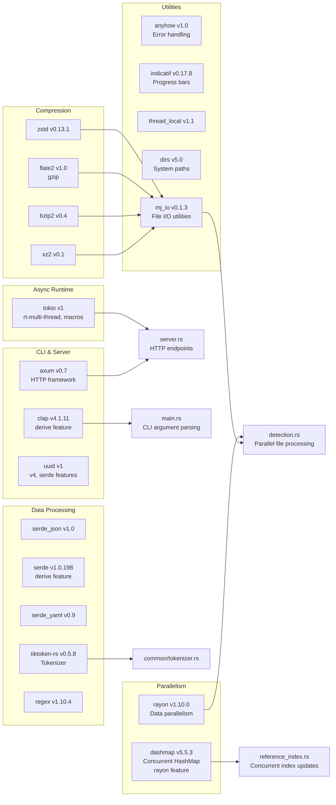
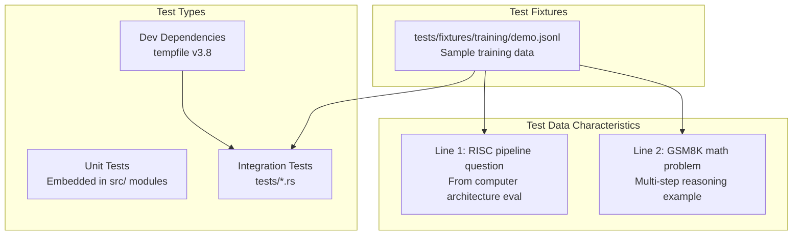
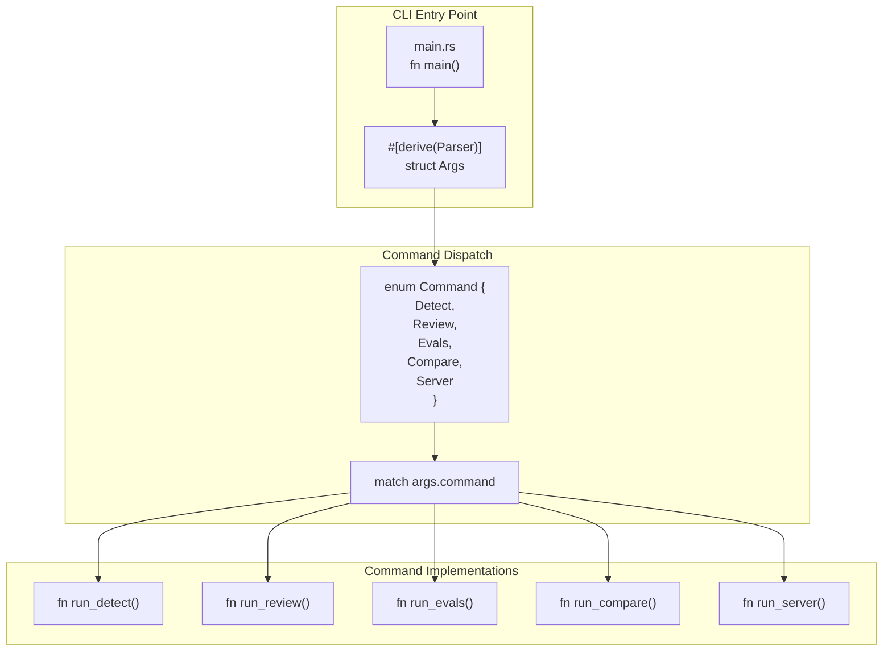
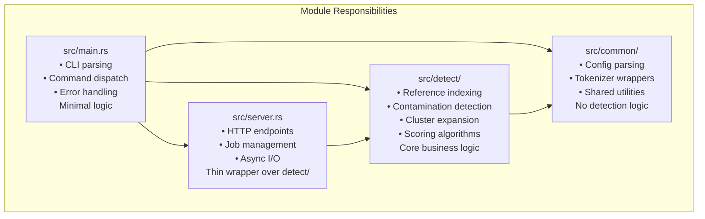

<!-- source: DeepWiki mcp.deepwiki.com · repo allenai/decon · page 8 Development Guide · fetched 2026-10-26 -->

# Development Guide

<details>
<summary>Relevant source files</summary>

The following files were used as context for generating this wiki page:

- [Cargo.toml](Cargo.toml)
- [python/evals.py](python/evals.py)
- [tests/fixtures/training/demo.jsonl](tests/fixtures/training/demo.jsonl)

</details>


This document provides technical information for developers who want to contribute to decon, understand its internal architecture, or extend its functionality. It covers dependency management, project structure, testing strategies, and contribution guidelines.

For user-facing documentation on running decon commands, see [User Guide](#3). For algorithm implementation details, see [Implementation Architecture](#6). For adding new evaluation datasets via configuration, see [Evaluation Dataset Configuration](#5.1).

---

## Development Environment Setup

### Rust Toolchain Requirements

The decon project requires Rust 1.88.0 or later, specified in [Cargo.toml:5](). The project uses Rust Edition 2024 [Cargo.toml:4]().

**Installation Steps:**

1. Install Rust via rustup: `curl --proto '=https' --tlsv1.2 -sSf https://sh.rustup.rs | sh`
2. Verify version: `rustc --version` (should be ≥ 1.88.0)
3. Clone repository: `git clone https://github.com/allenai/decon`
4. Build project: `cargo build --release`

### Python Environment Requirements

The evaluation dataset processing pipeline requires Python 3.7+ with the following core dependencies:

| Dependency | Purpose | Usage Location |
|------------|---------|----------------|
| `datasets` | HuggingFace dataset loading | [python/evals.py:46]() |
| `pyyaml` | Configuration parsing | [python/evals.py:43]() |
| `hashlib` | Fingerprint generation | [python/evals.py:45]() |

**Installation:**

```bash
pip install datasets pyyaml
```

The script is designed to be dependency-minimal to avoid version conflicts in diverse environments.

### Configuration Files

Two primary configuration files control system behavior:

1. **`config/evals.yaml`**: Defines ~150 evaluation dataset extraction rules (see [Evaluation Dataset Configuration](#5.1))
2. **`config/default.yaml`**: Controls detection algorithm parameters (see [Configuration Guide](#3.3))

Historical reproduction configurations are stored in `doc/repro/*.yaml` for transparency.

**Sources:** [Cargo.toml:1-39](), [python/evals.py:1-50]()

---

## Project Structure and Module Organization

The repository follows a dual-language architecture with clear separation between preprocessing (Python) and detection (Rust).

```mermaid
graph TB
    subgraph "Repository Root"
        CargoToml["Cargo.toml<br/>Rust package manifest"]
        ConfigDir["config/<br/>YAML configurations"]
        PythonDir["python/<br/>Dataset preprocessing"]
        SrcDir["src/<br/>Rust detection engine"]
        TestsDir["tests/<br/>Test suites"]
        DocDir["doc/<br/>Algorithm documentation"]
        BundledDir["bundled-evals/<br/>Pre-normalized datasets"]
    end
    
    subgraph "config/"
        DefaultYaml["default.yaml<br/>Detection parameters"]
        EvalsYaml["evals.yaml<br/>Dataset definitions"]
    end
    
    subgraph "python/"
        EvalsPy["evals.py<br/>Dataset normalization CLI"]
    end
    
    subgraph "src/"
        MainRs["main.rs<br/>CLI entry point"]
        CommonDir["common/<br/>Shared utilities"]
        DetectDir["detect/<br/>Core detection"]
        ServerRs["server.rs<br/>HTTP API"]
    end
    
    subgraph "src/detect/"
        RefIndexRs["reference_index.rs<br/>Index construction"]
        DetectionRs["detection.rs<br/>Contamination pipeline"]
        ClusterRs["cluster.rs<br/>Expansion logic"]
        ContamEntryRs["contamination_entry.rs<br/>Result types"]
        DisplayRs["display.rs<br/>Output formatting"]
    end
    
    subgraph "tests/"
        FixturesDir["fixtures/<br/>Test data"]
        IntegrationTests["*.rs<br/>Integration tests"]
    end
    
    ConfigDir --> DefaultYaml
    ConfigDir --> EvalsYaml
    PythonDir --> EvalsPy
    SrcDir --> MainRs
    SrcDir --> CommonDir
    SrcDir --> DetectDir
    SrcDir --> ServerRs
    DetectDir --> RefIndexRs
    DetectDir --> DetectionRs
    DetectDir --> ClusterRs
    DetectDir --> ContamEntryRs
    DetectDir --> DisplayRs
    TestsDir --> FixturesDir
    TestsDir --> IntegrationTests
```



### Directory Responsibilities

| Directory | Purpose | Key Files |
|-----------|---------|-----------|
| `config/` | YAML configuration files | `default.yaml`, `evals.yaml` |
| `python/` | Dataset normalization tooling | `evals.py` |
| `src/` | Rust implementation root | `main.rs`, `lib.rs` |
| `src/common/` | Shared utilities (config, tokenizers) | `config.rs`, `tokenizer.rs` |
| `src/detect/` | Detection engine core | All detection modules |
| `tests/` | Test suites and fixtures | `fixtures/training/demo.jsonl` |
| `doc/` | Algorithm documentation | `simple*.md`, `repro/*.yaml` |
| `bundled-evals/` | Pre-normalized evaluation datasets | `*.jsonl.gz` files |

**Sources:** Repository structure, [Cargo.toml:1-11]()

---

## Dependency Architecture and Rationale

### Rust Dependencies

The Rust implementation uses carefully selected dependencies for performance, correctness, and maintainability:



#### Core Dependency Rationale

**Concurrency Architecture:**

| Dependency | Purpose | Used In |
|------------|---------|---------|
| `tokio` [Cargo.toml:31]() | Async I/O for HTTP server | `src/server.rs` |
| `rayon` [Cargo.toml:27]() | CPU-parallel training file processing | `src/detect/detection.rs` |
| `dashmap` [Cargo.toml:26]() | Lock-free concurrent HashMap for index building | `src/detect/reference_index.rs` |
| `thread_local` [Cargo.toml:34]() | Thread-local tokenizer instances | `src/detect/detection.rs` |

The system uses **two concurrency models**:
- **Rayon** for CPU-bound work (n-gram matching, scoring)
- **Tokio** for I/O-bound work (HTTP request handling)

**Data Processing:**

| Dependency | Purpose | Used In |
|------------|---------|---------|
| `serde` + `serde_json` [Cargo.toml:16,23]() | JSONL parsing and serialization | Throughout |
| `serde_yaml` [Cargo.toml:28]() | Configuration file parsing | `src/common/config.rs` |
| `tiktoken-rs` [Cargo.toml:24]() | OpenAI tokenization (cl100k_base) | `src/common/tokenizer.rs` |
| `regex` [Cargo.toml:25]() | Text normalization | `src/detect/cluster.rs` |
| `unicode-segmentation` [Cargo.toml:29]() | Character boundary handling | Various text processing |

**Compression Support:**

The system supports four compression formats via [Cargo.toml:17-22]():
- **zstd**: Fastest decompression, recommended for large datasets
- **gzip** (flate2): Universal compatibility
- **bzip2**: Space-efficient compression
- **xz**: Maximum compression ratio

The `mj_io` crate [Cargo.toml:30]() provides automatic format detection based on file extensions.

**CLI & Server:**

| Dependency | Purpose |
|------------|---------|
| `clap` [Cargo.toml:18]() | Type-safe CLI argument parsing with derive macros |
| `axum` [Cargo.toml:32]() | Lightweight, composable HTTP framework |
| `uuid` [Cargo.toml:33]() | Job ID generation for distributed processing |

**Sources:** [Cargo.toml:14-36]()

---

## Testing Infrastructure

### Test Organization



### Test Fixtures

The repository includes minimal test fixtures in `tests/fixtures/training/`:

**`demo.jsonl`** [tests/fixtures/training/demo.jsonl:1-3]() contains two representative training examples:

1. **Computer Architecture Question** (Line 1): A multi-sentence text about RISC pipelines from a technical evaluation dataset, useful for testing question-answer contamination detection
2. **Math Word Problem** (Line 2): A GSM8K-style problem with reasoning steps, testing passage + question + answer contamination patterns

Both examples include the `"text"` field format used in actual training datasets.

### Running Tests

```bash
# Run all tests
cargo test

# Run with output
cargo test -- --nocaptures

# Run specific test
cargo test test_name

# Run integration tests only
cargo test --test '*'
```

### Test Data Generation

To create custom test fixtures:

```python
# Generate test training data
import json

data = [
    {"text": "Your training text here..."},
    {"text": "Another training example..."}
]

with open("tests/fixtures/training/custom.jsonl", "w") as f:
    for item in data:
        f.write(json.dumps(item) + "\n")
```

### Development Dependencies

[Cargo.toml:37-38]() defines development-only dependencies:

| Dependency | Purpose |
|------------|---------|
| `tempfile` v3.8 | Temporary file/directory creation for tests |

**Sources:** [tests/fixtures/training/demo.jsonl:1-3](), [Cargo.toml:37-38]()

---

## Extending the System

### Adding New Evaluation Datasets

The system is designed for easy dataset extension via configuration. No Rust code changes are required.

**Process:**

1. **Add configuration to `config/evals.yaml`:**

```yaml
your_dataset:
  hf_path: "organization/dataset-name"
  hf_config: "config_name"  # Optional
  splits: ["train", "test"]
  prompt: "question"
  answer: "answer"
  passage: "context"  # Optional
```

2. **Run normalization:**

```bash
python python/evals.py --eval your_dataset --output-dir ~/.local/share/decon/references
```

3. **Test detection:**

```bash
decon detect --training-dir path/to/training --references-dir ~/.local/share/decon/references
```

For complex extraction logic (expand_choices, parallel arrays, concat_messages), see [Evaluation Dataset Configuration](#5.1).

### Extending the Python Normalization Script

The `ChunkedFileWriter` class [python/evals.py:56-158]() handles automatic file chunking and fingerprinting. To extend extraction capabilities:

**Key Extension Points:**

| Function | Purpose | Lines |
|----------|---------|-------|
| `process_answers()` | Multi-answer expansion logic | [python/evals.py:188-529]() |
| `extract_passage()` | Passage field extraction | [python/evals.py:555-576]() |
| `extract_prompt()` | Question/prompt extraction | [python/evals.py:578-638]() |
| `extract_answer()` | Answer field extraction | [python/evals.py:640-706]() |
| `get_nested_field()` | Dot-notation field access | [python/evals.py:531-553]() |

**Example: Adding a new transform type:**

```python
# In process_answers(), add to transform handling
if transform == 'your_new_transform':
    # Apply your transformation
    answer_value = transform_function(answer_value)
```

### Adding New CLI Commands

**Architecture:**



**Steps to add a new command:**

1. **Define command struct in `src/main.rs`:**

```rust
#[derive(Parser)]
struct YourCommandArgs {
    /// Your argument description
    #[arg(long)]
    your_option: Option<String>,
}
```

2. **Add to `Command` enum:**

```rust
enum Command {
    // ... existing commands
    YourCommand(YourCommandArgs),
}
```

3. **Implement handler:**

```rust
fn run_your_command(args: YourCommandArgs) -> Result<()> {
    // Your implementation
    Ok(())
}
```

4. **Add dispatch logic:**

```rust
match args.command {
    // ... existing matches
    Command::YourCommand(cmd_args) => run_your_command(cmd_args)?,
}
```

### Modifying Detection Algorithm Parameters

Algorithm behavior is controlled by `config/default.yaml`. To add new parameters:

1. **Define parameter in config schema** (update `src/common/config.rs`)
2. **Add field to config struct** with serde derive
3. **Use parameter in detection logic** (typically in `src/detect/detection.rs` or `src/detect/cluster.rs`)

See [Configuration Guide](#3.3) for details on existing parameters.

**Sources:** [python/evals.py:56-706](), [Cargo.toml:18]()

---

## Build and Release Process

### Building for Production

```bash
# Release build with optimizations
cargo build --release

# Binary location
./target/release/decon

# Create distributable
tar -czf decon-v0.3.0-linux-x86_64.tar.gz -C target/release decon
```

### Binary Size Optimization

The project uses default Cargo optimization settings. For smaller binaries:

```toml
[profile.release]
opt-level = "z"      # Optimize for size
lto = true           # Enable link-time optimization
codegen-units = 1    # Better optimization, slower compile
strip = true         # Strip symbols
```

### Cross-Compilation

For multi-platform distribution:

```bash
# Install cross-compilation tools
cargo install cross

# Build for different targets
cross build --release --target x86_64-unknown-linux-gnu
cross build --release --target aarch64-unknown-linux-gnu
cross build --release --target x86_64-apple-darwin
```

**Sources:** [Cargo.toml:1-11]()

---

## Development Workflow Best Practices

### Code Organization Guidelines



**Architectural Principles:**

1. **Separation of Concerns**: Configuration (common) vs. detection (detect) vs. interface (main.rs, server.rs)
2. **No Circular Dependencies**: Common utilities never depend on detect modules
3. **Type Safety**: Use strongly-typed config structs with serde validation
4. **Error Propagation**: Use `anyhow::Result` for error context, avoid `unwrap()` in library code

### Performance Profiling

**Memory Profiling:**

```bash
# Build with debug symbols
cargo build --release --features debug

# Profile with valgrind
valgrind --tool=massif ./target/release/decon detect ...

# Analyze results
ms_print massif.out.12345
```

**CPU Profiling:**

```bash
# Install flamegraph
cargo install flamegraph

# Profile command
cargo flamegraph --bin decon -- detect --training-dir data/

# Opens flamegraph.svg in browser
```

### Documentation Standards

- **Module-level docs**: Explain purpose and key types at top of each file
- **Function docs**: Document parameters, return values, and examples for public APIs
- **Inline comments**: Explain non-obvious algorithmic decisions
- **Config comments**: Describe effect and typical values for YAML parameters

### Continuous Integration Considerations

Although CI configuration is not present in the provided files, recommended CI checks:

1. **Formatting**: `cargo fmt --check`
2. **Linting**: `cargo clippy -- -D warnings`
3. **Tests**: `cargo test --all-features`
4. **Build**: `cargo build --release`
5. **Python checks**: `python -m py_compile python/evals.py`

**Sources:** Repository structure, [Cargo.toml:14-36]()

---

## Debugging and Troubleshooting

### Common Development Issues

**Issue: Tokenizer Initialization Failures**

The `tiktoken-rs` dependency [Cargo.toml:24]() requires downloading BPE vocabulary files on first use.

```bash
# Pre-download tokenizer data
python -c "import tiktoken; tiktoken.get_encoding('cl100k_base')"
```

**Issue: OOM During Large Index Construction**

Index building uses `DashMap` [Cargo.toml:26]() which grows dynamically. Monitor memory with:

```bash
# Linux: Track memory usage
/usr/bin/time -v ./target/release/decon detect ...

# Look for "Maximum resident set size"
```

**Issue: Rayon Thread Contention**

Rayon parallelism [Cargo.toml:27]() defaults to CPU core count. Override with:

```bash
export RAYON_NUM_THREADS=8
```

### Logging and Instrumentation

The system uses `println!` for user-facing output and `eprintln!` for errors. For detailed logging during development:

```rust
// Add to Cargo.toml
env_logger = "0.10"

// In code
env_logger::init();
log::debug!("Debug message");
log::info!("Info message");
```

**Sources:** [Cargo.toml:24,26,27]()

---

## Contributing Guidelines

### Code Review Checklist

Before submitting changes:

- [ ] **Formatting**: Run `cargo fmt`
- [ ] **Linting**: Run `cargo clippy` and address warnings
- [ ] **Tests**: All tests pass (`cargo test`)
- [ ] **Documentation**: Public APIs are documented
- [ ] **Performance**: No regressions for common use cases
- [ ] **Configuration**: New parameters added to `config/default.yaml` with comments
- [ ] **Dataset changes**: `config/evals.yaml` entries are well-formatted

### License and Legal

The project is licensed under Apache-2.0 [Cargo.toml:7](). All contributions must be compatible with this license.

**Sources:** [Cargo.toml:7]()