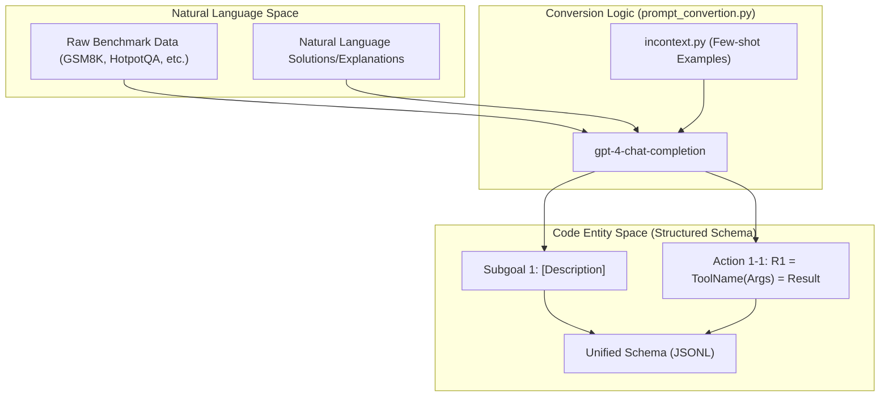
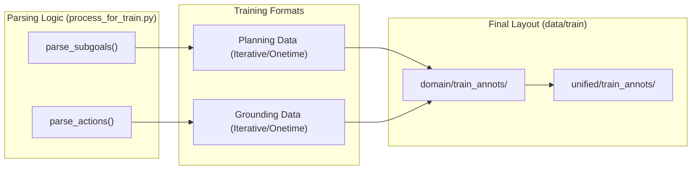

<!-- source: DeepWiki mcp.deepwiki.com · repo allenai/lumos · page 2 Data Pipeline · fetched 2026-10-26 -->

# Data Pipeline

Relevant source files

The following files were used as context for generating this wiki page:

- [data/__init__.py](data/__init__.py)
- [data/fast_prompt.py](data/fast_prompt.py)
- [data/incontext.py](data/incontext.py)
- [data/process_for_train.py](data/process_for_train.py)
- [data/prompt_convertion.py](data/prompt_convertion.py)
- [data/train/README.md](data/train/README.md)

The Lumos data pipeline is responsible for transforming raw benchmark data into a unified, modular format suitable for training large language models (LLMs) to perform complex reasoning tasks. The pipeline bridges the gap between natural language problem descriptions and structured sequences of subgoals and tool-executable actions.

### Pipeline Overview

The data generation process follows a two-stage approach:
1.  **Prompt Conversion**: Raw datasets (e.g., GSM8K, HotpotQA, Mind2Web) are processed using GPT-4 to generate ground-truth "subgoal-action" sequences based on human-provided natural language solutions.
2.  **Training Annotation Generation**: The converted data is parsed and reformatted into JSONL files for different training formulations (Iterative vs. Onetime) and modules (Planning vs. Grounding).

### Data Flow Diagram

The following diagram illustrates how raw benchmark data is converted into the "Code Entity Space" of structured subgoals and actions.

**Lumos Data Transformation Flow**

**Sources:**
- `data/prompt_convertion.py` [12-15]()
- `data/incontext.py` [1-5]()
- `data/process_for_train.py` [7-14]()

---

## 2.1 Prompt Conversion: Raw Data to Subgoal Annotations

The conversion stage uses `data/prompt_convertion.py` to synthesize structured training data. It leverages GPT-4 via an asynchronous, rate-limited interface defined in `data/fast_prompt.py` to handle large-scale dataset processing.

### Key Components
- **Domain-Specific Logic**: The script includes specialized functions like `maths_convertion` [data/prompt_convertion.py:12-88](), `complex_qa_convertion` [data/prompt_convertion.py:139-224](), and `web_agent_convertion` [data/prompt_convertion.py:227-285]().
- **In-Context Learning**: `data/incontext.py` provides detailed instructions and examples for different domains, such as `instruction_maths_prm` [data/incontext.py:1-5]() and `instruction_complex_qa` [data/incontext.py:136-141]().
- **Async Execution**: `generate_from_openai_chat_completion` in `data/fast_prompt.py` [164-191]() manages the API calls to OpenAI with error handling and rate limiting via `aiolimiter`.

For a deep dive into the conversion logic and prompt templates, see **[Prompt Conversion: Raw Data to Subgoal Annotations](#2.1)**.

**Sources:**
- `data/prompt_convertion.py` [1-285]()
- `data/fast_prompt.py` [1-191]()
- `data/incontext.py` [1-141]()

---

## 2.2 Training Annotation Generation and Dataset Layout

Once raw data is converted into subgoal/action pairs, `data/process_for_train.py` processes these files into the final training format. This script handles the parsing of text-based plans into discrete code entities and organizes them into the directory structure required by the training module.

### Dataset Organization
Training data is organized by domain and formulation under the `data/train/` directory:
- `maths/`: Annotations for GSM8K, SVAMP, etc.
- `complex_qa/`: Annotations for HotpotQA, StrategyQA, and Musique.
- `web_agent/`: Annotations for Mind2Web and WebShop.
- `unified/`: Combined datasets for multi-task training.

### Processing Logic
- **Parsing**: The function `parse_subgoals` [data/process_for_train.py:7-14]() splits GPT-4 outputs into individual steps, while `parse_actions` [data/process_for_train.py:16-53]() extracts tool names, arguments, and intermediate variables (e.g., `R1`, `R2`).
- **Formulations**: The script generates data for different reasoning modes, including `collect_plan_data` [data/process_for_train.py:171-236]() and `collect_ground_data` [data/process_for_train.py:239-338]().

**Training Data Extraction Pipeline**

For details on the unified schema and file structure, see **[Training Annotation Generation and Dataset Layout](#2.2)**.

**Sources:**
- `data/process_for_train.py` [7-53](), [171-338]()
- `data/train/README.md` [1-2]()

---

