# Page: Lumos: Overview and Architecture

# Lumos: Overview and Architecture

<details>
<summary>Relevant source files</summary>

The following files were used as context for generating this wiki page:

- [.gitignore](.gitignore)
- [LICENSE](LICENSE)
- [README.md](README.md)
- [assets/lumos.png](assets/lumos.png)
- [docs/index.html](docs/index.html)
- [docs/static/images/lumos_architecture.png](docs/static/images/lumos_architecture.png)

</details>


**Lumos** is a framework for training and deploying open-source language agents using a **modular design** and **unified data formats**. It is designed to bridge the gap between proprietary models like GPT-4 and open-source Large Language Models (LLMs) by decomposing complex interactive tasks into manageable steps across three core modules: Planning, Grounding, and Execution [README.md:22-27]().

The framework supports a wide range of domains, including complex question answering (QA), mathematical reasoning, and web navigation, by standardizing how agents interact with diverse environments [README.md:28-30]().

## Modular Architecture

Lumos departs from monolithic agent designs by splitting the reasoning process into three distinct stages. This modularity allows for specialized fine-tuning of each component and makes the system more interpretable.

### Core Pipeline
1.  **Planning Module**: Decomposes a high-level user query into a sequence of natural language subgoals.
2.  **Grounding Module**: Translates these subgoals into specific, executable actions (tool calls) based on the current environment state.
3.  **Execution Module**: Dispatches the actions to off-the-shelf APIs or environment simulators and returns the results to the agent.

The interaction between these modules can follow an **Iterative (Lumos-I)** flow, where the agent perceives environment feedback at each step, or a **Onetime (Lumos-O)** flow for tasks that do not require intermediate feedback [README.md:88-92]().

For a deep dive into these modules and their formulations, see [Core Concepts: Planning, Grounding, and Execution Modules](#1.1).

### System Data Flow
The following diagram illustrates how a user request traverses the Lumos architecture, transitioning from natural language subgoals to concrete code entities and tool executions.

**Lumos High-Level Architecture**
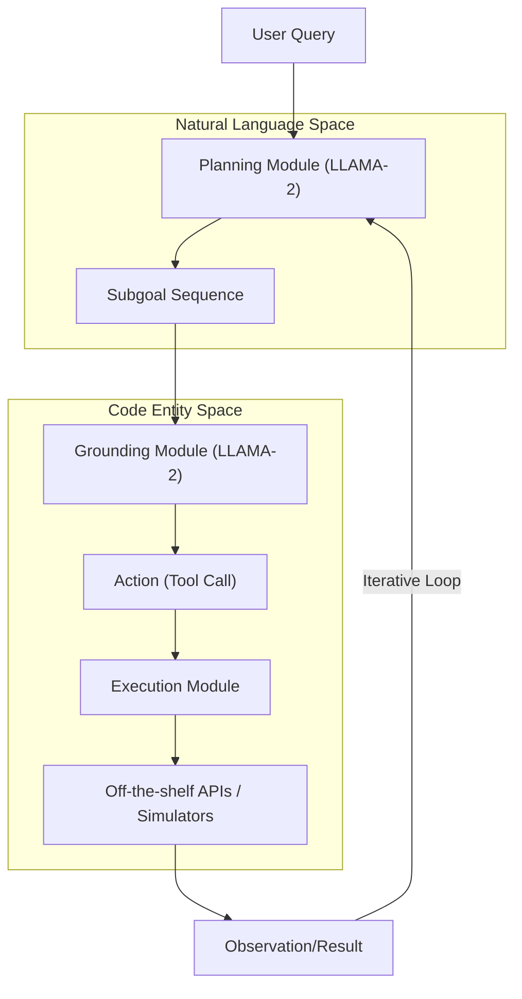
Sources: [README.md:25-27](), [README.md:58-61](), [assets/lumos.png:1-34]()

---

## Unified Data and Task Domains

Lumos utilizes a **Unified Data Format** that allows it to support multiple benchmarks under a single training and evaluation schema [README.md:27](). By converting diverse datasets into a standardized "Subgoal-Action" pair format, Lumos can be trained on a mixture of tasks to improve generalization.

### Supported Task Domains
*   **Complex QA**: Benchmarks like HotpotQA and StrategyQA.
*   **Mathematical Reasoning**: GSM8K and SVAMP.
*   **Web Navigation & Shopping**: Mind2Web and WebShop.
*   **Multimodal & Others**: ScienceQA and InterCode_SQL.

For details on the schema and benchmark integration, see [Unified Data Format and Supported Benchmarks](#1.2).

---

## Implementation Overview

Lumos is implemented using the `open-instruct` framework for fine-tuning Llama-2 (7B and 13B) models [README.md:96-103](). The training process involves high-quality annotations generated via GPT-4 to bootstrap the open-source modules [README.md:29-30]().

**Entity Mapping: Training to Execution**

Sources: [README.md:69-75](), [README.md:88-95](), [docs/index.html:122-175]()

To set up the environment and begin training or evaluation, see [Getting Started: Installation and Environment Setup](#1.3).

---

## Documentation Links

*   [Core Concepts: Planning, Grounding, and Execution Modules](#1.1): Detailed logic of the reasoning loops and module roles.
*   [Unified Data Format and Supported Benchmarks](#1.2): Explanation of the `subgoal` and `action` fields across different domains.
*   [Getting Started: Installation and Environment Setup](#1.3): Prerequisites, environment variables, and external tool setup.

Sources: [README.md:1-36](), [docs/index.html:86-186]()

---

# Page: Core Concepts: Planning, Grounding, and Execution Modules

# Core Concepts: Planning, Grounding, and Execution Modules

<details>
<summary>Relevant source files</summary>

The following files were used as context for generating this wiki page:

- [.gitignore](.gitignore)
- [LICENSE](LICENSE)
- [README.md](README.md)
- [docs/index.html](docs/index.html)
- [docs/static/images/lumos_formulation.png](docs/static/images/lumos_formulation.png)

</details>


Lumos operates as a modular framework for language agents, decomposing complex interactive tasks into a three-stage pipeline. This architecture unifies diverse task domains—ranging from web navigation to complex mathematical reasoning—into a standardized workflow. The system supports two primary operational modes: **Lumos-Iterative (Lumos-I)**, which performs step-by-step reasoning with environment feedback, and **Lumos-Onetime (Lumos-O)**, which generates a complete plan before execution.

### Architectural Overview

The Lumos pipeline transitions from high-level natural language goals to concrete tool invocations through three distinct modules:

1.  **Planning Module**: Decomposes a high-level user query into a sequence of high-level subgoals.
2.  **Grounding Module**: Translates a specific subgoal into a low-level, executable action (tool call) based on the current state.
3.  **Execution Module**: Dispatches the action to an external environment or API and retrieves the result.

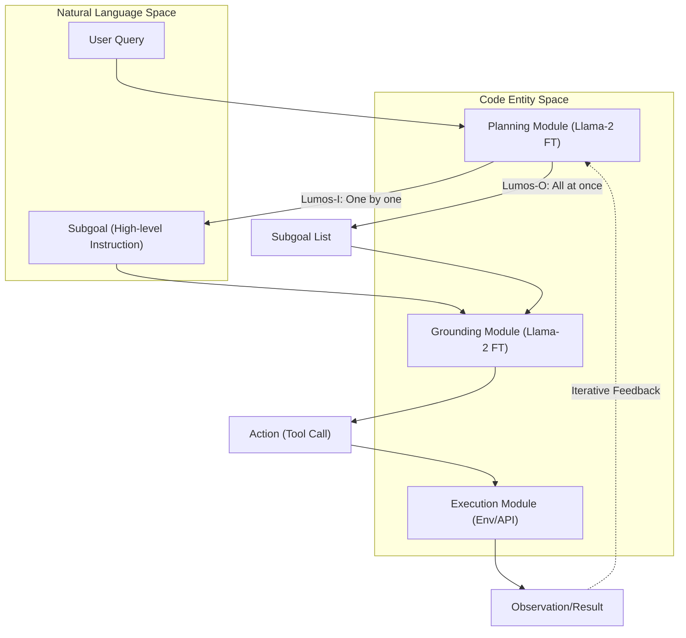

**Sources:** [README.md:25-27](), [README.md:58-61](), [docs/index.html:91-91]()

---

### 1. Planning Module

The Planning Module is responsible for high-level task decomposition. It takes the user's initial request and determines the logical steps required to solve it.

*   **Lumos-Iterative (Lumos-I)**: The planner generates a single subgoal at a time. After the execution of that subgoal, the resulting observation is fed back into the planner to generate the next subgoal. This is used for dynamic environments like web navigation (`Mind2Web`, `WebShop`) [README.md:82-86]().
*   **Lumos-Onetime (Lumos-O)**: The planner generates the entire sequence of subgoals in a single pass. This is typically used for static reasoning tasks like complex QA or math where the environment doesn't change significantly between steps [README.md:81-85]().

#### Implementation Details
The module is a fine-tuned Llama-2 model. During evaluation, it is invoked within a loop in benchmark-specific scripts (e.g., `run_eval.py`).

**Sources:** [README.md:25-26](), [README.md:92-94](), [docs/index.html:186-186]()

---

### 2. Grounding Module

The Grounding Module bridges the gap between high-level intent (subgoal) and specific tool syntax. It acts as a translator that maps a natural language subgoal into a structured action format defined for a specific domain.

*   **Input**: The current subgoal and the relevant environment context (e.g., HTML for web tasks, previous calculation results for math).
*   **Output**: A formatted action string, such as `KnowledgeQuery(query="...")` or `click(element="button_1")`.

#### Action Mapping Logic
The grounding process ensures that the agent's output conforms to the `Unified Data Format`. This allows the same grounding logic to be applied across different benchmarks by simply swapping the action vocabulary.

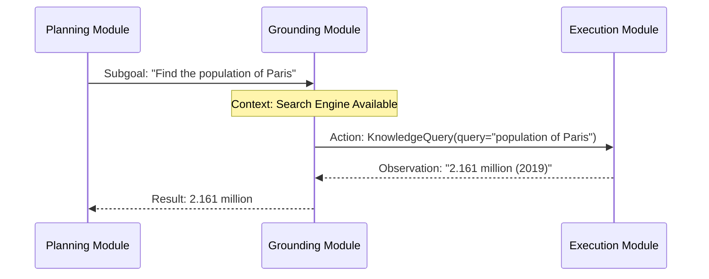

**Sources:** [README.md:26-27](), [README.md:29-30](), [docs/index.html:186-186]()

---

### 3. Execution Module

The Execution Module is a non-learnable component consisting of environment wrappers and API connectors. It receives the action produced by the Grounding Module, executes it, and returns the observation.

#### Key Tool Classes and APIs
Different benchmarks utilize specific tool classes to handle the "Code Entity Space" interactions:

| Domain | Tool Class / API | Key Functions |
| :--- | :--- | :--- |
| **Complex QA** | `QAActions` | `KnowledgeQuery`, `ParagraphRetrieve`, `QA` |
| **Math** | `MathActions` | `Calculator`, `SolveEquation`, `WolframAlpha API` |
| **Web Shop** | `ShopActions` | `Search`, `Click`, `Pick` |
| **Web Nav** | `MindAct` / Browser | `click`, `type`, `select` |

#### Data Flow in Execution
1.  **Parsing**: The module parses the action string (e.g., using regex or JSON parsing).
2.  **Dispatch**: It calls the corresponding Python function or external API.
3.  **Formatting**: The raw output (HTML, JSON, or text) is cleaned and formatted into a concise observation for the next iteration of the planner or for final answer extraction.

**Sources:** [README.md:26-26](), [README.md:63-67](), [docs/index.html:186-186]()

---

### Formulation Comparison: Lumos-I vs. Lumos-O

Lumos supports two distinct formulations to balance efficiency and adaptability.

| Feature | Lumos-Iterative (Lumos-I) | Lumos-Onetime (Lumos-O) |
| :--- | :--- | :--- |
| **Subgoal Generation** | One by one, conditioned on history | Full sequence generated at start |
| **Grounding** | Occurs after every subgoal | Occurs for each subgoal in sequence |
| **Best For** | Interactive/Web tasks (`Mind2Web`, `WebShop`) | Static reasoning (`HotpotQA`, `GSM8K`) |
| **Training Data** | `lumos_unified_iterative` | `lumos_complex_qa_onetime` |

**Sources:** [README.md:80-86](), [README.md:92-92](), [docs/static/images/lumos_formulation.png]()

---

# Page: Unified Data Format and Supported Benchmarks

# Unified Data Format and Supported Benchmarks

<details>
<summary>Relevant source files</summary>

The following files were used as context for generating this wiki page:

- [.gitignore](.gitignore)
- [LICENSE](LICENSE)
- [README.md](README.md)
- [data/__init__.py](data/__init__.py)
- [data/eval/gsm/test.jsonl](data/eval/gsm/test.jsonl)
- [data/eval/hotpotqa/test.json](data/eval/hotpotqa/test.json)
- [data/eval/strategyqa/strategy_qa.json](data/eval/strategyqa/strategy_qa.json)
- [data/eval/strategyqa/test.json](data/eval/strategyqa/test.json)
- [data/eval/svamp/test.json](data/eval/svamp/test.json)
- [data/fast_prompt.py](data/fast_prompt.py)
- [data/incontext.py](data/incontext.py)
- [data/process_for_train.py](data/process_for_train.py)
- [data/prompt_convertion.py](data/prompt_convertion.py)
- [docs/static/images/lumos_annotation.png](docs/static/images/lumos_annotation.png)
- [docs/static/images/lumos_annotation_example.png](docs/static/images/lumos_annotation_example.png)

</details>


Lumos employs a **Unified Data Format** that standardizes complex tasks into a modular sequence of subgoals and actions. This design allows a single model architecture to generalize across diverse domains including complex question answering, mathematical reasoning, and web navigation.

## Unified Data Format

Lumos represents task solutions as a series of **Subgoal-Action pairs**. This format bridges the gap between high-level reasoning (Planning) and low-level execution (Grounding).

### Subgoal/Action Schema
The format follows a strict hierarchical structure:
1.  **Subgoal**: A natural language description of a reasoning step (e.g., "Calculate the total cost").
2.  **Action**: A structured function call mapped to the subgoal (e.g., `R1 = Calculator(76 - 25)`).

The codebase uses a standardized parsing logic to extract these components from generated text in `data/process_for_train.py` [data/process_for_train.py:7-14]().

### Action Variable and Result Mapping
Actions utilize intermediate result variables (e.g., `R1`, `R2`) to maintain state across steps. The parser in `data/process_for_train.py` identifies four key components for every action:
*   **Action Variable**: The variable storing the output (e.g., `R1`).
*   **Action Name**: The tool or function being called (e.g., `Calculator`).
*   **Action Args**: The parameters passed to the function.
*   **Action Results**: The ground-truth or execution result of the action.

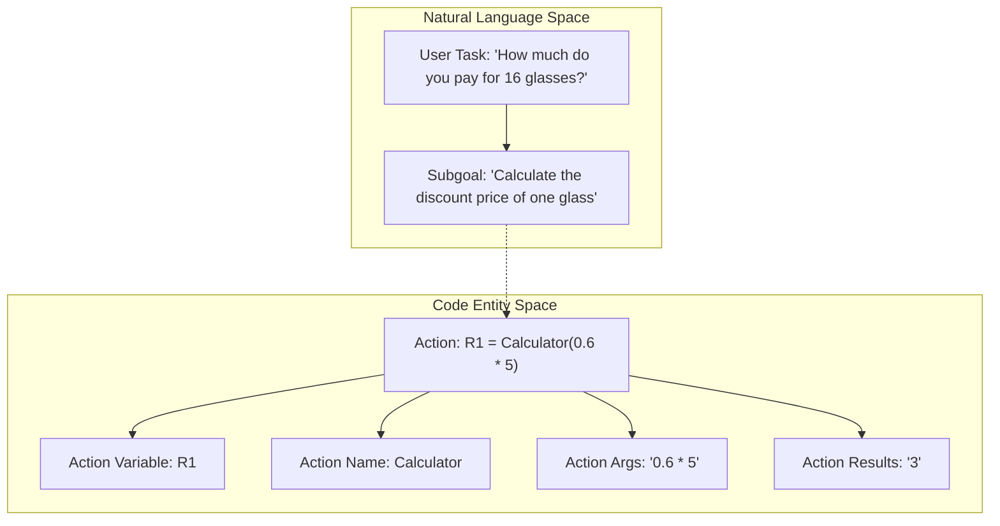
Sources: [data/process_for_train.py:16-52](), [data/incontext.py:10-20]()

---

## Supported Benchmarks

Lumos targets seven major benchmarks across three primary domains. These benchmarks are converted from their raw formats into the Lumos unified subgoal/action format using GPT-4-based prompt conversion [data/prompt_convertion.py:12-15]().

| Domain | Benchmarks | Primary Tools/Actions |
| :--- | :--- | :--- |
| **Complex QA** | HotpotQA, StrategyQA | `KnowledgeQuery`, `ParagraphRetrieve`, `QA` |
| **Maths** | GSM8K, SVAMP | `Calculator`, `SolveEquation`, `Count`, `Define` |
| **Web Agent** | Mind2Web, WebShop | `Search`, `Click`, `Type`, `Select` |

### Data Flow: Raw to Unified
The conversion process uses `prompt_convertion.py` to transform raw datasets (like `musique_full_v1.0_train.jsonl` or `strategyqa_train.json`) into the unified format [data/process_for_train.py:144-148]().

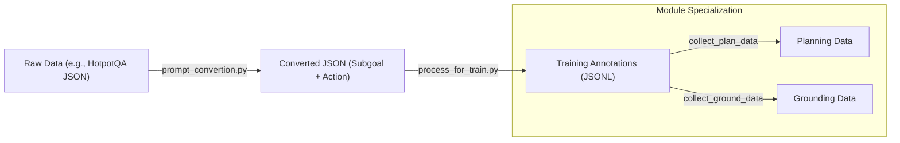
Sources: [data/process_for_train.py:171-172](), [data/prompt_convertion.py:139-151]()

---

## Domain-Specific Action Vocabularies

While the data format is unified, the available **Action Vocabulary** is defined by the domain. These are enforced during the data generation phase using `incontext.py` instructions to ensure the model learns to call valid tools.

### 1. Mathematical Reasoning (`maths`)
The vocabulary includes operations for algebraic and arithmetic manipulation.
*   **Actions**: `Calculator`, `SetEquation`, `SolveEquation`, `Count`, `SolveInequality`, `Code`, `Define` [data/incontext.py:5-5]().
*   **Implementation**: Results are typically numerical or symbolic expressions.

### 2. Complex Question Answering (`complex_qa`)
Focused on multi-hop retrieval and synthesis.
*   **Actions**: `KnowledgeQuery` (search), `ParagraphRetrieve` (lookup), `QA` (synthesis) [data/prompt_convertion.py:89-136]().
*   **Logic**: Often involves decomposing a "bridge" or "comparison" question into simpler queries [data/eval/hotpotqa/test.json:1-10]().

### 3. Web Navigation (`web_agent`)
Actions are mapped to DOM interactions.
*   **Actions**: `Search`, `Click`, `Type`, `Select`, `Hover`, `Enter` [README.md:32-35]().
*   **Constraint**: Unlike other domains, `web_agent` actions often do not return a specific "Action Result" variable in the training data, as the result is the new state of the environment [data/process_for_train.py:48-50]().

Sources: [data/incontext.py:1-40](), [data/process_for_train.py:22-52](), [README.md:25-35]()

---

# Page: Getting Started: Installation and Environment Setup

# Getting Started: Installation and Environment Setup

<details>
<summary>Relevant source files</summary>

The following files were used as context for generating this wiki page:

- [eval/webshop/requirements.txt](eval/webshop/requirements.txt)
- [eval/webshop/setup.sh](eval/webshop/setup.sh)
- [requirements.txt](requirements.txt)
- [setup.sh](setup.sh)

</details>


This page provides a comprehensive technical guide for establishing the Lumos development and execution environment. Setting up Lumos requires synchronizing CUDA-enabled deep learning frameworks, specialized tool-use libraries, and external benchmark environments such as WebShop.

## 1. Core Environment Installation

The Lumos environment is built upon a specific combination of `torch`, `transformers`, and `peft` to support LoRA-based fine-tuning and inference. The installation process is orchestrated primarily through `setup.sh` and `requirements.txt`.

### 1.1 CUDA and PyTorch Alignment
Lumos requires `torch==2.0.0` aligned with `cuda 11.7`. This specific versioning is critical for compatibility with `flash_attn==2.0.4`, which is used during the fine-tuning of Llama-2 models.

The initial setup is performed via:
```bash
# From setup.sh
conda install pytorch==2.0.0 torchvision==0.15.0 torchaudio==2.0.0 pytorch-cuda=11.7 -c pytorch -c nvidia
pip install packaging
pip install -r requirements.txt
```
Sources: [setup.sh:1-3](), [requirements.txt:9-9](), [requirements.txt:29-29]()

### 1.2 Dependency Management
The `requirements.txt` file defines the full stack needed for Planning, Grounding, and Execution modules.

| Category | Key Packages | Purpose |
| :--- | :--- | :--- |
| **Model Training** | `accelerate`, `peft`, `transformers` | Distributed LoRA fine-tuning and model loading. |
| **Web Agent** | `playwright`, `selenium`, `beautifulsoup4` | Browser interaction and DOM parsing for Mind2Web. |
| **Math/Logic** | `wolframalpha`, `numpy` | Symbolic execution and numerical verification. |
| **Retrieval** | `pyserini`, `rank_bm25`, `faiss-cpu` | Document indexing and BM25/Semantic search. |

Sources: [requirements.txt:1-33]()

## 2. WebShop Environment Setup

The WebShop benchmark requires a local Flask-based web server and a Lucene search index to simulate an e-commerce environment. This is handled by a specialized setup script in `eval/webshop/setup.sh`.

### 2.1 Data Acquisition and Indexing
The setup script uses `gdown` to retrieve product metadata and human trajectories. It supports two modes: `small` (1,000 products) and `all` (full dataset).

**Installation Flow:**
1. **Dependencies:** Installs `openjdk=11` (for Lucene/Pyserini) and `mkl=2021`.
2. **Product Data:** Downloads `items_shuffle` and `items_ins_v2` via `gdown`.
3. **Search Indexing:** Executes `convert_product_file_format.py` to prepare documents for the Lucene engine.
4. **Human Trajectories:** Downloads example trajectories to `user_session_logs/` for reference.

### 2.2 WebShop Architecture Diagram
The following diagram illustrates how the setup script prepares the "Code Entity Space" for the WebShop environment.

**WebShop Setup Data Flow**
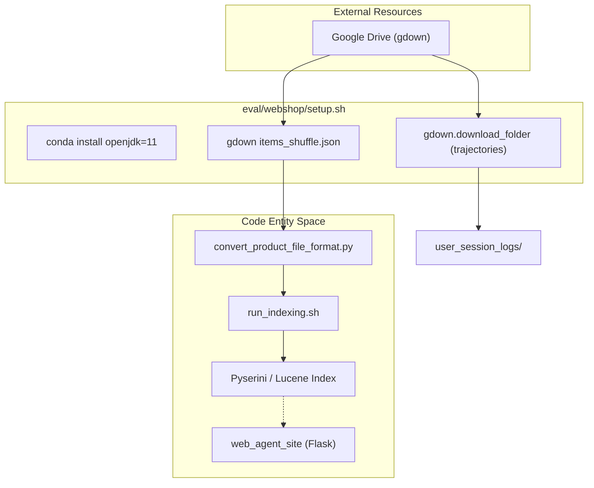
Sources: [eval/webshop/setup.sh:24-73](), [eval/webshop/requirements.txt:1-8]()

## 3. External Service Configuration

Lumos utilizes external APIs and local drivers to fulfill subgoals generated by the Planning Module.

### 3.1 WolframAlpha API
For math-heavy benchmarks like GSM8K and SVAMP, the `MathActions` tool class relies on the `wolframalpha` library. 
* **Requirement:** An AppID from the WolframAlpha Developer Portal.
* **Implementation:** The library is installed via `requirements.txt` [line 32]().

### 3.2 Playwright and Browser Drivers
For web navigation tasks (Mind2Web), Lumos uses `playwright`. After installing the pip package, the browser binaries must be initialized:
```bash
playwright install
```
Sources: [requirements.txt:18-18]()

## 4. Environment Verification

To verify the installation, ensure the "Natural Language Space" can be successfully mapped to the "Code Entity Space" through the following module components.

**Lumos Component Mapping**
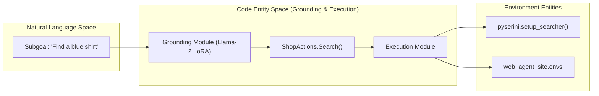

### Verification Checklist
1. **CUDA:** Run `python -c "import torch; print(torch.cuda.is_available())"` to confirm GPU access.
2. **Flash Attention:** Ensure `flash_attn` is successfully imported to enable high-speed training [requirements.txt:9]().
3. **WebShop Server:** Navigate to `eval/webshop/` and ensure `search_engine/indexes` contains the Lucene files generated by `run_indexing.sh` [eval/webshop/setup.sh:54-55]().
4. **Spacy Models:** Confirm `en_core_web_lg` is downloaded, as it is used for entity extraction in web tasks [eval/webshop/setup.sh:48]().

Sources: [setup.sh:1-3](), [eval/webshop/setup.sh:48-56](), [requirements.txt:1-33]()

---

# Page: Data Pipeline

# Data Pipeline

<details>
<summary>Relevant source files</summary>

The following files were used as context for generating this wiki page:

- [data/__init__.py](data/__init__.py)
- [data/fast_prompt.py](data/fast_prompt.py)
- [data/incontext.py](data/incontext.py)
- [data/process_for_train.py](data/process_for_train.py)
- [data/prompt_convertion.py](data/prompt_convertion.py)
- [data/train/README.md](data/train/README.md)

</details>


The Lumos data pipeline is responsible for transforming raw benchmark data into a unified, modular format suitable for training large language models (LLMs) to perform complex reasoning tasks. The pipeline bridges the gap between natural language problem descriptions and structured sequences of subgoals and tool-executable actions.

### Pipeline Overview

The data generation process follows a two-stage approach:
1.  **Prompt Conversion**: Raw datasets (e.g., GSM8K, HotpotQA, Mind2Web) are processed using GPT-4 to generate ground-truth "subgoal-action" sequences based on human-provided natural language solutions.
2.  **Training Annotation Generation**: The converted data is parsed and reformatted into JSONL files for different training formulations (Iterative vs. Onetime) and modules (Planning vs. Grounding).

### Data Flow Diagram

The following diagram illustrates how raw benchmark data is converted into the "Code Entity Space" of structured subgoals and actions.

**Lumos Data Transformation Flow**
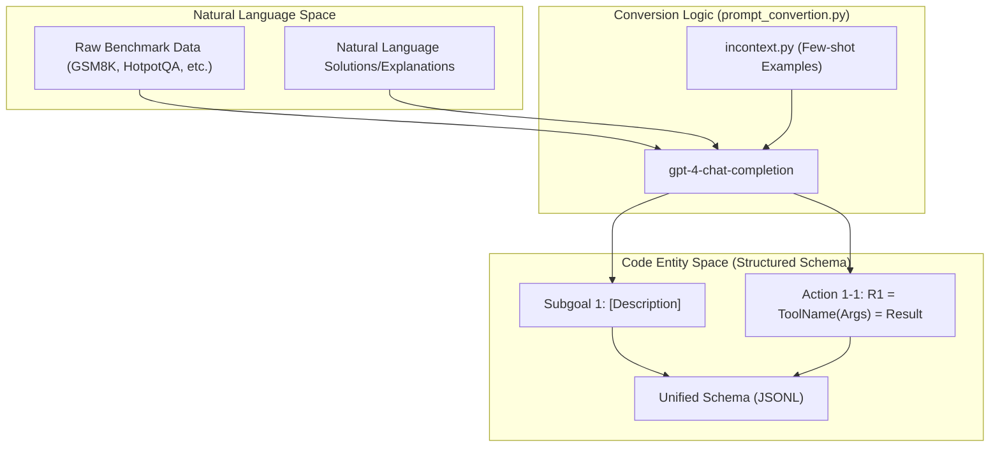

**Sources:**
- `data/prompt_convertion.py` [12-15]()
- `data/incontext.py` [1-5]()
- `data/process_for_train.py` [7-14]()

---

## 2.1 Prompt Conversion: Raw Data to Subgoal Annotations

The conversion stage uses `data/prompt_convertion.py` to synthesize structured training data. It leverages GPT-4 via an asynchronous, rate-limited interface defined in `data/fast_prompt.py` to handle large-scale dataset processing.

### Key Components
- **Domain-Specific Logic**: The script includes specialized functions like `maths_convertion` [data/prompt_convertion.py:12-88](), `complex_qa_convertion` [data/prompt_convertion.py:139-224](), and `web_agent_convertion` [data/prompt_convertion.py:227-285]().
- **In-Context Learning**: `data/incontext.py` provides detailed instructions and examples for different domains, such as `instruction_maths_prm` [data/incontext.py:1-5]() and `instruction_complex_qa` [data/incontext.py:136-141]().
- **Async Execution**: `generate_from_openai_chat_completion` in `data/fast_prompt.py` [164-191]() manages the API calls to OpenAI with error handling and rate limiting via `aiolimiter`.

For a deep dive into the conversion logic and prompt templates, see **[Prompt Conversion: Raw Data to Subgoal Annotations](#2.1)**.

**Sources:**
- `data/prompt_convertion.py` [1-285]()
- `data/fast_prompt.py` [1-191]()
- `data/incontext.py` [1-141]()

---

## 2.2 Training Annotation Generation and Dataset Layout

Once raw data is converted into subgoal/action pairs, `data/process_for_train.py` processes these files into the final training format. This script handles the parsing of text-based plans into discrete code entities and organizes them into the directory structure required by the training module.

### Dataset Organization
Training data is organized by domain and formulation under the `data/train/` directory:
- `maths/`: Annotations for GSM8K, SVAMP, etc.
- `complex_qa/`: Annotations for HotpotQA, StrategyQA, and Musique.
- `web_agent/`: Annotations for Mind2Web and WebShop.
- `unified/`: Combined datasets for multi-task training.

### Processing Logic
- **Parsing**: The function `parse_subgoals` [data/process_for_train.py:7-14]() splits GPT-4 outputs into individual steps, while `parse_actions` [data/process_for_train.py:16-53]() extracts tool names, arguments, and intermediate variables (e.g., `R1`, `R2`).
- **Formulations**: The script generates data for different reasoning modes, including `collect_plan_data` [data/process_for_train.py:171-236]() and `collect_ground_data` [data/process_for_train.py:239-338]().

**Training Data Extraction Pipeline**
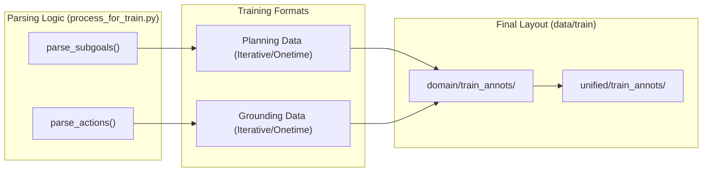

For details on the unified schema and file structure, see **[Training Annotation Generation and Dataset Layout](#2.2)**.

**Sources:**
- `data/process_for_train.py` [7-53](), [171-338]()
- `data/train/README.md` [1-2]()

---

# Page: Prompt Conversion: Raw Data to Subgoal Annotations

# Prompt Conversion: Raw Data to Subgoal Annotations

<details>
<summary>Relevant source files</summary>

The following files were used as context for generating this wiki page:

- [data/__init__.py](data/__init__.py)
- [data/fast_prompt.py](data/fast_prompt.py)
- [data/incontext.py](data/incontext.py)
- [data/process_for_train.py](data/process_for_train.py)
- [data/prompt_convertion.py](data/prompt_convertion.py)

</details>


The prompt conversion stage is the first step in the Lumos data pipeline. It transforms raw benchmark solutions (e.g., Chain-of-Thought reasoning or natural language steps) into a structured **subgoal-based plan** format. This process utilizes GPT-4 as a teacher model, guided by domain-specific in-context examples, to generate the standardized annotations required for training the Planning and Grounding modules.

### Architectural Overview

The conversion process is orchestrated by `data/prompt_convertion.py`, which leverages an asynchronous, rate-limited interface to the OpenAI API defined in `data/fast_prompt.py`.

**Data Flow: Natural Language to Structured Subgoals**

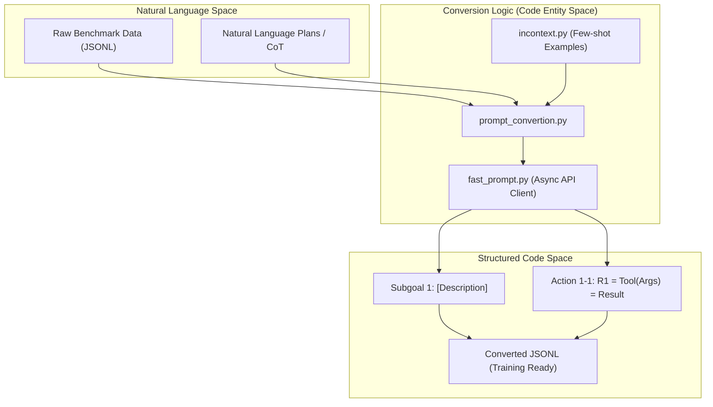
**Sources:** `data/prompt_convertion.py:1-10`(), `data/incontext.py:1-5`()

---

### Domain-Specific Conversion Functions

The conversion logic is partitioned into domain-specific functions that handle the unique requirements of Maths, Complex QA, and Web Agent tasks.

#### 1. Mathematics Conversion
The `maths_convertion` function processes datasets like GSM8K, PRM800K, and ASDIV. It maps natural language solutions to a specific action vocabulary: `Calculator`, `SetEquation`, `SolveEquation`, `Count`, `SolveInequality`, `Code`, and `Define` `[data/incontext.py:5]()`.

*   **Implementation:** `maths_convertion(args)` `[data/prompt_convertion.py:12-87]()`.
*   **Key Logic:** It constructs a `final_prompt` by combining a domain instruction (e.g., `instruction_maths_prm`) with the raw task and the existing natural language plan `[data/prompt_convertion.py:40-48]()`.

#### 2. Complex QA Conversion
The `complex_qa_convertion` function handles HotpotQA, StrategyQA, and MuSiQue. It focuses on decomposing multi-hop questions into sub-questions and retrieval actions.

*   **Implementation:** `complex_qa_convertion(args)` `[data/prompt_convertion.py:139-224]()`.
*   **Intermediate Step:** `convert_qa_to_human_solution` is used to flatten raw evidence and question decompositions into a readable "human solution" string before sending it to GPT-4 `[data/prompt_convertion.py:89-136]()`.
*   **Action Vocabulary:** `KnowledgeQuery`, `ParagraphRetrieve`, and `QA` `[data/incontext.py:127-130]()`.

#### 3. Web Agent Conversion
The `web_agent_convertion` function processes Mind2Web and WebShop data. Unlike the other domains, web tasks often involve converting structural action lists (click, type, search) into subgoals that explain the *intent* behind the actions.

*   **Implementation:** `web_agent_convertion(args)` `[data/prompt_convertion.py:227-302]()`.
*   **Action Vocabulary:** `Search`, `Click`, `Type`, `Select`, `FeatureRetrieve`, `Pick` `[data/incontext.py:273-276]()`.

**Sources:** `data/prompt_convertion.py:12-302`(), `data/incontext.py:1-276`()

---

### Asynchronous API Interface (`fast_prompt.py`)

To handle the high volume of conversion requests, Lumos uses an asynchronous wrapper around the OpenAI SDK. This ensures high throughput while respecting API rate limits.

| Function | Role | Key Components |
| :--- | :--- | :--- |
| `generate_from_openai_chat_completion` | Entry point for chat-based models (GPT-4). | `aiolimiter.AsyncLimiter`, `tqdm_asyncio.gather` `[data/fast_prompt.py:164-192]()` |
| `_throttled_openai_chat_completion_acreate` | Handles individual API calls with retry logic. | `openai.ChatCompletion.acreate`, `RateLimitError` handling `[data/fast_prompt.py:114-161]()` |
| `generate_from_openai_completion` | Entry point for legacy completion models. | `openai.Completion.acreate` `[data/fast_prompt.py:65-111]()` |

**Sources:** `data/fast_prompt.py:19-192`()

---

### Structured Output Format

The output of `prompt_convertion.py` is a JSONL file where each entry contains the original task and a `subgoal_plan` string. This string follows a strict schema that the later `process_for_train.py` script parses using `parse_subgoals` and `parse_actions`.

**Schema Mapping: Prompt Output to Code Entities**

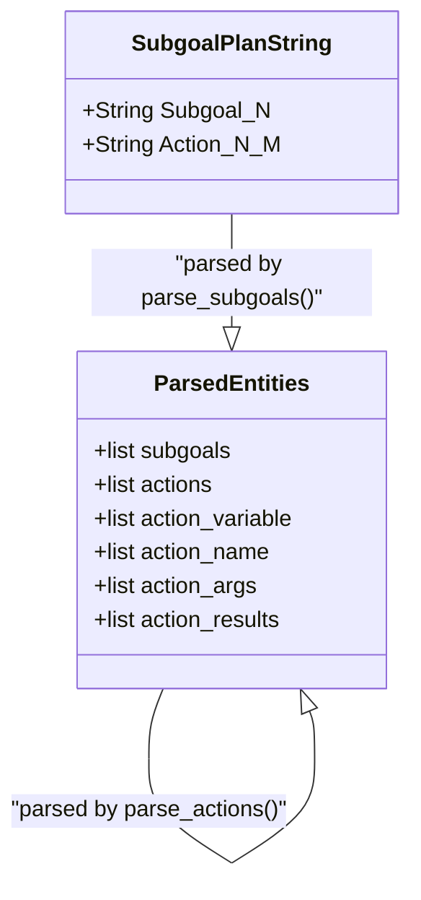

| Code Entity | Regex / String Pattern | Example from `incontext.py` |
| :--- | :--- | :--- |
| **Subgoal** | `Subgoal [number]: [Text]` | `Subgoal 1: Calculate the difference...` `[data/incontext.py:11]()` |
| **Action Variable** | `R[number]` or `Output` | `R1`, `R5, R6`, `Output` `[data/incontext.py:12-20]()` |
| **Action Name** | Function identifier | `Calculator`, `SolveEquation` `[data/incontext.py:12-18]()` |
| **Action Results** | Value after the second `=` | `-2y`, `123/40` `[data/incontext.py:12-20]()` |

**Sources:** `data/process_for_train.py:7-52`(), `data/incontext.py:11-20`()

---

# Page: Training Annotation Generation and Dataset Layout

# Training Annotation Generation and Dataset Layout

<details>
<summary>Relevant source files</summary>

The following files were used as context for generating this wiki page:

- [data/__init__.py](data/__init__.py)
- [data/fast_prompt.py](data/fast_prompt.py)
- [data/incontext.py](data/incontext.py)
- [data/process_for_train.py](data/process_for_train.py)
- [data/prompt_convertion.py](data/prompt_convertion.py)
- [data/train/complex_qa/README.md](data/train/complex_qa/README.md)
- [data/train/maths/README.md](data/train/maths/README.md)
- [data/train/unified/README.md](data/train/unified/README.md)
- [data/train/web_agent/README.md](data/train/web_agent/README.md)

</details>


This page details the implementation of the training data pipeline in Lumos, specifically focusing on how converted subgoal-based annotations are processed, aggregated, and formatted for fine-tuning the Planning and Grounding modules. The logic is primarily contained within `data/process_for_train.py`.

## Data Generation Pipeline Overview

The pipeline transforms raw benchmark data (e.g., GSM8K, HotpotQA, Mind2Web) into structured training pairs. This involves two main stages:
1.  **Prompt Conversion**: Converting raw solutions into a unified subgoal/action schema using GPT-4 (handled by `data/prompt_convertion.py`).
2.  **Training Annotation Generation**: Parsing those converted outputs into specific formats for **Lumos-Iterative (Lumos-I)** and **Lumos-Onetime (Lumos-O)** training (handled by `data/process_for_train.py`).

### Data Flow and Entity Mapping

The following diagram illustrates how natural language tasks are transformed into structured training entities used by the `model/finetune.py` script.

**Entity Mapping: Raw Data to Training Annotations**
```mermaid
graph TD
    subgraph "Natural Language Space"
        RAW["Raw Benchmark Data (JSON/JSONL)"]
        NL_PLAN["Natural Language Solution/Plan"]
    end

    subgraph "Code Entity Space (data/process_for_train.py)"
        CONV["Converted Subgoal Plan (GPT-4 Output)"]
        PARSE_S["parse_subgoals()"]
        PARSE_A["parse_actions()"]
        
        subgraph "Training Formulations"
            ITER["collect_plan_data(iterative=True)"]
            ONE["collect_plan_data(iterative=False)"]
            GROUND["collect_ground_data()"]
        end
    end

    RAW -->|maths_convertion| CONV
    RAW -->|complex_qa_convertion| CONV
    CONV --> PARSE_S
    PARSE_S -->|Subgoals| ITER
    PARSE_S -->|Subgoals| ONE
    PARSE_S -->|Actions| PARSE_A
    PARSE_A -->|Action Names/Args| GROUND

    Sources: ["data/process_for_train.py:7-14"](), ["data/process_for_train.py:16-52"](), ["data/prompt_convertion.py:12-88"]()
```

## Key Functions in `process_for_train.py`

### Parsing Logic
To build training sets, the system must extract structured components from the text generated by GPT-4.

*   **`parse_subgoals(x)`**: Splits the generated plan into a list of subgoals and a list of action strings by searching for the "Subgoal" keyword and splitting by double newlines `[data/process_for_train.py:7-14]()`.
*   **`parse_actions(x, domain)`**: Extracts the `action_variable` (e.g., R1), `action_name` (e.g., Calculator), `action_args`, and `action_results` from a single action string. It uses complex regex-like string manipulation to handle nested parentheses and result assignments `[data/process_for_train.py:16-52]()`.

### Data Collection Routines
These functions assemble the final JSONL files used for training:

| Function | Purpose | Logic |
| :--- | :--- | :--- |
| `collect_plan_data` | Generates data for the **Planning Module**. | If `iterative=True`, it creates samples for every step $t$ where the model sees the task and subgoals $1 \dots t-1$. If `False`, it provides the full plan at once `[data/process_for_train.py:171-255]()`. |
| `collect_ground_data` | Generates data for the **Grounding Module**. | Maps a specific `subgoal` to its corresponding `action_name` and `action_args`. It ignores the execution results to ensure the model learns to ground subgoals into tools `[data/process_for_train.py:258-323]()`. |
| `collect_cot_data` | Baseline generation. | Formats raw data into standard Chain-of-Thought (CoT) messages `[data/process_for_train.py:63-125]()`. |
| `aggregate_multi_datasets` | Helper for multi-domain. | Iterates through the `converted/` directory for a domain and merges all JSON files into a single list `[data/process_for_train.py:55-60]()`. |

**Sources:** `data/process_for_train.py:7-323`

## Dataset Layout

Lumos organizes data by domain and processing stage. The `data/train/` directory is the central repository for these files.

### Directory Structure
```text
data/train/
├── complex_qa/
│   ├── raw_data/          # Original HotpotQA/StrategyQA files
│   ├── converted/         # GPT-4 generated subgoal-action pairs
│   └── train_annots/      # Final JSONL for finetuning (iterative/onetime)
├── maths/
│   ├── raw_data/          # Original GSM8K/ASDIV/PRM800K files
│   ├── converted/         # Parsed math solutions
│   └── train_annots/      # Final JSONL for finetuning
├── web_agent/
│   ├── raw_data/          # Mind2Web/WebShop traces
│   ├── converted/         # Traces converted to Lumos schema
│   └── train_annots/      # Final JSONL for finetuning
└── unified/               # Aggregated multi-domain datasets
```
**Sources:** `data/process_for_train.py:57-60`(), `data/process_for_train.py:86-89`(), `data/process_for_train.py:150-153`()

## Unified Dataset Assembly

The `collect_unified_data` function is responsible for creating the multi-domain training set. It aggregates data from all three domains (maths, complex_qa, web_agent) to create a single training corpus, allowing the model to generalize across different toolsets and reasoning styles `[data/process_for_train.py:326-397]()`.

**Unified Data Flow**
```mermaid
graph LR
    subgraph "Domain Specific Annotations"
        M_P["maths_plan.jsonl"]
        QA_P["complex_qa_plan.jsonl"]
        W_P["web_agent_plan.jsonl"]
    end

    subgraph "Unified Logic (collect_unified_data)"
        U_PLAN["unified_plan.jsonl"]
        U_GROUND["unified_ground.jsonl"]
    end

    M_P --> U_PLAN
    QA_P --> U_PLAN
    W_P --> U_PLAN
    
    Sources: ["data/process_for_train.py:326-397"]()
```

### Data Formatting
The output format follows the `open-instruct` message format, compatible with `DataCollatorForSeq2Seq`:
*   **Role: User**: Contains the task instruction and, in iterative mode, the history of previous subgoals/actions.
*   **Role: Assistant**: Contains the target subgoal (Planning) or the target action (Grounding).

**Sources:** `data/process_for_train.py:214-222`(), `data/process_for_train.py:306-314`()

---

# Page: Model Training

# Model Training

<details>
<summary>Relevant source files</summary>

The following files were used as context for generating this wiki page:

- [model/finetune.py](model/finetune.py)
- [scripts/train/finetune_llama2_ground_iterative.sh](scripts/train/finetune_llama2_ground_iterative.sh)
- [scripts/train/finetune_llama2_plan_iterative.sh](scripts/train/finetune_llama2_plan_iterative.sh)
- [train.sh](train.sh)

</details>


This section provides a high-level overview of the training pipeline used to develop Lumos models. The training process involves fine-tuning Llama-2 base models into specialized **Planning** and **Grounding** modules. This is achieved using the `open-instruct` framework, optimized with DeepSpeed and Flash Attention for efficient distributed training.

## Training Pipeline Overview

The Lumos training pipeline transforms base language models into goal-oriented agents by training them on structured subgoal and action sequences. The pipeline is designed to support both **Iterative** (step-by-step) and **Onetime** (all-at-once) reasoning formulations across multiple domains including Complex QA, Maths, and Web Navigation.

### Core Components

The following diagram illustrates the relationship between the training scripts, the core fine-tuning logic, and the distributed execution environment.

**Training System Architecture**
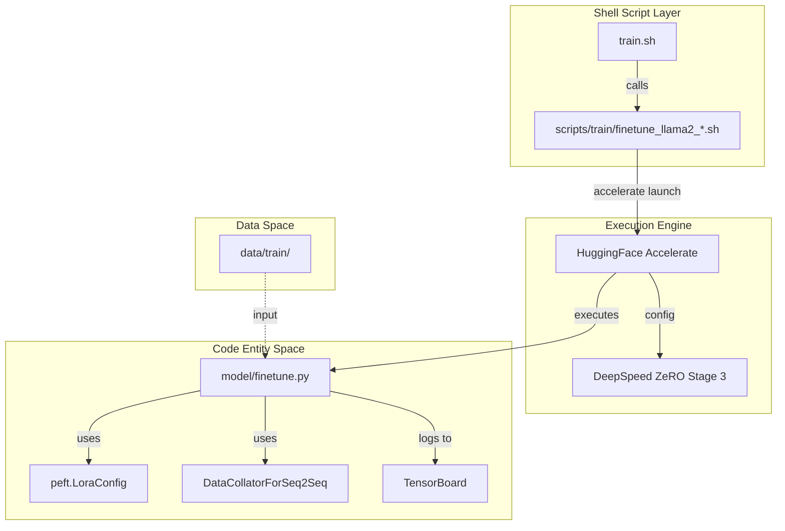
**Sources:** [train.sh:1-1](), [scripts/train/finetune_llama2_ground_iterative.sh:11-17](), [model/finetune.py:1-36]()

## Fine-Tuning Logic

The heart of the training process is `model/finetune.py`. This script is responsible for loading the Llama-2 base model, configuring the tokenizer, and setting up the training loop. It supports advanced features like Parameter-Efficient Fine-Tuning (PEFT) via LoRA and memory-efficient attention mechanisms.

Key responsibilities of the fine-tuning script include:
*   **Model Loading**: Initializing `AutoModelForCausalLM` with optional Flash Attention and 8-bit/4-bit quantization [model/finetune.py:18-35]().
*   **Optimization**: Implementing gradient accumulation and learning rate scheduling (e.g., linear warmup) [model/finetune.py:120-148]().
*   **Data Handling**: Utilizing `DataCollatorForSeq2Seq` to handle variable-length sequences within the `DataLoader` [model/finetune.py:27-27]().

For a deep dive into the implementation details of the fine-tuning logic, LoRA parameters, and adapter merging, see **[Fine-Tuning Script: model/finetune.py](#3.1)**.

**Sources:** [model/finetune.py:39-215]()

## Distributed Training and Configuration

Lumos utilizes `accelerate` and `DeepSpeed` to scale training across multiple GPUs. The training is orchestrated through a hierarchy of shell scripts that define hyperparameters and environment variables.

**Training Workflow: Script to Execution**
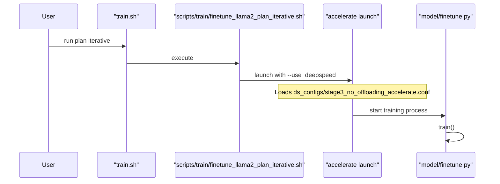
**Sources:** [train.sh:1-1](), [scripts/train/finetune_llama2_plan_iterative.sh:11-17]()

### Training Variants
The repository provides specific scripts for different module types and formulations:
*   **Planning vs. Grounding**: Separate training runs for the `plan` and `ground` modules [scripts/train/finetune_llama2_plan_iterative.sh:3-3](), [scripts/train/finetune_llama2_ground_iterative.sh:3-3]().
*   **Iterative vs. Onetime**: Scripts are tailored for the specific data format of each formulation [scripts/train/finetune_llama2_ground_iterative.sh:22-22]().

For details on the DeepSpeed configuration files, hardware requirements, and specific hyperparameter settings (like `TOTAL_BATCH_SIZE=128`), see **[Training Scripts and DeepSpeed Configuration](#3.2)**.

**Sources:** [scripts/train/finetune_llama2_ground_iterative.sh:1-35](), [scripts/train/finetune_llama2_plan_iterative.sh:1-35]()

---

# Page: Fine-Tuning Script: model/finetune.py

# Fine-Tuning Script: model/finetune.py

<details>
<summary>Relevant source files</summary>

The following files were used as context for generating this wiki page:

- [model/finetune.py](model/finetune.py)

</details>


The `model/finetune.py` script is the core training component of the Lumos framework, adapted from the `open-instruct` project. It provides a robust interface for fine-tuning Large Language Models (specifically Llama-2) on the structured subgoal and action annotations generated in the data pipeline. It supports Parameter-Efficient Fine-Tuning (PEFT) via LoRA/qLoRA, memory-efficient training with Flash Attention, and distributed execution using Hugging Face `accelerate`.

## 1. Core Implementation and Training Logic

The script follows a standard Hugging Face training loop but is heavily customized for Seq2Seq-style causal language modeling. It manages the lifecycle of model loading, dataset preprocessing, and the optimization loop.

### Key Components:
- **Argument Parsing**: Uses `argparse` to configure model paths, LoRA parameters, hardware optimizations (Flash Attention, Gradient Checkpointing), and experiment tracking [model/finetune.py:39-213]().
- **Model Initialization**: Loads causal language models (e.g., Llama-2) with optional 4-bit/8-bit quantization via `BitsAndBytesConfig` if `use_qlora` is enabled [model/finetune.py:32, 209-213]().
- **Data Collator**: Employs `DataCollatorForSeq2Seq` to handle dynamic padding of sequences within a batch, ensuring that only the completion (and not the prompt) contributes to the loss calculation through label masking [model/finetune.py:27]().

### Data Flow Diagram: Training Pipeline
This diagram illustrates the flow from raw configuration to the execution of the training loop.

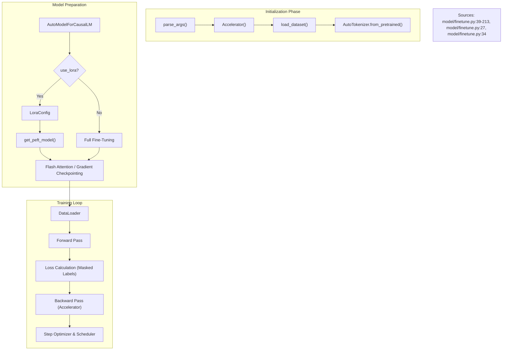

Sources: [model/finetune.py:27-34](), [model/finetune.py:39-213]()

## 2. LoRA and Optimization Configurations

Lumos utilizes Low-Rank Adaptation (LoRA) to efficiently train the Planning and Grounding modules. This allows for high-performance tuning of 7B and 13B models on consumer or mid-tier enterprise hardware.

### LoRA Configuration
The script defines the rank ($r$), alpha, and dropout for the LoRA adapters:
- **Rank (`--lora_rank`)**: Defaults to 64 [model/finetune.py:74-78]().
- **Alpha (`--lora_alpha`)**: Scaling factor, defaults to 16 [model/finetune.py:80-84]().
- **Dropout (`--lora_dropout`)**: Defaults to 0.1 [model/finetune.py:86-90]().

### Memory Optimizations
To handle the sequence lengths required for complex reasoning (up to 2048 or more tokens), the script integrates:
- **Flash Attention**: Enabled via `--use_flash_attn` to reduce memory footprint and increase speed during the attention mechanism [model/finetune.py:92-95]().
- **Gradient Checkpointing**: Enabled via `--gradient_checkpointing` to trade compute for memory by not storing all intermediate activations [model/finetune.py:202-207]().
- **Gradient Accumulation**: Managed by `accelerate` to simulate larger batch sizes [model/finetune.py:134-138]().

Sources: [model/finetune.py:74-95](), [model/finetune.py:134-138](), [model/finetune.py:202-207]()

## 3. Training Execution and Tracking

The script uses the `accelerate` library to handle distributed training across multiple GPUs.

| Feature | Implementation Detail |
| :--- | :--- |
| **Scheduler** | Supports `linear`, `cosine`, and `polynomial` via `get_scheduler` [model/finetune.py:140-145]() |
| **Logging** | Integration with TensorBoard and WandB via `--report_to` [model/finetune.py:184-192]() |
| **Checkpointing** | Periodic saving of model states and optimizer states via `accelerator.save_state` [model/finetune.py:161-165]() |
| **Seed** | Reproducibility ensured via `set_seed(args.seed)` [model/finetune.py:14, 150]() |

Sources: [model/finetune.py:14](), [model/finetune.py:140-145](), [model/finetune.py:150](), [model/finetune.py:161-165](), [model/finetune.py:184-192]()

## 4. Adapter Merging: merge_lora.py

After training with LoRA, the weights exist as separate adapter layers. The `merge_lora.py` script (conceptually paired with `finetune.py`) is used to fuse these weights back into the base Llama-2 model for easier deployment and faster inference during evaluation.

### Merging Process Logic
The merge script typically performs the following steps:
1. Load the base model (e.g., `Llama-2-7b-hf`).
2. Load the trained LoRA adapter from the `output_dir`.
3. Use `model.merge_and_unload()` from the `peft` library to integrate weights.
4. Save the resulting standalone model.

### Code Entity Mapping: Training to Merging
This diagram bridges the entities involved in the transition from a PEFT-trained state to a unified model.

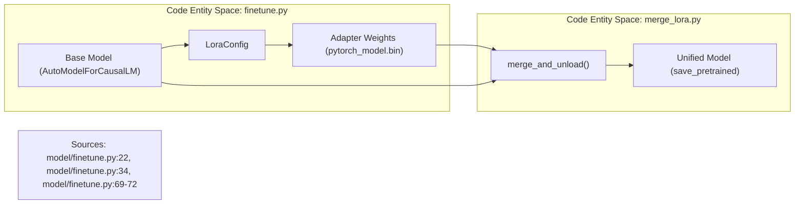

Sources: [model/finetune.py:22](), [model/finetune.py:34](), [model/finetune.py:69-72]()

---

# Page: Training Scripts and DeepSpeed Configuration

# Training Scripts and DeepSpeed Configuration

<details>
<summary>Relevant source files</summary>

The following files were used as context for generating this wiki page:

- [ds_configs/stage3_no_offloading.conf](ds_configs/stage3_no_offloading.conf)
- [ds_configs/stage3_no_offloading_accelerate.conf](ds_configs/stage3_no_offloading_accelerate.conf)
- [scripts/train/finetune_llama2_cot.sh](scripts/train/finetune_llama2_cot.sh)
- [scripts/train/finetune_llama2_direct.sh](scripts/train/finetune_llama2_direct.sh)
- [scripts/train/finetune_llama2_ground_iterative.sh](scripts/train/finetune_llama2_ground_iterative.sh)
- [scripts/train/finetune_llama2_ground_onetime.sh](scripts/train/finetune_llama2_ground_onetime.sh)
- [scripts/train/finetune_llama2_plan_iterative.sh](scripts/train/finetune_llama2_plan_iterative.sh)
- [scripts/train/finetune_llama2_plan_onetime.sh](scripts/train/finetune_llama2_plan_onetime.sh)
- [train.sh](train.sh)

</details>


This page details the orchestration layer used to train Lumos models. The framework utilizes shell scripts to wrap `accelerate launch` commands, integrating DeepSpeed ZeRO Stage 3 for efficient distributed training of Llama-2 base models.

## Orchestration Architecture

Training in Lumos is triggered via a top-level entry point `train.sh`, which dispatches to specialized scripts for different model roles (Planning vs. Grounding) and formulations (Iterative vs. Onetime).

### Training Flow Diagram
The following diagram illustrates how the shell scripts interface with the `accelerate` environment and the core training logic.

**Training Script Execution Flow**
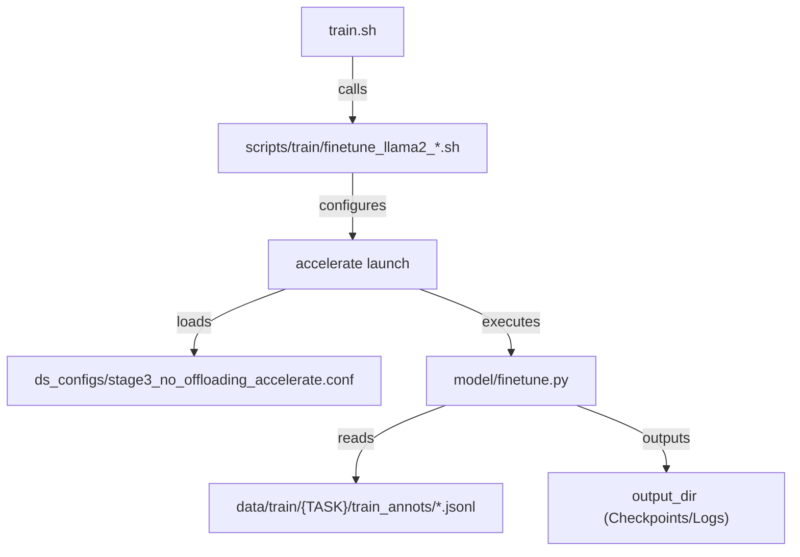
**Sources:** [train.sh:1-1](), [scripts/train/finetune_llama2_plan_onetime.sh:11-17]()

## Training Script Variants

Lumos provides scripts for four primary training configurations, along with baseline scripts for Chain-of-Thought (CoT) and Direct training.

| Script Name | Module | Formulation | Purpose |
|:---|:---|:---|:---|
| `finetune_llama2_plan_iterative.sh` | Planning | Iterative | Trains model to generate single subgoals based on current state. |
| `finetune_llama2_plan_onetime.sh` | Planning | Onetime | Trains model to generate a complete sequence of subgoals upfront. |
| `finetune_llama2_ground_iterative.sh` | Grounding | Iterative | Trains model to map a single subgoal to a tool call. |
| `finetune_llama2_ground_onetime.sh` | Grounding | Onetime | Trains model to map a sequence of subgoals to a sequence of actions. |
| `finetune_llama2_cot.sh` | N/A | CoT | Baseline: Fine-tunes Llama-2 for standard Chain-of-Thought. |
| `finetune_llama2_direct.sh` | N/A | Direct | Baseline: Fine-tunes Llama-2 for direct answer prediction. |

**Sources:** [scripts/train/finetune_llama2_plan_iterative.sh:1-35](), [scripts/train/finetune_llama2_plan_onetime.sh:1-35](), [scripts/train/finetune_llama2_ground_iterative.sh:1-35](), [scripts/train/finetune_llama2_ground_onetime.sh:1-35](), [scripts/train/finetune_llama2_cot.sh:1-35](), [scripts/train/finetune_llama2_direct.sh:1-35]()

## Hyperparameters and Configuration

All scripts share a standardized set of hyperparameters optimized for Llama-2 7B and 13B models.

### Key Hyperparameters
*   **Learning Rate:** `2e-5` with a `linear` scheduler [scripts/train/finetune_llama2_plan_iterative.sh:27-28]().
*   **Warmup Ratio:** `0.03` [scripts/train/finetune_llama2_plan_iterative.sh:29]().
*   **Epochs:** `2` [scripts/train/finetune_llama2_plan_iterative.sh:31]().
*   **Batch Size:** Typically configured for a total batch size of `128` [scripts/train/finetune_llama2_plan_iterative.sh:7]().
*   **Max Sequence Length:** `1024` tokens [scripts/train/finetune_llama2_plan_iterative.sh:23]().

### Gradient Accumulation Calculation
The scripts dynamically calculate `GRADIENT_ACC_STEPS` based on the number of GPUs and the desired total batch size:
`GRADIENT_ACC_STEPS=$(($TOTAL_BATCH_SIZE/$NUM_GPUS/$BATCH_SIZE_PER_GPU))` [scripts/train/finetune_llama2_plan_iterative.sh:8]().

## DeepSpeed Configuration

Lumos utilizes DeepSpeed ZeRO Stage 3 to handle model states (optimizer states, gradients, and parameters) across multiple GPUs.

### Configuration Files
1.  **`ds_configs/stage3_no_offloading_accelerate.conf`**: Used when launching via the `accelerate` CLI. It delegates optimizer and scheduler management to `accelerate` while retaining ZeRO-3 parameter partitioning [ds_configs/stage3_no_offloading_accelerate.conf:1-23]().
2.  **`ds_configs/stage3_no_offloading.conf`**: A standalone DeepSpeed configuration that includes internal `AdamW` and `WarmupDecayLR` settings [ds_configs/stage3_no_offloading.conf:5-22]().

### ZeRO Stage 3 Settings
The configurations use the following technical parameters to optimize memory:
*   **`overlap_comm`**: `true` to overlap communication with computation [ds_configs/stage3_no_offloading_accelerate.conf:7]().
*   **`contiguous_gradients`**: `true` to reduce memory fragmentation [ds_configs/stage3_no_offloading_accelerate.conf:8]().
*   **`stage3_max_live_parameters`**: Set to `1e9` to limit the number of parameters held in GPU memory at once [ds_configs/stage3_no_offloading_accelerate.conf:13]().
*   **`stage3_gather_16bit_weights_on_model_save`**: `true` to ensure full model weights are saved in a single file after training [ds_configs/stage3_no_offloading_accelerate.conf:15]().

**Sources:** [ds_configs/stage3_no_offloading_accelerate.conf:1-23](), [ds_configs/stage3_no_offloading.conf:1-41]()

## Implementation Mapping

The following diagram bridges the shell script variables to the Python implementation in `model/finetune.py`.

**Script to Code Entity Mapping**
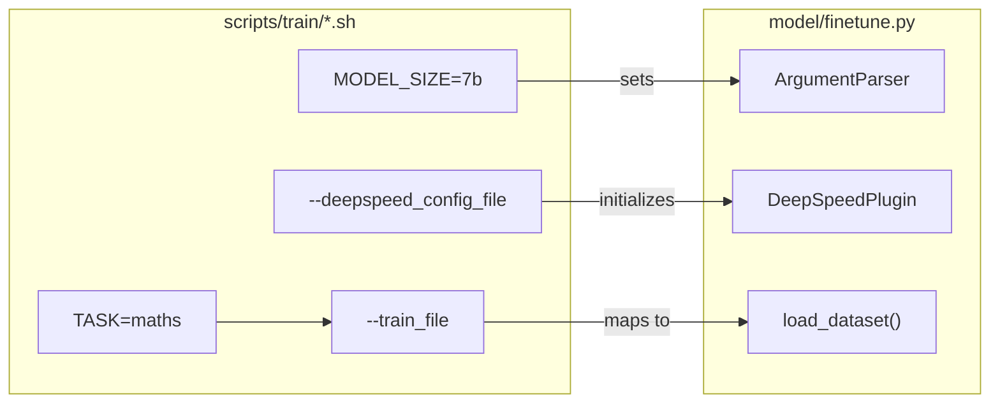

**Sources:** [scripts/train/finetune_llama2_plan_onetime.sh:3-22](), [model/finetune.py:1-100]() (Implicitly via argument passing)

## Data Flow in Training

The training scripts target specific JSONL files generated by the data pipeline.

1.  **Planning Module Data:**
    *   Iterative: `data/train/${TASK}/train_annots/lumos_${TASK}_plan_iterative.jsonl` [scripts/train/finetune_llama2_plan_iterative.sh:22]().
    *   Onetime: `data/train/${TASK}/train_annots/lumos_${TASK}_plan_onetime.jsonl` [scripts/train/finetune_llama2_plan_onetime.sh:22]().
2.  **Grounding Module Data:**
    *   Iterative: `data/train/${TASK}/train_annots/lumos_${TASK}_ground_iterative.jsonl` [scripts/train/finetune_llama2_ground_iterative.sh:22]().
    *   Onetime: `data/train/${TASK}/train_annots/lumos_${TASK}_ground_onetime.jsonl` [scripts/train/finetune_llama2_ground_onetime.sh:22]().

The training process uses `bf16` mixed precision and `flash_attn` for high-throughput training on modern GPU architectures (e.g., A100) [scripts/train/finetune_llama2_plan_iterative.sh:12-19]().

**Sources:** [scripts/train/finetune_llama2_plan_iterative.sh:12-22](), [scripts/train/finetune_llama2_ground_iterative.sh:22]()

---

# Page: Evaluation Framework

# Evaluation Framework

<details>
<summary>Relevant source files</summary>

The following files were used as context for generating this wiki page:

- [.gitignore](.gitignore)
- [LICENSE](LICENSE)
- [README.md](README.md)
- [eval/utils.py](eval/utils.py)

</details>


The Lumos evaluation framework is designed to assess the performance of modular language agents across a diverse set of interactive benchmarks. It provides a standardized infrastructure for loading models, generating multi-step completions, and executing domain-specific actions. The framework supports four distinct agent formulations: `lumos_iterative`, `lumos_onetime`, `cot` (Chain-of-Thought), and `direct`.

### Shared Evaluation Utilities

The core of the evaluation infrastructure resides in `eval/utils.py`. These utilities are adapted from the `open-instruct` framework to support the specific needs of agentic workflows, such as handling stop sequences for iterative reasoning and batch processing of prompts.

*   **`load_hf_lm_and_tokenizer`**: A standard utility for loading HuggingFace models and tokenizers, ensuring consistent configuration across different evaluation scripts.
*   **`generate_completions`**: The primary function for generating model outputs [eval/utils.py:30-94](). It supports:
    *   **Batch Generation**: Efficiently processing multiple prompts simultaneously [eval/utils.py:36-37]().
    *   **Custom Stopping Criteria**: Using the `KeyWordsCriteria` class to stop generation when specific tokens (like `Subgoal:` or `Action:`) are produced [eval/utils.py:12-26]().
    *   **Post-processing**: Automatically removing prompts and handling stop-sequence artifacts from the generated text [eval/utils.py:56-73]().
*   **`KeyWordsCriteria`**: A custom `StoppingCriteria` implementation that monitors the generation for a list of specific token sequences [eval/utils.py:12-26](). This is critical for the iterative formulation where the model should stop after generating a single subgoal or action.

**Sources:** [eval/utils.py:1-133]()

### Evaluation Formulations

Lumos evaluates four different ways of solving tasks, allowing for a comparison between modular reasoning and standard LLM baselines.

| Formulation | Description |
| :--- | :--- |
| `lumos_iterative` | The agent alternates between the Planning Module (subgoal) and Grounding Module (action) in a loop until the task is complete. |
| `lumos_onetime` | The Planning Module generates all subgoals at once, and the Grounding Module subsequently generates all corresponding actions. |
| `cot` | A standard Chain-of-Thought baseline where the model generates a reasoning trace before the final answer. |
| `direct` | The model is prompted to provide the final answer directly without intermediate reasoning steps. |

**Sources:** [README.md:25-35](), [README.md:108-112]()

### Infrastructure Architecture

The following diagram illustrates how the shared utilities in `eval/utils.py` bridge the gap between high-level evaluation scripts and the underlying model execution.

**Evaluation Utility Flow**
```mermaid
graph TD
    subgraph "Natural Language Space"
        A["Benchmark Prompts"]
        B["Generated Subgoals/Actions"]
    end

    subgraph "Code Entity Space (eval/utils.py)"
        C["generate_completions"]
        D["KeyWordsCriteria"]
        E["load_hf_lm_and_tokenizer"]
    end

    subgraph "Model Space"
        F["HuggingFace Model"]
        G["Tokenizer"]
    end

    A --> C
    E --> F
    E --> G
    C --> D
    D -- "Stop on 'Action:'" --> F
    F --> B
    C -- "batch_decode" --> B
```
**Sources:** [eval/utils.py:12-26](), [eval/utils.py:30-52](), [eval/utils.py:67-73]()

### Evaluation Entry-Points

Evaluation is typically triggered via shell scripts located in `scripts/eval/`. These scripts invoke domain-specific `run_eval.py` files using a consistent pattern:
`python run_eval.py --model_name_or_path <PATH> --formulation <TYPE> --task <TASK_NAME>`

**Common Evaluation Logic**
```mermaid
graph TD
    subgraph "Execution Logic (run_eval.py)"
        Iter["Iterative Loop"]
        One["Onetime Loop"]
        Tools["Action/Tool Classes"]
    end

    subgraph "Shared Utils (eval/utils.py)"
        GC["generate_completions"]
        KC["KeyWordsCriteria"]
    end

    Iter --> GC
    One --> GC
    GC --> KC
    Iter -- "Call Tool" --> Tools
```
**Sources:** [README.md:108-112](), [eval/utils.py:12-30]()

---

### Benchmark-Specific Modules

The framework is specialized for different domains through dedicated evaluation scripts and toolsets.

#### [4.1 Complex QA Evaluation: HotpotQA and StrategyQA](#)
Focuses on multi-hop reasoning and paragraph retrieval. It utilizes the `QAActions` tool class to interact with knowledge sources. For details, see [Complex QA Evaluation: HotpotQA and StrategyQA](#4.1).

#### [4.2 Math Evaluation: GSM8K and SVAMP](#)
Handles mathematical reasoning using the `MathActions` tool class, which includes integrations for `WolframAlpha` and a local `Calculator`. For details, see [Math Evaluation: GSM8K and SVAMP](#4.2).

#### [4.3 Web Navigation Evaluation: Mind2Web](#)
Evaluates the agent's ability to navigate real-world websites. It includes a `MindAct` model for element ranking and a grounding loop for HTML interactions. For details, see [Web Navigation Evaluation: Mind2Web](#4.3).

#### [4.4 Web Shopping Evaluation: WebShop](#)
Tests agents in a simulated e-commerce environment. It features a Flask-based environment (`web_agent_site`) and a `ShopActions` toolset for searching and purchasing. For details, see [Web Shopping Evaluation: WebShop](#4.4).

---

# Page: Complex QA Evaluation: HotpotQA and StrategyQA

# Complex QA Evaluation: HotpotQA and StrategyQA

<details>
<summary>Relevant source files</summary>

The following files were used as context for generating this wiki page:

- [eval/hotpotqa/qa_tool.py](eval/hotpotqa/qa_tool.py)
- [eval/hotpotqa/run_eval.py](eval/hotpotqa/run_eval.py)
- [eval/hotpotqa/utils.py](eval/hotpotqa/utils.py)
- [eval/strategyqa/qa_tool.py](eval/strategyqa/qa_tool.py)
- [eval/strategyqa/run_eval.py](eval/strategyqa/run_eval.py)
- [eval/strategyqa/utils.py](eval/strategyqa/utils.py)
- [scripts/eval/hotpotqa.sh](scripts/eval/hotpotqa.sh)
- [scripts/eval/strategyqa.sh](scripts/eval/strategyqa.sh)

</details>


This page describes the evaluation framework for complex question answering (QA) tasks in Lumos, specifically targeting the **HotpotQA** and **StrategyQA** benchmarks. It details the implementation of reasoning loops, the toolset used for external knowledge retrieval, and the scoring mechanisms employed to validate model performance.

## Overview and Execution Entry Points

Evaluation is orchestrated via `run_eval.py` scripts located in benchmark-specific directories. These scripts support multiple formulations, including `lumos_iterative` and `lumos_onetime`, and utilize a specialized `QAActions` class to interface with external tools.

| Benchmark | Script Path | Purpose |
| :--- | :--- | :--- |
| **HotpotQA** | `eval/hotpotqa/run_eval.py` | Multi-hop reasoning evaluation [eval/hotpotqa/run_eval.py:1-13]() |
| **StrategyQA** | `eval/strategyqa/run_eval.py` | Implicit reasoning and strategy evaluation [eval/strategyqa/run_eval.py:1-12]() |

### Shell Scripts
Evaluation is typically launched using shell scripts that configure model paths, batch sizes, and the desired formulation.

*   **HotpotQA**: `scripts/eval/hotpotqa.sh` [scripts/eval/hotpotqa.sh:1-9]()
*   **StrategyQA**: `scripts/eval/strategyqa.sh` [scripts/eval/strategyqa.sh:1-9]()

---

## Tooling: The QAActions Class

The `QAActions` class provides the core execution logic for grounding subgoals into tangible results. It handles web searching, paragraph ranking, and final answer generation.

### Tool Definitions and Implementation
The class is defined in `qa_tool.py` for both benchmarks and includes the following key methods:

*   **`KnowledgeQuery`**: Acts as a wrapper for `search_step`, which performs Wikipedia searches or Google queries to retrieve raw text [eval/hotpotqa/qa_tool.py:23-24]().
*   **`ParagraphRetrieve`**: Uses a `DPRReader` (Dense Passage Retrieval) model to rank retrieved paragraphs based on relevance to the current question [eval/hotpotqa/qa_tool.py:46-67](). It returns the top 5 most relevant "Evidence" snippets [eval/hotpotqa/qa_tool.py:62-65]().
*   **`QA`**: An LLM-based tool that takes a context and a question to produce a brief entity answer. It uses `generate_from_openai_chat_completion` to interface with models like GPT-4 [eval/hotpotqa/qa_tool.py:69-80]().

### Data Flow: Natural Language to Code Entity
The following diagram illustrates how a natural language subgoal is transformed into a code-level tool execution.

**Reasoning to Tool Execution Flow**
```mermaid
graph TD
    subgraph "Natural Language Space"
        A["Subgoal: 'Search for the capital of France'"]
        B["Action String: 'R1 = KnowledgeQuery(France)'"]
    end

    subgraph "Code Entity Space"
        C["parse_actions(action)"]
        D["QAActions.KnowledgeQuery(args)"]
        E["search_step(x, typ)"]
        F["requests.get(search_url)"]
    end

    A --> B
    B --> C
    C --> D
    D --> E
    E --> F
```
**Sources:** [eval/hotpotqa/utils.py:114-132](), [eval/hotpotqa/qa_tool.py:22-44](), [eval/hotpotqa/utils.py:17-65]()

---

## Evaluation Loops

Lumos supports two primary reasoning formulations: Iterative and Onetime.

### Iterative Reasoning Loop
In `lumos_iterative`, the model generates a subgoal and an action, executes the action, and then uses the result to generate the next step.
1.  **Parse Action**: The `execute` function uses `parse_actions` to extract the variable name (e.g., `R1`), the tool name (`KnowledgeQuery`), and arguments [eval/hotpotqa/run_eval.py:82]().
2.  **Variable Substitution**: Before execution, placeholders in the arguments are replaced with previous results from the `inter_results` dictionary [eval/hotpotqa/run_eval.py:90-91]().
3.  **Final Decision**: Once the loop concludes, `decide_final_ans` aggregates all intermediate results containing "Question:" markers into a final context for the final `QA` call [eval/hotpotqa/run_eval.py:70-78]().

### Onetime Reasoning Loop
In `lumos_onetime`, the model generates the entire plan (all subgoals and actions) at once. The execution engine then iterates through the pre-generated steps sequentially, updating the `inter_results` state after each tool call.

---

## Scoring and Judgment

QA performance is measured using three distinct metrics: Answer Normalization, F1 Scoring, and LLM-based Accuracy.

### Answer Normalization and F1
To ensure fair comparison, answers are normalized by removing articles (a, an, the), fixing whitespace, removing punctuation, and lowercasing [eval/hotpotqa/run_eval.py:16-30](). The `f1_score` function then calculates the overlap between prediction and ground truth tokens [eval/hotpotqa/run_eval.py:33-51]().

### LLM-based Judgment
For complex answers where exact match or F1 might fail, `llm_accuracy_score` uses GPT-4 to judge if a prediction is semantically correct given the question and ground truth [eval/hotpotqa/run_eval.py:54-67]().

**Scoring Pipeline Architecture**
```mermaid
graph LR
    subgraph "Execution Output"
        A["Model Prediction"]
        B["Ground Truth"]
    end

    subgraph "eval/hotpotqa/run_eval.py"
        C["normalize_answer(s)"]
        D["f1_score(pred, gt)"]
        E["llm_accuracy_score(...)"]
    end

    subgraph "External Services"
        F["GPT-4 (OpenAI API)"]
    end

    A --> C
    B --> C
    C --> D
    A --> E
    B --> E
    E <--> F
```
**Sources:** [eval/hotpotqa/run_eval.py:16-68](), [eval/hotpotqa/run_eval.py:33-51]()

---

## Key Functions Reference

| Function | File | Description |
| :--- | :--- | :--- |
| `execute` | `eval/hotpotqa/run_eval.py` | Dispatches action strings to `QAActions` methods and handles variable substitution [eval/hotpotqa/run_eval.py:81-145](). |
| `parse_actions` | `eval/hotpotqa/utils.py` | Regex-based parser to extract `action_variable`, `action_name`, and `action_args` [eval/hotpotqa/utils.py:114-132](). |
| `search_step` | `eval/hotpotqa/utils.py` | Implements the logic for Wikipedia scraping using `BeautifulSoup` [eval/hotpotqa/utils.py:17-65](). |
| `findvariables` | `eval/hotpotqa/utils.py` | Identifies variable references (e.g., `R1`, `R2`) in action arguments [eval/hotpotqa/utils.py:99-103](). |

**Sources:** [eval/hotpotqa/run_eval.py:1-145](), [eval/strategyqa/run_eval.py:1-120](), [eval/hotpotqa/qa_tool.py:1-110](), [eval/hotpotqa/utils.py:1-138]().

---

# Page: Math Evaluation: GSM8K and SVAMP

# Math Evaluation: GSM8K and SVAMP

<details>
<summary>Relevant source files</summary>

The following files were used as context for generating this wiki page:

- [eval/gsm/math_tool.py](eval/gsm/math_tool.py)
- [eval/gsm/run_eval.py](eval/gsm/run_eval.py)
- [eval/gsm/utils.py](eval/gsm/utils.py)
- [eval/svamp/math_tool.py](eval/svamp/math_tool.py)
- [eval/svamp/run_eval.py](eval/svamp/run_eval.py)
- [eval/svamp/utils.py](eval/svamp/utils.py)
- [scripts/eval/gsm.sh](scripts/eval/gsm.sh)
- [scripts/eval/svamp.sh](scripts/eval/svamp.sh)

</details>


This page describes the evaluation framework for mathematical reasoning tasks in Lumos, specifically targeting the **GSM8K** and **SVAMP** benchmarks. The evaluation utilizes a specialized toolset for symbolic and numeric computation, integrated with external solvers to ensure precision.

## Evaluation Architecture

The math evaluation is orchestrated by `run_eval.py` scripts located in `eval/gsm/` and `eval/svamp/`. These scripts implement the Lumos iterative and onetime formulations, delegating mathematical operations to the `MathActions` class.

### Logic Flow and Data Transformation

The evaluation pipeline bridges the gap between natural language problem statements and executable mathematical operations.

**Natural Language to Code Entity Mapping**

| Natural Language Concept | Code Entity | File Reference |
| :--- | :--- | :--- |
| **Reasoning Step** | `subgoal` (String) | [eval/gsm/run_eval.py:64]() |
| **Tool Invocation** | `action` (String) | [eval/gsm/run_eval.py:64]() |
| **Intermediate Variable** | `action_variable` (e.g., `R1`) | [eval/gsm/utils.py:112]() |
| **Calculation Engine** | `MathActions` | [eval/gsm/math_tool.py:9]() |
| **External Solver** | `wolframalpha.Client` | [eval/gsm/utils.py:11]() |

**System Data Flow Diagram**

Title: Math Action Execution Flow
```mermaid
graph TD
    subgraph "Natural Language Space"
        Input["GSM8K/SVAMP Question"]
        Subgoal["Plan: Calculate total cost"]
    end

    subgraph "Execution Logic (run_eval.py)"
        LLM["Llama-2 (Planning/Grounding)"]
        Parser["parse_actions()"]
        Exec["execute()"]
    end

    subgraph "Code Entity Space (math_tool.py & utils.py)"
        MA["MathActions Class"]
        WA["WA_result()"]
        Client["wolframalpha.Client"]
    end

    Input --> LLM
    LLM --> Subgoal
    Subgoal --> LLM
    LLM --> Action["Action: R1 = Calculator(5 * 2)"]
    Action --> Parser
    Parser --> Exec
    Exec --> MA
    MA --> WA
    WA --> Client
    Client -- "Result: 10" --> Exec
    Exec -- "inter_results['R1'] = 10" --> LLM
```
Sources: [eval/gsm/run_eval.py:14-57](), [eval/gsm/math_tool.py:9-55](), [eval/gsm/utils.py:13-19](), [eval/gsm/utils.py:109-137]()

## The MathActions Tool Class

The `MathActions` class provides the core computational capabilities. It acts as a wrapper around the WolframAlpha API and local Python logic to handle various mathematical requirements.

### Key Methods

*   **`Calculator(x, isfunc)`**: Handles basic arithmetic, functional substitutions, and expression expansion. It uses `WA_result` to evaluate strings [eval/gsm/math_tool.py:10-31]().
*   **`SetEquation(x)`**: Formats strings to define equations for subsequent solving [eval/gsm/math_tool.py:33-37]().
*   **`SolveEquation(x)`**: Sends a "Solve" command to WolframAlpha to find roots or variable values [eval/gsm/math_tool.py:39-40]().
*   **`Count(x)`**: Counts elements in a list. It includes logic for arithmetic sequences (e.g., "1, 2, ..., 10") by calculating the difference and range via WolframAlpha [eval/gsm/math_tool.py:48-54]().
*   **`Define(x)`**: Simply returns the input, used for constant assignment in the reasoning chain [eval/gsm/math_tool.py:45-46]().

Sources: [eval/gsm/math_tool.py:9-55](), [eval/svamp/math_tool.py:9-55]()

## Implementation Details

### Action Parsing and Variable Substitution
Before execution, the system must resolve variable references (e.g., `R1`, `R2`) in the action arguments.
1.  **`parse_actions`**: Extracts the variable name, tool name, and raw arguments from the LLM's grounding output [eval/gsm/utils.py:109-137]().
2.  **`findvariables`**: Uses regex `R[0-9]+` to identify placeholders in the arguments [eval/gsm/utils.py:78-82]().
3.  **`execute`**: Replaces placeholders with actual values stored in `inter_results`. If a variable represents an equation, it wraps it in special markers `:():` for the `combine_eqs` logic [eval/gsm/run_eval.py:15-36]().

### WolframAlpha Integration
The framework requires a `WOLFRAM_API_KEY` environment variable [eval/gsm/utils.py:10](). The `WA_result` function queries the WolframAlpha API and extracts the `plaintext` result from the returned `subpod` [eval/gsm/utils.py:13-19]().

### Scoring and Evaluation
The evaluation uses exact-match scoring for the final answer.
*   **GSM8K**: Answers are extracted from the raw data using the `####` delimiter [eval/gsm/run_eval.py:70]().
*   **SVAMP**: Answers are converted to integers/floats for comparison [eval/svamp/run_eval.py:71]().
*   **Normalization**: Commas in numbers (e.g., `1,000`) are removed via regex before comparison [eval/gsm/run_eval.py:75]().

Sources: [eval/gsm/run_eval.py:14-57](), [eval/gsm/utils.py:10-19](), [eval/gsm/utils.py:78-82](), [eval/gsm/utils.py:109-137]()

## Execution Scripts

The evaluation is triggered via shell scripts that specify the formulation (`lumos_iterative` or `lumos_onetime`) and model paths.

**GSM8K Evaluation Script (`scripts/eval/gsm.sh`)**
```bash
python -m eval.gsm.run_eval \
    --data_dir data/eval/gsm/ \
    --max_num_examples 10 \
    --save_dir results/gsm/ \
    --model_name_or_path /path/to/models \
    --eval_batch_size 8 \
    --formulation lumos_onetime
```
Sources: [scripts/eval/gsm.sh:1-9]()

**SVAMP Evaluation Script (`scripts/eval/svamp.sh`)**
```bash
python -m eval.svamp.run_eval \
    --data_dir data/eval/svamp/ \
    --max_num_examples 10 \
    --save_dir results/svamp/ \
    --model_name_or_path /path/to/models \
    --eval_batch_size 32 \
    --formulation lumos_onetime
```
Sources: [scripts/eval/svamp.sh:1-9]()

---

# Page: Web Navigation Evaluation: Mind2Web

# Web Navigation Evaluation: Mind2Web

<details>
<summary>Relevant source files</summary>

The following files were used as context for generating this wiki page:

- [eval/mind2web/action_dataloader.py](eval/mind2web/action_dataloader.py)
- [eval/mind2web/data_utils/__init__.py](eval/mind2web/data_utils/__init__.py)
- [eval/mind2web/data_utils/dom_utils.py](eval/mind2web/data_utils/dom_utils.py)
- [eval/mind2web/data_utils/process_trace.py](eval/mind2web/data_utils/process_trace.py)
- [eval/mind2web/dataloader.py](eval/mind2web/dataloader.py)
- [eval/mind2web/model.py](eval/mind2web/model.py)
- [eval/mind2web/run_eval.py](eval/mind2web/run_eval.py)
- [eval/mind2web/utils.py](eval/mind2web/utils.py)
- [scripts/eval/mind2web.sh](scripts/eval/mind2web.sh)

</details>


The Mind2Web evaluation pipeline assesses the Lumos model's ability to navigate complex web environments. This process involves decomposing high-level tasks into subgoals, ranking HTML elements to identify interaction targets, and grounding subgoals into executable browser actions like `CLICK`, `TYPE`, and `SELECT`.

## Evaluation Pipeline Overview

The evaluation follows an iterative "Plan-Ground" loop managed by `run_eval.py`. Unlike simpler QA tasks, web navigation requires interacting with a dynamic Document Object Model (DOM). Lumos utilizes a specialized CrossEncoder (MindAct model) to rank HTML elements, ensuring the grounding module receives the most relevant context from potentially massive web pages.

### System Architecture: Natural Language to Code Entities

The following diagram illustrates the flow from a natural language task to the specific code entities responsible for processing web navigation steps.

**Mind2Web Evaluation Data Flow**
```mermaid
graph TD
    subgraph "Natural Language Space"
        Task["Task: 'Find a flight from JFK to LAX'"]
        Subgoal["Subgoal: 'Type JFK in the Departure input'"]
    end

    subgraph "Code Entity Space (eval/mind2web)"
        Loader["dataloader.py: get_data_split()"]
        Runner["run_eval.py: lumos_iterative()"]
        Ranker["model.py: CrossEncoder.predict()"]
        Grounder["run_eval.py: execute()"]
        Translator["run_eval.py: translate_action()"]
    end

    Task --> Loader
    Loader --> Runner
    Runner --> Ranker
    Ranker --> Grounder
    Grounder --> Translator
    Translator -- "Next Subgoal" --> Runner
```
**Sources:** `[eval/mind2web/run_eval.py:105-160]()`, `[eval/mind2web/dataloader.py:76-107]()`, `[eval/mind2web/model.py:19-40]()`

---

## Data Loading and Preprocessing

The Mind2Web dataset contains raw HTML and action traces. Lumos uses `dataloader.py` and `action_dataloader.py` to prepare this data for evaluation.

### HTML Pruning and Formatting
Because raw HTML is often too large for LLM context windows, `dataloader.py` implements pruning logic.
- **`format_candidate`**: Extracts a node's ancestors and the target subtree, limiting the representation to relevant context [eval/mind2web/dataloader.py:20-43]().
- **`get_data_split`**: Maps over the dataset to format positive and negative interaction candidates using `lxml` for DOM parsing [eval/mind2web/dataloader.py:76-107]().

### Dataset Classes
- **`CandidateRankDataset`**: Used for training or evaluating the element ranker, providing pairs of (Query, Candidate) with binary labels [eval/mind2web/dataloader.py:46-73]().
- **`MultiChoiceDataset`**: Formats the web navigation task as a multiple-choice problem where the model selects the correct element ID [eval/mind2web/action_dataloader.py:128-148]().

**Sources:** `[eval/mind2web/dataloader.py:20-107]()`, `[eval/mind2web/action_dataloader.py:128-190]()`

---

## Element Ranking (MindAct Model)

A critical component of the pipeline is the `CrossEncoder` (derived from the MindAct architecture), which ranks HTML elements based on their relevance to the current task and previous actions.

### Ranking Logic in `run_eval.py`
The function `extract_key_info` performs the ranking:
1. **Query Reformulation**: Combines the task description with a history of previous actions [eval/mind2web/run_eval.py:27-30]().
2. **De-duplication**: Collects unique tags from the environment to reduce redundant model calls [eval/mind2web/run_eval.py:32-40]().
3. **Cross-Encoding**: Scores pairs of `[query_reformulate, tag]` using `query_model.predict()` [eval/mind2web/run_eval.py:41-50]().
4. **Selection**: Returns the top-ranked element (or top 50 depending on the `rank` parameter) for the grounding module to use [eval/mind2web/run_eval.py:52-70]().

**Sources:** `[eval/mind2web/run_eval.py:26-71]()`, `[eval/mind2web/model.py:19-40]()`

---

## The Iterative Evaluation Loop

The core execution logic resides in `lumos_iterative` within `run_eval.py`. This function manages the state machine of the web agent.

### Subgoal Translation
Lumos uses `translate_action` to convert internal action representations (e.g., `[button] Login -> CLICK`) back into natural language subgoals. This maintains the "Natural Language Space" consistency across iterations.

| Action Type | Translation Logic | Example Output |
| :--- | :--- | :--- |
| **CLICK** | Randomly picks "Visit", "Click", "Find and go into", or "Enter" [eval/mind2web/run_eval.py:90-91]() | "Click button Login" |
| **TYPE** | Randomly picks "Type", "Input", or "Put text" [eval/mind2web/run_eval.py:93-95]() | "Type john_doe in the input username" |
| **SELECT** | Randomly picks "Select", "Choose", or "Pick up" [eval/mind2web/run_eval.py:97-99]() | "Select California in the dropdown state" |

### Execution Flow
The loop continues for a maximum of 15 steps per task [eval/mind2web/run_eval.py:122]().

1. **Planning**: The model generates a subgoal based on the task and current environment state [eval/mind2web/run_eval.py:137-143]().
2. **Grounding**: The subgoal is grounded into a specific action (`CLICK`, `TYPE`, `SELECT`) [eval/mind2web/run_eval.py:126-127]().
3. **Execution**: The `execute` function calls `extract_key_info` to find the target HTML element and returns the resulting state [eval/mind2web/run_eval.py:73-82]().
4. **Termination**: The loop checks if the task is completed or if the model emits a stop signal [eval/mind2web/run_eval.py:143]().

**Sources:** `[eval/mind2web/run_eval.py:73-103]()`, `[eval/mind2web/run_eval.py:105-157]()`

---

## Execution Script

The evaluation is launched via a shell script that configures the model paths, data directories, and the specific formulation (`lumos_iterative`).

**File: `scripts/eval/mind2web.sh`**
```bash
python -m eval.mind2web.run_eval \
    --data_dir data/eval/mind2web/ \
    --max_num_examples 10 \
    --save_dir results/mind2web \
    --model_name_or_path /path/to/models \
    --eval_batch_size 16 \
    --formulation lumos_iterative
```
**Sources:** `[scripts/eval/mind2web.sh:1-9]()`

## Metrics
The primary metric tracked is the **Step Success Rate**, which measures if the model correctly identified the target element and action at each individual step compared to the gold trace. In `run_eval.py`, this is calculated by comparing the predicted element index and action name against the ground truth `op["op"]` and `op["value"]` [eval/mind2web/run_eval.py:57-60]().

**Sources:** `[eval/mind2web/run_eval.py:55-62]()`

---

# Page: Web Shopping Evaluation: WebShop

# Web Shopping Evaluation: WebShop

<details>
<summary>Relevant source files</summary>

The following files were used as context for generating this wiki page:

- [eval/webshop/README.md](eval/webshop/README.md)
- [eval/webshop/examplars.py](eval/webshop/examplars.py)
- [eval/webshop/requirements.txt](eval/webshop/requirements.txt)
- [eval/webshop/run_eval.py](eval/webshop/run_eval.py)
- [eval/webshop/search_engine/convert_product_file_format.py](eval/webshop/search_engine/convert_product_file_format.py)
- [eval/webshop/search_engine/lucene_searcher.py](eval/webshop/search_engine/lucene_searcher.py)
- [eval/webshop/search_engine/run_indexing.sh](eval/webshop/search_engine/run_indexing.sh)
- [eval/webshop/setup.sh](eval/webshop/setup.sh)
- [eval/webshop/shop_tool.py](eval/webshop/shop_tool.py)
- [eval/webshop/utils.py](eval/webshop/utils.py)
- [eval/webshop/web_agent_site/engine/engine.py](eval/webshop/web_agent_site/engine/engine.py)
- [eval/webshop/web_agent_site/engine/goal.py](eval/webshop/web_agent_site/engine/goal.py)
- [eval/webshop/web_agent_site/engine/normalize.py](eval/webshop/web_agent_site/engine/normalize.py)
- [eval/webshop/web_agent_site/envs/web_agent_site_env.py](eval/webshop/web_agent_site/envs/web_agent_site_env.py)
- [eval/webshop/web_agent_site/envs/web_agent_text_env.py](eval/webshop/web_agent_site/envs/web_agent_text_env.py)
- [scripts/eval/webshop.sh](scripts/eval/webshop.sh)

</details>


The WebShop evaluation module in Lumos provides a simulated e-commerce environment for testing agentic shopping behavior. It utilizes a Flask-based engine to simulate a product website, a Lucene-based search engine for product discovery, and a specialized toolset (`ShopActions`) for interacting with the site. The evaluation follows the Lumos-Iterative formulation, where a Planning Module generates subgoals and a Grounding Module maps them to specific site interactions.

## Architecture Overview

The WebShop environment is composed of a backend simulation engine and a front-end action interface. The `WebAgentTextEnv` class serves as the primary gymnasium-style environment for the agent.

### System Components Diagram

The following diagram illustrates the flow from the iterative evaluation loop to the underlying WebShop engine.

**WebShop System Architecture**
```mermaid
graph TD
    subgraph "Execution Loop (run_eval.py)"
        RE["run_eval.py Loop"] -->|Calls| PM["Planning Module"]
        RE -->|Calls| GM["Grounding Module"]
        RE -->|Dispatches| EX["execute()"]
    end

    subgraph "Action Interface (shop_tool.py)"
        EX --> SA["ShopActions Class"]
        SA -->|Search/Click| ENV["WebAgentTextEnv"]
        SA -->|Semantic Match| CE["CrossEncoder (stsb-roberta-large)"]
    end

    subgraph "WebShop Engine (web_agent_site)"
        ENV -->|Step| ENG["Engine (engine.py)"]
        ENG -->|Query| LS["LuceneSearcher"]
        ENG -->|Render| FL["Flask Templates"]
    end

    subgraph "Data Storage"
        LS -->|Index| IDX["Lucene Indexes"]
        FL -->|HTML| TMPL["templates/*.html"]
    end
```
Sources: [eval/webshop/run_eval.py:23-69](), [eval/webshop/shop_tool.py:23-80](), [eval/webshop/web_agent_site/engine/engine.py:44-108](), [eval/webshop/web_agent_site/engine/engine.py:195-207]()

## The WebShop Engine

The core of the simulation is found in `eval/webshop/web_agent_site/engine/engine.py`. It manages the state of the shopping session and renders different "pages" based on agent actions.

### Key Engine Functions
- **`map_action_to_html`**: This function is the primary router for the simulation. It takes an action string (e.g., `click[Buy Now]`) and returns a rendered HTML string using Flask's `render_template_string` [eval/webshop/web_agent_site/engine/engine.py:44-108]().
- **`init_search_engine`**: Initializes a `LuceneSearcher` pointing to pre-built indexes (e.g., `indexes_1k`, `indexes_100k`) [eval/webshop/web_agent_site/engine/engine.py:195-207]().
- **`get_top_n_product_from_keywords`**: Interfaces with the Lucene search engine to retrieve product ASINs based on user queries [eval/webshop/web_agent_site/engine/engine.py:148-173]().

### Search and Indexing
WebShop uses **Pyserini** and **Lucene** for its search functionality.
1. **Conversion**: `convert_product_file_format.py` transforms raw product JSON data into a `.jsonl` format suitable for indexing [eval/webshop/search_engine/convert_product_file_format.py:14-32]().
2. **Indexing**: The `run_indexing.sh` script invokes `pyserini.index.lucene` to build the searchable indexes [eval/webshop/search_engine/run_indexing.sh:1-32]().

Sources: [eval/webshop/web_agent_site/engine/engine.py:1-215](), [eval/webshop/search_engine/run_indexing.sh:1-32](), [eval/webshop/search_engine/convert_product_file_format.py:1-50]()

## ShopActions Tool Class

The `ShopActions` class in `shop_tool.py` defines the atomic operations available to the Lumos Grounding module.

| Tool | Purpose | Implementation Detail |
| :--- | :--- | :--- |
| `Search` | Performs a search in the environment. | Calls `env.step(f"search[{query}]")` and parses the observation for product titles [eval/webshop/shop_tool.py:24-35](). |
| `Click` | Simulates a button/link click. | Calls `env.step(curr_action)` and returns available clickables or the final reward [eval/webshop/shop_tool.py:37-44](). |
| `FeatureRetrieve` | Filters product attributes. | Uses a `CrossEncoder` to match a query against a list of features (e.g., color, size) [eval/webshop/shop_tool.py:46-66](). |
| `Pick` | Selects the best product. | Uses a `CrossEncoder` to rank product descriptions against the task query [eval/webshop/shop_tool.py:68-79](). |

### Semantic Matching
For `FeatureRetrieve` and `Pick`, Lumos uses the `stsb-roberta-large` Cross-Encoder model. This bridges the "Natural Language Space" (the goal) with the "Code Entity Space" (specific product ASINs and feature strings) by calculating similarity scores between the user instruction and the available environment options [eval/webshop/shop_tool.py:12-21]().

Sources: [eval/webshop/shop_tool.py:12-80]()

## Evaluation Loop (`run_eval.py`)

The evaluation uses `lumos_iterative`, which cycles between planning, grounding, and execution.

### Execution Logic
The `execute` function in `run_eval.py` acts as the dispatcher. It parses action strings like `R1 = Search(query)` using `parse_actions` and routes them to the corresponding `ShopActions` method [eval/webshop/run_eval.py:23-69]().

**Iterative Data Flow**
```mermaid
sequenceDiagram
    participant RE as run_eval.py
    participant PM as Planning Module
    participant GM as Grounding Module
    participant SA as ShopActions
    participant ENV as WebAgentTextEnv

    RE->>PM: Task + History
    PM-->>RE: Subgoal (e.g., "Search for black tees")
    RE->>GM: Subgoal
    GM-->>RE: Action (e.g., "R1 = Search(black tees)")
    RE->>SA: execute("R1 = Search(black tees)")
    SA->>ENV: step("search[black tees]")
    ENV-->>SA: Observation (HTML/Text)
    SA-->>RE: Result (Product List)
    RE->>RE: Update inter_results[R1]
```
Sources: [eval/webshop/run_eval.py:23-69](), [eval/webshop/run_eval.py:70-127](), [eval/webshop/utils.py:20-38]()

## Setup and Configuration

The environment requires specific local data and search indexes to function.

### Environment Setup
The `setup.sh` script automates the installation of dependencies and data downloading:
- **Dependencies**: Installs `faiss-cpu`, `openjdk=11` (for Lucene), and `spacy` [eval/webshop/setup.sh:24-29]().
- **Data**: Downloads product info (`items_shuffle`) and attribute data via `gdown` [eval/webshop/setup.sh:31-45]().
- **Indexing**: Executes the indexing pipeline to create `indexes/` [eval/webshop/setup.sh:50-56]().

### Evaluation Command
Evaluation is typically launched via `scripts/eval/webshop.sh`, which sets the batch size and points to the fine-tuned Lumos model [scripts/eval/webshop.sh:1-9]().

Sources: [eval/webshop/setup.sh:1-73](), [scripts/eval/webshop.sh:1-9](), [eval/webshop/README.md:1-7]()

---

# Page: Project Documentation Site

# Project Documentation Site

<details>
<summary>Relevant source files</summary>

The following files were used as context for generating this wiki page:

- [docs/index.html](docs/index.html)
- [docs/static/css/bulma.min.css](docs/static/css/bulma.min.css)
- [docs/static/images/lumos_annotation.png](docs/static/images/lumos_annotation.png)
- [docs/static/images/lumos_architecture.png](docs/static/images/lumos_architecture.png)
- [docs/static/images/lumos_formulation.png](docs/static/images/lumos_formulation.png)
- [docs/static/images/lumos_results_1.png](docs/static/images/lumos_results_1.png)
- [docs/static/images/lumos_results_2.png](docs/static/images/lumos_results_2.png)
- [docs/static/images/lumos_results_3.png](docs/static/images/lumos_results_3.png)
- [docs/static/images/lumos_results_4.png](docs/static/images/lumos_results_4.png)
- [docs/static/js/index.js](docs/static/js/index.js)

</details>


The Lumos project documentation site, located at `docs/index.html`, serves as the primary public-facing technical overview for the research community. It utilizes the **Bulma CSS** framework to provide a responsive, modular presentation of the Lumos architecture, unified data formats, and multi-domain evaluation results [docs/index.html:25-31]().

## Website Architecture and Tech Stack

The documentation site is a static single-page application designed for high readability and technical depth.

*   **CSS Framework:** Bulma (v0.9.1) for layout and UI components [docs/static/css/bulma.min.css:1-1]().
*   **Interactivity:** jQuery (v3.5.1) and custom JavaScript in `docs/static/js/index.js` for handling UI events like navbar toggles and image carousels [docs/index.html:34-38]().
*   **Visual Components:**
    *   **Bulma Carousel:** Used for rotating result visualizations [docs/static/js/index.js:42-50]().
    *   **Bulma Slider:** Integrated for interactive data comparisons [docs/static/js/index.js:76-76]().
    *   **Academic Icons:** FontAwesome and Academicons for linking to the ArXiv paper, HuggingFace models, and GitHub repository [docs/index.html:28-30](), [docs/index.html:123-173]().

### Visual Assets to Code Mapping
The site includes several key diagrams that bridge the conceptual "Natural Language Space" (research goals) with the "Code Entity Space" (implementation).

#### System Architecture Visualization
The site visualizes the core Lumos pipeline, mapping the three-module design to specific logic handled in the evaluation scripts.

**Lumos Pipeline Flow Diagram**
```mermaid
graph LR
    subgraph "Natural Language Space"
        Task["User Task / Question"]
    end

    subgraph "Code Entity Space (Lumos Modules)"
        Planning["Planning Module (Llama-2 FT)"]
        Grounding["Grounding Module (Llama-2 FT)"]
        Execution["Execution Module (Tool Dispatcher)"]
    end

    Task --> Planning
    Planning -- "Subgoal (unified_format)" --> Grounding
    Grounding -- "Action (domain_vocab)" --> Execution
    Execution -- "Observation (inter_results)" --> Planning

    Sources: [docs/static/images/lumos_architecture.png](), [docs/index.html:91-112]()
```

#### Results and Formulation
The site provides detailed visualizations of Lumos' performance across diverse benchmarks (Complex QA, Maths, Web Agents) [docs/static/images/lumos_results_1.png](), [docs/static/images/lumos_results_2.png](). It specifically highlights the difference between **Lumos-Iterative** (Lumos-I) and **Lumos-Onetime** (Lumos-O) formulations [docs/static/images/lumos_formulation.png]().

**Formulation Logic Diagram**
```mermaid
graph TD
    subgraph "Lumos-I (Iterative Loop)"
        LumosI["run_eval.py (Iterative)"]
        Loop["While (not finished)"]
        StepPlan["Planning Module"]
        StepGround["Grounding Module"]
        StepExec["Execution Module"]
        
        LumosI --> Loop
        Loop --> StepPlan --> StepGround --> StepExec --> Loop
    end

    subgraph "Lumos-O (One-time Generation)"
        LumosO["run_eval.py (Onetime)"]
        FullPlan["Planning Module (Generate All Subgoals)"]
        FullGround["Grounding Module (Generate All Actions)"]
        BatchExec["Execution Module (Sequential Run)"]
        
        LumosO --> FullPlan --> FullGround --> BatchExec
    end

    Sources: [docs/static/images/lumos_formulation.png](), [docs/index.html:182-186]()
```

## Key Technical Sections

### 1. Research Overview
The `hero` section introduces Lumos as a framework for learning agents with unified data and modular design using open-source LLMs (specifically Llama-2) [docs/index.html:86-112]().

### 2. Result Visualizations
The site hosts high-resolution plots comparing Lumos against baseline models (CoT, Direct, GPT-4) across:
*   **Complex QA:** HotpotQA and StrategyQA [docs/static/images/lumos_results_1.png]().
*   **Math Reasoning:** GSM8K and SVAMP [docs/static/images/lumos_results_2.png]().
*   **Web Navigation:** Mind2Web and WebShop [docs/static/images/lumos_results_3.png]().

### 3. Annotation Examples
A dedicated visual section explains the unified data format used for training. It shows how raw benchmark data is transformed into structured subgoal/action pairs, which are then processed by the `prompt_conversion.py` and `process_for_train.py` scripts [docs/static/images/lumos_annotation.png]().

## Implementation Details

The site utilizes a standard Bulma template structure. The `navbar-burger` logic in `index.js` ensures mobile compatibility by toggling the `is-active` class on the `navbar-menu` [docs/static/js/index.js:25-30](). Result carousels are initialized with specific options (3 slides visible, infinite loop) to showcase the breadth of benchmark performance [docs/static/js/index.js:32-42]().

Sources:
*   [docs/index.html:1-180]()
*   [docs/static/js/index.js:23-78]()
*   [docs/static/css/bulma.min.css:1-1]()
*   [docs/static/images/lumos_architecture.png]()
*   [docs/static/images/lumos_formulation.png]()
*   [docs/static/images/lumos_annotation.png]()
*   [docs/static/images/lumos_results_1.png]()
*   [docs/static/images/lumos_results_2.png]()

---

# Page: Glossary

# Glossary

<details>
<summary>Relevant source files</summary>

The following files were used as context for generating this wiki page:

- [.gitignore](.gitignore)
- [LICENSE](LICENSE)
- [README.md](README.md)
- [data/__init__.py](data/__init__.py)
- [data/fast_prompt.py](data/fast_prompt.py)
- [data/incontext.py](data/incontext.py)
- [data/process_for_train.py](data/process_for_train.py)
- [data/prompt_convertion.py](data/prompt_convertion.py)
- [docs/index.html](docs/index.html)
- [eval/hotpotqa/run_eval.py](eval/hotpotqa/run_eval.py)
- [eval/mind2web/run_eval.py](eval/mind2web/run_eval.py)
- [eval/webshop/run_eval.py](eval/webshop/run_eval.py)
- [model/finetune.py](model/finetune.py)
- [requirements.txt](requirements.txt)
- [scripts/train/finetune_llama2_ground_iterative.sh](scripts/train/finetune_llama2_ground_iterative.sh)
- [scripts/train/finetune_llama2_plan_iterative.sh](scripts/train/finetune_llama2_plan_iterative.sh)

</details>


This page provides definitions for the domain-specific terminology, architectural components, and data structures used in the Lumos codebase. It serves as a technical reference for engineers to map conceptual agent behaviors to specific code entities.

## Core Architectural Concepts

### Planning Module
The **Planning Module** is responsible for high-level task decomposition. It takes a natural language task and the current environment state to produce a "Subgoal". In the iterative formulation, it generates one subgoal at a time, conditioned on previous execution results.
*   **Implementation**: Fine-tuned Llama-2 models (7B/13B).
*   **Code Pointers**: 
    *   Training script: [scripts/train/finetune_llama2_plan_iterative.sh:1-36]()
    *   Iterative logic in evaluation: [eval/mind2web/run_eval.py:137-143]()
    *   Prompt prefixing: [eval/webshop/run_eval.py:85-97]()

### Grounding Module
The **Grounding Module** maps a high-level "Subgoal" into one or more executable "Actions" using a domain-specific toolset. It bridges the gap between abstract planning and low-level API/tool calls.
*   **Implementation**: Fine-tuned Llama-2 models (7B/13B).
*   **Code Pointers**:
    *   Training script: [scripts/train/finetune_llama2_ground_iterative.sh:1-36]()
    *   Prompt prefixing for available actions: [eval/webshop/run_eval.py:99-112]()

### Execution Module
The **Execution Module** refers to the collection of tools and environment wrappers that process the grounded actions and return observations or results back to the planner.
*   **Implementation**: Classes like `QAActions` or `ShopActions`.
*   **Code Pointers**:
    *   Math/QA tools: [eval/hotpotqa/run_eval.py:81-115]()
    *   WebShop tools: [eval/webshop/run_eval.py:23-68]()

**Data Flow: Natural Language to Execution**

```mermaid
graph TD
    subgraph "Natural Language Space"
        Task["User Task (e.g., 'Find a blue shirt')"]
        Subgoal["Subgoal (e.g., 'Search for blue shirts')"]
    end

    subgraph "Code Entity Space"
        PlanPrompt["plan_prompts (list)"]
        PlanModel["Llama-2 Plan Model"]
        GroundModel["Llama-2 Ground Model"]
        ExecuteFn["execute() function"]
        ToolClass["ShopActions / QAActions"]
    end

    Task --> PlanPrompt
    PlanPrompt --> PlanModel
    PlanModel -- "Generates" --> Subgoal
    Subgoal --> GroundModel
    GroundModel -- "Generates Action String" --> ExecuteFn
    ExecuteFn --> ToolClass
```
**Sources:** [eval/webshop/run_eval.py:70-125](), [eval/hotpotqa/run_eval.py:81-140]()

---

## Data Formats and Structures

### Subgoal
A natural language description of an intermediate step required to solve a task. In the Lumos unified format, subgoals are extracted from raw reasoning chains.
*   **Parsing Logic**: [data/process_for_train.py:7-14]()

### Action
A structured string representing a tool call, typically following the format `ActionName(Args)`.
*   **Parsing Logic**: `parse_actions` function extracts the `action_variable`, `action_name`, and `action_args`.
*   **Code Pointers**: [data/process_for_train.py:16-52]()

### Inter-results
A dictionary or object that stores the outputs of previous actions, often keyed by a variable name (e.g., `R1`, `R2`). These results are used for variable substitution in subsequent grounding steps.
*   **Usage**: [eval/hotpotqa/run_eval.py:91-92]()

**Entity Relationship: Data Processing**

```mermaid
erDiagram
    RAW_DATA ||--o{ SUBGOAL : "parsed by parse_subgoals"
    SUBGOAL ||--o{ ACTION : "mapped to"
    ACTION ||--|| ACTION_NAME : "extracted by parse_actions"
    ACTION ||--|| ACTION_ARGS : "extracted by parse_actions"
    ACTION ||--o| ACTION_VARIABLE : "assigned to (e.g. R1)"
```
**Sources:** [data/process_for_train.py:7-52]()

---

## Task-Specific Terminology

| Term | Context | Definition | Code Pointer |
| :--- | :--- | :--- | :--- |
| **Iterative Formulation** | Architecture | The agent generates one subgoal, grounds it, executes it, and then re-plans. | [eval/mind2web/run_eval.py:105-160]() |
| **Onetime Formulation** | Architecture | The agent generates the entire plan (all subgoals) at once before grounding. | [data/process_for_train.py:171-180]() |
| **CrossEncoder** | Web Navigation | A model used to rank HTML elements for element selection in Mind2Web. | [eval/mind2web/run_eval.py:12-54]() |
| **FeatureRetrieve** | Web Shopping | A tool used to select relevant product features from a list based on a query. | [eval/webshop/run_eval.py:42-49]() |
| **KnowledgeQuery** | Complex QA | A tool that performs a search or lookup to retrieve raw evidence paragraphs. | [eval/hotpotqa/run_eval.py:88-115]() |
| **Unified Data** | Data Pipeline | A standardized schema for training data across all domains (Math, QA, Web). | [data/process_for_train.py:55-60]() |

---

## Evaluation Metrics

### F1 Score
Used in Complex QA (HotpotQA/StrategyQA) to measure the overlap between the predicted answer and the ground truth.
*   **Code Pointers**: [eval/hotpotqa/run_eval.py:33-51]()

### LLM Accuracy Score
A judge-based metric where GPT-4 is used to determine if a model's prediction is semantically correct despite formatting differences.
*   **Code Pointers**: [eval/hotpotqa/run_eval.py:54-67]()

### Step Success Rate (SSR)
Used in Mind2Web to measure if the agent correctly identifies the target HTML element and the correct operation at each step.
*   **Code Pointers**: [eval/mind2web/run_eval.py:55-60]()

**Sources:** [eval/hotpotqa/run_eval.py:16-67](), [eval/mind2web/run_eval.py:17-60]()