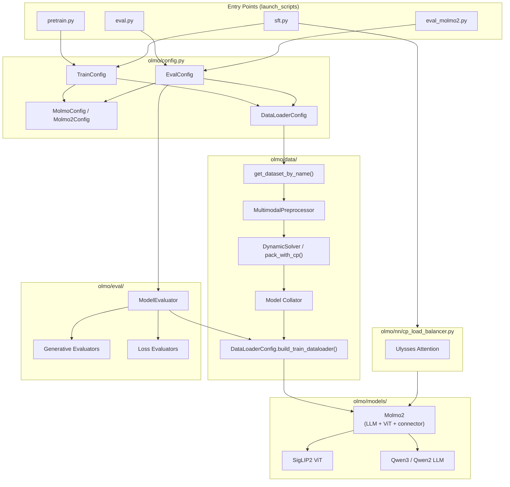
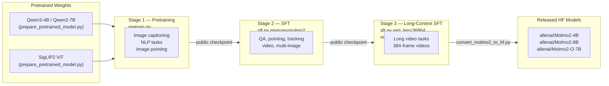
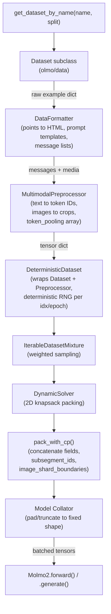

<!-- source: DeepWiki mcp.deepwiki.com · repo allenai/molmo2 · page 1 Overview · fetched 2026-10-26 -->

# Overview

Relevant source files

The following files were used as context for generating this wiki page:

- [README.md](README.md)
- [assets/Molmo2-logo.svg](assets/Molmo2-logo.svg)
- [assets/molmo2_capabilities.png](assets/molmo2_capabilities.png)

This page introduces the Molmo2 repository: what it is, what it trains, the three released model variants, and a map of the major subsystems and how they relate to each other. For setup and installation details, see [Getting Started](#2). For training, see [Training Pipeline](#3). For evaluation, see [Evaluation](#4). For the data system, see [Data System](#5).

---

## What Is Molmo2?

Molmo2 is an open-weights vision-language model (VLM) developed by Ai2. It is trained to process images, multi-image inputs, and videos, and it supports three classes of grounding tasks beyond basic question answering:

- **Pointing** — identifying object locations by emitting 2D point coordinates in model output text
- **Tracking** — following objects across video frames using dense point sequences
- **Video understanding** — answering questions about short and long videos (up to 384 frames)

The codebase provides the full pipeline for training and evaluation, including data loading, three-stage training, context parallelism for long sequences, and conversion to Hugging Face format for deployment.

Sources: [README.md:1-33]()

---

## Released Model Variants

Three model variants are released, each backed by a different pretrained LLM backbone:

| HF Model | LLM Backbone | Stages Released |
|---|---|---|
| `allenai/Molmo2-4B` | Qwen3-4B | Pretrain, SFT, Long-Context SFT |
| `allenai/Molmo2-8B` | Qwen2-7B | Pretrain, SFT, Long-Context SFT |
| `allenai/Molmo2-O-7B` | Qwen2-7B (O variant) | Pretrain, SFT, Long-Context SFT |

All three models share the SigLIP2 ViT vision backbone. Checkpoints are available at each training stage. The Long-Context SFT checkpoint is the one that corresponds to the published Hugging Face models.

Sources: [README.md:193-232]()

---

## Repository Layout

The repository is organized into the following top-level directories:

| Directory / File | Purpose |
|---|---|
| `launch_scripts/` | High-level entry-point scripts (`pretrain.py`, `sft.py`, `eval.py`, `eval_molmo2.py`) |
| `scripts/` | Utility scripts: dataset download, model preparation, visualization, HF conversion |
| `olmo/` | All library code: models, data, config, evaluation, training |
| `olmo/models/` | `Molmo2` model class, ViT, LLM submodules |
| `olmo/data/` | Dataset implementations, preprocessors, packers, collators |
| `olmo/eval/` | Evaluator classes and `ModelEvaluator` orchestrator |
| `olmo/nn/` | Context parallelism, custom attention layers |
| `olmo/config.py` | `BaseConfig`, `TrainConfig`, `EvalConfig`, `MolmoConfig`, `DataLoaderConfig` |
| `olmo/hf_model/` | Hugging Face–compatible model and conversion utilities |
| `docs/` | Extended documentation (e.g., `context_parallel.md`) |

Sources: [README.md:538-600]()

---

## Major Subsystems

**Diagram: Subsystems and their code-level entry points**

Sources: [README.md:538-600](), [README.md:183-384]()

---

## Three-Stage Training Pipeline

Training proceeds in three sequential stages. Each stage produces a checkpoint that feeds into the next.

**Diagram: Three-stage pipeline from pretrained weights to released models**

| Stage | Script | Key Config | Starting Point |
|---|---|---|---|
| Pretraining | `launch_scripts/pretrain.py` | LLM variant flag (`qwen3_4b`, `qwen2_7b`) | Pretrained LLM + ViT weights |
| SFT | `launch_scripts/sft.py` | `mixture=molmo2`, `seq_len=16384` | Pretrain checkpoint |
| Long-Context SFT | `launch_scripts/sft.py` | `seq_len=36864`, `max_frames=384` | SFT checkpoint |

Sources: [README.md:183-302]()

---

## Data Pipeline Summary

All training and evaluation data flows through a four-stage pipeline before reaching the model.

**Diagram: Data pipeline from raw dataset to model input**

The `subsegment_id` field threads through the pipeline to prevent cross-attention between packed examples and between message-tree annotations. See [Data Pipeline](#5.1) and [Dynamic Packing](#5.2) for full details.

Sources: [README.md:557-599]()

---

## Core Code Entities

The following table maps the four high-level code roles to their primary classes and locations:

| Role | Primary Class / Function | Location |
|---|---|---|
| Model | `Molmo2`, `BaseModel` | `olmo/models/` |
| Data | `Dataset`, `DeterministicDataset`, `IterableDatasetMixture` | `olmo/data/` |
| Training | `Trainer`, `TrainConfig` | `olmo/`, `olmo/config.py` |
| Evaluation | `Evaluator`, `ModelEvaluator`, `EvalConfig` | `olmo/eval/`, `olmo/config.py` |
| Configuration | `BaseConfig`, `MolmoConfig`, `Molmo2Config` | `olmo/config.py` |
| Preprocessing | `MultimodalPreprocessor`, `DataFormatter` | `olmo/data/` |
| Packing | `DynamicSolver`, `pack_with_cp` | `olmo/data/` |
| Context Parallelism | `ulysses` attention, `cp_load_balancer` | `olmo/nn/cp_load_balancer.py` |

Sources: [README.md:538-556]()

---

## Inference and Deployment

After training, a checkpoint can be:

1. **Evaluated directly** using `launch_scripts/eval.py` or `launch_scripts/eval_molmo2.py`
2. **Converted to Hugging Face format** using `olmo/hf_model/convert_molmo2_to_hf.py`
3. **Used with `transformers`** via `AutoModelForImageTextToText` and `AutoProcessor`
4. **Served with vLLM** (≥ 0.15.0) using the `molmo-utils` vision processing package

Sources: [README.md:385-536]()

---

