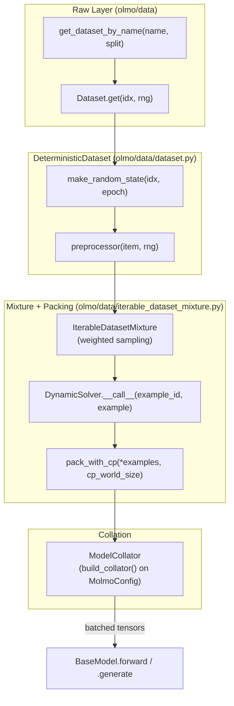
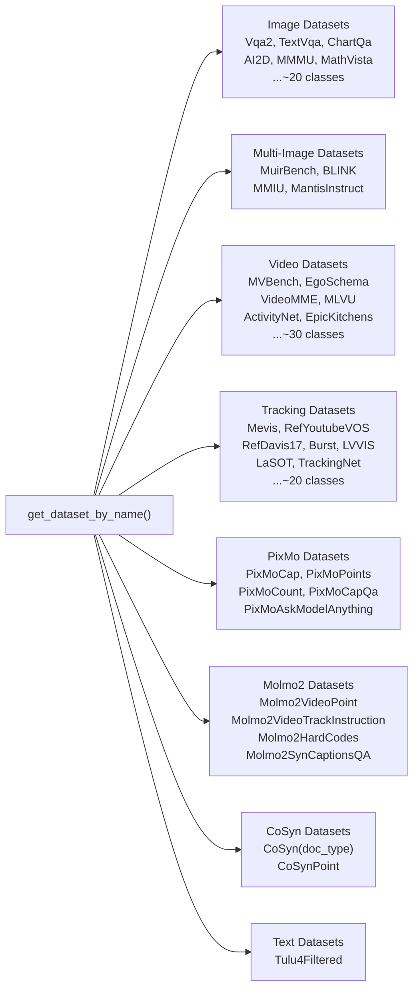
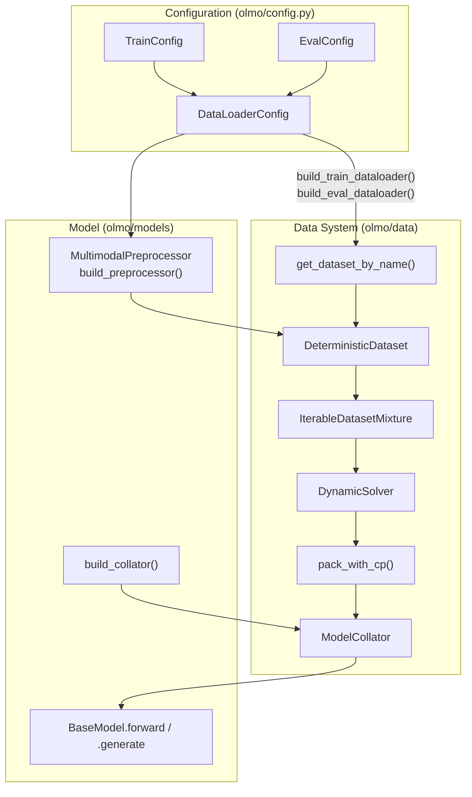

<!-- source: DeepWiki mcp.deepwiki.com · repo allenai/molmo2 · page 5 Data System · fetched 2026-10-26 -->

# Data System

<details>
<summary>Relevant source files</summary>

The following files were used as context for generating this wiki page:

- [README.md](README.md)
- [olmo/data/data_loader.py](olmo/data/data_loader.py)
- [olmo/data/dataset.py](olmo/data/dataset.py)
- [olmo/data/dynamic_packer.py](olmo/data/dynamic_packer.py)
- [olmo/data/get_dataset.py](olmo/data/get_dataset.py)

</details>


This page describes the architecture of the data system in Molmo2: how datasets are registered, how examples flow through the four-stage processing pipeline, and how batched tensors are delivered to the model. For a detailed reference on individual dataset categories, see the [Dataset Catalog](#5.3). For the packing algorithm specifically, see [Dynamic Packing](#5.2). For the full pipeline stage-by-stage walkthrough, see [Data Pipeline](#5.1).

---

## Overview

The data system transforms raw dataset examples into padded, batched tensors ready for `BaseModel.forward` or `BaseModel.generate`. It is composed of four sequential stages:

| Stage | Component | Input | Output |
|---|---|---|---|
| 1. Raw fetch + formatting | `Dataset.get()` + `DataFormatter` | index, rng | dict with raw fields (messages, images, points) |
| 2. Tokenization | `MultimodalPreprocessor` | raw dict | dict of numpy arrays (tokens, images, token_pooling) |
| 3. Packing + mixing | `IterableDatasetMixture` + `DynamicSolver` | stream of preprocessed dicts | single concatenated dict per packed sequence |
| 4. Collation | Model collator | list of packed dicts | padded/truncated batch tensors |

The entry point for building a dataloader is `DataLoaderConfig.build_train_dataloader()` or `DataLoaderConfig.build_eval_dataloader()`, both defined in [olmo/data/data_loader.py:308-383]().

---

**Diagram: End-to-End Data Flow — Code Entities**



Sources: [olmo/data/data_loader.py:308-383](), [olmo/data/dataset.py:47-81](), [olmo/data/dynamic_packer.py:264-288]()

---

## Base Abstractions

### `Dataset`

All data sources extend the `Dataset` base class defined in [olmo/data/dataset.py:26-44](). Key interface:

- `get(item, rng)` — returns a raw example dict given an index and a numpy `RandomState`. Using an explicit `rng` rather than global state supports reproducible augmentation.
- `download(n_procs=1)` — class method to download and prepare the dataset.
- `__len__` — must return dataset size.

Examples returned by `Dataset.get()` are intentionally kept close to "raw" format. They typically contain fields like `points`, `label`, `image`, and a `style` string identifying the example type. Formatting into input/output text is deferred to the preprocessor stage. Examples may also carry a `metadata` dict for evaluation use and a `message_lists` field for multi-annotation message trees.

### `DatasetBase`

`DatasetBase` ([olmo/data/dataset.py:83-105]()) is a convenience subclass for datasets that load all their data into memory at init time via a `load()` method. Most academic datasets extend this class.

### `DeterministicDataset`

`DeterministicDataset` ([olmo/data/dataset.py:47-81]()) wraps a `Dataset` and its preprocessor. It:

- Derives a per-example `RandomState` from `(idx, epoch)` using `make_random_state`, ensuring reproducible augmentation across restarts.
- Applies the `preprocessor` to convert the raw dict into a dict of numpy arrays.
- Supports an `n_pad` parameter to pad dataset length for even distribution across distributed processes.
- Accepts a `weighting` (a `MessageWeight`) applied per-example, allowing per-dataset loss weighting.

### `HfDataset` and `Ai2HfDataset`

`HfDataset` ([olmo/data/dataset.py:108-119]()) wraps a HuggingFace `datasets.Dataset` identified by a class-level `PATH`. `Ai2HfDataset` ([olmo/data/dataset.py:124-156]()) wraps an internal HuggingFace-hosted dataset with a fixed schema: `image`, `style`, `message_lists`, and `metadata/*` fields.

Sources: [olmo/data/dataset.py:1-157]()

---

## Dataset Factory

All datasets are accessed through a single factory function:

```
get_dataset_by_name(dataset_name: str, split: str) -> Dataset
```

Defined in [olmo/data/get_dataset.py:39-480](). It is a large `if`/`elif` chain mapping string names to dataset class constructors. This is the canonical registry — there is no separate registration mechanism.

Helper functions built on top of the factory:

| Function | Purpose |
|---|---|
| `get_all_dataset_classes()` | Returns all `Dataset` subclasses visible in the module |
| `get_dataset_class_by_name(name)` | Returns the class without instantiating it (used by download scripts) |
| `download_dataset_by_name(name, n_procs)` | Calls `.download()` on the named dataset's class |

**Diagram: Factory to Dataset Classes**



Sources: [olmo/data/get_dataset.py:39-480]()

---

## DataLoaderConfig

`DataLoaderConfig` ([olmo/data/data_loader.py:86-384]()) is the top-level configuration object for building a `torch.utils.data.DataLoader`. It is embedded inside `TrainConfig` and `EvalConfig`.

### Key fields

| Field | Type | Description |
|---|---|---|
| `dataset` | `str` | Single dataset name (used for eval) |
| `mixture` | `Dict[str, float]` | Flat name→rate map |
| `kwargs_mixture` | `List[KwargsMixture]` | Grouped mixture with per-dataset kwargs |
| `root_size_mixture` | `List[RootSizeMixture]` | Mixture where rates are derived from `sqrt(dataset_size)` |
| `split` | `str` | `"train"`, `"validation"`, `"test"`, etc. |
| `seed` | `int` | Controls shuffle and augmentation |
| `sequence_length` | `int` | Max token length for truncation in the collator |
| `packing` | `PackingConfig` | Enables dynamic packing; `None` disables it |
| `num_workers` | `int` | DataLoader worker count |

### Building dataloaders

`build_train_dataloader()` ([olmo/data/data_loader.py:308-383]()):
1. Builds a `MultimodalPreprocessor` from `model_config.build_preprocessor()`.
2. Calls `_build_mixture()` to construct a list of `DeterministicDataset` objects and their normalized sampling rates.
3. If `packing` is set, builds a `DynamicSolver` via `PackingConfig.bulid()`.
4. Wraps everything in `IterableDatasetMixture`.
5. Returns a `DataLoader` with `device_batch_size = global_batch_size // world_size`.

`build_eval_dataloader()` ([olmo/data/data_loader.py:137-231]()):
- Uses a `DistributedSampler` (index-based, not iterable) unless packing is enabled.
- Optionally pads the dataset (`n_pad`) so all ranks get the same number of batches.
- Passes `include_metadata=True` by default for inference (needed by evaluators).

### Mixture construction (`_build_mixture`)

[olmo/data/data_loader.py:233-306]() supports three mutually exclusive mixture formats:

**`mixture`** — Direct name→rate dict. Rates are used as-is (normalized to sum to 1).

**`kwargs_mixture`** — List of `KwargsMixture` objects ([olmo/data/data_loader.py:43-47]()). Each group has a `rate` and a list of `WeightedDataset` entries. Within a group, per-dataset rates default to `sqrt(dataset_size)` unless `root_size_factor` or `sampling_rate` are set.

**`root_size_mixture`** — List of `RootSizeMixture` objects. Each sub-mixture normalizes its rates by `sqrt(dataset_size)` and then scales to the group's `rate`.

### `WeightedDataset`

[olmo/data/data_loader.py:49-82]() — describes a single dataset entry in a mixture:

| Field | Description |
|---|---|
| `dataset_name` | Passed to `get_dataset_by_name()` |
| `sampling_rate` | Multiplicative override on the computed rate |
| `root_size_factor` | Substitutes for actual dataset size in `sqrt` rate calculation |
| `message_weight` | `MessageWeight` applied to all examples from this dataset |
| `override_p_high_res` | Overrides high-resolution image probability in the preprocessor for this dataset |

Sources: [olmo/data/data_loader.py:1-384]()

---

## Packing

When `DataLoaderConfig.packing` is set, multiple preprocessed examples are concatenated into a single sequence before batching. This reduces padding waste and improves GPU utilization.

`PackingConfig` ([olmo/data/dynamic_packer.py:298-323]()) controls packing behavior:

| Field | Default | Description |
|---|---|---|
| `buffer_size` | 32 | Number of examples held in the rolling buffer |
| `mode` | `"dynamic_solver"` | Algorithm to use |
| `text_weight` | 1.0 | Objective weight per text token |
| `image_weight` | 1.0 | Objective weight per image patch |
| `shortcut_max_len_images` | `False` | Skip buffering if example fills the image dimension alone |
| `track_packing_state` | `True` | Save packer state in checkpoints for exact recovery |
| `cp_world_size` | 1 | Context parallel degree; enables `image_shard_boundaries` computation |

`PackingConfig.bulid(text_max_len, image_max_len, mesh)` ([olmo/data/dynamic_packer.py:317-323]()) constructs a `DynamicSolver` with two `Constraint` objects: one for `input_tokens` length and one for `images` count.

The `pack()` function ([olmo/data/dynamic_packer.py:167-261]()) concatenates all numpy arrays across examples, adjusts image patch offsets, and assigns `subsegment_ids` that prevent cross-example attention. `pack_with_cp()` ([olmo/data/dynamic_packer.py:264-288]()) additionally calls `compute_image_shard_boundaries()` when `cp_world_size > 1`.

For algorithm details, see [Dynamic Packing](#5.2).

Sources: [olmo/data/dynamic_packer.py:1-480]()

---

## Key Output Fields

After packing and before collation, each example (or packed sequence) is a dict with the following standard fields:

| Field | Meaning |
|---|---|
| `input_tokens` | Token IDs, shape `[seq_len]` |
| `target_tokens` | Target token IDs for loss computation |
| `token_weights` | Per-token loss weights |
| `images` | Image patch data, shape `[n_crops, n_patches, ...]` |
| `token_pooling` | Maps image patches to token positions |
| `subsegment_ids` | Integers controlling causal attention mask; examples in a packed sequence get different offsets (multiples of `EXAMPLE_SUBSEGMENT_INCREMENT = 100000`) |
| `position_ids` | Absolute position IDs |
| `cum_image_bounds` | Cumulative image counts per packed sub-example |
| `cum_token_pooling_bounds` | Cumulative token pooling row counts per sub-example |
| `image_shard_boundaries` | Per-CP-rank image slice boundaries (only present when `cp_world_size > 1`) |
| `metadata` | List of per-example metadata dicts (eval only) |

Sources: [olmo/data/dynamic_packer.py:167-261]()

---

## Relationship to the Rest of the System



Sources: [olmo/data/data_loader.py:137-383](), [olmo/data/dataset.py:47-81](), [olmo/data/dynamic_packer.py:264-323]()

---

