# Page: Overview

# Overview

<details>
<summary>Relevant source files</summary>

The following files were used as context for generating this wiki page:

- [README.md](README.md)
- [assets/Molmo2-logo.svg](assets/Molmo2-logo.svg)
- [assets/molmo2_capabilities.png](assets/molmo2_capabilities.png)

</details>


This page introduces the Molmo2 repository: what it is, what it trains, the three released model variants, and a map of the major subsystems and how they relate to each other. For setup and installation details, see [Getting Started](#2). For training, see [Training Pipeline](#3). For evaluation, see [Evaluation](#4). For the data system, see [Data System](#5).

---

## What Is Molmo2?

Molmo2 is an open-weights vision-language model (VLM) developed by Ai2. It is trained to process images, multi-image inputs, and videos, and it supports three classes of grounding tasks beyond basic question answering:

- **Pointing** — identifying object locations by emitting 2D point coordinates in model output text
- **Tracking** — following objects across video frames using dense point sequences
- **Video understanding** — answering questions about short and long videos (up to 384 frames)

The codebase provides the full pipeline for training and evaluation, including data loading, three-stage training, context parallelism for long sequences, and conversion to Hugging Face format for deployment.

Sources: [README.md:1-33]()

---

## Released Model Variants

Three model variants are released, each backed by a different pretrained LLM backbone:

| HF Model | LLM Backbone | Stages Released |
|---|---|---|
| `allenai/Molmo2-4B` | Qwen3-4B | Pretrain, SFT, Long-Context SFT |
| `allenai/Molmo2-8B` | Qwen2-7B | Pretrain, SFT, Long-Context SFT |
| `allenai/Molmo2-O-7B` | Qwen2-7B (O variant) | Pretrain, SFT, Long-Context SFT |

All three models share the SigLIP2 ViT vision backbone. Checkpoints are available at each training stage. The Long-Context SFT checkpoint is the one that corresponds to the published Hugging Face models.

Sources: [README.md:193-232]()

---

## Repository Layout

The repository is organized into the following top-level directories:

| Directory / File | Purpose |
|---|---|
| `launch_scripts/` | High-level entry-point scripts (`pretrain.py`, `sft.py`, `eval.py`, `eval_molmo2.py`) |
| `scripts/` | Utility scripts: dataset download, model preparation, visualization, HF conversion |
| `olmo/` | All library code: models, data, config, evaluation, training |
| `olmo/models/` | `Molmo2` model class, ViT, LLM submodules |
| `olmo/data/` | Dataset implementations, preprocessors, packers, collators |
| `olmo/eval/` | Evaluator classes and `ModelEvaluator` orchestrator |
| `olmo/nn/` | Context parallelism, custom attention layers |
| `olmo/config.py` | `BaseConfig`, `TrainConfig`, `EvalConfig`, `MolmoConfig`, `DataLoaderConfig` |
| `olmo/hf_model/` | Hugging Face–compatible model and conversion utilities |
| `docs/` | Extended documentation (e.g., `context_parallel.md`) |

Sources: [README.md:538-600]()

---

## Major Subsystems

**Diagram: Subsystems and their code-level entry points**

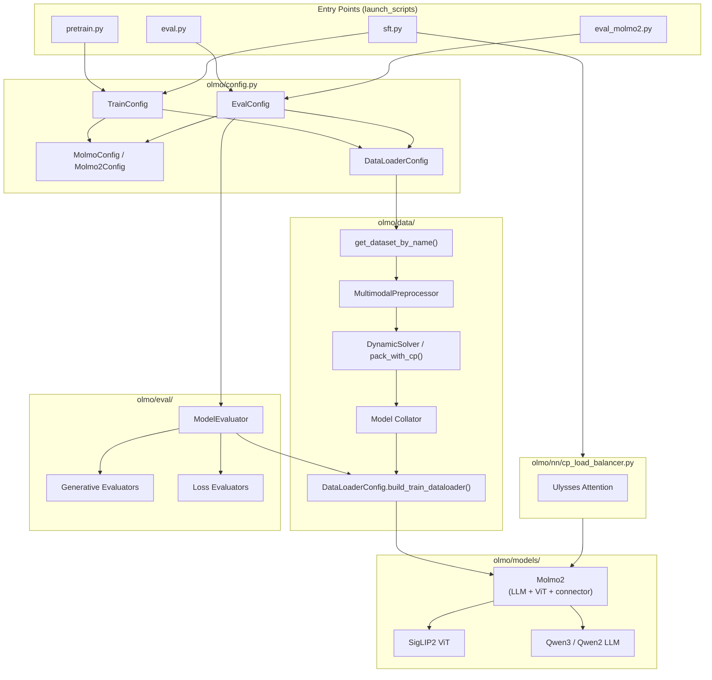

Sources: [README.md:538-600](), [README.md:183-384]()

---

## Three-Stage Training Pipeline

Training proceeds in three sequential stages. Each stage produces a checkpoint that feeds into the next.

**Diagram: Three-stage pipeline from pretrained weights to released models**

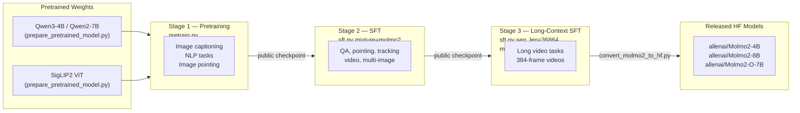

| Stage | Script | Key Config | Starting Point |
|---|---|---|---|
| Pretraining | `launch_scripts/pretrain.py` | LLM variant flag (`qwen3_4b`, `qwen2_7b`) | Pretrained LLM + ViT weights |
| SFT | `launch_scripts/sft.py` | `mixture=molmo2`, `seq_len=16384` | Pretrain checkpoint |
| Long-Context SFT | `launch_scripts/sft.py` | `seq_len=36864`, `max_frames=384` | SFT checkpoint |

Sources: [README.md:183-302]()

---

## Data Pipeline Summary

All training and evaluation data flows through a four-stage pipeline before reaching the model.

**Diagram: Data pipeline from raw dataset to model input**

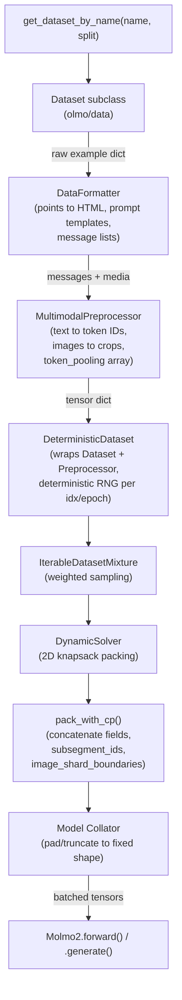

The `subsegment_id` field threads through the pipeline to prevent cross-attention between packed examples and between message-tree annotations. See [Data Pipeline](#5.1) and [Dynamic Packing](#5.2) for full details.

Sources: [README.md:557-599]()

---

## Core Code Entities

The following table maps the four high-level code roles to their primary classes and locations:

| Role | Primary Class / Function | Location |
|---|---|---|
| Model | `Molmo2`, `BaseModel` | `olmo/models/` |
| Data | `Dataset`, `DeterministicDataset`, `IterableDatasetMixture` | `olmo/data/` |
| Training | `Trainer`, `TrainConfig` | `olmo/`, `olmo/config.py` |
| Evaluation | `Evaluator`, `ModelEvaluator`, `EvalConfig` | `olmo/eval/`, `olmo/config.py` |
| Configuration | `BaseConfig`, `MolmoConfig`, `Molmo2Config` | `olmo/config.py` |
| Preprocessing | `MultimodalPreprocessor`, `DataFormatter` | `olmo/data/` |
| Packing | `DynamicSolver`, `pack_with_cp` | `olmo/data/` |
| Context Parallelism | `ulysses` attention, `cp_load_balancer` | `olmo/nn/cp_load_balancer.py` |

Sources: [README.md:538-556]()

---

## Inference and Deployment

After training, a checkpoint can be:

1. **Evaluated directly** using `launch_scripts/eval.py` or `launch_scripts/eval_molmo2.py`
2. **Converted to Hugging Face format** using `olmo/hf_model/convert_molmo2_to_hf.py`
3. **Used with `transformers`** via `AutoModelForImageTextToText` and `AutoProcessor`
4. **Served with vLLM** (≥ 0.15.0) using the `molmo-utils` vision processing package

Sources: [README.md:385-536]()

---

# Page: Getting Started

# Getting Started

<details>
<summary>Relevant source files</summary>

The following files were used as context for generating this wiki page:

- [.gitignore](.gitignore)
- [Dockerfile](Dockerfile)
- [README.md](README.md)

</details>


This page covers environment setup, installation, data download, and pretrained weight preparation — everything needed before running training or evaluation. For details on what Molmo2 is and its major subsystems, see the [Overview](#1). For how to run training after setup, see the [Training Pipeline](#3). For running evaluation, see [Evaluation](#4).

---

## Installation

Python 3.11 or higher is required. Install PyTorch separately first, then install the package:

```bash
git clone https://github.com/allenai/molmo2.git
cd molmo2
pip install torchcodec
pip install -e .[all]
```

`torchcodec` must be installed before `.[all]` because it has dependency constraints that conflict when installed together.

Sources: [README.md:67-81]()

---

## Docker

A pre-built container with all dependencies (but not the source code) is available:

```bash
docker pull ghcr.io/allenai/molmo2:latest
```

The Dockerfile is a two-stage build (build image → release image). Key components installed:

| Component | Version |
|---|---|
| Ubuntu | 24.04 |
| CUDA | 12.8.1 |
| Python | 3.12 |
| PyTorch | 2.9.1 |
| torchao | 0.15.0 |
| flash-attn | 2.8.3 |
| ring-flash-attn | 0.1.8 |
| liger-kernel | 0.6.4 |
| torchcodec | 0.9 |
| vLLM | 0.15.1 |
| grouped-gemm | custom SHA |
| molmo-utils | latest |
| ffmpeg | ≥6, <8 (conda-forge) |

The build stage compiles CUDA-dependent packages (`flash-attn`, `grouped-gemm`) against CUDA 12.8 and architectures SM 9.0 and 10.0. The release image copies the built conda environment and adds system tools (AWS CLI, gcloud, GitHub CLI, uv).

Sources: [Dockerfile:1-184]()

---

## Environment Variables

Set these variables before running any training or evaluation commands:

| Variable | Purpose | Required |
|---|---|---|
| `MOLMO_DATA_DIR` | Root directory for non-HuggingFace datasets | Yes |
| `HF_HOME` | HuggingFace cache directory | Recommended |
| `HF_DATASETS_OFFLINE` | Set to `1` to prevent HF from making network requests when data is already downloaded | Training |
| `OLMO_SHARED_FS` | Set to `1` if saving to a shared filesystem (multi-node jobs) | Multi-node |
| `HF_ACCESS_TOKEN` | HuggingFace access token (used for tokenizer download and gated datasets) | Recommended |
| `OPENAI_API_KEY` | Used by some evaluation tasks | Eval |
| `WANDB_API_KEY` | Weights & Biases logging | Training |
| `OMP_NUM_THREADS` | OpenMP threads for PyTorch; `8` is a typical value | Training |

Example setup:

```bash
export MOLMO_DATA_DIR=/data/molmo
export HF_HOME=/data/molmo/huggingface
export HF_DATASETS_OFFLINE=1
export OLMO_SHARED_FS=1
export HF_ACCESS_TOKEN=YOUR_HF_KEY
export OPENAI_API_KEY=YOUR_OPENAI_API_KEY
export WANDB_API_KEY=YOUR_WANDB_KEY
export OMP_NUM_THREADS=8
```

Sources: [README.md:161-181]()

---

## Downloading Datasets

Molmo2 uses a mix of HuggingFace datasets and custom data stored under `MOLMO_DATA_DIR`. The download script is `scripts/download_datasets.py`.

**Download everything:**

```bash
python3 scripts/download_datasets.py all --n_proc 8
```

**Download by group:**

```bash
python3 scripts/download_datasets.py image_academic
python3 scripts/download_datasets.py video_academic
python3 scripts/download_datasets.py video_tracking --n-procs 8
python3 scripts/download_datasets.py pixmo
```

**Download a specific dataset by name or class name:**

```bash
python3 scripts/download_datasets.py ChartQa --n-procs 12
python3 scripts/download_datasets.py text_vqa doc_qa chart_qa
```

### Available Download Groups

| Group | Contents |
|---|---|
| `image_academic` | Academic image benchmarks (VQA, TextVQA, ChartQA, etc.) |
| `video_academic` | Academic video benchmarks (MVBench, EgoSchema, VideoMME, etc.) |
| `pixmo` | PixMo internal datasets |
| `image_pointing` | Image pointing datasets |
| `video_pointing` | Video pointing datasets |
| `video_tracking` | MOT + SOT tracking datasets |
| `demo` | Small demo subset |

### Datasets Requiring Manual Download

Some datasets cannot be downloaded automatically due to licensing or access restrictions:

| Dataset | Where to obtain |
|---|---|
| DocQA, InfoQA, SceneText | https://rrc.cvc.uab.es |
| LVBench | HuggingFace: `zai-org/LVBench` |
| MLVU, LongVideoBench | Require HuggingFace user agreement acceptance |
| MVBench (nturgbd subset) | Manual download required |
| Ref-YT-VOS, YTVIS, ReVOS, LaSOT, Molmo2VideoTrack | See `olmo/data/academic_video_track_datasets.py` and `olmo/data/molmo2_video_track_datasets.py` |

The download script will throw an error with instructions if required files are missing.

Downloads are resumable — if a download is canceled or errors, re-running the same command will continue where it left off.

Sources: [README.md:87-135]()

### Dataset Flow: From Download to Model

The following diagram shows how datasets are registered and accessed at runtime. For details on the full data processing pipeline, see the [Data System](#5).

**Dataset Registration and Access Flow**

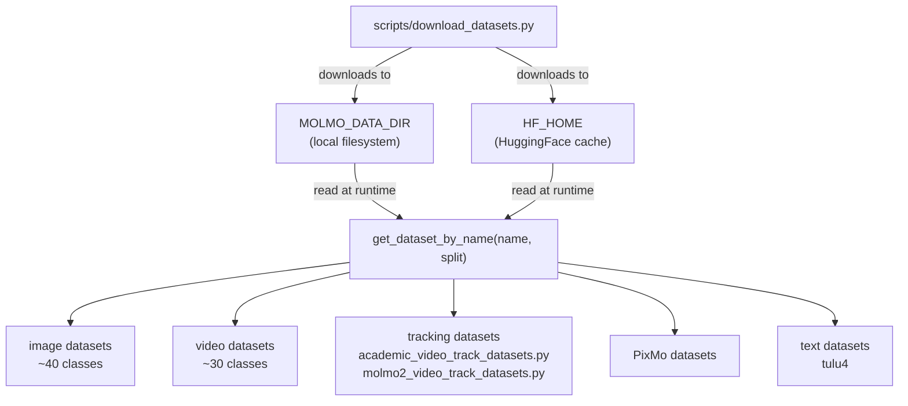

Sources: [README.md:87-135]()

---

## Downloading Pretrained Model Weights

To train from scratch, you need pretrained LLM and vision encoder weights. The script `scripts/prepare_pretrained_model.py` downloads, converts, and shards the weights for fast loading:

```bash
python scripts/prepare_pretrained_model.py qwen3_4b
python scripts/prepare_pretrained_model.py siglip2
```

The script reads save locations from `olmo/model_configs.py` and outputs sharded checkpoints in a format compatible with the training code.

### Supported Backbone Identifiers

| Identifier | Model |
|---|---|
| `qwen3_4b` | Qwen3-4B LLM (used for Molmo2-4B) |
| `qwen2_7b` | Qwen2-7B LLM (used for Molmo2-8B, Molmo2-O-7B) |
| `siglip2` | SigLIP2 Vision Transformer |

Sources: [README.md:139-149]()

---

## Released Training Checkpoints

If you want to skip stages of training or fine-tune from a released checkpoint, pre-trained weights are available for each stage of training. Download and extract with `wget` + `tar`:

```bash
wget https://storage.googleapis.com/oe-training-public/Molmo2-1225/Molmo2-8B.tar
tar -xf Molmo2-8B.tar
```

**Available checkpoints:**

| Model | Pretrain | SFT | Long-Context SFT |
|---|---|---|---|
| Molmo2-4B | Molmo2-4B-Pretrain.tar | Molmo2-4B-SFT.tar | Molmo2-4B.tar |
| Molmo2-8B | Molmo2-8B-Pretrain.tar | Molmo2-8B-SFT.tar | Molmo2-8B.tar |
| Molmo2-O-7B | Molmo2-O-7B-Pretrain.tar | Molmo2-O-7B-SFT.tar | Molmo2-O-7B.tar |

All checkpoints are stored at `https://storage.googleapis.com/oe-training-public/Molmo2-1225/`. The Long-Context SFT checkpoints correspond to the HuggingFace model releases. Checkpoint configs are backwards-compatible with this codebase but may not match exactly.

Sources: [README.md:193-232]()

---

## Visualizing Data

After downloading, datasets can be inspected visually using:

```bash
python3 scripts/dataset_visualize.py chart_qa /path/to/viz/dir
```

This builds an HTML file showing what the data looks like after preprocessing is applied, which is useful for verifying that a dataset downloaded and formatted correctly.

Sources: [README.md:151-158]()

---

## Setup Summary

The following diagram maps the setup steps to the scripts and environment components they interact with.

**Setup Steps to Code Entities**

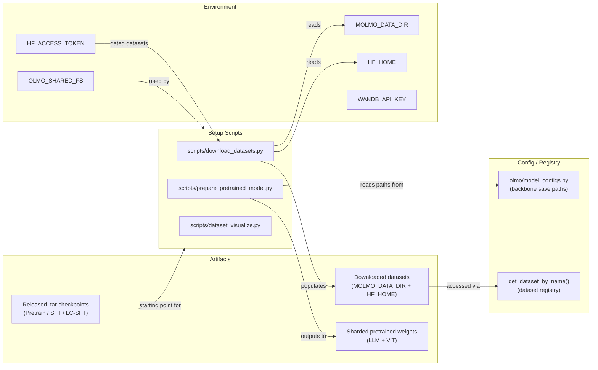

Sources: [README.md:65-232](), [Dockerfile:1-184]()

---

# Page: Training Pipeline

# Training Pipeline

<details>
<summary>Relevant source files</summary>

The following files were used as context for generating this wiki page:

- [README.md](README.md)
- [launch_scripts/pretrain.py](launch_scripts/pretrain.py)
- [launch_scripts/sft.py](launch_scripts/sft.py)

</details>


This page describes the three-stage training process at a high level: how the stages connect, what configuration and launch scripts drive each stage, what checkpoints are produced, and how the key training parameters differ between stages.

For detail on Stage 1 specifically, see [Pretraining](#3.1). For detail on Stages 2 and 3, see [Supervised Fine-Tuning](#3.2). For context parallelism (required for long-context training), see [Context Parallelism](#3.3). For information about the data processing that feeds training, see [Data System](#5).

---

## Overview

Molmo2 training is divided into three sequential stages. Each stage consumes the checkpoint produced by the previous stage and builds on it:

**Stage 1 — Pretraining:** Train from scratch using pretrained LLM and ViT weights. The data mixture focuses on image captioning, NLP text data, and image pointing. Produces a general vision-language model.

**Stage 2 — Supervised Fine-Tuning (SFT):** Load the pretrained checkpoint and fine-tune on a broad multitask mixture covering QA, pointing, tracking, video understanding, and more. Uses sequences up to 16,384 tokens.

**Stage 3 — Long-Context SFT:** Continue from the SFT checkpoint with the same script but at 36,864-token sequences and up to 384 video frames. Produces the final released models.

**Stage Flow Diagram**

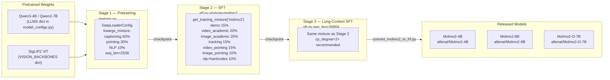

Sources: [README.md:184-302](), [launch_scripts/pretrain.py:1-292](), [launch_scripts/sft.py:231-504]()

---

## Published Checkpoints

Checkpoints are released publicly after each stage for all three model variants. They can be used as starting points for fine-tuning or evaluation without running prior stages.

| Model | Pretrain Checkpoint | SFT Checkpoint | Long-Context SFT Checkpoint |
|---|---|---|---|
| Molmo2-4B | Molmo2-4B-Pretrain.tar | Molmo2-4B-SFT.tar | Molmo2-4B.tar |
| Molmo2-8B | Molmo2-8B-Pretrain.tar | Molmo2-8B-SFT.tar | Molmo2-8B.tar |
| Molmo2-O-7B | Molmo2-O-7B-Pretrain.tar | Molmo2-O-7B-SFT.tar | Molmo2-O-7B.tar |

Checkpoints are stored in the internal training format. The Long-Context SFT checkpoint is equivalent to the Hugging Face release but uses a slightly different layout. Use `convert_molmo2_to_hf.py` to convert to Hugging Face format.

To download and unpack a checkpoint:
```bash
wget https://storage.googleapis.com/oe-training-public/Molmo2-1225/Molmo2-8B.tar
tar -xf Molmo2-8B.tar
```

Sources: [README.md:193-232]()

---

## Launch Scripts and Their Relationship

Both entry-point scripts build a `TrainConfig` object programmatically and hand it to `run_trainer()`. CLI arguments are merged in via `OmegaConf.merge_with_dotlist`, which allows fine-grained override of any config field.

**Script-to-config flow diagram**

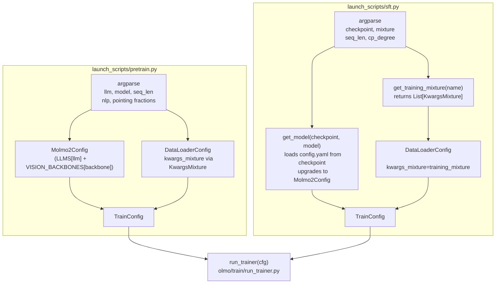

Sources: [launch_scripts/pretrain.py:34-291](), [launch_scripts/sft.py:174-504]()

---

## Key Training Configuration Parameters

The `TrainConfig` dataclass is the central configuration object. The table below highlights the parameters that differ most between stages.

| Parameter | Stage 1 (pretrain.py) | Stage 2 (sft.py) | Stage 3 (sft.py, long-ctx) |
|---|---|---|---|
| `seq_len` / `sequence_length` | 2,536 | 16,384 | 36,864 |
| `max_frames` (video) | 16 | 128 | 384 |
| `max_duration` | ~4× PixMoCap size | 300,000 steps | 2,000 steps |
| `global_train_batch_size` | 128 | 128 | 128 |
| `device_train_microbatch_size` | 4 | 2 | 1 |
| LLM learning rate | 2e-5 | 1e-5 | 1e-5 |
| ViT learning rate | 6e-6 | 5e-6 | 5e-6 |
| Connector learning rate | 2e-4 | 5e-6 | 5e-6 |
| `fsdp` | `FSDPConfig(precision=float)` | `FSDPConfig(fsdp2=True)` | `FSDPConfig(fsdp2=True)` |
| `cp_degree` | 1 | 1 (default) | 2+ recommended |
| `packing` | `PackingConfig(buffer_size=48)` | `PackingConfig(buffer_size=48, image_weight=30)` | same |
| `softmax_auxiliary_loss` | True (scale=1e-4) | True (scale=1e-4) | True (scale=1e-4) |
| `compile` | `CompilerConfig(mode="default")` | `CompilerConfig(mode="default")` | `None` (disabled with CP) |

Sources: [launch_scripts/pretrain.py:204-291](), [launch_scripts/sft.py:413-504]()

---

## Model Configuration

Both launch scripts produce a `Molmo2Config`. In `pretrain.py`, it is built directly from `LLMS` and `VISION_BACKBONES` dictionaries defined in `olmo/model_configs.py`. In `sft.py`, the function `get_model()` loads the existing config from the checkpoint's `config.yaml`, upgrades it to `Molmo2Config`, and adjusts several settings for fine-tuning:

- Sets `pointing_format` to `"html-v2"` (upgraded from `"html-v1"` used in pretraining)
- Sets `system_prompt` to `"demo_or_style_v2"`
- Sets `prompt_templates` to `"uber_model_v2"`
- Enables `pooling_attention_mask` on the vision backbone
- Sets `loss_token_weighting` to `"root_subsegments_root_tokens"`
- Configures multi-image settings: `max_multi_image_crops=8`, `max_images=5`
- Sets `max_sequence_length` to 16,384 (4096×4)

Sources: [launch_scripts/sft.py:174-228]()

---

## Training Mixture Composition

**Stage 1 mixture** is built inline in `pretrain.py` using `KwargsMixture` objects with explicit fractions for captioning, pointing, and NLP data. The default split is roughly 60% captioning (`pixmo_cap_with_transcripts`), 30% pointing (`pixmo_points_train`, `pixmo_count_train`, `cosyn_point`), and 10% NLP (`tulu4`).

**Stage 2 and 3 mixture** is produced by `get_training_mixture("molmo2")` in `sft.py`. It returns a list of `KwargsMixture` objects, each wrapping a `List[WeightedDataset]`:

```
demo             15%   pixmo_ask_model_anything, pixmo_cap, vixmo3_top_level_captions, ...
video_academic   20%   ~25 video QA datasets (tvqa, paxion, mvbench, ...)
image_academic   25%   ~35 image datasets (chart_qa, text_vqa, ai2d, cosyn_*, ...)
tracking         15%   mevis, ref_yt_vos, burst, lv_vis, molmo2_video_track, ...
video_pointing   15%   vixmo_points_minmax_*, academic_points_clip_63s_2fps
image_pointing   10%   pixmo_multi_points, pixmo_points_train, cosyn_point, ...
nlp + hardcodes  10%   tulu4, molmo2_hardcodes
```

The tracking sub-mixture is itself weighted across seven sub-groups (track, ground, single_point_track, sot_from_bbox, and distribution-tail variants).

Sources: [launch_scripts/sft.py:25-172](), [launch_scripts/sft.py:231-311]()

---

## Optimizer and Scheduler

Both stages use the `adamw` optimizer with component-specific learning rates managed by `OptimizerConfig`. The scheduler type is `multimodal`, which applies separate warmup schedules to the connector, ViT, and LLM parameter groups.

**Parameter group learning rates (Stage 2):**

| Component | Learning Rate | Warmup Steps |
|---|---|---|
| Connector | 5e-6 | 200 |
| ViT | 5e-6 | 200 |
| LLM | 1e-5 | 200 |
| Frame selector | 1e-4 | 200 |

All groups decay to 10% of their peak (`alpha_f=0.1`) with `warmup_min_lr=0.0`.

Sources: [launch_scripts/sft.py:451-466](), [launch_scripts/pretrain.py:236-252]()

---

## Distributed Training Setup

Both stages use FSDP (Fully Sharded Data Parallel). Stage 1 uses the older `FSDPConfig(precision=float, wrapping_strategy=FSDPWrapStrategy.by_block_and_size)`. Stages 2 and 3 use `FSDPConfig(fsdp2=True)`, which activates PyTorch's newer FSDP2 API.

Context parallelism is off by default (`cp_degree=1`). When `cp_degree > 1` is set:

1. `PackingConfig.cp_world_size` is set to match `cp_degree` so the packer aligns sequence boundaries to CP shard boundaries.
2. `conf.parallelism.context_parallel_config.degree` is set to `cp_degree`.
3. `conf.model.cp_enabled` is set to `True`.
4. Torch compilation is disabled (`compile=None`), as it is incompatible with context parallelism.

For full CP mechanics, see [Context Parallelism](#3.3).

Sources: [launch_scripts/sft.py:467-503](), [launch_scripts/pretrain.py:253-257]()

---

## Evaluation During Training

Both scripts register in-loop evaluators that run periodically during training. These are separated into loss evaluators (`evaluators`) and generative evaluators (`inf_evaluators`):

| Stage | Loss evaluators | Generative evaluators |
|---|---|---|
| Stage 1 | `pixmo_cap_with_transcripts` (val), `pixmo_cap` (val) | `point_bench:test`, `pixmo_count_counting:validation` |
| Stage 2 | `llava_video_oe_academic`, `pixmo_ask_model_anything`, `pixmo_cap` | `chart_qa`, `info_qa`, `coco_2014_vqa_multi`, `mvbench`, `muir_bench`, `pointing_eval_v2`, `vixmo_points_count` |

The `inf_eval_interval` and `eval_interval` fields on `TrainConfig` control how often each type of evaluator runs. In Stage 2 these are set to `-1` (disabled in-loop) by default; evaluations are intended to run post-training via `eval.py` or `eval_molmo2.py`.

Sources: [launch_scripts/pretrain.py:142-191](), [launch_scripts/sft.py:331-410]()

---

# Page: Pretraining

# Pretraining

<details>
<summary>Relevant source files</summary>

The following files were used as context for generating this wiki page:

- [README.md](README.md)
- [launch_scripts/pretrain.py](launch_scripts/pretrain.py)

</details>


This page covers Stage 1 of the Molmo2 training pipeline: pretraining via `launch_scripts/pretrain.py`. It describes model initialization, the training data mixture, key hyperparameters, and how to launch a run. For Stage 2 and Stage 3 training, see [Supervised Fine-Tuning](#3.2). For context parallelism used during long-sequence training, see [Context Parallelism](#3.3).

---

## Purpose

Stage 1 pretraining adapts a frozen pretrained LLM and ViT backbone to understand multimodal inputs. The primary training signal comes from image captioning, with optional pointing and NLP data mixed in. The output of this stage is a checkpoint used as the starting point for SFT.

---

## Script Entry Point

The pretraining script is [`launch_scripts/pretrain.py`](). It constructs a `TrainConfig` from a set of high-level CLI arguments and then calls `run_trainer(cfg)` to execute the training loop.

**Flow from CLI to Trainer:**

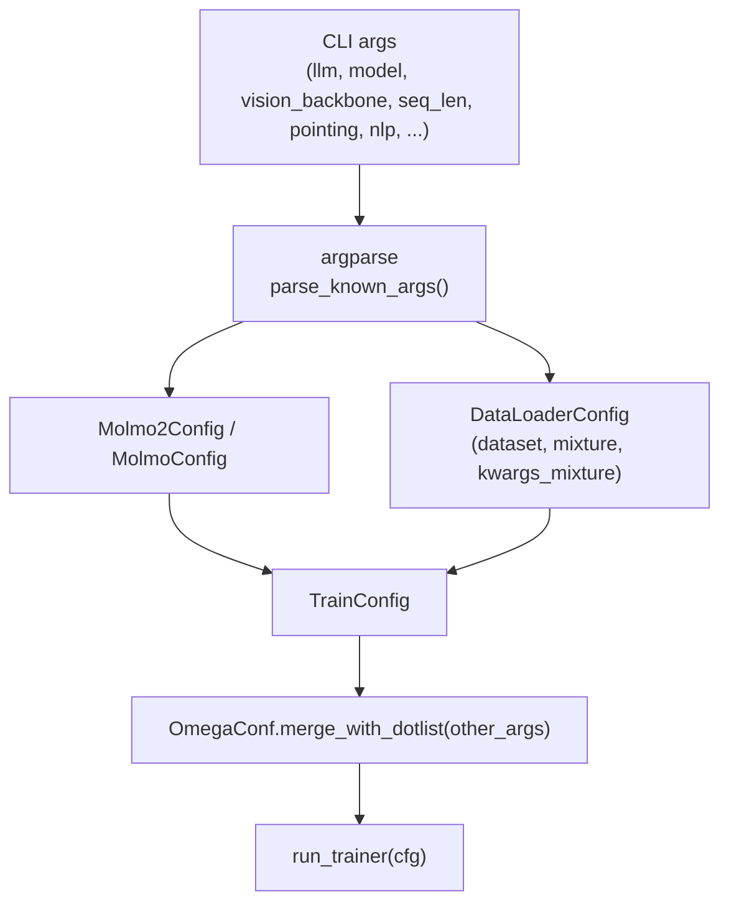

Sources: [launch_scripts/pretrain.py:34-291]()

---

## CLI Arguments

The script exposes a concise set of high-level arguments. Any field of `TrainConfig` can also be overridden via dotlist syntax as additional CLI args (e.g., `--wandb.name=run_name`).

| Argument | Default | Description |
|---|---|---|
| `llm` | (required) | LLM variant. One of `debug` or a key from `LLMS` (e.g., `qwen3_4b`, `qwen2_7b`) |
| `--model` | `molmo2` | Model architecture: `debug`, `molmo`, or `molmo2` |
| `--vision_backbone` | `siglip2` | ViT variant. Key from `VISION_BACKBONES` |
| `--global_batch_size` | `128` | Global training batch size |
| `--seq_len` | `2536` | Sequence length for padding/packing |
| `--pointing` | `0.3` | Fraction of pointing data in the mixture |
| `--nlp` | `0.1` | Fraction of NLP data in the mixture |
| `--vit_layers` | `[-3, -9]` | Which ViT layer features to extract |
| `--warmup_factor` | `1` | Divisor applied to warmup step counts |
| `--n_eval_examples` | `2048` | Number of examples used for in-loop evaluation |

Sources: [launch_scripts/pretrain.py:38-53]()

---

## Model Initialization

The model is built from two independently pretrained components:

**Model Configuration Assembly:**

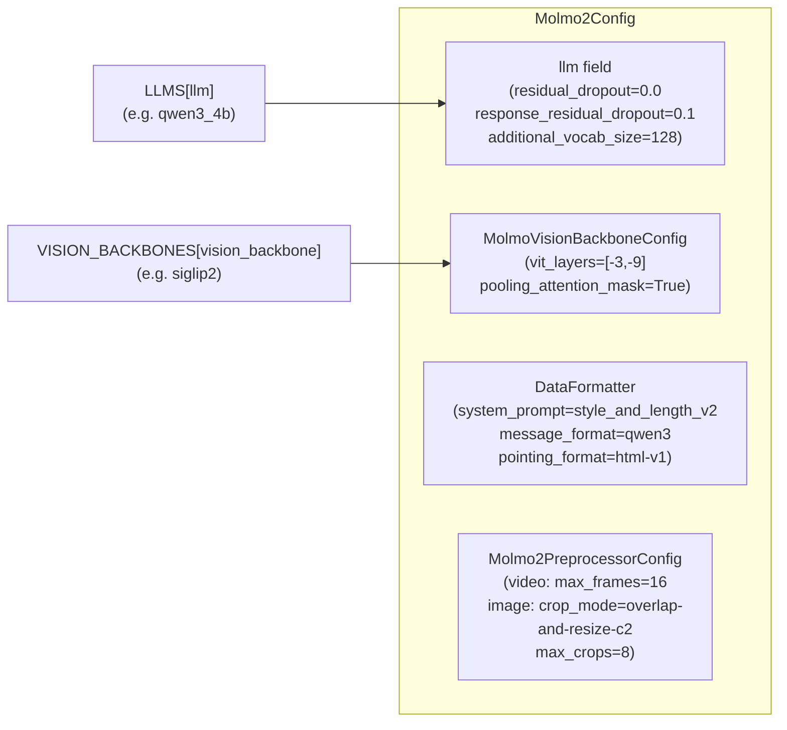

- `LLMS` and `VISION_BACKBONES` are defined in [`olmo/model_configs.py`]() and map string names to config objects.
- The LLM config is modified with `dataclasses.replace` to set dropout values and extend the vocabulary by 128 tokens.
- The script supports both `Molmo2Config` (default) and `MolmoConfig` (older architecture) depending on `--model`.
- In debug mode, `DEBUG_MOLMO2` from `model_configs.py` is used instead.

Sources: [launch_scripts/pretrain.py:56-140]()

---

## Training Data Mixture

The mixture is controlled by the `--pointing` and `--nlp` fractions. Captioning fills the remaining fraction.

**Mixture composition based on `--pointing` and `--nlp`:**

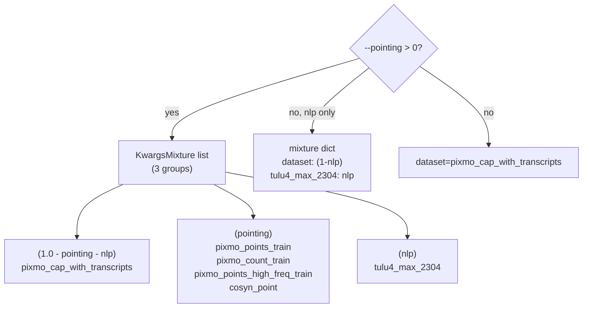

The mixture is expressed as a `KwargsMixture` list (when pointing is enabled) or a simple `mixture` dict and is passed to `DataLoaderConfig`.

**Default mixture fractions (pointing=0.3, nlp=0.1):**

| Dataset(s) | Fraction | Content |
|---|---|---|
| `pixmo_cap_with_transcripts` | 0.6 | Image captioning with transcripts |
| `pixmo_points_train`, `pixmo_count_train`, `pixmo_points_high_freq_train`, `cosyn_point` | 0.3 | Image pointing / counting |
| `tulu4_max_2304` | 0.1 | NLP instruction following |

When `--pointing > 0`, packing is disabled (default). When `--nlp > 0` without pointing, a `PackingConfig(48)` is activated to improve efficiency since NLP examples are much shorter than captioning sequences.

Sources: [launch_scripts/pretrain.py:162-202]()

---

## Training Duration

Duration is computed automatically based on the captioning dataset size:

```
n = len(PixMoCap("train", "captions"))
duration = 4 * ceil(n / global_batch_size)   # ~4 epochs of caption data
```

When NLP is added without pointing, duration is scaled by `1.01` to compensate for packing spillover. For debug mode, `duration = 200` steps.

Sources: [launch_scripts/pretrain.py:71-72](), [launch_scripts/pretrain.py:192-196]()

---

## Optimizer and Scheduler

The optimizer uses component-specific learning rates:

| Component | Learning Rate |
|---|---|
| Connector (projection) | `2e-4` |
| ViT | `6e-6` |
| LLM | `2e-5` |
| Frame selector | `1e-4` |

- Optimizer: `AdamW` (`OptimizerType.adamw`)
- Scheduler: `multimodal` (`SchedulerType.multimodal`) with separate warmup durations per component
- All components are fine-tuned: `ft_connector=True`, `ft_llm=True`, `ft_vit=True`
- Gradient clipping: `max_grad_norm=1`

The `multimodal` scheduler applies different warmup periods to each component group. The connector warms up over 200 steps; the ViT and LLM each warm up over 2000 steps (both divided by `--warmup_factor`).

Sources: [launch_scripts/pretrain.py:237-252]()

---

## FSDP Configuration

| Setting | Value |
|---|---|
| Wrapping strategy | `FSDPWrapStrategy.by_block_and_size` |
| Precision | `FSDPPrecision.float` (full float32 master weights) |
| Training precision | `amp_bf16` (bfloat16 forward/backward) |
| `use_orig_params` | `True` |

Sources: [launch_scripts/pretrain.py:253-257]()

---

## In-Loop Evaluation

Two loss evaluators run during training:

| Label | Dataset | Split |
|---|---|---|
| `val` | `pixmo_cap_with_transcripts` | `validation` |
| `caption_val` | `pixmo_cap` | `validation` |

When pointing is enabled, two generative evaluators are also added:

| Task | Notes |
|---|---|
| `point_bench:test` | Pointing precision benchmark |
| `pixmo_count_counting:validation` | Counting accuracy |

- Loss evaluators run every `eval_interval=1000` steps.
- Generative evaluators run every `inf_eval_interval=2000` steps.

Sources: [launch_scripts/pretrain.py:142-191]()

---

## Checkpointing

| Setting | Value |
|---|---|
| `save_interval` | Every 4000 steps |
| `save_num_checkpoints_to_keep` | 1 (rolling) |
| `save_final_unsharded_checkpoint` | `False` |
| `allow_resume` | `True` |

The saved checkpoint is used as `load_path` for Stage 2 SFT. Public pretrained checkpoints are available for Molmo2-4B, Molmo2-8B, and Molmo2-O-7B (see [Training Pipeline](#3) for the checkpoint table).

Sources: [launch_scripts/pretrain.py:260-265]()

---

## Running Pretraining

**Debug run (single GPU):**
```bash
torchrun --nproc-per-node=1 launch_scripts/pretrain.py debug \
  --save_folder=/path/to/save/folder
```

**Standard run with Qwen3-4B + SigLIP2:**
```bash
WANDB_API_KEY=key torchrun --nproc-per-node=8 launch_scripts/pretrain.py qwen3_4b \
  --wandb.name=run_name --wandb.entity=entity --wandb.project=project \
  --save_folder=/path/to/save/folder
```

**Without wandb logging:**
```bash
torchrun --nproc-per-node=8 launch_scripts/pretrain.py qwen2_7b \
  --wandb=null --save_folder=/path/to/save/folder
```

Any field of `TrainConfig` can be overridden as a dotlist argument. For example, `--data.num_workers=1` can resolve DataLoader shared memory errors.

Sources: [README.md:234-266]()

---

## Configuration Object Summary

**Code entities and their roles in the pretraining configuration:**

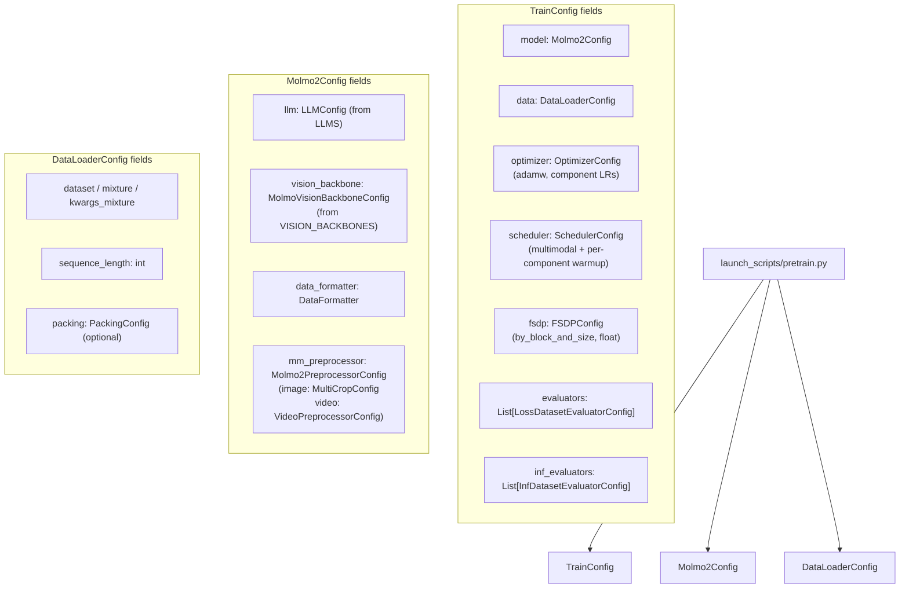

Sources: [launch_scripts/pretrain.py:204-285]()

---

# Page: Supervised Fine-Tuning

# Supervised Fine-Tuning

<details>
<summary>Relevant source files</summary>

The following files were used as context for generating this wiki page:

- [README.md](README.md)
- [launch_scripts/sft.py](launch_scripts/sft.py)

</details>


This page covers Stage 2 (SFT) and Stage 3 (Long-Context SFT) of Molmo2 training. Both stages use the same entry point — `launch_scripts/sft.py` — and differ primarily in sequence length, video frame budget, and starting checkpoint. For Stage 1 training, see [Pretraining](#3.1). For how context parallelism enables Stage 3, see [Context Parallelism](#3.3).

---

## Overview

Supervised fine-tuning builds on a pretrained checkpoint (from Stage 1) by training on a broad multi-task mixture covering image QA, video QA, pointing, tracking, and NLP. Long-Context SFT (Stage 3) continues from the Stage 2 checkpoint with a larger sequence length and frame budget to improve performance on long-video tasks.

**Stage summary:**

| Stage | Script | Starting Checkpoint | `seq_len` | `max_frames` | Default `max_duration` |
|---|---|---|---|---|---|
| Stage 2 — SFT | `launch_scripts/sft.py` | Stage 1 pretrain | 16384 | 128 | 300 000 steps |
| Stage 3 — Long-Context SFT | `launch_scripts/sft.py` | Stage 2 SFT | 36864 | 384 | 2000 steps |

Sources: [README.md:183-302](), [launch_scripts/sft.py:314-504]()

---

## Entry Point: `sft.py`

`launch_scripts/sft.py` constructs a `TrainConfig` object and delegates to `run_trainer`. The two positional arguments select the starting checkpoint and training mixture:

```
torchrun --nproc-per-node=8 launch_scripts/sft.py <checkpoint> <mixture> [overrides...]
```

- `checkpoint` — path to a saved checkpoint directory (Stage 1 for SFT, Stage 2 for Long-Context SFT)
- `mixture` — name of the training mixture (`molmo2`, `tracking`, `debug`)

The script accepts dotlist-style CLI overrides that are merged into the `TrainConfig` via `OmegaConf.merge_with_dotlist`.

Sources: [launch_scripts/sft.py:314-504]()

---

## Two-Stage Entry-Point Flow

**Diagram: `sft.py` execution flow**

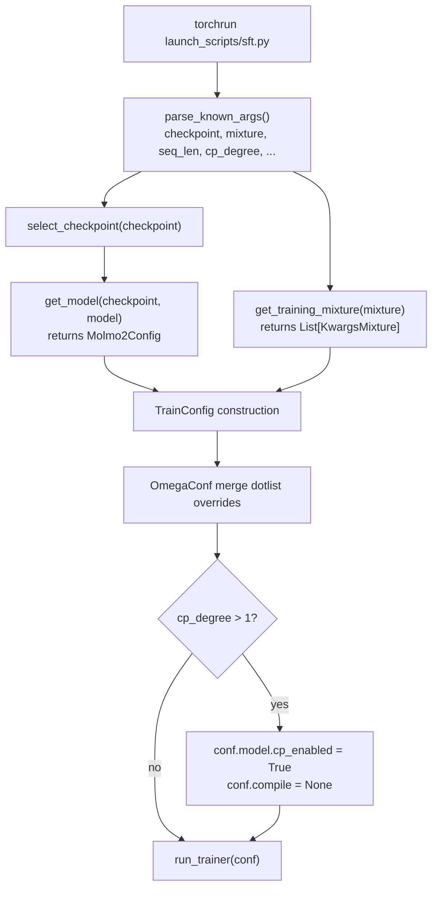

Sources: [launch_scripts/sft.py:314-504]()

---

## Model Configuration: `get_model()`

The `get_model()` function [launch_scripts/sft.py:174-228]() reads the model config from the checkpoint's `config.yaml`, upgrades it to a `Molmo2Config` (adding the `VideoPreprocessorConfig`), and applies SFT-specific overrides.

**Key settings applied in `get_model()`:**

| Setting | Value | Effect |
|---|---|---|
| `pointing_format` | `"html-v2"` | HTML-formatted point output |
| `prompt_templates` | `"uber_model_v2"` | Instruction formatting template |
| `message_format` | `"qwen3"` | Chat template style |
| `system_prompt` | `"demo_or_style_v2"` | System-level instruction prefix |
| `loss_token_weighting` | `"root_subsegments_root_tokens"` | Loss weighting scheme |
| `residual_dropout` | `0.1` | Regularization in the LLM |
| `response_residual_dropout` | `0.0` | No dropout on response tokens |
| `max_sequence_length` | `16384` | Default for Stage 2 |
| `max_frames` | `128` | Video frame cap for Stage 2 |
| `max_multi_image_crops` | `8` | Max crop slots across multi-image inputs |
| `max_images` | `5` | Max images per example |
| `normalize_on_gpu` | `True` | Reduces shared memory usage |
| `pooling_attention_mask` | `True` | Mask pooling in ViT |
| `p_multi_point_all_image` | `0.5` | Multi-point probability |
| `p_choice_content_in_mc` | `1.0` | Always include content in MC choices |

The model is always produced as a `Molmo2Config` wrapping a `Molmo2PreprocessorConfig`. If the source checkpoint only has a `MultiCropConfig` (Stage 1 `Molmo` model), the image fields are copied and a new `VideoPreprocessorConfig` is added.

Sources: [launch_scripts/sft.py:174-228]()

---

## Training Mixture: `get_training_mixture()`

`get_training_mixture()` [launch_scripts/sft.py:231-311]() maps the `mixture` argument to a list of `KwargsMixture` objects. Each `KwargsMixture` groups a list of `WeightedDataset` entries under a named bucket with a sampling rate.

### `molmo2` Mixture Composition

The `molmo2` mixture is the standard SFT mixture. Groups and their weights:

| Group name | Weight | Dataset examples |
|---|---|---|
| `demo` | 0.15 | `pixmo_ask_model_anything`, `pixmo_cap`, `vixmo3_top_level_captions_min_3`, ... |
| `video_academic` | 0.20 | `tgif`, `tvqa_with_sub`, `llava_video_mc_academic`, `mvbench`, `perception_test`, ... |
| `image_academic` | 0.25 | `coco_2014_vqa_multi`, `text_vqa`, `chart_qa_weighted`, `doc_qa`, `cosyn_*`, ... |
| `tracking` | 0.15 | `TRACKING_MIXTURE` (see below) |
| `video_pointing` | 0.15 | `vixmo_points_minmax_*`, `academic_points_clip_63s_2fps` |
| `image_pointing` | 0.10 | `pixmo_multi_points`, `pixmo_points_train`, `pixmo_count_train`, `cosyn_point` |
| `nlp` | ~0.10 | `tulu4` |
| `hardcodes` | 0.0005 | `molmo2_hardcodes` |

Sources: [launch_scripts/sft.py:244-304]()

---

### `TRACKING_MIXTURE` Composition

The tracking bucket uses its own internal sub-mixture that is normalized to sum to 1 before being converted to `WeightedDataset` entries.

**Diagram: TRACKING_MIXTURE internal weights**

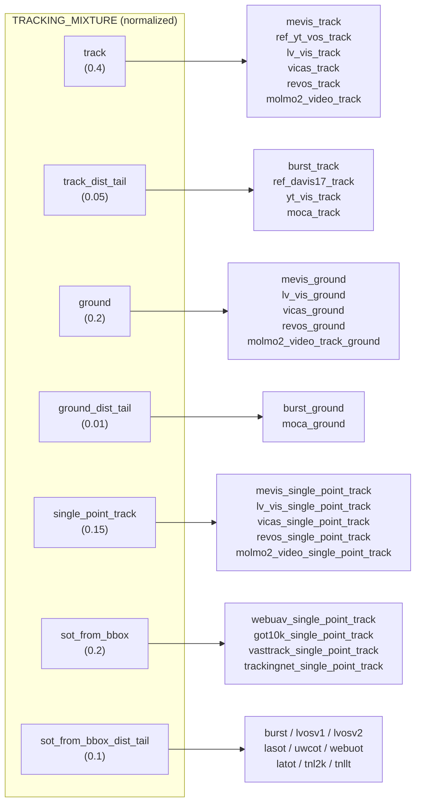

Sources: [launch_scripts/sft.py:121-171]()

---

### Video Pointing Sub-Mixture

The `video_pointing` group uses its own relative weights within the bucket:

| Dataset | Relative weight |
|---|---|
| `vixmo_points_minmax_0_5` | 0.4 |
| `vixmo_points_minmax_6_25` | 0.3 |
| `vixmo_points_minmax_26_60` | 0.1 |
| `academic_points_clip_63s_2fps` | 0.2 |

Sources: [launch_scripts/sft.py:252-255]()

---

### Message Weights

Pointing and captioning datasets receive custom `MessageWeight` values to balance loss contribution:

```python
point_weight = MessageWeight(weight=0.2, root_length=False, root_subsegments=False)
cap_weight   = MessageWeight(weight=0.1, root_length=False, root_subsegments=False)
```

These are passed to `WeightedDataset` entries for tracking and pointing groups. QA datasets use the default `loss_token_weighting` scheme set in `get_model()` (`"root_subsegments_root_tokens"`).

Sources: [launch_scripts/sft.py:246-248]()

---

## `TrainConfig` Hyperparameters

The `TrainConfig` assembled in `main()` captures all training hyperparameters.

**Diagram: Key config objects and their sources**

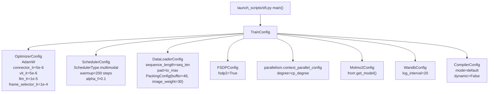

**Core training parameters (Stage 2 defaults):**

| Parameter | Value | Notes |
|---|---|---|
| `seq_len` | `16384` | CLI `--seq_len` |
| `global_train_batch_size` | `128` | 8 GPUs × 16 grad accum |
| `device_train_microbatch_size` | `2` | CLI `--device_batch_size` |
| `max_duration` | `300000` | Steps (CLI `--max_duration`) |
| `precision` | `amp_bf16` | Mixed precision |
| `max_grad_norm` | `1.0` | Gradient clipping |
| `softmax_auxiliary_loss` | `True` | z-loss regularization |
| `softmax_auxiliary_loss_scale` | `1e-4` | z-loss weight |
| `response_logits_only` | `True` | Loss only on assistant tokens |
| `save_interval` | `2000` | Steps between checkpoints |
| `save_num_checkpoints_to_keep` | `1` | Disk usage control |

Sources: [launch_scripts/sft.py:412-492]()

---

## Stage 2: Running SFT

**Standard run (8 GPUs, `molmo2` mixture):**

```bash
WANDB_API_KEY=key torchrun --nproc-per-node=8 launch_scripts/sft.py \
  /path/to/pretrained/model molmo2 \
  --wandb.name=run_name --wandb.entity=entity --wandb.project=project \
  --save_folder=/path/to/save/folder
```

**Debug run (single GPU, minimal model and data):**

```bash
torchrun --nproc-per-node=1 launch_scripts/sft.py \
  /path/to/pretrained/model debug --debug \
  --save_folder=dbg --save_overwrite
```

In debug mode [launch_scripts/sft.py:362-378]():
- `model_cfg.llm.init_path` is set to `None` (random weights)
- `n_layers` is reduced to 1
- ViT layers are limited to 2
- `checkpoint` is set to `None` (no checkpoint loaded)
- `num_workers` and `prefetch_factor` are reduced

Sources: [launch_scripts/sft.py:362-378](), [README.md:274-290]()

---

## Stage 3: Running Long-Context SFT

Stage 3 reuses `sft.py` with overrides to increase sequence length and frame count. The starting checkpoint is a Stage 2 SFT checkpoint.

```bash
torchrun --nproc-per-node=8 launch_scripts/sft.py /path/to/sft/checkpoint molmo2 \
  --max_duration=2000 \
  --device_batch_size=1 \
  --data.num_workers=4 \
  --seq_len=36864 \
  --model.mm_preprocessor.video.max_frames=384 \
  --model.llm.max_sequence_length=36864
```

**What changes from Stage 2:**

| Parameter | Stage 2 | Stage 3 |
|---|---|---|
| `seq_len` | `16384` | `36864` |
| `max_frames` | `128` | `384` |
| `model.llm.max_sequence_length` | `16384` | `36864` |
| `max_duration` | `300000` | `2000` |
| `device_batch_size` | `2` | `1` |

For GPUs with smaller memory, or to push frame counts even higher, context parallelism is needed — see [Context Parallelism](#3.3) for `--cp_degree` usage.

Sources: [README.md:293-302](), [launch_scripts/sft.py:322-329]()

---

## In-Loop Evaluations

During training, `sft.py` registers both inference (generative) and loss-based evaluations. For the `molmo2` mixture:

**Generative evaluations** (`inf_evaluators`):
- `chart_qa`, `info_qa`, `coco_2014_vqa_multi`
- `pixmo_clocks`
- `pointing_eval_v2:test`
- `muir_bench:test`
- `mvbench`
- `vixmo_points_count:val`

**Loss evaluations** (`evaluators`):
- `llava_video_oe_academic`
- `pixmo_ask_model_anything`
- `pixmo_cap`

Both are configured with `eval_interval=-1` and `inf_eval_interval=-1` by default, which disables automatic periodic evaluation. These can be overridden via CLI to run evaluations during training.

Sources: [launch_scripts/sft.py:330-410]()

---

## Config Override Mechanism

All constructor defaults can be overridden via dotlist arguments after the positional args. The `OmegaConf` merge at [launch_scripts/sft.py:496-498]() applies these:

```bash
# Example: disable wandb, increase workers
launch_scripts/sft.py /ckpt molmo2 \
  --wandb=null \
  --data.num_workers=8 \
  --model.llm.residual_dropout=0.05
```

`clean_opt()` strips leading `--` from each argument before passing to `merge_with_dotlist`.

Sources: [launch_scripts/sft.py:496-498]()

---

## Published Checkpoints

Pre-trained checkpoints are available for each model variant at all three training stages:

| Model | Pretrain | SFT | Long-Context SFT |
|---|---|---|---|
| Molmo2-4B | Available | Available | Available (= HF release) |
| Molmo2-8B | Available | Available | Available (= HF release) |
| Molmo2-O-7B | Available | Available | Available (= HF release) |

The Long-Context SFT checkpoint matches the Hugging Face release format (after conversion via `convert_molmo2_to_hf.py`). Downloaded `.tar` checkpoints can be passed directly as `<checkpoint>` to `sft.py` for further fine-tuning.

Sources: [README.md:193-233]()

---

# Page: Context Parallelism

# Context Parallelism

<details>
<summary>Relevant source files</summary>

The following files were used as context for generating this wiki page:

- [docs/context_parallel.md](docs/context_parallel.md)
- [launch_scripts/sft.py](launch_scripts/sft.py)
- [olmo/data/dynamic_packer.py](olmo/data/dynamic_packer.py)

</details>


This page explains how context parallelism (CP) is implemented in Molmo2, covering its purpose, the Ulysses attention mechanism it uses, and how it integrates across all four stages of the training pipeline. For information on the dynamic packing algorithm that feeds CP, see [Dynamic Packing](#5.2). For the training stages that use CP, see [Supervised Fine-Tuning](#3.2).

---

## Purpose

Without CP, a 384-frame video at ~96 tokens per frame produces sequences exceeding 36,000 tokens — too long to fit on a single GPU at training batch sizes. CP solves this by sharding the sequence across multiple GPUs so that each GPU holds and processes only a contiguous fraction of the total sequence. The computation is mathematically equivalent to single-GPU training; it just distributes the memory and compute.

With CP degree `N`, each GPU in a CP group processes `~S/N` tokens of a sequence of length `S`. During the attention step, GPUs communicate keys and values so that attention scores are computed over the full sequence.

---

## Ulysses Attention

The codebase supports only **Ulysses attention** for CP. Ring attention is not actively used or tested, primarily because Molmo2's attention masks are complex: bidirectional attention for image tokens, subsegment masks for packed examples, and causal masks for text. Ulysses handles arbitrary mask shapes because each rank computes full-sequence attention for its assigned heads.

**Ulysses attention steps per transformer layer:**

| Step | Description |
|------|-------------|
| 1. Input | Each rank holds a contiguous sequence chunk for all heads: rank `i` holds tokens `[i·S/N, (i+1)·S/N)` |
| 2. All-to-all (scatter heads, gather sequence) | Ranks exchange data so each rank holds the *full sequence* but only a *subset of heads* |
| 3. Local attention | Each rank computes exact `softmax(QKᵀ/√d)·V` on its heads over the full sequence |
| 4. All-to-all (scatter sequence, gather heads) | Ranks exchange data back so each rank holds all heads but only its sequence chunk |

This requires exactly **two all-to-all collectives per transformer layer**, which scales efficiently on NVLink-connected GPUs.

**Example with CP degree 2 and 32 attention heads:**

```
Rank 0 input:  tokens [0, 18432), all 32 heads
Rank 1 input:  tokens [18432, 36864), all 32 heads
        ↓ all-to-all
Rank 0 computes: tokens [0, 36864), heads [0, 16)
Rank 1 computes: tokens [0, 36864), heads [16, 32)
        ↓ all-to-all
Rank 0 output: tokens [0, 18432), all 32 heads
Rank 1 output: tokens [18432, 36864), all 32 heads
```

Sources: [docs/context_parallel.md:101-133]()

---

## Pipeline Integration

CP touches four distinct stages of the training pipeline. The diagram below maps each stage to its responsible code entity.

**Diagram: CP integration across the training pipeline**

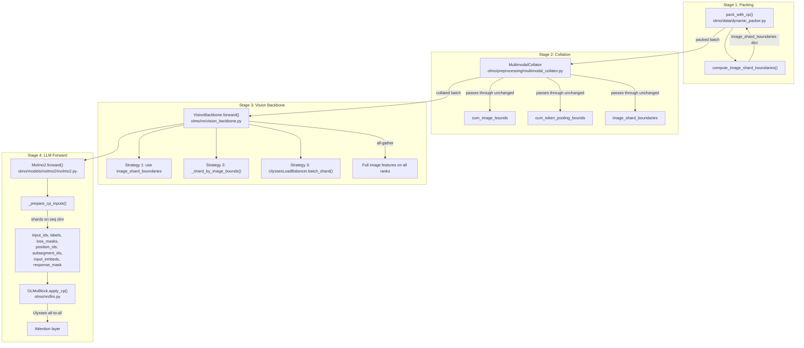

Sources: [docs/context_parallel.md:19-84](), [olmo/data/dynamic_packer.py:264-288](), [launch_scripts/sft.py:494-502]()

---

### Stage 1 — Packing

`pack_with_cp()` in [olmo/data/dynamic_packer.py:264-288]() wraps the standard `pack()` function. When `cp_world_size > 1` and the packed output contains images, it calls `compute_image_shard_boundaries()`.

`compute_image_shard_boundaries()` [olmo/data/dynamic_packer.py:14-164]() takes:
- `cum_image_bounds` — cumulative image counts across packed examples
- `cum_token_pooling_bounds` — cumulative pooling row counts
- `cp_world_size` — number of ranks in the CP group

It divides images across ranks proportionally, then runs a post-processing loop to handle **GPU starvation**: if any rank would receive zero images, it steals one assignment from a neighbor. The returned dict has the shape:

```python
{
    rank_id: {
        "start_image_idx": int,
        "end_image_idx": int,
        "start_pool_idx": int,
        "end_pool_idx": int,
        "max_num_tokens": int,
    }
}
```

This dict is stored as `image_shard_boundaries` on the packed example.

The `DynamicSolver` passes `cp_world_size` through to `pack_with_cp()` in both its shortcut path [olmo/data/dynamic_packer.py:430]() and its main solve path [olmo/data/dynamic_packer.py:473]().

Sources: [olmo/data/dynamic_packer.py:14-164](), [olmo/data/dynamic_packer.py:264-288](), [olmo/data/dynamic_packer.py:401-477]()

---

### Stage 2 — Collation

The collator in `olmo/preprocessing/multimodal_collator.py` passes the three CP-related fields through as lists (one entry per batch element) without collating them into padded tensors:

| Field | Type | Purpose |
|-------|------|---------|
| `cum_image_bounds` | list | Cumulative count of images per example in the packed sequence |
| `cum_token_pooling_bounds` | list | Cumulative count of pooling rows per example |
| `image_shard_boundaries` | list of dicts | Pre-computed per-rank image assignments |

When CP is disabled, these fields still flow through but are never consumed by the model (gated by `enable_cp` and `_cp_load_balancer is not None`).

Sources: [docs/context_parallel.md:44-52]()

---

### Stage 3 — Vision Backbone

When `enable_cp=True`, `VisionBackbone.forward()` in `olmo/nn/vision_backbone.py` assigns each CP rank a subset of images to encode through the ViT and connector. It tries three strategies in order:

1. **Pre-computed boundaries** (preferred): Uses `image_shard_boundaries` from the packer. No runtime communication needed.
2. **On-the-fly sharding**: If `cum_image_bounds` and `cum_token_pooling_bounds` are present but no pre-computed boundaries, calls `_shard_by_image_bounds()` to compute the split at runtime.
3. **Uniform sharding**: Falls back to `UlyssesLoadBalancer.batch_shard()` to split images evenly on the image dimension.

After each rank finishes encoding its image subset, the results are **all-gathered** so every rank has the complete set of image features. These features are then embedded into the token sequence for the LLM.

Sources: [docs/context_parallel.md:54-71]()

---

### Stage 4 — LLM Forward

After image features are embedded, `_prepare_cp_inputs()` in `olmo/models/molmo2/molmo2.py` shards all sequence-dimension tensors across CP ranks:

- `input_ids`
- `labels`
- `loss_masks`
- `response_mask`
- `position_ids`
- `subsegment_ids`
- `input_embeds`

It also collects the per-block RoPE sin/cos buffers so each rank uses position-correct embeddings for its shard.

The sharded tensors pass through each `OLMoBlock` (in `olmo/nn/llm.py`). Each block's attention layer uses Ulysses attention via `OLMoBlock.apply_cp()`. The loss is computed locally on each rank's portion of the sequence.

Sources: [docs/context_parallel.md:73-85]()

---

## Load Balancer

**Diagram: UlyssesLoadBalancer code entities**

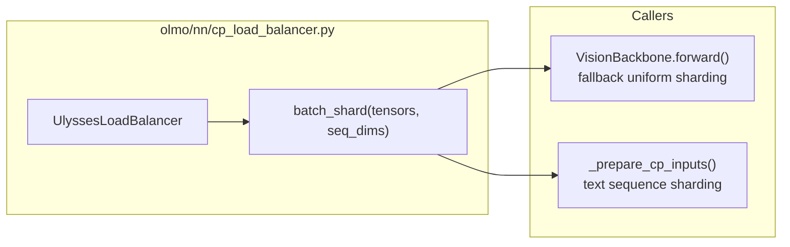

`UlyssesLoadBalancer` in `olmo/nn/cp_load_balancer.py` is the low-level mechanism for sequence sharding. Its `batch_shard()` method:

1. Takes a list of tensors and their sequence dimensions.
2. Pads sequences to be divisible by `cp_world_size`.
3. Returns the contiguous slice belonging to the current rank.

| CP degree | Sequence length | Rank 0 tokens | Rank 1 tokens |
|-----------|----------------|---------------|---------------|
| 2 | 36,864 | [0, 18,432) | [18,432, 36,864) |
| 4 | 36,864 | [0, 9,216) | [9,216, 18,432) |

The load balancer also contains Ring attention implementations, but these are **not actively used or tested**.

Sources: [docs/context_parallel.md:134-142]()

---

## Configuration

CP requires setting matching values in two independent configuration paths: the data pipeline and the model.

**Diagram: Configuration wiring in launch_scripts/sft.py**

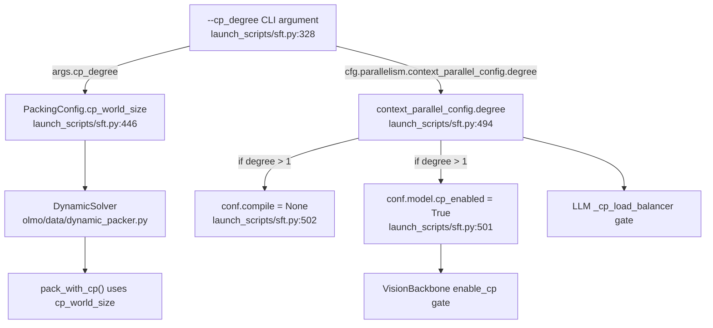

> **Note:** Compilation (`torch.compile`) is disabled when CP degree > 1, as it is not supported with context parallelism. See [launch_scripts/sft.py:502]().

### Key configuration fields

| Config location | Field | Default | Description |
|----------------|-------|---------|-------------|
| `TrainConfig.parallelism.context_parallel_config` | `degree` | `1` | Number of GPUs per CP group |
| `TrainConfig.parallelism.context_parallel_config` | `attention_type` | `"ulysses"` | Only `"ulysses"` is supported |
| `TrainConfig.parallelism.context_parallel_config` | `load_balancer` | `"ulysses"` | Load balancer type |
| `PackingConfig` | `cp_world_size` | `1` | Must match `degree` |
| `Molmo2Config` | `cp_enabled` | `False` | Set automatically when `degree > 1` |
| `Molmo2Config` | `apply_cp_to_vision_backbone` | `False` | Enable ViT encoding sharding |

Sources: [docs/context_parallel.md:144-187](), [launch_scripts/sft.py:328](), [launch_scripts/sft.py:444-446](), [launch_scripts/sft.py:494-502]()

### Example: Stage 3 long-context training with CP degree 2

```bash
torchrun --nproc-per-node=8 launch_scripts/sft.py /path/to/checkpoint molmo2 \
    --cp_degree=2 \
    --parallelism.context_parallel_config.degree=2 \
    --parallelism.context_parallel_config.attention_type=ulysses \
    --seq_len=36864 \
    --model.mm_preprocessor.video.max_frames=384 \
    --model.llm.max_sequence_length=36864 \
    --save_folder=/path/to/save
```

With 8 GPUs and CP degree 2, this creates **4 data-parallel groups**, each containing **2 CP ranks**. Each CP pair jointly processes sequences up to 36,864 tokens; each rank handles ~18,432 tokens.

Sources: [docs/context_parallel.md:173-187]()

---

## CP vs. Non-CP Comparison

| Stage | Without CP | With CP |
|-------|-----------|---------|
| Packing | `pack()` | `pack_with_cp()` + `compute_image_shard_boundaries()` |
| Collation | Standard field collation | Same, plus `image_shard_boundaries` passed through |
| Vision backbone | All images encoded on all ranks | Each rank encodes a subset, then all-gather |
| Text inputs | Full sequence per rank | `_prepare_cp_inputs()` shards on seq dimension |
| Attention | Standard SDPA | Ulysses: two all-to-all collectives per layer |
| Loss | Full sequence | Each rank computes loss on its own portion |
| `torch.compile` | Supported | Disabled |

Sources: [docs/context_parallel.md:87-99]()

---

## Key Files Reference

| File | CP-related content |
|------|--------------------|
| `olmo/nn/cp_load_balancer.py` | `UlyssesLoadBalancer`, `batch_shard()` |
| `olmo/data/dynamic_packer.py` | `compute_image_shard_boundaries()`, `pack_with_cp()`, `PackingConfig.cp_world_size` |
| `olmo/preprocessing/multimodal_collator.py` | Passes `image_shard_boundaries`, `cum_image_bounds`, `cum_token_pooling_bounds` |
| `olmo/models/molmo2/molmo2.py` | `apply_cp()`, `_prepare_cp_inputs()`, forward gating on `_cp_load_balancer` |
| `olmo/nn/vision_backbone.py` | Image sharding strategies and all-gather in `forward()` |
| `olmo/nn/llm.py` | `OLMoBlock.apply_cp()`, attention layer CP setup |
| `olmo/train/run_trainer.py` | `build_world_mesh()`, `parallelize_model()` |
| `launch_scripts/sft.py` | `--cp_degree` CLI arg, config wiring at lines 494–502 |

Sources: [docs/context_parallel.md:189-200]()

---

# Page: Evaluation

# Evaluation

<details>
<summary>Relevant source files</summary>

The following files were used as context for generating this wiki page:

- [README.md](README.md)
- [launch_scripts/eval.py](launch_scripts/eval.py)
- [launch_scripts/eval_molmo2.py](launch_scripts/eval_molmo2.py)

</details>


This page describes the evaluation system in the Molmo2 codebase: how generative and loss-based evaluation work, how results are cached, and how the two entry-point scripts relate to each other.

For details on running a single task, see [Single-Task Evaluation](#4.1). For the full multi-task suite and task taxonomy, see [Multi-Task Evaluation](#4.2). For the dataset catalog and how datasets are loaded, see [Dataset Catalog](#5.3).

---

## Overview

Evaluation is driven by `ModelEvaluator`, which loads a checkpoint, iterates over one or more evaluation datasets, runs either generation or loss computation, and writes metrics to disk. Two launch scripts provide different levels of control:

| Script | Purpose |
|---|---|
| `launch_scripts/eval.py` | Single task, fine-grained CLI control |
| `launch_scripts/eval_molmo2.py` | Named task groups, multiple checkpoints |

Both scripts build an `EvalConfig` and delegate to `ModelEvaluator.run()`.

**Sources:** [launch_scripts/eval.py:1-94](), [launch_scripts/eval_molmo2.py:1-281](), [README.md:304-360]()

---

## Core Abstractions

**Evaluation system class and configuration diagram:**

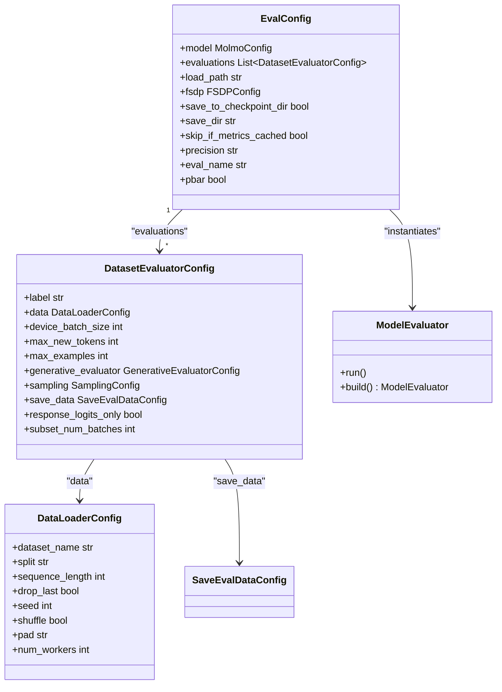

**Sources:** [launch_scripts/eval.py:53-90](), [launch_scripts/eval_molmo2.py:209-236](), [README.md:304-360]()

---

## Evaluation Modes

Each `DatasetEvaluatorConfig` operates in one of two modes, determined by whether `generative_evaluator` is set:

| Mode | Trigger | What runs | Typical use |
|---|---|---|---|
| **Generative** | `generative_evaluator` is not `None` | `InfDatasetEvaluator` — calls `model.generate()`, then scores output text | QA benchmarks, pointing, tracking |
| **Loss** | `generative_evaluator` is `None` | `LossDatasetEvaluator` — calls `model.forward()`, computes cross-entropy | `pixmo_cap`, `pixmo_ask_model_anything` |

In `eval.py`, passing `--loss` sets `generative_evaluator=None` [launch_scripts/eval.py:65-66](). In `eval_molmo2.py`, tasks in `loss_eval_tasks` always get `generative_evaluator=None` [launch_scripts/eval_molmo2.py:228-235]().

---

## Data Flow During Evaluation

**Evaluation data flow diagram:**

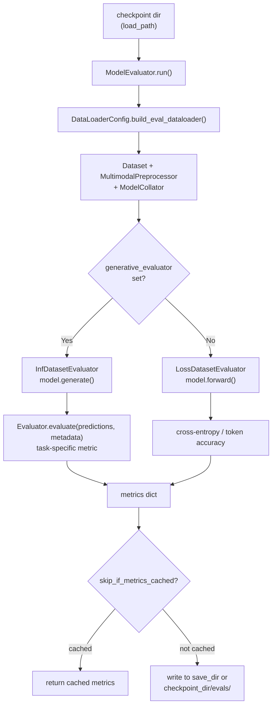

**Sources:** [launch_scripts/eval.py:53-90](), [launch_scripts/eval_molmo2.py:184-276](), [README.md:304-358]()

---

## Result Caching

When `skip_if_metrics_cached=True` (the default in `eval_molmo2.py`) [launch_scripts/eval_molmo2.py:270](), `ModelEvaluator` checks whether a metrics file already exists in the output directory before running inference. If found, the cached metrics are returned immediately and the task is skipped. This allows resuming an interrupted multi-task evaluation run without re-running completed tasks.

When `save_to_checkpoint_dir=True`, results are written under `<checkpoint_dir>/evals/`. A custom path can be set via `save_dir`.

---

## Task-Specific Helpers

Two utility functions mediate between task names and evaluator objects:

| Function | File | Role |
|---|---|---|
| `get_evaluator(task)` | `olmo/eval/eval_utils.py` | Returns a `GenerativeEvaluatorConfig` for a named task |
| `get_default_max_tokens(task)` | `olmo/eval/eval_utils.py` | Returns the task-specific default for `max_new_tokens` |
| `get_evaluation(name, ...)` | `olmo/eval/eval_utils.py` | Returns a fully-formed evaluation bundle (data config + evaluator + sampling) |

`eval.py` uses `get_evaluator` and `get_default_max_tokens` directly [launch_scripts/eval.py:7-8](), [launch_scripts/eval.py:50-51](). `eval_molmo2.py` uses `get_evaluation` to obtain the full bundle in one call [launch_scripts/eval_molmo2.py:186-187]().

---

## Model Configuration Overrides at Eval Time

Before building `EvalConfig`, `eval_molmo2.py` applies standard overrides to the loaded model config [launch_scripts/eval_molmo2.py:244-256]():

- `max_crops = 24` and `max_images = 20` on the image preprocessor
- `llm.max_sequence_length = 64000`

These ensure the model can handle the full context required by long-video benchmarks without retraining.

---

## Supported Evaluation Groups

`eval_molmo2.py` defines the following named task groups as Python lists:

| Group name | Constant | Representative tasks |
|---|---|---|
| `single_image` | `IMAGE_TASKS` + `IMAGE_POINTING` | `coco_2014_vqa_8192`, `chart_qa`, `mmmu_test`, `pointing_eval_v2:test` |
| `single_image_test` | `TEST_IMAGE_TASKS` | Test splits + `a_okvqa_mc`, `a_okvqa_da` |
| `multi_image` | `MULTI_IMAGE_TASKS` | `muir_bench:test`, `mmiu:test`, `blink:validation` |
| `short_video` | `SHORT_VIDEO` | `mvbench`, `ego_schema`, `nextqa_mc:test`, `perception_test` |
| `long_video` | `LONG_VIDEO` | `video_mme`, `long_video_bench_w_subtitle`, `mlvu_mc`, `lvbench` |
| `video` | `SHORT_VIDEO` + `LONG_VIDEO` | All of the above |
| `video_no_subtitle` | `SHORT_VIDEO` + `LONG_VIDEO_NO_SUBTITLES` | Video without subtitle variants |
| `video_subtitle` | `LONG_VIDEO_SUBTITLES` | `video_mme_w_subtitle`, `long_video_bench_w_subtitle`, `lvbench` |
| `video_pointing` | `VIDEO_POINTING` | `vixmo_points_count_clip_63s:val`, `mevis_point_track_per_frame_fps_6_sample_fps_1` |
| `image_pointing` | `IMAGE_POINTING` | `countbench_qa:huggingface`, `pixmo_count_counting:validation` |
| `tracking` | `TRACKING` | `mevis_track_eval_1fps:test`, `ref_yt_vos_track_eval_1fps:test`, `molmo2_video_track_eval_1fps:test` |
| `test_video` | `TEST_VIDEO_DATASETS` | Test splits of MLVU, PerceptionTest, EgoSchema, MotionBench, LongVideoBench |

Individual task names (e.g. `chart_qa`, `mevis_track_eval_1fps:test`) can also be passed directly to `--tasks`.

**Sources:** [launch_scripts/eval_molmo2.py:29-123](), [README.md:333-350]()

---

## Batch Size Defaults

`eval_molmo2.py` implements a `device_batch_size` mode called `"4b-default"` (and `"8b-default"`) that selects per-task batch sizes automatically [launch_scripts/eval_molmo2.py:188-208]():

| Condition | `device_batch_size` (4B default) |
|---|---|
| `vixmo_points_point_eval*` | 1 |
| `TRACKING` tasks | 1 |
| `IMAGE_TASKS` or `IMAGE_POINTING` | 4 |
| All other tasks | 2 |

These can be overridden by passing a numeric value to `--device_batch_size`.

---

## Practical Notes

- Set `NCCL_TIMEOUT_MINUTES=20` when evaluating long-video tasks; different ranks can finish at very different times.
- Set `PYTORCH_CUDA_ALLOC_CONF=expandable_segments:True` to reduce OOM risk.
- The `--loss` flag in `eval.py` switches from generation to loss mode without changing any other config.
- Both scripts accept arbitrary `--key=value` overrides via `OmegaConf`, which are merged after the base config is constructed [launch_scripts/eval.py:87-89](), [launch_scripts/eval_molmo2.py:273-275]().
- Multi-node evaluation is supported via the standard `torchrun --nnodes` / `--node_rank` arguments.

**Sources:** [README.md:352-359](), [launch_scripts/eval.py:86-90](), [launch_scripts/eval_molmo2.py:272-276]()

---

# Page: Single-Task Evaluation

# Single-Task Evaluation

<details>
<summary>Relevant source files</summary>

The following files were used as context for generating this wiki page:

- [launch_scripts/eval.py](launch_scripts/eval.py)

</details>


This page covers `launch_scripts/eval.py`, the entry point for evaluating a checkpoint on **one dataset task at a time**. It explains the CLI arguments, how the configuration objects (`EvalConfig`, `DatasetEvaluatorConfig`) are assembled, and how evaluation is dispatched through `ModelEvaluator`.

For an overview of the evaluation system and the distinction between generative vs. loss-based evaluation, see [Evaluation](#4). For evaluating across many tasks simultaneously, see [Multi-Task Evaluation](#4.2).

---

## Overview

`eval.py` is invoked with `torchrun` and evaluates a single checkpoint on a single dataset task. It constructs an `EvalConfig` programmatically from CLI arguments and then delegates all work to `ModelEvaluator`.

**Diagram: eval.py control flow**

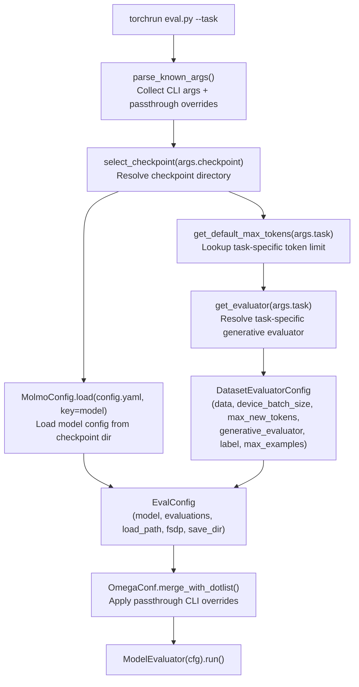

Sources: [launch_scripts/eval.py:18-90]()

---

## CLI Arguments

All arguments are parsed via `argparse`. Unknown arguments are collected into `other_args` and applied as OmegaConf dot-list overrides, allowing any nested config field to be overridden from the command line.

| Argument | Type | Default | Description |
|---|---|---|---|
| `checkpoint` | positional | — | Path to checkpoint directory (or a glob/step selector, resolved by `select_checkpoint`) |
| `--task` | `str` | `"dense_caption_eval"` | Dataset task name, passed to `get_dataset_by_name` and `get_evaluator` |
| `--split` | `str` | `"test"` | Dataset split to evaluate on |
| `--seq_len` | `int` | `None` | Sequence length for the data loader; required when `--fsdp` is set |
| `--num_workers` | `int` | `2` | DataLoader worker count |
| `--max_examples` | `int` | `None` | Cap the number of examples evaluated; also enables shuffling when set |
| `--device_batch_size` | `int` | `1` | Number of examples per device per step |
| `--save_dir` | `str` | `None` | Directory to save results; defaults to the checkpoint directory |
| `--save_eval_data` | flag | `False` | Save detailed intermediate model data for visualization |
| `--loss` | flag | `False` | Run loss/accuracy evaluation instead of generation |
| `--fsdp` | flag | `False` | Wrap model with FSDP2 for multi-GPU evaluation |
| `--max_new_tokens` | `int` | `None` | Override token generation limit; otherwise use task default |
| `--response_logits_only` | flag | `False` | Restrict logit collection to response tokens only |

Sources: [launch_scripts/eval.py:22-38]()

---

## Configuration Assembly

**Diagram: Config object composition**

```mermaid
flowchart LR
    subgraph "DataLoaderConfig"
        dl["dataset_name=args.task\nsplit=args.split\nsequence_length=args.seq_len\ndrop_last=False\nseed=6198\nshuffle=(max_examples is not None)\npad=None\nnum_workers=args.num_workers\npin_memory=True"]
    end

    subgraph "DatasetEvaluatorConfig"
        dec["data=DataLoaderConfig\ndevice_batch_size=args.device_batch_size\nmax_new_tokens=max_new_tokens\ngenerative_evaluator=get_evaluator(task)\nsave_data=SaveEvalDataConfig or None\nlabel=args.task\nmax_examples=args.max_examples\nresponse_logits_only=args.response_logits_only"]
    end

    subgraph "MolmoConfig"
        mc["Loaded from checkpoint_dir/config.yaml\nkey=model\nvalidate_paths=False"]
    end

    subgraph "EvalConfig"
        ec["pbar=False\nmodel=MolmoConfig\nevaluations=[DatasetEvaluatorConfig]\nload_path=checkpoint_dir\nconsole_log_interval=10\nfsdp=FSDPConfig(fsdp2=True) or None\nsave_to_checkpoint_dir=(save_dir is None)\nsave_dir=args.save_dir"]
    end

    dl --> dec
    dec --> ec
    mc --> ec
    ec --> ME["ModelEvaluator(cfg).run()"]
```

Sources: [launch_scripts/eval.py:40-90]()

### Key construction decisions

- **`max_new_tokens` resolution**: if `--loss` is set, `max_new_tokens` is `None` (no generation). If `--max_new_tokens` is provided, that value is used. Otherwise `get_default_max_tokens(args.task)` provides a per-task default [launch_scripts/eval.py:45-51]().

- **`generative_evaluator` resolution**: if `--loss` is set, `generative_evaluator=None` causes loss-only evaluation. Otherwise `get_evaluator(args.task)` returns a task-specific evaluator [launch_scripts/eval.py:65]().

- **`shuffle`**: enabled automatically when `--max_examples` is set, so a random subset is sampled rather than always taking the first N examples [launch_scripts/eval.py:58]().

- **Model config loading**: `MolmoConfig.load()` reads `config.yaml` from the checkpoint directory using `key="model"` and `validate_paths=False`, so paths inside the config are not checked against the filesystem [launch_scripts/eval.py:73-74]().

- **OmegaConf passthrough overrides**: any unrecognized CLI arguments in `other_args` are cleaned via `clean_opt()` and merged with `OmegaConf.merge_with_dotlist()`, allowing deep overrides such as `model.llm.d_model=2048` [launch_scripts/eval.py:87-89]().

---

## Generative vs. Loss Evaluation

The `--loss` flag switches the evaluation mode:

| Mode | `max_new_tokens` | `generative_evaluator` | What runs |
|---|---|---|---|
| **Generative** (default) | task default or `--max_new_tokens` | `get_evaluator(task)` result | Model generates text; task-specific metric computed |
| **Loss** (`--loss`) | `None` | `None` | Cross-entropy loss and token accuracy computed over labeled responses |

Sources: [launch_scripts/eval.py:45-65]()

---

## FSDP Configuration

When `--fsdp` is passed:

- `FSDPConfig(fsdp2=True)` is attached to the `EvalConfig`.
- `--seq_len` becomes **required** — the script raises `ValueError` if it is absent [launch_scripts/eval.py:41-43]().
- This enables multi-GPU distributed evaluation for large models that do not fit on a single device.

Without `--fsdp`, the model is loaded on a single device per rank (standard `torchrun` usage).

Sources: [launch_scripts/eval.py:41-43](), [launch_scripts/eval.py:82]()

---

## Running the Script

### Basic generative evaluation

```bash
torchrun --nproc_per_node=1 launch_scripts/eval.py \
    /path/to/checkpoint \
    --task chartqa \
    --split test \
    --device_batch_size 4
```

### Loss-based evaluation

```bash
torchrun --nproc_per_node=1 launch_scripts/eval.py \
    /path/to/checkpoint \
    --task chartqa \
    --split test \
    --loss
```

### Multi-GPU with FSDP

```bash
torchrun --nproc_per_node=4 launch_scripts/eval.py \
    /path/to/checkpoint \
    --task videomme \
    --split test \
    --fsdp \
    --seq_len 16384
```

### Evaluating a random subset

```bash
torchrun --nproc_per_node=1 launch_scripts/eval.py \
    /path/to/checkpoint \
    --task mmmu \
    --max_examples 200
```

### Overriding nested config fields

Any argument not matched by `argparse` is forwarded as an OmegaConf override:

```bash
torchrun --nproc_per_node=1 launch_scripts/eval.py \
    /path/to/checkpoint \
    --task chartqa \
    model.llm.attention_dropout=0.0
```

Sources: [launch_scripts/eval.py:18-93]()

---

## Relation to Other Components

**Diagram: eval.py in context of broader evaluation system**

```mermaid
flowchart TB
    evalpy["eval.py\n(entry point)"]

    subgraph "Configuration"
        DLC["DataLoaderConfig\n(olmo/data/data_loader.py)"]
        DEC["DatasetEvaluatorConfig\n(olmo/eval/model_evaluator.py)"]
        EC["EvalConfig\n(olmo/eval/model_evaluator.py)"]
        MC["MolmoConfig\n(olmo/models/molmo/molmo.py)"]
        FSDPC["FSDPConfig\n(olmo/train/trainer_config.py)"]
    end

    subgraph "Helpers"
        SC["select_checkpoint()\n(olmo/util.py)"]
        RP["resource_path()\n(olmo/util.py)"]
        GE["get_evaluator(task)\n(olmo/eval/eval_utils.py)"]
        GMT["get_default_max_tokens(task)\n(olmo/eval/eval_utils.py)"]
        CO["clean_opt()\n(olmo/util.py)"]
    end

    subgraph "Execution"
        ME["ModelEvaluator\n(olmo/eval/model_evaluator.py)"]
        SEDC["SaveEvalDataConfig\n(olmo/eval/save_eval_data_config.py)"]
    end

    evalpy --> SC
    evalpy --> RP
    evalpy --> GE
    evalpy --> GMT
    evalpy --> CO
    evalpy --> DLC
    evalpy --> DEC
    evalpy --> MC
    evalpy --> FSDPC
    evalpy --> EC
    evalpy --> SEDC
    EC --> ME
```

Sources: [launch_scripts/eval.py:1-90]()

---

# Page: Multi-Task Evaluation

# Multi-Task Evaluation

<details>
<summary>Relevant source files</summary>

The following files were used as context for generating this wiki page:

- [launch_scripts/eval_molmo2.py](launch_scripts/eval_molmo2.py)

</details>


This page documents `launch_scripts/eval_molmo2.py`, the script used to evaluate Molmo2 models across multiple task groups in a single run. It covers the task taxonomy, how group names expand into individual evaluator configs, how batch sizes are selected per task, and how to invoke the script against one or more checkpoints.

For single-task evaluation using a YAML config file, see the [Single-Task Evaluation](#4.1) page. For an overview of the evaluation infrastructure (`ModelEvaluator`, generative and loss-based evaluators, result caching), see the [Evaluation](#4) page.

---

## Overview

`eval_molmo2.py` is a self-contained launch script that:

1. Accepts one or more checkpoint paths and one or more **task group names**.
2. Expands each group name into a list of individual dataset evaluators.
3. Constructs a `DatasetEvaluatorConfig` per task, selecting an appropriate `device_batch_size`.
4. Builds a single `EvalConfig` containing all evaluators and runs it against each checkpoint in sequence.

The script reuses the same evaluation infrastructure as `eval.py` (the `EvalConfig` / `DatasetEvaluatorConfig` types and the `ModelEvaluator.run()` call) but removes the need for a hand-written YAML config file.

---

## Task Taxonomy

Tasks are organized into named constant lists. Each list corresponds to a group name accepted by the `--tasks` flag.

**Task Group Constants** ([launch_scripts/eval_molmo2.py:29-123]())

| Constant | Group Flag | Contents |
|---|---|---|
| `IMAGE_TASKS` | `single_image` | `coco_2014_vqa_8192`, `text_vqa`, `chart_qa`, `doc_qa`, `info_qa`, `ai2_diagram_v2_mix_transparent`, `mmmu_test`, `real_world_qa_no_instruction:test`, `math_vista_v2` |
| `TEST_IMAGE_TASKS` | `single_image_test` | Held-out test splits of image tasks plus `a_okvqa_mc`, `a_okvqa_da`, `countbench_qa:huggingface`, `pixmo_count_counting:test`, `coco_2014_vqa:test` |
| `IMAGE_POINTING` | `image_pointing` | `countbench_qa:huggingface`, `pixmo_count_counting:validation`, `pointing_eval_v2:test`, `point_bench:test` |
| `SHORT_VIDEO` | `short_video` | `mvbench`, `tomato:test`, `motionbench:validation`, `temp_compass_internal`, `perception_test`, `ego_schema`, `nextqa_mc:test` |
| `LONG_VIDEO_SUBTITLES` | `video_subtitle` | `video_mme_w_subtitle`, `long_video_bench_w_subtitle`, `lvbench` |
| `LONG_VIDEO_NO_SUBTITLES` | *(partial)* | `mlvu_mc`, `video_mme`, `long_video_bench_no_subtitle`, `vixmo_caps_eval2:test`, `video_eval_pro_mc:test` |
| `LONG_VIDEO` | `long_video` | `LONG_VIDEO_SUBTITLES` + `LONG_VIDEO_NO_SUBTITLES` |
| `VIDEO_POINTING` | `video_pointing` | `vixmo_points_count_clip_63s:val`, `vixmo_points_point_eval:val`, `mevis_point_track_per_frame_fps_6_sample_fps_1`, `vixmo_points_count:val` |
| `TEST_VIDEO_DATASETS` | `test_video` | `mlvu_mc_test`, `perception_test_test`, `ego_schema_test`, `motionbench_test`, `long_video_bench_w_subtitle_test` |
| `MULTI_IMAGE_TASKS` | `multi_image` | `muir_bench:test`, `mmiu:test`, `blink:validation` |
| `TRACKING` | `tracking` | `mevis_track_eval_1fps:test`, `ref_yt_vos_track_eval_1fps:test`, `ref_davis17_track_eval_1fps:test`, `reasonvos_track_eval_1fps:test`, `molmo2_video_track_eval_1fps:test` |

**Composite groups:**

| Group Flag | Expands To |
|---|---|
| `video` | `SHORT_VIDEO` + `LONG_VIDEO` |
| `video_no_subtitle` | `SHORT_VIDEO` + `LONG_VIDEO_NO_SUBTITLES` |
| `single_image` | `IMAGE_TASKS` + `IMAGE_POINTING` + loss evals for `pixmo_ask_model_anything`, `pixmo_cap` |

Any unrecognized name is passed through as a literal dataset name, allowing ad hoc evaluation of individual tasks.

---

## Task Expansion Flow

**Diagram: Task Group Resolution**

```mermaid
flowchart TD
    CLI["--tasks video,tracking,single_image"]
    split["Split on comma"]
    CLI --> split

    split --> v["video"]
    split --> t["tracking"]
    split --> si["single_image"]

    v --> sv["SHORT_VIDEO list"]
    v --> lv["LONG_VIDEO list"]

    t --> tr["TRACKING list"]

    si --> it["IMAGE_TASKS list"]
    si --> ip["IMAGE_POINTING list"]
    si --> le["loss_eval_tasks:\npixmo_ask_model_anything\npixmo_cap"]

    sv --> dedup["Deduplicate\n(dict keyed by task name)"]
    lv --> dedup
    tr --> dedup
    it --> dedup
    ip --> dedup

    dedup --> ge["get_evaluation(name, seq_len,\nmax_examples, num_workers)"]
    le --> ge2["get_evaluation(name, ...,\nfor_inference=False)"]

    ge --> dse["DatasetEvaluatorConfig\n(generative_evaluator set)"]
    ge2 --> dse2["DatasetEvaluatorConfig\n(generative_evaluator=None)"]

    dse --> ec["EvalConfig.evaluations list"]
    dse2 --> ec
```

Sources: [launch_scripts/eval_molmo2.py:147-236]()

---

## Device Batch Size Selection

The script includes two built-in batch size profiles, selected via `--device_batch_size`.

**Diagram: Batch Size Profile Logic**

```mermaid
flowchart TD
    arg["--device_batch_size"]
    arg --> p4["4b-default"]
    arg --> p8["8b-default"]
    arg --> custom["integer literal"]

    p4 --> p4a["vixmo_points_point_eval* → 1"]
    p4 --> p4b["TRACKING → 1"]
    p4 --> p4c["IMAGE_TASKS / IMAGE_POINTING → 4"]
    p4 --> p4d["everything else → 2"]

    p8 --> p8a["TEST_VAL_LONG_VIDEO_SUBTITLE\nor VIDEO_POINTING → 1"]
    p8 --> p8b["TRACKING → 1"]
    p8 --> p8c["IMAGE_TASKS / IMAGE_POINTING → 4"]
    p8 --> p8d["everything else → 2"]

    custom --> direct["device_batch_size = int(arg)"]
```

Sources: [launch_scripts/eval_molmo2.py:188-208]()

Tasks with large or variable-length outputs (tracking, long-form video pointing) use `device_batch_size=1`. Standard image tasks use 4. Most video QA tasks use 2.

---

## Evaluator Configuration

For each task, a `DatasetEvaluatorConfig` is assembled as follows ([launch_scripts/eval_molmo2.py:209-224]()):

| Field | Value |
|---|---|
| `label` | From `get_evaluation()` result |
| `data` | From `get_evaluation()` result, with `pad=None` |
| `generative_evaluator` | From `get_evaluation()` result; `n_to_log=4`, `num_wandb_examples=10`, `save_predictions="_default"` |
| `sampling` | From `get_evaluation()` result |
| `device_batch_size` | Profile-selected (see above) |
| `subset_num_batches` | `None` (evaluate full dataset) |
| `max_examples` | `--max_examples` argument (default `-1`, meaning all) |
| `max_new_tokens` | `--max_new_tokens` override, or task default |

For **loss-only tasks** (`pixmo_ask_model_anything`, `pixmo_cap`), `generative_evaluator` is set to `None`, and `pad` is set to `"to_max"` when FSDP is enabled ([launch_scripts/eval_molmo2.py:225-236]()).

---

## Model Configuration Overrides

After loading `config.yaml` from each checkpoint, the script applies fixed overrides ([launch_scripts/eval_molmo2.py:246-256]()):

- For `Molmo2Config`: `mm_preprocessor.image.max_crops = 24`, `mm_preprocessor.image.max_images = 20`
- For `MolmoConfig`: `mm_preprocessor.max_crops = 24`, `mm_preprocessor.max_images = 20`
- For both: `llm.max_sequence_length = 64000`

These override the training-time values to allow evaluation of longer, more complex inputs.

---

## `EvalConfig` Assembly and Execution

After constructing all `DatasetEvaluatorConfig` entries, a single `EvalConfig` is built per checkpoint ([launch_scripts/eval_molmo2.py:258-276]()):

| `EvalConfig` Field | Value |
|---|---|
| `evaluations` | List of all `DatasetEvaluatorConfig` objects |
| `load_path` | Resolved checkpoint directory |
| `precision` | `"amp_bf16"` |
| `eval_name` | `--eval_name` argument (used as result file prefix) |
| `fsdp` | `FSDPConfig(fsdp2=True)` if `--fsdp` else `None` |
| `skip_if_metrics_cached` | `True` (skips tasks with existing results) |
| `save_to_checkpoint_dir` | `True` (results written alongside checkpoint) |
| `model` | Overridden `MolmoConfig` / `Molmo2Config` |

`cfg.build().run()` invokes `ModelEvaluator`, which iterates through each `DatasetEvaluatorConfig`, loads data, runs generation or loss computation, and writes metrics. `torch.cuda.empty_cache()` is called between checkpoints.

Any additional `--key=value` arguments passed on the command line are merged into the config via `OmegaConf.merge_with_dotlist` ([launch_scripts/eval_molmo2.py:273-275]()).

---

## CLI Reference

```
python -m torch.distributed.run --nproc_per_node=N launch_scripts/eval_molmo2.py \
    <checkpoint> [<checkpoint2> ...] \
    --tasks <group1>[,<group2>,...] \
    [--max_examples N] \
    [--seq_len N] \
    [--fsdp] \
    [--device_batch_size {4b-default|8b-default|<int>}] \
    [--eval_name PREFIX] \
    [--overwrite] \
    [--max_new_tokens N] \
    [--num_workers N]
```

| Argument | Default | Description |
|---|---|---|
| `checkpoint` | *(required)* | One or more checkpoint paths; each is evaluated sequentially |
| `--tasks` | `video` | Comma-separated group names (see task taxonomy table above) |
| `--max_examples` | `-1` (all) | Limit examples per task, useful for quick smoke tests |
| `--seq_len` | `None` | Override sequence length passed to `get_evaluation()` |
| `--fsdp` | `False` | Enable FSDP2 for multi-GPU memory distribution |
| `--device_batch_size` | `4b-default` | Batch size profile or explicit integer |
| `--eval_name` | `None` | Prefix string prepended to saved result files |
| `--overwrite` | `False` | Re-run even if cached metrics already exist |
| `--max_new_tokens` | `None` | Override per-task generation length limit |
| `--num_workers` | `4` | DataLoader worker count |

**Example: evaluate all video tasks on two checkpoints**

```bash
torchrun --nproc_per_node=8 launch_scripts/eval_molmo2.py \
    /checkpoints/stage2/step300000 \
    /checkpoints/stage3/step50000 \
    --tasks video,video_pointing \
    --device_batch_size 8b-default \
    --eval_name stage3-vs-stage2
```

**Example: image + tracking evaluation with FSDP**

```bash
torchrun --nproc_per_node=4 launch_scripts/eval_molmo2.py \
    /checkpoints/molmo2-7b \
    --tasks single_image,tracking \
    --fsdp \
    --device_batch_size 8b-default
```

---

## End-to-End Flow

**Diagram: eval_molmo2.py Execution Flow**

```mermaid
flowchart TD
    A["CLI args parsed\nargparse.ArgumentParser"]
    B["Task group names split on comma"]
    C["Expand each group into dataset name list\n(deduplication via ordered dict)"]
    D["get_evaluation(name, seq_len, max_examples,\nnum_workers)\nreturns EvaluationConfig"]
    E["DatasetEvaluatorConfig built\nper task"]
    F["Loop over checkpoint paths"]
    G["select_checkpoint(checkpoint)"]
    H["MolmoConfig.load(config.yaml)"]
    I["Apply eval overrides:\nmax_crops=24, max_images=20\nmax_sequence_length=64000"]
    J["EvalConfig assembled"]
    K["OmegaConf merge with extra CLI args"]
    L["cfg.build().run()\nModelEvaluator executes all tasks"]
    M["torch.cuda.empty_cache()"]
    N["Next checkpoint"]

    A --> B --> C --> D --> E --> F
    F --> G --> H --> I --> J --> K --> L --> M --> N
    N --> F
```

Sources: [launch_scripts/eval_molmo2.py:126-277]()

---

## Result Storage

Because `save_to_checkpoint_dir=True` and `skip_if_metrics_cached=True`, results are written as JSON files inside each checkpoint directory. If a task's result file already exists, it is skipped unless `--overwrite` is passed. The `eval_name` prefix (if provided) is prepended to the result filename to distinguish runs with different configurations against the same checkpoint.

Sources: [launch_scripts/eval_molmo2.py:258-276]()

---

# Page: Data System

# Data System

<details>
<summary>Relevant source files</summary>

The following files were used as context for generating this wiki page:

- [README.md](README.md)
- [olmo/data/data_loader.py](olmo/data/data_loader.py)
- [olmo/data/dataset.py](olmo/data/dataset.py)
- [olmo/data/dynamic_packer.py](olmo/data/dynamic_packer.py)
- [olmo/data/get_dataset.py](olmo/data/get_dataset.py)

</details>


This page describes the architecture of the data system in Molmo2: how datasets are registered, how examples flow through the four-stage processing pipeline, and how batched tensors are delivered to the model. For a detailed reference on individual dataset categories, see the [Dataset Catalog](#5.3). For the packing algorithm specifically, see [Dynamic Packing](#5.2). For the full pipeline stage-by-stage walkthrough, see [Data Pipeline](#5.1).

---

## Overview

The data system transforms raw dataset examples into padded, batched tensors ready for `BaseModel.forward` or `BaseModel.generate`. It is composed of four sequential stages:

| Stage | Component | Input | Output |
|---|---|---|---|
| 1. Raw fetch + formatting | `Dataset.get()` + `DataFormatter` | index, rng | dict with raw fields (messages, images, points) |
| 2. Tokenization | `MultimodalPreprocessor` | raw dict | dict of numpy arrays (tokens, images, token_pooling) |
| 3. Packing + mixing | `IterableDatasetMixture` + `DynamicSolver` | stream of preprocessed dicts | single concatenated dict per packed sequence |
| 4. Collation | Model collator | list of packed dicts | padded/truncated batch tensors |

The entry point for building a dataloader is `DataLoaderConfig.build_train_dataloader()` or `DataLoaderConfig.build_eval_dataloader()`, both defined in [olmo/data/data_loader.py:308-383]().

---

**Diagram: End-to-End Data Flow — Code Entities**

```mermaid
flowchart TD
    subgraph raw["Raw Layer (olmo/data)"]
        factory["get_dataset_by_name(name, split)"]
        DS["Dataset.get(idx, rng)"]
        factory --> DS
    end

    subgraph det["DeterministicDataset (olmo/data/dataset.py)"]
        make_random_state["make_random_state(idx, epoch)"]
        preprocessor_call["preprocessor(item, rng)"]
        DS --> make_random_state
        make_random_state --> preprocessor_call
    end

    subgraph mix["Mixture + Packing (olmo/data/iterable_dataset_mixture.py)"]
        IterableDatasetMixture["IterableDatasetMixture\n(weighted sampling)"]
        DynamicSolver["DynamicSolver.__call__(example_id, example)"]
        pack_with_cp["pack_with_cp(*examples, cp_world_size)"]
        IterableDatasetMixture --> DynamicSolver
        DynamicSolver --> pack_with_cp
    end

    subgraph col["Collation"]
        collator["ModelCollator\n(build_collator() on MolmoConfig)"]
    end

    preprocessor_call --> IterableDatasetMixture
    pack_with_cp --> collator
    collator -->|"batched tensors"| model["BaseModel.forward / .generate"]
```

Sources: [olmo/data/data_loader.py:308-383](), [olmo/data/dataset.py:47-81](), [olmo/data/dynamic_packer.py:264-288]()

---

## Base Abstractions

### `Dataset`

All data sources extend the `Dataset` base class defined in [olmo/data/dataset.py:26-44](). Key interface:

- `get(item, rng)` — returns a raw example dict given an index and a numpy `RandomState`. Using an explicit `rng` rather than global state supports reproducible augmentation.
- `download(n_procs=1)` — class method to download and prepare the dataset.
- `__len__` — must return dataset size.

Examples returned by `Dataset.get()` are intentionally kept close to "raw" format. They typically contain fields like `points`, `label`, `image`, and a `style` string identifying the example type. Formatting into input/output text is deferred to the preprocessor stage. Examples may also carry a `metadata` dict for evaluation use and a `message_lists` field for multi-annotation message trees.

### `DatasetBase`

`DatasetBase` ([olmo/data/dataset.py:83-105]()) is a convenience subclass for datasets that load all their data into memory at init time via a `load()` method. Most academic datasets extend this class.

### `DeterministicDataset`

`DeterministicDataset` ([olmo/data/dataset.py:47-81]()) wraps a `Dataset` and its preprocessor. It:

- Derives a per-example `RandomState` from `(idx, epoch)` using `make_random_state`, ensuring reproducible augmentation across restarts.
- Applies the `preprocessor` to convert the raw dict into a dict of numpy arrays.
- Supports an `n_pad` parameter to pad dataset length for even distribution across distributed processes.
- Accepts a `weighting` (a `MessageWeight`) applied per-example, allowing per-dataset loss weighting.

### `HfDataset` and `Ai2HfDataset`

`HfDataset` ([olmo/data/dataset.py:108-119]()) wraps a HuggingFace `datasets.Dataset` identified by a class-level `PATH`. `Ai2HfDataset` ([olmo/data/dataset.py:124-156]()) wraps an internal HuggingFace-hosted dataset with a fixed schema: `image`, `style`, `message_lists`, and `metadata/*` fields.

Sources: [olmo/data/dataset.py:1-157]()

---

## Dataset Factory

All datasets are accessed through a single factory function:

```
get_dataset_by_name(dataset_name: str, split: str) -> Dataset
```

Defined in [olmo/data/get_dataset.py:39-480](). It is a large `if`/`elif` chain mapping string names to dataset class constructors. This is the canonical registry — there is no separate registration mechanism.

Helper functions built on top of the factory:

| Function | Purpose |
|---|---|
| `get_all_dataset_classes()` | Returns all `Dataset` subclasses visible in the module |
| `get_dataset_class_by_name(name)` | Returns the class without instantiating it (used by download scripts) |
| `download_dataset_by_name(name, n_procs)` | Calls `.download()` on the named dataset's class |

**Diagram: Factory to Dataset Classes**

```mermaid
flowchart LR
    factory["get_dataset_by_name()"]

    factory --> imgDS["Image Datasets\nVqa2, TextVqa, ChartQa\nAI2D, MMMU, MathVista\n...~20 classes"]
    factory --> multimgDS["Multi-Image Datasets\nMuirBench, BLINK\nMMIU, MantisInstruct"]
    factory --> vidDS["Video Datasets\nMVBench, EgoSchema\nVideoMME, MLVU\nActivityNet, EpicKitchens\n...~30 classes"]
    factory --> trackDS["Tracking Datasets\nMevis, RefYoutubeVOS\nRefDavis17, Burst, LVVIS\nLaSOT, TrackingNet\n...~20 classes"]
    factory --> pixmoDS["PixMo Datasets\nPixMoCap, PixMoPoints\nPixMoCount, PixMoCapQa\nPixMoAskModelAnything"]
    factory --> molmo2DS["Molmo2 Datasets\nMolmo2VideoPoint\nMolmo2VideoTrackInstruction\nMolmo2HardCodes\nMolmo2SynCaptionsQA"]
    factory --> cosynDS["CoSyn Datasets\nCoSyn(doc_type)\nCoSynPoint"]
    factory --> textDS["Text Datasets\nTulu4Filtered"]
```

Sources: [olmo/data/get_dataset.py:39-480]()

---

## DataLoaderConfig

`DataLoaderConfig` ([olmo/data/data_loader.py:86-384]()) is the top-level configuration object for building a `torch.utils.data.DataLoader`. It is embedded inside `TrainConfig` and `EvalConfig`.

### Key fields

| Field | Type | Description |
|---|---|---|
| `dataset` | `str` | Single dataset name (used for eval) |
| `mixture` | `Dict[str, float]` | Flat name→rate map |
| `kwargs_mixture` | `List[KwargsMixture]` | Grouped mixture with per-dataset kwargs |
| `root_size_mixture` | `List[RootSizeMixture]` | Mixture where rates are derived from `sqrt(dataset_size)` |
| `split` | `str` | `"train"`, `"validation"`, `"test"`, etc. |
| `seed` | `int` | Controls shuffle and augmentation |
| `sequence_length` | `int` | Max token length for truncation in the collator |
| `packing` | `PackingConfig` | Enables dynamic packing; `None` disables it |
| `num_workers` | `int` | DataLoader worker count |

### Building dataloaders

`build_train_dataloader()` ([olmo/data/data_loader.py:308-383]()):
1. Builds a `MultimodalPreprocessor` from `model_config.build_preprocessor()`.
2. Calls `_build_mixture()` to construct a list of `DeterministicDataset` objects and their normalized sampling rates.
3. If `packing` is set, builds a `DynamicSolver` via `PackingConfig.bulid()`.
4. Wraps everything in `IterableDatasetMixture`.
5. Returns a `DataLoader` with `device_batch_size = global_batch_size // world_size`.

`build_eval_dataloader()` ([olmo/data/data_loader.py:137-231]()):
- Uses a `DistributedSampler` (index-based, not iterable) unless packing is enabled.
- Optionally pads the dataset (`n_pad`) so all ranks get the same number of batches.
- Passes `include_metadata=True` by default for inference (needed by evaluators).

### Mixture construction (`_build_mixture`)

[olmo/data/data_loader.py:233-306]() supports three mutually exclusive mixture formats:

**`mixture`** — Direct name→rate dict. Rates are used as-is (normalized to sum to 1).

**`kwargs_mixture`** — List of `KwargsMixture` objects ([olmo/data/data_loader.py:43-47]()). Each group has a `rate` and a list of `WeightedDataset` entries. Within a group, per-dataset rates default to `sqrt(dataset_size)` unless `root_size_factor` or `sampling_rate` are set.

**`root_size_mixture`** — List of `RootSizeMixture` objects. Each sub-mixture normalizes its rates by `sqrt(dataset_size)` and then scales to the group's `rate`.

### `WeightedDataset`

[olmo/data/data_loader.py:49-82]() — describes a single dataset entry in a mixture:

| Field | Description |
|---|---|
| `dataset_name` | Passed to `get_dataset_by_name()` |
| `sampling_rate` | Multiplicative override on the computed rate |
| `root_size_factor` | Substitutes for actual dataset size in `sqrt` rate calculation |
| `message_weight` | `MessageWeight` applied to all examples from this dataset |
| `override_p_high_res` | Overrides high-resolution image probability in the preprocessor for this dataset |

Sources: [olmo/data/data_loader.py:1-384]()

---

## Packing

When `DataLoaderConfig.packing` is set, multiple preprocessed examples are concatenated into a single sequence before batching. This reduces padding waste and improves GPU utilization.

`PackingConfig` ([olmo/data/dynamic_packer.py:298-323]()) controls packing behavior:

| Field | Default | Description |
|---|---|---|
| `buffer_size` | 32 | Number of examples held in the rolling buffer |
| `mode` | `"dynamic_solver"` | Algorithm to use |
| `text_weight` | 1.0 | Objective weight per text token |
| `image_weight` | 1.0 | Objective weight per image patch |
| `shortcut_max_len_images` | `False` | Skip buffering if example fills the image dimension alone |
| `track_packing_state` | `True` | Save packer state in checkpoints for exact recovery |
| `cp_world_size` | 1 | Context parallel degree; enables `image_shard_boundaries` computation |

`PackingConfig.bulid(text_max_len, image_max_len, mesh)` ([olmo/data/dynamic_packer.py:317-323]()) constructs a `DynamicSolver` with two `Constraint` objects: one for `input_tokens` length and one for `images` count.

The `pack()` function ([olmo/data/dynamic_packer.py:167-261]()) concatenates all numpy arrays across examples, adjusts image patch offsets, and assigns `subsegment_ids` that prevent cross-example attention. `pack_with_cp()` ([olmo/data/dynamic_packer.py:264-288]()) additionally calls `compute_image_shard_boundaries()` when `cp_world_size > 1`.

For algorithm details, see [Dynamic Packing](#5.2).

Sources: [olmo/data/dynamic_packer.py:1-480]()

---

## Key Output Fields

After packing and before collation, each example (or packed sequence) is a dict with the following standard fields:

| Field | Meaning |
|---|---|
| `input_tokens` | Token IDs, shape `[seq_len]` |
| `target_tokens` | Target token IDs for loss computation |
| `token_weights` | Per-token loss weights |
| `images` | Image patch data, shape `[n_crops, n_patches, ...]` |
| `token_pooling` | Maps image patches to token positions |
| `subsegment_ids` | Integers controlling causal attention mask; examples in a packed sequence get different offsets (multiples of `EXAMPLE_SUBSEGMENT_INCREMENT = 100000`) |
| `position_ids` | Absolute position IDs |
| `cum_image_bounds` | Cumulative image counts per packed sub-example |
| `cum_token_pooling_bounds` | Cumulative token pooling row counts per sub-example |
| `image_shard_boundaries` | Per-CP-rank image slice boundaries (only present when `cp_world_size > 1`) |
| `metadata` | List of per-example metadata dicts (eval only) |

Sources: [olmo/data/dynamic_packer.py:167-261]()

---

## Relationship to the Rest of the System

```mermaid
flowchart TB
    subgraph config["Configuration (olmo/config.py)"]
        TrainConfig["TrainConfig"]
        EvalConfig["EvalConfig"]
        DLC["DataLoaderConfig"]
    end

    subgraph data["Data System (olmo/data)"]
        factory2["get_dataset_by_name()"]
        DeterDS["DeterministicDataset"]
        IDM["IterableDatasetMixture"]
        DS2["DynamicSolver"]
        pack2["pack_with_cp()"]
        collator2["ModelCollator"]
    end

    subgraph model["Model (olmo/models)"]
        preprocessor2["MultimodalPreprocessor\nbuild_preprocessor()"]
        collator_build["build_collator()"]
        forward["BaseModel.forward / .generate"]
    end

    TrainConfig --> DLC
    EvalConfig --> DLC
    DLC -->|"build_train_dataloader()\nbuild_eval_dataloader()"| factory2
    DLC --> preprocessor2
    preprocessor2 --> DeterDS
    factory2 --> DeterDS
    DeterDS --> IDM
    IDM --> DS2
    DS2 --> pack2
    pack2 --> collator2
    collator_build --> collator2
    collator2 --> forward
```

Sources: [olmo/data/data_loader.py:137-383](), [olmo/data/dataset.py:47-81](), [olmo/data/dynamic_packer.py:264-323]()

---

# Page: Data Pipeline

# Data Pipeline

<details>
<summary>Relevant source files</summary>

The following files were used as context for generating this wiki page:

- [olmo/data/data_loader.py](olmo/data/data_loader.py)
- [olmo/data/dataset.py](olmo/data/dataset.py)
- [olmo/data/dynamic_packer.py](olmo/data/dynamic_packer.py)

</details>


This page documents the four processing stages that transform raw dataset entries into batched tensors ready for model training and evaluation. It covers the `Dataset` base class, `DeterministicDataset`, `IterableDatasetMixture`, `DynamicSolver`/`pack`/`pack_with_cp`, and the final `Collator` step as orchestrated by `DataLoaderConfig`.

For details on the 2D knapsack packing algorithm and context-parallel boundary computation, see [Dynamic Packing](#5.2). For the dataset registry and individual dataset implementations, see [Dataset Catalog](#5.3).

---

## Pipeline Overview

The pipeline converts raw dataset entries into fixed-shape batched tensors through four sequential stages:

**Pipeline: From Raw Data to Model Input**

```mermaid
flowchart TD
    A["get_dataset_by_name()"] --> B["Dataset.get(item, rng)"]
    B --> C["DataFormatter\n(inside Dataset.get)"]
    C --> D["DeterministicDataset.get(idx, epoch)"]
    D --> E["MultimodalPreprocessor.__call__\n(text tokens + image crops)"]
    E --> F["IterableDatasetMixture\n(weighted sampling)"]
    F --> G["DynamicSolver.__call__\n(buffer + 2D knapsack)"]
    G --> H["pack_with_cp()\n(concatenate + subsegment_ids + CP boundaries)"]
    H --> I["Model Collator\n(pad / truncate to fixed shape)"]
    I --> J["DataLoader\n(batched tensors to model)"]
```

Sources: [olmo/data/data_loader.py:1-384](), [olmo/data/dataset.py:1-157](), [olmo/data/dynamic_packer.py:1-479]()

---

## Stage 1 — Raw Dataset Access

### Dataset Base Class

Every dataset in the system extends `Dataset` ([olmo/data/dataset.py:26-44]()). The primary method is:

```
Dataset.get(item, rng) -> dict
```

The `rng` argument is a `numpy.random.RandomState` passed in from the outside so that random augmentation inside `get()` is reproducible without relying on global RNG state.

Two concrete base classes build on top of `Dataset`:

| Class | Location | Purpose |
|---|---|---|
| `DatasetBase` | [olmo/data/dataset.py:83-105]() | Loads a list via `self.load()` at construction; supports optional sampling |
| `HfDataset` | [olmo/data/dataset.py:108-121]() | Wraps a HuggingFace `datasets.Dataset` with a `PATH` class variable |
| `Ai2HfDataset` | [olmo/data/dataset.py:124-156]() | HF dataset with style annotation and optional flattening of `message_list` |

### Formatting

Each `Dataset.get()` call applies a `DataFormatter` internally before returning. The formatter converts structured data (points, multiple-choice options, image descriptions) into text prompt templates and `human`/`assistant` message pairs. This step is dataset-specific and happens before any shared preprocessing.

Sources: [olmo/data/dataset.py:26-157]()

---

## Stage 2 — Preprocessing (DeterministicDataset)

`DeterministicDataset` ([olmo/data/dataset.py:47-80]()) wraps a raw `Dataset` and a `MultimodalPreprocessor`. It is the boundary between raw data and tensor-ready examples.

### How it Works

```
DeterministicDataset.get(idx, epoch) -> dict[str, ndarray]
```

1. Derives a deterministic `rng = make_random_state(idx, epoch)`.
2. Calls `self.dataset.get(idx, rng)` to get the formatted dict.
3. If `idx >= len(self.dataset)`, returns a padding example (a copy of index 0 with `metadata.valid=False`). This is used in eval to ensure every data-parallel rank gets the same number of batches.
4. Optionally stamps `item["weight"]` with a per-dataset `MessageWeight`.
5. Calls `self.preprocessor(item, rng)` — the `MultimodalPreprocessor` — which produces token arrays, image crop tensors, and pooling index arrays.

### Constructor Parameters

| Parameter | Type | Description |
|---|---|---|
| `dataset` | `Dataset` | Raw data source |
| `preprocessor` | `MultimodalPreprocessor` | Converts formatted dict to tensors |
| `seed` | `int` | Base seed for RNG derivation |
| `n_pad` | `int` | Number of dummy examples appended after real data (for eval padding) |
| `weighting` | `MessageWeight` | Per-dataset token loss weight override |

Sources: [olmo/data/dataset.py:47-80]()

---

## Stage 3 — Mixture Sampling + Packing

### DataLoaderConfig._build_mixture()

`DataLoaderConfig._build_mixture()` ([olmo/data/data_loader.py:233-306]()) constructs a list of `DeterministicDataset` objects and their normalized sampling rates from one of three configuration styles:

| Config Field | Behavior |
|---|---|
| `dataset` (str) | Single dataset, rate = 1.0 |
| `mixture` (Dict[str, float]) | Named datasets with explicit rates |
| `root_size_mixture` | Groups where per-dataset rate ∝ √(dataset size) |
| `kwargs_mixture` | Groups of `WeightedDataset` with per-task `sampling_rate`, `root_size_factor`, `message_weight`, and `override_p_high_res` |

For `kwargs_mixture`, the per-task effective size is computed as:

```
size = sqrt(len(dataset) * root_size_factor)   # if root_size_factor is set
size = sqrt(len(dataset))                       # if root_size_factor is None
size = 1                                        # if root_size_factor == 0
```

Then optionally multiplied by `sampling_rate`, normalized within the group, and scaled by the group's `rate`.

### WeightedDataset

`WeightedDataset` ([olmo/data/data_loader.py:49-83]()) is the per-task configuration unit inside `kwargs_mixture`:

| Field | Type | Description |
|---|---|---|
| `dataset_name` | `str` | Name passed to `get_dataset_by_name()` |
| `sampling_rate` | `float` | Multiplier on computed size |
| `root_size_factor` | `float` | Override for dataset size in the √-rate formula |
| `message_weight` | `MessageWeight` | Token loss weighting for this dataset |
| `override_p_high_res` | `float` | Override probability of using high-res crops |

### IterableDatasetMixture

`IterableDatasetMixture` samples from a list of `DeterministicDataset` objects according to normalized `mixture_rates`. It is an iterable (not indexable) and feeds examples one at a time into the packer.

### DynamicSolver

`DynamicSolver` ([olmo/data/dynamic_packer.py:401-477]()) maintains a rolling buffer of up to `max_buffer_size` examples. When the buffer is full, it runs a 2D knapsack DP (`select_subset_2d_knapsack`) to find the best subset that fits within `(max_text_len, max_image_len)` constraints, then emits those examples as a single packed sequence via `pack_with_cp()`.

**Packing: Code Entity Map**

```mermaid
flowchart LR
    IM["IterableDatasetMixture"] -->|"yields dict"| DS["DynamicSolver.__call__(example_id, example)"]
    DS -->|"buffer not full"| BUF["_buffer: List[BufferedExample]"]
    BUF -->|"buffer full"| KS["select_subset_2d_knapsack(t_values, i_values, max_t, max_i, obj_vals)"]
    KS -->|"selected indices"| PK["pack_with_cp(*examples, cp_world_size)"]
    PK --> OUT["packed dict"]
    DS -->|"shortcut: example fills constraints"| PK
```

Sources: [olmo/data/dynamic_packer.py:401-477](), [olmo/data/data_loader.py:308-383]()

### PackingConfig

`PackingConfig` ([olmo/data/dynamic_packer.py:298-323]()) configures the packer:

| Field | Default | Description |
|---|---|---|
| `buffer_size` | 32 | Rolling buffer size |
| `mode` | `"dynamic_solver"` | Solver algorithm |
| `text_weight` | 1.0 | Objective weight for text tokens |
| `image_weight` | 1.0 | Objective weight for image patches |
| `shortcut_max_len_images` | `False` | Emit immediately if example saturates image capacity |
| `cp_world_size` | 1 | CP group size for shard boundary precomputation |
| `track_packing_state` | `True` | Whether to track packing efficiency metrics |

---

## Stage 4 — pack() and pack_with_cp()

`pack(*examples)` ([olmo/data/dynamic_packer.py:167-261]()) concatenates multiple example dicts into a single dict:

1. **Image index offsetting**: For each packed example, adjusts all token pooling index arrays (e.g. `token_pooling`) by the cumulative image patch count so that indices remain valid in the merged image tensor.
2. **subsegment_ids**: Each packed example receives a unique `subsegment_id` base offset of `example_ix * EXAMPLE_SUBSEGMENT_INCREMENT` (100,000). This prevents cross-example attention — the model's attention mask allows tokens to attend only to tokens with an equal or lower `subsegment_id` within the same segment.
3. **Concatenation**: All fields are concatenated along axis 0.
4. **Boundary tracking**: `cum_token_pooling_bounds` and `cum_image_bounds` are stored so that downstream code can recover per-example image boundaries.

`pack_with_cp(*examples, cp_world_size)` ([olmo/data/dynamic_packer.py:264-288]()) calls `pack()` then additionally calls `compute_image_shard_boundaries()` to precompute `image_shard_boundaries` — a dict keyed by GPU rank containing `start_image_idx`, `end_image_idx`, `start_pool_idx`, `end_pool_idx`, and `max_num_tokens` for each context-parallel rank.

**pack_with_cp: Internal Data Flow**

```mermaid
flowchart TD
    E1["example 1\ninput_tokens, images, token_pooling, subsegment_ids"] --> PK["pack(*examples)"]
    E2["example 2\ninput_tokens, images, token_pooling"] --> PK
    EN["example N\n..."] --> PK
    PK --> OFF["offset image indices\nin token_pooling arrays"]
    OFF --> SEG["assign subsegment_ids\n= example_ix * 100000"]
    SEG --> CAT["np.concatenate\nall fields along axis 0"]
    CAT --> BND["compute cum_token_pooling_bounds\ncum_image_bounds"]
    BND --> SHD["compute_image_shard_boundaries\n(if cp_world_size > 1)"]
    SHD --> OUT["packed dict\nimage_shard_boundaries[rank]"]
```

Sources: [olmo/data/dynamic_packer.py:167-288]()

---

## Stage 5 — Collation and DataLoader Assembly

After packing, the `Model Collator` (built via `model_config.build_collator()`) pads or truncates all tensors to a fixed shape determined by `output_shapes` from `preprocessor.get_output_shapes()`. Fixed shapes allow `torch.compile` static graph capture.

When packing is enabled, token pooling keys (`TOKEN_POOLING_KEYS`) and a few other fields (`num_images`, `multimodal_type`, `num_image_starts`) receive `VariablePaddingSpec` instead of a fixed shape, because their second dimension varies depending on how many images were packed together ([olmo/data/data_loader.py:322-332]()).

The final `torch.utils.data.DataLoader` is constructed with:

| Parameter | Train | Eval |
|---|---|---|
| `batch_size` | `global_batch_size // dp_world_size` | Passed in directly |
| `sampler` | None (iterable) | `DistributedSampler` (unless packing) |
| `collate_fn` | Model Collator | Model Collator |
| `drop_last` | From config | From config |

Sources: [olmo/data/data_loader.py:308-383](), [olmo/data/data_loader.py:137-231]()

---

## Train vs. Eval Dataloader Differences

| Concern | `build_train_dataloader` | `build_eval_dataloader` |
|---|---|---|
| Entry point | [olmo/data/data_loader.py:308-383]() | [olmo/data/data_loader.py:137-231]() |
| Preprocessor | `is_training=True` | `is_training=False`, `for_inference` flag |
| Sampler | `IterableDatasetMixture` always | `DistributedSampler` unless packing enabled |
| n_pad | Not used | Computed to fill final batch across DP ranks |
| Metadata | Not included | Included when `for_inference=True` |
| Mixture | Full `_build_mixture()` logic | Single dataset only (`self.dataset`) |

Sources: [olmo/data/data_loader.py:137-383]()

---

## Full Stage-to-Code Mapping

```mermaid
flowchart TD
    subgraph "Stage 1: Raw Access"
        DS["Dataset.get(item, rng)\nolmo/data/dataset.py"]
    end
    subgraph "Stage 2: Preprocessing"
        DET["DeterministicDataset.get(idx, epoch)\nolmo/data/dataset.py"]
        PRE["MultimodalPreprocessor.__call__\nolmo/preprocessing/"]
    end
    subgraph "Stage 3: Sampling"
        MIX["IterableDatasetMixture\nolmo/data/iterable_dataset_mixture.py"]
    end
    subgraph "Stage 4: Packing"
        SOL["DynamicSolver.__call__\nolmo/data/dynamic_packer.py"]
        PACK["pack_with_cp(*examples, cp_world_size)\nolmo/data/dynamic_packer.py"]
    end
    subgraph "Stage 5: Collation"
        COL["ModelCollator\n(via model_config.build_collator())"]
        DL["torch.utils.data.DataLoader"]
    end

    DS --> DET --> PRE --> MIX --> SOL --> PACK --> COL --> DL
```

Sources: [olmo/data/data_loader.py:1-384](), [olmo/data/dataset.py:1-157](), [olmo/data/dynamic_packer.py:1-479]()

---

# Page: Dynamic Packing

# Dynamic Packing

<details>
<summary>Relevant source files</summary>

The following files were used as context for generating this wiki page:

- [docs/context_parallel.md](docs/context_parallel.md)
- [olmo/data/dynamic_packer.py](olmo/data/dynamic_packer.py)

</details>


Dynamic packing is the mechanism that combines multiple preprocessed examples into a single training sequence. It solves a 2D knapsack problem over a rolling buffer of examples to maximize sequence utilization, then concatenates the chosen examples while adjusting token indices and attention masks to prevent cross-example attention.

This page covers the internals of `olmo/data/dynamic_packer.py`. For how packing fits into the broader data pipeline (where it sits relative to tokenization, collation, etc.), see the [Data Pipeline](#5.1) page. For how context parallelism integrates at each stage of training, see [Context Parallelism](#3.3).

---

## Overview

A naïve approach to batching would pad every example to the maximum sequence length, wasting compute on padding tokens. Dynamic packing instead concatenates several short examples end-to-end to fill a single long sequence slot. The challenge is to select which examples to combine so that the total length stays within both a text-token budget and an image-patch budget simultaneously — a 2D bin packing problem.

**Key components:**

| Class / Function | Role |
|---|---|
| `PackingConfig` | Configuration dataclass; creates a `DynamicSolver` via `.build()` |
| `Constraint` | Describes one dimension of the packing problem (key, max length, weight) |
| `BufferedExample` | Internal wrapper holding a buffered example and its quantized sizes |
| `DynamicSolver` | Buffers incoming examples; triggers knapsack selection when buffer is full |
| `select_subset_2d_knapsack` | Vectorized 2D DP that selects the best subset from the buffer |
| `pack()` | Concatenates selected examples; adjusts indices and subsegment IDs |
| `pack_with_cp()` | Calls `pack()`, then runs `compute_image_shard_boundaries()` when CP is enabled |
| `compute_image_shard_boundaries()` | Assigns images to CP ranks to balance load |

Sources: [olmo/data/dynamic_packer.py:1-50]()

---

## PackingConfig and Constraints

`PackingConfig` [olmo/data/dynamic_packer.py:298-323]() is the entry point from the configuration system. Its `.build(text_max_len, image_max_len)` method constructs a `DynamicSolver` with two `Constraint` objects:

| Constraint field | Text constraint | Image constraint |
|---|---|---|
| `key` | `"input_tokens"` | `"images"` |
| `max_len` | `text_max_len` (e.g. 16384) | `image_max_len` |
| `allow_shortcut` | `True` | `False` (unless `shortcut_max_len_images=True`) |
| `weight` | `text_weight` (default 1.0) | `image_weight` (default 1.0) |
| `granularity` | `max(1, text_max_len // 512)` | `1` |

The `granularity` field controls quantization: text lengths are rounded up to the nearest multiple of `text_max_len // 512` before entering the DP table. This reduces the DP table size, making the solver faster at the cost of a small amount of packing precision.

`allow_shortcut=True` on the text constraint means that if an incoming example is already at or near `text_max_len` on its own, it bypasses buffering entirely and is emitted immediately as a single-example pack.

Sources: [olmo/data/dynamic_packer.py:298-348]()

---

## DynamicSolver: Buffer and Selection

### Buffering

`DynamicSolver.__call__(example_id, example)` [olmo/data/dynamic_packer.py:423-477]() is called once per incoming example. If the buffer has fewer than `max_buffer_size` entries, the example is wrapped in a `BufferedExample` and appended. The method returns `None`, signaling that no packed output is ready yet.

### Knapsack Selection

When the buffer is full (`len(self._buffer) == max_buffer_size`), the solver:

1. Calls `select_subset_2d_knapsack()` with the quantized sizes and objective values from every buffered example.
2. Packs the selected examples together with `pack_with_cp()`.
3. Removes the selected examples from the buffer.
4. Adds the new (triggering) example to the now-smaller buffer.
5. Returns the packed output.

**Objective value** for each example is `sum(len(example[c.key]) * c.weight for c in constraints)` — a weighted count of tokens plus image patches. The solver maximizes total objective subject to both constraints fitting within their respective budgets.

**2D Knapsack DP diagram:**

```mermaid
flowchart TD
    A["DynamicSolver.__call__(example_id, example)"]
    B{"Buffer full?"}
    C["Append to self._buffer\nreturn None"]
    D["select_subset_2d_knapsack()\nt_values, i_values, max_t, max_i, obj_vals"]
    E["pack_with_cp(*selected_examples)"]
    F["Remove selected from self._buffer\nAppend new example"]
    G["return packed Dict"]

    A --> B
    B -->|"No"| C
    B -->|"Yes"| D
    D --> E
    E --> F
    F --> G
```

Sources: [olmo/data/dynamic_packer.py:401-477]()

### The 2D Knapsack DP

`select_subset_2d_knapsack(t_values, i_values, max_t, max_i, obj_vals)` [olmo/data/dynamic_packer.py:350-390]() implements a standard 0/1 knapsack DP over two capacity dimensions.

- **DP table shape**: `(M+1, max_t+1, max_i+1)` where `M` is buffer size.
- **Fill**: For each item, copy the previous layer, then vectorize the "take item" update using NumPy slice assignment and `np.maximum`.
- **Backtrack**: Walk backwards through items to recover the selected set.

All sizes passed in are already quantized by their respective `Constraint.get_quantized_value()`, so the table size is bounded by `buffer_size × (text_max_len // granularity) × image_max_len`.

Sources: [olmo/data/dynamic_packer.py:350-390]()

---

## pack(): Concatenating Examples

`pack(*examples)` [olmo/data/dynamic_packer.py:167-261]() takes a variable number of example dicts (each the output of `MultimodalPreprocessor`) and concatenates them into one. The critical adjustments it makes:

### Image Patch Index Offsets

Arrays that index into the image patch dimension — identified by keys in `TOKEN_POOLING_KEYS` — must be offset by the total number of image patches from all preceding examples. The variable `image_offset` accumulates this count.

```
example 0: images shape (N0, crops, H, W) → patch indices unchanged
example 1: images shape (N1, crops, H, W) → patch indices += N0
example 2: images shape (N2, crops, H, W) → patch indices += N0 + N1
```

### subsegment_ids

The attention mask for packed sequences is controlled by `subsegment_ids`. The model allows a token at position `p` to attend to position `q` only if `subsegment_ids[q] <= subsegment_ids[p]`. To prevent cross-example attention entirely:

- Example at index `i` gets its `subsegment_ids` shifted by `i * EXAMPLE_SUBSEGMENT_INCREMENT` (= `i * 100000`).
- If an example has no prior `subsegment_ids`, a uniform array filled with `example_ix * EXAMPLE_SUBSEGMENT_INCREMENT` is created.
- If an example already has `subsegment_ids` (e.g., from image vs. text regions within an example), those values are incremented by the same offset.

This ensures that example 1's tokens have subsegment IDs ≥ 100000 and can never be attended to by example 0's tokens (whose IDs are < 100000).

### Cumulative Bounds Arrays

`pack()` builds two cumulative arrays that track where each example's images and pooling rows end within the concatenated sequence:

| Array | Content |
|---|---|
| `cum_image_bounds` | Cumulative total images per input frame/example |
| `cum_token_pooling_bounds` | Cumulative total token-pooling rows per input |

These are stored in the output dict and consumed later by `compute_image_shard_boundaries()` and the vision backbone.

### point_target_ids Offsets

If examples contain pointing targets (`point_target_ids`), token column indices are offset by the cumulative count of image tokens from preceding examples.

### Field Alignment

For token-pooling keys, the second dimension (number of pooling columns) can differ across examples. `pack()` pads all examples to the maximum width with `-1` before concatenation.

All other scalar and array fields are concatenated with `np.concatenate` across the first axis.

Sources: [olmo/data/dynamic_packer.py:167-261]()

---

## pack_with_cp(): Context-Parallel Extension

`pack_with_cp(*examples, cp_world_size=1)` [olmo/data/dynamic_packer.py:264-288]() is a thin wrapper around `pack()`. When `cp_world_size > 1` and the packed output contains images, it calls `compute_image_shard_boundaries()` and stores the result in `out["image_shard_boundaries"]`.

When `cp_world_size == 1` (no context parallelism), `pack_with_cp` is identical to `pack`.

Sources: [olmo/data/dynamic_packer.py:264-288]()

---

## compute_image_shard_boundaries(): CP Load Balancing

When context parallelism is active, each CP rank must encode a disjoint subset of the images in the packed sequence. `compute_image_shard_boundaries()` [olmo/data/dynamic_packer.py:14-164]() pre-computes these assignments at packing time so the vision backbone does not need to recalculate them at training time.

### Algorithm

1. **Initial split**: Divide `total_images` evenly by `cp_world_size`. For each rank, find the frame/example boundary in `cum_image_bounds` that crosses the target threshold.
2. **Starvation fix**: If any rank ends up with zero images (possible when a single example contains many images), steal one frame from an adjacent rank. This iterates until all ranks have at least one image, or no further redistribution is possible.
3. **max_num_tokens**: After redistribution, compute the maximum token-pooling count across all ranks and store it as `max_num_tokens` in every rank's boundary entry. The vision backbone uses this to size its output buffer.

### Output Structure

The returned dict maps `rank_id → boundary_dict`:

```
{
  0: {"start_image_idx": 0, "end_image_idx": 12,
      "start_pool_idx": 0, "end_pool_idx": 576, "max_num_tokens": 576},
  1: {"start_image_idx": 12, "end_image_idx": 24,
      "start_pool_idx": 576, "end_pool_idx": 1152, "max_num_tokens": 576},
}
```

These boundaries are stored in the packed example and passed through the collator unchanged to the vision backbone.

Sources: [olmo/data/dynamic_packer.py:14-164](), [docs/context_parallel.md:32-43]()

---

## Data Flow Diagram

**Diagram: Dynamic Packing Data Flow (code entity view)**

```mermaid
flowchart TD
    subgraph Input["Incoming stream"]
        EX["example Dict\n(from MultimodalPreprocessor)"]
    end

    subgraph DynamicSolver_["DynamicSolver.__call__()"]
        BUF["self._buffer\nList[BufferedExample]"]
        SHORT{"allow_shortcut\nand already at max_len?"}
        FULL{"len(buffer)\n>= max_buffer_size?"}
    end

    subgraph Knapsack["select_subset_2d_knapsack()"]
        DP["DP table\n(M+1, max_t+1, max_i+1)"]
        BT["Backtrack → selected indices"]
    end

    subgraph Packing["pack_with_cp()"]
        PACK["pack()\n- concat arrays\n- adjust TOKEN_POOLING_KEYS offsets\n- set subsegment_ids\n- build cum_image_bounds\n- build cum_token_pooling_bounds"]
        CP{"cp_world_size > 1?"}
        BOUNDS["compute_image_shard_boundaries()\n→ image_shard_boundaries dict"]
    end

    OUT["Packed Dict\n(ready for Model Collator)"]

    EX --> SHORT
    SHORT -->|"Yes"| PACK
    SHORT -->|"No"| FULL
    FULL -->|"No: buffer example"| BUF
    FULL -->|"Yes"| DP
    BUF -.->|"feed sizes"| DP
    DP --> BT
    BT -->|"selected BufferedExamples"| PACK
    PACK --> CP
    CP -->|"Yes"| BOUNDS
    CP -->|"No"| OUT
    BOUNDS --> OUT
```

Sources: [olmo/data/dynamic_packer.py:264-477]()

---

## subsegment_ids: Preventing Cross-Example Attention

**Diagram: subsegment_id assignment across packed examples**

```mermaid
flowchart LR
    subgraph "Packed Sequence"
        subgraph "Example 0 (example_ix=0)"
            T0["tokens 0..N0\nsubsegment_ids: [0..k]"]
        end
        subgraph "Example 1 (example_ix=1)"
            T1["tokens N0..N0+N1\nsubsegment_ids: [100000..100000+m]"]
        end
        subgraph "Example 2 (example_ix=2)"
            T2["tokens N0+N1..\nsubsegment_ids: [200000..200000+p]"]
        end
    end

    T0 -.->|"cannot attend to"| T1
    T1 -.->|"cannot attend to"| T0
    T0 -.->|"cannot attend to"| T2
```

The constant `EXAMPLE_SUBSEGMENT_INCREMENT = 100000` [olmo/data/dynamic_packer.py:11]() ensures that no subsegment value from a later example overlaps with those from an earlier example, as long as no single example uses more than 100,000 distinct subsegment IDs internally.

Sources: [olmo/data/dynamic_packer.py:11-227]()

---

## Configuration Reference

`PackingConfig` [olmo/data/dynamic_packer.py:298-323]() fields:

| Field | Default | Description |
|---|---|---|
| `buffer_size` | `32` | Max examples held in the rolling buffer |
| `mode` | `"dynamic_solver"` | Only `"dynamic_solver"` is implemented |
| `text_weight` | `1.0` | Objective weight for text tokens |
| `image_weight` | `1.0` | Objective weight for image patches |
| `shortcut_max_len_images` | `False` | Bypass buffer for max-image-length examples |
| `track_packing_state` | `True` | Track buffer state for diagnostics |
| `cp_world_size` | `1` | Must match `parallelism.context_parallel_config.degree` |

Sources: [olmo/data/dynamic_packer.py:298-323](), [docs/context_parallel.md:144-171]()

---

# Page: Dataset Catalog

# Dataset Catalog

<details>
<summary>Relevant source files</summary>

The following files were used as context for generating this wiki page:

- [olmo/data/academic_image_datasets.py](olmo/data/academic_image_datasets.py)
- [olmo/data/academic_multi_image_datasets.py](olmo/data/academic_multi_image_datasets.py)
- [olmo/data/academic_video_datasets.py](olmo/data/academic_video_datasets.py)
- [olmo/data/academic_video_track_datasets.py](olmo/data/academic_video_track_datasets.py)
- [olmo/data/get_dataset.py](olmo/data/get_dataset.py)

</details>


This page documents the `get_dataset_by_name` factory function and provides a complete reference map of all dataset names, their corresponding Python classes, and the source files they live in. It is the entry point for understanding which string names map to which dataset implementations.

For in-depth documentation of how each category is implemented — including download steps, internal data structures, and the `get()` interface — see the sub-pages:
- Image datasets: [5.3.1](#5.3.1)
- Multi-image datasets: [5.3.2](#5.3.2)
- Video datasets: [5.3.3](#5.3.3)
- Video tracking datasets: [5.3.4](#5.3.4)
- Dataset builders (HuggingFace `GeneratorBasedBuilder` subclasses): [5.3.5](#5.3.5)

For how datasets are wrapped, mixed, and packed into model inputs, see [Data Pipeline (5.1)](#5.1) and [Dynamic Packing (5.2)](#5.2).

---

## The Factory Function

All dataset construction flows through a single function:

```python
get_dataset_by_name(dataset_name: str, split: str) -> Dataset
```

Located in [olmo/data/get_dataset.py:39-480](), this function is a large `if`/`elif` chain that maps every supported `dataset_name` string to a concrete `Dataset` subclass constructor call. It is the sole authoritative registry of dataset names.

The `DataLoaderConfig` in `olmo/config.py` always calls `get_dataset_by_name` when constructing train and eval dataloaders. No other dataset instantiation path exists in normal training or evaluation flows.

Two helper functions are also defined in the same file:

| Function | Purpose |
|---|---|
| `get_dataset_class_by_name(name)` | Returns the `Dataset` subclass for a name without calling `__init__` |
| `download_dataset_by_name(name, n_procs)` | Calls `.download()` on the resolved class |

Sources: [olmo/data/get_dataset.py:39-513]()

---

## Dataset Category Overview

**Category overview — factory to class to source file**

```mermaid
flowchart TD
    factory["get_dataset_by_name()"]

    factory --> img["Academic Image Datasets\nacademic_image_datasets.py"]
    factory --> mimg["Multi-Image Datasets\nacademic_multi_image_datasets.py"]
    factory --> vid["Academic Video Datasets\nacademic_video_datasets.py"]
    factory --> track["Video Tracking Datasets\nacademic_video_track_datasets.py"]
    factory --> pixmo["PixMo Datasets\npixmo_datasets.py"]
    factory --> m2["Molmo2 Internal Datasets\nmolmo2_datasets.py\nmolmo2_video_track_datasets.py"]
    factory --> cosyn["CoSyn Datasets\nacademic_image_datasets.py"]
    factory --> text["Text Datasets\ntext_datasets.py"]
    factory --> hard["Hardcodes\nmolmo_hardcode.py"]
```

Sources: [olmo/data/get_dataset.py:1-35]()

---

## Academic Image Datasets

Implemented in [olmo/data/academic_image_datasets.py](). All classes extend `Dataset`, `DatasetBase`, `HfDataset`, or `Ai2HfDataset`.

| Dataset Name | Class | HF / Source |
|---|---|---|
| `coco_2014_vqa_multi` | `Vqa2` | `allenai/molmo2-vqa2-2014` |
| `coco_2014_vqa_8192` | `Vqa2` (sampled) | `allenai/molmo2-vqa2-2014` |
| `text_vqa` | `TextVqa` | `allenai/molmo2-text-vqa` |
| `info_qa` | `InfoQa` | manual download (RRC) |
| `doc_qa` | `DocQa` | manual download (RRC) |
| `ai2_diagram_v2_mix_transparent` | `AI2D` | `Ai2dDatasetBuilder` |
| `plot_qa` | `PlotQa` | `PlotQaBuilder` |
| `figure_qa` | `FigureQa` | `FigureQaBuilder` |
| `dv_qa` | `DvQa` | `DvQaBuilder` |
| `okvqa` | `OkVqa` | `allenai/molmo2-okvqa` |
| `a_okvqa_da` | `AOkVqa` | `allenai/molmo2-a-ok-vqa` |
| `a_okvqa_mc` | `AOkVqa` | `allenai/molmo2-a-ok-vqa` |
| `mmmu` / `mmmu_test` | `MMMU` | `MMMU/MMMU` |
| `mmmu_test_v2` | `MMMU` (multi-image) | `MMMU/MMMU` |
| `math_vista_v2` | `MathVista` | `AI4Math/MathVista` |
| `chart_qa` | `ChartQa` | `HuggingFaceM4/ChartQA` |
| `chart_qa_weighted` | `ChartQa` (weighted) | `HuggingFaceM4/ChartQA` |
| `science_qa_img` | `ScienceQAImageOnly` | `derek-thomas/ScienceQA` |
| `real_world_qa_no_instruction` | `RealWorldQa` | `xai-org/RealworldQA` |
| `countbench_qa` | `CountBenchQa` | `CountQaBuilder` |
| `st_qa` | `SceneTextQa` | manual download (RRC) |
| `tabwmp_da` | `TabWMPDirectAnswer` | `TabMwpBuilder` |
| `tally_qa` | `TallyQa` | `allenai/molmo2-tally-qa` |
| `point_bench` | `PointBench` | `PointArena/pointarena-data` |

Sources: [olmo/data/get_dataset.py:41-102](), [olmo/data/academic_image_datasets.py:79-1026]()

---

## CoSyn Datasets

`CoSyn` and its variants are also defined in [olmo/data/academic_image_datasets.py](), but form a distinct naming pattern in the factory.

| Dataset Name Pattern | Class | HF Source |
|---|---|---|
| `cosyn_point` | `CoSynPoint` | `allenai/CoSyn-point` |
| `cosyn_{doc_type}` | `CoSyn` | `allenai/CoSyn-400K` |
| `cosyn_{doc_type}_exp` | `CoSyn` (with explanations) | `allenai/CoSyn-400K` |
| `cosyn_multidoc_{doc_type}` | `PixmoMulitDocQa` | `allenai/Molmo2-SynMultiImageQA` |
| `cosyn_multidoc_{doc_type}_exp` | `PixmoMulitDocQa` (with exp) | `allenai/Molmo2-SynMultiImageQA` |

Valid `doc_type` values: `chart`, `chemical`, `circuit`, `diagram`, `document`, `graphic`, `math`, `music`, `nutrition`, `table`.

Sources: [olmo/data/get_dataset.py:120-141](), [olmo/data/academic_image_datasets.py:665-759]()

---

## Multi-Image Datasets

Implemented in [olmo/data/academic_multi_image_datasets.py](). These handle questions that span 1–62 images per example.

| Dataset Name | Class | HF / Source |
|---|---|---|
| `muir_bench` | `MuirBench` | `MUIRBENCH/MUIRBENCH` |
| `blink` | `BLINK` | `BLINK-Benchmark/BLINK` |
| `mmiu` | `MMIU` | `FanqingM/MMIU-Benchmark` |
| `mantis_instruct_{name}` | `MantisInstruct` | `allenai/molmo2-mantis-instruct-{name}` |
| `mantis_instruct_{name}_da` | `MantisInstruct` (direct answer) | same |
| `mantis_instruct_{name}_flat` | `MantisInstruct` (flattened) | same |

Valid `MantisInstruct` names: `nlvr2`, `llava_665k_multi`, `spot-the-diff`, `nextqa`, `star`.

Sources: [olmo/data/get_dataset.py:104-117](), [olmo/data/academic_multi_image_datasets.py:40-422]()

---

## PixMo Datasets

Implemented in `olmo/data/pixmo_datasets.py`. These are AllenAI's internally collected pointing, counting, and captioning datasets.

| Dataset Name | Class | Notes |
|---|---|---|
| `pixmo_cap` | `PixMoCap` | Captions only |
| `pixmo_cap_with_transcripts` | `PixMoCap` | Transcripts + captions |
| `pixmo_count_train` | `PixMoCount` | Both counting modes |
| `pixmo_count_counting` | `PixMoCount` | Counting only |
| `pixmo_cap_qa` | `PixMoCapQa` | Caption-based QA |
| `pixmo_cap_qa_as_user_qa` | `PixMoCapQa` | User QA style |
| `pixmo_ask_model_anything` | `PixMoAskModelAnything` | Open-ended QA |
| `pixmo_points_train` | `PixMoPoints` | Basic pointing, max 60 pts |
| `pixmo_points_high_freq_train` | `PixMoPoints` | High-frequency objects |
| `pixmo_multi_points` | `PixMoMultiPoints` | Multi-object pointing |
| `pixmo_multi_image_qa` | `PixmoMultiImageQa` | Multi-image QA |
| `pixmo_multi_image_qa_multi_only_max5` | `PixmoMultiImageQa` | Filtered to ≤5 images |
| `pointing_eval_v2` / `pixmo_point_eval2` | `PixMoPointsEval` | Pointing eval set |

Sources: [olmo/data/get_dataset.py:144-168]()

---

## Text Datasets

| Dataset Name | Class | Notes |
|---|---|---|
| `tulu4` | `Tulu4Filtered` | Full dataset |
| `tulu4_max_2304` | `Tulu4Filtered` | First message ≤ 2304 tokens |

Sources: [olmo/data/get_dataset.py:95-98]()

---

## Molmo2 Internal Datasets

These are AllenAI's internally produced video, captioning, and QA datasets, split across `molmo2_datasets.py` and `molmo2_video_track_datasets.py`.

| Dataset Name | Class | Notes |
|---|---|---|
| `molmo2_captions_eval` | `Molmo2CaptionsEval` | Caption eval |
| `molmo2_syn_captions_qa` | `Molmo2SynCaptionsQA` | Synthetic caption QA |
| `molmo2_syn_captions_subtitle_qa` | `Molmo2SynCaptionsSubtitleQA` | With subtitles |
| `molmo2_human_qa` | `Molmo2HumanQA` | Human-annotated QA |
| `molmo2_video_point_minmax_{min}_{max}` | `Molmo2VideoPoint` | Point training, N∈[min,max] |
| `molmo2_video_point_eval` | `Molmo2VideoPointEval` | Point eval |
| `molmo2_video_count_eval` | `Molmo2VideoCountEval` | Count eval |
| `molmo2_hardcodes` | `Molmo2HardCodes` | Hard-coded examples |
| `molmo2_video_track` | `Molmo2VideoTrackInstruction` | Track task |
| `molmo2_video_track_1fps` / `_2fps` | `Molmo2VideoTrackInstruction` | FPS-filtered |
| `molmo2_video_track_ground` | `Molmo2VideoTrackInstruction` | Ground task |
| `molmo2_video_single_point_track` | `Molmo2VideoTrackInstruction` | Single-point track |
| `molmo2_video_track_eval_1fps` | `Molmo2VideoTrackEval` | Full eval, 1 fps |
| `molmo2_video_track_eval_{subset}_1fps` | `Molmo2VideoTrackEval` | Subset: `animal`, `dance`, `sports`, `person`, `misc` |

Sources: [olmo/data/get_dataset.py:170-479]()

---

## Academic Video Datasets

Implemented in [olmo/data/academic_video_datasets.py](). All are accessed via the factory. This is the largest category.

**Name-to-class mapping (academic video)**

```mermaid
flowchart LR
    subgraph "Eval Benchmarks"
        mvbench["mvbench → MVBench"]
        ego_schema["ego_schema → EgoSchema"]
        mlvu_mc["mlvu_mc → MLVU"]
        longvideobench["long_video_bench_w_subtitle → LongVideoBench"]
        videomme["video_mme_w_subtitle → VideoMME"]
        lvbench["lvbench → LVBench"]
        motionbench["motionbench → MotionBench"]
        temporalbench["temporal_bench → TemporalBenchQa"]
        tomato["tomato → Tomato"]
        videoevalPro["video_eval_pro_mc → VideoEvalProMC"]
    end

    subgraph "Training Datasets"
        actnet["activitynet_all_qa → ActivityNet"]
        coin["coin_all_qa → COIN"]
        epicK["epic_kitchens_qa → EpicKitchens"]
        moments["moments_in_time_qa → MomentsInTime"]
        kinetics["kinetics_qa → Kinetics710"]
        youcook2["youcook2_all_qa → Youcook2"]
        star["star_mc → STAR"]
        perception["perception_test → PerceptionTest"]
        ego4d["ego4d_all → Ego4dCachedClips"]
        llavatrain["llava_video_mc_academic → LLaVAVideoAcademic"]
        motionbenchcap["motionbench_caption → MotionBenchCaption"]
        vidloc["video_localized_narratives → VideoLocalizedNarratives"]
    end
```

| Dataset Name | Class |
|---|---|
| `mvbench` | `MVBench` |
| `ego_schema` | `EgoSchema` |
| `mlvu_mc` / `mlvu_gen` | `MLVU` |
| `long_video_bench_w_subtitle` | `LongVideoBench` |
| `video_mme_w_subtitle` | `VideoMME` |
| `lvbench` | `LVBench` |
| `motionbench` / `motionbench_test` | `MotionBench` |
| `temporal_bench` / `temporal_bench_mc` | `TemporalBenchQa` |
| `tomato` | `Tomato` |
| `video_eval_pro_mc` | `VideoEvalProMC` |
| `activitynet_caption` / `_qa` / `_all` / `_all_qa` | `ActivityNet` |
| `coin` / `coin_qa` / `coin_all_qa` | `COIN` |
| `epic_kitchens` / `epic_kitchens_qa` | `EpicKitchens` |
| `moments_in_time` / `moments_in_time_qa` | `MomentsInTime` |
| `kinetics` / `kinetics_qa` | `Kinetics710` |
| `youcook2_caption_clip` / `_caption_start_end` / `_all` / `_qa` / `_all_qa` | `Youcook2` |
| `perception_test` / `_flat` / `_max5` | `PerceptionTest` |
| `ego4d_all` | `Ego4dCachedClips` |
| `ego4d_mq_label_clip` / `_start_end` / `_temporal_grounding` / `nlq_temporal_grounding` | `Ego4d` |
| `llava_video_mc_academic` / `llava_video_oe_academic` | `LLaVAVideoAcademic` |
| `motionbench_caption` / `motionbench_train` | `MotionBenchCaption` |
| `qv_highlights` | `QVHighlights` |
| `camerabench_qa` | `CameraBenchTrain` |
| `clevrer` | `CLEVRER` |
| `funqa` | `FunQA` |
| `how2qa` | `How2QA` |
| `intent_qa` | `IntentQA` |
| `social_iq2` | `SocialIQ2` |
| `sutd_trafficqa` | `SUTDTrafficQA` |
| `star` / `star_mc` | `STAR` |
| `sportsqa_oe` | `SportsQA` |
| `road_text_vqa` | `RoadTextVQA` |
| `video_localized_narratives` | `VideoLocalizedNarratives` |
| `video_localized_narratives_caption` | `VideoLocalizedNarrativesCaptionHf` |
| `cinepile` / `cinepile_with_sub` | `CinepileHf` |
| `news_video_qa` / `news_video_qa_filtered` | `NewsVideoQA` |
| `countix_oe` / `countix_mc` | `Countix` |
| `paxion` | `Paxion` |
| `tgif` | `TGIF` |
| `tvqa` / `tvqa_with_sub` | `TVQA` |
| `nextqa_mc` / `nextqa_mc_{difficulty}` | `NeXTQA` |
| `charades_sta` / `_qa` / `_all` / `_all_qa` | `CharadesSTA` |
| `academic_video_points` / `academic_points_clip_63s_2fps` | `AcademicVideoPoint` |

Sources: [olmo/data/get_dataset.py:207-358](), [olmo/data/academic_video_datasets.py:94-1148]()

---

## Video Tracking Datasets

Implemented in [olmo/data/academic_video_track_datasets.py](). All share a base class `TrackingDataset`. Three task types exist for each dataset: `track`, `ground`, and `single_point_track`.

**Tracking dataset hierarchy**

```mermaid
flowchart TD
    TrackingDataset["TrackingDataset\n(base class)"]

    subgraph "Multi-Object Tracking"
        Mevis["Mevis\nmevis_track / mevis_ground / mevis_single_point_track"]
        MevisChallenge["MevisChallenge\nmevis_valid_track_eval_1fps"]
        RefYoutubeVOS["RefYoutubeVOS\nref_yt_vos_track"]
        RefDavis17["RefDavis17\nref_davis17_track"]
        ReasonVOS["ReasonVOS\nreasonvos_track_eval_1fps"]
        Burst["Burst\nburst_track / burst_ground / burst_single_point_track"]
        LVVIS["LVVIS\nlv_vis_track / lv_vis_ground / lv_vis_single_point_track"]
        YTVIS["YTVIS\nyt_vis_track"]
        ViCaS["ViCaS\nvicas_track / vicas_ground / vicas_single_point_track"]
        ReVOS["ReVOS\nrevos_track / revos_ground / revos_single_point_track"]
        MoCA["MoCA\nmoca_track / moca_ground"]
    end

    subgraph "Single-Object Tracking"
        LaSOT["LaSOT\nlasot_single_point_track"]
        TrackingNet["TrackingNet\ntrackingnet_single_point_track"]
        GOT10k["GOT10k\ngot10k_single_point_track"]
        LVOSv1["LVOSv1\nlvosv1_single_point_track"]
        LVOSv2["LVOSv2\nlvosv2_single_point_track"]
        WebUAV["WebUAV\nwebuav_single_point_track"]
        WebUOT["WebUOT\nwebuot_single_point_track"]
        UWCOT["UWCOT\nuwcot_single_point_track"]
        LaTOT["LaTOT\nlatot_single_point_track"]
        TNL2K["TNL2K\ntnl2k_single_point_track"]
        TNLLT["TNLLT\ntnllt_single_point_track"]
        VastTrack["VastTrack\nvasttrack_single_point_track"]
    end

    TrackingDataset --> Mevis
    TrackingDataset --> MevisChallenge
    TrackingDataset --> RefYoutubeVOS
    TrackingDataset --> RefDavis17
    TrackingDataset --> ReasonVOS
    TrackingDataset --> Burst
    TrackingDataset --> LVVIS
    TrackingDataset --> YTVIS
    TrackingDataset --> ViCaS
    TrackingDataset --> ReVOS
    TrackingDataset --> MoCA
    TrackingDataset --> LaSOT
    TrackingDataset --> TrackingNet
    TrackingDataset --> GOT10k
    TrackingDataset --> LVOSv1
    TrackingDataset --> LVOSv2
    TrackingDataset --> WebUAV
    TrackingDataset --> WebUOT
    TrackingDataset --> UWCOT
    TrackingDataset --> LaTOT
    TrackingDataset --> TNL2K
    TrackingDataset --> TNLLT
    TrackingDataset --> VastTrack
```

| Dataset Name | Class | Tasks | HF Source |
|---|---|---|---|
| `mevis_track` / `_1fps` / `_2fps` | `Mevis` | track | `allenai/molmo2-mevis` |
| `mevis_ground` | `Mevis` | ground | `allenai/molmo2-mevis` |
| `mevis_single_point_track` | `Mevis` | single_point_track | `allenai/molmo2-mevis` |
| `mevis_valid_track_eval_1fps` | `MevisChallenge` | track | `allenai/molmo2-mevis-valid` |
| `ref_yt_vos_track` | `RefYoutubeVOS` | track | `allenai/molmo2-ref-yt-vos` |
| `ref_davis17_track` | `RefDavis17` | track | `allenai/molmo2-ref-davis17` |
| `reasonvos_track_eval_1fps` | `ReasonVOS` | track | `allenai/molmo2-reasonvos` |
| `burst_track` / `_ground` / `_single_point_track` | `Burst` | all | `allenai/molmo2-burst` |
| `lv_vis_track` / `_ground` / `_single_point_track` | `LVVIS` | all | `allenai/molmo2-lv-vis` |
| `yt_vis_track` | `YTVIS` | track | `allenai/molmo2-yt-vis` |
| `vicas_track` / `_ground` / `_single_point_track` | `ViCaS` | all | `allenai/molmo2-vicas` |
| `revos_track` / `_ground` / `_single_point_track` | `ReVOS` | all | `allenai/molmo2-revos` |
| `moca_track` / `_ground` | `MoCA` | track, ground | `allenai/molmo2-moca` |
| `lasot_single_point_track` | `LaSOT` | single_point_track | `allenai/molmo2-single-object-track` |
| `trackingnet_single_point_track` | `TrackingNet` | single_point_track | `allenai/molmo2-single-object-track` |
| `got10k_single_point_track` | `GOT10k` | single_point_track | `allenai/molmo2-single-object-track` |
| `lvosv1_single_point_track` | `LVOSv1` | single_point_track | `allenai/molmo2-single-object-track` |
| `lvosv2_single_point_track` | `LVOSv2` | single_point_track | `allenai/molmo2-single-object-track` |
| `webuav_single_point_track` | `WebUAV` | single_point_track | `allenai/molmo2-single-object-track` |
| `webuot_single_point_track` | `WebUOT` | single_point_track | `allenai/molmo2-single-object-track` |
| `uwcot_single_point_track` | `UWCOT` | single_point_track | `allenai/molmo2-single-object-track` |
| `latot_single_point_track` | `LaTOT` | single_point_track | `allenai/molmo2-single-object-track` |
| `tnl2k_single_point_track` | `TNL2K` | single_point_track | `allenai/molmo2-single-object-track` |
| `tnllt_single_point_track` | `TNLLT` | single_point_track | `allenai/molmo2-single-object-track` |
| `vasttrack_single_point_track` | `VastTrack` | single_point_track | `allenai/molmo2-single-object-track` |

Sources: [olmo/data/get_dataset.py:362-479](), [olmo/data/academic_video_track_datasets.py:226-547]()

---

## Adding a New Dataset

To register a new dataset:

1. Implement a class inheriting from `Dataset` or `DatasetBase` in the appropriate module under `olmo/data/`.
2. Implement `__len__`, `get(item, rng)`, and optionally `download(cls, n_procs)`.
3. Add a branch in `get_dataset_by_name` in [olmo/data/get_dataset.py]() mapping the new name string to your constructor call.
4. The dataset is then accessible by name from `DataLoaderConfig.dataset_name` or in a `WeightedDataset` mixture entry.

`get_dataset_class_by_name` and `download_dataset_by_name` will work automatically once the factory branch is added, because they resolve the class by patching `__init__` and calling the factory.

Sources: [olmo/data/get_dataset.py:483-513]()

---

# Page: Image Datasets

# Image Datasets

<details>
<summary>Relevant source files</summary>

The following files were used as context for generating this wiki page:

- [olmo/data/academic_image_datasets.py](olmo/data/academic_image_datasets.py)

</details>


This page documents the single-image academic datasets implemented in `olmo/data/academic_image_datasets.py`. It covers the class hierarchy, download mechanisms, and the data format each dataset produces for the pipeline. For multi-image datasets, see [Multi-Image Datasets](#5.3.2). For video datasets, see [Video Datasets](#5.3.3). For how datasets are registered and retrieved, see [Dataset Catalog](#5.3).

---

## Base Class Hierarchy

All image dataset classes inherit from one of three base types, defined in `olmo/data/dataset.py`.

**Base class responsibilities:**

| Base Class | Key Contract | Typical Use |
|---|---|---|
| `Dataset` | Abstract `get(item, rng)` + `__len__` | General use |
| `DatasetBase` | Adds lazy `load()` with caching | Datasets loaded from local JSON/files |
| `HfDataset` | Wraps a single HuggingFace `datasets.Dataset` | Datasets fetched directly from HF Hub |
| `Ai2HfDataset` | Extends `HfDataset`; assumes `allenai/molmo2-*` namespace | Datasets hosted on allenai HF org |

**Class hierarchy diagram:**

```mermaid
classDiagram
    class Dataset {
        +get(item, rng)*
        +__len__()*
        +download(n_procs)*
    }
    class DatasetBase {
        +split: str
        +load()*
        +data: list
    }
    class HfDataset {
        +PATH: str
        +dataset: datasets.Dataset
    }
    class Ai2HfDataset {
        +HF_SOURCE: str
    }
    Dataset <|-- DatasetBase
    Dataset <|-- HfDataset
    HfDataset <|-- Ai2HfDataset
    Dataset <|-- OkVqa
    Dataset <|-- AOkVqa
    Dataset <|-- AI2D
    Dataset <|-- PlotQa
    Dataset <|-- FigureQa
    Dataset <|-- DvQa
    Dataset <|-- MMMU
    Dataset <|-- ChartQa
    Dataset <|-- CountBenchQa
    Dataset <|-- TabWMPDirectAnswer
    Dataset <|-- PointBench
    Dataset <|-- CoSyn
    Dataset <|-- PixmoMulitDocQa
    DatasetBase <|-- InfoQa
    DatasetBase <|-- DocQa
    DatasetBase <|-- SceneTextQa
    HfDataset <|-- MathVista
    HfDataset <|-- RealWorldQa
    HfDataset <|-- CoSynPoint
    Ai2HfDataset <|-- TextVqa
    Ai2HfDataset <|-- Vqa2
    Ai2HfDataset <|-- TallyQa
```

Sources: [olmo/data/academic_image_datasets.py:1-36](), [olmo/data/dataset.py]()

---

## Download Mechanisms

Datasets use three distinct download strategies. Knowing which one applies determines how to prepare data before training.

**Download strategy diagram:**

```mermaid
flowchart TD
    subgraph auto["Automatic (via download classmethod)"]
        A1["Ai2HfDataset subclasses\nTextVqa, Vqa2, TallyQa, OkVqa, AOkVqa\nCalls datasets.load_dataset_builder(HF_SOURCE).download_and_prepare()"]
        A2["HfDataset subclasses\nMathVista, RealWorldQa, MMMU, ChartQa\nCalls datasets.load_dataset_builder(PATH).download_and_prepare()"]
        A3["DatasetBuilder subclasses\nAI2D, PlotQa, FigureQa, DvQa, TabWMPDirectAnswer, CountBenchQa\nCustom GeneratorBasedBuilder downloads and saves locally"]
        A4["Direct URL download\nCOCO 2014/2017, Visual Genome images\nmaybe_download_and_unzip() helper"]
        A5["HF Hub download\nPointBench uses hf_hub_download from PointArena/pointarena-data"]
    end
    subgraph manual["Manual (user must place files)"]
        M1["InfoQa\nhttps://rrc.cvc.uab.es/?ch=17 Task 3"]
        M2["DocQa\nhttps://rrc.cvc.uab.es/?ch=17 Task 1"]
        M3["SceneTextQa\nhttps://rrc.cvc.uab.es/?ch=11"]
    end
```

Sources: [olmo/data/academic_image_datasets.py:64-107](), [olmo/data/academic_image_datasets.py:220-367]()

> **Note:** `InfoQa`, `DocQa`, and `SceneTextQa` raise a `ValueError` with download instructions at runtime if the required files are not present. They cannot be auto-downloaded.

---

## Dataset Reference

### VQA Datasets

These datasets produce visual question answering examples. The `answers` field is a list of accepted free-form answers.

| Class | HF Source | Image Source | Splits | Style Tag |
|---|---|---|---|---|
| `Vqa2` | `allenai/molmo2-vqa2-2014` | COCO 2014 | train, validation, test | `vqa2` |
| `OkVqa` | `allenai/molmo2-okvqa` | COCO 2014 | train, val | `okvqa` |
| `AOkVqa` | `allenai/molmo2-a-ok-vqa` | COCO 2017 | train, val, test | `a_okvqa_da` / `a_okvqa_mc` |
| `TallyQa` | `allenai/molmo2-tally-qa` | COCO 2014 + VG | train, test | varies |
| `TextVqa` | `allenai/molmo2-text-vqa` | FBA images | train, validation, test | `text_vqa` |

[olmo/data/academic_image_datasets.py:79-218]()

**`AOkVqa`** has two question modes controlled by the `direct_answer` constructor parameter:
- `direct_answer=True` → style `a_okvqa_da`, returns `answers` list.
- `direct_answer=False` → style `a_okvqa_mc`, returns `options` + `answer_idx`.

**COCO image download helpers:**
- `_ensure_coco2014_downloaded()` — downloads val2014, train2014, test2015 from `cocodataset.org`
- `_ensure_coco2017_downloaded()` — downloads val2017, train2017, test2017
- `_ensure_vg_downloaded()` — downloads Visual Genome 100K images from Stanford

Sources: [olmo/data/academic_image_datasets.py:46-76]()

---

### Chart and Document QA Datasets

These datasets contain images of charts, tables, figures, and documents paired with questions.

| Class | Source | Splits | Style Tag | Notes |
|---|---|---|---|---|
| `ChartQa` | `HuggingFaceM4/ChartQA` | train, val, test | `chart_qa` | `parts` param filters human/augmented |
| `PlotQa` | `PlotQaBuilder` | train, validation, test | `plot_qa` | Multiple Q/A per image |
| `FigureQa` | `FigureQaBuilder` | train, validation1/2, test1/2 | `figure_qa` | Multiple Q/A per image |
| `DvQa` | `DvQaBuilder` | train, val_hard, val_easy | `dv_qa` | Multiple Q/A per image |
| `TabWMPDirectAnswer` | `TabMwpBuilder` | train, dev, test | `tabwmp_da` | Optional `choices` as `options` |
| `InfoQa` | Manual download | train, validation, test | `info_qa` | infographicsVQA |
| `DocQa` | Manual download | train, validation, test | `doc_qa` | DocumentVQA |
| `SceneTextQa` | Manual download | train, validation, test | `st_qa` | Custom val split via fixed RNG |

[olmo/data/academic_image_datasets.py:267-450](), [olmo/data/academic_image_datasets.py:789-901]()

**`ChartQa`** supports a `weighted` mode [olmo/data/academic_image_datasets.py:813-831]() that attaches a `weight` key per example to balance the 20,901 human vs. 7,398 augmented examples.

---

### Scientific and Diagram Datasets

| Class | Source | Splits | Style Tag | Notes |
|---|---|---|---|---|
| `AI2D` | `Ai2dDatasetBuilder` | train, validation, test | `ai2_diagram` / `ai2_diagram_no_letter` | `boxes` param: `both`/`transparent`/`opaque` |
| `MathVista` | `AI4Math/MathVista` | varies | `eval_multiple_choice` / `eval_short_answer` | `simplify_question` strips hints |
| `MMMU` | `MMMU/MMMU` (30 configs) | train, validation, test | `a_okvqa_mc` / `vqa2` | Loads all 30 subject configs and concatenates |
| `ScienceQAImageOnly` | `derek-thomas/ScienceQA` | train, validation, test | `science_qa` | Image-only subset; hint prepended to question |
| `RealWorldQa` | `xai-org/RealworldQA` | test only | `eval_short_answer` / `eval_multiple_choice` | Detects question type from prompt string |

[olmo/data/academic_image_datasets.py:372-662](), [olmo/data/academic_image_datasets.py:969-1025]()

**`MMMU`** subject list [olmo/data/academic_image_datasets.py:558-565]() includes 30 academic disciplines. Each subject is downloaded as a separate HF config and concatenated at init time. The `use_multi_image` flag enables multi-image paths for questions with multiple embedded images.

**`AI2D`** style selection [olmo/data/academic_image_datasets.py:420-430]():
- `ai2_diagram_no_letter` — when all-but-one answer options are single letters (ABC labels).
- `ai2_diagram` — standard multiple-choice with labeled options.

---

### Synthetic and CoSyn Datasets

`CoSyn` and related classes serve synthetic document Q&A data generated from structured documents.

| Class | HF Source | Doc Types | Style Tag |
|---|---|---|---|
| `CoSyn` | `allenai/CoSyn-400K` | chart, chemical, circuit, diagram, document, graphic, math, music, nutrition, table | `cosyn_{doc_type}[_exp]` |
| `PixmoMulitDocQa` | `allenai/Molmo2-SynMultiImageQA` | chart, chemical, circuit, diagram, doc, graphic, music, table | `cosyn_{doc_type}[_exp]` |
| `CoSynPoint` | `allenai/CoSyn-point` | — | `cosyn_point` |

[olmo/data/academic_image_datasets.py:665-786]()

`CoSyn` and `PixmoMulitDocQa` both accept a `use_exp` boolean parameter. When `True`, the style appends `_exp` and each message includes an `explanation` field alongside `question` and `answer`.

`PixmoMulitDocQa` differs from `CoSyn` in that it returns a list of images (`example["images"]`) rather than a single image, and accepts a `max_images` parameter to filter examples by image count.

---

### Counting and Pointing Datasets

| Class | Source | Style Tag | Notes |
|---|---|---|---|
| `CountBenchQa` | `CountQaBuilder` | `point_count` | Returns `count` in metadata |
| `PointBench` | `PointArena/pointarena-data` (HF Hub) | `pointing` | Loads binary mask from PNG; filters to examples with `mask_filename` |

[olmo/data/academic_image_datasets.py:835-966]()

`PointBench.load_mask()` [olmo/data/academic_image_datasets.py:921-940]() converts a grayscale or RGB PNG to a binary NumPy mask. This mask is stored in `metadata["mask"]` for evaluation purposes.

---

## Common `get()` Return Format

Every dataset's `get(item, rng)` method returns a dictionary. The pipeline stages downstream (formatter, preprocessor, collator) consume specific keys. The most common pattern:

```
{
  "image":        PIL.Image | str (file path) | list[PIL.Image],
  "question":     str,                          # single-turn
  "answers":      list[str],                    # for free-form VQA
  "options":      list[str],                    # for multiple choice
  "answer_idx":   int,                          # for multiple choice
  "style":        str,                          # formatter dispatch key
  "message_list": list[dict],                   # multi-turn or multi-QA
  "metadata":     dict,                         # eval metadata (example_id, etc.)
  "weight":       float,                        # optional example weight
}
```

Datasets that have multiple questions per image (e.g., `PlotQa`, `FigureQa`, `DvQa`, `CoSyn`) use `message_list` instead of a top-level `question`. Each entry in `message_list` is a dict with its own `style` key.

The `style` string determines which formatting template is applied by `DataFormatter`. For how styles map to prompt templates, see [Data Pipeline](#5.1).

---

## Download Flow Summary

```mermaid
flowchart TD
    subgraph hf_allenai["allenai HF Hub"]
        HFA["allenai/molmo2-vqa2-2014\nallenai/molmo2-okvqa\nallenai/molmo2-a-ok-vqa\nallenai/molmo2-tally-qa\nallenai/molmo2-text-vqa\nallenai/CoSyn-400K\nallenai/CoSyn-point\nallenai/Molmo2-SynMultiImageQA"]
    end
    subgraph hf_external["External HF Hub"]
        HFE["MMMU/MMMU (x30 configs)\nHuggingFaceM4/ChartQA\nAI4Math/MathVista\nxai-org/RealworldQA\nderek-thomas/ScienceQA\nPointArena/pointarena-data"]
    end
    subgraph builders["Local DatasetBuilders"]
        BLD["Ai2dDatasetBuilder\nPlotQaBuilder\nFigureQaBuilder\nDvQaBuilder\nTabMwpBuilder\nCountQaBuilder"]
    end
    subgraph directurls["Direct URL Downloads"]
        URL["cocodataset.org (COCO 2014/2017)\ncs.stanford.edu (Visual Genome)\ndl.fbaipublicfiles.com (TextVQA images)"]
    end
    subgraph manual["Manual Downloads"]
        MAN["rrc.cvc.uab.es ch=17 Task1 (DocQa)\nrrc.cvc.uab.es ch=17 Task3 (InfoQa)\nrrc.cvc.uab.es ch=11 (SceneTextQa)"]
    end

    HFA -->|"datasets.load_dataset_builder.download_and_prepare"| local1["HF cache"]
    HFE -->|"datasets.load_dataset / load_dataset_builder"| local1
    BLD -->|"download_and_prepare / save_local_dataset"| local2["DATA_HOME / ACADEMIC_DATASETS"]
    URL -->|"maybe_download_and_unzip"| local3["DATA_HOME/images/coco\nDATA_HOME/images/vg\nDATA_HOME/text_vqa"]
    MAN -->|"user places files manually"| local4["DATA_HOME/docqa\nDATA_HOME/info_qa\nDATA_HOME/scene-text"]
```

Sources: [olmo/data/academic_image_datasets.py:40-107](), [olmo/data/academic_image_datasets.py:372-398](), [olmo/data/academic_image_datasets.py:456-498](), [olmo/data/academic_image_datasets.py:665-718]()

The `DATA_HOME` and `ACADEMIC_DATASETS` path roots are set from the `DATA_HOME` environment variable. See [Getting Started](#2) for environment variable setup.

---

# Page: Multi-Image Datasets

# Multi-Image Datasets

<details>
<summary>Relevant source files</summary>

The following files were used as context for generating this wiki page:

- [olmo/data/academic_multi_image_datasets.py](olmo/data/academic_multi_image_datasets.py)

</details>


This page documents the multi-image dataset classes used for training and evaluation in Molmo2. All implementations live in [`olmo/data/academic_multi_image_datasets.py`](). Each class handles download, image resolution, and question/option formatting for a benchmark where each example contains multiple images.

For background on how these datasets plug into the broader data pipeline (mixture sampling, packing, collation), see [Data Pipeline](#5.1). For the dataset factory that instantiates them by name, see [Dataset Catalog](#5.3). For single-image academic datasets, see [Image Datasets](#5.3.1).

---

## Helper Utility: `replace_images`

[`olmo/data/academic_multi_image_datasets.py:16-37`]()

The function `replace_images(question, options, max_images=None)` is shared across several dataset classes. It replaces literal `<image>` placeholder tokens in question strings and option strings with human-readable labels like `Image 1`, `Image 2`, etc.

**Behavior:**

| Input | Output |
|---|---|
| `"Compare <image> and <image>."` | `"Compare Image 1 and Image 2."` |
| Options containing `<image>` | Options with sequential image labels, continuing the counter |
| `max_images` set | Substitution stops after that many replacements; remaining `<image>` tokens are left as-is |

The counter increments across the concatenated `[question] + options` list, so image numbering is globally consistent within a single example.

Sources: [`olmo/data/academic_multi_image_datasets.py:16-37`]()

---

## Dataset Classes

**Class hierarchy diagram:**

```mermaid
classDiagram
    class Dataset {
        +get(item, rng)
        +__len__()
    }
    class HfDataset {
        +download()
        +__init__(split)
    }
    class MuirBench {
        +PATH: str
        +format: str
        +qo_template(question, options, format, sep)
        +get(item, rng)
    }
    class MMIU {
        +PATH: str
        +HOME: str
        +IMAGE_ZIP_FILES: List
        +download(n_procs)
        +question_template(question, options, format, sep)
        +extract_options(option_string)
        +get(item, rng)
    }
    class BLINK {
        +NAMES: List
        +download(n_procs)
        +get(item, rng)
    }
    class MantisInstruct {
        +HOME: str
        +NAMES: List
        +TRAIN_ONLY: List
        +download(n_procs)
        +shuffle_options(options, answer_idx, rng)
        +get(item, rng)
    }
    Dataset <|-- MuirBench
    Dataset <|-- BLINK
    Dataset <|-- MantisInstruct
    HfDataset <|-- MMIU
    Dataset <|-- HfDataset
```

Sources: [`olmo/data/academic_multi_image_datasets.py:40-422`]()

---

## MuirBench

[`olmo/data/academic_multi_image_datasets.py:40-100`]()

**HuggingFace path:** `MUIRBENCH/MUIRBENCH`

VQA benchmark where each example has 2–9 images. Questions test multi-image relational reasoning (e.g., image similarity, multi-view geometry).

**Constructor parameters:**

| Parameter | Default | Description |
|---|---|---|
| `split` | required | Dataset split (e.g., `"test"`) |
| `format` | `"multiple_choice"` | One of `multiple_choice`, `answer_first`, `answer_last`, `short_answer` |
| `keep_in_memory` | `False` | Passed through to `datasets.load_dataset` |

**Download:** Loaded directly via `datasets.load_dataset` from HuggingFace. No manual download step is needed.

**`get()` output fields:**

| Field | Type | Notes |
|---|---|---|
| `image` | `List[PIL.Image]` | All images for the example, from `example["image_list"]` |
| `question` | `str` | Question text after `replace_images` substitution |
| `options` | `List[str]` | Multiple-choice options (if `format="multiple_choice"`) |
| `answer_idx` | `int` | Zero-based index of the correct option |
| `style` | `str` | `"eval_multiple_choice"` (legacy) or `"mantis_instruct_mc"` |
| `metadata` | `dict` | `example_id`, `task`, `image_relation`, `image_type`, `counterpart_id` |

**Format modes and their effects on `style`:**

| `format` value | `style` field emitted |
|---|---|
| `"multiple_choice"` | `"eval_multiple_choice"` (legacy) or `"mantis_instruct_mc"` |
| `"answer_first"` | `"eval_multi_image_answer_first"` |
| `"answer_last"` | `"eval_multi_image_answer_last"` |
| `"short_answer"` | `"eval_multi_image_short_answer"` |

Sources: [`olmo/data/academic_multi_image_datasets.py:40-100`]()

---

## MMIU

[`olmo/data/academic_multi_image_datasets.py:103-221`]()

**HuggingFace path:** `FanqingM/MMIU-Benchmark`

Large-scale multi-image benchmark: 7 relationship types, 52 tasks, 77K images, 11K multiple-choice questions. Each example has 1–62 images. Only `"test"` split is supported.

**Image relationship categories (ZIP files):**

| ZIP File | Relationship Type |
|---|---|
| `2D-spatial.zip` | 2D spatial |
| `3D-spatial.zip` | 3D spatial |
| `Continuous-temporal.zip` | Continuous temporal |
| `Discrete-temporal.zip` | Discrete temporal |
| `High-level-obj-semantic.zip` | High-level object semantics |
| `High-level-sub-semantic.zip` | High-level subject semantics |
| `Low-level-semantic.zip` | Low-level semantics |

**Download logic (`MMIU.download`):**

```mermaid
flowchart TD
    A["MMIU.download()"]
    B["hf_hub_download each ZIP from FanqingM/MMIU-Benchmark"]
    C["Extract ZIP to DATA_HOME/mmiu/<category>"]
    D["Delete ZIP file"]
    E["datasets.load_dataset_builder(PATH).download_and_prepare()"]
    A --> B --> C --> D --> E
```

Images are stored locally at `DATA_HOME/mmiu/<relationship>/<filename>` after extraction. The `get()` method reconstructs paths by stripping the leading `./` from the `input_image_path` field and joining with `DATA_HOME/mmiu/`.

**`extract_options(option_string)`** parses the `options` field from the HuggingFace record using regex (`[A-Z]: <text>`) into a Python list.

**`get()` output fields:**

| Field | Type | Notes |
|---|---|---|
| `image` | `List[str]` | Absolute filesystem paths to images |
| `question` | `str` | Question text (formatted depending on `legacy` flag) |
| `answer` | `str` | Raw answer letter from `ex["output"]` |
| `options` | `List[str]` | Parsed option list (non-legacy mode) |
| `style` | `str` | `"mantis_instruct_mc"` or `"eval_multi_image_mc"` |
| `content_in_mc` | `bool` | `False` (non-legacy) |
| `metadata` | `dict` | `example_id`, `task`, `relationship`, `context`, `visual_input_component`, `source`, `num_images` |

> **Note:** The ground-truth `answer_idx` is not reliably extracted because the dataset sometimes references option letters beyond those listed. The `answer` field contains the raw letter string and is used directly for evaluation.

Sources: [`olmo/data/academic_multi_image_datasets.py:103-221`]()

---

## BLINK

[`olmo/data/academic_multi_image_datasets.py:224-274`]()

**HuggingFace path:** `BLINK-Benchmark/BLINK`

Each example has 1–4 images. Covers 14 visual perception sub-tasks.

**Sub-tasks included:**

| Group A | Group B |
|---|---|
| `Art_Style` | `Forensic_Detection` |
| `Functional_Correspondence` | `Jigsaw` |
| `Multi-view_Reasoning` | `Relative_Depth` |
| `Relative_Reflectance` | `Spatial_Relation` |
| `Visual_Correspondence` | — |
| `Counting` | — |
| `IQ_Test` | — |
| `Object_Localization` | — |
| `Semantic_Correspondence` | — |
| `Visual_Similarity` | — |

**Download:** `BLINK.download()` calls `datasets.load_dataset_builder("BLINK-Benchmark/BLINK", name=name).download_and_prepare()` for each of the 14 sub-tasks.

**Initialization:** All 14 sub-task datasets are loaded and concatenated into a single `datasets.Dataset` via `datasets.concatenate_datasets`. The split name `"validation"` is internally remapped to `"val"`.

**`get()` behavior:**

- Images are collected from fields `image_1` through `image_4`, skipping `None` entries.
- If more than one image is present, `style` is set to `"mantis_instruct_mc"`. For single-image examples, `style` is `"eval_multiple_choice"`.
- The `image` field is a list when multi-image, or a single PIL image when single-image.
- The answer letter's parentheses are stripped before use.

**`get()` output fields:**

| Field | Type | Notes |
|---|---|---|
| `image` | `List[PIL.Image]` or `PIL.Image` | Depends on image count |
| `question` | `str` | From `ex["prompt"]` |
| `answer` | `str` | Letter without parentheses |
| `style` | `str` | `"mantis_instruct_mc"` or `"eval_multiple_choice"` |
| `metadata` | `dict` | `options`, `answer_idx`, `example_id`, `sub_task` |

Sources: [`olmo/data/academic_multi_image_datasets.py:224-274`]()

---

## MantisInstruct

[`olmo/data/academic_multi_image_datasets.py:277-422`]()

**HuggingFace path:** `TIGER-Lab/Mantis-Instruct` (images) + `allenai/molmo2-mantis-instruct-<name>` (metadata)

Multi-image instruction-tuning data split into five sub-datasets:

| Name | Splits Available | Notes |
|---|---|---|
| `nlvr2` | `train`, `validation` | — |
| `llava_665k_multi` | `train` only | `TRAIN_ONLY` |
| `spot-the-diff` | `train` only | `TRAIN_ONLY` |
| `nextqa` | `train` only | `TRAIN_ONLY` |
| `star` | `train` only | `TRAIN_ONLY` |

**Download logic (`MantisInstruct.download`):**

```mermaid
flowchart TD
    A["MantisInstruct.download()"]
    B["For each name in NAMES"]
    C["Check if DATA_HOME/mantis-instruct/<name> exists"]
    D["datasets.load_dataset_builder(allenai/molmo2-mantis-instruct-<name>).download_and_prepare()"]
    E["snapshot_download TIGER-Lab/Mantis-Instruct for <name>/* pattern"]
    F["Unzip train_images.zip and val_images.zip if needed"]
    G["Delete ZIP file after extraction"]
    A --> B --> C
    C -- "exists" --> B
    C -- "missing" --> D --> E --> F --> G --> B
```

Metadata (question text, choices, answers) is loaded from the preprocessed `allenai/molmo2-mantis-instruct-<name>` HuggingFace dataset. Image files are downloaded separately as ZIP archives from `TIGER-Lab/Mantis-Instruct` and extracted locally.

**Constructor parameters:**

| Parameter | Default | Description |
|---|---|---|
| `name` | required | One of the five sub-dataset names above |
| `split` | required | `"train"` or `"validation"` |
| `direct_answer` | `False` | Use open-ended answer instead of multiple choice |
| `multi_image_only` | `False` | Filter to examples with >1 image |
| `flat` | `False` | Flatten multi-turn conversations into individual items |
| `sample` | `None` | If `flat=True`, randomly sample this many examples |
| `keep_in_memory` | `False` | Passed to `datasets.load_dataset` |

**`flat` mode vs. default mode:**

```mermaid
flowchart LR
    subgraph "Default Mode"
        D1["One item per example"]
        D2["message_list field contains all turns"]
        D1 --> D2
    end
    subgraph "Flat Mode (flat=True)"
        F1["Each conversation turn becomes a separate item"]
        F2["question, options/answer at top level"]
        F1 --> F2
    end
```

**`shuffle_options(options, answer_idx, rng)`** randomly permutes the options list and computes the new index of the correct answer, using the per-example `rng` for determinism.

**`get()` output — flat mode:**

| Field | Type | Notes |
|---|---|---|
| `image` | `List[str]` | Absolute paths constructed as `join(DATA_HOME, x)` |
| `question` | `str` | MC or OE question depending on `direct_answer` |
| `options` / `answer_idx` | `List[str]` / `int` | MC mode only; options are shuffled |
| `answer` | `str` | Direct answer mode only |
| `style` | `str` | `"mantis_instruct_mc"` or `"mantis_instruct_da"` |
| `metadata` | `dict` | `example_id`, `subset` |

**`get()` output — default (multi-turn) mode:**

| Field | Type | Notes |
|---|---|---|
| `image` | `List[str]` | Absolute image paths |
| `message_list` | `List[dict]` | Each dict has `question`, and either `options`+`answer_idx` or `answer` |
| `metadata` | `dict` | `example_id`, `subset` |

Sources: [`olmo/data/academic_multi_image_datasets.py:277-422`]()

---

## Data Flow Summary

**How `get()` output connects to the pipeline:**

```mermaid
flowchart LR
    DS["MuirBench / MMIU / BLINK / MantisInstruct"]
    DET["DeterministicDataset\n(wraps Dataset + MultimodalPreprocessor)"]
    MIX["IterableDatasetMixture"]
    PACK["DynamicSolver / pack_with_cp"]
    COL["Model Collator"]
    MODEL["Molmo2.forward()"]

    DS -- "get(item, rng) → dict with image list, question, options/answer, style, metadata" --> DET
    DET --> MIX --> PACK --> COL --> MODEL
```

The `style` field emitted by each `get()` method controls how the `DataFormatter` constructs the prompt template applied during tokenization. Multi-image examples pass a Python list in the `image` field; the `MultimodalPreprocessor` processes each image independently before concatenating their crop tensors.

Sources: [`olmo/data/academic_multi_image_datasets.py:1-422`]()

---

## Comparison Table

| Class | Images per Example | HF Repo | Local Download | `download()` Required |
|---|---|---|---|---|
| `MuirBench` | 2–9 | `MUIRBENCH/MUIRBENCH` | No (auto) | No |
| `MMIU` | 1–62 | `FanqingM/MMIU-Benchmark` | Yes (ZIPs) | Yes |
| `BLINK` | 1–4 | `BLINK-Benchmark/BLINK` | No (auto) | No (optional) |
| `MantisInstruct` | varies | `TIGER-Lab/Mantis-Instruct` + `allenai/molmo2-mantis-instruct-*` | Yes (ZIPs) | Yes |

Sources: [`olmo/data/academic_multi_image_datasets.py:40-422`]()

---

# Page: Video Datasets

# Video Datasets

<details>
<summary>Relevant source files</summary>

The following files were used as context for generating this wiki page:

- [olmo/data/academic_video_datasets.py](olmo/data/academic_video_datasets.py)

</details>


This page documents the academic video dataset classes defined in [olmo/data/academic_video_datasets.py](), which provide training and evaluation data for video understanding tasks in Molmo2. These datasets supply the `video` field that flows through the preprocessing pipeline described in [5.1](#5.1).

For video **tracking** datasets (MeViS, RefYoutubeVOS, Burst, etc.) see [5.3.4](#5.3.4). For image-only datasets see [5.3.1](#5.3.1). For the `get_dataset_by_name` factory and how datasets are assembled into mixtures see [5.3](#5.3).

---

## Storage Layout

All video datasets share two root path constants imported from `olmo.data.dataset`:

| Constant | Used For |
|---|---|
| `VIDEO_DATA_HOME` | Primary root for all downloaded video data |
| `VIDEO_DATA_HOME_RELEASE` | Alternate path for released data |
| `DATA_HOME` | Fallback root; `VIDEO_HOME = DATA_HOME/videos` if set |

Each dataset class hard-codes its subdirectory under `VIDEO_DATA_HOME`, for example `join(VIDEO_DATA_HOME, "MVBench")`.

Sources: [olmo/data/academic_video_datasets.py:32-32]()

---

## Base Interface

All dataset classes in this file subclass one of two base types:

- **`DatasetBase`**: Calls `load()` in `__init__`, stores result as `self.data`. Most datasets use this. `load()` returns a list of example dicts.
- **`Dataset`**: Simpler base; no automatic `load()` call. Used by `Tomato` and `VideoEvalProMC`.

Both require a `get(idx, rng)` method that returns a single example dict.

The canonical output formats are described below.

**Diagram: Base class hierarchy for video datasets**

```mermaid
classDiagram
    class DatasetBase {
        +load() list
        +get(idx, rng) dict
        +self.data list
        +self.split str
    }
    class Dataset {
        +get(idx, rng) dict
    }

    DatasetBase <|-- MVBench
    DatasetBase <|-- VideoMME
    DatasetBase <|-- EgoSchema
    DatasetBase <|-- MLVU
    DatasetBase <|-- LongVideoBench
    DatasetBase <|-- LVBench
    DatasetBase <|-- TemporalBenchQa
    DatasetBase <|-- MotionBench
    DatasetBase <|-- MotionBenchCaption
    DatasetBase <|-- LLaVAVideoAcademic
    DatasetBase <|-- AcademicVideoPoint
    DatasetBase <|-- ActivityNet
    DatasetBase <|-- COIN
    DatasetBase <|-- EpicKitchens
    DatasetBase <|-- MomentsInTime
    DatasetBase <|-- Kinetics710
    DatasetBase <|-- Youcook2
    DatasetBase <|-- PerceptionTest
    DatasetBase <|-- Ego4d
    DatasetBase <|-- Ego4dCachedClips
    DatasetBase <|-- NeXTQA
    DatasetBase <|-- CharadesSTA
    DatasetBase <|-- QVHighlights
    DatasetBase <|-- CameraBenchTrain
    DatasetBase <|-- CLEVRER
    DatasetBase <|-- FunQA
    DatasetBase <|-- How2QA
    Dataset <|-- Tomato
    Dataset <|-- VideoEvalProMC
```

Sources: [olmo/data/academic_video_datasets.py:32-33]()

---

## Output Formats

Datasets produce one of two dict structures from `get()`:

### Single-question format

Used by evaluation datasets. Each call to `get()` yields one question–answer pair directly.

```
{
  "video":    "/path/to/video.mp4",
  "question": "...",
  "answer":   "A",
  "style":    "video_eval_multiple_choice",
  "metadata": {"example_id": "...", ...}
}
```

### Multi-message format

Used by training datasets that group multiple Q&A pairs per video. `message_list` is a list of message dicts; optional `metadata` carries `clip_start_time` / `clip_end_time`.

```
{
  "video":        "/path/to/video.mp4",
  "message_list": [
      {"question": "...", "answer": "...", "style": "video_short_answer"},
      ...
  ],
  "metadata": {
      "clip_start_time": 12.5,
      "clip_end_time":   45.0
  }
}
```

The `flat=True` constructor parameter, available on most training datasets, forces each message into its own example (single-message `message_list`). `max_per_video` caps the group size when `flat=False`.

**Diagram: Output format routing by dataset class**

```mermaid
flowchart TD
    subgraph "Evaluation Datasets"
        E1["MVBench.get()"]
        E2["VideoMME.get()"]
        E3["EgoSchema.get()"]
        E4["MLVU.get()"]
        E5["LongVideoBench.get()"]
        E6["MotionBench.get()"]
        E7["TemporalBenchQa.get()"]
        E8["LVBench.get()"]
        E9["Tomato.get()"]
    end
    subgraph "Training Datasets"
        T1["ActivityNet.get()"]
        T2["EpicKitchens.get()"]
        T3["Youcook2.get()"]
        T4["COIN.get()"]
        T5["Kinetics710.get()"]
        T6["MomentsInTime.get()"]
        T7["LLaVAVideoAcademic.get()"]
        T8["Ego4d.get()"]
        T9["NeXTQA.get()"]
    end
    FMT_EVAL["single question dict\nvideo + question + answer + style + metadata"]
    FMT_TRAIN["multi-message dict\nvideo + message_list\n+ optional clip_start/end_time"]
    E1 & E2 & E3 & E4 & E5 & E6 & E7 & E8 & E9 --> FMT_EVAL
    T1 & T2 & T3 & T4 & T5 & T6 & T7 & T8 & T9 --> FMT_TRAIN
```

Sources: [olmo/data/academic_video_datasets.py:170-171](), [olmo/data/academic_video_datasets.py:824-825](), [olmo/data/academic_video_datasets.py:1338-1339](), [olmo/data/academic_video_datasets.py:1793-1797]()

---

## Style Tags

The `style` field in each example dict controls how `DataFormatter` constructs prompts. The following tags are used by video datasets:

| `style` value | Format type | Typical dataset |
|---|---|---|
| `video_eval_multiple_choice` | MC eval (A/B/C/D) | MVBench, VideoMME, EgoSchema, MLVU, LongVideoBench |
| `video_eval_multiple_choice_w_subtitle` | MC eval with subtitle text | LongVideoBench, VideoMME |
| `video_multiple_choice` | MC training (with `options` + `answer_idx`) | PerceptionTest, NeXTQA, CLEVRER, FunQA |
| `video_short_answer` | Open-ended short answer | TemporalBenchQa, ActivityNet QA, How2QA |
| `video_short_caption` | Captioning | Youcook2 |
| `video_motion_caption` | Motion-focused captioning | MotionBenchCaption |
| `video_clip_short_caption_start_end` | Caption with start/end timestamps | Youcook2 |
| `video_point_count` | Count points across video frames | AcademicVideoPoint |
| `activitynet_short_caption` | ActivityNet captioning | ActivityNet |
| `activitynet_label` | ActivityNet label QA | ActivityNet |
| `coin_label` | COIN action label | COIN |
| `epic_kitchens_short_caption` | EK narration as caption | EpicKitchens |
| `epic_kitchens_label` | EK narration as QA | EpicKitchens |
| `moments_in_time_label` | Action label | MomentsInTime |
| `kinetics_label` | Action label | Kinetics710 |
| `charades_sta` | Clip caption | CharadesSTA |
| `youcook2_label` | Cooking step label QA | Youcook2 |
| `ego4d_mq_label_clip` | MQ clip labeling | Ego4d |
| `ego4d_mq_label_start_end` | MQ segment labeling | Ego4d |
| `ego4d_mq_temporal_grounding` | MQ temporal grounding | Ego4d |
| `ego4d_nlq_temporal_grounding` | NLQ temporal grounding | Ego4d |

Sources: [olmo/data/academic_video_datasets.py:163-164](), [olmo/data/academic_video_datasets.py:590-591](), [olmo/data/academic_video_datasets.py:1718-1719]()

---

## Dataset Catalog

### Evaluation Benchmarks

These datasets are used primarily for evaluation. They return single-question dicts from `get()`.

| Class | HF / Source | Splits | MC / OE | Notes |
|---|---|---|---|---|
| `MVBench` | `OpenGVLab/MVBench` | `val` | MC | 20 task types; TVQA subset needs frame→video conversion |
| `VideoMME` | `lmms-lab/Video-MME` | `validation` | MC | Optional subtitle via `allenai/Molmo2-VideoMME` |
| `EgoSchema` | `lmms-lab/egoschema` | `validation`, `test` | MC | 5-option MC; test has no answers |
| `MLVU` | `MLVU/MVLU` + `MLVU/MLVU_Test` | `validation`, `test` | MC + Gen | Gated repo; requires `HF_ACCESS_TOKEN` |
| `LongVideoBench` | `longvideobench/LongVideoBench` | `validation`, `test` | MC | Optional subtitles; gated repo |
| `LVBench` | Manual | `test` | MC | Must be manually downloaded |
| `TemporalBenchQa` | `microsoft/TemporalBench` | `test` | OE or MC | `format="mc"` enables MC mode |
| `MotionBench` | `zai-org/MotionBench` | `validation`, `test` | OE | Uses `video_eval_multiple_choice` via `get()` |
| `VideoEvalProMC` | `TIGER-Lab/VideoEval-Pro` | `test` | MC | Videos merged from split tar.gz |
| `Tomato` | GitHub + Google Drive | `test` | MC | 6 reasoning types × 3 demonstration types |
| `CLEVRER` | `csail.mit.edu` | `train`, `validation`, `test` | OE + MC | Auto-downloads questions and video zips |
| `PerceptionTest` | Manual (Google DeepMind) | `train`, `validation`, `test` | MC | Test split has no answers |
| `NeXTQA` | Manual | `train`, `val`, `test` | MC | Also useful for training |
| `AcademicVideoPoint` | `allenai/molmo2-academic-video-points` | `train`, `val` | Count/Point | Video object counting across frames |

Sources: [olmo/data/academic_video_datasets.py:658-825](), [olmo/data/academic_video_datasets.py:1243-1339](), [olmo/data/academic_video_datasets.py:1537-1603](), [olmo/data/academic_video_datasets.py:879-1026](), [olmo/data/academic_video_datasets.py:1029-1149](), [olmo/data/academic_video_datasets.py:1152-1240](), [olmo/data/academic_video_datasets.py:174-248](), [olmo/data/academic_video_datasets.py:267-323](), [olmo/data/academic_video_datasets.py:828-876](), [olmo/data/academic_video_datasets.py:94-171](), [olmo/data/academic_video_datasets.py:4165-4247](), [olmo/data/academic_video_datasets.py:2875-3018](), [olmo/data/academic_video_datasets.py:3836-3970](), [olmo/data/academic_video_datasets.py:1364-1534]()

---

### Training Datasets

These datasets use the multi-message format and support `flat`, `max_per_video`, and often `qa_format` parameters.

| Class | Source | Splits | Task styles | Download |
|---|---|---|---|---|
| `ActivityNet` | Manual (YouTube) | `train`, `validation` | `activitynet_short_caption`, `activitynet_label`, `video_short_answer` | Manual; generates `missing_videos.json` |
| `EpicKitchens` | Manual | `train`, `validation` | `epic_kitchens_short_caption`, `epic_kitchens_label` | Manual; clip extraction via script |
| `COIN` | Manual | `train`, `test` | `coin_label` | Manual; clip extraction via script |
| `MomentsInTime` | Manual (MIT) | `train`, `validation` | `moments_in_time_label` | Manual; creates renamed symlinks |
| `Kinetics710` | Manual | `train`, `val` | `kinetics_label` | Manual; corrupt list from GCS |
| `Youcook2` | Manual | `train`, `validation`, `test` | `video_short_caption`, `youcook2_label`, `video_clip_short_caption_start_end` | Manual |
| `CharadesSTA` | Manual | `train` | `charades_sta` | Manual |
| `LLaVAVideoAcademic` | `lmms-lab/LLaVA-Video-178K` | `train` | `video_short_answer`, `video_multiple_choice` | HuggingFace snapshot |
| `MotionBenchCaption` | `zai-org/MotionBench` | `train` | `video_motion_caption` | HuggingFace snapshot |
| `QVHighlights` | UNC NLP server | `train`, `validation` | `video_short_answer` | Direct URL tar.gz |
| `Ego4d` | Manual (ego4d-data.org) | `train`, `val`, `test` | `ego4d_mq_label_clip`, `ego4d_mq_label_start_end`, `ego4d_mq_temporal_grounding`, `ego4d_nlq_temporal_grounding` | Manual; clip extraction script |
| `Ego4dCachedClips` | GCS + Manual clips | `train` | same as `Ego4d` | Metadata parquet from GCS |
| `FunQA` | `fesvhtr/FunQA` | `train`, `val`, `test` | `video_short_answer`, `video_multiple_choice` | HuggingFace |
| `How2QA` | GitHub CSV + Manual clips | `train`, `val` | `video_multiple_choice` | CSV auto-downloaded; clips manual |
| `CameraBenchTrain` | `allenai/Molmo2-CameraBenchTrain` | `train` | `video_multiple_choice` | HuggingFace |

Sources: [olmo/data/academic_video_datasets.py:1606-1802](), [olmo/data/academic_video_datasets.py:2005-2221](), [olmo/data/academic_video_datasets.py:1805-2002](), [olmo/data/academic_video_datasets.py:2224-2392](), [olmo/data/academic_video_datasets.py:2395-2645](), [olmo/data/academic_video_datasets.py:2648-2872](), [olmo/data/academic_video_datasets.py:3973-4103](), [olmo/data/academic_video_datasets.py:469-655](), [olmo/data/academic_video_datasets.py:326-358](), [olmo/data/academic_video_datasets.py:361-466](), [olmo/data/academic_video_datasets.py:3021-3678](), [olmo/data/academic_video_datasets.py:3681-3833](), [olmo/data/academic_video_datasets.py:4250-4380](), [olmo/data/academic_video_datasets.py:4383-4451](), [olmo/data/academic_video_datasets.py:4107-4162]()

---

## Download Mechanisms

**Diagram: Download paths by dataset class**

```mermaid
flowchart TD
    subgraph "HF snapshot_download"
        HF1["MVBench\nOpenGVLab/MVBench"]
        HF2["EgoSchema\nlmms-lab/egoschema"]
        HF3["MLVU\nMLVU/MVLU + MLVU/MLVU_Test"]
        HF4["LongVideoBench\nlongvideobench/LongVideoBench"]
        HF5["MotionBench\nzai-org/MotionBench"]
        HF6["VideoEvalProMC\nTIGER-Lab/VideoEval-Pro"]
        HF7["LLaVAVideoAcademic\nlmms-lab/LLaVA-Video-178K"]
        HF8["FunQA\nfesvhtr/FunQA"]
        HF9["TemporalBenchQa\nmicrosoft/TemporalBench"]
    end
    subgraph "hf_hub_download"
        HFH1["VideoMME subtitles\nallenai/Molmo2-VideoMME"]
        HFH2["CameraBenchTrain\nallenai/Molmo2-CameraBenchTrain"]
        HFH3["AcademicVideoPoint\nallenai/molmo2-academic-video-points\n_load_hf_dataset()"]
    end
    subgraph "Direct URL"
        U1["CLEVRER\ncsail.mit.edu videos + questions"]
        U2["QVHighlights\nnlp.cs.unc.edu tar.gz"]
        U3["How2QA CSVs\nraw.githubusercontent.com"]
        U4["Tomato JSONs\nraw.githubusercontent.com"]
    end
    subgraph "GCS bucket\nmolmo-datasets"
        G1["COIN corrupt list\ncoin_corrupt.parquet"]
        G2["Kinetics710 corrupt\nkinetics_corrupt.parquet"]
        G3["Ego4dCachedClips\nego4d_cached_train_metadata.parquet"]
    end
    subgraph "Manual download required"
        M1["ActivityNet\n(YouTube videos)"]
        M2["EpicKitchens\nepic-kitchens.github.io"]
        M3["MomentsInTime\nmoments.csail.mit.edu"]
        M4["Kinetics710\ncvdfoundation/kinetics-dataset"]
        M5["Youcook2\nyoucook2.eecs.umich.edu"]
        M6["CharadesSTA\nallenai.org/Charades"]
        M7["Ego4d\nego4d-data.org"]
        M8["NeXTQA\ngithub.com/doc-doc/NExT-QA"]
        M9["PerceptionTest\ngoogle-deepmind/perception_test"]
        M10["LVBench\nhuggingface.co/zai-org/LVBench"]
        M11["How2QA clips\ngithub.com/ych133/How2R-and-How2QA"]
        M12["CameraBench videos\nCameraBench repo"]
    end
    HuggingFaceHub["HuggingFace Hub"]
    HF1 & HF2 & HF3 & HF4 & HF5 & HF6 & HF7 & HF8 & HF9 --> HuggingFaceHub
    HFH1 & HFH2 & HFH3 --> HuggingFaceHub
```

Sources: [olmo/data/academic_video_datasets.py:74-85](), [olmo/data/academic_video_datasets.py:540-551](), [olmo/data/academic_video_datasets.py:730-748](), [olmo/data/academic_video_datasets.py:1039-1058](), [olmo/data/academic_video_datasets.py:1249-1277](), [olmo/data/academic_video_datasets.py:1373-1375](), [olmo/data/academic_video_datasets.py:1622-1650](), [olmo/data/academic_video_datasets.py:2031-2081]()

---

## Constructor Parameters

Most training dataset classes share a common set of optional parameters that control the output format:

| Parameter | Type | Default | Effect |
|---|---|---|---|
| `flat` | `bool` | `False` | Each message becomes its own example with a single-item `message_list` |
| `max_per_video` | `int` | `None` | Split grouped messages into chunks of at most N (only when `flat=False`) |
| `qa_format` | `bool` | `False` | Replace caption `style` with a question template + label as answer |
| `task` | `str` | varies | Select task subset (e.g., `"captioning"`, `"qa"`, `"all"` for ActivityNet) |

The `qa_format=True` option transforms captioning-style examples like:
```
{"text": "running", "style": "kinetics_label"}
```
into:
```
{"question": "What action is being performed?", "answer": "running", "style": "kinetics_label"}
```

Sources: [olmo/data/academic_video_datasets.py:2083-2096](), [olmo/data/academic_video_datasets.py:1652-1667](), [olmo/data/academic_video_datasets.py:2309-2321](), [olmo/data/academic_video_datasets.py:2485-2497]()

---

## Clip Metadata and Temporal Segmentation

Several datasets annotate specific time segments within full-length videos. The `metadata` dict carries `clip_start_time` and `clip_end_time` (in seconds) that are passed to the video decoder to extract the relevant segment:

```
{
  "video":    "/path/to/full_video.mp4",
  "message_list": [...],
  "metadata": {
      "clip_start_time": 12.5,
      "clip_end_time":   34.0
  }
}
```

Datasets that use temporal clipping:

| Dataset | Clipping strategy |
|---|---|
| `ActivityNet` | Per-annotation start/end from `activity_net.v1-3.min.json` |
| `COIN` | Per-segment start/end; pre-extracted clips via `scripts/extract_coin_clips.py` |
| `EpicKitchens` | Per-narration timestamps; pre-extracted clips in `epic-kitchens-clips/` |
| `Youcook2` | Per-sentence start/end from `youcookii_annotations_trainval.json` |
| `CharadesSTA` | Per-caption start/end from `charades_sta_train.txt` |
| `Ego4d` | Computed segments of `video_segment_length` (default 180s) containing the moment |
| `AcademicVideoPoint` | `clip_start_time`/`clip_end_time` stored in HF dataset rows |

Sources: [olmo/data/academic_video_datasets.py:1727-1735](), [olmo/data/academic_video_datasets.py:1963-1974](), [olmo/data/academic_video_datasets.py:2107-2122](), [olmo/data/academic_video_datasets.py:2808-2823](), [olmo/data/academic_video_datasets.py:3358-3371](), [olmo/data/academic_video_datasets.py:1447-1473]()

---

## Frame-to-Video Conversion

Two helper functions in this file synthesize MP4 files from image frame directories:

- **`_create_video_from_frame_range(frames_dir, start_frame, end_frame, fps, pad_frames)`** [olmo/data/academic_video_datasets.py:43-71]() — creates `video_{start:05d}_{end:05d}.mp4` from numbered JPEG frames.
- **`MVBench.create_video_from_frames(frames_dir, fps, pad_frames)`** [olmo/data/academic_video_datasets.py:686-727]() — creates `video.mp4` from all frames in a directory sorted by name.

Both pad frames to multiples of 16 pixels (required by H.264/libx264) and write via `imageio.v3.imwrite` with `codec='libx264'`.

`MVBench.download()` calls `create_video_from_frames` for the "Episodic Reasoning" subset, which ships as JPEG frame sequences from TVQA [olmo/data/academic_video_datasets.py:753-763]().

---

## AcademicVideoPoint

`AcademicVideoPoint` [olmo/data/academic_video_datasets.py:1364-1534]() deserves special attention because it bridges video datasets and the pointing/counting tasks central to Molmo2.

It loads from `allenai/molmo2-academic-video-points` on HuggingFace. Each row represents one tracked object category across a video segment with per-frame point annotations.

Key constructor arguments:

| Parameter | Effect |
|---|---|
| `subset` | Filter by tracking dataset source (`"lvvis"`, `"ovis"`, `"burst"`, `"refdavis17"`, `"mevis"`, `"refyoutube"`, or `"all"`) |
| `mode` | Style tag to apply: `"point_count"`, `"count"`, or a list to sample from |
| `flat` | One object category per example |
| `max_points` | Skip examples with more than N total tracked points |
| `max_seconds` | Skip or clip examples whose annotation spans exceed N seconds |
| `fps` | Frame sampling rate for point timestamps |
| `use_clips_from_metadata` | Use pre-computed clip boundaries from the HF dataset |

Video paths are resolved via `_make_video_path(subset, split, video_name)` [olmo/data/academic_video_datasets.py:1353-1361]() which maps subset names to subdirectories under `VIDEO_DATA_HOME`.

Sources: [olmo/data/academic_video_datasets.py:1342-1362](), [olmo/data/academic_video_datasets.py:1376-1400]()

---

## Ego4d and Ego4dCachedClips

`Ego4d` [olmo/data/academic_video_datasets.py:3021-3678]() supports four task types:

| Task (`task=`) | Description |
|---|---|
| `mq_label_clip` | Given a short clip, output the activity label |
| `mq_label_start_end` | Given a video segment and timestamps, output the label |
| `mq_temporal_grounding` | Given a label, localize all occurrences |
| `nlq_temporal_grounding` | Given a natural language query, localize the answer |

Because Ego4d videos are hours long, `video_segment_length` (default 180s) bounds the clip duration. Clips are pre-extracted using `scripts/extract_ego4d_clips.py` and stored as `{video_uid}_{start:.3f}_{end:.3f}_custom_clip.mp4` in `ego4d-clips/`.

`Ego4dCachedClips` [olmo/data/academic_video_datasets.py:3681-3833]() skips the on-the-fly annotation processing entirely, loading from a pre-built `ego4d_cached_train_metadata.parquet` (auto-downloaded from GCS) and mapping clip filenames directly to `ego4d-clips/`.

Sources: [olmo/data/academic_video_datasets.py:3283-3337](), [olmo/data/academic_video_datasets.py:3804-3830]()

---

## Datasets Requiring Pre-Processing Scripts

Several large datasets require running extraction scripts before they can be used:

| Dataset | Script | What it does |
|---|---|---|
| `COIN` | `scripts/extract_coin_clips.py` | Extracts annotated segments from full COIN videos via ffmpeg |
| `EpicKitchens` | `scripts/extract_epic_kitchens_clips.py` | Extracts narration-aligned clips from full EK videos |
| `Ego4d` | `scripts/extract_ego4d_clips.py` | Extracts NLQ/MQ clips from full Ego4d videos |

`MomentsInTime.download()` creates sequential symlinks (`{split}-videos-renamed/`) from original video files to avoid special-character filenames that break GCS-backed storage [olmo/data/academic_video_datasets.py:2248-2307]().

`ActivityNet.download()` scans for missing YouTube videos and writes a `missing_videos.json` cache so `load()` does not perform per-file existence checks during distributed training [olmo/data/academic_video_datasets.py:1636-1650]().

`Kinetics710.download()` scans the video directories and writes `kinetics_existing_videos.json` for the same reason [olmo/data/academic_video_datasets.py:2452-2483]().

Sources: [olmo/data/academic_video_datasets.py:1860-1872](), [olmo/data/academic_video_datasets.py:2064-2080](), [olmo/data/academic_video_datasets.py:3251-3278]()

---

## LLaVAVideoAcademic

`LLaVAVideoAcademic` [olmo/data/academic_video_datasets.py:469-655]() wraps the `lmms-lab/LLaVA-Video-178K` dataset's academic QA subsets only (ActivityNet QA, NeXTQA, PerceptionTest across duration bins: 0–30s, 30–60s, 1–2m, 2–3m). It is training-only (`split="train"`).

The `data_subset_config` class attribute [olmo/data/academic_video_datasets.py:472-539]() hard-codes the mapping of config names to glob patterns for JSON files within the snapshot, because the HuggingFace README contains an error in the ActivityNet configuration.

Sources: [olmo/data/academic_video_datasets.py:469-541](), [olmo/data/academic_video_datasets.py:572-655]()

---

# Page: Video Tracking Datasets

# Video Tracking Datasets

<details>
<summary>Relevant source files</summary>

The following files were used as context for generating this wiki page:

- [olmo/data/academic_video_track_datasets.py](olmo/data/academic_video_track_datasets.py)

</details>


This page documents the video object tracking dataset classes defined in [olmo/data/academic_video_track_datasets.py](). These classes feed tracking supervision into the Stage 2 SFT training mixture and the tracking evaluation groups. For general video understanding datasets (MVBench, VideoMME, etc.), see [Video Datasets](#5.3.3). For the dataset factory that resolves names to classes, see [Dataset Catalog](#5.3).

---

## Overview

All tracking dataset classes share a common abstract base: `TrackingDataset`. Each instance represents one split of one dataset under one *task type*. Annotations are served from Hugging Face Hub repos under the `allenai/` organization; raw video frames are stored locally and re-encoded to H.264 `.mp4` files using `ffmpeg` before training.

There are two families of datasets:

| Family | Base Class | HF Repo Pattern | Tasks |
|---|---|---|---|
| Multi-object tracking (MOT) | `TrackingDataset` | `allenai/molmo2-{dataset}` (config = task) | `track`, `ground`, `single_point_track` |
| Single-object tracking (SOT) | `SingleObjectTrackingDataset` | `allenai/molmo2-single-object-track` (config = dataset name) | `single_point_track` |

### Task Types

The three task types are enumerated in `TRACKING_TASKS` [olmo/data/academic_video_track_datasets.py:82]():

| Task | Value | Style string | Description |
|---|---|---|---|
| `track` | `"track"` | `video_point_track_per_frame` | Given a text expression, output per-frame point trajectories for all matching objects |
| `ground` | `"ground"` | `video_point_ground_start_end` | Ground the expression at the start and end frames only |
| `single_point_track` | `"single_point_track"` | `video_single_point_track_per_frame` | Given one starting point, track the single object across all frames |

The style string is consumed downstream by the `DataFormatter` to select the appropriate prompt template.

---

## Directory Layout

All tracking data lives under `VIDEO_TRACK_DATA_HOME`, which is derived from `VIDEO_DATA_HOME` [olmo/data/academic_video_track_datasets.py:80]():

```
VIDEO_TRACK_DATA_HOME/
├── MeViS/
│   ├── MeViS_release/
│   │   ├── train/JPEGImages/{video_id}/*.jpg
│   │   └── valid_u/JPEGImages/{video_id}/*.jpg
│   └── valid_u/
│       ├── videos/{video_id}.mp4          # encoded by download()
│       └── MasksRLE/{video_id}/{qid}.json # precomputed GT masks
├── Ref-YT-VOS/
│   └── valid/
│       ├── JPEGImages/{video_id}/*.jpg
│       ├── videos/{video_id}.mp4
│       └── MasksRLE/{video_id}/{qid}.json
├── LaSOT/
│   └── annotation/{class}-{idx}/img/*.jpg
│       videos/train/{video_id}.mp4
└── tracking/                              # HF annotation cache
    ├── mevis/track/train/
    ├── mevis/ground/train/
    ├── lasot/single_point_track/train/
    └── ...
```

Sources: [olmo/data/academic_video_track_datasets.py:1-51]()

---

## `TrackingDataset` Base Class

**Class definition:** [olmo/data/academic_video_track_datasets.py:226-546]()

`TrackingDataset` extends `Dataset` and provides the full download pipeline, HF annotation loading, FPS filtering, and `get()` interface. Subclasses typically only need to set class-level attributes and override a handful of classmethods.

### Class-level Attributes

| Attribute | Type | Description |
|---|---|---|
| `HF_SOURCE` | `str` | Hugging Face dataset repo ID |
| `DATASET_NAME` | `str` | Short identifier used for local cache directories |
| `VIDEO_HOME` | `str` | Root directory for raw frames of this dataset |
| `LOCAL_DIR` | `str` | Root for HF annotation cache (`tracking/`) |
| `VIDEO_FPS` | `int` | Default FPS fallback (most datasets use 6) |
| `TASKS` | `list[str]` | Supported task types from `TRACKING_TASKS` |
| `SPLIT_MAP` | `dict` | Maps logical split names (`train`, `validation`, `test`) to HF split names |

### Instance Attributes (set in `__init__`)

[olmo/data/academic_video_track_datasets.py:408-420]()

| Attribute | Description |
|---|---|
| `self.split` | Logical split name |
| `self.task` | Task type string |
| `self.sampling_fps` | Optional FPS filter; `None` accepts all |
| `self.use_fps_sampling` | Whether to use per-example candidate FPS sampling |
| `self.is_eval` | `True` if split is not `"train"` |
| `self.data_split` | Actual HF split name (via `SPLIT_MAP`) |
| `self.video_dir` | Directory where encoded `.mp4` files are stored |
| `self.data` | Loaded HF `Dataset` object |
| `self.data_lookup` | `dict[example_id -> index]` for `get_by_example_id()` |

### Data Flow Diagram

**Diagram: `TrackingDataset` class hierarchy and data flow**

```mermaid
flowchart TD
    subgraph Base["TrackingDataset (base)"]
        init["__init__(split, task, sampling_fps)"]
        load["load()\n_load_hf_dataset()\nFPS filter\nsampling_fps filter"]
        get["get(idx, rng)\nread video path\n_create_message_list()"]
        dl["download()\n6-step pipeline"]
    end

    subgraph MOT["Multi-Object Tracking subclasses"]
        Mevis["Mevis\nHF: allenai/molmo2-mevis"]
        MevisChallenge["MevisChallenge\nHF: allenai/molmo2-mevis-valid"]
        RefYTVOS["RefYoutubeVOS\nHF: allenai/molmo2-ref-yt-vos"]
        RefDavis17["RefDavis17\nHF: allenai/molmo2-ref-davis17"]
        ReasonVOS["ReasonVOS\nHF: allenai/molmo2-reasonvos"]
        Burst["Burst\nHF: allenai/molmo2-burst"]
        LVVIS["LVVIS\nHF: allenai/molmo2-lv-vis"]
        YTVIS["YTVIS\nHF: allenai/molmo2-yt-vis"]
        ViCaS["ViCaS\nHF: allenai/molmo2-vicas"]
        ReVOS["ReVOS\nHF: allenai/molmo2-revos"]
        MoCA["MoCA\nHF: allenai/molmo2-moca"]
    end

    subgraph SOT["SingleObjectTrackingDataset subclasses"]
        SOTBase["SingleObjectTrackingDataset\nHF: allenai/molmo2-single-object-track\nconfig = DATASET_NAME"]
        LaSOT["LaSOT (lasot)"]
        TrackingNet["TrackingNet (trackingnet)"]
        LVOSv1["LVOSv1 (lvosv1)"]
        LVOSv2["LVOSv2 (lvosv2)"]
        UWCOT["UWCOT (uwcot)"]
        WebUOT["WebUOT (webuot)"]
        LaTOT["LaTOT (latot)"]
        TNL2K["TNL2K (tnl2k)"]
        TNLLT["TNLLT (tnnlt)"]
        WebUAV["WebUAV (webuav)"]
        GOT10k["GOT10k (got10k)"]
        VastTrack["VastTrack (vasttrack)"]
    end

    Base --> MOT
    Base --> SOTBase
    SOTBase --> LaSOT & TrackingNet & LVOSv1 & LVOSv2
    SOTBase --> UWCOT & WebUOT & LaTOT & TNL2K & TNLLT & WebUAV & GOT10k & VastTrack
```

Sources: [olmo/data/academic_video_track_datasets.py:226-548](), [olmo/data/academic_video_track_datasets.py:1489-2057]()

---

## Download Pipeline

The `download()` classmethod implements a 6-step pipeline. Subclasses override individual steps without replacing the whole flow.

**Diagram: `download()` 6-step pipeline**

```mermaid
flowchart LR
    s1["1. _load_all_dataset_and_fps()\nLoad HF annotations\nReturn {(split, video_name): fps}"]
    s2["2. _check_videos()\nFind missing .mp4 files"]
    s3["3. _prepare_annotation_dir()\nDownload raw frames\n(HF snapshot_download\nor manual zip)"]
    s4["4. _build_video_work_items()\nBuild [{frames_dir, output_path, fps}]"]
    s5["5. _create_videos()\nencode_frames_to_video()\nvia ffmpeg (parallel)"]
    s6["6. _precompute_gt_masks()\nRLE JSON per query\n(eval datasets only)"]

    s1 --> s2
    s2 -->|"missing > 0"| s3
    s3 --> s4
    s4 --> s5
    s5 --> s2
    s2 -->|"all present"| s6
```

Sources: [olmo/data/academic_video_track_datasets.py:384-406]()

### Frame-to-Video Encoding

`encode_frames_to_video()` [olmo/data/academic_video_track_datasets.py:117-181]() converts a directory of image frames to H.264 `.mp4` using `ffmpeg`. Key behaviors:

- **Native FPS subsampling**: when `native_fps != fps`, it keeps every `round(native_fps / fps)`-th frame.
- **Temporal slicing**: optional `start_frame`/`end_frame` (inclusive, 0-based, after subsampling).
- **Codec**: `libopenh264`, `4M` bitrate, `yuv420p` pixel format, `+faststart` flag.
- Uses an `ffmpeg` concat demuxer file list (written to `{output_path}.filelist.txt`, cleaned up after).

`_create_videos()` [olmo/data/academic_video_track_datasets.py:291-314]() runs encoding in parallel using `multiprocessing.Pool` with `_encode_frames_to_video_worker` as the pool target.

The global constant `MAX_VIDEO_FPS = 10` [olmo/data/academic_video_track_datasets.py:78]() caps the candidate sampling FPS list produced by `get_candidate_sampling_fps()`.

### GT Mask Precomputation

For evaluation splits, several datasets precompute GT masks as COCO RLE JSON files. Each dataset's `_precompute_gt_masks_for_split()` reads PNG annotations, encodes them with `pycocotools.mask.encode()`, and saves one JSON file per query:

```
{VIDEO_HOME}/{data_split}/MasksRLE/{video_id}/{query_id}.json
```

The JSON maps `mask_idx -> list[RLE | None]` (one entry per video frame).

These files are loaded at eval time inside the dataset's overridden `get()` method and placed in `item['metadata']['masks']`.

Sources: [olmo/data/academic_video_track_datasets.py:363-406](), [olmo/data/academic_video_track_datasets.py:117-181]()

---

## `get()` Return Value

`TrackingDataset.get(idx, rng)` [olmo/data/academic_video_track_datasets.py:509-539]() returns a dict with these fields:

| Key | Type | Description |
|---|---|---|
| `video` | `str` | Absolute path to the encoded `.mp4` |
| `message_list` | `list[dict]` | Single-element list; the dict carries `style`, `label`, `sampling_fps`, `width`, `height`, and optionally `points` |
| `sampling_fps` | `int` | Per-example annotation FPS |
| `metadata` | `dict` | `example_id`, `task`, `expression`, `w`, `h`, `video_fps`, `video`, and for eval: `masks`, `mask_id`, `points`, `sampler_overrides` |

The `message_list[0]['points']` field is a list of `PointTrack` objects (one per sampled frame), each containing a `frame` index, `time` in seconds, and a `points` dict mapping object index to `{'point': [x, y], 'occluded': bool}`.

The `sampler_overrides` dict instructs the video preprocessor to use `frame_sample_mode='fps'` and provides `candidate_sampling_fps` and `min_fps`.

Sources: [olmo/data/academic_video_track_datasets.py:472-539]()

---

## FPS Filtering

During `load()` [olmo/data/academic_video_track_datasets.py:422-447](), the dataset applies up to three FPS filters:

1. **`use_fps_sampling`**: keeps only rows where `_get_candidate_fps(row['fps'])` succeeds without raising `ValueError`. This discards videos whose native FPS cannot be cleanly subsampled.
2. **Divisibility check**: rows where `fps % sampling_fps != 0` are dropped.
3. **`sampling_fps` pin**: if `self.sampling_fps` is set, only rows with an exact `sampling_fps` match are kept.

`get_candidate_sampling_fps(video_fps, sampling_fps, max_fps=10)` [olmo/data/academic_video_track_datasets.py:211-223]() returns all multiples of `sampling_fps` that (a) divide `video_fps` evenly and (b) are ≤ `max_fps`.

---

## HF Annotation Loading

`_load_hf_dataset()` [olmo/data/academic_video_track_datasets.py:93-107]() is the shared loading helper:

1. If a local cache directory exists and `overwrite_cache=False`, it calls `datasets.load_from_disk()`.
2. Otherwise it calls `datasets.load_dataset(hf_source, config, split=split)`.
3. Saves to disk if a local directory is specified.

MOT datasets pass `task` as the HF config name. SOT datasets override `_get_hf_config()` to return `DATASET_NAME` instead [olmo/data/academic_video_track_datasets.py:1499-1501]().

Local cache paths follow the pattern `tracking/{dataset_name}/{task}/{split}/` [olmo/data/academic_video_track_datasets.py:248-251]().

---

## Dataset Reference

### Multi-Object Tracking (MOT) Datasets

**Diagram: MOT datasets — class name to HF source and supported tasks**

```mermaid
flowchart LR
    subgraph Classes["Dataset Classes"]
        Mevis["Mevis"]
        MevisChallenge["MevisChallenge"]
        RefYoutubeVOS["RefYoutubeVOS"]
        RefDavis17["RefDavis17"]
        ReasonVOS["ReasonVOS"]
        Burst["Burst"]
        LVVIS["LVVIS"]
        YTVIS["YTVIS"]
        ViCaS["ViCaS"]
        ReVOS["ReVOS"]
        MoCA["MoCA"]
    end

    subgraph HF["HF Repos (allenai)"]
        hfmevis["molmo2-mevis"]
        hfmevisv["molmo2-mevis-valid"]
        hfytvos["molmo2-ref-yt-vos"]
        hfdavis["molmo2-ref-davis17"]
        hfreason["molmo2-reasonvos"]
        hfburst["molmo2-burst"]
        hflvvis["molmo2-lv-vis"]
        hfytvis["molmo2-yt-vis"]
        hfvicas["molmo2-vicas"]
        hfrevos["molmo2-revos"]
        hfmoca["molmo2-moca"]
    end

    Mevis --> hfmevis
    MevisChallenge --> hfmevisv
    RefYoutubeVOS --> hfytvos
    RefDavis17 --> hfdavis
    ReasonVOS --> hfreason
    Burst --> hfburst
    LVVIS --> hflvvis
    YTVIS --> hfytvis
    ViCaS --> hfvicas
    ReVOS --> hfrevos
    MoCA --> hfmoca
```

| Class | `DATASET_NAME` | `VIDEO_FPS` | Tasks | Splits | GT Masks | Download Method |
|---|---|---|---|---|---|---|
| `Mevis` | `mevis` | 6 | track, ground, spt | train / valid_u | `valid_u` | HF `FudanCVL/MeViS` → zip → tar |
| `MevisChallenge` | `mevis-valid` | 6 | track | test (valid) | None | Same as Mevis (`valid` only) |
| `RefYoutubeVOS` | `ref-yt-vos` | 6 | track | train / valid | `valid` | Manual zip (Codalab) |
| `RefDavis17` | `ref-davis17` | 6 | track | train / valid | `valid` | Auto-download DAVIS 2017 zip |
| `ReasonVOS` | `reasonvos` | — | track | test | `test` | Google Drive zip |
| `Burst` | `burst` | 6 | track, ground, spt | train | — | HF `chengyenhsieh/TAO-Amodal` |
| `LVVIS` | `lv-vis` | 4 | track, ground, spt | train | — | Google Drive zip |
| `YTVIS` | `yt-vis` | — | track | train | — | Manual zip (Codalab) |
| `ViCaS` | `vicas` | 6 | track, ground, spt | train | — | HF `kumuji/ViCaS` |
| `ReVOS` | `revos` | 6 | track, ground, spt | train | — | Manual OneDrive zip |
| `MoCA` | `moca` | — | track, ground | train | — | Auto-download MoCA.zip |

*spt = single_point_track*

Sources: [olmo/data/academic_video_track_datasets.py:553-1484]()

### Single-Object Tracking (SOT) Datasets

`SingleObjectTrackingDataset` [olmo/data/academic_video_track_datasets.py:1489-1501]() overrides `_get_hf_config()` so that all SOT subclasses load from `allenai/molmo2-single-object-track` with `config=DATASET_NAME`. All SOT datasets support only the `single_point_track` task and only the `train` split.

| Class | `DATASET_NAME` | Download Source | Notes |
|---|---|---|---|
| `LVOSv1` | `lvosv1` | Google Drive | Frame dir: `{split}/JPEGImages/{video}` |
| `LVOSv2` | `lvosv2` | Google Drive | Frame dir: `{split}/JPEGImages/{video}` |
| `LaSOT` | `lasot` | HF `l-lt/LaSOT` | Per-class zips; frames at `annotation/{video}/img/` |
| `TrackingNet` | `trackingnet` | HF `SilvioGiancola/TrackingNet` | 12 chunks (~90 GB each); per-video zips inside chunks |
| `UWCOT` | `uwcot` | Google Drive | Videos already decoded; no frame→mp4 encoding needed |
| `WebUOT` | `webuot` | Google Drive | Videos already decoded |
| `LaTOT` | `latot` | Google Drive (manual, 2 parts) | Frames at `LaTOT/{video}/img/` |
| `TNL2K` | `tnl2k` | OneDrive (manual, 14 parts) | Frames at `{video}/imgs/` |
| `TNLLT` | `tnnlt` | Dropbox (manual, multi-part tar) | Frames at `frames/{video}/imgs/` |
| `WebUAV` | `webuav` | Access request form (manual) | Frames at `Train/{video}/img/` |
| `GOT10k` | `got10k` | Registration required (manual) | Frames at `train/{video}/` |
| `VastTrack` | `vasttrack` | OneDrive (manual, 82 parts) | Frames at `train/{category}/{video}/imgs/` |

Sources: [olmo/data/academic_video_track_datasets.py:1489-2057]()

---

## Special Download Behaviors

Several datasets deviate from the generic 6-step pipeline and fully override `download()`:

### `Burst`
[olmo/data/academic_video_track_datasets.py:1141-1196]()

Fetches the TAO-Amodal dataset from HF (`chengyenhsieh/TAO-Amodal`), unzips per-source archives (`ArgoVerse`, `AVA`, `BDD`, `Charades`, `HACS`, `LaSOT`, `YFCC100M`), and downloads a `video_original_fps.json` sidecar file. Re-encodes with `native_fps` subsampling to reach the annotation FPS.

### `ViCaS`
[olmo/data/academic_video_track_datasets.py:1329-1385]()

Downloads videos from HF (`kumuji/ViCaS`), decodes them to JPEG frames using `extract_frames()`, then re-encodes at 6 FPS with `native_fps` subsampling. This intermediate decode-to-frames step ensures consistent FPS across the dataset.

### `TrackingNet`
[olmo/data/academic_video_track_datasets.py:1967-2057]()

Provides a `chunks` parameter to download specific subsets of the 12 training chunks (each ~90 GB). Each chunk contains per-video zip archives that are extracted into `{chunk}/frames/{video_name}/`. The download can be called with `chunks=[0, 3, 7]` to fetch only specific chunks.

### Datasets Requiring Manual Download

The following datasets cannot be automatically downloaded and raise `RuntimeError` if the expected directory is missing:

- `RefYoutubeVOS` — requires Codalab competition participation
- `YTVIS` — requires Codalab competition participation  
- `ReVOS` — OneDrive link, access request needed
- `LaTOT` — Google Drive, two-part archive
- `TNL2K` — OneDrive, 14-part archive
- `TNLLT` — Dropbox, multi-part tar
- `WebUAV` — access request form
- `GOT10k` — account registration at aitestunion.com
- `VastTrack` — OneDrive, 82-part archive

Sources: [olmo/data/academic_video_track_datasets.py:769-772](), [olmo/data/academic_video_track_datasets.py:1256-1259](), [olmo/data/academic_video_track_datasets.py:1398-1402]()

---

## Running the Module Directly

The module has a `__main__` block [olmo/data/academic_video_track_datasets.py:2059-2098]() that allows downloading or loading any dataset from the command line:

```
python -m olmo.data.academic_video_track_datasets \
    --dataset mevis \
    --download \
    --split train \
    --tasks track ground \
    --n_procs 8
```

Without `--download`, it loads only the HF annotations (downloading from HF if not cached) and iterates through the dataset to verify all video files exist.

The dataset registry is built by discovering all `TrackingDataset` subclasses with a non-`None` `DATASET_NAME` [olmo/data/academic_video_track_datasets.py:2077-2079]().

---

## Supporting Utilities

| Function | Location | Purpose |
|---|---|---|
| `encode_frames_to_video()` | [olmo/data/academic_video_track_datasets.py:117-181]() | Core ffmpeg encoding; used in all download pipelines |
| `extract_frames()` | [olmo/data/academic_video_track_datasets.py:192-200]() | Decode video → JPEG frames (used by ViCaS) |
| `get_image_files()` | [olmo/data/academic_video_track_datasets.py:109-115]() | Sorted list of jpg/jpeg/png/gif files in a directory |
| `get_candidate_sampling_fps()` | [olmo/data/academic_video_track_datasets.py:211-223]() | Compute valid subsampled FPS values |
| `_load_hf_dataset()` | [olmo/data/academic_video_track_datasets.py:93-107]() | Load HF dataset with local disk cache |
| `_encode_frames_to_video_worker()` | [olmo/data/academic_video_track_datasets.py:183-190]() | `multiprocessing.Pool` worker wrapper |
| `_extract_frames_worker()` | [olmo/data/academic_video_track_datasets.py:202-209]() | `multiprocessing.Pool` worker wrapper |

Sources: [olmo/data/academic_video_track_datasets.py:93-223]()

---

# Page: Dataset Builders

# Dataset Builders

<details>
<summary>Relevant source files</summary>

The following files were used as context for generating this wiki page:

- [olmo/data/dataset_builders/ai2d.py](olmo/data/dataset_builders/ai2d.py)
- [olmo/data/dataset_builders/count_bench_qa.py](olmo/data/dataset_builders/count_bench_qa.py)
- [olmo/data/dataset_builders/download_urls.py](olmo/data/dataset_builders/download_urls.py)
- [olmo/data/dataset_builders/dv_qa.py](olmo/data/dataset_builders/dv_qa.py)
- [olmo/data/dataset_builders/figure_qa.py](olmo/data/dataset_builders/figure_qa.py)
- [olmo/data/dataset_builders/plot_qa.py](olmo/data/dataset_builders/plot_qa.py)
- [olmo/data/dataset_builders/tabe_wmpd.py](olmo/data/dataset_builders/tabe_wmpd.py)

</details>


## Purpose and Scope

This page covers the HuggingFace `GeneratorBasedBuilder` subclasses located in `olmo/data/dataset_builders/`. These classes download raw datasets from external sources, transform their structure, and serialize them into the HuggingFace Datasets cache format so they can be loaded by the dataset classes described in [Image Datasets](#5.3.1).

This page is specifically about the *preparation* step — downloading, extracting, annotating, and structuring raw files. It does **not** cover how the resulting datasets are formatted into prompts or tokenized (see [Data Pipeline](#5.1)) or how they are registered and retrieved via `get_dataset_by_name()` (see [Dataset Catalog](#5.3)).

---

## Overview

Each builder follows the standard HuggingFace `datasets.GeneratorBasedBuilder` contract, implementing three methods:

| Method | Responsibility |
|---|---|
| `_info()` | Declare feature schema (`datasets.DatasetInfo`) |
| `_split_generators()` | Download source files; return one `SplitGenerator` per split |
| `_generate_examples()` | Yield `(key, example_dict)` tuples matching the declared schema |

All builders can be run standalone via their `__main__` blocks, which call `.download_and_prepare()` to write the prepared dataset to disk.

**Dataset Builders Overview**

```mermaid
flowchart TD
    subgraph builders["olmo/data/dataset_builders/"]
        AI2D["Ai2dDatasetBuilder\nai2d.py"]
        CountQA["CountQaBuilder\ncount_bench_qa.py"]
        DVQA["DvQaBuilder\ndv_qa.py"]
        FigureQA["FigureQaBuilder\nfigure_qa.py"]
        PlotQA["PlotQaBuilder\nplot_qa.py"]
        TabMWP["TabMwpBuilder\ntabe_wmpd.py"]
        DlUrls["download_urls.py\n(utility)"]
    end

    GBB["datasets.GeneratorBasedBuilder"]
    GBB --> AI2D & CountQA & DVQA & FigureQA & PlotQA & TabMWP

    AI2D -->|"ai2d-all.zip (S3)"| ExtSrc1["ai2-website.s3.amazonaws.com"]
    CountQA -->|"JSON + parquet"| ExtSrc2["github.com / huggingface.co"]
    DVQA -->|"Google Drive"| ExtSrc3["drive.usercontent.google.com"]
    FigureQA -->|"tar.gz"| ExtSrc4["download.microsoft.com"]
    PlotQA -->|"Google Drive"| ExtSrc3
    TabMWP -->|"GitHub zip"| ExtSrc5["codeload.github.com"]
    DlUrls -->|"HTTP image download"| Web["arbitrary image URLs"]
```

Sources: [olmo/data/dataset_builders/ai2d.py:92-100](), [olmo/data/dataset_builders/count_bench_qa.py:15-23](), [olmo/data/dataset_builders/dv_qa.py:9-14](), [olmo/data/dataset_builders/figure_qa.py:9-20](), [olmo/data/dataset_builders/plot_qa.py:9-14](), [olmo/data/dataset_builders/tabe_wmpd.py:9-13]()

---

## Individual Builders

### `Ai2dDatasetBuilder`

**File:** `olmo/data/dataset_builders/ai2d.py`

Downloads the AI2D (Allen Institute for AI Diagrams) dataset and augments images with labeled bounding boxes for multiple-choice questions that use letter codes (A, B, C…) to refer to diagram regions.

**Data sources:**
- `AI2D_ALL` — full dataset zip from `ai2-website.s3.amazonaws.com`
- `AI2D_TEST_IDS` — CSV of held-out test image IDs from `prior-datasets` S3

**Key preprocessing logic in `_split_generators()`** [olmo/data/dataset_builders/ai2d.py:124-249]():

1. Reads per-image question JSON files and answer annotation JSON files.
2. For questions with `abcLabel=True`, calls `draw_abc_labels()` to overlay colored boxes and replacement text onto the image in two variants:
   - **Opaque**: fills the region with a solid color and centers the letter inside (`mode="in_box"`).
   - **Transparent**: overlays a semi-transparent fill and places the letter to the left (`mode="left", use_transparent=True`).
3. Splits data into `train`, `validation` (384 randomly held-out images), and `test` sets.
4. Includes both the original and transparent-annotated variants as separate examples (with `question_id` suffixed `_transparent`).

**Output schema:**

| Field | Type | Description |
|---|---|---|
| `image` | `Image` | Annotated or plain diagram image |
| `question` | `string` | Question text |
| `image_id` | `int32` | Numeric image identifier |
| `option_is_abc` | `Sequence[bool]` | Whether each option text is an ABC label |
| `abc_label` | `bool` | Whether the question uses ABC labels |
| `answer_texts` | `Sequence[string]` | Deduplicated answer options |
| `correct_answer` | `int32` | Index into `answer_texts` |
| `has_transparent_box` | `bool` | Marks transparent-annotated variants |

**Helper functions:**

- `draw_abc_labels(image_f, annotations, mode, use_transparent)` — core image manipulation, uses `PIL.ImageDraw` and `PIL.ImageFont` [olmo/data/dataset_builders/ai2d.py:33-89]()
- `get_font_size(image_size)` — dynamically scales font between 16–32 px [olmo/data/dataset_builders/ai2d.py:22-30]()

Sources: [olmo/data/dataset_builders/ai2d.py:1-258]()

---

### `CountQaBuilder`

**File:** `olmo/data/dataset_builders/count_bench_qa.py`

Constructs the CountQA benchmark by joining two separate sources:

- **CountBench images**: a parquet file hosted on HuggingFace Hub (`nielsr/countbench`) containing `image` (bytes), `number`, and `image_url` columns.
- **Natural language questions**: a JSON file from the `big_vision` GitHub repo containing per-image questions authored for the PaliGemma evaluation suite.

**`_generate_examples()`** [olmo/data/dataset_builders/count_bench_qa.py:44-66]() iterates the parquet rows, attaches the corresponding question string by index, decodes image bytes via `PIL.Image`, and filters out rows with null or non-RGB images.

**Output schema:**

| Field | Type | Description |
|---|---|---|
| `image` | `Image` | Decoded image array |
| `question` | `string` | Natural language count question |
| `count` | `int32` | Ground truth count |
| `example_id` | `int32` | Row index |
| `image_url` | `string` | Original image URL |

Only a `test` split is produced.

Sources: [olmo/data/dataset_builders/count_bench_qa.py:1-70]()

---

### `DvQaBuilder`

**File:** `olmo/data/dataset_builders/dv_qa.py`

Downloads DVQA (bar chart question answering) from Google Drive. Two Google Drive file IDs are resolved to download URLs using the `drive.usercontent.google.com` endpoint:

- `image_dir` — archive of chart images
- `annotation_dir` — per-split JSON annotation files

**Splits produced:** `train`, `val_hard`, `val_easy`.

**`_generate_examples()`** [olmo/data/dataset_builders/dv_qa.py:43-57]() loads the per-split annotation JSON, groups questions by image path, strips unused fields (`answer_bbox`), and yields one example per image.

**Output schema:**

| Field | Type | Description |
|---|---|---|
| `image` | `Image` | Bar chart image |
| `image_id` | `string` | Filename-based identifier |
| `questions` | `Sequence[{question, answer}]` | All Q&A pairs for this image |

Sources: [olmo/data/dataset_builders/dv_qa.py:1-61]()

---

### `FigureQaBuilder`

**File:** `olmo/data/dataset_builders/figure_qa.py`

Downloads FigureQA (synthetic scientific figure QA) from Microsoft's CDN. Five tar.gz archives are declared in `URLS`:

```
validation1, validation2, train, test1, test2
```

Each archive extracts to a folder with a `qa_pairs.json` and a `png/` subdirectory.

**`_generate_examples()`** [olmo/data/dataset_builders/figure_qa.py:51-70]() groups all question records by `image_index` and yields one example per image with a `questions` list. The `answer` field is an integer (0 = No, 1 = Yes).

**Output schema:**

| Field | Type | Description |
|---|---|---|
| `image` | `Image` | Synthetic chart image (PNG path) |
| `image_index` | `int64` | Image identifier |
| `questions` | `Sequence[{question, answer}]` | All Q&A pairs for the image |

Sources: [olmo/data/dataset_builders/figure_qa.py:1-74]()

---

### `PlotQaBuilder`

**File:** `olmo/data/dataset_builders/plot_qa.py`

Downloads PlotQA (real-world scientific plot QA) from Google Drive. Six separate Drive archives are fetched:

- `{train,validation,test}_images` — image archives
- `{train,validation,test}_annotations` — JSON annotation files

**`_generate_examples()`** [olmo/data/dataset_builders/plot_qa.py:49-71]() groups question records by `image_index`, converts numeric answers to strings, and yields one record per image.

Note that the `image` feature is declared with `decode=False` [olmo/data/dataset_builders/plot_qa.py:19](), so image bytes are stored raw rather than decoded at dataset load time.

**Output schema:**

| Field | Type | Description |
|---|---|---|
| `image` | `Image(decode=False)` | Raw PNG bytes |
| `image_index` | `int64` | Image identifier |
| `questions` | `Sequence[{question, answer, question_id}]` | All Q&A pairs |

Sources: [olmo/data/dataset_builders/plot_qa.py:1-75]()

---

### `TabMwpBuilder`

**File:** `olmo/data/dataset_builders/tabe_wmpd.py`

Downloads TabMWP (tabular math word problem) from the `lupantech/PromptPG` GitHub repository as a zip archive. The archive extracts to a single directory containing `data/tabmwp/problems_{split}.json` and a `tables/` folder with per-example PNG images.

**Splits produced:** `train`, `dev`, `test`.

**`_generate_examples()`** [olmo/data/dataset_builders/tabe_wmpd.py:42-53]() iterates the JSON problem dictionary, attaches the image path (`tables/{id}.png`), removes unused `table_for_pd` field, and yields one example per problem.

**Output schema:**

| Field | Type | Description |
|---|---|---|
| `image` | `Image` | Table rendered as PNG |
| `question` | `string` | Math word problem text |
| `answer` | `string` | Ground truth answer |
| `choices` | `Sequence[string]` | Multiple-choice options (if applicable) |
| `table_title` | `string` | Table heading |
| `table` | `string` | Raw table text |
| `column_num` | `int64` | Number of table columns |
| `row_num` | `int64` | Number of table rows |
| `solution` | `string` | Step-by-step solution |
| `ques_type` | `string` | Question type |
| `ans_type` | `string` | Answer type |
| `unit` | `string` | Unit of the answer |
| `grade` | `int32` | Difficulty grade level |
| `example_id` | `int64` | Numeric problem ID |

Sources: [olmo/data/dataset_builders/tabe_wmpd.py:1-57]()

---

## URL Downloader Utility

**File:** `olmo/data/dataset_builders/download_urls.py`

This module provides a parallel HTTP image downloader used for PixMo-style datasets where images are referenced by URL rather than distributed as archived files. It is not a `GeneratorBasedBuilder` but is used inside other builders that prepare PixMo datasets.

**Class and function map:**

```mermaid
flowchart TD
    subgraph download_urls["olmo/data/dataset_builders/download_urls.py"]
        dpu["download_pixmo_urls(data, n_processes, check_sha, output_dir)"]
        di["_download_images(args)"]
        iw["init_worker()"]
        fagd["filter_and_group_data(data, url_to_path, check_sha)"]
        ch["compute_hash(string)"]
        DE["DownloadError(url, exception)"]
        IE["ImageError(url, exception)"]
    end

    dpu -->|"spawns multiprocessing.Pool"| iw
    iw -->|"creates global httpx.Client"| di
    dpu -->|"calls imap_unordered"| di
    di --> DE
    di --> IE
    di -->|"success"| Tuple["(url, cache_file)"]
    dpu --> fagd
    di --> ch
```

Sources: [olmo/data/dataset_builders/download_urls.py:40-227]()

### `download_pixmo_urls()`

[olmo/data/dataset_builders/download_urls.py:133-197]()

Downloads all image URLs from a HuggingFace `Dataset` object into a local cache directory. Returns a `Dict[str, str]` mapping `url → local_file_path`.

**Parameters:**

| Parameter | Type | Description |
|---|---|---|
| `data` | `datasets.Dataset` | Source dataset with `image_url` / `image_sha256` columns |
| `n_processes` | `int` | Worker count; 1 runs in-process |
| `check_sha` | `bool` | Verify SHA-256 hash against `image_sha256` column |
| `output_dir` | `str` | Directory to write cached image files |
| `cache_only` | `bool` | Skip network; return error for uncached URLs |

### `_download_images()`

[olmo/data/dataset_builders/download_urls.py:68-130]()

Handles a single URL. Uses a content-addressed filename (`SHA-256(url)`) to avoid re-downloading. Retries up to 3 times with exponential backoff on `TransportError` or HTTP 429. Writes to a `.tmp` file then atomically renames to prevent partial writes. When `check_sha=False`, validates that the downloaded bytes are parseable by PIL and are not zero-dimensional.

### `filter_and_group_data()`

[olmo/data/dataset_builders/download_urls.py:200-227]()

Post-download grouping utility. Takes a flat PixMo dataset and a URL-to-path map, discards rows whose URL was not successfully downloaded, and collapses all annotations for the same image into a single record with list-valued annotation fields.

### Error dataclasses

- `DownloadError(url, exception)` — network or HTTP failure [olmo/data/dataset_builders/download_urls.py:40-43]()
- `ImageError(url, exception)` — downloaded bytes are not a valid image or fail SHA check [olmo/data/dataset_builders/download_urls.py:46-48]()

---

## Builder Method Reference

**Common pattern across all `GeneratorBasedBuilder` subclasses:**

```mermaid
sequenceDiagram
    participant caller as "caller (.download_and_prepare())"
    participant builder as "XxxBuilder"
    participant dl as "datasets.DownloadManager"
    participant fs as "Local Cache"

    caller->>builder: "_info()"
    builder-->>caller: "DatasetInfo (feature schema)"
    caller->>builder: "_split_generators(dl_manager)"
    builder->>dl: "download() / download_and_extract()"
    dl->>fs: "fetch + cache raw archives"
    dl-->>builder: "local paths"
    builder-->>caller: "[SplitGenerator(...), ...]"
    caller->>builder: "_generate_examples(**gen_kwargs)"
    builder-->>caller: "yield (key, example_dict)"
    caller->>fs: "serialize to Arrow/Parquet shards"
```

Sources: [olmo/data/dataset_builders/ai2d.py:92-253](), [olmo/data/dataset_builders/figure_qa.py:34-70](), [olmo/data/dataset_builders/plot_qa.py:29-71]()

---

## Summary Table

| Builder class | File | `dataset_name` | Source | Splits |
|---|---|---|---|---|
| `Ai2dDatasetBuilder` | `ai2d.py` | `ai2d` | AWS S3 | train, validation, test |
| `CountQaBuilder` | `count_bench_qa.py` | `count_qa` | GitHub + HuggingFace Hub | test |
| `DvQaBuilder` | `dv_qa.py` | `dv_qa` | Google Drive | train, val_hard, val_easy |
| `FigureQaBuilder` | `figure_qa.py` | `figure_qa` | Microsoft CDN | train, validation1, validation2, test1, test2 |
| `PlotQaBuilder` | `plot_qa.py` | `plot_qa` | Google Drive | train, validation, test |
| `TabMwpBuilder` | `tabe_wmpd.py` | `tab_mwp` | GitHub | train, dev, test |

The `dataset_name` string passed to the `super().__init__()` call in each builder is the key HuggingFace uses to locate the builder when loading the dataset via `datasets.load_dataset()`.

---

# Page: Configuration System

# Configuration System

<details>
<summary>Relevant source files</summary>

The following files were used as context for generating this wiki page:

- [olmo/__init__.py](olmo/__init__.py)
- [olmo/config.py](olmo/config.py)
- [olmo/data/__init__.py](olmo/data/__init__.py)

</details>


This page documents the configuration system used throughout the Molmo2 codebase. It covers the `BaseConfig` base class, its OmegaConf integration, loading and saving semantics, the derived config classes, and the supporting enumerations (`DType`, `TransformerDataParallelWrappingStrategy`).

For information about how `TrainConfig` is used in the training pipeline, see [Training Pipeline](#3). For how `EvalConfig` drives evaluation, see [Evaluation](#4). For how `DataLoaderConfig` constructs datasets, see [Data System](#5).

---

## Overview

All configuration in Molmo2 is expressed as Python `dataclass` instances. The `BaseConfig` class in [olmo/config.py:20-80]() wraps OmegaConf's structured config facilities to provide:

- YAML loading with schema validation
- Dot-list override merging (e.g., `model.llm.d_model=2048`)
- YAML serialization
- Legacy config migration hooks
- Strict attribute protection (no accidental new fields)

**Config class hierarchy:**

```mermaid
classDiagram
    class BaseConfig {
        +load(path, overrides, key) C
        +new(**kwargs) C
        +save(path)
        +asdict(exclude) Dict
        +update_legacy_settings(config) D
        +__setattr__(key, value)
    }

    class MolmoConfig {
        +llm
        +vision_backbone
        +data_formatter
        +mm_preprocessor
        +build_preprocessor()
        +build_collator()
    }

    class Molmo2Config {
        +mm_preprocessor.image MultiCropConfig
        +mm_preprocessor.video VideoPreprocessorConfig
    }

    class TrainConfig {
        +model MolmoConfig
        +data DataLoaderConfig
        +evaluators List
        +optimizer OptimizerConfig
        +scheduler SchedulerConfig
        +fsdp FSDPConfig
        +wandb WandbConfig
    }

    class EvalConfig {
        +model MolmoConfig
        +evaluations List
        +fsdp FSDPConfig
        +load_path str
    }

    class DataLoaderConfig {
        +dataset_name str
        +mixture List
        +kwargs_mixture List
        +packing PackingConfig
        +build_train_dataloader()
        +build_eval_dataloader()
    }

    BaseConfig <|-- MolmoConfig
    BaseConfig <|-- TrainConfig
    BaseConfig <|-- EvalConfig
    BaseConfig <|-- DataLoaderConfig
    MolmoConfig <|-- Molmo2Config
    TrainConfig --> MolmoConfig
    TrainConfig --> DataLoaderConfig
    EvalConfig --> MolmoConfig
    EvalConfig --> DataLoaderConfig
```

Sources: [olmo/config.py:1-137]()

---

## `BaseConfig`

`BaseConfig` is defined in [olmo/config.py:19-80]() as a plain `@dataclasses.dataclass`. All concrete config classes inherit from it.

### Methods

| Method | Signature | Description |
|---|---|---|
| `load` | `cls.load(path, overrides=None, key=None, validate_paths=True)` | Load a YAML file, merge with schema, apply dot-list overrides |
| `new` | `cls.new(**kwargs)` | Construct an instance from keyword args via OmegaConf merge |
| `save` | `self.save(path)` | Serialize to a YAML file via `om.save` |
        | `asdict` | `self.asdict(exclude=None)` | Return a plain `dict` via `dataclasses.asdict`, with optional field exclusion |
| `update_legacy_settings` | `cls.update_legacy_settings(config)` | Override point for backward-incompatible schema migrations; default is a no-op |

### Loading Flow

**Diagram: `BaseConfig.load()` execution path**

```mermaid
flowchart TD
    A["cls.load(path, overrides, key)"]
    B["om.structured(cls)\ncreate schema from dataclass"]
    C["read_file(path)\nread YAML bytes"]
    D["om.create(raw)\nparse YAML to DictConfig"]
    E{"key is not None?"}
    F["raw = raw[key]\nextract sub-key"]
    G["cls.update_legacy_settings(raw)\napply migration hooks"]
    H["om.merge(schema, raw)\nvalidate + fill defaults"]
    I{"overrides provided?"}
    J["om.merge(conf, om.from_dotlist(overrides))\napply CLI overrides"]
    K["om.to_object(conf)\nconvert to Python dataclass instance"]
    L["raise OLMoConfigurationError\n(wraps OmegaConfBaseException)"]

    A --> B
    A --> C
    C --> D
    D --> E
    E -->|yes| F
    E -->|no| G
    F --> G
    G --> H
    H --> I
    I -->|yes| J
    I -->|no| K
    J --> K
    H -->|error| L
    J -->|error| L
```

Sources: [olmo/config.py:41-61]()

### Strict Attribute Protection

`BaseConfig.__setattr__` [olmo/config.py:75-80]() raises `AttributeError` if an attempt is made to set any attribute that is not a declared dataclass field. This prevents silent bugs caused by typos in field names.

```
# This would raise AttributeError — 'lr' is not a declared field
config.lr = 0.001  # AttributeError: Cannot add new attribute 'lr'
```

### `new()` vs `load()`

| | `new(**kwargs)` | `load(path, overrides)` |
|---|---|---|
| Input source | Keyword arguments | YAML file + optional overrides |
| Schema validation | Via OmegaConf merge | Via OmegaConf merge |
| Override format | Python kwargs | Dot-list strings |
| Legacy migration | Not called | Called via `update_legacy_settings` |

Sources: [olmo/config.py:29-61]()

---

## OmegaConf Integration

OmegaConf provides two key mechanisms used here:

1. **Structured configs** (`om.structured(cls)`): OmegaConf reads the dataclass field definitions, types, and defaults to create a typed schema. This enforces that only declared fields can be set and that values match declared types.

2. **Merge semantics** (`om.merge(base, override)`): Values in `override` replace corresponding values in `base`. Nested dicts are merged recursively. This is how YAML files layer on top of defaults, and how CLI overrides layer on top of the YAML.

The `_register_resolvers()` call in `new()` [olmo/config.py:31]() registers any custom OmegaConf interpolation resolvers before structured config creation.

Sources: [olmo/config.py:1-61]()

---

## Supporting Enumerations

### `StrEnum`

Defined at [olmo/config.py:83-93](). A backport of Python 3.11's `enum.StrEnum`, included for compatibility with older Python versions. `str(member)` returns `member.value`, and `repr(member)` returns `'value'` (with quotes).

All domain enumerations in the codebase inherit from `StrEnum`, which means:
- Enum values serialize directly to/from YAML strings.
- OmegaConf can validate string values against the enum's members.

---

### `DType`

Defined at [olmo/config.py:96-117](). Maps string names to PyTorch `dtype` objects.

| Enum member | String value | PyTorch type |
|---|---|---|
| `DType.float32` | `"float32"` | `torch.float32` |
| `DType.bfloat16` | `"bfloat16"` | `torch.bfloat16` |
| `DType.float16` | `"float16"` | `torch.float16` |

**Key methods:**

| Method | Description |
|---|---|
| `DType.from_pt(dtype)` | Convert a `torch.dtype` to a `DType` member |
| `dtype.as_pt()` | Return the corresponding `torch.dtype` via `getattr(torch, self)` |

This allows configs to declare dtype fields as `DType` strings (e.g., `param_dtype: bfloat16`) that serialize cleanly to YAML while being trivially convertible to PyTorch types in model code.

Sources: [olmo/config.py:96-117]()

---

### `TransformerDataParallelWrappingStrategy`

Defined at [olmo/config.py:120-136](). Controls how FSDP (Fully Sharded Data Parallel) wraps transformer modules.

| Enum member | String value | Behavior |
|---|---|---|
| `full` | `"full"` | Wrap each block and the LM head separately |
| `blocks` | `"blocks"` | Wrap each block; LM head is not wrapped separately |
| `fine_grained` | `"fine_grained"` | Wrap sub-modules within each block in addition to wrapping each block |

Sources: [olmo/config.py:120-136]()

---

## Config Classes and Their Roles

The following diagram maps top-level config classes to entry points and subsystems:

```mermaid
flowchart LR
    subgraph entrypoints["Entry Points"]
        pretrain["pretrain.py"]
        sft["sft.py"]
        eval["eval.py"]
        eval2["eval_molmo2.py"]
    end

    subgraph configs["olmo/config.py + model/data configs"]
        TC["TrainConfig"]
        EC["EvalConfig"]
        MC["MolmoConfig / Molmo2Config"]
        DLC["DataLoaderConfig"]
        OC["OptimizerConfig"]
        SC["SchedulerConfig"]
        FC["FSDPConfig"]
        WC["WandbConfig"]
        DEC["DatasetEvaluatorConfig"]
    end

    subgraph subsystems["Subsystems"]
        model["Model (Molmo2)"]
        data["Data Pipeline"]
        evaluator["ModelEvaluator"]
        fsdp["FSDP / Training Loop"]
    end

    pretrain --> TC
    sft --> TC
    eval --> EC
    eval2 --> EC

    TC --> MC
    TC --> DLC
    TC --> OC
    TC --> SC
    TC --> FC
    TC --> WC

    EC --> MC
    EC --> DLC
    EC --> FC
    EC --> DEC

    MC --> model
    DLC --> data
    EC --> evaluator
    TC --> fsdp
    EC --> fsdp
```

Sources: [olmo/config.py:1-137]()

### `TrainConfig`

Used by `pretrain.py` and `sft.py`. Contains nested configs for:
- `model` — a `MolmoConfig` or `Molmo2Config` instance
- `data` — a `DataLoaderConfig` controlling dataset mixture and packing
- `optimizer`, `scheduler` — training hyperparameters
- `fsdp` — FSDP wrapping and sharding settings
- `wandb` — experiment tracking
- `evaluators` — optional inline evaluation during training

### `EvalConfig`

Used by `eval.py` and `eval_molmo2.py`. Contains:
- `model` — same `MolmoConfig` / `Molmo2Config` structure
- `load_path` — path to the checkpoint to evaluate
- `evaluations` — list of `DatasetEvaluatorConfig` instances
- `fsdp` — FSDP settings for inference

### `MolmoConfig` / `Molmo2Config`

Both `TrainConfig` and `EvalConfig` embed a model config. `MolmoConfig` holds:
- `llm` — LLM architecture config
- `vision_backbone` — ViT config
- `data_formatter` — how to format data for training
- `mm_preprocessor` — tokenization and image crop settings

`Molmo2Config` extends `MolmoConfig` with:
- `mm_preprocessor.image` — `MultiCropConfig` for multi-resolution image crops
- `mm_preprocessor.video` — `VideoPreprocessorConfig` for frame sampling

### `DataLoaderConfig`

Controls dataset construction. Key fields:
- `dataset_name` — name of a single dataset (used in single-dataset mode)
- `mixture` — list of `WeightedDataset` entries for mixture sampling
- `kwargs_mixture` — list of `KwargsMixture` entries for datasets requiring extra kwargs
- `packing` — `PackingConfig` controlling sequence packing behavior

Exposes `build_train_dataloader()` and `build_eval_dataloader()` which drive the full data pipeline described in [Data System](#5).

---

## YAML Configuration Format

A typical training YAML file has this top-level structure, corresponding directly to `TrainConfig` fields:

```yaml
model:
  llm:
    d_model: 2560
    ...
  vision_backbone:
    ...
  mm_preprocessor:
    ...

data:
  mixture:
    - dataset_name: coco_cap
      weight: 1.0
    - dataset_name: pixmo_cap
      weight: 2.0
  packing:
    max_seq_len: 16384

optimizer:
  lr: 1.0e-4

fsdp:
  wrapping_strategy: full
  param_dtype: bfloat16
```

CLI overrides use OmegaConf's dot-list notation and are merged last, allowing any field to be overridden without editing the YAML file:

```
python pretrain.py config.yaml \
  optimizer.lr=2e-4 \
  data.packing.max_seq_len=8192
```

Sources: [olmo/config.py:41-61]()

---

## Error Handling

All OmegaConf exceptions (`OmegaConfBaseException`) are caught and re-raised as `OLMoConfigurationError` (from `olmo/exceptions.py`), as seen in [olmo/config.py:37-38]() and [olmo/config.py:60-61](). This gives a consistent error type for all config-related failures, whether from schema validation, missing keys, type mismatches, or merge conflicts.

---

# Page: Infrastructure

# Infrastructure

<details>
<summary>Relevant source files</summary>

The following files were used as context for generating this wiki page:

- [.gitignore](.gitignore)
- [Dockerfile](Dockerfile)
- [LICENSE](LICENSE)

</details>


This page documents the Docker image build process, the deep learning software stack it installs, the development toolchain inferred from the repository structure, and the Apache 2.0 license terms.

For information about setting up the environment and required environment variables before running training or evaluation, see [Getting Started](#2). For the training pipeline that runs inside this environment, see [Training Pipeline](#3).

---

## Docker Image

The repository ships a single multi-stage `Dockerfile` that produces two images: a `build` image that compiles CUDA extensions, and a `release` image that is the runtime environment for training and evaluation.

### Build Stages Overview

**Docker build diagram**
```mermaid
flowchart TB
    subgraph "build stage"
        B1["nvidia/cuda:12.8.1-cudnn-devel-ubuntu24.04"]
        B2["Miniforge3 / conda\nPython 3.12"]
        B3["PyTorch ecosystem\ntorch, torchvision, torchaudio, torchao"]
        B4["CUDA extensions\ngrouped_gemm, flash-attn,\nring-flash-attn, liger-kernel"]
        B5["Python packages\nvllm, torchcodec, molmo-utils,\npycocoevalcap, beaker-gantry"]
        B1 --> B2 --> B3 --> B4 --> B5
    end

    subgraph "release stage"
        R1["ubuntu:24.04"]
        R2["System tools\nAWS CLI, gcloud, GitHub CLI, uv\nDOCA OFED / InfiniBand drivers"]
        R3["Copy /opt/conda from build"]
        R1 --> R2 --> R3
    end

    B5 -->|"/opt/conda"| R3
```

Sources: [Dockerfile:1-186]()

---

### Build Stage Details

The `build` stage ([Dockerfile:13-103]()) starts from the CUDA devel image and installs the full ML software stack.

#### Base Image and System Dependencies

| ARG | Default Value |
|-----|--------------|
| `UBUNTU_VERSION` | `24.04` |
| `CUDA_VERSION` | `12.8.1` |
| `CUDA_VERSION_PATH` | `cu128` |
| `PYTHON_VERSION` | `3.12` |
| `TARGET_PLATFORM` | `x86_64` |
| `DEVEL_BASE_IMAGE` | `nvidia/cuda:12.8.1-cudnn-devel-ubuntu24.04` |

System packages installed in the build stage: `build-essential`, `cmake`, `curl`, `wget`, `libxml2-dev`, `libjpeg-dev`, `libpng-dev`, `gcc`, `git`.

[Dockerfile:18-29]()

#### Python Environment

Miniforge (`conda`) is installed at `/opt/conda` ([Dockerfile:34-44]()). The following are installed via conda:

- `python=3.12`
- `cmake`, `conda-build`, `pyyaml`, `numpy`, `ipython`
- `ffmpeg>=6,<8` (from `conda-forge`)

#### PyTorch Ecosystem

All PyTorch packages are installed from `https://download.pytorch.org/whl/cu128`:

| Package | Version ARG | Default |
|---------|-------------|---------|
| `torch` | `TORCH_VERSION` | `2.9.1` |
| `torchao` | `TORCHAO_VERSION` | `0.15.0` |
| `torchvision` | — | latest compatible |
| `torchaudio` | — | latest compatible |

[Dockerfile:47-52]()

#### CUDA Extension Packages

These packages are compiled from source or installed with specific CUDA architecture flags:

| Package | Version ARG | Default | Notes |
|---------|-------------|---------|-------|
| `grouped_gemm` | `GROUPED_GEMM_SHA` | `f1429a3c...` | Built with `GROUPED_GEMM_CUTLASS=1`; CUDA arch 9.0, 10.0 |
| `flash-attn` | `FLASH_ATTN_VERSION` | `2.8.3` | CUDA arch 90, 100 |
| `ring-flash-attn` | `RING_FLASH_ATTN_VERSION` | `0.1.8` | Used for context parallelism |
| `liger-kernel` | `LIGER_KERNEL_VERSION` | `0.6.4` | Fused kernels |
| `torchcodec` | `TORCH_CODEC_VERSION` | `0.9` | Video decoding |

[Dockerfile:54-74]()

`grouped_gemm` is sourced from `https://github.com/tgale96/grouped_gemm` because it requires a specific commit that supports passing batch sizes on GPU via CUTLASS. See the comment at [Dockerfile:55-56]().

`ring-flash-attn` is required for the Ulysses attention mechanism used in context parallelism. See [Context Parallelism](#3.3).

#### Python Package Dependencies

[Dockerfile:77-101]()

1. `pyproject.toml` is copied and `pip install '.[all]'` is run to install all declared dependencies, then the `ai2-molmo2` package itself is uninstalled (to allow the source tree to be mounted at runtime).
2. `vllm==${VLLM_VERSION}` (default `0.15.1`) is installed separately since it has its own CUDA index requirements.
3. `molmo-utils[torchcodec]` — utilities shared with other Molmo repos.
4. `pycocoevalcap` and `openjdk` — required for COCO caption evaluation metrics.
5. Utility packages: `gpustat`, `jupyter`, `beaker-gantry`, `torch-c-dlpack-ext`.

---

### Release Stage Details

The `release` stage ([Dockerfile:109-186]()) starts from a clean `ubuntu:24.04` base and copies the entire `/opt/conda` from the `build` stage. This keeps the release image free of CUDA devel headers.

#### System Tools

[Dockerfile:112-157]()

| Tool | Purpose |
|------|---------|
| `rsync`, `curl`, `wget` | File transfer |
| `vim`, `emacs`, `fish`, `zsh` | Editor / shell preferences |
| `htop`, `tmux` | Process monitoring / multiplexing |
| `parallel` | Parallel shell execution |
| `jq` | JSON processing |
| `sudo`, `unzip`, `make` | General utilities |
| AWS CLI | S3 / AWS storage access |
| `google-cloud-cli` | GCS storage access |
| GitHub CLI (`gh`) | GitHub interaction |
| `uv` | Fast Python package manager |

#### InfiniBand / RDMA Networking

The release image installs DOCA OFED user-space drivers for high-speed inter-node communication on multi-node GPU clusters:

| Component | Version |
|-----------|---------|
| MFT (Mellanox Firmware Tools) | `4.31.0-149` |
| DOCA OFED userspace | `2.10.0` |

[Dockerfile:159-173]()

#### Runtime Environment Variables

| Variable | Value |
|----------|-------|
| `NVIDIA_VISIBLE_DEVICES` | `all` |
| `NVIDIA_DRIVER_CAPABILITIES` | `compute,utility` |
| `LD_LIBRARY_PATH` | `/usr/local/nvidia/lib:/usr/local/nvidia/lib64` |
| `UV_SYSTEM_PYTHON` | `1` |
| `UV_BREAK_SYSTEM_PACKAGES` | `1` |
| `PATH` | Prepends CUDA bin, cargo, local bin, conda bin |

[Dockerfile:178-183]()

---

### Software Stack Dependency Map

**Package dependency diagram**
```mermaid
flowchart LR
    subgraph "CUDA Layer"
        cuda["nvidia/cuda:12.8.1\ncudnn-devel"]
    end

    subgraph "Python Runtime"
        conda["/opt/conda\nPython 3.12\nMiniforge3"]
    end

    subgraph "PyTorch Stack"
        torch["torch==2.9.1\n(cu128)"]
        torchao["torchao==0.15.0"]
        torchvision["torchvision"]
        torchaudio["torchaudio"]
        torchcodec["torchcodec==0.9"]
    end

    subgraph "CUDA Extensions"
        grouped_gemm["grouped_gemm\n(CUTLASS, arch 9.0/10.0)"]
        flash_attn["flash-attn==2.8.3\n(arch 90/100)"]
        ring_flash_attn["ring-flash-attn==0.1.8"]
        liger_kernel["liger-kernel==0.6.4"]
    end

    subgraph "Application"
        ai2_molmo2["ai2-molmo2\n(pyproject.toml [all])"]
        vllm["vllm==0.15.1"]
        molmo_utils["molmo-utils[torchcodec]"]
        pycocoevalcap["pycocoevalcap"]
    end

    cuda --> conda
    conda --> torch
    torch --> torchao & torchvision & torchaudio & torchcodec
    torch --> grouped_gemm & flash_attn & ring_flash_attn & liger_kernel
    torch --> ai2_molmo2 & vllm & molmo_utils
    flash_attn --> ring_flash_attn
    ai2_molmo2 --> pycocoevalcap
```

Sources: [Dockerfile:1-103]()

---

## Development Toolchain

The `.gitignore` file reveals the development tools expected in local environments.

| Tool | Indicator in `.gitignore` |
|------|--------------------------|
| `direnv` | `.envrc` ([.gitignore:10]()) |
| `pyenv` / `uv` version pinning | `.python-version` ([.gitignore:11]()) |
| JetBrains IDEs | `.idea`, `*.iml` ([.gitignore:12](), [.gitignore:15]()) |
| VS Code | `.vscode/` ([.gitignore:14]()) |
| Pyright (type checker) | `pyrightconfig.json` ([.gitignore:16]()) |
| Ruff (linter) | `.ruff.toml` ([.gitignore:17]()) |
| uv (package manager) | `uv.lock` ([.gitignore:57]()) |
| pytest | `.pytest_cache/`, `.benchmarks` ([.gitignore:45](), [.gitignore:46]()) |
| Jupyter | `.ipynb_checkpoints` ([.gitignore:23]()) |
| W&B | `/wandb/` ([.gitignore:53]()) |

Build artifacts and run directories that are excluded:

- `/runs/` — training run outputs
- `checkpoints/` — model checkpoints
- `/scratch/` — temporary scratch data
- `docs/build`, `site/` — documentation build outputs

Sources: [.gitignore:1-58]()

---

## License

The repository is released under the **Apache License, Version 2.0** ([LICENSE:1-201]()).

Key terms:

| Term | Description |
|------|-------------|
| **Use** | Perpetual, worldwide, non-exclusive, royalty-free permission to use, reproduce, and distribute |
| **Derivative Works** | Must retain copyright, patent, and attribution notices from the original |
| **Patent Grant** | Contributors grant a patent license covering their contributions |
| **Trademark** | License does not grant permission to use the licensor's trade names or marks |
| **No Warranty** | Provided "AS IS" without warranties of any kind |
| **Liability** | Contributors are not liable for any damages arising from use |

The full license text is in [LICENSE:1-201]().