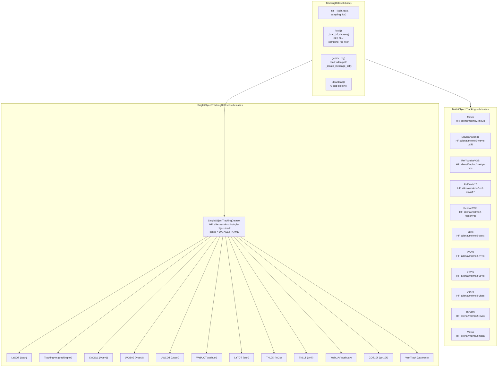
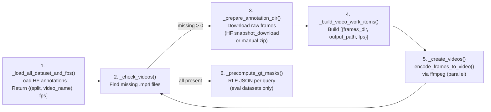
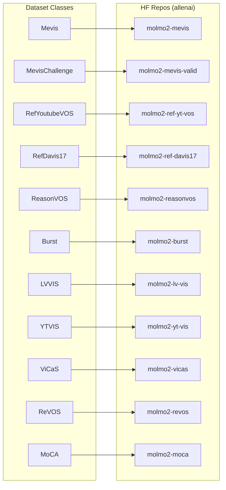

<!-- source: DeepWiki mcp.deepwiki.com · repo allenai/molmo2 · extra page Video Tracking Datasets · fetched 2026-10-26 -->

# Video Tracking Datasets

<details>
<summary>Relevant source files</summary>

The following files were used as context for generating this wiki page:

- [olmo/data/academic_video_track_datasets.py](olmo/data/academic_video_track_datasets.py)

</details>


This page documents the video object tracking dataset classes defined in [olmo/data/academic_video_track_datasets.py](). These classes feed tracking supervision into the Stage 2 SFT training mixture and the tracking evaluation groups. For general video understanding datasets (MVBench, VideoMME, etc.), see [Video Datasets](#5.3.3). For the dataset factory that resolves names to classes, see [Dataset Catalog](#5.3).

---

## Overview

All tracking dataset classes share a common abstract base: `TrackingDataset`. Each instance represents one split of one dataset under one *task type*. Annotations are served from Hugging Face Hub repos under the `allenai/` organization; raw video frames are stored locally and re-encoded to H.264 `.mp4` files using `ffmpeg` before training.

There are two families of datasets:

| Family | Base Class | HF Repo Pattern | Tasks |
|---|---|---|---|
| Multi-object tracking (MOT) | `TrackingDataset` | `allenai/molmo2-{dataset}` (config = task) | `track`, `ground`, `single_point_track` |
| Single-object tracking (SOT) | `SingleObjectTrackingDataset` | `allenai/molmo2-single-object-track` (config = dataset name) | `single_point_track` |

### Task Types

The three task types are enumerated in `TRACKING_TASKS` [olmo/data/academic_video_track_datasets.py:82]():

| Task | Value | Style string | Description |
|---|---|---|---|
| `track` | `"track"` | `video_point_track_per_frame` | Given a text expression, output per-frame point trajectories for all matching objects |
| `ground` | `"ground"` | `video_point_ground_start_end` | Ground the expression at the start and end frames only |
| `single_point_track` | `"single_point_track"` | `video_single_point_track_per_frame` | Given one starting point, track the single object across all frames |

The style string is consumed downstream by the `DataFormatter` to select the appropriate prompt template.

---

## Directory Layout

All tracking data lives under `VIDEO_TRACK_DATA_HOME`, which is derived from `VIDEO_DATA_HOME` [olmo/data/academic_video_track_datasets.py:80]():

```
VIDEO_TRACK_DATA_HOME/
├── MeViS/
│   ├── MeViS_release/
│   │   ├── train/JPEGImages/{video_id}/*.jpg
│   │   └── valid_u/JPEGImages/{video_id}/*.jpg
│   └── valid_u/
│       ├── videos/{video_id}.mp4          # encoded by download()
│       └── MasksRLE/{video_id}/{qid}.json # precomputed GT masks
├── Ref-YT-VOS/
│   └── valid/
│       ├── JPEGImages/{video_id}/*.jpg
│       ├── videos/{video_id}.mp4
│       └── MasksRLE/{video_id}/{qid}.json
├── LaSOT/
│   └── annotation/{class}-{idx}/img/*.jpg
│       videos/train/{video_id}.mp4
└── tracking/                              # HF annotation cache
    ├── mevis/track/train/
    ├── mevis/ground/train/
    ├── lasot/single_point_track/train/
    └── ...
```

Sources: [olmo/data/academic_video_track_datasets.py:1-51]()

---

## `TrackingDataset` Base Class

**Class definition:** [olmo/data/academic_video_track_datasets.py:226-546]()

`TrackingDataset` extends `Dataset` and provides the full download pipeline, HF annotation loading, FPS filtering, and `get()` interface. Subclasses typically only need to set class-level attributes and override a handful of classmethods.

### Class-level Attributes

| Attribute | Type | Description |
|---|---|---|
| `HF_SOURCE` | `str` | Hugging Face dataset repo ID |
| `DATASET_NAME` | `str` | Short identifier used for local cache directories |
| `VIDEO_HOME` | `str` | Root directory for raw frames of this dataset |
| `LOCAL_DIR` | `str` | Root for HF annotation cache (`tracking/`) |
| `VIDEO_FPS` | `int` | Default FPS fallback (most datasets use 6) |
| `TASKS` | `list[str]` | Supported task types from `TRACKING_TASKS` |
| `SPLIT_MAP` | `dict` | Maps logical split names (`train`, `validation`, `test`) to HF split names |

### Instance Attributes (set in `__init__`)

[olmo/data/academic_video_track_datasets.py:408-420]()

| Attribute | Description |
|---|---|
| `self.split` | Logical split name |
| `self.task` | Task type string |
| `self.sampling_fps` | Optional FPS filter; `None` accepts all |
| `self.use_fps_sampling` | Whether to use per-example candidate FPS sampling |
| `self.is_eval` | `True` if split is not `"train"` |
| `self.data_split` | Actual HF split name (via `SPLIT_MAP`) |
| `self.video_dir` | Directory where encoded `.mp4` files are stored |
| `self.data` | Loaded HF `Dataset` object |
| `self.data_lookup` | `dict[example_id -> index]` for `get_by_example_id()` |

### Data Flow Diagram

**Diagram: `TrackingDataset` class hierarchy and data flow**



Sources: [olmo/data/academic_video_track_datasets.py:226-548](), [olmo/data/academic_video_track_datasets.py:1489-2057]()

---

## Download Pipeline

The `download()` classmethod implements a 6-step pipeline. Subclasses override individual steps without replacing the whole flow.

**Diagram: `download()` 6-step pipeline**



Sources: [olmo/data/academic_video_track_datasets.py:384-406]()

### Frame-to-Video Encoding

`encode_frames_to_video()` [olmo/data/academic_video_track_datasets.py:117-181]() converts a directory of image frames to H.264 `.mp4` using `ffmpeg`. Key behaviors:

- **Native FPS subsampling**: when `native_fps != fps`, it keeps every `round(native_fps / fps)`-th frame.
- **Temporal slicing**: optional `start_frame`/`end_frame` (inclusive, 0-based, after subsampling).
- **Codec**: `libopenh264`, `4M` bitrate, `yuv420p` pixel format, `+faststart` flag.
- Uses an `ffmpeg` concat demuxer file list (written to `{output_path}.filelist.txt`, cleaned up after).

`_create_videos()` [olmo/data/academic_video_track_datasets.py:291-314]() runs encoding in parallel using `multiprocessing.Pool` with `_encode_frames_to_video_worker` as the pool target.

The global constant `MAX_VIDEO_FPS = 10` [olmo/data/academic_video_track_datasets.py:78]() caps the candidate sampling FPS list produced by `get_candidate_sampling_fps()`.

### GT Mask Precomputation

For evaluation splits, several datasets precompute GT masks as COCO RLE JSON files. Each dataset's `_precompute_gt_masks_for_split()` reads PNG annotations, encodes them with `pycocotools.mask.encode()`, and saves one JSON file per query:

```
{VIDEO_HOME}/{data_split}/MasksRLE/{video_id}/{query_id}.json
```

The JSON maps `mask_idx -> list[RLE | None]` (one entry per video frame).

These files are loaded at eval time inside the dataset's overridden `get()` method and placed in `item['metadata']['masks']`.

Sources: [olmo/data/academic_video_track_datasets.py:363-406](), [olmo/data/academic_video_track_datasets.py:117-181]()

---

## `get()` Return Value

`TrackingDataset.get(idx, rng)` [olmo/data/academic_video_track_datasets.py:509-539]() returns a dict with these fields:

| Key | Type | Description |
|---|---|---|
| `video` | `str` | Absolute path to the encoded `.mp4` |
| `message_list` | `list[dict]` | Single-element list; the dict carries `style`, `label`, `sampling_fps`, `width`, `height`, and optionally `points` |
| `sampling_fps` | `int` | Per-example annotation FPS |
| `metadata` | `dict` | `example_id`, `task`, `expression`, `w`, `h`, `video_fps`, `video`, and for eval: `masks`, `mask_id`, `points`, `sampler_overrides` |

The `message_list[0]['points']` field is a list of `PointTrack` objects (one per sampled frame), each containing a `frame` index, `time` in seconds, and a `points` dict mapping object index to `{'point': [x, y], 'occluded': bool}`.

The `sampler_overrides` dict instructs the video preprocessor to use `frame_sample_mode='fps'` and provides `candidate_sampling_fps` and `min_fps`.

Sources: [olmo/data/academic_video_track_datasets.py:472-539]()

---

## FPS Filtering

During `load()` [olmo/data/academic_video_track_datasets.py:422-447](), the dataset applies up to three FPS filters:

1. **`use_fps_sampling`**: keeps only rows where `_get_candidate_fps(row['fps'])` succeeds without raising `ValueError`. This discards videos whose native FPS cannot be cleanly subsampled.
2. **Divisibility check**: rows where `fps % sampling_fps != 0` are dropped.
3. **`sampling_fps` pin**: if `self.sampling_fps` is set, only rows with an exact `sampling_fps` match are kept.

`get_candidate_sampling_fps(video_fps, sampling_fps, max_fps=10)` [olmo/data/academic_video_track_datasets.py:211-223]() returns all multiples of `sampling_fps` that (a) divide `video_fps` evenly and (b) are ≤ `max_fps`.

---

## HF Annotation Loading

`_load_hf_dataset()` [olmo/data/academic_video_track_datasets.py:93-107]() is the shared loading helper:

1. If a local cache directory exists and `overwrite_cache=False`, it calls `datasets.load_from_disk()`.
2. Otherwise it calls `datasets.load_dataset(hf_source, config, split=split)`.
3. Saves to disk if a local directory is specified.

MOT datasets pass `task` as the HF config name. SOT datasets override `_get_hf_config()` to return `DATASET_NAME` instead [olmo/data/academic_video_track_datasets.py:1499-1501]().

Local cache paths follow the pattern `tracking/{dataset_name}/{task}/{split}/` [olmo/data/academic_video_track_datasets.py:248-251]().

---

## Dataset Reference

### Multi-Object Tracking (MOT) Datasets

**Diagram: MOT datasets — class name to HF source and supported tasks**



| Class | `DATASET_NAME` | `VIDEO_FPS` | Tasks | Splits | GT Masks | Download Method |
|---|---|---|---|---|---|---|
| `Mevis` | `mevis` | 6 | track, ground, spt | train / valid_u | `valid_u` | HF `FudanCVL/MeViS` → zip → tar |
| `MevisChallenge` | `mevis-valid` | 6 | track | test (valid) | None | Same as Mevis (`valid` only) |
| `RefYoutubeVOS` | `ref-yt-vos` | 6 | track | train / valid | `valid` | Manual zip (Codalab) |
| `RefDavis17` | `ref-davis17` | 6 | track | train / valid | `valid` | Auto-download DAVIS 2017 zip |
| `ReasonVOS` | `reasonvos` | — | track | test | `test` | Google Drive zip |
| `Burst` | `burst` | 6 | track, ground, spt | train | — | HF `chengyenhsieh/TAO-Amodal` |
| `LVVIS` | `lv-vis` | 4 | track, ground, spt | train | — | Google Drive zip |
| `YTVIS` | `yt-vis` | — | track | train | — | Manual zip (Codalab) |
| `ViCaS` | `vicas` | 6 | track, ground, spt | train | — | HF `kumuji/ViCaS` |
| `ReVOS` | `revos` | 6 | track, ground, spt | train | — | Manual OneDrive zip |
| `MoCA` | `moca` | — | track, ground | train | — | Auto-download MoCA.zip |

*spt = single_point_track*

Sources: [olmo/data/academic_video_track_datasets.py:553-1484]()

### Single-Object Tracking (SOT) Datasets

`SingleObjectTrackingDataset` [olmo/data/academic_video_track_datasets.py:1489-1501]() overrides `_get_hf_config()` so that all SOT subclasses load from `allenai/molmo2-single-object-track` with `config=DATASET_NAME`. All SOT datasets support only the `single_point_track` task and only the `train` split.

| Class | `DATASET_NAME` | Download Source | Notes |
|---|---|---|---|
| `LVOSv1` | `lvosv1` | Google Drive | Frame dir: `{split}/JPEGImages/{video}` |
| `LVOSv2` | `lvosv2` | Google Drive | Frame dir: `{split}/JPEGImages/{video}` |
| `LaSOT` | `lasot` | HF `l-lt/LaSOT` | Per-class zips; frames at `annotation/{video}/img/` |
| `TrackingNet` | `trackingnet` | HF `SilvioGiancola/TrackingNet` | 12 chunks (~90 GB each); per-video zips inside chunks |
| `UWCOT` | `uwcot` | Google Drive | Videos already decoded; no frame→mp4 encoding needed |
| `WebUOT` | `webuot` | Google Drive | Videos already decoded |
| `LaTOT` | `latot` | Google Drive (manual, 2 parts) | Frames at `LaTOT/{video}/img/` |
| `TNL2K` | `tnl2k` | OneDrive (manual, 14 parts) | Frames at `{video}/imgs/` |
| `TNLLT` | `tnnlt` | Dropbox (manual, multi-part tar) | Frames at `frames/{video}/imgs/` |
| `WebUAV` | `webuav` | Access request form (manual) | Frames at `Train/{video}/img/` |
| `GOT10k` | `got10k` | Registration required (manual) | Frames at `train/{video}/` |
| `VastTrack` | `vasttrack` | OneDrive (manual, 82 parts) | Frames at `train/{category}/{video}/imgs/` |

Sources: [olmo/data/academic_video_track_datasets.py:1489-2057]()

---

## Special Download Behaviors

Several datasets deviate from the generic 6-step pipeline and fully override `download()`:

### `Burst`
[olmo/data/academic_video_track_datasets.py:1141-1196]()

Fetches the TAO-Amodal dataset from HF (`chengyenhsieh/TAO-Amodal`), unzips per-source archives (`ArgoVerse`, `AVA`, `BDD`, `Charades`, `HACS`, `LaSOT`, `YFCC100M`), and downloads a `video_original_fps.json` sidecar file. Re-encodes with `native_fps` subsampling to reach the annotation FPS.

### `ViCaS`
[olmo/data/academic_video_track_datasets.py:1329-1385]()

Downloads videos from HF (`kumuji/ViCaS`), decodes them to JPEG frames using `extract_frames()`, then re-encodes at 6 FPS with `native_fps` subsampling. This intermediate decode-to-frames step ensures consistent FPS across the dataset.

### `TrackingNet`
[olmo/data/academic_video_track_datasets.py:1967-2057]()

Provides a `chunks` parameter to download specific subsets of the 12 training chunks (each ~90 GB). Each chunk contains per-video zip archives that are extracted into `{chunk}/frames/{video_name}/`. The download can be called with `chunks=[0, 3, 7]` to fetch only specific chunks.

### Datasets Requiring Manual Download

The following datasets cannot be automatically downloaded and raise `RuntimeError` if the expected directory is missing:

- `RefYoutubeVOS` — requires Codalab competition participation
- `YTVIS` — requires Codalab competition participation  
- `ReVOS` — OneDrive link, access request needed
- `LaTOT` — Google Drive, two-part archive
- `TNL2K` — OneDrive, 14-part archive
- `TNLLT` — Dropbox, multi-part tar
- `WebUAV` — access request form
- `GOT10k` — account registration at aitestunion.com
- `VastTrack` — OneDrive, 82-part archive

Sources: [olmo/data/academic_video_track_datasets.py:769-772](), [olmo/data/academic_video_track_datasets.py:1256-1259](), [olmo/data/academic_video_track_datasets.py:1398-1402]()

---

## Running the Module Directly

The module has a `__main__` block [olmo/data/academic_video_track_datasets.py:2059-2098]() that allows downloading or loading any dataset from the command line:

```
python -m olmo.data.academic_video_track_datasets \
    --dataset mevis \
    --download \
    --split train \
    --tasks track ground \
    --n_procs 8
```

Without `--download`, it loads only the HF annotations (downloading from HF if not cached) and iterates through the dataset to verify all video files exist.

The dataset registry is built by discovering all `TrackingDataset` subclasses with a non-`None` `DATASET_NAME` [olmo/data/academic_video_track_datasets.py:2077-2079]().

---

## Supporting Utilities

| Function | Location | Purpose |
|---|---|---|
| `encode_frames_to_video()` | [olmo/data/academic_video_track_datasets.py:117-181]() | Core ffmpeg encoding; used in all download pipelines |
| `extract_frames()` | [olmo/data/academic_video_track_datasets.py:192-200]() | Decode video → JPEG frames (used by ViCaS) |
| `get_image_files()` | [olmo/data/academic_video_track_datasets.py:109-115]() | Sorted list of jpg/jpeg/png/gif files in a directory |
| `get_candidate_sampling_fps()` | [olmo/data/academic_video_track_datasets.py:211-223]() | Compute valid subsampled FPS values |
| `_load_hf_dataset()` | [olmo/data/academic_video_track_datasets.py:93-107]() | Load HF dataset with local disk cache |
| `_encode_frames_to_video_worker()` | [olmo/data/academic_video_track_datasets.py:183-190]() | `multiprocessing.Pool` worker wrapper |
| `_extract_frames_worker()` | [olmo/data/academic_video_track_datasets.py:202-209]() | `multiprocessing.Pool` worker wrapper |

Sources: [olmo/data/academic_video_track_datasets.py:93-223]()

---

