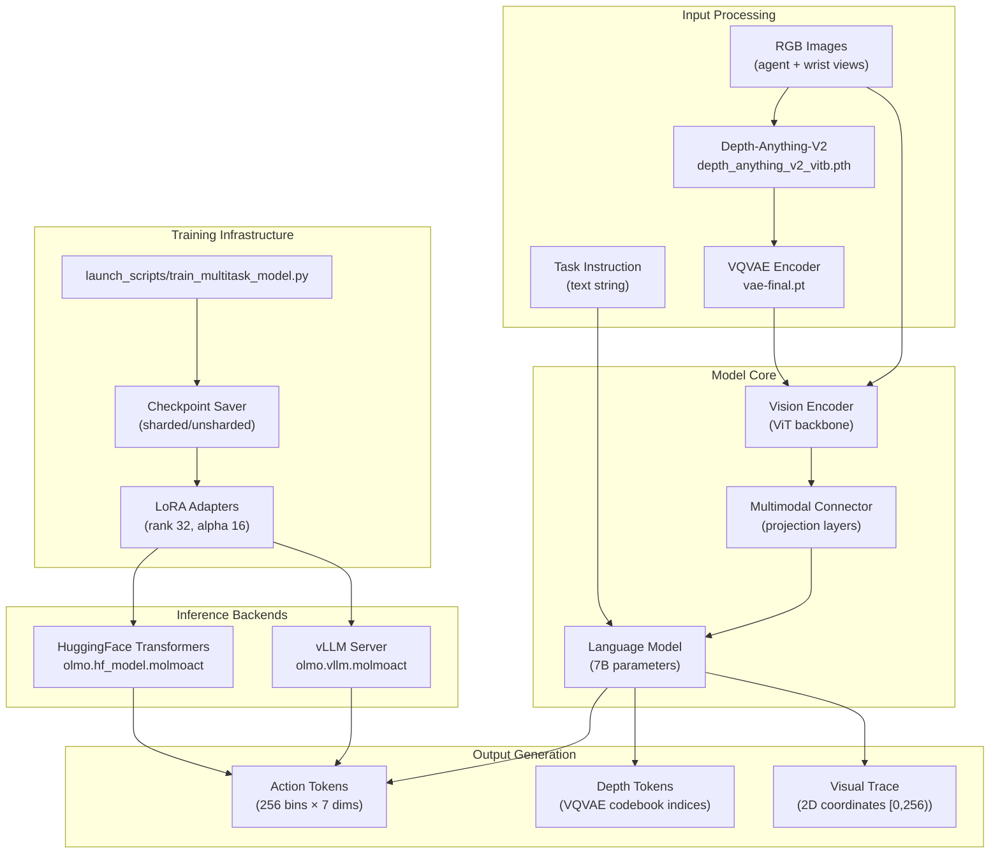
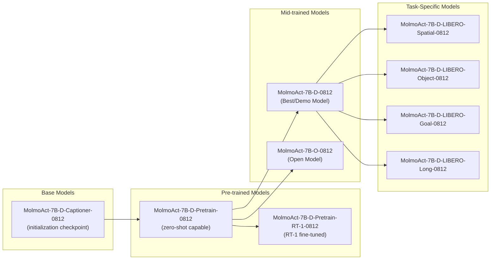
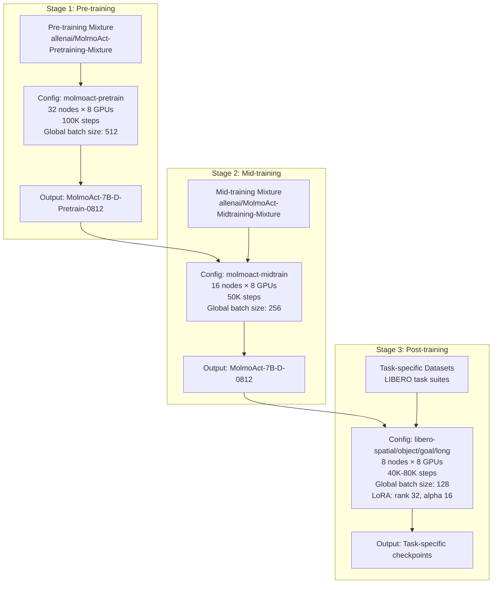
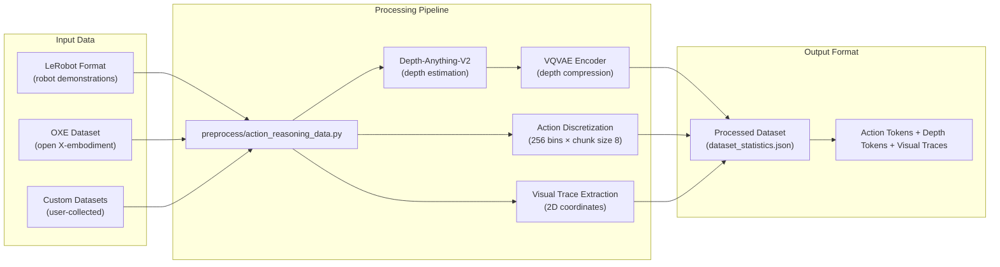
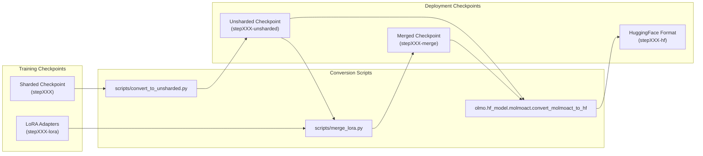

<!-- source: DeepWiki mcp.deepwiki.com · repo allenai/molmoact · page 1 MolmoAct Overview · fetched 2026-10-26 -->

# MolmoAct Overview

<details>
<summary>Relevant source files</summary>

The following files were used as context for generating this wiki page:

- [LICENSE](LICENSE)
- [README.md](README.md)
- [assets/molmoact_logo.svg](assets/molmoact_logo.svg)

</details>


## Purpose and Scope

This document provides a high-level introduction to the MolmoAct system: an open-source Action Reasoning Model designed for robot learning applications. It covers the system's core capabilities, architectural components, training methodology, and deployment options. For detailed installation instructions, see [Getting Started](#1.1). For comprehensive training procedures, see [Training Pipeline](#2). For evaluation procedures, see [Evaluation Pipelines](#5).

**Sources:** [README.md:1-70]()

---

## What is MolmoAct?

MolmoAct is a multimodal 7B-parameter language model that extends vision-language capabilities to robotic action prediction and spatial reasoning. Unlike traditional vision-language models that output text descriptions, MolmoAct generates three distinct modalities:

1. **Robot Actions**: Discretized end-effector commands (position, orientation, gripper state)
2. **Depth Tokens**: Compressed depth map representations via VQVAE encoding
3. **Visual Traces**: 2D coordinate sequences representing spatial reasoning paths

The model is trained on a mixture of robot demonstration datasets, web-based multimodal data, and procedurally generated manipulation tasks. It supports both zero-shot deployment and task-specific fine-tuning using Low-Rank Adaptation (LoRA).

**Sources:** [README.md:68-70](), [README.md:254-263]()

---

## Core Capabilities

### Action Reasoning

MolmoAct formulates robot control as an action reasoning task. Given input images and task instructions, the model predicts discrete action tokens representing:

- **End-effector position**: 3D coordinates discretized into 256 bins
- **End-effector orientation**: Euler angles or quaternion representations
- **Gripper state**: Open/close commands
- **Action chunks**: Sequences of 8 consecutive actions for temporal coherence

**Sources:** [README.md:146-159]()

### Spatial Understanding

The model maintains spatial awareness through:

- **Depth estimation**: Uses Depth-Anything-V2 for generating depth maps from RGB images
- **VQVAE compression**: Encodes depth maps into discrete tokens using a trained vector-quantized variational autoencoder
- **Visual traces**: Outputs 2D coordinate sequences (bounded [0, 256)) that visualize reasoning paths

**Sources:** [README.md:122-143](), [README.md:254-263]()

### Multi-Image Context

MolmoAct processes up to two images per forward pass (`--max_images 2`), enabling:

- Allocentric (third-person) and egocentric (wrist-mounted) camera views
- Temporal context from sequential observations
- Multi-view spatial reasoning

**Sources:** [README.md:399](), [README.md:433]()

---

## System Architecture

The following diagram illustrates MolmoAct's end-to-end architecture, connecting high-level concepts to code entities:



**Architecture Components:**

| Component | Code Location | Purpose |
|-----------|---------------|---------|
| Depth Estimation | `depth_anything_v2_vitb.pth` | Generates depth maps from RGB images |
| VQVAE Encoder | `vae-final.pt` | Compresses depth maps into discrete tokens |
| Vision Encoder | Model backbone (ViT) | Extracts visual features from images |
| Multimodal Connector | Projection layers | Maps vision features to LLM embedding space |
| Language Model | 7B parameter transformer | Generates action tokens, depth tokens, and traces |
| Training Script | `launch_scripts/train_multitask_model.py` | Orchestrates multi-stage training |
| LoRA Adapters | `--lora_enable` flag | Enables parameter-efficient fine-tuning |
| HF Inference | `olmo.hf_model.molmoact` | Standard inference using HuggingFace Transformers |
| vLLM Inference | `olmo.vllm.molmoact` | Optimized inference using vLLM backend |

**Sources:** [README.md:122-143](), [README.md:165-187](), [README.md:203-213]()

---

## Model Variants

MolmoAct provides four primary model checkpoints, each serving different use cases:



### Model Characteristics

| Model | Use Case | Training Data | Parameters | Fine-tuning |
|-------|----------|---------------|------------|-------------|
| `MolmoAct-7B-D-0812` | Fine-tuning base | 10K robot episodes (mid-training) | 7B | Recommended |
| `MolmoAct-7B-O-0812` | Open alternative | Same as 7B-D | 7B | Recommended |
| `MolmoAct-7B-D-Pretrain-0812` | Zero-shot inference | Pre-training mixture | 7B | Not needed for SimplerEnv |
| `MolmoAct-7B-D-Pretrain-RT-1-0812` | RT-1 tasks | Pre-training + RT-1 subset | 7B | Not needed for SimplerEnv |

**Sources:** [README.md:84-92]()

---

## Training Pipeline Overview

MolmoAct employs a three-stage training methodology with decreasing computational requirements:



### Training Script Invocation

All training stages use the unified script `launch_scripts/train_multitask_model.py` with stage-specific configurations:

**Pre-training:**
```bash
torchrun --nnodes=32 --nproc-per-node=8 \
    launch_scripts/train_multitask_model.py \
    molmoact-pretrain allenai/MolmoAct-7B-D-Captioner-0812
```

**Mid-training:**
```bash
torchrun --nnodes=16 --nproc-per-node=8 \
    launch_scripts/train_multitask_model.py \
    molmoact-midtrain allenai/MolmoAct-7B-D-Pretrain-0812
```

**Post-training (Fine-tuning):**
```bash
torchrun --nnodes=8 --nproc-per-node=8 \
    launch_scripts/train_multitask_model.py \
    libero-spatial allenai/MolmoAct-7B-D-0812 --lora_enable
```

**Sources:** [README.md:329-351](), [README.md:380-401](), [README.md:413-436]()

---

## Data Processing Pipeline

MolmoAct's data processing converts standard robot demonstration datasets into Action Reasoning Data format:



### Processing Configuration

| Parameter | Flag | Default | Purpose |
|-----------|------|---------|---------|
| Depth encoder | `--depth-encoder` | `vitb` | Depth-Anything-V2 model size |
| Action bins | `--action-bins` | 256 | Discretization resolution |
| Action chunk size | `--action-chunk-size` | 8 | Temporal action grouping |
| Line length | `--line-length` | 5 | Visual trace line segments |
| Process actions | `--process-actions` | - | Enable action discretization |

### Processing Script Invocation

```bash
export DEPTH_CHECKPOINT_DIR="<path/to/Depth-Anything-V2/checkpoints>"
export VQVAE_MODEL_PATH="<path/to/vqvae.pt>"

python preprocess/action_reasoning_data.py \
    --dataset-path <lerobot/repo_id> \
    --output-path <path/to/processed_dataset> \
    --depth-encoder vitb \
    --line-length 5 \
    --process-actions \
    --action-bins 256 \
    --action-chunk-size 8
```

**Sources:** [README.md:116-159]()

---

## Inference and Deployment

MolmoAct supports two inference backends with different performance characteristics:

### HuggingFace Transformers Backend

Located in `olmo/hf_model/molmoact/`, this backend provides:

- Standard HuggingFace API compatibility
- Easy integration with existing workflows
- Reference implementation for correctness

**Test script:** `olmo/hf_model/molmoact/test_molmoact.py`

```bash
python3 olmo/hf_model/molmoact/test_molmoact.py \
    --checkpoint_dir /path/to/checkpoint-hf \
    --images /path/to/img1 /path/to/img2 \
    --instruction "task instruction" \
    --unnorm_key unnorm_key
```

### vLLM Backend

Located in `olmo/vllm/molmoact/`, this backend provides:

- Optimized inference using vLLM 0.8.5
- Higher throughput for evaluation tasks
- PagedAttention memory optimization

**Test script:** `olmo/vllm/molmoact/test_molmoact.py`

```bash
python3 -m olmo.vllm.molmoact.test_molmoact \
    --checkpoint_dir /path/to/checkpoint-hf \
    --images /path/to/img1 /path/to/img2 \
    --instruction "task instruction" \
    --unnorm_key unnorm_key
```

**Sources:** [README.md:203-250]()

### Checkpoint Conversion Workflow



**Conversion commands:**

1. **Unshard checkpoint** (for full fine-tuning):
```bash
python3 -m scripts.convert_to_unsharded \
    --checkpoint_dir /path/to/stepXXX \
    --output_dir /path/to/stepXXX-unsharded
```

2. **Merge LoRA adapters** (for LoRA fine-tuning):
```bash
python3 -m scripts.merge_lora \
    --base_dir /path/to/base_model \
    --lora_dir /path/to/stepXXX-lora \
    --output_dir /path/to/stepXXX-merge
```

3. **Convert to HuggingFace format**:
```bash
python3 -m olmo.hf_model.molmoact.convert_molmoact_to_hf \
    --checkpoint_dir /path/to/stepXXX-merge \
    --output_dir /path/to/stepXXX-hf \
    --style demo \
    --norm_stats_path /path/to/dataset_statistics.json
```

**Sources:** [README.md:191-223]()

---

## Key Components and Code Organization

### Training Components

| Component | Location | Description |
|-----------|----------|-------------|
| Main training script | `launch_scripts/train_multitask_model.py` | Orchestrates multi-stage training with PyTorch DDP |
| Robot datasets | `olmo/data/robot_datasets.py` | Dataset classes for robot demonstrations |
| Data downloaders | `scripts/download_robot_data.py`, `scripts/download_data.py` | Fetch datasets from HuggingFace Hub |
| Checkpoint conversion | `scripts/convert_to_unsharded.py` | Converts sharded to unsharded checkpoints |
| LoRA merging | `scripts/merge_lora.py` | Merges LoRA adapters with base model |

### Inference Components

| Component | Location | Description |
|-----------|----------|-------------|
| HF model wrapper | `olmo/hf_model/molmoact/` | HuggingFace Transformers integration |
| vLLM wrapper | `olmo/vllm/molmoact/` | vLLM backend integration |
| HF conversion | `olmo/hf_model/molmoact/convert_molmoact_to_hf` | Converts native checkpoints to HF format |
| Test scripts | `olmo/hf_model/molmoact/test_molmoact.py`, `olmo/vllm/molmoact/test_molmoact.py` | Example inference code |

### Preprocessing Components

| Component | Location | Description |
|-----------|----------|-------------|
| Action reasoning processor | `preprocess/action_reasoning_data.py` | Converts robot data to Action Reasoning format |
| Depth reconstruction | `scripts/reconstruct_from_tokens.py` | Visualizes depth from VQVAE tokens |

### Evaluation Components

| Component | Location | Description |
|-----------|----------|-------------|
| SimplerEnv evaluation | External: `allenai/SimplerEnv` | Google Robot task evaluation |
| SteerSimplerEnv | `molmoact/SteerSimplerEnv/` | Interactive evaluation with human steering |
| LIBERO evaluation | `experiments/libero/` | LIBERO benchmark evaluation scripts |

**Sources:** [README.md:1-579]()

---

## Environment Variables

MolmoAct uses several environment variables for configuration:

| Variable | Purpose | Example |
|----------|---------|---------|
| `MOLMOACT_DATA_DIR` | Root directory for auxiliary data assets | `/data/molmoact` |
| `HF_HOME` | HuggingFace cache location | `/data/molmoact/huggingface` |
| `DEPTH_CHECKPOINT_DIR` | Depth-Anything-V2 checkpoint location | `/path/to/Depth-Anything-V2/checkpoints` |
| `VQVAE_MODEL_PATH` | VQVAE model checkpoint path | `/path/to/vae-final.pt` |
| `HF_DATASETS_OFFLINE` | Prevents HF API calls during training | `1` (recommended for multi-node) |
| `WANDB_API_KEY` | Weights & Biases API key for logging | `<your_api_key>` |
| `WANDB_MODE` | W&B logging mode | `offline` or `online` |
| `VLLM_WORKER_MULTIPROC_METHOD` | vLLM worker spawning method | `spawn` |

**Sources:** [README.md:269-327]()

---

## Hardware Requirements

### Training Requirements

| Stage | Nodes | GPUs per Node | Total GPUs | GPU Type | Duration |
|-------|-------|---------------|------------|----------|----------|
| Pre-training | 32 | 8 | 256 | A100/H100 | 100K steps |
| Mid-training | 16 | 8 | 128 | A100/H100 | 50K steps |
| Post-training | 8 | 8 | 64 | A100/H100 | 40K-80K steps |

**GPU Architecture:** Requires NVIDIA GPUs with compute capability 8.0 (Ampere) or 9.0 (Hopper) for flash-attention and grouped-gemm support.

**Interconnect:** InfiniBand recommended for multi-node training (configured via MLNX OFED drivers in Docker environment).

### Inference Requirements

- **HuggingFace backend:** Single GPU (A100/H100 recommended)
- **vLLM backend:** Single GPU with PagedAttention support
- **Memory:** ~14GB VRAM for inference with batch size 1

**Sources:** README.md, Dockerfile analysis

---

## License

MolmoAct is released under the **Apache License 2.0**, permitting use, modification, and distribution for research and educational purposes. See [License Information](#10.1) for details.

**Sources:** [LICENSE:1-201](), [README.md:541-545]()

---

