<!-- source: DeepWiki mcp.deepwiki.com · repo allenai/molmoact · page 1.2 Repository Structure · fetched 2026-10-26 -->

# Repository Structure

<details>
<summary>Relevant source files</summary>

The following files were used as context for generating this wiki page:

- [.gitignore](.gitignore)
- [README.md](README.md)

</details>


This document describes the organization of the MolmoAct codebase, mapping major system components to their locations in the repository. For installation and setup instructions, see [Getting Started](#1.1). For training pipeline details, see [Training Pipeline](#2).

---

## Overview

The MolmoAct repository is organized into several major subsystems:

- **Core training code** (`olmo/`) - PyTorch model definitions, data loaders, training loops
- **Scripts** (`scripts/`, `launch_scripts/`) - Data processing, model conversion, and training launch utilities
- **Evaluation frameworks** (`experiments/`) - LIBERO benchmark and evaluation scripts
- **Interactive evaluation** (`molmoact/SteerSimplerEnv/`) - Human-in-the-loop evaluation extension
- **Preprocessing** (`preprocess/`) - Action reasoning data transformation pipeline
- **Deployment** (`Dockerfile`, `.dockerignore`) - Containerization for reproducible environments

Sources: [README.md:1-579](), [.gitignore:1-78]()

---

## Top-Level Directory Structure

```mermaid
graph TB
    ROOT["Repository Root<br/>(molmoact)"]
    
    subgraph "Core Code Package"
        OLMO["olmo/<br/>Main Python Package"]
        OLMO_DATA["olmo/data/<br/>Dataset Classes"]
        OLMO_HF["olmo/hf_model/molmoact/<br/>HuggingFace Integration"]
        OLMO_VLLM["olmo/vllm/molmoact/<br/>vLLM Integration"]
    end
    
    subgraph "Scripts & Utilities"
        SCRIPTS["scripts/<br/>Utility Scripts"]
        LAUNCH["launch_scripts/<br/>Training Launch Scripts"]
        PREPROCESS["preprocess/<br/>Data Processing"]
    end
    
    subgraph "Evaluation Systems"
        EXPERIMENTS["experiments/<br/>Evaluation Frameworks"]
        LIBERO_PKG["experiments/LIBERO/<br/>LIBERO Benchmark Package"]
        LIBERO_EVAL["experiments/libero/<br/>LIBERO Evaluation Scripts"]
        STEER["molmoact/SteerSimplerEnv/<br/>Interactive Evaluation"]
    end
    
    subgraph "Configuration & Assets"
        DOCKER["Dockerfile<br/>Container Definition"]
        PYPROJECT["pyproject.toml<br/>Package Metadata"]
        ASSETS["assets/<br/>Visual Assets"]
        HARDWARE["Midtraining_camera_mount.stl<br/>Hardware Designs"]
    end
    
    ROOT --> OLMO
    OLMO --> OLMO_DATA
    OLMO --> OLMO_HF
    OLMO --> OLMO_VLLM
    
    ROOT --> SCRIPTS
    ROOT --> LAUNCH
    ROOT --> PREPROCESS
    
    ROOT --> EXPERIMENTS
    EXPERIMENTS --> LIBERO_PKG
    EXPERIMENTS --> LIBERO_EVAL
    ROOT --> STEER
    
    ROOT --> DOCKER
    ROOT --> PYPROJECT
    ROOT --> ASSETS
    ROOT --> HARDWARE
```

**Top-Level Directory Mapping**

| Directory/File | Purpose |
|---|---|
| `olmo/` | Core training code, models, data loaders |
| `scripts/` | Data download, model conversion, visualization |
| `launch_scripts/` | Multi-node training orchestration |
| `preprocess/` | Action reasoning data preprocessing |
| `experiments/LIBERO/` | LIBERO benchmark framework (standalone) |
| `experiments/libero/` | LIBERO evaluation scripts for MolmoAct |
| `molmoact/SteerSimplerEnv/` | Interactive evaluation extension |
| `Dockerfile` | Multi-stage container build |
| `pyproject.toml` | Package dependencies and metadata |
| `assets/` | Logos, visual resources |
| `.gitignore` | Build artifacts, runs, checkpoints exclusion |

Sources: [README.md:39-65](), [.gitignore:1-78]()

---

## Core Package (`olmo/`)

The `olmo/` directory contains the main Python package with model implementations, training infrastructure, and data processing.

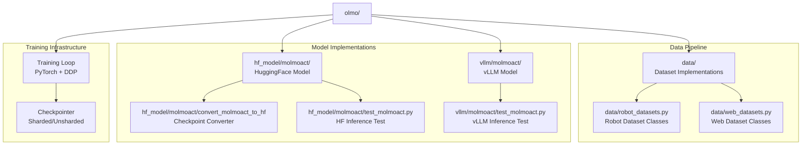

**Key Code Entities**

| Path | Description |
|---|---|
| `olmo/data/robot_datasets.py` | Robot dataset classes (e.g., `MolmoActDatasetHomePrimary`) |
| `olmo/data/web_datasets.py` | Web dataset classes (e.g., `ChartQa`, `Pixmo`) |
| `olmo/hf_model/molmoact/convert_molmoact_to_hf` | Converts training checkpoints to HuggingFace format |
| `olmo/hf_model/molmoact/test_molmoact.py` | Example inference script using HF Transformers |
| `olmo/vllm/molmoact/test_molmoact.py` | Example inference script using vLLM backend |

Sources: [README.md:206-248](), [README.md:299-301]()

---

## Scripts Directory

### Data Management Scripts (`scripts/`)

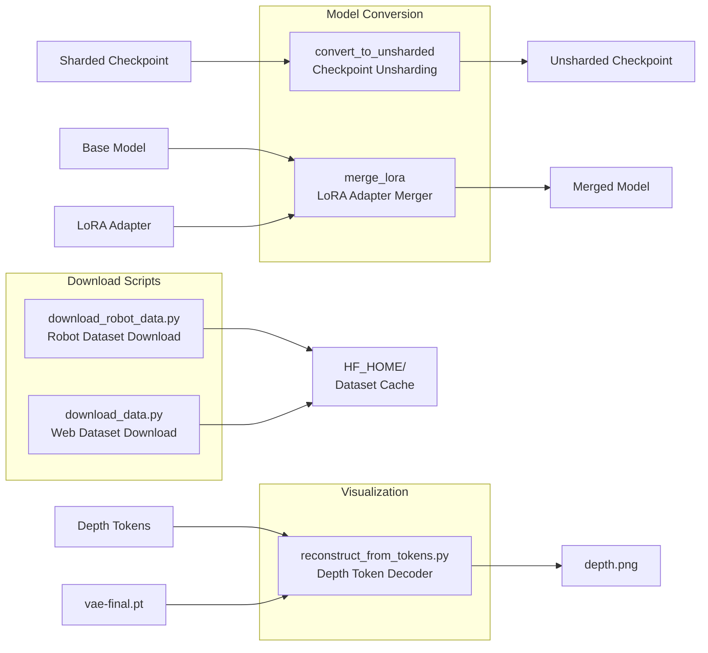

**Script Purposes**

| Script | Command | Purpose |
|---|---|---|
| `download_robot_data.py` | `python scripts/download_robot_data.py all` | Download robot datasets (OXE, BC-Z, RT-1, MolmoAct) |
| `download_data.py` | `python scripts/download_data.py all` | Download web datasets (Pixmo, ChartQA, etc.) |
| `merge_lora` | `python -m scripts.merge_lora` | Merge LoRA adapters with base model weights |
| `convert_to_unsharded` | `python -m scripts.convert_to_unsharded` | Convert sharded checkpoints to unsharded format |
| `reconstruct_from_tokens.py` | `python scripts/reconstruct_from_tokens.py` | Visualize depth maps from predicted tokens |

Sources: [README.md:282-326](), [README.md:191-222](), [README.md:254-261]()

---

### Training Launch Scripts (`launch_scripts/`)

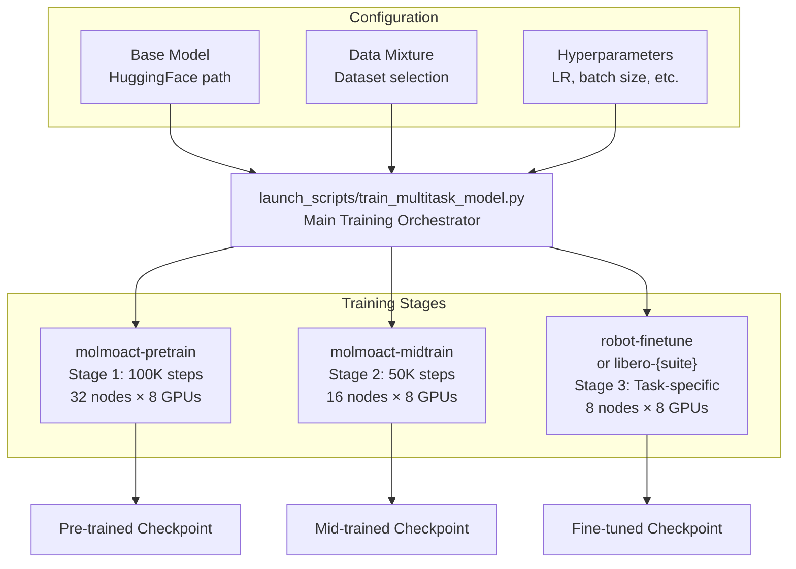

**Training Stage Commands**

| Stage | Config Name | Base Checkpoint | Command Location |
|---|---|---|---|
| Pre-training | `molmoact-pretrain` | `allenai/MolmoAct-7B-D-Captioner-0812` | [README.md:329-351]() |
| Mid-training | `molmoact-midtrain` | `allenai/MolmoAct-7B-D-Pretrain-0812` | [README.md:378-400]() |
| Post-training (Fine-tune) | `robot-finetune` | `allenai/MolmoAct-7B-D-0812` | [README.md:162-187]() |
| LIBERO Tasks | `libero-{spatial,object,goal,long}` | `allenai/MolmoAct-7B-D-0812` | [README.md:413-436]() |

Sources: [README.md:162-187](), [README.md:329-457]()

---

## Preprocessing Pipeline (`preprocess/`)

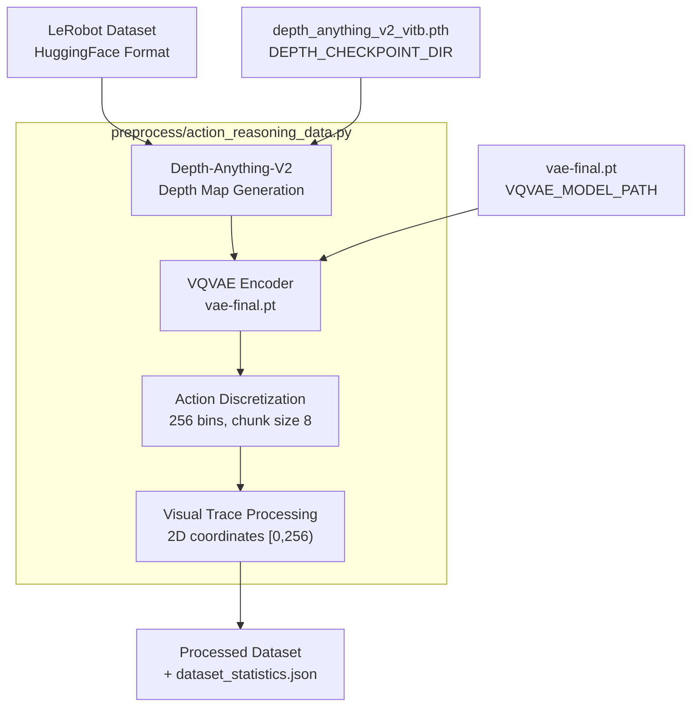

**Preprocessing Command**

The action reasoning data preprocessing is executed via:

```bash
python preprocess/action_reasoning_data.py \
    --dataset-path <lerobot/repo_id> \
    --output-path <path/to/processed_dataset> \
    --depth-encoder vitb \
    --line-length 5 \
    --process-actions \
    --action-bins 256 \
    --action-chunk-size 8
```

**Dependencies**
- Depth-Anything-V2 checkpoint: `depth_anything_v2_vitb.pth`
- VQVAE model: `vae-final.pt`
- LeRobot package: `lerobot==0.3.3`

Sources: [README.md:116-159](), [README.md:254-263]()

---

## Evaluation Frameworks (`experiments/`)

### LIBERO Benchmark Structure

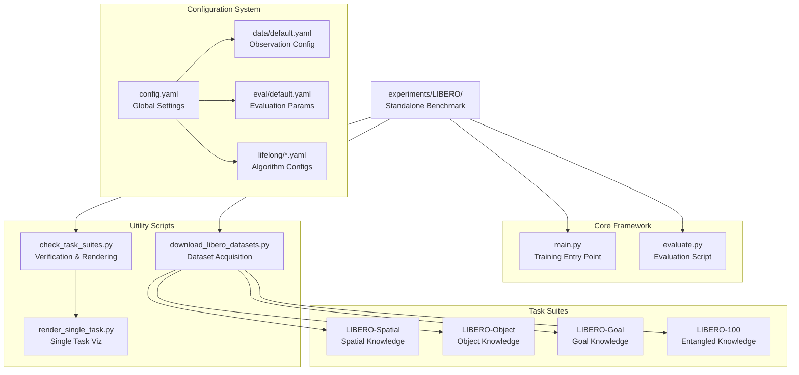

**LIBERO Directory Structure**

| Path | Purpose |
|---|---|
| `experiments/LIBERO/main.py` | Training loop for lifelong learning algorithms |
| `experiments/LIBERO/evaluate.py` | Evaluation script for trained policies |
| `experiments/LIBERO/config.yaml` | Global configuration (seeds, devices, wandb) |
| `experiments/LIBERO/data/default.yaml` | Observation modalities and image dimensions |
| `experiments/LIBERO/eval/default.yaml` | Evaluation parameters (batch size, episodes) |
| `experiments/LIBERO/lifelong/*.yaml` | Algorithm configs (AGEM, ER, PackNet) |
| `experiments/LIBERO/download_libero_datasets.py` | Dataset download utility |
| `experiments/LIBERO/check_task_suites.py` | Task verification and rendering |

Sources: [README.md:477-500]()

---

### MolmoAct LIBERO Evaluation

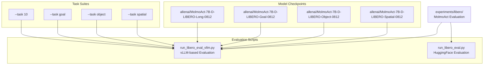

**Evaluation Commands**

```bash
# From experiments/libero/
python run_libero_eval_vllm.py --task spatial --checkpoint allenai/MolmoAct-7B-D-LIBERO-Spatial-0812
python run_libero_eval.py --task object --checkpoint allenai/MolmoAct-7B-D-LIBERO-Object-0812
```

Sources: [README.md:477-500]()

---

## Interactive Evaluation Extension (`molmoact/SteerSimplerEnv/`)

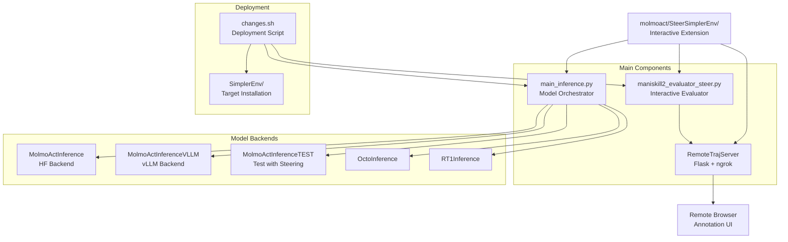

**SteerSimplerEnv Components**

| File | Purpose |
|---|---|
| `main_inference.py` | Model loading and inference orchestration |
| `maniskill2_evaluator_steer.py` | Evaluation loop with human steering support |
| `RemoteTrajServer` | Flask server exposing trajectory annotation via ngrok |
| `MolmoActInferenceTEST` | Model inference class with visual trace support |
| `changes.sh` | Deployment script to copy files into SimplerEnv installation |
| `molmoact_test.sh` | Test script for interactive steering |

**Deployment Workflow**

```bash
# Deploy SteerSimplerEnv into SimplerEnv installation
bash molmoact/SteerSimplerEnv/changes.sh

# Run interactive steering session
bash scripts/molmoact_test.sh allenai/MolmoAct-7B-D-Pretrain-0812 molmoact_test
```

Sources: [README.md:502-518]()

---

## Configuration and Assets

### Docker Configuration

The repository includes a multi-stage Docker build for reproducible training environments:

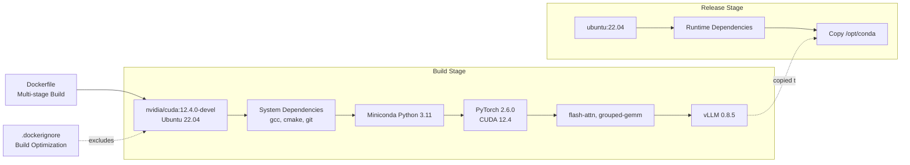

**Excluded from Build Context** (`.dockerignore`)

| Pattern | Reason |
|---|---|
| `/runs/`, `/wandb/`, `/scratch/` | Training artifacts excluded to reduce build context |
| `/checkpoints`, `/datasets` | Large data directories excluded |
| `*.log`, `*.pyc`, `__pycache__` | Generated files excluded |
| `/tests`, `/dbg` | Development directories excluded |

Sources: [.gitignore:54-77](), [README.md:96-107]()

---

### Package Metadata (`pyproject.toml`)

The `pyproject.toml` file defines package dependencies and installation options:

```bash
pip install -e .[all]  # Install all dependencies
```

**Dependency Groups**
- Core dependencies: PyTorch, transformers, einops, torchvision
- Optional dependencies: vLLM (inference), accelerate (distributed training)
- Development dependencies: lerobot (data processing), Depth-Anything-V2 (preprocessing)

Sources: [README.md:95-107]()

---

### Hardware Designs and Assets

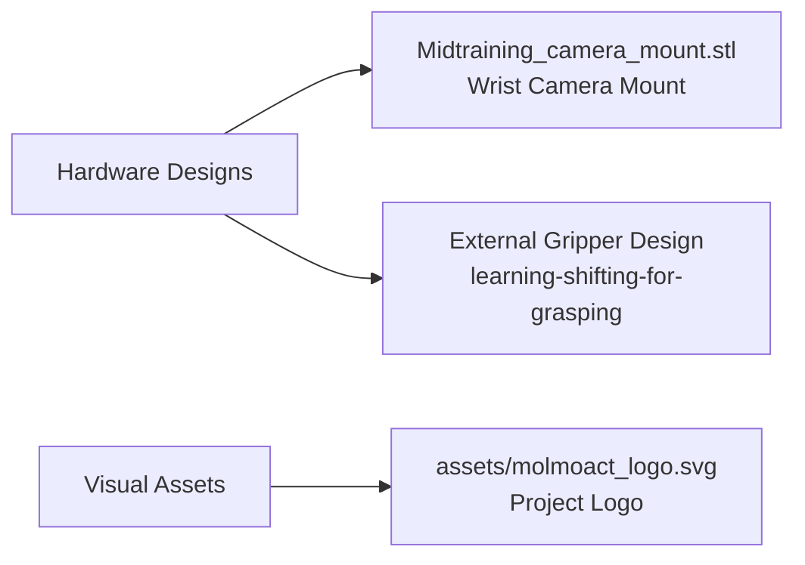

**Physical Hardware Components**

| File/Link | Purpose |
|---|---|
| `Midtraining_camera_mount.stl` | Custom wrist camera mount for Franka robot |
| External gripper design | Custom gripper tip from `learning-shifting-for-grasping` |
| `assets/molmoact_logo.svg` | Project logo and branding |

Sources: [README.md:520-538]()

---

## Environment Variables and Data Storage

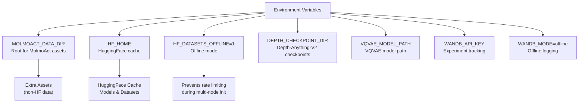

**Environment Variable Reference**

| Variable | Purpose | Example Value |
|---|---|---|
| `MOLMOACT_DATA_DIR` | Root directory for MolmoAct-specific data | `/data/molmoact` |
| `HF_HOME` | HuggingFace cache location | `/data/molmoact/huggingface` |
| `HF_DATASETS_OFFLINE` | Prevent HF network requests during training | `1` |
| `DEPTH_CHECKPOINT_DIR` | Depth-Anything-V2 checkpoint directory | `/path/to/Depth-Anything-V2/checkpoints` |
| `VQVAE_MODEL_PATH` | VQVAE model checkpoint path | `/path/to/vae-final.pt` |
| `WANDB_API_KEY` | Weights & Biases API key | `<your_key>` |
| `WANDB_MODE` | W&B logging mode | `offline` |
| `VLLM_WORKER_MULTIPROC_METHOD` | vLLM multiprocessing method | `spawn` |

Sources: [README.md:268-279](), [README.md:148-150](), [README.md:320-326](), [README.md:486]()

---

## Ignored Files and Build Artifacts

The `.gitignore` file excludes generated content and environment-specific files:

**Excluded Categories**

| Category | Patterns | Reason |
|---|---|---|
| Build artifacts | `.eggs/`, `*.egg-info/`, `build/`, `dist/` | Python packaging outputs |
| Development tools | `.vscode/`, `.idea`, `.python-version`, `pyrightconfig.json` | Editor configurations |
| Runtime artifacts | `/runs/`, `/wandb/`, `/checkpoints`, `/datasets` | Training outputs and data |
| Python bytecode | `*.pyc`, `*.pyo`, `__pycache__` | Compiled Python files |
| Testing | `.pytest_cache/`, `.coverage`, `/tests` | Test artifacts |
| Notebooks | `.ipynb_checkpoints`, `test.ipynb` | Jupyter artifacts |
| Documentation | `docs/build`, `site/` | Generated docs |
| Temporary files | `*.log`, `*.swp`, `.DS_Store`, `core` | System and editor temp files |

Sources: [.gitignore:1-78]()

---

## Summary: Key Directory Purposes

| Directory/File | Primary System | Related Wiki Page |
|---|---|---|
| `olmo/` | Core training infrastructure | [Training Pipeline](#2) |
| `olmo/data/robot_datasets.py` | Robot dataset loaders | [Robot Demonstration Datasets](#3.1) |
| `olmo/data/web_datasets.py` | Web dataset loaders | [Multimodal Web Data](#3.2) |
| `scripts/download_robot_data.py` | Dataset acquisition | [Data Management System](#3) |
| `scripts/merge_lora` | LoRA adapter merging | [Model Checkpoints and Usage](#4) |
| `launch_scripts/train_multitask_model.py` | Training orchestration | [Training Pipeline](#2) |
| `preprocess/action_reasoning_data.py` | Data preprocessing | [Robot Demonstration Datasets](#3.1) |
| `experiments/LIBERO/` | LIBERO benchmark | [LIBERO Benchmark Framework](#6) |
| `experiments/libero/` | MolmoAct LIBERO eval | [LIBERO Benchmark Evaluation](#5.3) |
| `molmoact/SteerSimplerEnv/` | Interactive evaluation | [SteerSimplerEnv Extension System](#9) |
| `Dockerfile` | Container infrastructure | [Docker Environment](#8.1) |
| `pyproject.toml` | Package metadata | [Development Environment](#8.4) |

Sources: [README.md:1-579](), [.gitignore:1-78]()

---

