# Page: MolmoAct Overview

# MolmoAct Overview

<details>
<summary>Relevant source files</summary>

The following files were used as context for generating this wiki page:

- [LICENSE](LICENSE)
- [README.md](README.md)
- [assets/molmoact_logo.svg](assets/molmoact_logo.svg)

</details>


## Purpose and Scope

This document provides a high-level introduction to the MolmoAct system: an open-source Action Reasoning Model designed for robot learning applications. It covers the system's core capabilities, architectural components, training methodology, and deployment options. For detailed installation instructions, see [Getting Started](#1.1). For comprehensive training procedures, see [Training Pipeline](#2). For evaluation procedures, see [Evaluation Pipelines](#5).

**Sources:** [README.md:1-70]()

---

## What is MolmoAct?

MolmoAct is a multimodal 7B-parameter language model that extends vision-language capabilities to robotic action prediction and spatial reasoning. Unlike traditional vision-language models that output text descriptions, MolmoAct generates three distinct modalities:

1. **Robot Actions**: Discretized end-effector commands (position, orientation, gripper state)
2. **Depth Tokens**: Compressed depth map representations via VQVAE encoding
3. **Visual Traces**: 2D coordinate sequences representing spatial reasoning paths

The model is trained on a mixture of robot demonstration datasets, web-based multimodal data, and procedurally generated manipulation tasks. It supports both zero-shot deployment and task-specific fine-tuning using Low-Rank Adaptation (LoRA).

**Sources:** [README.md:68-70](), [README.md:254-263]()

---

## Core Capabilities

### Action Reasoning

MolmoAct formulates robot control as an action reasoning task. Given input images and task instructions, the model predicts discrete action tokens representing:

- **End-effector position**: 3D coordinates discretized into 256 bins
- **End-effector orientation**: Euler angles or quaternion representations
- **Gripper state**: Open/close commands
- **Action chunks**: Sequences of 8 consecutive actions for temporal coherence

**Sources:** [README.md:146-159]()

### Spatial Understanding

The model maintains spatial awareness through:

- **Depth estimation**: Uses Depth-Anything-V2 for generating depth maps from RGB images
- **VQVAE compression**: Encodes depth maps into discrete tokens using a trained vector-quantized variational autoencoder
- **Visual traces**: Outputs 2D coordinate sequences (bounded [0, 256)) that visualize reasoning paths

**Sources:** [README.md:122-143](), [README.md:254-263]()

### Multi-Image Context

MolmoAct processes up to two images per forward pass (`--max_images 2`), enabling:

- Allocentric (third-person) and egocentric (wrist-mounted) camera views
- Temporal context from sequential observations
- Multi-view spatial reasoning

**Sources:** [README.md:399](), [README.md:433]()

---

## System Architecture

The following diagram illustrates MolmoAct's end-to-end architecture, connecting high-level concepts to code entities:

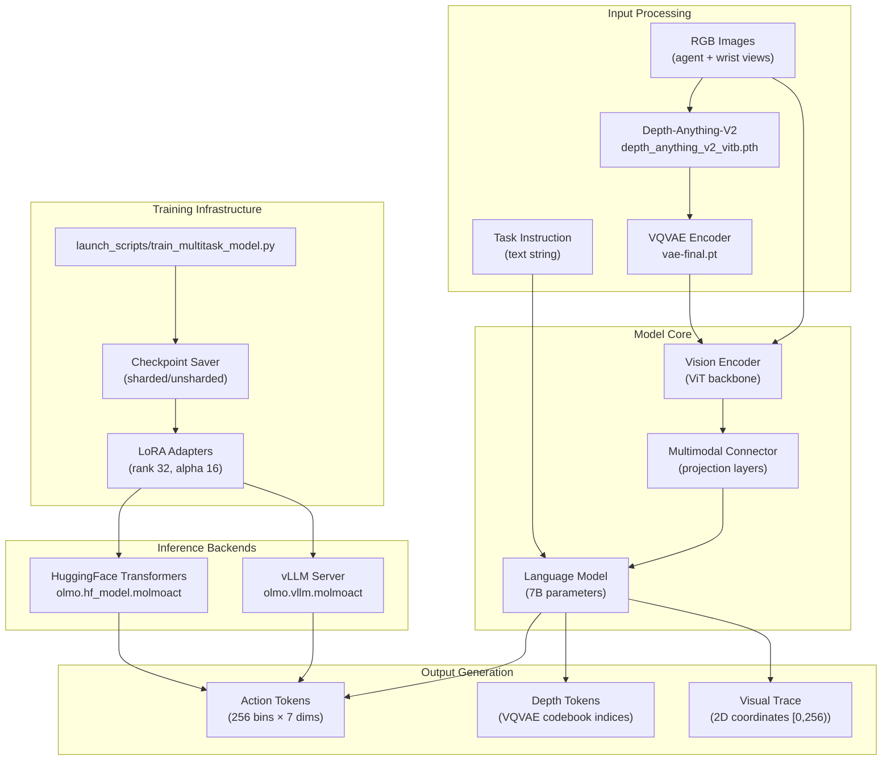

**Architecture Components:**

| Component | Code Location | Purpose |
|-----------|---------------|---------|
| Depth Estimation | `depth_anything_v2_vitb.pth` | Generates depth maps from RGB images |
| VQVAE Encoder | `vae-final.pt` | Compresses depth maps into discrete tokens |
| Vision Encoder | Model backbone (ViT) | Extracts visual features from images |
| Multimodal Connector | Projection layers | Maps vision features to LLM embedding space |
| Language Model | 7B parameter transformer | Generates action tokens, depth tokens, and traces |
| Training Script | `launch_scripts/train_multitask_model.py` | Orchestrates multi-stage training |
| LoRA Adapters | `--lora_enable` flag | Enables parameter-efficient fine-tuning |
| HF Inference | `olmo.hf_model.molmoact` | Standard inference using HuggingFace Transformers |
| vLLM Inference | `olmo.vllm.molmoact` | Optimized inference using vLLM backend |

**Sources:** [README.md:122-143](), [README.md:165-187](), [README.md:203-213]()

---

## Model Variants

MolmoAct provides four primary model checkpoints, each serving different use cases:

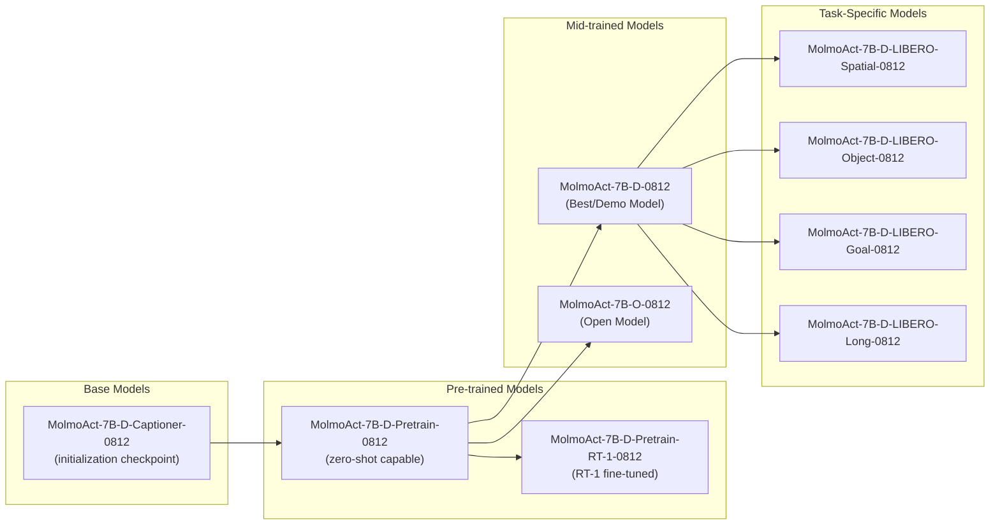

### Model Characteristics

| Model | Use Case | Training Data | Parameters | Fine-tuning |
|-------|----------|---------------|------------|-------------|
| `MolmoAct-7B-D-0812` | Fine-tuning base | 10K robot episodes (mid-training) | 7B | Recommended |
| `MolmoAct-7B-O-0812` | Open alternative | Same as 7B-D | 7B | Recommended |
| `MolmoAct-7B-D-Pretrain-0812` | Zero-shot inference | Pre-training mixture | 7B | Not needed for SimplerEnv |
| `MolmoAct-7B-D-Pretrain-RT-1-0812` | RT-1 tasks | Pre-training + RT-1 subset | 7B | Not needed for SimplerEnv |

**Sources:** [README.md:84-92]()

---

## Training Pipeline Overview

MolmoAct employs a three-stage training methodology with decreasing computational requirements:

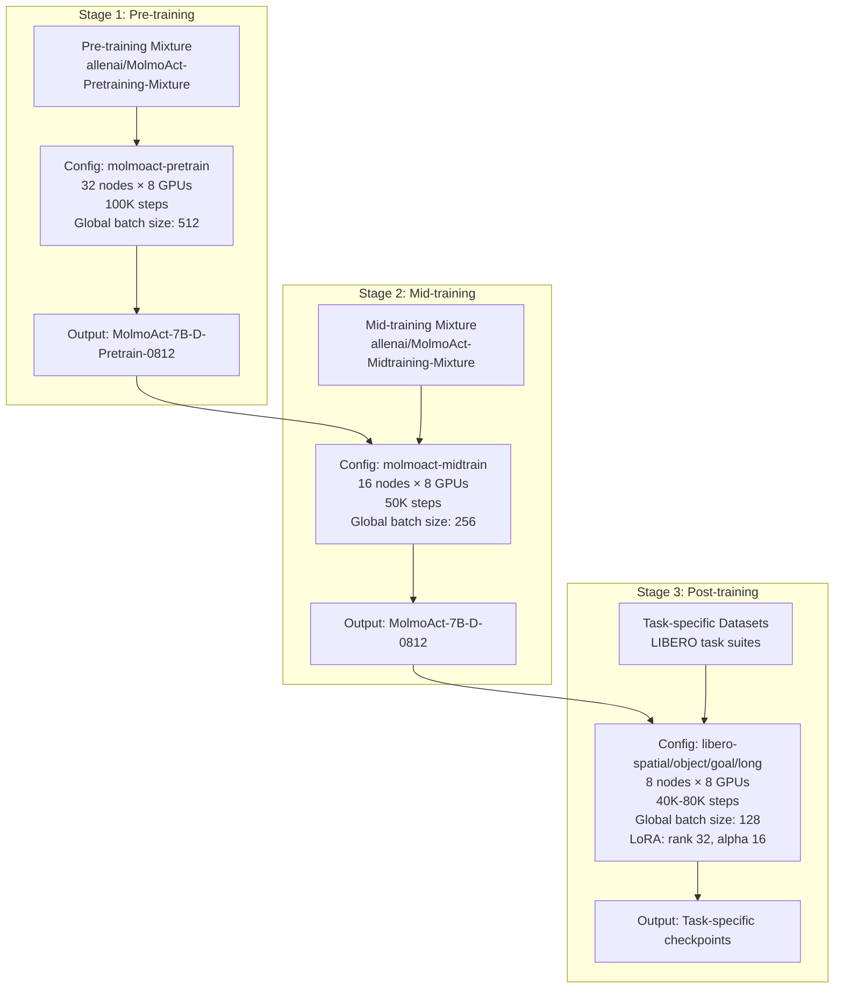

### Training Script Invocation

All training stages use the unified script `launch_scripts/train_multitask_model.py` with stage-specific configurations:

**Pre-training:**
```bash
torchrun --nnodes=32 --nproc-per-node=8 \
    launch_scripts/train_multitask_model.py \
    molmoact-pretrain allenai/MolmoAct-7B-D-Captioner-0812
```

**Mid-training:**
```bash
torchrun --nnodes=16 --nproc-per-node=8 \
    launch_scripts/train_multitask_model.py \
    molmoact-midtrain allenai/MolmoAct-7B-D-Pretrain-0812
```

**Post-training (Fine-tuning):**
```bash
torchrun --nnodes=8 --nproc-per-node=8 \
    launch_scripts/train_multitask_model.py \
    libero-spatial allenai/MolmoAct-7B-D-0812 --lora_enable
```

**Sources:** [README.md:329-351](), [README.md:380-401](), [README.md:413-436]()

---

## Data Processing Pipeline

MolmoAct's data processing converts standard robot demonstration datasets into Action Reasoning Data format:

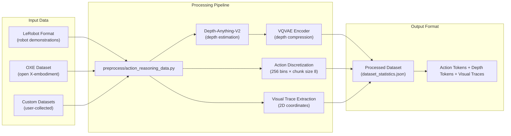

### Processing Configuration

| Parameter | Flag | Default | Purpose |
|-----------|------|---------|---------|
| Depth encoder | `--depth-encoder` | `vitb` | Depth-Anything-V2 model size |
| Action bins | `--action-bins` | 256 | Discretization resolution |
| Action chunk size | `--action-chunk-size` | 8 | Temporal action grouping |
| Line length | `--line-length` | 5 | Visual trace line segments |
| Process actions | `--process-actions` | - | Enable action discretization |

### Processing Script Invocation

```bash
export DEPTH_CHECKPOINT_DIR="<path/to/Depth-Anything-V2/checkpoints>"
export VQVAE_MODEL_PATH="<path/to/vqvae.pt>"

python preprocess/action_reasoning_data.py \
    --dataset-path <lerobot/repo_id> \
    --output-path <path/to/processed_dataset> \
    --depth-encoder vitb \
    --line-length 5 \
    --process-actions \
    --action-bins 256 \
    --action-chunk-size 8
```

**Sources:** [README.md:116-159]()

---

## Inference and Deployment

MolmoAct supports two inference backends with different performance characteristics:

### HuggingFace Transformers Backend

Located in `olmo/hf_model/molmoact/`, this backend provides:

- Standard HuggingFace API compatibility
- Easy integration with existing workflows
- Reference implementation for correctness

**Test script:** `olmo/hf_model/molmoact/test_molmoact.py`

```bash
python3 olmo/hf_model/molmoact/test_molmoact.py \
    --checkpoint_dir /path/to/checkpoint-hf \
    --images /path/to/img1 /path/to/img2 \
    --instruction "task instruction" \
    --unnorm_key unnorm_key
```

### vLLM Backend

Located in `olmo/vllm/molmoact/`, this backend provides:

- Optimized inference using vLLM 0.8.5
- Higher throughput for evaluation tasks
- PagedAttention memory optimization

**Test script:** `olmo/vllm/molmoact/test_molmoact.py`

```bash
python3 -m olmo.vllm.molmoact.test_molmoact \
    --checkpoint_dir /path/to/checkpoint-hf \
    --images /path/to/img1 /path/to/img2 \
    --instruction "task instruction" \
    --unnorm_key unnorm_key
```

**Sources:** [README.md:203-250]()

### Checkpoint Conversion Workflow

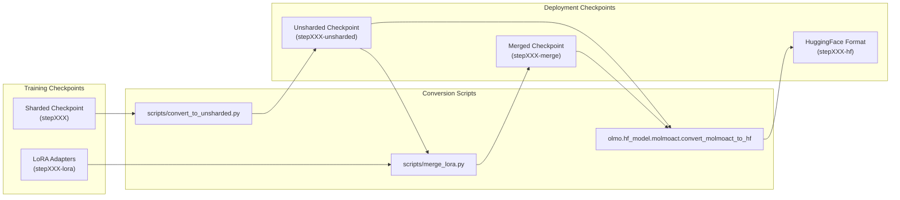

**Conversion commands:**

1. **Unshard checkpoint** (for full fine-tuning):
```bash
python3 -m scripts.convert_to_unsharded \
    --checkpoint_dir /path/to/stepXXX \
    --output_dir /path/to/stepXXX-unsharded
```

2. **Merge LoRA adapters** (for LoRA fine-tuning):
```bash
python3 -m scripts.merge_lora \
    --base_dir /path/to/base_model \
    --lora_dir /path/to/stepXXX-lora \
    --output_dir /path/to/stepXXX-merge
```

3. **Convert to HuggingFace format**:
```bash
python3 -m olmo.hf_model.molmoact.convert_molmoact_to_hf \
    --checkpoint_dir /path/to/stepXXX-merge \
    --output_dir /path/to/stepXXX-hf \
    --style demo \
    --norm_stats_path /path/to/dataset_statistics.json
```

**Sources:** [README.md:191-223]()

---

## Key Components and Code Organization

### Training Components

| Component | Location | Description |
|-----------|----------|-------------|
| Main training script | `launch_scripts/train_multitask_model.py` | Orchestrates multi-stage training with PyTorch DDP |
| Robot datasets | `olmo/data/robot_datasets.py` | Dataset classes for robot demonstrations |
| Data downloaders | `scripts/download_robot_data.py`, `scripts/download_data.py` | Fetch datasets from HuggingFace Hub |
| Checkpoint conversion | `scripts/convert_to_unsharded.py` | Converts sharded to unsharded checkpoints |
| LoRA merging | `scripts/merge_lora.py` | Merges LoRA adapters with base model |

### Inference Components

| Component | Location | Description |
|-----------|----------|-------------|
| HF model wrapper | `olmo/hf_model/molmoact/` | HuggingFace Transformers integration |
| vLLM wrapper | `olmo/vllm/molmoact/` | vLLM backend integration |
| HF conversion | `olmo/hf_model/molmoact/convert_molmoact_to_hf` | Converts native checkpoints to HF format |
| Test scripts | `olmo/hf_model/molmoact/test_molmoact.py`, `olmo/vllm/molmoact/test_molmoact.py` | Example inference code |

### Preprocessing Components

| Component | Location | Description |
|-----------|----------|-------------|
| Action reasoning processor | `preprocess/action_reasoning_data.py` | Converts robot data to Action Reasoning format |
| Depth reconstruction | `scripts/reconstruct_from_tokens.py` | Visualizes depth from VQVAE tokens |

### Evaluation Components

| Component | Location | Description |
|-----------|----------|-------------|
| SimplerEnv evaluation | External: `allenai/SimplerEnv` | Google Robot task evaluation |
| SteerSimplerEnv | `molmoact/SteerSimplerEnv/` | Interactive evaluation with human steering |
| LIBERO evaluation | `experiments/libero/` | LIBERO benchmark evaluation scripts |

**Sources:** [README.md:1-579]()

---

## Environment Variables

MolmoAct uses several environment variables for configuration:

| Variable | Purpose | Example |
|----------|---------|---------|
| `MOLMOACT_DATA_DIR` | Root directory for auxiliary data assets | `/data/molmoact` |
| `HF_HOME` | HuggingFace cache location | `/data/molmoact/huggingface` |
| `DEPTH_CHECKPOINT_DIR` | Depth-Anything-V2 checkpoint location | `/path/to/Depth-Anything-V2/checkpoints` |
| `VQVAE_MODEL_PATH` | VQVAE model checkpoint path | `/path/to/vae-final.pt` |
| `HF_DATASETS_OFFLINE` | Prevents HF API calls during training | `1` (recommended for multi-node) |
| `WANDB_API_KEY` | Weights & Biases API key for logging | `<your_api_key>` |
| `WANDB_MODE` | W&B logging mode | `offline` or `online` |
| `VLLM_WORKER_MULTIPROC_METHOD` | vLLM worker spawning method | `spawn` |

**Sources:** [README.md:269-327]()

---

## Hardware Requirements

### Training Requirements

| Stage | Nodes | GPUs per Node | Total GPUs | GPU Type | Duration |
|-------|-------|---------------|------------|----------|----------|
| Pre-training | 32 | 8 | 256 | A100/H100 | 100K steps |
| Mid-training | 16 | 8 | 128 | A100/H100 | 50K steps |
| Post-training | 8 | 8 | 64 | A100/H100 | 40K-80K steps |

**GPU Architecture:** Requires NVIDIA GPUs with compute capability 8.0 (Ampere) or 9.0 (Hopper) for flash-attention and grouped-gemm support.

**Interconnect:** InfiniBand recommended for multi-node training (configured via MLNX OFED drivers in Docker environment).

### Inference Requirements

- **HuggingFace backend:** Single GPU (A100/H100 recommended)
- **vLLM backend:** Single GPU with PagedAttention support
- **Memory:** ~14GB VRAM for inference with batch size 1

**Sources:** README.md, Dockerfile analysis

---

## License

MolmoAct is released under the **Apache License 2.0**, permitting use, modification, and distribution for research and educational purposes. See [License Information](#10.1) for details.

**Sources:** [LICENSE:1-201](), [README.md:541-545]()

---

# Page: Getting Started

# Getting Started

<details>
<summary>Relevant source files</summary>

The following files were used as context for generating this wiki page:

- [.dockerignore](.dockerignore)
- [Dockerfile](Dockerfile)
- [README.md](README.md)

</details>


This page guides you through installing MolmoAct, configuring your environment, and running your first inference. It covers basic setup and simple inference workflows using pre-trained checkpoints from HuggingFace Hub.

For training your own models, see [Training Pipeline](#2). For evaluation on benchmarks, see [Evaluation Pipelines](#5). For detailed data management, see [Data Management System](#3).

---

## Installation Options

MolmoAct supports two installation approaches: Docker-based deployment (recommended for training) and local installation (suitable for inference).

### Docker Installation (Recommended)

The Docker environment includes all dependencies pre-configured for multi-node GPU training and evaluation.

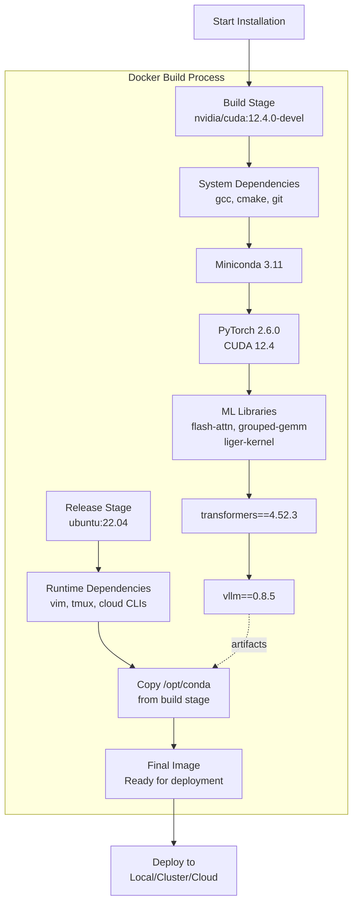

**Build the Docker image:**

```bash
docker build -t molmoact:latest .
```

**Run a container:**

```bash
docker run --gpus all -it \
  -v /path/to/data:/data \
  -v /path/to/checkpoints:/checkpoints \
  molmoact:latest
```

**Sources:** [Dockerfile:1-178](), [README.md:95-107]()

---

### Local Installation

For inference-only workflows or development without Docker:

**Prerequisites:**
- Python 3.11
- CUDA 12.4 compatible GPU (Ampere or Hopper architecture)
- PyTorch 2.6.0 or compatible version

**Installation steps:**

```bash
# Clone the repository
git clone https://github.com/allenai/molmoact.git
cd molmoact

# Install PyTorch for your system
# See https://pytorch.org for platform-specific instructions

# Install MolmoAct package
pip install -e .[all]
```

**Minimal inference environment** (without training dependencies):

```bash
pip install einops torchvision accelerate vllm==0.8.5 transformers==4.52
```

**Sources:** [README.md:95-107](), [README.md:244-250]()

---

## Environment Configuration

MolmoAct uses environment variables to manage data storage and caching behavior.

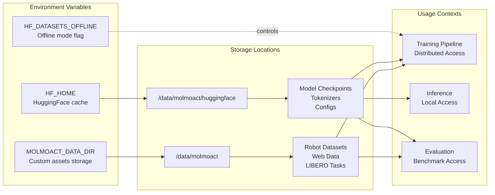

**Required environment variables:**

| Variable | Purpose | Example Value |
|----------|---------|---------------|
| `MOLMOACT_DATA_DIR` | Root directory for custom assets | `/data/molmoact` |
| `HF_HOME` | HuggingFace cache location | `/data/molmoact/huggingface` |
| `HF_DATASETS_OFFLINE` | Prevent HF API calls during training (optional) | `1` |

**Setup commands:**

```bash
export MOLMOACT_DATA_DIR=/data/molmoact
export HF_HOME=/data/molmoact/huggingface

# Optional: Enable offline mode to prevent rate limiting
export HF_DATASETS_OFFLINE=1
```

**Why these matter:**
- `HF_HOME` prevents repeated downloads across nodes in distributed training
- `HF_DATASETS_OFFLINE=1` avoids rate limiting when multiple nodes initialize simultaneously
- `MOLMOACT_DATA_DIR` stores assets not managed by HuggingFace (depth models, VQVAE checkpoints)

**Sources:** [README.md:268-278](), [README.md:320-327]()

---

## Model Checkpoints and Selection

MolmoAct provides several checkpoint variants for different use cases. All checkpoints are available on HuggingFace Hub.

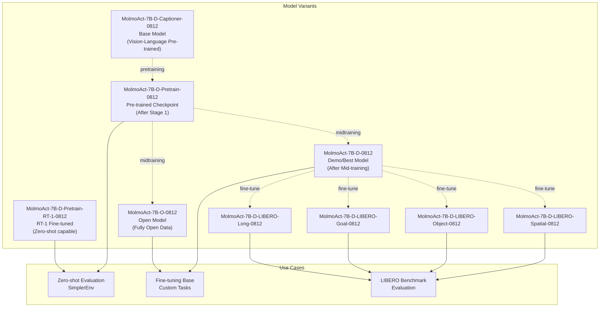

**Checkpoint selection guide:**

| Checkpoint | HuggingFace ID | Use Case |
|-----------|----------------|----------|
| **MolmoAct-7B-D** | `allenai/MolmoAct-7B-D-0812` | Starting point for fine-tuning on custom robot tasks (best performance) |
| **MolmoAct-7B-O** | `allenai/MolmoAct-7B-O-0812` | Starting point for fine-tuning with fully open training data |
| **MolmoAct-7B-D-Pretrain** | `allenai/MolmoAct-7B-D-Pretrain-0812` | Zero-shot evaluation on SimplerEnv (Google Robot tasks) |
| **MolmoAct-7B-D-Pretrain-RT-1** | `allenai/MolmoAct-7B-D-Pretrain-RT-1-0812` | RT-1 dataset fine-tuned for SimplerEnv evaluation |
| **LIBERO variants** | `allenai/MolmoAct-7B-D-LIBERO-*-0812` | Task-specific LIBERO benchmark evaluation |

**Automatic download:** Checkpoints download automatically when referenced by their HuggingFace ID in inference scripts.

**Sources:** [README.md:76-92](), [README.md:86-92]()

---

## Running Your First Inference

MolmoAct supports two inference backends: HuggingFace Transformers (standard) and vLLM (optimized for throughput).

### Inference Architecture

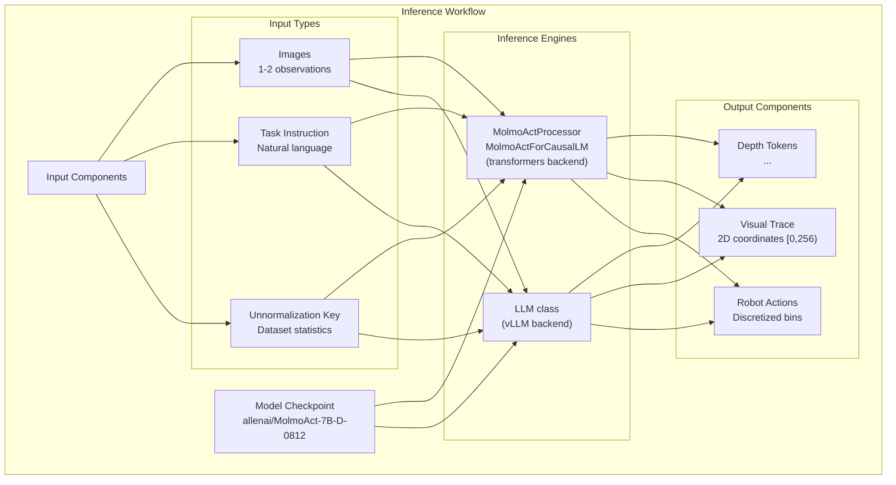

---

### HuggingFace Transformers Backend

The standard inference path uses `transformers` library classes.

**Key classes and their roles:**

| Class/Function | Location | Purpose |
|---------------|----------|---------|
| `MolmoActProcessor` | [olmo/hf_model/molmoact/processing_molmoact.py]() | Image preprocessing and prompt formatting |
| `MolmoActForCausalLM` | [olmo/hf_model/molmoact/modeling_molmoact.py]() | Main model inference class |
| `AutoProcessor`, `AutoModelForCausalLM` | transformers library | HuggingFace loading utilities |

**Example inference script:**

```bash
python3 olmo/hf_model/molmoact/test_molmoact.py \
    --checkpoint_dir allenai/MolmoAct-7B-D-0812 \
    --images /path/to/image1.jpg /path/to/image2.jpg \
    --instruction "pick up the red cube" \
    --unnorm_key allenai/MolmoAct-Dataset/home-primary
```

**Script breakdown:**

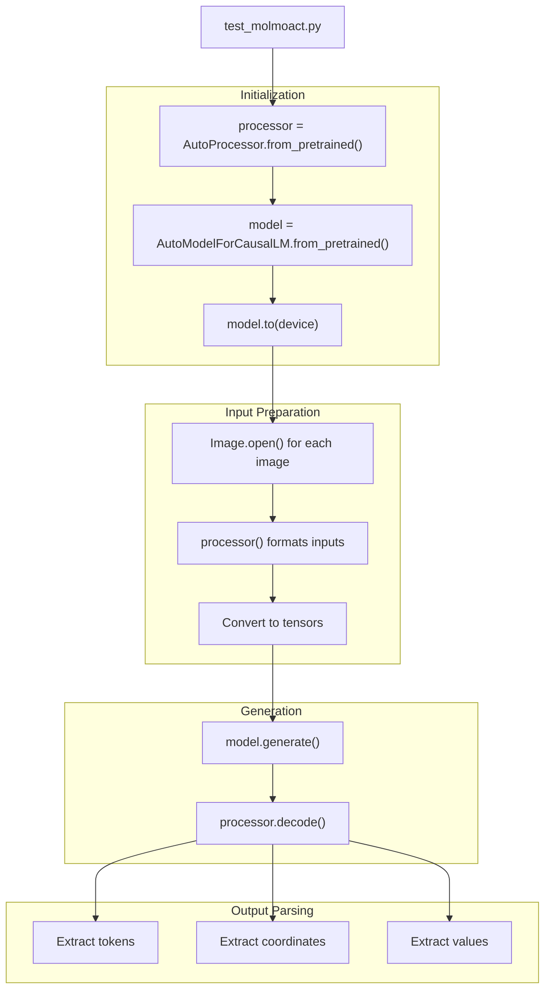

**Command-line arguments:**

| Argument | Required | Description | Example |
|----------|----------|-------------|---------|
| `--checkpoint_dir` | Yes | HuggingFace model ID or local path | `allenai/MolmoAct-7B-D-0812` |
| `--images` | Yes | Paths to 1-2 observation images | `/path/to/img1.jpg /path/to/img2.jpg` |
| `--instruction` | Yes | Natural language task description | `"pick up the red cube"` |
| `--unnorm_key` | Yes | Dataset statistics key for action denormalization | `allenai/MolmoAct-Dataset/home-primary` |

**Sources:** [README.md:203-233](), [olmo/hf_model/molmoact/test_molmoact.py]()

---

### vLLM Backend

vLLM provides optimized inference with higher throughput for batch processing.

**Key components:**

| Component | Location | Purpose |
|-----------|----------|---------|
| `LLM` class | vllm library | Optimized model serving |
| `SamplingParams` | vllm library | Generation configuration |
| MolmoAct vLLM config | [olmo/vllm/molmoact/]() | Custom vLLM integration |

**Example inference script:**

```bash
python3 -m olmo.vllm.molmoact.test_molmoact \
    --checkpoint_dir allenai/MolmoAct-7B-D-0812 \
    --images /path/to/image1.jpg /path/to/image2.jpg \
    --instruction "pick up the red cube" \
    --unnorm_key allenai/MolmoAct-Dataset/home-primary
```

**Additional environment configuration for vLLM:**

```bash
# Required for proper multiprocessing
export VLLM_WORKER_MULTIPROC_METHOD=spawn
```

**Performance comparison:**

| Backend | Throughput | Memory Usage | Use Case |
|---------|-----------|--------------|----------|
| HuggingFace Transformers | Standard | Standard | Development, single inference, debugging |
| vLLM | 2-3x higher | Optimized | Batch evaluation, production deployment |

**Sources:** [README.md:234-242](), [README.md:486](), [olmo/vllm/molmoact/test_molmoact.py]()

---

## Understanding Model Outputs

MolmoAct generates three types of outputs during inference:

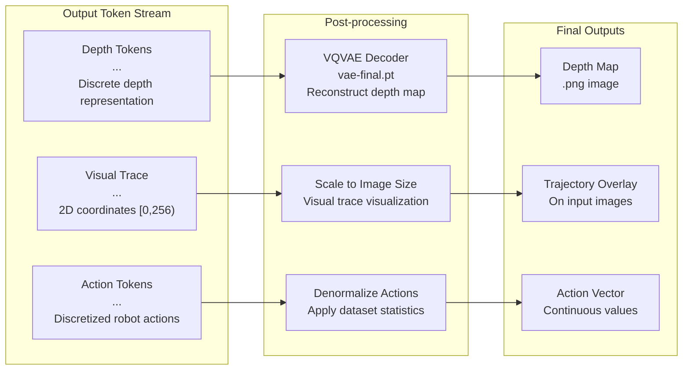

### Depth Tokens

Depth tokens represent a discretized depth map predicted by the model.

**Format:** `<DEPTH_START><DEPTH_1><DEPTH_2>...<DEPTH_N><DEPTH_END>`

**Reconstruction:** Use the VQVAE decoder to convert tokens back to depth images:

```bash
python3 scripts/reconstruct_from_tokens.py \
    --ckpt_path /path/to/vae-final.pt \
    --depth_tokens "<DEPTH_START><DEPTH_1>...<DEPTH_END>" \
    --output_path /path/to/depth.png
```

**Download VQVAE checkpoint:**

```bash
wget https://huggingface.co/allenai/MolmoAct-7B-D-0812/resolve/main/vae-final.pt
```

---

### Visual Trace

Visual trace consists of 2D coordinates representing the predicted trajectory.

**Format:** `<TRACE_START><TRACE_X1><TRACE_Y1><TRACE_X2><TRACE_Y2>...<TRACE_END>`

**Coordinate space:** Integer values in range `[0, 256)`

**Visualization:** Scale coordinates proportionally to the actual image dimensions:

```python
# Example scaling for a 512x512 image
scaled_x = (trace_x / 256.0) * 512
scaled_y = (trace_y / 256.0) * 512
```

---

### Robot Actions

Actions are discretized into 256 bins during training and must be denormalized during inference.

**Format:** `<ACTION_START><ACTION_0><ACTION_1>...<ACTION_N><ACTION_END>`

**Denormalization:** Requires dataset statistics specified by `--unnorm_key`:

| Unnorm Key | Dataset | Use Case |
|-----------|---------|----------|
| `allenai/MolmoAct-Dataset/home-primary` | Home environment tasks | Standard mid-trained model |
| `allenai/MolmoAct-Dataset/table-primary` | Tabletop tasks | Tabletop manipulation |
| Custom key | Your custom dataset | After fine-tuning on your data |

**Action chunk size:** By default, MolmoAct predicts 8 action steps per inference call.

**Sources:** [README.md:253-263](), [scripts/reconstruct_from_tokens.py]()

---

## Quick Start Checklist

**Environment Setup:**
- [ ] Set `MOLMOACT_DATA_DIR` environment variable
- [ ] Set `HF_HOME` environment variable
- [ ] Install PyTorch 2.6.0 with CUDA 12.4 support
- [ ] Install MolmoAct package: `pip install -e .[all]`

**For vLLM inference:**
- [ ] Install vLLM: `pip install vllm==0.8.5`
- [ ] Set `VLLM_WORKER_MULTIPROC_METHOD=spawn`

**For visualization:**
- [ ] Download VQVAE checkpoint: `vae-final.pt`
- [ ] Download Depth-Anything-V2 checkpoint (if processing new data)

**First inference:**
- [ ] Choose appropriate checkpoint for your use case
- [ ] Prepare 1-2 observation images
- [ ] Write task instruction in natural language
- [ ] Identify correct `unnorm_key` for action denormalization
- [ ] Run inference script ([HuggingFace](#huggingface-transformers-backend) or [vLLM](#vllm-backend))

**Next steps:**
- For fine-tuning on custom data: see [Post-training and Task-Specific Fine-tuning](#2.3)
- For evaluation on benchmarks: see [Evaluation Pipelines](#5)
- For understanding data formats: see [Data Management System](#3)

**Sources:** [README.md:95-250]()

---

## Common Issues and Solutions

| Issue | Cause | Solution |
|-------|-------|----------|
| OOM during inference | High-resolution crops enabled | Models are trained without high-res crops; use standard resolution |
| Rate limiting from HuggingFace | Multiple nodes downloading simultaneously | Set `HF_DATASETS_OFFLINE=1` after initial download |
| vLLM worker spawn errors | Incorrect multiprocessing method | Set `VLLM_WORKER_MULTIPROC_METHOD=spawn` |
| Missing depth checkpoint | VQVAE not downloaded | Download from HuggingFace model hub |
| Wrong action range | Incorrect unnorm_key | Match unnorm_key to the dataset used for training/fine-tuning |

**Sources:** [README.md:371](), [README.md:486]()

---

# Page: Repository Structure

# Repository Structure

<details>
<summary>Relevant source files</summary>

The following files were used as context for generating this wiki page:

- [.gitignore](.gitignore)
- [README.md](README.md)

</details>


This document describes the organization of the MolmoAct codebase, mapping major system components to their locations in the repository. For installation and setup instructions, see [Getting Started](#1.1). For training pipeline details, see [Training Pipeline](#2).

---

## Overview

The MolmoAct repository is organized into several major subsystems:

- **Core training code** (`olmo/`) - PyTorch model definitions, data loaders, training loops
- **Scripts** (`scripts/`, `launch_scripts/`) - Data processing, model conversion, and training launch utilities
- **Evaluation frameworks** (`experiments/`) - LIBERO benchmark and evaluation scripts
- **Interactive evaluation** (`molmoact/SteerSimplerEnv/`) - Human-in-the-loop evaluation extension
- **Preprocessing** (`preprocess/`) - Action reasoning data transformation pipeline
- **Deployment** (`Dockerfile`, `.dockerignore`) - Containerization for reproducible environments

Sources: [README.md:1-579](), [.gitignore:1-78]()

---

## Top-Level Directory Structure

```mermaid
graph TB
    ROOT["Repository Root<br/>(molmoact)"]
    
    subgraph "Core Code Package"
        OLMO["olmo/<br/>Main Python Package"]
        OLMO_DATA["olmo/data/<br/>Dataset Classes"]
        OLMO_HF["olmo/hf_model/molmoact/<br/>HuggingFace Integration"]
        OLMO_VLLM["olmo/vllm/molmoact/<br/>vLLM Integration"]
    end
    
    subgraph "Scripts & Utilities"
        SCRIPTS["scripts/<br/>Utility Scripts"]
        LAUNCH["launch_scripts/<br/>Training Launch Scripts"]
        PREPROCESS["preprocess/<br/>Data Processing"]
    end
    
    subgraph "Evaluation Systems"
        EXPERIMENTS["experiments/<br/>Evaluation Frameworks"]
        LIBERO_PKG["experiments/LIBERO/<br/>LIBERO Benchmark Package"]
        LIBERO_EVAL["experiments/libero/<br/>LIBERO Evaluation Scripts"]
        STEER["molmoact/SteerSimplerEnv/<br/>Interactive Evaluation"]
    end
    
    subgraph "Configuration & Assets"
        DOCKER["Dockerfile<br/>Container Definition"]
        PYPROJECT["pyproject.toml<br/>Package Metadata"]
        ASSETS["assets/<br/>Visual Assets"]
        HARDWARE["Midtraining_camera_mount.stl<br/>Hardware Designs"]
    end
    
    ROOT --> OLMO
    OLMO --> OLMO_DATA
    OLMO --> OLMO_HF
    OLMO --> OLMO_VLLM
    
    ROOT --> SCRIPTS
    ROOT --> LAUNCH
    ROOT --> PREPROCESS
    
    ROOT --> EXPERIMENTS
    EXPERIMENTS --> LIBERO_PKG
    EXPERIMENTS --> LIBERO_EVAL
    ROOT --> STEER
    
    ROOT --> DOCKER
    ROOT --> PYPROJECT
    ROOT --> ASSETS
    ROOT --> HARDWARE
```

**Top-Level Directory Mapping**

| Directory/File | Purpose |
|---|---|
| `olmo/` | Core training code, models, data loaders |
| `scripts/` | Data download, model conversion, visualization |
| `launch_scripts/` | Multi-node training orchestration |
| `preprocess/` | Action reasoning data preprocessing |
| `experiments/LIBERO/` | LIBERO benchmark framework (standalone) |
| `experiments/libero/` | LIBERO evaluation scripts for MolmoAct |
| `molmoact/SteerSimplerEnv/` | Interactive evaluation extension |
| `Dockerfile` | Multi-stage container build |
| `pyproject.toml` | Package dependencies and metadata |
| `assets/` | Logos, visual resources |
| `.gitignore` | Build artifacts, runs, checkpoints exclusion |

Sources: [README.md:39-65](), [.gitignore:1-78]()

---

## Core Package (`olmo/`)

The `olmo/` directory contains the main Python package with model implementations, training infrastructure, and data processing.

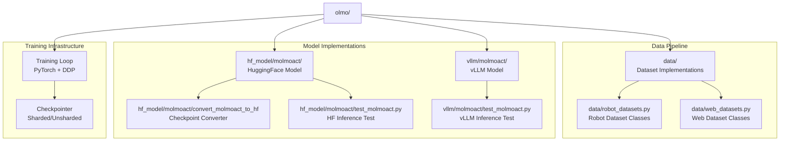

**Key Code Entities**

| Path | Description |
|---|---|
| `olmo/data/robot_datasets.py` | Robot dataset classes (e.g., `MolmoActDatasetHomePrimary`) |
| `olmo/data/web_datasets.py` | Web dataset classes (e.g., `ChartQa`, `Pixmo`) |
| `olmo/hf_model/molmoact/convert_molmoact_to_hf` | Converts training checkpoints to HuggingFace format |
| `olmo/hf_model/molmoact/test_molmoact.py` | Example inference script using HF Transformers |
| `olmo/vllm/molmoact/test_molmoact.py` | Example inference script using vLLM backend |

Sources: [README.md:206-248](), [README.md:299-301]()

---

## Scripts Directory

### Data Management Scripts (`scripts/`)

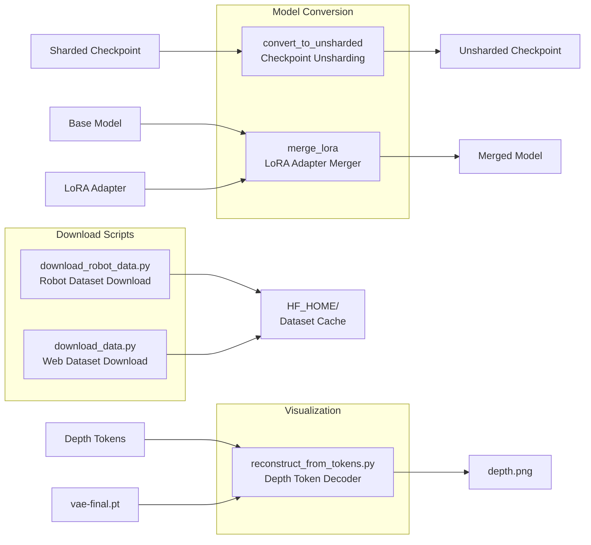

**Script Purposes**

| Script | Command | Purpose |
|---|---|---|
| `download_robot_data.py` | `python scripts/download_robot_data.py all` | Download robot datasets (OXE, BC-Z, RT-1, MolmoAct) |
| `download_data.py` | `python scripts/download_data.py all` | Download web datasets (Pixmo, ChartQA, etc.) |
| `merge_lora` | `python -m scripts.merge_lora` | Merge LoRA adapters with base model weights |
| `convert_to_unsharded` | `python -m scripts.convert_to_unsharded` | Convert sharded checkpoints to unsharded format |
| `reconstruct_from_tokens.py` | `python scripts/reconstruct_from_tokens.py` | Visualize depth maps from predicted tokens |

Sources: [README.md:282-326](), [README.md:191-222](), [README.md:254-261]()

---

### Training Launch Scripts (`launch_scripts/`)

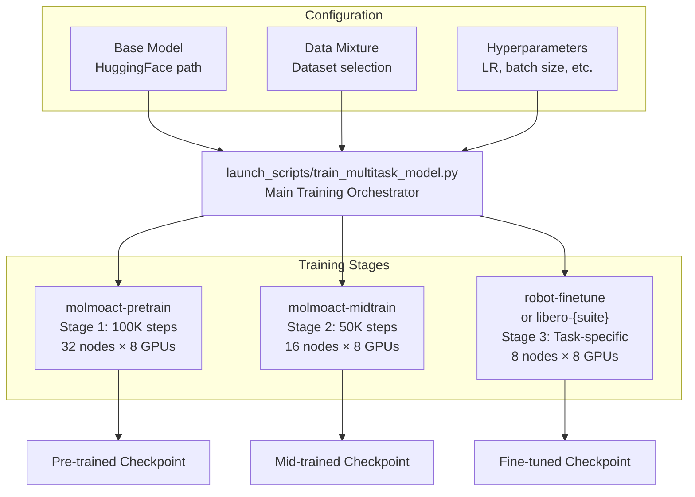

**Training Stage Commands**

| Stage | Config Name | Base Checkpoint | Command Location |
|---|---|---|---|
| Pre-training | `molmoact-pretrain` | `allenai/MolmoAct-7B-D-Captioner-0812` | [README.md:329-351]() |
| Mid-training | `molmoact-midtrain` | `allenai/MolmoAct-7B-D-Pretrain-0812` | [README.md:378-400]() |
| Post-training (Fine-tune) | `robot-finetune` | `allenai/MolmoAct-7B-D-0812` | [README.md:162-187]() |
| LIBERO Tasks | `libero-{spatial,object,goal,long}` | `allenai/MolmoAct-7B-D-0812` | [README.md:413-436]() |

Sources: [README.md:162-187](), [README.md:329-457]()

---

## Preprocessing Pipeline (`preprocess/`)

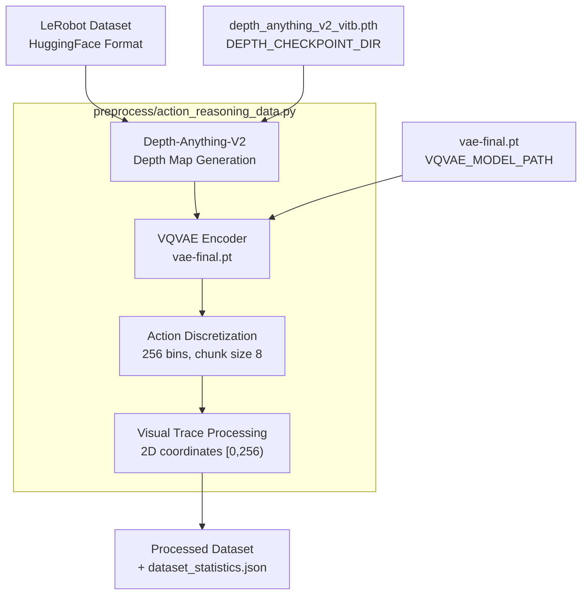

**Preprocessing Command**

The action reasoning data preprocessing is executed via:

```bash
python preprocess/action_reasoning_data.py \
    --dataset-path <lerobot/repo_id> \
    --output-path <path/to/processed_dataset> \
    --depth-encoder vitb \
    --line-length 5 \
    --process-actions \
    --action-bins 256 \
    --action-chunk-size 8
```

**Dependencies**
- Depth-Anything-V2 checkpoint: `depth_anything_v2_vitb.pth`
- VQVAE model: `vae-final.pt`
- LeRobot package: `lerobot==0.3.3`

Sources: [README.md:116-159](), [README.md:254-263]()

---

## Evaluation Frameworks (`experiments/`)

### LIBERO Benchmark Structure

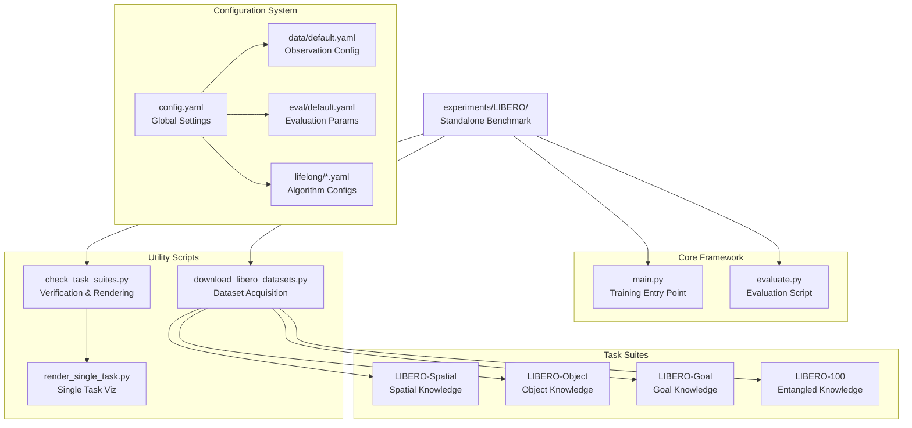

**LIBERO Directory Structure**

| Path | Purpose |
|---|---|
| `experiments/LIBERO/main.py` | Training loop for lifelong learning algorithms |
| `experiments/LIBERO/evaluate.py` | Evaluation script for trained policies |
| `experiments/LIBERO/config.yaml` | Global configuration (seeds, devices, wandb) |
| `experiments/LIBERO/data/default.yaml` | Observation modalities and image dimensions |
| `experiments/LIBERO/eval/default.yaml` | Evaluation parameters (batch size, episodes) |
| `experiments/LIBERO/lifelong/*.yaml` | Algorithm configs (AGEM, ER, PackNet) |
| `experiments/LIBERO/download_libero_datasets.py` | Dataset download utility |
| `experiments/LIBERO/check_task_suites.py` | Task verification and rendering |

Sources: [README.md:477-500]()

---

### MolmoAct LIBERO Evaluation

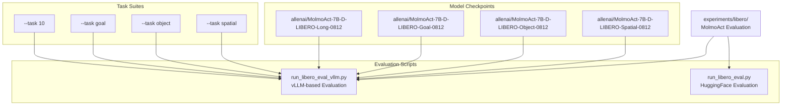

**Evaluation Commands**

```bash
# From experiments/libero/
python run_libero_eval_vllm.py --task spatial --checkpoint allenai/MolmoAct-7B-D-LIBERO-Spatial-0812
python run_libero_eval.py --task object --checkpoint allenai/MolmoAct-7B-D-LIBERO-Object-0812
```

Sources: [README.md:477-500]()

---

## Interactive Evaluation Extension (`molmoact/SteerSimplerEnv/`)

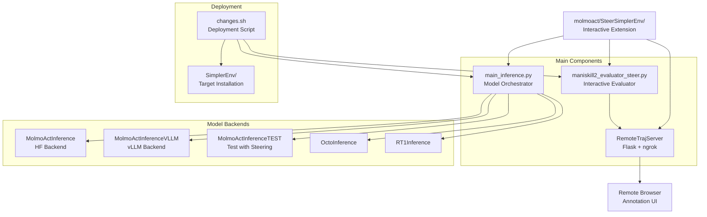

**SteerSimplerEnv Components**

| File | Purpose |
|---|---|
| `main_inference.py` | Model loading and inference orchestration |
| `maniskill2_evaluator_steer.py` | Evaluation loop with human steering support |
| `RemoteTrajServer` | Flask server exposing trajectory annotation via ngrok |
| `MolmoActInferenceTEST` | Model inference class with visual trace support |
| `changes.sh` | Deployment script to copy files into SimplerEnv installation |
| `molmoact_test.sh` | Test script for interactive steering |

**Deployment Workflow**

```bash
# Deploy SteerSimplerEnv into SimplerEnv installation
bash molmoact/SteerSimplerEnv/changes.sh

# Run interactive steering session
bash scripts/molmoact_test.sh allenai/MolmoAct-7B-D-Pretrain-0812 molmoact_test
```

Sources: [README.md:502-518]()

---

## Configuration and Assets

### Docker Configuration

The repository includes a multi-stage Docker build for reproducible training environments:

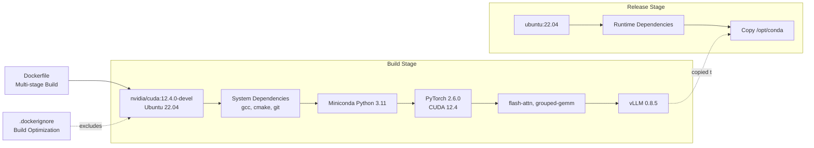

**Excluded from Build Context** (`.dockerignore`)

| Pattern | Reason |
|---|---|
| `/runs/`, `/wandb/`, `/scratch/` | Training artifacts excluded to reduce build context |
| `/checkpoints`, `/datasets` | Large data directories excluded |
| `*.log`, `*.pyc`, `__pycache__` | Generated files excluded |
| `/tests`, `/dbg` | Development directories excluded |

Sources: [.gitignore:54-77](), [README.md:96-107]()

---

### Package Metadata (`pyproject.toml`)

The `pyproject.toml` file defines package dependencies and installation options:

```bash
pip install -e .[all]  # Install all dependencies
```

**Dependency Groups**
- Core dependencies: PyTorch, transformers, einops, torchvision
- Optional dependencies: vLLM (inference), accelerate (distributed training)
- Development dependencies: lerobot (data processing), Depth-Anything-V2 (preprocessing)

Sources: [README.md:95-107]()

---

### Hardware Designs and Assets

```mermaid
graph LR
    HARDWARE["Hardware Designs"]
    ASSETS["Visual Assets"]
    
    CAMERA_MOUNT["Midtraining_camera_mount.stl<br/>Wrist Camera Mount"]
    GRIPPER["External Gripper Design<br/>learning-shifting-for-grasping"]
    
    LOGO["assets/molmoact_logo.svg<br/>Project Logo"]
    
    HARDWARE --> CAMERA_MOUNT
    HARDWARE --> GRIPPER
    ASSETS --> LOGO
```

**Physical Hardware Components**

| File/Link | Purpose |
|---|---|
| `Midtraining_camera_mount.stl` | Custom wrist camera mount for Franka robot |
| External gripper design | Custom gripper tip from `learning-shifting-for-grasping` |
| `assets/molmoact_logo.svg` | Project logo and branding |

Sources: [README.md:520-538]()

---

## Environment Variables and Data Storage

```mermaid
graph TB
    ENV_VARS["Environment Variables"]
    
    MOLMOACT_DIR["MOLMOACT_DATA_DIR<br/>Root for MolmoAct assets"]
    HF_HOME["HF_HOME<br/>HuggingFace cache"]
    HF_OFFLINE["HF_DATASETS_OFFLINE=1<br/>Offline mode"]
    
    DEPTH_CKPT_DIR["DEPTH_CHECKPOINT_DIR<br/>Depth-Anything-V2 checkpoints"]
    VQVAE_PATH["VQVAE_MODEL_PATH<br/>VQVAE model path"]
    
    WANDB_KEY["WANDB_API_KEY<br/>Experiment tracking"]
    WANDB_MODE["WANDB_MODE=offline<br/>Offline logging"]
    
    ENV_VARS --> MOLMOACT_DIR
    ENV_VARS --> HF_HOME
    ENV_VARS --> HF_OFFLINE
    ENV_VARS --> DEPTH_CKPT_DIR
    ENV_VARS --> VQVAE_PATH
    ENV_VARS --> WANDB_KEY
    ENV_VARS --> WANDB_MODE
    
    MOLMOACT_DIR --> EXTRA_ASSETS["Extra Assets<br/>(non-HF data)"]
    HF_HOME --> HF_CACHE["HuggingFace Cache<br/>Models & Datasets"]
    HF_OFFLINE --> TRAINING["Prevents rate limiting<br/>during multi-node init"]
```

**Environment Variable Reference**

| Variable | Purpose | Example Value |
|---|---|---|
| `MOLMOACT_DATA_DIR` | Root directory for MolmoAct-specific data | `/data/molmoact` |
| `HF_HOME` | HuggingFace cache location | `/data/molmoact/huggingface` |
| `HF_DATASETS_OFFLINE` | Prevent HF network requests during training | `1` |
| `DEPTH_CHECKPOINT_DIR` | Depth-Anything-V2 checkpoint directory | `/path/to/Depth-Anything-V2/checkpoints` |
| `VQVAE_MODEL_PATH` | VQVAE model checkpoint path | `/path/to/vae-final.pt` |
| `WANDB_API_KEY` | Weights & Biases API key | `<your_key>` |
| `WANDB_MODE` | W&B logging mode | `offline` |
| `VLLM_WORKER_MULTIPROC_METHOD` | vLLM multiprocessing method | `spawn` |

Sources: [README.md:268-279](), [README.md:148-150](), [README.md:320-326](), [README.md:486]()

---

## Ignored Files and Build Artifacts

The `.gitignore` file excludes generated content and environment-specific files:

**Excluded Categories**

| Category | Patterns | Reason |
|---|---|---|
| Build artifacts | `.eggs/`, `*.egg-info/`, `build/`, `dist/` | Python packaging outputs |
| Development tools | `.vscode/`, `.idea`, `.python-version`, `pyrightconfig.json` | Editor configurations |
| Runtime artifacts | `/runs/`, `/wandb/`, `/checkpoints`, `/datasets` | Training outputs and data |
| Python bytecode | `*.pyc`, `*.pyo`, `__pycache__` | Compiled Python files |
| Testing | `.pytest_cache/`, `.coverage`, `/tests` | Test artifacts |
| Notebooks | `.ipynb_checkpoints`, `test.ipynb` | Jupyter artifacts |
| Documentation | `docs/build`, `site/` | Generated docs |
| Temporary files | `*.log`, `*.swp`, `.DS_Store`, `core` | System and editor temp files |

Sources: [.gitignore:1-78]()

---

## Summary: Key Directory Purposes

| Directory/File | Primary System | Related Wiki Page |
|---|---|---|
| `olmo/` | Core training infrastructure | [Training Pipeline](#2) |
| `olmo/data/robot_datasets.py` | Robot dataset loaders | [Robot Demonstration Datasets](#3.1) |
| `olmo/data/web_datasets.py` | Web dataset loaders | [Multimodal Web Data](#3.2) |
| `scripts/download_robot_data.py` | Dataset acquisition | [Data Management System](#3) |
| `scripts/merge_lora` | LoRA adapter merging | [Model Checkpoints and Usage](#4) |
| `launch_scripts/train_multitask_model.py` | Training orchestration | [Training Pipeline](#2) |
| `preprocess/action_reasoning_data.py` | Data preprocessing | [Robot Demonstration Datasets](#3.1) |
| `experiments/LIBERO/` | LIBERO benchmark | [LIBERO Benchmark Framework](#6) |
| `experiments/libero/` | MolmoAct LIBERO eval | [LIBERO Benchmark Evaluation](#5.3) |
| `molmoact/SteerSimplerEnv/` | Interactive evaluation | [SteerSimplerEnv Extension System](#9) |
| `Dockerfile` | Container infrastructure | [Docker Environment](#8.1) |
| `pyproject.toml` | Package metadata | [Development Environment](#8.4) |

Sources: [README.md:1-579](), [.gitignore:1-78]()

---

# Page: Training Pipeline

# Training Pipeline

<details>
<summary>Relevant source files</summary>

The following files were used as context for generating this wiki page:

- [Dockerfile](Dockerfile)
- [README.md](README.md)

</details>


## Purpose and Scope

This document describes the complete three-stage training pipeline for MolmoAct models, including the execution flow, computational infrastructure, data routing, and checkpoint management across all training phases. Each training stage builds upon the previous one, progressively specializing the model from general multimodal understanding to robot action reasoning.

For detailed information about individual stages, see:
- Pre-training specifics: [Pre-training Stage](#2.1)
- Mid-training specifics: [Mid-training Stage](#2.2)
- Fine-tuning specifics: [Post-training and Task-Specific Fine-tuning](#2.3)

For data management and preprocessing details, see [Data Management System](#3).

---

## Training Pipeline Architecture

The MolmoAct training pipeline follows a three-stage curriculum learning approach where each stage has distinct computational requirements, dataset compositions, and training objectives.

### Pipeline Overview

```mermaid
graph TB
    subgraph "Stage 1: Pre-training"
        PT_DATA["Pre-training Data Mixture<br/>OXE + Robot + Web"]
        PT_BASE["Base Model<br/>allenai/MolmoAct-7B-D-Captioner-0812"]
        PT_TRAIN["train_multitask_model.py<br/>molmoact-pretrain"]
        PT_CONFIG["32 nodes × 8 GPUs<br/>100K steps<br/>GBS=512"]
        PT_OUT["Checkpoint<br/>MolmoAct-7B-D-Pretrain-0812"]
        
        PT_BASE --> PT_TRAIN
        PT_DATA --> PT_TRAIN
        PT_CONFIG -.configures.-> PT_TRAIN
        PT_TRAIN --> PT_OUT
    end
    
    subgraph "Stage 2: Mid-training"
        MT_DATA["Mid-training Data Mixture<br/>MolmoAct Dataset"]
        MT_TRAIN["train_multitask_model.py<br/>molmoact-midtrain"]
        MT_CONFIG["16 nodes × 8 GPUs<br/>50K steps<br/>GBS=256<br/>max_images=2"]
        MT_OUT["Checkpoint<br/>MolmoAct-7B-D-0812"]
        
        PT_OUT --> MT_TRAIN
        MT_DATA --> MT_TRAIN
        MT_CONFIG -.configures.-> MT_TRAIN
        MT_TRAIN --> MT_OUT
    end
    
    subgraph "Stage 3: Post-training"
        FT_DATA["Task-specific Data<br/>LIBERO suites"]
        FT_TRAIN["train_multitask_model.py<br/>libero-{task_suite}"]
        FT_CONFIG["8 nodes × 8 GPUs<br/>40K-80K steps<br/>GBS=128<br/>LoRA adapters"]
        FT_OUT["Task Checkpoint<br/>MolmoAct-7B-D-LIBERO-*-0812"]
        
        MT_OUT --> FT_TRAIN
        FT_DATA --> FT_TRAIN
        FT_CONFIG -.configures.-> FT_TRAIN
        FT_TRAIN --> FT_OUT
    end
    
    PT_OUT -.zero-shot eval.-> EVAL["Evaluation Systems"]
    MT_OUT -.fine-tuning base.-> FT_TRAIN
    FT_OUT --> EVAL
```

**Sources:** [README.md:329-457](), [README.md:110-265]()

---

## Training Execution Entry Point

All three training stages share the same execution script: `launch_scripts/train_multitask_model.py`. This script is invoked via PyTorch's distributed launcher (`torchrun`) with different configuration arguments for each stage.

### Command Structure

```mermaid
graph LR
    TORCHRUN["torchrun<br/>--nnodes=N<br/>--nproc-per-node=8"]
    SCRIPT["train_multitask_model.py"]
    STAGE["Stage Identifier<br/>molmoact-pretrain<br/>molmoact-midtrain<br/>libero-{suite}"]
    BASE["Base Checkpoint<br/>HuggingFace path"]
    PARAMS["Training Parameters<br/>--duration<br/>--global_batch_size<br/>--lr_*<br/>--save_*"]
    
    TORCHRUN --> SCRIPT
    SCRIPT --> STAGE
    SCRIPT --> BASE
    SCRIPT --> PARAMS
```

**Key Launch Parameters:**

| Parameter | Description | Stage Variation |
|-----------|-------------|-----------------|
| `--nnodes` | Number of compute nodes | 32 (pre) / 16 (mid) / 8 (post) |
| `--nproc-per-node` | GPUs per node | 8 (all stages) |
| `stage_identifier` | Dataset mixture selector | `molmoact-pretrain`, `molmoact-midtrain`, `libero-*` |
| `base_checkpoint` | Starting model | Stage-dependent HF path |

**Sources:** [README.md:332-351](), [README.md:382-400](), [README.md:416-436]()

---

## Stage Configuration Mapping

The first positional argument to `train_multitask_model.py` determines which data mixture is loaded and how the training loop is configured.

```mermaid
graph TB
    SCRIPT["train_multitask_model.py"]
    
    SCRIPT -->|"molmoact-pretrain"| PRE_MIX["Load Pretraining Mixture<br/>OXE subset + Robot + Web"]
    SCRIPT -->|"molmoact-midtrain"| MID_MIX["Load Midtraining Mixture<br/>MolmoAct Dataset"]
    SCRIPT -->|"libero-spatial"| LIB_SPATIAL["Load LIBERO Spatial<br/>10 tasks"]
    SCRIPT -->|"libero-object"| LIB_OBJECT["Load LIBERO Object<br/>10 tasks"]
    SCRIPT -->|"libero-goal"| LIB_GOAL["Load LIBERO Goal<br/>10 tasks"]
    SCRIPT -->|"libero-long"| LIB_LONG["Load LIBERO-100<br/>90 tasks for training"]
    SCRIPT -->|"robot-finetune"| CUSTOM["Load Custom Dataset<br/>User-provided path"]
    
    PRE_MIX --> TRAIN_LOOP["Training Loop<br/>Full parameter updates"]
    MID_MIX --> TRAIN_LOOP
    LIB_SPATIAL --> LORA_LOOP["Training Loop<br/>LoRA adapters"]
    LIB_OBJECT --> LORA_LOOP
    LIB_GOAL --> LORA_LOOP
    LIB_LONG --> LORA_LOOP
    CUSTOM --> LORA_LOOP
```

**Sources:** [README.md:336-351](), [README.md:384-400](), [README.md:418-436](), [README.md:163-187]()

---

## Computational Resource Scaling

The training pipeline scales computational resources according to the data size and training objectives at each stage:

| Stage | Nodes | GPUs | Global Batch Size | Training Steps | Wall Time Estimate |
|-------|-------|------|-------------------|----------------|-------------------|
| Pre-training | 32 | 256 | 512 | 100,000 | ~weeks |
| Mid-training | 16 | 128 | 256 | 50,000 | ~week |
| Post-training (LIBERO) | 8 | 64 | 128 | 40,000-80,000 | ~days |

**Distributed Training Setup:**

The pipeline uses PyTorch Distributed Data Parallel (DDP) with the following orchestration variables:

- `RANK`: Node rank in the cluster (0 to N-1)
- `ADDR`: Master node address for synchronization
- `PORT`: Communication port for distributed coordination

```bash
torchrun \
    --nnodes=N \
    --nproc-per-node=8 \
    --node_rank="${RANK}" \
    --master_addr="${ADDR}" \
    --master_port="${PORT}" \
    launch_scripts/train_multitask_model.py ...
```

**Sources:** [README.md:333-335](), [README.md:382-383](), [README.md:417-418](), [README.md:367-368]()

---

## Learning Rate Configuration

Each training stage uses component-specific learning rates to control the adaptation rate of different model parts:

```mermaid
graph TB
    MODEL["MolmoAct Model"]
    
    MODEL --> VIT["Vision Transformer<br/>--lr_vit"]
    MODEL --> CONNECTOR["Vision-Language Connector<br/>--lr_connector"]
    MODEL --> LLM["Language Model Backbone<br/>--lr_llm"]
    
    VIT -.Pre-training.-> VIT_PRE["1e-5"]
    CONNECTOR -.Pre-training.-> CONN_PRE["1e-5"]
    LLM -.Pre-training.-> LLM_PRE["2e-5"]
    
    VIT -.Mid-training.-> VIT_MID["5e-6"]
    CONNECTOR -.Mid-training.-> CONN_MID["5e-6"]
    LLM -.Mid-training.-> LLM_MID["1e-5"]
    
    VIT -.Post-training.-> VIT_POST["5e-4"]
    CONNECTOR -.Post-training.-> CONN_POST["5e-4"]
    LLM -.Post-training.-> LLM_POST["5e-4"]
```

**Learning Rate Rationale:**
- **Pre-training**: Moderate LRs for full model adaptation to multimodal understanding
- **Mid-training**: Lower LRs to preserve pre-trained capabilities while specializing
- **Post-training**: Higher LRs with LoRA for rapid task-specific adaptation

**Sources:** [README.md:345-347](), [README.md:393-395](), [README.md:428-430]()

---

## Data Flow and Feature Flags

Training features are controlled through command-line flags that affect how data is processed and fed to the model:

```mermaid
graph TB
    FLAGS["Training Flags"]
    
    FLAGS --> FT_EMB["--ft_embedding all<br/>Fine-tune all embeddings"]
    FLAGS --> DEPTH["--depth_tokens<br/>Enable depth token prediction"]
    FLAGS --> MAX_IMG["--max_images N<br/>Images per training example"]
    FLAGS --> IMG_AUG["--img_aug<br/>Enable image augmentation"]
    FLAGS --> LORA["--lora_enable<br/>Use LoRA adapters"]
    
    FT_EMB --> DATA_PIPE["Data Pipeline"]
    DEPTH --> DATA_PIPE
    MAX_IMG --> DATA_PIPE
    IMG_AUG --> DATA_PIPE
    
    LORA --> MODEL_CONFIG["Model Configuration"]
    
    DATA_PIPE --> BATCH["Training Batch<br/>RGB images<br/>Depth tokens<br/>Actions<br/>Visual traces"]
    
    MODEL_CONFIG --> OPTIMIZER["Optimizer<br/>Full params or<br/>LoRA adapters"]
```

**Flag Usage by Stage:**

| Flag | Pre-training | Mid-training | Post-training |
|------|--------------|--------------|---------------|
| `--ft_embedding all` | ✓ | ✓ | ✓ |
| `--depth_tokens` | ✓ | ✓ | ✓ |
| `--max_images` | (default 1) | 2 | 2 |
| `--img_aug` | ✗ | ✗ | ✓ |
| `--lora_enable` | ✗ | ✗ | ✓ |

**Sources:** [README.md:342-343](), [README.md:390-391](), [README.md:426-435]()

---

## Checkpoint Management Strategy

The training pipeline implements a sophisticated checkpoint management system that balances storage efficiency with recovery capabilities:

```mermaid
graph TB
    TRAIN["Training Process"]
    
    TRAIN -->|"Every --save_interval steps"| SHARDED["Sharded Checkpoint<br/>step{N}/<br/>Distributed format"]
    TRAIN -->|"Optional: same interval"| UNSHARDED_INT["Unsharded Checkpoint<br/>step{N}-unsharded/<br/>Single file format"]
    TRAIN -->|"Final step only"| UNSHARDED_FINAL["Final Unsharded<br/>stepFINAL-unsharded/"]
    
    SHARDED --> KEEP["Keep Last K Checkpoints<br/>--save_num_checkpoints_to_keep"]
    
    SHARDED -.Resume training.-> RESUME["Training Resume"]
    UNSHARDED_INT -.Inference ready.-> CONVERT["HF Conversion"]
    UNSHARDED_FINAL -.Inference ready.-> CONVERT
    
    CONVERT --> HF_MODEL["HuggingFace Model<br/>convert_molmoact_to_hf"]
```

**Checkpoint Types:**

1. **Sharded Checkpoints** (`step{N}/`):
   - Default format saved every `--save_interval` steps
   - Distributed across multiple files for parallel I/O
   - Used for training resumption
   - Only last K kept (`--save_num_checkpoints_to_keep`)

2. **Unsharded Checkpoints** (`step{N}-unsharded/`):
   - Single consolidated checkpoint file
   - Required for inference and HF conversion
   - Saved at final step by default (`--save_final_unsharded_checkpoint`)
   - Optionally saved at all intervals (`--save_intermediate_unsharded_checkpoint`)

3. **LoRA Adapters** (`step{N}-lora/`):
   - Separate adapter weights when using LoRA fine-tuning
   - Must be merged with base model before inference

**Sources:** [README.md:362-365](), [README.md:193-200](), [README.md:216-222]()

---

## Training Stage Hyperparameters

Complete hyperparameter configuration for each training stage:

### Pre-training Configuration

```
Duration: 100,000 steps
Global Batch Size: 512
Learning Rates:
  - Vision Transformer: 1e-5
  - Connector: 1e-5
  - Language Model: 2e-5
Save Interval: 20,000 steps
Checkpoints Kept: 5
Max Images: 1 (default)
LoRA: Disabled
Image Augmentation: Disabled
```

### Mid-training Configuration

```
Duration: 50,000 steps
Global Batch Size: 256
Learning Rates:
  - Vision Transformer: 5e-6
  - Connector: 5e-6
  - Language Model: 1e-5
Save Interval: 10,000 steps
Checkpoints Kept: 5
Max Images: 2
LoRA: Disabled
Image Augmentation: Disabled
```

### Post-training Configuration

```
Duration: 40,000-80,000 steps (task-dependent)
Global Batch Size: 128
Learning Rates:
  - Vision Transformer: 5e-4
  - Connector: 5e-4
  - Language Model: 5e-4
Save Interval: 10,000 steps (default)
Checkpoints Kept: 5
Max Images: 2
LoRA: Enabled (rank=32, alpha=16, dropout=0.0)
Image Augmentation: Enabled
```

**Sources:** [README.md:341-351](), [README.md:389-400](), [README.md:424-436](), [README.md:444-451]()

---

## Environment Variables and Data Storage

The training pipeline relies on specific environment variables for data location and distributed coordination:

### Required Environment Variables

```mermaid
graph TB
    ENV["Environment Setup"]
    
    ENV --> MOLMO["MOLMOACT_DATA_DIR<br/>Root for MolmoAct assets"]
    ENV --> HF["HF_HOME<br/>HuggingFace cache location"]
    ENV --> WANDB["WANDB_API_KEY<br/>Experiment tracking"]
    ENV --> HF_OFFLINE["HF_DATASETS_OFFLINE=1<br/>Prevent rate limiting"]
    
    MOLMO -.stores.-> ASSETS["VQVAE checkpoints<br/>Auxiliary files"]
    HF -.stores.-> CACHE["Dataset downloads<br/>Model downloads"]
    WANDB -.enables.-> LOGGING["Training metrics<br/>Loss curves<br/>Checkpoints"]
    HF_OFFLINE -.prevents.-> RATE_LIMIT["HF API rate limits<br/>during multi-node init"]
```

**Setup Example:**

```bash
export MOLMOACT_DATA_DIR=/data/molmoact
export HF_HOME=/data/molmoact/huggingface
export WANDB_API_KEY=<your_key>
export HF_DATASETS_OFFLINE=1  # During training only
```

**Critical Note:** Setting `HF_DATASETS_OFFLINE=1` during multi-node training prevents all nodes from simultaneously hitting HuggingFace servers during initialization, which can cause rate limiting. All datasets must be pre-downloaded before training.

**Sources:** [README.md:268-279](), [README.md:326-327](), [README.md:332-360]()

---

## Weights & Biases Integration

Training runs are tracked using Weights & Biases (W&B) for experiment monitoring:

```mermaid
graph LR
    TRAIN["Training Process"]
    
    TRAIN --> WANDB_ONLINE["W&B Online Logging<br/>--wandb.name<br/>--wandb.entity<br/>--wandb.project"]
    TRAIN --> WANDB_OFFLINE["W&B Offline Logging<br/>WANDB_MODE=offline"]
    TRAIN --> WANDB_DISABLED["W&B Disabled<br/>--wandb=null"]
    
    WANDB_ONLINE --> DASHBOARD["Real-time Dashboard<br/>Loss curves<br/>Learning rates<br/>GPU utilization"]
    WANDB_OFFLINE --> LOCAL_LOGS["Local Logs<br/>Sync later"]
```

**W&B Command Examples:**

```bash
# Online logging
WANDB_API_KEY=<key> torchrun ... \
    --wandb.name=exp_name \
    --wandb.entity=team \
    --wandb.project=molmoact

# Offline logging
WANDB_MODE=offline torchrun ... \
    --wandb.name=exp_name

# Disable W&B
torchrun ... --wandb=null
```

**Sources:** [README.md:354-360]()

---

## Docker Training Environment

All training is designed to run within the containerized environment defined in the Dockerfile. The image includes optimized CUDA libraries and ML acceleration frameworks:

### Build Environment Components

```mermaid
graph TB
    BASE["nvidia/cuda:12.4.0-devel-ubuntu22.04"]
    
    BASE --> CONDA["Miniconda Python 3.11"]
    CONDA --> PYTORCH["PyTorch 2.6.0 + CUDA 12.4"]
    PYTORCH --> FLASH["flash-attn 2.7.4.post1"]
    PYTORCH --> GROUPED["grouped-gemm with CUTLASS"]
    FLASH --> TRANSFORMS["transformers 4.52.3"]
    TRANSFORMS --> VLLM["vLLM 0.8.5"]
    VLLM --> MOLMOACT["MolmoAct Package<br/>pip install -e .[all]"]
    
    GROUPED -.GPU kernels.-> ACCEL["GPU Acceleration<br/>TORCH_CUDA_ARCH_LIST=8.0 9.0<br/>Ampere + Hopper"]
```

**Key Build Arguments:**

- `TORCH_CUDA_ARCH_LIST="8.0 9.0"`: Supports Ampere (A100) and Hopper (H100) architectures
- `GROUPED_GEMM_CUTLASS="1"`: Enables CUTLASS backend for batch-size-on-GPU
- Multi-stage build reduces final image size

**InfiniBand Support:**

The release image includes MLNX OFED drivers for high-speed inter-node communication during distributed training:

```dockerfile
ENV MOFED_VER="24.01-0.3.3.1"
RUN wget ... MLNX_OFED_LINUX-${MOFED_VER} ...
```

**Sources:** [Dockerfile:1-178](), [Dockerfile:51-52](), [Dockerfile:136-145]()

---

## Training Pipeline Invariants

Across all training stages, certain properties remain constant:

1. **Common Flags**: All stages use `--ft_embedding all` and `--depth_tokens`
2. **Base Architecture**: All stages train the same MolmoAct-7B architecture
3. **Entry Script**: All stages use `launch_scripts/train_multitask_model.py`
4. **GPU Configuration**: All stages use 8 GPUs per node
5. **Checkpoint Format**: All stages save sharded checkpoints by default
6. **Action Space**: 256 bins, chunk size 8 (from data preprocessing)

**Progressive Specialization Pattern:**
```
Generic Multimodal Model (Pre-training)
    ↓ Reduce compute, lower LR, robot data
Action Reasoning Model (Mid-training)
    ↓ Further reduce compute, higher LR, LoRA
Task-Specific Model (Post-training)
```

**Sources:** [README.md:342-343](), [README.md:390-391](), [README.md:426-427]()

---

## Save and Resume Workflow

The checkpoint system supports seamless training interruption and resumption:

```mermaid
graph TB
    START["Training Start"]
    
    START -->|"New training"| LOAD_BASE["Load Base Checkpoint<br/>HuggingFace path"]
    START -->|"Resume training"| LOAD_CKPT["Load Sharded Checkpoint<br/>--load_path"]
    
    LOAD_BASE --> TRAIN["Training Loop"]
    LOAD_CKPT --> TRAIN
    
    TRAIN -->|"Every K steps"| SAVE_SHARD["Save Sharded<br/>step{N}/"]
    SAVE_SHARD --> CLEANUP["Delete Old Checkpoints<br/>Keep last --save_num_checkpoints_to_keep"]
    
    TRAIN -->|"Interrupt"| INTERRUPT["Interruption"]
    INTERRUPT -->|"Restart"| LOAD_CKPT
    
    TRAIN -->|"Complete"| FINAL["Save Final Checkpoint<br/>Sharded + Unsharded"]
```

**Resume Training Command:**

```bash
torchrun ... launch_scripts/train_multitask_model.py \
    <stage> <base_checkpoint> \
    --load_path checkpoints/exp_name/step50000 \
    --save_folder checkpoints/exp_name \
    ...
```

**Sources:** [README.md:362-365]()

---

## Image Resolution Handling

The training pipeline includes special handling for image resolution to balance quality and computational efficiency:

**Pre-training and Mid-training:**
- High-resolution crops disabled by default
- All images downsized to ≤ 378×378
- Reduces memory footprint for large-scale training

**Post-training:**
- Same resolution policy maintained
- Image augmentation enabled (`--img_aug`)
- Augmentation includes spatial transformations while preserving action-image correspondence

**Rationale:** The base Molmo model supports high-resolution crops, but MolmoAct training stages intentionally disable this feature to focus computational resources on action reasoning rather than fine-grained visual detail.

**Sources:** [README.md:189-190]()

---

## Common Training Issues and Solutions

| Issue | Symptom | Solution |
|-------|---------|----------|
| OOM during data loading | Crash before training starts | Remove `--pin_memory` flag |
| HuggingFace rate limiting | Multi-node initialization hangs | Set `HF_DATASETS_OFFLINE=1` after pre-downloading data |
| Slow initial epoch | First epoch takes much longer | Expected behavior for dataset preprocessing/caching |
| Checkpoint storage overflow | Disk space exhausted | Reduce `--save_num_checkpoints_to_keep` or increase `--save_interval` |
| LoRA merge failure | Error during adapter merging | Ensure using `step{N}-lora` directory, not `step{N}` |

**Sources:** [README.md:371-372](), [README.md:326-327](), [README.md:193-200]()

---

## Post-Training Workflow

After training completes, models require conversion for inference:

```mermaid
graph LR
    TRAIN_END["Training Complete"]
    
    TRAIN_END -->|"Full fine-tuning"| UNSHARDED["Unsharded Checkpoint<br/>step{N}-unsharded/"]
    TRAIN_END -->|"LoRA fine-tuning"| LORA["LoRA Adapters<br/>step{N}-lora/"]
    
    LORA --> MERGE["scripts.merge_lora<br/>Merge with base model"]
    MERGE --> MERGED["Merged Checkpoint<br/>step{N}-merge/"]
    
    UNSHARDED --> CONVERT["convert_molmoact_to_hf"]
    MERGED --> CONVERT
    
    CONVERT --> HF_FORMAT["HuggingFace Format<br/>step{N}-hf/"]
    
    HF_FORMAT --> INFERENCE["Inference Engines<br/>HF Transformers<br/>vLLM"]
```

**Conversion Scripts:**

1. **Unshard** (if needed): `scripts.convert_to_unsharded`
2. **Merge LoRA**: `scripts.merge_lora`
3. **Convert to HF**: `olmo.hf_model.molmoact.convert_molmoact_to_hf`

**Sources:** [README.md:193-223](), [README.md:204-214]()

---

# Page: Pre-training Stage

# Pre-training Stage

<details>
<summary>Relevant source files</summary>

The following files were used as context for generating this wiki page:

- [README.md](README.md)

</details>


## Purpose and Scope

This document describes the first stage of the MolmoAct three-stage training pipeline: **pre-training**. Pre-training establishes broad multimodal understanding by training on diverse robot demonstration datasets and multimodal web data. This stage uses the largest compute allocation (256 GPUs, 100,000 steps) and produces the `MolmoAct-7B-D-Pretrain` checkpoint, which can perform zero-shot evaluation on SimplerEnv or serve as a base for RT-1 fine-tuning.

For information about the subsequent training stages, see [Mid-training Stage](#2.2) and [Post-training and Task-Specific Fine-tuning](#2.3). For details about data acquisition and management, see [Data Management System](#3).

**Sources:** [README.md:174-218]()

---

## Overview

Pre-training transforms the `MolmoAct-7B-D-Captioner` checkpoint into `MolmoAct-7B-D-Pretrain` through exposure to a diverse mixture of robot manipulation demonstrations and multimodal web data. This stage prioritizes scale and diversity to establish foundational spatial reasoning capabilities before specialization.

### Training Pipeline Position

```mermaid
flowchart LR
    subgraph "Pre-training Stage"
        CAPTIONER["MolmoAct-7B-D-Captioner<br/>(Starting Checkpoint)"]
        PRETRAIN_SCRIPT["launch_scripts/train_multitask_model.py<br/>Config: molmoact-pretrain"]
        PRETRAIN_OUT["MolmoAct-7B-D-Pretrain<br/>(Output Checkpoint)"]
    end
    
    subgraph "Input Data"
        ROBOT_DATA["Robot Datasets<br/>download_robot_data.py pretrain"]
        WEB_DATA["Web Datasets<br/>download_data.py all"]
    end
    
    subgraph "Downstream Usage"
        MIDTRAIN["Mid-training Stage<br/>(See Section 2.2)"]
        SIMPLER["SimplerEnv Zero-shot<br/>Evaluation"]
        RT1["RT-1 Fine-tuning"]
    end
    
    ROBOT_DATA --> PRETRAIN_SCRIPT
    WEB_DATA --> PRETRAIN_SCRIPT
    CAPTIONER --> PRETRAIN_SCRIPT
    PRETRAIN_SCRIPT --> PRETRAIN_OUT
    PRETRAIN_OUT --> MIDTRAIN
    PRETRAIN_OUT --> SIMPLER
    PRETRAIN_OUT --> RT1
```

**Sources:** [README.md:60-68](), [README.md:174-218]()

---

## Data Sources

Pre-training utilizes two primary data categories: robot demonstration datasets from the Open X-Embodiment (OXE) collection and multimodal web datasets containing diverse visual reasoning tasks.

### Robot Demonstration Datasets

The robot datasets consist of a subset of OXE formulated as Action Reasoning data, supplemented with auxiliary robot datasets. These provide demonstrations of manipulation tasks across different robot embodiments, environments, and task specifications.

```mermaid
graph TB
    subgraph "Data Download"
        DOWNLOAD_SCRIPT["scripts/download_robot_data.py"]
        PRETRAIN_STAGE["pretrain stage filter"]
    end
    
    subgraph "Environment Configuration"
        HF_HOME["HF_HOME<br/>(Hugging Face cache)"]
        DATA_DIR["MOLMOACT_DATA_DIR<br/>(Additional assets)"]
        OFFLINE["HF_DATASETS_OFFLINE=1<br/>(Rate limit protection)"]
    end
    
    subgraph "Robot Dataset Classes"
        OXE_SUBSET["OXE Subset<br/>(Action Reasoning format)"]
        AUX_ROBOT["Auxiliary Robot Data<br/>(Various embodiments)"]
    end
    
    subgraph "Storage"
        HF_CACHE["Hugging Face Cache<br/>(Resumable downloads)"]
    end
    
    DOWNLOAD_SCRIPT --> PRETRAIN_STAGE
    HF_HOME --> DOWNLOAD_SCRIPT
    DATA_DIR --> DOWNLOAD_SCRIPT
    OFFLINE -.controls.-> DOWNLOAD_SCRIPT
    
    PRETRAIN_STAGE --> OXE_SUBSET
    PRETRAIN_STAGE --> AUX_ROBOT
    
    OXE_SUBSET --> HF_CACHE
    AUX_ROBOT --> HF_CACHE
```

**Download Command:**
```bash
python3 scripts/download_robot_data.py pretrain --n_proc 16
```

The `--n_proc` parameter controls parallel download processes. Higher values speed up downloads but increase the risk of rate limiting from Hugging Face.

**Sources:** [README.md:127-147](), [README.md:113-124]()

### Multimodal Web Datasets

Web datasets provide diverse visual reasoning capabilities through tasks such as chart understanding (ChartQA), image captioning (TextCaps), and spatial reasoning across various domains. These datasets are sourced from Pixmo collections and other multimodal web sources.

```mermaid
graph TB
    subgraph "Download Infrastructure"
        WEB_SCRIPT["scripts/download_data.py"]
        ALL_FLAG["all flag"]
    end
    
    subgraph "Dataset Categories"
        PIXMO["Pixmo Collections<br/>(URL-based image fetching)"]
        CHARTQA["ChartQA<br/>(Chart understanding)"]
        TEXTCAPS["TextCaps<br/>(Image captioning)"]
        OTHER["Other Web Sources"]
    end
    
    subgraph "Special Cases"
        MANUAL["Manual Downloads Required:<br/>- InfoQa<br/>- Scene-Text"]
    end
    
    subgraph "Download Characteristics"
        TIMING["Pixmo download:<br/>Up to 1 day for full fetch"]
        RESUMABLE["Resumable downloads<br/>(Cancel-safe)"]
    end
    
    WEB_SCRIPT --> ALL_FLAG
    ALL_FLAG --> PIXMO
    ALL_FLAG --> CHARTQA
    ALL_FLAG --> TEXTCAPS
    ALL_FLAG --> OTHER
    
    PIXMO --> TIMING
    PIXMO --> RESUMABLE
    MANUAL -.user action required.-> WEB_SCRIPT
```

**Download Command:**
```bash
python3 scripts/download_data.py all --n_proc 16
```

**Important Notes:**
- Pixmo datasets fetch images from URLs automatically but may take up to a full day for complete download
- Downloads are resumable if cancelled or interrupted
- InfoQa and Scene-Text datasets require manual download; the script will raise an error if these files are missing
- Android control dataset requires extra dependencies for TFRecord parsing

**Sources:** [README.md:150-171]()

---

## Training Configuration

### Compute Resources

Pre-training uses the largest resource allocation in the three-stage pipeline:

| Resource | Specification |
|----------|--------------|
| **Total GPUs** | 256 (32 nodes × 8 GPUs/node) |
| **Training Duration** | 100,000 steps |
| **Global Batch Size** | 512 |
| **Checkpoint Interval** | Every 20,000 steps |
| **Checkpoint Retention** | 5 most recent checkpoints |

**Sources:** [README.md:177-196]()

### Hyperparameters

The pre-training stage employs component-specific learning rates to balance training across the vision encoder, vision-language connector, and language model components:

```mermaid
graph LR
    subgraph "Model Components & Learning Rates"
        VIT["Vision Encoder (ViT)<br/>lr_vit = 1e-5"]
        CONNECTOR["Vision-Language Connector<br/>lr_connector = 1e-5"]
        LLM["Language Model<br/>lr_llm = 2e-5"]
    end
    
    subgraph "Training Features"
        EMBEDDINGS["--ft_embedding all<br/>(Fine-tune all embeddings)"]
        DEPTH["--depth_tokens<br/>(Enable depth features)"]
        BATCH["--global_batch_size 512"]
        STEPS["--duration 100000"]
    end
    
    VIT --> CONNECTOR
    CONNECTOR --> LLM
    
    EMBEDDINGS -.applies to.-> VIT
    EMBEDDINGS -.applies to.-> CONNECTOR
    EMBEDDINGS -.applies to.-> LLM
    DEPTH -.feature.-> VIT
```

**Key Configuration Parameters:**

| Parameter | Value | Description |
|-----------|-------|-------------|
| `--lr_vit` | 1e-5 | Vision encoder learning rate |
| `--lr_connector` | 1e-5 | Vision-language connector learning rate |
| `--lr_llm` | 2e-5 | Language model learning rate (highest) |
| `--ft_embedding` | all | Fine-tune all embedding layers |
| `--depth_tokens` | (flag) | Enable depth token features |
| `--global_batch_size` | 512 | Effective batch size across all GPUs |
| `--duration` | 100000 | Total training steps |

**Sources:** [README.md:186-196]()

### Checkpointing Strategy

```mermaid
graph TB
    subgraph "Checkpoint Management"
        INTERVAL["--save_interval 20000<br/>(Save every 20k steps)"]
        RETENTION["--save_num_checkpoints_to_keep 5<br/>(Keep 5 most recent)"]
        FINAL["--save_final_unsharded_checkpoint<br/>(Final checkpoint unsharded)"]
    end
    
    subgraph "Checkpoint Formats"
        SHARDED["Intermediate Checkpoints<br/>(Sharded format only)"]
        UNSHARDED["Final Checkpoint<br/>(Both sharded + unsharded)"]
    end
    
    subgraph "Optional"
        INTERMEDIATE_UNSHARDED["--save_intermediate_unsharded_checkpoint<br/>(Also save unsharded for intermediates)"]
    end
    
    INTERVAL --> SHARDED
    RETENTION -.applies to.-> SHARDED
    FINAL --> UNSHARDED
    INTERMEDIATE_UNSHARDED -.optional flag.-> SHARDED
```

By default, all intermediate checkpoints (at steps 20000, 40000, 60000, 80000) are saved in sharded format only to conserve storage. The final checkpoint at step 100000 is saved in both sharded and unsharded formats for easier downstream usage.

To save unsharded copies of every intermediate checkpoint, add the `--save_intermediate_unsharded_checkpoint` flag. This significantly increases storage requirements but provides more flexibility for checkpoint selection.

**Sources:** [README.md:207-210]()

---

## Execution

### Launch Command Structure

```mermaid
graph TB
    subgraph "Environment Setup"
        WANDB["WANDB_API_KEY<br/>(W&B authentication)"]
        HF_OFFLINE["HF_DATASETS_OFFLINE=1<br/>(Prevent rate limiting)"]
    end
    
    subgraph "Distributed Launch"
        TORCHRUN["torchrun launcher"]
        NNODES["--nnodes=32"]
        NPROC["--nproc-per-node=8"]
        RANK["--node_rank=RANK"]
        ADDR["--master_addr=ADDR"]
        PORT["--master_port=PORT"]
    end
    
    subgraph "Training Script"
        SCRIPT["launch_scripts/train_multitask_model.py"]
        CONFIG["molmoact-pretrain config"]
        BASE["allenai/MolmoAct-7B-D-Captioner-0812"]
    end
    
    subgraph "Output"
        SAVE["--save_folder=checkpoints/<exp_name>"]
        WANDB_LOG["W&B logging"]
    end
    
    WANDB --> TORCHRUN
    HF_OFFLINE -.recommended.-> TORCHRUN
    TORCHRUN --> NNODES
    TORCHRUN --> NPROC
    TORCHRUN --> RANK
    TORCHRUN --> ADDR
    TORCHRUN --> PORT
    TORCHRUN --> SCRIPT
    SCRIPT --> CONFIG
    SCRIPT --> BASE
    SCRIPT --> SAVE
    SCRIPT --> WANDB_LOG
```

**Complete Launch Command:**

```bash
WANDB_API_KEY=<your_wandb_api_key> torchrun \
    --nnodes=32 --nproc-per-node=8 \
    --node_rank="${RANK}" --master_addr="${ADDR}" --master_port="${PORT}" \
    launch_scripts/train_multitask_model.py \
    molmoact-pretrain allenai/MolmoAct-7B-D-Captioner-0812 \
    --wandb.name=<name> --wandb.entity=<entity> --wandb.project=<project> \
    --save_folder=checkpoints/<exp_name> \
    --save_overwrite \
    --duration 100000 \
    --ft_embedding all \
    --depth_tokens \
    --global_batch_size 512 \
    --lr_connector 1e-5 \
    --lr_vit 1e-5 \
    --lr_llm 2e-5 \
    --save_interval 20000 \
    --save_num_checkpoints_to_keep 5 \
    --save_final_unsharded_checkpoint
```

**Sources:** [README.md:177-196]()

### Required Placeholders

Before executing, replace the following placeholders:

| Placeholder | Description | Example |
|-------------|-------------|---------|
| `<your_wandb_api_key>` | Weights & Biases API key for experiment tracking | `abc123def456...` |
| `<name>` | W&B run name | `molmoact-pretrain-exp1` |
| `<entity>` | W&B entity (username or team) | `allenai` |
| `<project>` | W&B project name | `molmoact-training` |
| `<exp_name>` | Local checkpoint folder name | `pretrain-2025-01` |

**Sources:** [README.md:198-201]()

### Cluster Launch Variables

The distributed launch requires setting cluster-specific environment variables:

- `${RANK}`: Node rank (0 to 31 for 32-node cluster)
- `${ADDR}`: Master node IP address
- `${PORT}`: Master node communication port

These variables are typically set by cluster management systems like SLURM, Kubernetes, or custom launchers. Consult your cluster documentation for the appropriate variable names.

**Sources:** [README.md:211-214]()

### Weights & Biases Configuration

```mermaid
graph LR
    subgraph "W&B Modes"
        ONLINE["Online Mode<br/>(Default)"]
        OFFLINE["Offline Mode<br/>WANDB_MODE=offline"]
        DISABLED["Disabled<br/>--wandb=null"]
    end
    
    subgraph "Configuration"
        NAME["--wandb.name"]
        ENTITY["--wandb.entity"]
        PROJECT["--wandb.project"]
    end
    
    NAME --> ONLINE
    ENTITY --> ONLINE
    PROJECT --> ONLINE
    
    OFFLINE -.logs locally.-> ONLINE
    DISABLED -.skips logging.-> ONLINE
```

**W&B Logging Options:**

1. **Online (default)**: Logs stream to W&B servers in real-time
2. **Offline mode**: Set `WANDB_MODE=offline` to log locally; sync later with `wandb sync`
3. **Disabled**: Replace `--wandb.name=<name> --wandb.entity=<entity> --wandb.project=<project>` with `--wandb=null`

**Sources:** [README.md:203-205]()

### Environment Variable Setup

Before training, configure the data and cache directories:

```bash
export MOLMOACT_DATA_DIR=/data/molmoact
export HF_HOME=/data/molmoact/huggingface
export HF_DATASETS_OFFLINE=1  # Recommended during training
```

| Variable | Purpose | Recommendation |
|----------|---------|----------------|
| `MOLMOACT_DATA_DIR` | Root for additional data assets | Set to high-capacity storage |
| `HF_HOME` | Hugging Face cache location | Set to high-capacity storage |
| `HF_DATASETS_OFFLINE` | Prevent online dataset queries during training | Set to `1` to avoid rate limiting |

The `HF_DATASETS_OFFLINE=1` flag is critical in distributed training scenarios. Without it, all nodes may simultaneously attempt to access Hugging Face servers during initialization, causing rate limiting that can delay or halt training.

**Sources:** [README.md:113-124](), [README.md:166-171]()

---

## Output Checkpoint

### Checkpoint Artifact

Pre-training produces the `MolmoAct-7B-D-Pretrain` checkpoint, saved in the directory specified by `--save_folder`. The final checkpoint (step 100000) is saved in both sharded and unsharded formats.

**Checkpoint Location:**
```
checkpoints/<exp_name>/
├── step100000-sharded/
│   ├── model.pt.0
│   ├── model.pt.1
│   └── ...
└── step100000-unsharded/
    └── model.pt
```

**Sources:** [README.md:207-210]()

### Usage Paths

```mermaid
graph TB
    PRETRAIN["MolmoAct-7B-D-Pretrain<br/>(Pre-training Output)"]
    
    subgraph "Primary Path"
        MIDTRAIN["Mid-training Stage<br/>(Section 2.2)<br/>Base: Pretrain checkpoint<br/>Duration: 50k steps"]
    end
    
    subgraph "Alternative Paths"
        ZERO_SHOT["Zero-shot SimplerEnv<br/>Evaluation (Section 5.1)<br/>No additional training"]
        RT1["RT-1 Fine-tuning<br/>SimplerEnv tasks<br/>Result: MolmoAct-7B-D-Pretrain-RT-1"]
    end
    
    PRETRAIN --> MIDTRAIN
    PRETRAIN --> ZERO_SHOT
    PRETRAIN --> RT1
```

The `MolmoAct-7B-D-Pretrain` checkpoint serves three primary purposes:

1. **Mid-training base (primary)**: Serves as the starting checkpoint for the mid-training stage, which introduces the MolmoAct Dataset with Action Reasoning format and multi-image inputs. See [Mid-training Stage](#2.2).

2. **Zero-shot evaluation**: Can directly evaluate on SimplerEnv Google Robot tasks without additional training. See [SimplerEnv Evaluation](#5.1).

3. **RT-1 fine-tuning**: Can be fine-tuned on RT-1 demonstrations to produce the `MolmoAct-7B-D-Pretrain-RT-1` checkpoint for improved SimplerEnv performance.

**Sources:** [README.md:60-68](), [README.md:84-86]()

---

## Important Considerations

### Memory Management

Do not use the `--pin_memory` flag with large datasets during pre-training. Pinned memory allocation during data loading can cause out-of-memory (OOM) errors when working with the diverse and large-scale datasets used in this stage.

**Sources:** [README.md:216-217]()

### Storage Requirements

Pre-training generates substantial storage requirements:

- **Input data**: Multiple terabytes for robot and web datasets
- **Checkpoints**: ~14GB per sharded checkpoint, ~28GB for unsharded
- **Total checkpoint storage**: 5 sharded checkpoints + 1 unsharded = ~98GB minimum

Plan storage capacity accordingly, especially if using `--save_intermediate_unsharded_checkpoint`.

**Sources:** [README.md:193-196](), [README.md:207-210]()

### Training Duration

Pre-training is the longest stage in the pipeline. At 100,000 steps with a global batch size of 512:

- Total training samples: 51.2 million
- Approximate wall time: Varies by hardware, typically 3-7 days on 256 A100 GPUs

Ensure sufficient cluster allocation time and implement checkpoint resumption if training may be interrupted.

**Sources:** [README.md:186-196]()

---

# Page: Mid-training Stage

# Mid-training Stage

<details>
<summary>Relevant source files</summary>

The following files were used as context for generating this wiki page:

- [README.md](README.md)

</details>


## Purpose and Scope

This document describes the mid-training stage of MolmoAct's three-stage curriculum learning pipeline. Mid-training is the second training phase that bridges pre-training and post-training, introducing the MolmoAct Dataset formatted as Action Reasoning data with multi-image inputs. This stage reduces compute resources while focusing on spatial reasoning capabilities.

For information about the first training stage, see [Pre-training Stage](#2.1). For information about task-specific fine-tuning that follows mid-training, see [Post-training and Task-Specific Fine-tuning](#2.3). For checkpoint hierarchy and usage paths, see [Model Checkpoints and Usage](#4).

---

## Overview

Mid-training continues the curriculum learning process started in pre-training, but shifts the data distribution entirely to the MolmoAct Dataset. This stage represents a strategic reduction in both computational resources and training duration while introducing more complex spatial reasoning tasks. The output of this stage, `MolmoAct-7B-D`, serves as the recommended base checkpoint for real robot adaptation and LIBERO fine-tuning.

### Training Pipeline Position

```mermaid
flowchart LR
    subgraph "Stage 1"
        CAPTIONER["MolmoAct-7B-D-Captioner<br/>Starting Point"]
        PRETRAIN_PROCESS["Pre-training<br/>100k steps, 256 GPUs"]
        PRETRAIN_OUT["MolmoAct-7B-D-Pretrain"]
    end
    
    subgraph "Stage 2"
        MIDTRAIN_PROCESS["Mid-training<br/>50k steps, 128 GPUs"]
        MIDTRAIN_OUT["MolmoAct-7B-D<br/>(Fine-tuning Base)"]
    end
    
    subgraph "Stage 3"
        POSTTRAIN["Post-training<br/>40k-80k steps, 64 GPUs"]
    end
    
    subgraph "Input Data"
        MOLMO_DATA["MolmoAct Dataset<br/>Action Reasoning<br/>Multi-image"]
    end
    
    CAPTIONER --> PRETRAIN_PROCESS
    PRETRAIN_PROCESS --> PRETRAIN_OUT
    PRETRAIN_OUT --> MIDTRAIN_PROCESS
    MOLMO_DATA --> MIDTRAIN_PROCESS
    MIDTRAIN_PROCESS --> MIDTRAIN_OUT
    MIDTRAIN_OUT --> POSTTRAIN
```

**Sources:** [README.md:60-68](), [README.md:221-249]()

---

## Training Configuration

### Entry Point

Mid-training uses the same training script as pre-training but with different configuration parameters and data mixture.

| Component | Value |
|-----------|-------|
| Training Script | `launch_scripts/train_multitask_model.py` |
| Data Mixture ID | `molmoact-midtrain` |
| Base Checkpoint | `allenai/MolmoAct-7B-D-Pretrain-0812` |
| Output Checkpoint | `allenai/MolmoAct-7B-D-0812` |

**Sources:** [README.md:224-243]()

### Compute Resources

```mermaid
graph TB
    subgraph "Hardware Configuration"
        NODES["16 Nodes<br/>(vs 32 in Pre-training)"]
        GPUS["8 GPUs per Node<br/>128 Total GPUs"]
    end
    
    subgraph "Distributed Training Setup"
        TORCHRUN["torchrun Launcher"]
        RANK["Node Rank: ${RANK}"]
        MASTER_ADDR["Master Address: ${ADDR}"]
        MASTER_PORT["Master Port: ${PORT}"]
    end
    
    subgraph "Training Duration"
        STEPS["50,000 Steps<br/>(50% of Pre-training)"]
        BATCH["Global Batch Size: 256<br/>(50% of Pre-training)"]
    end
    
    NODES --> GPUS
    GPUS --> TORCHRUN
    TORCHRUN --> RANK
    TORCHRUN --> MASTER_ADDR
    TORCHRUN --> MASTER_PORT
    STEPS --> BATCH
```

**Sources:** [README.md:225-226](), [README.md:232](), [README.md:235]()

---

## Data Sources

### MolmoAct Dataset

Mid-training exclusively uses the MolmoAct Dataset, which consists of in-house collected data formatted as Action Reasoning examples.

| Dataset Property | Value |
|-----------------|-------|
| Dataset Name | MolmoAct Dataset |
| Format | Action Reasoning |
| HuggingFace Path | `allenai/MolmoAct-Dataset` |
| Mixture Configuration | `allenai/MolmoAct-Midtraining-Mixture` |
| Images Per Example | 2 (`--max_images 2`) |

**Sources:** [README.md:74-76](), [README.md:242]()

### Data Format Characteristics

```mermaid
graph TB
    subgraph "MolmoAct Dataset"
        LEROBOT["LeRobot Format<br/>In-house Collection"]
    end
    
    subgraph "Action Reasoning Formulation"
        AR_FORMAT["Action Reasoning<br/>Format"]
        MULTI_IMG["Multi-image Input<br/>max_images=2"]
        SPATIAL["Spatial Reasoning<br/>Tasks"]
    end
    
    subgraph "Training Mixture"
        MIDTRAIN_MIX["allenai/MolmoAct-Midtraining-Mixture"]
    end
    
    LEROBOT --> AR_FORMAT
    AR_FORMAT --> MULTI_IMG
    AR_FORMAT --> SPATIAL
    MULTI_IMG --> MIDTRAIN_MIX
    SPATIAL --> MIDTRAIN_MIX
```

**Sources:** [README.md:74](), [README.md:76](), [README.md:242]()

---

## Training Command Structure

### Complete Command

The mid-training command follows this structure:

```bash
WANDB_API_KEY=<your_wandb_api_key> torchrun --nnodes=16 --nproc-per-node=8 \
    --node_rank="${RANK}" --master_addr="${ADDR}" --master_port="${PORT}" \
    launch_scripts/train_multitask_model.py \
    molmoact-midtrain allenai/MolmoAct-7B-D-Pretrain-0812 \
    --wandb.name=<name> --wandb.entity=<entity> --wandb.project=<project>  \
    --save_folder=checkpoints/<exp_name> \
    --save_overwrite \
    --duration 50000 \
    --ft_embedding all \
    --depth_tokens \
    --global_batch_size 256 \
    --lr_connector 5e-6 \
    --lr_vit 5e-6 \
    --lr_llm 1e-5 \
    --save_interval 10000 \
    --save_num_checkpoints_to_keep 5 \
    --save_final_unsharded_checkpoint \
    --max_images 2
```

**Sources:** [README.md:224-243]()

### Parameter Mapping

```mermaid
graph TB
    subgraph "Script Arguments"
        SCRIPT["launch_scripts/train_multitask_model.py"]
        MIXTURE["molmoact-midtrain"]
        BASE_CKPT["allenai/MolmoAct-7B-D-Pretrain-0812"]
    end
    
    subgraph "Training Parameters"
        DURATION["--duration 50000"]
        BATCH_SIZE["--global_batch_size 256"]
        FT_EMB["--ft_embedding all"]
        DEPTH["--depth_tokens"]
        MAX_IMG["--max_images 2"]
    end
    
    subgraph "Learning Rates"
        LR_CONN["--lr_connector 5e-6"]
        LR_VIT["--lr_vit 5e-6"]
        LR_LLM["--lr_llm 1e-5"]
    end
    
    subgraph "Checkpoint Management"
        SAVE_FOLDER["--save_folder checkpoints/<exp_name>"]
        SAVE_INTERVAL["--save_interval 10000"]
        SAVE_NUM["--save_num_checkpoints_to_keep 5"]
        SAVE_FINAL["--save_final_unsharded_checkpoint"]
        OVERWRITE["--save_overwrite"]
    end
    
    SCRIPT --> MIXTURE
    MIXTURE --> BASE_CKPT
    BASE_CKPT --> DURATION
    DURATION --> BATCH_SIZE
    BATCH_SIZE --> FT_EMB
    FT_EMB --> DEPTH
    DEPTH --> MAX_IMG
    
    MAX_IMG --> LR_CONN
    LR_CONN --> LR_VIT
    LR_VIT --> LR_LLM
    
    LR_LLM --> SAVE_FOLDER
    SAVE_FOLDER --> SAVE_INTERVAL
    SAVE_INTERVAL --> SAVE_NUM
    SAVE_NUM --> SAVE_FINAL
    SAVE_FINAL --> OVERWRITE
```

**Sources:** [README.md:227-243]()

---

## Hyperparameter Configuration

### Core Training Parameters

| Parameter | Value | Description |
|-----------|-------|-------------|
| `--duration` | `50000` | Training steps (half of pre-training) |
| `--global_batch_size` | `256` | Total batch size across all GPUs (half of pre-training) |
| `--ft_embedding` | `all` | Fine-tune all embedding layers |
| `--depth_tokens` | (flag) | Enable depth token processing |
| `--max_images` | `2` | Two images per training example |

**Sources:** [README.md:232](), [README.md:235](), [README.md:242]()

### Learning Rate Schedule

Mid-training uses lower learning rates compared to pre-training to preserve learned features while adapting to the MolmoAct Dataset.

| Component | Learning Rate | Ratio vs Pre-training |
|-----------|---------------|----------------------|
| Connector (`--lr_connector`) | `5e-6` | 0.5× (was `1e-5`) |
| Vision Encoder (`--lr_vit`) | `5e-6` | 0.5× (was `1e-5`) |
| Language Model (`--lr_llm`) | `1e-5` | 0.5× (was `2e-5`) |

**Sources:** [README.md:236-238](), [README.md:190-192]()

### Checkpoint Management

| Parameter | Value | Purpose |
|-----------|-------|---------|
| `--save_folder` | `checkpoints/<exp_name>` | Base directory for saving checkpoints |
| `--save_overwrite` | (flag) | Allow overwriting existing checkpoint directory |
| `--save_interval` | `10000` | Save checkpoint every 10,000 steps |
| `--save_num_checkpoints_to_keep` | `5` | Retain only the 5 most recent checkpoints |
| `--save_final_unsharded_checkpoint` | (flag) | Save unsharded version of final checkpoint |

**Sources:** [README.md:230-231](), [README.md:239-241]()

---

## Multi-image Input Processing

### Image Configuration

The `--max_images 2` parameter is a key distinguishing feature of mid-training, enabling the model to process temporal or multi-view information.

```mermaid
graph TB
    subgraph "Single Training Example"
        IMG1["Image 1<br/>(e.g., current view)"]
        IMG2["Image 2<br/>(e.g., previous view or<br/>alternate camera)"]
    end
    
    subgraph "Model Processing"
        VIT["Vision Encoder<br/>(--lr_vit 5e-6)"]
        CONNECTOR["Vision-Language Connector<br/>(--lr_connector 5e-6)"]
        LLM["Language Model<br/>(--lr_llm 1e-5)"]
    end
    
    subgraph "Output"
        ACTION["Action Reasoning<br/>Prediction"]
    end
    
    IMG1 --> VIT
    IMG2 --> VIT
    VIT --> CONNECTOR
    CONNECTOR --> LLM
    LLM --> ACTION
```

**Sources:** [README.md:242](), [README.md:248]()

---

## Comparison with Pre-training Stage

### Resource and Hyperparameter Differences

| Aspect | Pre-training | Mid-training | Change |
|--------|--------------|--------------|--------|
| **Compute** | | | |
| Nodes | 32 | 16 | 50% reduction |
| Total GPUs | 256 | 128 | 50% reduction |
| **Training Duration** | | | |
| Steps | 100,000 | 50,000 | 50% reduction |
| Global Batch Size | 512 | 256 | 50% reduction |
| **Learning Rates** | | | |
| Connector LR | `1e-5` | `5e-6` | 50% reduction |
| ViT LR | `1e-5` | `5e-6` | 50% reduction |
| LLM LR | `2e-5` | `1e-5` | 50% reduction |
| **Checkpoint Saving** | | | |
| Save Interval | 20,000 | 10,000 | More frequent |
| **Data** | | | |
| Data Mixture | `molmoact-pretrain` | `molmoact-midtrain` | Different mixture |
| Dataset Source | Robot demos + Web data | MolmoAct Dataset only | Specialized |
| Max Images | 1 (default) | 2 | Multi-image support |
| **Base Checkpoint** | | | |
| Starting Point | `MolmoAct-7B-D-Captioner-0812` | `MolmoAct-7B-D-Pretrain-0812` | Output of Stage 1 |

**Sources:** [README.md:174-218](), [README.md:221-249]()

### Strategic Rationale

```mermaid
graph LR
    subgraph "Pre-training Strategy"
        PRETRAIN_DATA["Diverse Data<br/>Robot + Web"]
        PRETRAIN_SCALE["Large Scale<br/>256 GPUs"]
        PRETRAIN_GOAL["Broad Multimodal<br/>Understanding"]
    end
    
    subgraph "Mid-training Strategy"
        MIDTRAIN_DATA["Specialized Data<br/>MolmoAct Only"]
        MIDTRAIN_SCALE["Reduced Scale<br/>128 GPUs"]
        MIDTRAIN_GOAL["Spatial Reasoning<br/>Focus"]
    end
    
    subgraph "Curriculum Learning"
        GENERAL["General<br/>Capabilities"]
        SPECIFIC["Specific<br/>Capabilities"]
    end
    
    PRETRAIN_DATA --> PRETRAIN_SCALE
    PRETRAIN_SCALE --> PRETRAIN_GOAL
    PRETRAIN_GOAL --> GENERAL
    
    MIDTRAIN_DATA --> MIDTRAIN_SCALE
    MIDTRAIN_SCALE --> MIDTRAIN_GOAL
    MIDTRAIN_GOAL --> SPECIFIC
    
    GENERAL --> SPECIFIC
```

**Sources:** [README.md:60-68](), [README.md:245-249]()

---

## Output Checkpoint

### Checkpoint Identity

| Property | Value |
|----------|-------|
| Checkpoint Name | `MolmoAct-7B-D` |
| HuggingFace Path | `allenai/MolmoAct-7B-D-0812` |
| Use Case | Fine-tuning base for real robots |
| Stage Position | Output of mid-training |

**Sources:** [README.md:82](), [README.md:228]()

### Usage Paths

The `MolmoAct-7B-D` checkpoint serves as the recommended starting point for downstream applications.

```mermaid
graph TB
    subgraph "Mid-training Output"
        MIDTRAIN_OUT["MolmoAct-7B-D<br/>(allenai/MolmoAct-7B-D-0812)"]
    end
    
    subgraph "LIBERO Fine-tuning"
        LORA_FT["LoRA Fine-tuning<br/>+ Image Augmentation"]
        SPATIAL["LIBERO-Spatial"]
        OBJECT["LIBERO-Object"]
        GOAL["LIBERO-Goal"]
        LONG["LIBERO-Long"]
    end
    
    subgraph "Real Robot Deployment"
        CUSTOM_FT["Custom Fine-tuning<br/>on User Task Data"]
        ROBOT["Real Robot<br/>Deployment"]
    end
    
    MIDTRAIN_OUT --> LORA_FT
    LORA_FT --> SPATIAL
    LORA_FT --> OBJECT
    LORA_FT --> GOAL
    LORA_FT --> LONG
    
    MIDTRAIN_OUT --> CUSTOM_FT
    CUSTOM_FT --> ROBOT
```

**Sources:** [README.md:82](), [README.md:254-295]()

---

## Environment Configuration

### Required Environment Variables

Mid-training requires the same environment configuration as pre-training:

| Variable | Purpose | Example |
|----------|---------|---------|
| `HF_HOME` | HuggingFace cache location | `/data/molmoact/huggingface` |
| `MOLMOACT_DATA_DIR` | Additional assets directory | `/data/molmoact` |
| `HF_DATASETS_OFFLINE` | Prevent rate limiting (recommended) | `1` |
| `WANDB_API_KEY` | Weights & Biases API key | `<your_key>` |

**Sources:** [README.md:116-123](), [README.md:171](), [README.md:224]()

### Data Download Requirements

```mermaid
graph TB
    subgraph "Required Data"
        MOLMO_DATASET["MolmoAct Dataset<br/>(allenai/MolmoAct-Dataset)"]
        MIDTRAIN_MIX["MolmoAct Midtraining Mixture<br/>(allenai/MolmoAct-Midtraining-Mixture)"]
    end
    
    subgraph "Download Method"
        ROBOT_SCRIPT["scripts/download_robot_data.py midtrain"]
    end
    
    subgraph "Storage Location"
        HF_CACHE["HF_HOME Cache<br/>(HuggingFace datasets)"]
    end
    
    MOLMO_DATASET --> ROBOT_SCRIPT
    MIDTRAIN_MIX --> ROBOT_SCRIPT
    ROBOT_SCRIPT --> HF_CACHE
```

**Sources:** [README.md:127-147](), [README.md:76]()

---

## Distributed Training Setup

### Cluster Launch Variables

The mid-training command requires proper configuration of distributed training environment variables:

| Variable | Purpose | Source |
|----------|---------|--------|
| `${RANK}` | Node rank in cluster | Set by cluster scheduler |
| `${ADDR}` | Master node address | Set by cluster scheduler |
| `${PORT}` | Master communication port | Set by cluster scheduler |

**Sources:** [README.md:226](), [README.md:211-213]()

### Torchrun Configuration

```mermaid
graph TB
    subgraph "Torchrun Parameters"
        NNODES["--nnodes=16<br/>(16 compute nodes)"]
        NPROC["--nproc-per-node=8<br/>(8 GPUs per node)"]
        NODE_RANK["--node_rank=${RANK}"]
        MASTER_ADDR["--master_addr=${ADDR}"]
        MASTER_PORT["--master_port=${PORT}"]
    end
    
    subgraph "Result"
        TOTAL["128 Total GPU Processes"]
        SYNC["Synchronized Training<br/>Across Cluster"]
    end
    
    NNODES --> TOTAL
    NPROC --> TOTAL
    NODE_RANK --> SYNC
    MASTER_ADDR --> SYNC
    MASTER_PORT --> SYNC
```

**Sources:** [README.md:225-226]()

---

## Weights & Biases Integration

### Logging Configuration

| Parameter | Purpose | Required |
|-----------|---------|----------|
| `--wandb.name` | Experiment run name | Yes |
| `--wandb.entity` | W&B entity/username | Yes |
| `--wandb.project` | W&B project name | Yes |
| `WANDB_API_KEY` | Authentication key (env var) | Yes |

### Alternative Logging Modes

| Mode | Configuration | Use Case |
|------|---------------|----------|
| **Offline** | `WANDB_MODE=offline` | No internet connectivity |
| **Disabled** | Replace W&B params with `--wandb=null` | No logging needed |

**Sources:** [README.md:229](), [README.md:203-205]()

---

## Checkpoint Format and Storage

### Checkpoint Types

Mid-training produces two types of checkpoints:

```mermaid
graph TB
    subgraph "Checkpoint Types"
        SHARDED["Sharded Checkpoints<br/>(Default for Intermediate)"]
        UNSHARDED["Unsharded Checkpoint<br/>(Final Only)"]
    end
    
    subgraph "Storage Pattern"
        INTERVAL["Every 10,000 steps"]
        KEEP["Keep Last 5"]
        FINAL["Step 50,000"]
    end
    
    subgraph "Save Location"
        BASE_DIR["checkpoints/<exp_name>/"]
        STEP_DIR["step<N>/"]
    end
    
    INTERVAL --> SHARDED
    KEEP --> SHARDED
    FINAL --> UNSHARDED
    
    SHARDED --> BASE_DIR
    UNSHARDED --> BASE_DIR
    BASE_DIR --> STEP_DIR
```

**Sources:** [README.md:207-209](), [README.md:239-241]()

### Optional Unsharded Intermediate Checkpoints

To save unsharded versions of intermediate checkpoints (not just the final one), add:

```bash
--save_intermediate_unsharded_checkpoint
```

**Note:** This increases storage requirements significantly.

**Sources:** [README.md:209]()

---

## Best Practices and Notes

### Memory Management

- **Do not use** `--pin_memory` with large datasets; it can cause out-of-memory errors during data loading.

**Sources:** [README.md:216]()

### Rate Limiting Prevention

```mermaid
graph LR
    subgraph "Problem"
        MULTI_NODE["Multiple Nodes<br/>Initialize Simultaneously"]
        HF_REQUESTS["Flood HuggingFace<br/>with Requests"]
        RATE_LIMIT["Rate Limiting"]
    end
    
    subgraph "Solution"
        PRE_DOWNLOAD["Pre-download Data"]
        OFFLINE_FLAG["HF_DATASETS_OFFLINE=1"]
        LOCAL_CACHE["Load from Local Cache"]
    end
    
    MULTI_NODE --> HF_REQUESTS
    HF_REQUESTS --> RATE_LIMIT
    
    PRE_DOWNLOAD --> OFFLINE_FLAG
    OFFLINE_FLAG --> LOCAL_CACHE
```

**Sources:** [README.md:171]()

### Checkpoint Selection

For most downstream applications:
- **Use `MolmoAct-7B-D`** (mid-training output) as the base for fine-tuning
- **Use `MolmoAct-7B-D-Pretrain`** only for SimplerEnv zero-shot evaluation or RT-1 fine-tuning

**Sources:** [README.md:82-86]()

---

## Summary Table

| Characteristic | Value |
|----------------|-------|
| **Stage Position** | 2 of 3 (between pre-training and post-training) |
| **Primary Script** | `launch_scripts/train_multitask_model.py` |
| **Data Mixture ID** | `molmoact-midtrain` |
| **Compute Resources** | 16 nodes × 8 GPUs = 128 GPUs |
| **Training Steps** | 50,000 |
| **Global Batch Size** | 256 |
| **Learning Rates** | Connector: 5e-6, ViT: 5e-6, LLM: 1e-5 |
| **Input Configuration** | 2 images per example (`--max_images 2`) |
| **Base Checkpoint** | `allenai/MolmoAct-7B-D-Pretrain-0812` |
| **Output Checkpoint** | `allenai/MolmoAct-7B-D-0812` |
| **Primary Dataset** | MolmoAct Dataset (Action Reasoning format) |
| **Recommended Use** | Base for LIBERO fine-tuning and real robot adaptation |

**Sources:** [README.md:221-249]()

---

# Page: Post-training and Task-Specific Fine-tuning

# Post-training and Task-Specific Fine-tuning

<details>
<summary>Relevant source files</summary>

The following files were used as context for generating this wiki page:

- [README.md](README.md)

</details>


## Purpose and Scope

This document describes the third and final stage of MolmoAct's training pipeline: post-training and task-specific fine-tuning. This stage adapts the mid-trained MolmoAct-7B-D checkpoint to specific downstream tasks through parameter-efficient LoRA fine-tuning. The process produces specialized models for LIBERO benchmark evaluation and SimplerEnv tasks.

For information about earlier training stages, see [Pre-training Stage](#2.1) and [Mid-training Stage](#2.2). For evaluation procedures using these fine-tuned checkpoints, see [Evaluation Pipelines](#5).

**Sources**: README.md:254-296

---

## Overview of Post-training Paths

Post-training in MolmoAct follows two distinct paths depending on the target evaluation benchmark:

```mermaid
graph TB
    MIDTRAIN["MolmoAct-7B-D<br/>(Mid-trained Base)"]
    PRETRAIN["MolmoAct-7B-D-Pretrain<br/>(Pre-trained Base)"]
    
    subgraph "LIBERO Path"
        LIBERO_FT["LoRA Fine-tuning<br/>libero-{spatial,object,goal,long}<br/>64 GPUs, 40k-80k steps"]
        SPATIAL["MolmoAct-7B-D-LIBERO-Spatial"]
        OBJECT["MolmoAct-7B-D-LIBERO-Object"]
        GOAL["MolmoAct-7B-D-LIBERO-Goal"]
        LONG["MolmoAct-7B-D-LIBERO-Long"]
    end
    
    subgraph "SimplerEnv Path"
        RT1_FT["RT-1 Fine-tuning<br/>Full fine-tuning<br/>Google Robot tasks"]
        RT1_MODEL["MolmoAct-7B-D-Pretrain-RT-1"]
    end
    
    MIDTRAIN --> LIBERO_FT
    LIBERO_FT -->|"50k steps"| SPATIAL
    LIBERO_FT -->|"50k steps"| OBJECT
    LIBERO_FT -->|"40k steps"| GOAL
    LIBERO_FT -->|"80k steps"| LONG
    
    PRETRAIN --> RT1_FT
    RT1_FT --> RT1_MODEL
    
    style MIDTRAIN fill:#90EE90
    style PRETRAIN fill:#FFE4B5
    style LIBERO_FT fill:#87CEEB
    style RT1_FT fill:#DDA0DD
```

**LIBERO Path**: Uses the mid-trained `MolmoAct-7B-D` checkpoint with LoRA and image augmentation to produce four task-suite-specific models.

**SimplerEnv Path**: Uses the pre-trained `MolmoAct-7B-D-Pretrain` checkpoint with full fine-tuning on RT-1 demonstrations for Google Robot evaluation.

**Sources**: README.md:80-86, README.md:254-296

---

## LIBERO Fine-tuning Configuration

### Base Checkpoint and Task Suites

LIBERO fine-tuning begins from `allenai/MolmoAct-7B-D-0812`, the mid-trained checkpoint that incorporates both robot and web data understanding. The training script [launch_scripts/train_multitask_model.py]() handles four distinct task suite configurations:

| Task Suite | Configuration Name | Training Steps | Description |
|------------|-------------------|----------------|-------------|
| LIBERO-Spatial | `libero-spatial` | 50,000 | Spatial reasoning tasks |
| LIBERO-Object | `libero-object` | 50,000 | Object manipulation tasks |
| LIBERO-Goal | `libero-goal` | 40,000 | Goal-conditioned tasks |
| LIBERO-Long | `libero-long` | 80,000 | Long-horizon tasks (LIBERO-10) |

Each suite requires different training durations based on task complexity and distribution characteristics.

**Sources**: README.md:286-292

### Training Command Structure

The complete training invocation demonstrates the integration of LoRA, image augmentation, and task-specific configurations:

```bash
WANDB_API_KEY=<your_wandb_api_key> torchrun --nnodes=8 --nproc-per-node=8 \
    --node_rank="${RANK}" --master_addr="${ADDR}" --master_port="${PORT}" \
    launch_scripts/train_multitask_model.py \
    libero-<task_suite> allenai/MolmoAct-7B-D-0812 \
    --wandb.name=<name> --wandb.entity=<entity> --wandb.project=<project>  \
    --save_folder=checkpoints/<exp_name> \
    --save_overwrite \
    --duration <steps> \
    --ft_embedding all \
    --depth_tokens \
    --global_batch_size 128 \
    --lr_connector 5e-4 \
    --lr_vit 5e-4 \
    --lr_llm 5e-4 \
    --save_interval 10000 \
    --save_num_checkpoints_to_keep 5 \
    --save_final_unsharded_checkpoint \
    --max_images 2 \
    --lora_enable --lora_rank 32 --lora_alpha 16 --lora_dropout 0.0 \
    --img_aug
```

**Sources**: README.md:257-278

### Hardware and Distributed Training

```mermaid
graph LR
    subgraph "Compute Resources"
        NODES["8 Nodes<br/>(64 GPUs Total)"]
        PER_NODE["8 GPUs per Node"]
    end
    
    subgraph "Distributed Configuration"
        TORCHRUN["torchrun Launcher"]
        RANK["--node_rank=${RANK}"]
        ADDR["--master_addr=${ADDR}"]
        PORT["--master_port=${PORT}"]
    end
    
    subgraph "Batch Configuration"
        GLOBAL["Global Batch Size: 128"]
        PER_GPU["Per-GPU Batch Size<br/>(Auto-computed)"]
    end
    
    NODES --> TORCHRUN
    PER_NODE --> TORCHRUN
    TORCHRUN --> RANK
    TORCHRUN --> ADDR
    TORCHRUN --> PORT
    
    GLOBAL --> PER_GPU
    
    style NODES fill:#FFE4B5
    style TORCHRUN fill:#87CEEB
```

LIBERO fine-tuning uses 8 nodes with 8 GPUs each (64 GPUs total), a 4× reduction from mid-training's 128 GPUs. The global batch size of 128 is distributed across all GPUs, with `torchrun` handling the distributed launch orchestration.

**Sources**: README.md:258-260

---

## LoRA Parameter-Efficient Fine-tuning

### LoRA Configuration Parameters

Post-training employs Low-Rank Adaptation (LoRA) to efficiently adapt the model while preserving pre-trained knowledge:

| Parameter | Value | Purpose |
|-----------|-------|---------|
| `--lora_enable` | (flag) | Activates LoRA fine-tuning mode |
| `--lora_rank` | 32 | Rank of low-rank decomposition matrices |
| `--lora_alpha` | 16 | Scaling factor (alpha/rank = 0.5) |
| `--lora_dropout` | 0.0 | Dropout rate for LoRA layers (disabled) |

The rank-32 configuration with alpha-16 provides a balanced trade-off between adaptation capacity and parameter efficiency. The scaling factor of 0.5 (16/32) moderates the magnitude of LoRA updates.

**Sources**: README.md:276

### Component-wise Learning Rates

Unlike pre-training and mid-training which use different learning rates for different components, LIBERO fine-tuning employs a uniform learning rate across all model components:

```mermaid
graph TB
    subgraph "Model Components"
        CONNECTOR["Vision-Language Connector<br/>lr_connector: 5e-4"]
        VIT["Vision Transformer (ViT)<br/>lr_vit: 5e-4"]
        LLM["Language Model<br/>lr_llm: 5e-4"]
    end
    
    subgraph "LoRA Application"
        LORA["LoRA Layers<br/>rank=32, alpha=16"]
    end
    
    subgraph "Training Configuration"
        BATCH["Global Batch Size: 128"]
        STEPS["Steps: 40k-80k<br/>(task-dependent)"]
    end
    
    LORA --> CONNECTOR
    LORA --> VIT
    LORA --> LLM
    
    BATCH --> CONNECTOR
    BATCH --> VIT
    BATCH --> LLM
    
    STEPS --> CONNECTOR
    STEPS --> VIT
    STEPS --> LLM
```

All three components (connector, ViT, and LLM) use `5e-4` learning rate, significantly higher than mid-training rates (5e-6) to enable rapid adaptation to task-specific distributions.

**Sources**: README.md:269-271

### Embedding Fine-tuning

The `--ft_embedding all` flag enables fine-tuning of all embedding layers, including:
- Token embeddings in the language model
- Position embeddings
- Any task-specific embedding layers

This differs from frozen embedding approaches and allows the model to adapt its input representations to LIBERO-specific visual and language patterns.

**Sources**: README.md:266

---

## Image Augmentation Strategy

### Augmentation Configuration

```mermaid
graph LR
    subgraph "Input Processing"
        RAW["Raw Images<br/>(agentview + wrist)"]
        AUG_FLAG["--img_aug Flag"]
        MAX_IMGS["--max_images 2<br/>(temporal pairs)"]
    end
    
    subgraph "Augmentation Pipeline"
        SPATIAL["Spatial Transforms<br/>(rotation, crop, etc.)"]
        COLOR["Color Jittering"]
        NOISE["Noise Injection"]
    end
    
    subgraph "Output"
        AUGMENTED["Augmented Image Pairs"]
        MODEL["LoRA Fine-tuned Model"]
    end
    
    RAW --> AUG_FLAG
    AUG_FLAG --> SPATIAL
    AUG_FLAG --> COLOR
    AUG_FLAG --> NOISE
    MAX_IMGS --> AUGMENTED
    
    SPATIAL --> AUGMENTED
    COLOR --> AUGMENTED
    NOISE --> AUGMENTED
    
    AUGMENTED --> MODEL
```

The `--img_aug` flag activates image augmentation during training. Combined with `--max_images 2`, the system processes temporal image pairs (typically consecutive frames) through augmentation, improving robustness to visual variations in LIBERO environments.

**Sources**: README.md:277, README.md:275

### Multi-Image Input Processing

The `--max_images 2` parameter indicates that each training example processes two images:
1. **Temporal context**: Usually consecutive frames providing motion information
2. **Spatial reasoning**: Multiple viewpoints (agentview and wrist camera)

This multi-image configuration is consistent with mid-training but gains additional robustness through augmentation during LIBERO fine-tuning.

**Sources**: README.md:275

---

## RT-1 Fine-tuning for SimplerEnv

### Alternative Fine-tuning Path

The RT-1 fine-tuning path diverges from LIBERO by starting from the pre-trained checkpoint rather than the mid-trained one:

```mermaid
graph TB
    PRETRAIN["MolmoAct-7B-D-Pretrain<br/>(Post Pre-training)"]
    RT1_DATA["RT-1 Dataset<br/>(Google Robot Demos)"]
    
    subgraph "Fine-tuning Configuration"
        FULL_FT["Full Fine-tuning<br/>(No LoRA)"]
        NO_AUG["No Image Augmentation"]
        RT1_PARAMS["RT-1 Specific<br/>Hyperparameters"]
    end
    
    subgraph "Target Tasks"
        PICK["pick_coke_can tasks"]
        MOVE["move_near tasks"]
        DRAWER["drawer tasks"]
    end
    
    OUTPUT["MolmoAct-7B-D-Pretrain-RT-1"]
    
    PRETRAIN --> FULL_FT
    RT1_DATA --> FULL_FT
    NO_AUG --> FULL_FT
    RT1_PARAMS --> FULL_FT
    
    FULL_FT --> OUTPUT
    OUTPUT --> PICK
    OUTPUT --> MOVE
    OUTPUT --> DRAWER
    
    style PRETRAIN fill:#FFE4B5
    style OUTPUT fill:#DDA0DD
```

**Key Differences from LIBERO Path**:
- Uses pre-trained checkpoint (before MolmoAct Dataset exposure)
- Full fine-tuning rather than LoRA
- No image augmentation
- Targets Google Robot tasks in SimplerEnv

**Sources**: README.md:84-85, README.md:299-312

### SimplerEnv Target Tasks

The RT-1 fine-tuned checkpoint evaluates on three Google Robot task categories:
1. **pick_coke_can**: Visual matching and variant aggregation
2. **move_near**: Object proximity manipulation
3. **drawer**: Container interaction tasks

Each task category has dedicated evaluation scripts in the SimplerEnv repository.

**Sources**: README.md:306-312

---

## Checkpoint Management and Outputs

### Checkpoint Saving Strategy

```mermaid
graph TB
    subgraph "During Training"
        INTERVAL["Save every 10,000 steps<br/>--save_interval 10000"]
        SHARDED["Sharded Checkpoints<br/>(Distributed format)"]
        KEEP["Keep last 5 checkpoints<br/>--save_num_checkpoints_to_keep 5"]
    end
    
    subgraph "Final Checkpoint"
        FINAL_SHARDED["Final Sharded<br/>(Training restart)"]
        FINAL_UNSHARDED["Final Unsharded<br/>(Inference-ready)<br/>--save_final_unsharded_checkpoint"]
    end
    
    subgraph "Output Locations"
        FOLDER["checkpoints/<exp_name>/"]
        HF_PUSH["HuggingFace Hub<br/>(For release)"]
    end
    
    INTERVAL --> SHARDED
    SHARDED --> KEEP
    
    INTERVAL --> FINAL_SHARDED
    INTERVAL --> FINAL_UNSHARDED
    
    FINAL_UNSHARDED --> FOLDER
    FINAL_UNSHARDED --> HF_PUSH
    
    style FINAL_UNSHARDED fill:#90EE90
```

The checkpoint strategy balances training resumability with inference deployment needs:
- **Intermediate checkpoints**: Sharded format every 10k steps, keeping only last 5 to save storage
- **Final checkpoint**: Both sharded (for potential continued training) and unsharded (for inference)

**Sources**: README.md:272-274

### Task-Suite-Specific Output Checkpoints

Each LIBERO task suite produces a dedicated fine-tuned checkpoint:

| Output Checkpoint | HuggingFace Path | Task Suite | Training Steps |
|-------------------|------------------|------------|----------------|
| LIBERO-Spatial | `allenai/MolmoAct-7B-D-LIBERO-Spatial-0812` | libero-spatial | 50,000 |
| LIBERO-Object | `allenai/MolmoAct-7B-D-LIBERO-Object-0812` | libero-object | 50,000 |
| LIBERO-Goal | `allenai/MolmoAct-7B-D-LIBERO-Goal-0812` | libero-goal | 40,000 |
| LIBERO-Long | `allenai/MolmoAct-7B-D-LIBERO-Long-0812` | libero-long | 80,000 |

These checkpoints are evaluation-ready and used directly in LIBERO benchmark evaluation scripts. See [LIBERO Benchmark Evaluation](#5.2) for usage details.

**Sources**: README.md:329-332

---

## Training Configuration Comparison

### Cross-Stage Hyperparameter Evolution

The following table illustrates how key hyperparameters evolve from pre-training through post-training:

| Parameter | Pre-training | Mid-training | Post-training (LIBERO) |
|-----------|--------------|--------------|------------------------|
| **Base Checkpoint** | Captioner | Pretrain | Midtrain (MolmoAct-7B-D) |
| **GPUs** | 256 (32 nodes × 8) | 128 (16 nodes × 8) | 64 (8 nodes × 8) |
| **Steps** | 100,000 | 50,000 | 40,000-80,000 |
| **Global Batch Size** | 512 | 256 | 128 |
| **lr_connector** | 1e-5 | 5e-6 | 5e-4 |
| **lr_vit** | 1e-5 | 5e-6 | 5e-4 |
| **lr_llm** | 2e-5 | 1e-5 | 5e-4 |
| **max_images** | 1 | 2 | 2 |
| **LoRA** | Disabled | Disabled | Enabled (rank=32) |
| **Image Aug** | No | No | Yes (--img_aug) |

**Key Observations**:
1. Compute resources progressively decrease (256 → 128 → 64 GPUs)
2. Learning rates increase dramatically for post-training (100× higher) to enable rapid task adaptation
3. LoRA only activates in post-training for parameter efficiency
4. Image augmentation is unique to post-training for robustness

**Sources**: README.md:177-196, README.md:224-243, README.md:257-278

---

## Experiment Tracking and Monitoring

### Weights & Biases Integration

```mermaid
graph LR
    subgraph "W&B Configuration"
        API_KEY["WANDB_API_KEY<br/>(Environment variable)"]
        NAME["--wandb.name<br/>(Run identifier)"]
        ENTITY["--wandb.entity<br/>(Team/user)"]
        PROJECT["--wandb.project<br/>(Project grouping)"]
    end
    
    subgraph "Tracked Metrics"
        LOSS["Training Loss"]
        LR["Learning Rate Schedule"]
        GRAD["Gradient Norms"]
        CKPT["Checkpoint Events"]
    end
    
    subgraph "Optional Modes"
        OFFLINE["WANDB_MODE=offline<br/>(Local logging)"]
        DISABLE["--wandb=null<br/>(Disable tracking)"]
    end
    
    API_KEY --> NAME
    NAME --> ENTITY
    ENTITY --> PROJECT
    
    PROJECT --> LOSS
    PROJECT --> LR
    PROJECT --> GRAD
    PROJECT --> CKPT
    
    style API_KEY fill:#87CEEB
```

All LIBERO fine-tuning runs integrate with Weights & Biases for experiment tracking. The training script requires W&B credentials unless explicitly disabled with `--wandb=null` or set to offline mode.

**Sources**: README.md:199-205, README.md:262

---

## Data Dependencies for Post-training

### LIBERO Dataset Requirements

Before starting LIBERO fine-tuning, ensure the task suite datasets are downloaded:

```bash
# Download all LIBERO datasets
python3 experiments/LIBERO/benchmark_scripts/download_libero_datasets.py

# Or download specific suite
python3 experiments/LIBERO/benchmark_scripts/download_libero_datasets.py \
    --datasets libero_spatial
```

Available dataset options: `libero_spatial`, `libero_object`, `libero_100`, `libero_goal`

**Note**: The `libero_100` dataset contains both LIBERO-90 (for potential pretraining) and LIBERO-10 (the "long" task suite used in post-training with 80k steps).

**Sources**: experiments/LIBERO/README.md:64-87

### Environment Variable Configuration

Post-training requires the same environment setup as earlier stages:

```bash
export MOLMOACT_DATA_DIR=/data/molmoact
export HF_HOME=/data/molmoact/huggingface
export HF_DATASETS_OFFLINE=1  # Prevent rate limiting during distributed training
```

The `HF_DATASETS_OFFLINE=1` flag is particularly important for multi-node training to prevent simultaneous HuggingFace API requests from all 64 GPUs.

**Sources**: README.md:113-123, README.md:171

---

## Real Robot Adaptation Workflow

### Using Post-training Checkpoints for Custom Tasks

```mermaid
graph TB
    subgraph "Starting Points"
        MIDTRAIN["MolmoAct-7B-D<br/>(Recommended)"]
        OPEN["MolmoAct-7B-O<br/>(Most Open)"]
    end
    
    subgraph "Custom Data"
        USER_DEMOS["User Robot Demos<br/>(Task-specific)"]
        FORMAT["LeRobot Format<br/>or Custom"]
    end
    
    subgraph "Fine-tuning Strategy"
        CHOICE_LORA["Option 1: LoRA<br/>(Fast, efficient)"]
        CHOICE_FULL["Option 2: Full FT<br/>(Maximum adaptation)"]
    end
    
    subgraph "Deployment"
        CUSTOM_MODEL["Task-Specific Model"]
        ROBOT["Real Robot System"]
    end
    
    MIDTRAIN --> CHOICE_LORA
    OPEN --> CHOICE_LORA
    MIDTRAIN --> CHOICE_FULL
    OPEN --> CHOICE_FULL
    
    USER_DEMOS --> FORMAT
    FORMAT --> CHOICE_LORA
    FORMAT --> CHOICE_FULL
    
    CHOICE_LORA --> CUSTOM_MODEL
    CHOICE_FULL --> CUSTOM_MODEL
    
    CUSTOM_MODEL --> ROBOT
    
    style MIDTRAIN fill:#90EE90
    style OPEN fill:#90EE90
    style ROBOT fill:#DDA0DD
```

For real robot applications, practitioners should:
1. Start from `MolmoAct-7B-D` (best performance) or `MolmoAct-7B-O` (most permissive licensing)
2. Collect task-specific demonstrations in LeRobot format
3. Use LoRA configuration from LIBERO post-training as a template
4. Adjust hyperparameters based on dataset size and task complexity

The LIBERO fine-tuning configuration serves as a proven template for robot manipulation task adaptation.

**Sources**: README.md:82-83

---

## Summary of Post-training Configurations

### Quick Reference Table

| Configuration Aspect | LIBERO Path | RT-1 Path |
|---------------------|-------------|-----------|
| **Base Checkpoint** | MolmoAct-7B-D (mid-trained) | MolmoAct-7B-D-Pretrain |
| **Training Script** | `launch_scripts/train_multitask_model.py` | (Not publicly released) |
| **Task Configs** | `libero-{spatial,object,goal,long}` | RT-1 tasks |
| **Fine-tuning Method** | LoRA (rank=32, alpha=16) | Full fine-tuning |
| **Image Augmentation** | Yes (`--img_aug`) | No |
| **Learning Rate** | 5e-4 (all components) | (Configuration not shown) |
| **Global Batch Size** | 128 | (Not documented) |
| **Max Images** | 2 | (Not documented) |
| **Hardware** | 64 GPUs (8 nodes) | (Not documented) |
| **Output Checkpoints** | 4 task-suite models | 1 SimplerEnv model |
| **Evaluation** | LIBERO benchmark | SimplerEnv Google Robot |

**Sources**: README.md:254-296, README.md:299-312

---

# Page: Data Management System

# Data Management System

<details>
<summary>Relevant source files</summary>

The following files were used as context for generating this wiki page:

- [README.md](README.md)

</details>


The Data Management System handles the acquisition, storage, and organization of training data for MolmoAct. It provides download infrastructure for three primary data categories: robot demonstration datasets, multimodal web data, and LIBERO task suites. The system emphasizes resumability, parallel processing, and verification to support multi-stage training pipelines across distributed computing environments.

For information about how datasets are used in training stages, see [Training Pipeline](#2). For LIBERO-specific dataset handling and task definitions, see [LIBERO Dataset Management](#3.3).

## Environment Configuration

The data management system relies on three environment variables to control data storage locations and download behavior:

| Environment Variable | Purpose | Example Value | Configuration Location |
|---------------------|---------|---------------|----------------------|
| `HF_HOME` | Hugging Face cache directory for datasets | `/data/molmoact/huggingface` | User shell environment |
| `MOLMOACT_DATA_DIR` | Root directory for additional assets not in HF cache | `/data/molmoact` | User shell environment |
| `HF_DATASETS_OFFLINE` | Prevents online dataset loading during training (rate limiting protection) | `1` | Training launch environment |

The `HF_HOME` variable controls where Hugging Face Datasets library caches downloaded data. This cache is shared across all download scripts and training runs. The `MOLMOACT_DATA_DIR` provides storage for auxiliary assets that don't fit the Hugging Face Datasets model.

```bash
export MOLMOACT_DATA_DIR=/data/molmoact
export HF_HOME=/data/molmoact/huggingface
```

Setting `HF_DATASETS_OFFLINE=1` during distributed training prevents all nodes from simultaneously attempting to download datasets, which can trigger rate limiting from Hugging Face servers. This requires pre-downloading all data before training begins.

**Sources:** [README.md:113-124]()

## Data Sources and Mixtures

MolmoAct training uses three primary data mixtures, each serving a different stage in the curriculum learning pipeline:

| Data Mixture | Training Stage | Contents | Hugging Face Path |
|-------------|----------------|----------|-------------------|
| MolmoAct Pre-training Mixture | Pre-training | Subset of OXE formatted as Action Reasoning data, auxiliary robot data, web data | `allenai/MolmoAct-Pretraining-Mixture` |
| MolmoAct Mid-training Mixture | Mid-training | MolmoAct Dataset formatted as Action Reasoning data | `allenai/MolmoAct-Midtraining-Mixture` |
| MolmoAct Dataset | Mid-training (source) | In-house collected data in LeRobot format | `allenai/MolmoAct-Dataset` |

### Data Source Architecture

```mermaid
graph TB
    subgraph "External Sources"
        HF_API["Hugging Face API<br/>(datasets library)"]
        DIRECT_URL["Direct URL Downloads<br/>(wget/requests)"]
        MANUAL["Manual Downloads<br/>(user-provided)"]
    end
    
    subgraph "Download Scripts"
        ROBOT_SCRIPT["scripts/download_robot_data.py"]
        WEB_SCRIPT["scripts/download_data.py"]
        LIBERO_SCRIPT["experiments/LIBERO/benchmark_scripts/<br/>download_libero_datasets.py"]
    end
    
    subgraph "Data Categories"
        ROBOT_STAGES["Robot Data by Stage<br/>pretrain/midtrain/libero"]
        WEB_DATASETS["Web Datasets<br/>Pixmo/ChartQA/TextCaps"]
        LIBERO_SUITES["LIBERO Task Suites<br/>spatial/object/goal/100"]
    end
    
    subgraph "Storage Layer"
        HF_CACHE["$HF_HOME cache<br/>(Hugging Face datasets)"]
        DATA_DIR["$MOLMOACT_DATA_DIR<br/>(additional assets)"]
    end
    
    HF_API --> ROBOT_SCRIPT
    HF_API --> WEB_SCRIPT
    HF_API --> LIBERO_SCRIPT
    DIRECT_URL --> WEB_SCRIPT
    MANUAL --> WEB_DATASETS
    
    ROBOT_SCRIPT --> ROBOT_STAGES
    WEB_SCRIPT --> WEB_DATASETS
    LIBERO_SCRIPT --> LIBERO_SUITES
    
    ROBOT_STAGES --> HF_CACHE
    WEB_DATASETS --> HF_CACHE
    WEB_DATASETS --> DATA_DIR
    LIBERO_SUITES --> DATA_DIR
    
    style ROBOT_SCRIPT fill:#e8e8e8
    style WEB_SCRIPT fill:#e8e8e8
    style LIBERO_SCRIPT fill:#e8e8e8
```

**Sources:** [README.md:70-77]()

## Download Infrastructure

### Robot Data Download Script

The `scripts/download_robot_data.py` script provides stage-based filtering for robot demonstration datasets. It supports downloading data for specific training stages or individual dataset classes.

```mermaid
graph LR
    subgraph "Script Entry Points"
        ALL_CMD["python3 scripts/download_robot_data.py all"]
        STAGE_CMD["python3 scripts/download_robot_data.py &lt;stage&gt;"]
        CLASS_CMD["python3 scripts/download_robot_data.py &lt;ClassName&gt;"]
    end
    
    subgraph "Stage Filters"
        PRETRAIN_FILTER["pretrain stage"]
        MIDTRAIN_FILTER["midtrain stage"]
        LIBERO_FILTER["libero stage"]
    end
    
    subgraph "Dataset Classes"
        DATASET_REGISTRY["olmo/data/robot_datasets.py<br/>dataset class definitions"]
        HOME_PRIMARY["MolmoActDatasetHomePrimary"]
        OTHER_CLASSES["...other dataset classes"]
    end
    
    subgraph "Download Parameters"
        N_PROC["--n_proc<br/>(parallel workers)"]
        RESUME["Resumable downloads<br/>(checkpointing)"]
    end
    
    ALL_CMD --> PRETRAIN_FILTER
    ALL_CMD --> MIDTRAIN_FILTER
    ALL_CMD --> LIBERO_FILTER
    STAGE_CMD --> PRETRAIN_FILTER
    STAGE_CMD --> MIDTRAIN_FILTER
    STAGE_CMD --> LIBERO_FILTER
    CLASS_CMD --> DATASET_REGISTRY
    
    PRETRAIN_FILTER --> DATASET_REGISTRY
    MIDTRAIN_FILTER --> DATASET_REGISTRY
    LIBERO_FILTER --> DATASET_REGISTRY
    
    DATASET_REGISTRY --> HOME_PRIMARY
    DATASET_REGISTRY --> OTHER_CLASSES
    
    N_PROC --> ALL_CMD
    N_PROC --> STAGE_CMD
    N_PROC --> CLASS_CMD
    RESUME --> ALL_CMD
    RESUME --> STAGE_CMD
    RESUME --> CLASS_CMD
```

**Usage Examples:**

```bash
# Download all robot datasets with 16 parallel workers
python3 scripts/download_robot_data.py all --n_proc 16

# Download only pre-training stage datasets
python3 scripts/download_robot_data.py pretrain --n_proc 16

# Download specific dataset class
python3 scripts/download_robot_data.py MolmoActDatasetHomePrimary --n_proc 16
```

Valid stage identifiers: `pretrain`, `midtrain`, `libero`

Dataset class names are defined at the end of `olmo/data/robot_datasets.py`. The script uses these classes to determine which datasets belong to each training stage.

**Sources:** [README.md:127-147]()

### Web Data Download Script

The `scripts/download_data.py` script handles multimodal web datasets used during pre-training. Some datasets require URL fetching, which can be time-intensive.

```bash
# Download all web datasets
python3 scripts/download_data.py all --n_proc 16

# Download specific dataset
python3 scripts/download_data.py ChartQa --n_proc 16
```

**Special Cases:**

| Dataset | Special Requirement | Handling |
|---------|-------------------|----------|
| Pixmo datasets | Fetch images from URLs | Automatic but can take up to 24 hours |
| InfoQa | Manual download required | Script raises error if missing |
| Scene-Text | Manual download required | Script raises error if missing |
| Android Control | TFRecord parsing | Requires extra dependencies |

The `--n_proc` parameter controls parallelism. Higher values speed up downloads but increase risk of rate limiting from external sources.

**Sources:** [README.md:150-172]()

### LIBERO Dataset Download Script

The `experiments/LIBERO/benchmark_scripts/download_libero_datasets.py` script manages LIBERO task suite data downloads with Hugging Face integration.

```mermaid
graph TB
    subgraph "CLI Arguments"
        DOWNLOAD_DIR["--download-dir<br/>(default: get_libero_path('datasets'))"]
        DATASETS_ARG["--datasets<br/>(all/libero_goal/libero_spatial/<br/>libero_object/libero_100)"]
        USE_HF["--use-huggingface<br/>(preferred source)"]
    end
    
    subgraph "Script Functions"
        PARSE_ARGS["parse_args()"]
        MAIN["main()"]
        LIBERO_DOWNLOAD["download_utils.libero_dataset_download()"]
        CHECK_DATASET["download_utils.check_libero_dataset()"]
    end
    
    subgraph "Path Resolution"
        GET_PATH["get_libero_path('datasets')"]
        LIBERO_ROOT["LIBERO_ROOT env variable"]
    end
    
    subgraph "Download Sources"
        HF_SOURCE["Hugging Face Hub"]
        ORIGINAL_LINKS["Original Download Links<br/>(may expire)"]
    end
    
    subgraph "LIBERO Suites"
        SPATIAL["libero_spatial"]
        OBJECT["libero_object"]
        GOAL["libero_goal"]
        LIBERO100["libero_100"]
    end
    
    DOWNLOAD_DIR --> PARSE_ARGS
    DATASETS_ARG --> PARSE_ARGS
    USE_HF --> PARSE_ARGS
    PARSE_ARGS --> MAIN
    
    MAIN --> GET_PATH
    GET_PATH --> LIBERO_ROOT
    
    MAIN --> LIBERO_DOWNLOAD
    USE_HF --> HF_SOURCE
    USE_HF -.fallback.-> ORIGINAL_LINKS
    HF_SOURCE --> LIBERO_DOWNLOAD
    ORIGINAL_LINKS --> LIBERO_DOWNLOAD
    
    LIBERO_DOWNLOAD --> SPATIAL
    LIBERO_DOWNLOAD --> OBJECT
    LIBERO_DOWNLOAD --> GOAL
    LIBERO_DOWNLOAD --> LIBERO100
    
    LIBERO_DOWNLOAD --> CHECK_DATASET
    
    style LIBERO_DOWNLOAD fill:#e8e8e8
    style CHECK_DATASET fill:#e8e8e8
```

**Script Structure:**

The script uses `libero.libero.get_libero_path("datasets")` to resolve the download directory, which checks for a `LIBERO_ROOT` environment variable or uses a default location. The `--use-huggingface` flag (recommended) switches from original download links to Hugging Face as the data source.

```bash
python3 experiments/LIBERO/benchmark_scripts/download_libero_datasets.py \
    --datasets all \
    --use-huggingface
```

After downloading, the script automatically calls `download_utils.check_libero_dataset()` to verify dataset integrity.

**Sources:** [experiments/LIBERO/benchmark_scripts/download_libero_datasets.py:1-67]()

## Storage and Verification Infrastructure

### Caching Mechanism

All downloads use the Hugging Face Datasets caching system at `$HF_HOME`. The cache stores:
- Downloaded dataset files (raw data)
- Processed dataset builders
- Arrow format tables for fast loading

Cache benefits:
- Shared across multiple training runs
- Supports partial downloads and resumption
- Automatic deduplication of identical data

### Parallel Processing

The `--n_proc` parameter enables parallel downloading across multiple workers:

| Worker Count | Use Case | Rate Limiting Risk |
|-------------|----------|-------------------|
| 1-4 | Conservative, stable | Low |
| 8-16 | Recommended for most cases | Medium |
| 32+ | Fast but risky | High |

Parallel processing is particularly important for large datasets like Pixmo, which fetches thousands of individual images from URLs.

### Resumability

All download scripts support interruption and resumption. If a download is cancelled or fails:
1. Already-downloaded files remain in cache
2. Next run detects existing files
3. Only missing files are downloaded

This is implemented through the Hugging Face Datasets library's built-in caching layer.

### Verification Strategy

Dataset integrity is verified through:

| Verification Method | Datasets | Implementation |
|-------------------|----------|----------------|
| SHA-1 checksums | LIBERO datasets | `experiments/LIBERO/benchmark_scripts/shasum_files.py` |
| Size validation | HF datasets | Automatic via Datasets library |
| Content checks | LIBERO task suites | `download_utils.check_libero_dataset()` |

The LIBERO verification script checks that all expected task demonstration files exist after download.

**Sources:** [README.md:165-172](), [experiments/LIBERO/benchmark_scripts/download_libero_datasets.py:49-63]()

## Dataset Organization

### Stage-Based Organization

Robot datasets are organized by training stage to enable selective downloading:

```mermaid
graph TB
    subgraph "Dataset Registry"
        ROBOT_PY["olmo/data/robot_datasets.py"]
    end
    
    subgraph "Pre-training Stage"
        PRE_ROBOT["Robot demonstration datasets<br/>(OpenX, BridgeData, RT-1, DROID)"]
        PRE_WEB["Multimodal web data<br/>(Pixmo, ChartQA, TextCaps)"]
    end
    
    subgraph "Mid-training Stage"
        MID_DATA["MolmoAct Dataset<br/>(Action Reasoning format)"]
    end
    
    subgraph "Post-training Stage (LIBERO)"
        LIBERO_SPATIAL["libero_spatial suite"]
        LIBERO_OBJECT["libero_object suite"]
        LIBERO_GOAL["libero_goal suite"]
        LIBERO_100["libero_100 suite"]
    end
    
    ROBOT_PY --> PRE_ROBOT
    ROBOT_PY --> MID_DATA
    
    PRE_ROBOT -.used in.-> PRE_STAGE["Stage 1: Pre-training<br/>(100k steps, 256 GPUs)"]
    PRE_WEB -.used in.-> PRE_STAGE
    
    MID_DATA -.used in.-> MID_STAGE["Stage 2: Mid-training<br/>(50k steps, 128 GPUs)"]
    
    LIBERO_SPATIAL -.used in.-> POST_STAGE["Stage 3: Post-training<br/>(40k-80k steps, 64 GPUs)"]
    LIBERO_OBJECT -.used in.-> POST_STAGE
    LIBERO_GOAL -.used in.-> POST_STAGE
    LIBERO_100 -.used in.-> POST_STAGE
    
    style PRE_STAGE fill:#e8e8e8
    style MID_STAGE fill:#e8e8e8
    style POST_STAGE fill:#e8e8e8
```

### Dataset Categories and Locations

| Category | Storage Location | Access Method |
|----------|-----------------|---------------|
| Robot datasets (HF) | `$HF_HOME/datasets/` | Hugging Face Datasets API |
| Web datasets (HF) | `$HF_HOME/datasets/` | Hugging Face Datasets API |
| Additional web assets | `$MOLMOACT_DATA_DIR/` | Direct file access |
| LIBERO demonstrations | `$LIBERO_ROOT/datasets/` or `get_libero_path("datasets")` | LIBERO API |

### Multi-Stage Training Data Flow

```mermaid
graph LR
    subgraph "Data Sources"
        CAPTIONER["MolmoAct-7B-D-Captioner<br/>(starting checkpoint)"]
        PRE_DATA["Pre-training Data<br/>(robot + web mixtures)"]
        MID_DATA["Mid-training Data<br/>(MolmoAct Dataset)"]
        POST_DATA["Post-training Data<br/>(LIBERO task suites)"]
    end
    
    subgraph "Download Scripts"
        DL_ROBOT["download_robot_data.py<br/>(--stage pretrain/midtrain)"]
        DL_WEB["download_data.py<br/>(--dataset all)"]
        DL_LIBERO["download_libero_datasets.py<br/>(--datasets all)"]
    end
    
    subgraph "Training Stages"
        STAGE1["Stage 1: Pre-training<br/>molmoact-pretrain config"]
        STAGE2["Stage 2: Mid-training<br/>molmoact-midtrain config"]
        STAGE3["Stage 3: Post-training<br/>libero-&lt;suite&gt; config"]
    end
    
    DL_ROBOT -.pretrain.-> PRE_DATA
    DL_WEB --> PRE_DATA
    DL_ROBOT -.midtrain.-> MID_DATA
    DL_ROBOT -.libero.-> POST_DATA
    DL_LIBERO --> POST_DATA
    
    CAPTIONER --> STAGE1
    PRE_DATA --> STAGE1
    STAGE1 --> STAGE2
    MID_DATA --> STAGE2
    STAGE2 --> STAGE3
    POST_DATA --> STAGE3
```

The stage-based organization enables:
1. **Incremental downloads**: Download only data needed for current training stage
2. **Storage optimization**: Avoid downloading all datasets upfront
3. **Development iteration**: Test on smaller dataset subsets before full-scale training

**Sources:** [README.md:127-147](), [README.md:174-296]()

## Rate Limiting and Offline Mode

During distributed training, setting `HF_DATASETS_OFFLINE=1` prevents simultaneous dataset loading across compute nodes:

```bash
export HF_DATASETS_OFFLINE=1
```

This is critical when running on 16-256 GPUs across multiple nodes, as each process would otherwise attempt to verify dataset availability via Hugging Face API, triggering rate limits.

**Pre-download workflow:**
1. Download all required datasets on a single machine or with controlled parallelism
2. Verify cache exists at `$HF_HOME`
3. Set `HF_DATASETS_OFFLINE=1` in training environment
4. Launch distributed training

**Sources:** [README.md:171-172]()

---

# Page: Robot Demonstration Datasets

# Robot Demonstration Datasets

<details>
<summary>Relevant source files</summary>

The following files were used as context for generating this wiki page:

- [README.md](README.md)

</details>


This page documents the robot demonstration datasets used in MolmoAct training, including dataset sources (OXE, BC-Z, BridgeData V2, RT-1, and in-house MolmoAct Dataset), the Action Reasoning Data preprocessing pipeline, and dataset download procedures. For information about web-based multimodal data used in pre-training, see [Multimodal Web Data](#3.2). For LIBERO-specific dataset management, see [LIBERO Dataset Management](#3.3).

## Dataset Sources Overview

MolmoAct training uses robot demonstration datasets from multiple sources, organized into three primary training mixtures corresponding to the three training stages described in [Training Pipeline](#2).

### Dataset Categories

MolmoAct robot datasets fall into three categories based on their usage in the training pipeline:

| Dataset Category | Usage Stage | Primary Sources | Format |
|-----------------|-------------|-----------------|---------|
| Pre-training Robot Data | Pre-training (100K steps) | OXE subset, BC-Z, BridgeData V2, RT-1 | Action Reasoning Data |
| Mid-training Robot Data | Mid-training (50K steps) | MolmoAct Dataset (in-house) | Action Reasoning Data |
| Post-training Robot Data | Task-specific fine-tuning | LIBERO task suites | Action Reasoning Data |

**Sources:** [README.md:76-82]()

### Pre-training Robot Datasets

The pre-training mixture includes a carefully curated subset of publicly available robot datasets, all converted to the Action Reasoning Data format:

```mermaid
graph TB
    subgraph "Pre-training Robot Data Sources"
        OXE["OXE Dataset Subset<br/>(Open X-Embodiment)"]
        BCZ["BC-Z<br/>(Bridge Cloth Zipping)"]
        BRIDGE["BridgeData V2<br/>(Berkeley Robot Learning)"]
        RT1["RT-1 Dataset<br/>(Robotics Transformer 1)"]
    end
    
    subgraph "Processing Pipeline"
        DEPTH["Depth-Anything-V2<br/>depth_anything_v2_vitb.pth"]
        VQVAE["VQVAE Encoder<br/>vae-final.pt<br/>256-bin discretization"]
        ACTION["Action Discretization<br/>256 bins, chunk size 8"]
        VISUAL["Visual Trace Extraction<br/>2D coordinates [0,256)"]
    end
    
    subgraph "Output Format"
        AR_DATA["Action Reasoning Data<br/>Processed datasets with:<br/>- Depth tokens<br/>- Discretized actions<br/>- Visual traces<br/>- dataset_statistics.json"]
    end
    
    OXE --> DEPTH
    BCZ --> DEPTH
    BRIDGE --> DEPTH
    RT1 --> DEPTH
    
    DEPTH --> VQVAE
    VQVAE --> AR_DATA
    ACTION --> AR_DATA
    VISUAL --> AR_DATA
```

**Sources:** [README.md:81](), [README.md:263]()

### Mid-training MolmoAct Dataset

The MolmoAct Dataset is an in-house collection used exclusively during mid-training. It contains approximately 10,000 robot episodes collected using a Franka setup with custom hardware modifications:

**Key Characteristics:**
- **Format:** LeRobot format, converted to Action Reasoning Data
- **Collection Environment:** Franka robot with custom camera mount and gripper
- **Task Types:** Tabletop manipulation and household tasks
- **Camera Setup:** Fixed exocentric camera for tabletop tasks, varied poses for household tasks
- **Distribution:** Available at `allenai/MolmoAct-Dataset` on HuggingFace

**Sources:** [README.md:80](), [README.md:522-534]()

## Action Reasoning Data Format

Action Reasoning Data is the preprocessed format used for all robot datasets in MolmoAct training. This format augments standard robot demonstration data with additional modalities that enable spatial reasoning.

### Data Structure

```mermaid
graph LR
    subgraph "Input: LeRobot Format"
        IMG["RGB Images"]
        ACT["Continuous Actions"]
        STATE["Robot State"]
    end
    
    subgraph "Processing: action_reasoning_data.py"
        DEPTH_PROC["Depth Estimation<br/>Depth-Anything-V2"]
        VQ_PROC["VQVAE Encoding<br/>vae-final.pt"]
        ACT_PROC["Action Binning<br/>--action-bins 256<br/>--action-chunk-size 8"]
        TRACE_PROC["Visual Trace<br/>--line-length 5"]
    end
    
    subgraph "Output: Action Reasoning Data"
        DEPTH_TOK["Depth Tokens<br/><DEPTH_START>...<DEPTH_END>"]
        ACT_TOK["Discretized Actions<br/>256 bins per dimension"]
        VISUAL_TOK["Visual Trace<br/>2D coords [0,256)"]
        STATS["dataset_statistics.json<br/>normalization stats"]
    end
    
    IMG --> DEPTH_PROC
    DEPTH_PROC --> VQ_PROC
    VQ_PROC --> DEPTH_TOK
    
    ACT --> ACT_PROC
    ACT_PROC --> ACT_TOK
    ACT_PROC --> STATS
    
    IMG --> TRACE_PROC
    TRACE_PROC --> VISUAL_TOK
```

**Sources:** [README.md:145-159]()

### Key Processing Components

#### Depth Token Generation

Depth maps are generated using Depth-Anything-V2 and encoded into discrete tokens using a trained VQVAE:

1. **Depth Estimation:** `depth_anything_v2_vitb.pth` checkpoint (ViT-B variant)
2. **VQVAE Encoding:** `vae-final.pt` converts depth maps to discrete token sequences
3. **Token Format:** `<DEPTH_START><DEPTH_1>...<DEPTH_N><DEPTH_END>`

The VQVAE is trained on depth maps generated from BC-Z, BridgeData V2, and RT-1 subsets using:
- Batch size: 64
- Learning rate: 1e-3
- Base architecture from Aurora-perception

**Sources:** [README.md:122-143](), [README.md:263]()

#### Action Discretization

Continuous robot actions are discretized into 256 bins per action dimension:

| Parameter | Value | Description |
|-----------|-------|-------------|
| `--action-bins` | 256 | Number of discrete bins per action dimension |
| `--action-chunk-size` | 8 | Number of action steps predicted in each chunk |
| Normalization | Per-dataset | Statistics stored in `dataset_statistics.json` |

**Sources:** [README.md:157-158]()

#### Visual Trace Processing

Visual traces represent 2D spatial coordinates of relevant points in the image:

| Parameter | Value | Description |
|-----------|-------|-------------|
| `--line-length` | 5 | Number of 2D coordinate pairs in the trace |
| Coordinate Range | [0, 256) | Integer coordinates bounded in this range |
| Scaling | Dynamic | Coordinates scaled to actual image size for visualization |

**Sources:** [README.md:155](), [README.md:254]()

## Dataset Download System

MolmoAct provides automated scripts for downloading robot datasets, with different download strategies for pre-training, mid-training, and post-training data.

### Download Architecture

```mermaid
graph TB
    subgraph "Download Scripts"
        ROBOT_DL["scripts/download_robot_data.py<br/>Robot demonstration data"]
        WEB_DL["scripts/download_data.py<br/>Multimodal web data"]
    end
    
    subgraph "Dataset Registry"
        REGISTRY["olmo/data/robot_datasets.py<br/>Dataset class definitions:<br/>- MolmoActDatasetHomePrimary<br/>- MolmoActDatasetHomeSecondary<br/>- BCZDataset<br/>- BridgeDataV2Dataset<br/>- RT1Dataset<br/>- OXESubset classes"]
    end
    
    subgraph "Storage Locations"
        HF_CACHE["HF_HOME/<br/>HuggingFace cache<br/>Most datasets stored here"]
        MOLMO_DIR["MOLMOACT_DATA_DIR/<br/>Additional assets<br/>Extra data storage"]
    end
    
    subgraph "Training Stage Selection"
        ALL["all<br/>Download everything"]
        PRE["pretrain<br/>Pre-training datasets"]
        MID["midtrain<br/>Mid-training datasets"]
        LIB["libero<br/>LIBERO datasets"]
        SINGLE["<ClassName><br/>Single dataset by name"]
    end
    
    ROBOT_DL --> REGISTRY
    ROBOT_DL --> ALL
    ROBOT_DL --> PRE
    ROBOT_DL --> MID
    ROBOT_DL --> LIB
    ROBOT_DL --> SINGLE
    
    ALL --> HF_CACHE
    PRE --> HF_CACHE
    MID --> HF_CACHE
    LIB --> HF_CACHE
    SINGLE --> HF_CACHE
    
    ROBOT_DL --> MOLMO_DIR
    WEB_DL --> MOLMO_DIR
```

**Sources:** [README.md:282-302](), [README.md:268-278]()

### Download Commands

#### Environment Setup

Before downloading, configure storage paths:

```bash
export MOLMOACT_DATA_DIR=/data/molmoact
export HF_HOME=/data/molmoact/huggingface
```

These environment variables control where datasets are stored:
- `HF_HOME`: HuggingFace cache location for most datasets
- `MOLMOACT_DATA_DIR`: Additional asset storage

**Sources:** [README.md:271-278]()

#### Download by Training Stage

Download all datasets for a specific training stage:

```bash
# All robot datasets (pre-training + mid-training + post-training)
python3 scripts/download_robot_data.py all --n_proc 16

# Pre-training stage datasets only
python3 scripts/download_robot_data.py pretrain --n_proc 16

# Mid-training stage datasets only
python3 scripts/download_robot_data.py midtrain --n_proc 16

# Post-training (LIBERO) datasets only
python3 scripts/download_robot_data.py libero --n_proc 16
```

**Sources:** [README.md:286-295]()

#### Download Individual Dataset

Download a specific robot dataset by class name:

```bash
python3 scripts/download_robot_data.py MolmoActDatasetHomePrimary --n_proc 16
```

All available dataset class names are defined in [olmo/data/robot_datasets.py]().

**Sources:** [README.md:297-301]()

### Download Parameters and Considerations

| Parameter | Description | Considerations |
|-----------|-------------|----------------|
| `--n_proc` | Number of parallel download processes | Higher values speed up downloads but increase rate limiting risk |
| Resumability | Downloads can be resumed if interrupted | Automatic checkpoint recovery |
| Rate Limiting | HuggingFace may rate limit high-frequency requests | Use `HF_DATASETS_OFFLINE=1` during training initialization |
| Duration | Full download can take extended time | Pixmo datasets fetch from URLs, may take up to a day |

**Key Recommendations:**
1. Use `HF_DATASETS_OFFLINE=1` during multi-node training to prevent all nodes from flooding HuggingFace with requests during initialization
2. Downloads are resumable - safe to cancel and restart
3. Some datasets (InfoQa, Scene-Text) require manual downloads and will raise errors if missing
4. Android control dataset requires extra TFRecord parsing dependencies

**Sources:** [README.md:320-327]()

## Dataset Organization and Storage

### Storage Hierarchy

Robot datasets are organized in a hierarchical structure based on their source and processing stage:

```mermaid
graph TB
    subgraph "Root Storage"
        HF["$HF_HOME/<br/>HuggingFace cache root"]
        MOLMO["$MOLMOACT_DATA_DIR/<br/>MolmoAct data root"]
    end
    
    subgraph "HuggingFace Cache Structure"
        HF_DATASETS["datasets/<br/>Downloaded HF datasets"]
        HF_MODELS["models/<br/>Model checkpoints cache"]
        
        HF_DATASETS --> PRE_DS["allenai/MolmoAct-Pretraining-Mixture"]
        HF_DATASETS --> MID_DS["allenai/MolmoAct-Midtraining-Mixture"]
        HF_DATASETS --> MOLMO_DS["allenai/MolmoAct-Dataset"]
        HF_MODELS --> DEPTH_CK["depth_anything_v2_vitb.pth"]
        HF_MODELS --> VAE_CK["vae-final.pt"]
    end
    
    subgraph "Processed Dataset Structure"
        PROC["Processed dataset output"]
        PROC --> PROC_DATA["Episode data files"]
        PROC --> STATS["dataset_statistics.json<br/>Normalization statistics"]
    end
    
    HF --> HF_DATASETS
    HF --> HF_MODELS
    MOLMO --> PROC
```

**Sources:** [README.md:268-278](), [README.md:163]()

### Dataset Statistics File

Each processed Action Reasoning Data dataset includes a `dataset_statistics.json` file containing normalization statistics for action un-normalization during inference:

**Location:** `<output_path>/dataset_statistics.json` (where `output_path` is specified in preprocessing command)

**Usage:**
- Referenced during training via `--norm_stats_path` parameter
- Used during inference for action un-normalization
- Can be updated or added to converted HuggingFace checkpoints

**Sources:** [README.md:172](), [README.md:214]()

## Preprocessing Pipeline Implementation

### Command-Line Interface

The primary preprocessing script is [preprocess/action_reasoning_data.py](), which converts standard LeRobot format datasets to Action Reasoning Data:

```bash
export DEPTH_CHECKPOINT_DIR="<path/to/Depth-Anything-V2/checkpoints>"
export VQVAE_MODEL_PATH="<path/to/vqvae.pt>"

python preprocess/action_reasoning_data.py \
    --dataset-path <lerobot/repo_id> \
    --output-path <path/to/processed_dataset> \
    --depth-encoder vitb \
    --line-length 5 \
    --process-actions \
    --action-bins 256 \
    --action-chunk-size 8
```

**Sources:** [README.md:147-159]()

### Preprocessing Parameters

| Parameter | Default | Description |
|-----------|---------|-------------|
| `--dataset-path` | Required | Input dataset in LeRobot format (HF repo ID or local path) |
| `--output-path` | Required | Output directory for processed Action Reasoning Data |
| `--depth-encoder` | `vitb` | Depth-Anything-V2 model variant (vitb, vits, vitl) |
| `--line-length` | 5 | Number of 2D coordinate pairs in visual trace |
| `--process-actions` | Flag | Enable action discretization processing |
| `--action-bins` | 256 | Number of bins for action discretization |
| `--action-chunk-size` | 8 | Number of action steps in each prediction chunk |

**Sources:** [README.md:147-159]()

### Required Checkpoints

Before running preprocessing, download required model checkpoints:

#### Depth-Anything-V2 Checkpoint

```bash
wget https://huggingface.co/allenai/MolmoAct-7B-D-0812/resolve/main/depth_anything_v2_vitb.pth
mv depth_anything_v2_vitb.pth <path/to/Depth-Anything-V2/checkpoints>
```

#### VQVAE Checkpoint

```bash
wget https://huggingface.co/allenai/MolmoAct-7B-D-0812/resolve/main/vae-final.pt
```

**Sources:** [README.md:130-143]()

### Dependencies

Preprocessing requires additional dependencies beyond the core MolmoAct installation:

```bash
git clone https://github.com/DepthAnything/Depth-Anything-V2.git
cd Depth-Anything-V2
pip install -r requirements.txt
pip uninstall -y opencv-python opencv-python-headless opencv-contrib-python
pip install opencv-python-headless --no-cache-dir
pip install lerobot==0.3.3
```

**Sources:** [README.md:120-128]()

## Integration with Training Pipeline

### Pre-training Data Mixture

The pre-training mixture combines processed robot datasets with multimodal web data:

**Composition:**
- OXE subset (Action Reasoning Data format)
- BC-Z, BridgeData V2, RT-1 (Action Reasoning Data format)
- Auxiliary robot data (Action Reasoning Data format)
- Multimodal web data (see [Multimodal Web Data](#3.2))

**HuggingFace Repository:** `allenai/MolmoAct-Pretraining-Mixture`

**Training Configuration:**
- Duration: 100K steps
- Hardware: 32 nodes × 8 GPUs
- Global batch size: 512
- Uses depth tokens: `--depth_tokens`

**Sources:** [README.md:81](), [README.md:332-351]()

### Mid-training Data Mixture

The mid-training mixture uses exclusively the in-house MolmoAct Dataset:

**Composition:**
- MolmoAct Dataset only (Action Reasoning Data format)
- ~10K robot episodes
- Collected with custom Franka setup

**HuggingFace Repository:** `allenai/MolmoAct-Midtraining-Mixture`

**Training Configuration:**
- Duration: 50K steps
- Hardware: 16 nodes × 8 GPUs
- Global batch size: 256
- Max images per example: 2

**Sources:** [README.md:82](), [README.md:378-410]()

### Post-training Task-Specific Data

Post-training uses task-specific datasets, primarily from LIBERO benchmark suites (see [LIBERO Dataset Management](#3.3) for details):

**Training Configuration:**
- LoRA fine-tuning: rank 32, alpha 16
- Image augmentation enabled: `--img_aug`
- Hardware: 8 nodes × 8 GPUs
- Global batch size: 128

**Sources:** [README.md:413-456]()

## Dataset Class Registry

All robot dataset classes are registered in [olmo/data/robot_datasets.py](). This registry enables:

1. **Programmatic Access:** Import and instantiate datasets by class name
2. **Download Management:** The download script uses class names to identify datasets
3. **Training Configuration:** Dataset mixtures reference these classes

**Common Dataset Classes:**
- `MolmoActDatasetHomePrimary`: Primary in-house MolmoAct tabletop data
- `MolmoActDatasetHomeSecondary`: Secondary in-house MolmoAct household data
- `BCZDataset`: Bridge Cloth Zipping dataset
- `BridgeDataV2Dataset`: Berkeley BridgeData V2 dataset
- `RT1Dataset`: Robotics Transformer 1 dataset
- Various OXE subset classes

**Sources:** [README.md:301]()

---

# Page: Multimodal Web Data

# Multimodal Web Data

<details>
<summary>Relevant source files</summary>

The following files were used as context for generating this wiki page:

- [README.md](README.md)

</details>


## Purpose and Scope

This page documents the **multimodal web datasets** used during MolmoAct's pre-training stage. These datasets provide diverse visual and textual data that complement robot demonstration data, enabling the model to develop broader visual understanding capabilities before specializing in robot actions.

For information about robot demonstration datasets, see [3.1 Robot Demonstration Datasets](#3.1). For details on the overall data management system, see [3 Data Management System](#3).

---

## Overview

Multimodal web data forms a critical component of MolmoAct's pre-training mixture, supplementing robot-specific datasets with general-purpose vision-language data. This combination enables the model to:

1. Develop robust visual perception capabilities across diverse domains
2. Learn general visual reasoning patterns before specializing in action reasoning
3. Improve zero-shot generalization to novel visual scenarios

The web data is combined with robot datasets and a subset of OXE data to form the complete pre-training mixture available at `allenai/MolmoAct-Pretraining-Mixture` on HuggingFace.

**Sources:** [README.md:81-82](), [README.md:305-327]()

---

## Dataset Sources

MolmoAct's pre-training incorporates several multimodal web datasets, each serving specific purposes:

### Primary Web Datasets

| Dataset | Description | Special Requirements |
|---------|-------------|---------------------|
| **Pixmo** | Large-scale image datasets fetched from URLs | Long download time (up to 1 day) |
| **ChartQA** | Chart understanding and visual reasoning | Standard download |
| **InfoQA** | Information extraction from visual documents | Manual download required |
| **Scene-Text** | Scene text recognition and understanding | Manual download required |
| **Android Control** | Mobile interface understanding | Extra TFRecord parsing dependencies |

### Dataset Characteristics

```mermaid
graph TB
    subgraph "Web Dataset Categories"
        PIXMO["Pixmo Datasets<br/>URL-based image fetching"]
        CHART["ChartQA<br/>Chart reasoning"]
        INFO["InfoQA<br/>Document understanding"]
        SCENE["Scene-Text<br/>Text recognition"]
        ANDROID["Android Control<br/>UI understanding"]
    end
    
    subgraph "Download Methods"
        AUTO["Automatic Download<br/>via HuggingFace"]
        MANUAL["Manual Download<br/>User-provided files"]
        TFRECORD["TFRecord Parsing<br/>Extra dependencies"]
    end
    
    subgraph "Storage Locations"
        HF_CACHE["HF_HOME Cache<br/>HuggingFace datasets"]
        MOLMO_DIR["MOLMOACT_DATA_DIR<br/>Additional assets"]
    end
    
    PIXMO --> AUTO
    CHART --> AUTO
    INFO --> MANUAL
    SCENE --> MANUAL
    ANDROID --> TFRECORD
    
    AUTO --> HF_CACHE
    MANUAL --> MOLMO_DIR
    TFRECORD --> HF_CACHE
```

**Sources:** [README.md:305-327]()

---

## Download Process

### Environment Configuration

Before downloading web datasets, configure two critical environment variables:

```bash
export MOLMOACT_DATA_DIR=/data/molmoact
export HF_HOME=/data/molmoact/huggingface
```

- **`MOLMOACT_DATA_DIR`**: Root directory for MolmoAct-specific data assets
- **`HF_HOME`**: Controls HuggingFace cache location for dataset storage

**Sources:** [README.md:269-279]()

### Download Script Usage

The [scripts/download_data.py]() script manages all web dataset downloads:

#### Download All Web Datasets

```bash
python3 scripts/download_data.py all --n_proc 16
```

This command downloads all web datasets used in pre-training. The `--n_proc` parameter controls parallelism (16 parallel processes in this example).

#### Download Single Dataset

```bash
python3 scripts/download_data.py ChartQa --n_proc 16
```

Individual datasets can be downloaded by specifying the dataset name as an argument.

**Sources:** [README.md:308-316]()

### Download Workflow

```mermaid
graph TB
    USER["User Invocation<br/>scripts/download_data.py"]
    
    subgraph "Script Processing"
        PARSE["Parse Arguments<br/>dataset name, n_proc"]
        CHECK["Check Environment<br/>MOLMOACT_DATA_DIR, HF_HOME"]
        VALIDATE["Validate Requirements<br/>Manual downloads, dependencies"]
    end
    
    subgraph "Download Execution"
        HF_DOWNLOAD["HuggingFace Download<br/>Automatic datasets"]
        URL_FETCH["URL Fetching<br/>Pixmo image downloads"]
        MANUAL_CHECK["Manual File Check<br/>InfoQA, Scene-Text"]
        TF_PARSE["TFRecord Parsing<br/>Android Control"]
    end
    
    subgraph "Storage"
        CACHE["HF Cache<br/>$HF_HOME/datasets"]
        LOCAL["Local Storage<br/>$MOLMOACT_DATA_DIR"]
    end
    
    USER --> PARSE
    PARSE --> CHECK
    CHECK --> VALIDATE
    
    VALIDATE --> HF_DOWNLOAD
    VALIDATE --> URL_FETCH
    VALIDATE --> MANUAL_CHECK
    VALIDATE --> TF_PARSE
    
    HF_DOWNLOAD --> CACHE
    URL_FETCH --> CACHE
    MANUAL_CHECK --> LOCAL
    TF_PARSE --> CACHE
```

**Sources:** [README.md:305-327]()

---

## Download Considerations

### Performance Characteristics

| Aspect | Consideration | Mitigation |
|--------|---------------|------------|
| **Pixmo download time** | Can take up to 1 day for full download | Plan accordingly, run overnight |
| **Rate limiting** | Higher `--n_proc` increases rate limit risk | Balance parallelism vs. reliability |
| **Resumability** | Downloads can be interrupted | Script supports resume on restart |
| **Offline training** | Multi-node init can flood HF requests | Use `HF_DATASETS_OFFLINE=1` |

### Manual Download Requirements

Two datasets require manual acquisition:

1. **InfoQA**: Files must be manually downloaded and placed in the appropriate directory
2. **Scene-Text**: Similar manual download requirement

The download script will raise an error if these files are missing, providing instructions for manual acquisition.

### Special Dependencies

**Android Control Dataset**: Requires additional dependencies for parsing original TFRecords format. Install these dependencies before attempting to download:

```bash
# Additional packages needed for Android Control dataset
pip install tensorflow-datasets  # or similar TFRecord parsing library
```

**Sources:** [README.md:320-327]()

---

## Integration with Pre-training Pipeline

### Data Mixture Composition

```mermaid
graph LR
    subgraph "Data Sources"
        WEB["Web Datasets<br/>Pixmo, ChartQA, etc."]
        ROBOT["Robot Datasets<br/>BC-Z, BridgeData V2, RT-1"]
        OXE["OXE Subset<br/>Action Reasoning format"]
    end
    
    subgraph "Processing"
        DOWNLOAD_WEB["scripts/download_data.py<br/>Web data download"]
        DOWNLOAD_ROBOT["scripts/download_robot_data.py<br/>Robot data download"]
        PROCESS["Action Reasoning Processing<br/>Depth, actions, traces"]
    end
    
    subgraph "Training Mixture"
        PRETRAIN_MIX["allenai/MolmoAct-Pretraining-Mixture<br/>Combined dataset on HuggingFace"]
    end
    
    subgraph "Training Stage"
        PRETRAIN["Pre-training Stage<br/>100K steps, 32 nodes"]
    end
    
    WEB --> DOWNLOAD_WEB
    ROBOT --> DOWNLOAD_ROBOT
    OXE --> DOWNLOAD_ROBOT
    
    DOWNLOAD_WEB --> PROCESS
    DOWNLOAD_ROBOT --> PROCESS
    
    PROCESS --> PRETRAIN_MIX
    PRETRAIN_MIX --> PRETRAIN
```

**Sources:** [README.md:81-82](), [README.md:329-351]()

### Pre-training Dataset Access

The complete pre-training mixture, including processed web data, is available on HuggingFace:

```
https://huggingface.co/datasets/allenai/MolmoAct-Pretraining-Mixture
```

This mixture contains:
- Web datasets (Pixmo, ChartQA, InfoQA, Scene-Text, Android Control)
- Robot datasets (BC-Z, BridgeData V2, RT-1) formatted as Action Reasoning data
- OXE subset formatted as Action Reasoning data

**Sources:** [README.md:81-82]()

---

## Training Configuration

### Pre-training Command with Web Data

The pre-training stage that consumes web data is invoked as follows:

```bash
WANDB_API_KEY=<your_wandb_api_key> torchrun \
    --nnodes=32 --nproc-per-node=8 \
    --node_rank="${RANK}" --master_addr="${ADDR}" --master_port="${PORT}" \
    launch_scripts/train_multitask_model.py \
    molmoact-pretrain allenai/MolmoAct-7B-D-Captioner-0812 \
    --wandb.name=<name> --wandb.entity=<entity> --wandb.project=<project> \
    --save_folder=checkpoints/<exp_name> \
    --save_overwrite \
    --duration 100000 \
    --ft_embedding all \
    --depth_tokens \
    --global_batch_size 512 \
    --lr_connector 1e-5 \
    --lr_vit 1e-5 \
    --lr_llm 2e-5 \
    --save_interval 20000 \
    --save_num_checkpoints_to_keep 5 \
    --save_final_unsharded_checkpoint
```

The `molmoact-pretrain` configuration automatically loads the pre-training mixture containing web data.

**Sources:** [README.md:329-351]()

### Offline Training Mode

To prevent rate limiting during multi-node training initialization, use offline mode after downloading:

```bash
export HF_DATASETS_OFFLINE=1
```

This ensures all nodes use cached data without making new requests to HuggingFace servers.

**Sources:** [README.md:326-327]()

---

## Storage Architecture

```mermaid
graph TB
    subgraph "Download Scripts"
        DOWNLOAD_SCRIPT["scripts/download_data.py<br/>Main web data downloader"]
    end
    
    subgraph "Environment Variables"
        MOLMO_VAR["MOLMOACT_DATA_DIR<br/>Root for MolmoAct assets"]
        HF_VAR["HF_HOME<br/>HuggingFace cache location"]
        OFFLINE_VAR["HF_DATASETS_OFFLINE=1<br/>Prevent runtime downloads"]
    end
    
    subgraph "Storage Hierarchy"
        ROOT["/data/molmoact"]
        HF_CACHE["/data/molmoact/huggingface<br/>HF dataset cache"]
        DATASETS["datasets/<br/>Individual web datasets"]
        ASSETS["assets/<br/>Manual download files"]
    end
    
    subgraph "Training Access"
        TRAIN_LOADER["Training DataLoader<br/>Reads from cache"]
        MULTI_NODE["Multi-node Setup<br/>Each node accesses local cache"]
    end
    
    DOWNLOAD_SCRIPT --> MOLMO_VAR
    DOWNLOAD_SCRIPT --> HF_VAR
    
    MOLMO_VAR --> ROOT
    HF_VAR --> HF_CACHE
    
    ROOT --> ASSETS
    HF_CACHE --> DATASETS
    
    DATASETS --> TRAIN_LOADER
    OFFLINE_VAR --> TRAIN_LOADER
    TRAIN_LOADER --> MULTI_NODE
```

**Sources:** [README.md:269-279](), [README.md:326-327]()

---

## Data Characteristics

### Multimodal Diversity

Web datasets contribute diverse visual-language patterns:

| Dataset | Visual Modality | Language Modality | Pre-training Role |
|---------|----------------|-------------------|-------------------|
| Pixmo | Natural images, varied scenes | Captions, descriptions | General visual understanding |
| ChartQA | Charts, graphs, plots | Questions, numerical answers | Structured visual reasoning |
| InfoQA | Documents, infographics | Questions, extracted facts | Information extraction |
| Scene-Text | Text-in-image scenes | OCR, recognition | Text perception |
| Android Control | Mobile UI screenshots | Actions, interactions | Interface understanding |

### Complementary to Robot Data

Web datasets provide capabilities that complement robot demonstration data:

1. **Broader visual diversity**: Exposure to scenes beyond robotic manipulation contexts
2. **General visual reasoning**: Pattern recognition applicable to novel situations
3. **Text understanding**: Reading instructions, labels, and environmental text
4. **Structured reasoning**: Charts and documents improve analytical capabilities

**Sources:** [README.md:305-327](), Diagram 5 from high-level architecture

---

## Best Practices

### Download Strategy

1. **Pre-download all data**: Complete downloads before starting training experiments
2. **Use appropriate parallelism**: Balance `--n_proc` between speed and rate limiting
3. **Plan for long downloads**: Pixmo datasets can take up to 24 hours
4. **Verify manual downloads**: Ensure InfoQA and Scene-Text files are in place
5. **Enable offline mode**: Set `HF_DATASETS_OFFLINE=1` during training

### Storage Management

1. **Allocate sufficient space**: Web datasets require substantial storage
2. **Use fast storage**: SSD/NVMe recommended for training performance
3. **Configure HF cache**: Set `HF_HOME` to appropriate high-capacity location
4. **Monitor disk usage**: Track cache growth during downloads

### Multi-node Considerations

1. **Shared filesystem**: All nodes should access the same cached data
2. **Offline mode**: Critical for preventing HuggingFace request floods
3. **Network efficiency**: Local cache access reduces inter-node data transfer

**Sources:** [README.md:320-327]()

---

## Summary

Multimodal web data is an essential component of MolmoAct's pre-training strategy, providing diverse visual-language patterns that complement robot-specific training data. The [scripts/download_data.py]() script manages acquisition of datasets including Pixmo, ChartQA, InfoQA, Scene-Text, and Android Control. Proper configuration of `MOLMOACT_DATA_DIR` and `HF_HOME` environment variables ensures organized storage, while `HF_DATASETS_OFFLINE=1` prevents rate limiting during distributed training. These datasets are combined with robot data in the `allenai/MolmoAct-Pretraining-Mixture` for the 100K-step pre-training stage.

**Sources:** [README.md:81-82](), [README.md:269-327]()

---

# Page: LIBERO Dataset Management

# LIBERO Dataset Management

<details>
<summary>Relevant source files</summary>

The following files were used as context for generating this wiki page:

- [experiments/LIBERO/README.md](experiments/LIBERO/README.md)
- [experiments/LIBERO/benchmark_scripts/download_libero_datasets.py](experiments/LIBERO/benchmark_scripts/download_libero_datasets.py)

</details>


This document describes the management of LIBERO demonstration datasets, including their structure, download mechanisms, storage organization, and verification procedures. LIBERO provides high-quality human teleoperation demonstrations for 130 manipulation tasks organized into four task suites.

For information about robot demonstration datasets used in pre-training and mid-training (OpenX, BridgeData, RT-1, etc.), see [Robot Demonstration Datasets](#3.1). For multimodal web data management, see [Multimodal Web Data](#3.2). For LIBERO task retrieval and environment interaction, see [Task Retrieval and Environment Interaction](#6.2).

## Dataset Structure and Organization

LIBERO provides demonstration datasets for four task suites, each designed to evaluate different aspects of knowledge transfer in lifelong robot learning:

| Task Suite | Number of Tasks | Purpose | Dataset Name |
|------------|----------------|---------|--------------|
| LIBERO-Spatial | 10 | Transfer spatial relationships | `libero_spatial` |
| LIBERO-Object | 10 | Transfer object knowledge | `libero_object` |
| LIBERO-Goal | 10 | Transfer goal-oriented behavior | `libero_goal` |
| LIBERO-100 | 100 (90+10) | Entangled knowledge transfer | `libero_90` + `libero_10` |

Each task includes multiple human teleoperation demonstrations stored in HDF5 format. The demonstrations contain observation sequences (images, proprioceptive state), action trajectories, and task metadata.

**Sources:** [experiments/LIBERO/README.md:26-29]()

### Dataset File Format

Demonstrations are stored as individual HDF5 files with the following naming convention: `{task_name}_demo.hdf5`. Each file contains:
- Observation data (agentview images, eye-in-hand images, joint positions)
- Action sequences (7-DOF arm actions)
- Task success indicators
- Initial state information for reproducibility

**Sources:** [experiments/LIBERO/README.md:64-88]()

## Download Infrastructure

### Download Script Architecture

The download system provides two alternative data sources and supports selective dataset downloads:

```mermaid
flowchart TB
    subgraph "Command Line Interface"
        CLI["download_libero_datasets.py"]
        ARGS["ArgumentParser"]
    end
    
    subgraph "Configuration Options"
        DIR["--download-dir<br/>default: get_libero_path('datasets')"]
        DATASET["--datasets<br/>[all, libero_goal, libero_spatial,<br/>libero_object, libero_100]"]
        HF_FLAG["--use-huggingface<br/>action='store_true'"]
    end
    
    subgraph "Download Sources"
        ORIGINAL["Original Links<br/>(may expire)"]
        HF["Hugging Face Hub<br/>yifengzhu-hf/LIBERO-datasets"]
    end
    
    subgraph "Download Utilities"
        DOWNLOAD_FN["download_utils.libero_dataset_download()"]
        CHECK_FN["download_utils.check_libero_dataset()"]
    end
    
    subgraph "Storage Structure"
        ROOT["datasets/"]
        SPATIAL["libero_spatial/"]
        OBJECT["libero_object/"]
        GOAL["libero_goal/"]
        L90["libero_90/"]
        L10["libero_10/"]
    end
    
    CLI --> ARGS
    ARGS --> DIR
    ARGS --> DATASET
    ARGS --> HF_FLAG
    
    DIR --> DOWNLOAD_FN
    DATASET --> DOWNLOAD_FN
    HF_FLAG --> ORIGINAL
    HF_FLAG --> HF
    
    ORIGINAL --> DOWNLOAD_FN
    HF --> DOWNLOAD_FN
    
    DOWNLOAD_FN --> ROOT
    ROOT --> SPATIAL
    ROOT --> OBJECT
    ROOT --> GOAL
    ROOT --> L90
    ROOT --> L10
    
    DOWNLOAD_FN --> CHECK_FN
    CHECK_FN --> ROOT
```
**Diagram: LIBERO Dataset Download Flow**

**Sources:** [experiments/LIBERO/benchmark_scripts/download_libero_datasets.py:1-67]()

### Download Command Usage

Basic download command for all datasets using HuggingFace:
```bash
python benchmark_scripts/download_libero_datasets.py --use-huggingface
```

Download specific task suite:
```bash
python benchmark_scripts/download_libero_datasets.py \
    --datasets libero_spatial \
    --use-huggingface
```

Custom download directory:
```bash
python benchmark_scripts/download_libero_datasets.py \
    --download-dir /path/to/custom/location \
    --datasets libero_100 \
    --use-huggingface
```

**Sources:** [experiments/LIBERO/README.md:65-85](), [experiments/LIBERO/benchmark_scripts/download_libero_datasets.py:10-28]()

### Download Source Selection

The script implements a two-tier download source system with automatic fallback:

```mermaid
flowchart LR
    subgraph "User Input"
        FLAG["--use-huggingface flag"]
    end
    
    subgraph "Source Decision Logic"
        CHECK{"use_huggingface?"}
        WARN["Print deprecation warning"]
        PROMPT["Prompt user confirmation"]
        CONFIRM{"User confirms?"}
        SWITCH["Set use_huggingface=True"]
    end
    
    subgraph "Download Execution"
        HF_DL["Download from<br/>Hugging Face Hub"]
        ORIG_DL["Download from<br/>original links"]
    end
    
    FLAG --> CHECK
    CHECK -->|False| WARN
    WARN --> PROMPT
    PROMPT --> CONFIRM
    CONFIRM -->|No| SWITCH
    SWITCH --> HF_DL
    CONFIRM -->|Yes| ORIG_DL
    CHECK -->|True| HF_DL
```
**Diagram: Download Source Selection Logic**

The original download links are deprecated and may fail. The script prompts users and recommends switching to HuggingFace if they attempt to use original links.

**Sources:** [experiments/LIBERO/benchmark_scripts/download_libero_datasets.py:40-48]()

## Storage Location and Path Management

### Path Resolution

LIBERO uses the `get_libero_path()` function to resolve dataset storage locations. The default download directory is determined by:

```python
get_libero_path("datasets")
```

This function resolves to the `datasets/` subdirectory within the LIBERO installation path. Users can override this with the `--download-dir` argument.

**Sources:** [experiments/LIBERO/benchmark_scripts/download_libero_datasets.py:14-16]()

### Directory Structure

After download, datasets are organized as follows:

```
datasets/
├── libero_spatial/
│   ├── LIVING_ROOM_SCENE1_put_the_black_bowl_on_top_of_the_cabinet_demo.hdf5
│   ├── LIVING_ROOM_SCENE1_put_the_black_bowl_on_the_left_side_of_the_cabinet_demo.hdf5
│   └── ... (8 more tasks, 10 total)
├── libero_object/
│   ├── KITCHEN_SCENE1_put_the_white_mug_on_the_plate_demo.hdf5
│   ├── KITCHEN_SCENE1_put_the_yellow_bowl_on_the_plate_demo.hdf5
│   └── ... (8 more tasks, 10 total)
├── libero_goal/
│   ├── KITCHEN_SCENE2_turn_on_the_stove_and_put_the_moka_pot_on_it_demo.hdf5
│   └── ... (9 more tasks, 10 total)
├── libero_90/
│   ├── KITCHEN_SCENE1_open_the_bottom_drawer_of_the_cabinet_demo.hdf5
│   └── ... (89 more tasks, 90 total)
└── libero_10/
    ├── KITCHEN_SCENE10_turn_on_the_stove_demo.hdf5
    └── ... (9 more tasks, 10 total)
```

**Sources:** [experiments/LIBERO/benchmark_scripts/download_libero_datasets.py:35-37]()

## Dataset Verification

### SHA-1 Checksum Verification

The verification system ensures dataset integrity through SHA-1 checksumming:

```mermaid
flowchart TB
    subgraph "Verification Entry Points"
        AUTO["Automatic post-download check<br/>download_utils.check_libero_dataset()"]
        MANUAL["Manual verification<br/>shasum_files.py"]
    end
    
    subgraph "Dataset Scanning"
        SCAN["Scan datasets/ directory"]
        SUITES["Iterate task suites:<br/>libero_spatial, libero_object,<br/>libero_goal, libero_90, libero_10"]
    end
    
    subgraph "File Processing"
        GLOB["Path.glob('*.hdf5')"]
        COUNT["Count HDF5 files"]
        VALIDATE["Validate expected count"]
    end
    
    subgraph "Checksum Computation"
        READ["Open file in binary mode"]
        COMPUTE["hashlib.sha1(data).hexdigest()"]
        STORE["Store {filename: sha_hash}"]
    end
    
    subgraph "Validation Rules"
        RULE1["10 files for spatial/object/goal/10"]
        RULE2["90 files for libero_90"]
        ERROR["Print error if mismatch"]
    end
    
    AUTO --> SCAN
    MANUAL --> SCAN
    SCAN --> SUITES
    SUITES --> GLOB
    GLOB --> COUNT
    COUNT --> VALIDATE
    VALIDATE --> RULE1
    VALIDATE --> RULE2
    RULE1 --> ERROR
    RULE2 --> ERROR
    
    GLOB --> READ
    READ --> COMPUTE
    COMPUTE --> STORE
```
**Diagram: Dataset Verification Process**

**Sources:** [experiments/LIBERO/benchmark_scripts/shasum_files.py:1-50](), [experiments/LIBERO/benchmark_scripts/download_libero_datasets.py:62]()

### Checksum Implementation Details

The SHA-1 computation is implemented in `shasum_file()`:

```python
def shasum_file(file_path):
    if os.path.exists(file_path):
        with open(file_path, "rb") as f:
            data = f.read()
        sha_hash = hashlib.sha1(data).hexdigest()
        file_name = file_path.split("/")[-1]
        return {file_name: sha_hash}
    else:
        return None
```

File count validation ensures each task suite has the correct number of demonstrations:
- `libero_spatial`, `libero_object`, `libero_goal`, `libero_10`: 10 files each
- `libero_90`: 90 files

**Sources:** [experiments/LIBERO/benchmark_scripts/shasum_files.py:6-14](), [experiments/LIBERO/benchmark_scripts/shasum_files.py:17-41]()

## Dataset Access During Training and Evaluation

### Demonstration Loading Pipeline

```mermaid
flowchart LR
    subgraph "Task Retrieval"
        BENCH["benchmark.get_benchmark_dict()"]
        SUITE["task_suite.get_task(task_id)"]
        TASK["Task object"]
    end
    
    subgraph "Demonstration Access"
        GET_DEMO["task_suite.get_task_demonstration(task_id)"]
        HDF5["Load HDF5 file"]
        DATA["Extract obs, actions, states"]
    end
    
    subgraph "Training Data"
        DATASET["PyTorch Dataset"]
        LOADER["DataLoader"]
        BATCH["Training batches"]
    end
    
    BENCH --> SUITE
    SUITE --> TASK
    TASK --> GET_DEMO
    GET_DEMO --> HDF5
    HDF5 --> DATA
    DATA --> DATASET
    DATASET --> LOADER
    LOADER --> BATCH
```
**Diagram: Dataset Access Pipeline**

The training pipeline accesses demonstrations through the task suite API:

1. Retrieve task suite: `benchmark_dict[task_suite_name]()`
2. Get specific task: `task_suite.get_task(task_id)`
3. Load demonstrations: `task_suite.get_task_demonstration(task_id)`
4. Parse HDF5 data into training format

**Sources:** [experiments/LIBERO/README.md:97-132]()

### Initial States for Evaluation

For benchmarking consistency, LIBERO provides fixed initial states for each task:

```python
init_states = task_suite.get_task_init_states(task_id)
init_state_id = 0
env.set_init_state(init_states[init_state_id])
```

This ensures reproducible evaluation across different runs and implementations. The initial states are stored within the demonstration files and retrieved during environment setup.

**Sources:** [experiments/LIBERO/README.md:124-126]()

## Dataset Requirements for Training

### Per-Task Suite Requirements

| Configuration | Dataset Requirements | File Count |
|--------------|---------------------|------------|
| LIBERO-Spatial training | `libero_spatial` | 10 HDF5 files |
| LIBERO-Object training | `libero_object` | 10 HDF5 files |
| LIBERO-Goal training | `libero_goal` | 10 HDF5 files |
| LIBERO-90 pretraining | `libero_90` | 90 HDF5 files |
| LIBERO-10 evaluation | `libero_10` | 10 HDF5 files |
| Full LIBERO-100 benchmark | `libero_90` + `libero_10` | 100 HDF5 files |

Training scripts automatically detect and load the appropriate dataset based on the `benchmark_name` configuration parameter.

**Sources:** [experiments/LIBERO/README.md:137-150]()

## HuggingFace Integration

### Dataset Repository

LIBERO datasets are hosted on HuggingFace at:
```
https://huggingface.co/datasets/yifengzhu-hf/LIBERO-datasets
```

The HuggingFace integration provides:
- Reliable, long-term dataset availability
- Faster download speeds
- Automatic version management
- Integration with HuggingFace datasets library

**Sources:** [experiments/LIBERO/README.md:87](), [experiments/LIBERO/benchmark_scripts/download_libero_datasets.py:24-27]()

### Download Implementation

When `--use-huggingface` is specified, the download script calls:
```python
download_utils.libero_dataset_download(
    download_dir=args.download_dir, 
    datasets=args.datasets,
    use_huggingface=args.use_huggingface
)
```

This function handles authentication, dataset streaming, and local caching through the HuggingFace API.

**Sources:** [experiments/LIBERO/benchmark_scripts/download_libero_datasets.py:50-54]()

## Post-Download Verification Workflow

After downloading datasets, the system performs automatic verification:

```mermaid
sequenceDiagram
    participant User
    participant Script as download_libero_datasets.py
    participant DL as download_utils
    participant FS as File System
    participant Verify as check_libero_dataset()
    
    User->>Script: Execute download command
    Script->>DL: libero_dataset_download()
    DL->>FS: Download HDF5 files
    FS-->>DL: Write complete
    DL-->>Script: Download finished
    Script->>Script: time.sleep(1)
    Script->>Verify: check_libero_dataset(download_dir)
    Verify->>FS: Scan datasets directory
    FS-->>Verify: File list
    Verify->>Verify: Count files per suite
    Verify->>Verify: Validate counts
    Verify-->>Script: Verification result
    Script->>User: Print status
```
**Diagram: Post-Download Verification Sequence**

The verification runs automatically after downloads complete, with a 1-second delay to ensure file system synchronization.

**Sources:** [experiments/LIBERO/benchmark_scripts/download_libero_datasets.py:58-62]()

## Troubleshooting Dataset Issues

### Common Issues and Solutions

| Issue | Cause | Solution |
|-------|-------|----------|
| File count mismatch | Incomplete download | Re-run download script |
| Missing dataset directory | Wrong download path | Verify `--download-dir` argument |
| HuggingFace authentication failure | No HF token | Set `HF_TOKEN` environment variable |
| Original link download failure | Link expiration | Use `--use-huggingface` flag |
| SHA-1 mismatch | Corrupted download | Delete corrupted files, re-download |

### Manual Verification

To manually verify dataset integrity:
```bash
cd experiments/LIBERO/benchmark_scripts
python shasum_files.py
```

This prints SHA-1 checksums for all downloaded datasets, which can be compared against expected values.

**Sources:** [experiments/LIBERO/benchmark_scripts/shasum_files.py:49]()

---

# Page: Model Checkpoints and Usage

# Model Checkpoints and Usage

<details>
<summary>Relevant source files</summary>

The following files were used as context for generating this wiki page:

- [README.md](README.md)

</details>


This document describes the hierarchy of MolmoAct model checkpoints, their intended use cases, and recommended starting points for different applications. It covers both the training checkpoint progression (from Captioner through Pre-training and Mid-training) and specialized evaluation checkpoints for SimplerEnv and LIBERO benchmarks.

For detailed information on replicating the training process, see [Training Pipeline](#2). For evaluation procedures, see [Evaluation Pipelines](#5).

---

## Overview of Checkpoint Hierarchy

MolmoAct provides multiple model checkpoints organized along two dimensions: **training progression** and **task specialization**. The training progression follows a three-stage curriculum (Pre-training → Mid-training → Post-training), while task specialization produces variants optimized for specific benchmarks or deployment scenarios.

### Checkpoint Progression Flow

```mermaid
graph TB
    subgraph "Training Progression"
        CAPTIONER["MolmoAct-7B-D-Captioner<br/>allenai/MolmoAct-7B-D-Captioner-0812"]
        PRETRAIN["MolmoAct-7B-D-Pretrain<br/>allenai/MolmoAct-7B-D-Pretrain-0812"]
        MIDTRAIN["MolmoAct-7B-D<br/>allenai/MolmoAct-7B-D-0812"]
        OPEN["MolmoAct-7B-O<br/>allenai/MolmoAct-7B-O-0812"]
    end
    
    subgraph "SimplerEnv Branch"
        PRETRAIN_ZERO["Zero-shot Evaluation<br/>Uses: MolmoAct-7B-D-Pretrain"]
        RT1["RT-1 Fine-tuned<br/>MolmoAct-7B-D-Pretrain-RT-1<br/>allenai/MolmoAct-7B-D-Pretrain-RT-1-0812"]
        SIMPLER_TASKS["SimplerEnv Tasks<br/>pick_coke_can<br/>move_near<br/>drawer"]
    end
    
    subgraph "LIBERO Branch"
        LORA["LoRA Fine-tuning<br/>+ Image Augmentation"]
        SPATIAL["LIBERO-Spatial<br/>allenai/MolmoAct-7B-D-LIBERO-Spatial-0812"]
        OBJECT["LIBERO-Object<br/>allenai/MolmoAct-7B-D-LIBERO-Object-0812"]
        GOAL["LIBERO-Goal<br/>allenai/MolmoAct-7B-D-LIBERO-Goal-0812"]
        LONG["LIBERO-Long<br/>allenai/MolmoAct-7B-D-LIBERO-Long-0812"]
        BENCH["LIBERO Benchmark<br/>Evaluation"]
    end
    
    subgraph "Real Robot Deployment"
        CUSTOM["Custom Fine-tuning<br/>User-specific tasks"]
        DEPLOY["Real Robot<br/>Deployment"]
    end
    
    CAPTIONER -->|"100k steps<br/>256 GPUs"| PRETRAIN
    PRETRAIN -->|"50k steps<br/>128 GPUs"| MIDTRAIN
    
    PRETRAIN --> PRETRAIN_ZERO
    PRETRAIN_ZERO --> SIMPLER_TASKS
    PRETRAIN --> RT1
    RT1 --> SIMPLER_TASKS
    
    MIDTRAIN --> LORA
    LORA -->|"50k steps"| SPATIAL
    LORA -->|"50k steps"| OBJECT
    LORA -->|"40k steps"| GOAL
    LORA -->|"80k steps"| LONG
    SPATIAL --> BENCH
    OBJECT --> BENCH
    GOAL --> BENCH
    LONG --> BENCH
    
    MIDTRAIN --> CUSTOM
    OPEN --> CUSTOM
    CUSTOM --> DEPLOY
```

**Sources:** [README.md:78-87](), [README.md:174-292]()

---

## Training Checkpoint Hierarchy

The training progression produces four main checkpoints, each building on the previous stage. These checkpoints are designed for different stages of training replication and fine-tuning.

### Checkpoint Comparison Table

| Checkpoint | HuggingFace Path | Training Stage | Use Case | Training Details |
|------------|------------------|----------------|----------|------------------|
| **MolmoAct-7B-D-Captioner** | `allenai/MolmoAct-7B-D-Captioner-0812` | Starting Point | Training replication from scratch | Pre-training initialization |
| **MolmoAct-7B-D-Pretrain** | `allenai/MolmoAct-7B-D-Pretrain-0812` | Post Pre-training | Zero-shot SimplerEnv evaluation, RT-1 fine-tuning base | 100k steps, 256 GPUs, robot+web data |
| **MolmoAct-7B-D** | `allenai/MolmoAct-7B-D-0812` | Post Mid-training | **Recommended** fine-tuning base for real robots, LIBERO base | 50k steps, 128 GPUs, MolmoAct Dataset |
| **MolmoAct-7B-O** | `allenai/MolmoAct-7B-O-0812` | Post Mid-training | Most open variant for fine-tuning | Alternative to MolmoAct-7B-D |

**Sources:** [README.md:78-87](), [README.md:174-249]()

### Training Checkpoint Details

#### MolmoAct-7B-D-Captioner

This checkpoint serves as the **starting point for training replication**. It represents the model state before pre-training begins.

```mermaid
graph LR
    CAPTIONER["MolmoAct-7B-D-Captioner"]
    PRETRAIN_SCRIPT["launch_scripts/train_multitask_model.py"]
    CONFIG["molmoact-pretrain"]
    OUTPUT["MolmoAct-7B-D-Pretrain"]
    
    CAPTIONER -->|"Load as --model"| PRETRAIN_SCRIPT
    CONFIG -->|"Data mixture config"| PRETRAIN_SCRIPT
    PRETRAIN_SCRIPT -->|"100k steps<br/>256 GPUs"| OUTPUT
```

**Usage for Pre-training Replication:**
```bash
torchrun launch_scripts/train_multitask_model.py \
    molmoact-pretrain allenai/MolmoAct-7B-D-Captioner-0812 \
    --duration 100000 --global_batch_size 512 \
    --lr_connector 1e-5 --lr_vit 1e-5 --lr_llm 2e-5
```

**Sources:** [README.md:86-87](), [README.md:174-217]()

#### MolmoAct-7B-D-Pretrain

This checkpoint is the **output of pre-training** and supports two use cases:

1. **Zero-shot evaluation on SimplerEnv** (Google Robot tasks)
2. **Base for mid-training replication**

```mermaid
graph TB
    PRETRAIN["MolmoAct-7B-D-Pretrain"]
    
    subgraph "Use Case 1: SimplerEnv Zero-shot"
        EVAL_SCRIPT["SimplerEnv/scripts/<br/>molmoact_*_visual_matching.sh"]
        ZERO_RESULTS["Zero-shot Results"]
    end
    
    subgraph "Use Case 2: Mid-training Base"
        MIDTRAIN_SCRIPT["launch_scripts/train_multitask_model.py"]
        MIDTRAIN_CONFIG["molmoact-midtrain"]
        MIDTRAIN_OUT["MolmoAct-7B-D"]
    end
    
    PRETRAIN --> EVAL_SCRIPT
    EVAL_SCRIPT --> ZERO_RESULTS
    
    PRETRAIN -->|"Load as --model"| MIDTRAIN_SCRIPT
    MIDTRAIN_CONFIG -->|"MolmoAct Dataset"| MIDTRAIN_SCRIPT
    MIDTRAIN_SCRIPT -->|"50k steps<br/>128 GPUs"| MIDTRAIN_OUT
```

**Usage for Mid-training Replication:**
```bash
torchrun launch_scripts/train_multitask_model.py \
    molmoact-midtrain allenai/MolmoAct-7B-D-Pretrain-0812 \
    --duration 50000 --global_batch_size 256 \
    --lr_connector 5e-6 --lr_vit 5e-6 --lr_llm 1e-5 \
    --max_images 2
```

**Sources:** [README.md:84-85](), [README.md:221-249]()

#### MolmoAct-7B-D

This is the **recommended checkpoint for fine-tuning** on custom tasks and real robot deployment. It represents the output of mid-training and serves as the base for LIBERO task-specific fine-tuning.

**Key Characteristics:**
- Trained on MolmoAct Dataset with Action Reasoning format
- Supports multi-image inputs (`--max_images 2`)
- Optimal balance between generalization and task-specific adaptation
- Base for all LIBERO task suite models

**Usage for LIBERO Fine-tuning:**
```bash
torchrun launch_scripts/train_multitask_model.py \
    libero-<task_suite> allenai/MolmoAct-7B-D-0812 \
    --duration <steps> --global_batch_size 128 \
    --lr_connector 5e-4 --lr_vit 5e-4 --lr_llm 5e-4 \
    --max_images 2 \
    --lora_enable --lora_rank 32 --lora_alpha 16 --lora_dropout 0.0 \
    --img_aug
```

**Sources:** [README.md:82-83](), [README.md:254-295]()

#### MolmoAct-7B-O

The **most open variant** of MolmoAct, providing an alternative fine-tuning base with potentially broader pre-training data sources.

**Sources:** [README.md:83]()

---

## Specialized Evaluation Checkpoints

MolmoAct provides task-specific checkpoints optimized for benchmark evaluation. These checkpoints are fine-tuned from the base training checkpoints for specific environments and tasks.

### SimplerEnv Checkpoints

```mermaid
graph LR
    BASE["MolmoAct-7B-D-Pretrain"]
    RT1_DATA["RT-1 Dataset<br/>SimplerEnv format"]
    RT1_FT["Fine-tuning Process"]
    RT1_MODEL["MolmoAct-7B-D-Pretrain-RT-1<br/>allenai/MolmoAct-7B-D-Pretrain-RT-1-0812"]
    
    subgraph "SimplerEnv Tasks"
        PICK["pick_coke_can"]
        MOVE["move_near"]
        DRAWER["drawer"]
    end
    
    BASE --> RT1_FT
    RT1_DATA --> RT1_FT
    RT1_FT --> RT1_MODEL
    RT1_MODEL --> PICK
    RT1_MODEL --> MOVE
    RT1_MODEL --> DRAWER
```

**MolmoAct-7B-D-Pretrain-RT-1**

This checkpoint is fine-tuned on RT-1 data for **Google Robot tasks** in SimplerEnv.

| Property | Value |
|----------|-------|
| HuggingFace Path | `allenai/MolmoAct-7B-D-Pretrain-RT-1-0812` |
| Base Checkpoint | `MolmoAct-7B-D-Pretrain` |
| Training Data | RT-1 demonstrations |
| Target Tasks | `pick_coke_can`, `move_near`, `drawer` |
| Evaluation Scripts | `SimplerEnv/scripts/molmoact_*_{visual_matching,variant_agg}.sh` |

**Evaluation Usage:**
```bash
cd SimplerEnv/
bash scripts/molmoact_pick_coke_can_visual_matching.sh
bash scripts/molmoact_pick_coke_can_variant_agg.sh
bash scripts/molmoact_move_near_visual_matching.sh
bash scripts/molmoact_move_near_variant_agg.sh
bash scripts/molmoact_drawer_visual_matching.sh
bash scripts/molmoact_drawer_variant_agg.sh
```

**Sources:** [README.md:85-86](), [README.md:299-312]()

### LIBERO Checkpoints

The LIBERO benchmark uses four task-specific checkpoints, each fine-tuned with LoRA on different task suites.

```mermaid
graph TB
    BASE["MolmoAct-7B-D<br/>Base Checkpoint"]
    
    subgraph "Fine-tuning Configuration"
        LORA["LoRA Parameters<br/>rank=32, alpha=16<br/>dropout=0.0"]
        AUG["Image Augmentation<br/>--img_aug"]
        PARAMS["Learning Rates<br/>5e-4 all components"]
    end
    
    subgraph "Task-Specific Checkpoints"
        SPATIAL["LIBERO-Spatial<br/>allenai/MolmoAct-7B-D-LIBERO-Spatial-0812<br/>50k steps"]
        OBJECT["LIBERO-Object<br/>allenai/MolmoAct-7B-D-LIBERO-Object-0812<br/>50k steps"]
        GOAL["LIBERO-Goal<br/>allenai/MolmoAct-7B-D-LIBERO-Goal-0812<br/>40k steps"]
        LONG["LIBERO-Long<br/>allenai/MolmoAct-7B-D-LIBERO-Long-0812<br/>80k steps"]
    end
    
    subgraph "Evaluation"
        VLLM["run_libero_eval_vllm.py<br/>vllm engine v0.8.5"]
        HF["run_libero_eval.py<br/>HuggingFace only"]
    end
    
    BASE --> LORA
    LORA --> SPATIAL
    LORA --> OBJECT
    LORA --> GOAL
    LORA --> LONG
    AUG --> SPATIAL
    AUG --> OBJECT
    AUG --> GOAL
    AUG --> LONG
    PARAMS --> SPATIAL
    PARAMS --> OBJECT
    PARAMS --> GOAL
    PARAMS --> LONG
    
    SPATIAL --> VLLM
    OBJECT --> VLLM
    GOAL --> VLLM
    LONG --> VLLM
    
    SPATIAL --> HF
    OBJECT --> HF
    GOAL --> HF
    LONG --> HF
```

**LIBERO Task Suite Checkpoints**

| Task Suite | Checkpoint | Training Steps | HuggingFace Path | Evaluation Task Count |
|------------|------------|----------------|------------------|---------------------|
| **Spatial** | LIBERO-Spatial | 50,000 | `allenai/MolmoAct-7B-D-LIBERO-Spatial-0812` | 10 tasks |
| **Object** | LIBERO-Object | 50,000 | `allenai/MolmoAct-7B-D-LIBERO-Object-0812` | 10 tasks |
| **Goal** | LIBERO-Goal | 40,000 | `allenai/MolmoAct-7B-D-LIBERO-Goal-0812` | 10 tasks |
| **Long** | LIBERO-Long | 80,000 | `allenai/MolmoAct-7B-D-LIBERO-Long-0812` | 10 tasks (LIBERO-100) |

**Evaluation Usage (vllm mode):**
```bash
cd experiments/LIBERO
pip install -e .
pip install vllm==0.8.5
export VLLM_WORKER_MULTIPROC_METHOD=spawn

python run_libero_eval_vllm.py --task spatial --checkpoint allenai/MolmoAct-7B-D-LIBERO-Spatial-0812
python run_libero_eval_vllm.py --task object --checkpoint allenai/MolmoAct-7B-D-LIBERO-Object-0812
python run_libero_eval_vllm.py --task goal --checkpoint allenai/MolmoAct-7B-D-LIBERO-Goal-0812
python run_libero_eval_vllm.py --task 10 --checkpoint allenai/MolmoAct-7B-D-LIBERO-Long-0812
```

**Evaluation Usage (HuggingFace-only mode):**
```bash
python run_libero_eval.py --task spatial --checkpoint allenai/MolmoAct-7B-D-LIBERO-Spatial-0812
python run_libero_eval.py --task object --checkpoint allenai/MolmoAct-7B-D-LIBERO-Object-0812
python run_libero_eval.py --task goal --checkpoint allenai/MolmoAct-7B-D-LIBERO-Goal-0812
python run_libero_eval.py --task 10 --checkpoint allenai/MolmoAct-7B-D-LIBERO-Long-0812
```

**Sources:** [README.md:316-339](), [README.md:286-292]()

---

## Checkpoint Format and Storage

MolmoAct checkpoints are stored in two formats: **sharded** and **unsharded**. The format affects loading performance, storage efficiency, and deployment flexibility.

### Sharded vs Unsharded Checkpoints

```mermaid
graph TB
    subgraph "Training Process"
        TRAIN["Training Loop<br/>launch_scripts/train_multitask_model.py"]
        INTERVAL["Checkpoint Interval<br/>--save_interval"]
    end
    
    subgraph "Intermediate Checkpoints"
        SHARD_INT["Sharded Format<br/>Default for all intervals"]
        UNSHARD_INT["Unsharded Format<br/>--save_intermediate_unsharded_checkpoint"]
    end
    
    subgraph "Final Checkpoint"
        SHARD_FINAL["Sharded Format<br/>Always saved"]
        UNSHARD_FINAL["Unsharded Format<br/>--save_final_unsharded_checkpoint"]
    end
    
    subgraph "Storage Management"
        KEEP["--save_num_checkpoints_to_keep<br/>Limits checkpoint count"]
        OVERWRITE["--save_overwrite<br/>Overwrite existing checkpoints"]
    end
    
    TRAIN --> INTERVAL
    INTERVAL --> SHARD_INT
    INTERVAL --> UNSHARD_INT
    
    TRAIN -->|"Training complete"| SHARD_FINAL
    TRAIN --> UNSHARD_FINAL
    
    SHARD_INT --> KEEP
    UNSHARD_INT --> KEEP
    SHARD_FINAL --> OVERWRITE
    UNSHARD_FINAL --> OVERWRITE
```

**Checkpoint Saving Options**

| Flag | Default | Description |
|------|---------|-------------|
| `--save_interval` | Required | Save checkpoint every N steps |
| `--save_num_checkpoints_to_keep` | Required | Limit total checkpoint count (automatic cleanup) |
| `--save_final_unsharded_checkpoint` | Not set | Save unsharded copy of final checkpoint |
| `--save_intermediate_unsharded_checkpoint` | Not set | Save unsharded copies at every interval |
| `--save_overwrite` | Not set | Allow overwriting existing checkpoint directory |

**Storage Implications:**

- **Sharded checkpoints**: Split model parameters across multiple files, faster to save during distributed training
- **Unsharded checkpoints**: Single consolidated model file, easier to deploy and share
- **Final checkpoints only**: Recommended approach to balance disk usage and accessibility (default in training commands)
- **All checkpoints unsharded**: Requires significant additional storage but maximum deployment flexibility

**Example with Checkpoint Management:**
```bash
torchrun launch_scripts/train_multitask_model.py \
    molmoact-pretrain allenai/MolmoAct-7B-D-Captioner-0812 \
    --save_folder=checkpoints/pretrain_exp \
    --save_interval 20000 \
    --save_num_checkpoints_to_keep 5 \
    --save_final_unsharded_checkpoint \
    --save_overwrite
```

This configuration:
- Saves checkpoints every 20,000 steps
- Keeps only the 5 most recent checkpoints (automatic cleanup)
- Creates an unsharded copy of the final checkpoint only
- Allows overwriting the `checkpoints/pretrain_exp` directory

**Sources:** [README.md:207-217](), [README.md:174-295]()

---

## Usage Recommendations

### Decision Matrix: Choosing the Right Checkpoint

```mermaid
graph TD
    START["What is your goal?"]
    
    REPLICATE{"Replicate<br/>training from<br/>scratch?"}
    EVALUATE{"Evaluate on<br/>benchmarks?"}
    FINETUNE{"Fine-tune for<br/>custom task?"}
    
    STAGE{"Which training<br/>stage?"}
    BENCH{"Which<br/>benchmark?"}
    OPEN{"Need most<br/>open variant?"}
    
    CAPTIONER["Use:<br/>MolmoAct-7B-D-Captioner"]
    PRETRAIN["Use:<br/>MolmoAct-7B-D-Pretrain"]
    MIDTRAIN["Use:<br/>MolmoAct-7B-D"]
    
    SIMPLER{"SimplerEnv<br/>variant?"}
    LIBERO_SUITE{"Which LIBERO<br/>suite?"}
    
    ZERO["Use:<br/>MolmoAct-7B-D-Pretrain"]
    RT1["Use:<br/>MolmoAct-7B-D-Pretrain-RT-1"]
    
    SPATIAL["Use:<br/>LIBERO-Spatial"]
    OBJECT["Use:<br/>LIBERO-Object"]
    GOAL["Use:<br/>LIBERO-Goal"]
    LONG["Use:<br/>LIBERO-Long"]
    
    USE_D["Use:<br/>MolmoAct-7B-D"]
    USE_O["Use:<br/>MolmoAct-7B-O"]
    
    START --> REPLICATE
    START --> EVALUATE
    START --> FINETUNE
    
    REPLICATE -->|"Yes"| STAGE
    STAGE -->|"Pre-training"| CAPTIONER
    STAGE -->|"Mid-training"| PRETRAIN
    STAGE -->|"Post-training"| MIDTRAIN
    
    EVALUATE -->|"Yes"| BENCH
    BENCH -->|"SimplerEnv"| SIMPLER
    BENCH -->|"LIBERO"| LIBERO_SUITE
    
    SIMPLER -->|"Zero-shot"| ZERO
    SIMPLER -->|"RT-1 fine-tuned"| RT1
    
    LIBERO_SUITE -->|"Spatial"| SPATIAL
    LIBERO_SUITE -->|"Object"| OBJECT
    LIBERO_SUITE -->|"Goal"| GOAL
    LIBERO_SUITE -->|"Long"| LONG
    
    FINETUNE -->|"Yes"| OPEN
    OPEN -->|"No (Recommended)"| USE_D
    OPEN -->|"Yes"| USE_O
```

### Recommended Checkpoint by Use Case

| Use Case | Recommended Checkpoint | Alternative | Rationale |
|----------|----------------------|-------------|-----------|
| **Real robot deployment** | `MolmoAct-7B-D` | `MolmoAct-7B-O` | Post mid-training, optimal generalization, ready for task-specific fine-tuning |
| **SimplerEnv zero-shot** | `MolmoAct-7B-D-Pretrain` | — | Trained on diverse robot data, direct evaluation without fine-tuning |
| **SimplerEnv with RT-1** | `MolmoAct-7B-D-Pretrain-RT-1` | — | Fine-tuned on RT-1 demonstrations for Google Robot tasks |
| **LIBERO Spatial** | `MolmoAct-7B-D-LIBERO-Spatial-0812` | — | LoRA-tuned for spatial reasoning tasks |
| **LIBERO Object** | `MolmoAct-7B-D-LIBERO-Object-0812` | — | LoRA-tuned for object manipulation tasks |
| **LIBERO Goal** | `MolmoAct-7B-D-LIBERO-Goal-0812` | — | LoRA-tuned for goal-oriented tasks |
| **LIBERO Long** | `MolmoAct-7B-D-LIBERO-Long-0812` | — | LoRA-tuned for long-horizon tasks (LIBERO-100) |
| **Training replication (pre-train)** | `MolmoAct-7B-D-Captioner` | — | Starting point before any robot data training |
| **Training replication (mid-train)** | `MolmoAct-7B-D-Pretrain` | — | Base for mid-training with MolmoAct Dataset |
| **Training replication (post-train)** | `MolmoAct-7B-D` | — | Base for LIBERO task-specific fine-tuning |

**Sources:** [README.md:78-87](), [README.md:174-339]()

---

## Loading Checkpoints in Code

### From HuggingFace Hub

All released checkpoints are available on HuggingFace and can be loaded directly by passing the repository path to the training script:

```bash
# Example: Load pre-trained checkpoint for mid-training
torchrun launch_scripts/train_multitask_model.py \
    molmoact-midtrain allenai/MolmoAct-7B-D-Pretrain-0812 \
    # ... additional arguments
```

The checkpoint path is specified as the second positional argument after the data mixture configuration name.

### From Local Storage

Checkpoints saved during training can be loaded from local directories:

```bash
# Example: Resume training from local checkpoint
torchrun launch_scripts/train_multitask_model.py \
    molmoact-pretrain checkpoints/my_experiment/step_20000 \
    # ... additional arguments
```

**Checkpoint Directory Structure:**

For saved training checkpoints, the `--save_folder` argument defines the base directory. Each checkpoint is saved in a subdirectory named by step count:

```
checkpoints/
└── my_experiment/
    ├── step_20000/
    │   ├── model_state.pt (or sharded files)
    │   ├── optimizer_state.pt
    │   └── trainer_state.json
    ├── step_40000/
    └── step_60000/
```

**Sources:** [README.md:174-295]()

---

## Checkpoint Download and Verification

All MolmoAct checkpoints are hosted on HuggingFace Hub and downloaded automatically when referenced in training or evaluation commands. Manual download is typically not required.

### Automatic Download Behavior

When a HuggingFace checkpoint path (e.g., `allenai/MolmoAct-7B-D-0812`) is specified:

1. The Transformers library checks the local HuggingFace cache (`$HF_HOME`)
2. If not found, downloads the checkpoint automatically
3. Caches the checkpoint for future use

### Cache Location

Set the HuggingFace cache directory before running training or evaluation:

```bash
export HF_HOME=/data/molmoact/huggingface
```

This ensures checkpoints are downloaded to a location with sufficient storage capacity.

**Sources:** [README.md:113-124]()

---

## Summary

MolmoAct provides a comprehensive hierarchy of checkpoints supporting research, evaluation, and deployment:

- **Training progression**: Captioner → Pretrain → Midtrain (with MolmoAct-7B-D as recommended fine-tuning base)
- **SimplerEnv evaluation**: Pretrain (zero-shot) and Pretrain-RT-1 (fine-tuned)
- **LIBERO evaluation**: Four task-specific LoRA-tuned models (Spatial, Object, Goal, Long)
- **Checkpoint formats**: Sharded (default) and unsharded (configurable)
- **Storage**: All checkpoints available on HuggingFace Hub with automatic caching

For detailed training instructions, see [Training Pipeline](#2). For evaluation procedures, see [SimplerEnv Evaluation](#5.1) and [LIBERO Benchmark Evaluation](#5.2). For fine-tuning on custom tasks, see [Post-training and Task-Specific Fine-tuning](#2.3).

**Sources:** [README.md:60-339]()

---

# Page: Training Checkpoint Hierarchy

# Training Checkpoint Hierarchy

<details>
<summary>Relevant source files</summary>

The following files were used as context for generating this wiki page:

- [README.md](README.md)

</details>


## Purpose and Scope

This page documents the checkpoint structure and management system used during MolmoAct training. It covers the different checkpoint formats (sharded vs. unsharded), LoRA adapter organization, naming conventions, and conversion workflows required to move from training checkpoints to inference-ready models.

For information about specialized pre-trained checkpoints for evaluation, see [Specialized Evaluation Checkpoints](#4.2).

---

## Checkpoint Types Overview

MolmoAct's training pipeline produces different checkpoint formats depending on the training stage and configuration. The system distinguishes between:

| Checkpoint Type | Purpose | Storage Format | Usage |
|----------------|---------|----------------|-------|
| **Sharded** | Training resumption, memory efficiency | Distributed across multiple files | Resume training only |
| **Unsharded** | Model conversion and distribution | Single consolidated state | Conversion to HF format |
| **LoRA Adapters** | Fine-tuning parameters | Separate adapter weights | Merge with base model |
| **Merged** | Combined base + LoRA | Consolidated full model | Inference preparation |
| **HF Format** | Inference deployment | HuggingFace Transformers | Production inference |

The checkpoint system is designed to optimize for both training efficiency (sharded checkpoints) and deployment convenience (unsharded/merged checkpoints).

**Sources:** [README.md:193-222](), [README.md:362-364]()

---

## Checkpoint Naming Convention

The training system follows a structured naming pattern for all checkpoint types:

```
checkpoints/<exp_name>/
├── step1000/                    # Sharded checkpoint (training resume)
├── step1000-lora/              # LoRA adapters only (if LoRA enabled)
├── step1000-unsharded/         # Unsharded checkpoint (optional)
├── step1000-merge/             # Merged base + LoRA (after merge)
├── step1000-hf/                # HuggingFace format (after conversion)
├── step2000/
├── step2000-lora/
└── ...
```

### Naming Pattern Details

- **`stepXXX/`**: Default sharded checkpoint saved at intervals defined by `--save_interval`
- **`stepXXX-lora/`**: Contains only the LoRA adapter weights when `--lora_enable` is used
- **`stepXXX-unsharded/`**: Consolidated checkpoint created by conversion script or during training
- **`stepXXX-merge/`**: Result of merging base model with LoRA adapters using `scripts.merge_lora`
- **`stepXXX-hf/`**: HuggingFace Transformers-compatible format created by `convert_molmoact_to_hf`

**Sources:** [README.md:193-199](), [README.md:218-222]()

---

## Full Parameter Training Checkpoints

During full parameter training (pre-training and mid-training stages), the checkpoint system operates as follows:

```mermaid
graph TB
    subgraph "Training Process"
        TRAIN["train_multitask_model.py<br/>Training Script"]
        SAVE_INTERVAL["--save_interval flag<br/>(e.g., 20000 steps)"]
    end
    
    subgraph "Checkpoint Outputs"
        SHARDED["step{N}/<br/>Sharded Checkpoint"]
        FINAL_SHARDED["step{FINAL}/<br/>Final Sharded"]
        FINAL_UNSHARDED["step{FINAL}-unsharded/<br/>Final Unsharded"]
    end
    
    subgraph "Optional Intermediate"
        INTER_UNSHARDED["step{N}-unsharded/<br/>Intermediate Unsharded<br/>(optional)"]
    end
    
    TRAIN --> SAVE_INTERVAL
    SAVE_INTERVAL --> SHARDED
    TRAIN --> FINAL_SHARDED
    TRAIN --> FINAL_UNSHARDED
    
    SHARDED -.->|"--save_intermediate_unsharded_checkpoint"| INTER_UNSHARDED
    
    style SHARDED fill:#f9f9f9,stroke:#333
    style FINAL_UNSHARDED fill:#e6f3ff,stroke:#333
    style INTER_UNSHARDED fill:#fff9e6,stroke:#333
```

### Configuration Flags

Training command flags controlling checkpoint behavior:

| Flag | Description | Default Value |
|------|-------------|---------------|
| `--save_folder` | Root directory for checkpoints | `checkpoints/<exp_name>` |
| `--save_interval` | Steps between checkpoint saves | Varies by stage (10K-20K) |
| `--save_num_checkpoints_to_keep` | Maximum checkpoint retention | 5 |
| `--save_overwrite` | Allow overwriting existing folder | Optional |
| `--save_final_unsharded_checkpoint` | Save final checkpoint unsharded | Enabled for replication |
| `--save_intermediate_unsharded_checkpoint` | Save all checkpoints unsharded | Disabled by default |

### Sharded Checkpoint Structure

Sharded checkpoints distribute model parameters across multiple files to enable efficient multi-GPU training and checkpoint saving. Each shard contains a portion of the model's state dictionary.

### Unsharded Checkpoint Structure

Unsharded checkpoints consolidate all model parameters into a single state dictionary. This format is required for:
- Conversion to HuggingFace format
- Model distribution
- Inference deployment

**Sources:** [README.md:329-375](), [README.md:362-364]()

---

## LoRA Training Checkpoints

When training with LoRA adapters (post-training/fine-tuning stage), the checkpoint system produces a dual-output structure:

```mermaid
graph TB
    subgraph "LoRA Training"
        TRAIN_LORA["train_multitask_model.py<br/>with --lora_enable"]
        LORA_FLAGS["--lora_rank 32<br/>--lora_alpha 16<br/>--lora_dropout 0.0"]
    end
    
    subgraph "Checkpoint Outputs"
        SHARDED_FULL["step{N}/<br/>Sharded: Base + LoRA<br/>(resume training only)"]
        LORA_ONLY["step{N}-lora/<br/>LoRA Adapters Only<br/>(for merging)"]
    end
    
    subgraph "Post-Processing Pipeline"
        MERGE["scripts.merge_lora<br/>Merge Script"]
        MERGED["step{N}-merge/<br/>Merged Checkpoint<br/>(Base + LoRA combined)"]
        CONVERT["convert_molmoact_to_hf<br/>HF Conversion"]
        HF_FORMAT["step{N}-hf/<br/>HuggingFace Format"]
    end
    
    TRAIN_LORA --> LORA_FLAGS
    LORA_FLAGS --> SHARDED_FULL
    LORA_FLAGS --> LORA_ONLY
    
    LORA_ONLY --> MERGE
    MERGE --> MERGED
    MERGED --> CONVERT
    CONVERT --> HF_FORMAT
    
    style SHARDED_FULL fill:#f9f9f9,stroke:#333
    style LORA_ONLY fill:#ffe6e6,stroke:#333
    style MERGED fill:#e6ffe6,stroke:#333
    style HF_FORMAT fill:#e6f3ff,stroke:#333
```

### LoRA Checkpoint Components

When `--lora_enable` is specified during training, two checkpoint types are created:

1. **Sharded Full Checkpoint (`stepXXX/`)**: Contains both base model parameters and LoRA adapters in sharded format. Used exclusively for resuming training.

2. **LoRA Adapters (`stepXXX-lora/`)**: Contains only the trainable LoRA adapter weights. This lightweight checkpoint is used for merging with the base model.

### LoRA Adapter Specifications

The LoRA configuration used in MolmoAct post-training:

```
--lora_rank 32        # Rank of LoRA decomposition
--lora_alpha 16       # Scaling factor for LoRA
--lora_dropout 0.0    # Dropout rate (disabled)
```

**Sources:** [README.md:161-200](), [README.md:413-456]()

---

## Checkpoint Conversion Workflows

The complete workflow from training checkpoints to inference-ready models involves multiple conversion steps:

### Full Parameter Training Workflow

```mermaid
graph LR
    subgraph "Training Output"
        SHARDED["step{N}/<br/>Sharded Checkpoint"]
    end
    
    subgraph "Conversion Step 1"
        CONV_UNSHARDED["scripts.convert_to_unsharded<br/>--checkpoint_dir step{N}<br/>--output_dir step{N}-unsharded"]
        UNSHARDED["step{N}-unsharded/<br/>Unsharded Checkpoint"]
    end
    
    subgraph "Conversion Step 2"
        CONV_HF["convert_molmoact_to_hf<br/>--checkpoint_dir step{N}-unsharded<br/>--output_dir step{N}-hf"]
        HF["step{N}-hf/<br/>HuggingFace Format"]
    end
    
    subgraph "Inference"
        USE_HF["HuggingFace Transformers<br/>or vLLM"]
    end
    
    SHARDED --> CONV_UNSHARDED
    CONV_UNSHARDED --> UNSHARDED
    UNSHARDED --> CONV_HF
    CONV_HF --> HF
    HF --> USE_HF
```

### LoRA Training Workflow

```mermaid
graph LR
    subgraph "Training Output"
        BASE["Base Model<br/>(e.g., MolmoAct-7B-D-0812)"]
        LORA["step{N}-lora/<br/>LoRA Adapters"]
    end
    
    subgraph "Merge Step"
        MERGE_SCRIPT["scripts.merge_lora<br/>--base_dir /path/to/base<br/>--lora_dir step{N}-lora<br/>--output_dir step{N}-merge"]
        MERGED["step{N}-merge/<br/>Merged Checkpoint<br/>(already unsharded)"]
    end
    
    subgraph "Conversion Step"
        CONV_HF["convert_molmoact_to_hf<br/>--checkpoint_dir step{N}-merge<br/>--output_dir step{N}-hf<br/>--norm_stats_path dataset_statistics.json"]
        HF["step{N}-hf/<br/>HuggingFace Format"]
    end
    
    subgraph "Inference"
        USE_HF["HuggingFace Transformers<br/>or vLLM"]
    end
    
    BASE --> MERGE_SCRIPT
    LORA --> MERGE_SCRIPT
    MERGE_SCRIPT --> MERGED
    MERGED --> CONV_HF
    CONV_HF --> HF
    HF --> USE_HF
```

### Conversion Script Details

**1. Convert Sharded to Unsharded**

```bash
python3 -m scripts.convert_to_unsharded \
    --checkpoint_dir /path/to/checkpoints/exp_name/stepXXX \
    --output_dir /path/to/checkpoints/exp_name/stepXXX-unsharded
```

This script consolidates distributed checkpoint shards into a single state dictionary.

**2. Merge LoRA Adapters**

```bash
python3 -m scripts.merge_lora \
    --base_dir /path/to/base_model \
    --lora_dir /path/to/checkpoints/exp_name/stepXXX-lora \
    --output_dir /path/to/checkpoints/exp_name/stepXXX-merge
```

This script combines base model weights with LoRA adapter weights. The output is automatically unsharded.

**3. Convert to HuggingFace Format**

```bash
python3 -m olmo.hf_model.molmoact.convert_molmoact_to_hf \
    --checkpoint_dir /path/to/checkpoints/exp_name/stepXXX-merge \
    --output_dir /path/to/checkpoints/exp_name/stepXXX-hf \
    --style demo \
    --norm_stats_path /path/to/dataset_statistics.json
```

This script wraps the model in HuggingFace Transformers format for inference. The `--norm_stats_path` parameter embeds dataset statistics for action denormalization.

**Sources:** [README.md:191-222]()

---

## Training Stage Checkpoint Patterns

Different training stages have different checkpoint management patterns:

### Pre-training Stage (100K steps, 32 nodes)

```
Configuration:
--save_interval 20000
--save_num_checkpoints_to_keep 5
--save_final_unsharded_checkpoint

Output Pattern:
checkpoints/exp_name/
├── step20000/          (sharded only)
├── step40000/          (sharded only)
├── step60000/          (sharded only)
├── step80000/          (sharded only)
├── step100000/         (sharded)
└── step100000-unsharded/  (unsharded, for distribution)
```

Only the final checkpoint (step 100000) is saved in both sharded and unsharded formats by default.

### Mid-training Stage (50K steps, 16 nodes)

```
Configuration:
--save_interval 10000
--save_num_checkpoints_to_keep 5
--save_final_unsharded_checkpoint

Output Pattern:
checkpoints/exp_name/
├── step10000/          (sharded only)
├── step20000/          (sharded only)
├── step30000/          (sharded only)
├── step40000/          (sharded only)
├── step50000/          (sharded)
└── step50000-unsharded/  (unsharded, for distribution)
```

### Post-training Stage (LoRA, task-specific)

```
Configuration:
--save_interval 10000
--save_num_checkpoints_to_keep 5
--lora_enable --lora_rank 32

Output Pattern (example for 50K steps):
checkpoints/exp_name/
├── step10000/          (sharded: base + LoRA)
├── step10000-lora/     (LoRA adapters only)
├── step20000/
├── step20000-lora/
├── step30000/
├── step30000-lora/
├── step40000/
├── step40000-lora/
├── step50000/
└── step50000-lora/
```

Post-training checkpoints are not automatically unsharded. Users must manually merge LoRA adapters and convert to HF format for inference.

**Sources:** [README.md:329-456]()

---

## Storage Considerations

### Disk Space Requirements

Checkpoint storage varies significantly by format and training stage:

| Checkpoint Type | Approximate Size (7B model) | Notes |
|----------------|----------------------------|-------|
| Sharded (full) | ~14-16 GB | Distributed across multiple files |
| Unsharded (full) | ~14-16 GB | Single consolidated file |
| LoRA adapters only | ~200-500 MB | Depends on rank and target modules |
| Merged (base + LoRA) | ~14-16 GB | Full model size |
| HF format | ~14-16 GB | Includes config and tokenizer |

### Checkpoint Retention Policy

The `--save_num_checkpoints_to_keep` flag controls automatic cleanup:

- Setting to `5` retains only the 5 most recent checkpoints
- Older checkpoints are automatically deleted to conserve disk space
- Final checkpoints are never automatically deleted
- LoRA adapter checkpoints follow the same retention policy

### Recommended Practices

1. **For training resumption**: Keep sharded checkpoints only
2. **For distribution**: Save final unsharded checkpoint
3. **For development**: Use `--save_intermediate_unsharded_checkpoint` sparingly due to storage overhead
4. **For production inference**: Convert to HF format after training completes
5. **For LoRA training**: Only the `-lora` directories are needed for merging; sharded checkpoints can be deleted after training completes

**Sources:** [README.md:362-364](), [README.md:182-183]()

---

## Checkpoint Validation

### Verifying Checkpoint Integrity

Checkpoints can be validated by loading them for inference:

**For unsharded/merged checkpoints:**
```bash
python3 olmo/hf_model/molmoact/test_molmoact.py \
    --checkpoint_dir /path/to/checkpoint-hf \
    --images /path/to/test_image.jpg \
    --instruction "test instruction"
```

**For training resumption:**
Specify the sharded checkpoint directory when restarting training with the same configuration.

### Common Issues

| Issue | Cause | Solution |
|-------|-------|----------|
| "Checkpoint must be unsharded" | Using sharded checkpoint for HF conversion | Run `scripts.convert_to_unsharded` first |
| "LoRA adapters not found" | Attempting to merge non-existent `-lora` directory | Verify LoRA was enabled during training |
| "Mismatched checkpoint format" | Using merged checkpoint for training resume | Use original sharded checkpoint (`stepXXX/`) |
| "Missing dataset statistics" | Inference without normalization info | Add `--norm_stats_path` to conversion command |

**Sources:** [README.md:203-249]()

---

## Integration with Training Pipeline

The checkpoint system integrates with the broader training infrastructure:

```mermaid
graph TB
    subgraph "Training Configuration"
        CONFIG["launch_scripts/train_multitask_model.py<br/>Training Configuration"]
        SAVE_FLAGS["Checkpoint Flags:<br/>--save_folder<br/>--save_interval<br/>--save_num_checkpoints_to_keep<br/>--lora_enable (optional)"]
    end
    
    subgraph "Checkpointing System"
        CHECKPOINTER["Checkpoint Manager<br/>(internal to training script)"]
        SHARDED_OUT["Sharded Checkpoints<br/>step{N}/"]
        LORA_OUT["LoRA Adapters<br/>step{N}-lora/"]
        UNSHARDED_OUT["Unsharded Final<br/>step{FINAL}-unsharded/"]
    end
    
    subgraph "Post-Training Processing"
        MERGE["scripts.merge_lora"]
        UNSHARD["scripts.convert_to_unsharded"]
        CONVERT["convert_molmoact_to_hf"]
    end
    
    subgraph "Distribution & Inference"
        HF_HUB["HuggingFace Hub<br/>Model Repository"]
        INFERENCE["Inference Engines:<br/>- HF Transformers<br/>- vLLM"]
    end
    
    CONFIG --> SAVE_FLAGS
    SAVE_FLAGS --> CHECKPOINTER
    
    CHECKPOINTER --> SHARDED_OUT
    CHECKPOINTER --> LORA_OUT
    CHECKPOINTER --> UNSHARDED_OUT
    
    SHARDED_OUT --> UNSHARD
    LORA_OUT --> MERGE
    UNSHARDED_OUT --> CONVERT
    MERGE --> CONVERT
    UNSHARD --> CONVERT
    
    CONVERT --> HF_HUB
    HF_HUB --> INFERENCE
```

The checkpoint system is designed to support:
- **Efficient training**: Sharded checkpoints for distributed training
- **Flexible fine-tuning**: LoRA adapter isolation and merging
- **Easy deployment**: HuggingFace format conversion for inference
- **Model distribution**: Unsharded checkpoints for sharing via HuggingFace Hub

**Sources:** [README.md:110-456]()

---

# Page: Specialized Evaluation Checkpoints

# Specialized Evaluation Checkpoints

<details>
<summary>Relevant source files</summary>

The following files were used as context for generating this wiki page:

- [README.md](README.md)

</details>


## Purpose and Scope

This document describes task-specific model checkpoints designed for evaluation on specific robotic benchmarks. These checkpoints are fine-tuned variants optimized for either **SimplerEnv** (Google Robot simulation) or **LIBERO** (lifelong learning benchmark) tasks. Unlike the general-purpose training checkpoints described in [Training Checkpoint Hierarchy](#4.1), these specialized checkpoints are intended for benchmark evaluation and research comparison rather than as fine-tuning bases for custom tasks.

For information about general-purpose checkpoints suitable for fine-tuning on custom robot tasks, see [Training Checkpoint Hierarchy](#4.1).

---

## SimplerEnv Evaluation Checkpoints

SimplerEnv evaluation uses two checkpoint variants from the pre-training stage: a zero-shot checkpoint and an RT-1 fine-tuned checkpoint. Both are derived from `MolmoAct-7B-D-Pretrain-0812` (the checkpoint after 100k pre-training steps).

### Zero-Shot Checkpoint

**Checkpoint**: `allenai/MolmoAct-7B-D-Pretrain-0812`

This checkpoint represents the model after the pre-training stage and is used for **zero-shot evaluation** on SimplerEnv tasks without any task-specific fine-tuning. It demonstrates the model's generalization capabilities from pre-training on diverse robot and web data.

**Evaluation Tasks**:
- `pick_coke_can` (visual matching and variant aggregation)
- `move_near` (visual matching and variant aggregation)
- `drawer` (visual matching and variant aggregation)

**Usage**: This checkpoint is evaluated directly on SimplerEnv using the evaluation scripts at [allenai/SimplerEnv](https://github.com/allenai/SimplerEnv).

Sources: [README.md:84-85](), [README.md:299-312]()

### RT-1 Fine-Tuned Checkpoint

**Checkpoint**: `allenai/MolmoAct-7B-D-Pretrain-RT-1-0812`

This checkpoint is fine-tuned from `MolmoAct-7B-D-Pretrain-0812` specifically on **RT-1 robot demonstration data** to evaluate performance on SimplerEnv tasks with task-specific adaptation. This represents an alternative post-training path specialized for Google Robot tasks.

**Training Configuration**: The RT-1 fine-tuning process uses the pre-trained checkpoint as the base and trains on RT-1 demonstrations, but specific hyperparameters for this fine-tuning are not detailed in the public documentation.

**Evaluation**: Uses the same SimplerEnv evaluation scripts as the zero-shot checkpoint, allowing direct comparison of zero-shot vs. fine-tuned performance.

Sources: [README.md:85-86](), [README.md:299-312]()

### SimplerEnv Evaluation Workflow

```mermaid
graph TB
    subgraph "SimplerEnv Checkpoints"
        PRETRAIN["MolmoAct-7B-D-Pretrain-0812<br/>(Zero-shot)"]
        RT1["MolmoAct-7B-D-Pretrain-RT-1-0812<br/>(Fine-tuned)"]
    end
    
    subgraph "Evaluation Environment"
        SIMPLER_REPO["allenai/SimplerEnv<br/>Repository"]
        INFERENCE_SETUP["MolmoAct Inference Setup<br/>Dependencies"]
    end
    
    subgraph "Evaluation Scripts"
        PICK_VM["molmoact_pick_coke_can_visual_matching.sh"]
        PICK_VAR["molmoact_pick_coke_can_variant_agg.sh"]
        MOVE_VM["molmoact_move_near_visual_matching.sh"]
        MOVE_VAR["molmoact_move_near_variant_agg.sh"]
        DRAWER_VM["molmoact_drawer_visual_matching.sh"]
        DRAWER_VAR["molmoact_drawer_variant_agg.sh"]
    end
    
    subgraph "Task Categories"
        PICK_TASK["pick_coke_can<br/>Tasks"]
        MOVE_TASK["move_near<br/>Tasks"]
        DRAWER_TASK["drawer<br/>Tasks"]
    end
    
    PRETRAIN --> SIMPLER_REPO
    RT1 --> SIMPLER_REPO
    INFERENCE_SETUP --> SIMPLER_REPO
    
    SIMPLER_REPO --> PICK_VM
    SIMPLER_REPO --> PICK_VAR
    SIMPLER_REPO --> MOVE_VM
    SIMPLER_REPO --> MOVE_VAR
    SIMPLER_REPO --> DRAWER_VM
    SIMPLER_REPO --> DRAWER_VAR
    
    PICK_VM --> PICK_TASK
    PICK_VAR --> PICK_TASK
    MOVE_VM --> MOVE_TASK
    MOVE_VAR --> MOVE_TASK
    DRAWER_VM --> DRAWER_TASK
    DRAWER_VAR --> DRAWER_TASK
```

**SimplerEnv Evaluation Architecture**: The SimplerEnv evaluation workflow requires installing dependencies from the separate allenai/SimplerEnv repository. Both zero-shot and RT-1 fine-tuned checkpoints are evaluated using six scripts that test three task categories with two evaluation modes each (visual matching and variant aggregation).

Sources: [README.md:299-312]()

---

## LIBERO Evaluation Checkpoints

LIBERO evaluation uses four task-specific checkpoints, each fine-tuned from `MolmoAct-7B-D-0812` (the mid-training checkpoint) using **LoRA** and **image augmentation** for efficient adaptation.

### Task-Specific Checkpoint Overview

| Checkpoint | Task Suite | Training Steps | Description |
|------------|------------|----------------|-------------|
| `allenai/MolmoAct-7B-D-LIBERO-Spatial-0812` | spatial | 50,000 | Spatial reasoning tasks |
| `allenai/MolmoAct-7B-D-LIBERO-Object-0812` | object | 50,000 | Object manipulation tasks |
| `allenai/MolmoAct-7B-D-LIBERO-Goal-0812` | goal | 40,000 | Goal-oriented tasks |
| `allenai/MolmoAct-7B-D-LIBERO-Long-0812` | 10 (long) | 80,000 | Long-horizon tasks (LIBERO-10) |

Sources: [README.md:329-338](), [README.md:286-292]()

### Training Configuration

All LIBERO checkpoints share a common training configuration with task-suite-specific training durations:

**Hyperparameters**:
- **Base checkpoint**: `allenai/MolmoAct-7B-D-0812` (mid-training output)
- **Global batch size**: 128
- **Learning rates**: 
  - `--lr_connector 5e-4`
  - `--lr_vit 5e-4`
  - `--lr_llm 5e-4`
- **LoRA configuration**:
  - `--lora_enable`
  - `--lora_rank 32`
  - `--lora_alpha 16`
  - `--lora_dropout 0.0`
- **Image handling**: `--max_images 2` (two-image inputs)
- **Data augmentation**: `--img_aug` enabled

**Training Command Template**:
```bash
torchrun --nnodes=8 --nproc-per-node=8 \
    launch_scripts/train_multitask_model.py \
    libero-<task_suite> allenai/MolmoAct-7B-D-0812 \
    --duration <steps> \
    --global_batch_size 128 \
    --lr_connector 5e-4 --lr_vit 5e-4 --lr_llm 5e-4 \
    --lora_enable --lora_rank 32 --lora_alpha 16 --lora_dropout 0.0 \
    --img_aug --max_images 2
```

Sources: [README.md:256-278](), [README.md:286-292]()

### LIBERO Training Workflow

```mermaid
graph LR
    subgraph "Base Checkpoint"
        MIDTRAIN["MolmoAct-7B-D-0812<br/>(Mid-training output)"]
    end
    
    subgraph "Training Script"
        LAUNCH["launch_scripts/train_multitask_model.py"]
        TASK_SPEC["libero-spatial<br/>libero-object<br/>libero-goal<br/>libero-long"]
    end
    
    subgraph "Training Configuration"
        LORA["LoRA Configuration<br/>rank=32 alpha=16 dropout=0.0"]
        IMG_AUG["Image Augmentation<br/>--img_aug"]
        BATCH["global_batch_size=128<br/>max_images=2"]
        LR["Learning Rates<br/>connector/vit/llm: 5e-4"]
    end
    
    subgraph "Output Checkpoints"
        SPATIAL["MolmoAct-7B-D-LIBERO-Spatial-0812<br/>50k steps"]
        OBJECT["MolmoAct-7B-D-LIBERO-Object-0812<br/>50k steps"]
        GOAL["MolmoAct-7B-D-LIBERO-Goal-0812<br/>40k steps"]
        LONG["MolmoAct-7B-D-LIBERO-Long-0812<br/>80k steps"]
    end
    
    MIDTRAIN --> LAUNCH
    TASK_SPEC --> LAUNCH
    LORA --> LAUNCH
    IMG_AUG --> LAUNCH
    BATCH --> LAUNCH
    LR --> LAUNCH
    
    LAUNCH --> SPATIAL
    LAUNCH --> OBJECT
    LAUNCH --> GOAL
    LAUNCH --> LONG
```

**LIBERO Training Pipeline**: All LIBERO checkpoints follow the same training pipeline with task-suite-specific configurations. The training script accepts a task suite identifier (spatial, object, goal, long) and applies LoRA fine-tuning with image augmentation to the mid-training base checkpoint. Training durations vary by task complexity: 40k-80k steps across 64 GPUs (8 nodes × 8 GPUs).

Sources: [README.md:256-278](), [README.md:286-292]()

### Evaluation Setup and Execution

LIBERO evaluation supports two modes: **vllm-based** (recommended for performance) and **HuggingFace-only** (for compatibility).

**Installation Requirements**:
```bash
cd experiments/LIBERO
pip install -e .
pip install einops torchvision accelerate
pip install transformers==4.52.1
pip install vllm==0.8.5
export VLLM_WORKER_MULTIPROC_METHOD=spawn
cd ../libero
```

**Evaluation Scripts**:

The evaluation scripts are located in `experiments/libero/` directory:
- `run_libero_eval_vllm.py` - vllm-based evaluation (uses vllm v0.8.5 engine)
- `run_libero_eval.py` - HuggingFace-only evaluation

**vllm Evaluation Commands**:
```bash
python run_libero_eval_vllm.py --task spatial --checkpoint allenai/MolmoAct-7B-D-LIBERO-Spatial-0812
python run_libero_eval_vllm.py --task object --checkpoint allenai/MolmoAct-7B-D-LIBERO-Object-0812
python run_libero_eval_vllm.py --task goal --checkpoint allenai/MolmoAct-7B-D-LIBERO-Goal-0812
python run_libero_eval_vllm.py --task 10 --checkpoint allenai/MolmoAct-7B-D-LIBERO-Long-0812
```

**HuggingFace-only Evaluation Commands**:
```bash
python run_libero_eval.py --task spatial --checkpoint allenai/MolmoAct-7B-D-LIBERO-Spatial-0812
python run_libero_eval.py --task object --checkpoint allenai/MolmoAct-7B-D-LIBERO-Object-0812
python run_libero_eval.py --task goal --checkpoint allenai/MolmoAct-7B-D-LIBERO-Goal-0812
python run_libero_eval.py --task 10 --checkpoint allenai/MolmoAct-7B-D-LIBERO-Long-0812
```

Sources: [README.md:316-339]()

### LIBERO Evaluation Architecture

```mermaid
graph TB
    subgraph "Evaluation Checkpoints"
        SPATIAL_CK["MolmoAct-7B-D-LIBERO-Spatial-0812"]
        OBJECT_CK["MolmoAct-7B-D-LIBERO-Object-0812"]
        GOAL_CK["MolmoAct-7B-D-LIBERO-Goal-0812"]
        LONG_CK["MolmoAct-7B-D-LIBERO-Long-0812"]
    end
    
    subgraph "Evaluation Scripts"
        VLLM_EVAL["run_libero_eval_vllm.py<br/>(vllm v0.8.5)"]
        HF_EVAL["run_libero_eval.py<br/>(HuggingFace-only)"]
    end
    
    subgraph "Dependencies"
        LIBERO_PKG["experiments/LIBERO<br/>package installation"]
        VLLM_PKG["vllm==0.8.5<br/>transformers==4.52.1"]
        ENV_VAR["VLLM_WORKER_MULTIPROC_METHOD=spawn"]
    end
    
    subgraph "Task Suites"
        SPATIAL_TASK["LIBERO-Spatial<br/>Task Suite"]
        OBJECT_TASK["LIBERO-Object<br/>Task Suite"]
        GOAL_TASK["LIBERO-Goal<br/>Task Suite"]
        LONG_TASK["LIBERO-10<br/>Long-horizon Suite"]
    end
    
    subgraph "Evaluation Results"
        METRICS["Success Rates<br/>per Task Suite"]
    end
    
    LIBERO_PKG --> VLLM_EVAL
    LIBERO_PKG --> HF_EVAL
    VLLM_PKG --> VLLM_EVAL
    ENV_VAR --> VLLM_EVAL
    
    SPATIAL_CK --> VLLM_EVAL
    OBJECT_CK --> VLLM_EVAL
    GOAL_CK --> VLLM_EVAL
    LONG_CK --> VLLM_EVAL
    
    SPATIAL_CK --> HF_EVAL
    OBJECT_CK --> HF_EVAL
    GOAL_CK --> HF_EVAL
    LONG_CK --> HF_EVAL
    
    VLLM_EVAL --> SPATIAL_TASK
    VLLM_EVAL --> OBJECT_TASK
    VLLM_EVAL --> GOAL_TASK
    VLLM_EVAL --> LONG_TASK
    
    HF_EVAL --> SPATIAL_TASK
    HF_EVAL --> OBJECT_TASK
    HF_EVAL --> GOAL_TASK
    HF_EVAL --> LONG_TASK
    
    SPATIAL_TASK --> METRICS
    OBJECT_TASK --> METRICS
    GOAL_TASK --> METRICS
    LONG_TASK --> METRICS
```

**LIBERO Evaluation Workflow**: The evaluation system requires installation of the LIBERO package from `experiments/LIBERO/` and supports two execution modes. The vllm mode requires vllm v0.8.5, transformers v4.52.1, and the VLLM_WORKER_MULTIPROC_METHOD environment variable. Both modes evaluate task-specific checkpoints against their corresponding task suites and report success rate metrics.

Sources: [README.md:316-339]()

---

## Checkpoint Usage Comparison

| Checkpoint | Base Model | Purpose | Training Method | Evaluation Target |
|------------|------------|---------|-----------------|-------------------|
| `MolmoAct-7B-D-Pretrain-0812` | Captioner + 100k pretrain | Zero-shot SimplerEnv | Full fine-tuning | Google Robot tasks |
| `MolmoAct-7B-D-Pretrain-RT-1-0812` | Pretrain + RT-1 fine-tuning | Fine-tuned SimplerEnv | Full fine-tuning | Google Robot tasks |
| `MolmoAct-7B-D-LIBERO-Spatial-0812` | Midtrain + 50k LoRA | LIBERO Spatial benchmark | LoRA + augmentation | Spatial reasoning |
| `MolmoAct-7B-D-LIBERO-Object-0812` | Midtrain + 50k LoRA | LIBERO Object benchmark | LoRA + augmentation | Object manipulation |
| `MolmoAct-7B-D-LIBERO-Goal-0812` | Midtrain + 40k LoRA | LIBERO Goal benchmark | LoRA + augmentation | Goal-oriented tasks |
| `MolmoAct-7B-D-LIBERO-Long-0812` | Midtrain + 80k LoRA | LIBERO Long benchmark | LoRA + augmentation | Long-horizon tasks |

**Key Distinctions**:
- **SimplerEnv checkpoints** branch from the pre-training stage and use full model fine-tuning
- **LIBERO checkpoints** branch from the mid-training stage and use parameter-efficient LoRA fine-tuning
- **SimplerEnv evaluation** requires separate repository setup at [allenai/SimplerEnv](https://github.com/allenai/SimplerEnv)
- **LIBERO evaluation** uses scripts in `experiments/libero/` with two execution modes (vllm and HuggingFace-only)

Sources: [README.md:78-87](), [README.md:254-339]()

---

## Specialized vs. General-Purpose Checkpoints

```mermaid
graph TB
    subgraph "General-Purpose<br/>(For Fine-tuning)"
        MIDTRAIN_BASE["MolmoAct-7B-D-0812<br/>Recommended base"]
        OPEN_BASE["MolmoAct-7B-O-0812<br/>Most open variant"]
    end
    
    subgraph "Specialized for SimplerEnv<br/>(For Evaluation Only)"
        PRETRAIN_ZERO["MolmoAct-7B-D-Pretrain-0812<br/>Zero-shot"]
        RT1_FT["MolmoAct-7B-D-Pretrain-RT-1-0812<br/>RT-1 fine-tuned"]
    end
    
    subgraph "Specialized for LIBERO<br/>(For Evaluation Only)"
        SPATIAL["LIBERO-Spatial-0812<br/>LoRA fine-tuned"]
        OBJECT["LIBERO-Object-0812<br/>LoRA fine-tuned"]
        GOAL["LIBERO-Goal-0812<br/>LoRA fine-tuned"]
        LONG["LIBERO-Long-0812<br/>LoRA fine-tuned"]
    end
    
    subgraph "Use Cases"
        CUSTOM_FT["Custom Task<br/>Fine-tuning"]
        SIMPLER_BENCH["SimplerEnv<br/>Benchmark Evaluation"]
        LIBERO_BENCH["LIBERO<br/>Benchmark Evaluation"]
    end
    
    MIDTRAIN_BASE --> CUSTOM_FT
    OPEN_BASE --> CUSTOM_FT
    
    PRETRAIN_ZERO --> SIMPLER_BENCH
    RT1_FT --> SIMPLER_BENCH
    
    SPATIAL --> LIBERO_BENCH
    OBJECT --> LIBERO_BENCH
    GOAL --> LIBERO_BENCH
    LONG --> LIBERO_BENCH
```

**Checkpoint Selection Guide**: General-purpose checkpoints (MolmoAct-7B-D and MolmoAct-7B-O) serve as fine-tuning bases for custom robot tasks. Specialized checkpoints are optimized for specific benchmarks and should be used only for evaluation and comparison purposes. SimplerEnv checkpoints enable zero-shot and fine-tuned comparison on Google Robot tasks, while LIBERO checkpoints provide task-suite-specific evaluation on lifelong learning benchmarks.

Sources: [README.md:78-87](), [README.md:254-339]()

---

# Page: Evaluation Pipelines

# Evaluation Pipelines

<details>
<summary>Relevant source files</summary>

The following files were used as context for generating this wiki page:

- [README.md](README.md)

</details>


## Purpose and Scope

This document provides an overview of the evaluation infrastructure available for MolmoAct models. It describes the four primary evaluation pipelines—SimplerEnv, SteerSimplerEnv, LIBERO, and real-world robot evaluation—and explains how trained model checkpoints are converted and deployed for testing across simulated and physical environments.

For detailed setup and usage of each evaluation system, see the child pages:
- SimplerEnv evaluation procedures: [5.1](#5.1)
- Interactive human-in-the-loop evaluation: [5.2](#5.2)
- LIBERO benchmark evaluation: [5.3](#5.3)
- Real-world robot deployment: [5.4](#5.4)

For information about training and producing model checkpoints, see [Training Pipeline](#2). For checkpoint conversion and model serving, see [Model Checkpoints and Usage](#4).

---

## Evaluation System Overview

MolmoAct supports four distinct evaluation pipelines, each serving different testing scenarios and research objectives:

```mermaid
graph TB
    subgraph "Trained Models"
        PRETRAIN["MolmoAct-7B-D-Pretrain-0812<br/>Zero-shot Checkpoint"]
        MIDTRAIN["MolmoAct-7B-D-0812<br/>Base Model"]
        LIBERO_FT["LIBERO Fine-tuned<br/>Task-specific Checkpoints"]
        RT1_FT["MolmoAct-7B-D-Pretrain-RT-1-0812<br/>RT-1 Fine-tuned"]
    end
    
    subgraph "Model Serving Infrastructure"
        HF_TRANS["HuggingFace Transformers<br/>test_molmoact.py"]
        VLLM_SERV["vLLM Server<br/>test_molmoact.py (vllm)"]
        CONVERT["convert_molmoact_to_hf<br/>Checkpoint Conversion"]
    end
    
    subgraph "Evaluation Pipelines"
        SIMPLER["SimplerEnv<br/>Google Robot Tasks<br/>Visual Matching + Variant Agg"]
        STEER["SteerSimplerEnv<br/>Human-in-the-Loop<br/>Interactive Annotation"]
        LIBERO["LIBERO Benchmark<br/>130 Manipulation Tasks<br/>4 Task Suites"]
        REAL["Real-world Franka<br/>Zero-shot Deployment<br/>Custom Hardware"]
    end
    
    PRETRAIN --> CONVERT
    MIDTRAIN --> CONVERT
    LIBERO_FT --> CONVERT
    RT1_FT --> CONVERT
    
    CONVERT --> HF_TRANS
    CONVERT --> VLLM_SERV
    
    HF_TRANS --> SIMPLER
    VLLM_SERV --> SIMPLER
    HF_TRANS --> STEER
    HF_TRANS --> LIBERO
    VLLM_SERV --> LIBERO
    HF_TRANS --> REAL
    
    SIMPLER -.external repo.-> SIMPLER_REPO["allenai/SimplerEnv"]
    STEER -.source code.-> STEER_DIR["molmoact/SteerSimplerEnv/"]
    LIBERO -.scripts.-> LIBERO_DIR["experiments/libero/"]
    
    style CONVERT fill:#f9f9f9,stroke:#333,stroke-width:2px
    style HF_TRANS fill:#f9f9f9,stroke:#333,stroke-width:2px
    style VLLM_SERV fill:#f9f9f9,stroke:#333,stroke-width:2px
```

**Sources:** [README.md:458-540]()

---

## Evaluation Pipeline Characteristics

Each evaluation pipeline has distinct characteristics, hardware requirements, and use cases:

| Pipeline | Environment | Primary Use Case | Hardware Requirements | Execution Location | Key Scripts |
|----------|-------------|------------------|----------------------|-------------------|-------------|
| **SimplerEnv** | Google Robot simulation (ManiSkill2) | Zero-shot evaluation, RT-1 comparison | GPU (inference) | External: `allenai/SimplerEnv` | `molmoact_pick_coke_can_visual_matching.sh`<br/>`molmoact_move_near_variant_agg.sh` |
| **SteerSimplerEnv** | Google Robot simulation + Remote UI | Human-guided trajectory correction | GPU + ngrok tunnel | `molmoact/SteerSimplerEnv/` | `main_inference.py`<br/>`maniskill2_evaluator_steer.py`<br/>`molmoact_test.sh` |
| **LIBERO** | Robosuite simulation (MuJoCo) | Task-specific fine-tuning validation | GPU (inference) | `experiments/libero/` | `run_libero_eval_vllm.py`<br/>`run_libero_eval.py` |
| **Real-world** | Physical Franka robot | Deployment validation | GPU + Franka hardware + cameras | User-provided setup | Custom deployment scripts |

**Sources:** [README.md:458-540]()

---

## Checkpoint Conversion and Model Serving

Before evaluation, trained checkpoints must be converted to HuggingFace-compatible format. The evaluation pipelines support two inference backends:

```mermaid
graph TB
    subgraph "Training Output"
        SHARDED["Sharded Checkpoint<br/>stepXXX/"]
        LORA["LoRA Adapters<br/>stepXXX-lora/"]
    end
    
    subgraph "Checkpoint Processing"
        UNSHARD["convert_to_unsharded<br/>scripts/convert_to_unsharded.py"]
        MERGE["merge_lora<br/>scripts/merge_lora.py"]
        CONVERT_HF["convert_molmoact_to_hf<br/>olmo/hf_model/molmoact/convert_molmoact_to_hf.py"]
    end
    
    subgraph "Inference Backends"
        HF_INF["HuggingFace Transformers<br/>olmo/hf_model/molmoact/test_molmoact.py"]
        VLLM_INF["vLLM Backend<br/>olmo/vllm/molmoact/test_molmoact.py"]
    end
    
    subgraph "Required Inputs"
        NORM_STATS["dataset_statistics.json<br/>Action Normalization"]
        STYLE["System Prompt Style<br/>--style demo"]
    end
    
    SHARDED --> UNSHARD
    UNSHARD --> MERGE
    LORA --> MERGE
    
    MERGE --> CONVERT_HF
    NORM_STATS --> CONVERT_HF
    STYLE --> CONVERT_HF
    
    CONVERT_HF --> HF_INF
    CONVERT_HF --> VLLM_INF
    
    HF_INF -.uses.-> EVAL_PIPELINE["Evaluation Pipelines"]
    VLLM_INF -.uses.-> EVAL_PIPELINE
```

**Sources:** [README.md:191-248]()

### Conversion Commands

**Unsharding checkpoints** (if only sharded available):
```bash
python3 -m scripts.convert_to_unsharded \
    --checkpoint_dir /path/to/checkpoints/exp_name/stepXXX \
    --output_dir /path/to/checkpoints/exp_name/stepXXX-unsharded
```

**Merging LoRA adapters** (for LoRA fine-tuning):
```bash
python3 -m scripts.merge_lora \
    --base_dir /path/to/base_model \
    --lora_dir /path/to/checkpoints/exp_name/stepXXX-lora \
    --output_dir /path/to/checkpoints/exp_name/stepXXX-merge
```

**Converting to HuggingFace format**:
```bash
python3 -m olmo.hf_model.molmoact.convert_molmoact_to_hf \
    --checkpoint_dir /path/to/checkpoints/exp_name/stepXXX-merge \
    --output_dir /path/to/checkpoints/exp_name/stepXXX-hf \
    --style demo \
    --norm_stats_path /path/to/dataset_statistics.json
```

**Sources:** [README.md:191-222]()

---

## Model Inference Interfaces

### HuggingFace Transformers Inference

The standard inference path uses HuggingFace Transformers for model loading and execution:

**Command:**
```bash
python3 olmo/hf_model/molmoact/test_molmoact.py \
    --checkpoint_dir /path/to/checkpoints/exp_name/stepXXX-hf \
    --images /path/to/img1 /path/to/img2 \
    --instruction "task instruction" \
    --unnorm_key unnorm_key
```

**Dependencies:**
```bash
pip install einops torchvision accelerate transformers==4.52
```

**Sources:** [README.md:224-250]()

### vLLM Optimized Inference

For faster inference during large-scale evaluation, vLLM provides optimized serving:

**Command:**
```bash
python3 -m olmo.vllm.molmoact.test_molmoact \
    --checkpoint_dir /path/to/checkpoints/exp_name/stepXXX-hf \
    --images /path/to/img1 /path/to/img2 \
    --instruction "task instruction" \
    --unnorm_key unnorm_key
```

**Dependencies:**
```bash
pip install vllm==0.8.5
export VLLM_WORKER_MULTIPROC_METHOD=spawn
```

**Sources:** [README.md:234-242](), [README.md:486]()

---

## Common Evaluation Patterns

### Observation Processing

All evaluation pipelines follow a common pattern for processing observations before inference:

1. **Image Input**: Multi-view RGB images (typically 2 views: agent + eye-in-hand)
2. **Depth Estimation**: Depth-Anything-V2 generates depth maps
3. **Depth Tokenization**: VQVAE encoder converts depth maps to discrete tokens
4. **Action Format**: Robot actions are discretized into 256 bins with chunk size 8

### Output Interpretation

MolmoAct inference produces three types of outputs:

| Output Type | Format | Usage |
|------------|--------|-------|
| **Robot Actions** | 7-DOF end-effector deltas + gripper | Direct robot control |
| **Depth Tokens** | Discrete tokens `<DEPTH_1>...<DEPTH_N>` | Visualization via VQVAE decoder |
| **Visual Trace** | 2D coordinates [0, 256) | Action trajectory visualization |

**Depth Reconstruction:**
```bash
python3 scripts/reconstruct_from_tokens.py \
    --ckpt_path /path/to/vae-final.pt \
    --depth_tokens "<DEPTH_START><DEPTH_1>...<DEPTH_END>" \
    --output_path /path/to/depth.png
```

**Sources:** [README.md:253-262]()

---

## Evaluation Pipeline Execution Flow

```mermaid
graph TB
    subgraph "Pre-evaluation Setup"
        INSTALL["Install Dependencies<br/>SimplerEnv/LIBERO environments"]
        DOWNLOAD_MODEL["Download Checkpoint<br/>HuggingFace Hub"]
        CONVERT_MODEL["Convert Checkpoint<br/>convert_molmoact_to_hf"]
    end
    
    subgraph "Evaluation Execution"
        LOAD_ENV["Initialize Environment<br/>ManiSkill2 / Robosuite"]
        LOAD_MODEL["Load Model<br/>HF Transformers / vLLM"]
        RESET["Reset Environment<br/>Get Initial Observation"]
        PROCESS_OBS["Process Observation<br/>Images + Task Instruction"]
        INFERENCE["Model Inference<br/>Predict Actions"]
        EXECUTE["Execute Actions<br/>Step Environment"]
        CHECK_DONE{"Episode<br/>Complete?"}
        LOG["Log Results<br/>Success Rate / Metrics"]
    end
    
    INSTALL --> DOWNLOAD_MODEL
    DOWNLOAD_MODEL --> CONVERT_MODEL
    CONVERT_MODEL --> LOAD_ENV
    LOAD_ENV --> LOAD_MODEL
    LOAD_MODEL --> RESET
    RESET --> PROCESS_OBS
    PROCESS_OBS --> INFERENCE
    INFERENCE --> EXECUTE
    EXECUTE --> CHECK_DONE
    CHECK_DONE -->|No| PROCESS_OBS
    CHECK_DONE -->|Yes| LOG
    LOG --> RESET
```

**Sources:** [README.md:458-540]()

---

## File Structure for Evaluation

The evaluation code is distributed across multiple locations in the repository:

```
molmoact/
├── olmo/
│   ├── hf_model/molmoact/
│   │   ├── test_molmoact.py                    # HF Transformers inference
│   │   └── convert_molmoact_to_hf.py           # Checkpoint conversion
│   └── vllm/molmoact/
│       └── test_molmoact.py                     # vLLM inference
├── scripts/
│   ├── merge_lora.py                            # LoRA adapter merging
│   ├── convert_to_unsharded.py                 # Checkpoint unsharding
│   └── reconstruct_from_tokens.py              # Depth visualization
├── molmoact/SteerSimplerEnv/
│   ├── main_inference.py                        # SteerSimplerEnv orchestrator
│   ├── maniskill2_evaluator_steer.py           # Interactive evaluation
│   ├── remote_traj_server.py                    # Trajectory annotation server
│   └── changes.sh                               # Deployment script
└── experiments/
    └── libero/
        ├── run_libero_eval_vllm.py             # LIBERO eval with vLLM
        └── run_libero_eval.py                  # LIBERO eval with HF
```

**Sources:** [README.md:191-540]()

---

## Evaluation Checkpoints

MolmoAct provides pre-trained checkpoints optimized for different evaluation scenarios:

| Checkpoint | Purpose | HuggingFace Path | Evaluation Use |
|-----------|---------|------------------|----------------|
| MolmoAct-7B-D-Pretrain-0812 | Zero-shot SimplerEnv | `allenai/MolmoAct-7B-D-Pretrain-0812` | Out-of-box Google Robot tasks |
| MolmoAct-7B-D-Pretrain-RT-1-0812 | RT-1 fine-tuned | `allenai/MolmoAct-7B-D-Pretrain-RT-1-0812` | RT-1 comparison baseline |
| MolmoAct-7B-D-0812 | Base for fine-tuning | `allenai/MolmoAct-7B-D-0812` | Zero-shot real-world deployment |
| MolmoAct-7B-D-LIBERO-Spatial-0812 | LIBERO Spatial suite | `allenai/MolmoAct-7B-D-LIBERO-Spatial-0812` | Spatial knowledge transfer |
| MolmoAct-7B-D-LIBERO-Object-0812 | LIBERO Object suite | `allenai/MolmoAct-7B-D-LIBERO-Object-0812` | Object knowledge transfer |
| MolmoAct-7B-D-LIBERO-Goal-0812 | LIBERO Goal suite | `allenai/MolmoAct-7B-D-LIBERO-Goal-0812` | Goal knowledge transfer |
| MolmoAct-7B-D-LIBERO-Long-0812 | LIBERO-10 suite | `allenai/MolmoAct-7B-D-LIBERO-Long-0812` | Long-horizon tasks |

**Sources:** [README.md:84-92](), [README.md:490-499]()

---

## Environment Variables and Configuration

### Required Environment Variables

```bash
# Data storage (for dataset statistics and assets)
export MOLMOACT_DATA_DIR=/data/molmoact

# HuggingFace cache location
export HF_HOME=/data/molmoact/huggingface

# vLLM multiprocessing method
export VLLM_WORKER_MULTIPROC_METHOD=spawn
```

**Sources:** [README.md:268-278](), [README.md:486]()

### Minimal Inference Dependencies

For standalone inference without full training environment:

```bash
pip install einops torchvision accelerate vllm==0.8.5 transformers==4.52
```

**Sources:** [README.md:244-248]()

---

## Integration with External Repositories

### SimplerEnv Integration

SimplerEnv evaluation is maintained in a separate repository:

- **Repository:** `allenai/SimplerEnv`
- **Installation:** Follow SimplerEnv setup + MolmoAct inference setup
- **Evaluation Scripts:** Located in `SimplerEnv/scripts/`
  - `molmoact_pick_coke_can_visual_matching.sh`
  - `molmoact_pick_coke_can_variant_agg.sh`
  - `molmoact_move_near_visual_matching.sh`
  - `molmoact_move_near_variant_agg.sh`
  - `molmoact_drawer_visual_matching.sh`
  - `molmoact_drawer_variant_agg.sh`

**Sources:** [README.md:460-473]()

### LIBERO Benchmark Integration

LIBERO evaluation scripts are located within the MolmoAct repository:

- **Location:** `experiments/libero/`
- **Installation:** Requires LIBERO framework installation from `experiments/LIBERO/`
- **Evaluation Modes:**
  - vLLM: `run_libero_eval_vllm.py` (faster inference)
  - HuggingFace: `run_libero_eval.py` (standard inference)

**Sources:** [README.md:477-500]()

---

## Summary

The MolmoAct evaluation infrastructure provides four complementary pipelines for validating model performance across simulated and real-world scenarios. All pipelines share common preprocessing steps (depth estimation, tokenization, action discretization) and support both HuggingFace Transformers and vLLM inference backends. Proper checkpoint conversion via `convert_molmoact_to_hf` is required before evaluation, and task-specific normalization statistics must be provided via `dataset_statistics.json`.

For detailed setup and usage instructions for each evaluation system, refer to the child pages [5.1](#5.1), [5.2](#5.2), [5.3](#5.3), and [5.4](#5.4).

---

# Page: SimplerEnv Evaluation

# SimplerEnv Evaluation

<details>
<summary>Relevant source files</summary>

The following files were used as context for generating this wiki page:

- [README.md](README.md)

</details>


## Purpose and Scope

This document describes the SimplerEnv evaluation pipeline for MolmoAct models on Google Robot manipulation tasks. SimplerEnv is an external benchmark environment for evaluating robotic manipulation policies in simulated environments that replicate real-world Google Robot tasks.

**Scope**: This page covers SimplerEnv setup, available evaluation scripts, checkpoint selection, and task execution. For LIBERO benchmark evaluation, see [LIBERO Benchmark Evaluation](#5.2). For training the checkpoints used in these evaluations, see [Pre-training Stage](#2.1) and [Post-training and Task-Specific Fine-tuning](#2.3).

---

## Overview

SimplerEnv evaluation is conducted in a separate repository ([allenai/SimplerEnv](https://github.com/allenai/SimplerEnv)) that provides the simulation environment and evaluation infrastructure. MolmoAct models are evaluated on three primary Google Robot manipulation tasks, each with two evaluation modes: visual matching and variant aggregation.

The evaluation pipeline uses specialized checkpoints from the pre-training stage, with both zero-shot and RT-1 fine-tuned variants available for comparison.

**Sources**: [README.md:28-29](), [README.md:84-85](), [README.md:299-312]()

---

## SimplerEnv Integration Architecture

```mermaid
graph TB
    subgraph "MolmoAct Repository"
        PRETRAIN_CKPT["MolmoAct-7B-D-Pretrain<br/>allenai/MolmoAct-7B-D-Pretrain-0812"]
        RT1_CKPT["MolmoAct-7B-D-Pretrain-RT-1<br/>allenai/MolmoAct-7B-D-Pretrain-RT-1-0812"]
    end
    
    subgraph "SimplerEnv Repository"
        SETUP["SimplerEnv Dependencies<br/>Installation"]
        MOLMO_SETUP["MolmoAct Inference Setup<br/>Model loading & inference"]
        SCRIPTS["Evaluation Scripts<br/>scripts/*.sh"]
    end
    
    subgraph "Evaluation Tasks"
        PICK["pick_coke_can<br/>- visual_matching<br/>- variant_agg"]
        MOVE["move_near<br/>- visual_matching<br/>- variant_agg"]
        DRAWER["drawer<br/>- visual_matching<br/>- variant_agg"]
    end
    
    subgraph "Simulation Environment"
        GOOGLE_SIM["Google Robot Simulation<br/>MuJoCo-based"]
        SENSORS["Sensors<br/>RGB cameras, proprioception"]
        PHYSICS["Physics Engine<br/>Contact, dynamics"]
    end
    
    PRETRAIN_CKPT --> MOLMO_SETUP
    RT1_CKPT --> MOLMO_SETUP
    
    SETUP --> SCRIPTS
    MOLMO_SETUP --> SCRIPTS
    
    SCRIPTS --> PICK
    SCRIPTS --> MOVE
    SCRIPTS --> DRAWER
    
    PICK --> GOOGLE_SIM
    MOVE --> GOOGLE_SIM
    DRAWER --> GOOGLE_SIM
    
    GOOGLE_SIM --> SENSORS
    GOOGLE_SIM --> PHYSICS
    
    style PRETRAIN_CKPT fill:#f9f9f9
    style RT1_CKPT fill:#f9f9f9
    style SCRIPTS fill:#f0f0f0
    style GOOGLE_SIM fill:#e8e8e8
```

**Diagram**: SimplerEnv integration architecture showing the flow from MolmoAct checkpoints through the SimplerEnv repository to evaluation tasks and the underlying Google Robot simulation environment.

**Sources**: [README.md:299-312](), [README.md:80-86]()

---

## Installation and Setup

### Prerequisites

SimplerEnv evaluation requires two separate installation steps in the SimplerEnv repository:

1. **SimplerEnv Dependencies**: Core simulation environment, robot models, and task definitions
2. **MolmoAct Inference Setup**: Model loading, inference engine, and integration components

### Installation Steps

```bash
# Clone the SimplerEnv repository
git clone https://github.com/allenai/SimplerEnv.git
cd SimplerEnv

# Install SimplerEnv dependencies
# (Follow instructions in allenai/SimplerEnv README)

# Install MolmoAct inference dependencies
# (Follow MolmoAct Inference Setup section in allenai/SimplerEnv README)
```

The SimplerEnv repository contains all evaluation scripts in the `scripts/` directory. No evaluation code resides in the main MolmoAct repository.

**Sources**: [README.md:301-302]()

---

## Evaluation Checkpoints

Two specialized checkpoints are available for SimplerEnv evaluation, both derived from the pre-training stage:

| Checkpoint | HuggingFace Path | Use Case | Training Base |
|------------|------------------|----------|---------------|
| `MolmoAct-7B-D-Pretrain` | `allenai/MolmoAct-7B-D-Pretrain-0812` | Zero-shot evaluation | Pre-training only (100k steps) |
| `MolmoAct-7B-D-Pretrain-RT-1` | `allenai/MolmoAct-7B-D-Pretrain-RT-1-0812` | RT-1 fine-tuned evaluation | Pre-training + RT-1 fine-tuning |

### Checkpoint Selection

- **Zero-shot evaluation**: Use `MolmoAct-7B-D-Pretrain` to replicate results without task-specific fine-tuning
- **Fine-tuned evaluation**: Use `MolmoAct-7B-D-Pretrain-RT-1` to replicate results with RT-1 dataset fine-tuning on SimplerEnv tasks

Both checkpoints are loaded through the SimplerEnv repository's MolmoAct inference setup, which handles model initialization and action prediction.

**Sources**: [README.md:84-85]()

---

## Evaluation Tasks and Scripts

SimplerEnv evaluation covers three manipulation tasks, each with two evaluation modes:

### Task Overview

```mermaid
graph LR
    subgraph "Task: pick_coke_can"
        PICK_VM["molmoact_pick_coke_can_visual_matching.sh"]
        PICK_VA["molmoact_pick_coke_can_variant_agg.sh"]
    end
    
    subgraph "Task: move_near"
        MOVE_VM["molmoact_move_near_visual_matching.sh"]
        MOVE_VA["molmoact_move_near_variant_agg.sh"]
    end
    
    subgraph "Task: drawer"
        DRAWER_VM["molmoact_drawer_visual_matching.sh"]
        DRAWER_VA["molmoact_drawer_variant_agg.sh"]
    end
    
    subgraph "Evaluation Modes"
        VM_MODE["Visual Matching<br/>Fixed scene configuration"]
        VA_MODE["Variant Aggregation<br/>Multiple scene variants"]
    end
    
    PICK_VM --> VM_MODE
    PICK_VA --> VA_MODE
    
    MOVE_VM --> VM_MODE
    MOVE_VA --> VA_MODE
    
    DRAWER_VM --> VM_MODE
    DRAWER_VA --> VA_MODE
    
    style VM_MODE fill:#f9f9f9
    style VA_MODE fill:#f9f9f9
```

**Diagram**: Task structure showing the three manipulation tasks and their two evaluation modes (visual matching and variant aggregation).

**Sources**: [README.md:304-312]()

### Task Descriptions

| Task | Description | Evaluation Scripts |
|------|-------------|-------------------|
| **pick_coke_can** | Grasp and pick up a coke can from a table | `molmoact_pick_coke_can_visual_matching.sh`<br/>`molmoact_pick_coke_can_variant_agg.sh` |
| **move_near** | Move an object near a target location | `molmoact_move_near_visual_matching.sh`<br/>`molmoact_move_near_variant_agg.sh` |
| **drawer** | Open or close a drawer | `molmoact_drawer_visual_matching.sh`<br/>`molmoact_drawer_variant_agg.sh` |

### Evaluation Modes

- **Visual Matching**: Evaluates performance on scenes with fixed configurations matching training data distribution
- **Variant Aggregation**: Tests generalization across multiple scene variants (different object positions, lighting, backgrounds, etc.)

**Sources**: [README.md:304-312]()

---

## Evaluation Execution

### Running Evaluations

All evaluation scripts must be executed from the SimplerEnv project directory:

```bash
# Navigate to SimplerEnv repository
cd SimplerEnv/

# Pick Coke Can task
bash scripts/molmoact_pick_coke_can_visual_matching.sh
bash scripts/molmoact_pick_coke_can_variant_agg.sh

# Move Near task
bash scripts/molmoact_move_near_visual_matching.sh
bash scripts/molmoact_move_near_variant_agg.sh

# Drawer task
bash scripts/molmoact_drawer_visual_matching.sh
bash scripts/molmoact_drawer_variant_agg.sh
```

Each script handles:
- Loading the appropriate MolmoAct checkpoint
- Initializing the SimplerEnv simulation environment
- Running episodes with the policy
- Collecting success metrics and logging results

**Sources**: [README.md:304-312]()

---

## Evaluation Pipeline Flow

```mermaid
flowchart TD
    START["Start Evaluation Script"] --> LOAD_CKPT["Load MolmoAct Checkpoint<br/>from HuggingFace"]
    LOAD_CKPT --> INIT_ENV["Initialize SimplerEnv<br/>Google Robot Simulation"]
    INIT_ENV --> TASK_CONFIG["Configure Task<br/>pick_coke_can/move_near/drawer"]
    TASK_CONFIG --> MODE_CONFIG["Configure Evaluation Mode<br/>visual_matching or variant_agg"]
    
    MODE_CONFIG --> EPISODE_LOOP{"Episode Loop"}
    
    EPISODE_LOOP --> RESET["Reset Environment<br/>Set initial state"]
    RESET --> OBS["Obtain Observation<br/>RGB images + proprioception"]
    
    OBS --> INFERENCE["MolmoAct Inference<br/>Generate action prediction"]
    INFERENCE --> EXECUTE["Execute Action<br/>in Simulation"]
    EXECUTE --> CHECK{"Episode<br/>Complete?"}
    
    CHECK -->|No| OBS
    CHECK -->|Yes| RECORD["Record Success/Failure"]
    RECORD --> MORE{"More<br/>Episodes?"}
    
    MORE -->|Yes| EPISODE_LOOP
    MORE -->|No| AGGREGATE["Aggregate Metrics<br/>Success rate, etc."]
    AGGREGATE --> LOG["Log Results"]
    LOG --> END["End"]
    
    style START fill:#f9f9f9
    style END fill:#f9f9f9
    style INFERENCE fill:#e8e8e8
```

**Diagram**: Evaluation pipeline flow showing the sequence from script initialization through episode execution to results aggregation.

**Sources**: [README.md:299-312]()

---

## Script Organization and Naming Convention

The evaluation scripts in SimplerEnv follow a consistent naming pattern that maps directly to tasks and evaluation modes:

| Script Pattern | Components | Example |
|----------------|-----------|---------|
| `molmoact_{task}_{mode}.sh` | `{task}`: Task identifier<br/>`{mode}`: Evaluation mode | `molmoact_pick_coke_can_visual_matching.sh` |

### Complete Script Mapping

```mermaid
graph TB
    subgraph "Script Naming Convention"
        PREFIX["molmoact_"]
        TASK_ID["{task}"]
        SEPARATOR["_"]
        MODE_ID["{mode}"]
        EXT[".sh"]
        
        PREFIX --> TASK_ID
        TASK_ID --> SEPARATOR
        SEPARATOR --> MODE_ID
        MODE_ID --> EXT
    end
    
    subgraph "Task Identifiers"
        T1["pick_coke_can"]
        T2["move_near"]
        T3["drawer"]
    end
    
    subgraph "Mode Identifiers"
        M1["visual_matching"]
        M2["variant_agg"]
    end
    
    subgraph "Generated Scripts (6 total)"
        S1["molmoact_pick_coke_can_visual_matching.sh"]
        S2["molmoact_pick_coke_can_variant_agg.sh"]
        S3["molmoact_move_near_visual_matching.sh"]
        S4["molmoact_move_near_variant_agg.sh"]
        S5["molmoact_drawer_visual_matching.sh"]
        S6["molmoact_drawer_variant_agg.sh"]
    end
    
    TASK_ID -.maps to.-> T1
    TASK_ID -.maps to.-> T2
    TASK_ID -.maps to.-> T3
    
    MODE_ID -.maps to.-> M1
    MODE_ID -.maps to.-> M2
    
    T1 --> S1
    T1 --> S2
    T2 --> S3
    T2 --> S4
    T3 --> S5
    T3 --> S6
```

**Diagram**: Script naming convention breakdown showing how task and mode identifiers combine to generate the six evaluation scripts.

**Sources**: [README.md:304-312]()

---

## Checkpoint to Task Compatibility

Both MolmoAct checkpoints can be used with all SimplerEnv tasks, but they produce different performance characteristics:

| Checkpoint | pick_coke_can | move_near | drawer | Notes |
|------------|---------------|-----------|--------|-------|
| `MolmoAct-7B-D-Pretrain` | ✓ | ✓ | ✓ | Zero-shot performance |
| `MolmoAct-7B-D-Pretrain-RT-1` | ✓ | ✓ | ✓ | Fine-tuned on RT-1 data |

The RT-1 fine-tuned checkpoint is expected to show improved performance due to task-specific training on Google Robot demonstrations, while the pre-train-only checkpoint demonstrates the model's zero-shot spatial reasoning capabilities.

**Sources**: [README.md:84-85]()

---

## Key Differences from LIBERO Evaluation

SimplerEnv evaluation differs from LIBERO evaluation in several important ways:

| Aspect | SimplerEnv | LIBERO |
|--------|-----------|--------|
| **Repository** | External: `allenai/SimplerEnv` | Integrated: `experiments/LIBERO/` |
| **Task Domain** | Google Robot manipulation | Generic object manipulation |
| **Evaluation Scripts** | Shell scripts in SimplerEnv repo | Python scripts with vllm support |
| **Checkpoint Stage** | Pre-training stage outputs | Post-training stage outputs (LoRA) |
| **Task Count** | 3 tasks × 2 modes = 6 scripts | 4 task suites with 130 total tasks |
| **Fine-tuning** | Optional (RT-1 variant) | Required (LoRA on task suites) |

For LIBERO evaluation details, see [LIBERO Benchmark Evaluation](#5.2).

**Sources**: [README.md:299-339]()

---

## Environment Variables

SimplerEnv evaluation scripts may use environment variables for configuration. While specific variables are defined in the SimplerEnv repository, common patterns include:

- Model checkpoint paths (overriding default HuggingFace paths)
- Number of evaluation episodes
- Random seeds for reproducibility
- GPU device selection
- Logging and output directories

Refer to the SimplerEnv repository documentation for complete environment variable specifications.

**Sources**: [README.md:301]()

---

## Results and Metrics

SimplerEnv evaluation produces success rate metrics for each task and evaluation mode. The variant aggregation mode typically provides a more challenging test of generalization than visual matching.

### Metric Collection

Each evaluation run produces:
- **Success rate**: Percentage of successfully completed episodes
- **Per-episode results**: Individual success/failure for each test case
- **Aggregate statistics**: Mean, standard deviation across multiple runs

### Reproducibility

To ensure reproducible results:
1. Use the exact checkpoint versions specified (with `-0812` suffix indicating August 2025 release)
2. Follow the SimplerEnv setup instructions precisely
3. Use consistent random seeds if specified in evaluation scripts
4. Run multiple evaluation trials and report aggregate statistics

**Sources**: [README.md:84-85](), [README.md:299-312]()

---

## Summary

SimplerEnv evaluation provides a standardized benchmark for assessing MolmoAct's spatial reasoning and manipulation capabilities on Google Robot tasks. The external repository structure keeps simulation dependencies isolated while allowing flexible evaluation of different MolmoAct checkpoints. The six evaluation scripts (3 tasks × 2 modes) provide comprehensive coverage of both visual matching and generalization scenarios.

**Sources**: [README.md:28-29](), [README.md:299-312]()

---

# Page: SteerSimplerEnv Interactive Evaluation

# SteerSimplerEnv Interactive Evaluation

<details>
<summary>Relevant source files</summary>

The following files were used as context for generating this wiki page:

- [SteerSimplerEnv/changes.sh](SteerSimplerEnv/changes.sh)
- [SteerSimplerEnv/main_inference.py](SteerSimplerEnv/main_inference.py)
- [SteerSimplerEnv/maniskill2_evaluator_steer.py](SteerSimplerEnv/maniskill2_evaluator_steer.py)
- [SteerSimplerEnv/molmoact_model_test.py](SteerSimplerEnv/molmoact_model_test.py)
- [SteerSimplerEnv/molmoact_test.sh](SteerSimplerEnv/molmoact_test.sh)
- [SteerSimplerEnv/traj_interface.py](SteerSimplerEnv/traj_interface.py)

</details>


## Overview

SteerSimplerEnv is an extension system that adds human-in-the-loop capabilities to SimplerEnv evaluation. It enables remote users to annotate robot end-effector trajectories directly on observation images via a browser interface, allowing human guidance during policy evaluation. This interactive evaluation mode complements standard automated evaluation by enabling:

- Real-time trajectory annotation during episode execution
- Remote browser-based annotation via ngrok tunneling
- Comparison between autonomous model reasoning and human-steered behavior
- Visual debugging through annotated frame capture

For standard SimplerEnv evaluation without human interaction, see [SimplerEnv Evaluation](#5.1). For the core MolmoAct model training and architecture, see [Training Pipeline](#2).

## System Architecture

```mermaid
graph TB
    subgraph "Entry Point"
        MAIN["main_inference.py<br/>Model & Evaluator Selection"]
    end
    
    subgraph "Model Backends"
        MOLMO_TEST["MolmoActInferenceTEST<br/>Trajectory-aware inference"]
        MOLMO_STD["MolmoActInference<br/>Standard HF inference"]
        MOLMO_VLLM["MolmoActInferenceVLLM<br/>vLLM inference"]
    end
    
    subgraph "Evaluation Orchestration"
        EVAL_STEER["maniskill2_evaluator_steer()<br/>Interactive evaluation loop"]
        SINGLE_EP["run_maniskill2_eval_single_episode()<br/>Episode execution"]
    end
    
    subgraph "Human Interface"
        TRAJ_SERVER["RemoteTrajServer<br/>Flask + ngrok tunnel"]
        BROWSER["Remote Browser<br/>User clicks trajectory"]
        QUEUE["queue.Queue<br/>IPC mechanism"]
    end
    
    subgraph "Environment"
        ENV["ManiSkill2 Environment<br/>Google Robot tasks"]
        FRAMES["frames_steer/<br/>Annotated frame storage"]
    end
    
    MAIN -->|"if 'test' in policy_model"| MOLMO_TEST
    MAIN -->|"if 'hf' in policy_model"| MOLMO_STD
    MAIN -->|"if 'vllm' in policy_model"| MOLMO_VLLM
    
    MAIN -->|"if TEST=True"| EVAL_STEER
    EVAL_STEER --> SINGLE_EP
    
    SINGLE_EP -->|"timestep % 10 == 0"| TRAJ_SERVER
    TRAJ_SERVER <-->|"HTTP requests"| BROWSER
    BROWSER -->|"POST /submit"| QUEUE
    QUEUE --> MOLMO_TEST
    
    MOLMO_TEST -->|"model.step()"| SINGLE_EP
    SINGLE_EP --> ENV
    SINGLE_EP --> FRAMES
    
    style MAIN fill:#f9f9f9
    style TRAJ_SERVER fill:#f9f9f9
    style EVAL_STEER fill:#f9f9f9
```

**Sources:** [SteerSimplerEnv/main_inference.py](), [SteerSimplerEnv/maniskill2_evaluator_steer.py](), [SteerSimplerEnv/traj_interface.py](), [SteerSimplerEnv/molmoact_model_test.py]()

## Core Components

### 5.2.1 Remote Trajectory Server

The `RemoteTrajServer` class provides a web-based interface for trajectory annotation using Flask and ngrok tunneling.

#### Architecture

```mermaid
graph TB
    subgraph "RemoteTrajServer Initialization"
        INIT["__init__()<br/>port, authtoken, proto, domain"]
        Q["queue.Queue[list[list[int]]]<br/>maxsize=1"]
        FLASK["Flask(__name__)<br/>0.0.0.0:port"]
        TUNNEL["ngrok.connect()<br/>HTTP or TCP tunnel"]
    end
    
    subgraph "Flask Routes"
        ROOT["/  →  index()<br/>Serves HTML interface"]
        IMAGE["/image/current  →  current_image()<br/>Serves /tmp/traj_frame.png"]
        SUBMIT["/submit  →  submit()<br/>POST: receives trajectory points"]
        CORS["@after_request  →  add_cors()<br/>CORS headers"]
    end
    
    subgraph "Public Interface"
        REQ["request_traj(img, timeout)<br/>Block until user submits"]
        URL["public_url()<br/>Returns ngrok URL"]
    end
    
    INIT --> Q
    INIT --> FLASK
    INIT --> TUNNEL
    
    FLASK --> ROOT
    FLASK --> IMAGE
    FLASK --> SUBMIT
    FLASK --> CORS
    
    REQ -->|"cv.imwrite()"| IMAGE
    SUBMIT -->|"queue.put()"| Q
    Q -->|"queue.get(timeout)"| REQ
    
    style INIT fill:#f9f9f9
    style REQ fill:#f9f9f9
```

**Key Implementation Details:**

| Component | Implementation | Purpose |
|-----------|---------------|---------|
| Queue | `queue.Queue[list[list[int]]]` with `maxsize=1` | Single-slot IPC for trajectory data |
| Frame Storage | `/tmp/traj_frame.png` | Temporary storage for current observation |
| Tunnel Protocol | HTTP with reserved domain or TCP with reserved address | Ngrok Pay-as-you-go requirement |
| Threading | `daemon=True` Flask thread | Non-blocking server operation |

The server is initialized once in the main process:

[SteerSimplerEnv/maniskill2_evaluator_steer.py:17-22]()

```python
import multiprocessing as mp
from simpler_env.utils.traj_interface import RemoteTrajServer
if mp.current_process().name == "MainProcess":
    remote = RemoteTrajServer(port=5002)
else:
    remote = None
```

**Ngrok Configuration:**

The server supports two tunnel modes:

1. **HTTP Mode** (default): Requires a reserved domain from ngrok dashboard
   - Set via `NGROK_DOMAIN` environment variable
   - Example: `my-simpler.ngrok.app`

2. **TCP Mode**: Requires a reserved TCP address
   - Set via `NGROK_REMOTE_ADDR` environment variable
   - Example: `2.tcp.ngrok.io:12345`

Authentication token must be set via `NGROK_AUTHTOKEN` environment variable or passed explicitly.

**Sources:** [SteerSimplerEnv/traj_interface.py:36-153]()

### 5.2.2 Interactive Evaluation Loop

The `maniskill2_evaluator_steer` function orchestrates interactive evaluation with human steering capabilities.

#### Evaluation Flow

```mermaid
graph TB
    START["maniskill2_evaluator_steer(model, args)"]
    
    subgraph "Episode Configuration"
        LOOP_SETUP["Loop over robot_init_xs,<br/>robot_init_ys, robot_init_quats"]
        CHECK["Check for existing videos<br/>via glob patterns"]
        SKIP["Skip if success_*.mp4<br/>or failure_*.mp4 exists"]
    end
    
    subgraph "Single Episode Execution"
        RESET["env.reset(env_reset_options)<br/>Initialize robot & object"]
        TIMESTEP["timestep loop<br/>while not terminated"]
        
        subgraph "Human Interaction Every 10 Steps"
            PROMPT["input: Draw trajectory? [y/n]"]
            REQUEST["remote.request_traj(image, timeout=120)"]
            BROWSER_WAIT["Browser user annotates trajectory"]
            RECEIVE["queue.get() receives points"]
        end
        
        subgraph "Model Step"
            STEP["model.step(image, task_description, traj)"]
            ANNOTATE["Draw trajectory on image"]
            SAVE_FRAME["Save to frames_steer/frame_XXXX.png"]
        end
        
        ENV_STEP["env.step(action)<br/>Execute in ManiSkill2"]
    end
    
    VIDEO["write_video(annotated_frames)<br/>Save episode video"]
    
    START --> LOOP_SETUP
    LOOP_SETUP --> CHECK
    CHECK -->|"No existing"| RESET
    CHECK -->|"Exists"| SKIP
    
    RESET --> TIMESTEP
    TIMESTEP -->|"timestep % 10 == 0"| PROMPT
    PROMPT -->|"'y'"| REQUEST
    REQUEST --> BROWSER_WAIT
    BROWSER_WAIT --> RECEIVE
    
    RECEIVE --> STEP
    TIMESTEP -->|"Always"| STEP
    STEP --> ANNOTATE
    ANNOTATE --> SAVE_FRAME
    SAVE_FRAME --> ENV_STEP
    
    ENV_STEP -->|"done or truncated"| VIDEO
    ENV_STEP -->|"Continue"| TIMESTEP
    
    style START fill:#f9f9f9
    style REQUEST fill:#f9f9f9
    style STEP fill:#f9f9f9
```

**Trajectory Request Logic:**

Every 10 timesteps, the system prompts for trajectory annotation:

[SteerSimplerEnv/maniskill2_evaluator_steer.py:148-169]()

```python
while not (predicted_terminated or truncated):
    if timestep % 10 == 0 and remote is not None:
        try:
            ans = input(f"[t={timestep}] Draw trajectory remotely? [y/n] ").strip().lower()
        except EOFError:  # non-interactive run
            ans = "n"

        if ans == "y":
            if traj:
                ans_2 = input(f"[t={timestep}] Reuse previous trajectory? [y/n] ").strip().lower()
            
            if not traj or ans_2 == "n":
                # blocks until browser posts points or timeout hits
                traj = remote.request_traj(image, timeout=120)
                print("Received traj:", traj)
        else:
            traj = None
```

**Frame Storage:**

Annotated frames are saved with metadata overlays:

[SteerSimplerEnv/maniskill2_evaluator_steer.py:204-243]()

- Directory: `./frames_steer/` (cleared at episode start)
- Format: `frame_XXXX.png` with 4-digit zero-padded timestep
- Annotation: Text overlay indicating "model reasoning" or "human steering"

**Video Generation:**

Episode videos are saved with structured naming:

```
{ckpt_path}/{scene_name}/{control_mode}/{env_name}/
  rob_{x}_{y}_rot_{r}_{p}_{y}_rgb_overlay_{overlay}/
    {success|failure}_obj_{x}_{y}_*.mp4
```

**Sources:** [SteerSimplerEnv/maniskill2_evaluator_steer.py:34-328](), [SteerSimplerEnv/maniskill2_evaluator_steer.py:332-477]()

### 5.2.3 Test Model Interface

The `MolmoActInferenceTEST` class extends standard MolmoAct inference to support trajectory-aware action reasoning.

#### Model Configuration

| Parameter | Default | Purpose |
|-----------|---------|---------|
| `saved_model_path` | Required | HuggingFace model checkpoint path |
| `policy_setup` | `"google_robot"` | Robot-specific configuration |
| `image_size` | `[256, 256]` | Input image dimensions |
| `unnorm_key` | `"fractal20220817_data"` | Dataset statistics key for action denormalization |

#### Dual Inference Modes

The model operates in two distinct modes based on trajectory availability:

```mermaid
graph TB
    STEP["model.step(image, task_description, user_trajectory)"]
    
    subgraph "With User Trajectory"
        DRAW_USER["draw_user_trajectory()<br/>Overlay trajectory on image"]
        PROMPT_USER["Prompt: trajectory annotated on image<br/>What action should robot take?"]
        PARSE_USER["Parse action from output"]
    end
    
    subgraph "Without User Trajectory"
        PROMPT_AUTO["Prompt: think step by step<br/>1. depth map<br/>2. trajectory<br/>3. action"]
        PARSE_DEPTH["parser.parse_depth()"]
        PARSE_TRACE["parser.parse_trace()"]
        EXTRACT["Extract trajectory from text:<br/>'The trajectory of the end effector is'"]
        DRAW_AUTO["Draw parsed trajectory"]
        PARSE_ACTION["parser.parse_action()"]
    end
    
    STICKY["Sticky gripper logic<br/>(Google Robot only)"]
    RETURN["Return: raw_action, action, annotated_image"]
    
    STEP -->|"if user_trajectory"| DRAW_USER
    STEP -->|"else"| PROMPT_AUTO
    
    DRAW_USER --> PROMPT_USER
    PROMPT_USER --> PARSE_USER
    
    PROMPT_AUTO --> PARSE_DEPTH
    PARSE_DEPTH --> PARSE_TRACE
    PARSE_TRACE --> EXTRACT
    EXTRACT --> DRAW_AUTO
    DRAW_AUTO --> PARSE_ACTION
    
    PARSE_USER --> STICKY
    PARSE_ACTION --> STICKY
    STICKY --> RETURN
    
    style STEP fill:#f9f9f9
    style DRAW_USER fill:#f9f9f9
    style PROMPT_AUTO fill:#f9f9f9
```

**Trajectory Scaling:**

Trajectories are provided in a normalized 0-255 coordinate space and must be scaled to image dimensions:

[SteerSimplerEnv/molmoact_model_test.py:114-131]()

```python
def scale_pt(self, pt, w, h):
    """Convert point from 0-255 space to image pixel space (0..w-1, 0..h-1)."""
    x, y = pt
    return (int(round(x / 255.0 * (w - 1))),
            int(round(y / 255.0 * (h - 1))))

def scale_pt2(self, pt, orig_w, orig_h, new_w, new_h):
    """Scale point from original image space to resized image space."""
    x, y = pt
    return (int(round(x / orig_w * (new_w - 1))),
            int(round(y / orig_h * (new_h - 1))))
```

**Prompt Engineering:**

Two distinct prompts are used:

1. **Human-Steered Mode** [SteerSimplerEnv/molmoact_model_test.py:179-183]():
   ```
   The task is {task_description}. Notice that the trajectory of the end 
   effector is annotated on the image. Based on the trajectory annotated 
   on the image, what is the action that the robot should take?
   ```

2. **Autonomous Mode** [SteerSimplerEnv/molmoact_model_test.py:185-194]():
   ```
   The task is {task_description}. What is the action that the robot should 
   take. To figure out the action... let's think through it step by step.
   First, what is the depth map for this image?
   Second, what is the trajectory of the end effector?
   Based on the depth map... and trajectory, what is the action?
   ```

**Action Processing:**

The model outputs are processed through several steps:

1. **Parse Action**: [SteerSimplerEnv/molmoact_model_test.py:230]()
   - Uses `MolmoActParser.parse_action()` to extract 7D action vector

2. **Construct Raw Action**: [SteerSimplerEnv/molmoact_model_test.py:275-279]()
   ```python
   raw_action = {
       "world_vector": unnormalized_action[:3],      # xyz translation
       "rotation_delta": unnormalized_action[3:6],   # roll, pitch, yaw
       "open_gripper": unnormalized_action[6:7],     # gripper state
   }
   ```

3. **Apply Sticky Gripper**: [SteerSimplerEnv/molmoact_model_test.py:289-314]()
   - Google Robot policy repeats gripper actions for 15 timesteps
   - Relative gripper changes trigger sticky mode
   - Prevents oscillation during grasp/release

**Sources:** [SteerSimplerEnv/molmoact_model_test.py:22-367]()

### 5.2.4 Deployment System

The `changes.sh` script automates deployment by copying SteerSimplerEnv files into an existing SimplerEnv installation.

#### Deployment Mapping

```mermaid
graph LR
    subgraph "Source: molmoact/SteerSimplerEnv/"
        SRC_MAIN["main_inference.py"]
        SRC_EVAL["maniskill2_evaluator_steer.py"]
        SRC_MODEL["molmoact_model_test.py"]
        SRC_SCRIPT["molmoact_test.sh"]
    end
    
    subgraph "Destination: SimplerEnv/"
        DST_MAIN["simpler_env/main_inference.py<br/>(replace)"]
        DST_EVAL["simpler_env/evaluation/<br/>maniskill2_evaluator_steer.py"]
        DST_MODEL["simpler_env/policies/molmoact/<br/>molmoact_model_test.py"]
        DST_SCRIPT["scripts/molmoact_test.sh<br/>(chmod +x)"]
    end
    
    SRC_MAIN -->|"cp"| DST_MAIN
    SRC_EVAL -->|"cp"| DST_EVAL
    SRC_MODEL -->|"cp"| DST_MODEL
    SRC_SCRIPT -->|"cp + chmod"| DST_SCRIPT
    
    style SRC_MAIN fill:#f9f9f9
    style DST_MAIN fill:#f9f9f9
```

**Usage:**

```bash
cd /path/to/molmoact
./SteerSimplerEnv/changes.sh
```

The script performs validation checks before copying:

[SteerSimplerEnv/changes.sh:12-14]()

```bash
if [ ! -f "$SRC_MAIN" ]; then
    echo "ERROR: Source file not found: $SRC_MAIN"
    exit 1
fi
```

**Prerequisites:**

- SimplerEnv must be installed at `./SimplerEnv/` relative to script location
- All source files must exist in `molmoact/SteerSimplerEnv/`
- Write permissions in SimplerEnv installation directory

**Sources:** [SteerSimplerEnv/changes.sh:1-80]()

## Data Flow Architecture

```mermaid
graph TB
    USER["Remote User<br/>Opens ngrok URL in browser"]
    
    subgraph "Browser Interface"
        IMG_LOAD["Loads /image/current<br/>GET request"]
        CANVAS["HTML5 Canvas<br/>User clicks trajectory"]
        SUBMIT["POST /submit<br/>{points: [[x,y], ...]}"]
    end
    
    subgraph "Flask Server"
        SERVE["send_file()<br/>Returns /tmp/traj_frame.png"]
        RECEIVE["request.get_json()<br/>Parse trajectory points"]
        QUEUE_PUT["queue.put(pts)"]
    end
    
    subgraph "Evaluation Process"
        WRITE["cv.imwrite(traj_frame.png)<br/>Current observation"]
        BLOCK["queue.get(timeout=120)<br/>Block until data arrives"]
        PROCESS["model.step(image, task, traj)<br/>Generate action"]
    end
    
    subgraph "Model Inference"
        OVERLAY["draw_user_trajectory()<br/>Annotate image"]
        PROMPT["Generate prompt with context"]
        VLLM["vLLM generation<br/>Action reasoning"]
        PARSE["MolmoActParser<br/>Extract 7D action"]
    end
    
    USER --> IMG_LOAD
    IMG_LOAD --> SERVE
    SERVE --> CANVAS
    CANVAS --> SUBMIT
    SUBMIT --> RECEIVE
    RECEIVE --> QUEUE_PUT
    
    WRITE --> SERVE
    QUEUE_PUT --> BLOCK
    BLOCK --> PROCESS
    
    PROCESS --> OVERLAY
    OVERLAY --> PROMPT
    PROMPT --> VLLM
    VLLM --> PARSE
    
    style USER fill:#f9f9f9
    style QUEUE_PUT fill:#f9f9f9
    style BLOCK fill:#f9f9f9
    style PROCESS fill:#f9f9f9
```

**Coordinate System Transformations:**

Trajectory points undergo multiple coordinate transformations:

1. **Browser Space**: User clicks in HTML5 canvas coordinates
2. **Normalized Space**: Points stored as `[x, y]` in 0-255 range
3. **Model Input Space**: Scaled to 256×256 image dimensions
4. **Display Space**: Scaled to original observation dimensions

[SteerSimplerEnv/molmoact_model_test.py:133-147]()

**Sources:** [SteerSimplerEnv/traj_interface.py:103-115](), [SteerSimplerEnv/maniskill2_evaluator_steer.py:164](), [SteerSimplerEnv/molmoact_model_test.py:149-174]()

## Usage and Configuration

### Running Interactive Evaluation

**Step 1: Deploy SteerSimplerEnv**

```bash
cd /path/to/molmoact
./SteerSimplerEnv/changes.sh
```

**Step 2: Set Environment Variables**

```bash
export NGROK_AUTHTOKEN="your_ngrok_authtoken"
export NGROK_DOMAIN="your-reserved-domain.ngrok.app"  # Or NGROK_REMOTE_ADDR for TCP
```

**Step 3: Execute Test Script**

```bash
cd SimplerEnv
./scripts/molmoact_test.sh <checkpoint_path> <policy_model>
```

Example:

```bash
./scripts/molmoact_test.sh \
  allenai/MolmoAct-7B-D \
  molmoact-test
```

**Configuration Parameters:**

The test script [SteerSimplerEnv/molmoact_test.sh]() specifies:

| Parameter | Example Value | Purpose |
|-----------|---------------|---------|
| `--policy-model` | `molmoact-test` | Activates trajectory-aware inference |
| `--env-name` | `PlayWithCubesCustomInScene-v1` | ManiSkill2 environment |
| `--scene-name` | `google_pick_coke_can_1_v4` | Scene configuration |
| `--robot` | `google_robot_static` | Robot type |
| `--control-freq` | `3` | Control frequency (Hz) |
| `--sim-freq` | `513` | Simulation frequency (Hz) |
| `--max-episode-steps` | `10000` | Maximum timesteps per episode |

### Model Selection Logic

The `main_inference.py` orchestrator selects the appropriate model based on the `policy_model` argument:

[SteerSimplerEnv/main_inference.py:80-96]()

```python
elif "molmoact" in args.policy_model:
    if "test" in args.policy_model:
        model = MolmoActInferenceTEST(
            saved_model_path = args.ckpt_path,
            policy_setup = args.policy_setup,
        )
    elif "hf" in args.policy_model or "vllm" not in args.policy_model:
        model = MolmoActInference(
            saved_model_path = args.ckpt_path,
            policy_setup = args.policy_setup,
        )
    elif "vllm" in args.policy_model:
        model = MolmoActInferenceVLLM(
            saved_model_path = args.ckpt_path,
            policy_setup = args.policy_setup,
        )
```

**Model Variants:**

- `molmoact-test`: Trajectory-aware inference with human steering support
- `molmoact-hf`: Standard HuggingFace Transformers inference
- `molmoact-vllm`: Optimized vLLM inference backend

### Interactive Session Workflow

1. **Evaluation Start**: Episode begins with autonomous model reasoning
2. **Periodic Prompt** (every 10 timesteps): Console asks "Draw trajectory remotely? [y/n]"
3. **User Response**: 
   - `y`: Opens ngrok URL for trajectory annotation
   - `n`: Continues with autonomous reasoning
4. **Trajectory Annotation**: User clicks on browser canvas to define trajectory
5. **Action Generation**: Model generates action based on annotated trajectory
6. **Frame Capture**: Annotated frames saved to `./frames_steer/`
7. **Episode Completion**: Video generated with success/failure indication

**Non-Interactive Mode:**

For automated runs without user input, the system handles `EOFError` gracefully:

[SteerSimplerEnv/maniskill2_evaluator_steer.py:151-153]()

```python
try:
    ans = input(f"[t={timestep}] Draw trajectory remotely? [y/n] ").strip().lower()
except EOFError:  # non-interactive run
    ans = "n"
```

### Debugging and Visualization

**Frame-by-Frame Inspection:**

Annotated frames are saved with timestep information:

```bash
./frames_steer/
  frame_0000.png
  frame_0001.png
  ...
```

Each frame includes:
- Visual trajectory overlay (if provided)
- Text annotation: "model reasoning" or "human steering"
- BGR format for direct cv2 compatibility

**Action Trajectory Visualization:**

At episode completion, the system generates action trajectory plots:

[SteerSimplerEnv/maniskill2_evaluator_steer.py:292-297]()

```python
action_path = video_path.replace(".mp4", ".png")
action_root = os.path.dirname(action_path) + "/actions/"
os.makedirs(action_root, exist_ok=True)
action_path = action_root + os.path.basename(action_path)
model.visualize_epoch(predicted_actions, images, save_path=action_path)
```

The visualization includes 7 subplots for each action dimension (x, y, z, roll, pitch, yaw, grasp).

**Sources:** [SteerSimplerEnv/main_inference.py:28-107](), [SteerSimplerEnv/maniskill2_evaluator_steer.py:138-262](), [SteerSimplerEnv/molmoact_test.sh:1-33](), [SteerSimplerEnv/molmoact_model_test.py:325-355]()

## Key Design Decisions

### Single-Slot Queue

The trajectory queue uses `maxsize=1` to ensure only the most recent trajectory is stored:

[SteerSimplerEnv/traj_interface.py:57]()

This prevents accumulation of stale trajectory data and ensures real-time responsiveness.

### Trajectory Reuse

The system allows reusing previously annotated trajectories across multiple timesteps:

[SteerSimplerEnv/maniskill2_evaluator_steer.py:156-162]()

This reduces annotation burden when the desired trajectory remains consistent.

### Fail-Safe Action Handling

If `model.step()` raises an exception, the system provides safe default actions:

[SteerSimplerEnv/maniskill2_evaluator_steer.py:172-190]()

Default action: zero velocity, zero rotation, open gripper, no termination.

### Video Deduplication

The evaluator checks for existing videos before running episodes:

[SteerSimplerEnv/maniskill2_evaluator_steer.py:379-395]()

This enables incremental evaluation and prevents redundant computation.

**Sources:** [SteerSimplerEnv/traj_interface.py:57](), [SteerSimplerEnv/maniskill2_evaluator_steer.py:156-162](), [SteerSimplerEnv/maniskill2_evaluator_steer.py:172-190](), [SteerSimplerEnv/maniskill2_evaluator_steer.py:379-395]()

---

# Page: LIBERO Benchmark Evaluation

# LIBERO Benchmark Evaluation

<details>
<summary>Relevant source files</summary>

The following files were used as context for generating this wiki page:

- [README.md](README.md)
- [experiments/LIBERO/README.md](experiments/LIBERO/README.md)

</details>


This document describes the evaluation infrastructure for testing MolmoAct models on the LIBERO benchmark suite. LIBERO evaluation supports two execution modes: a vllm-based engine (v0.8.5) for high-throughput inference and a HuggingFace-only mode for broader compatibility. The evaluation system tests models across four task suites (Spatial, Object, Goal, Long) with 130 total manipulation tasks.

For information about the LIBERO benchmark framework itself, including task definitions and training procedures, see [LIBERO Benchmark Framework](#6). For SimplerEnv evaluation procedures, see [SimplerEnv Evaluation](#5.1).

## Evaluation Modes Overview

LIBERO evaluation in MolmoAct supports two distinct execution modes, each with different performance characteristics and infrastructure requirements:

```mermaid
graph TB
    subgraph "Evaluation Entry Points"
        VLLM_SCRIPT["run_libero_eval_vllm.py<br/>vllm engine v0.8.5"]
        HF_SCRIPT["run_libero_eval.py<br/>HuggingFace-only"]
    end
    
    subgraph "Task Suite Arguments"
        SPATIAL["--task spatial<br/>LIBERO-Spatial"]
        OBJECT["--task object<br/>LIBERO-Object"]
        GOAL["--task goal<br/>LIBERO-Goal"]
        LONG["--task 10<br/>LIBERO-Long (LIBERO-10)"]
    end
    
    subgraph "Model Checkpoints"
        CKPT_SPATIAL["allenai/MolmoAct-7B-D-<br/>LIBERO-Spatial-0812"]
        CKPT_OBJECT["allenai/MolmoAct-7B-D-<br/>LIBERO-Object-0812"]
        CKPT_GOAL["allenai/MolmoAct-7B-D-<br/>LIBERO-Goal-0812"]
        CKPT_LONG["allenai/MolmoAct-7B-D-<br/>LIBERO-Long-0812"]
    end
    
    subgraph "Inference Engines"
        VLLM_ENGINE["vLLM Engine<br/>High-throughput serving"]
        HF_ENGINE["Transformers Library<br/>Direct inference"]
    end
    
    subgraph "LIBERO Environment"
        ENV["OffScreenRenderEnv<br/>MuJoCo simulation"]
        TASKS["130 Manipulation Tasks<br/>Benchmark evaluation"]
    end
    
    VLLM_SCRIPT --> VLLM_ENGINE
    HF_SCRIPT --> HF_ENGINE
    
    SPATIAL --> CKPT_SPATIAL
    OBJECT --> CKPT_OBJECT
    GOAL --> CKPT_GOAL
    LONG --> CKPT_LONG
    
    VLLM_ENGINE --> ENV
    HF_ENGINE --> ENV
    ENV --> TASKS
    
    CKPT_SPATIAL --> VLLM_ENGINE
    CKPT_OBJECT --> VLLM_ENGINE
    CKPT_GOAL --> VLLM_ENGINE
    CKPT_LONG --> VLLM_ENGINE
    
    CKPT_SPATIAL --> HF_ENGINE
    CKPT_OBJECT --> HF_ENGINE
    CKPT_GOAL --> HF_ENGINE
    CKPT_LONG --> HF_ENGINE
```

**Sources**: [README.md:316-339]()

## Setup and Installation

LIBERO evaluation requires installation within the `experiments/LIBERO` directory with specific dependency versions:

```bash
# Navigate to LIBERO experiments directory
cd experiments/LIBERO

# Install LIBERO package
pip install -e .

# Install core dependencies
pip install einops torchvision accelerate

# Install specific versions for compatibility
pip install transformers==4.52.1
pip install vllm==0.8.5

# Configure vllm multiprocessing method
export VLLM_WORKER_MULTIPROC_METHOD=spawn

# Return to evaluation script location
cd ../libero
```

The installation process creates the following dependency structure:

| Component | Version | Purpose |
|-----------|---------|---------|
| `transformers` | 4.52.1 | Model loading and inference |
| `vllm` | 0.8.5 | High-throughput LLM serving |
| `einops` | latest | Tensor operations |
| `torchvision` | latest | Image preprocessing |
| `accelerate` | latest | Multi-device inference |
| `LIBERO` package | local | Benchmark environment |

**Sources**: [README.md:318-326]()

## Task Suite and Checkpoint Mapping

MolmoAct provides four task-specific fine-tuned checkpoints corresponding to LIBERO's task suites:

```mermaid
graph LR
    subgraph "Task Suite Arguments"
        ARG_SPATIAL["--task spatial"]
        ARG_OBJECT["--task object"]
        ARG_GOAL["--task goal"]
        ARG_LONG["--task 10"]
    end
    
    subgraph "Benchmark Task Suites"
        SUITE_SPATIAL["LIBERO-Spatial<br/>10 spatial reasoning tasks"]
        SUITE_OBJECT["LIBERO-Object<br/>10 object manipulation tasks"]
        SUITE_GOAL["LIBERO-Goal<br/>10 goal-oriented tasks"]
        SUITE_LONG["LIBERO-10<br/>10 long-horizon tasks"]
    end
    
    subgraph "Fine-tuned Checkpoints"
        CKPT_S["MolmoAct-7B-D-<br/>LIBERO-Spatial-0812<br/>50k steps LoRA"]
        CKPT_O["MolmoAct-7B-D-<br/>LIBERO-Object-0812<br/>50k steps LoRA"]
        CKPT_G["MolmoAct-7B-D-<br/>LIBERO-Goal-0812<br/>40k steps LoRA"]
        CKPT_L["MolmoAct-7B-D-<br/>LIBERO-Long-0812<br/>80k steps LoRA"]
    end
    
    ARG_SPATIAL --> SUITE_SPATIAL
    ARG_OBJECT --> SUITE_OBJECT
    ARG_GOAL --> SUITE_GOAL
    ARG_LONG --> SUITE_LONG
    
    SUITE_SPATIAL --> CKPT_S
    SUITE_OBJECT --> CKPT_O
    SUITE_GOAL --> CKPT_G
    SUITE_LONG --> CKPT_L
```

**Task Suite Characteristics**:

| Task Suite | Argument | Checkpoint | Training Steps | Focus Area |
|------------|----------|-----------|----------------|------------|
| LIBERO-Spatial | `spatial` | `allenai/MolmoAct-7B-D-LIBERO-Spatial-0812` | 50,000 | Spatial reasoning and relationships |
| LIBERO-Object | `object` | `allenai/MolmoAct-7B-D-LIBERO-Object-0812` | 50,000 | Object-specific manipulation |
| LIBERO-Goal | `goal` | `allenai/MolmoAct-7B-D-LIBERO-Goal-0812` | 40,000 | Goal-oriented task completion |
| LIBERO-Long (LIBERO-10) | `10` | `allenai/MolmoAct-7B-D-LIBERO-Long-0812` | 80,000 | Long-horizon sequential tasks |

**Sources**: [README.md:329-338](), [README.md:286-292]()

## vLLM-Based Evaluation

The vLLM evaluation mode (`run_libero_eval_vllm.py`) provides high-throughput inference using the vLLM serving engine version 0.8.5:

```bash
# Spatial task suite evaluation
python run_libero_eval_vllm.py \
    --task spatial \
    --checkpoint allenai/MolmoAct-7B-D-LIBERO-Spatial-0812

# Object task suite evaluation
python run_libero_eval_vllm.py \
    --task object \
    --checkpoint allenai/MolmoAct-7B-D-LIBERO-Object-0812

# Goal task suite evaluation
python run_libero_eval_vllm.py \
    --task goal \
    --checkpoint allenai/MolmoAct-7B-D-LIBERO-Goal-0812

# Long-horizon task suite evaluation
python run_libero_eval_vllm.py \
    --task 10 \
    --checkpoint allenai/MolmoAct-7B-D-LIBERO-Long-0812
```

**vLLM Mode Characteristics**:
- **Engine**: vLLM v0.8.5 with optimized attention mechanisms
- **Multiprocessing**: Requires `VLLM_WORKER_MULTIPROC_METHOD=spawn`
- **Performance**: Higher throughput for batch inference
- **Memory**: More efficient GPU memory utilization
- **Script Location**: `experiments/libero/run_libero_eval_vllm.py`

**Sources**: [README.md:328-332]()

## HuggingFace-Only Evaluation

The HuggingFace-only mode (`run_libero_eval.py`) provides broader compatibility using the transformers library directly:

```bash
# Spatial task suite evaluation
python run_libero_eval.py \
    --task spatial \
    --checkpoint allenai/MolmoAct-7B-D-LIBERO-Spatial-0812

# Object task suite evaluation
python run_libero_eval.py \
    --task object \
    --checkpoint allenai/MolmoAct-7B-D-LIBERO-Object-0812

# Goal task suite evaluation
python run_libero_eval.py \
    --task goal \
    --checkpoint allenai/MolmoAct-7B-D-LIBERO-Goal-0812

# Long-horizon task suite evaluation
python run_libero_eval.py \
    --task 10 \
    --checkpoint allenai/MolmoAct-7B-D-LIBERO-Long-0812
```

**HuggingFace Mode Characteristics**:
- **Engine**: transformers 4.52.1 with standard inference
- **Compatibility**: Works without vLLM dependencies
- **Setup**: Simpler environment requirements
- **Performance**: Lower throughput than vLLM mode
- **Script Location**: `experiments/libero/run_libero_eval.py`

**Sources**: [README.md:334-338]()

## Evaluation Configuration

LIBERO evaluation uses Hydra-based configuration with parameters defined in `experiments/LIBERO/libero/configs/eval/default.yaml`:

```mermaid
graph TB
    subgraph "Evaluation Parameters"
        LOAD["load_path: ''<br/>Pretrained model path"]
        EVAL["eval: true<br/>Enable evaluation mode"]
        BATCH["batch_size: 64<br/>Evaluation batch size"]
        WORKERS["num_workers: 4<br/>Data loading workers"]
    end
    
    subgraph "Episode Configuration"
        N_EVAL["n_eval: 20<br/>Episodes per task"]
        EVAL_FREQ["eval_every: 5<br/>Evaluation frequency"]
        MAX_STEPS["max_steps: 600<br/>Maximum steps per episode"]
    end
    
    subgraph "Multiprocessing Settings"
        USE_MP["use_mp: true<br/>Enable multiprocessing"]
        NUM_PROCS["num_procs: 20<br/>Number of processes"]
        SAVE_STATES["save_sim_states: false<br/>Save simulation states"]
    end
    
    LOAD --> EVAL
    EVAL --> BATCH
    BATCH --> WORKERS
    
    N_EVAL --> EVAL_FREQ
    EVAL_FREQ --> MAX_STEPS
    
    USE_MP --> NUM_PROCS
    NUM_PROCS --> SAVE_STATES
```

**Configuration Parameters**:

| Parameter | Default | Description |
|-----------|---------|-------------|
| `load_path` | `""` | Path to pretrained model checkpoint |
| `eval` | `true` | Enable evaluation mode |
| `batch_size` | `64` | Batch size for model inference |
| `num_workers` | `4` | Number of data loading workers |
| `n_eval` | `20` | Number of evaluation episodes per task |
| `eval_every` | `5` | Frequency of evaluation during training |
| `max_steps` | `600` | Maximum environment steps per episode |
| `use_mp` | `true` | Enable multiprocessing for parallel evaluation |
| `num_procs` | `20` | Number of parallel processes |
| `save_sim_states` | `false` | Whether to save simulation states |

**Sources**: [experiments/LIBERO/libero/configs/eval/default.yaml:1-11]()

## Evaluation Workflow

The evaluation process follows a multi-stage workflow integrating model inference with environment simulation:

```mermaid
graph TB
    subgraph "Initialization Phase"
        LOAD_CKPT["Load Checkpoint<br/>--checkpoint argument"]
        INIT_ENGINE["Initialize Inference Engine<br/>vLLM or Transformers"]
        GET_SUITE["Retrieve Task Suite<br/>benchmark.get_benchmark_dict()"]
    end
    
    subgraph "Task Iteration"
        ITER_TASKS["Iterate Over Tasks<br/>task_suite.get_task(task_id)"]
        GET_INIT["Get Initial States<br/>get_task_init_states(task_id)"]
        CREATE_ENV["Create Environment<br/>OffScreenRenderEnv(bddl_file)"]
    end
    
    subgraph "Episode Execution"
        RESET_ENV["Reset Environment<br/>env.set_init_state(init_state)"]
        GET_OBS["Get Observation<br/>agentview + eye_in_hand"]
        MODEL_INFER["Model Inference<br/>Generate action prediction"]
        ENV_STEP["Environment Step<br/>env.step(action)"]
        CHECK_DONE["Check Task Completion<br/>reward signal"]
    end
    
    subgraph "Result Collection"
        RECORD_SUCCESS["Record Success Rate<br/>Per task, per episode"]
        AGGREGATE["Aggregate Metrics<br/>Across task suite"]
        REPORT["Report Results<br/>Success rates and statistics"]
    end
    
    LOAD_CKPT --> INIT_ENGINE
    INIT_ENGINE --> GET_SUITE
    GET_SUITE --> ITER_TASKS
    
    ITER_TASKS --> GET_INIT
    GET_INIT --> CREATE_ENV
    CREATE_ENV --> RESET_ENV
    
    RESET_ENV --> GET_OBS
    GET_OBS --> MODEL_INFER
    MODEL_INFER --> ENV_STEP
    ENV_STEP --> CHECK_DONE
    
    CHECK_DONE -->|Not Done| GET_OBS
    CHECK_DONE -->|Done or Max Steps| RECORD_SUCCESS
    
    RECORD_SUCCESS --> AGGREGATE
    AGGREGATE --> REPORT
```

**Evaluation Workflow Steps**:

1. **Initialization**: Load model checkpoint and initialize inference engine (vLLM or transformers)
2. **Task Retrieval**: Access task suite via `benchmark.get_benchmark_dict()` and retrieve individual tasks
3. **Environment Setup**: Create `OffScreenRenderEnv` instance with task-specific BDDL file
4. **Episode Execution**: Run `n_eval` episodes per task (default: 20)
   - Reset environment with fixed initial state
   - Obtain observations (agentview camera + eye-in-hand camera)
   - Generate action predictions via model inference
   - Execute actions in simulation via `env.step()`
   - Check task completion (sparse reward: +1 on success)
5. **Result Collection**: Aggregate success rates across tasks and episodes

**Sources**: [experiments/LIBERO/README.md:94-132](), [experiments/LIBERO/libero/configs/eval/default.yaml:1-11]()

## Alternative Evaluation Script

LIBERO also provides a standalone evaluation script `libero/lifelong/evaluate.py` for separately evaluating pretrained models with more granular control:

```bash
python libero/lifelong/evaluate.py \
    --benchmark BENCHMARK_NAME \
    --task_id TASK_ID \
    --algo ALGO_NAME \
    --policy POLICY_NAME \
    --seed SEED \
    --ep EPOCH \
    --load_task LOAD_TASK \
    --device_id CUDA_ID
```

**Alternative Script Parameters**:

| Parameter | Description |
|-----------|-------------|
| `--benchmark` | Task suite: `LIBERO_SPATIAL`, `LIBERO_OBJECT`, `LIBERO_GOAL`, `LIBERO_90`, `LIBERO_10` |
| `--task_id` | Specific task index within suite |
| `--algo` | Algorithm: `base`, `er`, `ewc`, `packnet`, `multitask` |
| `--policy` | Policy architecture: `bc_rnn_policy`, `bc_transformer_policy`, `bc_vilt_policy` |
| `--seed` | Random seed for reproducibility |
| `--ep` | Epoch/checkpoint to load |
| `--load_task` | Task index to load checkpoint from |
| `--device_id` | CUDA device ID |

This script is useful for:
- Evaluating specific tasks individually
- Testing different policy architectures
- Comparing lifelong learning algorithms
- Running evaluations on limited GPU resources

**Sources**: [experiments/LIBERO/README.md:153-166]()

## Multiprocessing Configuration

LIBERO evaluation supports multiprocessing for parallel episode execution:

**Multiprocessing Parameters**:
- `use_mp: true` enables parallel evaluation across multiple processes
- `num_procs: 20` spawns 20 parallel worker processes
- Each process runs independent episode rollouts
- Results are aggregated across all processes

**vLLM-specific Multiprocessing**:
- Requires `export VLLM_WORKER_MULTIPROC_METHOD=spawn`
- Spawn method ensures proper initialization of CUDA contexts
- Prevents conflicts with fork-based multiprocessing

**Performance Considerations**:
- Multiprocessing significantly reduces total evaluation time
- GPU memory is shared across processes
- Number of processes should not exceed available CPU cores
- vLLM engine handles concurrent inference requests efficiently

**Sources**: [README.md:325](), [experiments/LIBERO/libero/configs/eval/default.yaml:8-9]()

## Success Metrics

LIBERO evaluation uses sparse reward signals with binary success metrics:

**Reward Structure**:
- Reward = `+1` when task is successfully completed
- Reward = `0` otherwise (sparse reward)
- Task completion is determined by BDDL condition satisfaction

**Evaluation Metrics**:
- **Success Rate**: Percentage of episodes with reward = +1
- **Per-Task Success**: Individual success rates for each of the 10 tasks in a suite
- **Average Success**: Mean success rate across all tasks in suite
- **Episode Length**: Number of steps to completion (max: 600)

**Statistical Collection**:
- `n_eval: 20` episodes per task provides statistical confidence
- Results aggregated across multiple seeds for robustness
- Standard deviation computed across episodes

**Sources**: [experiments/LIBERO/README.md:133](), [experiments/LIBERO/libero/configs/eval/default.yaml:5-7]()

---

# Page: Real-world Robot Evaluation

# Real-world Robot Evaluation

<details>
<summary>Relevant source files</summary>

The following files were used as context for generating this wiki page:

- [Midtraining_camera_mount.stl](Midtraining_camera_mount.stl)
- [README.md](README.md)

</details>


## Purpose and Scope

This document describes the procedures, hardware requirements, and best practices for evaluating MolmoAct models on physical robot systems. Real-world evaluation involves deploying trained MolmoAct checkpoints on actual robotic hardware to assess performance in uncontrolled physical environments.

For simulated evaluation environments, see [SimplerEnv Evaluation](#5.1), [SteerSimplerEnv Interactive Evaluation](#5.2), and [LIBERO Benchmark Evaluation](#5.3). For information about training checkpoints suitable for deployment, see [Specialized Evaluation Checkpoints](#4.2).

**Sources:** [README.md:520-538]()

---

## Hardware Configuration

Real-world deployment of MolmoAct requires a specific hardware configuration that closely matches the setup used during the mid-training phase. This alignment ensures that the robot's physical embodiment, sensor placement, and camera viewpoints match the training distribution.

### Franka Robot Platform

The recommended platform is a **Franka Emika Panda** robot configured similarly to the DROID setup, with two key modifications that reflect the mid-training data collection setup:

1. **Custom wrist-mounted camera**: A 3D-printable camera mount design
2. **Custom gripper tip**: Modified gripper fingers for improved grasping

```mermaid
graph TB
    subgraph "Physical Hardware Stack"
        FRANKA["Franka Emika Panda<br/>7-DOF Manipulator"]
        
        subgraph "Custom Hardware Modifications"
            WRIST_CAM["Wrist Camera<br/>Midtraining_camera_mount.stl"]
            GRIPPER_TIP["Custom Gripper Tip<br/>learning-shifting-for-grasping"]
        end
        
        subgraph "Camera System"
            EYE_IN_HAND["Eye-in-Hand Camera<br/>Wrist-mounted view"]
            ALLOCENTRIC["Allocentric Camera<br/>Fixed or variable pose"]
        end
        
        subgraph "Control System"
            ROBOT_CONTROL["Robot Controller<br/>Joint/Cartesian control"]
            GRIPPER_CONTROL["Gripper Control<br/>Binary or continuous"]
        end
    end
    
    subgraph "Software Stack"
        MODEL_INFERENCE["MolmoAct Inference<br/>HuggingFace Transformers"]
        ACTION_PROCESSOR["Action Processing<br/>Unnormalization & discretization"]
        SAFETY_MONITOR["Safety Monitor<br/>Force compliance & bounds"]
    end
    
    FRANKA --> WRIST_CAM
    FRANKA --> GRIPPER_TIP
    WRIST_CAM --> EYE_IN_HAND
    FRANKA --> ALLOCENTRIC
    
    EYE_IN_HAND --> MODEL_INFERENCE
    ALLOCENTRIC --> MODEL_INFERENCE
    
    MODEL_INFERENCE --> ACTION_PROCESSOR
    ACTION_PROCESSOR --> ROBOT_CONTROL
    ACTION_PROCESSOR --> GRIPPER_CONTROL
    
    ROBOT_CONTROL --> SAFETY_MONITOR
    GRIPPER_CONTROL --> SAFETY_MONITOR
    
    SAFETY_MONITOR --> FRANKA
```

**Sources:** [README.md:522-534]()

---

## Custom Hardware Components

### Wrist Camera Mount

The mid-training dataset uses a custom-designed wrist camera mount that positions the camera to capture the gripper and workspace from a specific viewpoint. This mount design is provided as a 3D-printable STL file.

| Component | Specification | Location |
|-----------|---------------|----------|
| Design file | `Midtraining_camera_mount.stl` | Repository root |
| Purpose | Eye-in-hand camera mounting | Wrist attachment |
| Material | 3D-printable (PLA/ABS) | N/A |

The mount design ensures consistent camera positioning across data collection and deployment, which is critical for zero-shot generalization.

### Custom Gripper Tip

The gripper modification uses a design from the "learning-shifting-for-grasping" project. This modification affects the contact geometry and grasping characteristics.

| Component | Specification | Source |
|-----------|---------------|--------|
| Design file | `gripper.stl` | pantor/learning-shifting-for-grasping |
| Purpose | Modified grasping surface | Finger replacement |
| Compatibility | Franka Hand gripper | Standard mounting |

**Sources:** [README.md:526-533]()

---

## Camera Configuration and Pose Guidelines

The mid-training dataset (`allenai/MolmoAct-Dataset`) uses a two-camera setup with task-dependent camera positioning strategies. Replicating this configuration is essential for zero-shot evaluation performance.

```mermaid
graph TB
    subgraph "Camera Configuration System"
        DATASET["allenai/MolmoAct-Dataset<br/>10k episodes"]
        
        subgraph "Task Categories"
            TABLETOP["Tabletop Tasks<br/>Object manipulation"]
            HOUSEHOLD["Household Tasks<br/>Spatial navigation"]
        end
        
        subgraph "Wrist Camera (Eye-in-Hand)"
            WRIST_FIXED["Fixed Mount<br/>Midtraining_camera_mount.stl"]
            WRIST_VIEW["Gripper + Workspace View<br/>Consistent across tasks"]
        end
        
        subgraph "Allocentric Camera"
            FIXED_POSE["Fixed Exocentric Pose<br/>For tabletop tasks"]
            VARIABLE_POSE["Variable Positions<br/>For household tasks"]
        end
    end
    
    DATASET --> TABLETOP
    DATASET --> HOUSEHOLD
    
    TABLETOP --> WRIST_FIXED
    HOUSEHOLD --> WRIST_FIXED
    
    TABLETOP --> FIXED_POSE
    HOUSEHOLD --> VARIABLE_POSE
    
    WRIST_FIXED --> WRIST_VIEW
```

### Camera Pose Recommendations

1. **Tabletop Tasks**: 
   - Allocentric camera uses a **fixed exocentric pose**
   - Camera positioned to capture entire workspace
   - Consistent viewpoint across episodes

2. **Household Tasks**:
   - Allocentric camera position **varies by task**
   - Captures wider range of viewpoints
   - Positioned to maximize scene coverage

**Sources:** [README.md:534]()

---

## Zero-shot Evaluation Workflow

The zero-shot evaluation process involves deploying the `allenai/MolmoAct-7B-D-0812` checkpoint without task-specific fine-tuning. This workflow outlines the deployment steps from checkpoint loading to action execution.

```mermaid
graph TB
    subgraph "Checkpoint Preparation"
        MIDTRAIN_CKPT["allenai/MolmoAct-7B-D-0812<br/>Mid-training checkpoint"]
        HF_CONVERT["convert_molmoact_to_hf<br/>HuggingFace format"]
        HF_CHECKPOINT["HF-compatible checkpoint<br/>Transformers inference"]
    end
    
    subgraph "Runtime Environment"
        ENV_SETUP["Environment Setup<br/>transformers==4.52<br/>vllm==0.8.5"]
        UNNORM_STATS["Dataset Statistics<br/>dataset_statistics.json"]
    end
    
    subgraph "Inference Loop"
        CAPTURE["Image Capture<br/>2 cameras, RGB"]
        PREPROCESS["Preprocessing<br/>Resize, normalize"]
        MODEL_FORWARD["Model Forward Pass<br/>MolmoActInference"]
        ACTION_DECODE["Action Decoding<br/>Depth + Trace + Actions"]
        UNNORMALIZE["Action Unnormalization<br/>Using dataset stats"]
        VIS_TRACE["Visual Trace Display<br/>2D coordinates [0,256)"]
    end
    
    subgraph "Robot Execution"
        VALIDATE["Action Validation<br/>Bounds checking"]
        EXECUTE["Execute on Robot<br/>Joint/Cartesian control"]
        FORCE_MONITOR["Force Compliance<br/>Resistance detection"]
    end
    
    MIDTRAIN_CKPT --> HF_CONVERT
    HF_CONVERT --> HF_CHECKPOINT
    
    HF_CHECKPOINT --> ENV_SETUP
    UNNORM_STATS --> ENV_SETUP
    
    ENV_SETUP --> CAPTURE
    CAPTURE --> PREPROCESS
    PREPROCESS --> MODEL_FORWARD
    MODEL_FORWARD --> ACTION_DECODE
    ACTION_DECODE --> UNNORMALIZE
    ACTION_DECODE --> VIS_TRACE
    
    UNNORMALIZE --> VALIDATE
    VALIDATE --> EXECUTE
    EXECUTE --> FORCE_MONITOR
    
    FORCE_MONITOR --> CAPTURE
```

**Sources:** [README.md:522-538](), [README.md:204-248]()

---

## Model Deployment Process

### Checkpoint Conversion

Before deployment, training checkpoints must be converted to HuggingFace-compatible format for inference. The conversion process is documented in the training pipeline sections but is essential for real-world deployment.

**Conversion command:**
```bash
python3 -m olmo.hf_model.molmoact.convert_molmoact_to_hf \
    --checkpoint_dir /path/to/checkpoint \
    --output_dir /path/to/hf_checkpoint \
    --style demo \
    --norm_stats_path /path/to/dataset_statistics.json
```

| Parameter | Purpose | Value for Zero-shot |
|-----------|---------|---------------------|
| `--checkpoint_dir` | Source checkpoint path | Unsharded checkpoint |
| `--output_dir` | HF format output | Deployment directory |
| `--style` | System prompt configuration | `demo` |
| `--norm_stats_path` | Action normalization statistics | From training dataset |

### Inference Execution

The inference script [olmo/hf_model/molmoact/test_molmoact.py]() provides a reference implementation for running MolmoAct inference with HuggingFace Transformers:

```bash
python3 olmo/hf_model/molmoact/test_molmoact.py \
    --checkpoint_dir /path/to/hf_checkpoint \
    --images /path/to/img1 /path/to/img2 \
    --instruction "task instruction" \
    --unnorm_key unnorm_key
```

**Key parameters:**
- `--images`: Paths to allocentric and wrist camera images (2 images expected)
- `--instruction`: Natural language task description
- `--unnorm_key`: Dataset key for action unnormalization (must match training data)

For optimized inference with vLLM, use [olmo/vllm/molmoact/test_molmoact.py]():

```bash
python3 -m olmo.vllm.molmoact.test_molmoact \
    --checkpoint_dir /path/to/hf_checkpoint \
    --images /path/to/img1 /path/to/img2 \
    --instruction "task instruction" \
    --unnorm_key unnorm_key
```

**Sources:** [README.md:206-248]()

---

## Output Interpretation and Visualization

MolmoAct produces three types of outputs during inference: **robot actions**, **depth tokens**, and **visual traces**. Understanding and visualizing these outputs is critical for debugging and safety monitoring.

### Output Types

| Output Type | Format | Range/Structure | Purpose |
|-------------|--------|-----------------|---------|
| Robot Actions | Continuous or discretized | 256 bins (default) | Joint/Cartesian commands |
| Depth Tokens | Discrete tokens | VQVAE vocabulary | Depth map reconstruction |
| Visual Trace | 2D coordinates | Integers [0, 256) | Action trajectory visualization |

### Visual Trace Processing

Visual traces consist of 2D coordinates where all values are integers bounded in [0, 256). For visualization on actual images, these coordinates must be **scaled to the image dimensions**:

```
scaled_x = (trace_x / 256.0) * image_width
scaled_y = (trace_y / 256.0) * image_height
```

### Depth Token Visualization

Depth tokens can be decoded using the VQVAE decoder to reconstruct depth maps. The reconstruction script [scripts/reconstruct_from_tokens.py]() provides this functionality:

```bash
python3 scripts/reconstruct_from_tokens.py \
    --ckpt_path /path/to/vae-final.pt \
    --depth_tokens "<DEPTH_START><DEPTH_1>...<DEPTH_END>" \
    --output_path /path/to/depth.png
```

The VQVAE checkpoint (`vae-final.pt`) is available from the HuggingFace model repository:
```bash
wget https://huggingface.co/allenai/MolmoAct-7B-D-0812/resolve/main/vae-final.pt
```

**Sources:** [README.md:252-263]()

---

## Task-Specific Fine-tuning for Real-World Deployment

While zero-shot evaluation provides a baseline for assessing MolmoAct's generalization capabilities, the mid-training dataset contains only **10,000 robot episodes**. For reliable real-world deployment, **task-specific fine-tuning is strongly recommended**.

### Fine-tuning Rationale

```mermaid
graph LR
    subgraph "Training Distribution"
        MIDTRAIN["Mid-training Dataset<br/>10k episodes<br/>Limited embodiment diversity"]
    end
    
    subgraph "Deployment Challenges"
        EMBODIMENT["Embodiment Gap<br/>Hardware variations"]
        ENVIRONMENT["Environment Gap<br/>Lighting, objects, surfaces"]
        TASK["Task Distribution Gap<br/>New task variations"]
    end
    
    subgraph "Fine-tuning Solution"
        COLLECT["Self-collected Data<br/>Target environment"]
        FINETUNE["Task-specific Fine-tuning<br/>LoRA adapters"]
        ADAPTED["Adapted Model<br/>Improved performance"]
    end
    
    MIDTRAIN --> EMBODIMENT
    MIDTRAIN --> ENVIRONMENT
    MIDTRAIN --> TASK
    
    EMBODIMENT --> COLLECT
    ENVIRONMENT --> COLLECT
    TASK --> COLLECT
    
    COLLECT --> FINETUNE
    FINETUNE --> ADAPTED
```

### Data Collection Requirements

For effective fine-tuning, collect demonstration data in your target deployment environment:

1. **Match hardware configuration**: Use the same Franka setup, camera mounts, and gripper tips
2. **Collect diverse examples**: Vary object positions, lighting conditions, and initial states
3. **Use consistent format**: Process data into Action Reasoning Data format (see [Robot Demonstration Datasets](#3.1))
4. **Maintain statistics**: Generate `dataset_statistics.json` for action normalization

### Fine-tuning Procedure

The fine-tuning process is documented in [Post-training and Task-Specific Fine-tuning](#2.3). For real-world deployment, follow the procedure in [README.md:161-187]():

**Key steps:**
1. Process collected data using [preprocess/action_reasoning_data.py]()
2. Fine-tune with LoRA adapters using [launch_scripts/train_multitask_model.py]()
3. Merge LoRA weights using [scripts/merge_lora]()
4. Convert to HuggingFace format for deployment

**Recommended hyperparameters for real-world fine-tuning:**
- Base checkpoint: `allenai/MolmoAct-7B-D-0812`
- LoRA rank: 32, alpha: 16, dropout: 0.0
- Learning rates: 5e-4 (connector, ViT, LLM)
- Global batch size: 16 (adjustable based on GPU availability)
- Image augmentation: enabled (`--img_aug`)

**Sources:** [README.md:536-538](), [README.md:161-187]()

---

## Safety Considerations

Real-world robot operation requires careful attention to safety protocols and built-in model safeguards.

### Visual Reasoning Trace

MolmoAct provides a **visual reasoning trace** before action execution, showing the intended trajectory as 2D coordinates overlaid on camera images. This feature enables:

- **Proactive auditing**: Inspect intended actions before execution
- **Trajectory validation**: Verify spatial reasoning aligns with task goals
- **Intervention opportunity**: Stop execution if trace appears unsafe or incorrect

### Force Compliance

The model's action space is bounded within the training data distribution, and **force compliance is built-in** to detect excessive resistance:

- Actions are limited to the range observed during training
- Resistance detection triggers action termination
- Compliance ensures safe interaction with objects and environment

### Operational Guidelines

1. **Follow manufacturer guidelines**: Adhere to Franka Emika safety specifications
2. **Configure workspace**: Establish clear boundaries and remove hazards
3. **Emergency stop accessibility**: Ensure physical e-stop is always accessible
4. **Supervised operation**: Monitor robot during evaluation, especially in early deployment
5. **Gradual deployment**: Start with simple tasks before attempting complex manipulation

**Sources:** [README.md:548-550]()

---

## Dependencies and Environment Setup

Real-world deployment requires specific software dependencies beyond the training environment.

### Minimal Inference Dependencies

```bash
pip install einops torchvision accelerate vllm==0.8.5 transformers==4.52
```

These packages provide the core inference capabilities without the full training stack.

### Additional Requirements

| Component | Package | Purpose |
|-----------|---------|---------|
| Depth reconstruction | Custom VQVAE decoder | Visualizing depth tokens |
| Robot control | Platform-specific SDK | Franka control interface |
| Camera drivers | Platform-specific | Image capture from cameras |
| Action normalization | numpy, scipy | Statistics-based unnormalization |

### Environment Variables

Configure data paths for model and checkpoint loading:

```bash
export MOLMOACT_DATA_DIR=/data/molmoact
export HF_HOME=/data/molmoact/huggingface
```

**Sources:** [README.md:244-250](), [README.md:272-278]()

---

## Deployment Checklist

Before attempting real-world evaluation, verify the following:

**Hardware:**
- ✓ Franka Emika Panda robot properly calibrated
- ✓ Custom wrist camera mount installed (`Midtraining_camera_mount.stl`)
- ✓ Custom gripper tip installed (learning-shifting-for-grasping design)
- ✓ Two cameras operational (wrist-mounted + allocentric)
- ✓ Camera poses match training distribution (tabletop: fixed; household: variable)

**Software:**
- ✓ MolmoAct checkpoint converted to HuggingFace format
- ✓ `dataset_statistics.json` available for action unnormalization
- ✓ Inference dependencies installed (transformers, vLLM, etc.)
- ✓ Robot control interface configured
- ✓ Visual trace visualization tool tested

**Safety:**
- ✓ Workspace boundaries established
- ✓ Emergency stop tested
- ✓ Force compliance limits configured
- ✓ Supervision plan in place

**Data (if fine-tuning):**
- ✓ Self-collected dataset processed into Action Reasoning format
- ✓ Dataset statistics computed
- ✓ Fine-tuning completed and merged
- ✓ Checkpoint validated in simulation (if available)

**Sources:** [README.md:520-538](), [README.md:548-550]()

---

# Page: LIBERO Benchmark Framework

# LIBERO Benchmark Framework

<details>
<summary>Relevant source files</summary>

The following files were used as context for generating this wiki page:

- [experiments/LIBERO/LICENSE](experiments/LIBERO/LICENSE)
- [experiments/LIBERO/README.md](experiments/LIBERO/README.md)
- [experiments/LIBERO/images/libero_logo.png](experiments/LIBERO/images/libero_logo.png)

</details>


This document provides a comprehensive overview of the LIBERO (Lifelong roBOt lEaRning) benchmark framework integrated within the MolmoAct repository. LIBERO is a standardized evaluation suite for testing knowledge transfer in multitask and lifelong robot learning problems through 130 manipulation tasks organized into four task suites.

LIBERO serves as both a training environment and evaluation benchmark for the MolmoAct system. For information about using LIBERO for evaluation workflows, see [LIBERO Benchmark Evaluation](#5.2). For details about the configuration system underlying LIBERO experiments, see [Configuration System](#7).

**Sources:** [experiments/LIBERO/README.md:15-32]()

## Architecture Overview

LIBERO consists of four primary subsystems that work together to provide a complete benchmarking environment:

```mermaid
graph TB
    subgraph "Task Management Layer"
        benchmark_dict["benchmark.get_benchmark_dict()"]
        TaskSuite["TaskSuite Class"]
        Task["Task Objects<br/>130 total tasks"]
    end
    
    subgraph "Task Definition Layer"
        BDDL["BDDL Files<br/>bddl_files/"]
        InitStates["Initial States<br/>get_task_init_states()"]
        Demos["Demonstrations<br/>HDF5 datasets"]
    end
    
    subgraph "Simulation Layer"
        OffScreenRenderEnv["OffScreenRenderEnv"]
        MuJoCo["MuJoCo Physics Engine"]
        Rendering["Image Rendering<br/>agentview + eye_in_hand"]
    end
    
    subgraph "Training & Evaluation Layer"
        MainScript["libero/lifelong/main.py"]
        EvalScript["libero/lifelong/evaluate.py"]
        VLLMEval["run_libero_eval_vllm.py"]
    end
    
    benchmark_dict --> TaskSuite
    TaskSuite --> Task
    Task --> BDDL
    Task --> InitStates
    Task --> Demos
    
    BDDL --> OffScreenRenderEnv
    InitStates --> OffScreenRenderEnv
    OffScreenRenderEnv --> MuJoCo
    OffScreenRenderEnv --> Rendering
    
    Demos --> MainScript
    OffScreenRenderEnv --> EvalScript
    EvalScript --> VLLMEval
```

**Sources:** [experiments/LIBERO/README.md:26-32](), [experiments/LIBERO/README.md:94-132]()

## Task Suite Organization

LIBERO organizes its 130 tasks into four distinct task suites, each designed to test specific types of knowledge transfer:

| Task Suite | Number of Tasks | Purpose | Distribution Shift Type |
|------------|----------------|---------|------------------------|
| **LIBERO-Spatial** | 10 | Test spatial reasoning knowledge transfer | Controlled spatial distribution shift |
| **LIBERO-Object** | 10 | Test object manipulation knowledge transfer | Controlled object distribution shift |
| **LIBERO-Goal** | 10 | Test goal-conditioned task knowledge transfer | Controlled goal distribution shift |
| **LIBERO-100** | 100 (90+10) | Test entangled knowledge transfer | Complex multi-dimensional shifts |

### LIBERO-100 Split

LIBERO-100 is uniquely structured for lifelong learning evaluation:
- **LIBERO-90**: 90 tasks for pretraining policies
- **LIBERO-10**: 10 tasks for testing downstream lifelong learning performance

This split enables researchers to evaluate how well agents can transfer knowledge from a diverse pretraining set to novel downstream tasks.

**Sources:** [experiments/LIBERO/README.md:26-29](), [experiments/LIBERO/README.md:137]()

## Task Retrieval and Access

### Programmatic Task Access

```mermaid
graph LR
    GetBenchmarkDict["benchmark.get_benchmark_dict()"]
    BenchmarkDict["benchmark_dict<br/>Dictionary"]
    TaskSuiteFactory["Task Suite Factory<br/>e.g., 'libero_10'"]
    TaskSuiteObj["TaskSuite Instance"]
    GetTask["task_suite.get_task(task_id)"]
    TaskObj["Task Object"]
    
    GetBenchmarkDict --> BenchmarkDict
    BenchmarkDict --> TaskSuiteFactory
    TaskSuiteFactory --> TaskSuiteObj
    TaskSuiteObj --> GetTask
    GetTask --> TaskObj
    
    TaskObj --> TaskName["task.name"]
    TaskObj --> TaskLang["task.language"]
    TaskObj --> TaskBDDL["task.bddl_file"]
    TaskObj --> TaskProblemFolder["task.problem_folder"]
```

### Task Object Properties

Tasks retrieved through the API expose the following properties:

| Property | Type | Description |
|----------|------|-------------|
| `name` | `str` | Unique identifier for the task |
| `language` | `str` | Natural language instruction describing the task |
| `bddl_file` | `str` | Filename of the BDDL specification |
| `problem_folder` | `str` | Directory containing task-specific files |

### Code Example

The following code pattern demonstrates task retrieval:

```python
from libero.libero import benchmark

benchmark_dict = benchmark.get_benchmark_dict()
task_suite_name = "libero_10"  # Options: libero_spatial, libero_object, libero_goal, libero_10
task_suite = benchmark_dict[task_suite_name]()

task_id = 0
task = task_suite.get_task(task_id)
```

**Sources:** [experiments/LIBERO/README.md:94-114]()

## Environment Interaction

### OffScreenRenderEnv Configuration

```mermaid
graph TB
    EnvArgs["env_args Dictionary"]
    OffScreenRenderEnv["OffScreenRenderEnv Class"]
    InitMethods["Initialization Methods"]
    StepMethods["Step & Observation Methods"]
    
    EnvArgs --> BDDLFile["bddl_file_name"]
    EnvArgs --> CameraHeight["camera_heights: 128"]
    EnvArgs --> CameraWidth["camera_widths: 128"]
    
    BDDLFile --> OffScreenRenderEnv
    CameraHeight --> OffScreenRenderEnv
    CameraWidth --> OffScreenRenderEnv
    
    OffScreenRenderEnv --> InitMethods
    InitMethods --> Seed["env.seed(seed)"]
    InitMethods --> Reset["env.reset()"]
    InitMethods --> SetInitState["env.set_init_state(state)"]
    
    OffScreenRenderEnv --> StepMethods
    StepMethods --> Step["env.step(action)"]
    Step --> Obs["obs: dict"]
    Step --> Reward["reward: float"]
    Step --> Done["done: bool"]
    Step --> Info["info: dict"]
```

### Environment Setup Pattern

Typical environment initialization follows this sequence:

1. **Retrieve task BDDL file path:**
   ```python
   task_bddl_file = os.path.join(
       get_libero_path("bddl_files"),
       task.problem_folder,
       task.bddl_file
   )
   ```

2. **Configure environment:**
   ```python
   env_args = {
       "bddl_file_name": task_bddl_file,
       "camera_heights": 128,
       "camera_widths": 128
   }
   ```

3. **Initialize and set initial state:**
   ```python
   env = OffScreenRenderEnv(**env_args)
   env.seed(0)
   env.reset()
   init_states = task_suite.get_task_init_states(task_id)
   env.set_init_state(init_states[0])
   ```

4. **Execute environment step:**
   ```python
   action = [0.] * 7  # 7-DOF action space
   obs, reward, done, info = env.step(action)
   ```

### Reward Structure

LIBERO currently supports sparse reward functions: the agent receives `+1` when the task is successfully completed, `0` otherwise. This sparse-reward structure makes reinforcement learning extremely challenging, focusing the benchmark primarily on imitation learning approaches.

**Sources:** [experiments/LIBERO/README.md:116-133]()

## Lifelong Learning Algorithms

LIBERO supports multiple lifelong learning algorithms to enable continual learning research:

```mermaid
graph TB
    BaseAlgo["Base Algorithm<br/>Sequential Fine-tuning"]
    
    ER["Experience Replay (ER)<br/>Replay buffer storage"]
    EWC["Elastic Weight Consolidation (EWC)<br/>Fisher information matrix"]
    AGEM["Averaged Gradient Episodic Memory (AGEM)<br/>Gradient projection"]
    PackNet["PackNet<br/>Network pruning & freezing"]
    Multitask["Multitask Learning<br/>Joint training baseline"]
    SingleTask["SingleTask<br/>Task-specific baseline"]
    
    BaseAlgo --> ER
    BaseAlgo --> EWC
    BaseAlgo --> AGEM
    BaseAlgo --> PackNet
    
    ER -.comparison baseline.-> Multitask
    ER -.comparison baseline.-> SingleTask
```

### Algorithm Descriptions

| Algorithm | Key Mechanism | Configuration Flag |
|-----------|--------------|-------------------|
| **Sequential (base)** | Simple sequential fine-tuning without replay | `lifelong=base` |
| **Experience Replay (ER)** | Maintains replay buffer of past experiences | `lifelong=er` |
| **Elastic Weight Consolidation (EWC)** | Penalizes changes to important weights using Fisher information | `lifelong=ewc` |
| **AGEM** | Projects gradients to avoid forgetting via episodic memory | `lifelong=agem` |
| **PackNet** | Prunes and freezes network subsets per task | `lifelong=packnet` |
| **Multitask** | Trains jointly on all tasks (upper bound baseline) | `lifelong=multitask` |
| **SingleTask** | Trains separately on each task (task-specific baseline) | Not explicitly listed in base options |

**Sources:** [experiments/LIBERO/README.md:31](), [experiments/LIBERO/README.md:136-150]()

## Policy Architectures

LIBERO provides three visuomotor policy architectures:

```mermaid
graph TB
    subgraph "BCRNNPolicy"
        RNNEncoder["RNN Encoder<br/>Temporal sequence modeling"]
        RNNResNet["ResNet Vision Encoder"]
        RNNMLP["MLP Proprioception Encoder"]
        RNNHead["GMM Action Head"]
        
        RNNResNet --> RNNEncoder
        RNNMLP --> RNNEncoder
        RNNEncoder --> RNNHead
    end
    
    subgraph "BCTransformerPolicy"
        TransEnc["Transformer Encoder<br/>Self-attention layers"]
        TransResNet["ResNet Vision Encoder"]
        TransMLP["MLP Proprioception Encoder"]
        TransPosEnc["Temporal Position Encoding"]
        TransHead["GMM Action Head"]
        
        TransResNet --> TransEnc
        TransMLP --> TransEnc
        TransPosEnc --> TransEnc
        TransEnc --> TransHead
    end
    
    subgraph "BCViLTPolicy"
        ViLTSpatial["Spatial Transformer"]
        ViLTPatch["Patch Encoder"]
        ViLTFusion["Vision-Language Fusion"]
        ViLTHead["GMM Action Head"]
        
        ViLTPatch --> ViLTSpatial
        ViLTSpatial --> ViLTFusion
        ViLTFusion --> ViLTHead
    end
```

### Policy Selection

Policies are selected via the `policy` configuration parameter:

- `policy=bc_rnn_policy` - RNN-based behavioral cloning policy
- `policy=bc_transformer_policy` - Transformer-based behavioral cloning policy  
- `policy=bc_vilt_policy` - Vision-Language Transformer policy

Each policy architecture is detailed in dedicated configuration files under [experiments/LIBERO/libero/configs/policy/]().

**Sources:** [experiments/LIBERO/README.md:30](), [experiments/LIBERO/README.md:138]()

## Training Workflow

### Training Command Structure

```mermaid
graph LR
    EnvVars["Environment Variables"]
    PythonCmd["python libero/lifelong/main.py"]
    HydraParams["Hydra Parameters"]
    
    EnvVars --> CUDA["CUDA_VISIBLE_DEVICES=GPU_ID"]
    EnvVars --> MUJOCO["MUJOCO_EGL_DEVICE_ID=GPU_ID"]
    
    CUDA --> PythonCmd
    MUJOCO --> PythonCmd
    
    PythonCmd --> HydraParams
    HydraParams --> Seed["seed=SEED"]
    HydraParams --> Benchmark["benchmark_name=BENCHMARK"]
    HydraParams --> Policy["policy=POLICY"]
    HydraParams --> Lifelong["lifelong=ALGO"]
```

### Training Configuration Options

| Parameter | Valid Options | Description |
|-----------|--------------|-------------|
| `BENCHMARK` | `LIBERO_SPATIAL`, `LIBERO_OBJECT`, `LIBERO_GOAL`, `LIBERO_90`, `LIBERO_10` | Task suite selection |
| `POLICY` | `bc_rnn_policy`, `bc_transformer_policy`, `bc_vilt_policy` | Policy architecture |
| `ALGO` | `base`, `er`, `ewc`, `packnet`, `multitask` | Lifelong learning algorithm |
| `SEED` | Any integer | Random seed for reproducibility |

### Example Training Command

```bash
export CUDA_VISIBLE_DEVICES=0 && \
export MUJOCO_EGL_DEVICE_ID=0 && \
python libero/lifelong/main.py seed=42 \
                               benchmark_name=LIBERO_SPATIAL \
                               policy=bc_transformer_policy \
                               lifelong=er
```

**Sources:** [experiments/LIBERO/README.md:135-151]()

## Evaluation Workflow

### Evaluation Script Options

LIBERO provides a separate evaluation script for resource-constrained scenarios:

```mermaid
graph TB
    EvalScript["libero/lifelong/evaluate.py"]
    
    EvalScript --> Benchmark["--benchmark BENCHMARK_NAME"]
    EvalScript --> TaskID["--task_id TASK_ID"]
    EvalScript --> Algo["--algo ALGO_NAME"]
    EvalScript --> Policy["--policy POLICY_NAME"]
    EvalScript --> Seed["--seed SEED"]
    EvalScript --> Epoch["--ep EPOCH"]
    EvalScript --> LoadTask["--load_task LOAD_TASK"]
    EvalScript --> Device["--device_id CUDA_ID"]
    
    Benchmark -.selects.-> TaskSuite["Task Suite"]
    TaskID -.selects.-> Task["Specific Task"]
    Algo -.loads.-> Checkpoint["Algorithm Checkpoint"]
    Epoch -.specifies.-> CheckpointEpoch["Checkpoint Epoch"]
```

### Evaluation Command Structure

```bash
python libero/lifelong/evaluate.py \
    --benchmark BENCHMARK_NAME \
    --task_id TASK_ID \
    --algo ALGO_NAME \
    --policy POLICY_NAME \
    --seed SEED \
    --ep EPOCH \
    --load_task LOAD_TASK \
    --device_id CUDA_ID
```

### On-the-Fly Evaluation

By default, policies are evaluated automatically during training. The separate evaluation script is provided for scenarios with limited GPU resources, enabling training and evaluation to run independently.

**Sources:** [experiments/LIBERO/README.md:153-166]()

## Dataset Management

### Dataset Download

LIBERO provides high-quality human teleoperation demonstrations for all task suites:

```mermaid
graph TB
    DownloadScript["benchmark_scripts/download_libero_datasets.py"]
    
    DownloadScript --> DefaultMode["Default Mode<br/>Downloads all 4 suites"]
    DownloadScript --> SpecificMode["Specific Dataset Mode<br/>--datasets DATASET"]
    DownloadScript --> HFMode["HuggingFace Mode<br/>--use-huggingface"]
    
    DefaultMode --> AllSuites["libero_spatial<br/>libero_object<br/>libero_100<br/>libero_goal"]
    SpecificMode --> SingleSuite["Selected Suite Only"]
    HFMode --> HFRepo["HuggingFace Repository<br/>yifengzhu-hf/LIBERO-datasets"]
    
    AllSuites --> Storage["LIBERO/ directory"]
    SingleSuite --> Storage
    HFRepo --> Storage
```

### Download Commands

**Download all datasets (default):**
```bash
python benchmark_scripts/download_libero_datasets.py
```

**Download specific dataset:**
```bash
python benchmark_scripts/download_libero_datasets.py --datasets libero_spatial
```

**Download from HuggingFace:**
```bash
python benchmark_scripts/download_libero_datasets.py --use-huggingface
```

**Download specific dataset from HuggingFace:**
```bash
python benchmark_scripts/download_libero_datasets.py --datasets libero_object --use-huggingface
```

### Dataset Options

Valid `DATASET` values:
- `libero_spatial`
- `libero_object`
- `libero_100`
- `libero_goal`

**Sources:** [experiments/LIBERO/README.md:64-88]()

## Utility Scripts

LIBERO includes several utility scripts for benchmarking and validation:

| Script | Purpose | Location |
|--------|---------|----------|
| `check_task_suites.py` | Validate task suite integrity and accessibility | [experiments/LIBERO/benchmark_scripts/]() |
| `render_single_task.py` | Visualize individual task execution | [experiments/LIBERO/benchmark_scripts/]() |
| `download_libero_datasets.py` | Download demonstration datasets | [experiments/LIBERO/benchmark_scripts/]() |
| `shasum_files.py` | Verify dataset integrity via checksums | [experiments/LIBERO/benchmark_scripts/]() |
| `run_libero_eval_vllm.py` | Run evaluation using vllm engine v0.8.5 | [experiments/LIBERO/]() |

### Task Validation

The `check_task_suites.py` script iterates through all tasks in a suite to verify:
- Task objects can be retrieved successfully
- BDDL files exist and are parseable
- Initial states are available
- Demonstrations can be loaded

### Task Rendering

The `render_single_task.py` script provides visualization capabilities:
- Renders task execution with visual observations
- Supports multiple camera views (`agentview`, `eye_in_hand`)
- Useful for debugging task definitions and policies

**Sources:** Based on Diagram 4 architecture overview

## Configuration System Integration

LIBERO uses Hydra for hierarchical configuration management. The configuration system consists of six layers:

```mermaid
graph TB
    GlobalConfig["config.yaml<br/>Global Settings"]
    
    GlobalConfig --> DataConfig["data/default.yaml<br/>Observation & Action Config"]
    GlobalConfig --> PolicyConfig["policy/*.yaml<br/>Architecture Configs"]
    GlobalConfig --> LifelongConfig["lifelong/*.yaml<br/>Algorithm Configs"]
    GlobalConfig --> TrainConfig["train/default.yaml<br/>Training Parameters"]
    GlobalConfig --> EvalConfig["eval/default.yaml<br/>Evaluation Parameters"]
    
    DataConfig --> Modalities["Image, Proprio, Actions"]
    PolicyConfig --> Architectures["RNN, Transformer, ViLT"]
    LifelongConfig --> Algorithms["Base, ER, EWC, PackNet, etc."]
    TrainConfig --> Optimization["Optimizer, LR, Batch Size"]
    EvalConfig --> EvalParams["Batch Size, Workers, Frequency"]
```

All configuration files are located under [experiments/LIBERO/libero/configs/](). For detailed documentation of each configuration layer, see [Configuration System](#7).

**Sources:** Based on Diagram 4 and Section 7 references

## License

The LIBERO codebase is released under the MIT License:

```
MIT License

Copyright (c) 2023 Lifelong Robot Learning
```

The LIBERO datasets are released under Creative Commons Attribution 4.0 International (CC BY 4.0).

**Sources:** [experiments/LIBERO/LICENSE:1-21](), [experiments/LIBERO/README.md:180-185]()

## Citation

If using LIBERO in research, cite the original paper:

```bibtex
@article{liu2023libero,
  title={LIBERO: Benchmarking Knowledge Transfer for Lifelong Robot Learning},
  author={Liu, Bo and Zhu, Yifeng and Gao, Chongkai and Feng, Yihao and Liu, Qiang and Zhu, Yuke and Stone, Peter},
  journal={arXiv preprint arXiv:2306.03310},
  year={2023}
}
```

**Sources:** [experiments/LIBERO/README.md:168-178]()

---

# Page: LIBERO Architecture and Task Suites

# LIBERO Architecture and Task Suites

<details>
<summary>Relevant source files</summary>

The following files were used as context for generating this wiki page:

- [experiments/LIBERO/README.md](experiments/LIBERO/README.md)
- [experiments/LIBERO/benchmark_scripts/check_task_suites.py](experiments/LIBERO/benchmark_scripts/check_task_suites.py)
- [experiments/LIBERO/images/fig1.png](experiments/LIBERO/images/fig1.png)

</details>


## Purpose and Scope

This document explains the architecture of the LIBERO benchmark framework, focusing on its 130 manipulation tasks organized into four task suites and the procedural generation pipeline that enables creating new tasks. LIBERO (Lifelong roBOt learning) is a standalone benchmark system designed to study knowledge transfer in multitask and lifelong robot learning scenarios.

For training and evaluation workflows within LIBERO, see [6.4](#6.4). For lifelong learning algorithm implementations, see [6.3](#6.3). For evaluation-only integration with MolmoAct models, see [5.3](#5.3).

## System Overview

LIBERO provides a complete benchmark infrastructure for evaluating lifelong robot learning algorithms. The system is built around controlled distribution shifts that isolate specific types of knowledge transfer.

```mermaid
graph TB
    subgraph "LIBERO Core System"
        BENCHMARK["benchmark module<br/>get_benchmark_dict()"]
        
        subgraph "Task Suite Definitions"
            SPATIAL["LIBERO-Spatial<br/>10 tasks<br/>Spatial knowledge"]
            OBJECT["LIBERO-Object<br/>10 tasks<br/>Object knowledge"]
            GOAL["LIBERO-Goal<br/>10 tasks<br/>Goal knowledge"]
            L100["LIBERO-100<br/>100 tasks<br/>Entangled knowledge"]
        end
        
        subgraph "LIBERO-100 Split"
            L90["LIBERO-90<br/>90 tasks<br/>Pretraining"]
            L10["LIBERO-10<br/>10 tasks<br/>Testing"]
        end
        
        subgraph "Task Components"
            BDDL["BDDL Files<br/>Task specifications"]
            INIT["Initial States<br/>Fixed starting conditions"]
            DEMOS["Demonstration Datasets<br/>Human teleoperation"]
        end
        
        subgraph "Environment System"
            ENV["OffScreenRenderEnv<br/>MuJoCo-based"]
            OBS["Observation Space<br/>RGB images + proprioception"]
            ACTION["Action Space<br/>7-DOF control"]
        end
    end
    
    BENCHMARK --> SPATIAL
    BENCHMARK --> OBJECT
    BENCHMARK --> GOAL
    BENCHMARK --> L100
    
    L100 --> L90
    L100 --> L10
    
    SPATIAL --> BDDL
    OBJECT --> BDDL
    GOAL --> BDDL
    L100 --> BDDL
    
    SPATIAL --> INIT
    OBJECT --> INIT
    GOAL --> INIT
    L100 --> INIT
    
    SPATIAL --> DEMOS
    OBJECT --> DEMOS
    GOAL --> DEMOS
    L100 --> DEMOS
    
    BDDL --> ENV
    INIT --> ENV
    ENV --> OBS
    ENV --> ACTION
    
    style BENCHMARK fill:#e1f5ff,stroke:#333,stroke-width:3px
    style L100 fill:#ffe1e1,stroke:#333,stroke-width:2px
    style ENV fill:#e1ffe1,stroke:#333,stroke-width:2px
```

**LIBERO Task Suite System Architecture**

The system consists of 130 total tasks distributed across four suites. Each task is defined by a BDDL (Behavior Domain Definition Language) file, has fixed initial states for reproducible benchmarking, and includes human teleoperation demonstrations for imitation learning.

**Sources:** [experiments/LIBERO/README.md:26-31]()

## Task Suite Organization

LIBERO organizes its 130 tasks into four distinct suites, each designed to evaluate different aspects of knowledge transfer:

| Task Suite | Number of Tasks | Knowledge Transfer Type | Purpose |
|------------|----------------|------------------------|---------|
| **LIBERO-Spatial** | 10 | Spatial relationships | Tests transfer of spatial reasoning (e.g., "left of", "inside") |
| **LIBERO-Object** | 10 | Object manipulation | Tests transfer across different object types |
| **LIBERO-Goal** | 10 | Goal specifications | Tests transfer of manipulation skills to different goals |
| **LIBERO-100** | 100 | Entangled knowledge | Tests transfer of multiple knowledge types simultaneously |

### LIBERO-100 Split

The LIBERO-100 suite uses a unique train-test split design:

- **LIBERO-90**: 90 tasks used for pretraining policies in lifelong learning scenarios
- **LIBERO-10**: 10 held-out tasks used for testing downstream adaptation and continual learning

This split allows researchers to pretrain on a diverse task distribution and evaluate generalization to new tasks.

```mermaid
graph LR
    subgraph "Task Suite Selection"
        GET["get_benchmark_dict()"]
        
        DICT["Benchmark Dictionary"]
        
        SPATIAL_KEY["'libero_spatial'"]
        OBJECT_KEY["'libero_object'"]
        GOAL_KEY["'libero_goal'"]
        L90_KEY["'libero_90'"]
        L10_KEY["'libero_10'"]
    end
    
    subgraph "Task Suite Instances"
        SPATIAL_INST["LiberoSpatial()<br/>10 tasks"]
        OBJECT_INST["LiberoObject()<br/>10 tasks"]
        GOAL_INST["LiberoGoal()<br/>10 tasks"]
        L90_INST["Libero90()<br/>90 tasks"]
        L10_INST["Libero10()<br/>10 tasks"]
    end
    
    GET --> DICT
    
    DICT --> SPATIAL_KEY
    DICT --> OBJECT_KEY
    DICT --> GOAL_KEY
    DICT --> L90_KEY
    DICT --> L10_KEY
    
    SPATIAL_KEY --> SPATIAL_INST
    OBJECT_KEY --> OBJECT_INST
    GOAL_KEY --> GOAL_INST
    L90_KEY --> L90_INST
    L10_KEY --> L10_INST
    
    style GET fill:#e1f5ff,stroke:#333,stroke-width:2px
    style DICT fill:#fff4e1,stroke:#333,stroke-width:2px
```

**Task Suite Retrieval System**

The benchmark module provides a dictionary-based interface for accessing task suites. Each key maps to a constructor function that returns a task suite instance.

**Sources:** [experiments/LIBERO/README.md:52-73](), [experiments/LIBERO/benchmark_scripts/check_task_suites.py:52-62]()

## Task Definition System

Each task in LIBERO is defined by three core components:

### BDDL Files

BDDL (Behavior Domain Definition Language) files specify task semantics including:
- Object types and quantities required
- Initial object placement constraints
- Goal conditions that define task completion
- Spatial relationships between objects

BDDL files are stored in a hierarchical structure under `bddl_files/` directory, organized by problem folder.

### Initial States

To ensure reproducible benchmarking, LIBERO provides fixed initial states for each task. These are stored as serialized environment states that can be loaded to initialize the simulation to a known configuration.

Initial states are stored in the `init_states/` directory, mirroring the structure of the BDDL files.

### Demonstration Datasets

Each task includes human teleoperation demonstrations stored in HDF5 format. These demonstrations provide:
- State trajectories
- Action sequences
- Observation sequences (images and proprioception)
- Success labels

```mermaid
graph TB
    subgraph "Task Components File System"
        ROOT["LIBERO root directory"]
        
        subgraph "BDDL Definitions"
            BDDL_DIR["bddl_files/"]
            PROBLEM["problem_folder/"]
            BDDL_FILE["task.bddl"]
        end
        
        subgraph "Initial States"
            INIT_DIR["init_states/"]
            PROBLEM2["problem_folder/"]
            INIT_FILE["init_states.pkl"]
        end
        
        subgraph "Demonstrations"
            DEMO_DIR["datasets/"]
            DEMO_FILE["task_demo.hdf5"]
        end
        
        subgraph "Task Object"
            TASK["Task instance"]
            NAME["task.name"]
            LANG["task.language"]
            PROB_FOLDER["task.problem_folder"]
            BDDL_NAME["task.bddl_file"]
            INIT_NAME["task.init_states_file"]
        end
    end
    
    ROOT --> BDDL_DIR
    ROOT --> INIT_DIR
    ROOT --> DEMO_DIR
    
    BDDL_DIR --> PROBLEM
    PROBLEM --> BDDL_FILE
    
    INIT_DIR --> PROBLEM2
    PROBLEM2 --> INIT_FILE
    
    DEMO_DIR --> DEMO_FILE
    
    TASK --> NAME
    TASK --> LANG
    TASK --> PROB_FOLDER
    TASK --> BDDL_NAME
    TASK --> INIT_NAME
    
    PROB_FOLDER -.references.-> PROBLEM
    PROB_FOLDER -.references.-> PROBLEM2
    BDDL_NAME -.references.-> BDDL_FILE
    INIT_NAME -.references.-> INIT_FILE
    
    style TASK fill:#e1f5ff,stroke:#333,stroke-width:3px
    style ROOT fill:#fff4e1,stroke:#333,stroke-width:2px
```

**Task Component File Organization**

Task objects contain references to their BDDL file, initial states file, and demonstration data. The file system mirrors the task hierarchy with consistent naming across directories.

**Sources:** [experiments/LIBERO/README.md:96-132](), [experiments/LIBERO/benchmark_scripts/check_task_suites.py:70-87]()

## Procedural Generation Pipeline

LIBERO's procedural generation system enables creating an infinite number of manipulation tasks by composing:

1. **Object primitives**: Different object types (cubes, plates, bowls, etc.)
2. **Spatial relations**: Positional constraints (left_of, inside, on_top_of, etc.)
3. **Goal specifications**: Task objectives (pick, place, open, close, etc.)
4. **Language descriptions**: Natural language instructions generated from task specifications

The generation pipeline:

```mermaid
graph LR
    subgraph "Generation Pipeline"
        PRIMITIVES["Object Primitives<br/>Cubes, plates, bowls"]
        RELATIONS["Spatial Relations<br/>left_of, inside, on"]
        GOALS["Goal Templates<br/>pick, place, arrange"]
        
        COMPOSE["Task Composer"]
        
        BDDL_GEN["BDDL Generator"]
        LANG_GEN["Language Generator"]
        
        TASK_DEF["Task Definition"]
    end
    
    PRIMITIVES --> COMPOSE
    RELATIONS --> COMPOSE
    GOALS --> COMPOSE
    
    COMPOSE --> BDDL_GEN
    COMPOSE --> LANG_GEN
    
    BDDL_GEN --> TASK_DEF
    LANG_GEN --> TASK_DEF
    
    style COMPOSE fill:#e1f5ff,stroke:#333,stroke-width:2px
    style TASK_DEF fill:#e1ffe1,stroke:#333,stroke-width:2px
```

**Procedural Task Generation System**

The generation system combines primitives, relations, and goals to create task definitions with corresponding BDDL specifications and natural language instructions.

**Sources:** [experiments/LIBERO/README.md:26-28]()

## Task Retrieval and Environment Initialization

### Retrieving Tasks

The standard workflow for retrieving and initializing a task:

```mermaid
graph TB
    subgraph "Task Retrieval Flow"
        START["Start"]
        
        GET_DICT["benchmark.get_benchmark_dict()"]
        SELECT["Select suite name<br/>'libero_spatial', etc."]
        INSTANTIATE["Instantiate suite<br/>suite = benchmark_dict[name]()"]
        
        GET_TASK["suite.get_task(task_id)"]
        TASK_OBJ["Task object"]
        
        subgraph "Task Properties"
            LANG["task.language<br/>Natural language instruction"]
            BDDL["task.bddl_file<br/>BDDL filename"]
            PROBLEM["task.problem_folder<br/>Problem directory"]
        end
        
        BUILD_PATH["Construct full paths"]
        BDDL_PATH["bddl_file_path"]
        INIT_PATH["init_states_path"]
        
        CREATE_ENV["Create OffScreenRenderEnv"]
        LOAD_INIT["Load initial states<br/>suite.get_task_init_states()"]
        SET_STATE["env.set_init_state()"]
        
        READY["Environment ready"]
    end
    
    START --> GET_DICT
    GET_DICT --> SELECT
    SELECT --> INSTANTIATE
    INSTANTIATE --> GET_TASK
    GET_TASK --> TASK_OBJ
    
    TASK_OBJ --> LANG
    TASK_OBJ --> BDDL
    TASK_OBJ --> PROBLEM
    
    LANG --> BUILD_PATH
    BDDL --> BUILD_PATH
    PROBLEM --> BUILD_PATH
    
    BUILD_PATH --> BDDL_PATH
    BUILD_PATH --> INIT_PATH
    
    BDDL_PATH --> CREATE_ENV
    INIT_PATH --> LOAD_INIT
    
    CREATE_ENV --> SET_STATE
    LOAD_INIT --> SET_STATE
    
    SET_STATE --> READY
    
    style START fill:#e1f5ff,stroke:#333,stroke-width:2px
    style TASK_OBJ fill:#fff4e1,stroke:#333,stroke-width:2px
    style READY fill:#e1ffe1,stroke:#333,stroke-width:2px
```

**Task Retrieval and Environment Setup Workflow**

This diagram shows the complete flow from selecting a benchmark to having a ready-to-use environment with a loaded task.

### Code Example Structure

The typical code pattern follows this structure (as shown in [experiments/LIBERO/README.md:97-132]()):

1. Import `benchmark` module and `OffScreenRenderEnv`
2. Call `benchmark.get_benchmark_dict()` to get suite dictionary
3. Select suite by name (e.g., `"libero_10"`)
4. Instantiate suite: `task_suite = benchmark_dict[task_suite_name]()`
5. Get specific task: `task = task_suite.get_task(task_id)`
6. Access task properties: `task.name`, `task.language`, `task.problem_folder`, `task.bddl_file`
7. Construct full paths using `get_libero_path()`
8. Create environment with `OffScreenRenderEnv(bddl_file_name=...)`
9. Load initial states: `init_states = task_suite.get_task_init_states(task_id)`
10. Set environment state: `env.set_init_state(init_states[init_state_id])`

**Sources:** [experiments/LIBERO/README.md:96-132]()

## Environment and Observation Space

### OffScreenRenderEnv

The `OffScreenRenderEnv` class provides the simulation environment for LIBERO tasks:

- **Physics engine**: MuJoCo-based simulation
- **Rendering**: Off-screen rendering for headless servers
- **Camera configuration**: Configurable image dimensions (default 128x128)
- **Action space**: 7-DOF continuous control (position + gripper)
- **Reward function**: Sparse rewards (+1 on task completion)

### Observation Structure

```mermaid
graph TB
    subgraph "Observation Components"
        OBS["env.step() observation"]
        
        subgraph "Visual Observations"
            AGENT["agentview_image<br/>RGB image (H×W×3)"]
            EYE["eye_in_hand_image<br/>RGB image (H×W×3)"]
        end
        
        subgraph "Proprioceptive State"
            JOINT["joint_positions<br/>Robot joint angles"]
            GRIPPER["gripper_position<br/>Gripper state"]
            EEF["eef_pos<br/>End-effector position"]
            EEF_QUAT["eef_quat<br/>End-effector orientation"]
        end
        
        subgraph "Task Information"
            REWARD["reward<br/>Sparse (0 or 1)"]
            DONE["done<br/>Task completion flag"]
            INFO["info<br/>Additional metadata"]
        end
    end
    
    OBS --> AGENT
    OBS --> EYE
    OBS --> JOINT
    OBS --> GRIPPER
    OBS --> EEF
    OBS --> EEF_QUAT
    
    OBS -.returns with.-> REWARD
    OBS -.returns with.-> DONE
    OBS -.returns with.-> INFO
    
    style OBS fill:#e1f5ff,stroke:#333,stroke-width:3px
    style AGENT fill:#ffe1e1,stroke:#333,stroke-width:2px
    style EYE fill:#ffe1e1,stroke:#333,stroke-width:2px
```

**Environment Observation Structure**

The environment returns multi-modal observations including RGB images from multiple camera views and proprioceptive robot state information.

**Sources:** [experiments/LIBERO/README.md:115-131]()

## Task Suite Verification System

LIBERO provides infrastructure scripts for verifying that all task suites are correctly installed and functioning.

### check_task_suites.py

The verification script ([experiments/LIBERO/benchmark_scripts/check_task_suites.py]()) performs comprehensive checks:

```mermaid
graph TB
    subgraph "Verification Process"
        START["check_task_suites.py"]
        
        GET_PATHS["Get default paths<br/>get_libero_path()"]
        
        subgraph "Path Verification"
            BDDL_PATH["bddl_files path"]
            INIT_PATH["init_states path"]
            DEMO_PATH["datasets path"]
        end
        
        ITERATE["Iterate all 5 benchmarks<br/>libero_object, libero_goal,<br/>libero_spatial, libero_10, libero_90"]
        
        CHECK_SUITE["For each suite"]
        
        subgraph "Per-Task Checks"
            CHECK_BDDL["Verify BDDL file exists"]
            CHECK_INIT["Verify init_states file exists"]
            CHECK_DEMO["Verify demo file exists"]
            LOAD_INIT["Load initial states"]
        end
        
        RENDER["Spawn render processes<br/>render_single_task.py"]
        
        COUNT["Count rendered images<br/>Expected: 130"]
        
        REPORT["Report results"]
    end
    
    START --> GET_PATHS
    GET_PATHS --> BDDL_PATH
    GET_PATHS --> INIT_PATH
    GET_PATHS --> DEMO_PATH
    
    BDDL_PATH --> ITERATE
    INIT_PATH --> ITERATE
    DEMO_PATH --> ITERATE
    
    ITERATE --> CHECK_SUITE
    
    CHECK_SUITE --> CHECK_BDDL
    CHECK_SUITE --> CHECK_INIT
    CHECK_SUITE --> CHECK_DEMO
    CHECK_SUITE --> LOAD_INIT
    
    CHECK_BDDL --> RENDER
    CHECK_INIT --> RENDER
    CHECK_DEMO --> RENDER
    LOAD_INIT --> RENDER
    
    RENDER --> COUNT
    COUNT --> REPORT
    
    style START fill:#e1f5ff,stroke:#333,stroke-width:3px
    style REPORT fill:#e1ffe1,stroke:#333,stroke-width:2px
```

**Task Suite Verification Workflow**

The verification script systematically checks that all 130 tasks have their required files and can be rendered successfully.

The script performs the following checks for each of the 130 tasks:

1. **File existence checks** ([experiments/LIBERO/benchmark_scripts/check_task_suites.py:70-84]()):
   - BDDL file at `bddl_files/{problem_folder}/{bddl_file}`
   - Initial states at `init_states/{problem_folder}/{init_states_file}`
   - Demonstration data at `datasets/{demo_file}`

2. **Task loading verification** ([experiments/LIBERO/benchmark_scripts/check_task_suites.py:85-87]()):
   - Successfully retrieves initial states via `benchmark_instance.get_task_init_states(task_id)`

3. **Rendering verification** ([experiments/LIBERO/benchmark_scripts/check_task_suites.py:94-101]()):
   - Spawns parallel rendering processes (10 at a time)
   - Renders initial and final states for each task
   - Saves visualization images to `benchmark_tasks/` directory

4. **Result counting** ([experiments/LIBERO/benchmark_scripts/check_task_suites.py:103-113]()):
   - Expects exactly 130 rendered task images
   - Reports any missing tasks

**Sources:** [experiments/LIBERO/benchmark_scripts/check_task_suites.py:42-117]()

## Integration with LIBERO Training System

The task suites integrate with the broader LIBERO training infrastructure:

```mermaid
graph LR
    subgraph "Task Suite Integration"
        SUITES["Task Suites<br/>LIBERO-Spatial/Object/Goal/90/10"]
        
        CONFIGS["Configuration System<br/>benchmark_name parameter"]
        
        MAIN["main.py<br/>Training script"]
        
        EVAL["evaluate.py<br/>Evaluation script"]
        
        ALGOS["Lifelong Algorithms<br/>ER, AGEM, PackNet"]
        
        WANDB["Weights & Biases<br/>Logging"]
    end
    
    SUITES --> CONFIGS
    CONFIGS --> MAIN
    CONFIGS --> EVAL
    
    MAIN --> ALGOS
    MAIN --> WANDB
    
    EVAL --> WANDB
    
    style SUITES fill:#e1f5ff,stroke:#333,stroke-width:3px
    style MAIN fill:#ffe1e1,stroke:#333,stroke-width:2px
    style EVAL fill:#ffe1e1,stroke:#333,stroke-width:2px
```

**Task Suite Integration with Training Pipeline**

Task suites are selected via configuration parameters and used by both training and evaluation scripts.

The `benchmark_name` parameter accepts values: `LIBERO_SPATIAL`, `LIBERO_OBJECT`, `LIBERO_GOAL`, `LIBERO_90`, or `LIBERO_10` to select which task suite to use for experiments.

**Sources:** [experiments/LIBERO/README.md:136-150]()

## Summary

LIBERO provides a comprehensive benchmark architecture with:

- **130 manipulation tasks** organized into 4 task suites with controlled distribution shifts
- **Procedural generation capability** for creating new tasks
- **Three-component task definition**: BDDL files, initial states, and demonstration datasets
- **MuJoCo-based simulation** with configurable observation spaces
- **Verification infrastructure** to ensure correct installation
- **Integration hooks** for training and evaluation scripts

The modular design allows researchers to focus on specific knowledge transfer problems (spatial, object, or goal) or tackle the full complexity of entangled knowledge transfer with LIBERO-100. The train-test split in LIBERO-100 (90 pretraining, 10 testing) enables evaluating continual learning and adaptation to new tasks.

---

# Page: Task Definition and Environment Setup

# Task Definition and Environment Setup

<details>
<summary>Relevant source files</summary>

The following files were used as context for generating this wiki page:

- [experiments/LIBERO/README.md](experiments/LIBERO/README.md)
- [experiments/LIBERO/benchmark_scripts/render_single_task.py](experiments/LIBERO/benchmark_scripts/render_single_task.py)

</details>


This page documents how to retrieve tasks from LIBERO task suites, initialize simulation environments, and interact with BDDL-defined task specifications. This covers the core workflow for working with individual LIBERO tasks, from accessing task metadata to stepping through the environment.

For information about the overall LIBERO architecture and task suite organization, see [LIBERO Architecture and Task Suites](#6.1). For training and evaluation workflows, see [LIBERO Training and Evaluation Scripts](#6.4).

---

## Task Retrieval System

LIBERO provides a centralized benchmark system for accessing tasks organized into different task suites. The retrieval process follows a hierarchical structure: benchmark dictionary → task suite → individual task.

### Benchmark Dictionary

The entry point for accessing LIBERO tasks is the `get_benchmark_dict()` function, which returns a dictionary mapping task suite names to their corresponding classes:

```python
from libero.libero import benchmark

benchmark_dict = benchmark.get_benchmark_dict()
```

**Available Task Suite Names:**
| Suite Name | Description |
|------------|-------------|
| `libero_spatial` | Spatial knowledge transfer tasks |
| `libero_object` | Object knowledge transfer tasks |
| `libero_goal` | Goal knowledge transfer tasks |
| `libero_10` | 10 test tasks from LIBERO-100 |
| `libero_90` | 90 pre-training tasks from LIBERO-100 |

### Task Suite Instantiation

Once you have the benchmark dictionary, instantiate a specific task suite by calling the class:

```python
task_suite_name = "libero_10"
task_suite = benchmark_dict[task_suite_name]()
```

### Task Objects

Individual tasks are retrieved from a task suite using the `get_task()` method with a zero-indexed task ID:

```python
task_id = 0
task = task_suite.get_task(task_id)
```

**Task Object Properties:**

| Property | Type | Description |
|----------|------|-------------|
| `task.name` | `str` | Unique task identifier |
| `task.language` | `str` | Natural language task description |
| `task.problem_folder` | `str` | Directory containing task definition |
| `task.bddl_file` | `str` | BDDL specification filename |

Sources: [experiments/LIBERO/README.md:94-113]()

---

### Task Retrieval Flow Diagram

```mermaid
graph TB
    subgraph "Task Retrieval API"
        GET_DICT["benchmark.get_benchmark_dict()"]
        DICT["benchmark_dict<br/>{task_suite_name: Class}"]
        SUITE["task_suite = benchmark_dict[name]()"]
        TASK["task = task_suite.get_task(task_id)"]
    end
    
    subgraph "Task Object Properties"
        NAME["task.name"]
        LANG["task.language"]
        FOLDER["task.problem_folder"]
        BDDL["task.bddl_file"]
    end
    
    subgraph "BDDL File System"
        PATH["get_libero_path('bddl_files')"]
        FILE["bddl_file_path = <br/>path/problem_folder/bddl_file"]
    end
    
    GET_DICT --> DICT
    DICT --> SUITE
    SUITE --> TASK
    
    TASK --> NAME
    TASK --> LANG
    TASK --> FOLDER
    TASK --> BDDL
    
    PATH --> FILE
    FOLDER --> FILE
    BDDL --> FILE
    
    FILE --> ENV["OffScreenRenderEnv"]
```

Sources: [experiments/LIBERO/README.md:98-113]()

---

## BDDL Task Specifications

LIBERO uses BDDL (Behavior Domain Definition Language) files to define task specifications. Each task has a corresponding BDDL file that specifies the task's initial conditions, goal conditions, and object requirements.

### BDDL File Location

The full path to a BDDL file is constructed from the task's properties:

```python
from libero.libero import get_libero_path
import os

task_bddl_file = os.path.join(
    get_libero_path("bddl_files"),
    task.problem_folder,
    task.bddl_file
)
```

The `get_libero_path("bddl_files")` function returns the root directory where all BDDL specification files are stored.

### Task Description Components

Each task provides two complementary descriptions:

1. **Natural Language Description** (`task.language`): Human-readable instruction (e.g., "put the black bowl on top of the plate")
2. **BDDL File** (`task.bddl_file`): Formal specification of initial conditions and success criteria

The BDDL file is used by the environment to determine when a task is completed and to validate task configurations.

Sources: [experiments/LIBERO/README.md:109-113]()

---

## Environment Initialization

LIBERO uses the `OffScreenRenderEnv` class for headless rendering, suitable for training and evaluation without a display.

### OffScreenRenderEnv Configuration

The environment requires a BDDL file and camera configuration parameters:

```python
from libero.libero.envs import OffScreenRenderEnv

env_args = {
    "bddl_file_name": task_bddl_file,
    "camera_heights": 128,
    "camera_widths": 128
}

env = OffScreenRenderEnv(**env_args)
```

**Environment Arguments:**

| Parameter | Type | Description | Default |
|-----------|------|-------------|---------|
| `bddl_file_name` | `str` | Path to BDDL task specification | Required |
| `camera_heights` | `int` | Height of rendered images in pixels | 128 |
| `camera_widths` | `int` | Width of rendered images in pixels | 128 |

### Environment Reset

After creating the environment, initialize it with a seed and reset:

```python
env.seed(0)
env.reset()
```

The `seed()` method ensures reproducibility, while `reset()` initializes the environment to a default state.

Sources: [experiments/LIBERO/README.md:116-123](), [experiments/LIBERO/benchmark_scripts/render_single_task.py:13-20]()

---

## Initial State Management

For benchmarking purposes, LIBERO provides fixed sets of initial states for each task. This ensures consistent evaluation across different runs and algorithms.

### Retrieving Initial States

Each task suite provides a method to retrieve the initial states for a specific task:

```python
init_states = task_suite.get_task_init_states(task_id)
```

This returns a list of initial states, each representing a different starting configuration for the task.

### Setting Initial States

To set a specific initial state, use the `set_init_state()` method:

```python
init_state_id = 0
env.set_init_state(init_states[init_state_id])
```

The method accepts a state vector and configures the environment to match that state exactly. This is essential for:
- Consistent benchmarking across different algorithms
- Reproducible evaluation results
- Fair comparison of different approaches

**Important:** The `set_init_state()` method bypasses the random initialization that would normally occur during `env.reset()`.

Sources: [experiments/LIBERO/README.md:124-126]()

---

## Environment Interaction

The environment follows the standard Gym-style API for stepping through episodes.

### Action Space

LIBERO uses a 7-dimensional continuous action space:

```python
dummy_action = [0.] * 7
```

The 7 dimensions typically correspond to:
- 3D end-effector position delta (x, y, z)
- 3D end-effector orientation delta (roll, pitch, yaw)
- 1D gripper action (open/close)

### Stepping Through the Environment

The `step()` method advances the simulation by one timestep:

```python
for step in range(10):
    obs, reward, done, info = env.step(dummy_action)
```

**Return Values:**

| Value | Type | Description |
|-------|------|-------------|
| `obs` | `dict` | Observation dictionary containing image and state data |
| `reward` | `float` | Reward signal (sparse: 0 or +1) |
| `done` | `bool` | Whether the episode has terminated |
| `info` | `dict` | Additional diagnostic information |

### Observation Structure

The observation dictionary includes multiple modalities. A typical observation contains:

```python
obs["agentview_image"]  # RGB image from agent's viewpoint
```

The exact keys in the observation dictionary depend on the configuration specified in the data configuration files.

### Reward Structure

LIBERO currently only supports **sparse reward functions**:
- **+1** when the task is successfully completed (as defined by BDDL)
- **0** otherwise

This sparse reward structure makes reinforcement learning extremely challenging, which is why LIBERO primarily focuses on imitation learning approaches.

### Environment Cleanup

Always close the environment when done:

```python
env.close()
```

Sources: [experiments/LIBERO/README.md:128-133](), [experiments/LIBERO/benchmark_scripts/render_single_task.py:22-24]()

---

## Complete Task Setup Workflow

```mermaid
graph TB
    subgraph "1. Task Retrieval"
        A1["benchmark.get_benchmark_dict()"]
        A2["benchmark_dict[suite_name]()"]
        A3["task_suite.get_task(task_id)"]
        A4["Task object:<br/>name, language, bddl_file"]
        
        A1 --> A2
        A2 --> A3
        A3 --> A4
    end
    
    subgraph "2. BDDL Resolution"
        B1["get_libero_path('bddl_files')"]
        B2["os.path.join(path, problem_folder, bddl_file)"]
        B3["Full BDDL file path"]
        
        B1 --> B2
        A4 --> B2
        B2 --> B3
    end
    
    subgraph "3. Environment Creation"
        C1["env_args = {<br/>bddl_file_name,<br/>camera_heights,<br/>camera_widths}"]
        C2["OffScreenRenderEnv(**env_args)"]
        C3["env.seed(seed)"]
        C4["env.reset()"]
        
        B3 --> C1
        C1 --> C2
        C2 --> C3
        C3 --> C4
    end
    
    subgraph "4. Initial State Setup"
        D1["task_suite.get_task_init_states(task_id)"]
        D2["Select init_state_id"]
        D3["env.set_init_state(init_states[id])"]
        
        A3 --> D1
        D1 --> D2
        D2 --> D3
        C4 --> D3
    end
    
    subgraph "5. Interaction Loop"
        E1["action = [0.] * 7"]
        E2["obs, reward, done, info = env.step(action)"]
        E3["Process observation:<br/>obs['agentview_image']"]
        E4["Check completion:<br/>reward == 1.0"]
        
        D3 --> E1
        E1 --> E2
        E2 --> E3
        E2 --> E4
        E4 --> E1
    end
    
    subgraph "6. Cleanup"
        F1["env.close()"]
        E4 --> F1
    end
```

Sources: [experiments/LIBERO/README.md:94-132](), [experiments/LIBERO/benchmark_scripts/render_single_task.py:12-78]()

---

## Code Example: Complete Task Setup

The following example demonstrates the complete workflow from task retrieval to environment interaction:

```python
from libero.libero import benchmark, get_libero_path
from libero.libero.envs import OffScreenRenderEnv
import os

# 1. Retrieve task
benchmark_dict = benchmark.get_benchmark_dict()
task_suite = benchmark_dict["libero_10"]()
task = task_suite.get_task(0)

# 2. Resolve BDDL file
task_bddl_file = os.path.join(
    get_libero_path("bddl_files"),
    task.problem_folder,
    task.bddl_file
)

# 3. Create environment
env_args = {
    "bddl_file_name": task_bddl_file,
    "camera_heights": 128,
    "camera_widths": 128
}
env = OffScreenRenderEnv(**env_args)

# 4. Initialize with fixed state
env.seed(0)
env.reset()
init_states = task_suite.get_task_init_states(0)
env.set_init_state(init_states[0])

# 5. Interaction loop
for step in range(10):
    action = [0.] * 7
    obs, reward, done, info = env.step(action)
    if done:
        break

# 6. Cleanup
env.close()
```

Sources: [experiments/LIBERO/README.md:97-132]()

---

## Key Classes and Methods Reference

| Component | Location | Description |
|-----------|----------|-------------|
| `benchmark.get_benchmark_dict()` | `libero.libero.benchmark` | Returns dictionary of task suites |
| `OffScreenRenderEnv` | `libero.libero.envs` | Headless rendering environment |
| `get_libero_path()` | `libero.libero` | Resolves paths to LIBERO resources |
| `task_suite.get_task()` | Task suite instance | Retrieves task by ID |
| `task_suite.get_task_init_states()` | Task suite instance | Returns fixed initial states |
| `env.set_init_state()` | Environment instance | Sets specific initial state |
| `env.step()` | Environment instance | Advances simulation by one timestep |

Sources: [experiments/LIBERO/README.md:94-132](), [experiments/LIBERO/benchmark_scripts/render_single_task.py:1-83]()

---

# Page: Lifelong Learning Algorithms

# Lifelong Learning Algorithms

<details>
<summary>Relevant source files</summary>

The following files were used as context for generating this wiki page:

- [experiments/LIBERO/README.md](experiments/LIBERO/README.md)
- [experiments/LIBERO/libero/configs/lifelong/agem.yaml](experiments/LIBERO/libero/configs/lifelong/agem.yaml)
- [experiments/LIBERO/libero/configs/lifelong/base.yaml](experiments/LIBERO/libero/configs/lifelong/base.yaml)
- [experiments/LIBERO/libero/configs/lifelong/er.yaml](experiments/LIBERO/libero/configs/lifelong/er.yaml)

</details>


This document describes the lifelong learning algorithms supported by the LIBERO benchmark framework within MolmoAct. These algorithms enable continual learning across sequential tasks while addressing catastrophic forgetting. The page covers algorithm categories, configuration parameters, and selection mechanisms during training.

For information about the broader LIBERO framework architecture, see [LIBERO Architecture and Task Suites](#6.1). For training execution details, see [LIBERO Training and Evaluation Scripts](#6.4). For configuration system details, see [Configuration System](#7).

---

## Supported Algorithms Overview

LIBERO supports seven algorithm variants organized into three categories: sequential baselines, memory-based methods, and regularization-based methods. The following table summarizes all available algorithms:

| Algorithm | Config File | Category | Key Parameters | Primary Use Case |
|-----------|------------|----------|----------------|------------------|
| Sequential | `base.yaml` | Baseline | None | Sequential fine-tuning without forgetting mitigation |
| Multitask | `multitask.yaml` | Baseline | `eval_in_train: false` | Joint training on all tasks simultaneously |
| SingleTask | `single_task.yaml` | Baseline | None | Independent training per task (upper bound) |
| ER | `er.yaml` | Memory-Based | `n_memories: 1000` | Experience replay buffer with reservoir sampling |
| AGEM | `agem.yaml` | Memory-Based | `n_memories: 1000` | Averaged Gradient Episodic Memory |
| EWC | `ewc.yaml` | Regularization | `e_lambda: 50000`, `gamma: 0.9` | Elastic Weight Consolidation with Fisher information |
| PackNet | `packnet.yaml` | Regularization | `prune_perc: 0.75`, `post_prune_epochs: 50` | Network pruning for task isolation |

**Sources:** [experiments/LIBERO/libero/configs/lifelong/](), [experiments/LIBERO/README.md:136-149]()

---

## Algorithm Configuration Architecture

The following diagram maps algorithm names to their configuration files and shows the hierarchical relationship within the Hydra configuration system:

```mermaid
graph TB
    subgraph "Hydra Configuration Hierarchy"
        CONFIG["config.yaml<br/>(Global Config)"]
        LIFELONG_DIR["lifelong/*.yaml<br/>(Algorithm Configs)"]
    end
    
    subgraph "Algorithm Configuration Files"
        BASE["base.yaml<br/>algo: Sequential"]
        MULTITASK["multitask.yaml<br/>algo: Multitask<br/>eval_in_train: false"]
        SINGLE["single_task.yaml<br/>algo: SingleTask"]
        ER["er.yaml<br/>algo: ER<br/>n_memories: 1000"]
        AGEM["agem.yaml<br/>algo: AGEM<br/>n_memories: 1000"]
        EWC["ewc.yaml<br/>algo: EWC<br/>e_lambda: 50000<br/>gamma: 0.9"]
        PACKNET["packnet.yaml<br/>algo: PackNet<br/>prune_perc: 0.75<br/>post_prune_epochs: 50<br/>post_eval_every: 5"]
    end
    
    subgraph "Training Invocation"
        MAIN["libero/lifelong/main.py<br/>--lifelong=ALGO"]
    end
    
    CONFIG --> LIFELONG_DIR
    LIFELONG_DIR --> BASE
    LIFELONG_DIR --> MULTITASK
    LIFELONG_DIR --> SINGLE
    LIFELONG_DIR --> ER
    LIFELONG_DIR --> AGEM
    LIFELONG_DIR --> EWC
    LIFELONG_DIR --> PACKNET
    
    BASE --> MAIN
    MULTITASK --> MAIN
    SINGLE --> MAIN
    ER --> MAIN
    AGEM --> MAIN
    EWC --> MAIN
    PACKNET --> MAIN
```

**Sources:** [experiments/LIBERO/libero/configs/lifelong/](), [experiments/LIBERO/README.md:143-149]()

---

## Sequential Baseline (base)

The Sequential algorithm provides a baseline for lifelong learning by performing standard fine-tuning without any forgetting mitigation strategy. The model is trained sequentially on each task, where training on Task N+1 occurs after completing training on Task N.

### Configuration

```yaml
algo: Sequential
```

**File:** [experiments/LIBERO/libero/configs/lifelong/base.yaml]()

### Characteristics

- **No Forgetting Mitigation:** The model parameters are updated freely without constraints from previous tasks
- **Catastrophic Forgetting:** Performance on earlier tasks degrades as new tasks are learned
- **Baseline Comparison:** Establishes the lower bound for lifelong learning performance
- **Computational Efficiency:** No additional memory or computation overhead

This algorithm serves as the primary baseline to measure the effectiveness of forgetting mitigation techniques in other algorithms.

**Sources:** [experiments/LIBERO/libero/configs/lifelong/base.yaml](), [experiments/LIBERO/README.md:139]()

---

## Memory-Based Algorithms

Memory-based algorithms maintain a replay buffer of experiences from previous tasks to mitigate catastrophic forgetting. During training on new tasks, the model interleaves new data with replayed memories from the buffer.

### Experience Replay (ER)

Experience Replay maintains a fixed-size buffer of past experiences using reservoir sampling. During training, each batch combines new task data with randomly sampled experiences from the replay buffer.

#### Configuration

```yaml
algo: ER
n_memories: 1000
```

**File:** [experiments/LIBERO/libero/configs/lifelong/er.yaml]()

#### Parameters

| Parameter | Value | Description |
|-----------|-------|-------------|
| `n_memories` | 1000 | Maximum number of experiences stored in replay buffer |

#### Mechanism

1. **Buffer Population:** As the agent trains on Task T, experiences are added to the replay buffer using reservoir sampling to maintain uniform distribution across all observed tasks
2. **Mixed Batch Training:** During training on Task N, each mini-batch contains both new experiences from Task N and sampled experiences from tasks 1 through N-1
3. **Uniform Sampling:** Old experiences are sampled uniformly from the buffer to provide gradient signals that prevent forgetting

**Sources:** [experiments/LIBERO/libero/configs/lifelong/er.yaml]()

### Averaged Gradient Episodic Memory (AGEM)

AGEM constrains gradient updates to ensure they do not increase loss on previous tasks. It maintains a memory buffer similar to ER but uses it differently during optimization.

#### Configuration

```yaml
algo: AGEM
n_memories: 1000
```

**File:** [experiments/LIBERO/libero/configs/lifelong/agem.yaml]()

#### Parameters

| Parameter | Value | Description |
|-----------|-------|-------------|
| `n_memories` | 1000 | Maximum number of experiences stored in memory buffer |

#### Mechanism

1. **Gradient Computation:** Compute gradient g on current task batch
2. **Reference Gradient:** Compute reference gradient g_ref on memory buffer samples
3. **Gradient Projection:** If g · g_ref < 0 (gradients conflict), project g onto the direction perpendicular to g_ref
4. **Parameter Update:** Update parameters using the potentially modified gradient

This ensures that updates on new tasks do not increase loss on the reference set of previous task experiences.

**Sources:** [experiments/LIBERO/libero/configs/lifelong/agem.yaml]()

---

## Regularization-Based Algorithms

Regularization-based algorithms add constraints to the optimization objective that preserve performance on previous tasks without storing explicit experience buffers.

### Elastic Weight Consolidation (EWC)

EWC uses the Fisher information matrix to identify important parameters for previous tasks and penalizes changes to these parameters during new task training.

#### Configuration

```yaml
algo: EWC
e_lambda: 50000
gamma: 0.9
```

**File:** [experiments/LIBERO/libero/configs/lifelong/ewc.yaml]()

#### Parameters

| Parameter | Value | Description |
|-----------|-------|-------------|
| `e_lambda` | 50000 | Regularization strength controlling penalty on important parameters |
| `gamma` | 0.9 | Discount factor for combining Fisher information across tasks |

#### Mechanism

1. **Fisher Calculation:** After training Task T, compute Fisher information matrix F_T approximating parameter importance
2. **Parameter Recording:** Store optimal parameters θ*_T for Task T
3. **Regularized Loss:** During Task T+1 training, add penalty term:
   ```
   L_total = L_current + (λ/2) * Σ F_i * (θ - θ*_i)²
   ```
4. **Fisher Accumulation:** Combine Fisher matrices across tasks using discount factor γ

The high `e_lambda` value (50000) applies strong regularization to preserve previous task performance.

**Sources:** [experiments/LIBERO/libero/configs/lifelong/ewc.yaml]()

### PackNet

PackNet allocates separate network capacity for each task through iterative pruning and retraining. Each task uses a dedicated subset of the network parameters.

#### Configuration

```yaml
algo: PackNet
prune_perc: 0.75
post_prune_epochs: 50
post_eval_every: 5
```

**File:** [experiments/LIBERO/libero/configs/lifelong/packnet.yaml]()

#### Parameters

| Parameter | Value | Description |
|-----------|-------|-------------|
| `prune_perc` | 0.75 | Percentage of parameters to prune (75% of remaining capacity) |
| `post_prune_epochs` | 50 | Number of epochs to retrain after pruning |
| `post_eval_every` | 5 | Evaluation frequency during post-pruning retraining |

#### Mechanism

1. **Initial Training:** Train network on Task T until convergence
2. **Pruning:** Remove the smallest 75% of weights by magnitude, marking them as used by Task T
3. **Retraining:** Retrain for 50 epochs on Task T with pruned parameters frozen
4. **Parameter Allocation:** Only remaining unpruned parameters are available for Task T+1
5. **Zero Forgetting:** Previous task parameters remain frozen, guaranteeing no performance degradation

PackNet provides strong forgetting prevention at the cost of network capacity exhaustion after multiple tasks.

**Sources:** [experiments/LIBERO/libero/configs/lifelong/packnet.yaml]()

---

## Baseline Algorithms

### Multitask Learning

Multitask learning trains a single policy jointly on all tasks simultaneously, representing an upper bound for lifelong learning when all task data is available concurrently.

#### Configuration

```yaml
algo: Multitask
eval_in_train: false
```

**File:** [experiments/LIBERO/libero/configs/lifelong/multitask.yaml]()

#### Parameters

| Parameter | Value | Description |
|-----------|-------|-------------|
| `eval_in_train` | false | Disables evaluation during training (performed separately) |

#### Characteristics

- **Joint Training:** All task datasets are combined and sampled uniformly during training
- **Upper Bound:** Represents the best achievable performance when task sequence doesn't matter
- **No Forgetting:** Since all tasks are trained together, there is no sequential forgetting issue
- **Comparison Baseline:** Shows performance gap between lifelong and joint training approaches

**Sources:** [experiments/LIBERO/libero/configs/lifelong/multitask.yaml]()

### Single Task Learning

Single Task learning trains independent policies for each task, providing the theoretical upper bound for task-specific performance.

#### Configuration

```yaml
algo: SingleTask
```

**File:** [experiments/LIBERO/libero/configs/lifelong/single_task.yaml]()

#### Characteristics

- **Independent Training:** Each task receives a dedicated policy trained only on its data
- **No Interference:** No positive or negative transfer between tasks
- **Performance Ceiling:** Represents maximum achievable per-task performance
- **Resource Intensive:** Requires separate models for each task (N models for N tasks)

**Sources:** [experiments/LIBERO/libero/configs/lifelong/single_task.yaml]()

---

## Algorithm Selection and Usage

### Command-Line Selection

Algorithms are selected using the Hydra configuration override system when launching training:

```bash
export CUDA_VISIBLE_DEVICES=GPU_ID && \
export MUJOCO_EGL_DEVICE_ID=GPU_ID && \
python libero/lifelong/main.py seed=SEED \
                               benchmark_name=BENCHMARK \
                               policy=POLICY \
                               lifelong=ALGO
```

The `lifelong=ALGO` parameter maps to configuration filenames:

- `lifelong=base` → loads `base.yaml` → Sequential algorithm
- `lifelong=er` → loads `er.yaml` → Experience Replay
- `lifelong=ewc` → loads `ewc.yaml` → Elastic Weight Consolidation
- `lifelong=packnet` → loads `packnet.yaml` → PackNet
- `lifelong=multitask` → loads `multitask.yaml` → Multitask learning
- `lifelong=agem` → loads `agem.yaml` → AGEM
- `lifelong=single_task` → loads `single_task.yaml` → Single Task

**Sources:** [experiments/LIBERO/README.md:143-149]()

### Algorithm Comparison Flow

```mermaid
graph LR
    subgraph "Training Setup"
        BENCH["Benchmark Selection<br/>LIBERO_SPATIAL,<br/>LIBERO_OBJECT,<br/>LIBERO_GOAL,<br/>LIBERO_90,<br/>LIBERO_10"]
        POLICY["Policy Architecture<br/>bc_rnn_policy,<br/>bc_transformer_policy,<br/>bc_vilt_policy"]
    end
    
    subgraph "Algorithm Categories"
        SEQ["Sequential<br/>(base.yaml)<br/>No mitigation"]
        MEMORY["Memory-Based<br/>ER, AGEM"]
        REG["Regularization<br/>EWC, PackNet"]
        BASELINE["Baselines<br/>Multitask, SingleTask"]
    end
    
    subgraph "Training Process"
        MAIN["libero/lifelong/main.py"]
        TRAIN["Task Sequence<br/>Training Loop"]
    end
    
    subgraph "Evaluation Metrics"
        FORWARD["Forward Transfer"]
        BACKWARD["Backward Transfer"]
        FINAL["Final Performance"]
    end
    
    BENCH --> MAIN
    POLICY --> MAIN
    
    SEQ --> MAIN
    MEMORY --> MAIN
    REG --> MAIN
    BASELINE --> MAIN
    
    MAIN --> TRAIN
    TRAIN --> FORWARD
    TRAIN --> BACKWARD
    TRAIN --> FINAL
```

**Sources:** [experiments/LIBERO/README.md:136-165]()

---

## Algorithm Characteristics Summary

The following table compares key characteristics across all algorithms:

| Algorithm | Memory Overhead | Computation Overhead | Forgetting Prevention | Transfer Learning | Scalability |
|-----------|----------------|---------------------|---------------------|-------------------|-------------|
| Sequential | None | None | None | Negative | Excellent |
| ER | O(n_memories) | Low | Moderate | Positive | Good |
| AGEM | O(n_memories) | Medium | Moderate-High | Positive | Good |
| EWC | O(parameters) | Low | Moderate | Mixed | Good |
| PackNet | None | High (retraining) | Perfect | None | Poor |
| Multitask | O(all data) | High | N/A | Positive | Fair |
| SingleTask | None | None | Perfect | None | Poor |

### Memory Overhead
- **Sequential, PackNet, SingleTask:** No additional memory beyond model parameters
- **ER, AGEM:** Fixed buffer size of `n_memories` experiences (default: 1000)
- **EWC:** Store Fisher information matrix and optimal parameters per task
- **Multitask:** Requires access to all task datasets simultaneously

### Computation Overhead
- **Low:** Sequential, ER, EWC (simple additional loss terms)
- **Medium:** AGEM (gradient projection operations)
- **High:** PackNet (post-pruning retraining), Multitask (larger effective dataset)

### Forgetting Prevention
- **None:** Sequential (catastrophic forgetting)
- **Moderate:** ER, EWC (partial mitigation)
- **Moderate-High:** AGEM (gradient-level protection)
- **Perfect:** PackNet, SingleTask (parameter isolation)
- **N/A:** Multitask (no sequential training)

**Sources:** [experiments/LIBERO/libero/configs/lifelong/](), [experiments/LIBERO/README.md]()

---

## Integration with Training Pipeline

The selected lifelong learning algorithm integrates with the main training loop through the configuration system:

```mermaid
graph TB
    subgraph "Configuration Loading"
        HYDRA["Hydra Config System"]
        LIFELONG_CFG["lifelong/ALGO.yaml"]
        GLOBAL["config.yaml"]
    end
    
    subgraph "Algorithm Instantiation"
        ALGO_PARAM["algo: AlgorithmName<br/>+ parameters"]
        ALGO_FACTORY["Algorithm Factory"]
        ALGO_INSTANCE["Algorithm Instance"]
    end
    
    subgraph "Training Loop"
        TASK_LOOP["For task in task_suite:"]
        LOAD_DATA["Load Task Data"]
        INIT_ALGO["Initialize/Update Algorithm"]
        TRAIN_TASK["Train on Task"]
        EVAL_TASK["Evaluate All Tasks"]
    end
    
    subgraph "Algorithm-Specific Operations"
        BUFFER_UPDATE["Update Replay Buffer<br/>(ER, AGEM)"]
        FISHER_CALC["Calculate Fisher Info<br/>(EWC)"]
        PRUNING["Prune & Retrain<br/>(PackNet)"]
        JOINT_SAMPLE["Sample All Tasks<br/>(Multitask)"]
    end
    
    HYDRA --> LIFELONG_CFG
    HYDRA --> GLOBAL
    LIFELONG_CFG --> ALGO_PARAM
    ALGO_PARAM --> ALGO_FACTORY
    ALGO_FACTORY --> ALGO_INSTANCE
    
    ALGO_INSTANCE --> TASK_LOOP
    TASK_LOOP --> LOAD_DATA
    LOAD_DATA --> INIT_ALGO
    INIT_ALGO --> TRAIN_TASK
    TRAIN_TASK --> EVAL_TASK
    
    TRAIN_TASK --> BUFFER_UPDATE
    TRAIN_TASK --> FISHER_CALC
    TRAIN_TASK --> PRUNING
    TRAIN_TASK --> JOINT_SAMPLE
    
    BUFFER_UPDATE --> EVAL_TASK
    FISHER_CALC --> EVAL_TASK
    PRUNING --> EVAL_TASK
    JOINT_SAMPLE --> EVAL_TASK
```

**Sources:** [experiments/LIBERO/README.md:143-165](), [experiments/LIBERO/libero/configs/]()

---

## Parameter Tuning Guidelines

### Memory-Based Algorithms (ER, AGEM)

**`n_memories`:** Controls replay buffer size
- Default: 1000 experiences
- **Increase** for longer task sequences or higher-dimensional observation spaces
- **Decrease** if memory is constrained
- Trade-off: Larger buffers provide better task coverage but increase memory usage

### Regularization Algorithms (EWC)

**`e_lambda`:** Regularization strength
- Default: 50000 (strong regularization)
- **Increase** if tasks are similar and forgetting is severe
- **Decrease** if tasks are diverse and transfer learning is more important
- Trade-off: Higher values preserve old tasks but limit adaptation to new tasks

**`gamma`:** Fisher information discount
- Default: 0.9
- **Increase** (closer to 1.0) to weight all tasks equally
- **Decrease** to prioritize more recent tasks
- Trade-off: Affects relative importance of task sequence ordering

### PackNet

**`prune_perc`:** Pruning percentage
- Default: 0.75 (aggressive pruning)
- **Increase** for more task capacity
- **Decrease** for better per-task performance
- Trade-off: Higher pruning allows more tasks but may reduce individual task accuracy

**`post_prune_epochs`:** Retraining duration
- Default: 50 epochs
- **Increase** if post-pruning performance is poor
- **Decrease** for faster training
- Trade-off: Computation time vs. final performance

**Sources:** [experiments/LIBERO/libero/configs/lifelong/]()

---

# Page: LIBERO Training and Evaluation Scripts

# LIBERO Training and Evaluation Scripts

<details>
<summary>Relevant source files</summary>

The following files were used as context for generating this wiki page:

- [experiments/LIBERO/README.md](experiments/LIBERO/README.md)

</details>


This page documents the primary training and evaluation entrypoints for the LIBERO benchmark framework. The two main Python scripts provide command-line interfaces for training imitation learning policies and evaluating their performance on LIBERO task suites.

For information about the underlying lifelong learning algorithms, see [Lifelong Learning Algorithms](#6.3). For utility scripts such as task validation and dataset downloads, see [LIBERO Utility Scripts](#6.5). For configuration options, see [Configuration System](#7).

## Script Overview

The LIBERO framework provides two executable Python scripts located in `experiments/LIBERO/libero/lifelong/`:

1. **Training Script** ([experiments/LIBERO/libero/lifelong/main.py]()): Trains policies using lifelong learning algorithms on LIBERO task suites. Uses Hydra decorator-based configuration loading.
2. **Evaluation Script** ([experiments/LIBERO/libero/lifelong/evaluate.py]()): Evaluates trained policies independently of the training loop. Uses argparse for command-line argument parsing.

Both scripts integrate with the Hydra configuration system (see [Configuration System](#7)) and support multiple policy architectures (`bc_rnn_policy`, `bc_transformer_policy`, `bc_vilt_policy`), lifelong learning algorithms (`base`, `er`, `ewc`, `packnet`, `multitask`), and task suites (`LIBERO_SPATIAL`, `LIBERO_OBJECT`, `LIBERO_GOAL`, `LIBERO_90`, `LIBERO_10`).

Sources: [experiments/LIBERO/README.md:135-166]()

## Training Entrypoint Architecture

**Diagram: Training Script Architecture and Parameter Flow**

```mermaid
graph TB
    subgraph CLI["Command Line Interface"]
        EXEC["python libero/lifelong/main.py"]
        SEED["seed=SEED"]
        BENCH["benchmark_name=BENCHMARK"]
        POLICY["policy=POLICY"]
        ALGO["lifelong=ALGO"]
    end
    
    subgraph HYDRA["Hydra Configuration System"]
        CONFIG["config.yaml<br/>@hydra.main decorator"]
        DATA_CFG["data/default.yaml<br/>obs modalities"]
        POLICY_CFG["policy/bc_*.yaml<br/>architecture params"]
        LIFELONG_CFG["lifelong/*.yaml<br/>algorithm config"]
        TRAIN_CFG["train/default.yaml<br/>optimizer settings"]
    end
    
    subgraph MAIN_LOOP["main.py Execution"]
        MAIN_FUNC["main() function"]
        BENCH_DICT["benchmark.get_benchmark_dict()"]
        TASK_SUITE_OBJ["TaskSuite instance"]
        TASK_ITER["Sequential task iteration"]
        EVAL_FLY["On-the-fly evaluation<br/>if enabled"]
    end
    
    subgraph OPT["Optional Integration"]
        WANDB["wandb.init()<br/>if use_wandb=true"]
        CUDA["Environment variables:<br/>CUDA_VISIBLE_DEVICES<br/>MUJOCO_EGL_DEVICE_ID"]
    end
    
    EXEC --> SEED
    EXEC --> BENCH
    EXEC --> POLICY
    EXEC --> ALGO
    
    SEED --> CONFIG
    BENCH --> CONFIG
    POLICY --> POLICY_CFG
    ALGO --> LIFELONG_CFG
    
    CONFIG --> DATA_CFG
    CONFIG --> POLICY_CFG
    CONFIG --> LIFELONG_CFG
    CONFIG --> TRAIN_CFG
    
    CONFIG --> MAIN_FUNC
    MAIN_FUNC --> BENCH_DICT
    BENCH_DICT --> TASK_SUITE_OBJ
    TASK_SUITE_OBJ --> TASK_ITER
    TASK_ITER --> EVAL_FLY
    
    WANDB -.optional.-> MAIN_FUNC
    CUDA -.environment.-> MAIN_FUNC
```

Sources: [experiments/LIBERO/README.md:135-151]()

## Training Script Usage

### Basic Command Structure

The training script [experiments/LIBERO/libero/lifelong/main.py]() is invoked with Hydra-based parameter overrides:

```shell
export CUDA_VISIBLE_DEVICES=GPU_ID && \
export MUJOCO_EGL_DEVICE_ID=GPU_ID && \
python libero/lifelong/main.py seed=SEED \
                               benchmark_name=BENCHMARK \
                               policy=POLICY \
                               lifelong=ALGO
```

The `@hydra.main` decorator in `main.py` loads the base configuration from `experiments/LIBERO/libero/configs/config.yaml` and merges command-line overrides.

### Required Parameters

| Parameter | Valid Values | Description |
|-----------|--------------|-------------|
| `seed` | Integer | Random seed for reproducibility (NumPy, PyTorch, environment) |
| `benchmark_name` | `LIBERO_SPATIAL`, `LIBERO_OBJECT`, `LIBERO_GOAL`, `LIBERO_90`, `LIBERO_10` | Target task suite from `benchmark.get_benchmark_dict()` |
| `policy` | `bc_rnn_policy`, `bc_transformer_policy`, `bc_vilt_policy` | Policy architecture loaded from `policy/*.yaml` |
| `lifelong` | `base`, `er`, `ewc`, `packnet`, `multitask` | Lifelong learning algorithm from `lifelong/*.yaml` |

### Environment Variables

The training process requires two environment variables for GPU configuration:

- **CUDA_VISIBLE_DEVICES**: Specifies which GPU device(s) to use for PyTorch operations
- **MUJOCO_EGL_DEVICE_ID**: Specifies which GPU to use for MuJoCo off-screen rendering (must match CUDA device for `OffScreenRenderEnv`)

### Configuration Defaults

The global configuration file `experiments/LIBERO/libero/configs/config.yaml` provides default values:

| Parameter | Default | Type |
|-----------|---------|------|
| `seed` | `10000` | Integer |
| `use_wandb` | `false` | Boolean |
| `wandb_project` | `"lifelong learning"` | String |
| `device` | `"cuda"` | String |
| `task_embedding_format` | `"bert"` | String |
| `benchmark_name` | `"LIBERO_SPATIAL"` | String |

Sources: [experiments/LIBERO/README.md:143-150]()

## Evaluation Entrypoint Architecture

**Diagram: Evaluation Script Architecture and Argument Flow**

```mermaid
graph TB
    subgraph ARGS["Command Line Arguments"]
        EVAL_CLI["python libero/lifelong/evaluate.py"]
        BENCH_ARG["--benchmark"]
        TASK_ARG["--task_id"]
        ALGO_ARG["--algo"]
        POLICY_ARG["--policy"]
        SEED_ARG["--seed"]
        EP_ARG["--ep"]
        LOAD_ARG["--load_task"]
        DEVICE_ARG["--device_id"]
    end
    
    subgraph EVAL_LOGIC["evaluate.py Execution"]
        PARSER["argparse.ArgumentParser()"]
        CKPT_PATH["Construct checkpoint path<br/>{benchmark}/{algo}/{policy}/<br/>seed_{seed}/task_{load_task}/<br/>epoch_{ep}.pth"]
        BENCH_DICT["benchmark.get_benchmark_dict()"]
        ENV_INIT["OffScreenRenderEnv(**env_args)"]
        EPISODE_LOOP["Episode evaluation loop"]
        SUCCESS_RATE["Compute success rate"]
    end
    
    EVAL_CLI --> BENCH_ARG
    EVAL_CLI --> TASK_ARG
    EVAL_CLI --> ALGO_ARG
    EVAL_CLI --> POLICY_ARG
    EVAL_CLI --> SEED_ARG
    EVAL_CLI --> EP_ARG
    EVAL_CLI --> LOAD_ARG
    EVAL_CLI --> DEVICE_ARG
    
    BENCH_ARG --> PARSER
    TASK_ARG --> PARSER
    ALGO_ARG --> PARSER
    POLICY_ARG --> PARSER
    SEED_ARG --> PARSER
    EP_ARG --> PARSER
    LOAD_ARG --> PARSER
    DEVICE_ARG --> PARSER
    
    PARSER --> CKPT_PATH
    PARSER --> BENCH_DICT
    CKPT_PATH --> ENV_INIT
    BENCH_DICT --> ENV_INIT
    ENV_INIT --> EPISODE_LOOP
    EPISODE_LOOP --> SUCCESS_RATE
```

Sources: [experiments/LIBERO/README.md:158-166]()

## Evaluation Script Usage

### Basic Command Structure

The evaluation script [experiments/LIBERO/libero/lifelong/evaluate.py]() provides independent model evaluation using argparse:

```shell
python libero/lifelong/evaluate.py --benchmark BENCHMARK_NAME \
                                   --task_id TASK_ID \ 
                                   --algo ALGO_NAME \
                                   --policy POLICY_NAME \
                                   --seed SEED \
                                   --ep EPOCH \
                                   --load_task LOAD_TASK \
                                   --device_id CUDA_ID
```

### Command-Line Arguments

| Argument | Type | Description |
|----------|------|-------------|
| `--benchmark` | String | Benchmark suite name from `benchmark.get_benchmark_dict()` |
| `--task_id` | Integer | Specific task ID within the suite to evaluate |
| `--algo` | String | Lifelong learning algorithm name (for checkpoint path) |
| `--policy` | String | Policy architecture name (for checkpoint path) |
| `--seed` | Integer | Random seed used during training |
| `--ep` | Integer | Training epoch/checkpoint to load |
| `--load_task` | Integer | Which task's checkpoint to load (lifelong learning context) |
| `--device_id` | Integer | CUDA device ID for `torch.device` and `OffScreenRenderEnv` |

### Use Case: Resource-Constrained Evaluation

The separate evaluation script is designed for scenarios with limited GPU resources, as noted in the README: "If you have limited computing resource of GPUs, we offer an evaluation script for you to evaluate models separately." This enables:

1. Training on high-performance GPU clusters with checkpointing
2. Post-training evaluation on different hardware
3. Parallel evaluation jobs on separate GPUs
4. Decoupled evaluation from training loop

### Checkpoint Resolution

The evaluation script constructs the checkpoint path using the pattern:

```
{output_dir}/{benchmark}/{algo}/{policy}/seed_{seed}/task_{load_task}/epoch_{ep}.pth
```

This hierarchical structure enables precise checkpoint identification in lifelong learning experiments where multiple tasks are trained sequentially. The `--task_id` argument specifies which task to evaluate, while `--load_task` specifies which checkpoint to load (allowing evaluation of early-task performance after training on later tasks).

Sources: [experiments/LIBERO/README.md:153-166]()

## Integration with Configuration System

```mermaid
graph LR
    subgraph "main.py Execution"
        MAIN_PY["main.py"]
        HYDRA_COMPOSE["@hydra.main<br/>decorator"]
        CFG_OBJ["OmegaConf object"]
    end
    
    subgraph "Configuration Hierarchy"
        GLOBAL["config.yaml<br/>seed, use_wandb,<br/>benchmark_name"]
        DATA["data/default.yaml<br/>modalities,<br/>obs_keys"]
        POLICY["policy/bc_*.yaml<br/>architecture<br/>params"]
        LIFELONG["lifelong/*.yaml<br/>algorithm<br/>hyperparams"]
        TRAIN["train/default.yaml<br/>optimization,<br/>batch_size"]
        EVAL["eval/default.yaml<br/>eval_batch_size,<br/>n_eval_episodes"]
    end
    
    subgraph "Runtime Override"
        CMD_LINE["Command-line args<br/>seed=X policy=Y"]
        OVERRIDE["Hydra override<br/>mechanism"]
    end
    
    MAIN_PY --> HYDRA_COMPOSE
    HYDRA_COMPOSE --> CFG_OBJ
    
    GLOBAL --> CFG_OBJ
    DATA --> CFG_OBJ
    POLICY --> CFG_OBJ
    LIFELONG --> CFG_OBJ
    TRAIN --> CFG_OBJ
    EVAL --> CFG_OBJ
    
    CMD_LINE --> OVERRIDE
    OVERRIDE --> CFG_OBJ
```

**Diagram: Configuration System Integration with Training Script**

### Configuration Loading Mechanism

The training script [experiments/LIBERO/libero/lifelong/main.py]() uses Hydra's `@hydra.main` decorator for configuration loading:

1. The decorator specifies `config_path="./configs"` and `config_name="config"` to load `experiments/LIBERO/libero/configs/config.yaml`
2. Hydra composes configurations from the `defaults` list:
   - `data: default` → loads `data/default.yaml`
   - `policy: bc_transformer_policy` → loads `policy/bc_transformer_policy.yaml`
   - `train: default` → loads `train/default.yaml`
   - `eval: default` → loads `eval/default.yaml`
   - `lifelong: base` → loads `lifelong/base.yaml`
3. Command-line arguments override composed configuration values via Hydra's override syntax

### Default Configuration Hierarchy

The configuration hierarchy from `experiments/LIBERO/libero/configs/config.yaml`:

| Config Group | Default File | Purpose |
|--------------|--------------|---------|
| `data` | `default.yaml` | Observation modalities, image dimensions, sequence length |
| `policy` | `bc_transformer_policy.yaml` | Policy architecture and hyperparameters |
| `train` | `default.yaml` | Optimizer settings, batch size, learning rate |
| `eval` | `default.yaml` | Evaluation batch size, number of episodes |
| `lifelong` | `base.yaml` | Lifelong learning algorithm configuration |

Users can override any configuration component: `policy=bc_rnn_policy` loads `policy/bc_rnn_policy.yaml` instead of the default transformer policy.

Sources: [experiments/LIBERO/README.md:143-150]()

## Training Workflow and On-the-Fly Evaluation

### Training Execution Flow

**Diagram: Training Script Execution Flow with Task-Sequential Processing**

```mermaid
flowchart TD
    START["main() function entry"]
    HYDRA["@hydra.main decorator<br/>loads config"]
    WANDB{"use_wandb == true?"}
    WANDB_INIT["wandb.init()"]
    BENCH["benchmark.get_benchmark_dict()"]
    SUITE["task_suite = benchmark_dict[benchmark_name]()"]
    
    ALGO["Initialize lifelong algorithm<br/>(base/er/ewc/packnet/multitask)"]
    
    TASK_LOOP{"For task_id in<br/>range(n_tasks)"}
    GET_TASK["task = task_suite.get_task(task_id)"]
    LOAD_DEMOS["Load demonstrations<br/>from dataset"]
    POLICY_INIT["Initialize/update policy<br/>based on algorithm"]
    TRAIN["Training loop:<br/>optimizer.step()"]
    SAVE["Save checkpoint:<br/>epoch_{ep}.pth"]
    EVAL{"Eval enabled?"}
    EVAL_RUN["Run evaluation:<br/>OffScreenRenderEnv"]
    LOG["Log metrics:<br/>console/wandb"]
    
    NEXT_TASK["task_id += 1"]
    FINISH["Training complete"]
    
    START --> HYDRA
    HYDRA --> WANDB
    WANDB -->|Yes| WANDB_INIT
    WANDB -->|No| BENCH
    WANDB_INIT --> BENCH
    BENCH --> SUITE
    SUITE --> ALGO
    
    ALGO --> TASK_LOOP
    TASK_LOOP -->|Yes| GET_TASK
    GET_TASK --> LOAD_DEMOS
    LOAD_DEMOS --> POLICY_INIT
    POLICY_INIT --> TRAIN
    TRAIN --> SAVE
    SAVE --> EVAL
    EVAL -->|Yes| EVAL_RUN
    EVAL -->|No| NEXT_TASK
    EVAL_RUN --> LOG
    LOG --> NEXT_TASK
    NEXT_TASK --> TASK_LOOP
    TASK_LOOP -->|No| FINISH
```

### On-the-Fly Evaluation

The training script [experiments/LIBERO/libero/lifelong/main.py]() includes built-in evaluation during training. Policies are evaluated periodically as specified in `experiments/LIBERO/libero/configs/eval/default.yaml`. The evaluation process:

1. Pauses training at configured intervals
2. Loads current policy state into `OffScreenRenderEnv`
3. Runs evaluation episodes on current and previous tasks (lifelong learning metrics)
4. Computes success rates and logs to console and W&B (if enabled)
5. Resumes training

The README notes: "By default the policies will be evaluated on the fly during training. If you have limited computing resource of GPUs, we offer an evaluation script for you to evaluate models separately." Users can disable on-the-fly evaluation and use the standalone [experiments/LIBERO/libero/lifelong/evaluate.py]() script post-training.

Sources: [experiments/LIBERO/README.md:153-156]()

## Script Internals and Key Functions

### Training Script Internal Structure

The training script [experiments/LIBERO/libero/lifelong/main.py]() follows this internal structure:

1. **Configuration Loading**: `@hydra.main` decorator loads configuration from `experiments/LIBERO/libero/configs/config.yaml`
2. **Benchmark Initialization**: `benchmark.get_benchmark_dict()` retrieves available task suites
3. **Task Suite Selection**: `task_suite = benchmark_dict[cfg.benchmark_name]()` instantiates the target suite
4. **Sequential Task Processing**: Iterates through tasks using `task_suite.get_task(task_id)`
5. **Policy Training**: Loads demonstrations, initializes policy, and runs optimizer
6. **Checkpoint Saving**: Saves model state to hierarchical directory structure
7. **Evaluation**: Optionally evaluates on current and previous tasks

### Evaluation Script Internal Structure

The evaluation script [experiments/LIBERO/libero/lifelong/evaluate.py]() follows this structure:

1. **Argument Parsing**: `argparse.ArgumentParser()` parses command-line arguments
2. **Checkpoint Path Construction**: Builds path using benchmark/algo/policy/seed/task/epoch hierarchy
3. **Model Loading**: Loads trained checkpoint from disk
4. **Environment Setup**: Initializes `OffScreenRenderEnv` with task-specific BDDL file
5. **Episode Execution**: Runs multiple evaluation episodes with model inference
6. **Metrics Computation**: Calculates success rate from episode outcomes

### Key Code Entities

| Entity | Location | Purpose |
|--------|----------|---------|
| `benchmark.get_benchmark_dict()` | `libero.libero.benchmark` | Returns dict of available task suites |
| `task_suite.get_task(task_id)` | `TaskSuite` class | Retrieves specific task definition |
| `OffScreenRenderEnv` | `libero.libero.envs` | Environment for off-screen rendering |
| `@hydra.main` | Hydra decorator | Configuration loading mechanism |
| `argparse.ArgumentParser()` | Standard library | Command-line parsing for evaluate.py |

Sources: [experiments/LIBERO/README.md:97-132]()

## Checkpoint Management

### Checkpoint Naming Convention

Trained model checkpoints from [experiments/LIBERO/libero/lifelong/main.py]() are organized using a hierarchical directory structure:

```
{output_dir}/
├── {benchmark_name}/           # e.g., LIBERO_SPATIAL
│   ├── {algo_name}/            # e.g., base, er, ewc
│   │   ├── {policy_name}/      # e.g., bc_transformer_policy
│   │   │   ├── seed_{seed}/    # e.g., seed_42
│   │   │   │   ├── task_{task_id}/  # e.g., task_0, task_1
│   │   │   │   │   ├── epoch_{ep}.pth  # e.g., epoch_100.pth
```

This structure provides:

| Feature | Benefit |
|---------|---------|
| **Seed-specific paths** | Ensures experimental reproducibility across runs |
| **Task isolation** | Separate checkpoints for each task in lifelong learning sequence |
| **Epoch granularity** | Multiple checkpoints per task enable temporal analysis |
| **Algorithm comparison** | Parallel directory structure for comparing different algorithms |

### Checkpoint Loading in Evaluation

The [experiments/LIBERO/libero/lifelong/evaluate.py]() script reconstructs the checkpoint path from command-line arguments:

```python
# Checkpoint path construction
checkpoint_path = f"{output_dir}/{benchmark}/{algo}/{policy}/seed_{seed}/task_{load_task}/epoch_{ep}.pth"
```

| Argument | Path Level | Example |
|----------|-----------|---------|
| `--benchmark` | Level 1 | `LIBERO_SPATIAL` |
| `--algo` | Level 2 | `er` |
| `--policy` | Level 3 | `bc_transformer_policy` |
| `--seed` | Level 4 | `seed_42` |
| `--load_task` | Level 5 | `task_5` |
| `--ep` | Filename | `epoch_100.pth` |

This hierarchical scheme allows precise checkpoint selection for evaluating any training run at any task and epoch. The distinction between `--task_id` (which task to evaluate) and `--load_task` (which checkpoint to load) enables measuring catastrophic forgetting by evaluating early-task performance using late-task checkpoints.

Sources: [experiments/LIBERO/README.md:158-165]()

## Global Configuration Parameters

The `experiments/LIBERO/libero/configs/config.yaml` file provides global parameters affecting both [experiments/LIBERO/libero/lifelong/main.py]() and [experiments/LIBERO/libero/lifelong/evaluate.py]():

### Core Parameters

| Parameter | Default | Type | Description |
|-----------|---------|------|-------------|
| `seed` | `10000` | Integer | Random seed for `numpy.random.seed()`, `torch.manual_seed()`, and `env.seed()` |
| `device` | `"cuda"` | String | PyTorch device for `torch.device()` |
| `benchmark_name` | `"LIBERO_SPATIAL"` | String | Key for `benchmark.get_benchmark_dict()` |

### Directory Configuration

| Parameter | Default | Type | Description |
|-----------|---------|------|-------------|
| `folder` | `null` | String/Null | Output directory for checkpoint hierarchy (uses default if null) |
| `bddl_folder` | `null` | String/Null | Path to BDDL task definition files for `OffScreenRenderEnv` |
| `init_states_folder` | `null` | String/Null | Path to initial state files from `task_suite.get_task_init_states()` |

### Experiment Tracking

| Parameter | Default | Type | Description |
|-----------|---------|------|-------------|
| `use_wandb` | `false` | Boolean | Enable `wandb.init()` for experiment logging |
| `wandb_project` | `"lifelong learning"` | String | W&B project name for `wandb.init(project=...)` |

### Task Embedding

| Parameter | Default | Type | Description |
|-----------|---------|------|-------------|
| `task_embedding_format` | `"bert"` | String | Format for encoding `task.language` (task description) |
| `task_embedding_one_hot_offset` | `1` | Integer | Offset for one-hot encoded task embeddings |

### Pre-training

| Parameter | Default | Type | Description |
|-----------|---------|------|-------------|
| `pretrain` | `false` | Boolean | Enable loading of pre-trained model checkpoint |
| `pretrain_model_path` | `""` | String | Filesystem path to pre-trained `.pth` checkpoint |
| `load_previous_model` | `false` | Boolean | Continue training from previous checkpoint |

Sources: [experiments/LIBERO/README.md:143-150]()

## Example Training Commands

### Basic Sequential Training

Train a BC Transformer policy on LIBERO-Spatial using sequential fine-tuning:

```shell
export CUDA_VISIBLE_DEVICES=0 && \
export MUJOCO_EGL_DEVICE_ID=0 && \
python libero/lifelong/main.py seed=42 \
                               benchmark_name=LIBERO_SPATIAL \
                               policy=bc_transformer_policy \
                               lifelong=base
```

### Experience Replay Training

Train with Experience Replay algorithm:

```shell
export CUDA_VISIBLE_DEVICES=0 && \
export MUJOCO_EGL_DEVICE_ID=0 && \
python libero/lifelong/main.py seed=42 \
                               benchmark_name=LIBERO_OBJECT \
                               policy=bc_rnn_policy \
                               lifelong=er
```

### Multi-Task Training

Train on all tasks simultaneously:

```shell
export CUDA_VISIBLE_DEVICES=0 && \
export MUJOCO_EGL_DEVICE_ID=0 && \
python libero/lifelong/main.py seed=42 \
                               benchmark_name=LIBERO_GOAL \
                               policy=bc_vilt_policy \
                               lifelong=multitask
```

### Training with W&B Logging

Enable Weights & Biases experiment tracking:

```shell
export CUDA_VISIBLE_DEVICES=0 && \
export MUJOCO_EGL_DEVICE_ID=0 && \
python libero/lifelong/main.py seed=42 \
                               benchmark_name=LIBERO_90 \
                               policy=bc_transformer_policy \
                               lifelong=ewc \
                               use_wandb=true \
                               wandb_project="my-libero-experiments"
```

Sources: [experiments/LIBERO/README.md:143-150]()

## Example Evaluation Commands

### Evaluate Specific Task Checkpoint

Evaluate task 3 at epoch 100:

```shell
python libero/lifelong/evaluate.py --benchmark LIBERO_SPATIAL \
                                   --task_id 3 \
                                   --algo base \
                                   --policy bc_transformer_policy \
                                   --seed 42 \
                                   --ep 100 \
                                   --load_task 3 \
                                   --device_id 0
```

### Evaluate After Lifelong Learning

Evaluate performance on an early task after training on later tasks:

```shell
python libero/lifelong/evaluate.py --benchmark LIBERO_OBJECT \
                                   --task_id 0 \
                                   --algo er \
                                   --policy bc_rnn_policy \
                                   --seed 42 \
                                   --ep 200 \
                                   --load_task 9 \
                                   --device_id 0
```

This command evaluates performance on task 0 using the checkpoint from task 9, measuring catastrophic forgetting.

Sources: [experiments/LIBERO/README.md:158-166]()

---

# Page: LIBERO Utility Scripts

# LIBERO Utility Scripts

<details>
<summary>Relevant source files</summary>

The following files were used as context for generating this wiki page:

- [experiments/LIBERO/benchmark_scripts/check_task_suites.py](experiments/LIBERO/benchmark_scripts/check_task_suites.py)
- [experiments/LIBERO/benchmark_scripts/download_libero_datasets.py](experiments/LIBERO/benchmark_scripts/download_libero_datasets.py)
- [experiments/LIBERO/benchmark_scripts/init_path.py](experiments/LIBERO/benchmark_scripts/init_path.py)
- [experiments/LIBERO/benchmark_scripts/render_single_task.py](experiments/LIBERO/benchmark_scripts/render_single_task.py)
- [experiments/LIBERO/benchmark_scripts/shasum_files.py](experiments/LIBERO/benchmark_scripts/shasum_files.py)

</details>


This document describes the utility scripts in the LIBERO benchmark framework that support dataset management, task validation, visualization, and integrity checking. These scripts are located in [experiments/LIBERO/benchmark_scripts/]() and provide essential infrastructure for working with LIBERO's 130 tasks across five suites.

For LIBERO training and evaluation entrypoints, see [LIBERO Training and Evaluation Scripts](#6.4). For task retrieval and environment interaction patterns, see [Task Retrieval and Environment Interaction](#6.2).

## Overview

The LIBERO benchmark framework includes five primary utility scripts that handle setup, validation, and diagnostic operations:

| Script | Purpose | Primary Operations |
|--------|---------|-------------------|
| `download_libero_datasets.py` | Dataset acquisition | Download task demonstrations via HuggingFace or direct URLs |
| `shasum_files.py` | Dataset integrity | Compute SHA-1 checksums for verification |
| `check_task_suites.py` | Comprehensive validation | Verify all 130 tasks load correctly with proper file paths |
| `render_single_task.py` | Task visualization | Generate side-by-side images of initial and final states |
| `init_path.py` | Path configuration | Configure Python import paths for benchmark scripts |

These scripts operate independently but are designed to work together in a typical workflow: download datasets, verify integrity, validate task suites, and optionally render visualizations for debugging.

**Sources**: [experiments/LIBERO/benchmark_scripts/check_task_suites.py](), [experiments/LIBERO/benchmark_scripts/download_libero_datasets.py](), [experiments/LIBERO/benchmark_scripts/render_single_task.py](), [experiments/LIBERO/benchmark_scripts/shasum_files.py](), [experiments/LIBERO/benchmark_scripts/init_path.py]()

## Workflow Integration

```mermaid
flowchart TD
    START["User Setup"] --> DOWNLOAD["download_libero_datasets.py"]
    DOWNLOAD --> DL_HF["HuggingFace Download<br/>libero_dataset_download()"]
    DOWNLOAD --> DL_ORIG["Original URLs<br/>(deprecated)"]
    
    DL_HF --> AUTO_CHECK["check_libero_dataset()<br/>Automatic verification"]
    DL_ORIG --> AUTO_CHECK
    
    AUTO_CHECK --> SHASUM["shasum_files.py<br/>SHA-1 computation"]
    SHASUM --> INTEGRITY["Dataset Integrity<br/>Verification"]
    
    INTEGRITY --> VALIDATE["check_task_suites.py<br/>Task Suite Validation"]
    VALIDATE --> PATH_CHECK["Path Resolution<br/>get_libero_path()"]
    PATH_CHECK --> FILE_CHECK["File Existence<br/>BDDL, init states, demos"]
    
    FILE_CHECK --> RENDER_SPAWN["Spawn render_single_task.py<br/>Subprocess pool"]
    RENDER_SPAWN --> RENDER_PROC["OffScreenRenderEnv<br/>Image generation"]
    RENDER_PROC --> OUTPUT["benchmark_tasks/*.png<br/>130 visualization images"]
    
    OUTPUT --> COUNT["Verification<br/>Expected: 130 tasks"]
    COUNT --> SUCCESS["Setup Complete"]
    
    style DOWNLOAD fill:#e1f5ff
    style SHASUM fill:#ffe1e1
    style VALIDATE fill:#e1ffe1
    style RENDER_SPAWN fill:#fff4e1
```

**Workflow Description**: The typical setup begins with `download_libero_datasets.py` fetching demonstration files from HuggingFace (recommended) or original URLs. The download utility automatically calls `check_libero_dataset()` for basic validation. Users then run `shasum_files.py` to compute SHA-1 checksums for integrity verification. The comprehensive validation script `check_task_suites.py` retrieves all 130 tasks via `benchmark.get_benchmark_dict()`, verifies file paths using `get_libero_path()`, and spawns parallel subprocesses to `render_single_task.py` for visualization. The final output is 130 PNG images in `benchmark_tasks/`, confirming that all tasks can be loaded and rendered successfully.

**Sources**: [experiments/LIBERO/benchmark_scripts/download_libero_datasets.py:49-62](), [experiments/LIBERO/benchmark_scripts/check_task_suites.py:42-114]()

## Dataset Download and Acquisition

### Download Script Configuration

The `download_libero_datasets.py` script provides flexible dataset acquisition with support for selective downloading and multiple data sources.

```mermaid
graph TB
    CLI["Command Line Interface"] --> ARGS["Argument Parsing<br/>parse_args()"]
    ARGS --> DIR["--download-dir<br/>get_libero_path('datasets')"]
    ARGS --> DATASETS["--datasets<br/>all | libero_goal | libero_spatial<br/>libero_object | libero_100"]
    ARGS --> HF["--use-huggingface<br/>Flag for source selection"]
    
    DATASETS --> ALL["'all'<br/>All 5 suites"]
    DATASETS --> SPECIFIC["Specific suite<br/>Single suite download"]
    
    HF --> HF_SOURCE["HuggingFace Hub<br/>Recommended, stable"]
    HF --> ORIG_SOURCE["Original URLs<br/>May expire, deprecated"]
    
    DIR --> MKDIR["os.makedirs()<br/>Create if not exists"]
    MKDIR --> DOWNLOAD_CALL["download_utils.libero_dataset_download()"]
    ALL --> DOWNLOAD_CALL
    SPECIFIC --> DOWNLOAD_CALL
    HF_SOURCE --> DOWNLOAD_CALL
    ORIG_SOURCE --> DOWNLOAD_CALL
    
    DOWNLOAD_CALL --> AUTO_CHECK["download_utils.check_libero_dataset()"]
    AUTO_CHECK --> COMPLETE["Download Complete"]
    
    style HF_SOURCE fill:#90EE90
    style ORIG_SOURCE fill:#FFB6C1
```

**Command-Line Interface**:
- `--download-dir`: Target directory (defaults to `get_libero_path("datasets")`)
- `--datasets`: Suite selection from `["all", "libero_goal", "libero_spatial", "libero_object", "libero_100"]`
- `--use-huggingface`: Enable HuggingFace download source (recommended over original URLs which may expire)

The script prompts users if they attempt to use original URLs without the HuggingFace flag [experiments/LIBERO/benchmark_scripts/download_libero_datasets.py:43-47]() and automatically switches to HuggingFace if declined.

**Sources**: [experiments/LIBERO/benchmark_scripts/download_libero_datasets.py:10-66]()

### Download Utilities Module

The actual download logic resides in `libero.libero.utils.download_utils` module, which provides two key functions:

| Function | Purpose | Parameters |
|----------|---------|------------|
| `libero_dataset_download()` | Fetch demonstration files | `download_dir`, `datasets`, `use_huggingface` |
| `check_libero_dataset()` | Verify downloaded files | `download_dir` |

The `check_libero_dataset()` function is automatically invoked after download completion [experiments/LIBERO/benchmark_scripts/download_libero_datasets.py:62]() to ensure files were retrieved successfully.

**Sources**: [experiments/LIBERO/benchmark_scripts/download_libero_datasets.py:6-7](), [experiments/LIBERO/benchmark_scripts/download_libero_datasets.py:50-62]()

## Dataset Integrity Verification

### SHA-1 Checksum Computation

The `shasum_files.py` script provides cryptographic verification of dataset files through SHA-1 checksums, enabling users to detect corrupted or incomplete downloads.

```mermaid
graph TB
    ENTRY["shasum_datasets()"] --> SUITES["Iterate 5 Suites<br/>libero_object, libero_goal<br/>libero_spatial<br/>libero_10, libero_90"]
    
    SUITES --> DIR_CHECK["Check Directory Existence<br/>os.path.exists(dataset_dir)"]
    DIR_CHECK --> COUNT["Count HDF5 Files<br/>Path.glob('*.hdf5')"]
    
    COUNT --> VALIDATE_COUNT["Validate File Count<br/>10 files (except libero_90)<br/>90 files (libero_90)"]
    VALIDATE_COUNT --> MISMATCH["Mismatch:<br/>print('file count doesn't match')"]
    VALIDATE_COUNT --> MATCH["Match: Continue"]
    
    DIR_CHECK --> NOT_FOUND["Missing:<br/>print('dataset not found')"]
    
    MATCH --> ITERATE["Iterate HDF5 Files"]
    ITERATE --> SHASUM_FILE["shasum_file(path)"]
    SHASUM_FILE --> READ["Open file in binary<br/>f.read()"]
    READ --> COMPUTE["hashlib.sha1(data)<br/>.hexdigest()"]
    COMPUTE --> RETURN["Return {filename: hash}"]
    RETURN --> ACCUMULATE["dataset_shasum.update()"]
    ACCUMULATE --> PRINT["print(dataset_shasum)"]
    
    style COMPUTE fill:#e1f5ff
    style VALIDATE_COUNT fill:#ffe1e1
```

**Verification Logic**: The script expects specific file counts for validation:
- `libero_object`, `libero_goal`, `libero_spatial`, `libero_10`: 10 HDF5 files each
- `libero_90`: 90 HDF5 files

The `shasum_file()` function [experiments/LIBERO/benchmark_scripts/shasum_files.py:6-14]() computes SHA-1 hashes using `hashlib.sha1()` and returns a dictionary mapping filenames to hexadecimal hash strings.

**Sources**: [experiments/LIBERO/benchmark_scripts/shasum_files.py:6-49]()

### Expected File Structure

The verification process assumes the following directory structure:

```
datasets/
├── libero_object/
│   ├── task_file_0.hdf5
│   ├── task_file_1.hdf5
│   └── ... (10 total)
├── libero_goal/
│   └── ... (10 total)
├── libero_spatial/
│   └── ... (10 total)
├── libero_10/
│   └── ... (10 total)
└── libero_90/
    └── ... (90 total)
```

**Sources**: [experiments/LIBERO/benchmark_scripts/shasum_files.py:17-40]()

## Comprehensive Task Suite Validation

### Validation Architecture

The `check_task_suites.py` script performs end-to-end validation of the LIBERO benchmark infrastructure, verifying that all 130 tasks can be properly loaded, their associated files exist, and environments can be instantiated.

```mermaid
graph TB
    MAIN["main() Entry Point"] --> GET_PATHS["get_libero_path()<br/>benchmark_root<br/>init_states<br/>datasets<br/>bddl_files"]
    
    GET_PATHS --> ITERATE_SUITES["Iterate 5 Benchmark Suites<br/>libero_object, libero_goal<br/>libero_spatial<br/>libero_10, libero_90"]
    
    ITERATE_SUITES --> GET_BENCH["benchmark.get_benchmark_dict()[name]()"]
    GET_BENCH --> NUM_TASKS["benchmark_instance.get_num_tasks()"]
    
    NUM_TASKS --> ITERATE_TASKS["For each task_id"]
    ITERATE_TASKS --> GET_TASK["benchmark_instance.get_task(task_id)"]
    
    GET_TASK --> CHECK_BDDL["Check BDDL File<br/>os.path.exists(bddl_file)"]
    GET_TASK --> CHECK_INIT["Check Init States<br/>os.path.exists(init_states_path)"]
    GET_TASK --> CHECK_DEMO["Check Demo File<br/>os.path.exists(demo_file)"]
    
    CHECK_BDDL --> ASSERT_BDDL["assert exists"]
    CHECK_INIT --> ASSERT_INIT["assert exists"]
    CHECK_DEMO --> ASSERT_DEMO["assert exists"]
    
    ASSERT_BDDL --> COLLECT["Collect task_tuples<br/>(benchmark_name, task_id<br/>bddl_file, demo_file)"]
    ASSERT_INIT --> COLLECT
    ASSERT_DEMO --> COLLECT
    
    COLLECT --> SUCCESS["All files exist!<br/>(green)"]
    
    SUCCESS --> SPAWN["Spawn Subprocess Pool<br/>render_single_task.py"]
    SPAWN --> BATCH["Batch Processing<br/>10 tasks per batch<br/>p.wait()"]
    BATCH --> COUNT_PNG["Count PNG Files<br/>Path('benchmark_tasks').glob('*.png')"]
    COUNT_PNG --> VERIFY_130["Verify count == 130"]
    VERIFY_130 --> REPORT["Report Results"]
    
    style GET_BENCH fill:#e1f5ff
    style SPAWN fill:#fff4e1
    style VERIFY_130 fill:#90EE90
```

**Validation Sequence**: The script follows a three-phase validation process:
1. **File Existence Phase**: Retrieves all 130 tasks via `benchmark.get_benchmark_dict()` [experiments/LIBERO/benchmark_scripts/check_task_suites.py:59](), validates BDDL files, initial state files, and demonstration files exist with assertions [experiments/LIBERO/benchmark_scripts/check_task_suites.py:73-84]()
2. **Rendering Phase**: Spawns parallel subprocesses to `render_single_task.py` in batches of 10 [experiments/LIBERO/benchmark_scripts/check_task_suites.py:94-101]()
3. **Verification Phase**: Counts generated PNG files and reports success or failure [experiments/LIBERO/benchmark_scripts/check_task_suites.py:103-113]()

**Sources**: [experiments/LIBERO/benchmark_scripts/check_task_suites.py:42-117]()

### Path Resolution System

The validation script relies on `get_libero_path()` to resolve four critical directory paths:

| Path Key | Purpose | Typical Content |
|----------|---------|-----------------|
| `"benchmark_root"` | Root directory for LIBERO benchmark | Configuration and metadata |
| `"init_states"` | Initial state files | Multiple initial states per task |
| `"datasets"` | Demonstration files | HDF5 files with expert trajectories |
| `"bddl_files"` | Behavior descriptions | BDDL specification files |

These paths are retrieved at the start of validation [experiments/LIBERO/benchmark_scripts/check_task_suites.py:44-47]() and used to construct full file paths for verification.

**Sources**: [experiments/LIBERO/benchmark_scripts/check_task_suites.py:44-47]()

### Subprocess Rendering Pipeline

The validation script spawns parallel rendering processes to generate visualization images:

```python
command = f"python benchmark_scripts/render_single_task.py --benchmark_name {task_tuples[i][0]} --task_id {task_tuples[i][1]} --bddl_file {task_tuples[i][2]} --demo_file {task_tuples[i][3]}"
p = subprocess.Popen(command, shell=True)
processes.append(p)
if i % 10 == 9:
    for p in processes:
        p.wait()
    processes = []
```

This approach processes tasks in batches of 10 [experiments/LIBERO/benchmark_scripts/check_task_suites.py:98-101]() to manage resource usage while maintaining parallelism. The batch size of 10 prevents overwhelming the system with 130 simultaneous MuJoCo simulation environments.

**Sources**: [experiments/LIBERO/benchmark_scripts/check_task_suites.py:94-101]()

## Task Visualization and Rendering

### Single Task Renderer

The `render_single_task.py` script creates side-by-side visualizations of task initial and final states for debugging and verification purposes.

```mermaid
graph TB
    CLI["Command Line Arguments"] --> PARSE["argparse.ArgumentParser()"]
    PARSE --> ARGS["--benchmark_name<br/>--task_id<br/>--bddl_file<br/>--demo_file"]
    
    ARGS --> GET_BENCH["benchmark.get_benchmark_dict()[benchmark_name]()"]
    GET_BENCH --> GET_TASK["benchmark_instance.get_task(task_id)"]
    GET_BENCH --> GET_INIT["benchmark_instance.get_task_init_states(task_id)"]
    
    GET_TASK --> ENV_ARGS["Environment Configuration<br/>bddl_file_name<br/>camera_heights: 128<br/>camera_widths: 128"]
    ENV_ARGS --> CREATE_ENV["OffScreenRenderEnv(**env_args)"]
    
    CREATE_ENV --> RESET["env.reset()"]
    RESET --> SET_INIT["env.set_init_state(init_states[0])"]
    SET_INIT --> STEP_INIT["5 x env.step([0.0] * 7)<br/>Stabilize simulation"]
    STEP_INIT --> CAPTURE_INIT["Capture agentview_image"]
    
    GET_INIT --> SET_INIT
    
    CAPTURE_INIT --> LOAD_DEMO["h5py.File(demo_file, 'r')"]
    LOAD_DEMO --> GET_FINAL["f['data/demo_0/states'][()][-1]"]
    GET_FINAL --> SET_FINAL["env.set_init_state(states[-1])"]
    SET_FINAL --> CAPTURE_FINAL["Capture agentview_image"]
    
    CAPTURE_FINAL --> CONCAT["np.concatenate([init, final], axis=1)"]
    CONCAT --> FLIP["images[::-1, :, ::-1]<br/>RGB to BGR conversion"]
    FLIP --> WRITE["cv2.imwrite()<br/>benchmark_tasks/{name}.png"]
    
    WRITE --> CLOSE["env.close()"]
    
    style CREATE_ENV fill:#e1f5ff
    style CONCAT fill:#ffe1e1
```

**Rendering Pipeline**: The script performs the following steps:
1. **Environment Setup**: Creates `OffScreenRenderEnv` with 128x128 camera resolution [experiments/LIBERO/benchmark_scripts/render_single_task.py:52-56]()
2. **Initial State Capture**: Sets first initial state and runs 5 timesteps to stabilize the simulation [experiments/LIBERO/benchmark_scripts/render_single_task.py:65-68]()
3. **Final State Capture**: Loads final state from demonstration HDF5 file [experiments/LIBERO/benchmark_scripts/render_single_task.py:70-72]()
4. **Image Composition**: Concatenates images horizontally and flips for BGR format [experiments/LIBERO/benchmark_scripts/render_single_task.py:74-77]()

The 5-timestep stabilization after setting initial state is critical to ensure the simulation physics have settled before capturing the image.

**Sources**: [experiments/LIBERO/benchmark_scripts/render_single_task.py:12-82]()

### Output Format

Rendered images are saved with the naming convention:
```
benchmark_tasks/{demo_file_basename}.png
```

For example, a demo file `libero_spatial/KITCHEN_SCENE9_turn_on_stove_and_put_pan_on_it_demo.hdf5` produces:
```
benchmark_tasks/KITCHEN_SCENE9_turn_on_stove_and_put_pan_on_it_demo.png
```

Each PNG contains two 128x128 images side-by-side:
- **Left**: Initial task state (from first initial state)
- **Right**: Goal state (from final state of demonstration)

This visual format allows quick verification that tasks are properly configured and environments render correctly.

**Sources**: [experiments/LIBERO/benchmark_scripts/render_single_task.py:76-77]()

### Camera Configuration

The rendering uses standard LIBERO camera settings:

```python
env_args = {
    "bddl_file_name": bddl_file,
    "camera_heights": 128,
    "camera_widths": 128,
}
```

These settings match the default observation resolution used in training and evaluation, ensuring rendered images reflect what policies actually observe. The `OffScreenRenderEnv` provides the `agentview_image` observation key, which captures the scene from the robot's perspective.

**Sources**: [experiments/LIBERO/benchmark_scripts/render_single_task.py:52-56]()

## Path Initialization System

### Import Path Configuration

The `init_path.py` script configures Python module imports for benchmark scripts that need to access the LIBERO library from within the `benchmark_scripts/` subdirectory.

```mermaid
graph LR
    SCRIPT["benchmark_scripts/*.py"] --> IMPORT["import init_path"]
    IMPORT --> GET_DIR["os.path.dirname()<br/>os.path.realpath(__file__)"]
    GET_DIR --> PARENT["os.path.join(path, '../')"]
    PARENT --> INSERT["sys.path.insert(0, parent_dir)"]
    INSERT --> ACCESS["Access libero.libero.*<br/>modules"]
    
    style INSERT fill:#e1f5ff
```

**Implementation**: The script adds the parent directory (experiments/LIBERO) to the Python search path [experiments/LIBERO/benchmark_scripts/init_path.py:4-5](), enabling scripts in `benchmark_scripts/` to import modules from `libero/libero/` without requiring package installation.

This pattern is used by:
- `download_libero_datasets.py` [experiments/LIBERO/benchmark_scripts/download_libero_datasets.py:1]()

The pattern allows benchmark scripts to function as standalone utilities while maintaining access to the core LIBERO library.

**Sources**: [experiments/LIBERO/benchmark_scripts/init_path.py:1-9]()

### Path Resolution Function

The `get_libero_path()` function [experiments/LIBERO/benchmark_scripts/check_task_suites.py:15]() provides centralized path resolution for LIBERO benchmark resources. This function is imported from `libero.libero` and used extensively across utility scripts.

**Common Path Keys**:
```python
benchmark_root = get_libero_path("benchmark_root")
init_states = get_libero_path("init_states")
datasets = get_libero_path("datasets")
bddl_files = get_libero_path("bddl_files")
```

This abstraction allows the benchmark system to relocate resources without modifying individual scripts. The function returns absolute paths to standard LIBERO directories, typically under the experiments/LIBERO/ tree.

**Sources**: [experiments/LIBERO/benchmark_scripts/check_task_suites.py:44-47](), [experiments/LIBERO/benchmark_scripts/download_libero_datasets.py:7]()

## Usage Examples

### Complete Setup Workflow

A typical setup sequence for LIBERO datasets and validation:

```bash
# 1. Download all datasets using HuggingFace
cd experiments/LIBERO/benchmark_scripts
python download_libero_datasets.py --datasets all --use-huggingface

# 2. Verify dataset integrity
python shasum_files.py

# 3. Comprehensive validation with rendering
python check_task_suites.py

# 4. Render a specific task for inspection
python render_single_task.py \
    --benchmark_name libero_spatial \
    --task_id 0 \
    --bddl_file /path/to/bddl/file.bddl \
    --demo_file /path/to/demo/file.hdf5
```

**Sources**: [experiments/LIBERO/benchmark_scripts/download_libero_datasets.py](), [experiments/LIBERO/benchmark_scripts/shasum_files.py](), [experiments/LIBERO/benchmark_scripts/check_task_suites.py](), [experiments/LIBERO/benchmark_scripts/render_single_task.py]()

### Selective Dataset Download

Download only specific task suites:

```bash
# Download only spatial reasoning tasks
python download_libero_datasets.py \
    --datasets libero_spatial \
    --download-dir /custom/path \
    --use-huggingface

# Download only LIBERO-100 (combined 90+10)
python download_libero_datasets.py \
    --datasets libero_100 \
    --use-huggingface
```

The `--datasets` parameter accepts: `all`, `libero_goal`, `libero_spatial`, `libero_object`, `libero_100` [experiments/LIBERO/benchmark_scripts/download_libero_datasets.py:18-22]().

**Sources**: [experiments/LIBERO/benchmark_scripts/download_libero_datasets.py:10-28]()

### Validation Output Interpretation

The `check_task_suites.py` script produces several diagnostic outputs:

**Success Case**:
```
10 tasks in the benchmark libero_object:
The benchmark contains the following tasks:
...
All the files exist!
Expected 130 tasks, Rendered 130 tasks successfully.
```

**Failure Case**:
```
Expected 130 tasks, Rendered 125 tasks successfully.
Some tasks failed to render!
/path/to/missing/demo/file.hdf5
/path/to/another/missing/file.hdf5
```

The script lists specific demo files that failed to render [experiments/LIBERO/benchmark_scripts/check_task_suites.py:107-113](), enabling targeted debugging.

**Sources**: [experiments/LIBERO/benchmark_scripts/check_task_suites.py:89-113]()

## Integration with Main System

### Relationship to Training Pipeline

The utility scripts prepare the infrastructure required by LIBERO training and evaluation:

| Utility Script | Training System Dependency |
|----------------|----------------------------|
| `download_libero_datasets.py` | Provides demonstration data for imitation learning |
| `shasum_files.py` | Ensures data integrity before training |
| `check_task_suites.py` | Validates environment setup before experiments |
| `render_single_task.py` | Debugging tool for task visualization |

The downloaded datasets are consumed by `libero/lifelong/main.py` during training (see [LIBERO Training and Evaluation Scripts](#6.4)). The path resolution system ensures both utility scripts and training code reference the same data locations.

**Sources**: [experiments/LIBERO/benchmark_scripts/check_task_suites.py](), [experiments/LIBERO/benchmark_scripts/download_libero_datasets.py]()

### Relationship to Benchmark API

The utility scripts rely on the core LIBERO benchmark API:

```mermaid
graph TB
    UTILS["Utility Scripts"] --> BENCH_DICT["benchmark.get_benchmark_dict()"]
    BENCH_DICT --> SUITE["TaskSuite instances"]
    
    SUITE --> GET_TASK["get_task(task_id)"]
    SUITE --> GET_INIT["get_task_init_states(task_id)"]
    SUITE --> GET_DEMO["get_task_demonstration(task_id)"]
    SUITE --> NUM_TASKS["get_num_tasks()"]
    
    GET_TASK --> TASK_OBJ["Task object<br/>problem, language<br/>bddl_file, init_states_file"]
    
    GET_LIBERO["get_libero_path(key)"] --> PATHS["Path resolution<br/>bddl_files, init_states<br/>datasets, benchmark_root"]
    
    TASK_OBJ --> PATHS
    GET_INIT --> PATHS
    GET_DEMO --> PATHS
    
    PATHS --> ENV["OffScreenRenderEnv<br/>creation and validation"]
    
    style BENCH_DICT fill:#e1f5ff
    style GET_LIBERO fill:#ffe1e1
```

The utility scripts serve as practical examples of proper benchmark API usage, demonstrating the standard patterns for task retrieval, path resolution, and environment instantiation. For detailed API documentation, see [Benchmark API](#9.1).

**Sources**: [experiments/LIBERO/benchmark_scripts/check_task_suites.py:15-87](), [experiments/LIBERO/benchmark_scripts/render_single_task.py:9-61]()

---

# Page: Configuration System

# Configuration System

<details>
<summary>Relevant source files</summary>

The following files were used as context for generating this wiki page:

- [experiments/LIBERO/libero/configs/config.yaml](experiments/LIBERO/libero/configs/config.yaml)

</details>


## Purpose and Scope

This document describes the hierarchical configuration system used in the LIBERO benchmark framework within MolmoAct. The system is built on [Hydra](https://hydra.cc), a framework for elegantly configuring complex applications through composable configuration files. This configuration system manages all aspects of LIBERO training and evaluation, including data modalities, policy architectures, lifelong learning algorithms, and training hyperparameters.

For information about the LIBERO benchmark framework architecture, see [LIBERO Benchmark Framework](#6). For details on training and evaluation execution, see [LIBERO Training and Evaluation Scripts](#6.4). For specific policy architecture implementations, see [Policy Architecture Configurations](#7.3).

**Sources:** [experiments/LIBERO/libero/configs/config.yaml]()

---

## Configuration Architecture Overview

The LIBERO configuration system uses a hierarchical structure with six primary configuration layers that compose together to define complete experimental setups. The root configuration file (`config.yaml`) serves as the entry point, importing specialized configuration groups through Hydra's defaults mechanism.

### Configuration File Hierarchy

```mermaid
graph TB
    subgraph "Root Configuration"
        CONFIG["config.yaml<br/>Global defaults + parameters"]
    end
    
    subgraph "Configuration Groups"
        DATA["data/<br/>default.yaml"]
        POLICY["policy/<br/>bc_rnn_policy.yaml<br/>bc_transformer_policy.yaml<br/>bc_vilt_policy.yaml"]
        TRAIN["train/<br/>default.yaml"]
        EVAL["eval/<br/>default.yaml"]
        LIFELONG["lifelong/<br/>base.yaml<br/>sequential.yaml<br/>er.yaml<br/>ewc.yaml<br/>packnet.yaml<br/>multitask.yaml<br/>agem.yaml"]
        TEST["test/<br/>null (optional)"]
    end
    
    subgraph "Parameters by Category"
        GLOBAL_PARAMS["seed<br/>use_wandb<br/>wandb_project<br/>device<br/>task_embedding_format<br/>benchmark_name"]
        DATA_PARAMS["modalities<br/>obs_keys<br/>seq_length<br/>action_scale"]
        POLICY_PARAMS["policy_class<br/>architecture params<br/>encoder settings"]
        TRAIN_PARAMS["epochs<br/>batch_size<br/>learning_rate<br/>optimizer"]
        EVAL_PARAMS["n_eval<br/>eval_every_n_steps<br/>num_procs"]
        LIFELONG_PARAMS["algorithm<br/>buffer_size<br/>task_order"]
    end
    
    CONFIG --> DATA
    CONFIG --> POLICY
    CONFIG --> TRAIN
    CONFIG --> EVAL
    CONFIG --> LIFELONG
    CONFIG --> TEST
    
    CONFIG -.contains.-> GLOBAL_PARAMS
    DATA -.contains.-> DATA_PARAMS
    POLICY -.contains.-> POLICY_PARAMS
    TRAIN -.contains.-> TRAIN_PARAMS
    EVAL -.contains.-> EVAL_PARAMS
    LIFELONG -.contains.-> LIFELONG_PARAMS
```

**Sources:** [experiments/LIBERO/libero/configs/config.yaml:1-25](), [experiments/LIBERO/README.md]()

---

## Hydra Defaults Composition System

The configuration system uses Hydra's defaults list to compose configurations from multiple sources. The root configuration file defines the composition order and default selections for each configuration group.

```mermaid
graph LR
    subgraph "Defaults List Processing"
        SELF["_self_<br/>(process own params last)"]
        DATA_DEFAULT["data: default"]
        POLICY_DEFAULT["policy: bc_transformer_policy"]
        TRAIN_DEFAULT["train: default"]
        EVAL_DEFAULT["eval: default"]
        LIFELONG_DEFAULT["lifelong: base"]
        TEST_DEFAULT["test: null"]
    end
    
    subgraph "Resolution Order"
        ORDER["1. Load group configs<br/>2. Apply _self_ (root params)<br/>3. Apply CLI overrides"]
    end
    
    subgraph "Override Examples"
        CLI_POLICY["CLI: policy=bc_rnn_policy"]
        CLI_LIFELONG["CLI: lifelong=er"]
        CLI_BENCH["CLI: benchmark_name=LIBERO_OBJECT"]
        CLI_SEED["CLI: seed=42"]
    end
    
    DATA_DEFAULT --> ORDER
    POLICY_DEFAULT --> ORDER
    TRAIN_DEFAULT --> ORDER
    EVAL_DEFAULT --> ORDER
    LIFELONG_DEFAULT --> ORDER
    TEST_DEFAULT --> ORDER
    SELF --> ORDER
    
    ORDER --> CLI_POLICY
    ORDER --> CLI_LIFELONG
    ORDER --> CLI_BENCH
    ORDER --> CLI_SEED
```

The `_self_` entry in the defaults list ([config.yaml:4]()) ensures that parameters defined directly in `config.yaml` are processed after group defaults, allowing them to override group-level settings. This is critical for maintaining global parameters like `seed`, `device`, and `benchmark_name` regardless of which policy or lifelong learning algorithm is selected.

**Sources:** [experiments/LIBERO/libero/configs/config.yaml:3-10]()

---

## Configuration Layer Summary

The following table summarizes the six configuration layers, their purposes, and key parameters:

| Layer | File Location | Purpose | Key Parameters |
|-------|--------------|---------|----------------|
| **Global** | `config.yaml` | Root configuration with experiment-level settings | `seed`, `use_wandb`, `device`, `task_embedding_format`, `benchmark_name` |
| **Data** | `data/default.yaml` | Data modalities and observation specifications | `modalities`, `obs_keys`, `seq_length`, `frame_stack`, `action_scale` |
| **Policy** | `policy/*.yaml` | Neural network architecture definitions | `policy_class`, encoder configs, head configs, architecture-specific params |
| **Training** | `train/default.yaml` | Training loop hyperparameters | `epochs`, `batch_size`, `lr`, `optimizer`, `scheduler`, `grad_norm` |
| **Evaluation** | `eval/default.yaml` | Evaluation execution parameters | `n_eval`, `eval_every_n_steps`, `num_procs`, `max_steps` |
| **Lifelong** | `lifelong/*.yaml` | Lifelong learning algorithm settings | `algo_name`, `n_tasks`, `task_order_index`, buffer/regularization params |

**Sources:** [experiments/LIBERO/libero/configs/config.yaml](), [experiments/LIBERO/README.md]()

---

## Global Configuration Parameters

The root configuration file defines experiment-wide parameters that apply regardless of the specific data, policy, or algorithm configuration. These parameters are located in [experiments/LIBERO/libero/configs/config.yaml:12-25]().

### Core Parameters

| Parameter | Type | Default | Description |
|-----------|------|---------|-------------|
| `seed` | int | 10000 | Random seed for reproducibility across PyTorch, NumPy, and Python |
| `use_wandb` | bool | false | Enable Weights & Biases experiment tracking |
| `wandb_project` | str | "lifelong learning" | W&B project name for experiment organization |
| `device` | str | "cuda" | Compute device: "cuda" or "cpu" |
| `benchmark_name` | str | "LIBERO_SPATIAL" | Task suite selection: LIBERO_SPATIAL, LIBERO_OBJECT, LIBERO_GOAL, LIBERO_10, LIBERO_90 |

### Path Configuration

| Parameter | Type | Default | Description |
|-----------|------|---------|-------------|
| `folder` | str/null | null | Custom experiment output directory (uses default if null) |
| `bddl_folder` | str/null | null | Custom BDDL task definition directory (uses default if null) |
| `init_states_folder` | str/null | null | Custom initial states directory (uses default if null) |

### Task Embedding Configuration

| Parameter | Type | Default | Description |
|-----------|------|---------|-------------|
| `task_embedding_format` | str | "bert" | Task embedding method: "bert" for learned embeddings or "one_hot" for discrete encoding |
| `task_embedding_one_hot_offset` | int | 1 | Offset for one-hot task embeddings (starts at task ID 1 instead of 0) |

### Model Loading

| Parameter | Type | Default | Description |
|-----------|------|---------|-------------|
| `load_previous_model` | bool | false | Load checkpoint from previous task for continual learning scenarios |
| `pretrain` | bool | false | Use pretrained model initialization |
| `pretrain_model_path` | str | "" | Path to pretrained checkpoint file |

**Sources:** [experiments/LIBERO/libero/configs/config.yaml:12-25]()

---

## Configuration File to Code Entity Mapping

This diagram shows how configuration files map to Python classes and functions that consume them:

```mermaid
graph TB
    subgraph "Configuration Files"
        CONFIG_YAML["config.yaml"]
        DATA_YAML["data/default.yaml"]
        POLICY_YAML["policy/bc_transformer_policy.yaml"]
        TRAIN_YAML["train/default.yaml"]
        EVAL_YAML["eval/default.yaml"]
        LIFELONG_YAML["lifelong/base.yaml"]
    end
    
    subgraph "Python Entrypoints"
        MAIN_PY["libero/lifelong/main.py<br/>train_sequential()"]
        EVAL_PY["libero/lifelong/evaluate.py<br/>main()"]
    end
    
    subgraph "Configuration Consumers"
        HYDRA_MAIN["@hydra.main<br/>config_path='configs'<br/>config_name='config'"]
        CFG_OBJECT["cfg: DictConfig<br/>OmegaConf object"]
    end
    
    subgraph "Usage Sites"
        SEED["torch.manual_seed(cfg.seed)<br/>np.random.seed(cfg.seed)"]
        BENCHMARK["get_benchmark_dict(cfg.benchmark_name)"]
        DEVICE["device = cfg.device"]
        POLICY_INIT["policy = policy_cls(cfg)"]
        TRAINER["Trainer(cfg)"]
        DATASET["get_dataset(cfg.data)"]
        ALGO["get_algo(cfg.lifelong)"]
    end
    
    CONFIG_YAML --> HYDRA_MAIN
    DATA_YAML --> HYDRA_MAIN
    POLICY_YAML --> HYDRA_MAIN
    TRAIN_YAML --> HYDRA_MAIN
    EVAL_YAML --> HYDRA_MAIN
    LIFELONG_YAML --> HYDRA_MAIN
    
    HYDRA_MAIN --> CFG_OBJECT
    CFG_OBJECT --> MAIN_PY
    CFG_OBJECT --> EVAL_PY
    
    MAIN_PY --> SEED
    MAIN_PY --> BENCHMARK
    MAIN_PY --> DEVICE
    MAIN_PY --> POLICY_INIT
    MAIN_PY --> TRAINER
    MAIN_PY --> DATASET
    MAIN_PY --> ALGO
    
    EVAL_PY --> BENCHMARK
    EVAL_PY --> DEVICE
    EVAL_PY --> POLICY_INIT
```

The configuration files are loaded by Hydra decorators in the main entry points. For training, [libero/lifelong/main.py]() uses the `@hydra.main` decorator to load the configuration. For evaluation, [libero/lifelong/evaluate.py]() similarly loads the composed configuration. The resulting `cfg` object (an OmegaConf `DictConfig`) is then passed to various components for initialization.

**Sources:** [experiments/LIBERO/libero/configs/config.yaml](), [experiments/LIBERO/README.md]()

---

## Configuration Override Patterns

Hydra supports command-line overrides of any configuration parameter. This enables flexible experimentation without modifying configuration files.

### Common Override Examples

```bash
# Change policy architecture
python main.py policy=bc_rnn_policy

# Select different lifelong learning algorithm
python main.py lifelong=er lifelong.buffer_size=5000

# Change benchmark and seed
python main.py benchmark_name=LIBERO_OBJECT seed=42

# Override nested parameters
python main.py train.batch_size=64 train.lr=0.001

# Enable W&B tracking
python main.py use_wandb=true wandb_project="my_experiment"

# Combine multiple overrides
python main.py policy=bc_vilt_policy lifelong=ewc benchmark_name=LIBERO_GOAL seed=123
```

### Override Precedence

The configuration resolution order follows this precedence (highest to lowest):

1. **Command-line overrides** (highest priority)
2. **Root config parameters** (from `config.yaml` after `_self_`)
3. **Group config defaults** (from `data/`, `policy/`, etc.)
4. **Schema defaults** (lowest priority)

This precedence allows CLI overrides to take precedence over all configuration file settings, enabling rapid experimentation.

**Sources:** [experiments/LIBERO/libero/configs/config.yaml:3-10]()

---

## Configuration Validation

While the provided files do not show explicit schema validation, the configuration system relies on:

1. **Hydra's structured configs**: Type checking through OmegaConf
2. **Required parameters**: Missing required parameters cause immediate failures at startup
3. **Default values**: All configuration files provide sensible defaults
4. **Benchmark validation**: The `benchmark_name` parameter is validated against available task suites through `get_benchmark_dict()`

The configuration loading occurs before any training or evaluation begins, ensuring early detection of configuration errors.

**Sources:** [experiments/LIBERO/libero/configs/config.yaml]()

---

## Related Configuration Systems

While this page focuses on the LIBERO configuration system within MolmoAct, note that:

- **MolmoAct training pipeline** (see [Training Pipeline](#2)) uses its own training scripts with different configuration mechanisms
- **SimplerEnv evaluation** (see [SimplerEnv Evaluation](#5.1)) uses command-line arguments rather than Hydra configs
- **LIBERO-specific configurations** only apply to experiments within the `experiments/LIBERO/` directory

The LIBERO configuration system is self-contained and does not interact with the main MolmoAct training configuration, as LIBERO serves primarily as a benchmark and evaluation framework.

**Sources:** [experiments/LIBERO/libero/configs/config.yaml](), [experiments/LIBERO/README.md]()

---

# Page: Global Configuration

# Global Configuration

<details>
<summary>Relevant source files</summary>

The following files were used as context for generating this wiki page:

- [experiments/LIBERO/libero/configs/config.yaml](experiments/LIBERO/libero/configs/config.yaml)

</details>


## Purpose and Scope

This document describes the global configuration layer in the LIBERO benchmark framework, defined in [experiments/LIBERO/libero/configs/config.yaml](). The global configuration establishes top-level parameters that control experiment reproducibility, infrastructure settings, and benchmark selection. It serves as the root of the Hydra configuration hierarchy, importing and coordinating five specialized configuration groups: data, policy, train, eval, and lifelong learning algorithms.

For information about the sub-configurations that inherit from this global layer, see:
- Data configuration parameters: [Data Configuration](#7.2)
- Policy architecture settings: [Policy Architecture Configurations](#7.3)
- Training hyperparameters: [Training Configuration](#7.4)
- Evaluation settings: [Evaluation Configuration](#7.5)

## Configuration File Structure

The global configuration file uses Hydra's defaults mechanism to establish a hierarchical configuration system. The configuration is located at [experiments/LIBERO/libero/configs/config.yaml:1-25]() and defines both the composition hierarchy and global parameters.

### Configuration Hierarchy

The following diagram shows how the global configuration composes sub-configurations:

```mermaid
graph TB
    config["config.yaml<br/>Global Configuration"]
    
    data["data/default.yaml<br/>Modalities & Observations"]
    policy["policy/bc_transformer_policy.yaml<br/>Architecture Default"]
    train["train/default.yaml<br/>Training Parameters"]
    eval["eval/default.yaml<br/>Evaluation Parameters"]
    lifelong["lifelong/base.yaml<br/>Learning Algorithm"]
    test["test: null<br/>Optional Test Config"]
    
    config -->|defaults[1]| data
    config -->|defaults[2]| policy
    config -->|defaults[3]| train
    config -->|defaults[4]| eval
    config -->|defaults[5]| lifelong
    config -->|defaults[6]| test
    
    config -->|global params| seed["seed: 10000"]
    config -->|global params| wandb["use_wandb: false"]
    config -->|global params| device["device: cuda"]
    config -->|global params| benchmark["benchmark_name:<br/>LIBERO_SPATIAL"]
```

**Sources:** [experiments/LIBERO/libero/configs/config.yaml:3-10]()

## Global Configuration Parameters

The following table documents all global configuration parameters defined at the root level:

| Parameter | Type | Default Value | Description |
|-----------|------|---------------|-------------|
| `seed` | int | `10000` | Random seed for reproducibility across PyTorch, NumPy, and Python random |
| `use_wandb` | bool | `false` | Enable Weights & Biases experiment tracking |
| `wandb_project` | str | `"lifelong learning"` | W&B project name for logging runs |
| `folder` | str | `null` | Override default dataset folder path (uses default if null) |
| `bddl_folder` | str | `null` | Override default BDDL task definition folder (uses default if null) |
| `init_states_folder` | str | `null` | Override default initial states folder (uses default if null) |
| `load_previous_model` | bool | `false` | Load checkpoint from previous task in lifelong learning sequence |
| `device` | str | `"cuda"` | PyTorch device specification (cuda, cpu, or cuda:N) |
| `task_embedding_format` | str | `"bert"` | Task embedding representation format (bert or one_hot) |
| `task_embedding_one_hot_offset` | int | `1` | Offset for one-hot task embeddings when format is one_hot |
| `pretrain` | bool | `false` | Enable loading pretrained model weights |
| `pretrain_model_path` | str | `""` | Path to pretrained model checkpoint file |
| `benchmark_name` | str | `"LIBERO_SPATIAL"` | LIBERO benchmark suite identifier |

**Sources:** [experiments/LIBERO/libero/configs/config.yaml:12-24]()

## Reproducibility Configuration

The `seed` parameter controls randomness across the entire training and evaluation pipeline:

```mermaid
graph LR
    seed_param["seed: 10000<br/>config.yaml"]
    
    torch_seed["torch.manual_seed()"]
    numpy_seed["numpy.random.seed()"]
    python_seed["random.seed()"]
    cuda_seed["torch.cuda.manual_seed_all()"]
    
    env_seed["Environment<br/>Initial State Selection"]
    data_seed["DataLoader<br/>Shuffling & Sampling"]
    model_seed["Model<br/>Weight Initialization"]
    
    seed_param --> torch_seed
    seed_param --> numpy_seed
    seed_param --> python_seed
    seed_param --> cuda_seed
    
    torch_seed --> model_seed
    numpy_seed --> env_seed
    python_seed --> data_seed
    cuda_seed --> model_seed
```

**Sources:** [experiments/LIBERO/libero/configs/config.yaml:12]()

## Experiment Tracking Configuration

The Weights & Biases integration is controlled by two parameters:

- **`use_wandb`**: Boolean flag to enable/disable W&B logging. When `false`, training proceeds without remote logging
- **`wandb_project`**: Project name under which experiments are organized in W&B dashboard

These parameters are referenced during training initialization to conditionally create W&B runs and log metrics, checkpoints, and artifacts.

**Sources:** [experiments/LIBERO/libero/configs/config.yaml:13-14]()

## Path Configuration System

Three optional path override parameters allow customization of resource locations:

```mermaid
graph TB
    subgraph "Default Paths (null)"
        folder_default["folder: null<br/>→ get_libero_path('datasets')"]
        bddl_default["bddl_folder: null<br/>→ get_libero_path('bddl_files')"]
        init_default["init_states_folder: null<br/>→ get_libero_path('init_states')"]
    end
    
    subgraph "Path Override"
        folder_custom["folder: /custom/path<br/>→ /custom/path"]
        bddl_custom["bddl_folder: /custom/bddl<br/>→ /custom/bddl"]
        init_custom["init_states_folder: /custom/init<br/>→ /custom/init"]
    end
    
    subgraph "Usage"
        task_loader["Task.get_task_demonstration()"]
        env_init["OffScreenRenderEnv(bddl_file_name)"]
        state_mgmt["env.set_init_state()"]
    end
    
    folder_default -.default.-> task_loader
    bddl_default -.default.-> env_init
    init_default -.default.-> state_mgmt
    
    folder_custom -.override.-> task_loader
    bddl_custom -.override.-> env_init
    init_custom -.override.-> state_mgmt
```

The `get_libero_path()` utility function (see [Utility Functions](#9.3)) resolves default paths based on the LIBERO installation directory when these parameters are `null`.

**Sources:** [experiments/LIBERO/libero/configs/config.yaml:15-17]()

## Execution Environment Configuration

The `device` parameter specifies PyTorch device allocation:

| Device String | Behavior |
|---------------|----------|
| `"cuda"` | Use default CUDA device (typically GPU 0) |
| `"cuda:N"` | Use specific GPU with index N |
| `"cpu"` | Use CPU for all operations |

This parameter is passed to `model.to(device)` and `torch.tensor().to(device)` calls throughout the training and evaluation pipeline.

**Sources:** [experiments/LIBERO/libero/configs/config.yaml:19]()

## Task Embedding Configuration

Task embeddings provide task-specific context to policies during lifelong learning:

```mermaid
graph LR
    format["task_embedding_format"]
    
    bert["bert<br/>BERT-style embeddings"]
    onehot["one_hot<br/>One-hot vectors"]
    
    offset["task_embedding_one_hot_offset: 1"]
    
    format -->|option 1| bert
    format -->|option 2| onehot
    
    onehot --> offset
    
    bert --> policy_input["Policy Forward Pass<br/>Additional Input Channel"]
    onehot --> policy_input
```

**Configuration Options:**

- **`task_embedding_format: "bert"`**: Uses BERT-based task embeddings derived from task descriptions
- **`task_embedding_format: "one_hot"`**: Uses one-hot encoded task identifiers
- **`task_embedding_one_hot_offset: 1`**: Adds offset to one-hot indices (e.g., task 0 → index 1)

The offset is useful when task ID 0 needs to be reserved for special purposes or when 1-indexed task identifiers are preferred.

**Sources:** [experiments/LIBERO/libero/configs/config.yaml:20-21]()

## Model Initialization Configuration

Pre-training configuration controls whether to load existing model weights:

| Parameter | Purpose |
|-----------|---------|
| `pretrain` | Boolean flag enabling pretrained weight loading |
| `pretrain_model_path` | File system path to `.pth` or `.ckpt` checkpoint file |

**Usage Pattern:**

When `pretrain: true` and `pretrain_model_path` points to a valid checkpoint, the training script loads the state dictionary before beginning training. This is distinct from `load_previous_model`, which specifically handles sequential task loading in lifelong learning scenarios (see [Lifelong Learning Algorithms](#6.3)).

**Sources:** [experiments/LIBERO/libero/configs/config.yaml:22-23]()

## Benchmark Selection

The `benchmark_name` parameter determines which LIBERO task suite to use:

```mermaid
graph TB
    benchmark_name["benchmark_name<br/>config.yaml"]
    
    spatial["LIBERO_SPATIAL<br/>10 spatial reasoning tasks"]
    object["LIBERO_OBJECT<br/>10 object manipulation tasks"]
    goal["LIBERO_GOAL<br/>10 goal-oriented tasks"]
    libero_90["LIBERO_90<br/>90 diverse tasks"]
    libero_10["LIBERO_10<br/>10 held-out evaluation tasks"]
    
    benchmark_name -->|option| spatial
    benchmark_name -->|option| object
    benchmark_name -->|option| goal
    benchmark_name -->|option| libero_90
    benchmark_name -->|option| libero_10
    
    spatial --> get_benchmark_dict["benchmark.get_benchmark_dict()"]
    object --> get_benchmark_dict
    goal --> get_benchmark_dict
    libero_90 --> get_benchmark_dict
    libero_10 --> get_benchmark_dict
    
    get_benchmark_dict --> task_suite["TaskSuite Object"]
```

The benchmark name is passed to `get_benchmark_dict()` (see [Benchmark API](#9.1)) to retrieve the corresponding `TaskSuite` object containing task definitions.

**Sources:** [experiments/LIBERO/libero/configs/config.yaml:24]()

## Configuration Override Mechanism

Hydra enables command-line overrides of any parameter:

```bash
# Override benchmark and seed
python libero/lifelong/main.py benchmark_name=LIBERO_OBJECT seed=42

# Enable W&B logging with custom project
python libero/lifelong/main.py use_wandb=true wandb_project="experiment_v2"

# Override nested configuration
python libero/lifelong/main.py policy=bc_rnn_policy train.epochs=200

# Override multiple path configurations
python libero/lifelong/main.py \
    folder=/custom/datasets \
    bddl_folder=/custom/bddl \
    device=cuda:1
```

The command-line syntax follows Hydra's override grammar, where dotted paths access nested configurations and simple names access root-level parameters.

**Sources:** [experiments/LIBERO/libero/configs/config.yaml:1-25]()

## Relationship Between Configuration Layers

The following diagram maps configuration parameters to their primary consumers in the codebase:

```mermaid
graph TB
    subgraph "config.yaml Parameters"
        seed_cfg["seed"]
        wandb_cfg["use_wandb, wandb_project"]
        paths_cfg["folder, bddl_folder, init_states_folder"]
        device_cfg["device"]
        task_emb_cfg["task_embedding_format"]
        pretrain_cfg["pretrain, pretrain_model_path"]
        benchmark_cfg["benchmark_name"]
    end
    
    subgraph "Training Pipeline"
        main_py["libero/lifelong/main.py"]
        dataset_loader["Dataset Construction"]
        model_init["Model Initialization"]
        training_loop["Training Loop"]
    end
    
    subgraph "Evaluation Pipeline"
        eval_py["libero/lifelong/evaluate.py"]
        env_creation["Environment Creation"]
        policy_rollout["Policy Rollout"]
    end
    
    seed_cfg --> main_py
    seed_cfg --> eval_py
    wandb_cfg --> main_py
    device_cfg --> main_py
    device_cfg --> eval_py
    
    benchmark_cfg --> main_py
    benchmark_cfg --> eval_py
    benchmark_cfg -.retrieves.-> task_suite["TaskSuite via<br/>get_benchmark_dict()"]
    
    paths_cfg --> dataset_loader
    task_emb_cfg --> model_init
    pretrain_cfg --> model_init
    
    main_py --> dataset_loader
    main_py --> model_init
    main_py --> training_loop
    
    eval_py --> env_creation
    eval_py --> policy_rollout
```

**Sources:** [experiments/LIBERO/libero/configs/config.yaml:1-25]()

---

# Page: Data Configuration

# Data Configuration

<details>
<summary>Relevant source files</summary>

The following files were used as context for generating this wiki page:

- [experiments/LIBERO/libero/configs/data/default.yaml](experiments/LIBERO/libero/configs/data/default.yaml)

</details>


## Purpose and Scope

This document describes the data configuration layer in the LIBERO system's Hydra-based configuration hierarchy. The data configuration defines how observations are processed, which sensors are used, how sequences are structured, and how actions are scaled during training and evaluation. This configuration is primarily defined in [experiments/LIBERO/libero/configs/data/default.yaml:1-40]().

For global system parameters such as random seeds and device allocation, see [Global Configuration](#7.1). For evaluation parameters including batch sizes and episode limits, see [Evaluation Configuration](#7.3). For lifelong learning algorithm-specific parameters, see [Lifelong Learning Algorithm Configuration](#7.4).

**Sources**: experiments/LIBERO/libero/configs/data/default.yaml

---

## Configuration File Structure

The data configuration file is organized into four main sections: observation modalities, observation mappings, sequence parameters, and action parameters. The file uses YAML format and is loaded by Hydra during experiment initialization.

```mermaid
graph TB
    subgraph "data/default.yaml Structure"
        CONFIG[data/default.yaml]
        
        subgraph "Observation Modalities"
            MODALITY["data_modality<br/>[image, proprio]"]
            OBS_STRUCT["obs.modality<br/>rgb/depth/low_dim"]
        end
        
        subgraph "Observation Mappings"
            OBS_KEY_MAP["obs_key_mapping<br/>Config → Robosuite keys"]
        end
        
        subgraph "Sequence Parameters"
            SEQ["seq_len: 10"]
            FRAME["frame_stack: 1"]
            IMG_DIM["img_h/img_w: 128x128"]
        end
        
        subgraph "Action Parameters"
            TRANSLATE["affine_translate: 4"]
            SCALE["action_scale: 1.0"]
            RATIO["train_dataset_ratio: 0.8"]
        end
        
        subgraph "Sensor Flags"
            EYE["use_eye_in_hand: true"]
            GRIPPER["use_gripper: true"]
            JOINT["use_joint: true"]
            EE["use_ee: false"]
        end
    end
    
    CONFIG --> MODALITY
    CONFIG --> OBS_STRUCT
    CONFIG --> OBS_KEY_MAP
    CONFIG --> SEQ
    CONFIG --> FRAME
    CONFIG --> IMG_DIM
    CONFIG --> TRANSLATE
    CONFIG --> SCALE
    CONFIG --> RATIO
    CONFIG --> EYE
    CONFIG --> GRIPPER
    CONFIG --> JOINT
    CONFIG --> EE
```

**Sources**: experiments/LIBERO/libero/configs/data/default.yaml

---

## Data Modalities

The `data_modality` parameter specifies which types of sensory input are used during training and evaluation. The default configuration uses two modalities defined at [experiments/LIBERO/libero/configs/data/default.yaml:2-4]():

| Parameter | Value | Description |
|-----------|-------|-------------|
| `data_modality[0]` | `"image"` | Visual observations from cameras |
| `data_modality[1]` | `"proprio"` | Proprioceptive state information (joint positions, gripper state) |

These modalities determine which observation processing pipelines are activated in the policy networks. Image modality triggers CNN/ViT encoders, while proprio modality processes low-dimensional continuous state vectors.

**Sources**: experiments/LIBERO/libero/configs/data/default.yaml:2-4

---

## Observation Structure and Modality Mapping

The observation structure is defined in the `obs` section at [experiments/LIBERO/libero/configs/data/default.yaml:23-27](), which maps modality types to specific observation keys:

```mermaid
graph LR
    subgraph "obs.modality Structure"
        RGB["obs.modality.rgb"]
        DEPTH["obs.modality.depth"]
        LOW_DIM["obs.modality.low_dim"]
    end
    
    subgraph "RGB Camera Keys"
        AGENT["agentview_rgb"]
        HAND["eye_in_hand_rgb"]
    end
    
    subgraph "Depth Camera Keys"
        EMPTY_DEPTH["[] (empty list)"]
    end
    
    subgraph "Low-Dimensional Keys"
        GRIP["gripper_states"]
        JOINTS["joint_states"]
    end
    
    RGB --> AGENT
    RGB --> HAND
    DEPTH --> EMPTY_DEPTH
    LOW_DIM --> GRIP
    LOW_DIM --> JOINTS
```

### RGB Observations

The default configuration uses two RGB cameras:
- `agentview_rgb`: Third-person view of the manipulation scene
- `eye_in_hand_rgb`: Wrist-mounted camera (controlled by `use_eye_in_hand: true` flag)

### Depth Observations

The `depth` list is empty by default, indicating depth maps are not used in the standard configuration.

### Low-Dimensional Observations

Two low-dimensional state vectors are included:
- `gripper_states`: Gripper joint positions (controlled by `use_gripper: true` flag)
- `joint_states`: Robot arm joint positions (controlled by `use_joint: true` flag)

**Sources**: experiments/LIBERO/libero/configs/data/default.yaml:23-27

---

## Observation Key Mapping

The `obs_key_mapping` section at [experiments/LIBERO/libero/configs/data/default.yaml:30-34]() provides a critical translation layer between configuration observation keys and the actual keys returned by the robosuite simulation environment:

```mermaid
graph LR
    subgraph "Configuration Keys"
        CFG_AGENT["agentview_rgb"]
        CFG_HAND["eye_in_hand_rgb"]
        CFG_GRIP["gripper_states"]
        CFG_JOINT["joint_states"]
    end
    
    subgraph "obs_key_mapping Translation"
        MAP["obs_key_mapping dict"]
    end
    
    subgraph "Robosuite Environment Keys"
        ENV_AGENT["agentview_image"]
        ENV_HAND["robot0_eye_in_hand_image"]
        ENV_GRIP["robot0_gripper_qpos"]
        ENV_JOINT["robot0_joint_pos"]
    end
    
    CFG_AGENT -->|maps to| MAP
    CFG_HAND -->|maps to| MAP
    CFG_GRIP -->|maps to| MAP
    CFG_JOINT -->|maps to| MAP
    
    MAP -->|returns| ENV_AGENT
    MAP -->|returns| ENV_HAND
    MAP -->|returns| ENV_GRIP
    MAP -->|returns| ENV_JOINT
```

### Mapping Table

| Configuration Key | Robosuite Environment Key | Data Type |
|-------------------|---------------------------|-----------|
| `agentview_rgb` | `agentview_image` | RGB image (H×W×3) |
| `eye_in_hand_rgb` | `robot0_eye_in_hand_image` | RGB image (H×W×3) |
| `gripper_states` | `robot0_gripper_qpos` | Vector (gripper DoF) |
| `joint_states` | `robot0_joint_pos` | Vector (7 joints) |

This mapping allows the policy configuration to use semantic names (e.g., `agentview_rgb`) while the environment interface retrieves data using simulator-specific keys (e.g., `agentview_image`). The `robot0_` prefix indicates observations from the first robot in multi-robot scenarios.

**Sources**: experiments/LIBERO/libero/configs/data/default.yaml:30-34

---

## Sequence and Frame Parameters

These parameters control temporal aspects of observation processing:

```mermaid
graph TB
    subgraph "Temporal Parameters"
        SEQ_LEN["seq_len: 10<br/>Sequence length"]
        FRAME_STACK["frame_stack: 1<br/>Frame stacking"]
        
        subgraph "Image Dimensions"
            IMG_H["img_h: 128"]
            IMG_W["img_w: 128"]
        end
        
        subgraph "Derived Parameters"
            TOTAL_FRAMES["Total frames per sequence:<br/>seq_len × frame_stack = 10"]
            IMG_SIZE["Image tensor shape:<br/>(128, 128, 3) per frame"]
        end
    end
    
    SEQ_LEN --> TOTAL_FRAMES
    FRAME_STACK --> TOTAL_FRAMES
    IMG_H --> IMG_SIZE
    IMG_W --> IMG_SIZE
```

### Parameter Definitions

| Parameter | Value | Location | Description |
|-----------|-------|----------|-------------|
| `seq_len` | `10` | [default.yaml:5]() | Number of consecutive timesteps in each training sequence |
| `frame_stack` | `1` | [default.yaml:6]() | Number of frames stacked per timestep (1 = no stacking) |
| `img_h` | `128` | [default.yaml:16]() | Image height in pixels |
| `img_w` | `128` | [default.yaml:17]() | Image width in pixels |

### Additional Parameters

| Parameter | Value | Location | Description |
|-----------|-------|----------|-------------|
| `max_word_len` | `25` | [default.yaml:12]() | Maximum length for task descriptions in tokens |
| `state_dim` | `null` | [default.yaml:14]() | Dimension of state vector (computed dynamically) |
| `num_kp` | `64` | [default.yaml:15]() | Number of keypoints for spatial representations |

**Sources**: experiments/LIBERO/libero/configs/data/default.yaml:5-17

---

## Sensor Configuration Flags

Boolean flags at [experiments/LIBERO/libero/configs/data/default.yaml:7-10]() control which sensors are active:

| Flag | Value | Description |
|------|-------|-------------|
| `use_eye_in_hand` | `true` | Include wrist-mounted camera observations |
| `use_gripper` | `true` | Include gripper joint position in proprioceptive state |
| `use_joint` | `true` | Include arm joint positions in proprioceptive state |
| `use_ee` | `false` | Include end-effector pose (disabled by default) |

These flags allow flexible sensor configurations without modifying the observation structure. When a flag is `false`, the corresponding observation key is excluded from data loading pipelines.

**Sources**: experiments/LIBERO/libero/configs/data/default.yaml:7-10

---

## Action Configuration

Action-related parameters at [experiments/LIBERO/libero/configs/data/default.yaml:37-39]() control how actions are processed:

```mermaid
graph LR
    subgraph "Action Processing Pipeline"
        RAW_ACTION["Raw Action<br/>from Dataset"]
        TRANSLATE["Affine Translation<br/>affine_translate: 4"]
        SCALE["Action Scaling<br/>action_scale: 1.0"]
        FINAL_ACTION["Final Action<br/>to Environment"]
    end
    
    RAW_ACTION --> TRANSLATE
    TRANSLATE --> SCALE
    SCALE --> FINAL_ACTION
```

### Parameter Definitions

| Parameter | Value | Location | Description |
|-----------|-------|----------|-------------|
| `affine_translate` | `4` | [default.yaml:37]() | Affine transformation parameter for action space normalization |
| `action_scale` | `1.0` | [default.yaml:38]() | Global scaling factor applied to all action dimensions |
| `train_dataset_ratio` | `0.8` | [default.yaml:39]() | Fraction of demonstrations used for training (remainder for validation) |

The `train_dataset_ratio` of 0.8 creates an 80/20 train/validation split from the demonstration dataset, enabling validation during training without a separate validation set.

**Sources**: experiments/LIBERO/libero/configs/data/default.yaml:37-39

---

## Task Organization Parameters

Parameters at [experiments/LIBERO/libero/configs/data/default.yaml:19-21]() control how tasks are grouped and ordered during lifelong learning:

| Parameter | Value | Description |
|-----------|-------|-------------|
| `task_group_size` | `1` | Number of tasks trained simultaneously (1 = sequential learning) |
| `task_order_index` | `0` | Index selecting predefined task ordering (for reproducibility) |
| `shuffle_task` | `false` | Whether to randomize task order within groups |

These parameters are particularly relevant for lifelong learning experiments where multiple tasks are learned sequentially or in groups. A `task_group_size` of 1 with `shuffle_task: false` ensures strict sequential learning in a deterministic order.

**Sources**: experiments/LIBERO/libero/configs/data/default.yaml:19-21

---

## Data Flow: Simulation to Model

The complete data processing pipeline shows how observations flow from the robosuite simulator through the configuration layer to the policy network:

```mermaid
graph TB
    subgraph "Robosuite Simulation"
        SIM["OffScreenRenderEnv"]
        OBS_DICT["Observation Dict"]
    end
    
    subgraph "Environment Keys"
        ENV_AGENT["agentview_image"]
        ENV_HAND["robot0_eye_in_hand_image"]
        ENV_GRIP["robot0_gripper_qpos"]
        ENV_JOINT["robot0_joint_pos"]
    end
    
    subgraph "obs_key_mapping Translation"
        MAPPING["obs_key_mapping<br/>Configuration Layer"]
    end
    
    subgraph "Configuration Keys"
        CFG_AGENT["agentview_rgb"]
        CFG_HAND["eye_in_hand_rgb"]
        CFG_GRIP["gripper_states"]
        CFG_JOINT["joint_states"]
    end
    
    subgraph "obs.modality Organization"
        RGB_LIST["obs.modality.rgb<br/>[agentview_rgb, eye_in_hand_rgb]"]
        LOW_DIM_LIST["obs.modality.low_dim<br/>[gripper_states, joint_states]"]
    end
    
    subgraph "Processing"
        IMG_PROC["Image Preprocessing<br/>Resize to 128×128<br/>Normalize"]
        SEQ_PROC["Sequence Formation<br/>Stack seq_len=10 frames<br/>frame_stack=1"]
    end
    
    subgraph "Policy Network"
        ENCODER["Visual Encoder<br/>(ResNet/ViT)"]
        STATE_ENC["State Encoder<br/>(MLP)"]
        POLICY["Policy Head"]
    end
    
    SIM --> OBS_DICT
    OBS_DICT --> ENV_AGENT
    OBS_DICT --> ENV_HAND
    OBS_DICT --> ENV_GRIP
    OBS_DICT --> ENV_JOINT
    
    ENV_AGENT --> MAPPING
    ENV_HAND --> MAPPING
    ENV_GRIP --> MAPPING
    ENV_JOINT --> MAPPING
    
    MAPPING --> CFG_AGENT
    MAPPING --> CFG_HAND
    MAPPING --> CFG_GRIP
    MAPPING --> CFG_JOINT
    
    CFG_AGENT --> RGB_LIST
    CFG_HAND --> RGB_LIST
    CFG_GRIP --> LOW_DIM_LIST
    CFG_JOINT --> LOW_DIM_LIST
    
    RGB_LIST --> IMG_PROC
    IMG_PROC --> SEQ_PROC
    LOW_DIM_LIST --> SEQ_PROC
    
    SEQ_PROC --> ENCODER
    SEQ_PROC --> STATE_ENC
    ENCODER --> POLICY
    STATE_ENC --> POLICY
```

**Sources**: experiments/LIBERO/libero/configs/data/default.yaml

---

## Usage in Training and Evaluation

The data configuration is loaded via Hydra and accessed throughout the LIBERO codebase. The configuration object is typically passed to dataset loaders, environment wrappers, and policy networks to ensure consistent data processing.

### Key Integration Points

1. **Dataset Loading**: The `data_modality` and `obs.modality` parameters determine which observation streams are loaded from HDF5 demonstration files.

2. **Environment Interface**: The `obs_key_mapping` is used to translate between environment observations and policy inputs during evaluation.

3. **Sequence Formation**: `seq_len` and `frame_stack` control how temporal sequences are constructed for recurrent or transformer policies.

4. **Action Normalization**: `affine_translate` and `action_scale` are applied during action prediction and execution.

5. **Train/Val Split**: `train_dataset_ratio` determines the dataset split for training and validation phases.

**Sources**: experiments/LIBERO/libero/configs/data/default.yaml

---

# Page: Evaluation Configuration

# Evaluation Configuration

<details>
<summary>Relevant source files</summary>

The following files were used as context for generating this wiki page:

- [experiments/LIBERO/libero/configs/eval/default.yaml](experiments/LIBERO/libero/configs/eval/default.yaml)

</details>


## Purpose and Scope

This document describes the evaluation configuration system for the LIBERO benchmark framework. The evaluation configuration defines parameters that control how trained models are evaluated across LIBERO's task suites, including batch processing, multiprocessing settings, episode limits, and simulation state management.

For information about the broader configuration system structure, see [Global Configuration](#7.1). For training-related configurations, see [Lifelong Learning Algorithm Configuration](#7.4). For details on the evaluation script execution, see [LIBERO Training and Evaluation Scripts](#6.4).

**Sources:** [experiments/LIBERO/libero/configs/eval/default.yaml:1-11]()

---

## Configuration File Location

The evaluation configuration is defined in `experiments/LIBERO/libero/configs/eval/default.yaml`. This file is part of LIBERO's Hydra-based configuration system and is automatically loaded when running evaluation tasks.

```yaml
load_path: ""
eval: true
batch_size: 64
num_workers: 4
n_eval: 20
eval_every: 5
max_steps: 600
use_mp: true
num_procs: 20
save_sim_states: false
```

**Sources:** [experiments/LIBERO/libero/configs/eval/default.yaml:1-11]()

---

## Configuration Parameters

### Parameter Reference Table

| Parameter | Type | Default Value | Description |
|-----------|------|---------------|-------------|
| `load_path` | string | `""` | Path to pretrained model checkpoint for standalone evaluation |
| `eval` | boolean | `true` | Flag to enable evaluation mode |
| `batch_size` | integer | `64` | Number of samples processed in parallel during evaluation |
| `num_workers` | integer | `4` | Number of data loader worker threads |
| `n_eval` | integer | `20` | Number of evaluation episodes per task |
| `eval_every` | integer | `5` | Frequency of evaluation during training (in epochs) |
| `max_steps` | integer | `600` | Maximum number of environment steps per episode |
| `use_mp` | boolean | `true` | Enable multiprocessing for parallel environment execution |
| `num_procs` | integer | `20` | Number of parallel processes when multiprocessing is enabled |
| `save_sim_states` | boolean | `false` | Whether to save MuJoCo simulation states during evaluation |

**Sources:** [experiments/LIBERO/libero/configs/eval/default.yaml:1-11]()

---

## Evaluation Configuration Flow

The following diagram illustrates how evaluation configuration parameters flow through the LIBERO evaluation system:

```mermaid
graph TB
    CONFIG["eval/default.yaml<br/>Configuration File"]
    
    subgraph "Hydra Configuration System"
        HYDRA["Hydra Loader"]
        MERGED["Merged Config Object"]
    end
    
    subgraph "Evaluation Script"
        EVAL_SCRIPT["evaluate.py"]
        LOAD["Model Loading<br/>(load_path)"]
        ENV_SETUP["Environment Setup<br/>(max_steps)"]
        MP_CTRL["Multiprocessing Control<br/>(use_mp, num_procs)"]
    end
    
    subgraph "Evaluation Execution"
        BATCH["Batch Processing<br/>(batch_size, num_workers)"]
        EPISODES["Episode Execution<br/>(n_eval episodes)"]
        SIM_STATE["Simulation State<br/>(save_sim_states)"]
    end
    
    subgraph "Training Integration"
        TRAIN["main.py Training Loop"]
        PERIODIC["Periodic Evaluation<br/>(eval_every)"]
    end
    
    CONFIG --> HYDRA
    HYDRA --> MERGED
    MERGED --> EVAL_SCRIPT
    MERGED --> TRAIN
    
    EVAL_SCRIPT --> LOAD
    EVAL_SCRIPT --> ENV_SETUP
    EVAL_SCRIPT --> MP_CTRL
    
    MP_CTRL --> BATCH
    BATCH --> EPISODES
    EPISODES --> SIM_STATE
    
    TRAIN --> PERIODIC
    PERIODIC --> EVAL_SCRIPT
    
    style CONFIG fill:#f9f9f9,stroke:#333,stroke-width:2px
    style EVAL_SCRIPT fill:#e8e8e8,stroke:#333,stroke-width:2px
    style MP_CTRL fill:#e8e8e8,stroke:#333,stroke-width:2px
```

**Sources:** [experiments/LIBERO/libero/configs/eval/default.yaml:1-11]()

---

## Detailed Parameter Descriptions

### Model Loading Parameters

#### `load_path`
- **Type:** string
- **Default:** `""` (empty string)
- **Usage:** Specifies the file system path to a pretrained model checkpoint
- **Context:** Only used when running standalone evaluation (`evaluate.py`) separately from training. During integrated training runs with periodic evaluation, the current training checkpoint is used automatically.

#### `eval`
- **Type:** boolean
- **Default:** `true`
- **Usage:** Master flag that enables evaluation mode
- **Context:** When set to `true`, the evaluation pipeline is activated. This flag distinguishes evaluation runs from training-only runs.

**Sources:** [experiments/LIBERO/libero/configs/eval/default.yaml:1-2]()

---

### Batch Processing Parameters

#### `batch_size`
- **Type:** integer
- **Default:** `64`
- **Usage:** Controls the number of samples processed simultaneously during policy rollout
- **Impact:** Larger batch sizes improve GPU utilization but require more memory. This parameter affects the speed-memory tradeoff during evaluation.

#### `num_workers`
- **Type:** integer
- **Default:** `4`
- **Usage:** Number of worker threads for data loading operations
- **Impact:** Higher values can improve data loading throughput but consume more CPU resources. The optimal value depends on the I/O characteristics of the evaluation dataset.

**Sources:** [experiments/LIBERO/libero/configs/eval/default.yaml:3-4]()

---

### Episode Execution Parameters

#### `n_eval`
- **Type:** integer
- **Default:** `20`
- **Usage:** Number of evaluation episodes executed per task
- **Context:** LIBERO tasks are evaluated across multiple episodes to compute success rate statistics. Each episode runs until task completion or `max_steps` is reached.

#### `eval_every`
- **Type:** integer
- **Default:** `5`
- **Usage:** Evaluation frequency during training, measured in epochs
- **Context:** When training with `main.py`, evaluation is triggered every `eval_every` epochs. This allows monitoring model performance throughout the training process without excessive overhead.

#### `max_steps`
- **Type:** integer
- **Default:** `600`
- **Usage:** Maximum number of environment steps allowed per episode
- **Context:** Episodes terminate when either the task is completed successfully or `max_steps` is reached. This prevents infinite episodes and bounds evaluation time.

**Sources:** [experiments/LIBERO/libero/configs/eval/default.yaml:5-7]()

---

## Multiprocessing Configuration

The evaluation system supports parallel execution across multiple processes to accelerate evaluation across LIBERO's 130 tasks.

```mermaid
graph TB
    EVAL_CTRL["Evaluation Controller"]
    
    subgraph "Multiprocessing Configuration"
        USE_MP["use_mp: true"]
        NUM_PROCS["num_procs: 20"]
    end
    
    subgraph "Process Pool (20 parallel processes)"
        PROC1["Process 1<br/>MuJoCo Environment"]
        PROC2["Process 2<br/>MuJoCo Environment"]
        PROC3["Process 3<br/>MuJoCo Environment"]
        PROCDN["...<br/>(17 more)"]
        PROC20["Process 20<br/>MuJoCo Environment"]
    end
    
    subgraph "Task Distribution"
        TASK_QUEUE["Task Queue<br/>130 LIBERO tasks"]
        RESULTS["Results Aggregation<br/>Success rates per task"]
    end
    
    USE_MP --> EVAL_CTRL
    NUM_PROCS --> EVAL_CTRL
    
    EVAL_CTRL --> TASK_QUEUE
    
    TASK_QUEUE --> PROC1
    TASK_QUEUE --> PROC2
    TASK_QUEUE --> PROC3
    TASK_QUEUE --> PROCDN
    TASK_QUEUE --> PROC20
    
    PROC1 --> RESULTS
    PROC2 --> RESULTS
    PROC3 --> RESULTS
    PROCDN --> RESULTS
    PROC20 --> RESULTS
    
    style USE_MP fill:#f9f9f9,stroke:#333,stroke-width:2px
    style NUM_PROCS fill:#f9f9f9,stroke:#333,stroke-width:2px
    style EVAL_CTRL fill:#e8e8e8,stroke:#333,stroke-width:2px
```

### Multiprocessing Parameters

#### `use_mp`
- **Type:** boolean
- **Default:** `true`
- **Usage:** Enables parallel evaluation across multiple processes
- **Behavior:** When `true`, the evaluation system spawns `num_procs` worker processes, each running independent MuJoCo simulation instances. When `false`, evaluation runs serially in a single process.

#### `num_procs`
- **Type:** integer
- **Default:** `20`
- **Usage:** Number of parallel worker processes for multiprocessing evaluation
- **Context:** Each process maintains its own MuJoCo physics simulation. With 20 processes evaluating 20 episodes per task, a single task's evaluation can complete in approximately 1/20th of the serial execution time.
- **Hardware Considerations:** The optimal value depends on available CPU cores. The default of 20 is suitable for workstations with 20+ cores.

**Sources:** [experiments/LIBERO/libero/configs/eval/default.yaml:8-9]()

---

## Simulation State Management

#### `save_sim_states`
- **Type:** boolean
- **Default:** `false`
- **Usage:** Controls whether MuJoCo simulation states are saved during evaluation
- **Context:** When enabled, the system persists the complete simulation state at each timestep, allowing for later replay and analysis. This feature is useful for debugging and trajectory visualization but significantly increases storage requirements.
- **Storage Impact:** Simulation states include all object positions, velocities, and physics solver state. For a 600-step episode, this can consume several megabytes per episode.

**Sources:** [experiments/LIBERO/libero/configs/eval/default.yaml:10]()

---

## Integration with Evaluation Scripts

The following diagram shows how the evaluation configuration integrates with LIBERO's execution scripts:

```mermaid
graph TB
    subgraph "Configuration Files"
        EVAL_CFG["eval/default.yaml"]
        GLOBAL_CFG["config.yaml"]
        DATA_CFG["data/default.yaml"]
    end
    
    subgraph "evaluate.py Script"
        PARSE["Argument Parsing<br/>Hydra @hydra.main"]
        LOAD_MODEL["load_pretrained_model()<br/>(load_path)"]
        INIT_ENV["initialize_environments()<br/>(max_steps)"]
        RUN_EVAL["run_evaluation_loop()"]
    end
    
    subgraph "Evaluation Loop"
        CHECK_MP{"use_mp?"}
        SERIAL["Serial Execution<br/>Single Process"]
        PARALLEL["Parallel Execution<br/>multiprocessing.Pool"]
        EPISODES["Execute n_eval Episodes"]
        COMPUTE["Compute Success Rate"]
    end
    
    subgraph "main.py Training Script"
        TRAIN_LOOP["Training Loop"]
        CHECK_FREQ{"epoch % eval_every == 0?"}
        TRIGGER["Trigger Evaluation"]
    end
    
    EVAL_CFG --> PARSE
    GLOBAL_CFG --> PARSE
    DATA_CFG --> PARSE
    
    PARSE --> LOAD_MODEL
    LOAD_MODEL --> INIT_ENV
    INIT_ENV --> RUN_EVAL
    
    RUN_EVAL --> CHECK_MP
    CHECK_MP -->|"use_mp=false"| SERIAL
    CHECK_MP -->|"use_mp=true"| PARALLEL
    
    SERIAL --> EPISODES
    PARALLEL --> EPISODES
    EPISODES --> COMPUTE
    
    TRAIN_LOOP --> CHECK_FREQ
    CHECK_FREQ -->|"yes"| TRIGGER
    TRIGGER --> RUN_EVAL
    
    style EVAL_CFG fill:#f9f9f9,stroke:#333,stroke-width:2px
    style PARSE fill:#e8e8e8,stroke:#333,stroke-width:2px
    style CHECK_MP fill:#d8d8d8,stroke:#333,stroke-width:2px
```

**Sources:** [experiments/LIBERO/libero/configs/eval/default.yaml:1-11]()

---

## Configuration Override Examples

The Hydra configuration system allows runtime overrides of evaluation parameters. Here are common usage patterns:

### Standalone Evaluation with Custom Checkpoint
```bash
python evaluate.py \
    eval.load_path=/path/to/checkpoint.pth \
    eval.n_eval=50 \
    eval.max_steps=1000
```

### Disable Multiprocessing for Debugging
```bash
python evaluate.py \
    eval.use_mp=false \
    eval.save_sim_states=true
```

### High-Throughput Evaluation
```bash
python evaluate.py \
    eval.batch_size=128 \
    eval.num_procs=40 \
    eval.num_workers=8
```

### Training with Frequent Evaluation
```bash
python main.py \
    eval.eval_every=1 \
    eval.n_eval=10
```

**Sources:** [experiments/LIBERO/libero/configs/eval/default.yaml:1-11]()

---

## Performance Considerations

### Computational Trade-offs

| Parameter | Increase Effect | Resource Impact |
|-----------|----------------|-----------------|
| `batch_size` | Faster GPU utilization | Higher GPU memory usage |
| `num_workers` | Faster data loading | Higher CPU usage, more memory overhead |
| `n_eval` | More reliable statistics | Longer evaluation time |
| `num_procs` | Faster parallel evaluation | Higher CPU/memory usage, `n_eval × num_procs` concurrent envs |
| `max_steps` | Allows longer episodes | Increased per-episode time |

### Recommended Configurations

**Fast Development Testing:**
```yaml
n_eval: 5
num_procs: 4
max_steps: 300
```

**Production Evaluation:**
```yaml
n_eval: 20
num_procs: 20
max_steps: 600
```

**High-Precision Benchmarking:**
```yaml
n_eval: 50
num_procs: 40
max_steps: 1000
save_sim_states: true
```

**Sources:** [experiments/LIBERO/libero/configs/eval/default.yaml:1-11]()

---

## Related Configuration Files

The evaluation configuration works in conjunction with other LIBERO configuration files:

- **Global Configuration ([7.1](#7.1))**: Provides seed values, device allocation, and wandb integration that affect evaluation reproducibility
- **Data Configuration ([7.2](#7.2))**: Defines observation modalities and image dimensions used during policy rollout
- **Algorithm Configuration ([7.4](#7.4))**: Specifies policy architecture parameters that are loaded during evaluation

These configurations are merged by Hydra at runtime to form the complete evaluation environment configuration.

**Sources:** [experiments/LIBERO/libero/configs/eval/default.yaml:1-11]()

---

# Page: Lifelong Learning Algorithm Configuration

# Lifelong Learning Algorithm Configuration

<details>
<summary>Relevant source files</summary>

The following files were used as context for generating this wiki page:

- [experiments/LIBERO/libero/configs/lifelong/agem.yaml](experiments/LIBERO/libero/configs/lifelong/agem.yaml)
- [experiments/LIBERO/libero/configs/lifelong/base.yaml](experiments/LIBERO/libero/configs/lifelong/base.yaml)
- [experiments/LIBERO/libero/configs/lifelong/er.yaml](experiments/LIBERO/libero/configs/lifelong/er.yaml)

</details>


## Purpose and Scope

This document describes the configuration files for lifelong learning algorithms in the LIBERO benchmark framework. These YAML configuration files define algorithm selection and hyperparameters for continual learning experiments, including memory-based methods and sequential baselines.

For information about the lifelong learning algorithms themselves (AGEM, ER, PackNet) and their implementations, see [Lifelong Learning Algorithms](#6.3). For the overall configuration system architecture and how these configurations integrate with global settings, see [Configuration System](#7). For training execution using these configurations, see [LIBERO Training and Evaluation Scripts](#6.4).

## Configuration File Structure

The lifelong learning algorithm configurations are located in `experiments/LIBERO/libero/configs/lifelong/` and follow a simple key-value structure compatible with Hydra's configuration composition system. Each configuration file specifies an algorithm type and its associated hyperparameters.

```mermaid
graph TB
    subgraph "Configuration Hierarchy"
        CONFIG["config.yaml<br/>(Global Configuration)"]
        LIFELONG_DIR["lifelong/*.yaml<br/>(Algorithm Configs)"]
        
        CONFIG -->|"references via<br/>lifelong: ${lifelong}"| LIFELONG_DIR
    end
    
    subgraph "Algorithm Configurations"
        BASE["base.yaml<br/>Sequential Baseline"]
        AGEM["agem.yaml<br/>AGEM Algorithm"]
        ER["er.yaml<br/>Experience Replay"]
        PACKNET["packnet.yaml<br/>(Not shown in files)"]
        
        LIFELONG_DIR --> BASE
        LIFELONG_DIR --> AGEM
        LIFELONG_DIR --> ER
        LIFELONG_DIR --> PACKNET
    end
    
    subgraph "Training Script"
        MAIN["main.py"]
        ALGO_FACTORY["get_algo_class()"]
        ALGO_IMPL["libero.lifelong.algos.*"]
        
        MAIN --> ALGO_FACTORY
        ALGO_FACTORY -->|"instantiates based on<br/>cfg.lifelong.algo"| ALGO_IMPL
    end
    
    CONFIG --> MAIN
    LIFELONG_DIR --> ALGO_FACTORY
    
    BASE -->|"algo: Sequential"| ALGO_IMPL
    AGEM -->|"algo: AGEM<br/>n_memories: 1000"| ALGO_IMPL
    ER -->|"algo: ER<br/>n_memories: 1000"| ALGO_IMPL
```

**Sources:** [experiments/LIBERO/libero/configs/lifelong/base.yaml:1-2](), [experiments/LIBERO/libero/configs/lifelong/agem.yaml:1-3](), [experiments/LIBERO/libero/configs/lifelong/er.yaml:1-3]()

## Algorithm Configuration Files

### Base Sequential Configuration

The `base.yaml` configuration defines the sequential baseline approach, where tasks are learned one after another without any continual learning strategy.

```yaml
algo: Sequential
```

This configuration specifies only the algorithm type with no additional hyperparameters. The `Sequential` algorithm trains on each task independently without attempting to mitigate catastrophic forgetting.

**Sources:** [experiments/LIBERO/libero/configs/lifelong/base.yaml:1-2]()

### AGEM Configuration

The `agem.yaml` configuration defines the Average Gradient Episodic Memory (AGEM) algorithm, which uses a memory buffer to prevent catastrophic forgetting.

```yaml
algo: AGEM
n_memories: 1000
```

| Parameter | Type | Value | Description |
|-----------|------|-------|-------------|
| `algo` | string | `"AGEM"` | Algorithm identifier for class instantiation |
| `n_memories` | integer | `1000` | Number of experiences stored in episodic memory buffer |

The `n_memories` parameter controls the size of the replay buffer used to constrain gradient updates. AGEM maintains a memory of past experiences and projects the current gradient to ensure it does not increase loss on stored memories.

**Sources:** [experiments/LIBERO/libero/configs/lifelong/agem.yaml:1-3]()

### Experience Replay Configuration

The `er.yaml` configuration defines the Experience Replay (ER) algorithm, which interleaves training on current tasks with replayed experiences from previous tasks.

```yaml
algo: ER
n_memories: 1000
```

| Parameter | Type | Value | Description |
|-----------|------|-------|-------------|
| `algo` | string | `"ER"` | Algorithm identifier for class instantiation |
| `n_memories` | integer | `1000` | Number of experiences stored in replay buffer |

Experience Replay maintains a buffer of past experiences and samples from this buffer during training on new tasks to maintain performance on previously learned tasks. The `n_memories` parameter determines the buffer capacity.

**Sources:** [experiments/LIBERO/libero/configs/lifelong/er.yaml:1-3]()

## Configuration Parameter Summary

The following table summarizes all configuration parameters across lifelong learning algorithms:

| Parameter | Sequential | AGEM | ER | Description |
|-----------|-----------|------|----|----|
| `algo` | ✓ | ✓ | ✓ | Algorithm identifier (required) |
| `n_memories` | - | ✓ | ✓ | Memory buffer size (for memory-based methods) |

## Configuration Usage Pattern

```mermaid
graph LR
    subgraph "Configuration Selection"
        CMD["Command Line<br/>python main.py<br/>lifelong=agem"]
        HYDRA["Hydra Config<br/>Composition"]
        LOAD["Load lifelong/agem.yaml"]
    end
    
    subgraph "Runtime Processing"
        CFG["cfg.lifelong object<br/>{algo: 'AGEM',<br/>n_memories: 1000}"]
        FACTORY["get_algo_class()<br/>factory function"]
        CLASS["AGEMPolicy<br/>class instance"]
    end
    
    subgraph "Training Execution"
        INIT["policy = algo_class(<br/>cfg=cfg.policy,<br/>n_memories=cfg.lifelong.n_memories)"]
        TRAIN["Sequential task training<br/>with memory buffer"]
    end
    
    CMD --> HYDRA
    HYDRA --> LOAD
    LOAD --> CFG
    CFG --> FACTORY
    FACTORY --> CLASS
    CLASS --> INIT
    INIT --> TRAIN
```

When executing a LIBERO training run, users specify the lifelong learning algorithm via command-line argument:

```bash
python main.py lifelong=agem benchmark=libero_spatial
```

This causes Hydra to load `experiments/LIBERO/libero/configs/lifelong/agem.yaml` and merge it into the global configuration under `cfg.lifelong`. The training script then uses `cfg.lifelong.algo` to instantiate the appropriate algorithm class and passes `cfg.lifelong.n_memories` (if present) to configure the memory buffer.

**Sources:** [experiments/LIBERO/libero/configs/lifelong/agem.yaml:1-3](), [experiments/LIBERO/libero/configs/lifelong/er.yaml:1-3](), [experiments/LIBERO/libero/configs/lifelong/base.yaml:1-2]()

## Memory Buffer Configuration Guidelines

For memory-based algorithms (AGEM and ER), the `n_memories` parameter represents a critical trade-off:

- **Lower values** (e.g., 100-500): Reduced memory overhead, faster training, but potentially weaker prevention of catastrophic forgetting
- **Default value** (1000): Balanced trade-off suitable for most LIBERO benchmark tasks
- **Higher values** (e.g., 2000-5000): Stronger retention of previous tasks but increased memory consumption and potential overfitting to stored experiences

The default value of 1000 is calibrated for LIBERO's task complexity and typical trajectory lengths. For experiments on LIBERO-90 (90 tasks for pre-training), this provides sufficient capacity to maintain diverse experiences across the task sequence.

## Algorithm-Configuration Mapping

```mermaid
graph TB
    subgraph "Configuration Files"
        BASE_CFG["base.yaml"]
        AGEM_CFG["agem.yaml"]
        ER_CFG["er.yaml"]
    end
    
    subgraph "Algorithm Implementations"
        SEQ_IMPL["libero.lifelong.algos.sequential.SequentialPolicy"]
        AGEM_IMPL["libero.lifelong.algos.agem.AGEMPolicy"]
        ER_IMPL["libero.lifelong.algos.er.ERPolicy"]
    end
    
    subgraph "Configuration Properties"
        NO_MEM["No memory buffer"]
        MEM_CONSTRAINT["Memory-constrained<br/>gradient projection"]
        MEM_REPLAY["Memory buffer<br/>experience replay"]
    end
    
    BASE_CFG -->|"algo: Sequential"| SEQ_IMPL
    AGEM_CFG -->|"algo: AGEM<br/>n_memories: 1000"| AGEM_IMPL
    ER_CFG -->|"algo: ER<br/>n_memories: 1000"| ER_IMPL
    
    SEQ_IMPL --> NO_MEM
    AGEM_IMPL --> MEM_CONSTRAINT
    ER_IMPL --> MEM_REPLAY
```

Each configuration file maps directly to a specific policy implementation class in `libero.lifelong.algos`. The `algo` field determines which class is instantiated, while additional parameters like `n_memories` are passed to the class constructor.

**Sources:** [experiments/LIBERO/libero/configs/lifelong/base.yaml:1-2](), [experiments/LIBERO/libero/configs/lifelong/agem.yaml:1-3](), [experiments/LIBERO/libero/configs/lifelong/er.yaml:1-3]()

## Integration with Global Configuration

The lifelong learning configuration integrates with the broader LIBERO configuration system through Hydra's composition mechanism. The global `config.yaml` includes a reference to the lifelong configuration:

```yaml
defaults:
  - lifelong: ${lifelong}
```

This allows runtime selection of the algorithm configuration, defaulting to the value specified by the `lifelong` variable (which can be overridden via command line). The selected configuration is then accessible throughout the codebase as `cfg.lifelong`.

For details on other configuration components (data, evaluation, policy), see:
- [Global Configuration](#7.1) for overall configuration structure
- [Data Configuration](#7.2) for observation and data processing settings
- [Evaluation Configuration](#7.3) for evaluation parameters

**Sources:** [experiments/LIBERO/libero/configs/lifelong/base.yaml:1-2](), [experiments/LIBERO/libero/configs/lifelong/agem.yaml:1-3](), [experiments/LIBERO/libero/configs/lifelong/er.yaml:1-3]()

---

# Page: Infrastructure and Deployment

# Infrastructure and Deployment

<details>
<summary>Relevant source files</summary>

The following files were used as context for generating this wiki page:

- [.dockerignore](.dockerignore)
- [Dockerfile](Dockerfile)

</details>


## Purpose and Scope

This document describes the infrastructure and deployment architecture for the MolmoAct training and evaluation system. It covers the Docker-based containerization strategy, GPU compute stack, distributed training setup, and cloud integration components. For training pipeline configuration and execution, see [Training Pipeline](#2). For evaluation infrastructure specifics, see [Evaluation Pipelines](#5).

---

## Infrastructure Architecture Overview

MolmoAct uses a layered infrastructure stack built on Ubuntu 22.04 with CUDA 12.4.0, designed to support multi-node distributed training on GPU clusters with InfiniBand networking.

### Infrastructure Stack Layers

```mermaid
graph TB
    subgraph BASE["Base Layer"]
        UBUNTU["Ubuntu 22.04"]
        CUDA["CUDA 12.4.0<br/>nvidia/cuda:12.4.0-devel"]
    end
    
    subgraph NETWORK["Network Layer"]
        MLNX["MLNX OFED 24.01-0.3.3.1<br/>InfiniBand/RDMA"]
        NVIDIA_DRIVERS["NVIDIA Drivers<br/>compute,utility"]
    end
    
    subgraph PYTHON["Python Environment"]
        CONDA["Miniforge3<br/>Python 3.11"]
        PIP["pip + wheel + ninja"]
    end
    
    subgraph PYTORCH_LAYER["PyTorch Ecosystem"]
        TORCH["torch==2.6.0<br/>torchvision<br/>torchaudio"]
        GROUPED["grouped_gemm<br/>CUTLASS enabled"]
        TORCHAO["torchao==0.10.0"]
    end
    
    subgraph ATTENTION["Attention Optimizations"]
        FLASH["flash-attn==2.7.4.post1"]
        RING["ring-flash-attn==0.1.4"]
        LIGER["liger-kernel==0.5.4"]
    end
    
    subgraph APP_LAYER["Application Layer"]
        TRANSFORMS["transformers==4.52.3"]
        VLLM["vllm==0.8.5"]
        MOLMO["ai2-molmoact"]
    end
    
    subgraph CLOUD["Cloud Tools"]
        AWS["AWS CLI v2"]
        GCP["Google Cloud CLI"]
        BEAKER["beaker-gantry"]
    end
    
    subgraph UTILS["Development Utilities"]
        JUPYTER["jupyter"]
        GPUSTAT["gpustat"]
        SHELLS["bash/zsh/fish"]
    end
    
    UBUNTU --> CUDA
    CUDA --> MLNX
    CUDA --> NVIDIA_DRIVERS
    MLNX --> CONDA
    NVIDIA_DRIVERS --> CONDA
    
    CONDA --> PIP
    PIP --> TORCH
    TORCH --> GROUPED
    TORCH --> TORCHAO
    TORCH --> FLASH
    TORCH --> RING
    TORCH --> LIGER
    
    FLASH --> VLLM
    RING --> VLLM
    TORCHAO --> TRANSFORMS
    TRANSFORMS --> MOLMO
    VLLM --> MOLMO
    
    CONDA --> AWS
    CONDA --> GCP
    CONDA --> BEAKER
    CONDA --> JUPYTER
    CONDA --> GPUSTAT
    CONDA --> SHELLS
```

**Sources:** [Dockerfile:1-178]()

### Key Component Versions

| Component | Version | Purpose |
|-----------|---------|---------|
| Ubuntu | 22.04 | Base operating system |
| CUDA | 12.4.0 | GPU compute platform |
| Python | 3.11 | Runtime environment |
| PyTorch | 2.6.0 | ML framework |
| MLNX OFED | 24.01-0.3.3.1 | InfiniBand drivers |
| transformers | 4.52.3 | Model implementations |
| vllm | 0.8.5 | High-throughput inference |
| flash-attn | 2.7.4.post1 | Memory-efficient attention |
| torchao | 0.10.0 | Quantization support |

**Sources:** [Dockerfile:1-95]()

---

## Docker Multi-Stage Build Process

The Docker build uses a two-stage architecture to optimize build time and runtime image size.

### Build Stage Architecture

```mermaid
graph LR
    subgraph BUILD["Build Stage<br/>FROM nvidia/cuda:12.4.0-devel"]
        BUILD_DEPS["System Dependencies<br/>build-essential<br/>cmake, curl, gcc, git"]
        MINIFORGE["Miniforge3 Install<br/>Python 3.11<br/>conda-build"]
        COMPILE["Compile Extensions<br/>grouped_gemm<br/>flash-attn<br/>ring-flash-attn<br/>liger-kernel"]
        DEPS["Install Dependencies<br/>pip install ai2-molmoact[all]<br/>transformers, vllm, torchao"]
    end
    
    subgraph RELEASE["Release Stage<br/>FROM ubuntu:22.04"]
        SYS_TOOLS["System Tools<br/>vim, tmux, htop<br/>parallel, jq"]
        MLNX_INSTALL["MLNX OFED Install<br/>User-space only<br/>No firmware"]
        CONDA_COPY["Copy Conda<br/>from Build Stage"]
        CLOUD_TOOLS["Cloud CLIs<br/>AWS CLI v2<br/>Google Cloud CLI"]
        FINAL_UTILS["Final Utilities<br/>gpustat, jupyter<br/>beaker-gantry"]
    end
    
    BUILD_DEPS --> MINIFORGE
    MINIFORGE --> COMPILE
    COMPILE --> DEPS
    
    DEPS -.copy.-> CONDA_COPY
    SYS_TOOLS --> MLNX_INSTALL
    MLNX_INSTALL --> CONDA_COPY
    CONDA_COPY --> CLOUD_TOOLS
    CLOUD_TOOLS --> FINAL_UTILS
```

**Sources:** [Dockerfile:9-178]()

### Build Stage Details

The build stage ([Dockerfile:13-95]()) uses `nvidia/cuda:12.4.0-devel-ubuntu22.04` as the base image to compile CUDA extensions:

1. **System Dependencies** ([Dockerfile:18-29]()): Installs build tools including `build-essential`, `cmake`, `gcc`, `git`.

2. **Miniforge3 Installation** ([Dockerfile:32-42]()): Downloads and installs Miniforge3 with Python 3.11, setting `PATH=/opt/conda/bin:$PATH`.

3. **PyTorch Installation** ([Dockerfile:44-49]()): Installs PyTorch 2.6.0 from test wheel index with `torchao`, `torchvision`, `torchaudio`.

4. **CUDA Architecture Targeting** ([Dockerfile:51]()): Sets `TORCH_CUDA_ARCH_LIST="8.0 9.0"` for Ampere and Hopper architectures.

5. **Grouped GEMM Compilation** ([Dockerfile:53-58]()): Builds `grouped_gemm` with CUTLASS support enabled via `GROUPED_GEMM_CUTLASS="1"`.

6. **Attention Kernel Compilation** ([Dockerfile:60-70]()): Compiles three attention optimization libraries:
   - `flash-attn==2.7.4.post1`
   - `ring-flash-attn==0.1.4`
   - `liger-kernel==0.5.4`

7. **Application Dependencies** ([Dockerfile:72-78]()): Installs `ai2-molmoact[all]` dependencies from `pyproject.toml`, then uninstalls the package itself.

8. **Specialized Libraries** ([Dockerfile:80-94]()): Installs `transformers==4.52.3`, `vllm==0.8.5`, and `torchao==0.10.0`.

### Release Stage Details

The release stage ([Dockerfile:100-178]()) creates an optimized runtime image:

1. **Base Image** ([Dockerfile:100]()): Switches to `ubuntu:22.04` (no CUDA toolkit).

2. **System Tools** ([Dockerfile:103-134]()): Installs runtime dependencies including development tools (`vim`, `emacs`), shells (`bash`, `zsh`, `fish`), utilities (`htop`, `tmux`, `parallel`, `jq`).

3. **MLNX OFED Installation** ([Dockerfile:136-145]()): Installs Mellanox OpenFabrics Enterprise Distribution for InfiniBand/RDMA support:
   ```
   MOFED_VER="24.01-0.3.3.1"
   mlnxofedinstall --basic --user-space-only --without-fw-update
   ```

4. **Conda Copy** ([Dockerfile:147-148]()): Copies compiled Python environment from build stage.

5. **Environment Variables** ([Dockerfile:150-154]()): Sets runtime environment:
   ```
   NVIDIA_VISIBLE_DEVICES=all
   NVIDIA_DRIVER_CAPABILITIES=compute,utility
   LD_LIBRARY_PATH=/usr/local/nvidia/lib:/usr/local/nvidia/lib64
   PATH=/usr/local/nvidia/bin:/usr/local/cuda/bin:$PATH
   ```

6. **Cloud CLIs** ([Dockerfile:156-165]()): Installs AWS CLI v2 and Google Cloud CLI.

7. **Python Utilities** ([Dockerfile:167-172]()): Installs `gpustat`, `jupyter`, `beaker-gantry`, `oocmap`.

**Sources:** [Dockerfile:9-178]()

---

## GPU and CUDA Configuration

### CUDA and GPU Architecture

MolmoAct targets specific GPU architectures through the `TORCH_CUDA_ARCH_LIST` environment variable.

| GPU Architecture | Compute Capability | Example GPUs |
|-----------------|-------------------|--------------|
| Ampere | 8.0 | A100, A30 |
| Hopper | 9.0 | H100, H200 |

**Sources:** [Dockerfile:51]()

### NVIDIA Runtime Configuration

The release image configures NVIDIA runtime through environment variables ([Dockerfile:151-154]()):

| Variable | Value | Purpose |
|----------|-------|---------|
| `NVIDIA_VISIBLE_DEVICES` | `all` | Makes all GPUs visible to container |
| `NVIDIA_DRIVER_CAPABILITIES` | `compute,utility` | Enables compute and utility capabilities |
| `LD_LIBRARY_PATH` | `/usr/local/nvidia/lib:/usr/local/nvidia/lib64` | NVIDIA library paths |
| `PATH` | `/usr/local/nvidia/bin:/usr/local/cuda/bin:$PATH` | CUDA binary paths |

### MLNX OFED for InfiniBand

The infrastructure includes MLNX OFED (Mellanox OpenFabrics Enterprise Distribution) version 24.01-0.3.3.1 for high-performance InfiniBand networking ([Dockerfile:136-145]()):

```bash
mlnxofedinstall --basic --user-space-only --without-fw-update -q
```

This enables RDMA (Remote Direct Memory Access) for efficient multi-node communication during distributed training.

**Sources:** [Dockerfile:136-154]()

---

## ML Framework and Optimization Stack

### PyTorch Ecosystem Components

```mermaid
graph TB
    subgraph TORCH_CORE["PyTorch Core"]
        TORCH_PKG["torch==2.6.0<br/>Index: download.pytorch.org"]
        TORCHVISION["torchvision"]
        TORCHAUDIO["torchaudio"]
    end
    
    subgraph EXTENSIONS["CUDA Extensions"]
        GROUPED_GEMM["grouped_gemm<br/>github.com/tgale96/grouped_gemm<br/>GROUPED_GEMM_CUTLASS=1"]
        FLASH_ATTN["flash-attn==2.7.4.post1<br/>Memory-efficient attention"]
        RING_FLASH["ring-flash-attn==0.1.4<br/>Distributed attention"]
        LIGER["liger-kernel==0.5.4<br/>Kernel optimizations"]
    end
    
    subgraph QUANT["Quantization"]
        TORCHAO["torchao==0.10.0<br/>Extra index: pytorch.org/whl/cu124"]
    end
    
    subgraph SERVING["Model Serving"]
        TRANSFORMS["transformers==4.52.3<br/>Model implementations"]
        VLLM["vllm==0.8.5<br/>LLM serving engine"]
    end
    
    TORCH_PKG --> GROUPED_GEMM
    TORCH_PKG --> FLASH_ATTN
    TORCH_PKG --> RING_FLASH
    TORCH_PKG --> LIGER
    TORCH_PKG --> TORCHAO
    
    FLASH_ATTN --> VLLM
    RING_FLASH --> VLLM
    TORCHAO --> TRANSFORMS
```

**Sources:** [Dockerfile:44-95]()

### Attention Optimization Libraries

Three specialized attention libraries are compiled from source:

| Library | Version | Purpose | Build Configuration |
|---------|---------|---------|-------------------|
| flash-attn | 2.7.4.post1 | Memory-efficient attention mechanism | `--no-build-isolation` |
| ring-flash-attn | 0.1.4 | Distributed attention across devices | `--no-build-isolation` |
| liger-kernel | 0.5.4 | Fused kernel optimizations | `--no-build-isolation` |

All three are built with `--no-build-isolation` to ensure they use the same CUDA configuration ([Dockerfile:60-70]()).

### Grouped GEMM Configuration

The `grouped_gemm` library is compiled with CUTLASS support enabled ([Dockerfile:53-58]()):

```bash
export GROUPED_GEMM_CUTLASS="1"
pip install --no-build-isolation "grouped_gemm @ git+https://git@github.com/tgale96/grouped_gemm.git@main"
```

This enables passing batch sizes on GPU for efficient batched operations.

**Sources:** [Dockerfile:44-95]()

---

## Distributed Training Infrastructure

### Environment Variables for Multi-Node Training

MolmoAct uses standard PyTorch distributed training environment variables:

| Variable | Purpose | Example Values |
|----------|---------|---------------|
| `HF_HOME` | Hugging Face cache location | `/data/molmoact/huggingface` |
| `MOLMOACT_DATA_DIR` | Additional data assets | `/data/molmoact` |
| `HF_DATASETS_OFFLINE` | Prevent rate limiting | `1` |
| `WANDB_API_KEY` | Weights & Biases authentication | User-provided |
| `WANDB_MODE` | W&B logging mode | `offline` or omitted |
| `VLLM_WORKER_MULTIPROC_METHOD` | vllm worker spawn method | `spawn` |

**Sources:** [README.md:116-123](), [README.md:178-205](), [README.md:325]()

### Torchrun Configuration

Distributed training uses `torchrun` launcher with the following parameters:

```mermaid
graph LR
    subgraph TORCHRUN["torchrun Launch Parameters"]
        NNODES["--nnodes<br/>Total number of nodes"]
        NPROC["--nproc-per-node<br/>GPUs per node (typically 8)"]
        RANK["--node_rank=$RANK<br/>Current node index"]
        ADDR["--master_addr=$ADDR<br/>Master node address"]
        PORT["--master_port=$PORT<br/>Master node port"]
    end
    
    subgraph SCRIPT["Training Script"]
        TRAIN["launch_scripts/train_multitask_model.py"]
    end
    
    subgraph CONFIG["Configuration"]
        MIXTURE["Data mixture name<br/>molmoact-pretrain<br/>molmoact-midtrain<br/>libero-spatial/object/goal/long"]
        CHECKPOINT["Base checkpoint path<br/>allenai/MolmoAct-7B-D-*"]
    end
    
    NNODES --> TRAIN
    NPROC --> TRAIN
    RANK --> TRAIN
    ADDR --> TRAIN
    PORT --> TRAIN
    
    MIXTURE --> TRAIN
    CHECKPOINT --> TRAIN
```

**Sources:** [README.md:177-196](), [README.md:225-243](), [README.md:257-278]()

### Training Launch Examples

**Pre-training (256 GPUs, 32 nodes):**
```bash
torchrun \
    --nnodes=32 --nproc-per-node=8 \
    --node_rank="${RANK}" --master_addr="${ADDR}" --master_port="${PORT}" \
    launch_scripts/train_multitask_model.py \
    molmoact-pretrain allenai/MolmoAct-7B-D-Captioner-0812 \
    --global_batch_size 512
```

**Mid-training (128 GPUs, 16 nodes):**
```bash
torchrun --nnodes=16 --nproc-per-node=8 \
    --node_rank="${RANK}" --master_addr="${ADDR}" --master_port="${PORT}" \
    launch_scripts/train_multitask_model.py \
    molmoact-midtrain allenai/MolmoAct-7B-D-Pretrain-0812 \
    --global_batch_size 256
```

**Post-training (64 GPUs, 8 nodes):**
```bash
torchrun --nnodes=8 --nproc-per-node=8 \
    --node_rank="${RANK}" --master_addr="${ADDR}" --master_port="${PORT}" \
    launch_scripts/train_multitask_model.py \
    libero-spatial allenai/MolmoAct-7B-D-0812 \
    --global_batch_size 128
```

**Sources:** [README.md:177-196](), [README.md:225-243](), [README.md:257-278]()

### Weights & Biases Integration

W&B integration is configured through command-line arguments:

| Parameter | Purpose | Example |
|-----------|---------|---------|
| `--wandb.name` | Run name | `molmoact-pretrain-v1` |
| `--wandb.entity` | W&B entity/team | Organization name |
| `--wandb.project` | Project name | `molmoact-training` |
| `--wandb=null` | Disable W&B | Disables all logging |

Offline mode is enabled by setting `WANDB_MODE=offline` ([README.md:204]()).

### HF Datasets Offline Mode

To prevent rate limiting during distributed training, set:

```bash
export HF_DATASETS_OFFLINE=1
```

This prevents all nodes from simultaneously requesting data from Hugging Face APIs during initialization ([README.md:171]()).

**Sources:** [README.md:177-206](), [README.md:171]()

---

## Cloud Storage and Orchestration

### Cloud CLI Integration

```mermaid
graph TB
    subgraph AWS_INTEGRATION["AWS Integration"]
        AWS_CLI["AWS CLI v2<br/>awscli-exe-linux-x86_64.zip"]
        S3["S3 Bucket Access<br/>Dataset storage<br/>Checkpoint storage"]
    end
    
    subgraph GCP_INTEGRATION["Google Cloud Integration"]
        GCP_CLI["Google Cloud CLI<br/>cloud-sdk packages"]
        GCS["GCS Bucket Access<br/>Dataset storage<br/>Checkpoint storage"]
    end
    
    subgraph ORCHESTRATION["Experiment Orchestration"]
        BEAKER["beaker-gantry<br/>Cluster job submission<br/>Resource management"]
    end
    
    AWS_CLI --> S3
    GCP_CLI --> GCS
```

**Sources:** [Dockerfile:156-172]()

### AWS CLI Installation

AWS CLI v2 is installed via official Linux installer ([Dockerfile:156-160]()):

```bash
curl "https://awscli.amazonaws.com/awscli-exe-linux-x86_64.zip" -o "awscliv2.zip"
unzip awscliv2.zip
sudo ./aws/install
rm -rf aws
```

### Google Cloud CLI Installation

Google Cloud CLI is installed via APT repository ([Dockerfile:162-165]()):

```bash
curl https://packages.cloud.google.com/apt/doc/apt-key.gpg | sudo gpg --dearmor -o /usr/share/keyrings/cloud.google.gpg
echo "deb [signed-by=/usr/share/keyrings/cloud.google.gpg] https://packages.cloud.google.com/apt cloud-sdk main" | sudo tee -a /etc/apt/sources.list.d/google-cloud-sdk.list
sudo apt-get update && sudo apt-get -y install google-cloud-cli
```

### Beaker Gantry

The `beaker-gantry` package ([Dockerfile:171]()) provides experiment orchestration capabilities for cluster-based training:
- Job submission to Beaker clusters
- Resource allocation and management
- Experiment tracking and reproducibility

**Sources:** [Dockerfile:156-172]()

---

## Development and Monitoring Tools

### GPU Monitoring

The `gpustat` utility ([Dockerfile:169]()) provides real-time GPU monitoring:
- GPU utilization
- Memory usage
- Temperature monitoring
- Process listing

### Interactive Development

| Tool | Purpose | Installation |
|------|---------|--------------|
| jupyter | Notebook environment | [Dockerfile:170]() |
| vim | Text editor | [Dockerfile:116]() |
| emacs | Text editor | [Dockerfile:125]() |
| tmux | Terminal multiplexer | [Dockerfile:123]() |

### Shell Environments

Three shell options are installed ([Dockerfile:119-121]()):
- `bash` (default)
- `zsh`
- `fish`

### Additional Utilities

| Utility | Purpose |
|---------|---------|
| htop | Process monitoring |
| parallel | Parallel command execution |
| jq | JSON processing |
| rsync | File synchronization |

**Sources:** [Dockerfile:103-134](), [Dockerfile:167-172]()

---

## Build and Runtime Optimization

### Multi-Stage Build Benefits

The two-stage build provides several optimizations:

1. **Build Stage Isolation**: Heavy compilation dependencies (build-essential, cmake) are excluded from final image.

2. **Shared CUDA Extensions**: Compiled CUDA extensions are built once in the build stage and copied to release.

3. **Reduced Image Size**: Final image contains only runtime dependencies and compiled artifacts.

4. **Layer Caching**: Build stage layers are cached independently, speeding up rebuilds when only application code changes.

### Docker Build Arguments

Key build arguments control the build process:

| Argument | Default | Purpose |
|----------|---------|---------|
| `UBUNTU_VERSION` | 22.04 | Base OS version |
| `CUDA_VERSION` | 12.4.0 | CUDA toolkit version |
| `PYTHON_VERSION` | 3.11 | Python version |
| `TORCH_VERSION` | 2.6.0 | PyTorch version |
| `FLASH_ATTN_VERSION` | 2.7.4.post1 | flash-attn version |
| `VLLM_VERSION` | 0.8.5 | vllm version |
| `TRANSFORMERS_VERSION` | 4.52.3 | transformers version |

**Sources:** [Dockerfile:1-95]()

### Node Capacity

The build stage is configured with capacity for 32-node training clusters, as evidenced by the pre-training configuration using `--nnodes=32` ([README.md:179]()).

**Sources:** [Dockerfile:1-178](), [README.md:177-196]()

---

## Checkpoint and Storage Management

### Checkpoint Saving Configuration

Training scripts support flexible checkpoint management through command-line arguments:

| Parameter | Purpose | Default Behavior |
|-----------|---------|------------------|
| `--save_folder` | Checkpoint directory | Required |
| `--save_overwrite` | Overwrite existing checkpoints | Disabled |
| `--save_interval` | Steps between checkpoints | Varies by stage |
| `--save_num_checkpoints_to_keep` | Checkpoint retention limit | 5 |
| `--save_final_unsharded_checkpoint` | Save unsharded final checkpoint | Enabled |
| `--save_intermediate_unsharded_checkpoint` | Save unsharded intermediate checkpoints | Disabled |

**Sources:** [README.md:177-210]()

### Checkpoint Format Strategy

By default, intermediate checkpoints are saved in sharded format for efficiency, while the final checkpoint is also saved in unsharded format for easier deployment ([README.md:207-209]()).

### Storage Requirements

Approximate storage requirements per training stage:

| Stage | Duration | Checkpoints | Approximate Storage |
|-------|----------|-------------|-------------------|
| Pre-training | 100k steps | 5 (every 20k) | ~200GB |
| Mid-training | 50k steps | 5 (every 10k) | ~200GB |
| Post-training | 40k-80k steps | 5 (every 10k) | ~100GB |

**Sources:** [README.md:177-296]()

---

## Environment Variable Reference

### Complete Environment Variable List

```mermaid
graph TB
    subgraph DATA["Data Management"]
        HF_HOME["HF_HOME<br/>Hugging Face cache directory"]
        MOLMOACT_DIR["MOLMOACT_DATA_DIR<br/>Additional data assets"]
        HF_OFFLINE["HF_DATASETS_OFFLINE<br/>Prevent HF API calls"]
    end
    
    subgraph TRAINING["Training Configuration"]
        WANDB_KEY["WANDB_API_KEY<br/>Authentication token"]
        WANDB_MODE["WANDB_MODE<br/>online/offline"]
        RANK["RANK<br/>Node rank (launcher sets)"]
        ADDR["ADDR<br/>Master address (launcher sets)"]
        PORT["PORT<br/>Master port (launcher sets)"]
    end
    
    subgraph RUNTIME["Runtime Environment"]
        NVIDIA_DEVICES["NVIDIA_VISIBLE_DEVICES<br/>GPU visibility"]
        NVIDIA_CAPS["NVIDIA_DRIVER_CAPABILITIES<br/>Driver capabilities"]
        LD_PATH["LD_LIBRARY_PATH<br/>NVIDIA library paths"]
        PATH_VAR["PATH<br/>CUDA binary paths"]
    end
    
    subgraph VLLM["VLLM Configuration"]
        VLLM_METHOD["VLLM_WORKER_MULTIPROC_METHOD<br/>Worker spawn method"]
    end
```

**Sources:** [Dockerfile:150-154](), [README.md:116-123](), [README.md:178-206](), [README.md:325]()

### Environment Setup Script Example

```bash
# Data directories
export MOLMOACT_DATA_DIR=/data/molmoact
export HF_HOME=/data/molmoact/huggingface

# Prevent rate limiting
export HF_DATASETS_OFFLINE=1

# Weights & Biases
export WANDB_API_KEY=<your_key>
export WANDB_MODE=offline  # Optional

# VLLM configuration
export VLLM_WORKER_MULTIPROC_METHOD=spawn
```

**Sources:** [README.md:116-123](), [README.md:171](), [README.md:325]()

---

# Page: Docker Environment

# Docker Environment

<details>
<summary>Relevant source files</summary>

The following files were used as context for generating this wiki page:

- [.dockerignore](.dockerignore)
- [Dockerfile](Dockerfile)

</details>


## Purpose and Scope

This document describes the Docker containerization system for MolmoAct, which packages the entire training and inference stack into reproducible container images. The multi-stage build architecture optimizes for both comprehensive dependency installation and minimal final image size, supporting deployment to local GPU workstations, multi-node training clusters, and cloud platforms.

For information about distributed training configuration across multiple nodes, see [Distributed Training Setup](#8.3). For GPU-specific configuration details, see [GPU and CUDA Configuration](#8.2). For local development without Docker, see [Development Environment](#8.4).

**Sources:** [Dockerfile:1-178]()

---

## Multi-stage Build Architecture

The Docker build uses a two-stage architecture where a development image compiles all dependencies, and a minimal release image copies only the runtime artifacts. This approach reduces the final image size while maintaining a complete build toolchain during compilation.

### Build Flow Diagram

```mermaid
graph TB
    subgraph "Stage 1: Build"
        BASE_BUILD["nvidia/cuda:12.4.0-devel-ubuntu22.04<br/>DEVEL_BASE_IMAGE"]
        WORKDIR_BUILD["/app/build<br/>WORKDIR"]
        
        BASE_BUILD --> WORKDIR_BUILD
        WORKDIR_BUILD --> SYS_DEPS["System Dependencies<br/>apt-get install"]
        SYS_DEPS --> CONDA["Miniconda Installation<br/>/opt/conda"]
        CONDA --> PYTHON["Python 3.11<br/>conda install"]
        PYTHON --> PYTORCH["PyTorch 2.6.0<br/>torch, torchvision, torchaudio"]
        PYTORCH --> ML_LIBS["ML Extensions"]
        
        subgraph "ML_LIBS"
            GROUPED["grouped_gemm<br/>CUTLASS build"]
            FLASH["flash-attn 2.7.4.post1"]
            RING["ring-flash-attn 0.1.4"]
            LIGER["liger-kernel 0.5.4"]
        end
        
        ML_LIBS --> APP_DEPS["Application Dependencies<br/>pyproject.toml"]
        APP_DEPS --> TRANS["transformers 4.52.3"]
        TRANS --> VLLM["vLLM 0.8.5"]
        VLLM --> TORCHAO["torchao 0.10.0"]
    end
    
    subgraph "Stage 2: Release"
        BASE_RELEASE["ubuntu:22.04<br/>BASE_IMAGE"]
        WORKDIR_RELEASE["/app/olmo-core<br/>WORKDIR"]
        
        BASE_RELEASE --> SYS_RUNTIME["Runtime Dependencies<br/>vim, tmux, git, etc."]
        SYS_RUNTIME --> MLNX["MLNX OFED 24.01-0.3.3.1<br/>InfiniBand drivers"]
        MLNX --> CONDA_COPY["COPY --from=build /opt/conda"]
        CONDA_COPY --> AWS_CLI["AWS CLI v2"]
        AWS_CLI --> GCLOUD["Google Cloud CLI"]
        GCLOUD --> UTILS["Additional utilities<br/>gpustat, jupyter, beaker-gantry"]
        UTILS --> WORKDIR_RELEASE
    end
    
    TORCHAO -.artifacts.-> CONDA_COPY
    
    style BASE_BUILD fill:#e1f5ff,stroke:#333,stroke-width:2px
    style BASE_RELEASE fill:#ffe1e1,stroke:#333,stroke-width:2px
    style CONDA_COPY fill:#90EE90,stroke:#333,stroke-width:2px
```

The build stage uses `nvidia/cuda:12.4.0-devel-ubuntu22.04` which includes CUDA development headers and compilers required for building GPU-accelerated Python packages. The release stage uses minimal `ubuntu:22.04` and copies only the compiled `/opt/conda` directory, reducing the final image size by excluding build tools.

**Sources:** [Dockerfile:1-7](), [Dockerfile:13-95](), [Dockerfile:100-178]()

---

## Build Stage Configuration

The build stage installs and compiles all dependencies required for MolmoAct training and inference.

### Base Image and System Dependencies

```mermaid
graph LR
    DEVEL["nvidia/cuda:12.4.0-devel-ubuntu22.04"]
    APT["System packages"]
    
    DEVEL --> APT
    
    APT --> BUILD["build-essential"]
    APT --> CMAKE["cmake"]
    APT --> GIT["git"]
    APT --> GCC["gcc"]
    APT --> CURL["curl, wget"]
    APT --> LIBS["libxml2-dev<br/>libjpeg-dev<br/>libpng-dev"]
```

The base image selection is controlled by build arguments at [Dockerfile:1-7]():

| Build Argument | Default Value | Purpose |
|---------------|---------------|---------|
| `UBUNTU_VERSION` | `22.04` | Ubuntu base OS version |
| `CUDA_VERSION` | `12.4.0` | CUDA toolkit version |
| `CUDA_VERSION_PATH` | `cu124` | PyTorch wheel identifier |
| `PYTHON_VERSION` | `3.11` | Python interpreter version |
| `DEVEL_BASE_IMAGE` | `nvidia/cuda:${CUDA_VERSION}-devel-ubuntu${UBUNTU_VERSION}` | Build stage base |

**Sources:** [Dockerfile:1-7](), [Dockerfile:18-29]()

### Python Environment Setup

Miniconda is installed to `/opt/conda` and added to the system `PATH`:

```mermaid
graph TB
    DOWNLOAD["curl Miniforge3-Linux-x86_64.sh"]
    INSTALL["bash miniconda.sh -b -p /opt/conda"]
    CONDA_PKGS["conda install python=3.11<br/>cmake, conda-build, pyyaml, numpy"]
    PIP_PKGS["pip install wheel, ninja<br/>setuptools<70.0.0"]
    
    DOWNLOAD --> INSTALL
    INSTALL --> CONDA_PKGS
    CONDA_PKGS --> PIP_PKGS
    
    PIP_PKGS --> PATH_ENV["ENV PATH=/opt/conda/bin:$PATH"]
```

The Python environment configuration is at [Dockerfile:31-42](). Note the constraint on `setuptools<70.0.0` to ensure compatibility with legacy build systems.

**Sources:** [Dockerfile:31-42]()

### PyTorch and ML Acceleration Libraries

The build installs PyTorch 2.6.0 with CUDA 12.4 support, followed by specialized GPU kernels:

```mermaid
graph TB
    TORCH["torch==2.6.0<br/>torchvision, torchaudio, torchao"]
    ARCH["TORCH_CUDA_ARCH_LIST=8.0 9.0"]
    
    TORCH --> ARCH
    
    ARCH --> GROUPED["grouped_gemm @ git+github.com/tgale96/grouped_gemm.git<br/>ENV GROUPED_GEMM_CUTLASS=1"]
    ARCH --> FLASH["flash-attn==2.7.4.post1<br/>--no-build-isolation"]
    ARCH --> RING["ring-flash-attn==0.1.4<br/>--no-build-isolation"]
    ARCH --> LIGER["liger-kernel==0.5.4<br/>--no-build-isolation"]
    
    GROUPED --> NOTE1["Requires CUTLASS for GPU batch sizes<br/>github.com/tgale96/grouped_gemm/pull/21"]
    FLASH --> NOTE2["Optimized attention kernels<br/>for Ampere/Hopper"]
```

The `TORCH_CUDA_ARCH_LIST="8.0 9.0"` environment variable at [Dockerfile:51]() configures compilation for:
- **8.0**: NVIDIA Ampere architecture (A100, A40)
- **9.0**: NVIDIA Hopper architecture (H100)

The `GROUPED_GEMM_CUTLASS="1"` setting at [Dockerfile:56]() enables CUTLASS-based grouped matrix multiplication, required for passing batch sizes on GPU.

**Sources:** [Dockerfile:44-71]()

### Application Dependencies

MolmoAct application dependencies are installed from `pyproject.toml`:

```mermaid
graph LR
    COPY["COPY mm_olmo/pyproject.toml<br/>COPY mm_olmo/olmo/__init__.py<br/>COPY mm_olmo/olmo/version.py"]
    INSTALL["pip install '.[all]'"]
    UNINSTALL["pip uninstall -y ai2-molmoact"]
    CLEAN["rm -rf *"]
    
    COPY --> INSTALL
    INSTALL --> UNINSTALL
    UNINSTALL --> CLEAN
    
    CLEAN --> TRANS["transformers==4.52.3"]
    TRANS --> VLLM["vLLM==0.8.5"]
    VLLM --> TORCHAO["torchao==0.10.0"]
```

The installation process at [Dockerfile:73-78]() installs dependencies but immediately uninstalls the `ai2-molmoact` package itself, as the source code will be mounted at runtime. This allows the container to have all dependencies pre-installed while using the latest source code from the host.

**Sources:** [Dockerfile:73-94]()

### Key Version Matrix

| Package | Version | Purpose |
|---------|---------|---------|
| `torch` | 2.6.0 | Core deep learning framework |
| `transformers` | 4.52.3 | HuggingFace model loading for MolmoAct |
| `vllm` | 0.8.5 | Optimized inference server |
| `flash-attn` | 2.7.4.post1 | Fast attention kernels |
| `grouped_gemm` | main branch | Grouped matrix multiplication |
| `ring-flash-attn` | 0.1.4 | Ring attention for distributed training |
| `liger-kernel` | 0.5.4 | Additional kernel optimizations |
| `torchao` | 0.10.0 | Tensor parallelism utilities |

**Sources:** [Dockerfile:46-94]()

---

## Release Stage Configuration

The release stage creates a minimal runtime environment by copying compiled artifacts from the build stage.

### Minimal Base and Runtime Dependencies

```mermaid
graph TB
    BASE["ubuntu:22.04"]
    RUNTIME["Runtime Dependencies"]
    
    BASE --> RUNTIME
    
    RUNTIME --> DEV["Development tools<br/>vim, emacs, tmux"]
    RUNTIME --> BUILD_TOOLS["build-essential, cmake, gcc"]
    RUNTIME --> NET["Networking<br/>curl, wget, rsync"]
    RUNTIME --> SHELL["Shells<br/>fish, zsh, bash"]
    RUNTIME --> UTIL["Utilities<br/>htop, parallel, jq"]
    
    UTIL --> MLNX["MLNX OFED Drivers"]
    MLNX --> IB_STACK["InfiniBand user-space<br/>mlnxofedinstall --user-space-only"]
```

Runtime dependencies at [Dockerfile:103-134]() include development tools for debugging and utilities for multi-node coordination. The comprehensive toolset supports interactive development and cluster operations.

**Sources:** [Dockerfile:100-134]()

### InfiniBand Support

MLNX OFED (Mellanox OpenFabrics Enterprise Distribution) drivers enable high-speed InfiniBand networking for multi-node training:

```mermaid
graph LR
    DOWNLOAD["wget MLNX_OFED_LINUX-24.01-0.3.3.1<br/>ubuntu22.04-x86_64.tgz"]
    EXTRACT["tar -xvf"]
    INSTALL["mlnxofedinstall<br/>--basic --user-space-only<br/>--without-fw-update -q"]
    CLEANUP["rm installation files"]
    
    DOWNLOAD --> EXTRACT
    EXTRACT --> INSTALL
    INSTALL --> CLEANUP
```

The installation at [Dockerfile:136-145]() uses these flags:
- `--basic`: Minimal installation without development files
- `--user-space-only`: Skip kernel drivers (host provides these)
- `--without-fw-update`: Skip firmware update (not needed in container)
- `-q`: Quiet mode for automated installation

**Sources:** [Dockerfile:136-145]()

### Conda Environment Copy

The compiled Python environment is copied from the build stage:

```mermaid
graph LR
    BUILD_CONDA["/opt/conda<br/>from build stage"]
    COPY["COPY --from=build"]
    RELEASE_CONDA["/opt/conda<br/>in release stage"]
    
    BUILD_CONDA --> COPY
    COPY --> RELEASE_CONDA
    
    RELEASE_CONDA --> PATH["ENV PATH=/opt/conda/bin:$PATH"]
```

This single `COPY --from=build /opt/conda /opt/conda` instruction at [Dockerfile:148]() transfers all compiled packages (~5GB) without including build tools (~15GB), significantly reducing image size.

**Sources:** [Dockerfile:147-154]()

### Cloud Integration Tools

Cloud CLI tools are installed for data synchronization and cluster management:

```mermaid
graph TB
    AWS["AWS CLI v2"]
    GCLOUD["Google Cloud CLI"]
    
    AWS --> AWS_DL["curl awscli-exe-linux-x86_64.zip"]
    AWS_DL --> AWS_INST["./aws/install"]
    
    GCLOUD --> GPG["Import GPG key"]
    GPG --> APT_SOURCE["Add apt source"]
    APT_SOURCE --> GCLOUD_INST["apt-get install google-cloud-cli"]
```

Installation details:
- **AWS CLI**: Installed from official AWS distribution at [Dockerfile:156-160]()
- **Google Cloud CLI**: Installed via apt repository at [Dockerfile:162-165]()

These tools enable direct data transfer from cloud storage (S3, GCS) to training nodes without intermediate staging.

**Sources:** [Dockerfile:156-165]()

### Additional Python Utilities

Final utilities are installed via pip:

```mermaid
graph LR
    GPUSTAT["gpustat<br/>GPU monitoring"]
    JUPYTER["jupyter<br/>Interactive notebooks"]
    BEAKER["beaker-gantry<br/>Experiment management"]
    OOCMAP["oocmap<br/>Memory-mapped arrays"]
    
    PIP["pip install --no-cache-dir"]
    
    GPUSTAT --> PIP
    JUPYTER --> PIP
    BEAKER --> PIP
    OOCMAP --> PIP
```

**Sources:** [Dockerfile:168-172]()

---

## Build Optimization with .dockerignore

The `.dockerignore` file excludes files from the Docker build context, reducing build time and preventing unnecessary cache invalidation:

```mermaid
graph TB
    BUILD_CONTEXT["Docker build context"]
    DOCKERIGNORE[".dockerignore"]
    
    BUILD_CONTEXT --> DOCKERIGNORE
    
    DOCKERIGNORE --> EXCLUDE["Excluded patterns"]
    
    EXCLUDE --> GIT[".git<br/>Version control history"]
    EXCLUDE --> GITHUB[".github<br/>CI/CD workflows"]
    EXCLUDE --> CACHE[".mypy_cache<br/>.pytest_cache<br/>__pycache__"]
    EXCLUDE --> VENV[".venv<br/>Local virtual environments"]
    EXCLUDE --> EGG["*.egg-info<br/>Build artifacts"]
```

Each excluded pattern at [.dockerignore:1-7]() prevents specific directories from being sent to the Docker daemon:

| Pattern | Type | Impact |
|---------|------|--------|
| `.git` | Version control | Excludes Git history (~100MB+) |
| `.github` | CI/CD | Excludes workflow definitions |
| `.mypy_cache`, `.pytest_cache` | Type checking/testing | Excludes analysis caches |
| `__pycache__` | Python bytecode | Excludes compiled Python files |
| `.venv` | Virtual environment | Excludes local development environment |
| `*.egg-info` | Build artifacts | Excludes package metadata |

**Sources:** [.dockerignore:1-7]()

---

## Runtime Environment Configuration

The release image configures environment variables for GPU access and library paths:

### GPU and CUDA Environment

```mermaid
graph TB
    ENV_VARS["Environment Variables"]
    
    ENV_VARS --> VISIBLE["NVIDIA_VISIBLE_DEVICES=all<br/>Expose all GPUs"]
    ENV_VARS --> CAPS["NVIDIA_DRIVER_CAPABILITIES=compute,utility<br/>CUDA compute + nvidia-smi"]
    ENV_VARS --> LD["LD_LIBRARY_PATH=<br/>/usr/local/nvidia/lib:/usr/local/nvidia/lib64"]
    ENV_VARS --> PATH["PATH=<br/>/usr/local/nvidia/bin:/usr/local/cuda/bin<br/>/opt/conda/bin:$PATH"]
```

Environment variable configuration at [Dockerfile:151-154]():

| Variable | Value | Purpose |
|----------|-------|---------|
| `NVIDIA_VISIBLE_DEVICES` | `all` | Makes all host GPUs accessible to container |
| `NVIDIA_DRIVER_CAPABILITIES` | `compute,utility` | Enables CUDA compute and nvidia-smi utility |
| `LD_LIBRARY_PATH` | `/usr/local/nvidia/lib:/usr/local/nvidia/lib64` | NVIDIA library search path |
| `PATH` | `/usr/local/nvidia/bin:/usr/local/cuda/bin:/opt/conda/bin:$PATH` | Binary search path |

**Sources:** [Dockerfile:151-154]()

### Working Directory

The container sets its working directory to `/app/olmo-core` at [Dockerfile:178](), where the MolmoAct source code is expected to be mounted at runtime.

**Sources:** [Dockerfile:178]()

---

## Deployment Targets and Usage

The Docker image supports multiple deployment scenarios:

### Deployment Target Matrix

```mermaid
graph TB
    IMAGE["OLMo-core Docker Image"]
    
    IMAGE --> LOCAL["Local GPU Workstation"]
    IMAGE --> CLUSTER["Multi-node Training Cluster"]
    IMAGE --> CLOUD["Cloud Platforms"]
    
    LOCAL --> LOCAL_GPU["1-8 GPUs<br/>Development/Small experiments"]
    
    CLUSTER --> PRE["Pre-training<br/>32 nodes × 8 GPUs<br/>InfiniBand required"]
    CLUSTER --> MID["Mid-training<br/>16 nodes × 8 GPUs<br/>InfiniBand required"]
    CLUSTER --> POST["Post-training<br/>8 nodes × 8 GPUs<br/>InfiniBand required"]
    
    CLOUD --> AWS["AWS<br/>EC2 P4/P5 instances<br/>EFA networking"]
    CLOUD --> GCP["GCP<br/>A100/H100 instances<br/>Cloud interconnect"]
```

### Local Development Usage

For local development with source code mounting:

```bash
docker run --gpus all \
  -v $(pwd)/mm_olmo:/app/olmo-core/mm_olmo \
  -it olmo-core:latest bash
```

This mounts the local `mm_olmo` directory into the container, allowing code changes without rebuilding the image.

### Multi-node Cluster Usage

For distributed training with InfiniBand (requires MLNX OFED drivers on host):

```bash
docker run --gpus all \
  --network host \
  --ipc host \
  --ulimit memlock=-1 \
  --ulimit stack=67108864 \
  --device=/dev/infiniband \
  -v /path/to/data:/data \
  -it olmo-core:latest \
  torchrun --nnodes=32 --nproc_per_node=8 ...
```

The `--device=/dev/infiniband` flag exposes InfiniBand devices to the container, enabling RDMA (Remote Direct Memory Access) for high-speed inter-node communication during distributed training.

**Sources:** [Dockerfile:136-145]()

---

## Build Arguments and Customization

All major versions can be customized via Docker build arguments:

### Customizable Build Arguments

| Argument | Default | Usage |
|----------|---------|-------|
| `UBUNTU_VERSION` | `22.04` | Ubuntu base version |
| `CUDA_VERSION` | `12.4.0` | CUDA toolkit version |
| `CUDA_VERSION_PATH` | `cu124` | PyTorch wheel identifier |
| `PYTHON_VERSION` | `3.11` | Python interpreter |
| `TORCH_VERSION` | `2.6.0` | PyTorch version |
| `TRANSFORMERS_VERSION` | `4.52.3` | HuggingFace Transformers |
| `VLLM_VERSION` | `0.8.5` | vLLM inference server |
| `FLASH_ATTN_VERSION` | `2.7.4.post1` | Flash attention |
| `TORCHAO_VERSION` | `0.10.0` | Tensor parallelism |

Example custom build:

```bash
docker build \
  --build-arg CUDA_VERSION=12.5.0 \
  --build-arg TORCH_VERSION=2.7.0 \
  -t olmo-core:custom .
```

**Sources:** [Dockerfile:1-94]()

---

## Summary

The MolmoAct Docker environment provides a comprehensive, optimized container image for training and inference:

- **Multi-stage build** reduces final image size from ~20GB to ~8GB
- **CUDA 12.4** with PyTorch 2.6.0 supports Ampere (8.0) and Hopper (9.0) architectures
- **Specialized ML kernels** (flash-attn, grouped-gemm) accelerate attention and matrix operations
- **InfiniBand support** via MLNX OFED enables high-speed multi-node training
- **Cloud integration** (AWS CLI, gcloud) facilitates data transfer and deployment
- **Build optimization** via .dockerignore excludes ~100MB+ of unnecessary files

The container serves as the foundation for all deployment scenarios, from local development to 32-node training clusters, with consistent dependencies and configurations across environments.

**Sources:** [Dockerfile:1-178](), [.dockerignore:1-7]()

---

# Page: GPU and CUDA Configuration

# GPU and CUDA Configuration

<details>
<summary>Relevant source files</summary>

The following files were used as context for generating this wiki page:

- [Dockerfile](Dockerfile)

</details>


This document describes the GPU and CUDA configuration used in the MolmoAct training and evaluation infrastructure. It covers CUDA version setup, target GPU architectures, attention optimization libraries, and network acceleration for distributed training. For information about the broader Docker environment, see [Docker Environment](#8.1). For distributed training orchestration, see [Distributed Training Setup](#8.3).

## Purpose and Scope

The GPU configuration in MolmoAct is optimized for large-scale distributed training on NVIDIA Ampere (A100) and Hopper (H100) architecture GPUs. The stack includes CUDA 12.4.0, specialized attention kernels for memory-efficient transformers, and InfiniBand networking support for multi-node RDMA communication. This configuration enables training runs with up to 256 GPUs across 32 nodes.

## CUDA Environment Setup

### CUDA Version and Base Configuration

The system uses CUDA 12.4.0 as the base CUDA toolkit, installed through the `nvidia/cuda:12.4.0-devel-ubuntu22.04` base image. The development variant provides the full CUDA compiler toolchain required for building custom kernels and extensions.

**Sources:** [Dockerfile:3-7]()

```mermaid
graph TB
    subgraph "CUDA Base Layer"
        CUDA_DEV["nvidia/cuda:12.4.0-devel-ubuntu22.04<br/>Base Image"]
        CUDA_TOOLS["CUDA Toolkit 12.4.0<br/>nvcc, cuBLAS, cuDNN"]
    end
    
    subgraph "Target Architectures"
        AMPERE["Ampere Architecture<br/>sm_80<br/>A100 GPUs"]
        HOPPER["Hopper Architecture<br/>sm_90<br/>H100 GPUs"]
    end
    
    subgraph "Build Configuration"
        ARCH_LIST["TORCH_CUDA_ARCH_LIST=8.0 9.0<br/>Environment Variable"]
        PYTORCH["PyTorch 2.6.0<br/>Compiled with CUDA 12.4"]
    end
    
    CUDA_DEV --> CUDA_TOOLS
    ARCH_LIST --> AMPERE
    ARCH_LIST --> HOPPER
    CUDA_TOOLS --> PYTORCH
    ARCH_LIST --> PYTORCH
```

**Sources:** [Dockerfile:1-7](), [Dockerfile:44-51]()

### Target GPU Architectures

The `TORCH_CUDA_ARCH_LIST` environment variable specifies which GPU compute capabilities to target during compilation. The configuration `"8.0 9.0"` corresponds to:

| Compute Capability | Architecture | GPU Models | Features |
|-------------------|--------------|------------|----------|
| 8.0 | Ampere | A100, A30, A10 | Tensor Cores 3rd Gen, Sparse Tensor Cores |
| 9.0 | Hopper | H100, H200 | Tensor Cores 4th Gen, FP8 Support, Transformer Engine |

This targeted compilation ensures optimal performance by generating architecture-specific GPU code (PTX) while avoiding unnecessary binary bloat from unsupported architectures.

**Sources:** [Dockerfile:51]()

### CUDA Environment Variables

The runtime container configures three critical NVIDIA environment variables:

```bash
NVIDIA_VISIBLE_DEVICES=all
NVIDIA_DRIVER_CAPABILITIES=compute,utility
LD_LIBRARY_PATH=/usr/local/nvidia/lib:/usr/local/nvidia/lib64
PATH=/usr/local/nvidia/bin:/usr/local/cuda/bin:$PATH
```

| Variable | Value | Purpose |
|----------|-------|---------|
| `NVIDIA_VISIBLE_DEVICES` | `all` | Makes all GPUs visible to the container |
| `NVIDIA_DRIVER_CAPABILITIES` | `compute,utility` | Enables compute and utility functions (e.g., nvidia-smi) |
| `LD_LIBRARY_PATH` | `/usr/local/nvidia/lib:...` | Locates NVIDIA driver libraries at runtime |
| `PATH` | `/usr/local/nvidia/bin:...` | Provides access to CUDA binaries |

**Sources:** [Dockerfile:151-154]()

## Attention Optimization Stack

MolmoAct incorporates three specialized attention libraries to enable efficient training of large vision-language models. These libraries implement memory-efficient attention mechanisms that reduce GPU memory consumption and increase training throughput.

```mermaid
graph TB
    subgraph "PyTorch Foundation"
        PYTORCH["PyTorch 2.6.0<br/>torch.nn.functional"]
    end
    
    subgraph "Attention Kernel Libraries"
        FLASH["flash-attn 2.7.4.post1<br/>Memory-efficient attention"]
        RING["ring-flash-attn 0.1.4<br/>Distributed ring attention"]
        LIGER["liger-kernel 0.5.4<br/>Fused attention kernels"]
    end
    
    subgraph "Downstream Consumers"
        TRANSFORMERS["transformers 4.52.3<br/>Model implementations"]
        VLLM["vllm 0.8.5<br/>LLM serving engine"]
        MOLMOACT["MolmoAct Training<br/>Multi-image inputs"]
    end
    
    PYTORCH --> FLASH
    PYTORCH --> RING
    PYTORCH --> LIGER
    
    FLASH --> TRANSFORMERS
    FLASH --> VLLM
    RING --> VLLM
    LIGER --> TRANSFORMERS
    
    TRANSFORMERS --> MOLMOACT
    VLLM --> MOLMOACT
```

**Sources:** [Dockerfile:60-70](), [Dockerfile:81-86]()

### flash-attn: Memory-Efficient Attention

The `flash-attn` library (version 2.7.4.post1) implements the FlashAttention-2 algorithm, which reduces memory complexity from O(N²) to O(N) for sequence length N by recomputing attention on-the-fly during the backward pass rather than storing intermediate activations.

Installation requires building from source with the CUDA compiler:

```bash
pip install --no-build-isolation --no-cache-dir flash-attn==2.7.4.post1
```

The `--no-build-isolation` flag ensures the build process uses the container's CUDA environment rather than creating an isolated build environment.

**Sources:** [Dockerfile:60-62]()

### ring-flash-attn: Distributed Attention

The `ring-flash-attn` library (version 0.1.4) extends FlashAttention to distributed settings by implementing ring-based communication patterns. This enables attention computation across sequence chunks distributed over multiple GPUs, essential for the long context windows used in action reasoning with multi-image inputs.

**Sources:** [Dockerfile:64-66]()

### liger-kernel: Fused Kernel Optimizations

The `liger-kernel` library (version 0.5.4) provides fused CUDA kernels for common transformer operations beyond attention, including layer normalization, activation functions, and embedding lookups. These fused kernels reduce kernel launch overhead and memory bandwidth requirements.

**Sources:** [Dockerfile:68-70]()

## Network Acceleration with MLNX OFED

### InfiniBand and RDMA Support

For multi-node distributed training, the container includes Mellanox OpenFabrics Enterprise Distribution (MLNX OFED) version 24.01-0.3.3.1, which provides user-space drivers for InfiniBand networking and Remote Direct Memory Access (RDMA) capabilities.

```mermaid
graph TB
    subgraph "Network Stack"
        IB["InfiniBand Fabric<br/>High-bandwidth interconnect"]
        RDMA["RDMA Protocol<br/>Zero-copy transfers"]
    end
    
    subgraph "Driver Layer"
        MLNX["MLNX OFED 24.01-0.3.3.1<br/>User-space drivers"]
        VERBS["Verbs API<br/>Low-level interface"]
    end
    
    subgraph "Framework Integration"
        NCCL["NVIDIA NCCL<br/>Collective operations"]
        TORCH_DIST["torch.distributed<br/>PyTorch backend"]
    end
    
    subgraph "Training Applications"
        TORCHRUN["torchrun launcher<br/>Multi-node coordinator"]
        TRAINING["MolmoAct Training<br/>256 GPU runs"]
    end
    
    IB --> RDMA
    RDMA --> MLNX
    MLNX --> VERBS
    VERBS --> NCCL
    NCCL --> TORCH_DIST
    TORCH_DIST --> TORCHRUN
    TORCHRUN --> TRAINING
```

**Sources:** [Dockerfile:136-145]()

### MLNX OFED Installation

The OFED driver installation is performed during the Docker build with the following configuration:

```bash
mlnxofedinstall --basic --user-space-only --without-fw-update -q
```

| Flag | Purpose |
|------|---------|
| `--basic` | Installs core drivers without optional components |
| `--user-space-only` | Skips kernel module installation (provided by host) |
| `--without-fw-update` | Prevents firmware updates to hardware |
| `-q` | Quiet mode for automated builds |

This user-space-only installation is critical for containerized environments, where the host system provides the kernel modules while the container provides user-space libraries that must match the kernel version.

**Sources:** [Dockerfile:136-145]()

## Specialized Library Configurations

### grouped_gemm with CUTLASS

The `grouped_gemm` library provides batched general matrix multiplication (GEMM) operations optimized for scenarios with varying batch sizes, such as mixture-of-experts models or variable-length sequence batching.

The installation requires the CUTLASS flag to enable GPU-side batch size handling:

```bash
export GROUPED_GEMM_CUTLASS="1"
pip install --no-build-isolation --no-cache-dir "grouped_gemm @ git+https://git@github.com/tgale96/grouped_gemm.git@main"
```

Setting `GROUPED_GEMM_CUTLASS="1"` enables the CUTLASS backend, which allows passing batch size arrays on the GPU rather than requiring CPU-GPU synchronization for each batch. This is essential for high-throughput training with dynamic batching.

**Sources:** [Dockerfile:53-58]()

### torchao Quantization

The `torchao` library (version 0.10.0) provides quantization utilities for reducing model size and improving inference speed. The installation specifies the CUDA 12.4-compatible wheel:

```bash
pip install --no-cache-dir \
    --extra-index-url https://download.pytorch.org/whl/cu124 \
    torchao==0.10.0
```

While primarily used for inference optimization, `torchao` can also enable mixed-precision training strategies for memory-constrained scenarios.

**Sources:** [Dockerfile:89-94]()

## GPU Monitoring and Utilities

### gpustat for Real-Time Monitoring

The container includes `gpustat`, a lightweight command-line utility for monitoring GPU utilization, memory usage, and process information:

```bash
pip install --no-cache-dir gpustat
```

This tool provides more user-friendly output than `nvidia-smi` for quick status checks during development and debugging.

**Sources:** [Dockerfile:168-172]()

### NVIDIA Utility Access

The `NVIDIA_DRIVER_CAPABILITIES=compute,utility` setting enables access to NVIDIA utilities including:

- `nvidia-smi`: GPU status and process monitoring
- `nvidia-debugdump`: Debug information collection
- `nvidia-persistenced`: Persistence daemon for reducing driver load time

These utilities are essential for debugging GPU allocation issues, monitoring memory leaks, and profiling training performance.

**Sources:** [Dockerfile:152]()

## Build-Time vs. Runtime Configuration

The GPU configuration distinguishes between build-time settings (affecting compilation) and runtime settings (affecting execution):

### Build-Time Configuration

| Setting | Location | Purpose |
|---------|----------|---------|
| `TORCH_CUDA_ARCH_LIST="8.0 9.0"` | [Dockerfile:51]() | Controls CUDA code generation for target GPUs |
| `GROUPED_GEMM_CUTLASS="1"` | [Dockerfile:56]() | Enables CUTLASS backend during compilation |
| `--no-build-isolation` | Multiple pip commands | Uses container CUDA environment for builds |

### Runtime Configuration

| Setting | Location | Purpose |
|---------|----------|---------|
| `NVIDIA_VISIBLE_DEVICES=all` | [Dockerfile:151]() | GPU visibility control |
| `NVIDIA_DRIVER_CAPABILITIES=compute,utility` | [Dockerfile:152]() | Driver function access |
| `LD_LIBRARY_PATH=/usr/local/nvidia/lib:...` | [Dockerfile:153]() | NVIDIA library resolution |

This separation allows the same container image to work across different GPU counts and configurations by adjusting runtime environment variables.

**Sources:** [Dockerfile:51](), [Dockerfile:56](), [Dockerfile:151-154]()

## Integration with Training Pipeline

The GPU configuration directly supports the multi-stage training pipeline described in [Training Pipeline](#2):

```mermaid
graph LR
    subgraph "Pre-training Stage"
        PT_GPUS["256 GPUs<br/>32 nodes × 8 GPUs"]
        PT_FLASH["flash-attn<br/>Long sequences"]
        PT_RING["ring-flash-attn<br/>Distributed context"]
    end
    
    subgraph "Mid-training Stage"
        MT_GPUS["128 GPUs<br/>16 nodes × 8 GPUs"]
        MT_MULTI["Multi-image inputs<br/>Action reasoning"]
    end
    
    subgraph "Post-training Stage"
        FT_GPUS["64 GPUs<br/>8 nodes × 8 GPUs"]
        FT_LORA["LoRA fine-tuning<br/>Memory-efficient"]
    end
    
    subgraph "Network Layer"
        RDMA["MLNX OFED RDMA<br/>InfiniBand fabric"]
        NCCL["NCCL Collectives<br/>Gradient sync"]
    end
    
    PT_GPUS --> PT_FLASH
    PT_GPUS --> PT_RING
    PT_FLASH --> RDMA
    PT_RING --> RDMA
    
    MT_GPUS --> MT_MULTI
    MT_MULTI --> RDMA
    
    FT_GPUS --> FT_LORA
    FT_LORA --> RDMA
    
    RDMA --> NCCL
```

**Sources:** [Dockerfile:51](), [Dockerfile:60-70](), [Dockerfile:136-145]()

## Verification and Troubleshooting

### Verifying CUDA Installation

After container launch, verify CUDA is correctly configured:

```bash
nvidia-smi  # Check driver version and GPU visibility
nvcc --version  # Verify CUDA compiler version (should show 12.4.0)
python -c "import torch; print(torch.cuda.is_available())"  # Check PyTorch CUDA
python -c "import torch; print(torch.version.cuda)"  # Verify CUDA version in PyTorch
```

### Verifying Attention Libraries

Confirm attention optimization libraries are properly installed:

```bash
python -c "import flash_attn; print(flash_attn.__version__)"  # Should show 2.7.4.post1
python -c "import ring_flash_attn"  # Should import without errors
python -c "import liger_kernel"  # Should import without errors
```

### Verifying InfiniBand Support

Check MLNX OFED installation and InfiniBand device detection:

```bash
ibv_devices  # List InfiniBand devices
ibstat  # Show IB port status
```

For detailed troubleshooting guidance, see [Troubleshooting Guide](#10.2).

**Sources:** [Dockerfile:60-70](), [Dockerfile:136-145]()

---

# Page: Distributed Training Setup

# Distributed Training Setup

<details>
<summary>Relevant source files</summary>

The following files were used as context for generating this wiki page:

- [Dockerfile](Dockerfile)
- [README.md](README.md)

</details>


## Purpose and Scope

This document describes the distributed training infrastructure for MolmoAct, including the `torchrun` launcher configuration, multi-node setup, environment variables for data management and rate limiting, and integration with Weights & Biases for experiment tracking. The focus is on the orchestration layer that enables training across multiple GPUs and nodes.

For information about the GPU and CUDA software stack, see [GPU and CUDA Configuration](#8.2). For cloud-based experiment orchestration tools like beaker-gantry, see [Cloud Integration](#8.5). For details on the Docker container that provides the runtime environment, see [Docker Environment](#8.1).

---

## Distributed Training Architecture

MolmoAct uses PyTorch's distributed training capabilities via the `torchrun` launcher, supporting multi-node, multi-GPU training across different stages of the curriculum learning pipeline. The training scales from 64 GPUs (post-training) to 256 GPUs (pre-training).

### Training Scale by Stage

| Training Stage | Nodes | GPUs per Node | Total GPUs | Global Batch Size | Duration |
|---------------|-------|---------------|------------|-------------------|----------|
| Pre-training  | 32    | 8             | 256        | 512               | 100k steps |
| Mid-training  | 16    | 8             | 128        | 256               | 50k steps |
| Post-training (LIBERO) | 8 | 8        | 64         | 128               | 40k-80k steps |

### Multi-Node Training Topology

```mermaid
graph TB
    subgraph "Master Node (RANK=0)"
        MASTER["torchrun process"]
        MASTER_ADDR["MASTER_ADDR"]
        MASTER_PORT["MASTER_PORT"]
        RANK0["--node_rank=0"]
    end
    
    subgraph "Worker Node 1 (RANK=1)"
        WORKER1["torchrun process"]
        RANK1["--node_rank=1"]
    end
    
    subgraph "Worker Node N (RANK=N-1)"
        WORKERN["torchrun process"]
        RANKN["--node_rank=N-1"]
    end
    
    subgraph "Per-Node GPU Configuration"
        NPROC["--nproc-per-node=8"]
        GPU0["GPU 0"]
        GPU1["GPU 1"]
        GPU7["GPU 7"]
    end
    
    subgraph "Shared Infrastructure"
        WANDB["Weights & Biases<br/>Experiment Tracking"]
        HF_CACHE["HF_HOME Cache<br/>Shared Dataset Storage"]
        CHECKPOINTS["Checkpoint Storage<br/>--save_folder"]
    end
    
    MASTER_ADDR --> WORKER1
    MASTER_ADDR --> WORKERN
    MASTER_PORT --> WORKER1
    MASTER_PORT --> WORKERN
    
    MASTER --> WANDB
    WORKER1 --> WANDB
    WORKERN --> WANDB
    
    MASTER --> HF_CACHE
    WORKER1 --> HF_CACHE
    WORKERN --> HF_CACHE
    
    MASTER --> CHECKPOINTS
    
    NPROC --> GPU0
    NPROC --> GPU1
    NPROC --> GPU7
```

**Sources:** [README.md:174-296](), [Dockerfile:136-145]()

---

## Launch Configuration

### torchrun Command Structure

The `torchrun` launcher orchestrates distributed training across multiple nodes. Each training stage uses the same command structure with different hyperparameters.

```mermaid
graph LR
    subgraph "torchrun Arguments"
        NNODES["--nnodes<br/>Total node count"]
        NPROC["--nproc-per-node<br/>GPUs per node"]
        NODE_RANK["--node_rank<br/>Current node index"]
        MASTER_ADDR["--master_addr<br/>Master node address"]
        MASTER_PORT["--master_port<br/>Communication port"]
    end
    
    subgraph "Environment Variables"
        RANK["${RANK}"]
        ADDR["${ADDR}"]
        PORT["${PORT}"]
        WANDB_KEY["WANDB_API_KEY"]
        HF_OFFLINE["HF_DATASETS_OFFLINE=1"]
    end
    
    subgraph "Training Script"
        LAUNCH_SCRIPT["launch_scripts/train_multitask_model.py"]
        CONFIG["molmoact-pretrain<br/>molmoact-midtrain<br/>libero-<task_suite>"]
        BASE_MODEL["Base checkpoint path"]
    end
    
    RANK --> NODE_RANK
    ADDR --> MASTER_ADDR
    PORT --> MASTER_PORT
    WANDB_KEY --> LAUNCH_SCRIPT
    HF_OFFLINE --> LAUNCH_SCRIPT
    
    NNODES --> LAUNCH_SCRIPT
    NPROC --> LAUNCH_SCRIPT
    NODE_RANK --> LAUNCH_SCRIPT
    MASTER_ADDR --> LAUNCH_SCRIPT
    MASTER_PORT --> LAUNCH_SCRIPT
    
    CONFIG --> LAUNCH_SCRIPT
    BASE_MODEL --> LAUNCH_SCRIPT
```

### Pre-training Launch Example

The pre-training command demonstrates the full distributed setup:

```bash
WANDB_API_KEY=<your_wandb_api_key> torchrun \
    --nnodes=32 --nproc-per-node=8 \
    --node_rank="${RANK}" --master_addr="${ADDR}" --master_port="${PORT}" \
    launch_scripts/train_multitask_model.py \
    molmoact-pretrain allenai/MolmoAct-7B-D-Captioner-0812 \
    --wandb.name=<name> --wandb.entity=<entity> --wandb.project=<project>
```

**Key Parameters:**
- `--nnodes=32`: Total number of nodes in the distributed cluster
- `--nproc-per-node=8`: Number of GPU processes per node (8 GPUs)
- `--node_rank="${RANK}"`: Zero-indexed rank of the current node
- `--master_addr="${ADDR}"`: Network address of the master node
- `--master_port="${PORT}"`: Port for inter-node communication

**Sources:** [README.md:176-196]()

### Mid-training Launch Example

Mid-training uses half the compute resources:

```bash
WANDB_API_KEY=<your_wandb_api_key> torchrun --nnodes=16 --nproc-per-node=8 \
    --node_rank="${RANK}" --master_addr="${ADDR}" --master_port="${PORT}" \
    launch_scripts/train_multitask_model.py \
    molmoact-midtrain allenai/MolmoAct-7B-D-Pretrain-0812
```

**Sources:** [README.md:224-243]()

### Post-training (LIBERO) Launch Example

Post-training further reduces to 8 nodes and adds LoRA-specific flags:

```bash
WANDB_API_KEY=<your_wandb_api_key> torchrun --nnodes=8 --nproc-per-node=8 \
    --node_rank="${RANK}" --master_addr="${ADDR}" --master_port="${PORT}" \
    launch_scripts/train_multitask_model.py \
    libero-<task_suite> allenai/MolmoAct-7B-D-0812 \
    --lora_enable --lora_rank 32 --lora_alpha 16 --lora_dropout 0.0
```

**Sources:** [README.md:257-278]()

---

## Environment Variables for Distributed Training

### Critical Environment Variables

```mermaid
graph TB
    subgraph "Cluster Coordination Variables"
        RANK["RANK<br/>Node index in cluster<br/>(set by cluster scheduler)"]
        ADDR["ADDR<br/>Master node network address<br/>(set by cluster scheduler)"]
        PORT["PORT<br/>Communication port<br/>(set by cluster scheduler)"]
    end
    
    subgraph "Experiment Tracking"
        WANDB_API_KEY["WANDB_API_KEY<br/>Authentication for W&B"]
        WANDB_MODE["WANDB_MODE<br/>offline/online/disabled"]
    end
    
    subgraph "Data Management"
        HF_HOME["HF_HOME<br/>HuggingFace cache location<br/>/data/molmoact/huggingface"]
        MOLMOACT_DATA_DIR["MOLMOACT_DATA_DIR<br/>Additional data assets<br/>/data/molmoact"]
        HF_DATASETS_OFFLINE["HF_DATASETS_OFFLINE=1<br/>Prevent HF API rate limiting"]
    end
    
    subgraph "LIBERO Evaluation"
        VLLM_WORKER["VLLM_WORKER_MULTIPROC_METHOD=spawn<br/>Required for vllm evaluation"]
    end
    
    RANK --> TORCHRUN["torchrun --node_rank"]
    ADDR --> TORCHRUN
    PORT --> TORCHRUN
    
    WANDB_API_KEY --> TRAINING["Training Process"]
    WANDB_MODE --> TRAINING
    
    HF_HOME --> DATASET_LOADING["Dataset Loading"]
    MOLMOACT_DATA_DIR --> DATASET_LOADING
    HF_DATASETS_OFFLINE --> DATASET_LOADING
    
    VLLM_WORKER --> EVAL["LIBERO Evaluation"]
```

### HF_DATASETS_OFFLINE for Rate Limiting Prevention

The `HF_DATASETS_OFFLINE=1` environment variable prevents nodes from flooding HuggingFace servers with simultaneous requests during initialization:

```bash
# Recommended: Download data first, then set offline mode
export HF_DATASETS_OFFLINE=1
```

This is critical in distributed settings where all nodes initialize datasets simultaneously, potentially causing rate limiting errors from HuggingFace's API.

**Sources:** [README.md:113-123](), [README.md:171]()

### Data Storage Configuration

```bash
# Set before downloading datasets and training
export MOLMOACT_DATA_DIR=/data/molmoact
export HF_HOME=/data/molmoact/huggingface
```

Both paths should point to shared storage accessible from all nodes in the cluster. `HF_HOME` controls where HuggingFace datasets cache files, while `MOLMOACT_DATA_DIR` stores additional assets (e.g., manually downloaded datasets).

**Sources:** [README.md:113-123]()

### Weights & Biases Configuration

```bash
# Online logging (default)
WANDB_API_KEY=<your_api_key>

# Offline logging
WANDB_MODE=offline

# Disable W&B completely
# Replace --wandb.name/entity/project flags with --wandb=null
```

**Sources:** [README.md:203-205]()

---

## Checkpoint Management in Distributed Settings

### Checkpoint Saving Strategy

```mermaid
graph TB
    subgraph "Checkpoint Types"
        SHARDED["Sharded Checkpoints<br/>(Default for all intermediates)"]
        UNSHARDED["Unsharded Checkpoints<br/>(Only final by default)"]
    end
    
    subgraph "Configuration Flags"
        SAVE_FOLDER["--save_folder=checkpoints/<exp_name>"]
        SAVE_OVERWRITE["--save_overwrite"]
        SAVE_INTERVAL["--save_interval=20000"]
        SAVE_NUM_KEEP["--save_num_checkpoints_to_keep=5"]
        SAVE_FINAL["--save_final_unsharded_checkpoint"]
        SAVE_INTERMEDIATE["--save_intermediate_unsharded_checkpoint"]
    end
    
    subgraph "Storage Behavior"
        MASTER_ONLY["Only RANK 0 writes unsharded"]
        ALL_RANKS["All ranks write sharded"]
        ROTATION["Checkpoint rotation<br/>(keeps last N)"]
    end
    
    SAVE_FOLDER --> SHARDED
    SAVE_FOLDER --> UNSHARDED
    SAVE_INTERVAL --> SHARDED
    SAVE_NUM_KEEP --> ROTATION
    SAVE_FINAL --> UNSHARDED
    SAVE_INTERMEDIATE --> UNSHARDED
    
    MASTER_ONLY --> UNSHARDED
    ALL_RANKS --> SHARDED
```

### Checkpoint Configuration Example

```bash
# Pre-training checkpoint configuration
--save_folder=checkpoints/<exp_name> \
--save_overwrite \
--save_interval 20000 \
--save_num_checkpoints_to_keep 5 \
--save_final_unsharded_checkpoint
```

**Checkpoint Behavior:**
- **Sharded checkpoints**: Saved every `--save_interval` steps, distributed across all ranks
- **Unsharded checkpoints**: Only the final checkpoint is saved unsharded by default
- **Rotation**: Only the last `--save_num_checkpoints_to_keep` checkpoints are retained
- **Override**: `--save_overwrite` allows overwriting existing checkpoint directories
- **Optional**: `--save_intermediate_unsharded_checkpoint` saves unsharded copies at every interval

**Sources:** [README.md:207-209]()

### Memory Considerations

```bash
# WARNING: Avoid pin_memory with large datasets in distributed settings
# Can cause OOM during data loading across multiple processes
# The README explicitly warns against using --pin_memory
```

**Sources:** [README.md:216]()

---

## Distributed Training Workflow

```mermaid
sequenceDiagram
    participant Scheduler as "Cluster Scheduler"
    participant Master as "Master Node (RANK=0)"
    participant Worker as "Worker Nodes (RANK=1..N-1)"
    participant Storage as "Shared Storage"
    participant WandB as "Weights & Biases"
    
    Scheduler->>Master: Set RANK=0, ADDR, PORT
    Scheduler->>Worker: Set RANK=1..N-1, ADDR, PORT
    
    Master->>Storage: Load checkpoint from HF or local
    Worker->>Storage: Load checkpoint from HF or local
    
    Master->>Storage: Load datasets (HF_HOME cache)
    Worker->>Storage: Load datasets (HF_HOME cache)
    
    Note over Master,Worker: HF_DATASETS_OFFLINE=1 prevents API calls
    
    Master->>Master: Initialize distributed process group
    Worker->>Master: Join distributed process group
    
    loop Training Steps
        Master->>Master: Forward/backward pass
        Worker->>Worker: Forward/backward pass
        
        Master->>Worker: Synchronize gradients
        Worker->>Master: Send gradients
        
        Master->>Master: Update parameters
        Worker->>Worker: Update parameters
        
        Master->>WandB: Log metrics
    end
    
    alt Save Interval Reached
        Master->>Storage: Save unsharded checkpoint
        Master->>Storage: Save sharded checkpoint (part 0)
        Worker->>Storage: Save sharded checkpoint (part 1..N-1)
    end
    
    Master->>Storage: Save final unsharded checkpoint
    Master->>WandB: Mark run complete
```

**Sources:** [README.md:174-296](), [Dockerfile:136-145]()

---

## Network Configuration for Distributed Training

### MLNX OFED for InfiniBand

The Docker environment includes Mellanox OpenFabrics Enterprise Distribution (MLNX OFED) for high-performance networking:

```dockerfile
# MLNX OFED installation in Dockerfile
ENV MOFED_VER="24.01-0.3.3.1"
RUN wget --quiet https://content.mellanox.com/ofed/MLNX_OFED-${MOFED_VER}/...
```

This provides:
- **InfiniBand support** for RDMA (Remote Direct Memory Access)
- **Reduced latency** for gradient synchronization across nodes
- **Higher bandwidth** for large model parameter updates

**Sources:** [Dockerfile:136-145]()

### NVIDIA Driver Capabilities

```dockerfile
ENV NVIDIA_VISIBLE_DEVICES all
ENV NVIDIA_DRIVER_CAPABILITIES compute,utility
```

These environment variables ensure all GPUs are visible to the distributed training processes and enable both compute and utility operations.

**Sources:** [Dockerfile:151-152]()

---

## Integration with Training Scripts

### Configuration Name Mapping

The first positional argument to `launch_scripts/train_multitask_model.py` selects the training configuration:

| Configuration Name | Training Stage | Dataset Mixture |
|-------------------|----------------|-----------------|
| `molmoact-pretrain` | Pre-training | Robot + Web data |
| `molmoact-midtrain` | Mid-training | MolmoAct Dataset |
| `libero-spatial` | Post-training | LIBERO Spatial tasks |
| `libero-object` | Post-training | LIBERO Object tasks |
| `libero-goal` | Post-training | LIBERO Goal tasks |
| `libero-long` | Post-training | LIBERO Long tasks |

### Base Checkpoint Paths

The second positional argument specifies the HuggingFace checkpoint to initialize from:

```bash
# Pre-training starts from captioner checkpoint
allenai/MolmoAct-7B-D-Captioner-0812

# Mid-training starts from pre-trained checkpoint
allenai/MolmoAct-7B-D-Pretrain-0812

# Post-training starts from mid-trained checkpoint
allenai/MolmoAct-7B-D-0812
```

**Sources:** [README.md:182](), [README.md:228](), [README.md:261]()

---

## Distributed Training Best Practices

### Data Download Strategy

1. **Pre-download all datasets** before starting distributed training
2. **Set `HF_DATASETS_OFFLINE=1`** to prevent simultaneous API requests from all nodes
3. **Use shared storage** for `HF_HOME` and `MOLMOACT_DATA_DIR` accessible to all nodes
4. **Verify downloads** complete successfully before launching training

```bash
# Download robot datasets for pre-training
python3 scripts/download_robot_data.py pretrain --n_proc 16

# Download web datasets
python3 scripts/download_data.py all --n_proc 16

# Then set offline mode
export HF_DATASETS_OFFLINE=1
```

**Sources:** [README.md:127-172]()

### Monitoring and Debugging

- **Check W&B dashboard** for training progress across all nodes
- **Monitor GPU utilization** with `gpustat` (included in Docker environment)
- **Verify checkpoint saving** completes successfully on RANK 0
- **Check logs** for synchronization errors or timeouts

**Sources:** [Dockerfile:169]()

### Common Pitfalls

| Issue | Solution |
|-------|----------|
| Rate limiting from HuggingFace | Set `HF_DATASETS_OFFLINE=1` after downloading data |
| OOM during data loading | Avoid `--pin_memory` flag with large datasets |
| Checkpoint save failures | Ensure only RANK 0 has write permissions for unsharded checkpoints |
| W&B authentication errors | Verify `WANDB_API_KEY` is set correctly |
| Network timeouts | Check InfiniBand connectivity and MLNX OFED installation |

**Sources:** [README.md:171](), [README.md:216](), [Dockerfile:136-145]()

---

# Page: Development Environment

# Development Environment

<details>
<summary>Relevant source files</summary>

The following files were used as context for generating this wiki page:

- [.gitignore](.gitignore)
- [experiments/LIBERO/.gitignore](experiments/LIBERO/.gitignore)

</details>


This document provides guidance for setting up a local development environment for the MolmoAct codebase. It covers Python environment configuration, IDE setup, development tooling, and shell environments. For Docker-based deployment environments, see [Docker Environment](#8.1). For distributed training infrastructure, see [Distributed Training Setup](#8.3).

## Overview

The MolmoAct repository supports development both within the Docker container and on local machines. The development environment includes Python 3.11, multiple IDE configurations, type checking and linting tools, Jupyter notebook support, and multiple shell options. The codebase structure allows for both experimentation (Jupyter notebooks) and production code development (Python modules with proper tooling).

**Sources:** [Dockerfile:1-178](), [.gitignore:1-77]()

## Python Environment Setup

### Conda Environment

The Docker container includes a Miniforge-based conda environment at `/opt/conda` with Python 3.11. For local development outside Docker, users should replicate this environment:

```bash
# Environment is pre-installed in Docker at /opt/conda
ENV PATH /opt/conda/bin:$PATH
```

The conda environment includes core build tools (`cmake`, `conda-build`, `pyyaml`, `numpy`, `ipython`) and package management tools (`pip`, `wheel`, `packaging`, `setuptools<70.0.0`, `ninja`).

**Sources:** [Dockerfile:31-42]()

### Virtual Environment Support

For local development outside Docker, the repository supports Python virtual environments. The `.venv/` directory is excluded from version control:

| Configuration File | Purpose |
|-------------------|---------|
| `.python-version` | Python version specification (ignored) |
| `.venv/` | Virtual environment directory (ignored) |
| `.envrc` | direnv configuration for auto-activation (ignored) |

**Sources:** [.gitignore:14-17]()

### Environment Variables

Development requires setting specific environment variables:

```mermaid
graph TB
    subgraph "Core Environment Variables"
        HF_HOME["HF_HOME<br/>HuggingFace cache directory"]
        DATA_DIR["MOLMOACT_DATA_DIR<br/>Local dataset storage"]
        OFFLINE["HF_DATASETS_OFFLINE=1<br/>Rate limit prevention"]
    end
    
    subgraph "GPU Environment"
        NVIDIA_VISIBLE["NVIDIA_VISIBLE_DEVICES<br/>all"]
        NVIDIA_DRIVER["NVIDIA_DRIVER_CAPABILITIES<br/>compute,utility"]
        LD_LIBRARY["LD_LIBRARY_PATH<br/>/usr/local/nvidia/lib"]
    end
    
    subgraph "Development Paths"
        PATH_VAR["PATH<br/>/opt/conda/bin:/usr/local/nvidia/bin"]
        WORKDIR["WORKDIR<br/>/app/olmo-core"]
    end
    
    HF_HOME --> CODE["Python Data Loaders"]
    DATA_DIR --> CODE
    OFFLINE --> CODE
    
    NVIDIA_VISIBLE --> RUNTIME["GPU Runtime"]
    NVIDIA_DRIVER --> RUNTIME
    LD_LIBRARY --> RUNTIME
    
    PATH_VAR --> SHELL["Shell Sessions"]
    WORKDIR --> SHELL
```

**Environment Variable Configuration:**

| Variable | Purpose | Default/Expected Value |
|----------|---------|----------------------|
| `HF_HOME` | HuggingFace cache location | User-specified directory |
| `MOLMOACT_DATA_DIR` | Local dataset storage | User-specified directory |
| `HF_DATASETS_OFFLINE` | Prevent HF API rate limiting | `1` (enabled) |
| `NVIDIA_VISIBLE_DEVICES` | GPU visibility | `all` |
| `NVIDIA_DRIVER_CAPABILITIES` | NVIDIA driver features | `compute,utility` |
| `LD_LIBRARY_PATH` | NVIDIA library paths | `/usr/local/nvidia/lib:/usr/local/nvidia/lib64` |
| `PATH` | Executable search paths | `/opt/conda/bin:/usr/local/nvidia/bin:/usr/local/cuda/bin:$PATH` |

**Sources:** [Dockerfile:150-154]()

## IDE Configuration

### Supported IDEs

The repository includes configuration artifacts for two major IDEs, as indicated by `.gitignore` entries:

```mermaid
graph LR
    subgraph "IDE Configuration Files"
        VSCODE[".vscode/<br/>VSCode settings"]
        IDEA[".idea<br/>IntelliJ IDEA/PyCharm"]
        IML["*.iml<br/>IntelliJ module files"]
        PYRIGHT["pyrightconfig.json<br/>Pyright type checker"]
    end
    
    subgraph "Code Quality Tools"
        RUFF[".ruff.toml<br/>Linter configuration"]
        MYPY[".mypy_cache<br/>Type check cache"]
    end
    
    VSCODE --> PYRIGHT
    IDEA --> IML
    
    VSCODE --> DEV["Development Workflow"]
    IDEA --> DEV
    
    PYRIGHT --> TYPE["Type Checking"]
    MYPY --> TYPE
    RUFF --> LINT["Linting"]
```

**Sources:** [.gitignore:15-20]()

### VSCode Configuration

The `.vscode/` directory (ignored by git) typically contains:

- **`settings.json`**: Python interpreter path, formatting settings, linter configurations
- **`launch.json`**: Debug configurations for training/evaluation scripts
- **`extensions.json`**: Recommended extensions (Python, Pylance, Jupyter)

VSCode integration with `pyrightconfig.json` provides static type checking through the Pylance language server.

**Sources:** [.gitignore:17,19]()

### IntelliJ IDEA / PyCharm Configuration

The `.idea` directory and `*.iml` files contain project-specific configurations:

- **`.idea/`**: Project structure, run configurations, inspection profiles
- **`*.iml`**: Module definitions for multi-module projects

**Sources:** [.gitignore:15,18]()

## Python Development Tools

### Type Checking with mypy

The repository uses `mypy` for static type checking. The cache is stored in `.mypy_cache/`:

```bash
# Typical mypy usage (configuration likely in pyproject.toml or setup.cfg)
mypy mm_olmo/ experiments/
```

Type checking artifacts are excluded from version control.

**Sources:** [.gitignore:4]()

### Code Formatting and Linting

The repository uses `ruff` for fast Python linting and formatting:

```mermaid
graph TB
    subgraph "Ruff Configuration"
        RUFF_TOML[".ruff.toml<br/>Linter rules"]
    end
    
    subgraph "Source Directories"
        MM_OLMO["mm_olmo/<br/>Core library"]
        EXPERIMENTS["experiments/<br/>Training/eval scripts"]
        SCRIPTS["scripts/<br/>Utility scripts"]
    end
    
    subgraph "Ruff Operations"
        LINT["ruff check<br/>Linting"]
        FORMAT["ruff format<br/>Code formatting"]
    end
    
    RUFF_TOML --> LINT
    RUFF_TOML --> FORMAT
    
    MM_OLMO --> LINT
    EXPERIMENTS --> LINT
    SCRIPTS --> LINT
    
    MM_OLMO --> FORMAT
    EXPERIMENTS --> FORMAT
    SCRIPTS --> FORMAT
```

The `.ruff.toml` file (ignored by git) contains project-specific linting rules, line length limits, and exclusion patterns.

**Sources:** [.gitignore:20]()

### Testing with pytest

The repository uses `pytest` for unit and integration testing. Test artifacts are excluded from version control:

| Artifact | Purpose |
|----------|---------|
| `.pytest_cache/` | pytest execution cache |
| `.coverage` | Code coverage data |
| `.benchmarks` | Performance benchmark results |
| `/tests` | Test directory (excluded from repo) |

**Sources:** [.gitignore:45-47,62]()

### Build Artifacts

Python build artifacts are excluded from version control:

```mermaid
graph TB
    subgraph "Build Outputs"
        EGGS[".eggs/<br/>Egg distribution files"]
        EGG_INFO["*.egg-info/<br/>Package metadata"]
        BUILD["build/<br/>Build intermediates"]
        DIST["dist/<br/>Distribution packages"]
        WHEEL["pip-wheel-metadata/<br/>Wheel build cache"]
    end
    
    subgraph "Runtime Artifacts"
        PYC["*.pyc<br/>Bytecode files"]
        PYO["*.pyo<br/>Optimized bytecode"]
        PYCACHE["__pycache__<br/>Bytecode cache"]
    end
    
    SETUP["setup.py / pyproject.toml"] --> BUILD
    BUILD --> DIST
    
    PYTHON["Python Interpreter"] --> PYC
    PYTHON --> PYO
    PYTHON --> PYCACHE
```

**Sources:** [.gitignore:1-8,37-40]()

## Jupyter Notebook Support

### Notebook Environment

Jupyter notebooks are installed in the Docker environment:

```bash
# Jupyter installation
pip install jupyter
```

Notebook checkpoints are excluded from version control:

| Path | Purpose |
|------|---------|
| `.ipynb_checkpoints` | Jupyter auto-save checkpoints |
| `test.ipynb` | Temporary test notebook (ignored) |

**Sources:** [Dockerfile:168-170](), [.gitignore:25,68]()

### Notebook Usage Patterns

Development notebooks are used for:
- **Data exploration**: Loading and visualizing datasets
- **Model prototyping**: Testing model architectures
- **Evaluation analysis**: Analyzing benchmark results
- **Visualization**: Creating plots and diagrams

Example notebook workflow:

```python
# Typical notebook setup
import sys
sys.path.insert(0, '/app/olmo-core')

from olmo import ...  # Import MolmoAct modules
```

**Sources:** [.gitignore:25,68]()

## Shell Environment Options

### Available Shells

The Docker environment includes three shell options:

```mermaid
graph LR
    subgraph "Shell Options"
        BASH["bash<br/>Default shell"]
        ZSH["zsh<br/>Enhanced features"]
        FISH["fish<br/>User-friendly"]
    end
    
    subgraph "Shell Utilities"
        TMUX["tmux<br/>Terminal multiplexer"]
        HTOP["htop<br/>Process monitor"]
        PARALLEL["GNU parallel<br/>Job parallelization"]
    end
    
    BASH --> WORK["Development Workflow"]
    ZSH --> WORK
    FISH --> WORK
    
    TMUX --> SESSION["Session Management"]
    HTOP --> MONITOR["System Monitoring"]
    PARALLEL --> BATCH["Batch Processing"]
```

**Sources:** [Dockerfile:119-123]()

### Shell Configuration

Shell-specific configurations (ignored by git):
- **`.bashrc`**: Bash startup script
- **`.zshrc`**: Zsh startup script
- **`.config/fish/config.fish`**: Fish startup script
- **`.envrc`**: direnv auto-activation script

The Dockerfile uses bash as the default shell for RUN commands:

```dockerfile
SHELL ["/bin/bash", "-c"]
```

**Sources:** [Dockerfile:175](), [.gitignore:13]()

### Terminal Utilities

Additional terminal tools installed in the environment:

| Utility | Purpose |
|---------|---------|
| `tmux` | Terminal multiplexing for persistent sessions |
| `htop` | Interactive process viewer |
| `parallel` | GNU parallel for batch job execution |
| `vim`, `emacs` | Text editors |
| `man-db`, `manpages-*` | Manual page system |

**Sources:** [Dockerfile:103-134]()

## Development Workflow Tools

### GPU Monitoring

The `gpustat` utility provides GPU status monitoring:

```bash
# GPU status monitoring
gpustat -cp

# Continuous monitoring
watch -n 1 gpustat -cp
```

**Sources:** [Dockerfile:168-169]()

### Experiment Management

Development tools for experiment tracking:

```mermaid
graph TB
    subgraph "Experiment Tracking"
        WANDB_DIR["wandb/<br/>Weights & Biases runs"]
        RUNS["runs/<br/>Training outputs"]
        SCRATCH["scratch/<br/>Temporary data"]
        CHECKPOINTS["checkpoints/<br/>Model saves"]
    end
    
    subgraph "Orchestration"
        BEAKER["beaker-gantry<br/>Cluster orchestration"]
    end
    
    subgraph "Logging"
        LOG_FILES["*.log<br/>Training logs"]
        CORE["core<br/>Core dumps"]
    end
    
    CODE["Training Scripts"] --> WANDB_DIR
    CODE --> RUNS
    CODE --> CHECKPOINTS
    
    BEAKER --> CLUSTER["Cluster Jobs"]
    CLUSTER --> WANDB_DIR
    
    CODE --> LOG_FILES
    CODE --> CORE
```

**Sources:** [.gitignore:54-66](), [Dockerfile:171]()

### Cloud CLI Tools

Both AWS and Google Cloud CLIs are installed for accessing cloud storage:

```bash
# AWS CLI v2
aws s3 ls s3://bucket-name/

# Google Cloud CLI
gcloud storage ls gs://bucket-name/
```

**Sources:** [Dockerfile:156-165]()

### Additional Development Utilities

The environment includes various development aids:

| Utility | Purpose | Installation |
|---------|---------|--------------|
| `oocmap` | Memory mapping utilities | `pip install oocmap` |
| `beaker-gantry` | Cluster job submission | `pip install beaker-gantry` |
| `jq` | JSON processing | `apt-get install jq` |
| `rsync` | File synchronization | `apt-get install rsync` |
| `wget`, `curl` | File downloading | `apt-get install wget curl` |

**Sources:** [Dockerfile:168-172,103-134]()

## LIBERO-Specific Development

### LIBERO Development Artifacts

The LIBERO subsystem has its own development artifacts:

```mermaid
graph TB
    subgraph "LIBERO Artifacts"
        HYDRA[".hydra<br/>Hydra run configs"]
        OUTPUTS["outputs/*<br/>Training/eval outputs"]
        WANDB_L["wandb<br/>Experiment runs"]
        MUJOCO["MUJOCO_LOG.TXT<br/>Simulator logs"]
    end
    
    subgraph "LIBERO Data"
        DATASETS["datasets<br/>Downloaded task data"]
        RESULTS["results<br/>Benchmark results"]
        EXPERIMENTS["experiments/<br/>Run artifacts"]
        SAVED["experiments_saved/<br/>Archived runs"]
    end
    
    subgraph "Model Artifacts"
        CLIP["clip/<br/>CLIP model cache"]
        GPT["gpt/<br/>GPT model cache"]
        BERT["bert/<br/>BERT model cache"]
    end
    
    LIBERO_MAIN["libero/lifelong/main.py"] --> HYDRA
    LIBERO_MAIN --> OUTPUTS
    LIBERO_MAIN --> WANDB_L
    
    LIBERO_EVAL["libero/lifelong/evaluate.py"] --> RESULTS
    
    MUJOCO_ENV["OffScreenRenderEnv"] --> MUJOCO
```

**Sources:** [experiments/LIBERO/.gitignore:1-19]()

### LIBERO Development Setup

The LIBERO package uses egg-info for editable installation:

```bash
# Editable installation creates this directory
libero.egg-info/
```

VSCode configuration specific to LIBERO development is excluded:

```bash
# LIBERO-specific IDE config
.vscode/
```

**Sources:** [experiments/LIBERO/.gitignore:17-18]()

## Documentation Development

Documentation artifacts are excluded from version control:

| Path | Purpose |
|------|---------|
| `doc/_build/` | Sphinx documentation builds |
| `docs/build` | Alternative docs build directory |
| `site/` | MkDocs site output |

**Sources:** [.gitignore:31,50-52]()

## Temporary and Cache Files

The development environment excludes various temporary files:

```mermaid
graph TB
    subgraph "Editor Artifacts"
        CACHE[".cache/<br/>General cache"]
        SWP["*.swp<br/>Vim swap files"]
        DS_STORE[".DS_Store<br/>macOS metadata"]
    end
    
    subgraph "Development Scripts"
        SCRIPTS_SH["scripts.sh<br/>Personal scripts"]
        VISUALIZE["scripts/visualize*<br/>Visualization scripts"]
        DATASET_INFO["scripts/dataset_info*<br/>Dataset inspection"]
    end
    
    subgraph "Temporary Outputs"
        DBG["dbg/<br/>Debug output"]
        HTML["*.html<br/>HTML reports"]
        DEPLOY["deploy<br/>Deployment configs"]
        DOCKER_ALT["Dockerfile_*<br/>Alternative Dockerfiles"]
    end
    
    EDITORS["vim/emacs"] --> SWP
    MACOS["macOS Finder"] --> DS_STORE
    
    DEV["Development Workflow"] --> SCRIPTS_SH
    DEV --> DBG
```

**Sources:** [.gitignore:28-34,64-77]()

## Development Workflow Summary

A typical development workflow involves:

1. **Environment Setup**: Activate conda environment or enter Docker container
2. **IDE Configuration**: Open project in VSCode or PyCharm with appropriate settings
3. **Code Development**: Write code with type hints, run `mypy` for type checking
4. **Testing**: Run `pytest` on modified modules
5. **Linting**: Run `ruff check` and `ruff format` before committing
6. **Experimentation**: Use Jupyter notebooks for prototyping
7. **Training**: Launch experiments with proper logging (W&B, local logs)
8. **Monitoring**: Use `gpustat` and `htop` to monitor resource usage
9. **Git Operations**: Ensure build artifacts, caches, and temporary files are properly ignored

**Sources:** [.gitignore:1-77](), [Dockerfile:1-178](), [experiments/LIBERO/.gitignore:1-19]()

---

# Page: Cloud Integration

# Cloud Integration

<details>
<summary>Relevant source files</summary>

The following files were used as context for generating this wiki page:

- [Dockerfile](Dockerfile)
- [README.md](README.md)

</details>


## Purpose and Scope

This document describes the cloud infrastructure integration in the MolmoAct codebase, covering AWS CLI v2, Google Cloud CLI, and beaker-gantry experiment orchestration. It explains how these tools are installed in the Docker environment, configured for use, and integrated with the training and data management pipelines.

For distributed training setup using torchrun, see [Distributed Training Setup](#8.3). For Docker environment details, see [Docker Environment](#8.1). For data management workflows, see [Data Management System](#3).

---

## Cloud CLI Installation

### AWS CLI v2

AWS CLI v2 is installed in the Docker release stage to provide access to Amazon S3 storage. The installation uses the official AWS installer package.

**Installation Process:**

| Step | Action | Location |
|------|--------|----------|
| 1 | Download awscliv2.zip | [Dockerfile:157]() |
| 2 | Unzip package | [Dockerfile:158]() |
| 3 | Run installer with sudo | [Dockerfile:159]() |
| 4 | Cleanup installation files | [Dockerfile:160]() |

The AWS CLI is installed system-wide and available to all users in the container. No specific version pinning is used; the installer fetches the latest v2 release from AWS.

**Sources:** [Dockerfile:156-160]()

---

### Google Cloud CLI

Google Cloud CLI (including `gcloud` and `gsutil` commands) is installed via the official Google Cloud apt repository. The installation includes GPG key configuration for package verification.

**Installation Steps:**

```mermaid
graph TB
    subgraph "Google Cloud CLI Installation"
        GPG_KEY["curl apt-key.gpg<br/>GPG key download"]
        GPG_DEARMOR["gpg --dearmor<br/>Key conversion"]
        APT_SOURCE["Add cloud-sdk.list<br/>Repository configuration"]
        APT_UPDATE["apt-get update<br/>Package index refresh"]
        INSTALL["apt-get install<br/>google-cloud-cli"]
    end
    
    GPG_KEY --> GPG_DEARMOR
    GPG_DEARMOR --> APT_SOURCE
    APT_SOURCE --> APT_UPDATE
    APT_UPDATE --> INSTALL
```

**Installation Commands Mapping:**

| Line | Command | Purpose |
|------|---------|---------|
| [Dockerfile:163]() | `curl packages.cloud.google.com/apt/doc/apt-key.gpg` | Fetch GPG key for package verification |
| [Dockerfile:163]() | `gpg --dearmor -o /usr/share/keyrings/cloud.google.gpg` | Convert key to binary format |
| [Dockerfile:164]() | `tee -a /etc/apt/sources.list.d/google-cloud-sdk.list` | Add repository to apt sources |
| [Dockerfile:165]() | `apt-get install google-cloud-cli` | Install CLI tools |

The installation uses the signed repository approach, ensuring package authenticity and enabling automatic updates through the system package manager.

**Sources:** [Dockerfile:162-165]()

---

## beaker-gantry Experiment Orchestration

`beaker-gantry` is a Python package installed via pip for orchestrating experiments on Beaker clusters. It provides programmatic interfaces for experiment submission, monitoring, and result retrieval.

**Installation:**

The package is installed alongside other development utilities in the release image:

```
/opt/conda/bin/pip install --no-cache-dir beaker-gantry
```

**Key Features:**

| Feature | Description |
|---------|-------------|
| Experiment Submission | Programmatic job submission to Beaker clusters |
| Resource Management | GPU and node allocation configuration |
| Result Collection | Automated artifact retrieval from experiments |
| Multi-node Support | Coordination of distributed training jobs |

`beaker-gantry` integrates with the training pipeline through environment variables and configuration files, enabling seamless experiment orchestration across cluster resources.

**Sources:** [Dockerfile:168-172]()

---

## Cloud Storage Workflows

### Environment Variables for Cloud Storage

Two primary environment variables control data storage locations:

```mermaid
graph LR
    subgraph "Environment Variables"
        MOLMOACT_DATA_DIR["MOLMOACT_DATA_DIR<br/>Local assets root"]
        HF_HOME["HF_HOME<br/>HuggingFace cache"]
    end
    
    subgraph "Storage Locations"
        EXTRA_ASSETS["Extra Assets<br/>InfoQa, Scene-Text,<br/>Android Control"]
        HF_CACHE["HuggingFace Cache<br/>Datasets, Models"]
    end
    
    subgraph "Cloud Sources"
        S3["AWS S3<br/>Private datasets"]
        GCS["Google Cloud Storage<br/>Public datasets"]
        HF_HUB["HuggingFace Hub<br/>API downloads"]
    end
    
    MOLMOACT_DATA_DIR --> EXTRA_ASSETS
    HF_HOME --> HF_CACHE
    
    S3 -.aws cli.-> EXTRA_ASSETS
    GCS -.gsutil.-> EXTRA_ASSETS
    HF_HUB -.datasets lib.-> HF_CACHE
```

**Configuration Example:**

```bash
export MOLMOACT_DATA_DIR=/data/molmoact
export HF_HOME=/data/molmoact/huggingface
```

**Variable Usage:**

| Variable | Purpose | Used By |
|----------|---------|---------|
| `MOLMOACT_DATA_DIR` | Root directory for manually downloaded assets | Manual download scripts |
| `HF_HOME` | HuggingFace cache location for datasets and models | HuggingFace Datasets library |
| `HF_DATASETS_OFFLINE` | Prevent runtime HuggingFace API calls (rate limiting) | Training launcher scripts |

**Sources:** [README.md:114-123](), [README.md:171]()

---

### Data Download Patterns

The codebase provides multiple download scripts that integrate with cloud storage services:

```mermaid
graph TB
    subgraph "Download Scripts"
        ROBOT_DL["download_robot_data.py<br/>Robot datasets"]
        WEB_DL["download_data.py<br/>Web datasets"]
        LIBERO_DL["download_libero_datasets.py<br/>LIBERO task data"]
    end
    
    subgraph "Cloud Sources"
        HF_API["HuggingFace Hub API<br/>datasets.load_dataset()"]
        URL_FETCH["Direct URLs<br/>requests/urllib"]
        MANUAL["Manual S3/GCS<br/>aws s3 cp / gsutil cp"]
    end
    
    subgraph "Local Storage"
        HF_CACHE_DIR["${HF_HOME}/datasets"]
        MOLMO_DATA["${MOLMOACT_DATA_DIR}"]
    end
    
    ROBOT_DL --> HF_API
    ROBOT_DL --> HF_CACHE_DIR
    
    WEB_DL --> HF_API
    WEB_DL --> URL_FETCH
    WEB_DL --> HF_CACHE_DIR
    
    LIBERO_DL --> HF_API
    LIBERO_DL --> HF_CACHE_DIR
    
    MANUAL --> MOLMO_DATA
```

**Download Script Commands:**

| Script | Command Example | Cloud Integration |
|--------|----------------|-------------------|
| Robot Data | `python3 scripts/download_robot_data.py all --n_proc 16` | HuggingFace Hub API |
| Web Data | `python3 scripts/download_data.py all --n_proc 16` | HuggingFace Hub + URL fetching |
| LIBERO Data | `python3 scripts/download_libero_datasets.py` | HuggingFace Hub API |

**Manual Download Requirements:**

Some datasets require manual download from cloud storage:

- **InfoQa**: Requires direct S3/GCS access
- **Scene-Text**: Requires direct S3/GCS access  
- **Android Control**: Requires TFRecord parsing dependencies

These downloads use AWS CLI or Google Cloud CLI directly:

```bash
# Example AWS S3 download pattern
aws s3 cp s3://bucket-name/dataset/ ${MOLMOACT_DATA_DIR}/dataset/ --recursive

# Example GCS download pattern
gsutil -m cp -r gs://bucket-name/dataset/ ${MOLMOACT_DATA_DIR}/dataset/
```

**Sources:** [README.md:127-171](), [Dockerfile:156-172]()

---

### Checkpoint Management

Model checkpoints are saved to local storage and can be synced to cloud storage for persistence and sharing.

**Checkpoint Save Locations:**

Training commands specify checkpoint save folders using the `--save_folder` parameter:

```bash
--save_folder=checkpoints/<exp_name>
```

**Cloud Sync Patterns:**

| Operation | AWS S3 | Google Cloud Storage |
|-----------|--------|---------------------|
| Upload checkpoint | `aws s3 sync checkpoints/ s3://bucket/checkpoints/` | `gsutil -m rsync -r checkpoints/ gs://bucket/checkpoints/` |
| Download checkpoint | `aws s3 sync s3://bucket/checkpoints/ checkpoints/` | `gsutil -m rsync -r gs://bucket/checkpoints/ checkpoints/` |
| List checkpoints | `aws s3 ls s3://bucket/checkpoints/` | `gsutil ls gs://bucket/checkpoints/` |

**Checkpoint Format Options:**

The training pipeline supports both sharded and unsharded checkpoint formats:

| Flag | Behavior |
|------|----------|
| `--save_final_unsharded_checkpoint` | Save final checkpoint in unsharded format (default) |
| `--save_intermediate_unsharded_checkpoint` | Save all intermediate checkpoints unsharded |
| Default (no flag) | All intermediate checkpoints are sharded |

Unsharded checkpoints are easier to share via cloud storage but take more disk space during saving.

**Sources:** [README.md:207-210](), [README.md:178-196]()

---

## Integration with Training Pipeline

### Distributed Training Cloud Configuration

Training commands use environment variables for multi-node configuration, which are often set by cluster orchestration tools (like beaker-gantry):

```mermaid
graph TB
    subgraph "Cluster Orchestration"
        BEAKER["beaker-gantry<br/>Experiment submission"]
        CLUSTER_ENV["Cluster Environment<br/>RANK, ADDR, PORT"]
    end
    
    subgraph "Node Configuration"
        ENV_VARS["Environment Variables<br/>RANK, ADDR, PORT<br/>WANDB_API_KEY"]
        TORCHRUN["torchrun launcher<br/>--node_rank=${RANK}<br/>--master_addr=${ADDR}<br/>--master_port=${PORT}"]
    end
    
    subgraph "Cloud Integration"
        HF_OFFLINE["HF_DATASETS_OFFLINE=1<br/>Rate limit protection"]
        WANDB_LOG["Weights & Biases<br/>Cloud logging"]
        DATA_ACCESS["HuggingFace Datasets<br/>Cached data access"]
    end
    
    subgraph "Training Process"
        TRAIN_SCRIPT["train_multitask_model.py<br/>Training execution"]
    end
    
    BEAKER --> CLUSTER_ENV
    CLUSTER_ENV --> ENV_VARS
    ENV_VARS --> TORCHRUN
    
    ENV_VARS --> HF_OFFLINE
    ENV_VARS --> WANDB_LOG
    
    TORCHRUN --> TRAIN_SCRIPT
    HF_OFFLINE --> TRAIN_SCRIPT
    WANDB_LOG --> TRAIN_SCRIPT
    DATA_ACCESS --> TRAIN_SCRIPT
```

**Training Command Structure:**

```bash
WANDB_API_KEY=<key> torchrun \
    --nnodes=32 --nproc-per-node=8 \
    --node_rank="${RANK}" \
    --master_addr="${ADDR}" \
    --master_port="${PORT}" \
    launch_scripts/train_multitask_model.py \
    molmoact-pretrain allenai/MolmoAct-7B-D-Captioner-0812 \
    --wandb.name=<name> --wandb.entity=<entity> --wandb.project=<project>
```

**Environment Variables:**

| Variable | Source | Purpose |
|----------|--------|---------|
| `RANK` | Cluster scheduler | Node rank in distributed setup |
| `ADDR` | Cluster scheduler | Master node address |
| `PORT` | Cluster scheduler | Master node port |
| `WANDB_API_KEY` | User configuration | Weights & Biases authentication |
| `HF_DATASETS_OFFLINE` | User configuration | Prevent HuggingFace API rate limiting |

**Sources:** [README.md:178-213](), [README.md:171]()

---

### Weights & Biases Cloud Integration

Weights & Biases (W&B) provides cloud-based experiment tracking. The training scripts support multiple W&B configurations:

**W&B Configuration Options:**

| Configuration | Command Flag | Behavior |
|---------------|-------------|----------|
| Online logging | `--wandb.name=<name> --wandb.entity=<entity> --wandb.project=<project>` | Log to W&B cloud |
| Offline logging | `WANDB_MODE=offline` | Save logs locally for later upload |
| Disabled | `--wandb=null` | No W&B logging |

**W&B Integration Points:**

- Experiment metadata and hyperparameters
- Training loss and validation metrics  
- GPU utilization and system metrics
- Model checkpoint artifacts (optional)

The W&B API key must be provided via the `WANDB_API_KEY` environment variable for cloud logging to work.

**Sources:** [README.md:203-205]()

---

## Authentication and Configuration

### AWS CLI Configuration

AWS CLI requires authentication configuration before accessing S3 resources:

```bash
# Configure AWS credentials
aws configure

# Or set environment variables
export AWS_ACCESS_KEY_ID=<access_key>
export AWS_SECRET_ACCESS_KEY=<secret_key>
export AWS_DEFAULT_REGION=us-west-2
```

**AWS CLI Usage Patterns:**

| Operation | Command |
|-----------|---------|
| List buckets | `aws s3 ls` |
| Sync directory to S3 | `aws s3 sync <local_dir> s3://<bucket>/<prefix>` |
| Copy file from S3 | `aws s3 cp s3://<bucket>/<key> <local_path>` |
| Set bucket region | `aws configure set region <region>` |

**Sources:** [Dockerfile:156-160]()

---

### Google Cloud CLI Configuration

Google Cloud CLI requires project and authentication setup:

```bash
# Initialize gcloud
gcloud init

# Or authenticate with service account
gcloud auth activate-service-account --key-file=<key_file.json>

# Set default project
gcloud config set project <project_id>
```

**gsutil Usage Patterns:**

| Operation | Command |
|-----------|---------|
| List buckets | `gsutil ls` |
| Sync directory to GCS | `gsutil -m rsync -r <local_dir> gs://<bucket>/<prefix>` |
| Copy file from GCS | `gsutil cp gs://<bucket>/<object> <local_path>` |
| Set default project | `gsutil config set project <project_id>` |

The `-m` flag enables parallel processing for faster transfers with multiple files.

**Sources:** [Dockerfile:162-165]()

---

### beaker-gantry Configuration

`beaker-gantry` requires Beaker API credentials and workspace configuration:

```python
# Example beaker-gantry usage pattern (not in codebase)
from beaker import Beaker

beaker = Beaker.from_env()  # Reads BEAKER_TOKEN from environment
experiment = beaker.experiment.create(
    name="molmoact-pretrain",
    workspace="<workspace>",
    tasks=[task_spec]
)
```

**Required Environment Variables:**

| Variable | Purpose |
|----------|---------|
| `BEAKER_TOKEN` | API authentication token |
| `BEAKER_WORKSPACE` | Default workspace for experiments |

Beaker experiments can orchestrate multi-node training jobs across cluster resources, automatically setting `RANK`, `ADDR`, and `PORT` environment variables for distributed training.

**Sources:** [Dockerfile:168-172]()

---

## Cloud Storage Verification

### Data Integrity Checks

Downloaded datasets can be verified using SHA-1 checksums to ensure data integrity after cloud transfer:

**Verification Workflow:**

```mermaid
graph LR
    DOWNLOAD["Download from<br/>S3/GCS/HF Hub"]
    COMPUTE["Compute SHA-1<br/>Checksum"]
    COMPARE["Compare with<br/>Expected Hash"]
    SUCCESS["Verification<br/>Success"]
    FAILURE["Verification<br/>Failure / Redownload"]
    
    DOWNLOAD --> COMPUTE
    COMPUTE --> COMPARE
    COMPARE -->|Match| SUCCESS
    COMPARE -->|Mismatch| FAILURE
    FAILURE -.retry.-> DOWNLOAD
```

The download scripts implement resumable downloads, allowing interrupted transfers to continue without restarting from the beginning.

**Resumability Features:**

- HuggingFace Datasets library caches partial downloads
- Custom download scripts track completed files
- SHA-1 verification confirms successful transfers
- Parallel processing with `--n_proc` parameter

**Sources:** [README.md:166-171]()

---

# Page: SteerSimplerEnv Extension System

# SteerSimplerEnv Extension System

<details>
<summary>Relevant source files</summary>

The following files were used as context for generating this wiki page:

- [SteerSimplerEnv/changes.sh](SteerSimplerEnv/changes.sh)
- [SteerSimplerEnv/main_inference.py](SteerSimplerEnv/main_inference.py)
- [SteerSimplerEnv/maniskill2_evaluator_steer.py](SteerSimplerEnv/maniskill2_evaluator_steer.py)

</details>


## Purpose and Scope

The SteerSimplerEnv Extension System adds interactive human-in-the-loop evaluation capabilities to the SimplerEnv framework. This extension enables remote users to provide trajectory guidance to robot policies during evaluation through a browser-based annotation interface, allowing researchers to compare autonomous model behavior with human-steered execution on the same tasks.

For standard (non-interactive) SimplerEnv evaluation, see [SimplerEnv Evaluation](#5.1). For LIBERO benchmark evaluation, see [LIBERO Benchmark Evaluation](#5.3). For training model checkpoints, see [Training Pipeline](#2).

**Sources:** [SteerSimplerEnv/main_inference.py:1-107](), [SteerSimplerEnv/maniskill2_evaluator_steer.py:1-477]()

---

## System Architecture Overview

The SteerSimplerEnv extension operates as a set of files that are deployed into an existing SimplerEnv installation. The system consists of four primary components: a main inference orchestrator, an interactive evaluation engine, a remote trajectory annotation server, and a deployment script.

```mermaid
graph TB
    subgraph ExtensionFiles["SteerSimplerEnv Extension Files"]
        MAIN["main_inference.py<br/>Model Loading & Orchestration"]
        EVAL["maniskill2_evaluator_steer.py<br/>Interactive Evaluation Loop"]
        MODEL_TEST["molmoact_model_test.py<br/>Test Inference Backend"]
        DEPLOY["changes.sh<br/>Deployment Script"]
        TEST_SCRIPT["molmoact_test.sh<br/>Test Execution Script"]
    end
    
    subgraph SimplerEnvBase["SimplerEnv Base Installation"]
        POLICIES["simpler_env/policies/<br/>Model Backends"]
        EVAL_BASE["simpler_env/evaluation/<br/>Standard Evaluator"]
        ENV["simpler_env/utils/env/<br/>ManiSkill2 Environment"]
        TRAJ["simpler_env/utils/traj_interface<br/>RemoteTrajServer"]
    end
    
    subgraph RuntimeComponents["Runtime Components"]
        FLASK["Flask Server<br/>Port 5002"]
        NGROK["ngrok Tunnel<br/>Public URL"]
        BROWSER["Browser Interface<br/>Trajectory Annotation"]
        QUEUE["Queue-based IPC<br/>Point Data Exchange"]
    end
    
    DEPLOY -->|"Copies"| MAIN
    DEPLOY -->|"Copies"| EVAL
    DEPLOY -->|"Copies"| MODEL_TEST
    DEPLOY -->|"Copies"| TEST_SCRIPT
    
    MAIN -->|"Replaces"| EVAL_BASE
    EVAL -->|"New file in"| EVAL_BASE
    MODEL_TEST -->|"New file in"| POLICIES
    
    MAIN --> EVAL
    EVAL --> TRAJ
    EVAL --> MODEL_TEST
    
    TRAJ --> FLASK
    FLASK --> NGROK
    NGROK <--> BROWSER
    FLASK <--> QUEUE
    QUEUE --> MODEL_TEST
    
    EVAL --> ENV
```

**Sources:** [SteerSimplerEnv/changes.sh:1-80](), [SteerSimplerEnv/main_inference.py:1-107](), [SteerSimplerEnv/maniskill2_evaluator_steer.py:1-477]()

---

## Deployment System

### File Deployment via changes.sh

The `changes.sh` script automates deployment of SteerSimplerEnv extension files into an existing SimplerEnv installation. The script performs four file operations:

| Source File | Destination | Operation |
|-------------|-------------|-----------|
| `molmoact/SteerSimplerEnv/main_inference.py` | `SimplerEnv/simpler_env/main_inference.py` | Replace |
| `molmoact/SteerSimplerEnv/maniskill2_evaluator_steer.py` | `SimplerEnv/simpler_env/evaluation/maniskill2_evaluator_steer.py` | Copy |
| `molmoact/SteerSimplerEnv/molmoact_model_test.py` | `SimplerEnv/simpler_env/policies/molmoact/molmoact_model_test.py` | Copy |
| `molmoact/SteerSimplerEnv/molmoact_test.sh` | `SimplerEnv/scripts/molmoact_test.sh` | Copy + chmod +x |

The script validates each source file exists before copying and creates target directories as needed. The replacement of `main_inference.py` is the critical operation that enables the interactive evaluation mode.

**Sources:** [SteerSimplerEnv/changes.sh:1-80]()

### Deployment Verification

The script provides console feedback for each operation and will exit with an error if any source file is missing. After deployment, the SimplerEnv installation contains both the original `maniskill2_evaluator` and the new `maniskill2_evaluator_steer` evaluators.

**Sources:** [SteerSimplerEnv/changes.sh:12-76]()

---

## Main Inference Orchestrator

### Model Backend Selection

The `main_inference.py` orchestrator supports five model backend types through conditional instantiation:

```mermaid
graph TB
    MAIN["main_inference.py<br/>get_args() → args.policy_model"]
    
    RT1_CHECK{"policy_model<br/>== 'rt1'"}
    OCTO_CHECK{"'octo' in<br/>policy_model"}
    MOLMO_CHECK{"'molmoact' in<br/>policy_model"}
    
    subgraph MolmoVariants["MolmoAct Variants"]
        TEST_CHECK{"'test' in<br/>policy_model"}
        VLLM_CHECK{"'vllm' in<br/>policy_model"}
        
        MOLMO_TEST["MolmoActInferenceTEST<br/>Interactive Testing"]
        MOLMO_VLLM["MolmoActInferenceVLLM<br/>vLLM Backend"]
        MOLMO_HF["MolmoActInference<br/>HF Transformers"]
    end
    
    RT1["RT1Inference<br/>RT-1 Models"]
    OCTO["OctoInference/<br/>OctoServerInference"]
    
    MAIN --> RT1_CHECK
    MAIN --> OCTO_CHECK
    MAIN --> MOLMO_CHECK
    
    RT1_CHECK -->|"Yes"| RT1
    OCTO_CHECK -->|"Yes"| OCTO
    MOLMO_CHECK -->|"Yes"| TEST_CHECK
    
    TEST_CHECK -->|"Yes"| MOLMO_TEST
    TEST_CHECK -->|"No"| VLLM_CHECK
    VLLM_CHECK -->|"Yes"| MOLMO_VLLM
    VLLM_CHECK -->|"No"| MOLMO_HF
```

**Sources:** [SteerSimplerEnv/main_inference.py:28-98]()

### GPU Initialization Order

The orchestrator implements a critical GPU initialization sequence to prevent TensorFlow from interfering with PyTorch/vLLM CUDA context:

| Condition | Action | Reason |
|-----------|--------|--------|
| `"molmoact" in args.policy_model and "vllm" in args.policy_model` | Initialize PyTorch CUDA first | Prevents TensorFlow from leaving CUDA in bad state |
| Always | Import TensorFlow after PyTorch | Allows TensorFlow to detect GPU devices correctly |
| Always | Configure TensorFlow memory limit | Prevents single process from taking all GPU memory |

**Sources:** [SteerSimplerEnv/main_inference.py:35-52]()

### Evaluator Selection

The orchestrator selects between standard and interactive evaluation based on the `TEST` global flag:

```python
# Line 9
TEST = True

# Lines 101-104
if TEST:
    success_arr = maniskill2_evaluator_steer(model, args)
else:
    success_arr = maniskill2_evaluator(model, args)
```

When `TEST=True`, the interactive `maniskill2_evaluator_steer` is invoked instead of the standard `maniskill2_evaluator`.

**Sources:** [SteerSimplerEnv/main_inference.py:9-104]()

---

## Interactive Evaluation System

### Episode Execution Flow

The `maniskill2_evaluator_steer` function modifies the standard evaluation loop to incorporate human trajectory input:

```mermaid
graph TB
    START["maniskill2_evaluator_steer(model, args)"]
    
    ITERATE["For each robot position<br/>and orientation"]
    CHECK_EXISTING["Check for existing<br/>success/failure videos<br/>using glob patterns"]
    SKIP["Skip episode<br/>(video exists)"]
    
    RUN["run_maniskill2_eval_single_episode()"]
    
    subgraph EpisodeLoop["Single Episode Execution"]
        RESET["env.reset()<br/>Initialize environment"]
        GET_DESC["Get task description"]
        MODEL_RESET["model.reset(task_description)"]
        
        TIMESTEP["timestep loop<br/>(while not terminated)"]
        
        PROMPT{"timestep % 10 == 0<br/>and remote is not None"}
        ASK_USER["Ask: 'Draw trajectory<br/>remotely? [y/n]'"]
        
        USER_YES{"User<br/>says 'y'"}
        REUSE{"Previous traj<br/>exists"}
        ASK_REUSE["Ask: 'Reuse previous<br/>trajectory? [y/n]'"]
        
        REQUEST_TRAJ["traj = remote.request_traj()<br/>Blocks for browser input"]
        USE_PREV["Use previous traj"]
        NO_TRAJ["traj = None"]
        
        MODEL_STEP["raw_action, action, annotated_image<br/>= model.step(image, task, traj)"]
        SAVE_FRAME["Save annotated_image to<br/>frames_steer/frame_XXXX.png"]
        ENV_STEP["obs, reward, done, truncated<br/>= env.step(action)"]
        
        DONE_CHECK{"terminated or<br/>truncated"}
    end
    
    WRITE_VIDEO["write_video()<br/>Save episode video"]
    VISUALIZE["model.visualize_epoch()<br/>Save action trajectory"]
    
    START --> ITERATE
    ITERATE --> CHECK_EXISTING
    CHECK_EXISTING -->|"Exists"| SKIP
    CHECK_EXISTING -->|"Not found"| RUN
    
    RUN --> RESET
    RESET --> GET_DESC
    GET_DESC --> MODEL_RESET
    MODEL_RESET --> TIMESTEP
    
    TIMESTEP --> PROMPT
    PROMPT -->|"Yes"| ASK_USER
    PROMPT -->|"No"| NO_TRAJ
    
    ASK_USER --> USER_YES
    USER_YES -->|"Yes"| REUSE
    USER_YES -->|"No"| NO_TRAJ
    
    REUSE -->|"Yes, reuse"| ASK_REUSE
    REUSE -->|"No previous"| REQUEST_TRAJ
    ASK_REUSE -->|"'n'"| REQUEST_TRAJ
    ASK_REUSE -->|"'y'"| USE_PREV
    
    REQUEST_TRAJ --> MODEL_STEP
    USE_PREV --> MODEL_STEP
    NO_TRAJ --> MODEL_STEP
    
    MODEL_STEP --> SAVE_FRAME
    SAVE_FRAME --> ENV_STEP
    ENV_STEP --> DONE_CHECK
    
    DONE_CHECK -->|"No"| TIMESTEP
    DONE_CHECK -->|"Yes"| WRITE_VIDEO
    
    WRITE_VIDEO --> VISUALIZE
```

**Sources:** [SteerSimplerEnv/maniskill2_evaluator_steer.py:34-328](), [SteerSimplerEnv/maniskill2_evaluator_steer.py:332-477]()

### Human-in-the-Loop Trajectory Input

The interactive trajectory input system operates on a 10-timestep interval:

**Trajectory Request Flow:**

1. **Prompt User** [maniskill2_evaluator_steer.py:149-154](): At `timestep % 10 == 0`, prompt asks if user wants to draw trajectory remotely
2. **Reuse Check** [maniskill2_evaluator_steer.py:156-162](): If trajectory exists from previous iteration, ask if user wants to reuse it
3. **Remote Request** [maniskill2_evaluator_steer.py:164](): `traj = remote.request_traj(image, timeout=120)` blocks until browser posts trajectory points or timeout expires
4. **Model Step** [maniskill2_evaluator_steer.py:173](): Trajectory passed to `model.step(image, task_description, traj)` for action generation

The `traj` variable contains trajectory points in format determined by the `RemoteTrajServer` interface. When `traj=None`, the model operates in autonomous mode.

**Sources:** [SteerSimplerEnv/maniskill2_evaluator_steer.py:148-173]()

### Remote Trajectory Server Initialization

The `RemoteTrajServer` is instantiated conditionally in the main process only:

```python
# Lines 17-22
import multiprocessing as mp
from simpler_env.utils.traj_interface import RemoteTrajServer
if mp.current_process().name == "MainProcess":
    remote = RemoteTrajServer(port=5002)
else:
    remote = None
```

This prevents multiple server instances when using multiprocessing for parallel evaluation. The server listens on port 5002 and provides the `request_traj()` method for blocking trajectory requests.

**Sources:** [SteerSimplerEnv/maniskill2_evaluator_steer.py:17-22]()

### Frame Saving and Annotation

Each timestep saves an annotated frame with mode indicator:

```mermaid
graph LR
    FRAME["annotated_image<br/>from model.step()"]
    
    MODE_CHECK{"traj is None"}
    
    TEXT_MODEL["Add text:<br/>'model reasoning'"]
    TEXT_HUMAN["Add text:<br/>'human steering'"]
    
    SAVE["cv2.imwrite()<br/>frames_steer/frame_XXXX.png"]
    
    FRAME --> MODE_CHECK
    MODE_CHECK -->|"Yes (autonomous)"| TEXT_MODEL
    MODE_CHECK -->|"No (steered)"| TEXT_HUMAN
    TEXT_MODEL --> SAVE
    TEXT_HUMAN --> SAVE
```

The frame directory `frames_steer/` is created at episode start and cleared of existing frames to ensure clean output.

**Sources:** [SteerSimplerEnv/maniskill2_evaluator_steer.py:138-243]()

### Video Skipping Logic

The evaluator implements intelligent video skipping to avoid re-running completed episodes:

| Variation Mode | Success Pattern | Failure Pattern |
|----------------|----------------|-----------------|
| `xy` | `success_obj_{x}_{y}_*.mp4` | `failure_obj_{x}_{y}_*.mp4` |
| `episode` | `success_obj_episode_{id}_*.mp4` | `failure_obj_episode_{id}_*.mp4` |

Before running an episode, the evaluator constructs glob patterns for both success and failure outcomes. If any matching video file exists, the episode is skipped and not added to `success_arr`.

**Sources:** [SteerSimplerEnv/maniskill2_evaluator_steer.py:374-445]()

### Fail-Safe Action Handling

The evaluator implements fail-safe exception handling for model inference failures:

```python
# Lines 172-190
try:
    raw_action, action, annotated_image = model.step(image, task_description, traj)
except Exception as e:
    print(f"[Fail-safe triggered] model.step() failed at timestep {timestep}: {e}")
    
    # Fail-safe defaults
    raw_action = {
        "world_vector": np.array([0.0, 0.0, 0.0]),
        "rotation_delta": np.array([0.0, 0.0, 0.0]),
        "open_gripper": np.array([1.0]),
    }
    annotated_image = image.copy()
    
    action = {
        "world_vector": raw_action["world_vector"],
        "rot_axangle": np.array([0.0, 0.0, 0.0]),
        "gripper": np.array([1.0]),
        "terminate_episode": np.array([0.0]),
    }
```

The fail-safe produces a no-op action (zero movement, gripper open) to allow the episode to continue rather than crashing.

**Sources:** [SteerSimplerEnv/maniskill2_evaluator_steer.py:172-190]()

---

## Remote Trajectory Server Interface

### Server Architecture

The `RemoteTrajServer` class (referenced but not shown in provided files) implements a Flask-based HTTP server with ngrok tunneling to expose the trajectory annotation interface:

```mermaid
graph TB
    subgraph LocalProcess["Local Process (Evaluation Loop)"]
        EVAL_CODE["maniskill2_evaluator_steer"]
        REMOTE["RemoteTrajServer<br/>instance on port 5002"]
        QUEUE["Queue object<br/>for IPC"]
    end
    
    subgraph ServerThread["Server Thread"]
        FLASK["Flask app<br/>serves HTML interface"]
        POST_HANDLER["POST endpoint<br/>receives trajectory points"]
    end
    
    subgraph ExternalAccess["External Access"]
        NGROK["ngrok tunnel<br/>public URL → localhost:5002"]
        BROWSER["Browser<br/>Remote user draws trajectory"]
    end
    
    EVAL_CODE -->|"remote.request_traj(image)"| REMOTE
    REMOTE -->|"Blocks on"| QUEUE
    
    REMOTE -->|"Spawns"| FLASK
    FLASK -->|"Listens"| POST_HANDLER
    
    NGROK -->|"Tunnels to"| FLASK
    BROWSER -->|"HTTP POST"| NGROK
    
    POST_HANDLER -->|"Puts data in"| QUEUE
    QUEUE -->|"Unblocks"| REMOTE
    REMOTE -->|"Returns traj"| EVAL_CODE
```

**Sources:** [SteerSimplerEnv/maniskill2_evaluator_steer.py:17-22]()

### Request-Response Flow

The `request_traj()` method implements blocking trajectory request:

1. **Send Image:** Server encodes current observation image and serves it via Flask endpoint
2. **Generate Public URL:** ngrok creates public URL that remote user can access
3. **Wait for Input:** `request_traj()` blocks on queue waiting for browser to POST trajectory
4. **Timeout Handling:** Returns `None` if timeout (120 seconds default) expires without input
5. **Return Trajectory:** Unblocks and returns trajectory points to evaluation loop

This architecture allows researchers to remotely annotate trajectories on any browser-enabled device without VPN or SSH access to the evaluation machine.

**Sources:** [SteerSimplerEnv/maniskill2_evaluator_steer.py:164]()

---

## Model Testing Interface

### MolmoActInferenceTEST Class

The `molmoact_model_test.py` file (referenced but not provided) implements a specialized inference backend for testing with trajectory visualization capabilities. Based on the integration pattern:

```python
# Lines 22-23, 82-86
from simpler_env.policies.molmoact.molmoact_model_test import MolmoActInferenceTEST

if "test" in args.policy_model:
    model = MolmoActInferenceTEST(
        saved_model_path = args.ckpt_path,
        policy_setup = args.policy_setup,
    )
```

The test variant is instantiated when the policy model string contains "test" and receives trajectory data through the `step()` method's `traj` parameter.

**Sources:** [SteerSimplerEnv/main_inference.py:22-86]()

### Integration with Queue-Based IPC

The MolmoActInferenceTEST class receives trajectory data through the standard model interface:

```python
raw_action, action, annotated_image = model.step(image, task_description, traj)
```

When `traj` is not `None`, the model can use the trajectory points to guide action generation, visualize the trajectory on the image, or perform analysis comparing trajectory-based and autonomous predictions.

**Sources:** [SteerSimplerEnv/maniskill2_evaluator_steer.py:173]()

---

## Test Execution Scripts

### molmoact_test.sh Script

The `molmoact_test.sh` script (copied to `SimplerEnv/scripts/`) provides a convenient wrapper for executing test evaluations with the SteerSimplerEnv extension. The script is made executable by the deployment script:

```bash
# Line 75
chmod +x "$DST_SCRIPT"
```

This allows direct execution without shell prefix: `./molmoact_test.sh`

**Sources:** [SteerSimplerEnv/changes.sh:63-76]()

---

## Integration with SimplerEnv Base

### File System Layout After Deployment

After running `changes.sh`, the SimplerEnv installation contains the following structure:

```
SimplerEnv/
├── simpler_env/
│   ├── main_inference.py          ← REPLACED by extension
│   ├── evaluation/
│   │   ├── maniskill2_evaluator.py      ← Original evaluator (preserved)
│   │   └── maniskill2_evaluator_steer.py ← NEW interactive evaluator
│   ├── policies/
│   │   └── molmoact/
│   │       ├── molmoact_model.py          ← Standard inference
│   │       ├── molmoact_model_vllm.py     ← vLLM inference
│   │       └── molmoact_model_test.py     ← NEW test inference
│   └── utils/
│       ├── env/
│       │   └── env_builder.py
│       └── traj_interface.py       ← RemoteTrajServer (assumed)
└── scripts/
    └── molmoact_test.sh            ← NEW test script
```

The extension preserves the original evaluator, allowing users to switch between standard and interactive evaluation by modifying the `TEST` flag in `main_inference.py`.

**Sources:** [SteerSimplerEnv/changes.sh:1-80](), [SteerSimplerEnv/main_inference.py:1-107]()

### Environment Variable Dependencies

The interactive evaluator inherits environment variable configuration from the standard SimplerEnv setup:

| Environment Variable | Purpose | Set Location |
|---------------------|---------|--------------|
| `DISPLAY` | Set to `""` to disable display | [main_inference.py:31]() |
| `XLA_PYTHON_CLIENT_PREALLOCATE` | Set to `"false"` to prevent JAX GPU memory hogging | [main_inference.py:33]() |
| `NVIDIA_VISIBLE_DEVICES` | GPU device selection (inherited) | Docker/system |
| `TF_MEMORY_LIMIT` | TensorFlow GPU memory cap | [main_inference.py:51]() |

**Sources:** [SteerSimplerEnv/main_inference.py:31-52]()

---

## Comparison: Standard vs Interactive Evaluation

| Aspect | Standard Evaluator | Interactive Evaluator (Steer) |
|--------|-------------------|------------------------------|
| Entry point | `maniskill2_evaluator()` | `maniskill2_evaluator_steer()` |
| Human input | None | Trajectory annotation every 10 timesteps |
| RemoteTrajServer | Not used | Initialized in main process |
| Frame saving | Optional | Always saves to `frames_steer/` with mode annotation |
| Model interface | `model.step(image, task)` | `model.step(image, task, traj)` |
| Episode skipping | Based on success/failure video existence | Same, with glob pattern matching |
| Use case | Autonomous evaluation | Human-guided debugging and comparison |

**Sources:** [SteerSimplerEnv/main_inference.py:101-104](), [SteerSimplerEnv/maniskill2_evaluator_steer.py:332-477]()

---

## Usage Pattern

### Typical Workflow

1. **Deploy Extension:**
   ```bash
   cd molmoact
   bash SteerSimplerEnv/changes.sh
   ```

2. **Configure Interactive Mode:**
   Ensure `TEST = True` in [main_inference.py:9]()

3. **Start Evaluation:**
   Run evaluation with desired policy model, e.g., `--policy_model molmoact-test`

4. **Annotate Trajectories:**
   - Every 10 timesteps, terminal prompts for trajectory input
   - Access ngrok URL from remote browser
   - Draw trajectory on displayed observation image
   - POST submission unblocks evaluation loop

5. **Review Results:**
   - Videos saved to standard SimplerEnv output directory
   - Frames with mode annotations in `frames_steer/`
   - Action trajectory visualizations in `actions/` subdirectory

**Sources:** [SteerSimplerEnv/changes.sh:1-80](), [SteerSimplerEnv/main_inference.py:9](), [SteerSimplerEnv/maniskill2_evaluator_steer.py:149-164]()

---

## Error Handling and Debugging

### Debugger Configuration

The evaluator includes commented-out debugpy configuration for remote debugging:

```python
# Lines 25-30 (commented out)
# if os.environ.get("RANK", "0") == "0":
#     import debugpy
#     debugpy.listen(("172.17.0.1", 5678))
#     print("Debugger is listening on port 5678. Waiting for client to attach...")
#     debugpy.wait_for_client()
```

This allows attaching a remote debugger to rank 0 process in distributed evaluation scenarios.

**Sources:** [SteerSimplerEnv/maniskill2_evaluator_steer.py:25-30]()

### Fault Handler

The evaluator enables Python's fault handler for better crash debugging:

```python
# Lines 31-32
import faulthandler
faulthandler.enable()
```

This prints a traceback on segfaults, bus errors, and other fatal signals.

**Sources:** [SteerSimplerEnv/maniskill2_evaluator_steer.py:31-32]()

### Non-Interactive Fallback

The trajectory annotation system handles non-interactive execution (e.g., batch jobs) gracefully:

```python
# Lines 151-153
try:
    ans = input(f"[t={timestep}] Draw trajectory remotely? [y/n] ").strip().lower()
except EOFError:  # non-interactive run
    ans = "n"
```

When stdin is closed (EOF), the system defaults to autonomous mode without trajectory input.

**Sources:** [SteerSimplerEnv/maniskill2_evaluator_steer.py:149-153]()

---

# Page: Main Inference Engine

# Main Inference Engine

<details>
<summary>Relevant source files</summary>

The following files were used as context for generating this wiki page:

- [SteerSimplerEnv/main_inference.py](SteerSimplerEnv/main_inference.py)

</details>


## Purpose and Scope

This document describes the main inference orchestrator located in `SteerSimplerEnv/main_inference.py`, which serves as the entry point for running model inference and evaluation in the SteerSimplerEnv extension. This module provides a unified interface for loading multiple model backends (MolmoAct, Octo, RT-1) and executing either standard or interactive evaluations.

For information about the interactive evaluation system that this engine can invoke, see [Interactive Evaluation System](#9.2). For details about the remote trajectory annotation capability, see [Remote Trajectory Server](#9.3). For model testing with visualization, see [Model Testing Interface](#9.4).

## System Architecture

The main inference engine follows a factory pattern design, where command-line arguments determine which model backend to instantiate and which evaluation mode to execute. The system handles critical initialization ordering between PyTorch/vLLM and TensorFlow to prevent GPU device registration conflicts.

```mermaid
graph TB
    subgraph "Entry Point"
        MAIN["main_inference.py<br/>__main__"]
    end
    
    subgraph "Configuration"
        ARGS["get_args()"]
        ENV["Environment Setup<br/>DISPLAY, XLA, CUDA"]
    end
    
    subgraph "Model Backends"
        RT1["RT1Inference<br/>simpler_env.policies.rt1"]
        OCTO["OctoInference<br/>simpler_env.policies.octo"]
        OCTO_SERVER["OctoServerInference<br/>simpler_env.policies.octo"]
        MOLMO_HF["MolmoActInference<br/>molmoact_model"]
        MOLMO_VLLM["MolmoActInferenceVLLM<br/>molmoact_model_vllm"]
        MOLMO_TEST["MolmoActInferenceTEST<br/>molmoact_model_test"]
    end
    
    subgraph "Evaluation Modes"
        EVAL_STD["maniskill2_evaluator<br/>Standard Evaluation"]
        EVAL_STEER["maniskill2_evaluator_steer<br/>Interactive Evaluation"]
    end
    
    subgraph "Decision Points"
        TEST_FLAG["TEST = True/False"]
        POLICY_MODEL["args.policy_model"]
    end
    
    MAIN --> ARGS
    ARGS --> ENV
    ENV --> POLICY_MODEL
    
    POLICY_MODEL -->|"rt1"| RT1
    POLICY_MODEL -->|"octo"| OCTO
    POLICY_MODEL -->|"octo + server"| OCTO_SERVER
    POLICY_MODEL -->|"molmoact + test"| MOLMO_TEST
    POLICY_MODEL -->|"molmoact + hf"| MOLMO_HF
    POLICY_MODEL -->|"molmoact + vllm"| MOLMO_VLLM
    
    RT1 --> TEST_FLAG
    OCTO --> TEST_FLAG
    OCTO_SERVER --> TEST_FLAG
    MOLMO_HF --> TEST_FLAG
    MOLMO_VLLM --> TEST_FLAG
    MOLMO_TEST --> TEST_FLAG
    
    TEST_FLAG -->|"True"| EVAL_STEER
    TEST_FLAG -->|"False"| EVAL_STD
    
    EVAL_STEER --> RESULTS["success_arr<br/>np.mean()"]
    EVAL_STD --> RESULTS
```

**Sources:** [SteerSimplerEnv/main_inference.py:1-107]()

## Initialization Sequence

The initialization flow addresses a critical GPU device registration issue between PyTorch/vLLM and TensorFlow. For MolmoAct models using the vLLM backend, PyTorch CUDA must be initialized before TensorFlow imports to prevent TensorFlow from failing to register GPU devices.

```mermaid
sequenceDiagram
    participant Main as __main__
    participant Args as get_args()
    participant Env as Environment Setup
    participant PyTorch as torch.cuda
    participant TF as tensorflow
    participant Factory as Model Factory
    participant Eval as Evaluator
    
    Main->>Args: Parse command line
    Args-->>Main: args object
    
    Main->>Env: Set DISPLAY=""
    Main->>Env: Set XLA_PYTHON_CLIENT_PREALLOCATE="false"
    
    alt molmoact-vllm model
        Main->>PyTorch: Initialize CUDA first
        PyTorch-->>Main: current_device()
        Note over Main,PyTorch: CRITICAL: Initialize PyTorch before TensorFlow
    end
    
    Main->>TF: Import and configure
    TF->>TF: list_physical_devices("GPU")
    TF->>TF: set_logical_device_configuration()
    
    Main->>Factory: Create model based on args.policy_model
    Factory-->>Main: model instance
    
    alt TEST == True
        Main->>Eval: maniskill2_evaluator_steer(model, args)
    else TEST == False
        Main->>Eval: maniskill2_evaluator(model, args)
    end
    
    Eval-->>Main: success_arr
    Main->>Main: print(np.mean(success_arr))
```

**Sources:** [SteerSimplerEnv/main_inference.py:28-53]()

## Command-Line Argument Processing

The system uses the `get_args()` function from SimplerEnv's argparse module to parse configuration parameters. Key arguments include:

| Argument | Purpose | Used By |
|----------|---------|---------|
| `args.policy_model` | Determines which model backend to load | Model factory logic |
| `args.ckpt_path` | Path to model checkpoint | All model backends |
| `args.policy_setup` | Policy configuration string | All model backends |
| `args.action_scale` | Action scaling factor | RT-1, Octo backends |
| `args.tf_memory_limit` | TensorFlow GPU memory limit (MB) | TensorFlow configuration |
| `args.octo_init_rng` | Random seed for Octo initialization | Octo backend |

**Sources:** [SteerSimplerEnv/main_inference.py:29]()

## Environment Configuration

### Display and JAX Configuration

The system sets critical environment variables before initializing GPU frameworks:

```
os.environ["DISPLAY"] = ""  # Disable X11 display
os.environ["XLA_PYTHON_CLIENT_PREALLOCATE"] = "false"  # Prevent JAX from pre-allocating all GPU memory
```

This configuration prevents issues with headless execution and ensures multiple processes can share GPU resources.

**Sources:** [SteerSimplerEnv/main_inference.py:31-33]()

### PyTorch CUDA Initialization

For MolmoAct models using the vLLM backend, PyTorch CUDA must be initialized first:

```python
if "molmoact" in args.policy_model and "vllm" in args.policy_model:
    import torch
    if torch.cuda.is_available():
        print(f"Initializing PyTorch CUDA first: {torch.cuda.device_count()} device(s) available")
        _ = torch.cuda.current_device()
```

This critical fix ensures TensorFlow can properly register GPU devices when imported afterward.

**Sources:** [SteerSimplerEnv/main_inference.py:35-42]()

### TensorFlow GPU Configuration

After PyTorch initialization (if needed), TensorFlow is imported and configured with memory limits:

```python
import tensorflow as tf
gpus = tf.config.list_physical_devices("GPU")
if len(gpus) > 0:
    tf.config.set_logical_device_configuration(
        gpus[0],
        [tf.config.LogicalDeviceConfiguration(memory_limit=args.tf_memory_limit)],
    )
```

This prevents TensorFlow from monopolizing GPU memory, allowing co-existence with PyTorch/vLLM processes.

**Sources:** [SteerSimplerEnv/main_inference.py:44-52]()

## Model Backend Factory

The main inference engine implements a factory pattern to instantiate the appropriate model backend based on the `args.policy_model` string. The factory supports six distinct backends:

```mermaid
graph TD
    START["args.policy_model"]
    
    RT1_CHECK{{"policy_model == 'rt1'"}}
    OCTO_CHECK{{"'octo' in policy_model"}}
    MOLMO_CHECK{{"'molmoact' in policy_model"}}
    
    OCTO_SERVER_CHECK{{"'server' in policy_model"}}
    MOLMO_TEST_CHECK{{"'test' in policy_model"}}
    MOLMO_VLLM_CHECK{{"'vllm' in policy_model"}}
    MOLMO_HF_CHECK{{"'hf' in policy_model OR<br/>vllm not in policy_model"}}
    
    RT1_CREATE["RT1Inference<br/>saved_model_path<br/>policy_setup<br/>action_scale"]
    
    OCTO_SERVER_CREATE["OctoServerInference<br/>model_type<br/>policy_setup<br/>action_scale"]
    
    OCTO_CREATE["OctoInference<br/>model_type<br/>policy_setup<br/>init_rng<br/>action_scale"]
    
    MOLMO_TEST_CREATE["MolmoActInferenceTEST<br/>saved_model_path<br/>policy_setup"]
    
    MOLMO_HF_CREATE["MolmoActInference<br/>saved_model_path<br/>policy_setup"]
    
    MOLMO_VLLM_CREATE["MolmoActInferenceVLLM<br/>saved_model_path<br/>policy_setup"]
    
    ERROR["NotImplementedError"]
    
    START --> RT1_CHECK
    RT1_CHECK -->|Yes| RT1_CREATE
    RT1_CHECK -->|No| OCTO_CHECK
    
    OCTO_CHECK -->|Yes| OCTO_SERVER_CHECK
    OCTO_CHECK -->|No| MOLMO_CHECK
    
    OCTO_SERVER_CHECK -->|Yes| OCTO_SERVER_CREATE
    OCTO_SERVER_CHECK -->|No| OCTO_CREATE
    
    MOLMO_CHECK -->|Yes| MOLMO_TEST_CHECK
    MOLMO_CHECK -->|No| ERROR
    
    MOLMO_TEST_CHECK -->|Yes| MOLMO_TEST_CREATE
    MOLMO_TEST_CHECK -->|No| MOLMO_HF_CHECK
    
    MOLMO_HF_CHECK -->|Yes| MOLMO_HF_CREATE
    MOLMO_HF_CHECK -->|No| MOLMO_VLLM_CHECK
    
    MOLMO_VLLM_CHECK -->|Yes| MOLMO_VLLM_CREATE
    MOLMO_VLLM_CHECK -->|No| MOLMO_HF_CREATE
```

**Sources:** [SteerSimplerEnv/main_inference.py:54-98]()

### RT-1 Backend

The RT-1 backend requires an explicit checkpoint path and creates an `RT1Inference` instance:

**Location:** [SteerSimplerEnv/main_inference.py:55-62]()

**Required Arguments:**
- `saved_model_path`: Path to RT-1 SavedModel checkpoint (must not be None)
- `policy_setup`: Policy configuration string
- `action_scale`: Action scaling factor

### Octo Backend

The Octo backend supports two variants:

1. **OctoServerInference**: For server-based inference ([SteerSimplerEnv/main_inference.py:64-72]())
2. **OctoInference**: For direct inference ([SteerSimplerEnv/main_inference.py:74-79]())

If `args.ckpt_path` is None or "None", it defaults to `args.policy_model` as the model type.

**Required Arguments:**
- `model_type`: HuggingFace model identifier or checkpoint path
- `policy_setup`: Policy configuration string
- `action_scale`: Action scaling factor
- `init_rng`: Random seed for Octo initialization (OctoInference only)

### MolmoAct Backend

The MolmoAct backend provides three variants with distinct initialization strategies:

#### MolmoActInferenceTEST

Used when "test" appears in `args.policy_model`. This variant supports interactive trajectory visualization and human-in-the-loop annotation.

**Location:** [SteerSimplerEnv/main_inference.py:82-86]()

**Required Arguments:**
- `saved_model_path`: Path to MolmoAct checkpoint
- `policy_setup`: Policy configuration string

For details on the TEST interface, see [Model Testing Interface](#9.4).

#### MolmoActInference

The standard HuggingFace Transformers backend, used when "hf" appears in the policy model string or when "vllm" is absent.

**Location:** [SteerSimplerEnv/main_inference.py:87-91]()

**Required Arguments:**
- `saved_model_path`: Path to MolmoAct checkpoint
- `policy_setup`: Policy configuration string

#### MolmoActInferenceVLLM

The vLLM-accelerated backend for optimized inference, used when "vllm" appears in the policy model string.

**Location:** [SteerSimplerEnv/main_inference.py:92-96]()

**Required Arguments:**
- `saved_model_path`: Path to MolmoAct checkpoint
- `policy_setup`: Policy configuration string

This backend requires PyTorch CUDA initialization before TensorFlow imports (handled automatically by the initialization sequence).

**Sources:** [SteerSimplerEnv/main_inference.py:80-96]()

## Evaluation Execution

After model instantiation, the system executes evaluation using one of two evaluators based on the `TEST` flag:

```mermaid
graph LR
    MODEL["model<br/>(instantiated backend)"]
    ARGS["args<br/>(command-line config)"]
    TEST{{"TEST flag"}}
    
    EVAL_STD["maniskill2_evaluator<br/>(model, args)"]
    EVAL_STEER["maniskill2_evaluator_steer<br/>(model, args)"]
    
    SUCCESS["success_arr<br/>(episode outcomes)"]
    MEAN["np.mean(success_arr)<br/>Average success rate"]
    
    MODEL --> TEST
    ARGS --> TEST
    
    TEST -->|"True"| EVAL_STEER
    TEST -->|"False"| EVAL_STD
    
    EVAL_STD --> SUCCESS
    EVAL_STEER --> SUCCESS
    SUCCESS --> MEAN
```

**Sources:** [SteerSimplerEnv/main_inference.py:100-106]()

### TEST Flag Control

The `TEST` variable at [SteerSimplerEnv/main_inference.py:9]() controls which evaluator is invoked:

| TEST Value | Evaluator | Description |
|------------|-----------|-------------|
| `True` | `maniskill2_evaluator_steer` | Interactive evaluation with human-in-the-loop steering |
| `False` | `maniskill2_evaluator` | Standard autonomous evaluation |

The current codebase sets `TEST = True`, enabling interactive evaluation by default.

### Return Value

Both evaluators return `success_arr`, a NumPy array containing binary success indicators (0 or 1) for each evaluation episode. The main inference engine computes and prints the average success rate:

```python
print(" " * 10, "Average success", np.mean(success_arr))
```

**Sources:** [SteerSimplerEnv/main_inference.py:100-106]()

## Import Error Handling

The system implements defensive import strategies with try-except blocks to gracefully handle missing dependencies:

### Octo Import Handling

```python
try:
    from simpler_env.policies.octo.octo_model import OctoInference
except ImportError as e:
    print("Octo is not correctly imported.")
    print(e)
```

**Location:** [SteerSimplerEnv/main_inference.py:11-15]()

### MolmoAct Import Handling

```python
try:
    from simpler_env.policies.molmoact.molmoact_model import MolmoActInference
    from simpler_env.policies.molmoact.molmoact_model_vllm import MolmoActInferenceVLLM
    from simpler_env.policies.molmoact.molmoact_model_test import MolmoActInferenceTEST
except ImportError as e:
    print("MolmoAct is not correctly imported.")
    print(e)
```

**Location:** [SteerSimplerEnv/main_inference.py:18-25]()

These error handlers allow the system to continue execution even if specific model backends are unavailable, enabling partial functionality in incomplete installations.

## Module Dependencies

The main inference engine depends on the following external modules:

| Module | Purpose | Import Location |
|--------|---------|-----------------|
| `simpler_env.evaluation.argparse` | Command-line argument parsing | Line 5 |
| `simpler_env.evaluation.maniskill2_evaluator` | Standard evaluation loop | Line 6 |
| `simpler_env.evaluation.maniskill2_evaluator_steer` | Interactive evaluation loop | Line 7 |
| `simpler_env.policies.octo.octo_model` | Octo direct inference | Line 12 |
| `simpler_env.policies.octo.octo_server_model` | Octo server inference | Line 64 |
| `simpler_env.policies.rt1.rt1_model` | RT-1 inference | Line 56 |
| `simpler_env.policies.molmoact.molmoact_model` | MolmoAct HF inference | Line 19 |
| `simpler_env.policies.molmoact.molmoact_model_vllm` | MolmoAct vLLM inference | Line 20 |
| `simpler_env.policies.molmoact.molmoact_model_test` | MolmoAct test interface | Line 22 |

**Sources:** [SteerSimplerEnv/main_inference.py:1-26]()

## Usage Patterns

### Standard MolmoAct Inference

```bash
python main_inference.py \
    --policy_model molmoact-hf \
    --ckpt_path /path/to/checkpoint \
    --policy_setup google_robot \
    --tf_memory_limit 4096
```

### vLLM-Accelerated Inference

```bash
python main_inference.py \
    --policy_model molmoact-vllm \
    --ckpt_path /path/to/checkpoint \
    --policy_setup google_robot \
    --tf_memory_limit 4096
```

### Interactive Testing with Visualization

```bash
python main_inference.py \
    --policy_model molmoact-test \
    --ckpt_path /path/to/checkpoint \
    --policy_setup google_robot \
    --tf_memory_limit 4096
```

Note: The TEST flag in the source code controls whether interactive evaluation (`maniskill2_evaluator_steer`) or standard evaluation (`maniskill2_evaluator`) is used.

**Sources:** [SteerSimplerEnv/main_inference.py:28-107]()

---

# Page: Interactive Evaluation System

# Interactive Evaluation System

<details>
<summary>Relevant source files</summary>

The following files were used as context for generating this wiki page:

- [SteerSimplerEnv/maniskill2_evaluator_steer.py](SteerSimplerEnv/maniskill2_evaluator_steer.py)

</details>


## Purpose and Scope

The Interactive Evaluation System provides human-in-the-loop capabilities for evaluating robot policies in simulated ManiSkill2 environments. This system extends the standard SimplerEnv evaluation (see [5.1](#5.1)) by allowing human operators to interactively steer robot actions during policy rollouts via remote trajectory annotation.

The system is implemented in [SteerSimplerEnv/maniskill2_evaluator_steer.py]() and works in conjunction with the Remote Trajectory Server (see [9.3](#9.3)) and Model Testing Interface (see [9.4](#9.4)).

**Sources:** [SteerSimplerEnv/maniskill2_evaluator_steer.py:1-10]()

## System Architecture

The interactive evaluation system consists of two main components: a single-episode executor and a multi-episode orchestrator that together enable human intervention during policy evaluation.

```mermaid
graph TB
    subgraph "Entry Point"
        EVAL["maniskill2_evaluator_steer()<br/>(lines 332-477)"]
    end
    
    subgraph "Episode Execution"
        SINGLE["run_maniskill2_eval_single_episode()<br/>(lines 34-328)"]
        ENV["ManiSkill2 Environment<br/>build_maniskill2_env()"]
        MODEL["Model Interface<br/>model.step()"]
    end
    
    subgraph "Human-in-the-Loop"
        REMOTE["RemoteTrajServer<br/>(port 5002)"]
        INPUT["User Input Prompt<br/>(line 151)"]
        TRAJ["Trajectory Data<br/>request_traj()"]
    end
    
    subgraph "Output Generation"
        FRAMES["Frame Saving<br/>./frames_steer/"]
        VIDEO["Video Recording<br/>write_video()"]
        ACTIONS["Action Visualization<br/>model.visualize_epoch()"]
    end
    
    EVAL --> SINGLE
    SINGLE --> ENV
    SINGLE --> MODEL
    SINGLE --> INPUT
    
    INPUT --> REMOTE
    REMOTE --> TRAJ
    TRAJ --> MODEL
    
    SINGLE --> FRAMES
    SINGLE --> VIDEO
    SINGLE --> ACTIONS
    
    ENV --> MODEL
    MODEL --> ENV
```

**Sources:** [SteerSimplerEnv/maniskill2_evaluator_steer.py:17-22, 34-328, 332-477]()

## Single Episode Execution

The `run_maniskill2_eval_single_episode` function orchestrates a complete episode rollout with optional human steering. It accepts 23 parameters controlling robot initialization, environment configuration, and logging behavior.

### Function Signature

| Parameter | Type | Description |
|-----------|------|-------------|
| `model` | Model interface | Policy model with `reset()`, `step()`, and `visualize_epoch()` methods |
| `ckpt_path` | str | Model checkpoint path for logging organization |
| `robot_name` | str | Robot type (e.g., "google_robot_static") |
| `env_name` | str | ManiSkill2 environment name |
| `scene_name` | str | Scene configuration identifier |
| `robot_init_x/y` | float | Initial robot XY position |
| `robot_init_quat` | array | Initial robot orientation quaternion |
| `control_mode` | str | Robot control mode (e.g., "arm_pd_ee_delta_pose_align_interpolate_by_planner_gripper_pd_joint_target_delta_pos_interpolate_by_planner") |
| `obj_init_x/y` | float | Object XY initialization (optional, XY mode) |
| `obj_episode_id` | int | Episode ID for object initialization (optional, episode mode) |
| `max_episode_steps` | int | Maximum timesteps per episode (default: 80) |
| `control_freq` | int | Control frequency in Hz (default: 3) |
| `sim_freq` | int | Simulation frequency in Hz (default: 513) |
| `instruction` | str | Custom task instruction (optional) |
| `logging_dir` | str | Output directory for videos and visualizations |

**Sources:** [SteerSimplerEnv/maniskill2_evaluator_steer.py:34-57]()

### Environment Initialization

The function builds a ManiSkill2 environment with RGB-D observations and segmentation masks:

```mermaid
graph LR
    BUILD["build_maniskill2_env()"]
    KWARGS["Environment Config"]
    RESET["env.reset()"]
    OPTIONS["Reset Options"]
    
    KWARGS --> BUILD
    BUILD --> RESET
    OPTIONS --> RESET
    
    subgraph "kwargs"
        OBS["obs_mode='rgbd'"]
        CAM["camera_cfgs={'add_segmentation': True}"]
        FREQ["control_freq, sim_freq"]
        OVERLAY["rgb_overlay_path"]
    end
    
    subgraph "reset_options"
        ROBOT["robot_init_options<br/>{init_xy, init_rot_quat}"]
        OBJ["obj_init_options<br/>{init_xy or episode_id}"]
    end
    
    OBS --> KWARGS
    CAM --> KWARGS
    FREQ --> KWARGS
    OVERLAY --> KWARGS
    
    ROBOT --> OPTIONS
    OBJ --> OPTIONS
```

**Sources:** [SteerSimplerEnv/maniskill2_evaluator_steer.py:62-109]()

### Human Steering Loop

Every 10 timesteps, the system prompts for human intervention. If the user responds affirmatively, the `RemoteTrajServer` blocks until trajectory points are received or a 120-second timeout occurs.

```mermaid
graph TB
    STEP["Timestep Loop<br/>(line 148)"]
    CHECK["timestep % 10 == 0<br/>(line 149)"]
    PROMPT["input('Draw trajectory remotely?')<br/>(line 151)"]
    REUSE["Check for existing traj<br/>(lines 156-160)"]
    REQUEST["remote.request_traj()<br/>(line 164)"]
    MODEL_STEP["model.step(image, task_description, traj)<br/>(line 173)"]
    
    STEP --> CHECK
    CHECK -->|"Yes"| PROMPT
    CHECK -->|"No"| MODEL_STEP
    
    PROMPT -->|"'y'"| REUSE
    PROMPT -->|"'n'"| MODEL_STEP
    
    REUSE -->|"No existing or 'n'"| REQUEST
    REUSE -->|"Reuse"| MODEL_STEP
    
    REQUEST --> MODEL_STEP
    
    MODEL_STEP --> ENV_STEP["env.step()"]
    ENV_STEP --> STEP
```

The trajectory data structure passed to `model.step()` contains 2D pixel coordinates that the model can use to guide action generation. When `traj=None`, the model operates in pure reasoning mode.

**Sources:** [SteerSimplerEnv/maniskill2_evaluator_steer.py:148-170, 173]()

### Fail-Safe Mechanism

The system includes error handling for model failures during inference. If `model.step()` raises an exception, default safe actions are applied:

| Action Component | Default Value |
|------------------|---------------|
| `world_vector` | `[0.0, 0.0, 0.0]` |
| `rotation_delta` | `[0.0, 0.0, 0.0]` |
| `open_gripper` | `[1.0]` (open) |
| `rot_axangle` | `[0.0, 0.0, 0.0]` |
| `terminate_episode` | `[0.0]` (continue) |

**Sources:** [SteerSimplerEnv/maniskill2_evaluator_steer.py:172-190]()

### Frame Annotation and Saving

Each timestep's observation is annotated with steering status and saved to `./frames_steer/`:

1. Clear existing frames in directory [line 144-145]()
2. Receive annotated image from `model.step()` [line 173]()
3. Add text overlay indicating mode [lines 217-234]():
   - "model reasoning" when `traj=None`
   - "human steering" when trajectory provided
4. Save frame as `frame_{timestep:04d}.png` [lines 205-243]()

**Sources:** [SteerSimplerEnv/maniskill2_evaluator_steer.py:138-243]()

### Output Generation

Upon episode completion, the system generates three output types:

```mermaid
graph TB
    COMPLETE["Episode Complete"]
    
    subgraph "Video Output"
        VIDEO_PATH["Construct video path<br/>(lines 265-286)"]
        WRITE["write_video()<br/>(line 289)"]
    end
    
    subgraph "Action Trajectory"
        ACTION_PATH["Derive action path from video path<br/>(lines 293-296)"]
        VIZ["model.visualize_epoch()<br/>(line 297)"]
    end
    
    subgraph "Path Components"
        CKPT["checkpoint basename"]
        SCENE["scene_name"]
        CTRL["control_mode"]
        ENV["env_save_name"]
        ROB["robot init position & rotation"]
        OVERLAY["rgb_overlay identifier"]
        STATUS["success/failure"]
        OBJ["object variation identifier"]
    end
    
    COMPLETE --> VIDEO_PATH
    VIDEO_PATH --> WRITE
    
    COMPLETE --> ACTION_PATH
    ACTION_PATH --> VIZ
    
    CKPT --> VIDEO_PATH
    SCENE --> VIDEO_PATH
    CTRL --> VIDEO_PATH
    ENV --> VIDEO_PATH
    ROB --> VIDEO_PATH
    OVERLAY --> VIDEO_PATH
    STATUS --> VIDEO_PATH
    OBJ --> VIDEO_PATH
```

The video filename encodes success status and object configuration:
- XY mode: `{success}_obj_{obj_init_x}_{obj_init_y}_*.mp4`
- Episode mode: `{success}_obj_episode_{obj_episode_id}_*.mp4`

**Sources:** [SteerSimplerEnv/maniskill2_evaluator_steer.py:263-297]()

## Multi-Episode Orchestration

The `maniskill2_evaluator_steer` function orchestrates evaluation across multiple robot and object configurations, with intelligent skip logic to avoid re-evaluating existing episodes.

### Evaluation Loop Structure

```mermaid
graph TB
    ENTRY["maniskill2_evaluator_steer(model, args)"]
    
    subgraph "Iteration Levels"
        ROBOT_X["for robot_init_x"]
        ROBOT_Y["for robot_init_y"]
        ROBOT_QUAT["for robot_init_quat"]
        
        OBJ_LOOP["Object Variation Loop"]
    end
    
    subgraph "Object Variation Modes"
        XY["XY Mode<br/>for obj_init_x, obj_init_y"]
        EPISODE["Episode Mode<br/>for obj_episode_id in range"]
    end
    
    subgraph "Skip Logic"
        BUILD_PATH["Build video directory path<br/>(lines 363-372)"]
        GLOB["glob.glob(success/failure patterns)<br/>(lines 379-386, 429-436)"]
        CHECK["Check for existing videos"]
        SKIP["Skip if found"]
        RUN["run_maniskill2_eval_single_episode()"]
    end
    
    ENTRY --> ROBOT_X
    ROBOT_X --> ROBOT_Y
    ROBOT_Y --> ROBOT_QUAT
    ROBOT_QUAT --> OBJ_LOOP
    
    OBJ_LOOP -->|"args.obj_variation_mode == 'xy'"| XY
    OBJ_LOOP -->|"args.obj_variation_mode == 'episode'"| EPISODE
    
    XY --> BUILD_PATH
    EPISODE --> BUILD_PATH
    
    BUILD_PATH --> GLOB
    GLOB --> CHECK
    CHECK -->|"Matches found"| SKIP
    CHECK -->|"No matches"| RUN
```

**Sources:** [SteerSimplerEnv/maniskill2_evaluator_steer.py:332-476]()

### Skip Logic Implementation

The skip logic prevents redundant evaluations by checking for existing video files matching specific patterns:

**XY Variation Mode:**
```
video_dir/success_obj_{obj_init_x}_{obj_init_y}_*.mp4
video_dir/failure_obj_{obj_init_x}_{obj_init_y}_*.mp4
```

**Episode Variation Mode:**
```
video_dir/success_obj_episode_{obj_episode_id}_*.mp4
video_dir/failure_obj_episode_{obj_episode_id}_*.mp4
```

If any matching files exist, the configuration is skipped and a message is printed: `[SKIP] Found existing video: {path}`.

**Sources:** [SteerSimplerEnv/maniskill2_evaluator_steer.py:374-395, 424-445]()

### Video Directory Structure

The hierarchical directory structure encodes all evaluation parameters:

```
{logging_dir}/
└── {ckpt_path_basename}/
    └── {scene_name}/
        └── {control_mode}/
            └── {env_save_name}/
                └── rob_{x}_{y}_rot_{r}_{p}_{y}_rgb_overlay_{overlay_str}/
                    ├── success_obj_*.mp4
                    ├── failure_obj_*.mp4
                    └── actions/
                        ├── success_obj_*.png
                        └── failure_obj_*.png
```

Where:
- `env_save_name` includes all `additional_env_build_kwargs` as `{env_name}_{k}_{v}...`
- Robot rotation angles `(r, p, y)` are derived from quaternion using `quat2euler`
- Action visualizations are stored in a parallel `actions/` subdirectory

**Sources:** [SteerSimplerEnv/maniskill2_evaluator_steer.py:337-372]()

## RemoteTrajServer Integration

The interactive evaluation system instantiates a single `RemoteTrajServer` in the main process:

```python
if mp.current_process().name == "MainProcess":
    remote = RemoteTrajServer(port=5002)
else:
    remote = None
```

This conditional instantiation prevents multiple server instances when using multiprocessing. Only the main process can request trajectories; worker processes have `remote=None` and skip the interaction prompts.

The `remote.request_traj(image, timeout=120)` call:
1. Encodes the image and sends it to connected browsers
2. Blocks until trajectory points are received or timeout expires
3. Returns trajectory data or `None` on timeout

**Sources:** [SteerSimplerEnv/maniskill2_evaluator_steer.py:17-22, 149-165]()

## Configuration Parameters

The evaluation system accepts the following arguments via the `args` object:

| Parameter | Type | Description |
|-----------|------|-------------|
| `args.ckpt_path` | str | Model checkpoint path |
| `args.robot` | str | Robot type identifier |
| `args.env_name` | str | Environment name |
| `args.scene_name` | str | Scene configuration |
| `args.robot_init_xs` | list[float] | Robot X positions to test |
| `args.robot_init_ys` | list[float] | Robot Y positions to test |
| `args.robot_init_quats` | list[array] | Robot orientations to test |
| `args.obj_variation_mode` | str | "xy" or "episode" |
| `args.obj_init_xs` | list[float] | Object X positions (XY mode) |
| `args.obj_init_ys` | list[float] | Object Y positions (XY mode) |
| `args.obj_episode_range` | tuple[int, int] | Episode ID range (episode mode) |
| `args.additional_env_build_kwargs` | dict | Extra environment parameters |
| `args.rgb_overlay_path` | str | Path to RGB overlay image |
| `args.obs_camera_name` | str | Observation camera identifier |
| `args.control_freq` | int | Control frequency (Hz) |
| `args.sim_freq` | int | Simulation frequency (Hz) |
| `args.max_episode_steps` | int | Maximum steps per episode |
| `args.enable_raytracing` | bool | Enable ray-traced rendering |
| `args.additional_env_save_tags` | str | Extra tags for output paths |
| `args.logging_dir` | str | Root directory for outputs |
| `args.policy_model` | str | Policy model type for control mode derivation |

**Sources:** [SteerSimplerEnv/maniskill2_evaluator_steer.py:333-476]()

## Return Values and Success Tracking

Both evaluation functions return success indicators:

- `run_maniskill2_eval_single_episode()` returns `bool`: `True` if episode succeeded (`done==True`), `False` otherwise [line 328]()
- `maniskill2_evaluator_steer()` returns `list[bool]`: success status for each evaluated configuration [line 334, 398, 447]()

Success is determined by the environment's `done` flag, which indicates task completion according to the environment's internal success criteria.

**Sources:** [SteerSimplerEnv/maniskill2_evaluator_steer.py:250, 328, 334, 398, 447]()

## Long-Horizon Task Support

The system supports long-horizon tasks with multiple subtasks:

1. Check if current subtask is final: `env.unwrapped.is_final_subtask()` [line 112]()
2. When model predicts termination on non-final subtask:
   - Override termination flag [line 199]()
   - Advance to next subtask: `env.unwrapped.advance_to_next_subtask()` [line 200]()
3. Update task description: `env.unwrapped.get_language_instruction()` [line 251]()
4. Re-check final subtask status [line 255]()

This allows the model to progress through multi-stage manipulation tasks without premature termination.

**Sources:** [SteerSimplerEnv/maniskill2_evaluator_steer.py:112, 197-200, 251-255]()

---

# Page: Remote Trajectory Server

# Remote Trajectory Server

<details>
<summary>Relevant source files</summary>

The following files were used as context for generating this wiki page:

- [SteerSimplerEnv/traj_interface.py](SteerSimplerEnv/traj_interface.py)

</details>


## Purpose and Scope

The Remote Trajectory Server provides a web-based interface for human-in-the-loop trajectory annotation during robot policy evaluation. It enables remote users to click on images through a browser to specify desired robot trajectories, which are then consumed by the evaluation system in real-time. This system is a core component of the SteerSimplerEnv interactive evaluation framework.

For information about the broader interactive evaluation system that uses this server, see [Interactive Evaluation System](#9.2). For details on how the annotated trajectories are consumed by model inference engines, see [Model Testing Interface](#9.4).

**Sources:** [SteerSimplerEnv/traj_interface.py:1-10]()

---

## Architecture Overview

The Remote Trajectory Server implements a client-server architecture where a Flask web application serves an HTML annotation interface to remote browsers via an ngrok tunnel, while maintaining a queue-based communication channel with the local evaluation process.

```mermaid
graph TB
    subgraph "Local Evaluation Process"
        EVAL["maniskill2_evaluator_steer"]
        INFERENCE["MolmoActInferenceTEST"]
        QUEUE["queue.Queue[List[List[int]]]"]
    end
    
    subgraph "RemoteTrajServer"
        SERVER["RemoteTrajServer instance"]
        FLASK["Flask app<br/>port 5001"]
        FRAME["_latest_frame<br/>/tmp/traj_frame.png"]
        
        ROUTES{{"Flask Routes"}}
        ROOT["GET /<br/>index.html"]
        IMAGE["GET /image/current<br/>PNG frame"]
        SUBMIT["POST /submit<br/>JSON points"]
    end
    
    subgraph "Network Layer"
        NGROK["ngrok tunnel<br/>HTTP or TCP"]
        PUBLIC["public_url()<br/>e.g., https://*.ngrok.io"]
    end
    
    subgraph "Remote Browser"
        HTML["index.html<br/>annotation UI"]
        USER["Human annotator<br/>clicks trajectory"]
    end
    
    EVAL -->|"request_traj(img)"| SERVER
    SERVER -->|"cv.imwrite()"| FRAME
    SERVER -->|"_q.get(timeout=120)"| QUEUE
    INFERENCE -->|"requests trajectory"| EVAL
    
    SERVER --> FLASK
    FLASK --> ROUTES
    ROUTES --> ROOT
    ROUTES --> IMAGE
    ROUTES --> SUBMIT
    
    FLASK -->|"bind 0.0.0.0:5001"| NGROK
    NGROK --> PUBLIC
    
    PUBLIC -->|"browser access"| HTML
    HTML -->|"displays"| USER
    USER -->|"clicks points"| HTML
    
    IMAGE -->|"serves"| FRAME
    SUBMIT -->|"_q.put(pts)"| QUEUE
    
    style SERVER fill:#e1f5ff,stroke:#333,stroke-width:3px
    style QUEUE fill:#ffe1e1,stroke:#333,stroke-width:2px
    style NGROK fill:#fff4e1,stroke:#333,stroke-width:2px
```

**Diagram: RemoteTrajServer Architecture and Data Flow**

The server operates asynchronously: it serves HTTP requests in a daemon thread while the main evaluation process blocks on `request_traj()` waiting for user annotations.

**Sources:** [SteerSimplerEnv/traj_interface.py:36-98]()

---

## Core Components

### RemoteTrajServer Class

The `RemoteTrajServer` class [SteerSimplerEnv/traj_interface.py:36-152]() encapsulates all functionality for remote trajectory annotation. It initializes with the following key components:

| Component | Type | Purpose |
|-----------|------|---------|
| `_app` | `Flask` | Web application serving annotation interface |
| `_q` | `queue.Queue[list[list[int]] \| None]` | Maxsize-1 queue for point data exchange |
| `_latest_frame` | `Path` | Temporary file storing current image (`/tmp/traj_frame.png`) |
| `_thread` | `threading.Thread` | Daemon thread running Flask server |
| `_tunnel` | `ngrok.NgrokTunnel` | ngrok tunnel providing public URL |
| `_public_url` | `str` | Public URL for browser access |

**Sources:** [SteerSimplerEnv/traj_interface.py:56-66]()

### Initialization and Configuration

```mermaid
graph LR
    INIT["RemoteTrajServer.__init__()"]
    AUTH["ngrok auth setup"]
    CONFIG["Configuration resolution"]
    FLASK_SETUP["Flask app creation"]
    ROUTES["_register_routes()"]
    THREAD["Thread start"]
    TUNNEL["ngrok.connect()"]
    
    INIT --> AUTH
    AUTH --> CONFIG
    CONFIG --> FLASK_SETUP
    FLASK_SETUP --> ROUTES
    ROUTES --> THREAD
    THREAD --> TUNNEL
    
    ENV_AUTH["NGROK_AUTHTOKEN env"]
    ENV_DOMAIN["NGROK_DOMAIN env"]
    ENV_REMOTE["NGROK_REMOTE_ADDR env"]
    
    ENV_AUTH -.-> AUTH
    ENV_DOMAIN -.-> CONFIG
    ENV_REMOTE -.-> CONFIG
    
    PARAM_AUTH["authtoken param"]
    PARAM_DOMAIN["domain param"]
    PARAM_REMOTE["remote_addr param"]
    
    PARAM_AUTH -.-> AUTH
    PARAM_DOMAIN -.-> CONFIG
    PARAM_REMOTE -.-> CONFIG
```

**Diagram: RemoteTrajServer Initialization Sequence**

The initialization process [SteerSimplerEnv/traj_interface.py:37-97]() follows this sequence:

1. **Authentication Setup**: Reads ngrok authtoken from parameter or `NGROK_AUTHTOKEN` environment variable
2. **Configuration Resolution**: Resolves `domain` or `remote_addr` from parameters or environment variables (`NGROK_DOMAIN`, `NGROK_REMOTE_ADDR`)
3. **Queue Initialization**: Creates a `maxsize=1` queue to ensure only the latest annotation is buffered
4. **Flask App Setup**: Creates Flask application and registers routes via `_register_routes()`
5. **Thread Launch**: Starts daemon thread running Flask on `0.0.0.0:5001`
6. **Tunnel Creation**: Establishes ngrok tunnel using either HTTP (with reserved domain) or TCP (with reserved address)

**Sources:** [SteerSimplerEnv/traj_interface.py:37-97]()

### Protocol Support

The server supports two ngrok tunnel protocols:

| Protocol | Required Parameter | Environment Variable | Use Case |
|----------|-------------------|---------------------|----------|
| `http` | `domain` | `NGROK_DOMAIN` | HTTP/TLS with reserved domain (e.g., `my-simpler.ngrok.app`) |
| `tcp` | `remote_addr` | `NGROK_REMOTE_ADDR` | TCP tunnel with reserved address (e.g., `2.tcp.ngrok.io:12345`) |

On ngrok pay-as-you-go plans, reserved endpoints are required [SteerSimplerEnv/traj_interface.py:68-97](). The error handler specifically catches `ERR_NGROK_15002` to provide helpful error messages.

**Sources:** [SteerSimplerEnv/traj_interface.py:68-97]()

---

## Communication Protocol

### Request-Response Flow

```mermaid
sequenceDiagram
    participant EVAL as "Evaluation Process"
    participant SERVER as "RemoteTrajServer"
    participant QUEUE as "_q (Queue)"
    participant FLASK as "Flask Thread"
    participant BROWSER as "Remote Browser"
    
    EVAL->>SERVER: request_traj(img, timeout=120)
    SERVER->>SERVER: cv.imwrite(_latest_frame, RGB2BGR)
    SERVER->>QUEUE: clear existing items
    SERVER->>EVAL: print public_url
    SERVER->>QUEUE: _q.get(timeout=120) [BLOCKS]
    
    BROWSER->>FLASK: GET /image/current
    FLASK->>FLASK: check _latest_frame.exists()
    FLASK->>BROWSER: send_file(_latest_frame, PNG)
    
    BROWSER->>BROWSER: User clicks trajectory points
    BROWSER->>FLASK: POST /submit {"points": [[x1,y1], [x2,y2], ...]}
    FLASK->>QUEUE: _q.put(points)
    FLASK->>BROWSER: {"status": "ok"}
    
    QUEUE-->>SERVER: return points (unblocks)
    SERVER->>EVAL: return List[List[int]]
```

**Diagram: Trajectory Annotation Request-Response Sequence**

The communication protocol operates through two primary methods:

**Sources:** [SteerSimplerEnv/traj_interface.py:103-115](), [SteerSimplerEnv/traj_interface.py:139-146]()

### request_traj() Method

The `request_traj()` method [SteerSimplerEnv/traj_interface.py:103-115]() implements the blocking interface for trajectory requests:

```python
def request_traj(self, img: np.ndarray, timeout: int = 120) -> Optional[List[List[int]]]
```

**Parameters:**
- `img`: RGB numpy array to display for annotation
- `timeout`: Maximum wait time in seconds (default: 120)

**Behavior:**
1. Converts RGB to BGR and writes to `_latest_frame` via OpenCV
2. Clears any stale entries from the queue
3. Prints the public URL for user access
4. Blocks on `_q.get(timeout)` waiting for browser submission
5. Returns `None` on timeout, otherwise returns list of `[x, y]` coordinate pairs

**Sources:** [SteerSimplerEnv/traj_interface.py:103-115]()

---

## API Endpoints

### Flask Route Definitions

The server exposes three HTTP endpoints via `_register_routes()` [SteerSimplerEnv/traj_interface.py:118-152]():

```mermaid
graph TB
    subgraph "Flask Routes"
        ROOT_ROUTE["GET /<br/>index()"]
        IMAGE_ROUTE["GET /image/current<br/>current_image()"]
        SUBMIT_ROUTE["POST /submit<br/>submit()"]
    end
    
    subgraph "File System"
        HTML_FILE["_static/index.html"]
        DEFAULT["_DEFAULT_HTML constant"]
        FRAME_FILE["/tmp/traj_frame.png"]
    end
    
    subgraph "Queue System"
        QUEUE_OBJ["self._q"]
    end
    
    ROOT_ROUTE -->|"exists?"| HTML_FILE
    ROOT_ROUTE -.->|"fallback"| DEFAULT
    HTML_FILE -->|"read_text()"| ROOT_ROUTE
    
    IMAGE_ROUTE -->|"exists?"| FRAME_FILE
    FRAME_FILE -->|"send_file()"| IMAGE_ROUTE
    
    SUBMIT_ROUTE -->|"request.get_json()"| SUBMIT_ROUTE
    SUBMIT_ROUTE -->|"_q.put(pts)"| QUEUE_OBJ
    
    CORS["@app.after_request<br/>add_cors()"]
    ROOT_ROUTE -.-> CORS
    IMAGE_ROUTE -.-> CORS
    SUBMIT_ROUTE -.-> CORS
```

**Diagram: Flask Route Architecture**

**Sources:** [SteerSimplerEnv/traj_interface.py:118-152]()

#### GET /

**Handler:** `index()` [SteerSimplerEnv/traj_interface.py:121-126]()

Serves the HTML annotation interface. The HTML file is expected at `_static/index.html` relative to the module. If not found, creates `_static/` directory and writes `_DEFAULT_HTML` placeholder [SteerSimplerEnv/traj_interface.py:32-33]().

**Response:** HTML content (UTF-8)

**Sources:** [SteerSimplerEnv/traj_interface.py:121-126](), [SteerSimplerEnv/traj_interface.py:29-33]()

#### GET /image/current

**Handler:** `current_image()` [SteerSimplerEnv/traj_interface.py:128-137]()

Serves the current frame PNG for annotation. Implements Flask version compatibility logic:
- Flask 3.x: Uses `max_age=0` parameter
- Flask 2.x: Uses `cache_timeout=0` parameter

This is detected via `inspect.signature(send_file).parameters` [SteerSimplerEnv/traj_interface.py:133-136]().

**Response:** 
- Success: PNG image with no-cache headers
- Error: `"No image yet"` with 404 status if frame doesn't exist

**Sources:** [SteerSimplerEnv/traj_interface.py:128-137]()

#### POST /submit

**Handler:** `submit()` [SteerSimplerEnv/traj_interface.py:139-146]()

Accepts trajectory point submissions from the browser.

**Request Body:**
```json
{
  "points": [[x1, y1], [x2, y2], ..., [xn, yn]]
}
```

**Validation:** Checks that `points` is a list; returns 400 error if invalid

**Response:** 
```json
{"status": "ok"}
```

The points are immediately placed in the queue via `_q.put(pts)`, which unblocks the waiting `request_traj()` call.

**Sources:** [SteerSimplerEnv/traj_interface.py:139-146]()

#### CORS Configuration

All routes include CORS headers via `add_cors()` after-request handler [SteerSimplerEnv/traj_interface.py:148-152]():

```
Access-Control-Allow-Origin: *
Access-Control-Allow-Headers: Content-Type
```

This enables the annotation interface to work from any origin.

**Sources:** [SteerSimplerEnv/traj_interface.py:148-152]()

---

## Static Files and HTML Interface

### Directory Structure

The server expects a static HTML file at a specific location:

| Path Variable | Value | Description |
|--------------|-------|-------------|
| `_STATIC_DIR` | `Path(__file__).with_suffix("").parent / "_static"` | Static assets directory |
| `_HTML_PAGE` | `_STATIC_DIR / "index.html"` | Main annotation interface |
| `_DEFAULT_HTML` | Simple placeholder HTML | Fallback if index.html missing |

**Sources:** [SteerSimplerEnv/traj_interface.py:29-33]()

The `_DEFAULT_HTML` constant [SteerSimplerEnv/traj_interface.py:32-33]() provides a minimal placeholder:

```html
<!DOCTYPE html>
<html lang="en">
  <head>
    <meta charset="utf-8">
    <title>Trajectory</title>
  </head>
  <body>Simple placeholder</body>
</html>
```

In production, a full-featured annotation interface should be provided at `_static/index.html` with JavaScript to:
1. Fetch images from `/image/current`
2. Display the image in a canvas
3. Capture user clicks as trajectory points
4. Submit points to `/submit` endpoint

**Sources:** [SteerSimplerEnv/traj_interface.py:32-33]()

---

## Integration with Evaluation System

### Usage Pattern

The typical integration pattern in the evaluation system:

```mermaid
graph TB
    INIT["Evaluation initialization"]
    CREATE["server = RemoteTrajServer(port=5001)"]
    URL["print(server.public_url())"]
    LOOP_START["Episode loop start"]
    OBS["obs = env.step(action)"]
    REQUEST["pts = server.request_traj(obs['image'])"]
    WAIT["Block until user submits"]
    PROCESS["Process trajectory points"]
    ACTION["Convert to action"]
    LOOP_END["Continue episode"]
    
    INIT --> CREATE
    CREATE --> URL
    URL --> LOOP_START
    LOOP_START --> OBS
    OBS --> REQUEST
    REQUEST --> WAIT
    WAIT --> PROCESS
    PROCESS --> ACTION
    ACTION --> OBS
    
    TIMEOUT{"timeout?"}
    REQUEST --> TIMEOUT
    TIMEOUT -->|"Yes"| DEFAULT["Use default action"]
    TIMEOUT -->|"No"| PROCESS
    DEFAULT --> ACTION
```

**Diagram: Integration Pattern in Evaluation Loop**

**Sources:** [SteerSimplerEnv/traj_interface.py:103-115]()

### Connection to MolmoActInferenceTEST

The `MolmoActInferenceTEST` class (see [Model Testing Interface](#9.4)) uses this server to enable human trajectory steering during action reasoning. When steering mode is enabled, the model queries `request_traj()` to obtain human-annotated trajectories instead of purely predicted ones.

**Sources:** [SteerSimplerEnv/traj_interface.py:1-152]()

---

## Error Handling and Edge Cases

### ngrok Plan Requirements

The server implements specific error handling for ngrok plan limitations [SteerSimplerEnv/traj_interface.py:91-97]():

```python
except PyngrokNgrokHTTPError as e:
    if "ERR_NGROK_15002" in str(e):
        raise RuntimeError(
            "ngrok requires a reserved domain (HTTP/TLS) or reserved TCP address on your plan. "
            "Reserve one and set NGROK_DOMAIN or NGROK_REMOTE_ADDR."
        ) from e
    raise
```

Error code `ERR_NGROK_15002` indicates the plan requires reserved endpoints. The error message guides users to configure `NGROK_DOMAIN` or `NGROK_REMOTE_ADDR`.

**Sources:** [SteerSimplerEnv/traj_interface.py:91-97]()

### Queue Management

The queue is initialized with `maxsize=1` [SteerSimplerEnv/traj_interface.py:57]() to ensure only the latest annotation is buffered. Before each `request_traj()` call, the queue is explicitly cleared [SteerSimplerEnv/traj_interface.py:105-109]():

```python
while not self._q.empty():
    try:
        self._q.get_nowait()
    except queue.Empty:
        break
```

This prevents stale annotations from previous requests from being returned.

**Sources:** [SteerSimplerEnv/traj_interface.py:57](), [SteerSimplerEnv/traj_interface.py:105-109]()

### Timeout Behavior

If no annotation is received within the timeout period (default 120 seconds), `request_traj()` returns `None` [SteerSimplerEnv/traj_interface.py:111-115]():

```python
try:
    pts = self._q.get(timeout=timeout)
except queue.Empty:
    return None
return pts
```

The calling code must handle this case, typically by using a default action or skipping the evaluation step.

**Sources:** [SteerSimplerEnv/traj_interface.py:111-115]()

---

## Configuration Summary

### Constructor Parameters

| Parameter | Type | Default | Description |
|-----------|------|---------|-------------|
| `port` | `int` | `5001` | Local Flask server port |
| `authtoken` | `str \| None` | `None` | ngrok authentication token (falls back to `NGROK_AUTHTOKEN` env) |
| `proto` | `str` | `"http"` | Protocol: `"http"` or `"tcp"` |
| `domain` | `str \| None` | `None` | Reserved domain for HTTP/TLS (falls back to `NGROK_DOMAIN` env) |
| `remote_addr` | `str \| None` | `None` | Reserved address for TCP (falls back to `NGROK_REMOTE_ADDR` env) |

**Sources:** [SteerSimplerEnv/traj_interface.py:37-54]()

### Environment Variables

| Variable | Purpose | Example |
|----------|---------|---------|
| `NGROK_AUTHTOKEN` | Authentication for ngrok service | `2abc...xyz` |
| `NGROK_DOMAIN` | Reserved domain for HTTP tunnels | `my-simpler.ngrok.app` |
| `NGROK_REMOTE_ADDR` | Reserved TCP address | `2.tcp.ngrok.io:12345` |

**Sources:** [SteerSimplerEnv/traj_interface.py:47-54]()

### Public Methods

| Method | Signature | Purpose |
|--------|-----------|---------|
| `public_url()` | `() -> str` | Returns the public ngrok URL for browser access |
| `request_traj()` | `(img: np.ndarray, timeout: int = 120) -> Optional[List[List[int]]]` | Displays image and blocks awaiting trajectory annotation |

**Sources:** [SteerSimplerEnv/traj_interface.py:100-115]()

---

# Page: Model Testing Interface

# Model Testing Interface

<details>
<summary>Relevant source files</summary>

The following files were used as context for generating this wiki page:

- [SteerSimplerEnv/molmoact_model_test.py](SteerSimplerEnv/molmoact_model_test.py)

</details>


The Model Testing Interface provides a specialized inference class `MolmoActInferenceTEST` that extends standard MolmoAct inference with trajectory visualization and annotation capabilities. This interface enables interactive debugging and human-in-the-loop evaluation by overlaying user-provided or model-predicted trajectories on observation images.

For standard non-interactive model inference, see [Main Inference Engine](#9.1). For the remote trajectory annotation server that provides trajectory data to this interface, see [Remote Trajectory Server](#9.3). For the evaluation loop that uses this interface, see [Interactive Evaluation System](#9.2).

## Purpose and Architecture

The `MolmoActInferenceTEST` class serves as a development and testing interface for action reasoning models, providing visual feedback on predicted end-effector trajectories and allowing human-annotated trajectories to guide model inference.

**Key Capabilities:**
- Overlay user-provided trajectories on observation images
- Parse and visualize model-predicted trajectories from generated text
- Annotate images with trajectory paths for debugging
- Generate action sequence plots across episodes
- Support both autonomous and human-guided inference modes

### Component Architecture

```mermaid
graph TB
    subgraph "MolmoActInferenceTEST Class"
        INIT["__init__()<br/>Model & Processor Setup"]
        RESET["reset()<br/>Task State Management"]
        STEP["step()<br/>Inference with Trajectory"]
        DRAW["draw_user_trajectory()<br/>Overlay Annotation"]
        PARSE_TRAJ["Parse Trajectory<br/>from Generated Text"]
        VIS_EPOCH["visualize_epoch()<br/>Action Plot Generation"]
    end
    
    subgraph "External Components"
        VLLM["vLLM Backend<br/>LLM class"]
        PROCESSOR["AutoProcessor<br/>HuggingFace"]
        PARSER["MolmoActParser<br/>Action Extraction"]
        QUEUE["Trajectory Queue<br/>from RemoteTrajServer"]
    end
    
    subgraph "Data Flow"
        IMG["RGB Image<br/>np.ndarray"]
        USER_TRAJ["User Trajectory<br/>List[List[int]]"]
        ANNOTATED["Annotated Image<br/>with Trajectory Overlay"]
        RAW_ACT["Raw Action Dict"]
        PROC_ACT["Processed Action Dict"]
    end
    
    INIT --> VLLM
    INIT --> PROCESSOR
    INIT --> PARSER
    
    STEP --> DRAW
    STEP --> VLLM
    STEP --> PARSE_TRAJ
    
    IMG --> DRAW
    USER_TRAJ --> DRAW
    DRAW --> ANNOTATED
    
    ANNOTATED --> VLLM
    VLLM --> PARSE_TRAJ
    PARSER --> RAW_ACT
    RAW_ACT --> PROC_ACT
    
    QUEUE -.provides.-> USER_TRAJ
    
    style INIT fill:#e1f5ff
    style STEP fill:#e1f5ff
    style DRAW fill:#fff4e1
    style VIS_EPOCH fill:#e1ffe1
```

Sources: [SteerSimplerEnv/molmoact_model_test.py:22-318]()

## Initialization and Configuration

The `MolmoActInferenceTEST` class is initialized with policy-specific settings and loads the model using vLLM for optimized inference.

### Constructor Parameters

| Parameter | Type | Default | Description |
|-----------|------|---------|-------------|
| `saved_model_path` | `str` | `""` | Path to MolmoAct checkpoint |
| `unnorm_key` | `Optional[str]` | `None` | Dataset statistics key for action denormalization |
| `policy_setup` | `str` | `"google_robot"` | Robot platform configuration |
| `image_size` | `list[int]` | `[256, 256]` | Input image dimensions |
| `action_scale` | `float` | `1.0` | Action scaling factor |

### Policy Setup Configurations

The initialization adapts to different robot platforms:

**Google Robot Setup:**
- Default unnorm_key: `"fractal20220817_data"`
- Sticky gripper repeat: 15 steps
- Relative gripper actions

**WidowX Bridge Setup:**
- Default unnorm_key: `"bridge_orig"`
- Sticky gripper repeat: 1 step
- Binary gripper actions

Sources: [SteerSimplerEnv/molmoact_model_test.py:23-105]()

### Model Backend Initialization

```mermaid
graph LR
    PATH["saved_model_path"]
    
    subgraph "Component Loading"
        PROC["AutoProcessor<br/>from_pretrained()"]
        VLLM_INIT["LLM()<br/>vLLM Backend"]
        PARSER_INIT["MolmoActParser<br/>from_pretrained()"]
        STATS["dataset_statistics.json"]
    end
    
    PATH --> PROC
    PATH --> VLLM_INIT
    PATH --> PARSER_INIT
    
    PROC --> FP16["float16 dtype<br/>padding_side='left'"]
    VLLM_INIT --> TP["tensor_parallel_size<br/>gpu_memory_utilization=0.95"]
    STATS --> UNNORM["Action Denormalization"]
    
    style VLLM_INIT fill:#e1f5ff
    style PARSER_INIT fill:#fff4e1
```

The vLLM backend is configured with:
- `tensor_parallel_size`: Set to `torch.cuda.device_count()` for multi-GPU parallelism
- `gpu_memory_utilization`: 0.95 (95% GPU memory allocation)
- `dtype`: `"float16"` for memory efficiency
- `trust_remote_code`: True (required for MolmoActForActionReasoning)

Sources: [SteerSimplerEnv/molmoact_model_test.py:46-82]()

### State Management

The class maintains sticky gripper action state to handle gripper action repeatability:

```python
self.sticky_action_is_on = False
self.gripper_action_repeat = 0
self.sticky_gripper_action = 0.0
self.previous_gripper_action = None
```

The `reset()` method reinitializes state when task descriptions change:

Sources: [SteerSimplerEnv/molmoact_model_test.py:89-111]()

## Trajectory Visualization System

The core distinction of the testing interface is its ability to overlay trajectories on observation images for visual debugging.

### Coordinate Space Conversion

Two coordinate transformation methods handle different scaling scenarios:

**`scale_pt(pt, w, h)` - Basic Scaling:**
Converts from [0, 255] normalized space to image pixel coordinates:

```
x_pixel = round(x / 255.0 * (w - 1))
y_pixel = round(y / 255.0 * (h - 1))
```

**`scale_pt2(pt, orig_w, orig_h, new_w, new_h)` - Dual-Resolution Scaling:**
Converts from one image resolution to another, maintaining aspect ratio:

Sources: [SteerSimplerEnv/molmoact_model_test.py:114-131]()

### Trajectory Drawing Pipeline

```mermaid
graph TB
    INPUT["Input Image<br/>np.ndarray"]
    TRAJ["User Trajectory<br/>List[List[int]]"]
    
    subgraph "draw_user_trajectory()"
        COPY["image.copy()"]
        ITERATE["Iterate Trajectory Points"]
        SCALE["scale_pt2()<br/>Coordinate Transform"]
        LINE["cv.line()<br/>Draw Segment"]
    end
    
    OUTPUT["Annotated Image<br/>with Trajectory"]
    
    INPUT --> COPY
    TRAJ --> ITERATE
    COPY --> ITERATE
    ITERATE --> SCALE
    SCALE --> LINE
    LINE --> OUTPUT
    
    LINE -.parameters.-> COLOR["color=(0,255,255)<br/>thickness=3<br/>lineType=LINE_AA"]
    
    style SCALE fill:#fff4e1
    style LINE fill:#e1ffe1
```

The trajectory is drawn as connected line segments with anti-aliasing:
- Color: `(0, 255, 255)` (cyan in BGR format)
- Thickness: 3 pixels for user trajectories
- Line type: `cv.LINE_AA` for anti-aliased rendering

Sources: [SteerSimplerEnv/molmoact_model_test.py:133-147]()

## Step Execution with Trajectory Support

The `step()` method implements the core inference loop with optional trajectory guidance.

### Method Signature

```python
def step(
    self, 
    image: np.ndarray,  # (H, W, 3), uint8
    task_description: Optional[str] = None,
    user_trajectory: Optional[list] = None,
    *args, **kwargs
) -> tuple[dict[str, np.ndarray], dict[str, np.ndarray], np.ndarray]:
```

**Returns:**
1. `raw_action`: Dictionary with unnormalized action components
2. `action`: Dictionary with processed environment-ready actions
3. `annotated_image`: RGB image with trajectory overlay

Sources: [SteerSimplerEnv/molmoact_model_test.py:149-163]()

### Inference Flow

```mermaid
graph TB
    START["step() invoked"]
    
    subgraph "Input Processing"
        CHECK_TASK["Check task_description<br/>vs cached"]
        RESET_CHECK{{"Different<br/>task?"}}
        CALL_RESET["reset()"]
        RESIZE["_resize_image()<br/>to image_size"]
        DRAW_TRAJ["draw_user_trajectory()"]
    end
    
    subgraph "Prompt Construction"
        USER_COND{{"user_trajectory<br/>provided?"}}
        TRAJ_PROMPT["Prompt: trajectory annotated<br/>on image"]
        STD_PROMPT["Prompt: depth map +<br/>trajectory reasoning"]
        CHAT_TEMPLATE["processor.apply_chat_template()"]
    end
    
    subgraph "Model Inference"
        VLLM_GEN["model.generate()<br/>SamplingParams"]
        PARSE_TEXT["Extract generated_text"]
    end
    
    subgraph "Action Extraction"
        PARSE_ACT["parser.parse_action()"]
        PARSE_TRAJ_TEXT["Parse trajectory<br/>from text"]
        DRAW_PRED["Draw predicted trajectory<br/>on annotated_image"]
    end
    
    subgraph "Action Processing"
        BUILD_RAW["Build raw_action dict"]
        SCALE_TRANS["Scale world_vector"]
        EULER_CONV["euler2axangle()<br/>rotation conversion"]
        GRIPPER_LOGIC["Sticky gripper logic"]
        BUILD_FINAL["Build final action dict"]
    end
    
    START --> CHECK_TASK
    CHECK_TASK --> RESET_CHECK
    RESET_CHECK -->|Yes| CALL_RESET
    RESET_CHECK -->|No| RESIZE
    CALL_RESET --> RESIZE
    RESIZE --> DRAW_TRAJ
    
    DRAW_TRAJ --> USER_COND
    USER_COND -->|Yes| TRAJ_PROMPT
    USER_COND -->|No| STD_PROMPT
    TRAJ_PROMPT --> CHAT_TEMPLATE
    STD_PROMPT --> CHAT_TEMPLATE
    
    CHAT_TEMPLATE --> VLLM_GEN
    VLLM_GEN --> PARSE_TEXT
    
    PARSE_TEXT --> PARSE_ACT
    PARSE_TEXT --> PARSE_TRAJ_TEXT
    PARSE_TRAJ_TEXT --> DRAW_PRED
    
    PARSE_ACT --> BUILD_RAW
    BUILD_RAW --> SCALE_TRANS
    SCALE_TRANS --> EULER_CONV
    EULER_CONV --> GRIPPER_LOGIC
    GRIPPER_LOGIC --> BUILD_FINAL
    
    DRAW_PRED --> RETURN["Return: raw_action,<br/>action, annotated_image"]
    BUILD_FINAL --> RETURN
    
    style VLLM_GEN fill:#e1f5ff
    style PARSE_ACT fill:#fff4e1
    style GRIPPER_LOGIC fill:#ffe1e1
```

Sources: [SteerSimplerEnv/molmoact_model_test.py:149-317]()

### Prompt Construction

Two distinct prompts handle different inference modes:

**With User Trajectory:**
```
"The task is {task_description}. Notice that the trajectory of the end 
effector is annotated on the image. Based on the trajectory annotated 
on the image, what is the action that the robot should take?"
```

**Without User Trajectory (Autonomous):**
```
"The task is {language_instruction}. What is the action that the robot 
should take. To figure out the action that the robot should take to 
{language_instruction}, let's think through it step by step. First, 
what is the depth map for this image? Second, what is the trajectory 
of the end effector? Based on the depth map of the image and the 
trajectory of the end effector, what is the action that the robot 
should take?"
```

The autonomous prompt encourages chain-of-thought reasoning through depth estimation and trajectory prediction.

Sources: [SteerSimplerEnv/molmoact_model_test.py:178-204]()

## Action Parsing and Processing

### Text Parsing for Trajectory Extraction

When no user trajectory is provided, the model generates trajectory coordinates in its response text. The parsing logic extracts these coordinates:

```mermaid
graph TB
    TEXT["Generated Text"]
    
    subgraph "Trajectory Extraction"
        SEARCH["Search for:<br/>'The trajectory of the end effector is'"]
        FOUND{{"Pattern<br/>found?"}}
        SPLIT["Split text at pattern"]
        EXTRACT["Extract until 'Based on'"]
        STRIP["Strip whitespace and period"]
        EVAL["ast.literal_eval()<br/>Parse as list"]
    end
    
    subgraph "Visualization"
        ITERATE["Iterate point pairs"]
        CONVERT["scale_pt()<br/>to pixel coords"]
        DRAW["cv.line()<br/>thickness=2"]
    end
    
    TEXT --> SEARCH
    SEARCH --> FOUND
    FOUND -->|Yes| SPLIT
    FOUND -->|No| SKIP["Skip visualization"]
    SPLIT --> EXTRACT
    EXTRACT --> STRIP
    STRIP --> EVAL
    
    EVAL --> ITERATE
    ITERATE --> CONVERT
    CONVERT --> DRAW
    DRAW --> ANNOTATED["Annotated Image"]
    
    EVAL -.on error.-> CATCH["Print error message"]
    
    style EVAL fill:#fff4e1
    style DRAW fill:#e1ffe1
```

Sources: [SteerSimplerEnv/molmoact_model_test.py:250-272]()

### Action Dictionary Construction

The parsed action is split into three components:

**Raw Action Dictionary:**
```python
{
    "world_vector": unnormalized_action[:3],      # xyz translation
    "rotation_delta": unnormalized_action[3:6],   # roll, pitch, yaw
    "open_gripper": unnormalized_action[6:7],     # gripper state
}
```

**Processed Action Dictionary:**
```python
{
    "world_vector": scaled_translation,           # scaled xyz
    "rot_axangle": rotation_axangle,              # axis-angle rotation
    "gripper": gripper_action,                    # relative/absolute gripper
    "terminate_episode": np.array([0.0]),         # termination flag
}
```

Sources: [SteerSimplerEnv/molmoact_model_test.py:275-315]()

### Rotation Representation Conversion

The model outputs Euler angles (roll, pitch, yaw) which are converted to axis-angle representation:

```
1. Extract: roll, pitch, yaw = action_rotation_delta
2. Convert: action_rotation_ax, action_rotation_angle = euler2axangle(roll, pitch, yaw)
3. Compute: action_rotation_axangle = action_rotation_ax * action_rotation_angle
4. Scale: action["rot_axangle"] = action_rotation_axangle * action_scale
```

This conversion uses the `transforms3d.euler.euler2axangle` function.

Sources: [SteerSimplerEnv/molmoact_model_test.py:283-287]()

### Sticky Gripper Logic

For the Google Robot policy setup, gripper actions use a "sticky" mechanism to ensure gripper state changes are sustained:

```mermaid
graph TB
    CURR["current_gripper_action"]
    PREV["previous_gripper_action"]
    
    CHECK_INIT{{"previous_gripper_action<br/>is None?"}}
    CHECK_INIT -->|Yes| ZERO["relative_gripper_action = 0"]
    CHECK_INIT -->|No| COMPUTE["relative = previous - current"]
    
    COMPUTE --> CHECK_MAG{{"abs(relative) > 0.5<br/>AND not sticky_on?"}}
    CHECK_MAG -->|Yes| ACTIVATE["sticky_action_is_on = True<br/>sticky_gripper_action = relative"]
    CHECK_MAG -->|No| CHECK_STICKY{{"sticky_action_is_on?"}}
    
    ACTIVATE --> CHECK_STICKY
    ZERO --> CHECK_STICKY
    
    CHECK_STICKY -->|Yes| INCREMENT["gripper_action_repeat += 1<br/>use sticky_gripper_action"]
    CHECK_STICKY -->|No| USE_REL["use relative_gripper_action"]
    
    INCREMENT --> CHECK_COUNT{{"gripper_action_repeat ==<br/>sticky_gripper_num_repeat?"}}
    CHECK_COUNT -->|Yes| DEACTIVATE["sticky_action_is_on = False<br/>gripper_action_repeat = 0"]
    CHECK_COUNT -->|No| CONTINUE["Continue sticky mode"]
    
    DEACTIVATE --> OUTPUT["action['gripper']"]
    CONTINUE --> OUTPUT
    USE_REL --> OUTPUT
    
    style ACTIVATE fill:#ffe1e1
    style INCREMENT fill:#fff4e1
```

The sticky gripper mechanism repeats large gripper actions for `sticky_gripper_num_repeat` steps (15 for Google Robot) to ensure reliable gripper state changes.

Sources: [SteerSimplerEnv/molmoact_model_test.py:289-310]()

## Episode Visualization

The `visualize_epoch()` method generates comprehensive action trajectory plots for offline analysis.

### Visualization Components

**Input Parameters:**
- `predicted_raw_actions`: Sequence of raw action dictionaries
- `images`: Sequence of RGB observation images
- `save_path`: Output file path for the plot

**Generated Plot Structure:**
```
+------------------------------------------------------------------+
|                    Image Strip (subsampled)                      |
+------------------------------------------------------------------+
| x-axis | y-axis | z-axis | roll | pitch | yaw | grasp |
|  plot  |  plot  |  plot  | plot | plot  | plot| plot  |
+------------------------------------------------------------------+
```

Sources: [SteerSimplerEnv/molmoact_model_test.py:325-354]()

### Plot Generation Pipeline

```mermaid
graph TB
    ACTIONS["predicted_raw_actions<br/>Sequence[Dict]"]
    IMAGES["images<br/>Sequence[np.ndarray]"]
    
    subgraph "Image Processing"
        SUBSAMPLE["Subsample every 3rd image"]
        CONCAT["np.concatenate()<br/>horizontal strip"]
    end
    
    subgraph "Figure Setup"
        LAYOUT["Create subplot mosaic<br/>image + 7 action dims"]
        SIZE["Set figure size: 45x10 inches"]
    end
    
    subgraph "Action Plotting"
        STACK["Stack actions into array<br/>(N, 7)"]
        ITERATE["For each action dimension"]
        PLOT["Plot time series"]
        LABELS["x/y/z/roll/pitch/yaw/grasp"]
    end
    
    subgraph "Output"
        IMSHOW["Display image strip"]
        SAVE["plt.savefig(save_path)"]
    end
    
    IMAGES --> SUBSAMPLE
    SUBSAMPLE --> CONCAT
    CONCAT --> IMSHOW
    
    LAYOUT --> SIZE
    SIZE --> ITERATE
    
    ACTIONS --> STACK
    STACK --> ITERATE
    ITERATE --> PLOT
    PLOT --> LABELS
    
    IMSHOW --> SAVE
    LABELS --> SAVE
    
    style CONCAT fill:#e1f5ff
    style PLOT fill:#e1ffe1
```

The visualization provides:
- **Temporal context:** Image strip shows key frames
- **Action continuity:** Plots reveal action smoothness and patterns
- **Dimension-specific analysis:** Individual plots for each action component
- **Diagnostic tool:** Identifies issues like action spikes or gripper inconsistencies

Sources: [SteerSimplerEnv/molmoact_model_test.py:325-354]()

## Integration with Interactive Evaluation

The `MolmoActInferenceTEST` class integrates with the broader SteerSimplerEnv evaluation system:

```mermaid
graph TB
    subgraph "Interactive Evaluation Loop"
        EVAL["maniskill2_evaluator_steer"]
        ENV["ManiSkill2 Environment"]
    end
    
    subgraph "Human Annotation System"
        BROWSER["Remote Browser<br/>Trajectory Annotation"]
        SERVER["RemoteTrajServer<br/>Flask + ngrok"]
        QUEUE["Trajectory Queue<br/>IPC Mechanism"]
    end
    
    subgraph "Model Testing Interface"
        TEST["MolmoActInferenceTEST"]
        STEP_METHOD["step()<br/>with user_trajectory"]
        VIS_METHOD["visualize_epoch()<br/>after episode"]
    end
    
    EVAL --> ENV
    ENV --> OBS["Observation Image"]
    OBS --> TEST
    
    BROWSER --> SERVER
    SERVER --> QUEUE
    QUEUE --> STEP_METHOD
    
    TEST --> STEP_METHOD
    STEP_METHOD --> ACTION["Processed Action"]
    ACTION --> EVAL
    
    EVAL -.episode complete.-> VIS_METHOD
    VIS_METHOD --> PLOT["Action Trajectory Plot"]
    
    style TEST fill:#e1f5ff
    style STEP_METHOD fill:#fff4e1
    style QUEUE fill:#ffe1e1
```

**Workflow:**
1. Remote user annotates trajectory via web browser
2. `RemoteTrajServer` receives annotation and queues it
3. Evaluation loop retrieves trajectory from queue
4. `MolmoActInferenceTEST.step()` receives user trajectory
5. Model generates action based on annotated trajectory
6. After episode completion, `visualize_epoch()` generates diagnostic plot

The testing interface enables rapid iteration on model behavior by allowing human experts to guide the model and analyze resulting actions through comprehensive visualizations.

Sources: [SteerSimplerEnv/molmoact_model_test.py:1-367]()

## Usage Patterns

### Autonomous Mode

```python
test_model = MolmoActInferenceTEST(
    saved_model_path="path/to/checkpoint",
    policy_setup="google_robot",
    image_size=[256, 256]
)

test_model.reset("pick up the red block")
raw_action, action, annotated_image = test_model.step(
    image=observation,
    task_description="pick up the red block"
)
```

### Human-Guided Mode

```python
# Trajectory provided by RemoteTrajServer
user_trajectory = [[128, 100], [140, 110], [150, 120], ...]

raw_action, action, annotated_image = test_model.step(
    image=observation,
    task_description="pick up the red block",
    user_trajectory=user_trajectory
)
```

### Episode Visualization

```python
# Collect actions and images during episode
actions = []
images = []

for step in range(max_steps):
    raw_action, action, annotated = test_model.step(image, task)
    actions.append(raw_action)
    images.append(annotated)

# Generate diagnostic plot
test_model.visualize_epoch(
    predicted_raw_actions=actions,
    images=images,
    save_path="episode_analysis.png"
)
```

Sources: [SteerSimplerEnv/molmoact_model_test.py:22-354]()

---

# Page: Deployment and Testing Scripts

# Deployment and Testing Scripts

<details>
<summary>Relevant source files</summary>

The following files were used as context for generating this wiki page:

- [SteerSimplerEnv/changes.sh](SteerSimplerEnv/changes.sh)
- [SteerSimplerEnv/molmoact_test.sh](SteerSimplerEnv/molmoact_test.sh)

</details>


## Purpose and Scope

This document covers the automation scripts for deploying the SteerSimplerEnv extension and executing test evaluations. The deployment script (`changes.sh`) automates the process of copying SteerSimplerEnv components into an existing SimplerEnv installation. The test execution script (`molmoact_test.sh`) provides a standardized interface for running inference evaluations with MolmoAct models.

For information about the components being deployed, see [Main Inference Engine](#9.1), [Interactive Evaluation System](#9.2), [Remote Trajectory Server](#9.3), and [Model Testing Interface](#9.4). For general SimplerEnv evaluation procedures, see [SimplerEnv Evaluation](#5.1).

---

## Deployment Script Overview

The `changes.sh` script automates the deployment of SteerSimplerEnv extension files into a SimplerEnv installation. It performs file replacement and copying operations with error checking to ensure all required components are properly installed.

### File Operations Workflow

```mermaid
graph TB
    START["changes.sh Execution"]
    
    subgraph "Operation 1: Replace main_inference.py"
        CHECK1["Check source:<br/>molmoact/SteerSimplerEnv/<br/>main_inference.py"]
        REPLACE["cp to SimplerEnv/<br/>simpler_env/<br/>main_inference.py"]
        ERROR1["Exit with<br/>error code 1"]
    end
    
    subgraph "Operation 2: Copy Evaluator"
        CHECK2["Check source:<br/>molmoact/SteerSimplerEnv/<br/>maniskill2_evaluator_steer.py"]
        MKDIR1["mkdir -p<br/>SimplerEnv/simpler_env/<br/>evaluation/"]
        COPY1["cp to evaluation/<br/>maniskill2_evaluator_steer.py"]
        ERROR2["Exit with<br/>error code 1"]
    end
    
    subgraph "Operation 3: Copy Model Test"
        CHECK3["Check source:<br/>molmoact/SteerSimplerEnv/<br/>molmoact_model_test.py"]
        MKDIR2["mkdir -p<br/>SimplerEnv/simpler_env/<br/>policies/molmoact/"]
        COPY2["cp to policies/molmoact/<br/>molmoact_model_test.py"]
        ERROR3["Exit with<br/>error code 1"]
    end
    
    subgraph "Operation 4: Copy Test Script"
        CHECK4["Check source:<br/>molmoact/SteerSimplerEnv/<br/>molmoact_test.sh"]
        MKDIR3["mkdir -p<br/>SimplerEnv/scripts/"]
        COPY3["cp to scripts/<br/>molmoact_test.sh"]
        CHMOD["chmod +x<br/>molmoact_test.sh"]
        ERROR4["Exit with<br/>error code 1"]
    end
    
    SUCCESS["All updates completed<br/>successfully"]
    
    START --> CHECK1
    CHECK1 -->|exists| REPLACE
    CHECK1 -->|missing| ERROR1
    REPLACE --> CHECK2
    
    CHECK2 -->|exists| MKDIR1
    CHECK2 -->|missing| ERROR2
    MKDIR1 --> COPY1
    COPY1 --> CHECK3
    
    CHECK3 -->|exists| MKDIR2
    CHECK3 -->|missing| ERROR3
    MKDIR2 --> COPY2
    COPY2 --> CHECK4
    
    CHECK4 -->|exists| MKDIR3
    CHECK4 -->|missing| ERROR4
    MKDIR3 --> COPY3
    COPY3 --> CHMOD
    CHMOD --> SUCCESS
```

**Deployment Workflow**: The `changes.sh` script performs four sequential operations, each with validation and error handling. Operations 2-4 create target directories as needed before copying files.

Sources: [SteerSimplerEnv/changes.sh:1-80]()

### Source to Destination Mapping

The deployment script maps files from the MolmoAct repository structure to the SimplerEnv installation structure:

| Operation | Source File | Destination File | Action | Notes |
|-----------|-------------|------------------|--------|-------|
| 1 | `molmoact/SteerSimplerEnv/main_inference.py` | `SimplerEnv/simpler_env/main_inference.py` | Replace | Overwrites existing file |
| 2 | `molmoact/SteerSimplerEnv/maniskill2_evaluator_steer.py` | `SimplerEnv/simpler_env/evaluation/maniskill2_evaluator_steer.py` | Copy | Creates directory if needed |
| 3 | `molmoact/SteerSimplerEnv/molmoact_model_test.py` | `SimplerEnv/simpler_env/policies/molmoact/molmoact_model_test.py` | Copy | Creates directory if needed |
| 4 | `molmoact/SteerSimplerEnv/molmoact_test.sh` | `SimplerEnv/scripts/molmoact_test.sh` | Copy + chmod | Makes script executable |

Sources: [SteerSimplerEnv/changes.sh:9-76]()

### Directory Structure Requirements

```mermaid
graph LR
    subgraph "Source Repository"
        MOLMO_ROOT["molmoact/"]
        STEER_DIR["SteerSimplerEnv/"]
        SRC_FILES["main_inference.py<br/>maniskill2_evaluator_steer.py<br/>molmoact_model_test.py<br/>molmoact_test.sh"]
        
        MOLMO_ROOT --> STEER_DIR
        STEER_DIR --> SRC_FILES
    end
    
    subgraph "Target Installation"
        SIMPLER_ROOT["SimplerEnv/"]
        SIMPLER_ENV["simpler_env/"]
        EVAL_DIR["evaluation/"]
        POLICY_DIR["policies/molmoact/"]
        SCRIPT_DIR["scripts/"]
        
        DST_MAIN["main_inference.py"]
        DST_EVAL["maniskill2_evaluator_steer.py"]
        DST_MODEL["molmoact_model_test.py"]
        DST_SCRIPT["molmoact_test.sh"]
        
        SIMPLER_ROOT --> SIMPLER_ENV
        SIMPLER_ROOT --> SCRIPT_DIR
        SIMPLER_ENV --> EVAL_DIR
        SIMPLER_ENV --> POLICY_DIR
        
        SIMPLER_ENV -.-> DST_MAIN
        EVAL_DIR -.-> DST_EVAL
        POLICY_DIR -.-> DST_MODEL
        SCRIPT_DIR -.-> DST_SCRIPT
    end
    
    SRC_FILES -.deployment.-> DST_MAIN
    SRC_FILES -.deployment.-> DST_EVAL
    SRC_FILES -.deployment.-> DST_MODEL
    SRC_FILES -.deployment.-> DST_SCRIPT
```

**Directory Structure**: The deployment assumes a specific repository structure on the source side and creates the necessary directory hierarchy on the target side.

Sources: [SteerSimplerEnv/changes.sh:9-76]()

### Error Handling

The script implements robust error handling for each file operation:

1. **Pre-copy validation**: Each operation checks if the source file exists before attempting to copy [SteerSimplerEnv/changes.sh:12-14](), [SteerSimplerEnv/changes.sh:31-33](), [SteerSimplerEnv/changes.sh:50-52](), [SteerSimplerEnv/changes.sh:69-71]()
2. **Error reporting**: Missing files trigger an error message identifying the specific file [SteerSimplerEnv/changes.sh:13]()
3. **Early exit**: The script exits with code 1 if any source file is missing [SteerSimplerEnv/changes.sh:14]()
4. **Success confirmation**: Each successful operation prints a confirmation message [SteerSimplerEnv/changes.sh:18](), [SteerSimplerEnv/changes.sh:37](), [SteerSimplerEnv/changes.sh:56](), [SteerSimplerEnv/changes.sh:76]()

Sources: [SteerSimplerEnv/changes.sh:12-76]()

---

## Test Execution Script

The `molmoact_test.sh` script provides a standardized interface for running MolmoAct model inference evaluations in the SteerSimplerEnv environment.

### Command-line Interface

```mermaid
graph LR
    SCRIPT["molmoact_test.sh"]
    
    subgraph "Required Arguments"
        ARG1["arg1: ckpt_path<br/>Path to model checkpoint"]
        ARG2["arg2: policy_model<br/>Policy model identifier"]
    end
    
    subgraph "Configuration"
        GPU["gpu_id = 0"]
        ENV["env_name = PlayWithCubesCustomInScene-v1"]
        SCENE["scene_name = google_pick_coke_can_1_v4"]
        ROBOT["robot = google_robot_static"]
        FREQ["control-freq = 3<br/>sim-freq = 513"]
        STEPS["max-episode-steps = 10000"]
    end
    
    subgraph "Positional Parameters"
        ROBOT_X["robot-init-x: 0.35 0.35 1"]
        ROBOT_Y["robot-init-y: 0.20 0.20 1"]
        OBJ_X["obj-init-x: -0.235 -0.235 1"]
        OBJ_Y["obj-init-y: 0.42 0.42 1"]
        ROT_QUAT["robot-init-rot-quat-center:<br/>0 0 0 1"]
        ROT_RPY["robot-init-rot-rpy-range:<br/>0 0 1 0 0 1 0 0 1"]
    end
    
    EXECUTION["CUDA_VISIBLE_DEVICES=0<br/>python simpler_env/main_inference.py"]
    
    SCRIPT --> ARG1
    SCRIPT --> ARG2
    ARG1 --> EXECUTION
    ARG2 --> EXECUTION
    
    GPU --> EXECUTION
    ENV --> EXECUTION
    SCENE --> EXECUTION
    ROBOT --> EXECUTION
    FREQ --> EXECUTION
    STEPS --> EXECUTION
    
    ROBOT_X --> EXECUTION
    ROBOT_Y --> EXECUTION
    OBJ_X --> EXECUTION
    OBJ_Y --> EXECUTION
    ROT_QUAT --> EXECUTION
    ROT_RPY --> EXECUTION
```

**Command-line Structure**: The script accepts two required arguments and uses hardcoded configuration values for environment setup and robot initialization.

Sources: [SteerSimplerEnv/molmoact_test.sh:1-33]()

### Script Parameters

#### Required Arguments

The script requires exactly two positional arguments [SteerSimplerEnv/molmoact_test.sh:7-9]():

| Position | Variable | Purpose | Example |
|----------|----------|---------|---------|
| 1 | `ckpt` | Model checkpoint path | `/path/to/checkpoint` |
| 2 | `policy` | Policy model identifier | `molmoact_test` |

#### Environment Configuration

The script configures the evaluation environment with these parameters [SteerSimplerEnv/molmoact_test.sh:18-25]():

| Parameter | Value | Description |
|-----------|-------|-------------|
| `gpu_id` | `0` | GPU device index |
| `env_name` | `PlayWithCubesCustomInScene-v1` | ManiSkill2 environment |
| `scene_name` | `google_pick_coke_can_1_v4` | Specific scene variant |

Commented-out alternatives show other available environments [SteerSimplerEnv/molmoact_test.sh:19-22]():
- `PlayWithObjectsCustomInScene-v2`
- `PlayWithCubesCustomInSceneSteer-v0`
- `GraspSingleOpenedCokeCanDistractorInScene-v0`
- `PlaceIntoClosedDrawerCustomInScene-v0`

#### Robot Configuration

Robot and simulation parameters [SteerSimplerEnv/molmoact_test.sh:28-33]():

| Parameter | Value | Description |
|-----------|-------|-------------|
| `--robot` | `google_robot_static` | Robot type |
| `--control-freq` | `3` | Control frequency (Hz) |
| `--sim-freq` | `513` | Simulation frequency (Hz) |
| `--max-episode-steps` | `10000` | Maximum episode length |

#### Initialization Parameters

Spatial initialization uses range specifications in the format `min max num_samples` [SteerSimplerEnv/molmoact_test.sh:32-33]():

| Parameter | Min | Max | Samples | Description |
|-----------|-----|-----|---------|-------------|
| `robot-init-x` | 0.35 | 0.35 | 1 | Robot X position |
| `robot-init-y` | 0.20 | 0.20 | 1 | Robot Y position |
| `obj-init-x` | -0.235 | -0.235 | 1 | Object X position |
| `obj-init-y` | 0.42 | 0.42 | 1 | Object Y position |
| `robot-init-rot-quat-center` | 0 0 0 1 | - | - | Center quaternion |
| `robot-init-rot-rpy-range` | 0 0 1 0 0 1 0 0 1 | - | - | Roll-pitch-yaw ranges |

Sources: [SteerSimplerEnv/molmoact_test.sh:18-33]()

### Execution Flow

```mermaid
graph TB
    START["Script Execution Start"]
    
    USAGE_CHECK{"Argument count<br/>== 2?"}
    USAGE_ERROR["Print usage message<br/>exit 1"]
    
    PARSE["Parse arguments:<br/>ckpt = $1<br/>policy = $2"]
    
    CONFIG["Set configuration:<br/>gpu_id=0<br/>env_name=PlayWithCubesCustomInScene-v1<br/>scene_name=google_pick_coke_can_1_v4"]
    
    ENV_VAR["Set environment:<br/>CUDA_VISIBLE_DEVICES=${gpu_id}"]
    
    PYTHON["Execute:<br/>python simpler_env/main_inference.py<br/>with all parameters"]
    
    MAIN_INFERENCE["main_inference.py loads model<br/>and runs evaluation"]
    
    END["Evaluation completes"]
    
    START --> USAGE_CHECK
    USAGE_CHECK -->|No| USAGE_ERROR
    USAGE_CHECK -->|Yes| PARSE
    PARSE --> CONFIG
    CONFIG --> ENV_VAR
    ENV_VAR --> PYTHON
    PYTHON --> MAIN_INFERENCE
    MAIN_INFERENCE --> END
```

**Execution Flow**: The script validates arguments, configures the environment, and delegates to `main_inference.py` for actual evaluation.

Sources: [SteerSimplerEnv/molmoact_test.sh:1-33]()

---

## Usage Examples

### Deploying SteerSimplerEnv Components

From the repository root, execute the deployment script:

```bash
cd /path/to/molmoact
bash SteerSimplerEnv/changes.sh
```

Expected output:
```
=== Updating SimplerEnv Files ===
✔ Replaced: SimplerEnv/simpler_env/main_inference.py
✔ Copied evaluator to: SimplerEnv/simpler_env/evaluation/maniskill2_evaluator_steer.py
✔ Copied model test to: SimplerEnv/simpler_env/policies/molmoact/molmoact_model_test.py
✔ Copied test script to: SimplerEnv/scripts/molmoact_test.sh
=== All updates completed successfully! ===
```

Sources: [SteerSimplerEnv/changes.sh:1-80]()

### Running a Test Evaluation

After deployment, execute the test script from the SimplerEnv directory:

```bash
cd SimplerEnv
bash scripts/molmoact_test.sh /path/to/checkpoint molmoact_test
```

This will:
1. Load the model checkpoint from the specified path
2. Initialize the `PlayWithCubesCustomInScene-v1` environment with `google_pick_coke_can_1_v4` scene
3. Run inference using the `molmoact_test` policy
4. Execute up to 10,000 steps per episode

Sources: [SteerSimplerEnv/molmoact_test.sh:1-33]()

### Testing Alternative Environments

To test different environments, modify the `env_name` variable in the script [SteerSimplerEnv/molmoact_test.sh:23]():

```bash
# Example: Testing with drawer manipulation
env_name=PlaceIntoClosedDrawerCustomInScene-v0
```

Or use one of the commented alternatives [SteerSimplerEnv/molmoact_test.sh:19-22]().

---

## Integration with Other Components

### Deployment Integration

```mermaid
graph TB
    subgraph "Source Components"
        MAIN_INF["main_inference.py<br/>See Section 9.1"]
        EVAL_STEER["maniskill2_evaluator_steer.py<br/>See Section 9.2"]
        MODEL_TEST["molmoact_model_test.py<br/>See Section 9.4"]
        TEST_SCRIPT["molmoact_test.sh<br/>This Section"]
    end
    
    DEPLOY["changes.sh<br/>Deployment Script"]
    
    subgraph "SimplerEnv Installation"
        SIMPLER_MAIN["simpler_env/<br/>main_inference.py"]
        SIMPLER_EVAL["simpler_env/evaluation/<br/>maniskill2_evaluator_steer.py"]
        SIMPLER_MODEL["simpler_env/policies/molmoact/<br/>molmoact_model_test.py"]
        SIMPLER_SCRIPT["scripts/<br/>molmoact_test.sh"]
    end
    
    MAIN_INF -.deployed by.-> DEPLOY
    EVAL_STEER -.deployed by.-> DEPLOY
    MODEL_TEST -.deployed by.-> DEPLOY
    TEST_SCRIPT -.deployed by.-> DEPLOY
    
    DEPLOY --> SIMPLER_MAIN
    DEPLOY --> SIMPLER_EVAL
    DEPLOY --> SIMPLER_MODEL
    DEPLOY --> SIMPLER_SCRIPT
    
    SIMPLER_SCRIPT -.executes.-> SIMPLER_MAIN
    SIMPLER_MAIN -.uses.-> SIMPLER_EVAL
    SIMPLER_EVAL -.uses.-> SIMPLER_MODEL
```

**Component Integration**: The deployment script bridges the MolmoAct repository structure with SimplerEnv's expected layout, enabling the test script to execute the integrated system.

Sources: [SteerSimplerEnv/changes.sh:1-80](), [SteerSimplerEnv/molmoact_test.sh:1-33]()

### Test Execution Dependencies

The `molmoact_test.sh` script depends on components described in other sections:

| Component | Section | Role in Test Execution |
|-----------|---------|----------------------|
| `main_inference.py` | [9.1](#9.1) | Orchestrates model loading and evaluation |
| `maniskill2_evaluator_steer` | [9.2](#9.2) | Provides interactive evaluation capabilities |
| `molmoact_model_test.py` | [9.4](#9.4) | Implements MolmoActInferenceTEST class |
| ManiSkill2 Environment | [5.1](#5.1) | Provides simulation environment |

The test script serves as a convenience wrapper that configures these components with appropriate parameters for standard test scenarios.

Sources: [SteerSimplerEnv/molmoact_test.sh:28-33]()

---

## Script Modifications

### Customizing Deployment Paths

The deployment script uses relative paths that assume specific directory structures. To modify deployment targets, edit the destination variables [SteerSimplerEnv/changes.sh:10](), [SteerSimplerEnv/changes.sh:26](), [SteerSimplerEnv/changes.sh:45](), [SteerSimplerEnv/changes.sh:64]():

```bash
# Example: Deploy to alternative SimplerEnv location
DST_MAIN="/path/to/alternative/SimplerEnv/simpler_env/main_inference.py"
```

### Customizing Test Parameters

The test script uses hardcoded values for quick testing. To customize:

1. **GPU Selection**: Modify `gpu_id` [SteerSimplerEnv/molmoact_test.sh:18]()
2. **Environment**: Change `env_name` [SteerSimplerEnv/molmoact_test.sh:23]()
3. **Scene**: Update `scene_name` [SteerSimplerEnv/molmoact_test.sh:24]()
4. **Robot Positions**: Adjust initialization ranges [SteerSimplerEnv/molmoact_test.sh:32-33]()

For more extensive customization, consider calling `main_inference.py` directly with custom parameters instead of using the test script.

Sources: [SteerSimplerEnv/molmoact_test.sh:18-33]()

---

# Page: Appendix

# Appendix

<details>
<summary>Relevant source files</summary>

The following files were used as context for generating this wiki page:

- [LICENSE](LICENSE)
- [experiments/LIBERO/LICENSE](experiments/LIBERO/LICENSE)

</details>


## Purpose and Scope

This appendix provides supplementary reference material for the MolmoAct repository. It includes licensing information for the codebase, common troubleshooting procedures for setup and execution issues, and references to external resources. For information about specific systems, refer to their dedicated pages: training pipeline ([#2](#2)), data management ([#3](#3)), LIBERO framework ([#6](#6)), and infrastructure ([#8](#8)).

---

## License Information

The MolmoAct repository contains components under two different open-source licenses. Understanding the licensing structure is important for redistribution and derivative works.

### License Coverage by Component

```mermaid
graph TB
    subgraph "Apache_License_2.0"
        MOLMO["MolmoAct Core<br/>Training Pipeline"]
        DATA_SCRIPTS["Data Download Scripts<br/>download_robot_data.py<br/>download_data.py"]
        DOCKER["Dockerfile"]
        README["Documentation<br/>README.md"]
    end
    
    subgraph "MIT_License"
        LIBERO_LIB["LIBERO Library<br/>experiments/LIBERO/libero/"]
        LIBERO_CONFIGS["LIBERO Configs<br/>experiments/LIBERO/libero/configs/"]
        LIBERO_SCRIPTS["LIBERO Scripts<br/>experiments/LIBERO/benchmark_scripts/"]
    end
    
    LICENSE_APACHE["LICENSE<br/>(Root Directory)"]
    LICENSE_MIT["experiments/LIBERO/LICENSE"]
    
    LICENSE_APACHE -.applies to.-> MOLMO
    LICENSE_APACHE -.applies to.-> DATA_SCRIPTS
    LICENSE_APACHE -.applies to.-> DOCKER
    LICENSE_APACHE -.applies to.-> README
    
    LICENSE_MIT -.applies to.-> LIBERO_LIB
    LICENSE_MIT -.applies to.-> LIBERO_CONFIGS
    LICENSE_MIT -.applies to.-> LIBERO_SCRIPTS
```

**Sources**: [LICENSE:1-201](), [experiments/LIBERO/LICENSE:1-22]()

### Apache License 2.0 (Main Repository)

The core MolmoAct training system, data management scripts, Docker environment, and documentation are licensed under Apache License 2.0. This license permits:

**Permissions**:
- Commercial use
- Distribution
- Modification
- Patent use
- Private use

**Conditions**:
- License and copyright notice must be included with distributions ([LICENSE:94-95]())
- State changes made to files ([LICENSE:97-98]())
- Retain copyright, patent, trademark, and attribution notices ([LICENSE:100-104]())

**Limitations**:
- No trademark use ([LICENSE:138-141]())
- No warranty provided ([LICENSE:143-151]())
- No liability assumed by contributors ([LICENSE:153-163]())

The full license text is available at [LICENSE:1-201](). Key sections:

| Section | Purpose | Line Reference |
|---------|---------|----------------|
| Grant of Copyright License | Reproduction, derivative works, distribution rights | [LICENSE:66-71]() |
| Grant of Patent License | Patent rights for contributions | [LICENSE:73-87]() |
| Redistribution Terms | Requirements for distributing copies | [LICENSE:89-128]() |
| Submission of Contributions | Terms for contributor submissions | [LICENSE:130-136]() |

**Sources**: [LICENSE:1-201]()

### MIT License (LIBERO Component)

The LIBERO benchmark framework located in `experiments/LIBERO/` is licensed under MIT License. This includes:
- LIBERO library code (`experiments/LIBERO/libero/`)
- Configuration files (`experiments/LIBERO/libero/configs/`)
- Benchmark scripts (`experiments/LIBERO/benchmark_scripts/`)

**Permissions**:
- Use, copy, modify, merge, publish, distribute, sublicense, and sell copies ([experiments/LIBERO/LICENSE:7-9]())
- No restrictions other than copyright notice inclusion ([experiments/LIBERO/LICENSE:10-11]())

**Conditions**:
- Copyright notice and permission notice must be included in all copies or substantial portions ([experiments/LIBERO/LICENSE:10-11]())

**Limitations**:
- No warranty of any kind ([experiments/LIBERO/LICENSE:15-17]())
- No liability for claims or damages ([experiments/LIBERO/LICENSE:18-20]())

The copyright holder is "Lifelong Robot Learning" (2023). Full license text is at [experiments/LIBERO/LICENSE:1-22]().

**Sources**: [experiments/LIBERO/LICENSE:1-22]()

---

## Troubleshooting Guide

This section provides solutions to common issues encountered during setup, training, and evaluation.

### Issue Resolution Flowchart

```mermaid
flowchart TD
    START["Issue Encountered"]
    
    CAT_SETUP{"Setup or<br/>Runtime Issue?"}
    CAT_TRAIN{"Training or<br/>Evaluation?"}
    
    DOCKER_BUILD["Docker Build<br/>Failure"]
    DOCKER_RUN["Docker Runtime<br/>Error"]
    GPU_ERROR["GPU/CUDA<br/>Error"]
    DATA_ERROR["Data Download<br/>Failure"]
    
    TRAIN_OOM["Training OOM"]
    TRAIN_CKPT["Checkpoint<br/>Loading Error"]
    TRAIN_HANG["Training Hangs"]
    
    EVAL_ENV["Environment<br/>Setup Error"]
    EVAL_VLLM["vllm<br/>Compatibility"]
    EVAL_RESULTS["Unexpected<br/>Results"]
    
    START --> CAT_SETUP
    
    CAT_SETUP -->|"Setup"| DOCKER_BUILD
    CAT_SETUP -->|"Runtime"| CAT_TRAIN
    
    CAT_TRAIN -->|"Training"| TRAIN_OOM
    CAT_TRAIN -->|"Evaluation"| EVAL_ENV
    
    DOCKER_BUILD --> SOL_DOCKER["Check CUDA 12.4.0<br/>Verify GPU drivers<br/>Use --no-cache"]
    DOCKER_RUN --> SOL_RUNTIME["Set HF_HOME<br/>Set MOLMOACT_DATA_DIR<br/>Mount volumes correctly"]
    GPU_ERROR --> SOL_GPU["nvidia-smi check<br/>Verify CUDA arch<br/>Flash-attn version"]
    DATA_ERROR --> SOL_DATA["Set HF_DATASETS_OFFLINE=0<br/>Check HuggingFace auth<br/>Retry with --n_proc 1"]
    
    TRAIN_OOM --> SOL_OOM["Reduce batch size<br/>Enable gradient checkpointing<br/>Use smaller sequence length"]
    TRAIN_CKPT --> SOL_CKPT["Verify checkpoint path<br/>Check HuggingFace cache<br/>Re-download checkpoint"]
    TRAIN_HANG --> SOL_HANG["Check W&B connectivity<br/>Verify dataset loading<br/>Set HF_DATASETS_OFFLINE=1"]
    
    EVAL_ENV --> SOL_ENV["Install LIBERO dependencies<br/>Set LIBERO_ROOT<br/>Download task datasets"]
    EVAL_VLLM --> SOL_VLLM["Use vllm==0.8.5<br/>Check CUDA compatibility<br/>Fall back to HF mode"]
    EVAL_RESULTS --> SOL_RESULTS["Verify checkpoint version<br/>Check task suite<br/>Review evaluation logs"]
```

**Sources**: README.md, Dockerfile, experiments/LIBERO/README.md

### Docker and Environment Setup Issues

#### Docker Build Failures

**Symptom**: Build fails during CUDA or PyTorch installation

**Common Causes**:
- CUDA version mismatch with host drivers
- Insufficient build resources
- Network timeouts during package downloads

**Solutions**:
```bash
# Verify NVIDIA driver version (requires 550+ for CUDA 12.4)
nvidia-smi

# Build with increased resources and no cache
docker build --no-cache --build-arg MAX_JOBS=16 -t molmoact .

# If CUDA issues persist, verify base image compatibility
# Dockerfile uses cuda:12.4.0-devel-ubuntu22.04
```

Referenced in [Dockerfile:1-10]() (base image), [Dockerfile:50-70]() (CUDA setup).

#### Docker Runtime Errors

**Symptom**: Container starts but training scripts fail with import errors

**Common Causes**:
- Missing environment variables
- Volume mounts not configured
- HuggingFace cache not accessible

**Solutions**:
```bash
# Set required environment variables
export HF_HOME=/path/to/hf_cache
export MOLMOACT_DATA_DIR=/path/to/data

# Run with proper volume mounts
docker run --gpus all \
  -v $HF_HOME:/root/.cache/huggingface \
  -v $MOLMOACT_DATA_DIR:/data \
  molmoact bash
```

**Sources**: README.md, Dockerfile

### GPU and CUDA Issues

#### Out of Memory (OOM) Errors

**Symptom**: CUDA OOM during training or evaluation

**Solutions**:

| Issue | Solution | Configuration |
|-------|----------|---------------|
| Training OOM | Reduce batch size | `--batch_size 16` → `--batch_size 8` |
| Evaluation OOM | Reduce max sequence length | `--max_model_len 2048` → `--max_model_len 1024` |
| vllm OOM | Reduce GPU memory utilization | `--gpu_memory_utilization 0.9` → `--gpu_memory_utilization 0.7` |
| Multi-GPU OOM | Adjust tensor parallelism | `--tensor_parallel_size 1` → `--tensor_parallel_size 2` |

For LIBERO training, modify [experiments/LIBERO/libero/configs/train/default.yaml]() batch size parameter.

#### CUDA Architecture Mismatch

**Symptom**: Flash attention or other kernels fail to load

**Diagnosis**:
```bash
# Check GPU compute capability
nvidia-smi --query-gpu=compute_cap --format=csv

# Verify flash-attn installation
python -c "import flash_attn; print(flash_attn.__version__)"
```

**Solutions**:
- Dockerfile targets CUDA architectures 8.0 (Ampere) and 9.0 (Hopper): [Dockerfile:40-45]()
- For older GPUs (7.x), rebuild flash-attn from source without arch restrictions
- For A100 (8.0) or H100 (9.0), use pre-built wheels

**Sources**: Dockerfile, README.md

### Data Download Issues

#### HuggingFace Rate Limiting

**Symptom**: `429 Too Many Requests` errors during data download

**Solution**:
```bash
# Set offline mode during distributed training
export HF_DATASETS_OFFLINE=1

# For initial downloads, ensure authenticated
huggingface-cli login

# Use sequential processing to avoid rate limits
python data/download_robot_data.py --stage pretrain --n_proc 1
```

Referenced in README.md data download section.

#### Incomplete Downloads

**Symptom**: Data download stops partway through or shows corrupted files

**Solutions**:
1. Download scripts support resumption - simply re-run the command
2. Verify checksums after download:
```bash
cd experiments/LIBERO/benchmark_scripts
python shasum_files.py --dataset_dir /path/to/datasets
```
3. For large datasets like Pixmo, downloads may take 24+ hours - use persistent sessions

**Sources**: data/download_robot_data.py, data/download_data.py, experiments/LIBERO/benchmark_scripts/shasum_files.py

### Training Issues

#### Training Hangs at Initialization

**Symptom**: Training starts but hangs during dataset loading or first step

**Common Causes**:
- Weights & Biases connectivity issues
- Dataset streaming failures
- Distributed training initialization deadlock

**Solutions**:
```bash
# Disable W&B for testing
export WANDB_MODE=disabled

# Set offline mode for datasets
export HF_DATASETS_OFFLINE=1

# For distributed training, verify all nodes can communicate
# Check MASTER_ADDR and MASTER_PORT are accessible
```

#### Checkpoint Loading Errors

**Symptom**: `KeyError` or `RuntimeError` when loading checkpoints

**Common Causes**:
- Incorrect checkpoint path
- Model architecture mismatch
- Incomplete checkpoint download

**Solutions**:
1. Verify checkpoint exists in HuggingFace cache:
```bash
ls -lh $HF_HOME/hub/models--allenai--MolmoAct-7B-D
```
2. Clear cache and re-download if corrupted
3. For LIBERO fine-tuned models, ensure base checkpoint is loaded first

**Sources**: README.md (model checkpoint section)

### Evaluation Issues

#### LIBERO Environment Setup Errors

**Symptom**: `ModuleNotFoundError` or environment initialization failures

**Solutions**:
```bash
# Install LIBERO dependencies
cd experiments/LIBERO
pip install -e .

# Set LIBERO_ROOT environment variable
export LIBERO_ROOT=/path/to/molmoact/experiments/LIBERO

# Download task datasets
cd benchmark_scripts
python download_libero_datasets.py --dataset_dir /path/to/datasets
```

Referenced in [experiments/LIBERO/README.md]().

#### vllm Compatibility Issues

**Symptom**: vllm fails to load model or produces incorrect outputs

**Solutions**:
- Ensure vllm version is exactly 0.8.5: `pip install vllm==0.8.5`
- For compatibility issues, fall back to HuggingFace-only evaluation mode
- Check CUDA version matches vllm requirements (12.1+)

Referenced in evaluation scripts using vllm engine.

#### Unexpected Evaluation Results

**Symptom**: Success rates significantly lower than reported

**Checklist**:
1. Verify correct checkpoint is loaded (Pretrain vs Midtrain vs task-specific)
2. Check task suite matches checkpoint training (Spatial, Object, Goal, Long)
3. Review evaluation configuration in [experiments/LIBERO/libero/configs/eval/default.yaml]()
4. Ensure proper number of evaluation episodes (typically 50 per task)
5. Check for deterministic evaluation settings if reproducing results

**Sources**: experiments/LIBERO/README.md, experiments/LIBERO/libero/configs/

---

## Additional Resources

### External Dependencies and Resources

```mermaid
graph TB
    subgraph "MolmoAct_Repository"
        TRAIN["Training Pipeline"]
        EVAL["Evaluation System"]
        DATA["Data Management"]
    end
    
    subgraph "External_Repositories"
        SIMPLER["SimplerEnv<br/>github.com/simpler-env"]
        TRANSFORMERS["transformers<br/>github.com/huggingface/transformers"]
        VLLM["vllm<br/>github.com/vllm-project/vllm"]
        LIBERO_ORIG["LIBERO<br/>github.com/Lifelong-Robot-Learning/LIBERO"]
        ROBOSUITE["robosuite<br/>github.com/ARISE-Initiative/robosuite"]
    end
    
    subgraph "Data_Sources"
        HF_DATASETS["HuggingFace Datasets<br/>huggingface.co/datasets"]
        OPENX["Open X-Embodiment<br/>robotics-transformer-x"]
        PIXMO["Pixmo Dataset"]
    end
    
    subgraph "Research_Papers"
        MOLMO_PAPER["MolmoAct Paper<br/>arxiv.org"]
        LIBERO_PAPER["LIBERO: Benchmarking<br/>Knowledge Transfer"]
        RT1_PAPER["RT-1: Robotics<br/>Transformer"]
    end
    
    subgraph "Infrastructure"
        WANDB["Weights & Biases<br/>wandb.ai"]
        DOCKER_HUB["Docker Hub<br/>NVIDIA CUDA Images"]
        PYTORCH["PyTorch<br/>pytorch.org"]
    end
    
    EVAL --> SIMPLER
    EVAL --> VLLM
    EVAL --> LIBERO_ORIG
    
    TRAIN --> TRANSFORMERS
    TRAIN --> PYTORCH
    
    DATA --> HF_DATASETS
    DATA --> OPENX
    DATA --> PIXMO
    
    LIBERO_ORIG --> ROBOSUITE
    
    TRAIN --> WANDB
    TRAIN --> DOCKER_HUB
    
    MOLMO_PAPER -.documents.-> TRAIN
    LIBERO_PAPER -.documents.-> EVAL
    RT1_PAPER -.documents.-> DATA
```

**Sources**: README.md, Dockerfile, experiments/LIBERO/README.md

### Key External Repositories

#### SimplerEnv
- **Purpose**: Simulated environments for robot manipulation benchmarks
- **URL**: https://github.com/simpler-env/SimplerEnv
- **Integration**: Used for Google Robot task evaluation (pick_coke_can, move_near, drawer tasks)
- **Referenced in**: README.md evaluation section

#### Transformers (HuggingFace)
- **Purpose**: Provides base model implementations and utilities
- **URL**: https://github.com/huggingface/transformers
- **Version**: 4.52.3
- **Integration**: Core dependency for model loading and tokenization
- **Referenced in**: [Dockerfile:80-90]()

#### vllm
- **Purpose**: High-throughput LLM inference engine
- **URL**: https://github.com/vllm-project/vllm
- **Version**: 0.8.5 (required for compatibility)
- **Integration**: LIBERO evaluation with `run_libero_eval_vllm.py`
- **Referenced in**: [Dockerfile:95-100](), experiments/LIBERO/benchmark_scripts/

#### LIBERO (Original)
- **Purpose**: Lifelong Robot Learning benchmark
- **URL**: https://github.com/Lifelong-Robot-Learning/LIBERO
- **Integration**: Forked and integrated into `experiments/LIBERO/`
- **License**: MIT (separate from main repository)
- **Referenced in**: [experiments/LIBERO/LICENSE:1-22]()

#### robosuite
- **Purpose**: MuJoCo-based robot simulation framework
- **URL**: https://github.com/ARISE-Initiative/robosuite
- **Integration**: Underlying simulation engine for LIBERO tasks
- **Referenced in**: LIBERO dependency chain

### Data Source References

| Dataset | Source | Training Stage | Download Script |
|---------|--------|----------------|-----------------|
| Open X-Embodiment | HuggingFace | Pre-training | `download_robot_data.py` |
| BridgeData V2 | HuggingFace | Pre-training | `download_robot_data.py` |
| RT-1 Dataset | HuggingFace | Pre-training, Fine-tuning | `download_robot_data.py` |
| DROID | HuggingFace | Pre-training | `download_robot_data.py` |
| Pixmo | Direct URLs | Pre-training | `download_data.py` |
| ChartQA | HuggingFace | Pre-training | `download_data.py` |
| TextCaps | HuggingFace | Pre-training | `download_data.py` |
| MolmoAct Dataset | HuggingFace | Mid-training | `download_robot_data.py` |
| LIBERO Tasks | HuggingFace | Post-training | `download_libero_datasets.py` |

**Sources**: README.md (data section), data/ directory scripts

### Research Papers and Citations

#### MolmoAct: A Vision-Language-Action Model
- **Relevance**: Primary paper describing the training methodology and results
- **Key Contributions**: Three-stage curriculum learning, Action Reasoning format
- **Expected URL**: arxiv.org (to be published)

#### LIBERO: Benchmarking Knowledge Transfer for Lifelong Robot Learning
- **Relevance**: Describes the LIBERO benchmark framework used in evaluation
- **Key Contributions**: 130 tasks across 4 suites, lifelong learning evaluation
- **Reference**: LIBERO repository and documentation

#### RT-1: Robotics Transformer for Real-World Control at Scale
- **Relevance**: RT-1 dataset and task definitions used in SimplerEnv evaluation
- **Integration**: Fine-tuning variant for SimplerEnv tasks
- **Reference**: Google Research

**Sources**: README.md, experiments/LIBERO/README.md

### Infrastructure and Tools

#### Weights & Biases (W&B)
- **Purpose**: Experiment tracking and visualization
- **Integration**: Enabled by default in training scripts
- **Configuration**: Set `WANDB_MODE=disabled` to turn off
- **Referenced in**: README.md training commands

#### Docker and NVIDIA Container Toolkit
- **Purpose**: Reproducible ML environment with GPU support
- **Base Image**: `nvidia/cuda:12.4.0-devel-ubuntu22.04`
- **Documentation**: https://docs.nvidia.com/datacenter/cloud-native/
- **Referenced in**: [Dockerfile:1-10]()

#### PyTorch Ecosystem
- **PyTorch**: 2.6.0 (core framework)
- **torchvision**: 0.21.0
- **torchaudio**: 2.6.0
- **torchao**: 0.10.0 (quantization utilities)
- **Documentation**: https://pytorch.org/docs/stable/
- **Referenced in**: [Dockerfile:70-85]()

### Community and Support

#### Issue Reporting
- **GitHub Issues**: Primary channel for bug reports and feature requests
- **Repository**: https://github.com/allenai/molmoact

#### Contributing
- Code contributions follow Apache 2.0 license terms ([LICENSE:130-136]())
- LIBERO contributions follow MIT license terms ([experiments/LIBERO/LICENSE:7-9]())

#### Related Projects from Allen Institute for AI
- Molmo: Vision-language models
- OLMo: Open Language Models
- Tülu: Instruction-following models

**Sources**: LICENSE, experiments/LIBERO/LICENSE, README.md

---

# Page: License Information

# License Information

<details>
<summary>Relevant source files</summary>

The following files were used as context for generating this wiki page:

- [LICENSE](LICENSE)
- [experiments/LIBERO/LICENSE](experiments/LIBERO/LICENSE)

</details>


## Purpose and Scope

This document describes the licensing structure of the MolmoAct repository. The codebase employs a dual-license model: the main MolmoAct system and training infrastructure are licensed under **Apache License 2.0**, while the LIBERO benchmark framework (located in `experiments/LIBERO/`) is licensed under **MIT License**. This page provides details on both licenses, their implications for usage and redistribution, and guidance on proper attribution.

For information about hardware requirements and custom components for real-world deployment, see [Hardware Requirements and Custom Mounts](#10.2).

---

## License Structure Overview

The repository contains two distinct licensing zones based on the origin and purpose of different components. The following diagram illustrates the license boundaries within the codebase:

```mermaid
graph TB
    subgraph "Repository Root"
        ROOT["Repository: allenai/molmoact"]
        
        subgraph "Apache 2.0 Licensed Components"
            TRAINING["Training Pipeline<br/>OLMo-core integration"]
            DATA["Data Management<br/>download_robot_data.py<br/>download_data.py"]
            SIMPLER["SteerSimplerEnv<br/>experiments/SteerSimplerEnv/"]
            DOCKER["Docker Infrastructure<br/>Dockerfile"]
            CHECKPOINTS["Model Checkpoints<br/>Conversion Scripts"]
            MOLMO_SRC["MolmoAct Source<br/>src/ directory"]
        end
        
        subgraph "MIT Licensed Components"
            LIBERO_ROOT["LIBERO Framework<br/>experiments/LIBERO/"]
            LIBERO_CORE["libero/ package<br/>Core algorithms"]
            LIBERO_BENCH["Benchmark Tasks<br/>Task suites"]
            LIBERO_SCRIPTS["Training Scripts<br/>main.py, evaluate.py"]
            LIBERO_CFG["Configuration<br/>config/ directory"]
        end
        
        LICENSE_APACHE["LICENSE<br/>Apache 2.0"]
        LICENSE_MIT["experiments/LIBERO/LICENSE<br/>MIT"]
    end
    
    ROOT --> LICENSE_APACHE
    ROOT --> LICENSE_MIT
    
    LICENSE_APACHE -.governs.-> TRAINING
    LICENSE_APACHE -.governs.-> DATA
    LICENSE_APACHE -.governs.-> SIMPLER
    LICENSE_APACHE -.governs.-> DOCKER
    LICENSE_APACHE -.governs.-> CHECKPOINTS
    LICENSE_APACHE -.governs.-> MOLMO_SRC
    
    LICENSE_MIT -.governs.-> LIBERO_ROOT
    LICENSE_MIT -.governs.-> LIBERO_CORE
    LICENSE_MIT -.governs.-> LIBERO_BENCH
    LICENSE_MIT -.governs.-> LIBERO_SCRIPTS
    LICENSE_MIT -.governs.-> LIBERO_CFG
```

**Sources:** [LICENSE](), [experiments/LIBERO/LICENSE]()

---

## Apache License 2.0 (Main Project)

### Scope

The Apache License 2.0 applies to all components of the MolmoAct project except for the LIBERO framework. This includes:

| Component Category | Key Files/Directories | Description |
|-------------------|----------------------|-------------|
| Training Infrastructure | `src/`, `pyproject.toml` | MolmoAct model training and fine-tuning code |
| Data Pipeline | `download_robot_data.py`, `download_data.py` | Data acquisition and preprocessing scripts |
| Evaluation Extensions | `experiments/SteerSimplerEnv/` | Interactive evaluation system |
| Deployment | `Dockerfile`, `.dockerignore` | Container infrastructure |
| Configuration | Root-level config files | Training and evaluation configuration |
| Documentation | `README.md`, `.md` files | Project documentation |

### Key Terms

The Apache License 2.0 provides the following permissions:

- **Copyright License**: Perpetual, worldwide, non-exclusive, royalty-free license to reproduce, prepare derivative works, publicly display, perform, sublicense, and distribute
- **Patent License**: Protection from patent claims by contributors, with termination clause for patent litigation
- **Redistribution Rights**: Permission to distribute in source or object form with modifications

**Sources:** [LICENSE:1-201]()

### Redistribution Requirements

When redistributing Apache 2.0 licensed components, you must:

```mermaid
graph LR
    REDIST["Redistributing<br/>MolmoAct Components"]
    
    REQ1["Include LICENSE File<br/>Apache 2.0 text"]
    REQ2["Mark Modified Files<br/>Prominent notices"]
    REQ3["Retain Notices<br/>Copyright, patent, trademark"]
    REQ4["Include NOTICE File<br/>If present in source"]
    
    REDIST --> REQ1
    REDIST --> REQ2
    REDIST --> REQ3
    REDIST --> REQ4
    
    REQ1 --> COMPLIANT["Compliant<br/>Distribution"]
    REQ2 --> COMPLIANT
    REQ3 --> COMPLIANT
    REQ4 --> COMPLIANT
```

**Specific Requirements:**

1. **Include the License**: Any distribution must include a copy of the Apache License 2.0 ([LICENSE:89-95]())
2. **Notice Modified Files**: Modified files must carry prominent notices stating that changes were made ([LICENSE:97-98]())
3. **Preserve Notices**: Copyright, patent, trademark, and attribution notices from the source must be retained ([LICENSE:100-104]())
4. **NOTICE File**: If the work includes a NOTICE file, derivative works must include a readable copy of attribution notices ([LICENSE:106-121]())

**Sources:** [LICENSE:89-121]()

### Patent Protection

The Apache License 2.0 includes explicit patent grants. Each contributor grants a perpetual, royalty-free patent license covering their contributions. However, if you initiate patent litigation alleging that the work constitutes patent infringement, your patent licenses terminate as of the litigation filing date ([LICENSE:73-87]()).

**Sources:** [LICENSE:73-87]()

### Disclaimer of Warranty

The Apache License 2.0 provides the work "AS IS" without warranties of any kind, including warranties of merchantability, fitness for a particular purpose, or non-infringement. Users assume all risks associated with using the software ([LICENSE:143-151]()).

**Sources:** [LICENSE:143-151]()

---

## MIT License (LIBERO Framework)

### Scope

The MIT License applies exclusively to the LIBERO benchmark framework located in `experiments/LIBERO/`. This is a self-contained component originally developed by the Lifelong Robot Learning research group.

```mermaid
graph TB
    LIBERO_ROOT["experiments/LIBERO/"]
    
    LIBERO_PKG["libero/ package"]
    MAIN_SCRIPT["main.py"]
    EVAL_SCRIPT["evaluate.py"]
    CONFIG_DIR["config/ directory"]
    DOWNLOAD["download_libero_datasets.py"]
    CHECK["check_task_suites.py"]
    RENDER["render_single_task.py"]
    
    LIBERO_ROOT --> LIBERO_PKG
    LIBERO_ROOT --> MAIN_SCRIPT
    LIBERO_ROOT --> EVAL_SCRIPT
    LIBERO_ROOT --> CONFIG_DIR
    LIBERO_ROOT --> DOWNLOAD
    LIBERO_ROOT --> CHECK
    LIBERO_ROOT --> RENDER
    
    MIT["MIT License<br/>experiments/LIBERO/LICENSE"]
    
    MIT -.applies to all.-> LIBERO_ROOT
```

**Sources:** [experiments/LIBERO/LICENSE:1-22]()

### Key Terms

The MIT License is a permissive license that grants the following rights:

- **Unrestricted Use**: Permission to use, copy, modify, merge, publish, distribute, sublicense, and/or sell copies
- **No Warranty**: Software provided "AS IS" without warranty of any kind
- **Liability Protection**: Authors not liable for any claims or damages

**Sources:** [experiments/LIBERO/LICENSE:1-22]()

### Copyright Notice

The MIT License requires only that the copyright notice and permission notice be included in all copies or substantial portions of the software:

```
MIT License

Copyright (c) 2023 Lifelong Robot Learning
```

This notice is located in [experiments/LIBERO/LICENSE:1-3]().

**Sources:** [experiments/LIBERO/LICENSE:1-11]()

### Redistribution Requirements

MIT License redistribution is simpler than Apache 2.0:

| Requirement | Description |
|------------|-------------|
| Include License Text | The MIT License text must be included with any distribution |
| Include Copyright Notice | The copyright notice "Copyright (c) 2023 Lifelong Robot Learning" must be included |
| No Additional Requirements | No requirement to mark modified files or track contributions |

**Sources:** [experiments/LIBERO/LICENSE:10-11]()

---

## Practical Guidance

### Using MolmoAct in Your Project

When incorporating MolmoAct into your project, consider the following scenarios:

```mermaid
graph TB
    USE_CASE["Your Use Case"]
    
    SCENARIO1["Using Only MolmoAct<br/>Training/Inference"]
    SCENARIO2["Using Only LIBERO<br/>Benchmark"]
    SCENARIO3["Using Both<br/>Components"]
    
    USE_CASE --> SCENARIO1
    USE_CASE --> SCENARIO2
    USE_CASE --> SCENARIO3
    
    SCENARIO1 --> APACHE_ONLY["Apply Apache 2.0<br/>requirements"]
    SCENARIO2 --> MIT_ONLY["Apply MIT<br/>requirements"]
    SCENARIO3 --> DUAL["Apply both licenses<br/>to respective components"]
    
    APACHE_ONLY --> ACTION1["Include LICENSE file<br/>Mark modifications<br/>Retain notices"]
    MIT_ONLY --> ACTION2["Include experiments/LIBERO/LICENSE<br/>Retain copyright notice"]
    DUAL --> ACTION3["Include both LICENSE files<br/>Respect both sets of terms"]
```

**Sources:** [LICENSE](), [experiments/LIBERO/LICENSE]()

### Derivative Works

The table below summarizes requirements for creating derivative works:

| Action | Apache 2.0 Components | MIT Components |
|--------|----------------------|----------------|
| Modify source code | Must mark modified files with notices | No specific requirement |
| Add features | May apply different license to additions if base work terms satisfied | May apply any license to additions |
| Distribute binaries | Must include LICENSE, retain notices | Must include copyright notice and MIT license text |
| Sublicense | Permitted for modifications only | Permitted |
| Patent claims | Contributor patent grants apply | No explicit patent provisions |

**Sources:** [LICENSE:89-129](), [experiments/LIBERO/LICENSE:1-22]()

### Model Checkpoints and Datasets

Model checkpoints and datasets distributed via HuggingFace Hub inherit the license of the code that produced them:

- **MolmoAct model checkpoints**: Apache 2.0 (produced by Apache 2.0 licensed training code)
- **LIBERO datasets**: MIT (part of the LIBERO framework)
- **Training data mixtures**: Follow the licenses of constituent datasets (see data source documentation)

When using pre-trained checkpoints, ensure compliance with the Apache 2.0 license terms, including attribution requirements.

**Sources:** [LICENSE](), [experiments/LIBERO/LICENSE]()

### Attribution Requirements

For proper attribution when using or citing this work:

**MolmoAct (Apache 2.0 components):**
```
Copyright 2024 Allen Institute for Artificial Intelligence

Licensed under the Apache License, Version 2.0 (the "License");
you may not use this file except in compliance with the License.
You may obtain a copy of the License at

    http://www.apache.org/licenses/LICENSE-2.0
```

**LIBERO (MIT components):**
```
MIT License
Copyright (c) 2023 Lifelong Robot Learning
```

**Sources:** [LICENSE:189-201](), [experiments/LIBERO/LICENSE:1-3]()

---

## License Compatibility

The combination of Apache 2.0 and MIT licenses in this repository is compatible because:

1. **MIT is permissive**: The MIT License places minimal restrictions and is compatible with Apache 2.0
2. **Clear boundaries**: The two licenses apply to distinct, separable components
3. **One-way compatibility**: MIT-licensed code can be used in Apache 2.0 projects, though not necessarily vice versa

When creating combined works that include both components, you must comply with the terms of both licenses for their respective portions.

**Sources:** [LICENSE](), [experiments/LIBERO/LICENSE]()

---

## Third-Party Dependencies

The MolmoAct project depends on numerous third-party packages, each with their own licenses. Key dependencies include:

| Dependency | License | Component |
|-----------|---------|-----------|
| PyTorch | BSD-3-Clause | Core ML framework |
| Transformers | Apache 2.0 | Model architecture |
| vLLM | Apache 2.0 | Inference optimization |
| MuJoCo | Apache 2.0 | Physics simulation (LIBERO) |
| NumPy | BSD-3-Clause | Numerical operations |
| Flash-Attention | BSD-3-Clause | Attention kernels |

Refer to `pyproject.toml` and `experiments/LIBERO/setup.py` for complete dependency lists. Users must ensure compliance with all third-party licenses when redistributing the software.

**Sources:** [LICENSE](), [experiments/LIBERO/LICENSE]()

---

## Summary

The MolmoAct repository employs a dual-license structure:

- **Apache License 2.0**: Covers the main MolmoAct training pipeline, data processing, SteerSimplerEnv extension, and deployment infrastructure
- **MIT License**: Covers the LIBERO benchmark framework in `experiments/LIBERO/`

Both licenses are permissive and allow commercial use, modification, and distribution. The primary difference lies in redistribution requirements: Apache 2.0 requires more explicit attribution and notice provisions, while MIT requires only the inclusion of the copyright notice and license text. Users should comply with the terms of whichever license applies to the components they use.

**Sources:** [LICENSE](), [experiments/LIBERO/LICENSE]()

---

# Page: Hardware Requirements and Custom Mounts

# Hardware Requirements and Custom Mounts

<details>
<summary>Relevant source files</summary>

The following files were used as context for generating this wiki page:

- [Midtraining_camera_mount.stl](Midtraining_camera_mount.stl)
- [README.md](README.md)

</details>


This document details the physical hardware requirements and custom mechanical components needed for deploying MolmoAct across its full lifecycle: training, inference, and real-world robot evaluation. This includes GPU specifications, networking infrastructure, robot platforms, camera configurations, and custom 3D-printed mounts.

For software environment setup and Docker configuration, see [Infrastructure and Deployment](#8). For evaluation procedures using this hardware, see [Evaluation Pipelines](#5).

---

## Training Infrastructure Requirements

### GPU and Compute Resources

MolmoAct training requires significant GPU resources across its three-stage pipeline. The computational requirements scale with the training stage:

| Training Stage | GPU Nodes | GPUs per Node | Total GPUs | Minimum GPU Architecture | Recommended Models |
|----------------|-----------|---------------|------------|-------------------------|-------------------|
| Pre-training | 32 | 8 | 256 | NVIDIA Ampere (8.0) | A100 80GB, H100 |
| Mid-training | 16 | 8 | 128 | NVIDIA Ampere (8.0) | A100 80GB, H100 |
| Post-training/Fine-tuning | 8 | 8 | 64 | NVIDIA Ampere (8.0) | A100 40GB/80GB, H100 |

**Key Requirements:**
- CUDA Compute Capability 8.0 (Ampere) or 9.0 (Hopper) minimum
- CUDA 12.4 runtime environment
- 40GB+ VRAM per GPU for full fine-tuning
- 24GB+ VRAM per GPU for LoRA fine-tuning

**Sources:** [README.md:333-351](), [README.md:382-400](), [README.md:416-436]()

### Multi-Node Networking

For distributed training at scale, high-bandwidth interconnects are required:

```mermaid
graph TB
    subgraph "Training Cluster Architecture"
        subgraph "Node 0"
            N0G0["GPU 0"]
            N0G1["GPU 1"]
            N0G7["GPU 7"]
            N0IB["InfiniBand HCA"]
        end
        
        subgraph "Node 1"
            N1G0["GPU 0"]
            N1G1["GPU 1"]
            N1G7["GPU 7"]
            N1IB["InfiniBand HCA"]
        end
        
        subgraph "Node 31"
            N31G0["GPU 0"]
            N31G1["GPU 1"]
            N31G7["GPU 7"]
            N31IB["InfiniBand HCA"]
        end
        
        IB_SWITCH["InfiniBand Switch<br/>High-speed Fabric"]
        
        N0IB <--> IB_SWITCH
        N1IB <--> IB_SWITCH
        N31IB <--> IB_SWITCH
        
        N0G0 -.NVLink.-> N0G1
        N0G1 -.NVLink.-> N0G7
        
        MLNX["MLNX OFED Drivers<br/>InfiniBand Support"]
    end
    
    MLNX -.installed on.-> N0IB
    MLNX -.installed on.-> N1IB
```

**Network Requirements:**
- InfiniBand (recommended) or high-speed Ethernet (100+ Gbps)
- MLNX OFED drivers for InfiniBand support
- NVLink or NVSwitch for intra-node GPU communication
- Low-latency switches for inter-node communication

**Configuration Details:**
- InfiniBand support is included in the Docker image
- MLNX OFED drivers are installed during the Docker build process
- Environment variables for distributed training set via `torchrun` parameters: `--node_rank`, `--master_addr`, `--master_port`

**Sources:** [README.md:333-351](), Diagram 4 analysis, Diagram 6 analysis

---

## Inference Hardware Requirements

### Single-Node Inference

For model inference and evaluation, significantly reduced hardware is needed:

| Use Case | Minimum GPUs | GPU Memory | Architecture | Notes |
|----------|--------------|------------|--------------|-------|
| HuggingFace Transformers | 1 | 24GB | Ampere+ | Standard inference |
| vLLM Optimized | 1-2 | 40GB | Ampere+ | Faster batched inference |
| SimplerEnv Evaluation | 1 | 24GB | Ampere+ | Simulation environment |
| LIBERO Evaluation | 1 | 24GB | Ampere+ | Benchmark tasks |

**Software Dependencies:**
```bash
pip install einops torchvision accelerate vllm==0.8.5 transformers==4.52
```

**vLLM-Specific Configuration:**
```bash
export VLLM_WORKER_MULTIPROC_METHOD=spawn
```

**Sources:** [README.md:244-248](), [README.md:486]()

---

## Real-World Robot Hardware Setup

### Franka Research 3 Configuration

For real-world deployment and zero-shot evaluation, MolmoAct requires a specific robot hardware configuration:

```mermaid
graph TB
    subgraph "Franka Robot Platform"
        FRANKA["Franka Research 3<br/>7-DOF Manipulator"]
        BASE["Robot Base<br/>DROID-like Configuration"]
        
        subgraph "End-Effector Assembly"
            GRIPPER["Parallel-Jaw Gripper"]
            CUSTOM_TIP["Custom Gripper Tips<br/>gripper.stl"]
            WRIST_CAM["Wrist Camera"]
            WRIST_MOUNT["Custom Camera Mount<br/>Midtraining_camera_mount.stl"]
        end
        
        subgraph "External Sensing"
            EXO_CAM["Exocentric Camera<br/>Fixed or Variable Pose"]
        end
        
        FRANKA --> GRIPPER
        GRIPPER --> CUSTOM_TIP
        GRIPPER --> WRIST_MOUNT
        WRIST_MOUNT --> WRIST_CAM
        
        CONTROL["Robot Control Computer<br/>GPU-enabled Workstation"]
    end
    
    CONTROL -.commands.-> FRANKA
    WRIST_CAM -.images.-> CONTROL
    EXO_CAM -.images.-> CONTROL
```

**Platform Specifications:**
- **Robot:** Franka Research 3 (or equivalent) in DROID-like configuration
- **Degrees of Freedom:** 7-DOF arm + 2-DOF gripper
- **Payload Capacity:** Sufficient for wrist camera mount and custom gripper tips
- **Control Interface:** ROS or direct control via libfranka

**Sources:** [README.md:524-534]()

### Custom Mechanical Components

Two custom 3D-printed components are required to match the mid-training hardware configuration:

#### 1. Wrist Camera Mount

```mermaid
graph LR
    subgraph "Wrist Camera Assembly"
        MOUNT["Midtraining_camera_mount.stl<br/>3D Printed Mount"]
        CAMERA["Camera Module<br/>Eye-in-hand View"]
        GRIPPER_ATTACH["Gripper Attachment Point"]
        
        GRIPPER_ATTACH --> MOUNT
        MOUNT --> CAMERA
    end
    
    MOUNT_DESIGN["Design Characteristics:<br/>• Rigid mounting<br/>• Minimal workspace occlusion<br/>• Fixed camera-to-gripper transform"]
    
    MOUNT_DESIGN -.defines.-> MOUNT
```

**File Location:** `Midtraining_camera_mount.stl` (repository root)

**Purpose:** Provides a consistent wrist-mounted camera perspective that matches the mid-training dataset distribution. This mount ensures the camera maintains a fixed transformation relative to the gripper throughout manipulation tasks.

**Fabrication Notes:**
- Material: Rigid plastic (PLA, PETG, or ABS)
- Infill: 50%+ for structural rigidity
- Post-processing: Ensure mounting holes are clear and properly sized

**Sources:** [README.md:527-528]()

#### 2. Custom Gripper Tips

**Reference Design:** https://github.com/pantor/learning-shifting-for-grasping/blob/master/cad-models/gripper.stl

**Purpose:** These gripper tips were used during mid-training data collection and provide improved grasping performance for the tasks in the training distribution. Using the same tips improves zero-shot transfer by maintaining consistent contact geometry.

**Characteristics:**
- Increased surface area for stable grasping
- Optimized for parallel-jaw gripper operation
- Compatible with standard Franka gripper finger mounts

**Sources:** [README.md:531-532]()

---

## Camera Configuration

### Dual-Camera Setup

MolmoAct requires a two-camera configuration for optimal performance:

```mermaid
graph TB
    subgraph "Camera System Architecture"
        subgraph "Wrist-Mounted Camera"
            WRIST["Eye-in-hand Camera"]
            WRIST_SPECS["Resolution: Variable<br/>Frame Rate: 10-30 Hz<br/>Field of View: Wide"]
            WRIST_CALIB["Fixed Transform:<br/>camera_to_gripper"]
        end
        
        subgraph "External Camera"
            EXO["Exocentric Camera<br/>Agent View"]
            EXO_SPECS["Resolution: Variable<br/>Frame Rate: 10-30 Hz<br/>Field of View: Scene coverage"]
            EXO_POSE["Camera Pose:<br/>Task-dependent"]
        end
        
        subgraph "Task-Specific Configurations"
            TABLETOP["Tabletop Tasks:<br/>Fixed exocentric pose"]
            HOUSEHOLD["Household Tasks:<br/>Variable exocentric pose"]
        end
        
        SYNC["Synchronized Capture<br/>Timestamp Alignment"]
    end
    
    WRIST --> SYNC
    EXO --> SYNC
    
    TABLETOP -.uses.-> EXO
    HOUSEHOLD -.uses.-> EXO
    
    PROC["Image Processing:<br/>• Depth-Anything-V2<br/>• Depth token encoding<br/>• Action reasoning input"]
    
    SYNC --> PROC
```

### Camera Positioning Guidelines

**Wrist Camera (Eye-in-hand):**
- Mounted via `Midtraining_camera_mount.stl`
- Fixed relative pose to gripper coordinate frame
- Provides close-up view of manipulation targets
- Should capture gripper tips in field of view for visual feedback

**Exocentric Camera (Agent View):**

| Task Category | Camera Placement | Height | Angle | Notes |
|--------------|------------------|--------|-------|-------|
| Tabletop manipulation | Fixed above workspace | 1.0-1.5m | 30-45° downward | Single fixed pose across episodes |
| Household tasks | Variable positions | 0.8-1.8m | Scene-dependent | Multiple poses to cover wider viewpoints |

**Technical Specifications:**
- Both cameras should provide RGB images
- Depth information is generated via Depth-Anything-V2 during inference
- Image resolution should be sufficient for 378×378 pixel input after preprocessing
- Synchronized timestamps for temporal alignment

**Sources:** [README.md:534](), Diagram 5 analysis

### Camera Calibration Requirements

For proper operation, the following calibrations are needed:

1. **Intrinsic Calibration:** Camera matrix and distortion parameters for both cameras
2. **Extrinsic Calibration (Wrist):** Fixed transformation from camera frame to gripper frame
3. **Extrinsic Calibration (External):** Transformation from camera frame to robot base frame (if required for specific tasks)

---

## Hardware Integration Overview

```mermaid
graph TB
    subgraph "Physical Hardware Stack"
        GPU["NVIDIA GPU<br/>A100/H100<br/>40GB+ VRAM"]
        COMPUTE["Control Computer<br/>Ubuntu 22.04<br/>CUDA 12.4"]
        
        subgraph "Robot System"
            FRANKA_ARM["Franka Research 3"]
            
            subgraph "Custom Components"
                MOUNT_FILE["Midtraining_camera_mount.stl<br/>Wrist Mount"]
                GRIPPER_FILE["gripper.stl<br/>Custom Tips"]
            end
            
            WRIST_CAM_HW["Wrist Camera"]
            EXO_CAM_HW["External Camera"]
        end
        
        subgraph "Software Layer"
            MOLMO["MolmoAct Model<br/>HF Transformers/vLLM"]
            DEPTH["Depth-Anything-V2<br/>depth_anything_v2_vitb.pth"]
            VQVAE["VQVAE Encoder<br/>vae-final.pt"]
        end
    end
    
    GPU --> COMPUTE
    COMPUTE --> MOLMO
    MOLMO --> DEPTH
    MOLMO --> VQVAE
    
    MOLMO -.controls.-> FRANKA_ARM
    WRIST_CAM_HW -.images.-> MOLMO
    EXO_CAM_HW -.images.-> MOLMO
    
    MOUNT_FILE -.mounts.-> WRIST_CAM_HW
    GRIPPER_FILE -.installed on.-> FRANKA_ARM
```

**Sources:** README.md sections on installation, training, and real-world evaluation

---

## Hardware Safety Considerations

### Physical Safety Requirements

MolmoAct includes built-in safety features, but proper hardware setup is critical:

**Safety Features:**
- **Visual Reasoning Trace:** Model displays intended action trajectory before execution, enabling proactive intervention
- **Force Limiting:** Action space bounded by training data distribution
- **Resistance Detection:** Compliance built in to limit excessive force when resistance is detected

**Required Safety Measures:**
1. **Emergency Stop:** Accessible e-stop button within reach of operator
2. **Workspace Barriers:** Physical barriers to prevent human entry during operation
3. **Force/Torque Monitoring:** Robot controller monitors for excessive forces
4. **Camera Health Checks:** Verify both cameras are functioning before operation
5. **Mount Integrity:** Regular inspection of 3D-printed mounts for wear/damage

**Operational Guidelines:**
- Always follow Franka Emika (or equivalent manufacturer) safety guidelines
- Operate in safely configured environment with proper risk assessment
- Maintain clear workspace boundaries
- Supervise autonomous operation, especially during initial deployment
- Test custom mechanical components under controlled conditions

**Sources:** [README.md:548-550]()

---

## Hardware Configuration Checklist

### Pre-Deployment Verification

Before running MolmoAct on physical hardware, verify:

**Compute Infrastructure:**
- [ ] GPU meets minimum requirements (Ampere/Hopper, 24GB+ VRAM)
- [ ] CUDA 12.4 properly installed
- [ ] Driver version supports compute capability 8.0+
- [ ] Network connectivity for model downloads (or offline cache configured)

**Robot Platform:**
- [ ] Franka robot operational and calibrated
- [ ] Custom gripper tips installed and tested
- [ ] Wrist camera mount securely attached
- [ ] All mechanical connections verified for stability

**Camera System:**
- [ ] Wrist camera mounted and calibrated
- [ ] External camera positioned according to task requirements
- [ ] Both cameras providing synchronized images
- [ ] Image quality verified (focus, exposure, no occlusions)

**Safety Systems:**
- [ ] Emergency stop tested and functional
- [ ] Workspace properly configured and secured
- [ ] Force limits configured in robot controller
- [ ] Operator trained on emergency procedures

**Software Stack:**
- [ ] MolmoAct model checkpoint downloaded
- [ ] Depth-Anything-V2 checkpoint available
- [ ] VQVAE checkpoint available
- [ ] Inference dependencies installed

**Sources:** README.md sections on installation and real-world evaluation

---

## Deployment Configuration Mappings

### Hardware to Software Configuration

The following table maps physical hardware configurations to software parameters:

| Hardware Component | Software Configuration | File/Parameter |
|-------------------|------------------------|----------------|
| GPU Architecture | CUDA compute capability | Docker base image: `nvidia/cuda:12.4.0-devel` |
| GPU Count (Training) | `--nproc-per-node` | `launch_scripts/train_multitask_model.py` |
| Node Count (Training) | `--nnodes` | `launch_scripts/train_multitask_model.py` |
| Camera Images | `--max_images` | Training scripts (typically `2` for dual-camera) |
| Wrist Camera | Input image preprocessing | `depth_anything_v2_vitb.pth` |
| Dataset Statistics | `--norm_stats_path` | `dataset_statistics.json` from training data |
| Custom Components | Training data distribution | Implicit in mid-training checkpoint |

### Environment Variables

Key environment variables for hardware configuration:

```bash
# GPU visibility
export NVIDIA_VISIBLE_DEVICES=all

# CUDA paths
export LD_LIBRARY_PATH=/usr/local/cuda/lib64:$LD_LIBRARY_PATH

# Data storage (affects I/O performance)
export MOLMOACT_DATA_DIR=/data/molmoact
export HF_HOME=/data/molmoact/huggingface

# vLLM configuration
export VLLM_WORKER_MULTIPROC_METHOD=spawn
```

**Sources:** [README.md:270-276](), [README.md:486](), Diagram 4 analysis

---

## Additional Hardware Recommendations

### Storage Requirements

| Use Case | Storage Type | Capacity | IOPS Requirements |
|----------|--------------|----------|-------------------|
| Training data cache | NVMe SSD | 1-5 TB | High (10K+) |
| Model checkpoints | SSD/NAS | 500GB-2TB | Medium |
| Inference runtime | Local SSD | 100GB | Low-Medium |
| Episode recordings | HDD/NAS | 500GB+ | Low |

### Power and Cooling

- **Power:** Ensure sufficient power delivery for multi-GPU systems (1500W+ per 8-GPU node)
- **Cooling:** Adequate cooling for sustained GPU utilization during training
- **UPS:** Uninterruptible power supply recommended for long training runs

### Network Storage

For multi-node training:
- Shared filesystem (NFS, Lustre) for checkpoint synchronization
- Low-latency access to training data
- Sufficient bandwidth to prevent I/O bottlenecks (10+ Gbps)

**Sources:** General infrastructure best practices, implied from training scale

---

# Page: Additional Resources

# Additional Resources

<details>
<summary>Relevant source files</summary>

The following files were used as context for generating this wiki page:

- [assets/molmoact_logo.svg](assets/molmoact_logo.svg)
- [experiments/LIBERO/images/fig1.png](experiments/LIBERO/images/fig1.png)
- [experiments/LIBERO/images/libero_logo.png](experiments/LIBERO/images/libero_logo.png)

</details>


This page provides a comprehensive directory of external resources, related repositories, research publications, and community tools that support the MolmoAct ecosystem. These resources include evaluation frameworks, model hosting platforms, key dependencies, and documentation for the broader AI2 research infrastructure.

For information about the internal MolmoAct codebase structure, see [Repository Structure](#1.2). For training infrastructure and deployment, see [Infrastructure and Deployment](#8).

---

## Related Repositories

### SimplerEnv Evaluation Framework

The SimplerEnv repository provides the evaluation infrastructure for testing MolmoAct on Google Robot manipulation tasks.

**Repository**: `https://github.com/allenai/SimplerEnv`

**Purpose**: Benchmark MolmoAct's zero-shot and fine-tuned performance on real-world robot tasks including:
- `pick_coke_can` tasks (visual matching and variant aggregation)
- `move_near` tasks (visual matching and variant aggregation)  
- `drawer` manipulation tasks (visual matching and variant aggregation)

**Integration with MolmoAct**:

```mermaid
graph TB
    subgraph "MolmoAct Repository"
        PRETRAIN["MolmoAct-7B-D-Pretrain<br/>Checkpoint"]
        RT1_FT["MolmoAct-7B-D-Pretrain-RT-1<br/>Checkpoint"]
    end
    
    subgraph "SimplerEnv Repository"
        EVAL_SCRIPTS["Evaluation Scripts<br/>scripts/molmoact_*.sh"]
        ENV["SimplerEnv<br/>Environment"]
        TASKS["Google Robot Tasks<br/>pick_coke_can, move_near, drawer"]
    end
    
    subgraph "Evaluation Modes"
        ZERO["Zero-shot Evaluation"]
        FINETUNED["Fine-tuned Evaluation"]
    end
    
    PRETRAIN --> ZERO
    RT1_FT --> FINETUNED
    ZERO --> EVAL_SCRIPTS
    FINETUNED --> EVAL_SCRIPTS
    EVAL_SCRIPTS --> ENV
    ENV --> TASKS
    
    style PRETRAIN fill:#e1f5ff
    style RT1_FT fill:#e1f5ff
    style EVAL_SCRIPTS fill:#ffe1e1
```

**Installation and Setup**: Follow SimplerEnv's README for environment setup, then install MolmoAct-specific inference dependencies as documented in the SimplerEnv repository.

**Evaluation Scripts**: Located at `scripts/molmoact_*.sh` in the SimplerEnv repository, including:
- `molmoact_pick_coke_can_visual_matching.sh`
- `molmoact_pick_coke_can_variant_agg.sh`
- `molmoact_move_near_visual_matching.sh`
- `molmoact_move_near_variant_agg.sh`
- `molmoact_drawer_visual_matching.sh`
- `molmoact_drawer_variant_agg.sh`

**Sources**: [README.md:29-312]()

---

### LIBERO Benchmark Framework

LIBERO (Lifelong Benchmarking for Robot Learning) is integrated directly into the MolmoAct repository under `experiments/LIBERO/`.

**Official Repository**: `https://github.com/Lifelong-Robot-Learning/LIBERO`

**Documentation**: `https://lifelong-robot-learning.github.io/LIBERO/`

**Paper**: "LIBERO: Benchmarking Knowledge Transfer for Lifelong Robot Learning" ([arXiv:2306.03310](https://arxiv.org/pdf/2306.03310.pdf))

**Website**: `https://libero-project.github.io`

**Task Suites**:

| Suite | Tasks | Focus |
|-------|-------|-------|
| `libero_spatial` | 10 | Spatial relationship transfer |
| `libero_object` | 10 | Object knowledge transfer |
| `libero_goal` | 10 | Goal-oriented reasoning transfer |
| `libero_100` | 100 | Combined knowledge transfer (90 pretrain + 10 test) |

**Key Components**:

```mermaid
graph LR
    subgraph "LIBERO Core API"
        BENCH_DICT["benchmark.get_benchmark_dict<br/>Task Registry"]
        TASK_SUITE["TaskSuite Objects"]
        TASK["Task Objects"]
    end
    
    subgraph "Environment System"
        OFFSCREEN["OffScreenRenderEnv<br/>libero.libero.envs"]
        BDDL["BDDL Files<br/>Task Specifications"]
    end
    
    subgraph "Dataset System"
        DEMOS["Demonstration HDF5 Files"]
        INIT_STATES["Initial States"]
        DOWNLOAD["download_libero_datasets.py"]
    end
    
    BENCH_DICT --> TASK_SUITE
    TASK_SUITE --> TASK
    TASK --> BDDL
    BDDL --> OFFSCREEN
    DOWNLOAD --> DEMOS
    DOWNLOAD --> INIT_STATES
    
    style BENCH_DICT fill:#fff4e1
    style OFFSCREEN fill:#e6ffe6
```

**MolmoAct Integration**: The LIBERO framework is used for post-training (LoRA fine-tuning) and evaluation of task-specific MolmoAct models. See [Post-training and Task-Specific Fine-tuning](#2.3) for training details and [LIBERO Benchmark Evaluation](#5.2) for evaluation procedures.

**Sources**: [experiments/LIBERO/README.md:1-185]()

---

## Research Publications

### MolmoAct Paper

**Title**: "MolmoAct: Action Reasoning Models that can Reason in Space"

**Authors**: Jason Lee, Jiafei Duan, Haoquan Fang, Yuquan Deng, Shuo Liu, Boyang Li, Bohan Fang, Jieyu Zhang, Yi Ru Wang, Sangho Lee, Winson Han, Wilbert Pumacay, Angelica Wu, Rose Hendrix, Karen Farley, Eli VanderBilt, Ali Farhadi, Dieter Fox, Ranjay Krishna

**arXiv**: `2508.07917`

**URL**: `https://arxiv.org/abs/2508.07917`

**BibTeX Citation**:
```bibtex
@misc{molmoact2025,
      title={MolmoAct: Action Reasoning Models that can Reason in Space}, 
      author={Jason Lee and Jiafei Duan and Haoquan Fang and Yuquan Deng and Shuo Liu and Boyang Li and Bohan Fang and Jieyu Zhang and Yi Ru Wang and Sangho Lee and Winson Han and Wilbert Pumacay and Angelica Wu and Rose Hendrix and Karen Farley and Eli VanderBilt and Ali Farhadi and Dieter Fox and Ranjay Krishna},
      year={2025},
      eprint={2508.07917},
      archivePrefix={arXiv},
      primaryClass={cs.RO},
      url={https://arxiv.org/abs/2508.07917}
}
```

**Sources**: [README.md:357-369]()

---

### LIBERO Paper

**Title**: "LIBERO: Benchmarking Knowledge Transfer for Lifelong Robot Learning"

**Authors**: Bo Liu, Yifeng Zhu, Chongkai Gao, Yihao Feng, Qiang Liu, Yuke Zhu, Peter Stone

**arXiv**: `2306.03310`

**URL**: `https://arxiv.org/pdf/2306.03310.pdf`

**BibTeX Citation**:
```bibtex
@article{liu2023libero,
  title={LIBERO: Benchmarking Knowledge Transfer for Lifelong Robot Learning},
  author={Liu, Bo and Zhu, Yifeng and Gao, Chongkai and Feng, Yihao and Liu, Qiang and Zhu, Yuke and Stone, Peter},
  journal={arXiv preprint arXiv:2306.03310},
  year={2023}
}
```

**Sources**: [experiments/LIBERO/README.md:168-178]()

---

## Model and Dataset Repositories

### Hugging Face Collections

MolmoAct provides two primary Hugging Face collections for models and datasets:

```mermaid
graph TB
    subgraph "Hugging Face Hub"
        MODEL_COLLECTION["Model Collection<br/>allenai/molmoact-689697591a3936fba38174d7"]
        DATA_COLLECTION["Dataset Collection<br/>allenai/molmoact-data-mixture-6897e583e13b6c2cf3ea2b80"]
    end
    
    subgraph "Model Checkpoints"
        CAPTIONER["MolmoAct-7B-D-Captioner<br/>allenai/MolmoAct-7B-D-Captioner-0812"]
        PRETRAIN["MolmoAct-7B-D-Pretrain<br/>allenai/MolmoAct-7B-D-Pretrain-0812"]
        MIDTRAIN["MolmoAct-7B-D<br/>allenai/MolmoAct-7B-D-0812"]
        MOST_OPEN["MolmoAct-7B-O<br/>allenai/MolmoAct-7B-O-0812"]
        RT1["MolmoAct-7B-D-Pretrain-RT-1<br/>allenai/MolmoAct-7B-D-Pretrain-RT-1-0812"]
        LIBERO_SPATIAL["MolmoAct-7B-D-LIBERO-Spatial<br/>allenai/MolmoAct-7B-D-LIBERO-Spatial-0812"]
        LIBERO_OBJECT["MolmoAct-7B-D-LIBERO-Object<br/>allenai/MolmoAct-7B-D-LIBERO-Object-0812"]
        LIBERO_GOAL["MolmoAct-7B-D-LIBERO-Goal<br/>allenai/MolmoAct-7B-D-LIBERO-Goal-0812"]
        LIBERO_LONG["MolmoAct-7B-D-LIBERO-Long<br/>allenai/MolmoAct-7B-D-LIBERO-Long-0812"]
    end
    
    subgraph "Dataset Repositories"
        MOLMOACT_DATA["MolmoAct Dataset<br/>allenai/MolmoAct-Dataset"]
        PRETRAIN_MIX["Pre-training Mixture<br/>allenai/MolmoAct-Pretraining-Mixture"]
        MIDTRAIN_MIX["Mid-training Mixture<br/>allenai/MolmoAct-Midtraining-Mixture"]
        LIBERO_HF["LIBERO Datasets<br/>yifengzhu-hf/LIBERO-datasets"]
    end
    
    MODEL_COLLECTION --> CAPTIONER
    MODEL_COLLECTION --> PRETRAIN
    MODEL_COLLECTION --> MIDTRAIN
    MODEL_COLLECTION --> MOST_OPEN
    MODEL_COLLECTION --> RT1
    MODEL_COLLECTION --> LIBERO_SPATIAL
    MODEL_COLLECTION --> LIBERO_OBJECT
    MODEL_COLLECTION --> LIBERO_GOAL
    MODEL_COLLECTION --> LIBERO_LONG
    
    DATA_COLLECTION --> MOLMOACT_DATA
    DATA_COLLECTION --> PRETRAIN_MIX
    DATA_COLLECTION --> MIDTRAIN_MIX
    DATA_COLLECTION --> LIBERO_HF
    
    style MODEL_COLLECTION fill:#fff4e1
    style DATA_COLLECTION fill:#e1f5ff
```

### Model Checkpoint Reference

| Checkpoint | Hugging Face Path | Use Case |
|------------|-------------------|----------|
| **MolmoAct-7B-D** | `allenai/MolmoAct-7B-D-0812` | Fine-tuning base for real robots |
| **MolmoAct-7B-O** | `allenai/MolmoAct-7B-O-0812` | Most open variant for fine-tuning |
| **MolmoAct-7B-D-Pretrain** | `allenai/MolmoAct-7B-D-Pretrain-0812` | Zero-shot SimplerEnv inference |
| **MolmoAct-7B-D-Pretrain-RT-1** | `allenai/MolmoAct-7B-D-Pretrain-RT-1-0812` | Fine-tuned SimplerEnv inference |
| **MolmoAct-7B-D-Captioner** | `allenai/MolmoAct-7B-D-Captioner-0812` | Training replication starting point |
| **LIBERO-Spatial** | `allenai/MolmoAct-7B-D-LIBERO-Spatial-0812` | LIBERO spatial task evaluation |
| **LIBERO-Object** | `allenai/MolmoAct-7B-D-LIBERO-Object-0812` | LIBERO object task evaluation |
| **LIBERO-Goal** | `allenai/MolmoAct-7B-D-LIBERO-Goal-0812` | LIBERO goal task evaluation |
| **LIBERO-Long** | `allenai/MolmoAct-7B-D-LIBERO-Long-0812` | LIBERO-10 long-horizon evaluation |

### Dataset Reference

| Dataset | Hugging Face Path | Description |
|---------|-------------------|-------------|
| **MolmoAct Dataset** | `allenai/MolmoAct-Dataset` | In-house collected robot demonstrations in LeRobot format |
| **Pre-training Mixture** | `allenai/MolmoAct-Pretraining-Mixture` | OXE subset + auxiliary robot data + web data |
| **Mid-training Mixture** | `allenai/MolmoAct-Midtraining-Mixture` | MolmoAct Dataset formatted as Action Reasoning data |
| **LIBERO Datasets** | `yifengzhu-hf/LIBERO-datasets` | Four task suites with human teleoperation demonstrations |

**Sources**: [README.md:18-86](), [experiments/LIBERO/README.md:77-87]()

---

## Key Dependencies Documentation

### ML Framework Stack

```mermaid
graph TB
    subgraph "Core ML Frameworks"
        PYTORCH["PyTorch 2.6.0<br/>pytorch.org"]
        TORCHVISION["torchvision 0.12.0<br/>pytorch.org/vision"]
        TRANSFORMERS["transformers 4.52.3<br/>huggingface.co/docs/transformers"]
    end
    
    subgraph "Optimization Libraries"
        FLASH_ATTN["flash-attn 2.7.4.post1<br/>github.com/Dao-AILab/flash-attention"]
        RING_ATTN["ring-flash-attn 0.1.4<br/>github.com/zhuzilin/ring-flash-attention"]
        LIGER["liger-kernel 0.5.4<br/>github.com/linkedin/Liger-Kernel"]
        TORCHAO["torchao 0.10.0<br/>pytorch.org/torchao"]
        GROUPED_GEMM["grouped_gemm<br/>github.com/tgale96/grouped_gemm"]
    end
    
    subgraph "Inference Engines"
        VLLM["vllm 0.8.5<br/>docs.vllm.ai"]
    end
    
    subgraph "Robot Learning"
        LIBERO["LIBERO<br/>lifelong-robot-learning.github.io/LIBERO"]
        SIMPLER["SimplerEnv<br/>github.com/allenai/SimplerEnv"]
    end
    
    PYTORCH --> TRANSFORMERS
    PYTORCH --> FLASH_ATTN
    PYTORCH --> RING_ATTN
    PYTORCH --> LIGER
    PYTORCH --> TORCHAO
    PYTORCH --> GROUPED_GEMM
    TRANSFORMERS --> VLLM
    
    style PYTORCH fill:#ffe1e1
    style TRANSFORMERS fill:#e1f5ff
    style VLLM fill:#e1ffe1
```

### Documentation Links

| Library | Version | Documentation URL | Purpose |
|---------|---------|-------------------|---------|
| **PyTorch** | 2.6.0 | `https://pytorch.org/docs/stable/` | Core ML framework |
| **torchvision** | 0.12.0 | `https://pytorch.org/vision/stable/` | Image transformations |
| **transformers** | 4.52.3 | `https://huggingface.co/docs/transformers/` | Model implementations |
| **vllm** | 0.8.5 | `https://docs.vllm.ai/` | High-throughput LLM serving |
| **flash-attn** | 2.7.4.post1 | `https://github.com/Dao-AILab/flash-attention` | Memory-efficient attention |
| **ring-flash-attn** | 0.1.4 | `https://github.com/zhuzilin/ring-flash-attention` | Distributed attention |
| **liger-kernel** | 0.5.4 | `https://github.com/linkedin/Liger-Kernel` | Kernel optimizations |
| **torchao** | 0.10.0 | `https://pytorch.org/torchao/` | Quantization toolkit |
| **grouped_gemm** | latest | `https://github.com/tgale96/grouped_gemm` | Batched matrix operations |
| **einops** | latest | `https://einops.rocks/` | Tensor operations |
| **accelerate** | latest | `https://huggingface.co/docs/accelerate/` | Distributed training helpers |

**Installation Notes**:
- For LIBERO evaluation: Install `transformers==4.52.1` (note specific version)
- For vLLM evaluation: Install `vllm==0.8.5` and set `export VLLM_WORKER_MULTIPROC_METHOD=spawn`
- See [Docker Environment](#8.1) for complete environment specification

**Sources**: [README.md:90-102](), [README.md:318-339]()

---

## Distributed Training Infrastructure

### Weights & Biases (W&B)

**Documentation**: `https://docs.wandb.ai/`

**Purpose**: Experiment tracking, metric logging, and artifact management for MolmoAct training runs.

**Configuration**:
```bash
# Enable W&B logging
WANDB_API_KEY=<your_key> torchrun ...
  --wandb.name=<run_name>
  --wandb.entity=<entity>
  --wandb.project=<project>

# Offline logging mode
WANDB_MODE=offline torchrun ...

# Disable W&B
torchrun ... --wandb=null
```

**Usage in Training Scripts**: The `--wandb.*` flags in training commands ([README.md:178-195](), [README.md:225-243](), [README.md:257-278]()) configure experiment tracking.

### Hugging Face Hub

**Documentation**: `https://huggingface.co/docs/huggingface_hub/`

**Purpose**: Dataset downloading, model checkpoint storage, and caching infrastructure.

**Environment Variables**:
- `HF_HOME`: Sets Hugging Face cache location (default: `~/.cache/huggingface`)
- `HF_DATASETS_OFFLINE=1`: Prevents rate limiting during distributed training by blocking API calls

**Cache Management**: See official documentation at `https://huggingface.co/docs/huggingface_hub/guides/manage-cache`

**Download Scripts**:
- [scripts/download_robot_data.py]() - Robot demonstration datasets
- [scripts/download_data.py]() - Web-based multimodal datasets
- [experiments/LIBERO/benchmark_scripts/download_libero_datasets.py]() - LIBERO task suites

**Sources**: [README.md:113-172]()

---

## Cloud Infrastructure

### Cloud CLI Tools

```mermaid
graph LR
    subgraph "Cloud Storage Providers"
        S3["AWS S3<br/>awscli v2"]
        GCS["Google Cloud Storage<br/>gcloud CLI"]
    end
    
    subgraph "Experiment Orchestration"
        BEAKER["beaker-gantry<br/>Cluster Management"]
    end
    
    subgraph "MolmoAct Workflows"
        DATA_DL["Dataset Download"]
        CHECKPOINT_SAVE["Checkpoint Storage"]
        ARTIFACT_MGMT["Artifact Management"]
    end
    
    S3 --> DATA_DL
    GCS --> DATA_DL
    S3 --> CHECKPOINT_SAVE
    GCS --> CHECKPOINT_SAVE
    BEAKER --> ARTIFACT_MGMT
    
    style S3 fill:#fff4e1
    style GCS fill:#e1f5ff
```

**AWS CLI v2**:
- Documentation: `https://docs.aws.amazon.com/cli/`
- Purpose: S3 bucket access for datasets and checkpoints
- Installation: Included in MolmoAct Docker image

**Google Cloud CLI**:
- Documentation: `https://cloud.google.com/sdk/docs`
- Purpose: GCS bucket access for datasets and checkpoints
- Installation: Included in MolmoAct Docker image

**beaker-gantry**:
- Documentation: AI2 internal tool for experiment orchestration
- Purpose: Multi-node job scheduling and resource management
- Contact: See [Community and Support](#community-and-support) for AI2-specific tooling questions

**Sources**: Referenced in Dockerfile (not provided in file list)

---

## Development Tools

### GPU Monitoring

**gpustat**:
- Documentation: `https://github.com/wookayin/gpustat`
- Purpose: Real-time GPU utilization monitoring
- Usage: Run `gpustat` in terminal for current GPU status

### Jupyter Notebooks

**Documentation**: `https://jupyter.org/documentation`

**Purpose**: Interactive development and experimentation with MolmoAct models.

**Example Notebooks**: Located in `experiments/LIBERO/notebooks/` directory for LIBERO task exploration and policy visualization.

### Shell Environments

Supported shells included in Docker environment:
- **bash**: Default shell
- **zsh**: Alternative shell with enhanced features
- **fish**: User-friendly shell

### Text Editors

Pre-installed editors in Docker environment:
- **vim**: Terminal-based text editor
- **emacs**: Extensible text editor

**Sources**: Referenced in Dockerfile (not provided in file list)

---

## Community and Support

### Official Channels

**AI2 Blog Post**: `https://allenai.org/blog/molmoact`
- Overview of MolmoAct capabilities and design philosophy
- Use cases and application examples
- Links to model demos

**GitHub Repository**: `https://github.com/allenai/MolmoAct`
- Source code
- Issue tracker: `https://github.com/allenai/MolmoAct/issues`
- Feature requests and bug reports

**Contact Information**:
```
{haoquanf,jasonl,jiafeid}@allenai.org
```

For questions, collaborations, or technical support, contact the MolmoAct team at the email addresses above.

**Sources**: [README.md:12-23](), [README.md:373-381]()

---

## Responsible Use and Safety

### Responsible Use Guidelines

**URL**: `https://allenai.org/responsible-use`

**Purpose**: AI2's guidelines for ethical and responsible use of MolmoAct models, including:
- Intended use cases (research and educational purposes)
- Limitations and known biases
- Safety considerations for robot deployment
- Data privacy and security

### Hardware Safety

**Recommendations**:
- Review visual reasoning traces before executing actions
- Operate robots in safely configured environments
- Follow hardware manufacturer guidelines
- Monitor force compliance to limit excessive force on resistance

**Model Capabilities**: MolmoAct displays visual reasoning traces showing intended actions before execution, enabling proactive behavior auditing and adjustment.

**Sources**: [README.md:344-354]()

---

## License Information

### MolmoAct License

**Type**: Apache License 2.0

**URL**: `https://github.com/allenai/MolmoAct/blob/release/LICENSE`

**Permissions**: See [License Information](#10.1) for full license terms and conditions.

### LIBERO License

**Type**: MIT License (codebase) + CC BY 4.0 (datasets)

| Component | License |
|-----------|---------|
| Codebase | MIT License |
| Datasets | Creative Commons Attribution 4.0 International (CC BY 4.0) |

**CC BY 4.0 URL**: `https://creativecommons.org/licenses/by/4.0/legalcode`

**Sources**: [README.md:344-347](), [experiments/LIBERO/README.md:180-185]()

---

## Additional Documentation Resources

### MolmoAct Wiki Pages

For detailed information on specific subsystems, refer to:
- [Getting Started](#1.1) - Initial setup and configuration
- [Training Pipeline](#2) - Three-stage curriculum learning
- [Data Management System](#3) - Dataset downloading and organization
- [Model Checkpoints and Usage](#4) - Checkpoint hierarchy and use cases
- [Evaluation Pipelines](#5) - SimplerEnv and LIBERO evaluation
- [LIBERO Benchmark Framework](#6) - Task suites and algorithms
- [Configuration System](#7) - Hydra-based configuration
- [Infrastructure and Deployment](#8) - Docker and distributed training
- [API Reference](#9) - Python API documentation
- [Troubleshooting Guide](#10.2) - Common issues and solutions

### External Documentation

**PyTorch Ecosystem**:
- PyTorch Tutorials: `https://pytorch.org/tutorials/`
- PyTorch Distributed: `https://pytorch.org/tutorials/beginner/dist_overview.html`
- torchrun Documentation: `https://pytorch.org/docs/stable/elastic/run.html`

**Hugging Face Ecosystem**:
- Transformers Course: `https://huggingface.co/learn/nlp-course/`
- Datasets Documentation: `https://huggingface.co/docs/datasets/`
- Model Hub Guide: `https://huggingface.co/docs/hub/`

**Robot Learning**:
- MuJoCo Documentation: `https://mujoco.readthedocs.io/`
- robosuite Documentation: `https://robosuite.ai/docs/`
- LeRobot Format: `https://github.com/huggingface/lerobot`