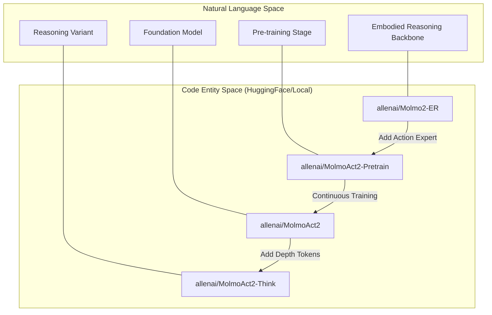
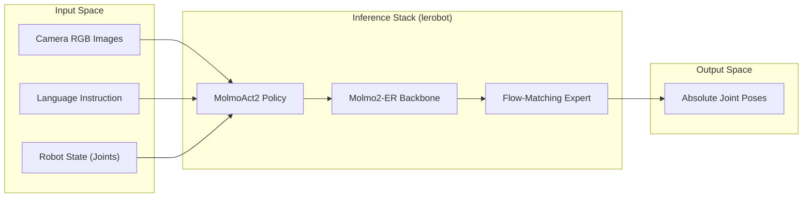

<!-- source: DeepWiki mcp.deepwiki.com · repo allenai/molmoact2 · page 8 Glossary · fetched 2026-10-26 -->

# Glossary

Relevant source files

The following files were used as context for generating this wiki page:

- [.gitmodules](.gitmodules)
- [LICENSE](LICENSE)
- [README.md](README.md)
- [assets/MolmoAct2.svg](assets/MolmoAct2.svg)
- [assets/m.png](assets/m.png)

This glossary provides definitions for codebase-specific terms, architectural components, and domain concepts essential for understanding the MolmoAct2 repository. It serves as a technical reference for engineers onboarding to the project, linking high-level concepts to their specific implementations.

## Core Architectural Concepts

### Molmo2-ER
The **Embodied-Reasoning (ER)** vision-language model backbone. It is a VLM pre-trained on spatial, 3D, and visual reasoning datasets to provide the geometric and scene-understanding capabilities required for robotics [README.md:35-35](). It serves as the starting point for all MolmoAct2 action models [README.md:55-55]().

### Continuous Flow-Matching Action Expert
A specialized neural module attached to the VLM backbone that generates robot control signals using a continuous flow-matching objective [README.md:35-35](). This approach is used for closed-loop manipulation, contrasting with the discrete token prediction used in earlier pre-training stages [README.md:52-54]().

### MolmoAct2-Think
A model variant that incorporates **Depth-Token Reasoning**. Before outputting actions, the model generates compact depth predictions (adaptive depth maps) to improve geometric reasoning and provide an interpretable intermediate state for safety checks [README.md:53-53]().

### Absolute Joint-Pose Control
The primary action convention used by MolmoAct2 fine-tuned models (e.g., SO-100, Bimanual YAM, DROID). Instead of relative offsets, the model predicts the absolute target positions for the robot's joints [README.md:63-65]().

### VLA (Vision-Language-Action)
The paradigm of training a single model to process visual observations and language instructions to directly output robotic actions. MolmoAct2 implements this by extending a VLM with an action expert [README.md:35-35]().

## System Entity Mapping

The following diagram bridges the gap between natural language concepts used in research and the specific code entities or checkpoints found in the repository.

**Model Evolution and Entity Mapping**

Sources: [README.md:50-55]()

## Infrastructure and Tooling

### LeRobot
An AI2-maintained fork of the HuggingFace LeRobot library used for training, evaluation, and deployment of MolmoAct2 [README.md:39-39]().

### lerobot (Submodule)
The physical directory `lerobot/` in the repository root which points to the `molmoact2-policy` branch of the `allenai/lerobot` repository [README.md:81-81](), [.gitmodules:1-5]().

### LeRobot v3.0 Format
The specific dataset schema required for compatibility with MolmoAct2 training workflows. All robotics datasets used in this project (DROID, RT-1, etc.) are converted to this format and paired with language annotations [README.md:77-77]().

## Deployment and Hardware Terms

| Term | Definition | Relevant Checkpoint |
| :--- | :--- | :--- |
| **Bimanual YAM** | "Yet Another Manipulator"; a dual-arm platform used for complex manipulation tasks [README.md:64-64](). | `MolmoAct2-BimanualYAM` |
| **SO-100 / 101** | Low-cost robot arms supported for real-world deployment [README.md:65-65](). | `MolmoAct2-SO100_101` |
| **DROID** | A large-scale dataset and implementation for Franka robot arms [README.md:63-63](). | `MolmoAct2-DROID` |
| **LIBERO** | A benchmark suite (Spatial, Object, Goal, Long) for evaluating lifelong learning in robotics [README.md:66-67](). | `MolmoAct2-LIBERO` |

**Data Flow: Observation to Action**

Sources: [README.md:35-35](), [README.md:81-81]()

## Abbreviations Reference

*   **BC-Z**: Behavioral Cloning from Z (Imitation learning dataset) [README.md:74-74]().
*   **ER**: Embodied Reasoning [README.md:35-35]().
*   **HF**: HuggingFace (Model/Dataset hosting platform) [README.md:18-32]().
*   **RT-1**: Robotics Transformer 1 (Dataset/Architecture) [README.md:74-74]().
*   **VLM**: Vision-Language Model [README.md:35-35]().

Sources: [README.md:1-85](), [.gitmodules:1-5](), [LICENSE:1-131]()