# Page: Overview

# Overview

<details>
<summary>Relevant source files</summary>

The following files were used as context for generating this wiki page:

- [README.md](README.md)
- [assets/MolmoAct2.svg](assets/MolmoAct2.svg)

</details>


MolmoAct2 is the Allen Institute for AI's (Ai2) open-source family of action reasoning models designed for high-precision robot control and real-world deployment. It represents a significant advancement in the Vision-Language-Action (VLA) paradigm by integrating a robust embodied-reasoning backbone with a continuous flow-matching action expert [README.md:35-36]().

The project bridges the gap between high-level semantic understanding (e.g., "pick up the red mug") and low-level motor control (absolute joint-pose actions) through a multi-stage training pipeline and a modular architecture.

## System Concept

MolmoAct2 operates by processing visual observations and language instructions through the `Molmo2-ER` backbone to generate latent representations. These representations are then consumed by a continuous action expert that predicts smooth trajectories for robot manipulators [README.md:35-36]().

### From Language to Robot Control
The following diagram illustrates how natural language instructions and visual inputs are transformed into executable code-level action entities within the system.

**Action Reasoning Flow**
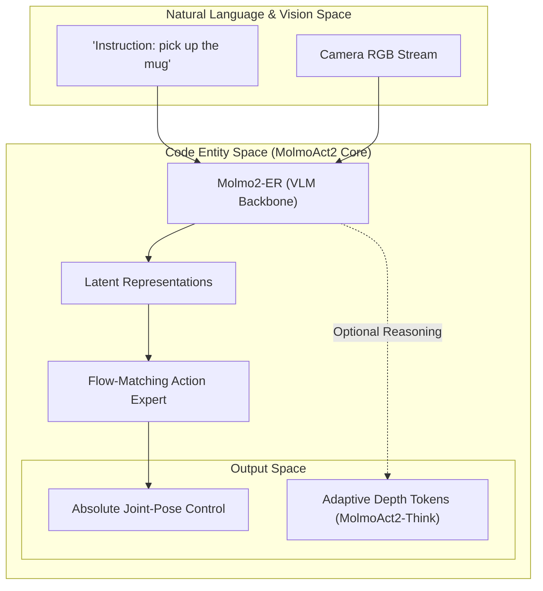
Sources: [README.md:35-36](), [README.md:52-55]()

## Repository Organization

The `molmoact2` repository serves as the central hub for model weights, dataset links, and integration logic. It leverages the `lerobot` framework as a submodule to provide standardized training and inference workflows [README.md:79-82]().

**Codebase Structure and Integration**
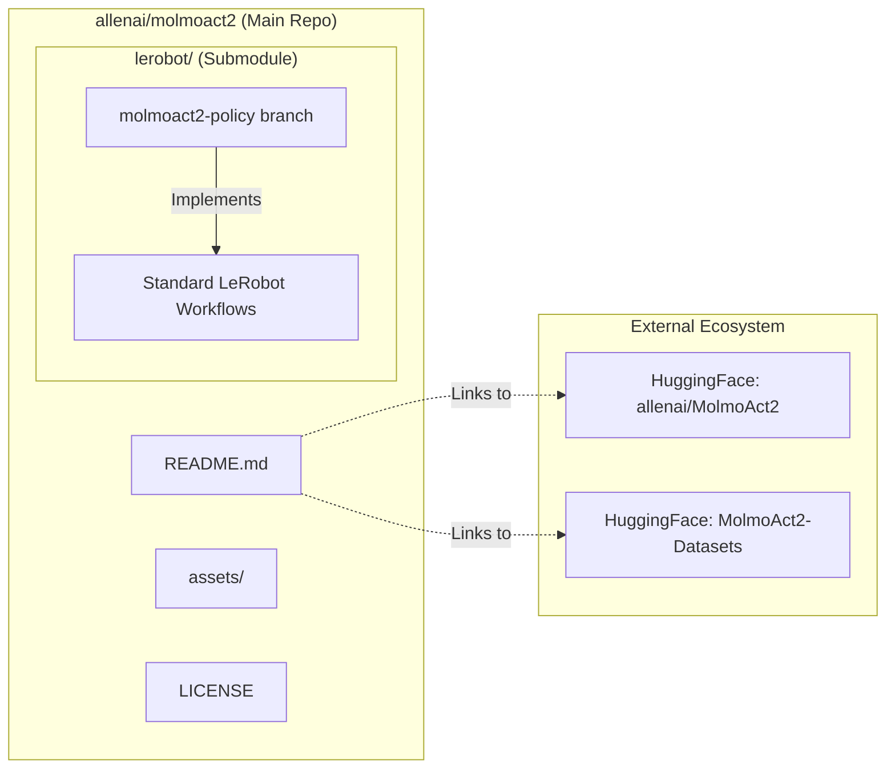
Sources: [README.md:39-41](), [README.md:79-82]()

## Key Components

### 1. Model Variants
The release includes several model stages, from the raw perception backbone to specialized "thinking" models:
*   **Molmo2-ER**: The base embodied-reasoning VLM [README.md:55]().
*   **MolmoAct2-Pretrain**: A discrete autoregressive VLA backbone used for initial action alignment [README.md:54]().
*   **MolmoAct2**: The standard foundation checkpoint featuring the continuous flow-matching expert [README.md:52]().
*   **MolmoAct2-Think**: An advanced variant that generates adaptive depth tokens to improve geometric reasoning before outputting actions [README.md:53]().

For more details on research motivation and the VLA paradigm, see [Project Background and Research Context](#1.1).

### 2. Training and Deployment
MolmoAct2 supports multiple robot embodiments including Franka (DROID), SO-100/101, and the Bimanual YAM platform [README.md:63-65](). 

*   **Datasets**: All robotics data is provided in **LeRobot v3.0** format, including the new BimanualYAM collection [README.md:73-77]().
*   **Framework**: Integration with `lerobot` allows for seamless fine-tuning and evaluation using standard command-line tools [README.md:39]().

For details on setting up the environment and the submodule, see [Repository Structure and Setup](#1.2).

## Quick Links
| Resource | Link |
| --- | --- |
| **ArXiv Paper** | [2605.02881](https://arxiv.org/abs/2605.02881) |
| **Base Models** | [HF Collection](https://huggingface.co/collections/allenai/molmoact2-models-69f81e05242e2499606b1be6) |
| **Finetuned Models** | [HF Collection](https://huggingface.co/collections/allenai/molmoact2-finetuned-models-69f81e23d5a7b34fde34f2ce) |
| **Robotics Datasets** | [HF Collection](https://huggingface.co/collections/allenai/molmoact2-datasets-69f81e316ec3daafe3f9555c) |
| **LeRobot Fork** | [allenai/lerobot (molmoact2-policy)](https://github.com/allenai/lerobot/tree/molmoact2-policy) |

Sources: [README.md:15-32](), [README.md:39-41]()

---

# Page: Project Background and Research Context

# Project Background and Research Context

<details>
<summary>Relevant source files</summary>

The following files were used as context for generating this wiki page:

- [README.md](README.md)

</details>


This page details the research motivation and technical foundation of MolmoAct2, a family of open action-reasoning models designed for robot control. MolmoAct2 represents a shift from traditional Vision-Language-Action (VLA) models by integrating a high-capacity embodied-reasoning backbone with a continuous flow-matching action expert.

## Research Motivation and AI2 Robotics Program

MolmoAct2 is a core component of the Allen Institute for AI (Ai2) robotics research program, which focuses on developing open-source, general-purpose foundation models for physical interaction. The project aims to bridge the gap between high-level semantic reasoning (found in Large Language Models) and low-level motor control (required for robotics).

The research is documented in the arXiv paper **"MolmoAct2: Action Reasoning Models for Real-world Deployment" (2605.02881)** [README.md:15-17](). The project addresses three primary challenges in current VLA research:
1. **Geometric Grounding**: Traditional VLMs often lack the spatial awareness needed for precise manipulation.
2. **Action Continuity**: Discrete token prediction often leads to "jittery" or imprecise robot movements.
3. **Open Access**: Providing a complete stack of models, datasets (in LeRobot v3.0 format), and deployment code [README.md:35-37]().

## The Molmo2-ER Backbone

The foundation of MolmoAct2 is the **Molmo2-ER** (Embodied Reasoning) backbone. Unlike standard VLMs trained on general web data, Molmo2-ER is specifically pre-trained on a mixture of spatial, 3D, and visual reasoning datasets [README.md:55-55]().

### Key Characteristics of Molmo2-ER:
*   **Spatial Awareness**: Trained on datasets that emphasize depth, orientation, and relative positioning [README.md:75-75]().
*   **Latent Representations**: Produces rich visual-semantic features that serve as the input for downstream action generation.
*   **Base for Evolution**: It serves as the starting point for the `MolmoAct2-Pretrain` stage [README.md:54-55]().

## The VLA Paradigm: From Discrete to Continuous

MolmoAct2 evolves through a multi-stage training process that transitions from discrete reasoning to continuous control.

### Why Flow-Matching?
Most VLA models use autoregressive discrete token prediction for actions. MolmoAct2 utilizes **Continuous Flow-Matching (CFM)** for its "Action Expert" layer. 
*   **Precision**: Flow-matching allows the model to predict continuous action values (absolute joint-poses) rather than binned categories.
*   **Smoothness**: It produces smoother trajectories suitable for real-world hardware like the Franka or SO-100 arms.
*   **Efficiency**: CFM typically offers faster and more stable convergence during training compared to diffusion-based methods in certain robot configurations.

### Data Flow and Model Hierarchy
The following diagram illustrates the relationship between the research stages and the resulting model checkpoints.

**Model Evolution and Entity Relationship**
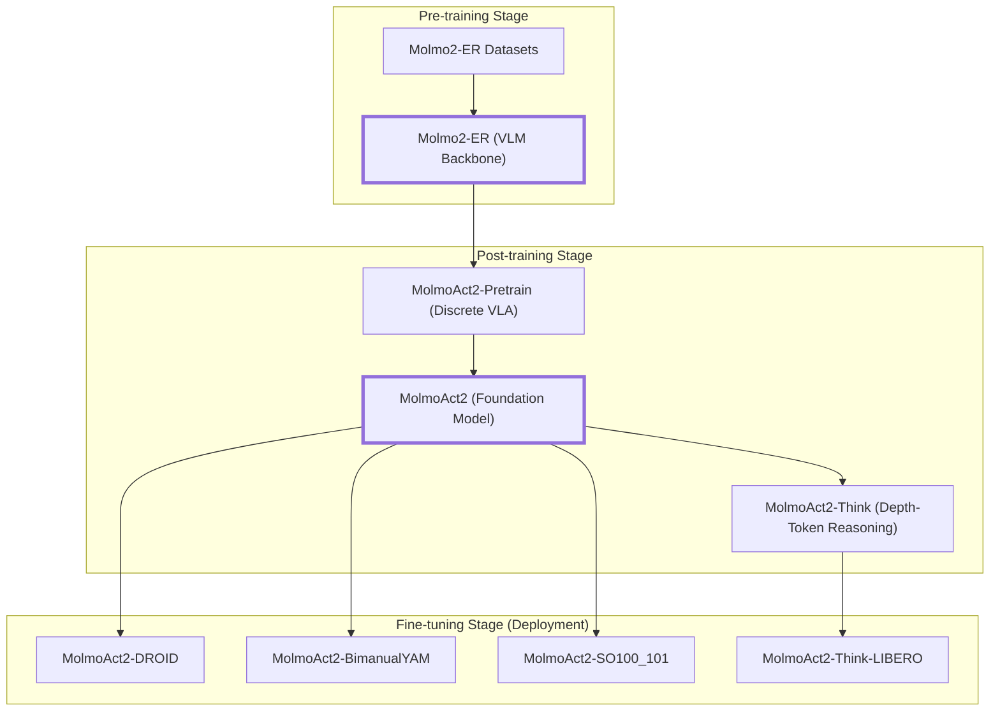
**Sources:** [README.md:50-67](), [README.md:71-75]()

## Technical Implementation and System Components

The MolmoAct2 system is integrated into the `lerobot` framework as a custom policy. The inference loop follows an "Observe → Instruct → Infer → Act" cycle.

### Core Components
*   **Vision-Language Backbone**: The `Molmo2-ER` weights process the camera feed and the language instruction (e.g., "pick up the red block").
*   **Action Expert**: A flow-matching head attached to the backbone that outputs the next set of robot states.
*   **Depth-Token Reasoning (Optional)**: The `MolmoAct2-Think` variant generates an adaptive depth map as an intermediate "thought" step before action generation to improve geometric accuracy [README.md:53-53]().

**Inference Data Flow (Code Entity Space)**
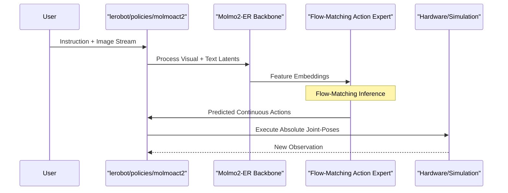
**Sources:** [README.md:35-37](), [README.md:52-54](), [README.md:81-83]()

## Summary of Training Stages

| Stage | Model Entity | Input | Output | Purpose |
| :--- | :--- | :--- | :--- | :--- |
| **Foundation** | `Molmo2-ER` | Images + Text | Latent Embeddings | General spatial/visual reasoning. |
| **Pre-train** | `MolmoAct2-Pretrain` | Images + Text | Discrete Action Tokens | Bridging VLM to Action space. |
| **Foundation** | `MolmoAct2` | Images + Text | Continuous Actions | The primary base for robot fine-tuning. |
| **Reasoning** | `MolmoAct2-Think` | Images + Text | Depth Tokens + Actions | Improved geometric grounding via depth. |

**Sources:** [README.md:50-55]()

---

# Page: Repository Structure and Setup

# Repository Structure and Setup

<details>
<summary>Relevant source files</summary>

The following files were used as context for generating this wiki page:

- [.gitmodules](.gitmodules)
- [README.md](README.md)

</details>


This page details the organizational layout of the `molmoact2` repository, the process for environment initialization, and the technical relationship between this repository and the `lerobot` framework. MolmoAct2 is designed to be used as a policy implementation within the LeRobot ecosystem, necessitating a specific submodule configuration for training and inference.

## Repository Layout

The repository serves as a central hub for model checkpoints, dataset links, and the integrated training/evaluation stack. It is structured to support both research exploration and real-world deployment on specific robotic embodiments.

| Component | Description |
| :--- | :--- |
| `assets/` | Contains static assets such as the MolmoAct2 logo and architecture diagrams used in documentation [README.md:2-2](). |
| `lerobot/` | A Git submodule pointing to the `allenai/lerobot` fork, specifically the `molmoact2-policy` branch [README.md:81-81](), [.gitmodules:1-4](). |
| `LICENSE` | The Apache 2.0 license governing the software and model weights [README.md:9-11](). |
| `README.md` | The primary entry point containing model tables, dataset links, and deployment instructions [README.md:1-83](). |

**Sources:** [README.md:1-83](), [.gitmodules:1-5]()

## Git Submodule and LeRobot Integration

MolmoAct2 is not a standalone codebase but is integrated into the LeRobot library as a policy class. This integration allows users to leverage standard LeRobot workflows for data loading (v3.0 format), training loops, and hardware interfacing [README.md:77-81]().

### Submodule Configuration
The repository uses a submodule to track a specific version of LeRobot maintained by Ai2. This fork contains the necessary `MolmoAct2Policy` implementation and configuration files required to load MolmoAct2 checkpoints.

**Code Entity Relationship: Submodule Mapping**
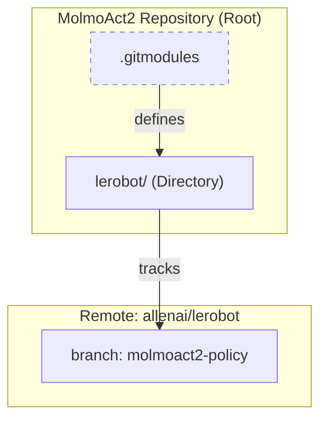
**Sources:** [.gitmodules:1-4](), [README.md:81-81]()

## Setup and Initialization

To correctly initialize the repository, users must perform a recursive clone or manually initialize the submodules to ensure the `lerobot` directory is populated with the `molmoact2-policy` branch code.

### 1. Cloning the Repository
```bash
# Clone with submodules
git clone --recurse-submodules https://github.com/allenai/molmoact2.git
```

### 2. Initializing Submodules (if cloned without --recurse)
If the repository was cloned normally, the `lerobot/` folder will be empty. Run the following to fetch the submodule content:
```bash
git submodule update --init --recursive
```

### 3. Branch Specificity
The submodule is pinned to the `molmoact2-policy` branch of the `allenai/lerobot` fork [README.md:81-81](). For users specifically looking to reproduce LIBERO benchmark results, a separate branch `molmoact2-hf-inference` is used within that fork to match the exact evaluation stack (v0.5.1) used in the paper.

**Sources:** [.gitmodules:1-5](), [README.md:81-81]()

## Data and Model Flow

The repository structure facilitates a data flow where raw datasets are converted to LeRobot v3.0 format, combined with language annotations, and fed into the `lerobot` training scripts using MolmoAct2 base checkpoints.

**System Data Flow: Training & Inference**
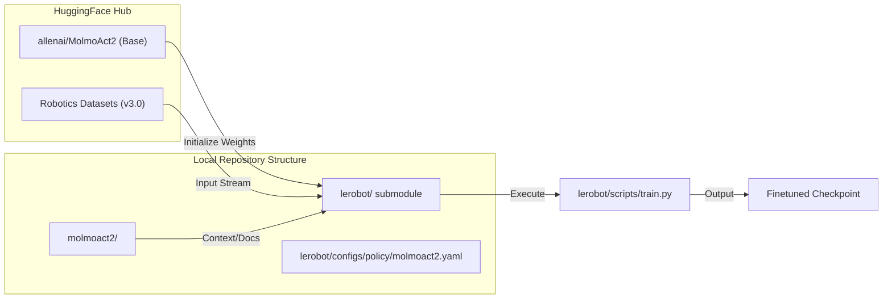

### Key Components for Setup:
*   **Base Checkpoints:** Foundation models like `MolmoAct2` or `MolmoAct2-Think` are used as starting points for fine-tuning [README.md:52-53]().
*   **Dataset Format:** All robotics datasets must be in LeRobot v3.0 format and include language annotations to be compatible with the Molmo2-ER backbone [README.md:77-77]().
*   **Policy Implementation:** The logic for the flow-matching action expert and depth-token reasoning resides within the `lerobot` submodule [README.md:35-35]().

**Sources:** [README.md:35-55](), [README.md:77-81]()

---

# Page: Model Architecture

# Model Architecture

<details>
<summary>Relevant source files</summary>

The following files were used as context for generating this wiki page:

- [README.md](README.md)

</details>


MolmoAct2 employs a multi-stage architecture designed to bridge high-level vision-language understanding with low-level continuous robotic control. The system is built upon the **Molmo2-ER** (Embodied Reasoning) backbone, which provides the necessary spatial and geometric priors for manipulation. This backbone is augmented with specialized action heads and reasoning layers to transform visual observations and natural language instructions into precise robot trajectories.

The architecture evolves through three primary stages:
1.  **Perception & Reasoning:** A Vision-Language Model (VLM) backbone.
2.  **Discrete Action Modeling:** A pre-training stage using discrete tokens for action representation.
3.  **Continuous Action Execution:** A flow-matching expert that generates smooth, high-frequency control signals.

### System Overview: From Pixels to Actions

The following diagram illustrates the data flow from the input space (images and text) through the architectural components defined in the codebase.

**Diagram: MolmoAct2 High-Level Inference Flow**
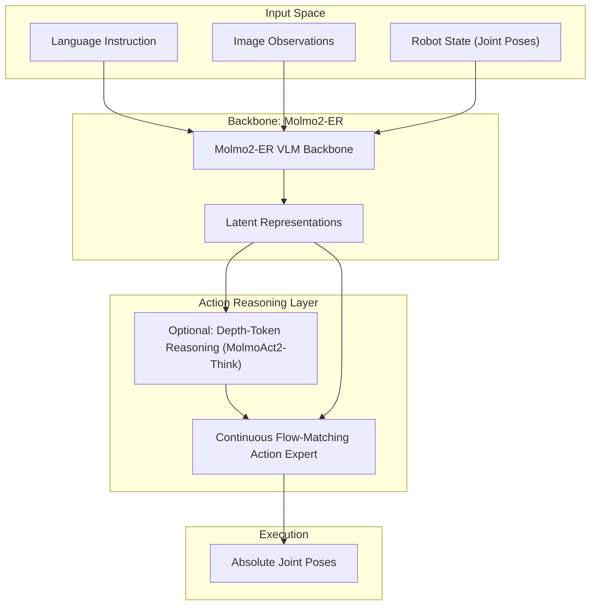
**Sources:** [README.md:35-36](), [README.md:52-55]()

---

### [Backbone: Molmo2-ER Vision-Language Model](#2.1)

The foundation of MolmoAct2 is the **Molmo2-ER** model. Unlike standard VLMs optimized for OCR or general conversation, Molmo2-ER is specifically trained on embodied reasoning datasets including spatial, 3D, and robotics-specific visual data. This ensures the model has an inherent understanding of physical groundedness before any action training begins.

For details on the VLM's training and internal representations, see [Backbone: Molmo2-ER Vision-Language Model](#2.1).

**Sources:** [README.md:55-55](), [README.md:75-75]()

---

### [Continuous Flow-Matching Action Expert](#2.2)

The transition from "reasoning" to "acting" is handled by a continuous flow-matching expert. While the system begins with a discrete autoregressive stage (**MolmoAct2-Pretrain**), the final deployment models use flow-matching to produce smooth, non-quantized action sequences. This expert enables closed-loop control by processing the VLM's latent features alongside current robot states to infer the next set of absolute joint poses.

For details on the flow-matching implementation and the closed-loop pipeline, see [Continuous Flow-Matching Action Expert](#2.2).

**Diagram: Action Generation Logic**
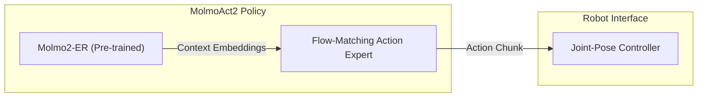
**Sources:** [README.md:35-36](), [README.md:52-54]()

---

### [Depth-Token Reasoning (MolmoAct2-Think)](#2.3)

The **MolmoAct2-Think** variant introduces an intermediate "thinking" step. Before generating actions, the model produces adaptive depth tokens. This architectural layer forces the model to resolve the 3D geometry of the scene explicitly. These depth maps serve two purposes:
1.  **Geometric Grounding:** Improving the accuracy of spatial manipulation.
2.  **Interpretability:** Providing a visual safety check for the operator to see what the model "perceives" as the scene depth.

For details on the depth-token generation and the MolmoAct2-Think checkpoints, see [Depth-Token Reasoning (MolmoAct2-Think)](#2.3).

**Sources:** [README.md:53-53](), [README.md:67-67]()

---

### Progressive Training Pipeline

The MolmoAct2 architecture is the result of a staged training process, where each stage adds a new capability to the model.

| Stage | Model Name | Architectural Change | Primary Goal |
| :--- | :--- | :--- | :--- |
| **1. Perception** | `Molmo2-ER` | Base VLM | Spatial and visual reasoning. |
| **2. Alignment** | `MolmoAct2-Pretrain` | Discrete Action Tokens | Mapping language to discrete robot behaviors. |
| **3. Control** | `MolmoAct2` | Flow-Matching Expert | Continuous, high-precision robot control. |
| **4. Reasoning** | `MolmoAct2-Think` | Depth-Token Layer | Explicit geometric reasoning before action. |

**Sources:** [README.md:46-55](), [README.md:79-84]()

---

# Page: Backbone: Molmo2-ER Vision-Language Model

# Backbone: Molmo2-ER Vision-Language Model

<details>
<summary>Relevant source files</summary>

The following files were used as context for generating this wiki page:

- [README.md](README.md)

</details>


The **Molmo2-ER** (Embodied Reasoning) Vision-Language Model (VLM) serves as the foundational perception and reasoning layer for the entire MolmoAct2 family [README.md:35-35](). It is designed to bridge the gap between high-level natural language instructions and the low-level geometric understanding required for robotic manipulation. Unlike general-purpose VLMs, Molmo2-ER is specifically pre-trained on datasets that emphasize spatial awareness, 3D structure, and physical scene reasoning [README.md:75-75]().

## Purpose and Role in MolmoAct2

Molmo2-ER functions as the "brain" of the MolmoAct2 architecture. It processes visual inputs (images from cameras) and language inputs (task instructions) to produce a rich latent representation. This representation is then consumed by downstream modules, such as the discrete autoregressive backbone in `MolmoAct2-Pretrain` or the continuous flow-matching action expert in the final `MolmoAct2` model [README.md:50-55]().

### Key Responsibilities:
*   **Visual Perception:** Encoding multi-view or single-view camera observations into a unified latent space.
*   **Language Understanding:** Parsing complex natural language instructions to ground them in the visual scene.
*   **Geometric Reasoning:** Providing the spatial priors necessary for 3D tasks, such as depth estimation and object localization.
*   **Latent Feature Generation:** Producing the hidden states that serve as the input for the action-generation layers.

## Data Flow and Architecture

The model architecture transforms raw sensor data into a format suitable for robotic decision-making. The following diagram illustrates how the Molmo2-ER backbone integrates into the broader system.

### Molmo2-ER System Context
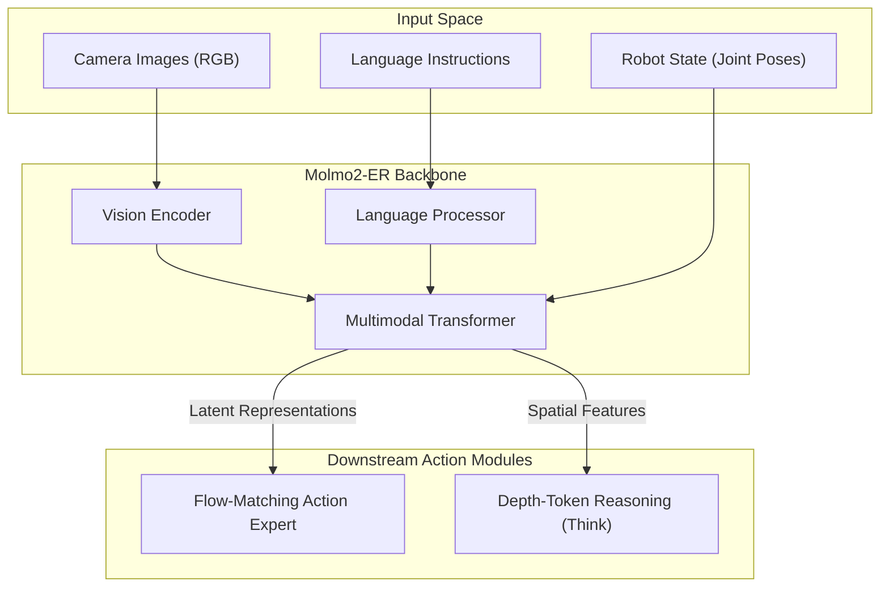
**Sources:** [README.md:35-35](), [README.md:50-55]()

## Embodied Reasoning (ER) Training

The "ER" suffix denotes a specific training regime focused on spatial and 3D reasoning. While standard VLMs are often trained on web-scale image-text pairs (e.g., captions), Molmo2-ER is trained on a curated collection of datasets that provide stronger physical grounding [README.md:75-75]().

### Training Dataset Categories
| Dataset Category | Description | Purpose |
| --- | --- | --- |
| **Spatial Reasoning** | Data involving positional relationships (e.g., "left of", "inside"). | Improves grounding of instructions in 3D space. |
| **3D Reasoning** | Data containing depth, point clouds, or multi-view geometry. | Enables the model to understand scene depth and volume. |
| **Robotics Data** | Demonstrations and robot-centric observations. | Aligns visual features with robotic action spaces. |
| **Visual Reasoning** | Complex Q&A about physical properties and scene dynamics. | Enhances logical deduction about task completion. |

**Sources:** [README.md:30-32](), [README.md:75-75]()

## Implementation and Checkpoints

The Molmo2-ER model is available as a standalone foundation checkpoint. It is the starting point for the progressive training pipeline that leads to the deployment-ready MolmoAct2 models.

### Model Relationships
```mermaid
graph LR
    node ["Molmo2-ER"]
    pre ["MolmoAct2-Pretrain"]
    act ["MolmoAct2"]
    think ["MolmoAct2-Think"]

    node -- "Add Discrete Action Tokens" --> pre
    pre -- "Attach Flow-Matching Expert" --> act
    act -- "Add Depth Reasoning" --> think

    style node stroke-width:4px
```

### Technical Specifications
*   **Base Checkpoint:** `allenai/Molmo2-ER` [README.md:55-55]()
*   **Framework:** Integrated into the `lerobot` ecosystem via the `molmoact2-policy` branch [README.md:81-81]().
*   **Output:** High-dimensional latent vectors (hidden states) that encode both the visual scene and the target instruction.

**Sources:** [README.md:50-55](), [README.md:81-81]()

## Integration with LeRobot

In the MolmoAct2 repository, the Molmo2-ER backbone is utilized within the `lerobot` submodule [README.md:81-81](). When a policy is initialized, the backbone is loaded to handle the `observation` and `task` processing before passing control to the action-specific layers.

### Code Entity Mapping
| Concept | Code Entity / Path |
| --- | --- |
| **Model Definition** | `allenai/Molmo2-ER` (HuggingFace) |
| **Policy Integration** | `lerobot/` submodule (`molmoact2-policy` branch) |
| **Training Pipeline** | `allenai/lerobot` workflow |

**Sources:** [README.md:39-39](), [README.md:81-81]()

---

# Page: Continuous Flow-Matching Action Expert

# Continuous Flow-Matching Action Expert

<details>
<summary>Relevant source files</summary>

The following files were used as context for generating this wiki page:

- [README.md](README.md)

</details>


The Continuous Flow-Matching Action Expert is the architectural component of MolmoAct2 responsible for translating high-level latent representations from the Molmo2-ER backbone into precise, continuous robot control signals [README.md:35-36](). While the model begins with a discrete autoregressive pre-training stage (MolmoAct2-Pretrain), the final foundation model (MolmoAct2) utilizes a flow-matching objective to produce smooth action trajectories suitable for real-world manipulation [README.md:52-54]().

## Architecture Overview

The MolmoAct2 architecture connects a Vision-Language Model (VLM) backbone to a flow-matching head. This transition from discrete token prediction to continuous flow-matching allows the model to handle the multi-modal nature of robot action distributions without the quantization artifacts common in purely discrete Vision-Language-Action (VLA) models [README.md:35-36]().

### Action Generation Pipeline
The pipeline follows a closed-loop control structure:
1.  **Observe**: The system captures visual input (RGB images) and robot state (absolute joint poses).
2.  **Instruct**: Natural language instructions are processed alongside visual tokens.
3.  **Infer**: The Molmo2-ER backbone produces latent embeddings.
4.  **Act**: The Flow-Matching Action Expert decodes these latents into a continuous action trajectory.
5.  **Execute**: The robot executes the predicted absolute joint-pose commands [README.md:35-36]().

### System Data Flow: Language to Action Expert
The following diagram illustrates the flow from natural language instructions and visual observations through the code entities that define the MolmoAct2 policy.

**Title: MolmoAct2 Policy Inference Flow**
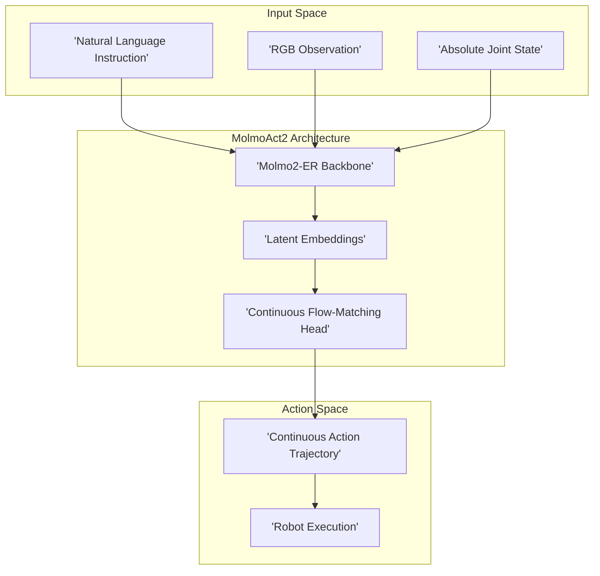
Sources: [README.md:35-36](), [README.md:52-55]()

## Training Stages and Model Variants

The Action Expert is introduced in the final stages of the MolmoAct2 training pipeline. This distinguishes it from the earlier discrete pre-training stage.

| Stage | Model Checkpoint | Action Representation | Purpose |
| :--- | :--- | :--- | :--- |
| **Pre-training** | `MolmoAct2-Pretrain` | Discrete Autoregressive | Aligning VLM with robot state/action tokens [README.md:54](). |
| **Foundation** | `MolmoAct2` | Continuous Flow-Matching | Base checkpoint for fine-tuning on specific robot embodiments [README.md:52](). |
| **Reasoning** | `MolmoAct2-Think` | Depth + Continuous Action | Intermediate depth-token reasoning before action generation [README.md:53](). |

### Implementation in LeRobot
MolmoAct2 is integrated into the `lerobot` framework as a custom policy implementation [README.md:81-82](). The core logic for handling the flow-matching inference and training is contained within the `allenai/lerobot` fork on the `molmoact2-policy` branch [README.md:39]().

**Title: Code Entity Mapping for MolmoAct2 Policy**
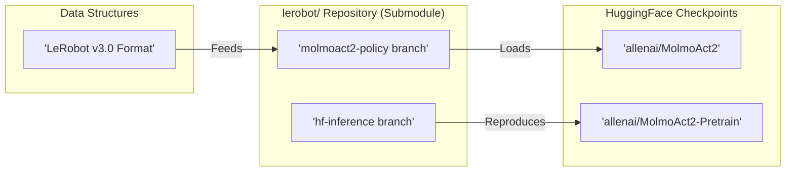
Sources: [README.md:39](), [README.md:77](), [README.md:81-82]()

## Action Convention: Absolute Joint-Pose Control

Unlike many VLA models that predict relative end-effector displacements, MolmoAct2 is trained to produce **absolute joint-pose** control signals [README.md:63-65](). This convention is consistent across all fine-tuned deployment models:

*   **MolmoAct2-DROID**: Fine-tuned for Franka arms using absolute joint-poses [README.md:63]().
*   **MolmoAct2-BimanualYAM**: Handles dual-arm configurations with absolute joint-pose trajectories [README.md:64]().
*   **MolmoAct2-SO100_101**: Supports low-cost SO-100/101 arms with absolute joint-pose control [README.md:65]().

This convention simplifies the control stack by removing the need for complex inverse kinematics (IK) during high-frequency execution, as the model directly reasons about the robot's joint configuration in the workspace [README.md:35-36]().

## Integration with Depth Reasoning (MolmoAct2-Think)

For tasks requiring high geometric precision, the `MolmoAct2-Think` variant augments the action expert with **depth-token reasoning** [README.md:53](). Before the flow-matching head produces the final action trajectory, the model generates an adaptive depth map represented as discrete tokens. This intermediate step serves two purposes:
1.  **Geometric Grounding**: It forces the backbone to attend to the 3D structure of the scene [README.md:53]().
2.  **Safety Validation**: The depth map can be visually inspected as an interpretable safety check before the robot executes the action [README.md:67]().

Sources: [README.md:35-36](), [README.md:52-54](), [README.md:63-67]()

---

# Page: Depth-Token Reasoning (MolmoAct2-Think)

# Depth-Token Reasoning (MolmoAct2-Think)

<details>
<summary>Relevant source files</summary>

The following files were used as context for generating this wiki page:

- [README.md](README.md)

</details>


The **MolmoAct2-Think** variant introduces an intermediate reasoning step where the model generates adaptive depth-tokens before predicting robot actions. This "Chain-of-Thought" for geometric reasoning allows the model to explicitly process the 3D structure of the scene, leading to improved manipulation performance and providing an interpretable safety check for human operators.

## Purpose and Geometric Reasoning

Traditional Vision-Language-Action (VLA) models map visual inputs directly to control signals. MolmoAct2-Think breaks this process into a two-stage reasoning pipeline:
1.  **Geometric Reasoning**: The model produces a set of depth tokens that represent an adaptive depth map of the scene.
2.  **Action Generation**: The model uses both the original visual features and these explicit depth representations to condition the continuous flow-matching action expert.

By forcing the model to "think" about depth, it develops a better internal representation of spatial relationships, which is critical for tasks involving precise reaching, obstacle avoidance, and object grasping.

### Key Benefits
*   **Improved Accuracy**: Explicit depth reasoning helps the model resolve spatial ambiguities that are common in 2D image inputs.
*   **Interpretable Safety**: The generated depth tokens can be visualized as a depth map. If the model's perceived depth is wildly inaccurate, it serves as a signal that the subsequent action may be unsafe.
*   **Adaptive Density**: Unlike fixed-grid depth maps, the tokens focus on task-relevant geometric features.

Sources: [README.md:53-53](), [README.md:67-67]()

---

## Data Flow: From Observation to Action

The data flow in MolmoAct2-Think involves the Molmo2-ER backbone generating a sequence of tokens that include the reasoning step. The flow-matching expert then consumes the latent states corresponding to these tokens.

### Logic Flow Diagram
"This diagram illustrates how the 'Think' step sits between visual perception and action execution."

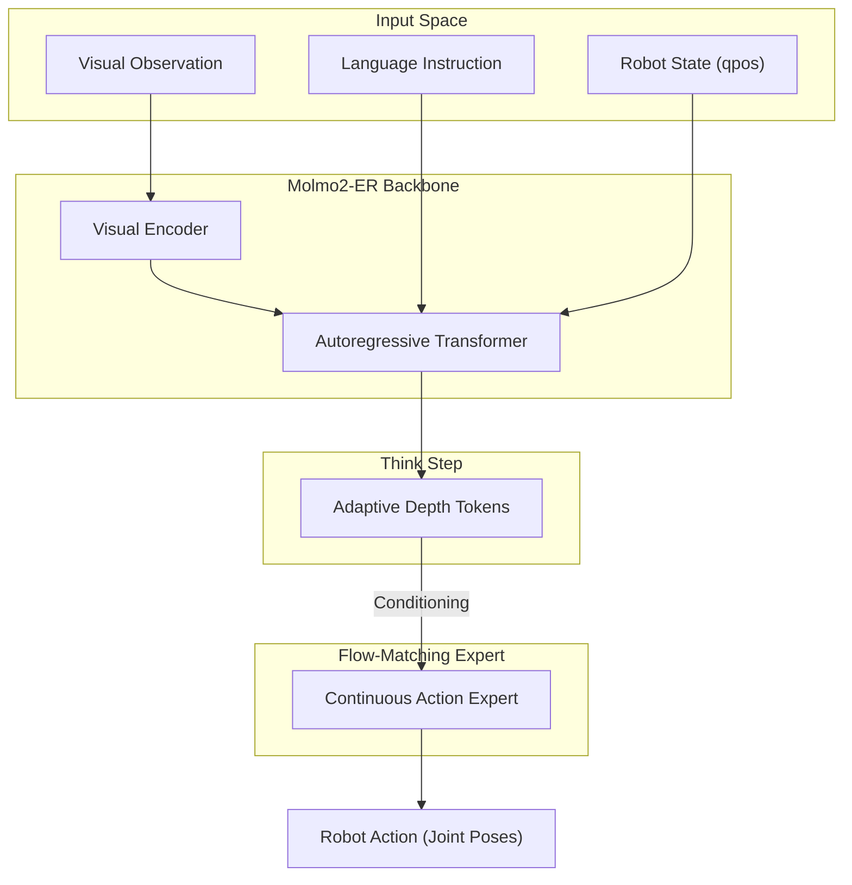
Sources: [README.md:35-35](), [README.md:53-54]()

---

## Implementation and Checkpoints

MolmoAct2-Think is implemented as a specialized training stage and architecture configuration. The model is first pre-trained on embodied reasoning datasets (Molmo2-ER) and then fine-tuned to produce depth tokens in conjunction with action trajectories.

### Available Checkpoints

| Model | Checkpoint Path | Description |
| :--- | :--- | :--- |
| **MolmoAct2-Think** | `allenai/MolmoAct2-Think` | The base foundation checkpoint. Use this as a starting point for fine-tuning on new embodiments where depth reasoning is required. |
| **MolmoAct2-Think-LIBERO** | `allenai/MolmoAct2-Think-LIBERO` | A fine-tuned version specifically for the LIBERO benchmark, trained on depth-and-action examples. |

### Integration with LeRobot
The "Think" mechanism is integrated into the `lerobot` policy framework. During inference, the policy generates the reasoning tokens before the flow-matching expert produces the final absolute joint-pose control signals.

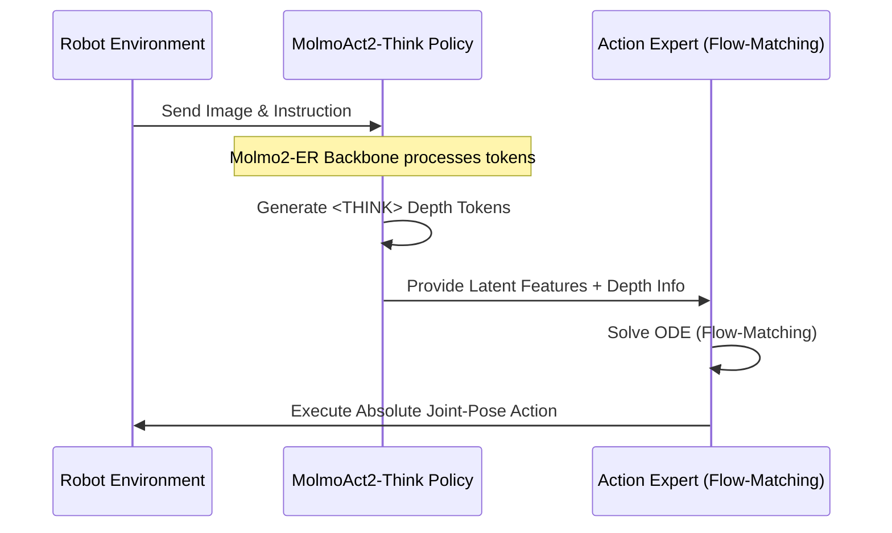

Sources: [README.md:53-53](), [README.md:67-67](), [README.md:81-83]()

---

## Interpretable Safety Checks

Because the depth-token generation is part of the autoregressive output of the VLM backbone, it can be monitored in real-time. In a deployment scenario, the system can implement a safety gate:

1.  **Depth Map Reconstruction**: The discrete depth tokens are converted back into a visual depth map.
2.  **Consistency Validation**: The reconstructed map is compared against a secondary sensor (e.g., a hardware depth camera) or checked for physical plausibility.
3.  **Action Gating**: If the "Think" output shows the model perceives a table where there is a void, or misses a prominent obstacle, the action execution is aborted.

This makes MolmoAct2-Think significantly more robust for real-world deployment on hardware like the SO-100 or Bimanual YAM compared to "black-box" VLA models.

Sources: [README.md:35-35](), [README.md:67-67]()

---

# Page: Model Checkpoints and Training Stages

# Model Checkpoints and Training Stages

<details>
<summary>Relevant source files</summary>

The following files were used as context for generating this wiki page:

- [README.md](README.md)

</details>


MolmoAct2 models are released in a tiered structure representing the progression from a general-purpose vision-language model to a specialized robotic controller. This hierarchy allows researchers and engineers to enter the pipeline at different stages depending on whether they intend to perform foundational pre-training, task-specific fine-tuning, or direct deployment on supported hardware.

The training pipeline transitions from discrete token prediction (for reasoning and depth) to continuous flow-matching (for precise action control) [README.md:35-36]().

## Training Progression Overview

The following diagram illustrates the relationship between the released checkpoints and the training stages they represent.

### Model Lineage and Stage Transitions
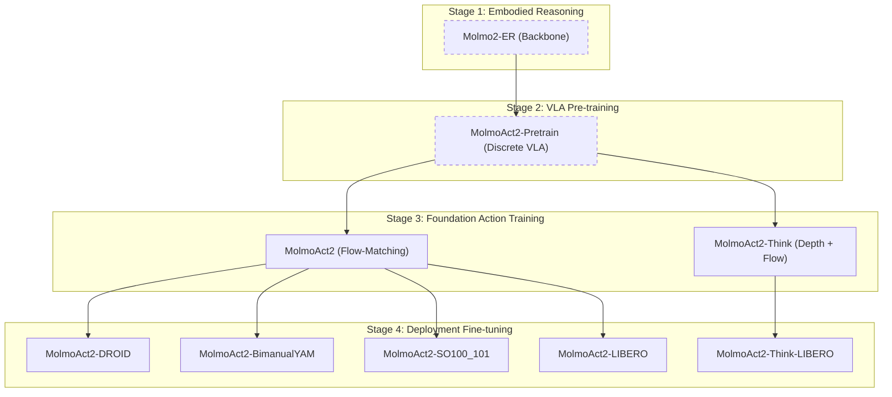
**Sources:** [README.md:50-67]()

## Checkpoint Categories

### Base (Foundation) Checkpoints
These checkpoints serve as the starting points for further development. They range from the `Molmo2-ER` backbone, which contains no action-specific heads, to `MolmoAct2`, which is ready for robotic fine-tuning using the continuous action expert [README.md:46-55]().

*   **Molmo2-ER**: The vision-language foundation trained on spatial and 3D reasoning.
*   **MolmoAct2-Pretrain**: A discrete autoregressive version used for internal training stages.
*   **MolmoAct2**: The standard foundation for robot fine-tuning.
*   **MolmoAct2-Think**: A variant that incorporates depth-token reasoning for improved geometric understanding.

For detailed specifications and HuggingFace paths, see **[Base (Foundation) Checkpoints](#3.1)**.

### Fine-Tuned Deployment Checkpoints
These models have been trained on specific robotics datasets (e.g., DROID, LIBERO, or YAM) and are optimized for direct inference or near-neighbor transfer learning [README.md:57-68]().

*   **Hardware-Specific**: Checkpoints for Franka (DROID), SO-100/101, and Bimanual YAM.
*   **Benchmark-Specific**: Optimized versions for the LIBERO simulation suites.

For hardware configurations and action conventions, see **[Fine-Tuned Deployment Checkpoints](#3.2)**.

## Integration with Training Workflows

All MolmoAct2 checkpoints are compatible with the `allenai/lerobot` framework. The repository includes a submodule pinned to the `molmoact2-policy` branch, which provides the necessary `lerobot` policy classes to load these checkpoints for continued training or evaluation [README.md:81-83]().

### Mapping Code Entities to Training Stages
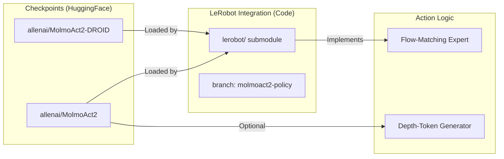
**Sources:** [README.md:39-41](), [README.md:81-83]()

## Summary Table

| Stage | Model Name | Primary Use Case |
| :--- | :--- | :--- |
| **Backbone** | `Molmo2-ER` | Starting point for new VLA architectures [README.md:55](). |
| **Pre-training** | `MolmoAct2-Pretrain` | Continuing discrete VLA training [README.md:54](). |
| **Foundation** | `MolmoAct2` | Default starting point for new robot embodiments [README.md:52](). |
| **Reasoning** | `MolmoAct2-Think` | Tasks requiring explicit geometric reasoning (depth) [README.md:53](). |
| **Deployment** | `MolmoAct2-[Variant]` | Direct inference or fine-tuning for specific hardware [README.md:63-67](). |

**Sources:** [README.md:50-67]()

---

# Page: Base (Foundation) Checkpoints

# Base (Foundation) Checkpoints

<details>
<summary>Relevant source files</summary>

The following files were used as context for generating this wiki page:

- [README.md](README.md)

</details>


This page provides a detailed reference for the four primary foundation checkpoints in the MolmoAct2 ecosystem. These checkpoints represent different stages of the model's evolution—from a general-purpose vision-language model (VLM) to a specialized Vision-Language-Action (VLA) model capable of continuous robot control. Understanding the transition between these checkpoints is critical for selecting the correct starting point for new robot embodiments or research experiments.

### Foundation Model Lineage

The MolmoAct2 training pipeline follows a progressive transition from high-level reasoning to low-level motor control. The checkpoints are organized by their position in this pipeline:

1.  **Molmo2-ER**: The vision-language backbone.
2.  **MolmoAct2-Pretrain**: The discrete action pre-training stage.
3.  **MolmoAct2**: The standard continuous control foundation.
4.  **MolmoAct2-Think**: The foundation model with adaptive depth reasoning.

#### Data Flow and Model Evolution
The following diagram illustrates how the system transitions from "Natural Language Space" (instructions and reasoning) to "Code Entity Space" (action experts and flow-matching).

**Diagram: MolmoAct2 Foundation Evolution**
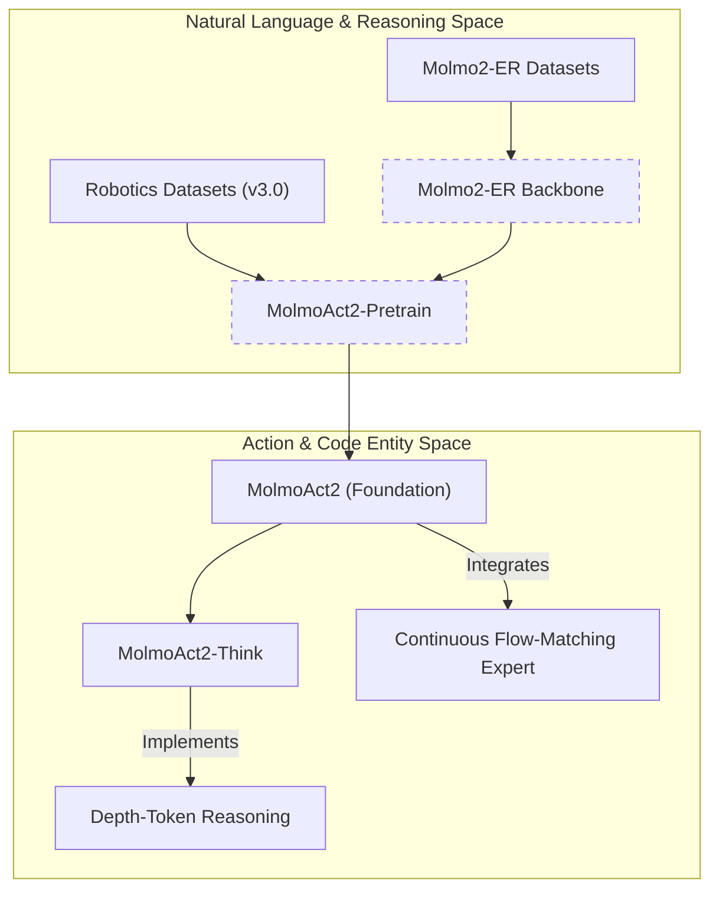
Sources: [README.md:35-36](), [README.md:46-55]()

---

### Detailed Checkpoint Reference

#### 1. Molmo2-ER
*   **HuggingFace Path**: `allenai/Molmo2-ER`
*   **Purpose**: Embodied-Reasoning VLM backbone.
*   **Description**: This is the starting point for the entire family. It is a Molmo2-based VLM specifically trained on spatial, 3D, and visual reasoning datasets to build the geometric understanding necessary for robotics.
*   **Use Case**: Use this if you are performing fundamental research on VLM backbones or wish to train a completely new VLA from scratch using different action modeling techniques.

Sources: [README.md:55-55](), [README.md:75-75]()

#### 2. MolmoAct2-Pretrain
*   **HuggingFace Path**: `allenai/MolmoAct2-Pretrain`
*   **Purpose**: Post-training (Intermediate Stage).
*   **Description**: This checkpoint represents the model after it has been trained on robotics data using discrete autoregressive tokens. It has learned the relationship between images, instructions, and robot states but does not yet include the continuous action expert.
*   **Use Case**: Intended for continuing the MolmoAct2 training stages or experimenting with alternative action heads (e.g., Diffusion or different Flow-Matching implementations). **Note**: This model is not intended for direct continuous-control inference.

Sources: [README.md:54-54]()

#### 3. MolmoAct2 (Foundation)
*   **HuggingFace Path**: `allenai/MolmoAct2`
*   **Purpose**: General Fine-tuning.
*   **Description**: The primary foundation checkpoint. It features the Molmo2-ER backbone connected to a continuous flow-matching action expert. It has been trained on a large mixture of robotics data (DROID, BC-Z, Bridge, RT-1, etc.) to establish a robust baseline for manipulation.
*   **Use Case**: This is the **default starting point** for adapting MolmoAct2 to a new robot embodiment or a specific benchmark. It provides the best balance of general robotics knowledge and flexibility.

Sources: [README.md:52-52](), [README.md:83-84]()

#### 4. MolmoAct2-Think
*   **HuggingFace Path**: `allenai/MolmoAct2-Think`
*   **Purpose**: Specialized Fine-tuning (Geometric Reasoning).
*   **Description**: An extension of the base MolmoAct2 that incorporates "Think" tokens. Before outputting actions, the model generates compact depth predictions (adaptive depth maps). This forces the model to reason about the 3D structure of the scene before deciding on a motor command.
*   **Use Case**: Use this when the target task requires high precision or complex geometric reasoning. It is also useful for safety-critical applications where the intermediate depth map serves as an interpretable check of the model's perception.

Sources: [README.md:53-53]()

---

### Implementation Mapping

The following diagram maps the logical components of these foundation checkpoints to the software entities found within the `lerobot` integration used for training and deployment.

**Diagram: Logical Component to Code Entity Mapping**
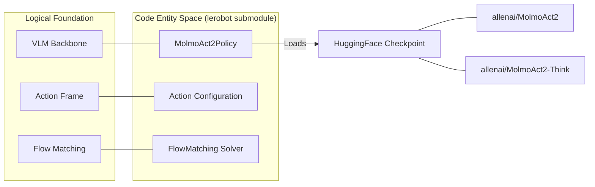
Sources: [README.md:50-55](), [README.md:79-81]()

### Summary Table: Which Checkpoint to Use?

| Goal | Recommended Checkpoint | Reasoning |
| :--- | :--- | :--- |
| **New Robot Arm** | `allenai/MolmoAct2` | Provides the most general robotics foundation for adaptation. |
| **High-Precision Task** | `allenai/MolmoAct2-Think` | Depth-reasoning tokens improve spatial accuracy. |
| **VLA Research** | `allenai/MolmoAct2-Pretrain` | Clean VLA backbone without the continuous expert attached. |
| **VLM/ER Research** | `allenai/Molmo2-ER` | Base VLM with embodied reasoning but no action data. |

**Important Note on Fine-tuning**: While these base checkpoints are the foundation, if your robot is similar to one of the supported platforms (Franka, SO-100, or YAM), it is often more efficient to start from a **Fine-Tuned Deployment Checkpoint** (see Section 3.2) rather than these base foundation models.

Sources: [README.md:48-48](), [README.md:83-85]()

---

# Page: Fine-Tuned Deployment Checkpoints

# Fine-Tuned Deployment Checkpoints

<details>
<summary>Relevant source files</summary>

The following files were used as context for generating this wiki page:

- [README.md](README.md)

</details>


This page provides a detailed reference for the five fine-tuned MolmoAct2 checkpoints released for direct deployment and specialized research. Unlike the base foundation models, these checkpoints are optimized for specific hardware configurations, action spaces, and benchmark suites. They serve as ready-to-use policies for their target embodiments or as high-quality starting points for cross-embodiment transfer learning.

## Overview of Fine-Tuned Variants

The fine-tuned checkpoints are derived from the `MolmoAct2` or `MolmoAct2-Think` base models. They have been trained on specific robotics dataset mixtures and follow an absolute joint-pose action convention.

### Checkpoint Summary Table

| Model | Primary Use Case | Target Hardware / Suite | HF Path |
| :--- | :--- | :--- | :--- |
| **MolmoAct2-DROID** | Franka Emika Panda | DROID Franka Setup | [allenai/MolmoAct2-DROID](https://huggingface.co/allenai/MolmoAct2-DROID) |
| **MolmoAct2-BimanualYAM** | Dual-arm YAM | Bimanual YAM | [allenai/MolmoAct2-BimanualYAM](https://huggingface.co/allenai/MolmoAct2-BimanualYAM) |
| **MolmoAct2-SO100_101** | Low-cost SO-100/101 | SO-100 & SO-101 Arms | [allenai/MolmoAct2-SO100_101](https://huggingface.co/allenai/MolmoAct2-SO100_101) |
| **MolmoAct2-LIBERO** | Simulation Benchmark | LIBERO (Spatial, Object, Goal, Long) | [allenai/MolmoAct2-LIBERO](https://huggingface.co/allenai/MolmoAct2-LIBERO) |
| **MolmoAct2-Think-LIBERO** | Reasoning in Sim | LIBERO with Depth-Tokens | [allenai/MolmoAct2-Think-LIBERO](https://huggingface.co/allenai/MolmoAct2-Think-LIBERO) |

Sources: [README.md:57-68]()

---

## Technical Implementation and Data Flow

The deployment checkpoints utilize a closed-loop inference pipeline integrated within the `lerobot` framework. The system processes visual input and language instructions to produce continuous control signals via a Flow-Matching Action Expert.

### Inference Data Flow Diagram

The following diagram illustrates how a fine-tuned checkpoint processes data during a real-world or simulation rollout, bridging high-level instructions to low-level robot actions.

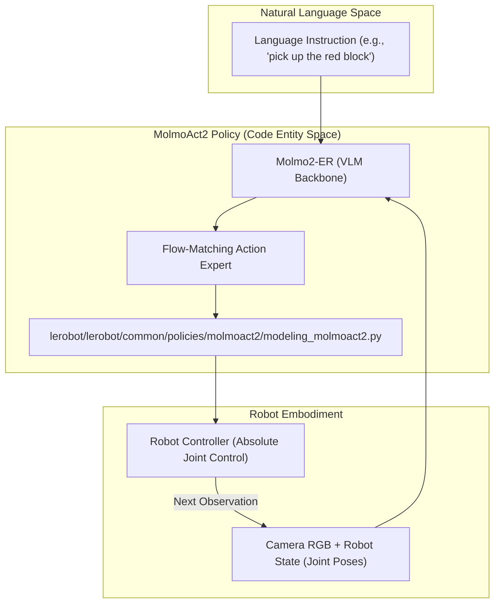

Sources: [README.md:35-36](), [README.md:79-82]()

---

## Detailed Checkpoint Reference

### 1. MolmoAct2-DROID
*   **Target:** Franka Emika Panda robots.
*   **Dataset:** Filtered DROID Franka mixture [README.md:63]().
*   **Action Convention:** Absolute joint-pose control.
*   **Guidance:** Best for users with Franka setups or those performing research on large-scale multi-task data from the DROID collection.

### 2. MolmoAct2-BimanualYAM
*   **Target:** Bimanual YAM (Yet Another Manipulator) dual-arm platforms.
*   **Dataset:** Bimanual YAM mixture including annotated language instructions [README.md:64]().
*   **Action Convention:** Absolute joint-pose control for dual arms.
*   **Guidance:** Use this for any dual-arm setup. It provides a significantly better initialization than the base model for bimanual coordination tasks [README.md:83-85]().

### 3. MolmoAct2-SO100_101
*   **Target:** Low-cost SO-100 and SO-101 robot arms.
*   **Dataset:** Combined SO-100/SO-101 datasets with annotated language [README.md:65]().
*   **Action Convention:** Absolute joint-pose control.
*   **Guidance:** Ideal for the hobbyist and low-cost robotics community. Recommended as a starting point for other low-cost hobbyist arms (e.g., ALOHA-style or Interbotix) [README.md:83-85]().

### 4. MolmoAct2-LIBERO & MolmoAct2-Think-LIBERO
*   **Target:** LIBERO simulation benchmark.
*   **Dataset:** Full LIBERO training mixture (Spatial, Object, Goal, and Long suites) [README.md:66-67]().
*   **Special Feature (Think):** The `Think-LIBERO` variant generates adaptive depth-tokens as an intermediate reasoning step before action output [README.md:67]().
*   **Guidance:** Use these to reproduce benchmark results or as a baseline for simulated robot learning research.

---

## Selection Guidance for New Embodiments

When adapting MolmoAct2 to a new robot, selecting the correct starting checkpoint can significantly reduce training time and data requirements.

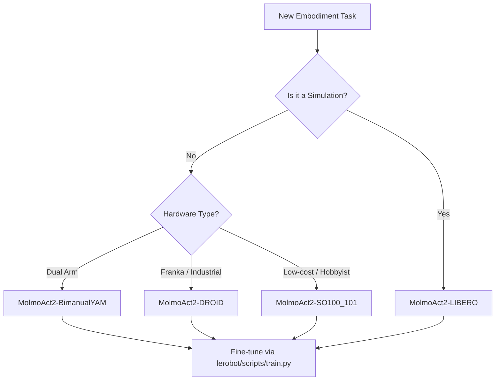

Sources: [README.md:83-85]()

### Deployment Integration
All checkpoints are compatible with the `allenai/lerobot` integration. They can be loaded directly using the `LeRobot` policy API. The implementation logic resides in the `molmoact2-policy` branch of the submodule [README.md:39](), [README.md:81]().

Sources: [README.md:79-82]()

---

# Page: Datasets

# Datasets

<details>
<summary>Relevant source files</summary>

The following files were used as context for generating this wiki page:

- [README.md](README.md)

</details>


MolmoAct2 utilizes a diverse collection of datasets spanning high-level embodied reasoning and low-level robotic control. These datasets are categorized into two primary groups: those used for training the **Molmo2-ER** vision-language backbone and those used for the **MolmoAct2** action-generation stages. All robotics datasets are standardized to the **LeRobot v3.0** format and enhanced with detailed language annotations to facilitate vision-language-action (VLA) learning [README.md:71-78]().

### Dataset Ecosystem Overview

The following diagram illustrates how different data collections feed into the various stages of the MolmoAct2 model pipeline, transitioning from general reasoning to specific robotic control.

**Data Flow from Reasoning to Action**
```mermaid
graph TD
    subgraph "Natural Language & Reasoning Space"
        ER_DATA["Molmo2-ER Datasets"]
        LANG_ANNOT["Language Annotations"]
    end

    subgraph "Code Entity Space (Training Stages)"
        MOLMO_ER["allenai/Molmo2-ER"]
        MOLMO_PRE["allenai/MolmoAct2-Pretrain"]
        MOLMO_ACT["allenai/MolmoAct2"]
    end

    subgraph "Robotics Data Space (LeRobot v3.0)"
        ROBO_COL["Robotics Dataset Collections"]
        BIMANUAL["BimanualYAM Dataset"]
    end

    ER_DATA -->|Backbone Pre-training| MOLMO_ER
    MOLMO_ER -->|Post-training| MOLMO_PRE
    ROBO_COL -->|Action Modeling| MOLMO_PRE
    LANG_ANNOT -->|Instruction Tuning| MOLMO_PRE
    MOLMO_PRE -->|Flow-Matching Expert| MOLMO_ACT
    BIMANUAL -->|Fine-tuning| MOLMO_ACT
```
Sources: [README.md:50-55](), [README.md:71-75]()

---

## Robotics Training Datasets

The robotics datasets used for MolmoAct2 training are designed for closed-loop manipulation. They cover a wide range of hardware platforms, including Franka (DROID), SO-100/101, and the Bimanual YAM platform [README.md:63-65]().

A critical requirement for these datasets is their conversion to the **LeRobot v3.0** format, which ensures compatibility with the training and evaluation scripts found in the `lerobot/` submodule [README.md:77-81](). These datasets often include absolute joint-pose action conventions and are paired with extra language annotations to support the model's instruction-following capabilities.

For a detailed breakdown of specific robotics mixtures, including DROID, BC-Z, Bridge, and RT-1, see [Robotics Training Datasets](#4.1).

**Robotics Data Collections**
| Collection | Description | Access |
| --- | --- | --- |
| **MolmoAct2 Robotics** | Mixture of SO-100, DROID, BC-Z, Bridge, and RT-1. | [HuggingFace Collection](https://huggingface.co/collections/allenai/molmoact2-datasets-69f81e316ec3daafe3f9555c) |
| **BimanualYAM** | Specialized datasets for the Bimanual YAM dual-arm platform. | [HuggingFace Collection](https://huggingface.co/collections/allenai/molmoact2-bimanualyam-dataset-69f81e17b140ec34f430a35e) |

Sources: [README.md:24-29](), [README.md:71-75]()

---

## Embodied Reasoning (ER) Datasets

The **Molmo2-ER** backbone is pre-trained on a massive collection of embodied reasoning data. This stage is crucial for providing the model with a fundamental understanding of 3D space, geometric relationships, and visual reasoning before it ever attempts to predict a robotic action [README.md:35-36]().

These datasets include:
*   **Spatial Reasoning:** Understanding the relative positions of objects.
*   **3D Understanding:** Interpreting depth and volume from 2D images.
*   **Visual Reasoning:** Answering complex questions about scene dynamics.

For more information on the specific data sources and the role of ER data in building the model's "mental model" of the physical world, see [Embodied Reasoning (ER) Datasets](#4.2).

**Reasoning to Action Mapping**
```mermaid
graph LR
    subgraph "Reasoning Datasets"
        direction TB
        SPATIAL["Spatial Data"]
        THREE_D["3D Data"]
        VIS_REASON["Visual Reasoning"]
    end

    subgraph "Model Backbone"
        BACKBONE["Molmo2-ER"]
    end

    subgraph "Action Output"
        FLOW["Flow-Matching Expert"]
        ACTION["Continuous Actions"]
    end

    SPATIAL --> BACKBONE
    THREE_D --> BACKBONE
    VIS_REASON --> BACKBONE
    BACKBONE --> FLOW
    FLOW --> ACTION
```
Sources: [README.md:35-36](), [README.md:55](), [README.md:75]()

---

## Dataset Formats and Integration

MolmoAct2 is deeply integrated with the `allenai/lerobot` framework. This allows researchers to use standard LeRobot workflows for training and evaluation.

*   **LeRobot v3.0:** All training data must adhere to this format to be compatible with the `molmoact2-policy` implementation [README.md:77-81]().
*   **Language Annotations:** Unlike standard robotics datasets that may only contain state/action pairs, MolmoAct2 datasets are enriched with language instructions to enable the VLA paradigm [README.md:77-78]().

For technical details on how to prepare your own datasets for MolmoAct2, refer to the [Training and Evaluation Workflows](#5.1) page.

Sources: [README.md:71-82]()

---

# Page: Robotics Training Datasets

# Robotics Training Datasets

<details>
<summary>Relevant source files</summary>

The following files were used as context for generating this wiki page:

- [README.md](README.md)

</details>


This page provides a technical overview of the robotics datasets used to train and fine-tune the MolmoAct2 family of models. These datasets cover a diverse range of robotic embodiments, from single-arm manipulators like Franka and SO-100 to complex bimanual setups like the YAM platform. All robotics datasets used in the MolmoAct2 pipeline are standardized to the **LeRobot v3.0 format** and are often augmented with additional natural language annotations to facilitate vision-language-action (VLA) reasoning [README.md:77-77]().

## Dataset Ecosystem Overview

The MolmoAct2 training process utilizes three primary dataset collections hosted on HuggingFace. These collections provide the foundation for spatial reasoning, pre-training, and embodiment-specific fine-tuning.

| Collection Name | Purpose | HuggingFace Path |
| :--- | :--- | :--- |
| **MolmoAct2 Robotics Datasets** | Core robotics data for training and fine-tuning. Includes DROID, BC-Z, Bridge, RT-1, etc. | [allenai/molmoact2-datasets](https://huggingface.co/collections/allenai/molmoact2-datasets-69f81e316ec3daafe3f9555c) |
| **MolmoAct2-BimanualYAM** | Specialized collection for bimanual manipulation training and evaluation. | [allenai/molmoact2-bimanualyam-dataset](https://huggingface.co/collections/allenai/molmoact2-bimanualyam-dataset-69f81e17b140ec34f430a35e) |
| **Molmo2-ER Datasets** | Embodied reasoning data (spatial, 3D, visual reasoning) used for the VLM backbone. | [allenai/molmo2-er-datasets](https://huggingface.co/collections/allenai/molmo2-er-datasets-69f8d605d92d46a5fc24ced2) |

Sources: [README.md:24-32](), [README.md:71-75]()

---

## Data Format and Requirements

### LeRobot v3.0 Standardization
All robotics datasets used for MolmoAct2 pre-training and post-training are converted into the **LeRobot v3.0 format** [README.md:77-77](). This standardization ensures compatibility with the `lerobot` training and evaluation scripts integrated into the repository as a submodule [README.md:81-82]().

### Language Annotations
A key requirement for MolmoAct2 is the pairing of robot trajectories with extra language annotations [README.md:77-77](). These annotations allow the model to associate visual observations and proprioception with high-level textual instructions, enabling the "Observe → Instruct → Infer" loop.

### Action Convention
For the fine-tuned models (DROID, SO-100/101, Bimanual YAM), the datasets are prepared using an **absolute joint-pose action convention** [README.md:63-65](). This ensures consistent control signals across different physical embodiments.

---

## Key Robotics Dataset Collections

### 1. DROID (Franka)
The DROID dataset is a large-scale collection of Franka Emika Panda robot trajectories. For MolmoAct2, a filtered version of this mixture is used [README.md:63-63](). It serves as the primary data source for the `MolmoAct2-DROID` checkpoint.

### 2. Bimanual YAM
This is a specialized collection developed by Ai2 for the Bimanual YAM (Yet Another Manipulator) platform. It includes dual-arm trajectories and is essential for training models to coordinate complex bimanual tasks [README.md:73-73]().

### 3. SO-100 / SO-101
Datasets collected from low-cost SO-100 and SO-101 robot arms. These datasets are used to produce the `MolmoAct2-SO100_101` deployment checkpoint [README.md:65-65]().

### 4. General Robotics Mixture (BC-Z, Bridge, RT-1)
To improve the robustness and generalization of the base `MolmoAct2` model, several foundational robotics datasets are included in the mixture:
*   **BC-Z:** Diverse tasks from Google's robotics research.
*   **Bridge:** Data from the BridgeData project, focusing on kitchen tasks.
*   **RT-1:** Large-scale data from the Robotics Transformer project.
*   **MolmoAct Dataset:** Custom data collected specifically for the MolmoAct project.

Sources: [README.md:63-65](), [README.md:74-74]()

---

## Data Flow: From Dataset to Policy

The following diagram illustrates how the various dataset collections feed into the different stages of the MolmoAct2 training pipeline.

**MolmoAct2 Dataset Integration Flow**

```mermaid
graph TD
    subgraph "External Sources"
        DS_DROID["DROID (Franka)"]
        DS_BRIDGE["Bridge V2"]
        DS_RT1["RT-1 Data"]
        DS_SO["SO-100/101 Data"]
    end

    subgraph "Data Preparation"
        LR_CONV["LeRobot v3.0 Converter"]
        LANG_ANN["Language Annotation Engine"]
    end

    subgraph "HuggingFace Collections"
        COL_ER["Molmo2-ER Datasets"]
        COL_ROBO["MolmoAct2 Robotics Datasets"]
        COL_YAM["BimanualYAM Dataset"]
    end

    subgraph "Training Stages"
        STAGE_VLM["Backbone Pre-training (Molmo2-ER)"]
        STAGE_PRE["VLA Pre-training (MolmoAct2-Pretrain)"]
        STAGE_BASE["Foundation Training (MolmoAct2)"]
        STAGE_FT["Embodiment Fine-tuning"]
    end

    %% Flow
    DS_DROID & DS_BRIDGE & DS_RT1 & DS_SO --> LR_CONV
    LR_CONV --> LANG_ANN
    LANG_ANN --> COL_ROBO
    
    COL_ER --> STAGE_VLM
    STAGE_VLM --> STAGE_PRE
    COL_ROBO --> STAGE_PRE
    COL_ROBO --> STAGE_BASE
    COL_YAM --> STAGE_FT
    
    STAGE_BASE --> STAGE_FT
```

Sources: [README.md:35-35](), [README.md:52-55](), [README.md:71-75](), [README.md:77-77]()

---

## Mapping Datasets to Model Entities

This diagram maps the dataset collections to the specific model checkpoints and policy implementations defined in the codebase.

**Dataset to Code Entity Mapping**

```mermaid
graph LR
    subgraph "HuggingFace Collections"
        HF_ER["allenai/molmo2-er-datasets"]
        HF_ROBO["allenai/molmoact2-datasets"]
        HF_YAM["allenai/molmoact2-bimanualyam-dataset"]
    end

    subgraph "Model Checkpoints (Code Symbols)"
        M_ER["Molmo2-ER (Backbone)"]
        M_BASE["MolmoAct2 (Foundation)"]
        M_DROID["MolmoAct2-DROID"]
        M_SO["MolmoAct2-SO100_101"]
        M_YAM["MolmoAct2-BimanualYAM"]
    end

    subgraph "LeRobot Integration"
        POL_LIB["lerobot/policies/molmoact2"]
    end

    %% Mapping
    HF_ER -.-> M_ER
    HF_ROBO -.-> M_BASE
    HF_ROBO -.-> M_DROID
    HF_ROBO -.-> M_SO
    HF_YAM -.-> M_YAM
    
    M_BASE --> POL_LIB
    M_DROID --> POL_LIB
    M_SO --> POL_LIB
    M_YAM --> POL_LIB
```

Sources: [README.md:50-67](), [README.md:71-75](), [README.md:81-82]()

---

## Dataset Usage Summary

| Dataset Collection | Primary Checkpoint | Control Type |
| :--- | :--- | :--- |
| **Filtered DROID Mixture** | `allenai/MolmoAct2-DROID` | Absolute Joint-Pose [README.md:63-63]() |
| **Bimanual YAM Mixture** | `allenai/MolmoAct2-BimanualYAM` | Absolute Joint-Pose [README.md:64-64]() |
| **SO-100/101 Datasets** | `allenai/MolmoAct2-SO100_101` | Absolute Joint-Pose [README.md:65-65]() |
| **LIBERO Training Mixture** | `allenai/MolmoAct2-LIBERO` | Task-specific [README.md:66-66]() |
| **ER Reasoning Data** | `allenai/Molmo2-ER` | N/A (Visual/Spatial) [README.md:55-55]() |

Sources: [README.md:50-67]()

---

# Page: Embodied Reasoning (ER) Datasets

# Embodied Reasoning (ER) Datasets

<details>
<summary>Relevant source files</summary>

The following files were used as context for generating this wiki page:

- [README.md](README.md)

</details>


The Molmo2-ER (Embodied Reasoning) dataset collection provides the foundational geometric, spatial, and visual reasoning data used to train the Molmo2-ER vision-language backbone. Unlike standard VLM datasets that focus on general image captioning or document understanding, the ER collection is specifically curated to build the scene-understanding capabilities required for robotic manipulation, such as 3D spatial awareness, object affordances, and physical reasoning [README.md:35-37]().

## Overview of the ER Collection

The Molmo2-ER backbone serves as the perception and language-understanding layer for the entire MolmoAct2 family [README.md:55-56](). The datasets in this collection are designed to bridge the gap between "internet-scale" visual knowledge and the "embodied" knowledge needed to map visual inputs to physical actions.

| Category | Description | Core Capabilities |
| :--- | :--- | :--- |
| **Spatial Reasoning** | 2D and 3D coordinate-based tasks. | Pointing, bounding box detection, and relative positioning. |
| **3D Understanding** | Depth-aware and multi-view datasets. | Depth estimation, surface normals, and 3D scene reconstruction. |
| **Robotics Reasoning** | Annotated robotics trajectories. | Understanding task intent and temporal state changes. |
| **Visual Reasoning** | Complex scene analysis. | Identifying object relationships and physical constraints. |

**Sources:** [README.md:35-37](), [README.md:75-76]()

## Data Flow and Backbone Pre-training

The Molmo2-ER datasets are consumed during the initial pre-training stage of the VLM. This stage establishes the latent representations that the downstream **Continuous Flow-Matching Action Expert** will eventually use to generate control signals [README.md:35-37]().

### From Reasoning to Action

The following diagram illustrates how the Embodied Reasoning datasets transition from high-level visual/spatial concepts into the code entities used by the MolmoAct2 architecture.

**ER Data to Model Architecture Mapping**
```mermaid
graph TD
    subgraph "Natural Language & Spatial Space"
        ER_DATA["Molmo2-ER Datasets"]
        SPATIAL["Spatial Reasoning (2D/3D)"]
        ROBO_REASON["Robotics Reasoning"]
        DEPTH_DATA["Depth-aware Data"]
    end

    subgraph "Code Entity Space (Backbone & Experts)"
        MOLMO_ER["Molmo2-ER Backbone"]
        MOLMO_PRE["MolmoAct2-Pretrain"]
        MOLMO_THINK["MolmoAct2-Think"]
        ACTION_EXPERT["Flow-matching Action Expert"]
    end

    ER_DATA -->|Trains| MOLMO_ER
    SPATIAL -->|Informs| MOLMO_ER
    DEPTH_DATA -->|Enables| MOLMO_THINK
    ROBO_REASON -->|Pre-trains| MOLMO_PRE
    
    MOLMO_ER -->|Latent Features| ACTION_EXPERT
    MOLMO_THINK -->|Depth Tokens| ACTION_EXPERT
```
**Sources:** [README.md:50-56](), [README.md:75-76]()

## Key Dataset Components

The ER collection is hosted on HuggingFace and includes a mixture of open-source datasets and proprietary annotations [README.md:30-32]().

### 1. Spatial and 3D Reasoning
These datasets train the model to understand the geometry of the workspace. This is critical for the `MolmoAct2-Think` variant, which generates adaptive depth maps as an intermediate reasoning step before outputting actions [README.md:53-54]().
*   **Purpose:** To provide a mapping between RGB pixels and 3D coordinates.
*   **Impact:** Reduces "visual hallucinations" during manipulation by grounding the model in physical space.

### 2. Robotics Reasoning (Pre-training)
Before the model learns to predict continuous actions via flow-matching, it is trained on the `MolmoAct2-Pretrain` dataset. This stage uses discrete autoregressive modeling to predict high-level task components [README.md:54-55]().
*   **Format:** These datasets are typically processed into the **LeRobot v3.0 format** [README.md:77-78]().
*   **Annotations:** Trajectories are paired with extra language annotations to describe the "why" behind specific robot movements.

### 3. Visual Reasoning
General visual reasoning data ensures the model can follow complex instructions, such as "pick up the blue block that is behind the red one."

**ER Dataset Distribution and Integration**
```mermaid
graph LR
    subgraph "Dataset Collection (HF)"
        HF_ER["allenai/molmo2-er-datasets"]
    end

    subgraph "Model Training Pipeline"
        STAGE_1["Stage 1: VLM Pre-training (Molmo2-ER)"]
        STAGE_2["Stage 2: Discrete VLA (MolmoAct2-Pretrain)"]
        STAGE_3["Stage 3: Continuous Action (MolmoAct2)"]
    end

    HF_ER --> STAGE_1
    STAGE_1 --> STAGE_2
    STAGE_2 --> STAGE_3
```
**Sources:** [README.md:50-56](), [README.md:75-76]()

## Implementation and Format

All robotics-related datasets in the ER collection follow the **LeRobot v3.0 format** [README.md:77-78](). This standardization allows the datasets to be seamlessly integrated into the `lerobot/` submodule workflows [README.md:81-83]().

### Language Annotations
A distinguishing feature of the Molmo2-ER collection is the inclusion of "extra language annotations" [README.md:77-78](). While raw robotics data often contains only state-action pairs, the ER datasets include:
1.  **High-level goal descriptions:** "Open the microwave."
2.  **Sub-task descriptions:** "Reach for the handle," "Pull the door open."
3.  **Spatial descriptions:** "The handle is located at the center-right of the frame."

This rich annotation allows the backbone to develop a semantic understanding of the scene that directly supports the **closed-loop manipulation** performed by the action expert [README.md:35-37]().

**Sources:** [README.md:35-37](), [README.md:77-78](), [README.md:81-83]()

---

# Page: LeRobot Integration

# LeRobot Integration

<details>
<summary>Relevant source files</summary>

The following files were used as context for generating this wiki page:

- [.gitmodules](.gitmodules)
- [README.md](README.md)

</details>


MolmoAct2 is integrated into the `allenai/lerobot` framework as a first-class policy implementation. This integration allows users to leverage the standard LeRobot ecosystem for training, evaluation, and deployment while utilizing the advanced Vision-Language-Action (VLA) capabilities of MolmoAct2. The repository includes the integration as a Git submodule, ensuring a consistent environment for robotics research and hardware deployment [README.md:79-82]().

## Submodule Architecture

The integration relies on a specific fork of the LeRobot repository maintained by Ai2. This fork contains the necessary policy definitions and configuration files to support the MolmoAct2 architecture, including its continuous flow-matching action expert [README.md:81-82]().

### Repository Relationship

The following diagram illustrates the relationship between the main `molmoact2` repository and the `lerobot` submodule.

**System Architecture: Repository Linkage**
```mermaid
graph TD
    subgraph "allenai/molmoact2 (Main Repo)"
        A[".gitmodules"]
        B["lerobot/ (Submodule Directory)"]
    end

    subgraph "allenai/lerobot (Fork)"
        C["molmoact2-policy (Branch)"]
        D["molmoact2-hf-inference (Branch)"]
    end

    A -->| "defines path/url" | B
    B -.->| "pins to" | C
    C -.->| "alternative for benchmarks" | D
```
Sources: [.gitmodules:1-5](), [README.md:79-82]()

## Integration Components

The integration is structured around three primary pillars:

| Component | Description |
| --- | --- |
| **Submodule Setup** | The `lerobot/` directory is pinned to the `molmoact2-policy` branch of `allenai/lerobot` [.gitmodules:1-5](). |
| **Policy Implementation** | MolmoAct2 is implemented as a standard `LeRobotPolicy`, allowing it to interface with LeRobot's data loaders and environment wrappers [README.md:79-81](). |
| **Data Compatibility** | All robotics datasets provided for MolmoAct2 are formatted in **LeRobot v3.0 format**, including extra language annotations required for the VLM backbone [README.md:77-78](). |

Sources: [README.md:77-82](), [.gitmodules:1-5]()

## Policy Flow and Code Mapping

The following diagram maps the conceptual "Natural Language to Action" flow to the specific entities within the LeRobot integration.

**Data Flow: Natural Language to Code Entities**
```mermaid
graph LR
    subgraph "Input Space"
        L["Language Instruction"]
        O["Visual Observation"]
        S["Robot State"]
    end

    subgraph "LeRobot Integration (molmoact2-policy branch)"
        P["MolmoAct2 Policy Implementation"]
        D["LeRobot v3.0 Dataset Loader"]
        C["Flow-Matching Action Expert"]
    end

    subgraph "Output Space"
        A["Absolute Joint-Pose Action"]
    end

    L & O & S --> D
    D --> P
    P --> C
    C --> A
```
Sources: [README.md:35-37](), [README.md:77-82]()

## Child Pages

For detailed technical workflows and implementation specifics, refer to the following child pages:

### [Training and Evaluation Workflows](#5.1)
This page provides a step-by-step guide to initializing the submodule and running training scripts. It covers:
* Initializing the `lerobot` submodule and checking out the `molmoact2-policy` branch.
* Preparing datasets in the required LeRobot v3.0 format.
* Selecting appropriate starting checkpoints (e.g., `MolmoAct2` foundation vs. `MolmoAct2-DROID` fine-tuned) [README.md:46-68]().
* Executing standard LeRobot training and evaluation loops.

### [Inference and Benchmark Reproduction](#5.2)
This page covers the inference stack and the specific requirements for reproducing research benchmarks. It covers:
* Utilizing the `molmoact2-hf-inference` branch for exact LIBERO benchmark reproduction.
* Setting up the closed-loop inference loop (observe → instruct → infer → act).
* Validating model outputs before deploying to physical hardware.

Sources: [README.md:39-41](), [README.md:79-83]()

---

# Page: Training and Evaluation Workflows

# Training and Evaluation Workflows

<details>
<summary>Relevant source files</summary>

The following files were used as context for generating this wiki page:

- [.gitmodules](.gitmodules)
- [README.md](README.md)

</details>


This page provides a technical guide for using the `lerobot` submodule within the MolmoAct2 repository to perform training and evaluation. MolmoAct2 is integrated as a policy implementation within a specific fork of the LeRobot framework, enabling standard workflows for robotics fine-tuning and benchmark reproduction.

## Submodule Initialization and Setup

MolmoAct2 utilizes a Git submodule to maintain its integration with the LeRobot ecosystem. The submodule is pinned to the `molmoact2-policy` branch of the `allenai/lerobot` repository [[.gitmodules:1-5]]().

To initialize the training environment:

1. **Clone with submodules**: Ensure the submodule is populated during or after cloning the main repository.
2. **Install Dependencies**: Follow the installation instructions within the `lerobot/` directory to set up the necessary environment for VLA (Vision-Language-Action) training.
3. **Reference Documentation**: Detailed technical documentation for the MolmoAct2 policy implementation, including specific configuration parameters and script arguments, is located at `lerobot/docs/policies/molmoact2.mdx` [[README.md:81-83]]().

### Repository Relationship

```mermaid
graph TD
    subgraph "MolmoAct2 Main Repo"
        A["Root (allenai/molmoact2)"]
        B[".gitmodules"]
    end

    subgraph "LeRobot Submodule"
        C["lerobot/ (Submodule Path)"]
        D["molmoact2-policy branch"]
        E["docs/policies/molmoact2.mdx"]
    end

    B -- "references" --> C
    C -- "tracks" --> D
    D -- "contains" --> E
```
Sources: [[.gitmodules:1-5]](), [[README.md:79-83]]()

## Dataset Preparation

Training MolmoAct2 requires datasets formatted for the **LeRobot v3.0** specification [[README.md:77-77]](). 

### Data Format Requirements
*   **Format**: LeRobot v3.0.
*   **Annotations**: Datasets must include extra language annotations to support the VLM backbone's instruction-following capabilities [[README.md:77-77]]().
*   **Action Space**: While the model supports various configurations, standard fine-tuned checkpoints (DROID, SO-100, YAM) typically use **absolute joint-pose control** [[README.md:63-65]]().

### Available Dataset Collections
Ai2 provides several dataset collections on HuggingFace that are ready for use with these workflows:
*   **MolmoAct2 Robotics Datasets**: Includes SO-100/SO-101, DROID, MolmoAct Dataset, BC-Z, Bridge, and RT-1 [[README.md:74-74]]().
*   **MolmoAct2-BimanualYAM**: Specialized bimanual datasets with annotated instructions [[README.md:73-73]]().
*   **Molmo2-ER Datasets**: Embodied reasoning data used for backbone pre-training [[README.md:75-75]]().

Sources: [[README.md:71-78]]()

## Selecting a Starting Checkpoint

The workflow differs depending on whether you are performing general foundation training or adapting the model to a specific robot embodiment.

| Checkpoint Type | Recommended Starting Point | Use Case |
| :--- | :--- | :--- |
| **Foundation** | `allenai/MolmoAct2` | Default starting point for new embodiments or benchmarks [[README.md:52-52]](). |
| **Reasoning-Heavy** | `allenai/MolmoAct2-Think` | For tasks requiring intermediate depth-token predictions [[README.md:53-53]](). |
| **Embodiment-Specific** | `allenai/MolmoAct2-DROID`, `SO100_101`, or `BimanualYAM` | Recommended if your target hardware matches Franka, SO-100, or YAM platforms for better initialization [[README.md:83-85]](). |

Sources: [[README.md:50-67]](), [[README.md:83-85]]()

## Training Workflow

Training is executed using standard LeRobot training scripts located within the submodule. The integration connects the Molmo2-ER vision-language backbone to a **continuous flow-matching action expert** [[README.md:35-35]]().

### Data Flow: Observation to Action

```mermaid
graph LR
    subgraph "Input Space"
        IMG["Visual Observation"]
        INST["Language Instruction"]
        STATE["Robot State"]
    end

    subgraph "Code Entity: MolmoAct2Policy"
        BACKBONE["Molmo2-ER VLM Backbone"]
        EXPERT["Flow-Matching Action Expert"]
    end

    subgraph "Output Space"
        ACT["Continuous Action Signals"]
    end

    IMG & INST & STATE --> BACKBONE
    BACKBONE -- "Latent Representations" --> EXPERT
    EXPERT --> ACT
```

### Execution Steps
1.  **Configure**: Define the training configuration (e.g., `hydra` configs in LeRobot) specifying the `molmoact2` policy.
2.  **Initialize**: Load the chosen checkpoint (e.g., `allenai/MolmoAct2`) via the `lerobot` training script.
3.  **Execute**: Run the training script, which handles the flow-matching objective for continuous control [[README.md:35-35]]().

Sources: [[README.md:35-35]](), [[README.md:52-52]](), [[README.md:79-83]]()

## Evaluation Workflow

Evaluation can be performed in simulation (e.g., LIBERO) or via real-world deployment.

### LIBERO Benchmark Reproduction
For exact reproduction of LIBERO results, a specific branch is used:
*   **Branch**: `molmoact2-hf-inference` (pinned for v0.5.1 evaluation stack).
*   **Checkpoints**: `MolmoAct2-LIBERO` or `MolmoAct2-Think-LIBERO` [[README.md:66-67]]().

### Evaluation Pipeline
The evaluation loop operates in a **closed-loop** fashion:
1.  **Observe**: Capture images and robot state.
2.  **Instruct**: Provide the task goal in natural language.
3.  **Infer**: The policy generates action signals using the flow-matching expert.
4.  **Act**: Execute the predicted actions on the robot or simulator [[README.md:35-35]]().

Sources: [[README.md:35-35]](), [[README.md:66-67]]()

---

# Page: Inference and Benchmark Reproduction

# Inference and Benchmark Reproduction

<details>
<summary>Relevant source files</summary>

The following files were used as context for generating this wiki page:

- [README.md](README.md)

</details>


This page details the process of running inference with MolmoAct2 policies using the `lerobot` framework. It covers the closed-loop inference cycle, the implementation of the flow-matching action expert, and the specific configurations required to reproduce benchmark results, particularly for the LIBERO suite.

## Overview of the Inference Stack

MolmoAct2 inference is integrated into the `lerobot` ecosystem, utilizing a specialized policy implementation that bridges the Molmo2-ER vision-language backbone with a continuous action head. For exact reproduction of research results, the repository utilizes a pinned submodule branch.

### Key Components
- **Policy Implementation**: Located in the `lerobot` submodule, specifically the `molmoact2-policy` branch [README.md:39-41]().
- **Action Expert**: A continuous flow-matching head that transforms VLM latent features into robot control signals [README.md:35-36]().
- **Benchmark Stack**: For LIBERO reproduction, a specific `molmoact2-hf-inference` branch is used to match the v0.5.1 evaluation environment.

## The Closed-Loop Inference Loop

The inference process follows an "Observe → Instruct → Infer → Act" cycle. MolmoAct2 models typically operate on absolute joint-pose action conventions [README.md:63-65]().

### Data Flow Diagram: Natural Language to Robot Action
This diagram maps the conceptual inference flow to the code entities within the MolmoAct2 and LeRobot integration.

```mermaid
graph TD
    subgraph "Natural Language & Vision Space"
        Instruction["Language Instruction (e.g., 'pick up the red cube')"]
        Observation["Camera RGB + Robot State (Joints)"]
    end

    subgraph "Code Entity Space (lerobot/molmoact2-policy)"
        Policy["MolmoAct2Policy Class"]
        Backbone["Molmo2-ER VLM Backbone"]
        Expert["Flow-Matching Action Expert"]
    end

    Instruction -->|Input| Policy
    Observation -->|Input| Policy
    Policy -->|Encodes| Backbone
    Backbone -->|Latent Features| Expert
    Expert -->|Action Chunk| PredictedAction["Predicted Action (Joint Poses)"]

    style Instruction stroke-dasharray: 5 5
    style Observation stroke-dasharray: 5 5
    style PredictedAction stroke-dasharray: 5 5
```
**Sources:** [README.md:35-36](), [README.md:81-82]()

## Continuous Flow-Matching Inference

Unlike discrete VLA models that predict tokens autoregressively, MolmoAct2 uses a continuous flow-matching action expert [README.md:35-36](). This allows for smoother trajectories and higher precision in manipulation tasks.

### Inference Execution Flow
The following diagram illustrates how the model processes a single inference step to produce a sequence (chunk) of actions.

```mermaid
sequenceDiagram
    participant Env as Robot Environment / Simulator
    participant Policy as MolmoAct2Policy
    participant VLM as Molmo2-ER Backbone
    participant Flow as Flow-Matching Expert

    Env->>Policy: Send Observation (Images, State)
    Env->>Policy: Send Task Instruction
    Policy->>VLM: Forward Pass (Vision + Language)
    VLM->>Flow: Provide Visual-Semantic Latents
    Note over Flow: Solves ODE / Iterative Refinement
    Flow->>Policy: Return Action Chunk (T steps)
    Policy->>Env: Execute Action Sequence
```
**Sources:** [README.md:35-36](), [README.md:52-54]()

## Benchmark Reproduction (LIBERO)

To reproduce the LIBERO benchmark results reported in the MolmoAct2 paper (arXiv:2605.02881), users must use specific checkpoints and evaluation environments.

### LIBERO Checkpoints
Two primary models are provided for LIBERO evaluation:
1. **MolmoAct2-LIBERO**: Fine-tuned on the full LIBERO training mixture (Spatial, Object, Goal, and Long suites) [README.md:66-66]().
2. **MolmoAct2-Think-LIBERO**: Includes adaptive depth reasoning for improved geometric understanding [README.md:67-67]().

### Reproduction Environment
Exact reproduction requires the `v0.5.1` evaluation stack. The repository handles this via the `lerobot` submodule pinned to the `molmoact2-policy` branch [README.md:81-82]().

| Benchmark Component | Specification |
| --- | --- |
| **Submodule Branch** | `molmoact2-policy` |
| **Evaluation Stack** | LeRobot v0.5.1 compatible |
| **Action Convention** | Absolute Joint-Pose |
| **Dataset Format** | LeRobot v3.0 [README.md:77-77]() |

## Validation Before Deployment

Before deploying a model to physical hardware (like SO-100 or Franka), it is critical to validate the inference outputs.

1. **Depth Reasoning Check**: For `MolmoAct2-Think` variants, users can visualize the intermediate depth-token predictions to ensure the model correctly perceives the scene geometry [README.md:53-53]().
2. **Action Chunk Inspection**: Since the model outputs a chunk of actions, verify that the predicted joint poses are within the robot's safe operating limits.
3. **Simulation Rollouts**: It is recommended to run the fine-tuned checkpoints in a simulated environment (like those provided in LeRobot) before hardware execution [README.md:81-82]().

**Sources:** [README.md:35-36](), [README.md:53-53](), [README.md:81-82]()

---

# Page: Real-World Deployment

# Real-World Deployment

<details>
<summary>Relevant source files</summary>

The following files were used as context for generating this wiki page:

- [README.md](README.md)
- [assets/m.png](assets/m.png)

</details>


This page provides an overview of deploying **MolmoAct2** on physical robotic hardware. MolmoAct2 is designed for closed-loop manipulation, mapping visual observations and language instructions directly to robot actions [README.md:35-37](). 

Deployment is supported across three primary embodiments, each with dedicated fine-tuned checkpoints that utilize a continuous flow-matching action expert for precise control [README.md:52-53]().

### Supported Embodiments

MolmoAct2 provides specific configurations and models for the following hardware platforms:

| Embodiment | Checkpoint | Action Convention |
| :--- | :--- | :--- |
| **SO-100 / SO-101** | `MolmoAct2-SO100_101` | Absolute Joint-Pose |
| **Bimanual YAM** | `MolmoAct2-BimanualYAM` | Absolute Joint-Pose |
| **Franka (DROID)** | `MolmoAct2-DROID` | Absolute Joint-Pose |

Sources: [README.md:63-67]()

### System Architecture: From Language to Action

The deployment pipeline bridges natural language instructions and visual perception into a continuous control space. The following diagram illustrates the flow from high-level user intent to the low-level code entities responsible for execution.

**Language to Control Mapping**
```mermaid
graph TD
    User["User Instruction (Natural Language)"] --> VLM["Molmo2-ER Backbone"]
    Images["Camera RGB Stream"] --> VLM
    
    subgraph "Inference Stack (lerobot submodule)"
        VLM --> Latents["Latent Representations"]
        Latents --> Expert["Flow-Matching Action Expert"]
        Expert --> ActionTensor["Action Tensor (Joint Poses)"]
    end
    
    ActionTensor --> Hardware["Robot Hardware Interface"]
    
    style User stroke-dasharray: 5 5
    style Hardware stroke-dasharray: 5 5
```
Sources: [README.md:35-37](), [README.md:81-82]()

---

### 6.1 SO-100 / SO-101 Setup
The SO-100 and SO-101 are low-cost, accessible robot arms. Deployment on this platform requires a specific wrist configuration and third-person camera placement to match the training distribution of the `MolmoAct2-SO100_101` checkpoint.

For details on assembly, camera calibration, and running the policy, see **[SO-100 / SO-101 Setup](#6.1)**.

### 6.2 Bimanual YAM Setup
The Bimanual YAM (Yet Another Manipulator) is a dual-arm platform designed for complex coordinated tasks. This setup uses a custom implementation repository and requires specific annotated language instructions for bimanual coordination.

For parts lists, reference designs, and data collection workflows, see **[Bimanual YAM Setup](#6.2)**.

### 6.3 Franka DROID Setup
Deployment on Franka Emika Research 3 arms leverages the DROID dataset mixture. The `MolmoAct2-DROID` checkpoint is optimized for absolute joint-pose control within the DROID ecosystem.

For integration with the official DROID implementation and environment setup, see **[Franka DROID Setup](#6.3)**.

---

### 6.4 Safety Guidelines and Validation
Before physical deployment, it is critical to validate model outputs. MolmoAct2 provides interpretable intermediate outputs, such as adaptive depth maps in the `MolmoAct2-Think` variant, which can be used as a geometric "sanity check" [README.md:53]().

**Safety Validation Logic**
```mermaid
graph TD
    subgraph "Pre-Execution Validation"
        Input["Observation"] --> Think["MolmoAct2-Think"]
        Think --> Depth["Adaptive Depth Map (Interpretable)"]
        Depth --> SafetyCheck{"Safety Logic / Human-in-the-loop"}
    end

    SafetyCheck -- "Valid" --> Act["Action Execution"]
    SafetyCheck -- "Anomalous" --> EStop["Emergency Stop / Rollback"]

    subgraph "Action Limits"
        Act --> Workspace["Workspace Constraints"]
        Act --> Velocity["Velocity/Torque Limits"]
    end
```
Sources: [README.md:53](), [README.md:67]()

For comprehensive details on setting action limits, emergency stop mechanisms, and adhering to Ai2's Responsible Use Guidelines, see **[Safety Guidelines and Validation](#6.4)**.

---

# Page: SO-100 / SO-101 Setup

# SO-100 / SO-101 Setup

<details>
<summary>Relevant source files</summary>

The following files were used as context for generating this wiki page:

- [README.md](README.md)

</details>


This page provides the hardware and software configuration requirements for deploying MolmoAct2 on the SO-100 and SO-101 low-cost robot arms. It covers the physical setup, the `MolmoAct2-SO100_101` checkpoint, and the action conventions required for successful inference and fine-tuning.

## Hardware Configuration

The SO-100 and SO-101 are low-cost, open-source robot arms typically controlled via Dynamixel-compatible servos. For MolmoAct2 deployment, the system expects a specific physical arrangement to match the training distribution of the fine-tuned model [README.md:65-65]().

### Wrist Configuration
The models are trained with a specific orientation of the end-effector. Deviations from the reference wrist configuration can lead to poor spatial reasoning and grasp failures.
*   **SO-100**: Standard 6-DOF configuration.
*   **SO-101**: Updated version with improved joint stability.

### Camera Placement
MolmoAct2 utilizes a third-person (static) camera view for observation.
*   **Perspective**: The camera should be positioned to provide a clear view of the robot's workspace and the robot arm itself.
*   **Alignment**: The "third-person" view is the primary visual input used by the Molmo2-ER backbone to perceive the scene [README.md:35-35]().

## Software and Model Setup

Deployment on SO-100/101 relies on the `lerobot` integration provided in the repository submodule [README.md:81-81]().

### Model Checkpoint
The recommended starting point for these arms is the `MolmoAct2-SO100_101` checkpoint. This model has been fine-tuned on SO-100/101 datasets with annotated language instructions [README.md:65-65]().

| Feature | Specification |
| :--- | :--- |
| **Checkpoint Path** | `allenai/MolmoAct2-SO100_101` |
| **Backbone** | Molmo2-ER (Embodied Reasoning) |
| **Action Head** | Continuous Flow-Matching Action Expert |
| **Control Mode** | Closed-loop manipulation |

### Action Conventions
The model uses an **absolute joint-pose control** convention [README.md:65-65]().
1.  **Input**: The model receives the current robot state and a language instruction.
2.  **Output**: The flow-matching expert produces a sequence of absolute joint positions.
3.  **Execution**: These positions are sent directly to the servo controllers via the `lerobot` hardware interface.

### System Data Flow
The following diagram illustrates the flow from the high-level language instruction to the low-level servo commands for the SO-100/101 platform.

**SO-100/101 Inference Pipeline**
```mermaid
graph TD
    subgraph "Input Space"
        Instruction["Language Instruction (e.g., 'pick up the red block')"]
        Visuals["Third-Person Camera RGB"]
        State["Current Joint Poses (Absolute)"]
    end

    subgraph "Code Entity Space: MolmoAct2-SO100_101"
        VLM["Molmo2-ER Backbone"]
        Expert["Flow-Matching Action Expert"]
    end

    subgraph "Hardware: SO-100/101"
        Controller["LeRobot Hardware Interface"]
        Servos["Dynamixel Servos"]
    end

    Instruction --> VLM
    Visuals --> VLM
    VLM --> Expert
    State --> Expert
    Expert -- "Absolute Joint Poses" --> Controller
    Controller -- "PWM/Position Commands" --> Servos
```
Sources: [README.md:35-35](), [README.md:65-65](), [README.md:81-81]()

## Deployment via LeRobot

To deploy on physical hardware, use the `allenai/lerobot` fork (branch `molmoact2-policy`) included as a submodule [README.md:39-39]().

1.  **Initialization**: Ensure the submodule is initialized to access the policy implementations [README.md:81-81]().
2.  **Dataset Format**: If collecting new data for fine-tuning on your specific SO-100 setup, data must be stored in **LeRobot v3.0 format** [README.md:77-77]().
3.  **Inference**: Run the inference script provided in the `lerobot` directory, pointing to the `allenai/MolmoAct2-SO100_101` HuggingFace path.

### Integration Mapping
This diagram maps the conceptual deployment steps to the specific code locations and model entities.

**LeRobot Integration Mapping**
```mermaid
graph LR
    subgraph "Repository Structure"
        Root["molmoact2/"]
        Submodule["lerobot/ (Submodule)"]
    end

    subgraph "Model Entities"
        Checkpoint["allenai/MolmoAct2-SO100_101"]
        Policy["MolmoAct2 Policy Class"]
    end

    Root -- "contains" --> Submodule
    Submodule -- "implements" --> Policy
    Policy -- "loads" --> Checkpoint
    
    style Root stroke-dasharray: 5 5
    style Checkpoint stroke-width:2px
```
Sources: [README.md:39-39](), [README.md:65-65](), [README.md:81-81]()

---

# Page: Bimanual YAM Setup

# Bimanual YAM Setup

<details>
<summary>Relevant source files</summary>

The following files were used as context for generating this wiki page:

- [README.md](README.md)
- [assets/m.png](assets/m.png)

</details>


This page provides a technical guide for setting up and deploying MolmoAct2 on the **Bimanual YAM (Yet Another Manipulator)** platform. The Bimanual YAM is a dual-arm robot configuration designed for high-dexterity manipulation tasks, utilizing absolute joint-pose control and multi-modal sensory feedback.

### Overview and Purpose
The Bimanual YAM setup integrates the MolmoAct2-BimanualYAM checkpoint—a model fine-tuned on specialized dual-arm datasets—with a physical hardware reference design. This configuration supports complex coordinated tasks such as folding clothes, bimanual handovers, and tool use, driven by the `molmoact2-policy` implementation within the LeRobot framework [README.md:64-65](), [README.md:79-81]().

---

### Hardware Reference Design

The Bimanual YAM platform consists of two robotic manipulators (typically SO-100 or SO-101 units) mounted in a fixed relative transformation. The setup requires a synchronized control loop to manage the 12+ degrees of freedom (DoF) across both arms.

| Component | Specification | Role |
| :--- | :--- | :--- |
| **Manipulators** | 2x SO-100/101 Arms | Primary actuators for bimanual manipulation. |
| **Primary Camera** | Third-person RGB | Global scene context for the VLM backbone. |
| **Wrist Cameras** | 2x RGB (Optional) | Local visual feedback for precision grasping. |
| **Controller** | Linux Workstation | Runs the MolmoAct2 inference loop and hardware drivers. |

**Sources:** [README.md:40-41](), [README.md:64-65]()

---

### Software Implementation and Data Flow

The software stack bridges the high-level language instructions processed by the Molmo2-ER backbone with the low-level motor commands executed by the YAM hardware.

#### System Architecture Diagram
The following diagram illustrates the flow from natural language instructions to hardware execution, mapping system components to their respective roles in the codebase.

"Bimanual YAM Inference Pipeline"
```mermaid
graph TD
    subgraph "Natural Language Space"
        Instruction["'Fold the blue shirt'"]
    end

    subgraph "MolmoAct2 Code Entity Space"
        VLM["Molmo2-ER Backbone [README.md:55]"]
        Expert["Flow-Matching Action Expert [README.md:52]"]
        Policy["lerobot/molmoact2-policy [README.md:79]"]
    end

    subgraph "Hardware Control Space"
        YAM_Repo["YAM Implementation Repo [README.md:40]"]
        Robot["Bimanual YAM Hardware"]
    end

    Instruction --> VLM
    VLM --> Expert
    Expert --> Policy
    Policy -- "Absolute Joint Poses" --> YAM_Repo
    YAM_Repo -- "Motor Signals" --> Robot
```
**Sources:** [README.md:35-36](), [README.md:52-55](), [README.md:79-81]()

---

### Data Collection and Annotation

Training the Bimanual YAM model requires data in the **LeRobot v3.0 format** [README.md:77-78](). A critical requirement for this platform is the inclusion of **annotated language instructions** to guide the multi-stage manipulation tasks.

#### Dataset Requirements
1.  **Format:** Episodes must be stored using the LeRobot v3.0 schema.
2.  **Action Space:** 12-DoF absolute joint positions (6 per arm) plus gripper states.
3.  **Language:** Each episode must be paired with a `language_instruction` string describing the specific bimanual task [README.md:64-65]().

#### Data Flow to Checkpoint
The `MolmoAct2-BimanualYAM` checkpoint was produced by fine-tuning the base `MolmoAct2` model on the BimanualYAM dataset collection [README.md:73-74]().

"Dataset to Model Mapping"
```mermaid
graph LR
    subgraph "Data Entities"
        BY_Dataset["MolmoAct2-BimanualYAM Dataset [README.md:73]"]
        Annotations["Annotated Language Instructions [README.md:77]"]
    end

    subgraph "Training Process"
        Base["MolmoAct2 Base [README.md:52]"]
        FineTune["Fine-tuning via lerobot [README.md:83]"]
    end

    subgraph "Deployment Model"
        Checkpoint["MolmoAct2-BimanualYAM [README.md:64]"]
    end

    BY_Dataset --> FineTune
    Annotations --> FineTune
    Base --> FineTune
    FineTune --> Checkpoint
```
**Sources:** [README.md:52-54](), [README.md:64-65](), [README.md:73-78]()

---

### Deployment and Inference

To deploy the model on a Bimanual YAM system, users must use the `allenai/lerobot` fork specifically on the `molmoact2-policy` branch [README.md:39-41](), [README.md:81-82]().

#### Configuration Steps
1.  **Initialize Submodule:** Ensure the `lerobot/` directory is correctly initialized to the `molmoact2-policy` branch [README.md:81-82]().
2.  **Load Checkpoint:** Use the HuggingFace path `allenai/MolmoAct2-BimanualYAM` [README.md:64]().
3.  **Action Convention:** The model outputs **absolute joint-pose control** signals. The hardware driver must be configured to interpret these as target positions for the servos [README.md:64-65]().

#### Key Checkpoints for YAM
| Checkpoint | Role | HF Path |
| :--- | :--- | :--- |
| **MolmoAct2-BimanualYAM** | Production inference on YAM hardware. | `allenai/MolmoAct2-BimanualYAM` |
| **MolmoAct2** | Foundation model for custom YAM fine-tuning. | `allenai/MolmoAct2` |

**Sources:** [README.md:52-54](), [README.md:64-65](), [README.md:79-83]()

---

# Page: Franka DROID Setup

# Franka DROID Setup

<details>
<summary>Relevant source files</summary>

The following files were used as context for generating this wiki page:

- [README.md](README.md)

</details>


This page provides the technical specifications and setup procedures for deploying MolmoAct2 on the Franka Emika Panda robot arm using the DROID (Distributed Robot Interaction Dataset) implementation. This setup utilizes the **MolmoAct2-DROID** checkpoint, which is optimized for absolute joint-pose control and high-precision manipulation tasks.

## 1. System Overview

The Franka DROID setup integrates the Molmo2-ER vision-language backbone with a continuous flow-matching action expert, specifically fine-tuned on a filtered mixture of the DROID dataset. The system operates in a closed-loop fashion: observing the scene via visual sensors, processing natural language instructions, and generating absolute joint-pose targets for the Franka controller.

### Data Flow and Entity Mapping
The following diagram illustrates the relationship between the physical hardware, the dataset conventions, and the code entities within the MolmoAct2 ecosystem.

**Franka DROID System Architecture**
```mermaid
graph TD
    subgraph "Natural Language Space"
        Instruction["'pick up the red block'"]
    end

    subgraph "Code Entity Space (MolmoAct2)"
        Policy["MolmoAct2-DROID Checkpoint"]
        LeRobot["lerobot/ (submodule)"]
        FlowExpert["Flow-Matching Action Expert"]
    end

    subgraph "Hardware & Control Space"
        Franka["Franka Emika Panda"]
        DROID_Impl["DROID Implementation"]
        AbsJoint["Absolute Joint-Pose Control"]
    end

    Instruction --> Policy
    Policy --> FlowExpert
    FlowExpert --> LeRobot
    LeRobot --> DROID_Impl
    DROID_Impl --> AbsJoint
    AbsJoint --> Franka
```
Sources: [README.md:35-35](), [README.md:63-63](), [README.md:81-81]()

## 2. MolmoAct2-DROID Checkpoint

The `MolmoAct2-DROID` model is a specialized version of the MolmoAct2 foundation model. It is designed for direct inference or as a strong initialization for further fine-tuning on Franka-based platforms.

| Attribute | Specification |
| --- | --- |
| **Backbone** | Molmo2-ER (Embodied Reasoning) |
| **Action Head** | Continuous Flow-Matching |
| **Control Convention** | Absolute Joint-Pose |
| **Training Data** | Filtered DROID Franka Mixture |
| **HuggingFace Path** | `allenai/MolmoAct2-DROID` |

The model is trained to handle the specific kinematics and workspace constraints of the Franka arm as represented in the DROID dataset collection.

Sources: [README.md:52-52](), [README.md:63-63]()

## 3. Dataset and Training Mixture

The DROID dataset is a large-scale, diverse collection of Franka Emika Panda demonstrations. For MolmoAct2, this data is processed into the **LeRobot v3.0 format** to ensure compatibility with the training pipeline.

*   **Filtered Mixture:** The training uses a curated subset of DROID to ensure high-quality demonstrations and consistent camera perspectives.
*   **Language Annotations:** Each episode is paired with extra language annotations to bridge the gap between visual reasoning and physical execution.
*   **Action Space:** The actions are represented as absolute joint positions, which provides more stability in long-horizon tasks compared to relative end-effector displacement.

Sources: [README.md:63-63](), [README.md:74-74](), [README.md:77-77]()

## 4. Implementation Details

The implementation relies on the `lerobot` integration located in the repository submodule.

### Key Integration Points
1.  **Policy Class:** The model is wrapped as a LeRobot-compatible policy, allowing it to be used with standard `lerobot` scripts for evaluation and deployment.
2.  **Inference Loop:** The system executes a closed-loop `observe → instruct → infer → act` cycle.
3.  **DROID Implementation:** Users should refer to the official DROID implementation for low-level hardware drivers and robot-side communication.

**Policy Execution Flow**
```mermaid
sequenceDiagram
    participant U as User/Instruction
    participant V as Vision System
    participant M as MolmoAct2-DROID
    participant L as LeRobot Interface
    participant R as Franka Hardware

    U->>M: Natural Language Task
    V->>M: Image/Observation
    M->>M: Flow-Matching Inference
    M->>L: Absolute Joint Targets
    L->>R: Execute via DROID Driver
    R-->>V: New State
```
Sources: [README.md:35-35](), [README.md:81-81]()

## 5. Setup and Deployment

### Software Requirements
*   **Submodule Initialization:** The `lerobot/` directory must be initialized and pinned to the `molmoact2-policy` branch.
*   **Checkpoint Download:** Pull the weights from `allenai/MolmoAct2-DROID`.
*   **Dataset Format:** Ensure any local Franka data is converted to LeRobot v3.0 format for fine-tuning.

### Hardware Configuration
*   **Robot:** Franka Emika Panda.
*   **Control Mode:** Ensure the robot controller is configured for absolute joint-pose commands.
*   **Cameras:** Deployment should mirror the camera placement used in the DROID dataset (typically a combination of wrist and overhead/side views) for optimal performance.

Sources: [README.md:39-40](), [README.md:63-63](), [README.md:81-81]()

---

# Page: Safety Guidelines and Validation

# Safety Guidelines and Validation

<details>
<summary>Relevant source files</summary>

The following files were used as context for generating this wiki page:

- [README.md](README.md)

</details>


MolmoAct2 is designed for real-world robot control, which necessitates rigorous safety practices across model inference and hardware execution. This page outlines the multi-layered safety approach used in MolmoAct2, ranging from interpretable model outputs like adaptive depth maps to low-level hardware constraints and emergency mechanisms.

## 1. Interpretable Safety: Depth-Token Reasoning

The `MolmoAct2-Think` variant provides an inherent safety layer through interpretability. Before generating action sequences, the model produces a set of intermediate "depth tokens" that represent an adaptive depth map of the scene [README.md:53-53]().

### Implementation Logic
By visualizing these depth tokens, operators can validate the model's geometric understanding of the environment. If the model's internal representation of the scene (e.g., the distance to an obstacle or the target object) is incorrect, the resulting actions are likely to be unsafe.

| Component | Role in Safety |
| :--- | :--- |
| **Adaptive Depth Map** | Provides a human-readable visualization of what the model "sees" geometrically. |
| **Geometric Reasoning** | Ensures the model accounts for 3D spatial relationships before planning movement [README.md:35-35](). |
| **Validation Step** | Operators can trigger a "stop" if the depth reasoning does not match the physical scene. |

**Sources:** [README.md:53-53](), [README.md:35-35]()

---

## 2. Validation via Simulation Rollouts

Before deploying checkpoints like `MolmoAct2-DROID` or `MolmoAct2-SO100_101` to physical hardware, they are validated in simulated environments using the LeRobot integration [README.md:81-81]().

### Simulation-to-Real Pipeline
1.  **Checkpoint Selection**: A base or fine-tuned model is loaded via the `molmoact2-policy` branch of the LeRobot submodule [README.md:81-81]().
2.  **Virtual Evaluation**: The model is run against benchmarks like LIBERO to check for erratic movements or collisions [README.md:66-67]().
3.  **Action Distribution Check**: Predicted actions are compared against the training dataset distribution (e.g., the DROID Franka mixture) to ensure the model isn't outputting out-of-distribution (OOD) joint poses [README.md:63-63]().

**Sources:** [README.md:81-81](), [README.md:66-67](), [README.md:63-63]()

---

## 3. Hardware Safety Constraints

MolmoAct2 policies utilize an **absolute joint-pose action convention** [README.md:63-65](). This convention allows for the implementation of hard-coded safety limits within the robot controller layer, independent of the VLA model.

### Action Limits and Guards
The following limits should be enforced in the hardware abstraction layer (e.g., the `lerobot` environment wrapper) when executing MolmoAct2 outputs:

*   **Speed Limits**: Maximum angular velocity for each joint to prevent high-momentum collisions.
*   **Workspace Bounds**: "Geofencing" the robot's end-effector to a safe 3D volume.
*   **Torque/Current Limits**: Monitoring motor effort to detect collisions and trigger an immediate halt.
*   **Contact Force**: Utilizing sensors (if available on platforms like Franka) to stop execution upon unexpected resistance.

### Emergency-Stop Mechanisms
Every deployment of MolmoAct2 (SO-100, Bimanual YAM, or Franka) must include a physical or software-based Emergency Stop (E-Stop).
*   **Physical E-Stop**: Cuts power to the actuators immediately.
*   **Software E-Stop**: A high-priority interrupt in the inference loop that sends a "zero-velocity" or "hold-position" command to the robot.

**Sources:** [README.md:63-65](), [README.md:40-40]()

---

## 4. Responsible Use and Deployment

Deployment of MolmoAct2 is governed by the **Ai2 Responsible Use Guidelines**. These guidelines emphasize that while MolmoAct2 is a powerful tool for research, it should be used with caution in unconstrained environments.

### System Safety Architecture
The following diagram illustrates the flow from the Natural Language Instruction to the physical hardware, highlighting the safety checkpoints.

**Safety Validation Data Flow**
```mermaid
graph TD
    subgraph "Natural Language Space"
        Instruction["'Instruction: Pick up the red block'"]
    end

    subgraph "Model Reasoning Space (Code Entity: MolmoAct2-Think)"
        VLM["Molmo2-ER Backbone"] --> Depth["Adaptive Depth Map (Tokens)"]
        Depth --> ActionExpert["Flow-Matching Action Expert"]
    end

    subgraph "Validation Layer"
        Interpret["Visual Depth Check"]
        Sim["Simulation Rollout (LeRobot)"]
    end

    subgraph "Hardware Control Space (Code Entity: lerobot/env)"
        Limits["Action Limits (Speed/Torque)"]
        Robot["Physical Robot (SO-100/YAM/Franka)"]
        EStop["Emergency Stop (E-Stop)"]
    end

    Instruction --> VLM
    ActionExpert --> Interpret
    Interpret --> Sim
    Sim --> Limits
    Limits --> Robot
    EStop -.->|"Interrupts"| Robot
```

### Key Safety Principles
1.  **Human-in-the-loop**: Initial deployments should always be supervised by an operator with an E-Stop.
2.  **Dataset Alignment**: Ensure the language instructions used during inference align with the `annotated language instructions` provided in the training datasets [README.md:64-65]().
3.  **Closed-Loop Monitoring**: Continuous observation of the `observe -> instruct -> infer -> act` loop to detect drift or model "hallucinations" in action space.

**Sources:** [README.md:35-35](), [README.md:64-65](), [README.md:53-53]()

---

# Page: License and Legal

# License and Legal

<details>
<summary>Relevant source files</summary>

The following files were used as context for generating this wiki page:

- [LICENSE](LICENSE)
- [README.md](README.md)

</details>


This page provides an overview of the legal framework and ethical guidelines governing the MolmoAct2 repository and its associated models. The project is released under an open-source license to facilitate research and real-world deployment in the robotics community.

### Legal and Ethical Framework Overview

The MolmoAct2 project is governed by two primary pillars:
1.  **The Apache License 2.0**: A permissive free software license that defines how the code and documentation can be used, modified, and redistributed [LICENSE:1-201]().
2.  **Responsible Use Guidelines**: Ai2's framework for ensuring that these embodied reasoning models are deployed safely and ethically in research and educational contexts [README.md:121-125]().

The following diagram illustrates the relationship between the legal entities, the software "Work," and the user.

**Legal Entity and Work Relationship**
```mermaid
graph TD
    subgraph "Legal_Framework"
        "Licensor[Ai2]" -- "Grants_Permissions" --> "License[Apache_2.0]"
        "License[Apache_2.0]" -- "Governs" --> "Work[MolmoAct2_Repo]"
    end

    subgraph "Code_Entity_Space"
        "Work[MolmoAct2_Repo]" --> "Source_Form[Python_Code/Docs]"
        "Work[MolmoAct2_Repo]" --> "Object_Form[Compiled_Assets]"
        "Work[MolmoAct2_Repo]" --> "Submodule[lerobot]"
    end

    "You[User/Entity]" -- "Exercises_Rights" --> "License[Apache_2_0]"
    "You[User/Entity]" -- "Must_Comply" --> "Responsible_Use_Guidelines"
```
Sources: [LICENSE:7-47](), [README.md:79-82]()

---

## Apache 2.0 License Terms

The MolmoAct2 repository is distributed under the **Apache License, Version 2.0**. This license allows for significant freedom in using the software for both commercial and non-commercial purposes, provided that certain conditions regarding attribution and liability are met.

Key components of the license include:
*   **Grant of Copyright**: A perpetual, worldwide, non-exclusive license to reproduce and distribute the work [LICENSE:66-72]().
*   **Patent Grant**: A license to use patent claims necessarily infringed by the contribution [LICENSE:73-81]().
*   **Redistribution**: Requirements for providing a copy of the license and prominent notices of any modifications [LICENSE:89-129]().
*   **Disclaimer of Warranty**: The work is provided "AS IS" without warranties of any kind [LICENSE:166-177]().

For a detailed breakdown of these terms and how they apply to derivative works, see [Apache 2.0 License Terms](#7.1).

Sources: [LICENSE:1-201]()

---

## Responsible Use and Citation

Beyond the legal requirements of the Apache 2.0 license, Ai2 provides **Responsible Use Guidelines** to ensure the safe deployment of MolmoAct2. These guidelines are particularly relevant for embodied AI, where model outputs result in physical actions.

The project is intended for research and educational purposes. Users are encouraged to validate model behavior in simulation before moving to physical hardware [README.md:121-125](). Furthermore, formal academic use of the model, architecture, or datasets should cite the corresponding research paper [README.md:127-135]().

**Citation and Usage Mapping**
```mermaid
graph LR
    subgraph "Natural_Language_Space"
        "Research_Paper"
        "Safety_Protocols"
    end

    subgraph "Code_Entity_Space"
        "arXiv:2605.02881" -- "Describes" --> "MolmoAct2_Architecture"
        "README.md" -- "Defines" --> "Responsible_Use_Guidelines"
        "LICENSE" -- "Defines" --> "Legal_Obligations"
    end

    "User" -- "Cites" --> "arXiv:2605.02881"
    "User" -- "Follows" --> "Safety_Protocols"
```
Sources: [README.md:15-17](), [README.md:121-135]()

For details on citation formats, intended use cases, and contact information for collaborations, see [Responsible Use and Citation](#7.2).

Sources: [README.md:121-135]()

---

# Page: Apache 2.0 License Terms

# Apache 2.0 License Terms

<details>
<summary>Relevant source files</summary>

The following files were used as context for generating this wiki page:

- [LICENSE](LICENSE)

</details>


This page provides a technical breakdown of the **Apache License, Version 2.0**, which governs the use, reproduction, and distribution of the MolmoAct2 codebase. The license is designed to facilitate open-source collaboration while providing clear grants of intellectual property rights and protecting contributors from liability.

## 1. Core Definitions and Scope

The license establishes a specific vocabulary to define the entities and artifacts involved in the software lifecycle.

| Term | Definition | Code Reference |
| :--- | :--- | :--- |
| **Work** | The original work of authorship (MolmoAct2) provided under the license. | [LICENSE:35-38]() |
| **Derivative Works** | Modifications or elaborations based on the Work that represent original authorship. | [LICENSE:40-46]() |
| **Contribution** | Any modification or addition to the Work intentionally submitted for inclusion. | [LICENSE:48-60]() |
| **Licensor** | The copyright owner or entity authorized to grant the license. | [LICENSE:12-13]() |
| **Legal Entity** | The union of the acting entity and all entities under common control (50%+ ownership). | [LICENSE:15-21]() |

### Natural Language to Code Entity Mapping: Definitions
The following diagram maps the legal definitions found in the `LICENSE` file to the conceptual entities within the MolmoAct2 repository.

**Conceptual Entity Mapping**
```mermaid
graph TD
    subgraph "Legal Definitions Space"
        L1["'Work'"]
        L2["'Source' Form"]
        L3["'Object' Form"]
        L4["'Contribution'"]
    end

    subgraph "Code Entity Space"
        C1["molmoact2 Repository Content"]
        C2["Python Source Code (.py)"]
        C3["Compiled Weights / Pickles"]
        C4["Pull Requests / Issues"]
    end

    L1 --- C1
    L2 --- C2
    L3 --- C3
    L4 --- C4
```
Sources: [LICENSE:7-64]()

---

## 2. Intellectual Property Grants

The Apache 2.0 license provides two primary grants to users: copyright and patents.

### 2.1 Grant of Copyright License
Contributors grant a perpetual, worldwide, non-exclusive, no-charge, royalty-free, and irrevocable license to:
* Reproduce the Work.
* Prepare Derivative Works.
* Publicly display and perform the Work.
* Sublicense and distribute the Work/Derivative Works in Source or Object form.

Sources: [LICENSE:66-71]()

### 2.2 Grant of Patent License
Each contributor grants a patent license to make, use, sell, or import the Work. This grant is specific to patent claims licensable by the contributor that are necessarily infringed by their Contribution(s) [LICENSE:73-81]().

**Defensive Termination Clause:** If a user institutes patent litigation against any entity alleging that the Work constitutes patent infringement, then any patent licenses granted to that user under this license terminate immediately [LICENSE:81-87]().

---

## 3. Redistribution Conditions

Users are permitted to redistribute the Work or Derivative Works, provided they satisfy four primary conditions.

### Redistribution Workflow
```mermaid
graph TD
    A["'Redistribute Work'"] --> B{"'Conditions Met?'"}
    B -- "1. Include License" --> C["'Provide copy of LICENSE file'"]
    B -- "2. Change Notices" --> D["'Add prominent notices to modified files'"]
    B -- "3. Retain Notices" --> E["'Keep all copyright/patent/attribution notices'"]
    B -- "4. NOTICE File" --> F["'Include attribution from NOTICE if present'"]
    C & D & E & F --> G["'Valid Redistribution'"]
```

*   **Modified Files:** Any files changed by the user must carry prominent notices stating that the files were altered [LICENSE:97-98]().
*   **Notice File:** If the Work includes a `NOTICE` text file, Derivative Works must include a readable copy of the attribution notices contained within that file [LICENSE:106-114]().

Sources: [LICENSE:89-121]()

---

## 4. Submission of Contributions

By default, any Contribution submitted for inclusion in the Work is governed by the terms of the Apache 2.0 license.

*   **Automatic Terms:** Unless explicitly stated otherwise, submissions are under the same license terms [LICENSE:130-134]().
*   **Representations:** Contributors are expected to have the legal right to submit their contributions on behalf of the copyright owner.

Sources: [LICENSE:130-134]()

---

## 5. Warranty and Liability Disclaimers

As is standard for open-source software, the license shifts risk to the user.

### 5.1 Disclaimer of Warranty
Unless required by law or agreed to in writing, the Licensor provides the Work on an **"AS IS" BASIS**, without warranties or conditions of any kind, either express or implied. This includes, but is not limited to:
*   Title or Non-infringement.
*   Merchantability.
*   Fitness for a particular purpose.

Sources: [LICENSE:144-153]()

### 5.2 Limitation of Liability
Under no legal theory (tort, contract, etc.) shall any Contributor be liable for damages, including:
*   Direct, indirect, special, incidental, or consequential damages.
*   Loss of goodwill or work stoppage.
*   Computer failure or malfunction.

Sources: [LICENSE:155-165]()

---

## 6. Indemnification Module

While redistributing the Work, users may choose to offer and charge a fee for acceptance of support, warranty, indemnity, or other liability obligations. However, in doing so:
1.  The user acts only on their own behalf and sole responsibility.
2.  The user must indemnify and hold each Contributor harmless for any liability incurred by, or claims asserted against, such Contributor by reason of the user's warranty or additional liability [LICENSE:171-182]().

Sources: [LICENSE:167-182]()

---

# Page: Responsible Use and Citation

# Responsible Use and Citation

<details>
<summary>Relevant source files</summary>

The following files were used as context for generating this wiki page:

- [LICENSE](LICENSE)
- [README.md](README.md)

</details>


This page outlines the responsible use guidelines, intended research and educational applications, and formal citation requirements for the MolmoAct2 project. As an open-source initiative by the Allen Institute for AI (Ai2), MolmoAct2 is designed to advance the field of robotics through transparent and reproducible research.

## 1. Responsible Use Guidelines

MolmoAct2 is a family of action reasoning models designed for robot control in both simulated and real-world environments. Given the physical nature of robotics, Ai2 emphasizes safety, transparency, and ethical application.

### Intended Use Cases
The primary intended use cases for MolmoAct2 are:
*   **Research:** Advancing the state-of-the-art in Vision-Language-Action (VLA) models and continuous flow-matching for robotics [README.md:35-37]().
*   **Education:** Providing a transparent baseline for students and researchers to learn about embodied reasoning and robot policy fine-tuning [README.md:48-49]().
*   **Development:** Serving as a foundation for building specialized robot controllers for specific hardware embodiments like SO-100, Bimanual YAM, or Franka DROID [README.md:59-67]().

### Safety and Validation
Users deploying MolmoAct2 on physical hardware must adhere to rigorous safety protocols. The model's outputs should be validated in simulation or under controlled conditions before full-scale deployment.
*   **Interpretable Reasoning:** The `MolmoAct2-Think` variant provides adaptive depth-token reasoning, which can be used as an intermediate visual check to ensure the model correctly perceives scene geometry before generating actions [README.md:53]().
*   **Hardware Limits:** Users are responsible for implementing safety wrappers (e.g., joint limit enforcement, emergency stops) on the robot hardware side, as the model outputs raw absolute joint-pose control signals [README.md:63-65]().

### Data Flow and Model Responsibility
The following diagram illustrates the relationship between the research artifacts and the user's responsibility in the deployment pipeline.

**Diagram: Responsibility Boundary and Data Flow**
```mermaid
graph TD
    subgraph "Ai2_Research_Space" ["Ai2 Research Space"]
        [Molmo2-ER_Backbone] --> [MolmoAct2_Foundation]
        [Robotics_Datasets] --> [MolmoAct2_Foundation]
    end

    subgraph "User_Implementation_Space" ["User Implementation Space"]
        [MolmoAct2_Foundation] -- "Fine-tuning" --> [Custom_Policy]
        [Custom_Policy] -- "Inference" --> [Action_Output]
        [Action_Output] -- "Safety_Filters" --> [Robot_Hardware]
        [Robot_Hardware] -- "Observation" --> [Custom_Policy]
    end

    style "Ai2_Research_Space" stroke-dasharray: 5 5
    style "User_Implementation_Space" stroke-dasharray: 5 5
```
Sources: [README.md:35-37](), [README.md:52-55](), [README.md:83-85]()

## 2. Citation

If you use MolmoAct2 models, datasets, or the code in this repository for your research, please cite the official arXiv paper.

### BibTeX
```bibtex
@article{molmoact2025,
  title={MolmoAct2: Action Reasoning Models for Real-world Deployment},
  author={Allen Institute for AI},
  journal={arXiv preprint arXiv:2605.02881},
  year={2026}
}
```
Sources: [README.md:15-17]()

## 3. Licensing

The MolmoAct2 codebase and its associated integration with LeRobot are released under the **Apache License 2.0** [README.md:9-11]().

### Key Terms
*   **Grant of Copyright:** Contributors grant a perpetual, worldwide, non-exclusive license to reproduce and distribute the work [LICENSE:66-71]().
*   **Grant of Patent:** Contributors grant a patent license for claims necessarily infringed by their contributions [LICENSE:73-81]().
*   **Redistribution:** You may redistribute the work provided you include a copy of the license and provide prominent notice of any modifications [LICENSE:89-99]().

### Entity Relationships in Licensing
The following diagram maps the legal entities defined in the license to the software components.

**Diagram: License Entity Mapping**
```mermaid
graph LR
    subgraph "Legal_Entities" ["Legal Entities"]
        [Licensor] -- "Grants License" --> [You/User]
        [Contributor] -- "Submits" --> [Contribution]
    end

    subgraph "Code_Entity_Space" ["Code Entity Space"]
        [Contribution] -- "Forms" --> [Work]
        [Work] -- "Includes" --> [README.md]
        [Work] -- "Includes" --> [lerobot_submodule]
        [Work] -- "Includes" --> [LICENSE_File]
    end

    [You/User] -- "Creates" --> [Derivative_Works]
    [Derivative_Works] -- "Must_Include" --> [LICENSE_File]
```
Sources: [LICENSE:7-64](), [LICENSE:89-92](), [README.md:81-82]()

## 4. Contact and Collaborations

For technical questions regarding the model architecture, training pipeline, or dataset format, please refer to the following resources:

| Resource | Description |
| :--- | :--- |
| **GitHub Issues** | For bug reports and feature requests in the `molmoact2` repository. |
| **HuggingFace** | For questions regarding specific model checkpoints or dataset files [README.md:18-32](). |
| **Blog Post** | For high-level conceptual overviews and research motivation [README.md:12-14](). |

For inquiries regarding research collaborations or institutional use, please contact the robotics team at the Allen Institute for AI.

Sources: [README.md:12-32]()

---

# Page: Glossary

# Glossary

<details>
<summary>Relevant source files</summary>

The following files were used as context for generating this wiki page:

- [.gitmodules](.gitmodules)
- [LICENSE](LICENSE)
- [README.md](README.md)
- [assets/MolmoAct2.svg](assets/MolmoAct2.svg)
- [assets/m.png](assets/m.png)

</details>


This glossary provides definitions for codebase-specific terms, architectural components, and domain concepts essential for understanding the MolmoAct2 repository. It serves as a technical reference for engineers onboarding to the project, linking high-level concepts to their specific implementations.

## Core Architectural Concepts

### Molmo2-ER
The **Embodied-Reasoning (ER)** vision-language model backbone. It is a VLM pre-trained on spatial, 3D, and visual reasoning datasets to provide the geometric and scene-understanding capabilities required for robotics [README.md:35-35](). It serves as the starting point for all MolmoAct2 action models [README.md:55-55]().

### Continuous Flow-Matching Action Expert
A specialized neural module attached to the VLM backbone that generates robot control signals using a continuous flow-matching objective [README.md:35-35](). This approach is used for closed-loop manipulation, contrasting with the discrete token prediction used in earlier pre-training stages [README.md:52-54]().

### MolmoAct2-Think
A model variant that incorporates **Depth-Token Reasoning**. Before outputting actions, the model generates compact depth predictions (adaptive depth maps) to improve geometric reasoning and provide an interpretable intermediate state for safety checks [README.md:53-53]().

### Absolute Joint-Pose Control
The primary action convention used by MolmoAct2 fine-tuned models (e.g., SO-100, Bimanual YAM, DROID). Instead of relative offsets, the model predicts the absolute target positions for the robot's joints [README.md:63-65]().

### VLA (Vision-Language-Action)
The paradigm of training a single model to process visual observations and language instructions to directly output robotic actions. MolmoAct2 implements this by extending a VLM with an action expert [README.md:35-35]().

## System Entity Mapping

The following diagram bridges the gap between natural language concepts used in research and the specific code entities or checkpoints found in the repository.

**Model Evolution and Entity Mapping**
```mermaid
graph TD
    subgraph "Natural Language Space"
        A["Embodied Reasoning Backbone"]
        B["Pre-training Stage"]
        C["Foundation Model"]
        D["Reasoning Variant"]
    end

    subgraph "Code Entity Space (HuggingFace/Local)"
        A1["allenai/Molmo2-ER"]
        B1["allenai/MolmoAct2-Pretrain"]
        C1["allenai/MolmoAct2"]
        D1["allenai/MolmoAct2-Think"]
    end

    A --- A1
    B --- B1
    C --- C1
    D --- D1

    A1 -->|"Add Action Expert"| B1
    B1 -->|"Continuous Training"| C1
    C1 -->|"Add Depth Tokens"| D1
```
Sources: [README.md:50-55]()

## Infrastructure and Tooling

### LeRobot
An AI2-maintained fork of the HuggingFace LeRobot library used for training, evaluation, and deployment of MolmoAct2 [README.md:39-39]().

### lerobot (Submodule)
The physical directory `lerobot/` in the repository root which points to the `molmoact2-policy` branch of the `allenai/lerobot` repository [README.md:81-81](), [.gitmodules:1-5]().

### LeRobot v3.0 Format
The specific dataset schema required for compatibility with MolmoAct2 training workflows. All robotics datasets used in this project (DROID, RT-1, etc.) are converted to this format and paired with language annotations [README.md:77-77]().

## Deployment and Hardware Terms

| Term | Definition | Relevant Checkpoint |
| :--- | :--- | :--- |
| **Bimanual YAM** | "Yet Another Manipulator"; a dual-arm platform used for complex manipulation tasks [README.md:64-64](). | `MolmoAct2-BimanualYAM` |
| **SO-100 / 101** | Low-cost robot arms supported for real-world deployment [README.md:65-65](). | `MolmoAct2-SO100_101` |
| **DROID** | A large-scale dataset and implementation for Franka robot arms [README.md:63-63](). | `MolmoAct2-DROID` |
| **LIBERO** | A benchmark suite (Spatial, Object, Goal, Long) for evaluating lifelong learning in robotics [README.md:66-67](). | `MolmoAct2-LIBERO` |

**Data Flow: Observation to Action**
```mermaid
graph LR
    subgraph "Input Space"
        IMG["Camera RGB Images"]
        INST["Language Instruction"]
        STATE["Robot State (Joints)"]
    end

    subgraph "Inference Stack (lerobot)"
        POL["MolmoAct2 Policy"]
        BACK["Molmo2-ER Backbone"]
        FLOW["Flow-Matching Expert"]
    end

    subgraph "Output Space"
        ACT["Absolute Joint Poses"]
    end

    IMG & INST & STATE --> POL
    POL --> BACK
    BACK --> FLOW
    FLOW --> ACT
```
Sources: [README.md:35-35](), [README.md:81-81]()

## Abbreviations Reference

*   **BC-Z**: Behavioral Cloning from Z (Imitation learning dataset) [README.md:74-74]().
*   **ER**: Embodied Reasoning [README.md:35-35]().
*   **HF**: HuggingFace (Model/Dataset hosting platform) [README.md:18-32]().
*   **RT-1**: Robotics Transformer 1 (Dataset/Architecture) [README.md:74-74]().
*   **VLM**: Vision-Language Model [README.md:35-35]().

Sources: [README.md:1-85](), [.gitmodules:1-5](), [LICENSE:1-131]()