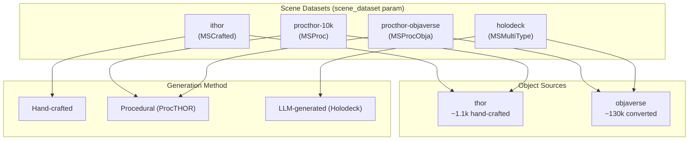
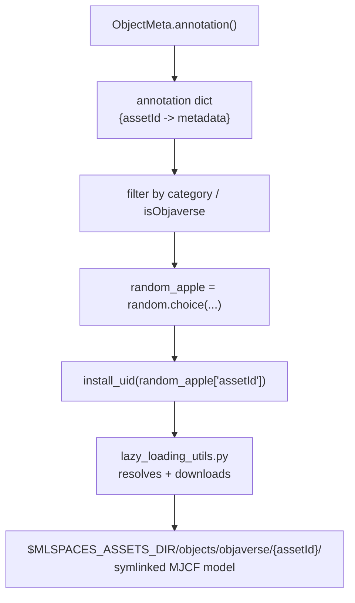

<!-- source: DeepWiki mcp.deepwiki.com · repo allenai/molmospaces · page 2.1 Objects & Scenes · fetched 2026-10-26 -->

# Objects & Scenes

<details>
<summary>Relevant source files</summary>

The following files were used as context for generating this wiki page:

- [README.md](README.md)
- [docs/images/Multi_Simulator_Pan.jpg](docs/images/Multi_Simulator_Pan.jpg)

</details>


This page documents the two object collections and four scene dataset types available in MolmoSpaces, including their code names, paper names, sizes, sources, and how to retrieve them programmatically. For information on the asset download mechanism and versioning system, see [Asset System](#2). For robot assets, see [Robots & Coordinate Conventions](#2.2).

---

## Asset Name Mapping

MolmoSpaces uses distinct code names (used in configuration and API calls) and paper names (used in the research paper). The table below consolidates all asset types:

| Type | Code Name | Paper Name | Description | Object Source |
|---|---|---|---|---|
| objects | `thor` | — | ~1,100 hand-crafted kitchen assets | AI2-THOR |
| objects | `objaverse` | — | ~130,000 converted assets | Objaverse |
| scenes | `ithor` | MSCrafted | Hand-crafted; many articulated assets | thor |
| scenes | `procthor-10k` | MSProc | Procedurally generated | thor |
| scenes | `procthor-objaverse` | MSProcObja | Procedurally generated | objaverse |
| scenes | `holodeck` | MSMultiType | LLM-generated | objaverse |
| benchmark | — | MS-Bench v1 | Base benchmark for atomic tasks | — |

Sources: [README.md:109-116]()

---

## Object Collections

### `thor` Objects

- Approximately 1,100 hand-crafted assets, primarily kitchen and household objects.
- Sourced from the AI2-THOR simulator asset library.
- All `thor` objects are downloaded, extracted, and symlinked automatically upon instantiation of the resource manager — no explicit per-object installation step is required.
- Used as the object population for `ithor` and `procthor-10k` scenes.

### `objaverse` Objects

- Approximately 130,000 assets converted from the Objaverse dataset.
- Must be explicitly installed on demand via `install_uid()`.
- Used as the object population for `procthor-objaverse` and `holodeck` scenes.
- Licensed under ODC-BY 1.0 (distinct from the CC BY 4.0 license applied to other MolmoSpaces data).

Sources: [README.md:104-118](), [README.md:136-155]()

---

## Scene Datasets

### Scene Type Overview

**Scene type → code name relationship:**



Sources: [README.md:109-116]()

### `ithor` (MSCrafted)

- Fully hand-crafted scenes with detailed articulated assets (e.g., cabinets, drawers, fridges).
- Populated exclusively with `thor` objects.
- Smallest dataset; highest asset fidelity and articulation count.
- Example path pattern after installation: `$MLSPACES_ASSETS_DIR/scenes/ithor/FloorPlan1_physics.xml`

### `procthor-10k` (MSProc)

- 10,000 procedurally generated scenes using the ProcTHOR pipeline.
- Populated with `thor` objects.
- Default scene dataset for pick, pick-and-place, open, and close task configurations (see [Task Configurations](#4.2)).

### `procthor-objaverse` (MSProcObja)

- Procedurally generated scenes using the ProcTHOR pipeline.
- Populated with `objaverse` objects instead of `thor` objects.
- Larger object vocabulary than `procthor-10k`.

### `holodeck` (MSMultiType)

- Scenes generated by the Holodeck LLM-based scene synthesis system.
- Populated with `objaverse` objects.
- Covers a wider variety of room types and semantic contexts than procedural scenes.

Sources: [README.md:109-116]()

---

## Retrieving Scenes

The primary entry point for scene retrieval is `get_scenes()` from `molmo_spaces.molmo_spaces_constants`, combined with `install_scene_with_objects_and_grasps_from_path()` from `molmo_spaces.utils.lazy_loading_utils`.

**Function flow for scene installation:**

```mermaid
sequenceDiagram
    participant "User Code"
    participant "get_scenes()" as GS
    participant "molmo_spaces_constants.py" as CONST
    participant "install_scene_with_objects_and_grasps_from_path()" as INSTALL
    participant "lazy_loading_utils.py" as LLU
    participant "$MLSPACES_ASSETS_DIR/scenes/" as DISK

    "User Code"->>"get_scenes()": "get_scenes(dataset, split)"
    "get_scenes()">>"molmo_spaces_constants.py": "look up dataset registry"
    "molmo_spaces_constants.py"-->>"get_scenes()": "scene path dict"
    "get_scenes()"-->>"User Code": "dict with split keys"
    "User Code"->>"install_scene_with_objects_and_grasps_from_path()": "scene path entry"
    "install_scene_with_objects_and_grasps_from_path()">>"lazy_loading_utils.py": "resolve dependencies"
    "lazy_loading_utils.py">>"$MLSPACES_ASSETS_DIR/scenes/": "download + symlink .xml + objects + grasps"
    "$MLSPACES_ASSETS_DIR/scenes/"-->>"User Code": "local MJCF path ready"
```

**Example usage pattern** (from README):

```python
from molmo_spaces.utils.lazy_loading_utils import install_scene_with_objects_and_grasps_from_path
from molmo_spaces.molmo_spaces_constants import get_scenes

install_scene_with_objects_and_grasps_from_path(get_scenes("ithor", "train")["train"][1])
```

After installation, scenes can be viewed directly:

```bash
python -m mujoco.viewer --mjcf $MLSPACES_ASSETS_DIR/scenes/ithor/FloorPlan1_physics.xml
```

The `get_scenes()` function accepts:
- **`dataset`**: a code name string — one of `"ithor"`, `"procthor-10k"`, `"procthor-objaverse"`, `"holodeck"`.
- **`split`**: a string such as `"train"` or `"test"`.

It returns a dict keyed by split name, where each value is a list of scene path descriptors.

Sources: [README.md:122-135](), [molmo_spaces/molmo_spaces_constants.py](), [molmo_spaces/utils/lazy_loading_utils.py]()

---

## Retrieving Objects

### Object Metadata via `ObjectMeta`

Object annotations are accessible through `ObjectMeta.annotation()` in `molmo_spaces.utils.object_metadata`. This returns a dict mapping asset IDs to annotation dicts. Each annotation includes at minimum:

| Field | Description |
|---|---|
| `assetId` | Unique identifier string for the object |
| `category` | Semantic category label (e.g., `"Apple"`, `"Chair"`) |
| `isObjaverse` | Boolean; `True` for objaverse objects, `False` for thor |

### Installing Individual Objects via `install_uid`

Objects from the `objaverse` collection must be downloaded on demand. The `install_uid()` function in `molmo_spaces.utils.lazy_loading_utils` accepts an `assetId` string and returns the local filesystem path to the installed model.

**Object retrieval flow:**



**Example usage pattern** (from README):

```python
from molmo_spaces.utils.object_metadata import ObjectMeta
from molmo_spaces.utils.lazy_loading_utils import install_uid

annotation = ObjectMeta.annotation()

# Filter to objaverse apple objects only
apple_annotations = [
    anno for anno in annotation.values()
    if "apple" in anno["category"].lower() and anno["isObjaverse"]
]

apple_model_path = install_uid(apple_annotations[0]["assetId"])
```

Note: `thor` objects do not require `install_uid()` — they are automatically installed when the resource manager is initialized.

Sources: [README.md:137-155](), [molmo_spaces/utils/object_metadata.py](), [molmo_spaces/utils/lazy_loading_utils.py]()

---

## Configuration Integration

The `scene_dataset` field in `MlSpacesExpConfig` (and all task config subclasses) takes a code name string to select which scene dataset is used during data generation or evaluation. Task-specific config classes set a default:

| Config Class | Default `scene_dataset` |
|---|---|
| `PickBaseConfig` | `"procthor-10k"` |
| `NavToObjBaseConfig` | `"procthor-10k"` |

For full details on how `scene_dataset` integrates into experiment configs, see [Base Configuration Classes](#4.1).

Sources: [README.md:109-116]()

---

## Licensing

| Asset Group | License |
|---|---|
| Objaverse object subsets | [ODC-BY 1.0](https://opendatacommons.org/licenses/by/1-0) |
| All other data (thor objects, ithor/procthor scenes, etc.) | [CC BY 4.0](https://creativecommons.org/licenses/by/4.0/deed.en) |
| Codebase | Apache 2.0 |

All artifacts are intended for research and educational use per Ai2's Responsible Use Guidelines.

Sources: [README.md:282-286]()

---

