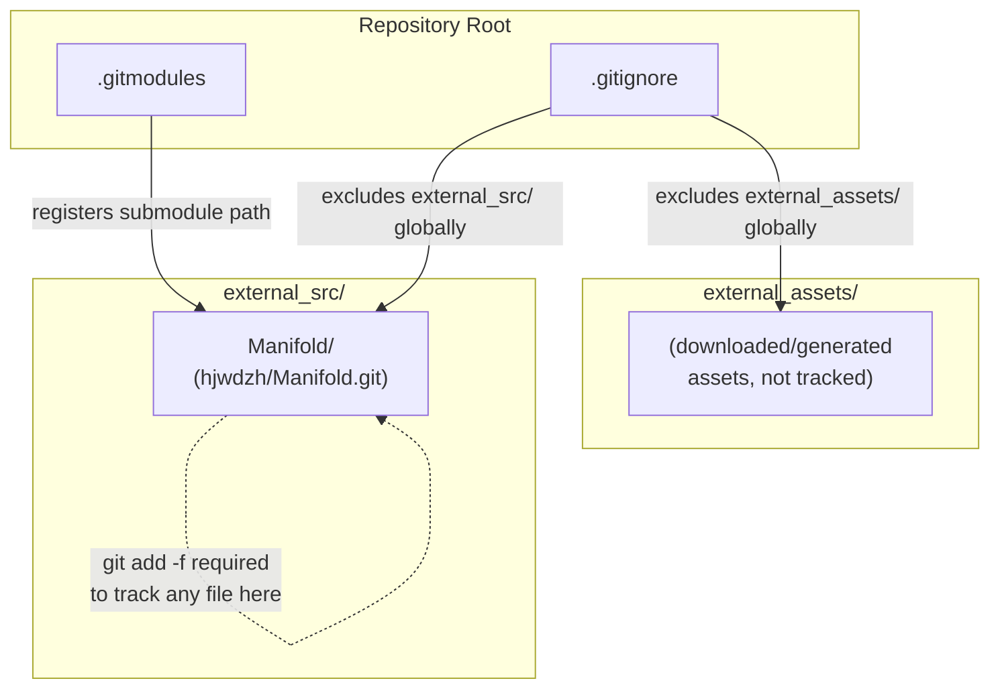
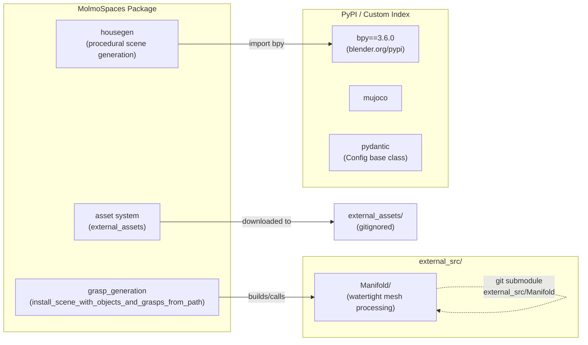

<!-- source: DeepWiki mcp.deepwiki.com · repo allenai/molmospaces · page 7.4 External Dependencies · fetched 2026-10-26 -->

# External Dependencies

<details>
<summary>Relevant source files</summary>

The following files were used as context for generating this wiki page:

- [.gitignore](.gitignore)
- [.gitmodules](.gitmodules)
- [docs/development.md](docs/development.md)

</details>


This page covers third-party code and asset dependencies that are managed outside the standard Python package ecosystem: the `external_src/` Git submodule, the `external_assets/` directory, and notable Python packages that require non-standard installation steps. For standard Python dependency installation and development environment setup, see [Environment Setup](#7.1).

---

## Git Submodule: Manifold

The only registered Git submodule in the repository is **Manifold**, a mesh processing library used for watertight mesh generation.

| Field       | Value                                         |
|-------------|-----------------------------------------------|
| Submodule path | `external_src/Manifold`                    |
| Upstream URL   | `https://github.com/hjwdzh/Manifold.git`   |
| Config file    | [.gitmodules:1-4]()                        |

### Initializing the Submodule

After cloning the repository, the submodule directory is empty. Initialize and populate it with:

```bash
git submodule update --init --recursive
```

The `--recursive` flag ensures that any nested submodules within Manifold are also initialized.

Sources: [.gitmodules:1-4]()

---

## `external_src/` and `external_assets/` Directory Policy

Both `external_src/` and `external_assets/` are globally excluded from Git tracking via `.gitignore`.

```
external_src/
external_assets/
```

[.gitignore:13-14](), [.gitignore:26-26]()

The rationale is stated directly in the `.gitignore` comment:

> If you're adding things to git under `external_src`, please do this explicitly by running `git add -f <files>`, this is to prevent accidentally adding external source files to the repo.

[.gitignore:10-12]()

**Consequence:** Any file placed under `external_src/` or `external_assets/` — including build artifacts from the Manifold submodule — will not be staged or committed by default. To deliberately track a file in either directory, you must force-add it:

```bash
git add -f external_src/some_file
```

**Diagram: `external_src/` Directory Layout and Gitignore Interaction**



Sources: [.gitignore:10-26](), [.gitmodules:1-4]()

---

## Notable Python Dependencies

Several Python packages used by MolmoSpaces require non-standard installation procedures.

### `bpy` (Blender Python API)

`bpy` is used for procedural house generation (the `housegen` optional install group). For Python 3.10, the package is not available on PyPI and must be installed from Blender's own package index:

```bash
# Using pip
pip install bpy==3.6.0 --extra-index-url https://download.blender.org/pypi/

# Using uv
uv pip install bpy==3.6.0 --extra-index-url https://download.blender.org/pypi/
```

This step must be completed **before** running `pip install -e .`, because the main install does not pull `bpy` automatically.

Sources: [docs/development.md:11-19]()

### Optional Dependency Groups

The `pyproject.toml` defines optional dependency groups that activate additional functionality. The relevant groups mentioned in project documentation are:

| Group     | Purpose                                                  | Install command                    |
|-----------|----------------------------------------------------------|------------------------------------|
| `dev`     | Code quality tools: `ruff`, `pre-commit`, `mypy`         | `uv pip install -e . --group dev`  |
| `grasp`   | Grasp generation pipeline                                | (see page [5.5](#5.5))             |
| `housegen`| Procedural house generation via `bpy`                    | Requires manual `bpy` install first |

Sources: [docs/development.md:31-38]()

---

## Dependency Relationship Overview

**Diagram: External Dependency Integration Points**



Sources: [.gitmodules:1-4](), [.gitignore:13-26](), [docs/development.md:11-38]()

---

## Summary

| Dependency         | Type              | Location / Install                                     | Notes                                              |
|--------------------|-------------------|--------------------------------------------------------|----------------------------------------------------|
| Manifold           | Git submodule     | `external_src/Manifold`                                | `git submodule update --init --recursive`          |
| `external_assets/` | Directory policy  | `external_assets/`                                     | Gitignored; use `git add -f` to force-track        |
| `bpy==3.6.0`       | Python package    | Blender PyPI index (`download.blender.org/pypi`)       | Must install before `pip install -e .`             |
| `dev` group        | Python extras     | via `pyproject.toml`                                   | `ruff`, `pre-commit`, `mypy`; see [7.2](#7.2)      |
| `grasp` group      | Python extras     | via `pyproject.toml`                                   | Grasp generation pipeline; see [5.5](#5.5)         |

Sources: [.gitmodules:1-4](), [.gitignore:1-56](), [docs/development.md:1-38]()