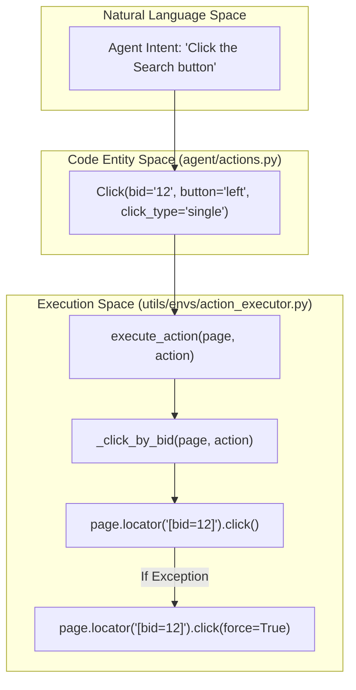
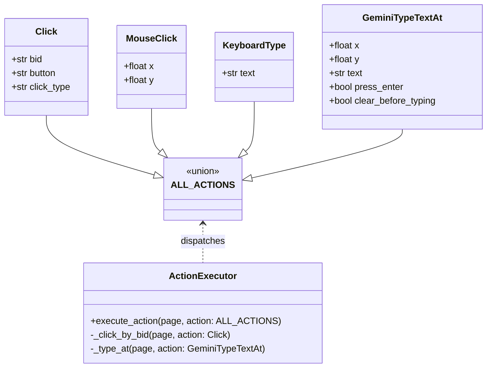

<!-- source: DeepWiki mcp.deepwiki.com · repo allenai/molmoweb · page 5.2 Action Executor · fetched 2026-10-26 -->

# Action Executor

Relevant source files

The following files were used as context for generating this wiki page:

- [agent/actions.py](agent/actions.py)
- [utils/envs/action_executor.py](utils/envs/action_executor.py)

The **Action Executor** is a specialized utility responsible for translating high-level agent actions into concrete browser commands. It serves as the bridge between the structured `Action` objects defined in the agent layer and the [Playwright API](https://playwright.dev/python).

The executor operates on pixel-based coordinates. It is the responsibility of the calling agent to ensure that any percentage-based or normalized coordinates are converted to absolute viewport pixels before being passed to this module [utils/envs/action_executor.py:4-6]().

## Core Execution Logic

The primary entry point is the `execute_action` function. It performs type-checking on the incoming action object and dispatches it to the corresponding Playwright method [utils/envs/action_executor.py:29-106]().

### Action Mapping Table

| Action Type | Playwright Implementation | Notes |
| :--- | :--- | :--- |
| `Click` | `page.locator('[bid="..."]').click()` | Uses element-based targeting via `bid` attributes. |
| `MouseClick` | `page.mouse.click(x, y)` | Coordinate-based click at specific pixels. Supports `double` click [utils/envs/action_executor.py:38-42](). |
| `MouseMove` | `page.mouse.move(x, y)` | Moves the cursor without clicking [utils/envs/action_executor.py:46-48](). |
| `HoverAt` | `page.mouse.move(x, y)` + `time.sleep` | Simulates hover by staying at a coordinate for `duration` [utils/envs/action_executor.py:50-53](). |
| `MouseDragAndDrop` | `move` → `down` → `move` → `up` | Manual drag-and-drop sequence [utils/envs/action_executor.py:55-60](). |
| `Scroll` | `page.mouse.wheel(dx, dy)` | Global viewport scroll [utils/envs/action_executor.py:62-64](). |
| `ScrollAt` | `move(x, y)` + `wheel(dx, dy)` | Scrolls at a specific coordinate [utils/envs/action_executor.py:66-69](). |
| `KeyboardType` | `page.keyboard.type(text)` | Types text into the currently focused element [utils/envs/action_executor.py:74-76](). |
| `KeyboardPress` | `page.keyboard.press(key)` | Supports special keys; sleeps 1s if key is "Enter" [utils/envs/action_executor.py:78-82](). |
| `Goto` | `page.goto(url)` | Navigates to a new URL; waits for `domcontentloaded` [utils/envs/action_executor.py:84-86](). |
| `BrowserNav` | `go_back()`, `new_page()`, `bring_to_front()` | Handles history and tab focus management [utils/envs/action_executor.py:88-97](). |
| `Noop` | `time.sleep(5)` | Standard 5-second wait [utils/envs/action_executor.py:99-101](). |

**Sources:** [utils/envs/action_executor.py:29-106](), [agent/actions.py:10-186]()

## Bid-Based Click Fallback

The `_click_by_bid` function implements a robust two-stage clicking strategy for elements identified by a backend ID (`bid`).

1.  **Standard Click**: Attempts to click the element using `page.locator(f'[bid="{action.bid}"]').first`. This respects Playwright's actionability checks (visible, stable, enabled) [utils/envs/action_executor.py:114-118]().
2.  **Forced Fallback**: If the standard click fails (e.g., due to an overlapping element or a timeout), the executor retries with `force=True`. This bypasses actionability checks to ensure the event is dispatched even if the element is technically obscured [utils/envs/action_executor.py:122-127]().

### Data Flow: Natural Language to Playwright Call

The following diagram illustrates how a high-level intent is transformed into a specific browser interaction.

**Intent Translation Flow**

**Sources:** [utils/envs/action_executor.py:112-131](), [agent/actions.py:10-37]()

## Specialized Typing Helpers

### GeminiTypeTextAt
For agents that provide a coordinate and text simultaneously (like the Gemini Computer Use model), the `_type_at` helper provides a composite sequence of actions [utils/envs/action_executor.py:134-154]():

1.  **Focus**: Clicks the specified `(x, y)` coordinate to focus the input [utils/envs/action_executor.py:136]().
2.  **Clear (Optional)**: If `clear_before_typing` is true, it executes `ControlOrMeta+a` followed by `Backspace` [utils/envs/action_executor.py:139-143]().
3.  **Input**: Types the provided `text` via the keyboard API [utils/envs/action_executor.py:146]().
4.  **Submit (Optional)**: If `press_enter` is true, it sends an `Enter` keypress [utils/envs/action_executor.py:149-150]().

**Sources:** [utils/envs/action_executor.py:134-154](), [agent/actions.py:170-186]()

## Component Architecture

The relationship between the `Action` definitions and the `execute_action` logic is strictly typed via the `ALL_ACTIONS` union.

**Action Execution Architecture**

**Sources:** [utils/envs/action_executor.py:9-26](), [agent/actions.py:10-186]()

## Error Handling
The executor wraps all operations in a `try-except` block. If a Playwright operation fails (e.g., a timeout or a detached element), the executor returns a tuple `(False, error_message)` instead of crashing. This allows the calling environment or client to log the failure and decide whether to retry or report the issue to the agent [utils/envs/action_executor.py:34-109]().

**Sources:** [utils/envs/action_executor.py:108-109]()

---

