<!-- source: DeepWiki mcp.deepwiki.com · repo allenai/olmocr · page 4.5 Synthetic Data Generation · fetched 2026-10-26 -->

# Synthetic Data Generation

<details>
<summary>Relevant source files</summary>

The following files were used as context for generating this wiki page:

- [olmocr/bench/synth/mine_html_templates.py](olmocr/bench/synth/mine_html_templates.py)
- [tests/test_mine_html_templates.py](tests/test_mine_html_templates.py)

</details>


## Purpose and Scope

This document describes the synthetic data generation system, which converts arXiv PDFs into semantic HTML templates using Claude API, then renders them back to PDFs with automated test generation. This system provides high-quality training data and benchmark tests by creating controlled, reproducible document pairs where the ground truth is known.

The synthetic generation pipeline is distinct from but complementary to:
- **Test Mining** ([4.4](#4.4)): Extracts tests from existing PDFs with known LaTeX source
- **Training Data Pipeline** ([5.1](#5.1)): Processes synthetic outputs for model training
- **Multi-OCR Comparison** ([4.6](#4.6)): Evaluates synthetic documents across OCR systems

The system is implemented primarily in [`olmocr/bench/synth/mine_html_templates.py:1-1600`]().

## Architecture Overview

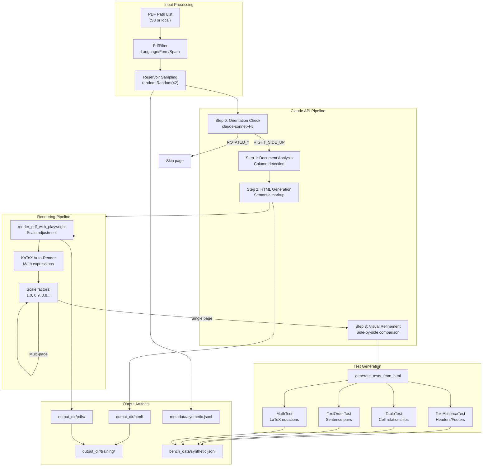

**Sources:** [`olmocr/bench/synth/mine_html_templates.py:1231-1419`](), [`olmocr/bench/synth/mine_html_templates.py:347-588`](), [`olmocr/bench/synth/mine_html_templates.py:631-735`]()

The pipeline processes PDFs in three stages: (1) Claude API multi-step prompting to generate semantic HTML, (2) Playwright rendering with automatic scale adjustment, and (3) automated test generation with validation. The system tracks API costs via global token counters [`olmocr/bench/synth/mine_html_templates.py:31-33`]() and supports parallel processing with configurable concurrency.

## Entry Point and Execution Flow

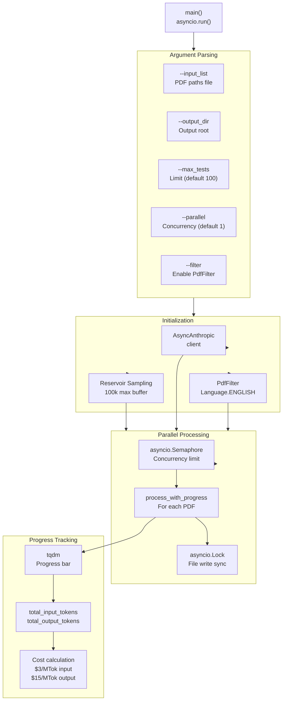

**Sources:** [`olmocr/bench/synth/mine_html_templates.py:1421-1599`](), [`olmocr/bench/synth/mine_html_templates.py:1462-1487`]()

The `main()` function orchestrates the entire pipeline using `asyncio`. Key execution details:

- **Reservoir Sampling**: Maintains a fixed-size sample from potentially unlimited input using [`olmocr/bench/synth/mine_html_templates.py:1475-1481`]() with probability-based replacement
- **Async Client**: Initialized at [`olmocr/bench/synth/mine_html_templates.py:1450`]() for non-blocking Claude API calls
- **Bounded Concurrency**: Uses `asyncio.Semaphore` at [`olmocr/bench/synth/mine_html_templates.py:1547-1551`]() to limit parallel tasks
- **Lock-Protected File I/O**: JSONL files written atomically via [`olmocr/bench/synth/mine_html_templates.py:1507`]()
- **Cost Tracking**: Global token counters updated at [`olmocr/bench/synth/mine_html_templates.py:389-391`](), [`olmocr/bench/synth/mine_html_templates.py:433-435`](), etc.

## Claude API Multi-Step Prompting Strategy

The system uses a four-step prompting strategy with Claude Sonnet 4.5 to maximize HTML quality:

### Step 0: Orientation Validation

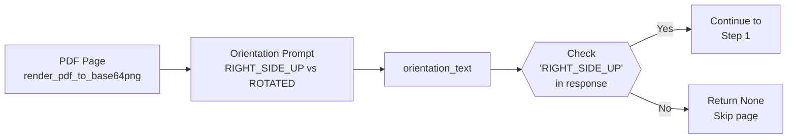

**Sources:** [`olmocr/bench/synth/mine_html_templates.py:353-396`]()

Before processing, the system validates document orientation at [`olmocr/bench/synth/mine_html_templates.py:355-380`](). The prompt explicitly asks Claude to analyze if the document is right-side-up, rotated 90°, 180°, 270°, or unclear. Only documents with `RIGHT_SIDE_UP` response proceed to avoid complications from rotated text. This check costs ~1,000 tokens per page.

### Step 1: Document Analysis

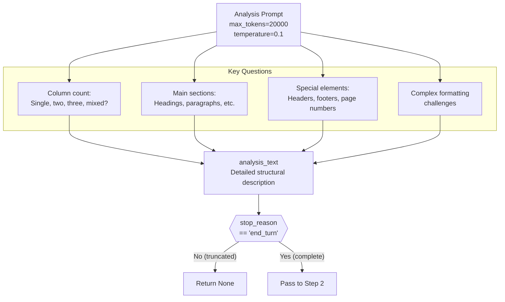

**Sources:** [`olmocr/bench/synth/mine_html_templates.py:398-436`]()

The analysis phase at [`olmocr/bench/synth/mine_html_templates.py:399-420`]() focuses on structural understanding. The prompt explicitly asks about column layout (critical for accurate HTML generation) and document structure. The response is stored as `analysis_text` and passed to the next step for context. Temperature is set to 0.1 for more deterministic analysis. The system checks `stop_reason` at [`olmocr/bench/synth/mine_html_templates.py:423-425`]() to ensure complete responses.

### Step 2: HTML Generation with Layout Instructions

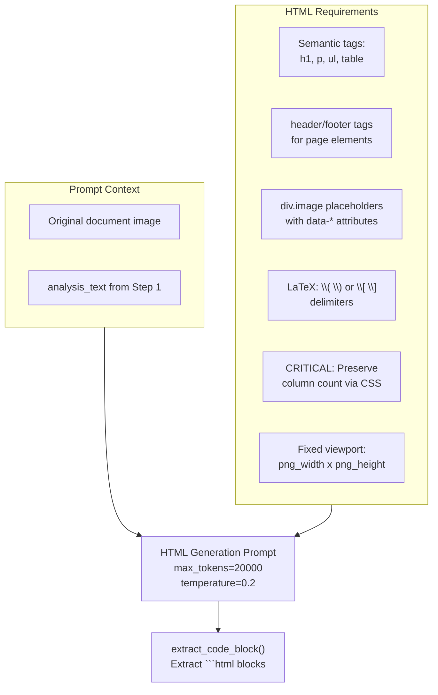

**Sources:** [`olmocr/bench/synth/mine_html_templates.py:437-487`]()

The generation phase at [`olmocr/bench/synth/mine_html_templates.py:438-465`]() includes the analysis text in the prompt at [`olmocr/bench/synth/mine_html_templates.py:450`](). Critical instructions:

1. **Semantic HTML**: Use appropriate tags for content structure
2. **Header/Footer Separation**: Use `<header>` and `<footer>` tags for page-level content that shouldn't be in training data [`olmocr/bench/synth/mine_html_templates.py:453`]()
3. **Image Placeholders**: `<div class="image">` with `data-description`, `data-x`, `data-y`, `data-width`, `data-height` attributes [`olmocr/bench/synth/mine_html_templates.py:454`]()
4. **Math Rendering**: Use `\\( \\)` or `\\[ \\]` delimiters for LaTeX [`olmocr/bench/synth/mine_html_templates.py:455`]()
5. **Column Preservation**: Explicitly preserve multi-column layouts with CSS flexbox/grid [`olmocr/bench/synth/mine_html_templates.py:456-459`]()

The HTML is extracted using regex at [`olmocr/bench/synth/mine_html_templates.py:318-344`](), trying ````html\n` blocks first, then generic code blocks.

### Step 3: Visual Refinement with Comparison

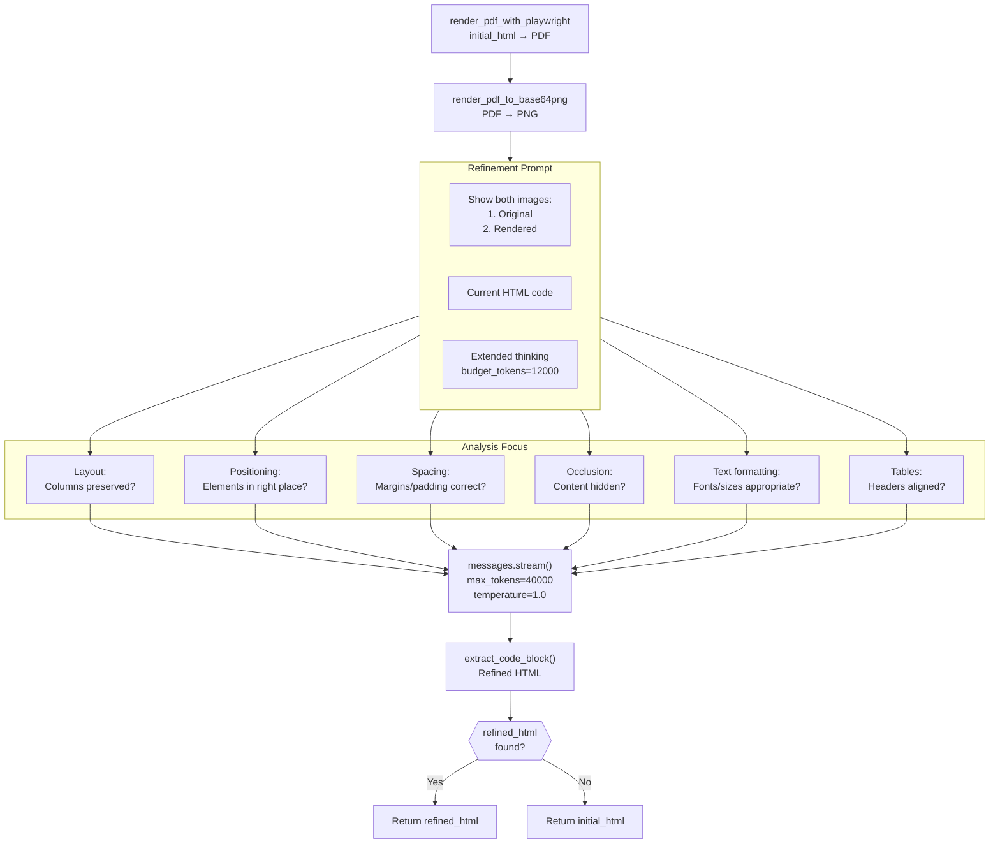

**Sources:** [`olmocr/bench/synth/mine_html_templates.py:489-583`]()

The refinement phase at [`olmocr/bench/synth/mine_html_templates.py:511-552`]() is the most sophisticated step. It:

1. **Renders initial HTML**: Uses Playwright at [`olmocr/bench/synth/mine_html_templates.py:495`]() to create a PDF
2. **Converts to image**: Renders PDF back to PNG at [`olmocr/bench/synth/mine_html_templates.py:503`]() for visual comparison
3. **Shows both images**: Presents original and rendered side-by-side at [`olmocr/bench/synth/mine_html_templates.py:524-527`]()
4. **Extended thinking**: Uses Claude's extended thinking mode with 12,000-token budget at [`olmocr/bench/synth/mine_html_templates.py:515`]()
5. **Higher temperature**: Increases to 1.0 at [`olmocr/bench/synth/mine_html_templates.py:514`]() for more creative problem-solving
6. **Streaming response**: Uses `messages.stream()` at [`olmocr/bench/synth/mine_html_templates.py:511-546`]() to handle long outputs

The prompt explicitly asks Claude to analyze six specific areas at [`olmocr/bench/synth/mine_html_templates.py:531-538`](). If refinement fails, the system falls back to initial HTML at [`olmocr/bench/synth/mine_html_templates.py:556-578`]().

## HTML Processing and Conversion

The system includes several utility functions for HTML manipulation:

### Superscript and Subscript Conversion

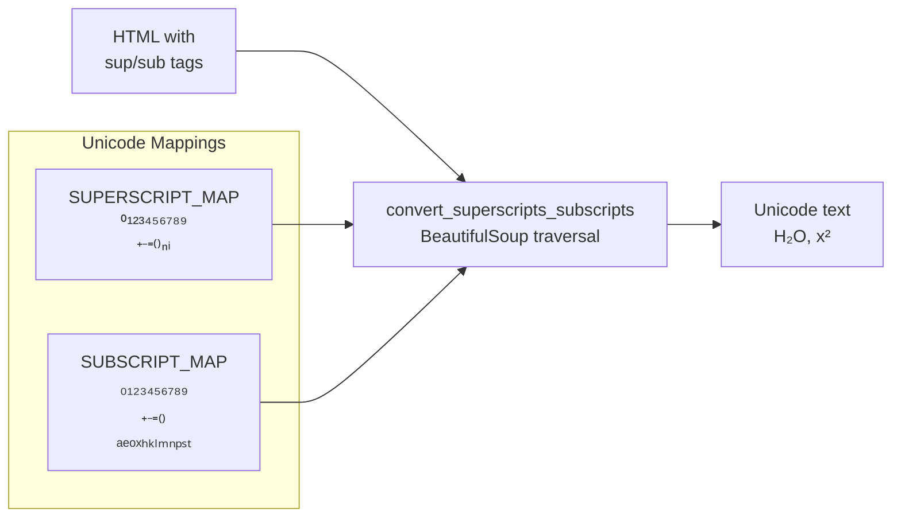

**Sources:** [`olmocr/bench/synth/mine_html_templates.py:47-128`]()

The function `convert_superscripts_subscripts()` at [`olmocr/bench/synth/mine_html_templates.py:99-128`]() converts HTML `<sup>` and `<sub>` tags to Unicode equivalents. This is critical because:

- **Training data compatibility**: Models learn from Unicode characters directly
- **Test generation**: Simplifies fuzzy matching by avoiding HTML tags
- **Markdown conversion**: Produces cleaner markdown output

The mappings are defined at [`olmocr/bench/synth/mine_html_templates.py:47-96`](). Characters not in the mapping are preserved as-is at [`olmocr/bench/synth/mine_html_templates.py:119`]() and [`olmocr/bench/synth/mine_html_templates.py:125`]().

### Custom Markdown Converter with Table Preservation

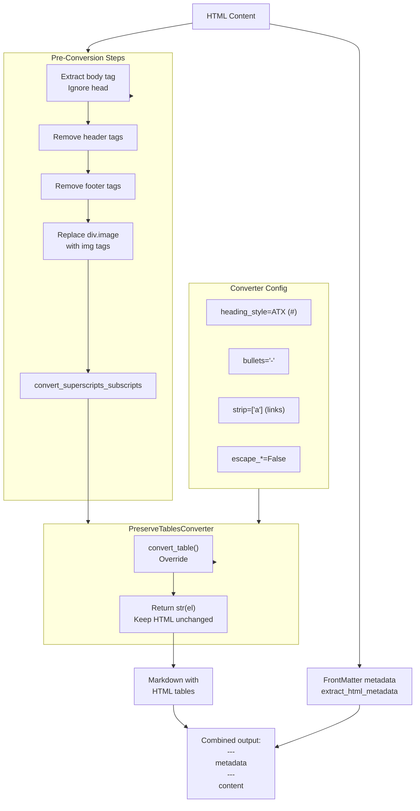

**Sources:** [`olmocr/bench/synth/mine_html_templates.py:156-316`]()

The custom `PreserveTablesConverter` class at [`olmocr/bench/synth/mine_html_templates.py:156-168`]() extends `MarkdownConverter` to keep tables as raw HTML. This is important because:

- **Table structure preservation**: Markdown tables lose complex structures like rowspan/colspan
- **Test generation**: Table tests need to parse HTML for cell relationships
- **Training quality**: Models see exact table HTML rather than simplified markdown

The main conversion function `html_to_markdown_with_frontmatter()` at [`olmocr/bench/synth/mine_html_templates.py:234-316`]():

1. **Extracts metadata**: Calls `extract_html_metadata()` at [`olmocr/bench/synth/mine_html_templates.py:237`]()
2. **Removes headers/footers**: At [`olmocr/bench/synth/mine_html_templates.py:251-260`]() so they don't appear in training data
3. **Handles images**: Converts `<div class="image">` to `` tags at [`olmocr/bench/synth/mine_html_templates.py:263-267`]()
4. **Applies Unicode conversion**: At [`olmocr/bench/synth/mine_html_templates.py:270`]()
5. **Creates FrontMatter**: Adds YAML header with metadata at [`olmocr/bench/synth/mine_html_templates.py:303-309`]()

### Metadata Extraction for FrontMatter

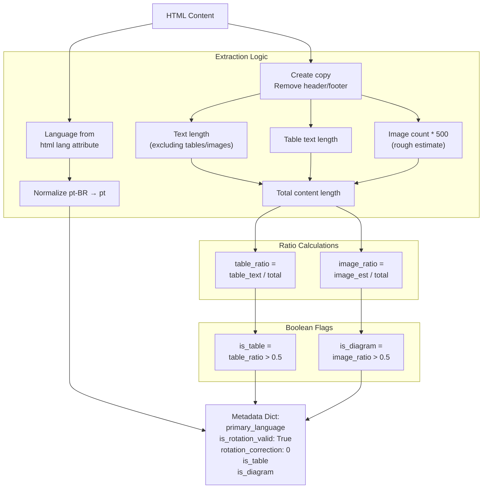

**Sources:** [`olmocr/bench/synth/mine_html_templates.py:171-231`]()

The `extract_html_metadata()` function at [`olmocr/bench/synth/mine_html_templates.py:171-231`]() computes metadata for the FrontMatter section. Key logic:

1. **Language extraction**: From `<html lang="...">` attribute at [`olmocr/bench/synth/mine_html_templates.py:176-182`](), normalizing regional codes (e.g., `pt-BR` → `pt`)
2. **Content analysis**: Creates a copy without headers/footers at [`olmocr/bench/synth/mine_html_templates.py:190-193`]() for accurate statistics
3. **Text length calculation**: Excludes tables and images at [`olmocr/bench/synth/mine_html_templates.py:196-204`]()
4. **Image estimation**: Each `<div class="image">` counts as 500 characters at [`olmocr/bench/synth/mine_html_templates.py:215`]()
5. **Classification**: Documents are `is_table` if >50% table content, `is_diagram` if >50% images at [`olmocr/bench/synth/mine_html_templates.py:224-229`]()

Rotation fields are always fixed: `is_rotation_valid: True`, `rotation_correction: 0` at [`olmocr/bench/synth/mine_html_templates.py:231`]() since synthetic documents are generated right-side-up.

## PDF Rendering with Playwright

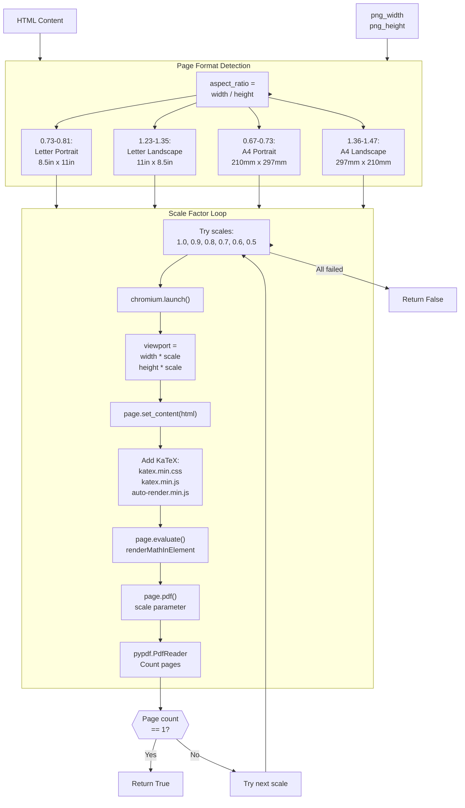

**Sources:** [`olmocr/bench/synth/mine_html_templates.py:631-735`]()

The `render_pdf_with_playwright()` function at [`olmocr/bench/synth/mine_html_templates.py:631-735`]() is critical for producing single-page PDFs. Implementation details:

### Page Format Detection

At [`olmocr/bench/synth/mine_html_templates.py:647-673`](), the function calculates aspect ratio and sets PDF dimensions:
- **Letter Portrait** (0.73-0.81 ratio): 8.5" × 11"
- **Letter Landscape** (1.23-1.35 ratio): 11" × 8.5"
- **A4 Portrait** (0.67-0.73 ratio): 210mm × 297mm
- **A4 Landscape** (1.36-1.47 ratio): 297mm × 210mm

This ensures the PDF matches the original document's proportions.

### Scale Factor Adjustment Loop

The system tries progressively smaller scale factors at [`olmocr/bench/synth/mine_html_templates.py:645`]() until achieving a single-page PDF:

1. **Set viewport**: Multiply dimensions by scale at [`olmocr/bench/synth/mine_html_templates.py:679`]()
2. **Load content**: Via `page.set_content()` at [`olmocr/bench/synth/mine_html_templates.py:682`]()
3. **Add KaTeX**: Injects CSS and JS at [`olmocr/bench/synth/mine_html_templates.py:685-692`]()
4. **Render math**: Calls `renderMathInElement()` at [`olmocr/bench/synth/mine_html_templates.py:695-707`]()
5. **Generate PDF**: With scale parameter at [`olmocr/bench/synth/mine_html_templates.py:712-713`]()
6. **Verify page count**: Using `pypdf.PdfReader` at [`olmocr/bench/synth/mine_html_templates.py:719-724`]()

The scale loop continues until either a single-page PDF is achieved or all scales are exhausted at [`olmocr/bench/synth/mine_html_templates.py:734`]().

### KaTeX Integration

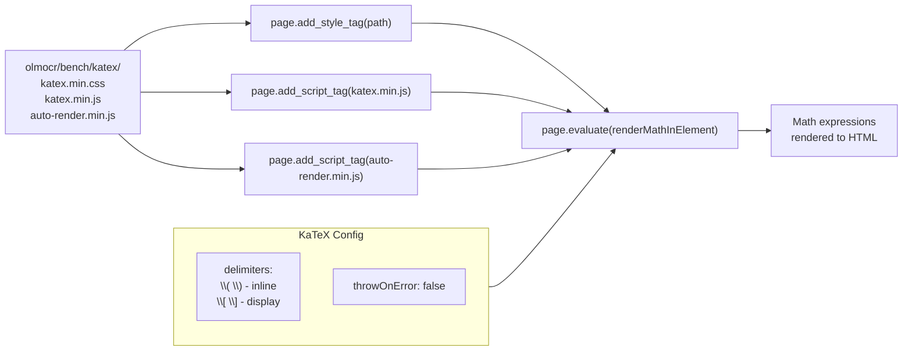

**Sources:** [`olmocr/bench/synth/mine_html_templates.py:685-708`]()

KaTeX resources are loaded from the local directory at [`olmocr/bench/synth/mine_html_templates.py:685-688`](). The auto-render is triggered immediately (not waiting for DOMContentLoaded) at [`olmocr/bench/synth/mine_html_templates.py:695`]() with delimiters configured at [`olmocr/bench/synth/mine_html_templates.py:700-702`]() to match Claude's LaTeX output format. The `throwOnError: false` setting at [`olmocr/bench/synth/mine_html_templates.py:705`]() ensures the PDF renders even if some equations have syntax errors.

## Automated Test Generation

The system generates multiple test types from the HTML content to validate OCR quality:

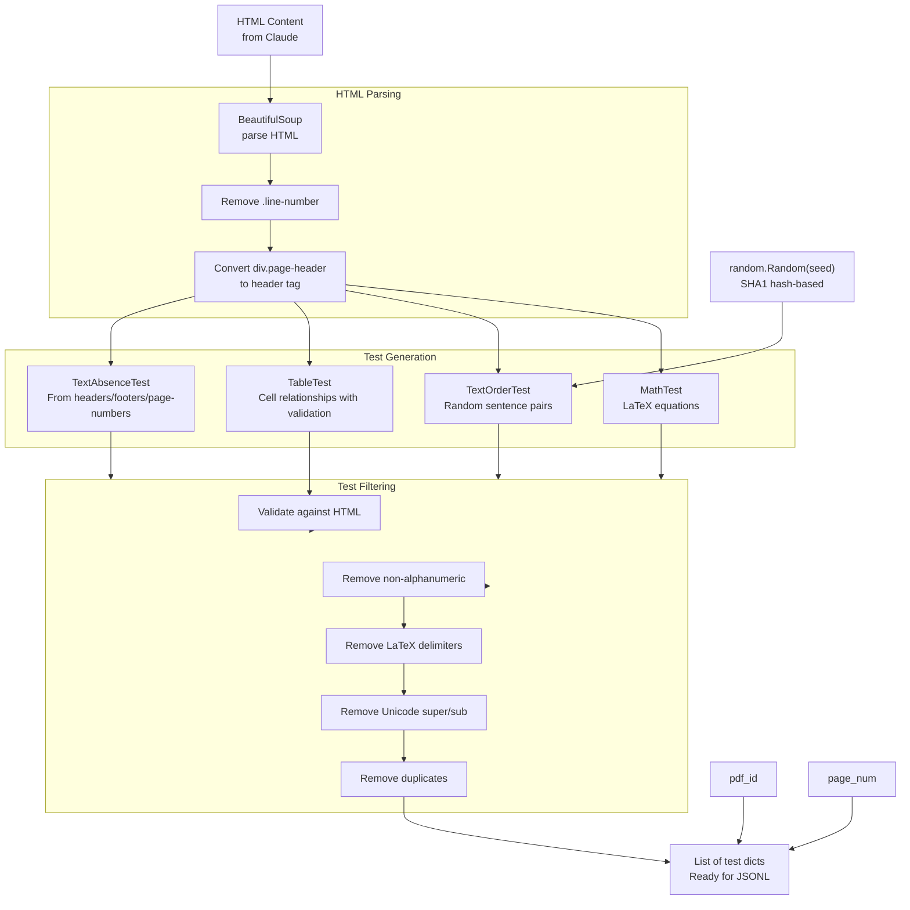

**Sources:** [`olmocr/bench/synth/mine_html_templates.py:738-1228`]()

The main test generation function is `generate_tests_from_html()` at [`olmocr/bench/synth/mine_html_templates.py:738-1228`](). It takes a `random.Random` generator seeded with the PDF's SHA1 hash at [`olmocr/bench/synth/mine_html_templates.py:1257-1261`]() for reproducibility.

### HTML Preprocessing

Before test generation at [`olmocr/bench/synth/mine_html_templates.py:756-791`]():

1. **Remove line numbers**: Elements with class `line-number` are extracted at [`olmocr/bench/synth/mine_html_templates.py:759-760`]()
2. **Normalize headers/footers**: `<div class="page-header">` converted to `<header>` at [`olmocr/bench/synth/mine_html_templates.py:763-768`]()
3. **Clean body boundaries**: Remove elements before first header or after last footer at [`olmocr/bench/synth/mine_html_templates.py:771-790`]()

### TextAbsenceTest Generation

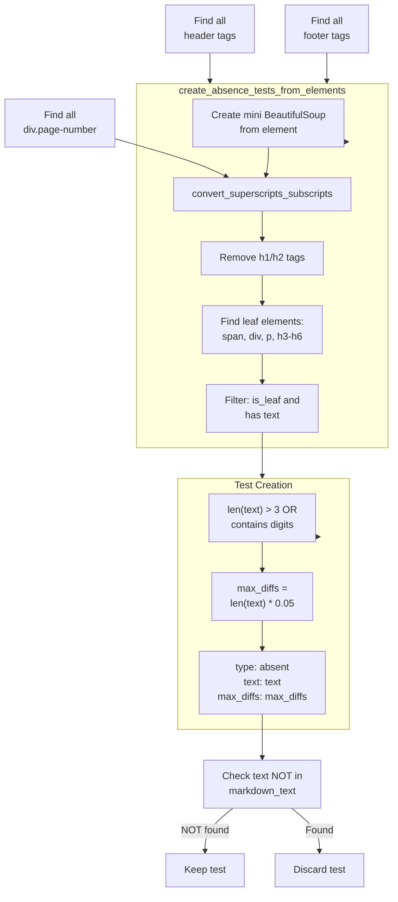

**Sources:** [`olmocr/bench/synth/mine_html_templates.py:792-872`]()

The function `create_absence_tests_from_elements()` at [`olmocr/bench/synth/mine_html_templates.py:798-845`]() generates tests for content that should NOT appear in OCR output (headers, footers, page numbers). Key steps:

1. **Create isolated soup**: Parse just the element at [`olmocr/bench/synth/mine_html_templates.py:799`]()
2. **Convert Unicode**: Apply superscript/subscript conversion at [`olmocr/bench/synth/mine_html_templates.py:802`]()
3. **Remove headings**: H1/H2 tags excluded at [`olmocr/bench/synth/mine_html_templates.py:805-806`]()
4. **Find leaf nodes**: Only elements without children at [`olmocr/bench/synth/mine_html_templates.py:815-822`]()
5. **Set fuzzy threshold**: 5% of text length at [`olmocr/bench/synth/mine_html_templates.py:843`]()
6. **Final validation**: Verify text is NOT in markdown at [`olmocr/bench/synth/mine_html_templates.py:1158`]()

### TableTest Generation with Validation

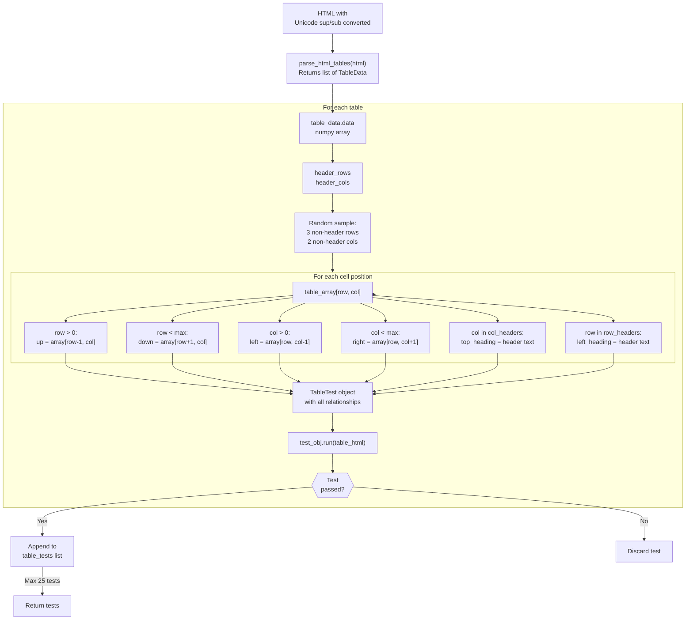

**Sources:** [`olmocr/bench/synth/mine_html_templates.py:874-1016`]()

Table test generation at [`olmocr/bench/synth/mine_html_templates.py:874-1015`]() is sophisticated:

1. **Parse tables**: Uses `parse_html_tables()` at [`olmocr/bench/synth/mine_html_templates.py:882`]() to get structured data
2. **Filter small tables**: Skip tables with <2 rows or <2 columns at [`olmocr/bench/synth/mine_html_templates.py:890-891`]()
3. **Random cell selection**: Samples 3 rows × 2 columns from non-header cells at [`olmocr/bench/synth/mine_html_templates.py:894-908`]()
4. **Relationship detection**: Checks adjacent cells (up/down/left/right) at [`olmocr/bench/synth/mine_html_templates.py:930-951`]()
5. **Header relationships**: Links cells to column/row headers at [`olmocr/bench/synth/mine_html_templates.py:957-974`]()
6. **Validation**: Creates `TableTest` object and runs it against HTML at [`olmocr/bench/synth/mine_html_templates.py:980-1001`]()
7. **Keep passing tests**: Only tests that pass are included at [`olmocr/bench/synth/mine_html_templates.py:1007-1008`]()

The validation step at [`olmocr/bench/synth/mine_html_templates.py:1001`]() ensures tests are accurate before including them in the benchmark.

### TextOrderTest Generation

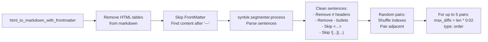

**Sources:** [`olmocr/bench/synth/mine_html_templates.py:1017-1111`]()

Order test generation at [`olmocr/bench/synth/mine_html_templates.py:1018-1111`]():

1. **Convert to markdown**: Cleaner text extraction at [`olmocr/bench/synth/mine_html_templates.py:1019`]()
2. **Remove tables**: Tables can confuse sentence parsing at [`olmocr/bench/synth/mine_html_templates.py:1023`]()
3. **Parse sentences**: Using `syntok` at [`olmocr/bench/synth/mine_html_templates.py:1042`]()
4. **Clean sentences**: Remove markdown artifacts at [`olmocr/bench/synth/mine_html_templates.py:1058-1070`]()
5. **Create random pairs**: Shuffle and pair indices at [`olmocr/bench/synth/mine_html_templates.py:1073-1076`]()
6. **Set threshold**: 2% of max sentence length at [`olmocr/bench/synth/mine_html_templates.py:1091`]()
7. **Limit count**: Maximum 5 order tests per page at [`olmocr/bench/synth/mine_html_templates.py:1110-1111`]()

### MathTest Generation

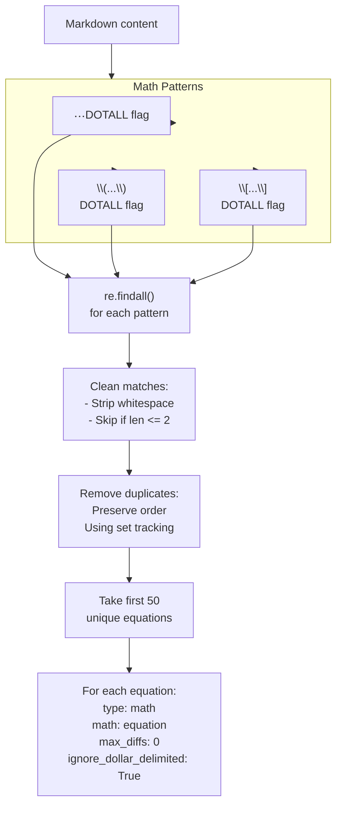

**Sources:** [`olmocr/bench/synth/mine_html_templates.py:1113-1152`]()

Math test generation at [`olmocr/bench/synth/mine_html_templates.py:1115-1152`]() extracts LaTeX equations:

1. **Define patterns**: Three patterns for different delimiters at [`olmocr/bench/synth/mine_html_templates.py:1116-1120`]()
2. **Extract equations**: Using `re.findall()` with `DOTALL` at [`olmocr/bench/synth/mine_html_templates.py:1123-1130`]()
3. **Clean whitespace**: Strip and filter short equations at [`olmocr/bench/synth/mine_html_templates.py:1127-1130`]()
4. **Deduplicate**: Preserve order while removing duplicates at [`olmocr/bench/synth/mine_html_templates.py:1133-1138`]()
5. **Limit count**: Maximum 50 equations per page at [`olmocr/bench/synth/mine_html_templates.py:1141`]()
6. **Set strict matching**: `max_diffs: 0` at [`olmocr/bench/synth/mine_html_templates.py:1149`]() requires exact matches

The `ignore_dollar_delimited: True` flag at [`olmocr/bench/synth/mine_html_templates.py:1150`]() allows tests to match against equations with different delimiter styles.

### Test Filtering Pipeline

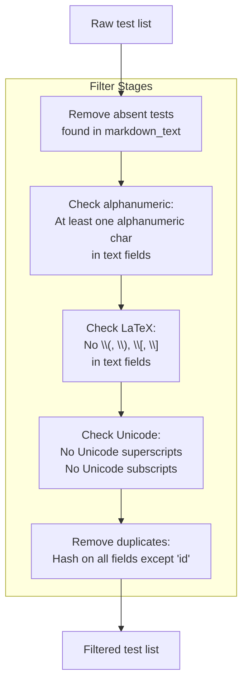

**Sources:** [`olmocr/bench/synth/mine_html_templates.py:1154-1227`]()

The filtering pipeline at [`olmocr/bench/synth/mine_html_templates.py:1154-1227`]() removes problematic tests:

1. **Absent test validation**: Verify text is NOT in markdown at [`olmocr/bench/synth/mine_html_templates.py:1158`]()
2. **Alphanumeric check**: Ensures text fields contain meaningful content at [`olmocr/bench/synth/mine_html_templates.py:1163-1164`]()
3. **LaTeX exclusion**: Text fields shouldn't have LaTeX delimiters at [`olmocr/bench/synth/mine_html_templates.py:1166-1171`]() (except for math tests)
4. **Unicode super/sub exclusion**: Prevents tests with converted Unicode at [`olmocr/bench/synth/mine_html_templates.py:1173-1181`]()
5. **Deduplication**: Hashes all fields except `id` at [`olmocr/bench/synth/mine_html_templates.py:1217-1221`]()

Text fields checked are defined at [`olmocr/bench/synth/mine_html_templates.py:1161`](): `text`, `cell`, `before`, `after`, `up`, `down`, `left`, `right`, `top_heading`, `left_heading`.

## PDF Processing and Output Organization

The `process_pdf()` function orchestrates the complete workflow for a single PDF:

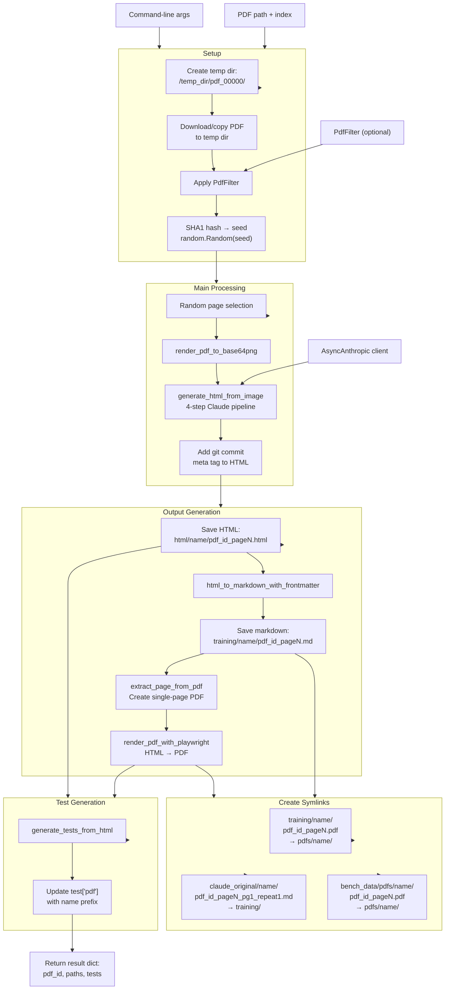

**Sources:** [`olmocr/bench/synth/mine_html_templates.py:1231-1419`]()

The `process_pdf()` function at [`olmocr/bench/synth/mine_html_templates.py:1231-1419`]()  performs these steps:

### Setup Phase

1. **Create temp directory**: Each PDF gets isolated temp dir at [`olmocr/bench/synth/mine_html_templates.py:1236-1238`]()
2. **Download PDF**: Via `download_s3_pdf()` at [`olmocr/bench/synth/mine_html_templates.py:1244-1247`]()
3. **Apply filtering**: Optional `PdfFilter` check at [`olmocr/bench/synth/mine_html_templates.py:1250-1252`]()
4. **Generate seed**: SHA1 hash of PDF content at [`olmocr/bench/synth/mine_html_templates.py:1255-1261`]() ensures reproducible randomness
5. **Select page**: Random page using seeded generator at [`olmocr/bench/synth/mine_html_templates.py:1273`]()

### Processing Phase

1. **Render to PNG**: Using `render_pdf_to_base64png()` at [`olmocr/bench/synth/mine_html_templates.py:1277`]()
2. **Generate HTML**: 4-step Claude pipeline at [`olmocr/bench/synth/mine_html_templates.py:1280`]()
3. **Add git metadata**: Embeds commit hash in `<meta>` tag at [`olmocr/bench/synth/mine_html_templates.py:1286-1299`]()

### Output Phase

The system creates multiple output artifacts in different directories:

```
output_dir/
├── html/
│   └── synthetic/
│       └── pdf_00001_page5.html
├── pdfs/
│   └── synthetic/
│       ├── pdf_00001_page5_original.pdf  (extracted single page)
│       └── pdf_00001_page5.pdf          (Playwright rendered)
├── training/
│   └── synthetic/
│       ├── pdf_00001_page5.md           (markdown)
│       └── pdf_00001_page5.pdf          (symlink → pdfs)
├── bench_data/
│   ├── pdfs/
│   │   └── synthetic/
│   │       └── pdf_00001_page5.pdf      (symlink → pdfs)
│   ├── claude_original/
│   │   └── synthetic/
│   │       └── pdf_00001_page5_pg1_repeat1.md  (symlink → training)
│   └── synthetic.jsonl                   (test definitions)
└── metadata/
    └── synthetic.jsonl                   (source tracking)
```

**Sources:** [`olmocr/bench/synth/mine_html_templates.py:1302-1387`]()

Key output operations:

1. **HTML saved**: At [`olmocr/bench/synth/mine_html_templates.py:1316-1318`]()
2. **Markdown conversion**: Via `html_to_markdown_with_frontmatter()` at [`olmocr/bench/synth/mine_html_templates.py:1321`]()
3. **Original PDF extraction**: Using `extract_page_from_pdf()` at [`olmocr/bench/synth/mine_html_templates.py:1346-1348`]()
4. **Playwright rendering**: Conditional on `--skip_playwright` at [`olmocr/bench/synth/mine_html_templates.py:1355-1377`]()
5. **Symlinks created**: Relative paths for portability at [`olmocr/bench/synth/mine_html_templates.py:1328-1386`]()

The naming convention `pdf_id_pageN_pg1_repeat1.md` at [`olmocr/bench/synth/mine_html_templates.py:1337`]() matches the expected format for training data.

### Test Generation and Writing

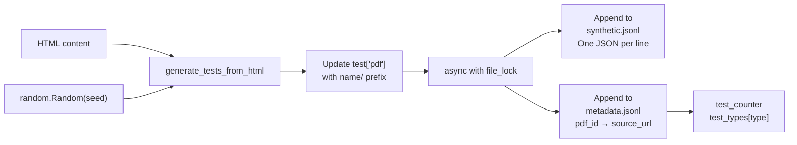

**Sources:** [`olmocr/bench/synth/mine_html_templates.py:1390-1410`](), [`olmocr/bench/synth/mine_html_templates.py:1510-1540`]()

After test generation at [`olmocr/bench/synth/mine_html_templates.py:1390`]():

1. **Update PDF paths**: Prefix with `name/` subdirectory at [`olmocr/bench/synth/mine_html_templates.py:1393-1394`]()
2. **Acquire lock**: Async file lock at [`olmocr/bench/synth/mine_html_templates.py:1516`]() for parallel safety
3. **Write tests**: Append each test as JSON line at [`olmocr/bench/synth/mine_html_templates.py:1518-1520`]()
4. **Write metadata**: Track PDF source URL at [`olmocr/bench/synth/mine_html_templates.py:1523-1525`]()
5. **Update counters**: Global counts for progress tracking at [`olmocr/bench/synth/mine_html_templates.py:1528-1532`]()

The JSONL format allows incremental writing during parallel processing without holding all tests in memory.

## Command-Line Interface and Configuration

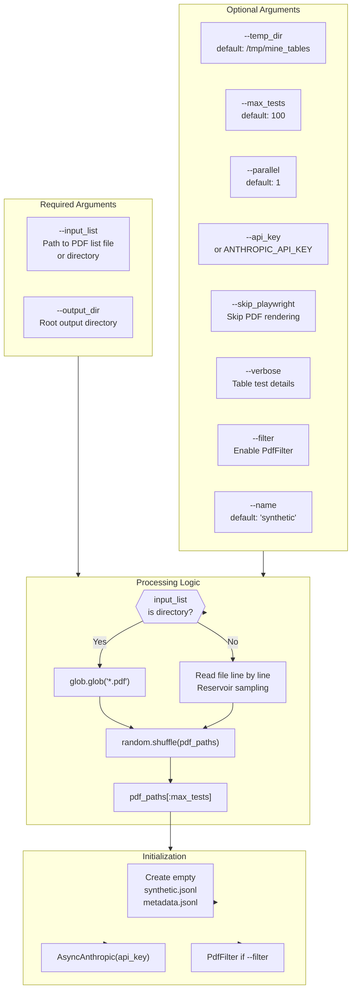

**Sources:** [`olmocr/bench/synth/mine_html_templates.py:1421-1461`](), [`olmocr/bench/synth/mine_html_templates.py:1466-1499`]()

The argument parser at [`olmocr/bench/synth/mine_html_templates.py:1426-1437`]() defines the CLI. Key arguments:

### Input Handling

- **`--input_list`**: Can be either:
  - A file with PDF paths (S3 or local), one per line
  - A directory path to glob for `*.pdf` files
  
The system detects the type at [`olmocr/bench/synth/mine_html_templates.py:1466-1481`]():
- Directory: Uses `glob.glob()` at [`olmocr/bench/synth/mine_html_templates.py:1467`]()
- File: Reads line-by-line with reservoir sampling at [`olmocr/bench/synth/mine_html_templates.py:1469-1481`]()

Reservoir sampling maintains up to 100,000 PDFs in memory, randomly replacing elements with decreasing probability at [`olmocr/bench/synth/mine_html_templates.py:1478-1480`]().

### Output Configuration

- **`--output_dir`**: Root directory for all outputs
- **`--name`**: Subdirectory name (default: `"synthetic"`) used for:
  - Test file: `bench_data/{name}.jsonl`
  - PDF subdirectory: `bench_data/pdfs/{name}/`
  - Training subdirectory: `training/{name}/`
  - Metadata file: `metadata/{name}.jsonl`

### Filtering Options

The `--filter` flag at [`olmocr/bench/synth/mine_html_templates.py:1435`]() enables `PdfFilter` at [`olmocr/bench/synth/mine_html_templates.py:1454-1460`]() with:
- **Language filtering**: Only English (and `None` for undetectable)
- **Spam detection**: `apply_download_spam_check=True`
- **Form detection**: `apply_form_check=True`

### Parallelization

The `--parallel` argument at [`olmocr/bench/synth/mine_html_templates.py:1431`]() controls concurrency via `asyncio.Semaphore` at [`olmocr/bench/synth/mine_html_templates.py:1547`](). Recommended values:
- **1-3**: For development/testing
- **5-10**: For production with API rate limits
- **Higher**: May hit Claude API rate limits

## Cost Tracking and Statistics

```mermaid
graph TB
    subgraph GlobalCounters["Global Variables"]
        InputTokens["total_input_tokens = 0"]
        OutputTokens["total_output_tokens = 0"]
    end
    
    subgraph APIResponse["API Response Tracking"]
        OrientUsage["orientation_response.usage<br/>input_tokens<br/>output_tokens"]
        AnalysisUsage["analysis_response.usage"]
        InitialUsage["initial_response.usage"]
        RefineUsage["refinement_response.usage"]
    end
    
    subgraph Accumulate["Accumulation"]
        AddInput["total_input_tokens +=<br/>response.usage.input_tokens"]
        AddOutput["total_output_tokens +=<br/>response.usage.output_tokens"]
    end
    
    subgraph Progress["Progress Display"]
        TQDM["tqdm progress bar<br/>pbar.set_postfix()"]
        Display["in_tokens: {total_input_tokens:,}<br/>out_tokens: {total_output_tokens:,}<br/>cost: ${total_cost:.2f}"]
    end
    
    subgraph Final["Final Summary"]
        CalcCost["Input: $3 per MTok<br/>Output: $15 per MTok"]
        PrintSummary["Print total tokens<br/>and costs"]
    end
    
    GlobalCounters --> APIResponse
    APIResponse --> OrientUsage
    APIResponse --> AnalysisUsage
    APIResponse --> InitialUsage
    APIResponse --> RefineUsage
    
    OrientUsage --> Accumulate
    AnalysisUsage --> Accumulate
    InitialUsage --> Accumulate
    RefineUsage --> Accumulate
    
    Accumulate --> AddInput
    Accumulate --> AddOutput
    
    AddInput --> Progress
    AddOutput --> Progress
    Progress --> TQDM
    TQDM --> Display
    
    Display --> Final
    Final --> CalcCost
    CalcCost --> PrintSummary
```

**Sources:** [`olmocr/bench/synth/mine_html_templates.py:31-33`](), [`olmocr/bench/synth/mine_html_templates.py:389-391`](), [`olmocr/bench/synth/mine_html_templates.py:1562-1566`](), [`olmocr/bench/synth/mine_html_templates.py:1587-1595`]()

Cost tracking is implemented via global variables at [`olmocr/bench/synth/mine_html_templates.py:31-33`](). After each Claude API call, token usage is accumulated:

- **Orientation check**: ~1,000 tokens at [`olmocr/bench/synth/mine_html_templates.py:389-391`]()
- **Analysis**: ~10,000-20,000 tokens at [`olmocr/bench/synth/mine_html_templates.py:433-435`]()
- **Initial HTML**: ~10,000-20,000 tokens at [`olmocr/bench/synth/mine_html_templates.py:479-481`]()
- **Refinement**: ~20,000-40,000 tokens at [`olmocr/bench/synth/mine_html_templates.py:566-568`]()

The progress bar updates in real-time at [`olmocr/bench/synth/mine_html_templates.py:1563-1566`]():
```python
cost_input = (total_input_tokens / 1_000_000) * 3.0
cost_output = (total_output_tokens / 1_000_000) * 15.0
total_cost = cost_input + cost_output
pbar.set_postfix({"in_tokens": f"{total_input_tokens:,}", ...})
```

Final summary printed at [`olmocr/bench/synth/mine_html_templates.py:1587-1595`]() shows:
- Total input/output tokens with commas
- Cost breakdown by input ($3/MTok) and output ($15/MTok)
- Total cost

For reference, processing 100 PDFs with 4-step prompting typically costs $50-100 depending on document complexity.

## Git Commit Tracking

```mermaid
graph LR
    GetHash["get_git_commit_hash()<br/>subprocess.run(['git', 'rev-parse', 'HEAD'])"]
    
    Check{{"Git available<br/>and repo?"}}
    
    CommitHash["7-character<br/>commit hash"]
    
    None["Return None"]
    
    ParseHTML["Parse HTML<br/>with BeautifulSoup"]
    
    FindHead{{"head<br/>tag exists?"}}
    
    CreateMeta["Create meta tag:<br/>name='olmocr_git_commit'<br/>content=git_commit"]
    
    InsertHead["Insert at<br/>head[0]"]
    
    UpdateHTML["str(html_soup)"]
    
    GetHash --> Check
    Check -->|"Yes"| CommitHash
    Check -->|"No"| None
    
    CommitHash --> ParseHTML
    None --> ParseHTML
    
    ParseHTML --> FindHead
    FindHead -->|"Yes"| CreateMeta
    FindHead -->|"No"| UpdateHTML
    
    CreateMeta --> InsertHead
    InsertHead --> UpdateHTML
```

**Sources:** [`olmocr/bench/synth/mine_html_templates.py:36-43`](), [`olmocr/bench/synth/mine_html_templates.py:1286-1299`]()

The system tracks which code version generated each HTML file. The `get_git_commit_hash()` function at [`olmocr/bench/synth/mine_html_templates.py:36-43`]() attempts to get the current git commit hash. If successful, it's embedded in the HTML at [`olmocr/bench/synth/mine_html_templates.py:1286-1299`]():

```html
<head>
  <meta name="olmocr_git_commit" content="a1b2c3d4...">
  ...
</head>
```

This enables:
- **Version tracking**: Know which code version generated which data
- **Reproducibility**: Re-run specific commits to reproduce results
- **Debugging**: Correlate data quality issues with code changes

The insertion happens at [`olmocr/bench/synth/mine_html_templates.py:1296`]() as the first element in `<head>`, making it easy to find. If there's no `<head>` tag or git is unavailable, the HTML is used as-is at [`olmocr/bench/synth/mine_html_templates.py:1299`]().

## Error Handling and Robustness

The system includes several robustness mechanisms:

### Temporary Directory Cleanup

```python
finally:
    # Clean up temp directory for this PDF
    if os.path.exists(temp_pdf_dir):
        subprocess.run(["rm", "-rf", temp_pdf_dir])
```
**Source:** [`olmocr/bench/synth/mine_html_templates.py:1415-1418`]()

Every PDF gets a temporary directory that's always cleaned up, even on exceptions.

### API Response Validation

Multiple checks ensure complete responses:
- **Stop reason check**: `stop_reason == "end_turn"` at [`olmocr/bench/synth/mine_html_templates.py:423`](), [`olmocr/bench/synth/mine_html_templates.py:468`](), [`olmocr/bench/synth/mine_html_templates.py:554`]()
- **Code block extraction**: Fallback regex patterns at [`olmocr/bench/synth/mine_html_templates.py:318-344`]()
- **Refinement fallback**: Returns initial HTML if refinement fails at [`olmocr/bench/synth/mine_html_templates.py:577-578`]()

### Playwright Rendering Fallback

If Playwright rendering fails at [`olmocr/bench/synth/mine_html_templates.py:1366-1373`]():
- **Skip if required**: Returns `None` to skip the PDF at [`olmocr/bench/synth/mine_html_templates.py:1376-1377`]()
- **Continue if optional**: With `--skip_playwright`, processing continues at [`olmocr/bench/synth/mine_html_templates.py:1355`]()

### Parallel Processing Safety

- **File locks**: Protect JSONL writes at [`olmocr/bench/synth/mine_html_templates.py:1516`]()
- **Exception handling**: Individual PDF failures don't crash pipeline at [`olmocr/bench/synth/mine_html_templates.py:1537-1539`]()
- **Bounded concurrency**: Semaphore prevents overwhelming API at [`olmocr/bench/synth/mine_html_templates.py:1547`]()

## Integration with Training Pipeline

The synthetic data integrates with the training system ([5.1](#5.1)) through the file organization:

### Training Data Structure

```
output_dir/training/synthetic/
├── pdf_00001_page5.md          # Markdown with FrontMatter
├── pdf_00001_page5.pdf         # Symlink to rendered PDF
├── pdf_00002_page12.md
└── pdf_00002_page12.pdf
```

The markdown files include FrontMatter metadata that the training pipeline uses:
```yaml
---
primary_language: en
is_rotation_valid: true
rotation_correction: 0
is_table: false
is_diagram: false
---
```

This metadata is consumed by `BaseMarkdownPDFDataset` for filtering and augmentation.

### Claude Original Reference

```
bench_data/claude_original/synthetic/
├── pdf_00001_page5_pg1_repeat1.md    # Symlink to training markdown
└── pdf_00002_page12_pg1_repeat1.md
```

The naming convention `_pg1_repeat1` indicates:
- **pg1**: Page 1 of the rendered PDF (always 1 for synthetic single-page docs)
- **repeat1**: First repetition (allows for multiple attempts if needed)

This matches the expected format in the training dataset configuration.

## Integration with Benchmarking System

The synthetic data also feeds into the benchmarking pipeline ([4.6](#4.6), [4.7](#4.7)):

### Benchmark Test Files

```
bench_data/
├── synthetic.jsonl              # Test definitions
├── pdfs/
│   └── synthetic/
│       └── pdf_00001_page5.pdf  # Test PDFs
└── claude_original/
    └── synthetic/
        └── pdf_00001_page5_pg1_repeat1.md  # Ground truth
```

The `synthetic.jsonl` file contains one test per line:
```json
{"pdf": "synthetic/pdf_00001_page5.pdf", "page": 1, "id": "pdf_00001_header_a1b2c3d4", "type": "absent", "text": "Copyright © 2023", "max_diffs": 1}
{"pdf": "synthetic/pdf_00001_page5.pdf", "page": 1, "id": "pdf_00001_table0_e5f6g7h8", "type": "table", "cell": "42", "up": "Total", "left": "2023", "max_diffs": 0}
```

Tests reference PDFs with the `name/` prefix (e.g., `synthetic/`), allowing multiple synthetic datasets to coexist.

### Metadata Tracking

```
metadata/synthetic.jsonl
```

Maps PDF IDs to source URLs:
```json
{"pdf_id": "pdf_00001", "source_url": "s3://bucket/path/to/original.pdf", "page_number": 5}
```

This enables tracing synthetic documents back to their source arXiv papers for debugging or attribution.

---

