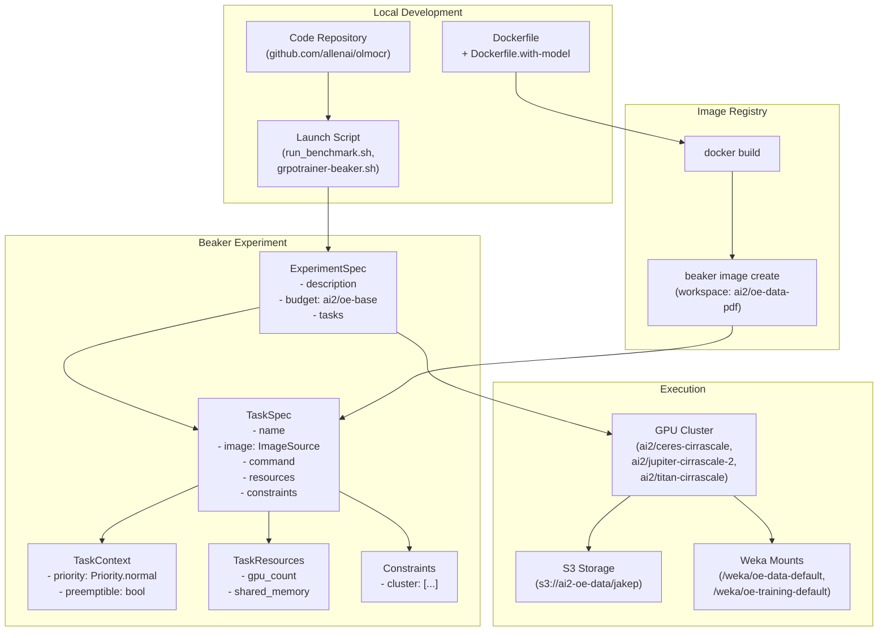
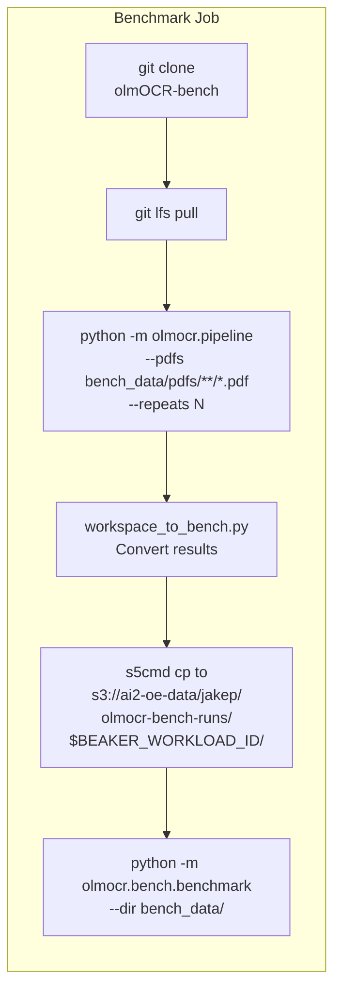
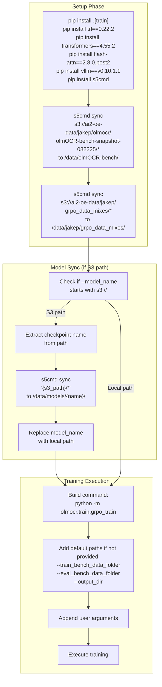
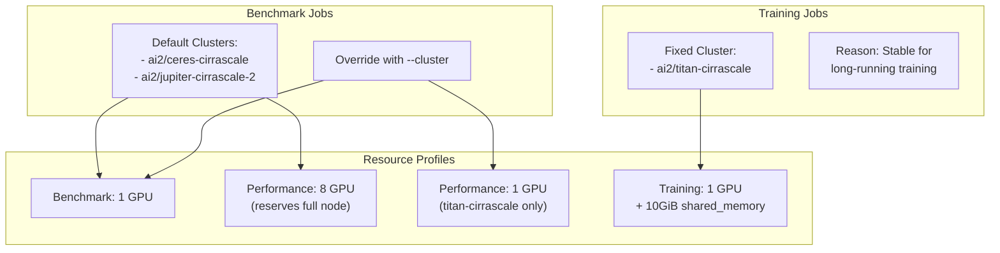

<!-- source: DeepWiki mcp.deepwiki.com · repo allenai/olmocr · page 6.3 Beaker Platform Integration · fetched 2026-10-26 -->

# Distributed Execution on Beaker

<details>
<summary>Relevant source files</summary>

The following files were used as context for generating this wiki page:

- [olmocr/bench/miners/mine_tables_gpt_simple.py](olmocr/bench/miners/mine_tables_gpt_simple.py)
- [olmocr/bench/scripts/rotate_pdfs.py](olmocr/bench/scripts/rotate_pdfs.py)
- [olmocr/bench/scripts/rotate_pdfs_random.sh](olmocr/bench/scripts/rotate_pdfs_random.sh)
- [olmocr/bench/scripts/workspace_to_bench.py](olmocr/bench/scripts/workspace_to_bench.py)
- [scripts/run_benchmark.sh](scripts/run_benchmark.sh)
- [scripts/sync_beaker_image.sh](scripts/sync_beaker_image.sh)
- [tests/gnarly_pdfs/guidebook_failed_pages.pdf](tests/gnarly_pdfs/guidebook_failed_pages.pdf)

</details>


## Purpose and Scope

This document describes how olmOCR integrates with Beaker, AI2's internal platform for distributed job execution on GPU clusters. It covers Docker image management, experiment creation, resource allocation, and coordination mechanisms for running pipeline processing, model training, and benchmarking at scale.

For local development setup, see [Local Development Setup](#7.1). For CI/CD workflows that build and push images automatically, see [CI/CD and Automation](#6.3).

---

## Overview

Beaker provides GPU cluster access and job orchestration for computationally intensive olmOCR tasks. The system supports three primary execution patterns:

1. **Pipeline Processing** - Distributed OCR of large PDF collections with S3-based work queues
2. **Model Training** - GRPO reinforcement learning on multi-GPU nodes
3. **Benchmarking** - Quality evaluation across test suites with performance profiling

All executions use containerized environments with pre-built Docker images containing dependencies and optionally pre-cached models.

**Sources:** [scripts/run_benchmark.sh:1-346](), [scripts/train/grpotrainer-beaker.sh:1-254]()

---

## Beaker Experiment Structure



**Sources:** [scripts/run_benchmark.sh:120-248](), [scripts/train/grpotrainer-beaker.sh:95-238]()

---

## Docker Image Workflow

### Base Image

The standard `Dockerfile` contains the complete olmOCR runtime with VLLM and all dependencies. Images are tagged with version and git hash for reproducibility:

```
olmocr-{purpose}-{version}-{git_hash}
```

**Build and Push Process:**

[scripts/run_benchmark.sh:83-113]() shows the typical workflow:

1. Extract version from `olmocr.version.VERSION`
2. Get 10-character git hash prefix
3. Build with `docker build --platform linux/amd64`
4. Push to Beaker: `beaker image create --workspace ai2/oe-data-pdf --name {tag} {tag}`

The script handles duplicate images gracefully, reusing existing images if the hash matches.

### With-Model Variant

`Dockerfile.with-model` pre-downloads the 16GB olmOCR model checkpoint into the image, reducing cold-start time for inference-heavy jobs. This variant is synced separately:

[scripts/sync_beaker_image.sh:1-14]() demonstrates the sync process:
- Pull from Docker Hub: `alleninstituteforai/olmocr:v{version}-with-model`
- Create Beaker image: `beaker image create --workspace ai2/oe-data-pdf --name olmocr-inference-{version}`

### Image Reference Format

In Python experiment creation, images are referenced as `{beaker_user}/{image_tag}` or full Beaker paths if provided with `/`:

[scripts/run_benchmark.sh:215-220]()
```python
if '/' in image_tag:
    image_ref = image_tag
else:
    image_ref = f"{beaker_user}/{image_tag}"
```

**Sources:** [scripts/run_benchmark.sh:83-113](), [scripts/sync_beaker_image.sh:1-14](), [scripts/run_benchmark.sh:215-220]()

---

## Benchmark Execution

### Experiment Configuration

[scripts/run_benchmark.sh:120-248]() creates two experiments: a benchmark job and a performance test job.



**Key Parameters:**

| Parameter | Purpose | Example |
|-----------|---------|---------|
| `--model` | Custom model checkpoint | `Qwen/Qwen2.5-VL-7B-Instruct` |
| `--cluster` | Specific cluster | `ai2/titan-cirrascale` |
| `--benchbranch` | Bench data branch | `main` |
| `--beaker-image` | Skip build, use existing | `jakep/olmocr-benchmark-0.3.3-780bc7d934` |
| `--repeats` | Multiple runs for averaging | `3` |
| `--noperf` | Skip performance job | flag |

**Command Structure:**

[scripts/run_benchmark.sh:183-201]()

The script builds commands dynamically based on `--repeats`:
```bash
for i in range(1, repeats + 1):
    workspace_dir = f"./localworkspace{i}"
    pipeline_cmd = f"python -m olmocr.pipeline {workspace_dir} --markdown --pdfs ./olmOCR-bench/bench_data/pdfs/**/*.pdf"
    if model:
        pipeline_cmd += f" --model {model}"
    commands.append(pipeline_cmd)
```

Each workspace is then converted and uploaded:
```bash
workspace_to_bench_cmd = f"python olmocr/bench/scripts/workspace_to_bench.py {workspace_dir} olmOCR-bench/bench_data/olmocr --bench-path ./olmOCR-bench/ --repeat-index {i}"
```

### Resource Allocation

[scripts/run_benchmark.sh:221-235]()

**Benchmark Job:**
- `gpu_count=1` - Single GPU sufficient for pipeline
- `preemptible=True` - Allows cheaper spot instances
- `priority=Priority.normal`
- `result_path="/noop-results"` - Results stored in S3, not Beaker results

**Performance Job:**

[scripts/run_benchmark.sh:257-286]()

- `gpu_count=8` for jupiter/ceres clusters (reserves entire node for consistent timing)
- `gpu_count=1` for titan-cirrascale (different node configuration)
- Tests against benchmark set: `s3://ai2-oe-data/jakep/olmocr/olmOCR-mix-0225/benchmark_set/*.pdf`

### AWS Credentials Handling

[scripts/run_benchmark.sh:159-168]()

Checks for user-specific AWS credentials secret:
```python
aws_creds_secret = f"{beaker_user}-AWS_CREDENTIALS_FILE"
try:
    b.secret.get(aws_creds_secret, workspace="ai2/olmocr")
    has_aws_creds = True
except:
    has_aws_creds = False
```

If available, credentials are injected:
```python
commands.extend([
    "mkdir -p ~/.aws",
    'echo "$AWS_CREDENTIALS_FILE" > ~/.aws/credentials'
])

task_spec_args["env_vars"] = [
    EnvVar(name="AWS_CREDENTIALS_FILE", secret=aws_creds_secret)
]
```

**Sources:** [scripts/run_benchmark.sh:120-248](), [scripts/run_benchmark.sh:183-201](), [scripts/run_benchmark.sh:221-235](), [scripts/run_benchmark.sh:257-286](), [scripts/run_benchmark.sh:159-168]()

---

## GRPO Training Execution

### Training Job Structure



**Sources:** [scripts/train/grpotrainer-beaker.sh:95-186]()

### Configuration Options

[scripts/train/grpotrainer-beaker.sh:13-45]()

**Beaker-Specific Flags:**

| Flag | Purpose |
|------|---------|
| `--skip-docker-build` | Reuse existing Docker image |
| `--preemptible` | Use preemptible instances for cost savings |
| `--name NAME` | Experiment name (used in output directory path) |

All other arguments are forwarded to `grpo_train.py`.

### Model Path Handling

[scripts/train/grpotrainer-beaker.sh:134-155]()

The script handles both local and S3 model paths:

```python
for i in range(len(modified_args)):
    if modified_args[i] == "--model_name" and i + 1 < len(modified_args):
        model_path = modified_args[i + 1].rstrip('/')
        if model_path.startswith("s3://"):
            checkpoint_name = model_path.split('/')[-1]
            local_model_path = f"/data/models/{checkpoint_name}"
            
            model_sync_commands = [
                f"echo 'Syncing model from S3: {model_path}'",
                "mkdir -p /data/models",
                f"s5cmd sync '{model_path}/*' '{local_model_path}/'",
            ]
            
            modified_args[i + 1] = local_model_path
```

This enables training from custom checkpoints stored in S3 without manual downloads.

### Output Directory Construction

[scripts/train/grpotrainer-beaker.sh:169-179]()

Default output directory hierarchy:
```
/weka/oe-training-default/jakep/olmocr-grpo-checkpoints/
    {exp_name}-{BEAKER_WORKLOAD_ID}/  # if both provided
    {BEAKER_WORKLOAD_ID}/              # if no exp_name
    {exp_name}/                        # if no workload ID
```

This organization prevents checkpoint collisions and enables experiment tracking by Beaker job ID.

### Resource Configuration

[scripts/train/grpotrainer-beaker.sh:196-225]()

```python
TaskResources(
    gpu_count=1,
    shared_memory="10GiB"
)

Constraints(cluster=["ai2/titan-cirrascale"])
```

- Single GPU per task (distributed training uses multiple tasks)
- 10GiB shared memory for multiprocessing
- Titan cluster preferred for training stability

### Environment Variables

[scripts/train/grpotrainer-beaker.sh:213-220]()

| Variable | Purpose | Source |
|----------|---------|--------|
| `LOG_FILTER_TYPE` | `local_rank0_only` - reduce log spam in distributed training | Inline |
| `OMP_NUM_THREADS` | `8` - OpenMP parallelism | Inline |
| `BEAKER_USER_ID` | User identification | Passed from script |
| `AWS_ACCESS_KEY_ID` | S3 access | Secret: `ALLENNLP_AWS_ACCESS_KEY_ID` |
| `AWS_SECRET_ACCESS_KEY` | S3 access | Secret: `ALLENNLP_AWS_SECRET_ACCESS_KEY` |
| `WANDB_API_KEY` | Experiment tracking | Secret: `JAKE_WANDB_API_KEY` |

### Weka Filesystem Mounts

[scripts/train/grpotrainer-beaker.sh:221-224]()

```python
datasets=[
    DataMount.new(mount_path="/weka/oe-data-default", weka="oe-data-default"),
    DataMount.new(mount_path="/weka/oe-training-default", weka="oe-training-default"),
]
```

Weka provides high-performance shared filesystem for:
- Training data caching
- Checkpoint storage (survives job failures)
- Cross-job data sharing

**Sources:** [scripts/train/grpotrainer-beaker.sh:95-186](), [scripts/train/grpotrainer-beaker.sh:13-45](), [scripts/train/grpotrainer-beaker.sh:134-155](), [scripts/train/grpotrainer-beaker.sh:169-179](), [scripts/train/grpotrainer-beaker.sh:196-225](), [scripts/train/grpotrainer-beaker.sh:213-220](), [scripts/train/grpotrainer-beaker.sh:221-224]()

---

## S3 Coordination for Distributed Work

### Workspace Upload Pattern

[scripts/run_benchmark.sh:207-210]()

Results are uploaded with job ID in path for uniqueness:
```python
for i in range(1, repeats + 1):
    workspace_dir = f"localworkspace{i}/"
    commands.append(f"s5cmd cp {workspace_dir} s3://ai2-oe-data/jakep/olmocr-bench-runs/$BEAKER_WORKLOAD_ID/workspace{i}/")
```

The `$BEAKER_WORKLOAD_ID` environment variable is automatically injected by Beaker, providing unique job identification.

### Benchmark Data Synchronization

GRPO training syncs benchmark data from S3 snapshot:

[scripts/train/grpotrainer-beaker.sh:123-128]()
```bash
s5cmd sync 's3://ai2-oe-data/jakep/olmocr/olmOCR-bench-snapshot-082225/*' /data/olmOCR-bench/
s5cmd sync 's3://ai2-oe-data/jakep/grpo_data_mixes/*' /data/jakep/grpo_data_mixes/
```

Using snapshots ensures:
- Reproducibility (fixed dataset version)
- Fast startup (local cache after first sync)
- No dependency on external repos during training

### Workspace to Benchmark Conversion

[olmocr/bench/scripts/workspace_to_bench.py:1-214]()

This utility converts pipeline JSONL outputs to benchmark-compatible markdown:

**Input:** `workspace_dir/results/*.jsonl` with entries containing:
- `text` - The OCR output
- `metadata.Source-File` - PDF path

**Output:** `output_dir/{subdir}/{pdf_name}_pg1_repeat{N}.md`

[olmocr/bench/scripts/workspace_to_bench.py:71-107]()

Key functions:
- `create_markdown_files()` - Extracts text from JSONL, groups by PDF
- `find_missing_pdfs()` - Identifies PDFs without results
- `create_blank_markdown_files()` - Creates empty markdown for missing PDFs (ensures benchmark consistency)

**Sources:** [scripts/run_benchmark.sh:207-210](), [scripts/train/grpotrainer-beaker.sh:123-128](), [olmocr/bench/scripts/workspace_to_bench.py:1-214](), [olmocr/bench/scripts/workspace_to_bench.py:71-107]()

---

## Cluster Selection and Resource Constraints

### Available Clusters



### Cluster Constraint Specification

[scripts/run_benchmark.sh:233]()
```python
Constraints(cluster=[cluster] if cluster else ["ai2/ceres-cirrascale", "ai2/jupiter-cirrascale-2"])
```

[scripts/train/grpotrainer-beaker.sh:211]()
```python
Constraints(cluster=["ai2/titan-cirrascale"])
```

### Priority and Preemptibility

| Job Type | Priority | Preemptible | Rationale |
|----------|----------|-------------|-----------|
| Benchmark | `Priority.normal` | `True` | Can restart if preempted |
| Performance | `Priority.normal` | `True` | Repeatable measurements |
| Training | `Priority.normal` | Configurable (`--preemptible`) | Checkpointing enables restart |

[scripts/run_benchmark.sh:228-230]()
```python
TaskContext(
    priority=Priority.normal,
    preemptible=True,
)
```

**Sources:** [scripts/run_benchmark.sh:233](), [scripts/train/grpotrainer-beaker.sh:211](), [scripts/run_benchmark.sh:228-230]()

---

## Monitoring and Debugging

### Experiment URLs

Both scripts output experiment URLs upon creation:

[scripts/run_benchmark.sh:252-254]()
```python
print(f"Created benchmark experiment: {experiment.id}")
print(f"View at: https://beaker.org/ex/{experiment.id}")
```

These links provide access to:
- Real-time logs
- Resource utilization graphs
- Job status and failures
- Result artifacts (if using Beaker results)

### Workload ID Tracking

The `BEAKER_WORKLOAD_ID` environment variable is available in all jobs. Use it for:

1. **S3 output paths** - Unique storage location per run
2. **Checkpoint directories** - Identify training runs
3. **Log correlation** - Track related jobs

### Common Debugging Patterns

**Failed Pipeline Jobs:**

Check S3 for partial results:
```bash
s5cmd ls s3://ai2-oe-data/jakep/olmocr-bench-runs/{workload_id}/
```

**Training Checkpoints:**

Inspect Weka output directory:
```bash
ls /weka/oe-training-default/jakep/olmocr-grpo-checkpoints/{exp_name}-{workload_id}/
```

**GPU Memory Issues:**

Adjust in experiment script before resubmission:
- Reduce `per_device_train_batch_size`
- Increase `gradient_accumulation_steps`
- Reduce image resolution in dataset

**Missing AWS Credentials:**

Ensure secret exists:
```bash
beaker secret get {username}-AWS_CREDENTIALS_FILE --workspace ai2/olmocr
```

**Sources:** [scripts/run_benchmark.sh:252-254]()

---

## Summary Table: Beaker Job Types

| Aspect | Benchmark | Performance Test | GRPO Training |
|--------|-----------|------------------|---------------|
| **Launch Script** | `run_benchmark.sh` | `run_benchmark.sh --noperf` excludes | `grpotrainer-beaker.sh` |
| **GPU Count** | 1 | 8 (or 1 for titan) | 1 per task |
| **Clusters** | ceres, jupiter (configurable) | ceres, jupiter, titan | titan only |
| **Preemptible** | Yes | Yes | Configurable |
| **Primary Storage** | S3 | S3 | Weka + S3 |
| **Typical Duration** | Minutes to hours | 10-30 minutes | Hours to days |
| **Restart Tolerance** | High (stateless pipeline) | High (repeatable) | Medium (checkpointing) |
| **Output Pattern** | `s3://.../olmocr-bench-runs/{id}/` | `s3://.../olmocr-bench-runs/{id}/` | `/weka/.../checkpoints/{name}-{id}/` |

**Sources:** [scripts/run_benchmark.sh:1-346](), [scripts/train/grpotrainer-beaker.sh:1-254]()

---

