# Page: Overview

# Overview

<details>
<summary>Relevant source files</summary>

The following files were used as context for generating this wiki page:

- [CHANGELOG.md](CHANGELOG.md)
- [README.md](README.md)
- [olmocr/bench/README.md](olmocr/bench/README.md)
- [olmocr/bench/runners/run_nanonetsocr.py](olmocr/bench/runners/run_nanonetsocr.py)
- [olmocr/bench/runners/run_olmocr_pipeline.py](olmocr/bench/runners/run_olmocr_pipeline.py)
- [olmocr/pipeline.py](olmocr/pipeline.py)
- [olmocr/train/README.md](olmocr/train/README.md)
- [olmocr/version.py](olmocr/version.py)
- [olmocr/work_queue.py](olmocr/work_queue.py)
- [scripts/release.sh](scripts/release.sh)
- [scripts/run_mineru_benchmark.sh](scripts/run_mineru_benchmark.sh)
- [tests/gnarly_pdfs/edgar_image.pdf](tests/gnarly_pdfs/edgar_image.pdf)
- [tests/test_pipeline.py](tests/test_pipeline.py)
- [tests/test_s3_work_queue.py](tests/test_s3_work_queue.py)

</details>


This document provides an overview of the olmOCR repository, a fast and efficient OCR system powered by vision-language models. It introduces the three main subsystems—pipeline processing, benchmarking, and training—and explains how they interact to convert PDF documents into clean, structured text.

For detailed information about specific subsystems:
- Core pipeline implementation: see [Core OCR Pipeline](#2)
- Evaluation framework: see [Benchmarking System](#4)
- Model training procedures: see [Model Training and Fine-tuning](#5)
- Deployment architecture: see [Infrastructure and Deployment](#6)

## Purpose and Capabilities

olmOCR is a document OCR system designed to convert PDFs, PNGs, and JPEGs into clean markdown and structured text. The system achieves efficient processing at less than $200 USD per million pages by using a fine-tuned 7B parameter vision-language model (`allenai/olmOCR-2-7B-1025-FP8`) based on Qwen2.5-VL.

**Key capabilities:**
- Converts documents to markdown with natural reading order
- Handles equations (LaTeX), tables (HTML/Markdown), handwriting, and complex formatting
- Automatically removes headers and footers
- Manages multi-column layouts, figures, and insets
- Processes at scale using distributed work queues on S3 or local storage
- Supports rotation correction for misoriented pages

**Performance:** The latest model (v0.4.0) achieves an 82.4±1.1 overall score on olmOCR-Bench, a comprehensive evaluation framework covering 7,000+ test cases across 1,400 documents.

Sources: [README.md:1-50](), [olmocr/bench/README.md:1-20](), [olmocr/version.py:1-12]()

## System Architecture

The olmOCR repository comprises three major subsystems that work together in a continuous improvement cycle:

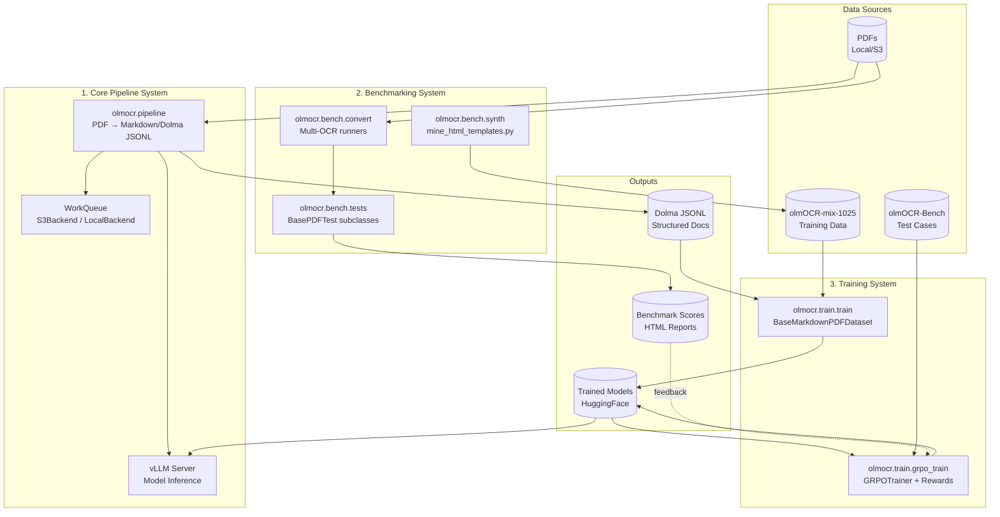

**System Interaction Pattern:**
1. The **Core Pipeline** processes PDFs using the trained model via vLLM
2. The **Benchmarking System** evaluates pipeline outputs and generates synthetic training data
3. The **Training System** uses benchmark feedback to improve models via reinforcement learning
4. Improved models are deployed back to the pipeline

Sources: [olmocr/pipeline.py:1-100](), [olmocr/bench/README.md:1-50](), [olmocr/train/README.md:1-30]()

## Core Pipeline System

The core pipeline, implemented in `olmocr.pipeline`, orchestrates large-scale document conversion using a distributed worker architecture.

### Architecture Components

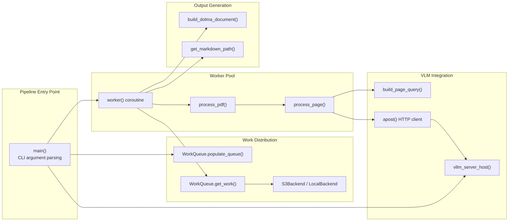

**Key Classes and Functions:**

| Component | Location | Purpose |
|-----------|----------|---------|
| `WorkQueue` | [olmocr/work_queue.py:82-231]() | Manages distributed work items with locking |
| `S3Backend` | [olmocr/work_queue.py:351-432]() | S3-based storage backend for coordination |
| `LocalBackend` | [olmocr/work_queue.py:233-349]() | Local filesystem backend |
| `process_page()` | [olmocr/pipeline.py:288-419]() | Core page processing with retry logic |
| `build_page_query()` | [olmocr/pipeline.py:144-184]() | Constructs VLM inference requests |
| `PageResponse` | [olmocr/prompts.py]() | Structured output with front matter fields |
| `build_dolma_document()` | [olmocr/pipeline.py:544-593]() | Assembles final Dolma JSONL format |

**Processing Flow:**
1. `WorkQueue` distributes PDF paths to parallel workers
2. Each worker calls `process_pdf()` → `process_page()` for each page
3. `process_page()` renders PDFs to images, queries vLLM, and handles retries
4. Results are assembled into Dolma documents and optionally markdown files
5. Workers mark items complete via `WorkQueue.mark_done()`

**Key Features:**
- Automatic rotation correction with cumulative rotation tracking
- Temperature escalation on retries (0.1 → 1.0) to overcome repetition
- Fallback to `pdftotext` after max retries exceeded
- Distributed locking prevents duplicate work across nodes

For detailed pipeline documentation, see [Core OCR Pipeline](#2) and [Work Queue and Distributed Processing](#2.2).

Sources: [olmocr/pipeline.py:288-711](), [olmocr/work_queue.py:82-231](), [tests/test_pipeline.py:204-514]()

## Benchmarking System

The benchmarking system (`olmocr.bench`) provides automated evaluation of OCR quality and synthetic data generation for training.

### Benchmark Architecture

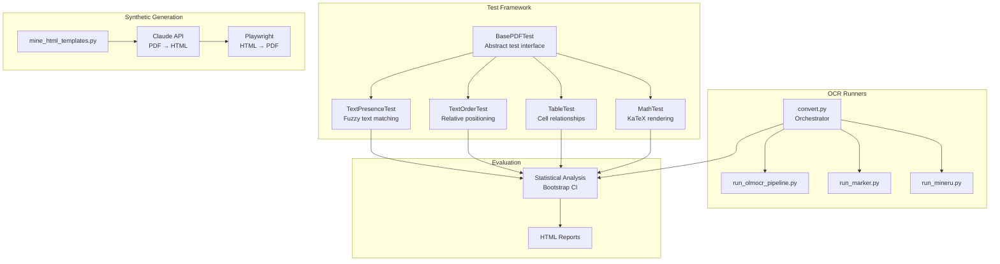

**Test Types:**

| Test Class | Location | Purpose |
|------------|----------|---------|
| `TextPresenceTest` | [olmocr/bench/tests/]() | Verifies text appears with fuzzy matching |
| `TextOrderTest` | [olmocr/bench/tests/]() | Checks relative text ordering |
| `TableTest` | [olmocr/bench/tests/]() | Validates table structure and cell relationships |
| `MathTest` | [olmocr/bench/tests/]() | Compares LaTeX rendering via KaTeX |
| `BaselineTest` | [olmocr/bench/tests/]() | Basic quality checks |

**Multi-OCR Comparison:**
The `convert.py` orchestrator provides a pluggable architecture supporting 15+ OCR engines including olmOCR, Marker, MinerU, GOT-OCR, and Nanonets. Each runner implements a common interface that processes single PDF pages and returns markdown text.

**Synthetic Data Generation:**
The `mine_html_templates.py` system uses Claude API with multi-step prompting to:
1. Convert arXiv PDFs to semantic HTML templates
2. Render HTML back to PDFs via Playwright
3. Automatically generate test cases in olmOCR-Bench format

This synthetic data (`olmOCR-synthmix-1025`) is used for GRPO reinforcement learning.

For detailed benchmark documentation, see [Benchmarking System](#4) and [Synthetic Data Generation](#4.5).

Sources: [olmocr/bench/README.md:1-100](), [olmocr/bench/runners/run_olmocr_pipeline.py:1-113](), [olmocr/train/README.md:129-157]()

## Training System

The training system implements a two-stage approach: supervised fine-tuning (SFT) followed by GRPO reinforcement learning.

### Training Pipeline Architecture

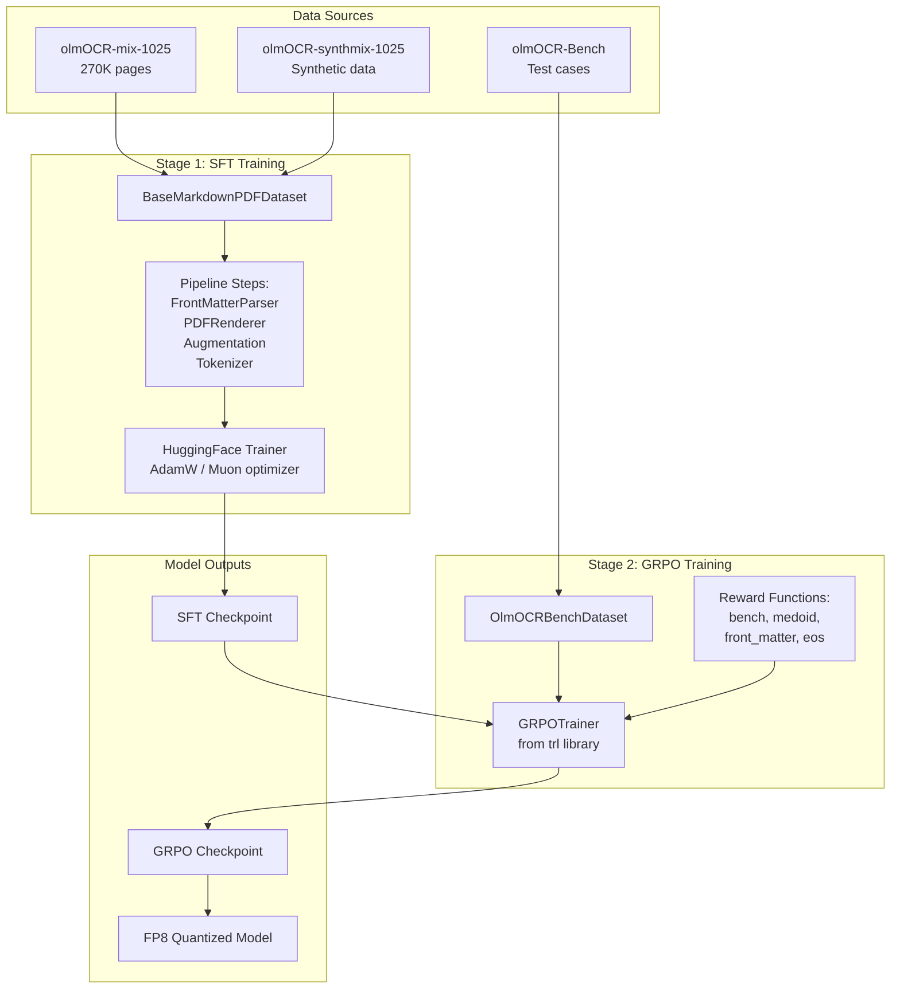

**Key Components:**

| Component | Location | Purpose |
|-----------|----------|---------|
| `BaseMarkdownPDFDataset` | [olmocr/train/dataloader.py]() | Configurable data pipeline with 7 transformation steps |
| `FrontMatterParser` | [olmocr/train/dataloader.py]() | Parses YAML front matter from markdown |
| `PDFRenderer` | [olmocr/data/renderpdf.py]() | Renders PDF pages to base64 PNG images |
| `GRPOTrainer` | [olmocr/train/grpo_train.py]() | Reinforcement learning with multiple reward functions |
| `OlmOCRBenchDataset` | [olmocr/train/grpo_train.py]() | Loads benchmark data for GRPO training |

**Training Process:**

1. **SFT (Supervised Fine-Tuning):**
   - Loads PDF+markdown pairs from `olmOCR-mix-1025` dataset
   - Applies pipeline steps: parsing → rendering → augmentation → filtering → tokenization
   - Fine-tunes Qwen2.5-VL with LoRA adapters or full model training
   - Training duration: ~24-48 hours on single B200 GPU for 270K pages

2. **GRPO (Group Relative Policy Optimization):**
   - Uses synthetic olmOCR-Bench data (`olmOCR-synthmix-1025`)
   - Reward functions: benchmark score, edit distance (medoid), frontmatter correctness, EOS tokens
   - Runs on 8xH100 setup: 1 GPU for vLLM inference, 7 GPUs for training
   - Multiple seeds are trained and merged via model souping

3. **Post-processing:**
   - Checkpoints are prepared with `prepare_olmocr_checkpoint.py`
   - FP8 quantization reduces model size and improves inference speed by ~12%

For detailed training documentation, see [Model Training and Fine-tuning](#5).

Sources: [olmocr/train/README.md:1-175](), [olmocr/train/train.py](), [olmocr/train/grpo_train.py]()

## Infrastructure and Deployment

The system supports multiple deployment modes: local single-GPU processing, multi-node clusters, Docker containers, and Beaker platform integration.

### Deployment Options

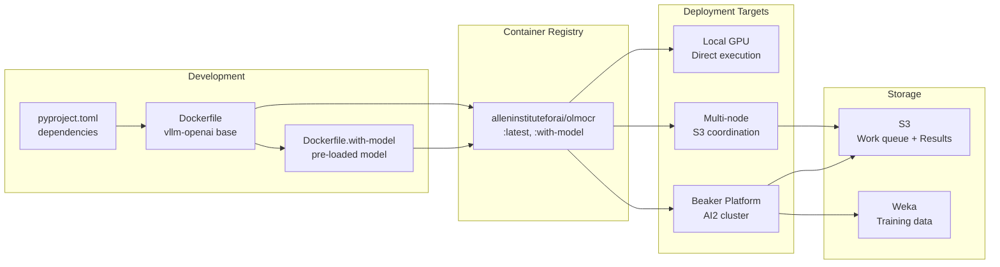

**Deployment Modes:**

1. **Local Processing:**
   ```bash
   python -m olmocr.pipeline ./workspace --markdown --pdfs *.pdf
   ```
   - Spawns local vLLM server automatically
   - Processes PDFs from local filesystem
   - Suitable for testing and small-scale conversion

2. **Multi-node Cluster:**
   ```bash
   python -m olmocr.pipeline s3://bucket/workspace --pdfs s3://bucket/*.pdf
   ```
   - Uses S3-based work queue for coordination
   - Multiple workers grab items from shared queue
   - `S3Backend` handles distributed locking

3. **External Inference Server:**
   ```bash
   python -m olmocr.pipeline ./workspace --server http://remote:8000/v1 \
     --model allenai/olmOCR-2-7B-1025-FP8 --pdfs *.pdf
   ```
   - Connects to external vLLM server or OpenAI-compatible API
   - Supports commercial providers (Cirrascale, DeepInfra, Parasail)

4. **Docker Containers:**
   - Base image: `alleninstituteforai/olmocr:latest` (~2GB)
   - With model: `alleninstituteforai/olmocr:latest-with-model` (~30GB)
   - Includes all dependencies and optional pre-downloaded model

5. **Beaker Platform (AI2):**
   - Automated cluster deployment via `scripts/run_benchmark.sh`
   - Synchronizes Docker images to Beaker registry
   - Manages experiment specs, resource allocation, and job orchestration

For detailed infrastructure documentation, see [Infrastructure and Deployment](#6).

Sources: [README.md:186-418](), [olmocr/pipeline.py:713-863](), [scripts/run_mineru_benchmark.sh:1-284]()

## Data Flow Through the System

This diagram shows how data flows through the complete olmOCR lifecycle:

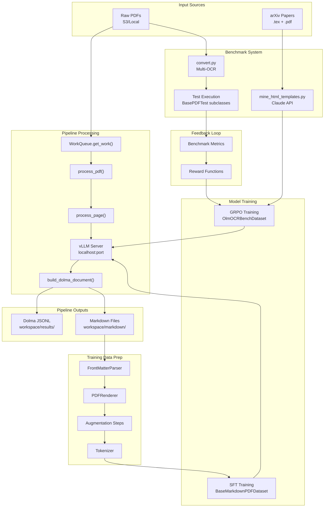

**Processing Stages:**

1. **Ingestion:** PDFs enter via local filesystem or S3 paths
2. **Distribution:** `WorkQueue` distributes work items to parallel workers
3. **Inference:** Workers send page images to vLLM server for OCR
4. **Assembly:** Pages are combined into Dolma JSONL documents
5. **Output:** Results written to S3 or local storage as JSONL and markdown

**Training Cycle:**

1. **Data Generation:** Pipeline outputs become training data after manual curation
2. **SFT Training:** Models learn from curated PDF+markdown pairs
3. **Synthetic Data:** `mine_html_templates.py` generates additional training data
4. **GRPO Training:** Models improve via reinforcement learning with benchmark rewards
5. **Deployment:** Trained models replace previous versions in pipeline

**Continuous Improvement:**

- Benchmark results identify model weaknesses
- Synthetic data generation creates targeted test cases
- GRPO training optimizes for benchmark performance
- Model souping combines multiple training runs
- Improved models deployed back to production pipeline

Sources: [olmocr/pipeline.py:596-711](), [olmocr/train/README.md:1-175](), [olmocr/bench/README.md:216-270]()

## Key Technologies and Dependencies

**Core Dependencies:**

| Technology | Purpose | Usage |
|------------|---------|-------|
| vLLM | Fast VLM inference | Serves Qwen2.5-VL models with PagedAttention |
| PyTorch | Deep learning | Model training and inference |
| Transformers | Model loading | HuggingFace model integration |
| Qwen2.5-VL | Base VLM | 7B parameter vision-language model |
| Poppler | PDF rendering | Converts PDF pages to images via `pdftoppm` |
| Playwright | Browser automation | Renders HTML and KaTeX for testing |
| Boto3 | AWS SDK | S3 operations for distributed processing |
| TRL | RL training | Provides `GRPOTrainer` for reinforcement learning |

**Data Formats:**

- **Input:** PDF, PNG, JPEG files
- **Intermediate:** Base64-encoded PNG images, YAML front matter
- **Output:** Dolma JSONL (structured documents), Markdown files
- **Training:** PDF+markdown pairs with YAML metadata
- **Benchmark:** JSONL test definitions with assertions

**Distributed Coordination:**

- Work queue state stored in compressed CSV (`work_index_list.csv.zstd`)
- Lock files prevent duplicate processing (`worker_locks/worker_*.lock`)
- Done flags track completed work (`done_flags/done_*.flag`)
- Supports both S3 and local filesystem backends

**Performance Optimizations:**

- FP8 quantization reduces memory usage and inference latency
- Temperature escalation (0.1 → 1.0) overcomes model repetition
- Parallel page processing with bounded semaphores
- Manual HTTP implementation (`apost()`) avoids connection pool deadlocks
- PDF rendering limited by CPU semaphore to prevent overload

Sources: [olmocr/pipeline.py:1-100](), [olmocr/work_queue.py:1-50](), [README.md:186-214]()

---

# Page: Core OCR Pipeline

# Core OCR Pipeline

<details>
<summary>Relevant source files</summary>

The following files were used as context for generating this wiki page:

- [CHANGELOG.md](CHANGELOG.md)
- [olmocr/pipeline.py](olmocr/pipeline.py)
- [olmocr/version.py](olmocr/version.py)
- [olmocr/work_queue.py](olmocr/work_queue.py)
- [scripts/release.sh](scripts/release.sh)
- [tests/gnarly_pdfs/edgar_image.pdf](tests/gnarly_pdfs/edgar_image.pdf)
- [tests/test_pipeline.py](tests/test_pipeline.py)
- [tests/test_s3_work_queue.py](tests/test_s3_work_queue.py)

</details>


## Purpose and Scope

The Core OCR Pipeline is the primary system for converting PDF documents into structured text using vision language models (VLMs). This page provides an overview of the end-to-end conversion process, from input PDFs to structured output in Dolma format or Markdown.

For detailed information about specific subsystems:
- Pipeline internal architecture and orchestration: See [Pipeline Architecture](#2.1)
- Distributed processing and work coordination: See [Work Queue and Distribution](#2.2)
- VLM server lifecycle management: See [VLM Server Integration](#2.3)
- PDF processing utilities: See [Document Processing](#3)

## Architecture Overview

The pipeline consists of three primary subsystems that work together to process documents at scale:

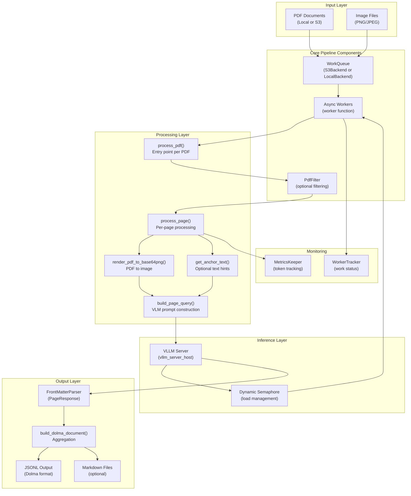

**Key Component Roles:**

| Component | File Location | Primary Responsibility |
|-----------|--------------|------------------------|
| `WorkQueue` | [olmocr/work_queue.py]() | Coordinates work distribution across multiple workers |
| `worker()` | [olmocr/pipeline.py:551-655]() | Main worker loop that processes PDFs from the queue |
| `process_pdf()` | [olmocr/pipeline.py:423-497]() | Handles single PDF: filtering, page splitting, aggregation |
| `process_page()` | [olmocr/pipeline.py:286-420]() | Processes individual pages with retry logic and rotation correction |
| `build_dolma_document()` | [olmocr/pipeline.py:499-548]() | Aggregates page results into final Dolma format |
| `vllm_server_host()` | [olmocr/pipeline.py:793-809]() | Manages VLLM server lifecycle with auto-restart |
| `MetricsKeeper` | [olmocr/metrics.py]() | Tracks token usage and throughput statistics |

Sources: [olmocr/pipeline.py](), [olmocr/work_queue.py](), [README.md]()

## End-to-End Workflow

The following diagram illustrates the complete execution flow from command invocation to final output:

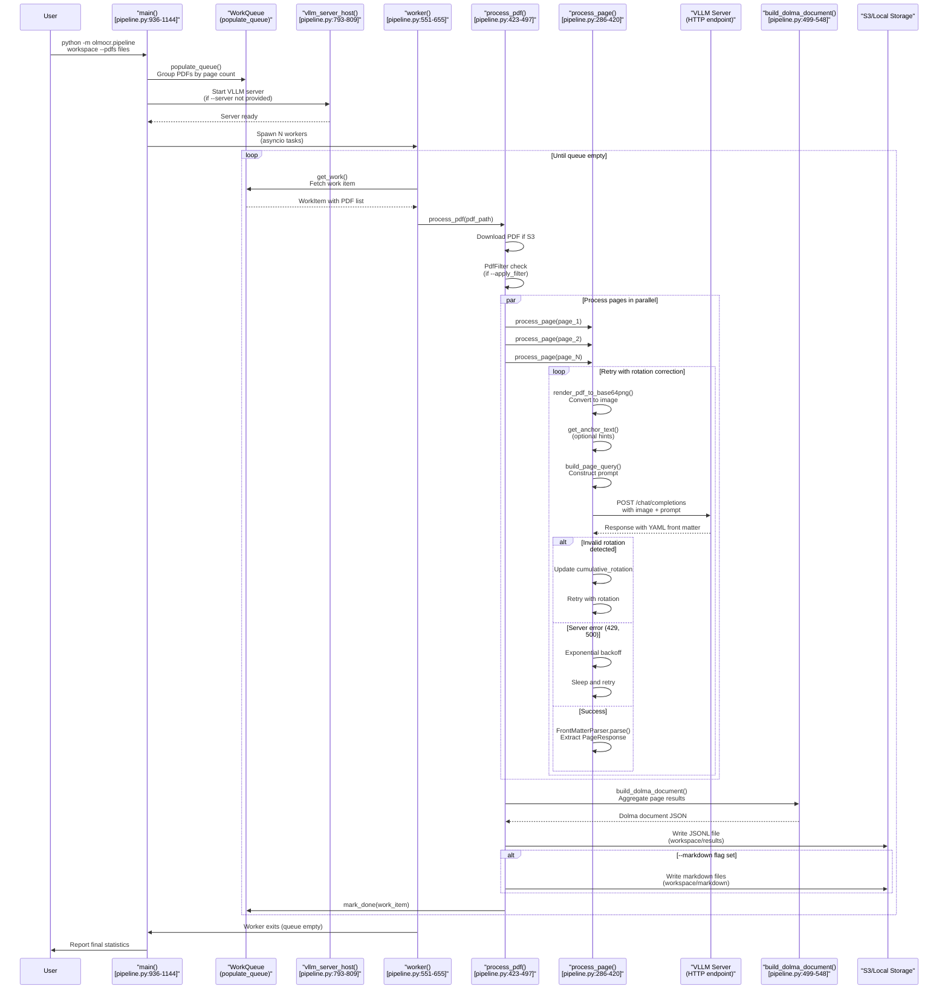

**Workflow Stages:**

1. **Initialization** ([pipeline.py:936-1144]()): Parse arguments, populate work queue, optionally start VLLM server
2. **Work Distribution** ([work_queue.py]()): Coordinate work items across multiple workers using S3 or local backend
3. **PDF Processing** ([pipeline.py:423-497]()): Download PDF, apply optional filtering, split into pages
4. **Page Processing** ([pipeline.py:286-420]()): Render to image, query VLLM, parse response with retry logic
5. **Aggregation** ([pipeline.py:499-548]()): Combine page results into structured Dolma document
6. **Output** ([pipeline.py:586-639]()): Write JSONL results and optional markdown files

Sources: [olmocr/pipeline.py:286-809](), Diagram 2 from high-level architecture

## Key Data Structures

### PageResponse

The VLM returns structured metadata along with extracted text, parsed using the `FrontMatterParser`:

```yaml
---
primary_language: en
is_rotation_valid: True
rotation_correction: 0
is_table: False
is_diagram: False
---
Extracted document text goes here...
```

This structure is defined in [olmocr/prompts/\_\_init\_\_.py]() and parsed in [olmocr/train/dataloader.py]() using the `FrontMatterParser` class.

### PageResult

Internal representation of a processed page:

| Field | Type | Description |
|-------|------|-------------|
| `s3_path` | str | Original PDF path |
| `page_num` | int | Page number (1-indexed) |
| `response` | PageResponse | Parsed VLM output |
| `input_tokens` | int | Tokens sent to VLM |
| `output_tokens` | int | Tokens generated by VLM |
| `is_fallback` | bool | Whether fallback extraction was used |

Defined in [olmocr/pipeline.py:131-140]().

### Dolma Document Format

Final output structure for training data:

```python
{
    "id": "sha1_hash_of_text",
    "text": "concatenated_page_text",
    "source": "olmocr",
    "added": "2025-01-15",
    "created": "2025-01-15",
    "metadata": {
        "Source-File": "s3://bucket/path/to/file.pdf",
        "olmocr-version": "0.4.0",
        "pdf-total-pages": 10,
        "total-input-tokens": 12000,
        "total-output-tokens": 8000,
        "total-fallback-pages": 0
    },
    "attributes": {
        "pdf_page_numbers": [[0, 500, 1], [500, 1200, 2], ...],
        "primary_language": ["en", "en", ...],
        "is_rotation_valid": [True, True, ...],
        "rotation_correction": [0, 0, ...],
        "is_table": [False, True, ...],
        "is_diagram": [False, False, ...]
    }
}
```

This format is compatible with the [Dolma toolkit](https://github.com/allenai/dolma) for large-scale language model training. See [olmocr/pipeline.py:499-548]() for implementation.

Sources: [olmocr/pipeline.py:131-140](), [olmocr/pipeline.py:499-548](), [olmocr/prompts/__init__.py]()

## Processing Features

### Automatic Rotation Correction

The pipeline includes iterative rotation correction when the VLM detects that a page is improperly oriented:

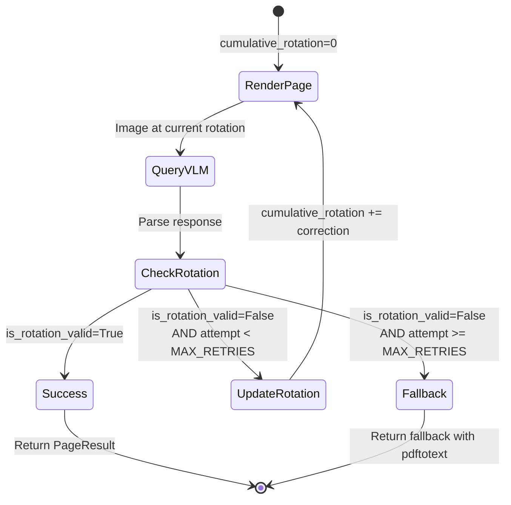

The rotation state is tracked cumulatively across retries to prevent oscillation. See [olmocr/pipeline.py:292-366]() for implementation details.

### Retry and Fallback Mechanisms

| Condition | Action | Max Attempts |
|-----------|--------|--------------|
| Invalid rotation | Update `cumulative_rotation`, retry with new angle | 8 (default) |
| Server error (429, 500) | Exponential backoff, don't increment attempt counter | Unlimited |
| Connection error | Exponential backoff, don't increment attempt counter | Unlimited |
| JSON decode error | Increment attempt counter, retry | 8 (default) |
| Response validation failure | Increment attempt counter, retry with higher temperature | 8 (default) |

If all retries are exhausted, the system falls back to `pdftotext` extraction for that page ([olmocr/pipeline.py:406-420]()).

### Temperature Scaling

Temperature increases with each retry attempt to overcome repetition issues:

```python
TEMPERATURE_BY_ATTEMPT = [0.1, 0.1, 0.2, 0.3, 0.5, 0.8, 0.9, 1.0]
```

This helps the model generate different outputs when previous attempts failed. See [olmocr/pipeline.py:290]().

Sources: [olmocr/pipeline.py:286-420]()

## Execution Modes

### Local Execution

Single-machine processing with local VLLM server:

```bash
python -m olmocr.pipeline ./localworkspace --markdown --pdfs *.pdf
```

**Flow:**
1. `main()` spawns local VLLM server via `vllm_server_host()`
2. Uses `LocalBackend` for work queue
3. Spawns N async workers (default: based on CPU count)
4. Outputs to local filesystem

### Distributed Execution (S3)

Multi-node processing with S3 coordination:

```bash
# Node 1 (initializer)
python -m olmocr.pipeline s3://bucket/workspace --pdfs s3://bucket/pdfs/*.pdf

# Nodes 2-N (workers)
python -m olmocr.pipeline s3://bucket/workspace
```

**Flow:**
1. First invocation populates work queue in S3 using `S3Backend`
2. Each node spawns local VLLM server
3. Workers pull from shared S3 work queue
4. Results written to S3 (`workspace/results/`)

### Beaker Cluster Execution

Automated distributed execution on Beaker:

```bash
python -m olmocr.pipeline s3://bucket/workspace --pdfs s3://bucket/*.pdf \
    --beaker --beaker_gpus 4
```

The `--beaker` flag triggers `submit_beaker_job()` ([pipeline.py:874-936]()) which:
1. Creates Beaker experiment specification
2. Spawns N GPU workers with shared S3 workspace
3. Each worker independently processes PDFs from the queue

Sources: [olmocr/pipeline.py:874-1144](), [README.md:289-313]()

## Output Structure

### Workspace Directory Layout

```
workspace/
├── queue/                    # Work queue state (LocalBackend only)
│   ├── pending/
│   └── done/
├── results/                  # Dolma JSONL outputs
│   ├── output_hash1.jsonl
│   ├── output_hash2.jsonl
│   └── ...
└── markdown/                 # Optional markdown outputs (--markdown flag)
    ├── path/to/doc1.md
    ├── path/to/doc2.md
    └── ...
```

For S3 workspaces, the `queue/` directory is replaced by S3-based coordination using object metadata and atomic operations. See [Work Queue and Distribution](#2.2) for details.

### JSONL Results Format

Each `output_*.jsonl` file contains one Dolma document per line, with each document representing one processed PDF. Files are named using the work item hash to prevent collisions in distributed execution.

Sources: [olmocr/pipeline.py:586-608]()

## Monitoring and Metrics

### MetricsKeeper

Tracks real-time statistics in a sliding time window:

| Metric | Description |
|--------|-------------|
| `server_input_tokens` | Tokens sent to VLLM |
| `server_output_tokens` | Tokens generated by VLLM |
| `completed_pages` | Successfully processed pages |
| `failed_pages` | Pages that exhausted retries |
| `finished_input_tokens` | Tokens from completed documents |
| `finished_output_tokens` | Output tokens from completed documents |

Reported every 10 seconds via `metrics_reporter()` ([pipeline.py:865-871]()).

### WorkerTracker

Monitors active work assignments per worker to detect stalls:

```python
await tracker.track_work(worker_id, "pdf_path-page_num", "started")
await tracker.track_work(worker_id, "pdf_path-page_num", "finished")
```

Generates status tables showing which worker is processing which page. See [olmocr/metrics.py]().

### Debug Logging

Comprehensive debug logs written to `olmocr-pipeline-debug.log` ([pipeline.py:63-75]()):
- All worker activity
- VLLM server output
- Retry decisions
- Error traces

Sources: [olmocr/pipeline.py:85-86](), [olmocr/metrics.py]()

## Command-Line Interface

The pipeline is invoked via `python -m olmocr.pipeline` with extensive configuration options:

### Essential Arguments

| Argument | Description | Default |
|----------|-------------|---------|
| `workspace` | Local or S3 path for coordination | Required |
| `--pdfs` | Glob pattern or file list of PDFs | None (worker mode) |
| `--model` | Model path (HF/S3/local) | `allenai/olmOCR-2-7B-1025-FP8` |
| `--server` | External VLLM server URL | None (spawn local) |
| `--workers` | Number of concurrent workers | CPU count - 2 |
| `--markdown` | Also output markdown files | False |

### Advanced Configuration

| Argument | Description | Default |
|----------|-------------|---------|
| `--pages_per_group` | Pages per work item | 100 |
| `--max_page_retries` | Retry attempts per page | 8 |
| `--max_page_error_rate` | Max fallback pages before discarding | 0.004 (1/250) |
| `--apply_filter` | Filter forms/spam/non-English | False |
| `--guided_decoding` | Enable regex-guided generation | False |
| `--tensor-parallel-size` | VLLM tensor parallelism | 1 |
| `--data-parallel-size` | VLLM data parallelism | 1 |

For complete argument reference, see [README.md:356-418]() or run `python -m olmocr.pipeline --help`.

Sources: [olmocr/pipeline.py:936-1144](), [README.md:216-418]()

## Integration Points

### VLLM Server

The pipeline communicates with VLLM via OpenAI-compatible HTTP API (`/chat/completions` endpoint). The server lifecycle is managed automatically unless `--server` is provided. For details on server management, see [VLM Server Integration](#2.3).

### PDF Processing Utilities

The pipeline depends on several document processing subsystems:
- **Anchor text extraction**: [Anchor Text Extraction](#3.1) - provides optional text hints to the VLM
- **PDF rendering**: [PDF Rendering and Conversion](#3.2) - converts pages to base64-encoded PNG images
- **PDF filtering**: [PDF Filtering and Quality Control](#3.3) - optional quality checks

### Benchmark Integration

The pipeline can be invoked from the benchmark system for testing:

```python
from olmocr.bench.runners.run_olmocr_pipeline import run_olmocr_pipeline

result = await run_olmocr_pipeline(pdf_path="doc.pdf", page_num=1)
```

See [olmocr/bench/runners/run_olmocr_pipeline.py]() for the integration wrapper.

Sources: [olmocr/pipeline.py:7-53](), [olmocr/bench/runners/run_olmocr_pipeline.py]()

---

# Page: Pipeline Architecture and Workflow

# Pipeline Architecture

<details>
<summary>Relevant source files</summary>

The following files were used as context for generating this wiki page:

- [CHANGELOG.md](CHANGELOG.md)
- [olmocr/pipeline.py](olmocr/pipeline.py)
- [olmocr/version.py](olmocr/version.py)
- [olmocr/work_queue.py](olmocr/work_queue.py)
- [scripts/release.sh](scripts/release.sh)
- [tests/gnarly_pdfs/edgar_image.pdf](tests/gnarly_pdfs/edgar_image.pdf)
- [tests/test_pipeline.py](tests/test_pipeline.py)
- [tests/test_s3_work_queue.py](tests/test_s3_work_queue.py)

</details>


## Purpose and Scope

This document details the internal architecture of the `olmocr.pipeline` module, which implements the core PDF-to-text conversion orchestration. It covers the main processing loop, page-level inference coordination, retry logic, and result aggregation into Dolma format. For information about distributed work coordination across multiple workers, see [Work Queue and Distribution](#2.2). For details on VLLM server lifecycle management, see [VLM Server Integration](#2.3).

The pipeline architecture handles:
- Orchestration of PDF processing from input to structured output
- Page-level image rendering and query construction  
- Iterative rotation correction based on VLM feedback
- Retry logic with exponential backoff for failures
- Result aggregation into Dolma JSONL format
- Optional markdown file output

Sources: [olmocr/pipeline.py:1-1936]()

---

## Architecture Overview

The pipeline follows a hierarchical processing model with three main levels: worker coordination, document processing, and page processing. Each level handles specific responsibilities in transforming PDFs into structured text output.

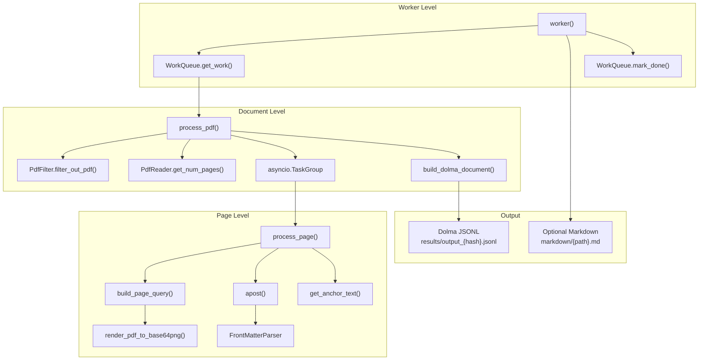

**Pipeline Processing Hierarchy**

The architecture separates concerns across three levels, with each level managing a specific scope of work and coordinating the level below it through asynchronous task groups.

Sources: [olmocr/pipeline.py:551-655](), [olmocr/pipeline.py:423-497](), [olmocr/pipeline.py:286-421]()

---

## Main Orchestration Flow

The `worker` function implements the top-level orchestration loop that processes work items from the queue. Each worker acquires a semaphore permit before retrieving work, processes a batch of PDFs concurrently, writes results to storage, and optionally generates markdown files.

### Worker Function

The worker operates in an infinite loop, bounded by queue availability and semaphore constraints:

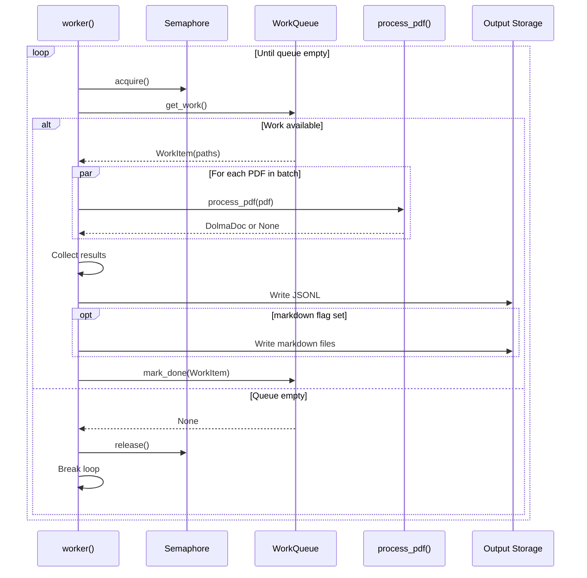

**Worker Processing Sequence**

Key implementation details in [olmocr/pipeline.py:551-655]():

- **Semaphore Management**: Workers acquire a semaphore permit (line 554) to control concurrent processing load. The semaphore is released either when the queue is empty (line 560) or after each work item if using an external server (line 654).

- **Concurrent PDF Processing**: Uses `asyncio.TaskGroup` (line 567) to process multiple PDFs in parallel within a single work item. All tasks must complete before proceeding.

- **Result Collection**: Iterates through completed tasks (line 574-582), handling exceptions gracefully. Failed PDF conversions return `None` and are excluded from output.

- **Output Persistence**: Results are written to temporary files first, then uploaded to S3 or copied locally (lines 587-608). This ensures atomic writes and proper cleanup.

- **Markdown Generation**: When `--markdown` flag is set, each document's natural text is written to a separate markdown file preserving the input directory structure (lines 611-639).

Sources: [olmocr/pipeline.py:551-655](), [olmocr/pipeline.py:95-128]()

---

## Page Processing Logic

The `process_page` function is the core inference coordination unit that manages VLM requests, retry logic, rotation correction, and fallback handling for individual PDF pages.

### Page Processing State Machine

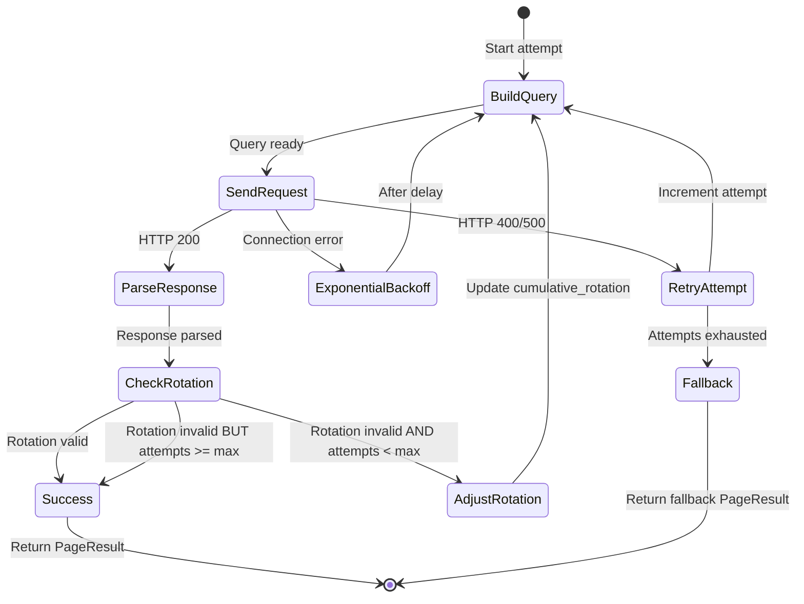

**Page Processing State Transitions**

### Key Processing Components

**Retry Loop Structure** [olmocr/pipeline.py:286-421]():

The function implements a sophisticated retry mechanism with multiple failure modes:

1. **Attempt Counter**: Tracks content-related retries (line 293), separate from connection retries
2. **Exponential Backoff**: Used for connection errors (lines 384-387), doesn't increment attempt counter
3. **Temperature Scaling**: Increases sampling temperature with each attempt (lines 290, 307) using the array `[0.1, 0.1, 0.2, 0.3, 0.5, 0.8, 0.9, 1.0]`
4. **Priority Boosting**: Assigns higher priority to retries (line 311) to clear the queue faster

**Rotation Correction Mechanism** [olmocr/pipeline.py:292, 359-366]():

The pipeline maintains cumulative rotation state across retries:
- `cumulative_rotation` variable tracks total rotation applied (initialized at line 292)
- When VLM indicates invalid rotation (`is_rotation_valid: False`), the correction is added to cumulative value
- Image is rotated by `cumulative_rotation` degrees before next inference attempt (lines 150-167 in `build_page_query`)
- Rotation values are modulo 360: `(cumulative_rotation + rotation_correction) % 360`

**Response Validation** [olmocr/pipeline.py:340-357]():

Multiple validation checks ensure response quality:
- HTTP status code verification (lines 331-338)
- Token count constraint check against `MODEL_MAX_CONTEXT` of 16384 (lines 342-343)
- Finish reason must be `"stop"` (lines 345-346)
- YAML front matter must parse successfully via `FrontMatterParser` (lines 355-357)

**Fallback Handling** [olmocr/pipeline.py:402-420]():

When all retries fail, the pipeline falls back to anchor text extraction:
- Returns `PageResult` with `is_fallback=True` flag (line 419)
- Uses `get_anchor_text()` with `pdftotext` engine (line 410)
- Sets default metadata values (no rotation, not a table/diagram)
- Zero token counts since no VLM inference occurred

Sources: [olmocr/pipeline.py:286-421](), [olmocr/pipeline.py:142-183]()

---

## Document Processing Orchestration

The `process_pdf` function coordinates page-level processing for an entire PDF, managing temporary file lifecycle, filtering, parallel page tasks, and error rate validation.

### PDF Processing Flow

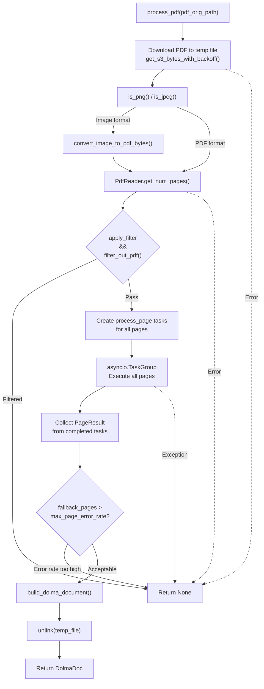

**PDF Processing Decision Flow**

### Implementation Details

**Temporary File Management** [olmocr/pipeline.py:424-440]():

PDFs are downloaded to temporary files for processing:
- Uses `tempfile.NamedTemporaryFile` with `delete=False` (line 424)
- Downloads from S3 using `get_s3_bytes_with_backoff()` for retry resilience (line 426)
- Handles `NoSuchKey` exceptions gracefully (lines 429-432)
- Converts image formats (PNG/JPEG) to PDF if needed (lines 436-440)
- Cleanup guaranteed via `finally` block (lines 494-496)

**Filtering Application** [olmocr/pipeline.py:452-454]():

Optional PDF filtering using cached `PdfFilter` instance:
- Only applied when `--apply_filter` flag is set
- Filters based on language (English only), form detection, and spam detection
- Uses `get_pdf_filter()` cached function to avoid reloading filter on each call
- Filtered PDFs return `None` immediately, skipping inference

**Parallel Page Processing** [olmocr/pipeline.py:456-467]():

All pages processed concurrently using `asyncio.TaskGroup`:
- Creates tasks for pages 1 through `num_pages` (1-indexed)
- TaskGroup ensures all tasks complete or propagates first exception
- Results collected only after entire group finishes
- `BrokenProcessPool` exceptions cause immediate exit (lines 484-488)

**Error Rate Validation** [olmocr/pipeline.py:469-479]():

Documents with excessive fallback pages are rejected:
- Calculates `num_fallback_pages / num_pages` ratio (line 471)
- Default threshold is `max_page_error_rate=0.004` (1 in 250 pages)
- Logs warning for documents with some fallbacks that pass threshold
- Returns `None` for documents exceeding threshold, discarding all pages

Sources: [olmocr/pipeline.py:423-497](), [olmocr/filter/filter.py:1-200]()

---

## Query Construction and Image Processing

The `build_page_query` function constructs the inference request payload by rendering PDFs to images, applying rotation, and formatting the prompt with the image data.

### Query Building Components

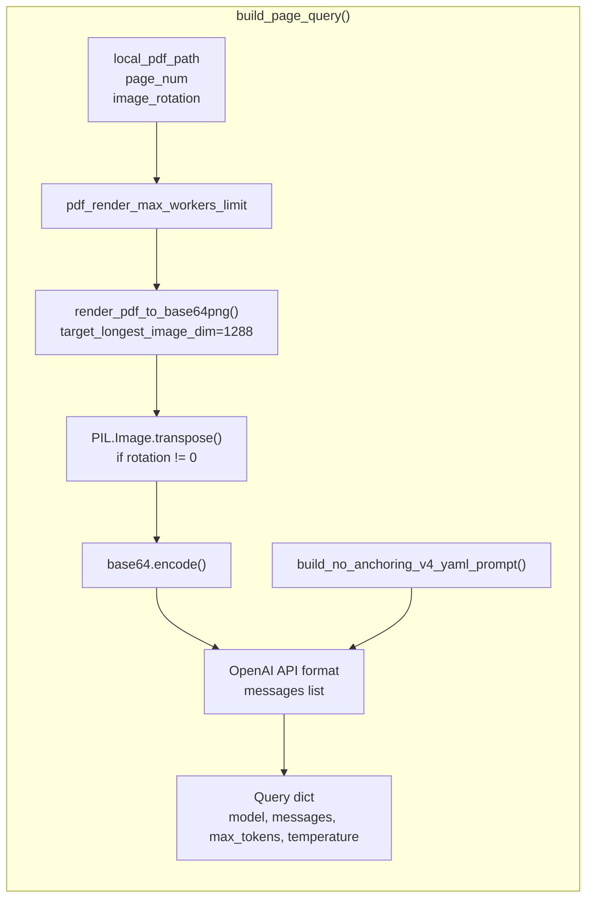

**Query Construction Pipeline**

### Key Implementation Details

**Semaphore-Bounded Rendering** [olmocr/pipeline.py:147-148]():

PDF rendering is CPU-intensive and bounded by semaphore:
- `pdf_render_max_workers_limit` initialized to CPU count minus 2 (line 88)
- Can be overridden via `BEAKER_ASSIGNED_CPU_COUNT` environment variable
- Rendering executed via `asyncio.to_thread()` to avoid blocking event loop
- Prevents system overload when processing many pages concurrently

**Image Rotation Application** [olmocr/pipeline.py:150-167]():

Rotation applied using PIL Image operations:
- Supports 90°, 180°, 270° rotations only (validated at line 144)
- Decodes base64 image to bytes, opens with PIL (lines 151-152)
- Maps rotation degrees to `Image.Transpose` enum values (lines 153-158)
- Re-encodes rotated image to PNG format in memory (lines 163-164)
- Returns new base64 string (line 167)

**Prompt Construction** [olmocr/pipeline.py:169-182]():

Query formatted for OpenAI-compatible chat completion API:
- Uses `build_no_anchoring_v4_yaml_prompt()` for system instructions (line 175)
- Image embedded as data URL with base64 PNG content (line 176)
- Model name configurable via `--model` argument, defaults to "olmocr" (line 170)
- Max tokens set to 8000 (line 143)
- Temperature and priority set by caller during retry logic

**Configuration Parameters**:
- `target_longest_image_dim`: Default 1288 pixels for longest dimension (configurable via CLI)
- `MAX_TOKENS`: 8000 token output limit
- Image format: Always PNG with base64 encoding

Sources: [olmocr/pipeline.py:142-183](), [olmocr/data/renderpdf.py:1-100]()

---

## Custom HTTP Implementation

The pipeline implements a custom asynchronous HTTP client in the `apost` function to avoid deadlock issues observed with standard HTTP libraries at scale.

### HTTP Client Architecture

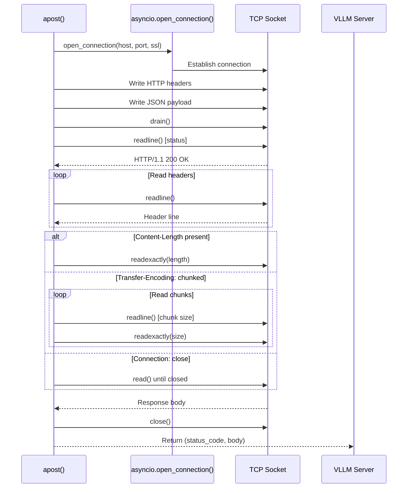

**Custom HTTP Request-Response Flow**

### Implementation Rationale

**Design Motivation** [olmocr/pipeline.py:185-188]():

The custom implementation was introduced to avoid deadlock issues:
- Standard libraries like `httpx` and `aiohttp` have complex session pooling
- At 100M+ request scale, lock contention in connection pools causes deadlocks
- Custom implementation uses simple socket operations without pooling
- No shared state between requests eliminates lock contention

**Key Features** [olmocr/pipeline.py:189-283]():

1. **SSL Support** (lines 193-207): Handles both HTTPS and HTTP connections with proper SSL context
2. **Authorization Header** (lines 218-219): Optional Bearer token for external API authentication  
3. **Connection Close** (line 221): Each request uses a new connection, no keep-alive
4. **Multiple Body Encodings** (lines 245-270):
   - Content-Length: Read exact byte count
   - Transfer-Encoding: chunked: Parse chunk sizes and read incrementally
   - Connection: close: Read until connection closes
5. **Error Propagation** (lines 273-283): Exceptions passed through, socket cleanup in `finally` block

**Usage in Pipeline** [olmocr/pipeline.py:328-329]():

Called within semaphore-bounded context:
- `max_concurrent_requests_limit` controls concurrent inference requests (line 328)
- Semaphore initialized to 1 by default, increased based on VLLM capacity (line 89)
- API key passed for external servers, None for local VLLM (lines 323-326)

Sources: [olmocr/pipeline.py:185-283](), [olmocr/pipeline.py:328-329]()

---

## Result Aggregation and Dolma Format

The `build_dolma_document` function aggregates page results into a single structured document in Dolma JSONL format, calculating character offsets and embedding page-level metadata.

### Dolma Document Structure

The Dolma format is a standardized JSON Lines format used for training language models. Each line represents a single document with text, metadata, and attributes.

**Document Schema** [olmocr/pipeline.py:499-548]():

```python
{
    "id": "sha1_hash_of_text",
    "text": "full_document_text",
    "source": "olmocr",
    "added": "YYYY-MM-DD",
    "created": "YYYY-MM-DD",
    "metadata": {
        "Source-File": "s3://bucket/path/to/file.pdf",
        "olmocr-version": "0.4.0",
        "pdf-total-pages": 10,
        "total-input-tokens": 12345,
        "total-output-tokens": 6789,
        "total-fallback-pages": 0
    },
    "attributes": {
        "pdf_page_numbers": [[0, 150, 1], [150, 300, 2], ...],
        "primary_language": ["en", "en", ...],
        "is_rotation_valid": [true, true, ...],
        "rotation_correction": [0, 0, ...],
        "is_table": [false, true, ...],
        "is_diagram": [false, false, ...]
    }
}
```

### Aggregation Process

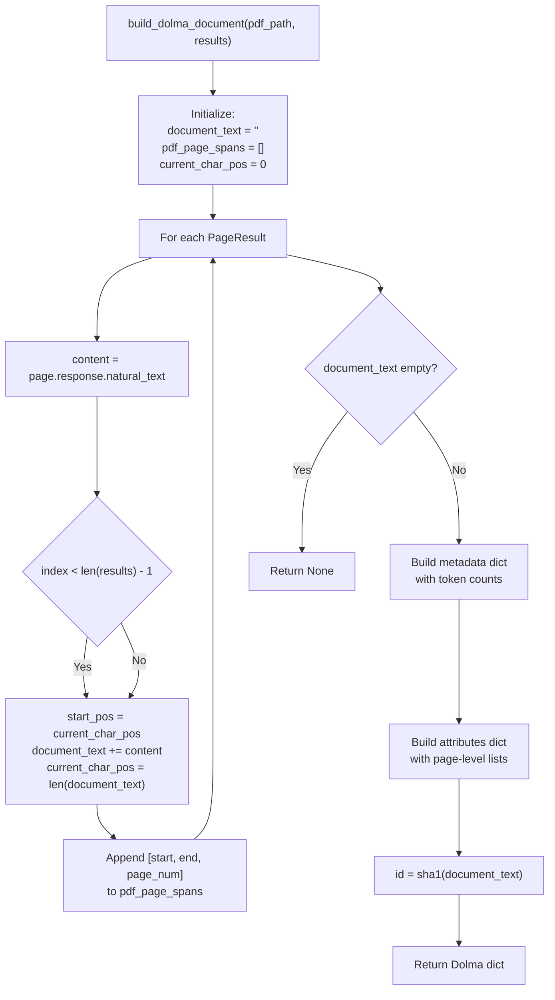

**Document Aggregation Flow**

### Implementation Details

**Text Concatenation** [olmocr/pipeline.py:500-514]():

Pages concatenated with newline separators:
- Iterates through `PageResult` objects in order (line 505)
- Handles `None` natural_text by using empty string (lines 506-509)
- Adds newline between pages except after last page (line 507)
- Tracks character positions for span calculation

**Page Span Tracking** [olmocr/pipeline.py:511-514]():

Each span is a 3-element list `[start, end, page_num]`:
- `start_pos`: Character position where page begins in document text
- `current_char_pos`: Character position where page ends (line 513)
- `page_num`: 1-indexed page number from original PDF
- Enables mapping any character position back to source page

**Metadata Aggregation** [olmocr/pipeline.py:521-528]():

Metadata includes pipeline version and processing statistics:
- `olmocr-version`: Imported from `olmocr.version.VERSION` (line 52)
- Token counts summed across all pages (lines 525-526)
- Fallback page count tracked for quality monitoring (line 527)
- Source file preserved as S3 or local path (line 522)

**Attribute Arrays** [olmocr/pipeline.py:539-546]():

Per-page attributes stored as parallel arrays:
- All arrays have length equal to `len(page_results)`
- List comprehensions extract values from `PageResponse` objects (lines 541-545)
- Includes language, rotation validity, table/diagram flags
- Arrays indexed by page number minus one (0-indexed in arrays)

**Empty Document Handling** [olmocr/pipeline.py:516-518]():

Returns `None` if no text extracted:
- Prevents creation of empty Dolma documents
- Logs info message for debugging
- Worker filters out `None` results before writing

Sources: [olmocr/pipeline.py:499-548](), [olmocr/version.py:1-10]()

---

## Metrics and Progress Tracking

The pipeline maintains comprehensive metrics and work tracking for monitoring processing status, throughput, and worker health.

### Metrics Collection

**MetricsKeeper Class** [olmocr/metrics.py:1-100]():

Tracks time-windowed statistics:
- Initialized with 5-minute rolling window (line 85)
- Collects server input/output tokens, completed pages, failures
- Provides formatted string output for logging (line 869)
- Thread-safe for concurrent updates from multiple workers

**WorkerTracker Class** [olmocr/metrics.py:1-100]():

Monitors individual worker progress:
- Tracks current work item being processed per worker
- Records work item state: started, finished, cancelled, errored
- Generates status table showing all active workers (line 870)
- Used for debugging stuck workers or identifying slow pages

### Metric Recording Points

**Page Completion** [olmocr/pipeline.py:348-351, 368]():

Records successful page processing:
- Server token usage from VLLM response (lines 348-351)
- Completed page count increment (line 368)
- Finished attempt counter (e.g., `finished_on_attempt_0`) for retry analysis

**Page Failure** [olmocr/pipeline.py:403]():

Increments failed page counter when all retries exhausted.

**Document Completion** [olmocr/pipeline.py:642-645]():

Records finished token totals from successful Dolma documents:
- Only counts tokens from documents that passed error rate threshold
- Provides accurate throughput measurement excluding failed conversions

**Periodic Reporting** [olmocr/pipeline.py:865-871]():

The `metrics_reporter` coroutine logs status every 10 seconds:
- Queue size remaining
- Metrics table with token throughput
- Worker status table showing current tasks
- Runs concurrently with worker tasks

Sources: [olmocr/pipeline.py:85-86](), [olmocr/metrics.py:1-200](), [olmocr/pipeline.py:865-871]()

---

# Page: Work Queue and Distributed Processing

# Work Queue and Distribution

<details>
<summary>Relevant source files</summary>

The following files were used as context for generating this wiki page:

- [CHANGELOG.md](CHANGELOG.md)
- [olmocr/pipeline.py](olmocr/pipeline.py)
- [olmocr/version.py](olmocr/version.py)
- [olmocr/work_queue.py](olmocr/work_queue.py)
- [scripts/release.sh](scripts/release.sh)
- [tests/gnarly_pdfs/edgar_image.pdf](tests/gnarly_pdfs/edgar_image.pdf)
- [tests/test_pipeline.py](tests/test_pipeline.py)
- [tests/test_s3_work_queue.py](tests/test_s3_work_queue.py)

</details>


This document covers the distributed task management system that enables scalable document processing across multiple workers and storage backends. The work queue system coordinates the distribution of PDF processing tasks, handles worker synchronization, and tracks completion status across both local and cloud storage environments.

For information about the main document processing pipeline that uses this work queue system, see [Pipeline Architecture](#2.1). For details about VLM server integration and model inference, see [VLM Server Integration](#2.3).

## Architecture Overview

The work queue system provides a pluggable architecture for distributed task management with support for different storage backends. It ensures that work items are processed exactly once across multiple workers while providing fault tolerance and recovery mechanisms.

### Work Queue System Architecture

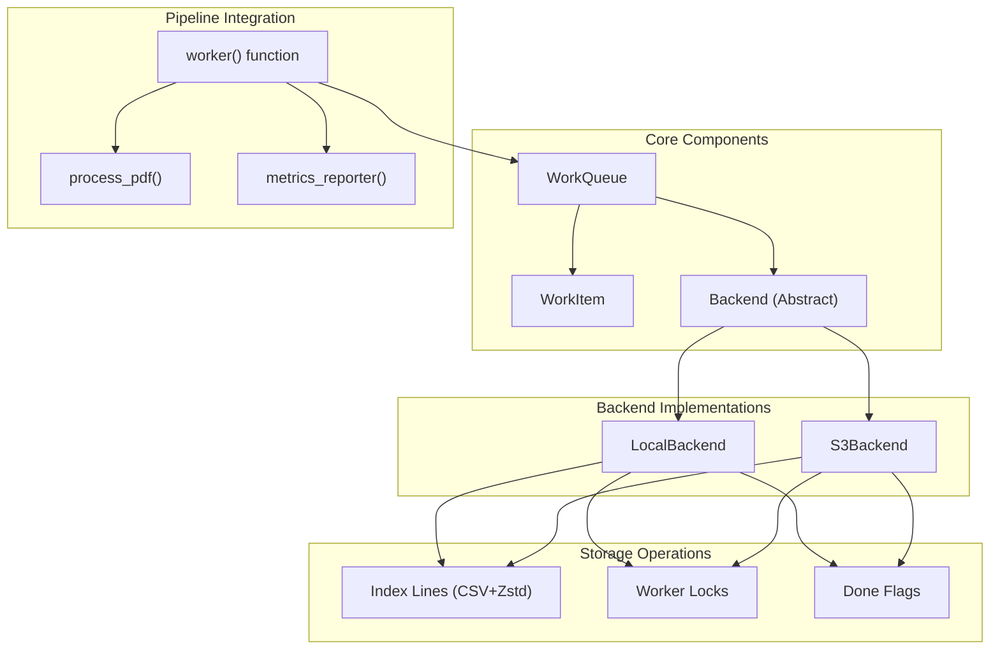

Sources: [olmocr/work_queue.py:82-231](), [olmocr/pipeline.py:465-581]()

### Work Distribution Flow

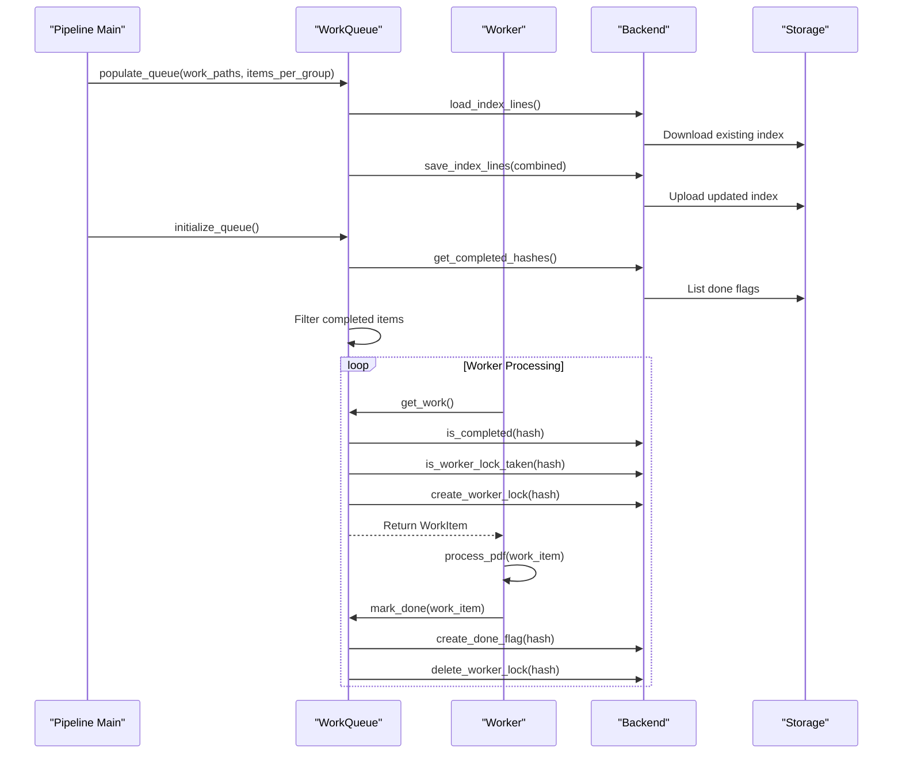

Sources: [olmocr/work_queue.py:127-151](), [olmocr/work_queue.py:153-172](), [olmocr/work_queue.py:174-214](), [olmocr/work_queue.py:216-225]()

## Core Work Queue Components

### WorkItem and WorkQueue Classes

The `WorkItem` dataclass represents a single unit of work containing a hash identifier and list of file paths to process:

```python
@dataclass
class WorkItem:
    hash: str
    work_paths: List[str]
```

The `WorkQueue` class manages the queue operations and coordinates with pluggable storage backends:

| Method | Purpose |
|--------|---------|
| `populate_queue()` | Add new work items to the queue index |
| `initialize_queue()` | Load queue and filter completed items |
| `get_work()` | Retrieve next available work item with locking |
| `mark_done()` | Mark work item as completed |

Sources: [olmocr/work_queue.py:30-36](), [olmocr/work_queue.py:82-231]()

### Work Item Grouping and Hashing

Work items are grouped together to optimize processing efficiency. The system computes deterministic hashes for work groups:

```python
@staticmethod
def _compute_workgroup_hash(work_paths: List[str]) -> str:
    sha1 = hashlib.sha1()
    for path in sorted(work_paths):
        sha1.update(path.encode("utf-8"))
    return sha1.hexdigest()
```

CSV encoding handles paths with special characters safely using proper escaping.

Sources: [olmocr/work_queue.py:105-111](), [olmocr/work_queue.py:93-103]()

## Backend Implementations

### Backend Abstract Interface

The `Backend` abstract class defines the storage interface that both local and S3 implementations must provide:

| Method | Purpose |
|--------|---------|
| `load_index_lines()` | Load work queue index from storage |
| `save_index_lines()` | Save work queue index to storage |
| `get_completed_hashes()` | Get set of completed work items |
| `is_worker_lock_taken()` | Check if work is locked by another worker |
| `create_worker_lock()` | Create worker lock for coordination |
| `create_done_flag()` | Mark work item as completed |

Sources: [olmocr/work_queue.py:38-80]()

### LocalBackend Implementation

The `LocalBackend` uses the local filesystem for storage operations:

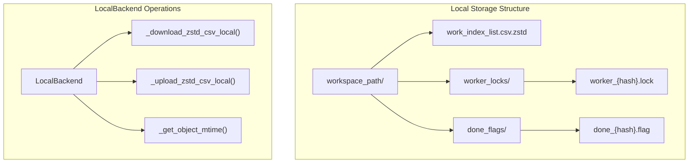

The local backend uses zstandard compression for the work index and file modification times for staleness detection.

Sources: [olmocr/work_queue.py:233-348]()

### S3Backend Implementation

The `S3Backend` provides distributed storage using AWS S3:

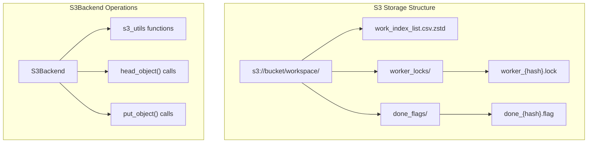

The S3 backend leverages utility functions from `s3_utils` module and uses S3 object metadata for timestamp tracking.

Sources: [olmocr/work_queue.py:351-432](), [olmocr/s3_utils.py:16-21]()

## Pipeline Integration

### Worker Coordination

The main pipeline creates multiple async workers that coordinate through the work queue system:

```python
async def worker(args, work_queue: WorkQueue, semaphore, worker_id):
    while True:
        await semaphore.acquire()
        work_item = await work_queue.get_work()
        if work_item is None:
            break
        
        # Process PDFs in work item
        dolma_tasks = [process_pdf(args, worker_id, pdf) for pdf in work_item.work_paths]
        # ... handle results and output
        
        await work_queue.mark_done(work_item)
        semaphore.release()
```

Workers use semaphores for rate limiting and coordinate through the shared work queue to avoid duplicate processing.

Sources: [olmocr/pipeline.py:465-581]()

### Work Queue Initialization in Pipeline

The pipeline sets up work queues based on workspace type:

| Workspace Type | Backend Used |
|----------------|--------------|
| `s3://` prefix | `S3Backend` with boto3 client |
| Local path | `LocalBackend` with filesystem |

The pipeline populates the queue from PDF paths and initializes workers:

```python
if args.workspace.startswith("s3://"):
    backend = S3Backend(workspace_s3, args.workspace)
else:
    backend = LocalBackend(args.workspace)

work_queue = WorkQueue(backend)
```

Sources: [olmocr/pipeline.py:52](), [olmocr/pipeline.py:1020-1030]()

## Worker Lock Management

### Lock Lifecycle and Staleness Detection

The work queue system prevents duplicate processing through worker locks with configurable timeouts:

```mermaid
stateDiagram-v2
    [*] --> Available: "Work item created"
    Available --> Locked: "Worker claims with create_worker_lock()"
    Locked --> Completed: "Worker calls mark_done()"
    Locked --> Stale: "Lock timeout exceeded"
    Stale --> Available: "Another worker can claim"
    Completed --> [*]: "Done flag created"
    
    note right of Locked
        Default timeout: 1800 seconds (30 minutes)
        Checked via object modification time
    end note
```

Lock staleness is determined by comparing the lock file's modification time with the current time and a configurable timeout period.

Sources: [olmocr/work_queue.py:174-214](), [olmocr/work_queue.py:304-313](), [olmocr/work_queue.py:400-409]()

### Completion Tracking and Caching

The system maintains completion state through done flags and uses local caching for performance:

- **Done flags**: Empty files named `done_{hash}.flag` indicate completed work
- **Completion cache**: Local set cache reduces repeated storage queries
- **Cache refresh**: Automatic refresh when too many items are already completed

The completion cache is refreshed when more than 3 consecutive queue items are found to be already completed, indicating the cache may be stale.

Sources: [olmocr/work_queue.py:187-196](), [olmocr/work_queue.py:221](), [olmocr/work_queue.py:278-283](), [olmocr/work_queue.py:366-375]()

## Usage Patterns

### Beaker Integration

The work queue system integrates with the Beaker distributed computing platform for large-scale processing:

```python
def submit_beaker_job(args):
    # Remove --pdfs argument since queue is populated locally
    args_list = [arg for arg in sys.argv[1:] if not arg.startswith("--pdfs")]
    
    # Submit job with proper environment and secrets
    experiment_spec = ExperimentSpec(
        tasks=[TaskSpec(
            command=["python", "-m", "olmocr.pipeline"] + args_list,
            replicas=args.beaker_gpus,
        )]
    )
```

Each Beaker replica runs the same pipeline code but coordinates through the shared work queue to avoid duplicate work.

Sources: [olmocr/pipeline.py:771-876]()

### Statistics and Monitoring

The system provides comprehensive statistics about queue processing:

```python
def print_stats(args, root_work_queue):
    # Get total work items and completed items
    work_queue_lines = download_zstd_csv(workspace_s3, index_file_s3_path)
    done_work_items = expand_s3_glob(workspace_s3, output_glob)
    
    total_items = len(work_queue)
    completed_items = len(done_work_items)
```

Statistics include completion rates, token counts, processing times, and error rates across the distributed processing pipeline.

Sources: [olmocr/pipeline.py:878-1004]()

---

# Page: VLM Server Management

# VLM Server Management

<details>
<summary>Relevant source files</summary>

The following files were used as context for generating this wiki page:

- [CHANGELOG.md](CHANGELOG.md)
- [olmocr/pipeline.py](olmocr/pipeline.py)
- [olmocr/version.py](olmocr/version.py)
- [olmocr/work_queue.py](olmocr/work_queue.py)
- [scripts/release.sh](scripts/release.sh)
- [tests/gnarly_pdfs/edgar_image.pdf](tests/gnarly_pdfs/edgar_image.pdf)
- [tests/test_pipeline.py](tests/test_pipeline.py)
- [tests/test_s3_work_queue.py](tests/test_s3_work_queue.py)

</details>


This document describes the vLLM server lifecycle management system in the olmOCR pipeline. The system handles subprocess control, monitors server readiness through log parsing, and implements dynamic semaphore release to prevent worker overload. For information about how workers use the server for page processing, see [Page Processing and Rotation Correction](#2.4). For details on the overall pipeline architecture, see [Pipeline Architecture and Workflow](#2.1).

## Overview

The VLM server management system is responsible for starting, monitoring, and restarting the vLLM inference server as a subprocess. It parses server logs in real-time to track request queue depth, dynamically releases worker semaphores to prevent overload, and automatically restarts the server on failures. The system is implemented primarily in three functions: `vllm_server_task()`, `vllm_server_host()`, and `vllm_server_ready()` in [olmocr/pipeline.py:713-890]().

**Sources:** [olmocr/pipeline.py:713-890]()

## Server Lifecycle Architecture

```mermaid
stateDiagram-v2
    [*] --> StartServer: vllm_server_host()
    StartServer --> MonitoringLogs: vllm_server_task()
    MonitoringLogs --> TrackingMetrics: parse stdout/stderr
    TrackingMetrics --> EvaluatingSemaphore: every 1 second
    EvaluatingSemaphore --> ReleasingSemaphore: conditions met
    EvaluatingSemaphore --> TrackingMetrics: wait longer
    ReleasingSemaphore --> TrackingMetrics: continue monitoring
    MonitoringLogs --> ServerCrashed: process exits
    ServerCrashed --> StartServer: retry < 5
    ServerCrashed --> [*]: retry >= 5
    ReleasingSemaphore --> WorkersActive: semaphore.release()
    WorkersActive --> TrackingMetrics: workers process pages
```

The server lifecycle begins when `vllm_server_host()` calls `vllm_server_task()`, which spawns the vLLM server subprocess. The system continuously monitors stdout and stderr, parsing log lines to extract queue metrics. A timeout task evaluates semaphore release conditions every second, releasing workers when the server is ready and queue depth is manageable. If the server crashes, the host function automatically restarts it up to 5 times.

**Sources:** [olmocr/pipeline.py:713-863]()

## Server Startup and Configuration

### Subprocess Creation

The `vllm_server_task()` function constructs the vLLM command with specific arguments and spawns it as an asyncio subprocess:

```mermaid
flowchart TD
    BuildCmd["Build vllm command<br/>(vllm_server_task)"]
    AddArgs["Add configuration args:<br/>--port, --tensor-parallel-size,<br/>--gpu-memory-utilization"]
    AddUnknown["Append unknown_args<br/>(passthrough from CLI)"]
    CreateSubproc["asyncio.create_subprocess_exec<br/>with PIPE stdout/stderr"]
    RegisterKill["atexit.register(_kill_proc)"]
    StartMonitor["Start async log monitoring"]
    
    BuildCmd --> AddArgs
    AddArgs --> AddUnknown
    AddUnknown --> CreateSubproc
    CreateSubproc --> RegisterKill
    RegisterKill --> StartMonitor
```

The function builds a command array starting with `["vllm", "serve", model_name_or_path]` and adds configuration parameters. Key parameters include:

| Parameter | Purpose | Source Line |
|-----------|---------|-------------|
| `--port` | API server port (default from args) | [olmocr/pipeline.py:718-719]() |
| `--tensor-parallel-size` | Number of GPUs for model parallelism | [olmocr/pipeline.py:725-726]() |
| `--data-parallel-size` | Data parallel replicas | [olmocr/pipeline.py:727-728]() |
| `--gpu-memory-utilization` | KV cache memory fraction | [olmocr/pipeline.py:734]() |
| `--max-model-len` | Maximum context length | [olmocr/pipeline.py:737]() |
| `--limit-mm-per-prompt` | Disable video encoder to save RAM | [olmocr/pipeline.py:729-730]() |

The subprocess is created with `OMP_NUM_THREADS=1` to prevent CPU contention when running multiple olmOCR instances on multi-GPU machines [olmocr/pipeline.py:747]().

**Sources:** [olmocr/pipeline.py:713-748]()

### Cleanup Registration

The system registers an `atexit` handler to ensure the server subprocess is terminated on pipeline shutdown:

```python
def _kill_proc():
    try:
        proc.terminate()
    except:
        logger.info("VLLM Process already terminated")

atexit.register(_kill_proc)
```

This guarantees cleanup even if the main process exits unexpectedly [olmocr/pipeline.py:751-757]().

**Sources:** [olmocr/pipeline.py:751-757]()

## Log Monitoring and State Tracking

### Asynchronous Stream Reading

The system monitors both stdout and stderr using dedicated async tasks:

```mermaid
flowchart LR
    Subprocess["vllm subprocess<br/>(proc)"]
    StdoutTask["stdout_task<br/>read_stream(proc.stdout)"]
    StderrTask["stderr_task<br/>read_stream(proc.stderr)"]
    ProcessLine["process_line(line)<br/>parse and extract metrics"]
    
    Subprocess --> StdoutTask
    Subprocess --> StderrTask
    StdoutTask --> ProcessLine
    StderrTask --> ProcessLine
```

The `read_stream()` coroutine continuously reads lines from a stream and passes them to `process_line()` [olmocr/pipeline.py:793-802]():

```python
async def read_stream(stream):
    while True:
        line = await stream.readline()
        if not line:
            break
        try:
            line = line.decode("utf-8").rstrip()
            await process_line(line)
        except Exception as ex:
            logger.warning(f"Got {ex} when reading log line from inference server, skipping")
```

**Sources:** [olmocr/pipeline.py:793-802]()

### Metric Extraction

The `process_line()` function extracts critical metrics from vLLM log output using regex patterns:

```mermaid
flowchart TD
    LogLine["Log line from vLLM"]
    CheckErrors["Check for 'Detected errors during sampling'"]
    CheckReady["Check for 'server is fired up' or 'Starting vLLM API'"]
    ExtractRunning["Regex: 'Running: (\\d+)'"]
    ExtractQueue["Regex: '(?:Waiting|Pending):\\s*(\\d+)'"]
    UpdateVars["Update: last_running_req,<br/>peak_running_req,<br/>last_queue_req"]
    
    LogLine --> CheckErrors
    CheckErrors -->|found| ExitPipeline["sys.exit(1)"]
    CheckErrors -->|not found| CheckReady
    CheckReady -->|found| SetReady["server_printed_ready_message = True"]
    CheckReady -->|not found| ExtractRunning
    ExtractRunning --> ExtractQueue
    ExtractQueue --> UpdateVars
```

Key tracked variables:

- `last_running_req`: Current number of running inference requests [olmocr/pipeline.py:777-787]()
- `peak_running_req`: Highest observed running requests (used for queue threshold) [olmocr/pipeline.py:779-782]()
- `last_queue_req`: Current number of queued/waiting requests [olmocr/pipeline.py:789-791]()
- `running_reqs_decreased`: Flag set when running requests decrease, indicating server capacity freed [olmocr/pipeline.py:784-786]()
- `server_printed_ready_message`: Readiness indicator from server startup logs [olmocr/pipeline.py:773-775]()

If the line contains "Detected errors during sampling", the pipeline immediately exits with an error, as this indicates model corruption [olmocr/pipeline.py:769-771]().

**Sources:** [olmocr/pipeline.py:765-791]()

## Dynamic Semaphore Management

### Semaphore Release Logic

The system implements a sophisticated semaphore release mechanism to prevent overwhelming the vLLM server. A dedicated `timeout_task()` coroutine evaluates release conditions every second:

```mermaid
flowchart TD
    Sleep["await asyncio.sleep(1)"]
    EvalConditions["Evaluate release conditions"]
    CheckReady["server_printed_ready_message?"]
    CheckQueue["last_queue_req <= peak_running_req * 0.2?"]
    CheckCooldown["time.time() - last_semaphore_release > 30?"]
    CheckLocked["semaphore.locked()?"]
    CheckCapacity["last_running_req == 0 OR running_reqs_decreased?"]
    Release["semaphore.release()"]
    ResetFlags["running_reqs_decreased = False<br/>last_semaphore_release = time.time()"]
    
    Sleep --> EvalConditions
    EvalConditions --> CheckReady
    CheckReady -->|Yes| CheckQueue
    CheckReady -->|No| Sleep
    CheckQueue -->|Yes| CheckCooldown
    CheckQueue -->|No| Sleep
    CheckCooldown -->|Yes| CheckLocked
    CheckCooldown -->|No| Sleep
    CheckLocked -->|Yes| CheckCapacity
    CheckLocked -->|No| Sleep
    CheckCapacity -->|Yes| Release
    CheckCapacity -->|No| Sleep
    Release --> ResetFlags
    ResetFlags --> Sleep
```

The release conditions [olmocr/pipeline.py:811-817]() are:

1. **Server readiness**: `server_printed_ready_message` must be True
2. **Low queue depth**: `last_queue_req <= int(peak_running_req * 0.2)` ensures queue is at most 20% of peak capacity
3. **Cooldown period**: At least 30 seconds since last release to prevent rapid oscillation
4. **Semaphore locked**: `semaphore.locked()` checks if there are workers waiting
5. **Available capacity**: Either no running requests (`last_running_req == 0`) or requests have decreased (`running_reqs_decreased`)

When all conditions are met, the semaphore is released, allowing one worker to proceed. The `running_reqs_decreased` flag is reset to prevent multiple rapid releases [olmocr/pipeline.py:820-823]().

**Sources:** [olmocr/pipeline.py:804-825]()

### Semaphore Usage Pattern

The semaphore `max_concurrent_requests_limit` is initialized at module level and configured in `main()`:

```mermaid
sequenceDiagram
    participant Main as main()
    participant Semaphore as max_concurrent_requests_limit
    participant ServerTask as vllm_server_task()
    participant Worker as worker()
    participant ProcessPage as process_page()
    
    Main->>Semaphore: Set initial value from args
    Main->>ServerTask: Start with semaphore ref
    Main->>Worker: Start workers
    Worker->>Semaphore: await semaphore.acquire()
    Note over Worker: Blocks if locked
    ServerTask->>Semaphore: semaphore.release()
    Note over ServerTask: After checking conditions
    Semaphore->>Worker: Worker proceeds
    Worker->>ProcessPage: process pages
    ProcessPage->>Semaphore: Uses in request context
```

Workers acquire the semaphore before getting work [olmocr/pipeline.py:599](), but release it in the `finally` block of their work loop if using an external server [olmocr/pipeline.py:707-710](). This temporary workaround addresses issue #383 where workers don't properly release on completion.

**Sources:** [olmocr/pipeline.py:83](), [olmocr/pipeline.py:596-711]()

## Server Readiness Detection

### External Server Health Check

The `vllm_server_ready()` function checks if an external vLLM server is operational by polling the `/models` endpoint:

```mermaid
flowchart TD
    Start["vllm_server_ready(args)"]
    InitVars["max_attempts = args.max_server_ready_timeout<br/>url = server_url + '/models'"]
    Loop["for attempt in 1..max_attempts"]
    BuildHeaders["Add Authorization header if api_key"]
    MakeRequest["httpx.AsyncClient.get(url)"]
    CheckStatus["response.status_code == 200?"]
    LogReady["logger.info('vllm server is ready')"]
    ReturnSuccess["return"]
    Sleep["await asyncio.sleep(1)"]
    RaiseError["raise Exception('server not ready')"]
    
    Start --> InitVars
    InitVars --> Loop
    Loop --> BuildHeaders
    BuildHeaders --> MakeRequest
    MakeRequest --> CheckStatus
    CheckStatus -->|Yes| LogReady
    LogReady --> ReturnSuccess
    CheckStatus -->|No| Sleep
    Sleep --> Loop
    Loop -->|max attempts| RaiseError
```

The function implements a simple retry loop with 1-second delays [olmocr/pipeline.py:865-890]():

- Constructs URL by appending `/models` to the server endpoint
- Adds `Authorization: Bearer {api_key}` header if provided
- Makes GET request using `httpx.AsyncClient`
- Returns successfully on 200 status code
- Logs warnings and retries on failures
- Raises exception after `max_server_ready_timeout` attempts (configurable via args)

This is called during pipeline initialization when using an external server specified via `--server` argument.

**Sources:** [olmocr/pipeline.py:865-890]()

## Restart and Recovery Mechanisms

### Automatic Restart Loop

The `vllm_server_host()` function wraps `vllm_server_task()` with retry logic:

```mermaid
flowchart TD
    Start["vllm_server_host(model, args, semaphore)"]
    InitRetry["retry = 0<br/>MAX_RETRIES = 5"]
    WhileLoop["while retry < MAX_RETRIES"]
    CallTask["await vllm_server_task(...)"]
    TaskEnds["vllm_server_task() exits"]
    LogWarning["logger.warning('VLLM server task ended')"]
    IncrementRetry["retry += 1"]
    CheckMax["retry >= MAX_RETRIES?"]
    LogError["logger.error('Started vllm server more than 5 times')"]
    ExitPipeline["sys.exit(1)"]
    
    Start --> InitRetry
    InitRetry --> WhileLoop
    WhileLoop --> CallTask
    CallTask --> TaskEnds
    TaskEnds --> LogWarning
    LogWarning --> IncrementRetry
    IncrementRetry --> CheckMax
    CheckMax -->|No| WhileLoop
    CheckMax -->|Yes| LogError
    LogError --> ExitPipeline
```

The restart mechanism [olmocr/pipeline.py:847-863]():

1. Runs `vllm_server_task()` in a loop with maximum 5 retries
2. If the server task exits (crash or termination), logs a warning
3. Increments retry counter and restarts the server
4. After 5 restarts, logs an error with installation instructions and exits the pipeline

The error message directs users to the vLLM installation documentation, as repeated crashes typically indicate installation or compatibility issues [olmocr/pipeline.py:859-861]().

**Sources:** [olmocr/pipeline.py:847-863]()

### Graceful Shutdown

When the pipeline receives a cancellation request, the server task handles cleanup:

```python
except asyncio.CancelledError:
    logger.info("Got cancellation request for VLLM server")
    proc.terminate()
    try:
        await asyncio.wait_for(proc.wait(), timeout=10.0)
    except asyncio.TimeoutError:
        logger.warning("VLLM server did not terminate within 10 seconds")
    raise
```

The shutdown sequence [olmocr/pipeline.py:834-841]():

1. Catches `asyncio.CancelledError` from task cancellation
2. Calls `proc.terminate()` to send SIGTERM to subprocess
3. Waits up to 10 seconds for graceful shutdown
4. Logs warning if timeout expires (server may require SIGKILL)
5. Re-raises the cancellation exception to propagate to parent tasks

The timeout tasks and stream readers are cancelled and gathered with `return_exceptions=True` to ensure all resources are cleaned up [olmocr/pipeline.py:843-844]().

**Sources:** [olmocr/pipeline.py:832-844]()

## Server Management API

### Function Reference

| Function | Location | Purpose |
|----------|----------|---------|
| `vllm_server_task()` | [olmocr/pipeline.py:713-845]() | Main server lifecycle management, spawns subprocess and monitors logs |
| `vllm_server_host()` | [olmocr/pipeline.py:847-863]() | Wraps server task with retry logic, handles automatic restarts |
| `vllm_server_ready()` | [olmocr/pipeline.py:865-890]() | Health check for external servers, polls `/models` endpoint |
| `read_stream()` | [olmocr/pipeline.py:793-802]() | Async log line reader for stdout/stderr streams |
| `process_line()` | [olmocr/pipeline.py:765-791]() | Parses log lines and extracts queue metrics |
| `timeout_task()` | [olmocr/pipeline.py:804-825]() | Evaluates semaphore release conditions every second |

**Sources:** [olmocr/pipeline.py:713-890]()

### Configuration Parameters

The server accepts configuration through command-line arguments that are passed to the vLLM subprocess:

```mermaid
graph LR
    Args["Command-line args<br/>(argparse)"]
    ServerTask["vllm_server_task<br/>(model, args, semaphore)"]
    VLLMCmd["vllm serve command"]
    
    Args -->|"port"| ServerTask
    Args -->|"tensor_parallel_size"| ServerTask
    Args -->|"data_parallel_size"| ServerTask
    Args -->|"gpu_memory_utilization"| ServerTask
    Args -->|"max_model_len"| ServerTask
    Args -->|"unknown_args"| ServerTask
    
    ServerTask --> VLLMCmd
```

Unknown arguments are passed directly to vLLM via `unknown_args` parameter [olmocr/pipeline.py:739-740](), allowing users to specify additional vLLM-specific options not explicitly handled by olmOCR.

**Sources:** [olmocr/pipeline.py:713-740]()

---

# Page: Page Processing and Rotation Correction

# Page Processing and Rotation Correction

<details>
<summary>Relevant source files</summary>

The following files were used as context for generating this wiki page:

- [CHANGELOG.md](CHANGELOG.md)
- [olmocr/pipeline.py](olmocr/pipeline.py)
- [olmocr/version.py](olmocr/version.py)
- [olmocr/work_queue.py](olmocr/work_queue.py)
- [scripts/release.sh](scripts/release.sh)
- [tests/gnarly_pdfs/edgar_image.pdf](tests/gnarly_pdfs/edgar_image.pdf)
- [tests/test_pipeline.py](tests/test_pipeline.py)
- [tests/test_s3_work_queue.py](tests/test_s3_work_queue.py)

</details>


This page documents the core page processing logic within the olmOCR pipeline, focusing on how individual PDF pages are processed by the vision-language model and how rotation correction is handled automatically. This covers the `process_page()` function and its retry mechanisms.

For information about PDF rendering to images, see [PDF Rendering and Image Conversion](#3.1). For information about how processed pages are assembled into documents, see [Output Formats and Data Models](#3.3). For details on the vLLM server itself, see [VLM Server Management](#2.3).

**Sources:** [olmocr/pipeline.py:288-419]()

## Overview

Page processing is the heart of the OCR pipeline. Each page of a PDF is independently processed by sending a rendered image to the vision-language model, which returns markdown text along with metadata about the page's orientation, language, and content type. The system automatically detects and corrects page rotation issues through an iterative refinement process.

The main workflow:
1. Render the PDF page to a base64-encoded PNG image
2. Apply any cumulative rotation from previous attempts
3. Send the image to the vLLM server with a structured prompt
4. Parse the YAML front matter response to extract metadata
5. If rotation is invalid, retry with corrected rotation
6. If all retries fail, fall back to pdftotext

**Sources:** [olmocr/pipeline.py:288-419]()

## Core Page Processing Architecture

```mermaid
flowchart TB
    start["process_page()"]
    track_start["tracker.track_work()<br/>status: started"]
    init["Initialize:<br/>cumulative_rotation = 0<br/>attempt = 0<br/>exponential_backoffs = 0"]
    
    loop_check{{"attempt < MAX_RETRIES<br/>(default: 8)"}}
    
    build["build_page_query()<br/>with cumulative_rotation"]
    set_temp["Set temperature from<br/>TEMPERATURE_BY_ATTEMPT[attempt]"]
    add_regex["Add guided_decoding regex<br/>if enabled"]
    
    send["apost() to<br/>/chat/completions"]
    
    check_status{{"HTTP Status"}}
    check_tokens{{"tokens ><br/>MODEL_MAX_CONTEXT"}}
    check_finish{{"finish_reason<br/>== 'stop'"}}
    
    parse["FrontMatterParser<br/>extract PageResponse"]
    check_rotation{{"is_rotation_valid"}}
    
    update_rotation["cumulative_rotation =<br/>(cumulative_rotation + rotation_correction) % 360"]
    increment["attempt += 1"]
    
    success["Return PageResult<br/>is_fallback=False"]
    track_finish["tracker.track_work()<br/>status: finished"]
    
    network_error["ConnectionError<br/>OSError<br/>TimeoutError"]
    backoff["Sleep 10 * 2^exponential_backoffs<br/>exponential_backoffs += 1"]
    
    value_error["ValueError<br/>JSONDecodeError"]
    
    fallback["Return PageResult<br/>with pdftotext text<br/>is_fallback=True"]
    track_error["tracker.track_work()<br/>status: errored"]
    
    start --> track_start --> init --> loop_check
    
    loop_check -->|"Yes"| build
    build --> set_temp --> add_regex --> send
    
    send --> check_status
    check_status -->|"200"| check_tokens
    check_status -->|"400/500"| value_error
    check_status -->|"429"| network_error
    
    check_tokens -->|"Valid"| check_finish
    check_tokens -->|"Exceeded"| value_error
    
    check_finish -->|"stop"| parse
    check_finish -->|"other"| value_error
    
    parse --> check_rotation
    check_rotation -->|"True"| success --> track_finish
    check_rotation -->|"False<br/>attempt < MAX_RETRIES-1"| update_rotation --> increment --> loop_check
    check_rotation -->|"False<br/>attempt == MAX_RETRIES-1"| success
    
    network_error --> backoff --> send
    value_error --> increment --> loop_check
    
    loop_check -->|"No<br/>(exhausted)"| fallback --> track_error
```

**Sources:** [olmocr/pipeline.py:288-419]()

## Page Processing Function Signature

The `process_page()` function orchestrates the entire page processing workflow:

| Parameter | Type | Description |
|-----------|------|-------------|
| `args` | argparse.Namespace | Pipeline arguments including server URL, model name, retry limits |
| `worker_id` | int | Worker identifier for logging and tracking |
| `pdf_orig_path` | str | Original PDF path (for metadata and logging) |
| `pdf_local_path` | str | Local filesystem path to the PDF file |
| `page_num` | int | 1-indexed page number to process |

**Return Value:** `PageResult` dataclass containing:
- `s3_path`: Original PDF path
- `page_num`: Page number processed
- `response`: `PageResponse` object with markdown and metadata
- `input_tokens`: Number of prompt tokens used
- `output_tokens`: Number of completion tokens generated
- `is_fallback`: Boolean indicating if pdftotext fallback was used

**Sources:** [olmocr/pipeline.py:288-289](), [olmocr/pipeline.py:133-142]()

## Rotation Detection and Correction Mechanism

The vision-language model is trained to detect when a page image is incorrectly rotated. It signals this through the YAML front matter in its response:

```yaml
---
primary_language: en
is_rotation_valid: false
rotation_correction: 90
is_table: false
is_diagram: false
---
```

When `is_rotation_valid` is `false`, the pipeline automatically retries the page with the suggested `rotation_correction` applied. The rotation corrections accumulate across multiple attempts.

### Cumulative Rotation Tracking

The system tracks `cumulative_rotation` as a state variable that persists across retry attempts. When the model requests a rotation correction, it is added to the cumulative total:

```python
cumulative_rotation = (cumulative_rotation + page_response.rotation_correction) % 360
```

The modulo 360 operation ensures rotations wrap around correctly (e.g., 270° + 180° = 90°).

**Example Sequence:**
1. Attempt 0: `cumulative_rotation = 0°`, model returns `rotation_correction: 90`, `is_rotation_valid: false`
2. Attempt 1: `cumulative_rotation = 90°`, model returns `rotation_correction: 90`, `is_rotation_valid: false`
3. Attempt 2: `cumulative_rotation = 180°`, model returns `rotation_correction: 0`, `is_rotation_valid: true` ✓

**Sources:** [olmocr/pipeline.py:294](), [olmocr/pipeline.py:357-365]()

### Image Rotation Implementation

The `build_page_query()` function applies rotation to rendered page images using PIL (Pillow):

```mermaid
flowchart LR
    render["render_pdf_to_base64png()<br/>Returns base64 PNG"]
    check{{"image_rotation<br/>!= 0"}}
    decode["base64.b64decode()<br/>to bytes"]
    open["Image.open()<br/>from BytesIO"]
    rotate["img.transpose()<br/>ROTATE_90/180/270"]
    encode["Save to BytesIO<br/>base64.b64encode()"]
    query["Build OpenAI Chat<br/>Completions format"]
    
    render --> check
    check -->|"Yes"| decode --> open --> rotate --> encode --> query
    check -->|"No"| query
```

Valid rotation values are `0`, `90`, `180`, and `270` degrees. The rotation is applied counter-clockwise using PIL's `Image.Transpose` constants:
- `90°` → `Image.Transpose.ROTATE_90`
- `180°` → `Image.Transpose.ROTATE_180`
- `270°` → `Image.Transpose.ROTATE_270`

**Sources:** [olmocr/pipeline.py:144-184](), [olmocr/pipeline.py:152-169]()

## Retry Mechanism and Temperature Escalation

The page processing system implements a sophisticated retry strategy that distinguishes between model quality issues and infrastructure failures.

### Configuration Constants

| Constant | Value | Purpose |
|----------|-------|---------|
| `MAX_RETRIES` | `args.max_page_retries` (default 8) | Maximum attempts before falling back |
| `MODEL_MAX_CONTEXT` | 16384 | Maximum token limit for responses |
| `TEMPERATURE_BY_ATTEMPT` | `[0.1, 0.1, 0.2, 0.3, 0.5, 0.8, 0.9, 1.0]` | Temperature progression |

**Sources:** [olmocr/pipeline.py:290-292]()

### Temperature Escalation Strategy

To overcome model repetition issues or stubborn incorrect outputs, the temperature parameter increases with each attempt:

```mermaid
graph LR
    A0["Attempt 0<br/>temp: 0.1"]
    A1["Attempt 1<br/>temp: 0.1"]
    A2["Attempt 2<br/>temp: 0.2"]
    A3["Attempt 3<br/>temp: 0.3"]
    A4["Attempt 4<br/>temp: 0.5"]
    A5["Attempt 5<br/>temp: 0.8"]
    A6["Attempt 6<br/>temp: 0.9"]
    A7["Attempt 7<br/>temp: 1.0"]
    
    A0 --> A1 --> A2 --> A3 --> A4 --> A5 --> A6 --> A7
```

Higher temperatures introduce more randomness into the model's output, which can help escape repetition loops at the expense of consistency.

**Sources:** [olmocr/pipeline.py:292](), [olmocr/pipeline.py:299-309]()

### Error Categories and Handling

The retry logic distinguishes between two types of errors:

**Network/Infrastructure Errors** (do not count against retry budget):
- `ConnectionError`
- `OSError`
- `asyncio.TimeoutError`

These trigger exponential backoff without incrementing the attempt counter:
```
sleep_delay = 10 * (2^exponential_backoffs)
```

**Model/Response Errors** (count against retry budget):
- `ValueError` (invalid response format, exceeded context, wrong finish reason)
- `json.JSONDecodeError` (malformed JSON response)
- HTTP 400 (BadRequestError)
- HTTP 500 (InternalServerError)
- `is_rotation_valid: false` (rotation needs correction)

These increment the `attempt` counter and retry with the next temperature setting.

**Sources:** [olmocr/pipeline.py:376-398]()

## Response Parsing and Validation

### YAML Front Matter Structure

The model returns responses in YAML front matter format, parsed using `FrontMatterParser`:

```python
parser = FrontMatterParser(front_matter_class=PageResponse)
front_matter, text = parser._extract_front_matter_and_text(model_response_markdown)
page_response = parser._parse_front_matter(front_matter, text)
```

The `PageResponse` dataclass contains:

| Field | Type | Purpose |
|-------|------|---------|
| `natural_text` | str \| None | Extracted markdown content |
| `primary_language` | str \| None | Detected language code (e.g., "en") |
| `is_rotation_valid` | bool | Whether page orientation is correct |
| `rotation_correction` | int | Suggested rotation in degrees (0/90/180/270) |
| `is_table` | bool | Whether page contains tables |
| `is_diagram` | bool | Whether page contains diagrams |

**Sources:** [olmocr/pipeline.py:353-356]()

### Guided Decoding

When `--guided-decoding` is enabled, a regex constraint is applied to enforce the YAML structure:

```python
query["guided_regex"] = (
    r"---\nprimary_language: (?:[a-z]{2}|null)\n"
    r"is_rotation_valid: (?:True|False|true|false)\n"
    r"rotation_correction: (?:0|90|180|270)\n"
    r"is_table: (?:True|False|true|false)\n"
    r"is_diagram: (?:True|False|true|false)\n"
    r"(?:---|---\n[\s\S]+)"
)
```

This ensures the model output conforms to the expected format, reducing parsing errors.

**Sources:** [olmocr/pipeline.py:312-315]()

### Response Validation Checks

Before accepting a model response, several validation checks are performed:

```mermaid
flowchart TB
    response["Model Response<br/>Received"]
    
    check1{{"HTTP Status<br/>== 200"}}
    check2{{"total_tokens ≤<br/>MODEL_MAX_CONTEXT"}}
    check3{{"finish_reason<br/>== 'stop'"}}
    check4{{"YAML Front Matter<br/>Valid"}}
    check5{{"is_rotation_valid<br/>== True"}}
    
    accept["Accept Response<br/>Return PageResult"]
    retry["Retry with<br/>Next Attempt"]
    
    response --> check1
    check1 -->|"No"| retry
    check1 -->|"Yes"| check2
    check2 -->|"No"| retry
    check2 -->|"Yes"| check3
    check3 -->|"No"| retry
    check3 -->|"Yes"| check4
    check4 -->|"No"| retry
    check4 -->|"Yes"| check5
    check5 -->|"No<br/>(and not last attempt)"| retry
    check5 -->|"Yes<br/>(or last attempt)"| accept
```

**Sources:** [olmocr/pipeline.py:329-365]()

## Fallback Strategy

When all retry attempts are exhausted, the system falls back to extracting text using `pdftotext`, a traditional PDF text extraction tool:

```python
return PageResult(
    pdf_orig_path,
    page_num,
    PageResponse(
        natural_text=get_anchor_text(pdf_local_path, page_num, pdf_engine="pdftotext"),
        primary_language=None,
        is_rotation_valid=True,
        rotation_correction=0,
        is_table=False,
        is_diagram=False,
    ),
    input_tokens=0,
    output_tokens=0,
    is_fallback=True,
)
```

### Fallback Characteristics

- **Trigger Condition:** After `MAX_RETRIES` attempts fail
- **Text Source:** `get_anchor_text()` with `pdf_engine="pdftotext"`
- **Metadata:** All metadata fields set to default/None values
- **Token Counts:** Both set to 0 (no model API usage)
- **Fallback Flag:** `is_fallback=True` marks this result for potential filtering

### Document-Level Fallback Handling

At the document level, if the fallback page count exceeds `max_page_error_rate`, the entire document is discarded:

```python
if num_fallback_pages / num_pages > args.max_page_error_rate:
    logger.error(f"Document {pdf_orig_path} has {num_fallback_pages} fallback pages "
                 f"out of {num_pages} exceeding max_page_error_rate of "
                 f"{args.max_page_error_rate}, discarding document.")
    return None
```

**Sources:** [olmocr/pipeline.py:404-419](), [olmocr/pipeline.py:499-505]()

## Metrics and Tracking

### Page-Level Metrics

The system tracks detailed metrics for each page processing attempt:

```python
metrics.add_metrics(
    server_input_tokens=base_response_data["usage"].get("prompt_tokens", 0),
    server_output_tokens=base_response_data["usage"].get("completion_tokens", 0),
)
```

Upon successful completion:

```python
metrics.add_metrics(**{"completed_pages": 1, f"finished_on_attempt_{attempt}": 1})
```

This allows analysis of how many pages require multiple attempts and at what temperature/attempt they succeed.

**Sources:** [olmocr/pipeline.py:346-349](), [olmocr/pipeline.py:366]()

### Work Tracking

The `tracker` object monitors the status of each page throughout its lifecycle:

| Event | Call |
|-------|------|
| Start processing | `tracker.track_work(worker_id, f"{pdf_orig_path}-{page_num}", "started")` |
| Successful completion | `tracker.track_work(worker_id, f"{pdf_orig_path}-{page_num}", "finished")` |
| Exhausted retries | `tracker.track_work(worker_id, f"{pdf_orig_path}-{page_num}", "errored")` |
| Cancelled | `tracker.track_work(worker_id, f"{pdf_orig_path}-{page_num}", "cancelled")` |

This provides visibility into which pages are currently being processed and their outcomes.

**Sources:** [olmocr/pipeline.py:296](), [olmocr/pipeline.py:367](), [olmocr/pipeline.py:388](), [olmocr/pipeline.py:402]()

## Concurrency and Rate Limiting

Page processing respects two semaphores to control resource usage:

### PDF Render Semaphore

```python
pdf_render_max_workers_limit = asyncio.BoundedSemaphore(
    int(float(os.environ.get("BEAKER_ASSIGNED_CPU_COUNT", 
                             max(1, multiprocessing.cpu_count() - 2))))
)
```

Limits concurrent PDF rendering operations based on available CPU cores to prevent system overload.

**Sources:** [olmocr/pipeline.py:82](), [olmocr/pipeline.py:149]()

### Request Concurrency Semaphore

```python
max_concurrent_requests_limit = asyncio.BoundedSemaphore(1)  # Set by args in main()
```

Controls the maximum number of concurrent requests to the vLLM server. This value is dynamically adjusted by the vLLM server management task based on queue depth and server capacity.

**Sources:** [olmocr/pipeline.py:83](), [olmocr/pipeline.py:326-327]()

## Integration with Broader Pipeline

The `process_page()` function is called from `process_single_pdf()`, which orchestrates page processing for an entire document:

```mermaid
flowchart TB
    pdf["process_single_pdf()<br/>PDF Document"]
    count["PdfReader.get_num_pages()"]
    filter["PdfFilter.filter_out_pdf()<br/>if apply_filter"]
    
    taskgroup["asyncio.TaskGroup"]
    tasks["Create task for each page:<br/>process_page(page_num)"]
    
    collect["Collect all PageResults"]
    check{{"num_fallback_pages ><br/>max_page_error_rate"}}
    
    build["build_dolma_document()<br/>Assemble pages"]
    discard["Return None<br/>Discard document"]
    
    pdf --> count --> filter --> taskgroup
    taskgroup --> tasks
    tasks --> collect --> check
    check -->|"No"| build
    check -->|"Yes"| discard
```

All pages are processed concurrently using `asyncio.TaskGroup`, allowing efficient parallel processing of multi-page documents.

**Sources:** [olmocr/pipeline.py:461-514](), [olmocr/pipeline.py:491-497]()

## Testing and Validation

The test suite validates rotation correction behavior extensively:

### Test Coverage

| Test | Purpose | Source |
|------|---------|--------|
| `test_no_rotation` | Verifies 0° rotation preserves original image | [tests/test_pipeline.py:58-81]() |
| `test_rotate_90_degrees` | Validates 90° counter-clockwise rotation | [tests/test_pipeline.py:83-106]() |
| `test_rotate_180_degrees` | Validates 180° rotation | [tests/test_pipeline.py:108-131]() |
| `test_rotate_270_degrees` | Validates 270° counter-clockwise rotation | [tests/test_pipeline.py:133-156]() |
| `test_process_page_with_rotation_correction` | End-to-end test of rotation correction flow | [tests/test_pipeline.py:206-305]() |
| `test_process_page_with_cumulative_rotation` | Validates cumulative rotation across attempts | [tests/test_pipeline.py:308-414]() |
| `test_process_page_rotation_wraps_around` | Validates modulo 360 wrapping | [tests/test_pipeline.py:417-513]() |

The tests use a real PDF with rotation issues (`tests/gnarly_pdfs/edgar-rotated90.pdf`) to verify the correction logic works in practice.

**Sources:** [tests/test_pipeline.py:57-514]()

---

# Page: Document Processing

# Document Processing

<details>
<summary>Relevant source files</summary>

The following files were used as context for generating this wiki page:

- [CHANGELOG.md](CHANGELOG.md)
- [Dockerfile](Dockerfile)
- [Dockerfile.with-model](Dockerfile.with-model)
- [olmocr/pipeline.py](olmocr/pipeline.py)
- [olmocr/version.py](olmocr/version.py)
- [olmocr/work_queue.py](olmocr/work_queue.py)
- [pyproject.toml](pyproject.toml)
- [scripts/release.sh](scripts/release.sh)
- [tests/gnarly_pdfs/edgar_image.pdf](tests/gnarly_pdfs/edgar_image.pdf)
- [tests/test_pipeline.py](tests/test_pipeline.py)
- [tests/test_s3_work_queue.py](tests/test_s3_work_queue.py)

</details>


This page covers document-level processing concerns in the olmOCR pipeline. While page-level processing is handled by the VLM server and covered in [Page Processing and Rotation Correction](#2.4), this section focuses on preparing PDFs for processing, filtering unwanted documents, and generating structured output formats.

The document processing layer handles three main responsibilities:
1. Rendering PDF pages to images with appropriate resolution settings
2. Filtering out forms, spam, and non-English documents before processing
3. Assembling page-level results into structured Dolma JSONL and Markdown outputs

For information about the overall pipeline workflow and distributed processing, see [Pipeline Architecture and Workflow](#2.1). For details on how individual pages are processed by the VLM, see [Page Processing and Rotation Correction](#2.4).

---

## PDF Rendering and Image Conversion

The pipeline converts PDF pages to PNG images before sending them to the vision-language model. This rendering step uses `poppler-utils` under the hood and includes support for converting standalone images (JPEG/PNG) into PDF format when needed.

### Rendering Process

The core rendering function `render_pdf_to_base64png` converts a specific PDF page to a base64-encoded PNG image. The rendering process applies several optimizations:

**Resolution Control**: The `target_longest_image_dim` parameter controls the maximum dimension of the rendered image. The default value is 1288 pixels, which balances image quality with token consumption in the VLM. Lower values reduce processing time and memory usage but may lose fine details like small text.

**Concurrent Rendering**: PDF rendering operations run in a bounded thread pool to prevent system overload. The `pdf_render_max_workers_limit` semaphore (defined at [olmocr/pipeline.py:82]()) limits concurrent rendering operations based on available CPU cores.

```mermaid
graph TB
    subgraph "PDF Rendering Flow"
        PDF["PDF File"]
        BuildQuery["build_page_query()"]
        Semaphore["pdf_render_max_workers_limit<br/>BoundedSemaphore"]
        RenderFunc["render_pdf_to_base64png()"]
        Base64["Base64 PNG Image"]
        Rotation["Optional Rotation<br/>0/90/180/270 degrees"]
        Query["VLM Query Object"]
        
        PDF --> BuildQuery
        BuildQuery --> Semaphore
        Semaphore --> RenderFunc
        RenderFunc --> Base64
        Base64 --> Rotation
        Rotation --> Query
    end
    
    style Semaphore fill:#f9f9f9
    style RenderFunc fill:#f9f9f9
```

**Diagram: PDF Rendering Process with Concurrency Control**

Sources: [olmocr/pipeline.py:82](), [olmocr/pipeline.py:144-184]()

### Image Format Conversion

When processing image files directly (JPEG or PNG), the pipeline automatically converts them to PDF format before processing. This conversion happens in `process_pdf`:

| Function | Purpose | Location |
|----------|---------|----------|
| `is_jpeg()` | Detects JPEG image format | olmocr/image_utils.py |
| `is_png()` | Detects PNG image format | olmocr/image_utils.py |
| `convert_image_to_pdf_bytes()` | Converts image to PDF bytes | olmocr/image_utils.py |

The conversion logic at [olmocr/pipeline.py:531-535]() checks the file format and applies the conversion if needed:

```
if is_png(tf.name) or is_jpeg(tf.name):
    logger.info(f"Converting {pdf_orig_path} from image to PDF format...")
    tf.seek(0)
    tf.write(convert_image_to_pdf_bytes(tf.name))
    tf.flush()
```

After conversion, the image is processed using the same pipeline as native PDFs.

### Image Rotation

The rendering process supports rotating images by 0, 90, 180, or 270 degrees before sending them to the VLM. This rotation capability is essential for the rotation correction feature described in [Page Processing and Rotation Correction](#2.4). The rotation is applied using PIL's `transpose` method with the appropriate rotation constant at [olmocr/pipeline.py:152-169]().

Sources: [olmocr/pipeline.py:144-184](), [olmocr/pipeline.py:517-542](), [olmocr/pipeline.py:82]()

---

## PDF Filtering and Quality Control

The `PdfFilter` system screens documents before processing to exclude forms, spam, and non-English content. This pre-filtering saves computational resources by avoiding expensive VLM inference on unsuitable documents.

### PdfFilter Configuration

The filter is initialized as a cached singleton at [olmocr/pipeline.py:86]():

```python
get_pdf_filter = cache(lambda: PdfFilter(
    languages_to_keep={Language.ENGLISH, None}, 
    apply_download_spam_check=True, 
    apply_form_check=True
))
```

The filter is only instantiated when needed, and the `cache` decorator ensures only one instance exists throughout the pipeline's lifetime.

```mermaid
graph LR
    subgraph "PdfFilter Decision Flow"
        PDF["PDF Document"]
        Filter["PdfFilter.filter_out_pdf()"]
        LangCheck["Language Detection<br/>lingua-language-detector"]
        FormCheck["Form Detection<br/>Interactive Elements"]
        SpamCheck["Download Spam Check<br/>Heuristics"]
        
        PDF --> Filter
        Filter --> LangCheck
        Filter --> FormCheck
        Filter --> SpamCheck
        
        LangCheck -->|"Non-English"| Reject["Filter Out<br/>Return True"]
        FormCheck -->|"Has Forms"| Reject
        SpamCheck -->|"Download Spam"| Reject
        
        LangCheck -->|"English or Unknown"| Accept["Process<br/>Return False"]
        FormCheck -->|"No Forms"| Accept
        SpamCheck -->|"Clean"| Accept
    end
    
    style Reject fill:#f9f9f9
    style Accept fill:#f9f9f9
```

**Diagram: PDF Filtering Decision Tree**

Sources: [olmocr/pipeline.py:86]()

### Filter Application

The filter is applied in `process_single_pdf` at [olmocr/pipeline.py:483-485]():

```python
if args.apply_filter and get_pdf_filter().filter_out_pdf(local_pdf_path):
    logger.info(f"Filtering out pdf {pdf_orig_path}")
    return None
```

The `--apply-filter` command-line flag controls whether filtering is enabled. When a document is filtered out, the function returns `None`, which prevents any page processing and excludes the document from the final output.

### Filter Components

The `PdfFilter` class applies three distinct checks:

**Language Detection**: Uses the `lingua-language-detector` library (listed in [pyproject.toml:28]()) to identify the document's primary language. Documents that are not English (or have unknown language) are filtered out. This prevents wasting resources on documents that the English-trained VLM cannot accurately process.

**Form Detection**: Scans the PDF for interactive form elements like text fields, checkboxes, and buttons. Documents with form fields are typically structured data entry documents that don't benefit from OCR processing.

**Download Spam Check**: Applies heuristics to detect common patterns in spam or malformed PDFs that were downloaded from unreliable sources. This catches documents that might cause parsing errors or contain low-quality content.

Sources: [olmocr/pipeline.py:86](), [olmocr/pipeline.py:483-485](), [pyproject.toml:28]()

---

## Output Formats and Data Models

The pipeline generates two primary output formats: Dolma JSONL for downstream processing and optional Markdown files for human readability. Both formats are built from page-level results structured using the `PageResponse` and `PageResult` data models.

### Data Model Hierarchy

```mermaid
graph TB
    subgraph "Page-Level Models"
        PageResponse["PageResponse<br/>dataclass from prompts"]
        Fields1["natural_text: str<br/>primary_language: str<br/>is_rotation_valid: bool<br/>rotation_correction: int<br/>is_table: bool<br/>is_diagram: bool"]
        PageResponse --> Fields1
    end
    
    subgraph "Processing Models"
        PageResult["PageResult<br/>dataclass"]
        Fields2["s3_path: str<br/>page_num: int<br/>response: PageResponse<br/>input_tokens: int<br/>output_tokens: int<br/>is_fallback: bool"]
        PageResult --> Fields2
    end
    
    subgraph "Document-Level Output"
        DolmaDoc["Dolma Document<br/>dict"]
        Fields3["id: str (SHA1 hash)<br/>text: str<br/>source: 'olmocr'<br/>metadata: dict<br/>attributes: dict"]
        DolmaDoc --> Fields3
    end
    
    PageResponse -.->|"wrapped by"| PageResult
    PageResult -.->|"assembled into"| DolmaDoc
    
    style PageResponse fill:#f9f9f9
    style PageResult fill:#f9f9f9
    style DolmaDoc fill:#f9f9f9
```

**Diagram: Data Model Hierarchy from Page to Document**

Sources: [olmocr/pipeline.py:133-142](), [olmocr/prompts.py:41]()

### PageResponse Structure

The `PageResponse` dataclass represents the VLM's output for a single page. It is parsed from the YAML frontmatter in the model's response using `FrontMatterParser` at [olmocr/pipeline.py:353-355]().

Key fields:
- `natural_text`: The extracted text content in natural reading order
- `primary_language`: Detected language code (e.g., "en")
- `is_rotation_valid`: Whether the page orientation is correct
- `rotation_correction`: Degrees to rotate (0, 90, 180, or 270)
- `is_table`: Whether the page contains primarily tabular data
- `is_diagram`: Whether the page contains primarily diagrams

Sources: [olmocr/pipeline.py:353-355]()

### PageResult Structure

The `PageResult` dataclass wraps `PageResponse` with additional metadata about the processing operation:

| Field | Type | Purpose |
|-------|------|---------|
| `s3_path` | str | Original PDF path (can include tarball paths with `::` separator) |
| `page_num` | int | Page number (1-indexed) |
| `response` | PageResponse | VLM output for this page |
| `input_tokens` | int | Number of tokens in the prompt |
| `output_tokens` | int | Number of tokens in the response |
| `is_fallback` | bool | Whether this page used pdftotext fallback instead of VLM |

The `is_fallback` field indicates when a page exceeded the maximum retry limit and fell back to using `pdftotext` for text extraction. See [olmocr/pipeline.py:404-419]() for the fallback logic.

Sources: [olmocr/pipeline.py:133-142](), [olmocr/pipeline.py:404-419]()

### Dolma JSONL Format

The Dolma format is the primary output format for downstream training and processing. Each successfully processed PDF produces one Dolma document in the output JSONL file.

```mermaid
graph TB
    subgraph "Dolma Document Assembly"
        PageResults["List[PageResult]<br/>from all pages"]
        BuildDoc["build_dolma_document()"]
        
        subgraph "Document Construction"
            Text["Concatenate page texts<br/>with newlines"]
            Spans["Build page span list<br/>[start, end, page_num]"]
            Metadata["Create metadata dict<br/>tokens, version, etc."]
            Attributes["Create attributes dict<br/>per-page flags"]
            Hash["Compute SHA1 hash<br/>of document text"]
        end
        
        DolmaJSON["Dolma JSONL Document"]
        
        PageResults --> BuildDoc
        BuildDoc --> Text
        BuildDoc --> Spans
        BuildDoc --> Metadata
        BuildDoc --> Attributes
        BuildDoc --> Hash
        
        Text --> DolmaJSON
        Spans --> DolmaJSON
        Metadata --> DolmaJSON
        Attributes --> DolmaJSON
        Hash --> DolmaJSON
    end
    
    style BuildDoc fill:#f9f9f9
    style DolmaJSON fill:#f9f9f9
```

**Diagram: Dolma Document Assembly from Page Results**

The document assembly happens in `build_dolma_document` at [olmocr/pipeline.py:544-593](). The function performs these steps:

1. **Text Concatenation**: Combines `natural_text` from all pages, inserting newlines between pages (except after the last page)
2. **Span Tracking**: Records character positions for each page as `[start_char, end_char, page_number]` tuples
3. **Metadata Creation**: Includes source file path, olmOCR version, page counts, and token statistics
4. **Attributes Storage**: Preserves per-page flags (language, rotation, table/diagram indicators)
5. **ID Generation**: Computes SHA1 hash of the document text for deduplication

Example Dolma document structure:
```json
{
  "id": "a9b3c1d5e7f9...",
  "text": "Page 1 text\nPage 2 text\nPage 3 text",
  "source": "olmocr",
  "added": "2024-01-15",
  "created": "2024-01-15",
  "metadata": {
    "Source-File": "s3://bucket/path/document.pdf",
    "olmocr-version": "0.4.12",
    "pdf-total-pages": 3,
    "total-input-tokens": 12500,
    "total-output-tokens": 2800,
    "total-fallback-pages": 0
  },
  "attributes": {
    "pdf_page_numbers": [[0, 150, 1], [151, 320, 2], [321, 450, 3]],
    "primary_language": ["en", "en", "en"],
    "is_rotation_valid": [true, true, true],
    "rotation_correction": [0, 0, 0],
    "is_table": [false, true, false],
    "is_diagram": [false, false, true]
  }
}
```

Sources: [olmocr/pipeline.py:544-593]()

### Markdown Output

When the `--markdown` flag is enabled, the pipeline writes each document's natural text to a Markdown file. The output path is computed by `get_markdown_path` at [olmocr/pipeline.py:89-131]().

**Path Computation**: The function handles three input formats:
- **S3 paths** (`s3://bucket/path/file.pdf`): Strips bucket name and places in `workspace/markdown/path/file.md`
- **Local paths** (`/absolute/path/file.pdf`): Strips leading slash and places in `workspace/markdown/absolute/path/file.md`
- **Tarball paths** (`tarball.tar.gz::internal/file.pdf`): Creates structure `workspace/markdown/tarball/internal/file.md`

The function includes security protections against path traversal attacks at [olmocr/pipeline.py:116-119](), removing any `..` components from paths.

**Writing Process**: Markdown files are written in the worker loop at [olmocr/pipeline.py:666-696]() after successful Dolma document creation. For S3 workspaces, files are uploaded; for local workspaces, directories are created as needed.

```mermaid
graph LR
    subgraph "Markdown Path Computation"
        Source["Source File Path"]
        GetPath["get_markdown_path()"]
        
        subgraph "Path Handling"
            S3["S3: s3://bucket/path/file.pdf"]
            Local["Local: /abs/path/file.pdf"]
            Tarball["Tarball: archive.tar.gz::internal/file.pdf"]
            
            S3Result["workspace/markdown/path/file.md"]
            LocalResult["workspace/markdown/abs/path/file.md"]
            TarballResult["workspace/markdown/archive/internal/file.md"]
        end
        
        Output["Final Markdown File"]
        
        Source --> GetPath
        GetPath --> S3
        GetPath --> Local
        GetPath --> Tarball
        
        S3 --> S3Result
        Local --> LocalResult
        Tarball --> TarballResult
        
        S3Result --> Output
        LocalResult --> Output
        TarballResult --> Output
    end
    
    style GetPath fill:#f9f9f9
    style Output fill:#f9f9f9
```

**Diagram: Markdown Path Computation for Different Source Types**

Sources: [olmocr/pipeline.py:89-131](), [olmocr/pipeline.py:666-696]()

### Metadata Preservation

The pipeline preserves extensive metadata about the processing operation in the Dolma document's `metadata` field:

| Metadata Field | Description |
|----------------|-------------|
| `Source-File` | Original PDF path (may include `::` for tarball members) |
| `olmocr-version` | Version string from [olmocr/version.py:11]() |
| `pdf-total-pages` | Total number of pages in the document |
| `total-input-tokens` | Sum of prompt tokens across all pages |
| `total-output-tokens` | Sum of completion tokens across all pages |
| `total-fallback-pages` | Count of pages that used pdftotext fallback |

The `attributes` field stores per-page information as parallel arrays:
- `pdf_page_numbers`: Character span boundaries for each page
- `primary_language`: Language codes for each page
- `is_rotation_valid`: Rotation validity flags for each page
- `rotation_correction`: Applied rotation in degrees for each page
- `is_table`: Table content flags for each page
- `is_diagram`: Diagram content flags for each page

This metadata enables downstream consumers to:
- Filter documents by quality (e.g., exclude high-fallback-rate documents)
- Analyze processing costs (token usage)
- Locate specific pages within concatenated text
- Understand document characteristics (language, content types)

Sources: [olmocr/pipeline.py:566-592](), [olmocr/version.py:11]()

### Output File Organization

The pipeline writes output files to organized directories within the workspace:

```
workspace/
├── results/
│   └── output_{work_hash}.jsonl     # Dolma JSONL documents
├── markdown/                          # Optional markdown output
│   ├── bucket1/
│   │   └── path/
│   │       └── file.md
│   └── tarball/
│       └── internal/
│           └── file.md
├── done_flags/                        # Completion markers
│   └── done_{work_hash}.flag
└── worker_locks/                      # Processing locks
    └── worker_{work_hash}.lock
```

Each work item (group of PDFs) produces one output file named with its work hash. The work hash is computed from the sorted list of input paths, ensuring deterministic naming. See [Work Queue and Distributed Processing](#2.2) for details on work item management.

Sources: [olmocr/pipeline.py:652](), [olmocr/pipeline.py:673]()

---

# Page: PDF Rendering and Image Conversion

# PDF Rendering and Image Conversion

<details>
<summary>Relevant source files</summary>

The following files were used as context for generating this wiki page:

- [CHANGELOG.md](CHANGELOG.md)
- [Dockerfile](Dockerfile)
- [Dockerfile.with-model](Dockerfile.with-model)
- [olmocr/pipeline.py](olmocr/pipeline.py)
- [olmocr/version.py](olmocr/version.py)
- [olmocr/work_queue.py](olmocr/work_queue.py)
- [pyproject.toml](pyproject.toml)
- [scripts/release.sh](scripts/release.sh)
- [tests/gnarly_pdfs/edgar_image.pdf](tests/gnarly_pdfs/edgar_image.pdf)
- [tests/test_pipeline.py](tests/test_pipeline.py)
- [tests/test_s3_work_queue.py](tests/test_s3_work_queue.py)

</details>


**Purpose and Scope**: This document covers the conversion of PDF documents and image files into base64-encoded PNG format suitable for processing by vision-language models. This includes PDF page rendering using poppler-utils, resolution management, image rotation, and conversion of JPEG/PNG inputs to PDF format.

For information about how these rendered images are processed by the VLM server, see [VLM Server Management](#2.3). For rotation correction logic applied during processing, see [Page Processing and Rotation Correction](#2.4). For PDF filtering before rendering, see [PDF Filtering and Quality Control](#3.2).

---

## Overview

The olmOCR pipeline converts PDF pages into base64-encoded PNG images before sending them to the vision-language model for OCR. This conversion is performed on-demand for each page during processing and is designed to produce high-quality images at controlled resolutions while managing computational resources efficiently.

The rendering subsystem handles three main tasks:
1. Converting PDF pages to PNG images using poppler-utils
2. Encoding images as base64 strings for transmission to the VLM
3. Converting non-PDF image files (JPEG, PNG) to PDF format first

Sources: [olmocr/pipeline.py:37-39](), [olmocr/pipeline.py:144-185]()

---

## Rendering Pipeline Architecture

```mermaid
flowchart TD
    Input["Input Document<br/>(PDF, JPEG, PNG)"]
    
    Check{"File Type?"}
    
    ImageConv["convert_image_to_pdf_bytes()<br/>Convert to PDF"]
    
    TempPDF["Temporary PDF File"]
    
    RenderFunc["render_pdf_to_base64png()<br/>poppler pdftoppm"]
    
    PNGBytes["Raw PNG Bytes"]
    
    Base64Enc["Base64 Encoding"]
    
    RotCheck{"Rotation<br/>Needed?"}
    
    PILRotate["PIL Image.transpose()<br/>ROTATE_90/180/270"]
    
    Final["Base64 PNG String"]
    
    VLM["VLM Query Message"]
    
    Input --> Check
    
    Check -->|"PDF"| RenderFunc
    Check -->|"JPEG/PNG"| ImageConv
    
    ImageConv --> TempPDF
    TempPDF --> RenderFunc
    
    RenderFunc --> PNGBytes
    PNGBytes --> Base64Enc
    Base64Enc --> RotCheck
    
    RotCheck -->|"rotation=0"| Final
    RotCheck -->|"rotation!=0"| PILRotate
    PILRotate --> Final
    
    Final --> VLM
```

**Rendering Pipeline Flow**: Input documents are first normalized to PDF format if needed, then rendered to PNG using poppler-utils. The PNG is base64-encoded and optionally rotated before being embedded in the VLM query.

Sources: [olmocr/pipeline.py:144-185](), [olmocr/pipeline.py:517-542]()

---

## Core Rendering Function

### `build_page_query`

The [`build_page_query`](olmocr/pipeline.py:144-185)() function orchestrates the complete rendering and query construction process:

```python
async def build_page_query(
    local_pdf_path: str, 
    page: int, 
    target_longest_image_dim: int, 
    image_rotation: int = 0, 
    model_name: str = "olmocr"
) -> dict
```

**Parameters:**
- `local_pdf_path`: Path to the PDF file on local disk
- `page`: Page number to render (1-indexed)
- `target_longest_image_dim`: Maximum dimension for the longest edge of the rendered image
- `image_rotation`: Rotation angle in degrees (0, 90, 180, 270)
- `model_name`: Model identifier for the VLM query

**Process:**
1. Acquires a semaphore slot to limit concurrent rendering operations
2. Calls `render_pdf_to_base64png` to convert the PDF page to a base64 string
3. If rotation is needed, decodes the base64, rotates using PIL, and re-encodes
4. Constructs the VLM chat completion message with the image embedded

Sources: [olmocr/pipeline.py:144-185]()

---

## PDF to Image Rendering

### `render_pdf_to_base64png`

The actual PDF rendering is performed by [`render_pdf_to_base64png`](olmocr/data/renderpdf.py)() which is imported from `olmocr.data.renderpdf`:

```python
from olmocr.data.renderpdf import render_pdf_to_base64png
```

This function uses **poppler-utils**, specifically the `pdftoppm` command, to render PDF pages to PNG format. Poppler is a PDF rendering library that provides high-quality rasterization of PDF content.

**Installation**: Poppler-utils is installed as a system dependency in the Docker image:

```dockerfile
apt-get install -y --no-install-recommends \
    poppler-utils \
    fonts-crosextra-caladea \
    fonts-crosextra-carlito \
    gsfonts \
    lcdf-typetools \
    ttf-mscorefonts-installer
```

The font packages are included to ensure accurate rendering of text in various fonts, particularly for documents that use uncommon or proprietary fonts.

Sources: [olmocr/pipeline.py:37](), [Dockerfile:29-35]()

---

## Resolution Management

### Target Longest Image Dimension

The `target_longest_image_dim` parameter controls the resolution of rendered images. This value determines the size of the longest edge (width or height) of the output image in pixels.

**Default Value**: 1288 pixels (from pipeline arguments)

**Purpose**: 
- Balances image quality with token consumption in the VLM
- Higher resolutions capture more detail but increase processing cost
- Lower resolutions reduce costs but may miss fine details

**Example Scaling**:
- For a portrait page (8.5" × 11"): If width is 850px, height scales proportionally to ~1288px
- For a landscape page (11" × 8.5"): If height is 850px, width scales proportionally to ~1288px

The rendering function automatically calculates the appropriate DPI to achieve the target dimension while maintaining the PDF page's aspect ratio.

Sources: [olmocr/pipeline.py:144-150](), [tests/test_pipeline.py:198]()

---

## Image Rotation

### Rotation During Rendering

When the VLM detects that a page is incorrectly oriented, the pipeline can apply rotation corrections before re-submitting the page. Rotation is handled using PIL (Pillow) after the initial rendering:

```mermaid
flowchart LR
    Base64["Base64 PNG<br/>from render"]
    
    Decode["base64.b64decode()"]
    
    PILOpen["Image.open(BytesIO)"]
    
    Transpose["img.transpose()<br/>ROTATE_90/180/270"]
    
    Save["Save to BytesIO<br/>format=PNG"]
    
    Encode["base64.b64encode()"]
    
    Result["Rotated Base64"]
    
    Base64 --> Decode --> PILOpen --> Transpose --> Save --> Encode --> Result
```

**Rotation Implementation** [olmocr/pipeline.py:152-169]():

```python
if image_rotation != 0:
    image_bytes = base64.b64decode(image_base64)
    with Image.open(BytesIO(image_bytes)) as img:
        if image_rotation == 90:
            tranpose = Image.Transpose.ROTATE_90
        elif image_rotation == 180:
            tranpose = Image.Transpose.ROTATE_180
        else:
            tranpose = Image.Transpose.ROTATE_270
        
        rotated_img = img.transpose(tranpose)
        
        # Save the rotated image to a bytes buffer
        buffered = BytesIO()
        rotated_img.save(buffered, format="PNG")
    
    # Encode the rotated image back to base64
    image_base64 = base64.b64encode(buffered.getvalue()).decode("utf-8")
```

**Supported Rotations**: 0°, 90°, 180°, 270° (validated by assertion)

**Rotation Semantics**: All rotations are counter-clockwise:
- 90° = rotate 90° counter-clockwise (equivalent to 270° clockwise)
- 180° = rotate 180°
- 270° = rotate 270° counter-clockwise (equivalent to 90° clockwise)

Sources: [olmocr/pipeline.py:146-169](), [tests/test_pipeline.py:57-193]()

---

## Image-to-PDF Conversion

### Handling JPEG and PNG Inputs

The pipeline can process raw image files (JPEG, PNG) by first converting them to PDF format. This conversion happens transparently in the `process_pdf` function:

```mermaid
flowchart TD
    Download["Download from S3<br/>or Local Path"]
    
    TempFile["NamedTemporaryFile<br/>suffix=.pdf"]
    
    CheckType{"is_png() or<br/>is_jpeg()?"}
    
    Convert["convert_image_to_pdf_bytes()"]
    
    Overwrite["Overwrite temp file<br/>with PDF bytes"]
    
    Process["process_single_pdf()"]
    
    Download --> TempFile
    TempFile --> CheckType
    
    CheckType -->|"Yes"| Convert
    CheckType -->|"No (PDF)"| Process
    
    Convert --> Overwrite
    Overwrite --> Process
```

**Implementation** [olmocr/pipeline.py:531-535]():

```python
if is_png(tf.name) or is_jpeg(tf.name):
    logger.info(f"Converting {pdf_orig_path} from image to PDF format...")
    tf.seek(0)
    tf.write(convert_image_to_pdf_bytes(tf.name))
    tf.flush()
```

**Helper Functions**:
- `is_jpeg(path)`: Checks file magic bytes for JPEG signature
- `is_png(path)`: Checks file magic bytes for PNG signature
- `convert_image_to_pdf_bytes(path)`: Converts image file to PDF bytes

These functions are imported from `olmocr.image_utils` and likely use PIL or similar libraries to create a single-page PDF containing the image.

Sources: [olmocr/pipeline.py:39](), [olmocr/pipeline.py:531-535]()

---

## Concurrency Control

### Rendering Semaphore

PDF rendering is CPU-intensive and can overload the system if too many pages are rendered simultaneously. A bounded semaphore limits concurrent rendering operations:

**Semaphore Configuration** [olmocr/pipeline.py:82]():

```python
pdf_render_max_workers_limit = asyncio.BoundedSemaphore(
    int(float(os.environ.get("BEAKER_ASSIGNED_CPU_COUNT", 
                             max(1, multiprocessing.cpu_count() - 2))))
)
```

**Default Behavior**:
- In Beaker environment: Uses `BEAKER_ASSIGNED_CPU_COUNT` environment variable
- Local environment: Uses `cpu_count() - 2` to leave cores for other operations
- Minimum: 1 worker

**Usage Pattern** [olmocr/pipeline.py:149-150]():

```python
async with pdf_render_max_workers_limit:
    image_base64 = await asyncio.to_thread(
        render_pdf_to_base64png, 
        local_pdf_path, 
        page, 
        target_longest_image_dim=target_longest_image_dim
    )
```

The semaphore ensures that:
1. PDF rendering doesn't overwhelm the CPU
2. Other async operations can proceed
3. Memory usage remains bounded

The rendering itself is executed in a thread pool using `asyncio.to_thread` since poppler is a synchronous C library.

Sources: [olmocr/pipeline.py:82](), [olmocr/pipeline.py:149-150]()

---

## Dependencies and System Requirements

### Required System Libraries

The PDF rendering subsystem requires the following system packages:

| Package | Purpose |
|---------|---------|
| `poppler-utils` | PDF rendering via `pdftoppm` |
| `fonts-crosextra-caladea` | Substitute for Cambria font |
| `fonts-crosextra-carlito` | Substitute for Calibri font |
| `gsfonts` | Ghostscript fonts |
| `lcdf-typetools` | Font utilities |
| `ttf-mscorefonts-installer` | Microsoft Core Fonts (Arial, Times New Roman, etc.) |

**Font Installation Rationale**: Many PDF documents embed font references without including the actual font data. These font packages ensure that common fonts can be rendered accurately. The Microsoft Core Fonts require accepting an EULA during installation, which is handled in the Dockerfile:

```dockerfile
echo "ttf-mscorefonts-installer msttcorefonts/accepted-mscorefonts-eula select true" | \
    debconf-set-selections
```

Sources: [Dockerfile:24-35]()

### Python Dependencies

The rendering pipeline requires:

- `Pillow`: Image processing library for rotation and format conversion
- `pypdfium2`: PDF metadata reading (used for page counting)
- `pypdf>=5.2.0`: PDF manipulation utilities

These are specified in `pyproject.toml` core dependencies.

Sources: [pyproject.toml:26-29]()

---

## Image Format Specifications

### Base64 Encoding

All rendered images are base64-encoded for transmission to the VLM. The encoding follows these specifications:

**Format**: PNG (Portable Network Graphics)
- Lossless compression
- Supports transparency
- Widely supported by VLMs

**Encoding Process**:
1. Render PDF page to raw PNG bytes
2. Base64-encode the bytes using Python's `base64` module
3. Decode bytes to UTF-8 string for JSON serialization

**VLM Message Format** [olmocr/pipeline.py:172-179]():

```python
{
    "role": "user",
    "content": [
        {"type": "text", "text": build_no_anchoring_v4_yaml_prompt()},
        {
            "type": "image_url", 
            "image_url": {"url": f"data:image/png;base64,{image_base64}"}
        },
    ],
}
```

The image is embedded as a data URL with the `data:image/png;base64,` prefix.

Sources: [olmocr/pipeline.py:172-179]()

---

## Testing and Validation

### Rotation Testing

The rotation functionality is extensively tested to ensure correct image transformation:

**Test Coverage** [tests/test_pipeline.py:57-193]():

| Test Case | Validates |
|-----------|-----------|
| `test_no_rotation` | Identity transform (0°) preserves original image |
| `test_rotate_90_degrees` | 90° counter-clockwise rotation |
| `test_rotate_180_degrees` | 180° rotation |
| `test_rotate_270_degrees` | 270° counter-clockwise rotation |
| `test_invalid_rotation_angle` | Rejects invalid angles (e.g., 45°) |
| `test_rotation_preserves_image_quality` | PNG format and RGB mode preserved |

**Test Methodology**: Tests create synthetic images with distinct colored regions, apply rotations, and verify that pixel colors appear in expected positions after transformation.

Sources: [tests/test_pipeline.py:57-193]()

### Cumulative Rotation Testing

The pipeline supports multiple rotation attempts, accumulating rotations across retries. This is tested with scenarios where the model requests sequential rotations:

**Example Flow**:
1. First attempt: Model requests 90° rotation → cumulative = 90°
2. Second attempt: Model requests 90° rotation → cumulative = 180°
3. Third attempt: Model confirms correct orientation

**Wraparound**: Cumulative rotation modulo 360° ensures values stay in valid range [0, 90, 180, 270].

```python
cumulative_rotation = (cumulative_rotation + page_response.rotation_correction) % 360
```

Sources: [olmocr/pipeline.py:362](), [tests/test_pipeline.py:308-414]()

---

## Performance Considerations

### Rendering Performance

**Typical Rendering Times**:
- Single page at 1288px: 0.5-2 seconds (depends on page complexity)
- CPU-bound operation (poppler rendering)
- I/O-bound for reading PDF from disk

**Optimization Strategies**:
1. **Parallel Rendering**: Multiple pages can render simultaneously up to the semaphore limit
2. **Async Thread Pool**: Rendering happens in `asyncio.to_thread` to avoid blocking
3. **Caching**: PDFs are downloaded once to temporary files and reused for all pages

### Memory Management

**Memory Consumption per Page**:
- Raw PNG at 1288px: ~1-5 MB depending on content complexity
- Base64 encoding increases size by ~33%
- Rotation requires duplicate in-memory representation temporarily

**Cleanup**:
- Temporary PDF files are deleted after processing using `finally` blocks
- Base64 strings are garbage collected after VLM processing
- PIL images are closed using context managers

Sources: [olmocr/pipeline.py:517-542]()

---

## Error Handling

### Rendering Failures

The rendering subsystem handles several failure modes:

**Page Count Failures** [olmocr/pipeline.py:474-479]():

```python
try:
    reader = PdfReader(local_pdf_path)
    num_pages = reader.get_num_pages()
except:
    logger.exception(f"Could not count number of pages for {pdf_orig_path}, aborting document")
    return None
```

**Rendering Exceptions**:
- Caught at the page level in `process_page`
- Logged with full traceback
- Falls back to text extraction after maximum retries

**Image Conversion Failures**:
- Invalid image formats are skipped
- Corrupted images abort document processing

Sources: [olmocr/pipeline.py:474-479](), [olmocr/pipeline.py:512-514]()

---

## Integration Points

### Integration with Pipeline

The rendering subsystem integrates with the broader pipeline at these points:

```mermaid
graph TD
    WQ["WorkQueue<br/>get_work()"]
    
    PP["process_pdf()"]
    
    PSP["process_single_pdf()"]
    
    PPage["process_page()"]
    
    BPQ["build_page_query()<br/>RENDERING"]
    
    VLM["VLM Server<br/>apost()"]
    
    WQ --> PP
    PP --> PSP
    PSP --> PPage
    PPage --> BPQ
    BPQ --> VLM
    
    VLM --> PR["PageResult"]
    PR --> BD["build_dolma_document()"]
```

**Rendering Occurs**: In `build_page_query` which is called by `process_page` for each page of the PDF.

**Data Flow**:
1. Work queue provides PDF path
2. PDF downloaded to temporary file
3. For each page, `build_page_query` renders and constructs VLM request
4. VLM response parsed into `PageResult`
5. Multiple `PageResult` objects aggregated into Dolma document

Sources: [olmocr/pipeline.py:288-419](), [olmocr/pipeline.py:461-515]()

---

## Configuration Options

### Command-Line Arguments

Rendering behavior is controlled by these pipeline arguments:

| Argument | Default | Description |
|----------|---------|-------------|
| `--target-longest-image-dim` | 1288 | Maximum dimension for longest edge in pixels |
| (CPU count from environment) | cpu_count() - 2 | Maximum concurrent rendering operations |

The target dimension can be adjusted based on document characteristics:
- **Technical documents**: Higher resolution (1500-2000px) for small text and diagrams
- **Simple text**: Lower resolution (800-1000px) to reduce costs
- **Forms/tables**: Higher resolution for grid alignment

Sources: [olmocr/pipeline.py:82](), [olmocr/pipeline.py:144]()

---

## Summary

The PDF rendering and image conversion subsystem provides:

1. **High-quality rendering** using poppler-utils with comprehensive font support
2. **Resolution control** via `target_longest_image_dim` parameter
3. **Format normalization** converting JPEG/PNG to PDF then to PNG
4. **Rotation support** for correcting page orientation
5. **Concurrency management** to prevent CPU overload
6. **Base64 encoding** for VLM compatibility

This subsystem is critical for preparing document pages for vision-language model processing, ensuring consistent image quality while managing computational resources efficiently.

Sources: [olmocr/pipeline.py:144-185](), [Dockerfile:29-35](), [pyproject.toml:22-43]()

---

# Page: PDF Filtering and Quality Control

# PDF Filtering and Quality Control

<details>
<summary>Relevant source files</summary>

The following files were used as context for generating this wiki page:

- [CHANGELOG.md](CHANGELOG.md)
- [olmocr/pipeline.py](olmocr/pipeline.py)
- [olmocr/version.py](olmocr/version.py)
- [olmocr/work_queue.py](olmocr/work_queue.py)
- [scripts/release.sh](scripts/release.sh)
- [tests/gnarly_pdfs/edgar_image.pdf](tests/gnarly_pdfs/edgar_image.pdf)
- [tests/test_filter.py](tests/test_filter.py)
- [tests/test_pipeline.py](tests/test_pipeline.py)
- [tests/test_s3_work_queue.py](tests/test_s3_work_queue.py)

</details>


## Purpose and Scope

The PDF filtering and quality control system provides automated document quality assessment to exclude low-value or problematic PDFs from the OCR pipeline. This system operates upstream of the main OCR processing to prevent wasted computational resources on documents that are unlikely to produce useful text output.

This page covers the filtering mechanisms applied before OCR processing begins. For information about the OCR pipeline itself, see [Pipeline Architecture](#2.1). For training data preparation filters, see [Training Data Preparation](#5.1).

---

## System Overview

The filtering system is implemented as a set of early-stage quality checks that examine PDFs before they are processed by the vision-language model. Filtering is optional and controlled by the `--apply_filter` command-line flag in the pipeline.

```mermaid
flowchart TB
    Input["PDF Input"]
    Filter["PdfFilter Instance"]
    LangCheck["Language Detection"]
    FormCheck["Form Detection"]
    SpamCheck["Spam Detection"]
    Accept["Accept for OCR"]
    Reject["Reject PDF"]
    
    Input --> Filter
    Filter --> LangCheck
    LangCheck --> FormCheck
    FormCheck --> SpamCheck
    
    SpamCheck -->|"Pass All Checks"| Accept
    LangCheck -->|"Non-English"| Reject
    FormCheck -->|"Is Form"| Reject
    SpamCheck -->|"Is Spam"| Reject
    
    Accept --> OCRPipeline["process_pdf()"]
```

**Diagram: PDF Filtering Decision Flow**

The system operates as a gating mechanism where documents must pass all enabled checks to proceed to OCR processing. Documents failing any check are silently discarded with a log message.

**Sources:** [olmocr/pipeline.py:33-38](), [olmocr/pipeline.py:452-454]()

---

## PdfFilter Class Architecture

```mermaid
classDiagram
    class PdfFilter {
        -Set~Language~ languages_to_keep
        -bool apply_form_check
        -bool apply_download_spam_check
        +filter_out_pdf(pdf_path: str) bool
    }
    
    class Language {
        <<enumeration>>
        ENGLISH
        SPANISH
        FRENCH
        ...
        None
    }
    
    class Pipeline {
        +get_pdf_filter() PdfFilter
        +process_pdf(args, worker_id, pdf_orig_path)
    }
    
    PdfFilter --> Language : uses
    Pipeline --> PdfFilter : caches
```

**Diagram: PdfFilter Class Structure**

The `PdfFilter` class is instantiated once per pipeline execution and cached using Python's `functools.cache` decorator. This ensures filter resources (such as language detection models) are loaded only once and reused across all PDF processing operations.

**Sources:** [olmocr/pipeline.py:92]()

---

## Filter Configuration

### Default Configuration

The pipeline creates a `PdfFilter` instance with the following default settings:

```python
get_pdf_filter = cache(lambda: PdfFilter(
    languages_to_keep={Language.ENGLISH, None}, 
    apply_download_spam_check=True, 
    apply_form_check=True
))
```

**Configuration Parameters:**

| Parameter | Type | Default | Description |
|-----------|------|---------|-------------|
| `languages_to_keep` | `Set[Language]` | `{ENGLISH, None}` | Languages to accept; `None` allows documents with undetectable language |
| `apply_form_check` | `bool` | `True` | Enable form detection filter |
| `apply_download_spam_check` | `bool` | `True` | Enable spam/SEO content detection |

**Sources:** [olmocr/pipeline.py:92]()

### Pipeline Integration

Filtering is controlled via the `--apply_filter` command-line argument:

```bash
# Enable filtering
python -m olmocr.pipeline ./workspace --pdfs input/*.pdf --apply_filter

# Disable filtering (default behavior)
python -m olmocr.pipeline ./workspace --pdfs input/*.pdf
```

The filter check occurs after page counting but before page-level processing begins:

```python
if args.apply_filter and get_pdf_filter().filter_out_pdf(tf.name):
    logger.info(f"Filtering out pdf {pdf_orig_path}")
    return None
```

**Sources:** [olmocr/pipeline.py:452-454](), [README.md:385]()

---

## Filter Types

### Language Detection

The language detection filter identifies the primary language of document text and rejects PDFs that do not match the configured `languages_to_keep` set.

**Purpose:** Focus OCR processing on English documents (or other specified languages) while avoiding computational waste on documents in unsupported languages.

**Behavior:**
- Documents identified as English: **Pass**
- Documents with undetectable language (`None`): **Pass** (allows image-only documents)
- Documents in other languages: **Reject**

**Implementation Location:** `olmocr/filter/filter.py` (Language detection logic)

**Sources:** [olmocr/pipeline.py:38](), [olmocr/pipeline.py:92]()

---

### Form Detection

The form detection filter identifies PDF documents that contain interactive form fields (text boxes, checkboxes, radio buttons, etc.) which typically do not require OCR processing since they already contain extractable digital text.

**Purpose:** Exclude forms and fillable PDFs that are not suitable targets for vision-based OCR, as they contain structured data rather than natural document text.

```mermaid
flowchart LR
    PDF["PDF Document"]
    Reader["PdfReader Analysis"]
    FormFields["Check for<br/>Form Fields"]
    Interactive["Check Interactive<br/>Annotations"]
    Reject["Reject as Form"]
    Continue["Continue Processing"]
    
    PDF --> Reader
    Reader --> FormFields
    FormFields -->|"Has Fields"| Reject
    FormFields -->|"No Fields"| Interactive
    Interactive -->|"Has Interactive"| Reject
    Interactive -->|"None"| Continue
```

**Diagram: Form Detection Logic Flow**

**Test Coverage:**

The form detection system is tested to ensure it catches forms appearing on later pages (not just the first page):

```python
self.filter = PdfFilter(apply_form_check=True)
self.assertTrue(self.filter.filter_out_pdf(
    os.path.join(os.path.dirname(__file__), "gnarly_pdfs", "form_on_later_pages.pdf")
))
```

**Sources:** [olmocr/pipeline.py:92](), [tests/test_filter.py:10-17]()

---

### Spam and SEO Content Detection

The spam detection filter identifies PDFs that appear to be low-quality SEO content, link farms, or automatically generated documents designed for search engine manipulation rather than human reading.

**Purpose:** Exclude documents that would contribute little value to training datasets or OCR applications, focusing resources on legitimate documents with meaningful content.

**Characteristics Checked:**
- Excessive keyword repetition
- Abnormal link density
- Suspicious text patterns common in SEO spam
- Low content-to-noise ratio

**Configuration:** Controlled by the `apply_download_spam_check` parameter.

**Sources:** [olmocr/pipeline.py:92](), [README.md:424]()

---

## Pipeline Integration Points

```mermaid
sequenceDiagram
    participant Worker as worker()
    participant Queue as WorkQueue
    participant Process as process_pdf()
    participant Filter as PdfFilter
    participant OCR as Page Processing
    
    Worker->>Queue: get_work()
    Queue-->>Worker: work_item
    Worker->>Process: process_pdf(args, worker_id, pdf_path)
    
    Process->>Process: Download PDF to temp file
    Process->>Process: Count pages with PdfReader
    
    alt Filtering Enabled
        Process->>Filter: filter_out_pdf(temp_file)
        Filter-->>Process: True (reject)
        Process-->>Worker: None (filtered out)
    else Filter Passes
        Filter-->>Process: False (accept)
        Process->>OCR: process_page() for each page
        OCR-->>Process: page_results
        Process-->>Worker: dolma_document
    end
```

**Diagram: Filter Integration in Pipeline Execution**

The filtering check occurs at a strategic point in the pipeline:

1. **After PDF download:** The PDF must be locally available for analysis
2. **After page counting:** Ensures the PDF is valid and readable
3. **Before page processing:** Prevents wasted VLM inference on rejected documents

This placement minimizes wasted work while ensuring the filter has access to the complete PDF structure for analysis.

**Sources:** [olmocr/pipeline.py:442-454]()

---

## Performance Characteristics

### Computational Cost

PDF filtering is designed to be fast relative to OCR processing:

- **Language detection:** Milliseconds per document
- **Form detection:** Microseconds (metadata inspection only)
- **Spam detection:** Milliseconds (heuristic text analysis)

**Total filtering overhead:** Typically < 100ms per document, compared to 1-10 seconds for OCR processing.

### Filter Cache Strategy

The `get_pdf_filter()` function uses Python's `@cache` decorator to ensure the filter instance is created only once per pipeline execution:

```python
get_pdf_filter = cache(lambda: PdfFilter(...))
```

This caching is critical because:
- Language detection models may load large statistical models
- Form detection compiles regex patterns
- Spam detection initializes keyword databases

Without caching, these initialization costs would be repeated for every PDF, significantly degrading performance.

**Sources:** [olmocr/pipeline.py:92]()

---

## Usage Examples

### Enabling Filtering in Local Pipeline

```bash
# Process PDFs with filtering enabled
python -m olmocr.pipeline ./workspace \
    --pdfs ./documents/*.pdf \
    --apply_filter \
    --markdown
```

### Disabling Specific Filters

While the command-line interface does not expose fine-grained filter control, you can modify the filter configuration programmatically:

```python
from olmocr.filter.filter import PdfFilter, Language

# Create filter that only checks for forms
custom_filter = PdfFilter(
    languages_to_keep=None,  # Accept all languages
    apply_form_check=True,
    apply_download_spam_check=False
)

result = custom_filter.filter_out_pdf("document.pdf")
```

### Testing Filter Behavior

```python
from olmocr.filter import PdfFilter

# Test form detection
filter = PdfFilter(apply_form_check=True)
is_filtered = filter.filter_out_pdf("path/to/document.pdf")

if is_filtered:
    print("Document rejected by filter")
else:
    print("Document accepted for processing")
```

**Sources:** [tests/test_filter.py:10-17](), [README.md:385]()

---

## Logging and Observability

When a PDF is filtered out, the pipeline logs an informational message:

```python
logger.info(f"Filtering out pdf {pdf_orig_path}")
```

This log entry is written to `olmocr-pipeline-debug.log` and appears in the console output, allowing operators to track how many documents are being excluded by the filtering system.

**Log Analysis:**

To analyze filtering effectiveness, you can grep the log file:

```bash
# Count filtered PDFs
grep "Filtering out pdf" olmocr-pipeline-debug.log | wc -l

# View filtered PDF paths
grep "Filtering out pdf" olmocr-pipeline-debug.log
```

**Sources:** [olmocr/pipeline.py:453](), [olmocr/pipeline.py:63]()

---

## Design Rationale

### Why Filter Before OCR?

The filtering system is positioned before OCR processing for several key reasons:

1. **Cost Efficiency:** VLM inference is expensive (GPU compute, memory, time). Filtering prevents wasted resources on unsuitable documents.

2. **Training Data Quality:** For dataset creation workflows, filtering ensures that only high-quality source documents contribute to training data.

3. **Early Failure:** Better to reject a document in milliseconds during filtering than to spend seconds processing it only to produce poor results.

### Why These Specific Filters?

**Language:** English language filtering reflects the target use case for olmOCR, though the system is extensible to other languages.

**Forms:** Interactive PDFs already contain extractable text and don't benefit from vision-based OCR. Processing them wastes compute and may produce inferior results compared to direct text extraction.

**Spam:** Low-quality SEO documents pollute training datasets and provide no value in production OCR scenarios. Early rejection improves overall data quality.

**Sources:** [README.md:424]()

---

## Relationship to Training Filters

The pipeline filtering system (`PdfFilter`) is distinct from training data preparation filters. The training system includes additional quality control mechanisms:

- **Data augmentation filters** in `BaseMarkdownPDFDataset`
- **Coherency analysis** for anchor text selection
- **Front matter validation** in `FrontMatterParser`

These training-specific filters are documented in [Training Data Preparation](#5.1).

**Sources:** [olmocr/pipeline.py:38](), [olmocr/pipeline.py:51]()

---

## Implementation Files

| Component | File Path | Description |
|-----------|-----------|-------------|
| Main Filter Class | `olmocr/filter/filter.py` | Implementation of `PdfFilter` and `Language` enum |
| Pipeline Integration | [olmocr/pipeline.py:452-454]() | Filter invocation in `process_pdf()` |
| Filter Cache | [olmocr/pipeline.py:92]() | Cached filter instance creation |
| Unit Tests | [tests/test_filter.py]() | Filter behavior validation |

**Sources:** [olmocr/pipeline.py:38](), [tests/test_filter.py:1-18](), [README.md:424]()

---

# Page: Output Formats and Data Models

# Output Formats and Data Models

<details>
<summary>Relevant source files</summary>

The following files were used as context for generating this wiki page:

- [CHANGELOG.md](CHANGELOG.md)
- [olmocr/pipeline.py](olmocr/pipeline.py)
- [olmocr/version.py](olmocr/version.py)
- [olmocr/work_queue.py](olmocr/work_queue.py)
- [scripts/release.sh](scripts/release.sh)
- [tests/gnarly_pdfs/edgar_image.pdf](tests/gnarly_pdfs/edgar_image.pdf)
- [tests/test_pipeline.py](tests/test_pipeline.py)
- [tests/test_s3_work_queue.py](tests/test_s3_work_queue.py)

</details>


## Purpose and Scope

This page documents the output formats and data models used in the olmOCR pipeline for document processing results. It covers:

- **Dolma JSONL format**: The primary structured output format for processed documents
- **Markdown file output**: Optional plain text output for human readability
- **PageResponse data model**: Per-page metadata structure extracted from VLM responses
- **Metadata preservation**: Versioning and quality tracking across the pipeline

For information about how PDFs are converted to images for processing, see [PDF Rendering and Image Conversion](#3.1). For the overall pipeline workflow that produces these outputs, see [Pipeline Architecture and Workflow](#2.1).

---

## Dolma JSONL Format

The primary output format for olmOCR is Dolma JSONL (JSON Lines), where each line represents one processed PDF document. This format is designed for large-scale NLP dataset processing and provides structured access to both document text and per-page metadata.

### Document Structure

The `build_dolma_document` function constructs the output document structure from page processing results. Each document is written as a single JSON object per line in files named `output_{work_hash}.jsonl`.

**Basic Document Fields:**

| Field | Type | Description |
|-------|------|-------------|
| `id` | string | SHA-1 hash of the document text for deduplication |
| `text` | string | Concatenated natural text from all pages |
| `source` | string | Always `"olmocr"` to identify the extraction method |
| `added` | string | ISO date when document was processed (YYYY-MM-DD) |
| `created` | string | ISO date when document was processed (YYYY-MM-DD) |
| `metadata` | object | Document-level metadata (see below) |
| `attributes` | object | Per-page attributes arrays (see below) |

**Metadata Object Fields:**

| Field | Type | Description |
|-------|------|-------------|
| `Source-File` | string | Original file path (S3, local, or tarball::internal format) |
| `olmocr-version` | string | Version of olmOCR used for processing |
| `pdf-total-pages` | integer | Total number of pages in the PDF |
| `total-input-tokens` | integer | Sum of input tokens across all pages |
| `total-output-tokens` | integer | Sum of output tokens across all pages |
| `total-fallback-pages` | integer | Number of pages that used pdftotext fallback |

Sources: [olmocr/pipeline.py:544-593](), [olmocr/version.py:1-12]()

### Document Text Construction

The document text is built by concatenating the `natural_text` from each page's `PageResponse`, with newlines between pages (except after the last page). Empty pages (where `natural_text` is `None`) contribute empty strings to the text.

```mermaid
flowchart LR
    subgraph "Page Processing"
        P1["Page 1<br/>PageResult"]
        P2["Page 2<br/>PageResult"]
        P3["Page N<br/>PageResult"]
    end
    
    subgraph "build_dolma_document()"
        Extract["Extract natural_text<br/>from each PageResponse"]
        Concat["Concatenate with<br/>newlines between pages"]
        Spans["Calculate character<br/>spans for each page"]
    end
    
    subgraph "Dolma Document"
        Text["text field:<br/>full document text"]
        PageSpans["pdf_page_numbers:<br/>[[start, end, page_num], ...]"]
        Hash["id field:<br/>SHA-1 of text"]
    end
    
    P1 --> Extract
    P2 --> Extract
    P3 --> Extract
    Extract --> Concat
    Concat --> Text
    Concat --> Spans
    Spans --> PageSpans
    Text --> Hash
```

Sources: [olmocr/pipeline.py:544-593]()

### Page Span Tracking

The `pdf_page_numbers` attribute in the `attributes` object contains an array of spans `[start_char, end_char, page_num]` that map character positions in the document text back to their source pages. This enables downstream consumers to identify which page any portion of text came from.

```python
# Example pdf_page_numbers structure for a 3-page document:
[
  [0, 245, 1],      # Page 1: characters 0-245
  [245, 512, 2],    # Page 2: characters 245-512
  [512, 890, 3]     # Page 3: characters 512-890
]
```

Sources: [olmocr/pipeline.py:544-560]()

### Attributes Object

The `attributes` object contains per-page metadata arrays. Each array has one entry per page in the document, allowing per-page quality tracking and analysis:

| Attribute | Type | Description |
|-----------|------|-------------|
| `pdf_page_numbers` | array of [int, int, int] | Character span triplets `[start, end, page_num]` |
| `primary_language` | array of string or null | Detected language code per page (e.g., "en") |
| `is_rotation_valid` | array of boolean | Whether final page orientation is correct |
| `rotation_correction` | array of integer | Rotation applied: 0, 90, 180, or 270 degrees |
| `is_table` | array of boolean | Whether page contains primarily tabular data |
| `is_diagram` | array of boolean | Whether page contains primarily diagrams |

```mermaid
classDiagram
    class DolmaDocument {
        +string id
        +string text
        +string source
        +string added
        +string created
        +Metadata metadata
        +Attributes attributes
    }
    
    class Metadata {
        +string Source-File
        +string olmocr-version
        +int pdf-total-pages
        +int total-input-tokens
        +int total-output-tokens
        +int total-fallback-pages
    }
    
    class Attributes {
        +array~Span~ pdf_page_numbers
        +array~string~ primary_language
        +array~bool~ is_rotation_valid
        +array~int~ rotation_correction
        +array~bool~ is_table
        +array~bool~ is_diagram
    }
    
    class Span {
        +int start_char
        +int end_char
        +int page_num
    }
    
    DolmaDocument *-- Metadata
    DolmaDocument *-- Attributes
    Attributes *-- Span
```

Sources: [olmocr/pipeline.py:584-591]()

### Output File Organization

Dolma documents are written to the workspace `results/` directory:

```
workspace/
├── results/
│   ├── output_abc123def456...jsonl
│   ├── output_789ghi012jkl...jsonl
│   └── ...
└── work_index_list.csv.zstd
```

Each output file corresponds to one work item (a group of PDFs processed together), named by the work hash. The file contains one Dolma document per line for each successfully processed PDF in that work group.

Sources: [olmocr/pipeline.py:652-664]()

---

## PageResponse Data Model

The `PageResponse` class represents the structured metadata extracted from the VLM's response for a single page. It is parsed from YAML front matter in the model's markdown output.

### PageResponse Fields

| Field | Type | Description |
|-------|------|-------------|
| `natural_text` | string or None | Extracted text content from the page |
| `primary_language` | string or None | ISO 639-1 language code (e.g., "en", "fr") |
| `is_rotation_valid` | boolean | Whether the page orientation is correct |
| `rotation_correction` | integer | Suggested rotation: 0, 90, 180, or 270 |
| `is_table` | boolean | Whether page contains primarily tables |
| `is_diagram` | boolean | Whether page contains primarily diagrams |

### Parsing Front Matter

The `FrontMatterParser` extracts the YAML front matter from the VLM's markdown response and parses it into a `PageResponse` object. The front matter is delimited by `---` markers:

```markdown
---
primary_language: en
is_rotation_valid: true
rotation_correction: 0
is_table: false
is_diagram: false
---

This is the natural text content extracted from the page.
Tables and equations are converted to markdown format.
```

The text content after the front matter delimiter becomes the `natural_text` field.

Sources: [olmocr/pipeline.py:353-355](), [olmocr/train/dataloader.py]() (FrontMatterParser)

### PageResult Wrapper

The `PageResult` dataclass wraps a `PageResponse` with additional processing metadata:

```python
@dataclass(frozen=True)
class PageResult:
    s3_path: str              # Original source file path
    page_num: int             # Page number (1-indexed)
    response: PageResponse    # Parsed VLM response
    input_tokens: int         # Tokens in prompt
    output_tokens: int        # Tokens in completion
    is_fallback: bool         # True if pdftotext fallback was used
```

This structure is used internally during pipeline processing and is then transformed into the Dolma format.

```mermaid
flowchart TD
    subgraph "VLM Response"
        Raw["Raw Markdown Response"]
    end
    
    subgraph "FrontMatterParser"
        Extract["Extract YAML<br/>front matter"]
        ParseYAML["Parse YAML<br/>to dict"]
        ParseText["Extract natural_text<br/>after delimiter"]
        Construct["Construct<br/>PageResponse"]
    end
    
    subgraph "PageResult"
        Wrap["Wrap with<br/>processing metadata"]
        PR["PageResult object<br/>(s3_path, page_num,<br/>tokens, is_fallback)"]
    end
    
    subgraph "Dolma Document"
        Build["build_dolma_document()<br/>combines all pages"]
    end
    
    Raw --> Extract
    Extract --> ParseYAML
    Extract --> ParseText
    ParseYAML --> Construct
    ParseText --> Construct
    Construct --> Wrap
    Wrap --> PR
    PR --> Build
```

Sources: [olmocr/pipeline.py:133-142](), [olmocr/pipeline.py:353-355]()

### Fallback Pages

When page processing fails after all retries, a fallback `PageResponse` is constructed using `pdftotext` extraction. This fallback response sets:

- `natural_text`: Text extracted via `get_anchor_text()` with pdftotext engine
- `primary_language`: `None`
- `is_rotation_valid`: `True` (assumed correct)
- `rotation_correction`: `0`
- `is_table`: `False`
- `is_diagram`: `False`
- Input/output tokens: `0`
- `is_fallback`: `True`

Documents with too many fallback pages (exceeding `max_page_error_rate`) are discarded entirely.

Sources: [olmocr/pipeline.py:405-419](), [olmocr/pipeline.py:499-509]()

---

## Markdown Output

When the `--markdown` flag is enabled, the pipeline writes individual markdown files in addition to Dolma JSONL output. These files contain only the natural text (no metadata) and are organized to mirror the source document structure.

### Markdown Path Construction

The `get_markdown_path` function determines where markdown files are written based on the source file path:

```mermaid
flowchart TD
    Source["Source File Path"]
    
    CheckTar{"Is tarball path?<br/>(contains '::')"}
    CheckS3{"Is S3 path?<br/>(starts with 's3://')"}
    
    TarPath["Extract tarball name<br/>and internal path"]
    S3Path["Extract path after<br/>bucket name"]
    LocalPath["Strip leading slash"]
    
    Sanitize["Remove '..' components<br/>to prevent traversal"]
    ChangeExt["Change extension<br/>to .md"]
    BuildPath["Build path:<br/>workspace/markdown/.../*.md"]
    
    Output["Final Markdown Path"]
    
    Source --> CheckTar
    CheckTar -->|Yes| TarPath
    CheckTar -->|No| CheckS3
    CheckS3 -->|Yes| S3Path
    CheckS3 -->|No| LocalPath
    
    TarPath --> Sanitize
    S3Path --> Sanitize
    LocalPath --> Sanitize
    
    Sanitize --> ChangeExt
    ChangeExt --> BuildPath
    BuildPath --> Output
```

Sources: [olmocr/pipeline.py:89-130]()

### Path Handling Examples

| Source Path | Markdown Output Path |
|-------------|---------------------|
| `s3://bucket/docs/file.pdf` | `workspace/markdown/docs/file.md` |
| `/home/user/docs/file.pdf` | `workspace/markdown/home/user/docs/file.md` |
| `archive.tar.gz::internal/doc.pdf` | `workspace/markdown/archive/internal/doc.md` |
| `docs/../../../etc/passwd.pdf` | `workspace/markdown/docs/etc/passwd.md` (sanitized) |

**Security Note**: The path sanitization removes all `..` components to prevent path traversal attacks. Absolute local paths are made relative to prevent writing outside the workspace.

Sources: [olmocr/pipeline.py:89-130](), [tests/test_pipeline.py:516-571]()

### Writing Markdown Files

Markdown files are written after successful processing of all PDFs in a work item:

1. Extract `natural_text` from each Dolma document
2. Calculate markdown path using `get_markdown_path`
3. Create directory structure if needed
4. Write text content to file (local) or upload to S3

For S3 workspaces, markdown files are uploaded to S3 using temporary local files. For local workspaces, files are written directly.

```mermaid
flowchart LR
    subgraph "Worker Processing"
        WorkItem["WorkItem<br/>(multiple PDFs)"]
        Process["Process all PDFs<br/>in work item"]
        Dolma["Build Dolma<br/>documents"]
    end
    
    subgraph "Output Writing"
        WriteDolma["Write JSONL<br/>to results/"]
        CheckFlag{"--markdown<br/>flag set?"}
        GetPath["get_markdown_path()<br/>for each doc"]
        WriteMD["Write/upload<br/>markdown files"]
    end
    
    WorkItem --> Process
    Process --> Dolma
    Dolma --> WriteDolma
    WriteDolma --> CheckFlag
    CheckFlag -->|Yes| GetPath
    GetPath --> WriteMD
    CheckFlag -->|No| End["Complete"]
    WriteMD --> End
```

Sources: [olmocr/pipeline.py:666-696]()

### Markdown Directory Structure

The markdown output preserves the source directory structure:

```
workspace/
├── markdown/
│   ├── bucket1/
│   │   └── papers/
│   │       ├── paper1.md
│   │       └── paper2.md
│   ├── archive/
│   │   └── internal/
│   │       └── doc.md
│   └── data/
│       └── file.md
└── results/
    └── output_*.jsonl
```

This organization makes it easy to locate the markdown output corresponding to any source file.

Sources: [olmocr/pipeline.py:666-696]()

---

## Metadata and Versioning

### Version Tracking

Every Dolma document includes the `olmocr-version` field in its metadata, which records the exact version of olmOCR used to process the document. This version string is defined in `olmocr/version.py` and follows semantic versioning:

```python
VERSION = "{MAJOR}.{MINOR}.{PATCH}{SUFFIX}"
```

The version is used for:
- **Reproducibility**: Knowing which model and code version produced results
- **Quality tracking**: Comparing output quality across versions
- **Reprocessing decisions**: Identifying documents that need reprocessing after updates

Sources: [olmocr/version.py:1-12](), [olmocr/pipeline.py:568]()

### Quality Metrics

Document-level quality metrics are captured in the metadata:

| Metric | Purpose |
|--------|---------|
| `total-input-tokens` | Processing cost tracking |
| `total-output-tokens` | Processing cost tracking |
| `total-fallback-pages` | Quality indicator (higher = lower quality) |
| `pdf-total-pages` | Context for fallback rate calculation |

Combined with per-page `is_fallback` flags in attributes, these metrics enable downstream quality filtering and analysis.

### Source File Preservation

The `Source-File` metadata field preserves the original file location in its complete form:

- **S3 paths**: Full S3 URI including bucket and key
- **Tarball paths**: Format `tarball_path::internal_path` to identify files within archives
- **Local paths**: Absolute or relative path as provided

This enables:
- **Traceability**: Finding the original source document
- **Reprocessing**: Identifying which files to reprocess after errors or updates
- **Deduplication**: Detecting when the same file is processed multiple times

Sources: [olmocr/pipeline.py:566-573]()

### Document ID Generation

The document `id` field is generated as a SHA-1 hash of the document text. This provides:

- **Content-based deduplication**: Identical text content produces identical IDs
- **Deterministic identification**: Same content always generates the same ID
- **Collision resistance**: SHA-1 provides adequate uniqueness for document-scale data

Note that documents with different metadata but identical text will have the same ID, enabling deduplication across processing runs.

Sources: [olmocr/pipeline.py:575-577]()

---

## Summary

The olmOCR pipeline produces two complementary output formats:

1. **Dolma JSONL**: Structured format with full metadata, character-level page spans, and per-page attributes for machine consumption
2. **Markdown files**: Plain text output preserving source directory structure for human readability

The `PageResponse` data model captures the VLM's structured output with language detection, rotation correction, and content classification. Combined with processing metadata (tokens, fallback status), this enables comprehensive quality tracking and downstream analysis.

All outputs include version tracking and source provenance metadata to ensure reproducibility and traceability across large-scale document processing workflows.

---

# Page: Benchmarking System

# Benchmarking System

<details>
<summary>Relevant source files</summary>

The following files were used as context for generating this wiki page:

- [README.md](README.md)
- [olmocr/bench/README.md](olmocr/bench/README.md)
- [olmocr/bench/benchmark.py](olmocr/bench/benchmark.py)
- [olmocr/bench/katex/render.py](olmocr/bench/katex/render.py)
- [olmocr/bench/miners/download_math.py](olmocr/bench/miners/download_math.py)
- [olmocr/bench/miners/mine_math.py](olmocr/bench/miners/mine_math.py)
- [olmocr/bench/report.py](olmocr/bench/report.py)
- [olmocr/bench/runners/run_mistral.py](olmocr/bench/runners/run_mistral.py)
- [olmocr/bench/runners/run_nanonetsocr.py](olmocr/bench/runners/run_nanonetsocr.py)
- [olmocr/bench/runners/run_olmocr_pipeline.py](olmocr/bench/runners/run_olmocr_pipeline.py)
- [olmocr/bench/sample_data/dataset.jsonl](olmocr/bench/sample_data/dataset.jsonl)
- [olmocr/bench/sample_data/pdfs/small_page_size.pdf](olmocr/bench/sample_data/pdfs/small_page_size.pdf)
- [olmocr/bench/sample_data/pdfs/test-graphical-text.pdf](olmocr/bench/sample_data/pdfs/test-graphical-text.pdf)
- [olmocr/bench/tests.py](olmocr/bench/tests.py)
- [olmocr/bench/utils.py](olmocr/bench/utils.py)
- [olmocr/train/README.md](olmocr/train/README.md)
- [scripts/run_mineru_benchmark.sh](scripts/run_mineru_benchmark.sh)
- [tests/test_katex_render.py](tests/test_katex_render.py)

</details>


The olmOCR Benchmarking System is a comprehensive evaluation framework designed to assess and compare OCR system performance across diverse document types and challenges. This system provides over 7,000 test cases spanning 1,400 documents, enabling systematic measurement of OCR accuracy through fact-based, pass/fail tests rather than soft metrics like edit distance.

For information about the core OCR pipeline being tested, see [Core OCR Pipeline](#2). For model training and evaluation workflows, see [Model Training and Fine-tuning](#5).

## Test Framework Architecture

The benchmarking system is built around a hierarchical test framework centered on the `BasePDFTest` class, which provides the foundation for all evaluation types.

### Core Test Framework Hierarchy

```mermaid
classDiagram
    class BasePDFTest {
        +pdf: str
        +page: int  
        +id: str
        +type: str
        +max_diffs: int
        +checked: TestChecked
        +run(md_content) Tuple[bool, str]
    }
    
    class TextPresenceTest {
        +text: str
        +case_sensitive: bool
        +first_n: int
        +last_n: int
        +run(md_content) Tuple[bool, str]
    }
    
    class TextOrderTest {
        +before: str
        +after: str
        +run(md_content) Tuple[bool, str]
    }
    
    class TableTest {
        +cell: str
        +up: str
        +down: str
        +left: str
        +right: str
        +top_heading: str
        +left_heading: str
        +run(content) Tuple[bool, str]
    }
    
    class MathTest {
        +math: str
        +run(md_content) Tuple[bool, str]
    }
    
    class BaselineTest {
        +run(md_content) Tuple[bool, str]
    }

    BasePDFTest <|-- TextPresenceTest
    BasePDFTest <|-- TextOrderTest
    BasePDFTest <|-- TableTest
    BasePDFTest <|-- MathTest
    BasePDFTest <|-- BaselineTest
    
    class TestType {
        <<enumeration>>
        BASELINE
        PRESENT
        ABSENT
        ORDER
        TABLE
        MATH
    }
```

Sources: [olmocr/bench/tests.py:93-100](), [olmocr/bench/tests.py:471-514](), [olmocr/bench/tests.py:516-571](), [olmocr/bench/tests.py:573-615](), [olmocr/bench/tests.py:617-850]()

### Test Categories and Document Types

The benchmark evaluates OCR systems across seven distinct document categories, each designed to test specific OCR challenges:

| Category | Code Identifier | Purpose | Test Types |
|----------|----------------|---------|------------|
| ArXiv Papers | `AR` | LaTeX equations and academic formatting | `math`, `present`, `order` |
| Old Scans Math | `OSM` | Historical mathematical documents | `math`, `present` |
| Tables | `TA` | Structured data extraction | `table`, `present` |
| Old Scans | `OS` | Historical documents and typewritten text | `present`, `order`, `absent` |
| Headers/Footers | `HF` | Header/footer filtering | `absent` |
| Multi Column | `MC` | Multi-column layout reading order | `order`, `present` |
| Long Tiny Text | `LTT` | Dense small text extraction | `present` |

Sources: [olmocr/bench/README.md:209-224](), [olmocr/bench/sample_data/dataset.jsonl:1-117]()

## Benchmark Execution Engine

The benchmark execution is orchestrated by the `benchmark.py` module, which manages parallel test execution, result aggregation, and statistical analysis.

### Benchmark Execution Flow

```mermaid
flowchart TD
    A["benchmark.main()"] --> B["load_tests()"]
    B --> C["validate_candidates()"]
    C --> D["evaluate_candidate()"]
    
    D --> E["ThreadPoolExecutor"]
    E --> F["process_test()"]
    F --> G["test.run(md_content)"]
    
    G --> H["collect_results()"]
    H --> I["calculate_bootstrap_ci()"]
    I --> J["generate_html_report()"]
    
    subgraph "Test Processing"
        F1["find_md_files()"]
        F2["load_md_content()"]
        F3["run_test_on_repeats()"]
        F1 --> F2 --> F3
    end
    
    F --> F1
    
    subgraph "Statistical Analysis"
        S1["jsonl_results_grouping()"]
        S2["bootstrap_sampling()"]
        S3["confidence_intervals()"]
        S1 --> S2 --> S3
    end
    
    H --> S1
```

Sources: [olmocr/bench/benchmark.py:162-194](), [olmocr/bench/benchmark.py:33-159](), [olmocr/bench/benchmark.py:275-328]()

### Parallel Test Execution

The system uses `ThreadPoolExecutor` to process tests concurrently, with configurable worker counts based on system capabilities:

```python
with ThreadPoolExecutor(max_workers=min(os.cpu_count() or 1, 64)) as executor:
    futures = [executor.submit(process_test, test) for test in all_tests]
```

Each test execution follows this pattern:
1. Locate corresponding markdown files for the PDF page
2. Load markdown content from multiple repeat generations
3. Execute the test's `run()` method on each repeat
4. Aggregate results across repeats (majority vote)

Sources: [olmocr/bench/benchmark.py:142-157](), [olmocr/bench/benchmark.py:80-137]()

## Test Types and Validation Logic

### Text Presence and Absence Tests

The `TextPresenceTest` class handles both `PRESENT` and `ABSENT` test types using fuzzy matching with configurable thresholds:

```python
threshold = 1.0 - (self.max_diffs / (len(reference_query) if len(reference_query) > 0 else 1))
best_ratio = fuzz.partial_ratio(reference_query, md_content) / 100.0
```

Key features:
- Unicode normalization using NFC form
- Character replacement mapping for fancy quotes, dashes, etc.
- Optional case sensitivity
- Configurable search regions (`first_n`, `last_n` characters)

Sources: [olmocr/bench/tests.py:516-571](), [olmocr/bench/tests.py:113-143]()

### Reading Order Tests

The `TextOrderTest` validates natural reading flow by ensuring one text fragment appears before another:

```python
before_matches = find_near_matches(self.before, md_content, max_l_dist=self.max_diffs)
after_matches = find_near_matches(self.after, md_content, max_l_dist=self.max_diffs)
```

This is critical for multi-column documents and complex layouts where relative positioning matters more than absolute positioning.

Sources: [olmocr/bench/tests.py:573-615]()

### Table Structure Tests

The `TableTest` class validates table relationships through both markdown and HTML table parsing:

```mermaid
flowchart TD
    A["TableTest.run()"] --> B["parse_markdown_tables()"]
    A --> C["parse_html_tables()"]
    
    B --> D["TableData"]
    C --> D
    
    D --> E["find_target_cell()"]
    E --> F["validate_relationships()"]
    
    subgraph "Relationship Validation"
        R1["check_up()"]
        R2["check_down()"]
        R3["check_left()"]
        R4["check_right()"]
        R5["check_top_heading()"]
        R6["check_left_heading()"]
    end
    
    F --> R1
    F --> R2
    F --> R3
    F --> R4
    F --> R5
    F --> R6
```

The `TableData` class maintains:
- `data`: numpy array of cell contents
- `header_rows`: set of row indices that are headers
- `header_cols`: set of column indices that are headers
- `col_headers`: mapping of column headers with colspan handling
- `row_headers`: mapping of row headers with rowspan handling

Sources: [olmocr/bench/tests.py:21-91](), [olmocr/bench/tests.py:617-850](), [olmocr/bench/tests.py:146-299](), [olmocr/bench/tests.py:301-468]()

### Mathematical Equation Tests

Math tests use KaTeX rendering for equation comparison through the `katex/render.py` module:

```mermaid
flowchart TD
    A["MathTest.run()"] --> B["extract_equations()"]
    B --> C["render_equation()"]
    C --> D["compare_rendered_equations()"]
    
    subgraph "KaTeX Rendering"
        K1["EquationCache.load()"]
        K2["playwright_render()"]
        K3["extract_spans()"]
        K4["EquationCache.save()"]
        K1 --> K2 --> K3 --> K4
    end
    
    C --> K1
    
    subgraph "Equation Comparison"
        E1["mathml_comparison()"]
        E2["neighbor_matching()"]
        E3["backtrack_validation()"]
        E1 --> E2 --> E3
    end
    
    D --> E1
```

The comparison algorithm:
1. Normalizes and compares MathML representations
2. Falls back to spatial neighbor-based matching of rendered symbols
3. Uses backtracking to find valid symbol assignments

Sources: [olmocr/bench/katex/render.py:178-358](), [olmocr/bench/katex/render.py:361-494](), [olmocr/bench/tests.py:852-930]()

## OCR Method Integration

The benchmarking system supports multiple OCR engines through a standardized runner interface in the `runners/` directory:

### OCR Runner Architecture

```mermaid
classDiagram
    class OCRRunner {
        <<interface>>
        +run(pdf_path, page_num) str
    }
    
    class run_olmocr_pipeline {
        +run_olmocr_pipeline(pdf_path, page_num) str
    }
    
    class run_marker {
        +run_marker(pdf_path, page_num) str
    }
    
    class run_mineru {
        +run_mineru(pdf_path, page_num) str
    }
    
    class run_nanonetsocr {
        +run_nanonetsocr(pdf_path, page_num) str
    }
    
    class run_api_models {
        +run_chatgpt_vision(pdf_path, page_num) str
        +run_gemini_vision(pdf_path, page_num) str
    }

    OCRRunner <|.. run_olmocr_pipeline
    OCRRunner <|.. run_marker
    OCRRunner <|.. run_mineru
    OCRRunner <|.. run_nanonetsocr
    OCRRunner <|.. run_api_models
```

Each runner handles:
- PDF page extraction and rendering
- Model-specific preprocessing
- OCR execution and postprocessing
- Markdown formatting for benchmark compatibility

Sources: [olmocr/bench/runners/run_mineru.py:11-75](), [olmocr/bench/runners/run_nanonetsocr.py:36-90]()

## Test Generation and Data Mining

The benchmark includes automated test generation capabilities through the `miners/` directory:

### Test Mining Pipeline

```mermaid
flowchart TD
    A["Source Documents"] --> B["document_classification()"]
    B --> C["content_extraction()"]
    
    C --> D["claude_api_mining()"]
    C --> E["manual_annotation()"]
    C --> F["regex_pattern_mining()"]
    
    D --> G["test_validation()"]
    E --> G
    F --> G
    
    G --> H["cleanup_data.py"]
    H --> I["single_page_pdfs()"]
    I --> J["updated_dataset.jsonl"]
    
    subgraph "Mining Strategies"
        M1["Table Relationship Mining"]
        M2["Math Formula Extraction"]
        M3["Header/Footer Detection"]
        M4["Reading Order Mining"]
    end
    
    D --> M1
    D --> M2
    D --> M3
    D --> M4
```

The `cleanup_data.py` utility processes multi-page PDFs into single-page test documents:

```python
def extract_single_page_pdfs(source_pdf_dir, target_pdf_dir, pdf_page_tests):
    for pdf_name, page_num in pdf_page_tests.keys():
        reader = PdfReader(source_pdf_path)
        writer = PdfWriter()
        writer.add_page(reader.pages[page_num - 1])
```

Sources: [olmocr/bench/miners/cleanup_data.py:37-86](), [olmocr/bench/miners/cleanup_data.py:89-118]()

## Results Analysis and Reporting

### Statistical Analysis Framework

The benchmark provides robust statistical analysis including bootstrap confidence intervals:

```python
def calculate_bootstrap_ci(scores, n_bootstrap=1000, ci_level=0.95, splits=None):
    # Bootstrap sampling with category-aware splits
    bootstrap_means = []
    for _ in range(n_bootstrap):
        if splits:
            # Sample within each jsonl file category
            sampled_scores = []
            start_idx = 0
            for split_size in splits:
                split_scores = scores[start_idx:start_idx + split_size]
                sampled_split = np.random.choice(split_scores, size=split_size, replace=True)
                sampled_scores.extend(sampled_split)
                start_idx += split_size
        else:
            sampled_scores = np.random.choice(scores, size=len(scores), replace=True)
        bootstrap_means.append(np.mean(sampled_scores))
```

Sources: [olmocr/bench/utils.py:1-50]() (referenced in benchmark.py), [olmocr/bench/benchmark.py:322-327]()

### HTML Report Generation

The `report.py` module generates comprehensive HTML reports with:
- Test-by-test results with pass/fail status
- PDF page renderings alongside markdown output
- Detailed explanations for failed tests
- Interactive browsing of results by candidate and document

```python
def generate_html_report(test_results_by_candidate, pdf_folder, output_file):
    # Render PDF pages as base64 WebP images
    image_data = render_pdf_to_base64webp(pdf_path, page, 1024)
    # Include markdown content from test runs
    md_content = load_markdown_output(candidate, pdf_name, page)
```

Sources: [olmocr/bench/report.py:12-228](), [olmocr/bench/benchmark.py:410-412]()

### Quality Control and Validation

The system includes repeat detection to identify hallucinated or repetitive OCR output:

```python
class RepeatDetector:
    def ngram_repeats(self) -> list[int]:
        # Count consecutive n-gram repetitions at text end
        for size in range(1, self.max_ngram_size + 1):
            target = text[-size:]
            count = 0
            pos = len(text) - size
            while pos >= 0:
                if text[pos : pos + size] == target:
                    count += 1
                    pos -= size
                else:
                    break
```

This helps identify when OCR systems produce repetitive or degraded output that would artificially inflate scores.

Sources: [olmocr/repeatdetect.py:8-47](), [olmocr/bench/tests.py:16]()

---

# Page: Test Framework and Test Types

# Test Framework and Test Types

<details>
<summary>Relevant source files</summary>

The following files were used as context for generating this wiki page:

- [olmocr/bench/benchmark.py](olmocr/bench/benchmark.py)
- [olmocr/bench/katex/render.py](olmocr/bench/katex/render.py)
- [olmocr/bench/miners/download_math.py](olmocr/bench/miners/download_math.py)
- [olmocr/bench/miners/mine_math.py](olmocr/bench/miners/mine_math.py)
- [olmocr/bench/report.py](olmocr/bench/report.py)
- [olmocr/bench/runners/run_mistral.py](olmocr/bench/runners/run_mistral.py)
- [olmocr/bench/sample_data/dataset.jsonl](olmocr/bench/sample_data/dataset.jsonl)
- [olmocr/bench/sample_data/pdfs/small_page_size.pdf](olmocr/bench/sample_data/pdfs/small_page_size.pdf)
- [olmocr/bench/sample_data/pdfs/test-graphical-text.pdf](olmocr/bench/sample_data/pdfs/test-graphical-text.pdf)
- [olmocr/bench/tests.py](olmocr/bench/tests.py)
- [olmocr/bench/utils.py](olmocr/bench/utils.py)
- [tests/test_katex_render.py](tests/test_katex_render.py)

</details>


This document describes the core test framework and base test type implementations used in the olmOCR benchmarking system. It covers the `BasePDFTest` interface, test type enumeration, and the concrete implementations for text presence, text order, and baseline quality tests.

For math equation testing, see page 4.2. For table structure testing, see page 4.3. For test generation and mining, see page 4.4. For benchmark orchestration, see page 4.7.

## Test Framework Architecture

The olmOCR test framework is built around an abstract base class `BasePDFTest` with concrete implementations for different test types. Each test validates specific aspects of OCR output by comparing markdown content against expected properties defined in JSONL test files.

### Test Type Hierarchy

Test Type Hierarchy - Class structure showing inheritance relationships
```mermaid
classDiagram
    class TestType {
        <<enumeration>>
        BASELINE
        PRESENT
        ABSENT
        ORDER
        TABLE
        MATH
    }
    
    class TestChecked {
        <<enumeration>>
        VERIFIED
        REJECTED
    }
    
    class BasePDFTest {
        <<abstract>>
        +str pdf
        +int page
        +str id
        +str type
        +int max_diffs
        +Optional~TestChecked~ checked
        +Optional~str~ url
        +__post_init__()
        +run(md_content: str)* Tuple~bool, str~
    }
    
    class TextPresenceTest {
        +str text
        +bool case_sensitive
        +Optional~int~ first_n
        +Optional~int~ last_n
        +__post_init__()
        +run(md_content: str) Tuple~bool, str~
    }
    
    class TextOrderTest {
        +str before
        +str after
        +__post_init__()
        +run(md_content: str) Tuple~bool, str~
    }
    
    class TableTest {
        +str cell
        +str up, down, left, right
        +str top_heading, left_heading
        +bool ignore_markdown_tables
        +run(md_content: str) Tuple~bool, str~
    }
    
    class MathTest {
        +str math
        +run(md_content: str) Tuple~bool, str~
    }
    
    class BaselineTest {
        +run(md_content: str) Tuple~bool, str~
    }
    
    BasePDFTest <|-- TextPresenceTest
    BasePDFTest <|-- TextOrderTest
    BasePDFTest <|-- TableTest
    BasePDFTest <|-- MathTest
    BasePDFTest <|-- BaselineTest
    
    TestType --> BasePDFTest : type field
    TestChecked --> BasePDFTest : checked field
```

Sources: [olmocr/bench/tests.py:96-108](), [olmocr/bench/tests.py:474-516]()

### Core Framework Components

Test Processing Pipeline - From JSONL definitions to test results
```mermaid
flowchart TD
    JSONL["JSONL Test Definitions"] --> load_tests["load_tests()"]
    load_tests --> Validation["Validation & Instantiation"]
    
    Validation --> BasePDFTest["BasePDFTest instances"]
    Validation --> ValidationError["ValidationError exceptions"]
    
    BasePDFTest --> TestTypes["Test Type Routing"]
    
    TestTypes --> TextPresence["TextPresenceTest"]
    TestTypes --> TextOrder["TextOrderTest"]
    TestTypes --> Baseline["BaselineTest"]
    TestTypes --> Table["TableTest"]
    TestTypes --> Math["MathTest"]
    
    OCROutput["OCR Markdown Output"] --> normalize_text["normalize_text()"]
    normalize_text --> NormalizedContent["Normalized Content"]
    
    NormalizedContent --> TextPresence
    NormalizedContent --> TextOrder
    NormalizedContent --> Baseline
    NormalizedContent --> Table
    NormalizedContent --> Math
    
    TextPresence --> fuzzy_match["rapidfuzz.fuzz.partial_ratio()"]
    TextOrder --> find_near_matches["fuzzysearch.find_near_matches()"]
    Baseline --> RepeatDetector["RepeatDetector"]
    
    fuzzy_match --> Result["(passed: bool, explanation: str)"]
    find_near_matches --> Result
    RepeatDetector --> Result
```

Sources: [olmocr/bench/tests.py:1](), [olmocr/bench/tests.py:116-147](), [olmocr/bench/tests.py:851-891]()

## BasePDFTest Abstract Base Class

The `BasePDFTest` class defines the interface that all test types must implement. It uses Python's `@dataclass` decorator with `kw_only=True` to enforce keyword arguments and includes validation logic in `__post_init__`.

### BasePDFTest Fields

| Field | Type | Description | Required |
|-------|------|-------------|----------|
| `pdf` | `str` | PDF filename being tested | Yes |
| `page` | `int` | Page number (1-indexed) | Yes |
| `id` | `str` | Unique test identifier | Yes |
| `type` | `str` | Test type from `TestType` enum | Yes |
| `max_diffs` | `int` | Maximum edit distance for fuzzy matching | No (default: 0) |
| `checked` | `Optional[TestChecked]` | Verification status (VERIFIED/REJECTED) | No |
| `url` | `Optional[str]` | Source URL for reference | No |

### Validation Rules

The `__post_init__` method enforces validation constraints:

```python
# Key validation checks in BasePDFTest.__post_init__
if not self.pdf:
    raise ValidationError("PDF filename cannot be empty")
if not self.id:
    raise ValidationError("Test ID cannot be empty")
if not isinstance(self.max_diffs, int) or self.max_diffs < 0:
    raise ValidationError("Max diffs must be positive number or 0")
if self.type not in {t.value for t in TestType}:
    raise ValidationError(f"Invalid test type: {self.type}")
```

### Abstract run() Method

All subclasses must implement the `run()` method:

```python
def run(self, md_content: str) -> Tuple[bool, str]:
    """
    Run the test on the provided markdown content.
    
    Returns:
        A tuple (passed, explanation) where 'passed' is True if the test passes,
        and 'explanation' provides details when the test fails.
    """
    raise NotImplementedError("Subclasses must implement the run method")
```

Sources: [olmocr/bench/tests.py:474-516]()

## TextPresenceTest: Present and Absent Text

The `TextPresenceTest` class handles both `PRESENT` and `ABSENT` test types, validating whether specific text content appears or is explicitly absent from OCR output. This is the most common test type for verifying basic OCR accuracy.

### TextPresenceTest Fields

In addition to the base fields, `TextPresenceTest` includes:

| Field | Type | Description | Default |
|-------|------|-------------|---------|
| `text` | `str` | Text string to search for (normalized) | Required |
| `case_sensitive` | `bool` | Whether matching should be case-sensitive | `True` |
| `first_n` | `Optional[int]` | Only search first N characters | `None` |
| `last_n` | `Optional[int]` | Only search last N characters | `None` |

### Text Normalization Pipeline

The `normalize_text()` function ensures consistent matching across different OCR outputs:

Text Normalization Steps
```mermaid
flowchart LR
    Input["Raw Text"] --> BR["Remove <br/> tags → space"]
    BR --> WS["Collapse whitespace → single space"]
    WS --> Bold["Remove **bold** and __bold__"]
    Bold --> Italic["Remove *italic* and _italic_"]
    Italic --> HTML["Remove <b>, <i> tags"]
    HTML --> Unicode["Unicode NFC normalization"]
    Unicode --> Chars["Replace fancy chars<br/>quotes, dashes, etc."]
    Chars --> Output["Normalized Text"]
```

| Normalization Step | Purpose | Implementation |
|-------------------|---------|----------------|
| HTML tag removal | Remove `<br>`, `<br/>`, `<b>`, `<i>` | `re.sub(r"<br/?>", " ", text)` |
| Whitespace collapse | Normalize all whitespace to single spaces | `re.sub(r"\s+", " ", text)` |
| Markdown bold removal | Remove `**text**` and `__text__` | `re.sub(r"\*\*(.*?)\*\*", r"\1", text)` |
| Markdown italic removal | Remove `*text*` and `_text_` | `re.sub(r"\*(.*?)\*", r"\1", text)` |
| Unicode normalization | Consistent character forms (é vs e+accent) | `unicodedata.normalize("NFC", text)` |
| Character replacement | Smart quotes → ASCII quotes, various dashes → hyphen | Dictionary mapping |

Sources: [olmocr/bench/tests.py:116-147]()

### Fuzzy Matching with max_diffs

Tests support configurable fuzzy matching through the `max_diffs` parameter, which specifies the maximum number of character differences allowed:

Fuzzy Matching Logic Flow
```mermaid
flowchart TD
    Test["TextPresenceTest"] --> Normalize["normalize_text(text, md_content)"]
    Normalize --> CaseSensitive{"case_sensitive?"}
    
    CaseSensitive -->|No| Lower["text.lower(), content.lower()"]
    CaseSensitive -->|Yes| Subset["Subset content"]
    Lower --> Subset
    
    Subset --> FirstN{"first_n or last_n?"}
    FirstN -->|first_n| SubsetFirst["content = content[:first_n]"]
    FirstN -->|last_n| SubsetLast["content = content[-last_n:]"]
    FirstN -->|Both| SubsetBoth["content = content[:first_n] + content[-last_n:]"]
    FirstN -->|Neither| Threshold
    
    SubsetFirst --> Threshold["threshold = 1.0 - max_diffs / len(text)"]
    SubsetLast --> Threshold
    SubsetBoth --> Threshold
    
    Threshold --> Fuzzy["best_ratio = fuzz.partial_ratio()"]
    Fuzzy --> Compare{"best_ratio >= threshold?"}
    
    Compare -->|PRESENT + Yes| Pass["Return (True, '')"]
    Compare -->|PRESENT + No| Fail1["Return (False, explanation)"]
    Compare -->|ABSENT + No| Pass
    Compare -->|ABSENT + Yes| Fail2["Return (False, explanation)"]
```

The threshold calculation:
```python
threshold = 1.0 - (self.max_diffs / (len(reference_query) if len(reference_query) > 0 else 1))
best_ratio = fuzz.partial_ratio(reference_query, md_content) / 100.0
```

The framework uses `rapidfuzz.fuzz.partial_ratio()` which finds the best matching substring in the content, making it robust to text appearing within larger blocks of content.

Sources: [olmocr/bench/tests.py:519-574]()

### Example TextPresenceTest

```json
{
  "pdf": "multi_column_miss.pdf",
  "page": 1,
  "id": "multi_column_miss_00",
  "type": "present",
  "text": "Corporate social responsibility and the tobacco industry: hope or hype?",
  "max_diffs": 0
}
```

Sources: [olmocr/bench/sample_data/dataset.jsonl:1]()

## TextOrderTest: Relative Text Positioning

The `TextOrderTest` validates that one text fragment appears before another in the document order. This is essential for ensuring proper reading flow and structural understanding, particularly for multi-column layouts where incorrect reading order is a common OCR failure mode.

### TextOrderTest Fields

In addition to base fields, `TextOrderTest` includes:

| Field | Type | Description | Validation |
|-------|------|-------------|------------|
| `before` | `str` | Text expected to appear first (normalized) | Must be non-empty |
| `after` | `str` | Text expected to appear after (normalized) | Must be non-empty |

Both `before` and `after` text undergo normalization via `normalize_text()`. The `max_diffs` parameter controls the edit distance tolerance for locating both text fragments.

### Additional Validation

The `__post_init__` method includes a sanity check:

```python
if self.max_diffs > len(self.before) // 2 or self.max_diffs > len(self.after) // 2:
    raise ValidationError("Max diffs is too large for this test, greater than 50% of the search string")
```

This prevents pathological cases where fuzzy matching would be too permissive.

Sources: [olmocr/bench/tests.py:589-601]()

### Order Validation Algorithm

TextOrderTest Execution Flow
```mermaid
flowchart TD
    OrderTest["TextOrderTest.run()"] --> Normalize["normalize_text(md_content)"]
    Normalize --> FindBefore["find_near_matches(self.before, max_l_dist=max_diffs)"]
    Normalize --> FindAfter["find_near_matches(self.after, max_l_dist=max_diffs)"]
    
    FindBefore --> BeforeMatches["before_matches: List[Match]"]
    FindAfter --> AfterMatches["after_matches: List[Match]"]
    
    BeforeMatches --> CheckBefore{"before_matches empty?"}
    CheckBefore -->|Yes| FailBefore["Return (False, 'before text not found')"]
    
    AfterMatches --> CheckAfter{"after_matches empty?"}
    CheckAfter -->|Yes| FailAfter["Return (False, 'after text not found')"]
    
    CheckBefore -->|No| NestedLoop["Nested loop:<br/>for each before_match<br/>for each after_match"]
    CheckAfter -->|No| NestedLoop
    
    NestedLoop --> Compare{"before_match.start <<br/>after_match.start?"}
    Compare -->|Yes| Success["Return (True, '')"]
    Compare -->|No| Continue["Continue checking<br/>other match pairs"]
    Continue --> NestedLoop
    
    NestedLoop -->|All pairs checked| FailOrder["Return (False, 'order not found')"]
```

The test uses `fuzzysearch.find_near_matches()` which returns a list of all matches with their positions. The algorithm then checks every pair of (before_match, after_match) to find at least one case where the before text precedes the after text.

Key aspects:
- Both text fragments must be found (with allowed edit distance)
- At least one instance of `before` must precede at least one instance of `after`
- The algorithm handles cases where fragments appear multiple times

Sources: [olmocr/bench/tests.py:602-618]()

### Example TextOrderTest

```json
{
  "pdf": "multi_column_miss.pdf",
  "page": 1,
  "id": "multi_column_miss_10",
  "type": "order",
  "before": "Corporate social responsibility and the tobacco industry: hope or hype?",
  "after": "The unprecedented expansion of power and influence of TNCs",
  "max_diffs": 2
}
```

Sources: [olmocr/bench/sample_data/dataset.jsonl:7]()

## BaselineTest: Document Quality Check

The `BaselineTest` class performs basic quality checks to ensure OCR output meets minimum standards. It is automatically generated for all PDF pages that don't have other tests defined. This test type catches major OCR failures like completely blank output, excessive repetition, or malformed content.

### BaselineTest Implementation

Unlike other test types, `BaselineTest` has no additional fields beyond the base `BasePDFTest` fields. It implements heuristic checks:

Baseline Test Checks
```mermaid
flowchart TD
    BaselineTest["BaselineTest.run()"] --> CheckEmpty{"md_content empty?"}
    CheckEmpty -->|Yes| FailEmpty["Return (False, 'Empty content')"]
    CheckEmpty -->|No| CheckLength{"len(md_content.strip()) < 10?"}
    
    CheckLength -->|Yes| FailShort["Return (False, 'Content too short')"]
    CheckLength -->|No| RepeatDetect["RepeatDetector.detect(md_content)"]
    
    RepeatDetect --> CheckRepeats{"Excessive repetition?"}
    CheckRepeats -->|Yes| FailRepeat["Return (False, 'Repetitive content detected')"]
    CheckRepeats -->|No| Success["Return (True, '')"]
```

The `RepeatDetector` class analyzes content for patterns that suggest OCR failure, such as the same phrase repeated many times or character sequences that appear with abnormal frequency.

Sources: [olmocr/bench/tests.py:851-891]()

### Automatic Baseline Test Generation

The benchmark orchestration automatically creates baseline tests for all PDF pages:

```python
# From olmocr/bench/benchmark.py
for pdf in pdf_basenames:
    if not any(t.type == "baseline" for t in all_tests if t.pdf == pdf):
        all_tests.append(BaselineTest(
            id=f"{pdf}_baseline", 
            pdf=pdf, 
            page=1, 
            type="baseline"
        ))
```

This ensures every page is tested even if no specific content tests are defined.

Sources: [olmocr/bench/benchmark.py:236-238]()

## Test Data Format

Tests are defined in JSONL format with type-specific fields:

### Common Test Fields

```json
{
  "pdf": "document.pdf",
  "page": 1,
  "id": "unique_test_identifier",
  "type": "present|absent|order|table|math",
  "max_diffs": 0,
  "checked": "verified|rejected",
  "url": "optional_source_url"
}
```

### Type-Specific Extensions

| Test Type | Additional Fields | Example |
|-----------|------------------|---------|
| `present`/`absent` | `text`, `case_sensitive`, `first_n`, `last_n` | `{"text": "Corporate social responsibility", "case_sensitive": false}` |
| `order` | `before`, `after` | `{"before": "Chapter 1", "after": "Chapter 2"}` |
| `table` | `cell`, `up`, `down`, `left`, `right`, `top_heading`, `left_heading` | `{"cell": "3.32T", "top_heading": "Words"}` |
| `math` | `math` | `{"math": "e^{i \\pi}+1=0"}` |

Sources: [olmocr/bench/sample_data/dataset.jsonl:1-117](), [olmocr/bench/tests.py:471-514]()

---

# Page: Math Testing with KaTeX

# Math Testing with KaTeX

<details>
<summary>Relevant source files</summary>

The following files were used as context for generating this wiki page:

- [olmocr/bench/benchmark.py](olmocr/bench/benchmark.py)
- [olmocr/bench/katex/render.py](olmocr/bench/katex/render.py)
- [olmocr/bench/miners/download_math.py](olmocr/bench/miners/download_math.py)
- [olmocr/bench/miners/mine_math.py](olmocr/bench/miners/mine_math.py)
- [olmocr/bench/report.py](olmocr/bench/report.py)
- [olmocr/bench/runners/run_mistral.py](olmocr/bench/runners/run_mistral.py)
- [olmocr/bench/sample_data/dataset.jsonl](olmocr/bench/sample_data/dataset.jsonl)
- [olmocr/bench/sample_data/pdfs/small_page_size.pdf](olmocr/bench/sample_data/pdfs/small_page_size.pdf)
- [olmocr/bench/sample_data/pdfs/test-graphical-text.pdf](olmocr/bench/sample_data/pdfs/test-graphical-text.pdf)
- [olmocr/bench/tests.py](olmocr/bench/tests.py)
- [olmocr/bench/utils.py](olmocr/bench/utils.py)
- [tests/test_katex_render.py](tests/test_katex_render.py)

</details>


## Purpose and Scope

This document describes the **MathTest** system used in the olmOCR benchmarking framework to validate correct extraction and rendering of mathematical equations from PDF documents. The system uses KaTeX rendering with Playwright to compare reference equations against OCR output, employing both MathML comparison and spatial position-based matching algorithms.

For information about other test types (text presence, table structure, etc.), see [Test Framework and Test Types](#4.1). For test mining and generation workflows, see [Test Mining and Generation](#4.4).

## MathTest Class Structure

The `MathTest` class extends `BasePDFTest` and validates that a specific LaTeX equation appears correctly in OCR output.

**Test Definition**

```mermaid
classDiagram
    class BasePDFTest {
        +str pdf
        +int page
        +str id
        +str type
        +int max_diffs
        +Optional~TestChecked~ checked
        +Optional~str~ url
        +run(md_content: str) Tuple~bool, str~
    }
    
    class MathTest {
        +str math
        +run(md_content: str) Tuple~bool, str~
    }
    
    class TestType {
        <<enumeration>>
        MATH
        PRESENT
        ABSENT
        ORDER
        TABLE
        BASELINE
    }
    
    BasePDFTest <|-- MathTest
    MathTest --> TestType : type = MATH
```

Sources: [olmocr/bench/tests.py:474-517](), [olmocr/bench/tests.py:862-896]()

**JSONL Format**

Math tests are stored in JSONL format with the following structure:

```json
{"pdf": "mathfuncs.pdf", "page": 1, "id": "mathfuncs_03", "type": "math", "math": "e^{i \\pi}+1=0"}
{"pdf": "math_2503_04086.pdf", "page": 1, "id": "math_2503_04086_00", "type": "math", "math": "\\lambda_{g}=\\sum_{s \\in S} \\zeta_{n}^{\\psi(g s)}=\\sum_{i=1}^{k}\\left[\\sum_{s, R s=\\mathcal{I}_{i}} \\zeta_{n}^{\\psi(g s)}\\right]"}
```

The `math` field contains the LaTeX equation to validate. The test passes if the OCR markdown content contains an equivalent rendering of this equation.

Sources: [olmocr/bench/sample_data/dataset.jsonl:68-86]()

## KaTeX Rendering Architecture

### Browser Pool and Thread Management

The rendering system uses a thread pool executor with browser instances maintained per thread to efficiently render equations in parallel.

```mermaid
graph TB
    subgraph "_render_executor ThreadPoolExecutor"
        Thread1["Thread 1<br/>_thread_local.owner"]
        Thread2["Thread 2<br/>_thread_local.owner"]
        Thread8["Thread 8<br/>_thread_local.owner"]
    end
    
    subgraph "Browser Owner Objects"
        Owner1["_BrowserOwner<br/>p: sync_playwright<br/>browser: chromium"]
        Owner2["_BrowserOwner<br/>p: sync_playwright<br/>browser: chromium"]
        Owner8["_BrowserOwner<br/>p: sync_playwright<br/>browser: chromium"]
    end
    
    subgraph "SQLite Cache"
        DB["EquationCache<br/>~/.cache/olmocr/bench/equations/cache.db<br/>Table: equations(eq_hash, mathml, spans, error)"]
    end
    
    RenderCall["render_equation()"]
    HashCalc["get_equation_hash()"]
    
    RenderCall --> HashCalc
    HashCalc --> DB
    DB --> |"cache hit"| Return["Return RenderedEquation"]
    DB --> |"cache miss"| Thread1
    
    Thread1 --> Owner1
    Thread2 --> Owner2
    Thread8 --> Owner8
    
    Owner1 --> |"new_context()"| Context1["BrowserContext"]
    Context1 --> |"_do_render()"| Rendered1["RenderedEquation"]
    Rendered1 --> DB
    Rendered1 --> Return
    
    Cleanup["atexit.register(_cleanup_executor)"]
    Finalizer["weakref.finalize(_cleanup_playwright)"]
    
    Cleanup -.-> Thread1
    Finalizer -.-> Owner1
```

Sources: [olmocr/bench/katex/render.py:160-228]()

The system maintains:
- **Thread Pool**: Fixed 8 worker threads (`_render_executor`)
- **Thread-Local Storage**: Each thread has its own `_BrowserOwner` instance
- **Weak References**: Automatic cleanup using `weakref.finalize` to close browsers
- **Exit Handler**: `atexit.register` ensures graceful shutdown

### SQLite Cache Implementation

Equation rendering is cached in a SQLite database to avoid redundant computations.

| Column | Type | Purpose |
|--------|------|---------|
| `eq_hash` | TEXT PRIMARY KEY | SHA1 hash of equation + rendering parameters |
| `mathml` | TEXT | Rendered MathML output from KaTeX |
| `spans` | TEXT | JSON array of SpanInfo objects with bounding boxes |
| `error` | TEXT | Error message if rendering failed |

Sources: [olmocr/bench/katex/render.py:34-123]()

**Hash Calculation**

```python
params_str = f"{equation}|{bg_color}|{text_color}|{font_size}"
eq_hash = hashlib.sha1(params_str.encode("utf-8")).hexdigest()
```

The hash includes all rendering parameters to ensure cache hits only occur for identical rendering conditions.

Sources: [olmocr/bench/katex/render.py:152-158]()

### Rendering Data Structures

```mermaid
classDiagram
    class BoundingBox {
        +float x
        +float y
        +float width
        +float height
    }
    
    class SpanInfo {
        +str text
        +BoundingBox bounding_box
    }
    
    class RenderedEquation {
        +str mathml
        +List~SpanInfo~ spans
        +Optional~str~ error
    }
    
    RenderedEquation --> SpanInfo : contains list of
    SpanInfo --> BoundingBox : has one
```

Sources: [olmocr/bench/katex/render.py:131-150]()

**SpanInfo Extraction**

The rendering process extracts innermost `<span>` elements from the KaTeX DOM output:

```javascript
const spans = Array.from(document.querySelectorAll('span'));
spans.forEach(span => {
    if (span.children.length === 0 && /\S/.test(span.textContent)) {
        const rect = span.getBoundingClientRect();
        list.push({
            text: span.textContent.trim(),
            boundingBox: { x: rect.x, y: rect.y, width: rect.width, height: rect.height }
        });
    }
});
```

This captures character-level positioning information used in the fallback comparison algorithm.

Sources: [olmocr/bench/katex/render.py:328-350]()

### Rendering Process Flow

```mermaid
sequenceDiagram
    participant Client
    participant render_equation
    participant EquationCache
    participant Executor
    participant ThreadLocal
    participant Browser
    participant KaTeX
    
    Client->>render_equation: equation, params
    render_equation->>EquationCache: load(eq_hash)
    
    alt Cache Hit
        EquationCache-->>render_equation: RenderedEquation
        render_equation-->>Client: return cached
    else Cache Miss
        render_equation->>Executor: submit(_render_in_executor)
        Executor->>ThreadLocal: _get_thread_local_browser()
        ThreadLocal-->>Executor: _BrowserOwner
        Executor->>Browser: new_context()
        Browser->>Browser: page.set_content(html)
        Browser->>Browser: page.add_style_tag(katex.min.css)
        Browser->>Browser: page.add_script_tag(katex.min.js)
        Browser->>KaTeX: katex.render(equation)
        
        alt Render Success
            KaTeX-->>Browser: DOM with .katex
            Browser->>Browser: extract spans and MathML
            Browser-->>Executor: RenderedEquation
        else Render Error
            KaTeX-->>Browser: error.message
            Browser-->>Executor: RenderedEquation(error=msg)
        end
        
        Executor-->>render_equation: RenderedEquation
        render_equation->>EquationCache: save(eq_hash, result)
        render_equation-->>Client: return result
    end
```

Sources: [olmocr/bench/katex/render.py:387-421](), [olmocr/bench/katex/render.py:230-384]()

## Equation Comparison Algorithm

The `compare_rendered_equations` function uses a two-stage approach to determine if two equations are equivalent.

### Stage 1: MathML Comparison

The primary comparison method extracts and normalizes MathML content, checking if the reference equation's MathML is contained within the hypothesis equation's MathML.

```mermaid
graph TD
    Start["compare_rendered_equations(reference, hypothesis)"]
    
    ExtractRef["extract_inner(reference.mathml)<br/>Remove &lt;annotation&gt; tags"]
    ExtractHyp["extract_inner(hypothesis.mathml)<br/>Remove &lt;annotation&gt; tags"]
    
    NormRef["normalize(reference_inner)<br/>Remove whitespace"]
    NormHyp["normalize(hypothesis_inner)<br/>Remove whitespace"]
    
    Contains{"reference_inner<br/>in<br/>hypothesis_inner?"}
    
    Stage2["Stage 2:<br/>Neighbor-based Matching"]
    
    Start --> ExtractRef
    Start --> ExtractHyp
    ExtractRef --> NormRef
    ExtractHyp --> NormHyp
    NormRef --> Contains
    NormHyp --> Contains
    
    Contains -->|Yes| ReturnTrue["return True"]
    Contains -->|No| Stage2
    Stage2 --> ReturnResult["return backtrack(0)"]
```

Sources: [olmocr/bench/katex/render.py:424-452]()

**MathML Extraction Logic**

```python
def extract_inner(mathml: str) -> str:
    soup = BeautifulSoup(mathml, "xml")
    semantics = soup.find("semantics")
    if semantics:
        # Get all children except <annotation> tags
        inner_parts = [str(child) for child in semantics.contents 
                      if getattr(child, "name", None) != "annotation"]
        return "".join(inner_parts)
    return str(soup)
```

This approach handles cases where equations are embedded in `align*` blocks or have trailing punctuation, as the reference equation will be a substring of the larger MathML structure.

Sources: [olmocr/bench/katex/render.py:432-444]()

### Stage 2: Neighbor-Based Spatial Matching

If MathML comparison fails, the algorithm performs character-level spatial matching using a constraint satisfaction approach.

```mermaid
graph TB
    subgraph "Span Expansion"
        SpanList["List&lt;SpanInfo&gt;<br/>e.g., 'ab' in one span"]
        ExpandSpan["expand_span_info()<br/>Split multi-char spans"]
        CharSpans["List&lt;SpanInfo&gt;<br/>e.g., 'a', 'b' as separate spans"]
        
        SpanList --> ExpandSpan
        ExpandSpan --> CharSpans
    end
    
    subgraph "Candidate Map"
        BuildMap["Build candidate_map[i]<br/>For each hypothesis char i,<br/>find matching reference chars"]
        FilterZWS["Filter zero-width spaces \\u200b"]
        
        FilterZWS --> BuildMap
    end
    
    subgraph "Neighbor Computation"
        ComputeNeighbors["compute_neighbors(spans, tol=5)<br/>For each char, find nearest neighbor<br/>in each direction (up/down/left/right)"]
        NeighborDict["neighbors[i] = {<br/>'up': j, 'down': k,<br/>'left': m, 'right': n<br/>}"]
        
        ComputeNeighbors --> NeighborDict
    end
    
    subgraph "Backtracking Search"
        Backtrack["backtrack(i)<br/>Assign hypothesis char i<br/>to reference char"]
        CheckValid{"Valid?<br/>All assigned neighbors<br/>match expected neighbors"}
        TryNext["Try next candidate"]
        Success["return True"]
        Fail["return False"]
        
        Backtrack --> CheckValid
        CheckValid -->|Yes| Backtrack
        CheckValid -->|No| TryNext
        TryNext --> Backtrack
        Backtrack -->|i == n| Success
        TryNext -->|No more candidates| Fail
    end
    
    CharSpans --> ComputeNeighbors
    CharSpans --> BuildMap
    BuildMap --> Backtrack
    NeighborDict --> Backtrack
```

Sources: [olmocr/bench/katex/render.py:454-556]()

**Neighbor Computation Algorithm**

For each character span, the algorithm finds the nearest neighbor in four directions (up, down, left, right) based on center-point distances:

```python
def compute_neighbors(spans, tol=5):
    neighbors = {}
    for i, span in enumerate(spans):
        cx = span.bounding_box.x + span.bounding_box.width / 2
        cy = span.bounding_box.y + span.bounding_box.height / 2
        
        # Find nearest character above within horizontal tolerance
        if ocy < cy and abs(ocx - cx) <= tol:
            dist = cy - ocy
            if up is None or dist < up_dist:
                up = j
                up_dist = dist
        # ... similar for down, left, right
```

The `tol=5` parameter allows for small horizontal/vertical misalignments when determining spatial relationships.

Sources: [olmocr/bench/katex/render.py:482-514]()

**Constraint Satisfaction Backtracking**

The algorithm uses backtracking to find a valid assignment of hypothesis characters to reference characters that preserves spatial relationships:

```python
def backtrack(i):
    if i == n:  # All hypothesis chars assigned
        return True
    
    for cand in candidate_map[i]:  # Try each matching reference char
        if used[cand]:
            continue
        
        # Check if this assignment satisfies neighbor constraints
        for direction in ["up", "down", "left", "right"]:
            hyp_nb = hyp_neighbors[i].get(direction)
            ref_nb = ref_neighbors[cand].get(direction)
            if hyp_nb is not None:
                # If hypothesis has a neighbor in this direction,
                # reference must have the same neighbor
                if hyp_nb in assignment:
                    if assignment[hyp_nb] != ref_nb:
                        valid = False
        
        if valid and backtrack(i + 1):
            return True
    
    return False
```

This ensures that structural relationships (e.g., exponents, fractions) are preserved between the two equations.

Sources: [olmocr/bench/katex/render.py:524-554]()

## MathTest Execution

### Test Run Method

The `MathTest.run()` method extracts LaTeX equations from markdown content and compares each against the reference equation.

```mermaid
flowchart TD
    Start["run(md_content)"]
    
    Extract["extract_latex_equations(md_content)<br/>Patterns: $$...$$, $...$, \\[...\\], \\(...\\)"]
    
    RenderRef["render_equation(self.math)<br/>Reference equation"]
    
    CheckError{"reference.error<br/>is not None?"}
    
    LoopStart["For each candidate_eq"]
    
    RenderCand["render_equation(candidate_eq)<br/>Hypothesis equation"]
    
    Compare["compare_rendered_equations(reference, hypothesis)"]
    
    Match{"Equations<br/>match?"}
    
    ReturnTrue["return (True, '')"]
    ReturnFalse["return (False, explanation)"]
    
    Start --> Extract
    Extract --> RenderRef
    RenderRef --> CheckError
    
    CheckError -->|Yes| ReturnFalse
    CheckError -->|No| LoopStart
    
    LoopStart --> RenderCand
    RenderCand --> Compare
    Compare --> Match
    
    Match -->|Yes| ReturnTrue
    Match -->|No| LoopStart
    
    LoopStart -->|"No more candidates"| ReturnFalse
```

Sources: [olmocr/bench/tests.py:862-896]()

**LaTeX Extraction Patterns**

The test extracts equations using multiple regex patterns to handle different LaTeX delimiters:

| Pattern | Type | Example |
|---------|------|---------|
| `\$\$(.*?)\$\$` | Display math (double dollar) | `$$a^2 + b^2 = c^2$$` |
| `\\\[(.*?)\\\]` | Display math (bracket) | `\[E = mc^2\]` |
| `\$(.*?)\$` | Inline math (single dollar) | `$x + y$` |
| `\\\((.*?)\\\)` | Inline math (parenthesis) | `\(F = ma\)` |

Sources: [olmocr/bench/tests.py:862-896]()

### Integration with Benchmark Runner

```mermaid
sequenceDiagram
    participant Benchmark as benchmark.py
    participant Eval as evaluate_candidate()
    participant Process as process_test()
    participant MathTest
    participant Render as render_equation()
    participant Compare as compare_rendered_equations()
    
    Benchmark->>Eval: all_tests, candidate_folder
    
    loop For each test
        Eval->>Process: test (ThreadPoolExecutor)
        Process->>Process: Load MD file for page
        
        alt Test is MathTest
            Process->>MathTest: run(md_content)
            MathTest->>Render: self.math (reference)
            MathTest->>MathTest: extract_latex_equations(md_content)
            
            loop For each candidate equation
                MathTest->>Render: candidate_eq
                MathTest->>Compare: reference, hypothesis
                Compare-->>MathTest: bool (match result)
            end
            
            MathTest-->>Process: (passed, explanation)
        end
        
        Process-->>Eval: test_avg
    end
    
    Eval-->>Benchmark: (overall_score, test_results)
```

Sources: [olmocr/bench/benchmark.py:32-159]()

The benchmark runner processes math tests in parallel using a `ThreadPoolExecutor`, with each test running independently against the candidate's markdown output.

## Test Mining from arXiv

The `mine_math.py` script automatically generates math tests by extracting equations from arXiv papers and matching them with OCR output.

### Mining Architecture

```mermaid
graph TB
    subgraph "Input Sources"
        ArxivPDFs["arXiv PDFs<br/>math_data/pdfs/*.pdf"]
        ArxivTeX["arXiv TeX<br/>math_data/pdfs/*.tex"]
        CandidateMD["Candidate MD<br/>math_data/candidate/*.md"]
    end
    
    subgraph "Grouping & Sampling"
        ParseFilename["parse_candidate_filename()<br/>Extract tex_basename, page_num"]
        GroupByTex["Group by TeX file<br/>tex_groups[tex_basename] = [files]"]
        RandomShuffle["Shuffle pages randomly<br/>Stop after max_pages with equations"]
    end
    
    subgraph "Processing Pipeline"
        ExtractCand["extract_candidate_content()<br/>Read MD file"]
        ExtractTeX["extract_tex_content()<br/>Read TeX file"]
        FindMatch["find_matching_content()<br/>DP-based fuzzy match<br/>sim_threshold=0.7"]
        ExtractMath["extract_math_from_tex()<br/>Patterns: $$, \\[\\], equation, align"]
        ValidateEq["validate_equation()<br/>render_equation() check"]
        CreateTest["Create MathTest objects"]
    end
    
    subgraph "Parallel Execution"
        Executor["ProcessPoolExecutor<br/>max_workers=8"]
        Progress["tqdm progress bar"]
    end
    
    subgraph "Output"
        IncrementalSave["Incremental save_tests()<br/>math_tests.jsonl"]
    end
    
    CandidateMD --> ParseFilename
    ParseFilename --> GroupByTex
    GroupByTex --> RandomShuffle
    RandomShuffle --> Executor
    
    Executor --> ExtractCand
    Executor --> ExtractTeX
    
    ArxivTeX --> ExtractTeX
    CandidateMD --> ExtractCand
    
    ExtractCand --> FindMatch
    ExtractTeX --> FindMatch
    FindMatch --> ExtractMath
    ExtractMath --> ValidateEq
    ValidateEq --> CreateTest
    CreateTest --> IncrementalSave
    
    Executor --> Progress
```

Sources: [olmocr/bench/miners/mine_math.py:1-374]()

### Fuzzy Matching Algorithm

The system uses a dynamic programming approach to find the substring of TeX content that best matches the candidate markdown, allowing for small differences due to OCR errors.

**DP Matrix Computation** (implemented with Numba for performance):

```python
@numba.njit
def compute_dp(candidate_arr, text_arr):
    m = candidate_arr.shape[0]  # candidate length
    n = text_arr.shape[0]       # text length
    dp = np.empty((m + 1, n + 1), dtype=np.int32)
    
    # Empty candidate matches anywhere in text (cost 0)
    for j in range(n + 1):
        dp[0, j] = 0
    
    # Empty text requires deleting all candidate chars
    for i in range(1, m + 1):
        dp[i, 0] = i
    
    # Standard edit distance computation
    for i in range(1, m + 1):
        for j in range(1, n + 1):
            cost = 0 if candidate_arr[i-1] == text_arr[j-1] else 1
            dp[i, j] = min(
                dp[i-1, j-1] + cost,  # substitution/match
                dp[i-1, j] + 1,       # deletion
                dp[i, j-1] + 1        # insertion
            )
    
    return dp
```

The algorithm then backtracks to find the best matching substring:

```python
# Find position in text with minimum edit distance
best_end, min_distance = find_best_end(dp, m, n)
similarity = (m - min_distance) / m

if similarity >= sim_threshold:  # Default 0.7
    start_index = backtrack(dp, candidate_arr, text_arr, m, best_end)
    return tex_norm[start_index:best_end]
```

Sources: [olmocr/bench/miners/mine_math.py:114-194]()

### Math Extraction Patterns

The system extracts equations from TeX using comprehensive regex patterns:

| Pattern | Environment | Example |
|---------|-------------|---------|
| `\$\$(.*?)\$\$` | Display math | `$$a^2 + b^2 = c^2$$` |
| `\\begin\{equation\}(.*?)\\end\{equation\}` | Numbered equation | `\begin{equation} E = mc^2 \end{equation}` |
| `\\begin\{align\}(.*?)\\end\{align\}` | Aligned equations | `\begin{align} x &= 1 \\ y &= 2 \end{align}` |
| `\\\[(.*?)\\\]` | Display math bracket | `\[F = ma\]` |
| `\$(.*?)\$` | Inline math | `$\alpha + \beta$` |
| `\\\((.*?)\\\)` | Inline math paren | `\(x^2\)` |

The extraction includes both display and inline math, with starred variants (`equation*`, `align*`) for unnumbered environments.

Sources: [olmocr/bench/miners/mine_math.py:84-112]()

### Validation and Filtering

Before creating test objects, equations are validated through several filters:

1. **Length Filter**: Equations must be > 20 characters to avoid trivial tests
2. **Deduplication**: Remove duplicate equations from the same TeX section
3. **Rendering Validation**: Call `validate_equation()` to ensure KaTeX can render
4. **Limit per Page**: Maximum 10 equations per page to avoid test saturation

```python
# Filter short equations and remove duplicates
math_equations = [(eq_type, eq.strip()) for (eq_type, eq) in math_equations 
                  if len(eq.strip()) > 20]
math_equations = list(set(math_equations))
random.shuffle(math_equations)

for i, (eq_type, equation) in enumerate(math_equations):
    if validate_equation(equation):  # render_equation() != None
        test_id = f"{tex_basename}_pg{page_num}_math_{i:03d}"
        math_test = MathTest(...)
        tests.append(math_test)
        if len(tests) >= 10:
            break
```

Sources: [olmocr/bench/miners/mine_math.py:256-274]()

## Command-Line Interface

**Mining Math Tests**

```bash
python -m olmocr.bench.miners.mine_math \
    --math_data /path/to/math_data \
    --candidate olmocr \
    --max_pages 1 \
    --parallel 8 \
    --sim_threshold 0.7
```

| Argument | Default | Description |
|----------|---------|-------------|
| `--math_data` | Required | Path to math_data folder containing pdfs/ and candidate outputs |
| `--candidate` | Required | Candidate folder name inside math_data |
| `--max_pages` | 1 | Maximum distinct pages with equations per TeX document |
| `--parallel` | 8 | Number of process pool workers |
| `--sim_threshold` | 0.7 | Similarity threshold for fuzzy matching (0.0-1.0) |

The script outputs incrementally to `math_data/math_tests.jsonl` as each TeX group completes processing.

Sources: [olmocr/bench/miners/mine_math.py:319-370]()

**Running Benchmarks with Math Tests**

```bash
python -m olmocr.bench.benchmark \
    --dir /path/to/benchmark_data \
    --candidate olmocr
```

Math tests are automatically loaded from `*.jsonl` files and executed alongside other test types.

Sources: [olmocr/bench/benchmark.py:162-457]()

## Test Case Examples

The test suite includes extensive validation of the equation comparison logic:

**Basic Equivalence**

```python
# Whitespace normalization
test_whitespace_difference():
    eq1 = render_equation("a+b")
    eq2 = render_equation("a + b")
    assert compare_rendered_equations(eq1, eq2) == True

# Align block containment
test_align_block_contains_needle():
    eq_plain = render_equation("a+b")
    eq_align = render_equation("\\begin{align*}a+b\\end{align*}")
    assert compare_rendered_equations(eq_plain, eq_align) == True
```

Sources: [tests/test_katex_render.py:12-25]()

**Advanced Equivalence**

```python
# Tensor notation order
test_tensor_notation_equivalent():
    eq1 = render_equation("T_{ij}^{kl}")
    eq2 = render_equation("T^{kl}_{ij}")
    assert compare_rendered_equations(eq1, eq2) == True

# Summation with \limits
test_equivalent_summation_notation():
    eq1 = render_equation("\\sum_{i=1}^{n} x_i")
    eq2 = render_equation("\\sum\\limits_{i=1}^{n} x_i")
    assert compare_rendered_equations(eq1, eq2) == True
```

Sources: [tests/test_katex_render.py:133-172]()

**Negative Cases**

```python
# Different symbols
test_different_symbol_with_same_appearance():
    eq1 = render_equation("\\phi")
    eq2 = render_equation("\\varphi")
    assert compare_rendered_equations(eq1, eq2) == False

# Different bracket types
test_different_bracket_types():
    eq1 = render_equation("\\left[ a + b \\right]")
    eq2 = render_equation("\\left\\{ a + b \\right\\}")
    assert compare_rendered_equations(eq1, eq2) == False
```

Sources: [tests/test_katex_render.py:174-91]()

---

# Page: Table Testing

# Table Testing

<details>
<summary>Relevant source files</summary>

The following files were used as context for generating this wiki page:

- [olmocr/bench/benchmark.py](olmocr/bench/benchmark.py)
- [olmocr/bench/katex/render.py](olmocr/bench/katex/render.py)
- [olmocr/bench/miners/download_math.py](olmocr/bench/miners/download_math.py)
- [olmocr/bench/miners/mine_math.py](olmocr/bench/miners/mine_math.py)
- [olmocr/bench/report.py](olmocr/bench/report.py)
- [olmocr/bench/runners/run_mistral.py](olmocr/bench/runners/run_mistral.py)
- [olmocr/bench/sample_data/dataset.jsonl](olmocr/bench/sample_data/dataset.jsonl)
- [olmocr/bench/sample_data/pdfs/small_page_size.pdf](olmocr/bench/sample_data/pdfs/small_page_size.pdf)
- [olmocr/bench/sample_data/pdfs/test-graphical-text.pdf](olmocr/bench/sample_data/pdfs/test-graphical-text.pdf)
- [olmocr/bench/tests.py](olmocr/bench/tests.py)
- [olmocr/bench/utils.py](olmocr/bench/utils.py)
- [tests/test_katex_render.py](tests/test_katex_render.py)

</details>


## Purpose and Scope

This document describes the Table Testing system within the olmOCR benchmarking framework. Table testing validates that OCR engines correctly preserve table structure, including cell contents, relative positioning, and header relationships. The system supports both Markdown and HTML table formats and handles complex features like `rowspan` and `colspan` attributes.

For information about other test types (text presence, text order, math equations), see [Test Framework and Test Types](#4.1). For information about automated test generation, see [Test Mining and Generation](#4.4).

## System Overview

The table testing system consists of three main components: table parsing, relationship validation, and fuzzy matching. Tests are defined in JSONL files with specifications for target cells and their expected relationships to other cells.

```mermaid
graph TB
    subgraph "Input Sources"
        MDContent["Markdown Content<br/>(from OCR output)"]
        HTMLContent["HTML Content<br/>(from OCR output)"]
        TestDef["TableTest Definition<br/>(*.jsonl)"]
    end
    
    subgraph "Parsing Layer"
        ParseMD["parse_markdown_tables()<br/>lines 149-255"]
        ParseHTML["parse_html_tables()<br/>lines 304-471"]
    end
    
    subgraph "Data Model"
        TableData["TableData<br/>lines 24-94<br/>• data: np.ndarray<br/>• header_rows: Set[int]<br/>• header_cols: Set[int]<br/>• col_headers: dict<br/>• row_headers: dict"]
    end
    
    subgraph "Validation"
        TableTest["TableTest.run()<br/>lines 655-873"]
        FuzzyMatch["fuzz.ratio()<br/>Fuzzy Matching"]
        CellCheck["Cell Relationship<br/>Validation"]
    end
    
    subgraph "Output"
        Result["(passed: bool,<br/>explanation: str)"]
    end
    
    MDContent --> ParseMD
    HTMLContent --> ParseHTML
    ParseMD --> TableData
    ParseHTML --> TableData
    
    TestDef --> TableTest
    TableData --> TableTest
    TableTest --> FuzzyMatch
    TableTest --> CellCheck
    
    CellCheck --> Result
    FuzzyMatch --> CellCheck
    
    style TableData fill:#f9f9f9,stroke:#333,stroke-width:2px
```

**Sources:** [olmocr/bench/tests.py:24-873]()

## TableData Structure

The `TableData` class stores parsed table information as a NumPy array along with metadata about header positions and relationships. This structure supports efficient querying and validation of cell relationships.

```mermaid
classDiagram
    class TableData {
        +np.ndarray data
        +Set[int] header_rows
        +Set[int] header_cols
        +dict col_headers
        +dict row_headers
        +__repr__() str
        +__str__() str
    }
    
    class ColumnHeaders {
        col_idx → List[(row_idx, text)]
        Tracks headers for each column
        Handles colspan spanning
    }
    
    class RowHeaders {
        row_idx → List[(col_idx, text)]
        Tracks headers for each row
        Handles rowspan spanning
    }
    
    TableData --> ColumnHeaders : contains
    TableData --> RowHeaders : contains
    
    note for TableData "data[i,j] accesses cell at row i, column j<br/>header_rows/cols are indices<br/>col_headers/row_headers map to header text"
```

| Field | Type | Purpose |
|-------|------|---------|
| `data` | `np.ndarray` | 2D array containing cell contents as strings |
| `header_rows` | `Set[int]` | Indices of rows identified as headers |
| `header_cols` | `Set[int]` | Indices of columns identified as headers |
| `col_headers` | `dict` | Maps column index to list of `(row, text)` tuples for headers above that column |
| `row_headers` | `dict` | Maps row index to list of `(col, text)` tuples for headers to the left of that row |

**Sources:** [olmocr/bench/tests.py:24-94]()

## Markdown Table Parsing

The Markdown table parser identifies tables by detecting pipe characters (`|`) and processes them line-by-line. It automatically treats the first row as a header row and the first column as a header column.

```mermaid
flowchart TD
    Start["Input: Markdown Content"]
    Split["Split into lines"]
    Scan["Scan for lines with '|'"]
    Group["Group consecutive lines"]
    Filter["Filter separator rows<br/>(dashes and colons)"]
    Parse["_process_table_lines()<br/>lines 258-301"]
    Pad["Pad rows to same length"]
    Array["Convert to numpy array"]
    Headers["Set header_rows = {0}<br/>Set header_cols = {0}"]
    ColMap["Build col_headers mapping<br/>lines 194-199"]
    RowMap["Build row_headers mapping<br/>lines 202-205"]
    Create["Create TableData object"]
    
    Start --> Split
    Split --> Scan
    Scan --> Group
    Group --> Filter
    Filter --> Parse
    Parse --> Pad
    Pad --> Array
    Array --> Headers
    Headers --> ColMap
    ColMap --> RowMap
    RowMap --> Create
```

The parsing process handles several edge cases:

1. **Incomplete tables** at the end of files (no trailing newlines)
2. **Irregular formatting** with inconsistent spacing
3. **Empty cells** represented by consecutive pipes
4. **Variable row lengths** padded with empty strings

**Sources:** [olmocr/bench/tests.py:149-301]()

## HTML Table Parsing with Rowspan/Colspan

HTML table parsing is more complex due to `rowspan` and `colspan` attributes. The parser maintains a grid to track cells filled by spanning elements and properly associates headers with data cells.

```mermaid
graph TB
    subgraph "First Pass: Build Grid"
        ParseTR["Find all &lt;tr&gt; elements"]
        IdentifyThead["Identify &lt;thead&gt; rows<br/>lines 329-333"]
        ProcessCell["For each &lt;th&gt; or &lt;td&gt;"]
        CheckGrid["Skip positions filled<br/>by rowspan/colspan<br/>lines 352-354"]
        ExtractText["Extract cell text<br/>lines 356-359"]
        GetSpan["Get rowspan/colspan<br/>attributes<br/>lines 362-363"]
        FillGrid["Fill grid for spanned cells<br/>lines 369-377"]
        MarkHeaders["Mark header cells<br/>lines 380-408"]
    end
    
    subgraph "Second Pass: Header Expansion"
        ExpandCol["Expand column headers<br/>for colspan<br/>lines 424-436"]
        ExpandRow["Expand row headers<br/>for rowspan<br/>lines 438-447"]
        RegularHeaders["Process regular row headers<br/>lines 449-456"]
    end
    
    subgraph "Output"
        TableDataOut["TableData with:<br/>• header_rows<br/>• header_cols<br/>• col_headers<br/>• row_headers"]
    end
    
    ParseTR --> IdentifyThead
    IdentifyThead --> ProcessCell
    ProcessCell --> CheckGrid
    CheckGrid --> ExtractText
    ExtractText --> GetSpan
    GetSpan --> FillGrid
    FillGrid --> MarkHeaders
    
    MarkHeaders --> ExpandCol
    ExpandCol --> ExpandRow
    ExpandRow --> RegularHeaders
    RegularHeaders --> TableDataOut
```

### Rowspan/Colspan Handling

The parser uses a `cell_grid` dictionary to track which positions are already filled:

```python
# Example from lines 369-377
for i in range(rowspan):
    for j in range(colspan):
        if i == 0 and j == 0:
            continue  # Skip the main cell position
        if j == 0 and i > 0:  # Cells directly below
            cell_grid[(row_idx + i, col_idx + j)] = cell_text
        else:
            cell_grid[(row_idx + i, col_idx + j)] = ""  # Mark other spans as empty
```

For `<th>` elements, the parser:
1. Marks spanned columns as header columns (lines 382-383)
2. Marks spanned rows as header rows (lines 386-388)
3. Records header text for all spanned columns (lines 391-401)
4. Records header text for all spanned rows (lines 404-408)

**Sources:** [olmocr/bench/tests.py:304-471]()

## TableTest Class

The `TableTest` class validates cell relationships within tables. Tests specify a target cell and optionally define relationships to adjacent cells or header cells.

### Test Definition Schema

| Field | Type | Required | Description |
|-------|------|----------|-------------|
| `cell` | `str` | Yes | Target cell content to locate |
| `up` | `str` | No | Expected content of cell immediately above |
| `down` | `str` | No | Expected content of cell immediately below |
| `left` | `str` | No | Expected content of cell immediately to the left |
| `right` | `str` | No | Expected content of cell immediately to the right |
| `top_heading` | `str` | No | Expected column header text (all the way up) |
| `left_heading` | `str` | No | Expected row header text (all the way left) |
| `ignore_markdown_tables` | `bool` | No | Skip markdown table parsing (default: false) |

### Test Execution Flow

```mermaid
sequenceDiagram
    participant Test as TableTest
    participant Parser as Parsers
    participant Fuzzy as fuzz.ratio()
    participant Validator as Relationship Validator
    
    Test->>Parser: parse_markdown_tables(content)<br/>lines 679-680
    Parser-->>Test: List[TableData]
    
    Test->>Parser: parse_html_tables(content)<br/>lines 682-683
    Parser-->>Test: List[TableData]
    
    Test->>Test: Check if tables found<br/>lines 686-687
    
    loop For each table
        Test->>Fuzzy: Find matching cells<br/>fuzz.ratio(test.cell, cell_content)<br/>lines 697-704
        Fuzzy-->>Test: List of (row, col) matches
        
        loop For each matching cell
            Test->>Validator: Check up relationship<br/>lines 716-721
            Test->>Validator: Check down relationship<br/>lines 724-729
            Test->>Validator: Check left relationship<br/>lines 732-739
            Test->>Validator: Check right relationship<br/>lines 742-749
            Test->>Validator: Check top_heading<br/>lines 752-800
            Test->>Validator: Check left_heading<br/>lines 803-850
            
            alt All relationships satisfied
                Validator-->>Test: (True, "")
            else Any relationship failed
                Validator-->>Test: (False, explanation)
            end
        end
    end
```

**Sources:** [olmocr/bench/tests.py:620-873]()

## Cell Relationship Validation

The system validates relationships using fuzzy matching with a configurable threshold. The threshold is calculated based on the `max_diffs` parameter in the test definition.

### Fuzzy Matching

```python
# From lines 674-675
threshold = 1.0 - (self.max_diffs / (len(self.cell) if len(self.cell) > 0 else 1))
threshold = max(0.5, threshold)  # Minimum threshold of 0.5
```

For each relationship, the validator compares normalized cell contents using `fuzz.ratio()` from the `rapidfuzz` library, which implements Levenshtein distance-based similarity.

### Adjacent Cell Validation

Adjacent cell checks (up, down, left, right) verify immediate neighbors:

```python
# Example from lines 716-721
if self.up and row_idx > 0:
    up_cell = normalize_text(table_array[row_idx - 1, col_idx])
    up_similarity = fuzz.ratio(self.up, up_cell) / 100.0
    if up_similarity < max(0.5, 1.0 - (self.max_diffs / len(self.up))):
        # Relationship fails
```

### Header Cell Validation

Header validation is more complex, following this priority order:

1. **Check `col_headers` dictionary** - properly handles colspan (lines 759-768)
2. **Fall back to header rows** - checks cells in `header_rows` (lines 771-781)
3. **Last resort** - any non-empty cell above (lines 784-791)

The same logic applies to `left_heading` checks using `row_headers` and `header_cols`.

**Sources:** [olmocr/bench/tests.py:655-850]()

## Text Normalization

All text comparisons use the `normalize_text()` function to handle OCR inconsistencies:

```mermaid
graph LR
    Input["Input Text"]
    BR["Replace &lt;br&gt; with space<br/>line 121"]
    WS["Normalize whitespace<br/>line 124"]
    Bold["Remove bold formatting<br/>lines 127-130"]
    Italic["Remove italic formatting<br/>lines 133-134"]
    Unicode["Normalize to NFC form<br/>line 137"]
    Fancy["Replace fancy quotes/dashes<br/>lines 140-144"]
    Output["Normalized Text"]
    
    Input --> BR --> WS --> Bold --> Italic --> Unicode --> Fancy --> Output
```

The function handles:
- HTML break tags (`<br>`, `<br/>`)
- Markdown formatting (`**bold**`, `*italic*`, etc.)
- Unicode normalization (NFD → NFC)
- Fancy punctuation (curly quotes, en/em dashes, etc.)

**Sources:** [olmocr/bench/tests.py:116-146]()

## Example Test Definitions

From the sample dataset, here are representative table tests:

### Basic Cell Position Test
```json
{
  "pdf": "olmo2-pg4.pdf",
  "page": 1,
  "id": "olmo2-pg4_table01",
  "type": "table",
  "cell": "3.32T",
  "left": "3.71T"
}
```

### Header Relationship Test
```json
{
  "pdf": "olmo2-pg4.pdf",
  "page": 1,
  "id": "olmo2-pg4_table05",
  "type": "table",
  "cell": "3.32T",
  "top_heading": "Words"
}
```

### Adjacent Cell Test
```json
{
  "pdf": "olmo2-pg4.pdf",
  "page": 1,
  "id": "olmo2-pg4_table03",
  "type": "table",
  "cell": "11.8B",
  "up": "12.2B"
}
```

### Complex Multi-Relationship Test
```json
{
  "pdf": "discoverworld_crazy_table4.pdf",
  "page": 1,
  "id": "olmo2-discoverworld_crazy_table4_t02",
  "type": "table",
  "cell": "0.87",
  "top_heading": "Procedure"
}
```

**Sources:** [olmocr/bench/sample_data/dataset.jsonl:40-63]()

## Integration with Benchmark System

Table tests are executed as part of the broader benchmarking framework. The `evaluate_candidate()` function in `benchmark.py` processes all test types, including table tests:

```mermaid
graph LR
    AllTests["Load all tests<br/>from JSONL files"]
    Filter["Filter TableTest<br/>instances"]
    Execute["Execute test.run()<br/>on candidate MD"]
    Fuzzy["Tables parsed,<br/>cells matched"]
    Result["Test passes if<br/>majority of repeats pass"]
    Report["Results aggregated<br/>for HTML report"]
    
    AllTests --> Filter
    Filter --> Execute
    Execute --> Fuzzy
    Fuzzy --> Result
    Result --> Report
```

Tests are considered passing if the majority of repeat executions pass (lines 126 in benchmark.py). Results are aggregated by test type and displayed in the final summary.

**Sources:** [olmocr/bench/benchmark.py:33-159](), [olmocr/bench/report.py:160-175]()

## Performance Considerations

The table testing system includes several optimizations:

1. **NumPy arrays** - Tables stored as NumPy arrays for efficient indexing
2. **Early termination** - Test stops at first matching cell with satisfied relationships
3. **Lazy parsing** - Tables only parsed when needed (not during test definition loading)
4. **Fuzzy matching caching** - Results cached within a single test run
5. **Concurrent execution** - Multiple tests run in parallel via ThreadPoolExecutor

The parser handles edge cases efficiently:
- Empty tables are skipped
- Malformed HTML is gracefully handled with BeautifulSoup
- Grid tracking for rowspan/colspan uses dictionary lookups (O(1))

**Sources:** [olmocr/bench/tests.py:149-873](), [olmocr/bench/benchmark.py:141-156]()

---

# Page: Test Mining and Generation

# Test Mining and Generation

<details>
<summary>Relevant source files</summary>

The following files were used as context for generating this wiki page:

- [olmocr/bench/benchmark.py](olmocr/bench/benchmark.py)
- [olmocr/bench/katex/render.py](olmocr/bench/katex/render.py)
- [olmocr/bench/miners/download_math.py](olmocr/bench/miners/download_math.py)
- [olmocr/bench/miners/mine_math.py](olmocr/bench/miners/mine_math.py)
- [olmocr/bench/report.py](olmocr/bench/report.py)
- [olmocr/bench/runners/run_mistral.py](olmocr/bench/runners/run_mistral.py)
- [olmocr/bench/sample_data/dataset.jsonl](olmocr/bench/sample_data/dataset.jsonl)
- [olmocr/bench/sample_data/pdfs/small_page_size.pdf](olmocr/bench/sample_data/pdfs/small_page_size.pdf)
- [olmocr/bench/sample_data/pdfs/test-graphical-text.pdf](olmocr/bench/sample_data/pdfs/test-graphical-text.pdf)
- [olmocr/bench/tests.py](olmocr/bench/tests.py)
- [olmocr/bench/utils.py](olmocr/bench/utils.py)
- [tests/test_katex_render.py](tests/test_katex_render.py)

</details>


This document covers automated test generation from arXiv papers. The system downloads paired LaTeX source and PDF files, matches OCR candidate outputs to original TeX content, and extracts mathematical equations to create `MathTest` objects for the olmOCR-Bench evaluation framework.

For information about the test framework structure and test types, see [Test Framework and Test Types](#4.1). For synthetic data generation from HTML templates, see [Synthetic Data Generation](#4.5).

## Overview

The test mining system automates creation of math equation tests from arXiv papers through a three-stage pipeline:

1. **ArXiv Data Collection**: Downloads paired TeX source and PDF files from arXiv papers
2. **TeX-to-Candidate Matching**: Maps OCR candidate outputs to corresponding sections of LaTeX source using edit distance
3. **Equation Extraction**: Extracts and validates mathematical equations from matched content

The system outputs `MathTest` objects in JSONL format for use in benchmark evaluation.

Sources: [olmocr/bench/miners/mine_math.py:1-18]()

## System Architecture

The test mining pipeline processes arXiv papers through matched TeX-PDF pairs:

**Pipeline Overview**
```mermaid
graph LR
    ARXIV["arXiv Papers"] --> DL["download_math.py"]
    DL --> TEXPDF["Paired TeX + PDF Files"]
    TEXPDF --> CAND["OCR Candidates"]
    CAND --> MINE["mine_math.py"]
    MINE --> MATCH["TeX-to-Candidate\nMatching"]
    MATCH --> EXTRACT["Equation Extraction"]
    EXTRACT --> VALID["KaTeX Validation"]
    VALID --> MATHTEST["MathTest Objects"]
    MATHTEST --> JSONL["math_tests.jsonl"]
```

Sources: [olmocr/bench/miners/mine_math.py:1-373](), [olmocr/bench/miners/download_math.py:1-121]()

## ArXiv Data Collection

The `download_math.py` script downloads paired LaTeX source and PDF files from arXiv, ensuring both files exist before proceeding.

**Download Workflow**
```mermaid
graph TD
    LIST["arXiv List Page"] --> REGEX["Regex Pattern Matching"]
    REGEX --> PAPERS["Paper ID List"]
    PAPERS --> LOOP["For Each Paper ID"]
    
    LOOP --> TEXDL["download_and_extract_source()"]
    TEXDL --> TARCHECK["Check if .tar Archive"]
    TARCHECK -->|"Yes"| EXTRACT["Extract .tex Files"]
    TARCHECK -->|"No"| DIRECT["Save Directly"]
    EXTRACT --> SINGLE["Validate Single .tex"]
    DIRECT --> TEXFILE["{paper_id}.tex"]
    SINGLE --> TEXFILE
    
    TEXFILE --> PDFDL["download_pdf()"]
    PDFDL --> PDFFILE["{paper_id}.pdf"]
    
    PDFFILE --> SUCCESS["Both Files Saved"]
    TEXDL -->|"Fail"| SKIP["Skip Paper"]
    PDFDL -->|"Fail"| CLEANUP["Delete .tex File"]
    CLEANUP --> SKIP
```

### Paper ID Extraction

The script scrapes arXiv list pages using regex pattern `r'href="/pdf/(\d+\.\d+)"'` to find all paper IDs. Example URL:
```
https://arxiv.org/list/math/recent?skip=0&show=2000
```

Sources: [olmocr/bench/miners/download_math.py:90-94]()

### Source Download and Extraction

The `download_and_extract_source()` function handles LaTeX source retrieval:

**TeX Source Handling**
| Archive Type | Processing | Output |
|--------------|-----------|--------|
| `.tar` archive | Extract `.tex` files, require exactly 1 | `{paper_id}.tex` |
| Single file | Save directly | `{paper_id}.tex` |

The function enforces single-file extraction to avoid ambiguity in multi-file papers. Only papers with exactly one `.tex` file are retained.

Sources: [olmocr/bench/miners/download_math.py:19-56]()

### PDF Download

The `download_pdf()` function retrieves PDF files from `https://export.arxiv.org/pdf/{paper_id}.pdf`. If PDF download fails after successful TeX extraction, the system removes the orphaned `.tex` file to maintain paired integrity.

Sources: [olmocr/bench/miners/download_math.py:58-70]()

### Validation Logic

**Paired File Validation**
```mermaid
graph LR
    START["Process Paper"] --> TEX["Download TeX"]
    TEX -->|"Success"| PDF["Download PDF"]
    TEX -->|"Fail"| SKIP["Skip Paper"]
    PDF -->|"Success"| KEEP["Keep Both Files"]
    PDF -->|"Fail"| DELETE["Delete TeX File"]
    DELETE --> SKIP
```

This ensures `math_data/pdfs/` contains only complete TeX-PDF pairs.

Sources: [olmocr/bench/miners/download_math.py:96-117]()

## Candidate Filename Parsing

OCR candidates follow the naming convention `{tex_basename}_pg{page_num}_repeat{repeat_num}.md`. The `parse_candidate_filename()` function extracts the TeX basename and page number to map candidates to source files.

**Filename Parsing**
```python
# Example: "2503.08675_pg3_repeat1.md"
# Returns: ("2503.08675", 3)
```

The parser uses regex pattern `r"(.+)_pg(\d+)_repeat\d+\.md$"` to extract:
- TeX basename: Used to locate corresponding `.tex` file
- Page number: Identifies which page of the PDF was processed

Sources: [olmocr/bench/miners/mine_math.py:196-208]()

## TeX-to-Candidate Matching

The `find_matching_content()` function uses dynamic programming to find the substring of TeX content that best matches the candidate output, enabling accurate equation extraction even when OCR candidates differ from source text.

**Matching Algorithm**
```mermaid
graph TD
    CAND["Candidate Text"] --> NORM1["normalize_text()"]
    TEX["TeX Content"] --> NORM2["normalize_text()"]
    
    NORM1 --> ARR1["Convert to\nint32 Array"]
    NORM2 --> ARR2["Convert to\nint32 Array"]
    
    ARR1 --> DP["compute_dp()"]
    ARR2 --> DP
    
    DP --> GRID["Dynamic Programming\nEdit Distance Grid"]
    GRID --> BEST["find_best_end()"]
    BEST --> THRESHOLD["Similarity >= Threshold?"]
    
    THRESHOLD -->|"Yes"| BACK["backtrack()"]
    THRESHOLD -->|"No"| NONE["Return None"]
    
    BACK --> SUBSTR["Extract Matching\nTeX Substring"]
```

Sources: [olmocr/bench/miners/mine_math.py:162-194]()

### Dynamic Programming Implementation

The system uses three `@numba.njit` optimized functions for efficient edit distance calculation:

**compute_dp()**
| Parameter | Type | Purpose |
|-----------|------|---------|
| `candidate_arr` | `np.int32` array | Candidate text as character codes |
| `text_arr` | `np.int32` array | TeX content as character codes |
| Returns | `dp` grid | Edit distance matrix |

The DP grid follows standard edit distance rules with costs:
- Substitution/Match: 0 if characters match, 1 otherwise
- Deletion: 1
- Insertion: 1

Empty candidate prefix matches anywhere in text with cost 0, enabling substring matching.

Sources: [olmocr/bench/miners/mine_math.py:114-133]()

**find_best_end()**

Scans the bottom row of the DP grid to find the ending position with minimum edit distance. This identifies where the best match ends in the TeX content.

Sources: [olmocr/bench/miners/mine_math.py:136-144]()

**backtrack()**

Traces back through the DP grid from the best ending position to find the starting position, reconstructing the optimal alignment between candidate and TeX content.

Sources: [olmocr/bench/miners/mine_math.py:147-160]()

### Similarity Thresholding

The matching algorithm computes normalized similarity as:
```
similarity = (candidate_length - edit_distance) / candidate_length
```

Only matches exceeding the configurable `sim_threshold` (default: 0.7) are retained. This filters out poor matches while allowing minor OCR errors.

Sources: [olmocr/bench/miners/mine_math.py:187-194]()

### Text Normalization

The `normalize_text()` function standardizes both candidate and TeX content before matching:

**Normalization Steps**
- Collapse whitespace to single spaces
- Replace fancy quotes with ASCII equivalents
- Normalize dashes and special characters

**Character Replacements**
| Fancy Character | ASCII Replacement |
|----------------|-------------------|
| `'`, `'`, `‚` | `'` |
| `"`, `"`, `„` | `"` |
| `＿` | `_` |
| `–`, `—`, `‑`, `‒` | `-` |

Sources: [olmocr/bench/miners/mine_math.py:51-58]()

## Math Equation Extraction

Once a matching TeX substring is identified, the `extract_math_from_tex()` function extracts all mathematical equations using regex patterns.

**Equation Extraction Patterns**

| Environment Type | Regex Patterns | Example |
|-----------------|----------------|---------|
| **Display Math** | `\$\$(.*?)\$\$` | `$$a^2 + b^2 = c^2$$` |
| | `\\begin\{equation\}(.*?)\\end\{equation\}` | `\begin{equation}E=mc^2\end{equation}` |
| | `\\begin\{align\}(.*?)\\end\{align\}` | `\begin{align}x &= 1\\y &= 2\end{align}` |
| | `\\\[(.*?)\\\]` | `\[F = ma\]` |
| **Inline Math** | `\$(.*?)\$` | `$x^2$` |
| | `\\\((.*?)\\\)` | `\(y=mx+b\)` |

The system processes display math patterns before inline patterns to avoid extracting inline equations from within display environments.

Sources: [olmocr/bench/miners/mine_math.py:84-111]()

### Equation Filtering

Extracted equations undergo multiple filtering steps:

**Filtering Pipeline**
```mermaid
graph LR
    EXTRACT["Extracted Equations"] --> LEN["Length Filter\n> 20 chars"]
    LEN --> DEDUP["Remove Duplicates"]
    DEDUP --> SHUFFLE["Random Shuffle"]
    SHUFFLE --> VALIDATE["KaTeX Validation"]
    VALIDATE --> LIMIT["Limit to 10\nper Page"]
    LIMIT --> TESTS["MathTest Objects"]
```

Sources: [olmocr/bench/miners/mine_math.py:256-273]()

### KaTeX Validation

The `validate_equation()` function renders each equation using KaTeX to ensure it can be displayed correctly in test interfaces. Equations that fail to render are excluded from the test set.

**Validation Process**
```python
def validate_equation(equation: str) -> bool:
    rendered = render_equation(equation)
    return rendered is not None
```

The `render_equation()` function from [olmocr/bench/katex/render.py]() uses Playwright and KaTeX to render equations, caching results in SQLite for efficiency.

Sources: [olmocr/bench/miners/mine_math.py:210-217](), [olmocr/bench/katex/render.py:387-422]()

## Test Generation

The `process_candidate_file()` function orchestrates the complete pipeline for a single candidate file:

**Test Generation Flow**
```mermaid
graph TD
    CAND["Candidate File"] --> PARSE["parse_candidate_filename()"]
    PARSE --> LOCATE["Locate TeX File"]
    LOCATE --> READCAND["extract_candidate_content()"]
    LOCATE --> READTEX["extract_tex_content()"]
    
    READCAND --> MATCH["find_matching_content()"]
    READTEX --> MATCH
    
    MATCH --> EXTRACT["extract_math_from_tex()"]
    EXTRACT --> FILTER["Filter by Length"]
    FILTER --> DEDUP["Remove Duplicates"]
    DEDUP --> SHUFFLE["Shuffle Order"]
    SHUFFLE --> VALIDATE["validate_equation()"]
    
    VALIDATE --> CREATE["Create MathTest"]
    CREATE --> LIMIT["Limit to 10"]
    LIMIT --> RETURN["Return Tests"]
```

Sources: [olmocr/bench/miners/mine_math.py:219-276]()

### MathTest Construction

For each valid equation, the system creates a `MathTest` object:

**MathTest Fields**
| Field | Value | Description |
|-------|-------|-------------|
| `id` | `{tex_basename}_pg{page}_math_{i:03d}` | Unique test identifier |
| `pdf` | `{tex_basename}.pdf` | Source PDF filename |
| `page` | Page number | Page within PDF |
| `type` | `"math"` | Test type identifier |
| `math` | Equation string | LaTeX equation to validate |

The test ID format enables tracking which source document and page an equation came from.

Sources: [olmocr/bench/miners/mine_math.py:264-271]()

## Parallel Processing

The system uses `ProcessPoolExecutor` for parallel processing across TeX file groups, with random page sampling within each group.

**Parallel Architecture**
```mermaid
graph TB
    GROUPS["TeX File Groups\n(by basename)"] --> POOL["ProcessPoolExecutor\n(8 workers)"]
    POOL --> W1["Process 1"]
    POOL --> W2["Process 2"]
    POOL --> WN["Process N"]
    
    W1 --> GROUP1["process_tex_file_group()"]
    W2 --> GROUP2["process_tex_file_group()"]
    WN --> GROUPN["process_tex_file_group()"]
    
    GROUP1 --> PAGES1["Random Page Selection"]
    GROUP2 --> PAGES2["Random Page Selection"]
    GROUPN --> PAGESN["Random Page Selection"]
    
    PAGES1 --> LIMIT1["Max Pages Limit"]
    PAGES2 --> LIMIT2["Max Pages Limit"]
    PAGESN --> LIMITN["Max Pages Limit"]
    
    LIMIT1 --> COLLECT["Collect Results"]
    LIMIT2 --> COLLECT
    LIMITN --> COLLECT
    
    COLLECT --> SAVE["save_tests()"]
```

Sources: [olmocr/bench/miners/mine_math.py:352-369]()

### TeX File Grouping

Candidate files are grouped by TeX basename. For each group, the system:

1. Groups candidate files by page number
2. Randomly selects one candidate per page
3. Shuffles page order
4. Processes pages sequentially until `max_pages` with valid equations are found

This approach maximizes coverage while limiting processing time per TeX document.

Sources: [olmocr/bench/miners/mine_math.py:278-317]()

### Page Selection Strategy

The `process_tex_file_group()` function implements early stopping:

**Page Processing Logic**
```python
valid_pages = set()
for candidate_file in shuffled_pages:
    result = process_candidate_file(candidate_file, ...)
    if result:
        tests.extend(result)
        page_num = parse_candidate_filename(candidate_file)[1]
        valid_pages.add(page_num)
        if len(valid_pages) >= max_pages:
            break
```

This ensures diverse equation coverage without exhaustively processing every page in long papers.

Sources: [olmocr/bench/miners/mine_math.py:306-315]()

### Incremental Output

Results are saved incrementally using `save_tests()` after each TeX group completes, preventing data loss from partial runs and enabling progress monitoring.

Sources: [olmocr/bench/miners/mine_math.py:364-365]()

## Command-Line Interface

The `mine_math.py` script provides argparse configuration:

**Command-Line Arguments**
| Argument | Type | Default | Description |
|----------|------|---------|-------------|
| `--math_data` | str | Required | Path to math_data folder |
| `--candidate` | str | Required | Candidate folder name |
| `--max_pages` | int | 1 | Max pages with equations per TeX doc |
| `--parallel` | int | 8 | Process pool size |
| `--sim_threshold` | float | 0.7 | Similarity threshold for matching |

**Example Usage**
```bash
python mine_math.py \
    --math_data /path/to/math_data \
    --candidate olmocr \
    --max_pages 3 \
    --parallel 8 \
    --sim_threshold 0.7
```

The script outputs `math_tests.jsonl` in the `math_data` directory containing all generated `MathTest` objects.

Sources: [olmocr/bench/miners/mine_math.py:319-370]()

## Quality Control and Validation

### HTML Template Validation

The system implements multiple validation layers:

1. **Playwright Rendering**: Ensures HTML templates render as single-page PDFs
2. **Scale Factor Adjustment**: Automatically adjusts viewport scaling for proper layout
3. **Table Test Verification**: Validates table relationships against original HTML structure
4. **Content Filtering**: Removes invalid text patterns and duplicate content

### Math Equation Validation  

Math mining applies rigorous validation:

1. **Similarity Thresholding**: Configurable edit distance thresholds for content matching
2. **KaTeX Validation**: Ensures equations render correctly in web interfaces
3. **Length Filtering**: Removes equations shorter than 20 characters
4. **Deduplication**: Eliminates duplicate equations within each source

Sources: [olmocr/bench/synth/mine_html_templates.py:194-258](), [olmocr/bench/miners/mine_math.py:210-217](), [olmocr/bench/synth/mine_html_templates.py:570-599]()

## Statistical Utilities

The mining system includes bootstrap confidence interval calculations for statistical validation of test results through the `calculate_bootstrap_ci()` function in `utils.py`. This supports both simple bootstrap sampling and category-aware resampling that respects test type boundaries.

Sources: [olmocr/bench/utils.py:6-67]()

---

# Page: Synthetic Data Generation

# Synthetic Data Generation

<details>
<summary>Relevant source files</summary>

The following files were used as context for generating this wiki page:

- [olmocr/bench/synth/mine_html_templates.py](olmocr/bench/synth/mine_html_templates.py)
- [tests/test_mine_html_templates.py](tests/test_mine_html_templates.py)

</details>


## Purpose and Scope

This document describes the synthetic data generation system, which converts arXiv PDFs into semantic HTML templates using Claude API, then renders them back to PDFs with automated test generation. This system provides high-quality training data and benchmark tests by creating controlled, reproducible document pairs where the ground truth is known.

The synthetic generation pipeline is distinct from but complementary to:
- **Test Mining** ([4.4](#4.4)): Extracts tests from existing PDFs with known LaTeX source
- **Training Data Pipeline** ([5.1](#5.1)): Processes synthetic outputs for model training
- **Multi-OCR Comparison** ([4.6](#4.6)): Evaluates synthetic documents across OCR systems

The system is implemented primarily in [`olmocr/bench/synth/mine_html_templates.py:1-1600`]().

## Architecture Overview

```mermaid
graph TB
    subgraph Input["Input Processing"]
        PDFList["PDF Path List<br/>(S3 or local)"]
        Filter["PdfFilter<br/>Language/Form/Spam"]
        RandomSelect["Reservoir Sampling<br/>random.Random(42)"]
    end
    
    subgraph Claude["Claude API Pipeline"]
        Orient["Step 0: Orientation Check<br/>claude-sonnet-4-5"]
        Analyze["Step 1: Document Analysis<br/>Column detection"]
        Generate["Step 2: HTML Generation<br/>Semantic markup"]
        Refine["Step 3: Visual Refinement<br/>Side-by-side comparison"]
    end
    
    subgraph Render["Rendering Pipeline"]
        Playwright["render_pdf_with_playwright<br/>Scale adjustment"]
        KaTeX["KaTeX Auto-Render<br/>Math expressions"]
        ScaleLoop["Scale factors:<br/>1.0, 0.9, 0.8..."]
    end
    
    subgraph TestGen["Test Generation"]
        ParseHTML["generate_tests_from_html"]
        AbsentTests["TextAbsenceTest<br/>Headers/Footers"]
        TableTests["TableTest<br/>Cell relationships"]
        OrderTests["TextOrderTest<br/>Sentence pairs"]
        MathTests["MathTest<br/>LaTeX equations"]
    end
    
    subgraph Output["Output Artifacts"]
        HTMLDir["output_dir/html/"]
        PDFDir["output_dir/pdfs/"]
        TrainDir["output_dir/training/"]
        BenchJSON["bench_data/synthetic.jsonl"]
        Metadata["metadata/synthetic.jsonl"]
    end
    
    PDFList --> Filter
    Filter --> RandomSelect
    RandomSelect --> Orient
    
    Orient -->|"RIGHT_SIDE_UP"| Analyze
    Orient -->|"ROTATED_*"| Skip["Skip page"]
    
    Analyze --> Generate
    Generate --> Render
    
    Render --> Playwright
    Playwright --> KaTeX
    KaTeX --> ScaleLoop
    ScaleLoop -->|"Multi-page"| ScaleLoop
    ScaleLoop -->|"Single page"| Refine
    
    Refine --> ParseHTML
    
    ParseHTML --> AbsentTests
    ParseHTML --> TableTests
    ParseHTML --> OrderTests
    ParseHTML --> MathTests
    
    AbsentTests --> BenchJSON
    TableTests --> BenchJSON
    OrderTests --> BenchJSON
    MathTests --> BenchJSON
    
    Generate --> HTMLDir
    Playwright --> PDFDir
    HTMLDir --> TrainDir
    PDFDir --> TrainDir
    
    RandomSelect --> Metadata
```

**Sources:** [`olmocr/bench/synth/mine_html_templates.py:1231-1419`](), [`olmocr/bench/synth/mine_html_templates.py:347-588`](), [`olmocr/bench/synth/mine_html_templates.py:631-735`]()

The pipeline processes PDFs in three stages: (1) Claude API multi-step prompting to generate semantic HTML, (2) Playwright rendering with automatic scale adjustment, and (3) automated test generation with validation. The system tracks API costs via global token counters [`olmocr/bench/synth/mine_html_templates.py:31-33`]() and supports parallel processing with configurable concurrency.

## Entry Point and Execution Flow

```mermaid
graph TB
    Main["main()<br/>asyncio.run()"]
    
    subgraph ArgParse["Argument Parsing"]
        InputList["--input_list<br/>PDF paths file"]
        OutputDir["--output_dir<br/>Output root"]
        MaxTests["--max_tests<br/>Limit (default 100)"]
        Parallel["--parallel<br/>Concurrency (default 1)"]
        FilterFlag["--filter<br/>Enable PdfFilter"]
    end
    
    subgraph Init["Initialization"]
        Client["AsyncAnthropic<br/>client"]
        PdfFilterObj["PdfFilter<br/>Language.ENGLISH"]
        ReservoirSample["Reservoir Sampling<br/>100k max buffer"]
    end
    
    subgraph Process["Parallel Processing"]
        Semaphore["asyncio.Semaphore<br/>Concurrency limit"]
        Tasks["process_with_progress<br/>For each PDF"]
        FileLock["asyncio.Lock<br/>File write sync"]
    end
    
    subgraph Tracking["Progress Tracking"]
        TQDM["tqdm<br/>Progress bar"]
        TokenCount["total_input_tokens<br/>total_output_tokens"]
        CostCalc["Cost calculation<br/>$3/MTok input<br/>$15/MTok output"]
    end
    
    Main --> ArgParse
    ArgParse --> Init
    
    Init --> Client
    Init --> PdfFilterObj
    Init --> ReservoirSample
    
    ReservoirSample --> Process
    Client --> Process
    PdfFilterObj --> Process
    
    Process --> Semaphore
    Semaphore --> Tasks
    Tasks --> FileLock
    
    Tasks --> TQDM
    TQDM --> TokenCount
    TokenCount --> CostCalc
```

**Sources:** [`olmocr/bench/synth/mine_html_templates.py:1421-1599`](), [`olmocr/bench/synth/mine_html_templates.py:1462-1487`]()

The `main()` function orchestrates the entire pipeline using `asyncio`. Key execution details:

- **Reservoir Sampling**: Maintains a fixed-size sample from potentially unlimited input using [`olmocr/bench/synth/mine_html_templates.py:1475-1481`]() with probability-based replacement
- **Async Client**: Initialized at [`olmocr/bench/synth/mine_html_templates.py:1450`]() for non-blocking Claude API calls
- **Bounded Concurrency**: Uses `asyncio.Semaphore` at [`olmocr/bench/synth/mine_html_templates.py:1547-1551`]() to limit parallel tasks
- **Lock-Protected File I/O**: JSONL files written atomically via [`olmocr/bench/synth/mine_html_templates.py:1507`]()
- **Cost Tracking**: Global token counters updated at [`olmocr/bench/synth/mine_html_templates.py:389-391`](), [`olmocr/bench/synth/mine_html_templates.py:433-435`](), etc.

## Claude API Multi-Step Prompting Strategy

The system uses a four-step prompting strategy with Claude Sonnet 4.5 to maximize HTML quality:

### Step 0: Orientation Validation

```mermaid
graph LR
    Image["PDF Page<br/>render_pdf_to_base64png"]
    Prompt["Orientation Prompt<br/>RIGHT_SIDE_UP vs ROTATED"]
    Response["orientation_text"]
    
    Decision{{"Check<br/>'RIGHT_SIDE_UP'<br/>in response"}}
    
    Continue["Continue to<br/>Step 1"]
    Skip["Return None<br/>Skip page"]
    
    Image --> Prompt
    Prompt --> Response
    Response --> Decision
    Decision -->|"Yes"| Continue
    Decision -->|"No"| Skip
```

**Sources:** [`olmocr/bench/synth/mine_html_templates.py:353-396`]()

Before processing, the system validates document orientation at [`olmocr/bench/synth/mine_html_templates.py:355-380`](). The prompt explicitly asks Claude to analyze if the document is right-side-up, rotated 90°, 180°, 270°, or unclear. Only documents with `RIGHT_SIDE_UP` response proceed to avoid complications from rotated text. This check costs ~1,000 tokens per page.

### Step 1: Document Analysis

```mermaid
graph TB
    AnalysisPrompt["Analysis Prompt<br/>max_tokens=20000<br/>temperature=0.1"]
    
    subgraph Questions["Key Questions"]
        Columns["Column count:<br/>Single, two, three, mixed?"]
        Sections["Main sections:<br/>Headings, paragraphs, etc."]
        Special["Special elements:<br/>Headers, footers, page numbers"]
        Complex["Complex formatting<br/>challenges"]
    end
    
    AnalysisResp["analysis_text<br/>Detailed structural description"]
    
    StopCheck{{"stop_reason<br/>== 'end_turn'"}}
    
    AnalysisPrompt --> Columns
    AnalysisPrompt --> Sections
    AnalysisPrompt --> Special
    AnalysisPrompt --> Complex
    
    Columns --> AnalysisResp
    Sections --> AnalysisResp
    Special --> AnalysisResp
    Complex --> AnalysisResp
    
    AnalysisResp --> StopCheck
    StopCheck -->|"No (truncated)"| ReturnNone["Return None"]
    StopCheck -->|"Yes (complete)"| NextStep["Pass to Step 2"]
```

**Sources:** [`olmocr/bench/synth/mine_html_templates.py:398-436`]()

The analysis phase at [`olmocr/bench/synth/mine_html_templates.py:399-420`]() focuses on structural understanding. The prompt explicitly asks about column layout (critical for accurate HTML generation) and document structure. The response is stored as `analysis_text` and passed to the next step for context. Temperature is set to 0.1 for more deterministic analysis. The system checks `stop_reason` at [`olmocr/bench/synth/mine_html_templates.py:423-425`]() to ensure complete responses.

### Step 2: HTML Generation with Layout Instructions

```mermaid
graph TB
    GenPrompt["HTML Generation Prompt<br/>max_tokens=20000<br/>temperature=0.2"]
    
    subgraph Context["Prompt Context"]
        OrigImage["Original document image"]
        AnalysisText["analysis_text from Step 1"]
    end
    
    subgraph Requirements["HTML Requirements"]
        Semantic["Semantic tags:<br/>h1, p, ul, table"]
        HeaderFooter["header/footer tags<br/>for page elements"]
        Images["div.image placeholders<br/>with data-* attributes"]
        Math["LaTeX: \\( \\) or \\[ \\]<br/>delimiters"]
        Columns["CRITICAL: Preserve<br/>column count via CSS"]
        Viewport["Fixed viewport:<br/>png_width x png_height"]
    end
    
    InitialHTML["extract_code_block()<br/>Extract ```html blocks"]
    
    Context --> GenPrompt
    Requirements --> GenPrompt
    GenPrompt --> InitialHTML
```

**Sources:** [`olmocr/bench/synth/mine_html_templates.py:437-487`]()

The generation phase at [`olmocr/bench/synth/mine_html_templates.py:438-465`]() includes the analysis text in the prompt at [`olmocr/bench/synth/mine_html_templates.py:450`](). Critical instructions:

1. **Semantic HTML**: Use appropriate tags for content structure
2. **Header/Footer Separation**: Use `<header>` and `<footer>` tags for page-level content that shouldn't be in training data [`olmocr/bench/synth/mine_html_templates.py:453`]()
3. **Image Placeholders**: `<div class="image">` with `data-description`, `data-x`, `data-y`, `data-width`, `data-height` attributes [`olmocr/bench/synth/mine_html_templates.py:454`]()
4. **Math Rendering**: Use `\\( \\)` or `\\[ \\]` delimiters for LaTeX [`olmocr/bench/synth/mine_html_templates.py:455`]()
5. **Column Preservation**: Explicitly preserve multi-column layouts with CSS flexbox/grid [`olmocr/bench/synth/mine_html_templates.py:456-459`]()

The HTML is extracted using regex at [`olmocr/bench/synth/mine_html_templates.py:318-344`](), trying ````html\n` blocks first, then generic code blocks.

### Step 3: Visual Refinement with Comparison

```mermaid
graph TB
    RenderInitial["render_pdf_with_playwright<br/>initial_html → PDF"]
    BackToPNG["render_pdf_to_base64png<br/>PDF → PNG"]
    
    subgraph ComparisonPrompt["Refinement Prompt"]
        TwoImages["Show both images:<br/>1. Original<br/>2. Rendered"]
        CurrentCode["Current HTML code"]
        Thinking["Extended thinking<br/>budget_tokens=12000"]
    end
    
    subgraph FocusAreas["Analysis Focus"]
        Layout["Layout:<br/>Columns preserved?"]
        Position["Positioning:<br/>Elements in right place?"]
        Spacing["Spacing:<br/>Margins/padding correct?"]
        Occlusion["Occlusion:<br/>Content hidden?"]
        Text["Text formatting:<br/>Fonts/sizes appropriate?"]
        Tables["Tables:<br/>Headers aligned?"]
    end
    
    RefineStream["messages.stream()<br/>max_tokens=40000<br/>temperature=1.0"]
    RefinedHTML["extract_code_block()<br/>Refined HTML"]
    
    Fallback{{"refined_html<br/>found?"}}
    
    RenderInitial --> BackToPNG
    BackToPNG --> ComparisonPrompt
    ComparisonPrompt --> Layout
    ComparisonPrompt --> Position
    ComparisonPrompt --> Spacing
    ComparisonPrompt --> Occlusion
    ComparisonPrompt --> Text
    ComparisonPrompt --> Tables
    
    Layout --> RefineStream
    Position --> RefineStream
    Spacing --> RefineStream
    Occlusion --> RefineStream
    Text --> RefineStream
    Tables --> RefineStream
    
    RefineStream --> RefinedHTML
    RefinedHTML --> Fallback
    Fallback -->|"Yes"| Return["Return refined_html"]
    Fallback -->|"No"| UseInitial["Return initial_html"]
```

**Sources:** [`olmocr/bench/synth/mine_html_templates.py:489-583`]()

The refinement phase at [`olmocr/bench/synth/mine_html_templates.py:511-552`]() is the most sophisticated step. It:

1. **Renders initial HTML**: Uses Playwright at [`olmocr/bench/synth/mine_html_templates.py:495`]() to create a PDF
2. **Converts to image**: Renders PDF back to PNG at [`olmocr/bench/synth/mine_html_templates.py:503`]() for visual comparison
3. **Shows both images**: Presents original and rendered side-by-side at [`olmocr/bench/synth/mine_html_templates.py:524-527`]()
4. **Extended thinking**: Uses Claude's extended thinking mode with 12,000-token budget at [`olmocr/bench/synth/mine_html_templates.py:515`]()
5. **Higher temperature**: Increases to 1.0 at [`olmocr/bench/synth/mine_html_templates.py:514`]() for more creative problem-solving
6. **Streaming response**: Uses `messages.stream()` at [`olmocr/bench/synth/mine_html_templates.py:511-546`]() to handle long outputs

The prompt explicitly asks Claude to analyze six specific areas at [`olmocr/bench/synth/mine_html_templates.py:531-538`](). If refinement fails, the system falls back to initial HTML at [`olmocr/bench/synth/mine_html_templates.py:556-578`]().

## HTML Processing and Conversion

The system includes several utility functions for HTML manipulation:

### Superscript and Subscript Conversion

```mermaid
graph LR
    HTML["HTML with<br/>sup/sub tags"]
    
    subgraph Maps["Unicode Mappings"]
        SuperMap["SUPERSCRIPT_MAP<br/>⁰¹²³⁴⁵⁶⁷⁸⁹<br/>⁺⁻⁼⁽⁾ⁿⁱ"]
        SubMap["SUBSCRIPT_MAP<br/>₀₁₂₃₄₅₆₇₈₉<br/>₊₋₌₍₎<br/>ₐₑₒₓₕₖₗₘₙₚₛₜ"]
    end
    
    Convert["convert_superscripts_subscripts<br/>BeautifulSoup traversal"]
    
    Unicode["Unicode text<br/>H₂O, x²"]
    
    HTML --> Convert
    SuperMap --> Convert
    SubMap --> Convert
    Convert --> Unicode
```

**Sources:** [`olmocr/bench/synth/mine_html_templates.py:47-128`]()

The function `convert_superscripts_subscripts()` at [`olmocr/bench/synth/mine_html_templates.py:99-128`]() converts HTML `<sup>` and `<sub>` tags to Unicode equivalents. This is critical because:

- **Training data compatibility**: Models learn from Unicode characters directly
- **Test generation**: Simplifies fuzzy matching by avoiding HTML tags
- **Markdown conversion**: Produces cleaner markdown output

The mappings are defined at [`olmocr/bench/synth/mine_html_templates.py:47-96`](). Characters not in the mapping are preserved as-is at [`olmocr/bench/synth/mine_html_templates.py:119`]() and [`olmocr/bench/synth/mine_html_templates.py:125`]().

### Custom Markdown Converter with Table Preservation

```mermaid
graph TB
    HTMLContent["HTML Content"]
    
    subgraph Preprocessing["Pre-Conversion Steps"]
        ExtractBody["Extract body tag<br/>Ignore head"]
        RemoveHeaders["Remove header tags"]
        RemoveFooters["Remove footer tags"]
        ConvertImages["Replace div.image<br/>with img tags"]
        ConvertSupSub["convert_superscripts_subscripts"]
    end
    
    subgraph Converter["PreserveTablesConverter"]
        Method["convert_table()<br/>Override"]
        Return["Return str(el)<br/>Keep HTML unchanged"]
    end
    
    subgraph Config["Converter Config"]
        Style["heading_style=ATX (#)"]
        Bullets["bullets='-'"]
        Strip["strip=['a'] (links)"]
        NoEscape["escape_*=False"]
    end
    
    Markdown["Markdown with<br/>HTML tables"]
    
    FrontMatter["FrontMatter metadata<br/>extract_html_metadata"]
    
    Output["Combined output:<br/>---<br/>metadata<br/>---<br/>content"]
    
    HTMLContent --> Preprocessing
    Preprocessing --> ExtractBody
    ExtractBody --> RemoveHeaders
    RemoveHeaders --> RemoveFooters
    RemoveFooters --> ConvertImages
    ConvertImages --> ConvertSupSub
    
    ConvertSupSub --> Converter
    Config --> Converter
    Converter --> Method
    Method --> Return
    
    Return --> Markdown
    HTMLContent --> FrontMatter
    
    Markdown --> Output
    FrontMatter --> Output
```

**Sources:** [`olmocr/bench/synth/mine_html_templates.py:156-316`]()

The custom `PreserveTablesConverter` class at [`olmocr/bench/synth/mine_html_templates.py:156-168`]() extends `MarkdownConverter` to keep tables as raw HTML. This is important because:

- **Table structure preservation**: Markdown tables lose complex structures like rowspan/colspan
- **Test generation**: Table tests need to parse HTML for cell relationships
- **Training quality**: Models see exact table HTML rather than simplified markdown

The main conversion function `html_to_markdown_with_frontmatter()` at [`olmocr/bench/synth/mine_html_templates.py:234-316`]():

1. **Extracts metadata**: Calls `extract_html_metadata()` at [`olmocr/bench/synth/mine_html_templates.py:237`]()
2. **Removes headers/footers**: At [`olmocr/bench/synth/mine_html_templates.py:251-260`]() so they don't appear in training data
3. **Handles images**: Converts `<div class="image">` to `` tags at [`olmocr/bench/synth/mine_html_templates.py:263-267`]()
4. **Applies Unicode conversion**: At [`olmocr/bench/synth/mine_html_templates.py:270`]()
5. **Creates FrontMatter**: Adds YAML header with metadata at [`olmocr/bench/synth/mine_html_templates.py:303-309`]()

### Metadata Extraction for FrontMatter

```mermaid
graph TB
    HTML["HTML Content"]
    
    subgraph Extract["Extraction Logic"]
        Lang["Language from<br/>html lang attribute"]
        LangNorm["Normalize pt-BR → pt"]
        
        RemoveHF["Create copy<br/>Remove header/footer"]
        
        TextLen["Text length<br/>(excluding tables/images)"]
        TableLen["Table text length"]
        ImageEst["Image count * 500<br/>(rough estimate)"]
        
        TotalLen["Total content length"]
    end
    
    subgraph Ratios["Ratio Calculations"]
        TableRatio["table_ratio =<br/>table_text / total"]
        ImageRatio["image_ratio =<br/>image_est / total"]
    end
    
    subgraph Decisions["Boolean Flags"]
        IsTable["is_table =<br/>table_ratio > 0.5"]
        IsDiagram["is_diagram =<br/>image_ratio > 0.5"]
    end
    
    Metadata["Metadata Dict:<br/>primary_language<br/>is_rotation_valid: True<br/>rotation_correction: 0<br/>is_table<br/>is_diagram"]
    
    HTML --> Lang
    Lang --> LangNorm
    LangNorm --> Metadata
    
    HTML --> RemoveHF
    RemoveHF --> TextLen
    RemoveHF --> TableLen
    RemoveHF --> ImageEst
    
    TextLen --> TotalLen
    TableLen --> TotalLen
    ImageEst --> TotalLen
    
    TotalLen --> TableRatio
    TotalLen --> ImageRatio
    
    TableRatio --> IsTable
    ImageRatio --> IsDiagram
    
    IsTable --> Metadata
    IsDiagram --> Metadata
```

**Sources:** [`olmocr/bench/synth/mine_html_templates.py:171-231`]()

The `extract_html_metadata()` function at [`olmocr/bench/synth/mine_html_templates.py:171-231`]() computes metadata for the FrontMatter section. Key logic:

1. **Language extraction**: From `<html lang="...">` attribute at [`olmocr/bench/synth/mine_html_templates.py:176-182`](), normalizing regional codes (e.g., `pt-BR` → `pt`)
2. **Content analysis**: Creates a copy without headers/footers at [`olmocr/bench/synth/mine_html_templates.py:190-193`]() for accurate statistics
3. **Text length calculation**: Excludes tables and images at [`olmocr/bench/synth/mine_html_templates.py:196-204`]()
4. **Image estimation**: Each `<div class="image">` counts as 500 characters at [`olmocr/bench/synth/mine_html_templates.py:215`]()
5. **Classification**: Documents are `is_table` if >50% table content, `is_diagram` if >50% images at [`olmocr/bench/synth/mine_html_templates.py:224-229`]()

Rotation fields are always fixed: `is_rotation_valid: True`, `rotation_correction: 0` at [`olmocr/bench/synth/mine_html_templates.py:231`]() since synthetic documents are generated right-side-up.

## PDF Rendering with Playwright

```mermaid
graph TB
    HTMLContent["HTML Content"]
    Dimensions["png_width<br/>png_height"]
    
    subgraph AspectRatio["Page Format Detection"]
        Ratio["aspect_ratio =<br/>width / height"]
        
        LetterP["0.73-0.81:<br/>Letter Portrait<br/>8.5in x 11in"]
        LetterL["1.23-1.35:<br/>Letter Landscape<br/>11in x 8.5in"]
        A4P["0.67-0.73:<br/>A4 Portrait<br/>210mm x 297mm"]
        A4L["1.36-1.47:<br/>A4 Landscape<br/>297mm x 210mm"]
    end
    
    subgraph ScaleLoop["Scale Factor Loop"]
        Scales["Try scales:<br/>1.0, 0.9, 0.8, 0.7, 0.6, 0.5"]
        
        Launch["chromium.launch()"]
        SetViewport["viewport =<br/>width * scale<br/>height * scale"]
        SetContent["page.set_content(html)"]
        
        AddKaTeX["Add KaTeX:<br/>katex.min.css<br/>katex.min.js<br/>auto-render.min.js"]
        
        Evaluate["page.evaluate()<br/>renderMathInElement"]
        
        RenderPDF["page.pdf()<br/>scale parameter"]
        
        CheckPages["pypdf.PdfReader<br/>Count pages"]
    end
    
    Decision{{"Page count<br/>== 1?"}}
    
    HTMLContent --> AspectRatio
    Dimensions --> AspectRatio
    
    AspectRatio --> Ratio
    Ratio --> LetterP
    Ratio --> LetterL
    Ratio --> A4P
    Ratio --> A4L
    
    LetterP --> ScaleLoop
    LetterL --> ScaleLoop
    A4P --> ScaleLoop
    A4L --> ScaleLoop
    
    ScaleLoop --> Scales
    Scales --> Launch
    Launch --> SetViewport
    SetViewport --> SetContent
    SetContent --> AddKaTeX
    AddKaTeX --> Evaluate
    Evaluate --> RenderPDF
    RenderPDF --> CheckPages
    
    CheckPages --> Decision
    Decision -->|"Yes"| Success["Return True"]
    Decision -->|"No"| TryNext["Try next scale"]
    TryNext --> Scales
    
    Scales -->|"All failed"| Failure["Return False"]
```

**Sources:** [`olmocr/bench/synth/mine_html_templates.py:631-735`]()

The `render_pdf_with_playwright()` function at [`olmocr/bench/synth/mine_html_templates.py:631-735`]() is critical for producing single-page PDFs. Implementation details:

### Page Format Detection

At [`olmocr/bench/synth/mine_html_templates.py:647-673`](), the function calculates aspect ratio and sets PDF dimensions:
- **Letter Portrait** (0.73-0.81 ratio): 8.5" × 11"
- **Letter Landscape** (1.23-1.35 ratio): 11" × 8.5"
- **A4 Portrait** (0.67-0.73 ratio): 210mm × 297mm
- **A4 Landscape** (1.36-1.47 ratio): 297mm × 210mm

This ensures the PDF matches the original document's proportions.

### Scale Factor Adjustment Loop

The system tries progressively smaller scale factors at [`olmocr/bench/synth/mine_html_templates.py:645`]() until achieving a single-page PDF:

1. **Set viewport**: Multiply dimensions by scale at [`olmocr/bench/synth/mine_html_templates.py:679`]()
2. **Load content**: Via `page.set_content()` at [`olmocr/bench/synth/mine_html_templates.py:682`]()
3. **Add KaTeX**: Injects CSS and JS at [`olmocr/bench/synth/mine_html_templates.py:685-692`]()
4. **Render math**: Calls `renderMathInElement()` at [`olmocr/bench/synth/mine_html_templates.py:695-707`]()
5. **Generate PDF**: With scale parameter at [`olmocr/bench/synth/mine_html_templates.py:712-713`]()
6. **Verify page count**: Using `pypdf.PdfReader` at [`olmocr/bench/synth/mine_html_templates.py:719-724`]()

The scale loop continues until either a single-page PDF is achieved or all scales are exhausted at [`olmocr/bench/synth/mine_html_templates.py:734`]().

### KaTeX Integration

```mermaid
graph LR
    KaTeXDir["olmocr/bench/katex/<br/>katex.min.css<br/>katex.min.js<br/>auto-render.min.js"]
    
    AddCSS["page.add_style_tag(path)"]
    AddJS1["page.add_script_tag(katex.min.js)"]
    AddJS2["page.add_script_tag(auto-render.min.js)"]
    
    Evaluate["page.evaluate(renderMathInElement)"]
    
    subgraph Config["KaTeX Config"]
        Delims["delimiters:<br/>\\( \\) - inline<br/>\\[ \\] - display"]
        NoThrow["throwOnError: false"]
    end
    
    RenderedMath["Math expressions<br/>rendered to HTML"]
    
    KaTeXDir --> AddCSS
    KaTeXDir --> AddJS1
    KaTeXDir --> AddJS2
    
    AddCSS --> Evaluate
    AddJS1 --> Evaluate
    AddJS2 --> Evaluate
    Config --> Evaluate
    
    Evaluate --> RenderedMath
```

**Sources:** [`olmocr/bench/synth/mine_html_templates.py:685-708`]()

KaTeX resources are loaded from the local directory at [`olmocr/bench/synth/mine_html_templates.py:685-688`](). The auto-render is triggered immediately (not waiting for DOMContentLoaded) at [`olmocr/bench/synth/mine_html_templates.py:695`]() with delimiters configured at [`olmocr/bench/synth/mine_html_templates.py:700-702`]() to match Claude's LaTeX output format. The `throwOnError: false` setting at [`olmocr/bench/synth/mine_html_templates.py:705`]() ensures the PDF renders even if some equations have syntax errors.

## Automated Test Generation

The system generates multiple test types from the HTML content to validate OCR quality:

```mermaid
graph TB
    HTML["HTML Content<br/>from Claude"]
    PDFID["pdf_id"]
    PageNum["page_num"]
    RandGen["random.Random(seed)<br/>SHA1 hash-based"]
    
    subgraph Parse["HTML Parsing"]
        Soup["BeautifulSoup<br/>parse HTML"]
        RemoveLineNums["Remove .line-number"]
        NormalizeHF["Convert div.page-header<br/>to header tag"]
    end
    
    subgraph TestTypes["Test Generation"]
        Absent["TextAbsenceTest<br/>From headers/footers/page-numbers"]
        Table["TableTest<br/>Cell relationships with validation"]
        Order["TextOrderTest<br/>Random sentence pairs"]
        Math["MathTest<br/>LaTeX equations"]
    end
    
    subgraph Filtering["Test Filtering"]
        Validation["Validate against HTML"]
        AlphaNum["Remove non-alphanumeric"]
        NoLaTeX["Remove LaTeX delimiters"]
        NoUnicode["Remove Unicode super/sub"]
        Dedup["Remove duplicates"]
    end
    
    Tests["List of test dicts<br/>Ready for JSONL"]
    
    HTML --> Soup
    PDFID --> Tests
    PageNum --> Tests
    RandGen --> Order
    
    Soup --> RemoveLineNums
    RemoveLineNums --> NormalizeHF
    
    NormalizeHF --> Absent
    NormalizeHF --> Table
    NormalizeHF --> Order
    NormalizeHF --> Math
    
    Absent --> Filtering
    Table --> Validation
    Validation --> Filtering
    Order --> Filtering
    Math --> Filtering
    
    Filtering --> AlphaNum
    AlphaNum --> NoLaTeX
    NoLaTeX --> NoUnicode
    NoUnicode --> Dedup
    
    Dedup --> Tests
```

**Sources:** [`olmocr/bench/synth/mine_html_templates.py:738-1228`]()

The main test generation function is `generate_tests_from_html()` at [`olmocr/bench/synth/mine_html_templates.py:738-1228`](). It takes a `random.Random` generator seeded with the PDF's SHA1 hash at [`olmocr/bench/synth/mine_html_templates.py:1257-1261`]() for reproducibility.

### HTML Preprocessing

Before test generation at [`olmocr/bench/synth/mine_html_templates.py:756-791`]():

1. **Remove line numbers**: Elements with class `line-number` are extracted at [`olmocr/bench/synth/mine_html_templates.py:759-760`]()
2. **Normalize headers/footers**: `<div class="page-header">` converted to `<header>` at [`olmocr/bench/synth/mine_html_templates.py:763-768`]()
3. **Clean body boundaries**: Remove elements before first header or after last footer at [`olmocr/bench/synth/mine_html_templates.py:771-790`]()

### TextAbsenceTest Generation

```mermaid
graph TB
    Headers["Find all<br/>header tags"]
    Footers["Find all<br/>footer tags"]
    PageNums["Find all<br/>div.page-number"]
    
    subgraph Extract["create_absence_tests_from_elements"]
        MiniSoup["Create mini BeautifulSoup<br/>from element"]
        ConvertUnicode["convert_superscripts_subscripts"]
        RemoveH1H2["Remove h1/h2 tags"]
        FindLeaves["Find leaf elements:<br/>span, div, p, h3-h6"]
        Filter["Filter: is_leaf and<br/>has text"]
    end
    
    subgraph CreateTest["Test Creation"]
        TextCheck["len(text) > 3 OR<br/>contains digits"]
        MaxDiffs["max_diffs =<br/>len(text) * 0.05"]
        TestDict["type: absent<br/>text: text<br/>max_diffs: max_diffs"]
    end
    
    FinalCheck["Check text NOT in<br/>markdown_text"]
    
    Headers --> Extract
    Footers --> Extract
    PageNums --> ConvertUnicode
    
    Extract --> MiniSoup
    MiniSoup --> ConvertUnicode
    ConvertUnicode --> RemoveH1H2
    RemoveH1H2 --> FindLeaves
    FindLeaves --> Filter
    
    Filter --> CreateTest
    CreateTest --> TextCheck
    TextCheck --> MaxDiffs
    MaxDiffs --> TestDict
    
    TestDict --> FinalCheck
    FinalCheck -->|"NOT found"| Keep["Keep test"]
    FinalCheck -->|"Found"| Discard["Discard test"]
```

**Sources:** [`olmocr/bench/synth/mine_html_templates.py:792-872`]()

The function `create_absence_tests_from_elements()` at [`olmocr/bench/synth/mine_html_templates.py:798-845`]() generates tests for content that should NOT appear in OCR output (headers, footers, page numbers). Key steps:

1. **Create isolated soup**: Parse just the element at [`olmocr/bench/synth/mine_html_templates.py:799`]()
2. **Convert Unicode**: Apply superscript/subscript conversion at [`olmocr/bench/synth/mine_html_templates.py:802`]()
3. **Remove headings**: H1/H2 tags excluded at [`olmocr/bench/synth/mine_html_templates.py:805-806`]()
4. **Find leaf nodes**: Only elements without children at [`olmocr/bench/synth/mine_html_templates.py:815-822`]()
5. **Set fuzzy threshold**: 5% of text length at [`olmocr/bench/synth/mine_html_templates.py:843`]()
6. **Final validation**: Verify text is NOT in markdown at [`olmocr/bench/synth/mine_html_templates.py:1158`]()

### TableTest Generation with Validation

```mermaid
graph TB
    HTML["HTML with<br/>Unicode sup/sub converted"]
    
    ParseTables["parse_html_tables(html)<br/>Returns list of TableData"]
    
    subgraph TableLoop["For each table"]
        Array["table_data.data<br/>numpy array"]
        Headers["header_rows<br/>header_cols"]
        
        SelectCells["Random sample:<br/>3 non-header rows<br/>2 non-header cols"]
        
        subgraph CellLoop["For each cell position"]
            CellText["table_array[row, col]"]
            
            CheckUp["row > 0:<br/>up = array[row-1, col]"]
            CheckDown["row < max:<br/>down = array[row+1, col]"]
            CheckLeft["col > 0:<br/>left = array[row, col-1]"]
            CheckRight["col < max:<br/>right = array[row, col+1]"]
            
            CheckTopHead["col in col_headers:<br/>top_heading = header text"]
            CheckLeftHead["row in row_headers:<br/>left_heading = header text"]
        end
        
        CreateObj["TableTest object<br/>with all relationships"]
        RunTest["test_obj.run(table_html)"]
        
        Decision{{"Test<br/>passed?"}}
    end
    
    KeepTests["Append to<br/>table_tests list"]
    
    HTML --> ParseTables
    ParseTables --> Array
    Array --> Headers
    Headers --> SelectCells
    
    SelectCells --> CellLoop
    CellLoop --> CellText
    CellText --> CheckUp
    CellText --> CheckDown
    CellText --> CheckLeft
    CellText --> CheckRight
    
    CellText --> CheckTopHead
    CellText --> CheckLeftHead
    
    CheckUp --> CreateObj
    CheckDown --> CreateObj
    CheckLeft --> CreateObj
    CheckRight --> CreateObj
    CheckTopHead --> CreateObj
    CheckLeftHead --> CreateObj
    
    CreateObj --> RunTest
    RunTest --> Decision
    Decision -->|"Yes"| KeepTests
    Decision -->|"No"| Discard["Discard test"]
    
    KeepTests -->|"Max 25 tests"| Return["Return tests"]
```

**Sources:** [`olmocr/bench/synth/mine_html_templates.py:874-1016`]()

Table test generation at [`olmocr/bench/synth/mine_html_templates.py:874-1015`]() is sophisticated:

1. **Parse tables**: Uses `parse_html_tables()` at [`olmocr/bench/synth/mine_html_templates.py:882`]() to get structured data
2. **Filter small tables**: Skip tables with <2 rows or <2 columns at [`olmocr/bench/synth/mine_html_templates.py:890-891`]()
3. **Random cell selection**: Samples 3 rows × 2 columns from non-header cells at [`olmocr/bench/synth/mine_html_templates.py:894-908`]()
4. **Relationship detection**: Checks adjacent cells (up/down/left/right) at [`olmocr/bench/synth/mine_html_templates.py:930-951`]()
5. **Header relationships**: Links cells to column/row headers at [`olmocr/bench/synth/mine_html_templates.py:957-974`]()
6. **Validation**: Creates `TableTest` object and runs it against HTML at [`olmocr/bench/synth/mine_html_templates.py:980-1001`]()
7. **Keep passing tests**: Only tests that pass are included at [`olmocr/bench/synth/mine_html_templates.py:1007-1008`]()

The validation step at [`olmocr/bench/synth/mine_html_templates.py:1001`]() ensures tests are accurate before including them in the benchmark.

### TextOrderTest Generation

```mermaid
graph LR
    Markdown["html_to_markdown_with_frontmatter"]
    
    RemoveTables["Remove HTML tables<br/>from markdown"]
    
    SkipFrontMatter["Skip FrontMatter<br/>Find content after '---'"]
    
    Syntok["syntok.segmenter.process<br/>Parse sentences"]
    
    CleanSentences["Clean sentences:<br/>- Remove # headers<br/>- Remove - bullets<br/>- Skip <...><br/>- Skip "]
    
    RandomPairs["Random pairs:<br/>Shuffle indexes<br/>Pair adjacent"]
    
    CreateTests["For up to 5 pairs:<br/>max_diffs = len * 0.02<br/>type: order"]
    
    Markdown --> RemoveTables
    RemoveTables --> SkipFrontMatter
    SkipFrontMatter --> Syntok
    Syntok --> CleanSentences
    CleanSentences --> RandomPairs
    RandomPairs --> CreateTests
```

**Sources:** [`olmocr/bench/synth/mine_html_templates.py:1017-1111`]()

Order test generation at [`olmocr/bench/synth/mine_html_templates.py:1018-1111`]():

1. **Convert to markdown**: Cleaner text extraction at [`olmocr/bench/synth/mine_html_templates.py:1019`]()
2. **Remove tables**: Tables can confuse sentence parsing at [`olmocr/bench/synth/mine_html_templates.py:1023`]()
3. **Parse sentences**: Using `syntok` at [`olmocr/bench/synth/mine_html_templates.py:1042`]()
4. **Clean sentences**: Remove markdown artifacts at [`olmocr/bench/synth/mine_html_templates.py:1058-1070`]()
5. **Create random pairs**: Shuffle and pair indices at [`olmocr/bench/synth/mine_html_templates.py:1073-1076`]()
6. **Set threshold**: 2% of max sentence length at [`olmocr/bench/synth/mine_html_templates.py:1091`]()
7. **Limit count**: Maximum 5 order tests per page at [`olmocr/bench/synth/mine_html_templates.py:1110-1111`]()

### MathTest Generation

```mermaid
graph TB
    Markdown["Markdown content"]
    
    subgraph Patterns["Math Patterns"]
        Pattern1["$$...$$<br/>DOTALL flag"]
        Pattern2["\\(...\\)<br/>DOTALL flag"]
        Pattern3["\\[...\\]<br/>DOTALL flag"]
    end
    
    FindMatches["re.findall()<br/>for each pattern"]
    
    Clean["Clean matches:<br/>- Strip whitespace<br/>- Skip if len <= 2"]
    
    Dedup["Remove duplicates:<br/>Preserve order<br/>Using set tracking"]
    
    Limit["Take first 50<br/>unique equations"]
    
    CreateTest["For each equation:<br/>type: math<br/>math: equation<br/>max_diffs: 0<br/>ignore_dollar_delimited: True"]
    
    Markdown --> Patterns
    Patterns --> Pattern1
    Patterns --> Pattern2
    Patterns --> Pattern3
    
    Pattern1 --> FindMatches
    Pattern2 --> FindMatches
    Pattern3 --> FindMatches
    
    FindMatches --> Clean
    Clean --> Dedup
    Dedup --> Limit
    Limit --> CreateTest
```

**Sources:** [`olmocr/bench/synth/mine_html_templates.py:1113-1152`]()

Math test generation at [`olmocr/bench/synth/mine_html_templates.py:1115-1152`]() extracts LaTeX equations:

1. **Define patterns**: Three patterns for different delimiters at [`olmocr/bench/synth/mine_html_templates.py:1116-1120`]()
2. **Extract equations**: Using `re.findall()` with `DOTALL` at [`olmocr/bench/synth/mine_html_templates.py:1123-1130`]()
3. **Clean whitespace**: Strip and filter short equations at [`olmocr/bench/synth/mine_html_templates.py:1127-1130`]()
4. **Deduplicate**: Preserve order while removing duplicates at [`olmocr/bench/synth/mine_html_templates.py:1133-1138`]()
5. **Limit count**: Maximum 50 equations per page at [`olmocr/bench/synth/mine_html_templates.py:1141`]()
6. **Set strict matching**: `max_diffs: 0` at [`olmocr/bench/synth/mine_html_templates.py:1149`]() requires exact matches

The `ignore_dollar_delimited: True` flag at [`olmocr/bench/synth/mine_html_templates.py:1150`]() allows tests to match against equations with different delimiter styles.

### Test Filtering Pipeline

```mermaid
graph TB
    RawTests["Raw test list"]
    
    subgraph Filters["Filter Stages"]
        Filter1["Remove absent tests<br/>found in markdown_text"]
        
        Filter2["Check alphanumeric:<br/>At least one alphanumeric char<br/>in text fields"]
        
        Filter3["Check LaTeX:<br/>No \\(, \\), \\[, \\]<br/>in text fields"]
        
        Filter4["Check Unicode:<br/>No Unicode superscripts<br/>No Unicode subscripts"]
        
        Filter5["Remove duplicates:<br/>Hash on all fields except 'id'"]
    end
    
    CleanTests["Filtered test list"]
    
    RawTests --> Filter1
    Filter1 --> Filter2
    Filter2 --> Filter3
    Filter3 --> Filter4
    Filter4 --> Filter5
    Filter5 --> CleanTests
```

**Sources:** [`olmocr/bench/synth/mine_html_templates.py:1154-1227`]()

The filtering pipeline at [`olmocr/bench/synth/mine_html_templates.py:1154-1227`]() removes problematic tests:

1. **Absent test validation**: Verify text is NOT in markdown at [`olmocr/bench/synth/mine_html_templates.py:1158`]()
2. **Alphanumeric check**: Ensures text fields contain meaningful content at [`olmocr/bench/synth/mine_html_templates.py:1163-1164`]()
3. **LaTeX exclusion**: Text fields shouldn't have LaTeX delimiters at [`olmocr/bench/synth/mine_html_templates.py:1166-1171`]() (except for math tests)
4. **Unicode super/sub exclusion**: Prevents tests with converted Unicode at [`olmocr/bench/synth/mine_html_templates.py:1173-1181`]()
5. **Deduplication**: Hashes all fields except `id` at [`olmocr/bench/synth/mine_html_templates.py:1217-1221`]()

Text fields checked are defined at [`olmocr/bench/synth/mine_html_templates.py:1161`](): `text`, `cell`, `before`, `after`, `up`, `down`, `left`, `right`, `top_heading`, `left_heading`.

## PDF Processing and Output Organization

The `process_pdf()` function orchestrates the complete workflow for a single PDF:

```mermaid
graph TB
    PDFInfo["PDF path + index"]
    Args["Command-line args"]
    Client["AsyncAnthropic client"]
    PdfFilter["PdfFilter (optional)"]
    
    subgraph Setup["Setup"]
        TempDir["Create temp dir:<br/>/temp_dir/pdf_00000/"]
        Download["Download/copy PDF<br/>to temp dir"]
        FilterCheck["Apply PdfFilter"]
        HashSeed["SHA1 hash → seed<br/>random.Random(seed)"]
    end
    
    subgraph Processing["Main Processing"]
        PageSelect["Random page selection"]
        Render["render_pdf_to_base64png"]
        GenerateHTML["generate_html_from_image<br/>4-step Claude pipeline"]
        AddGitCommit["Add git commit<br/>meta tag to HTML"]
    end
    
    subgraph Outputs["Output Generation"]
        SaveHTML["Save HTML:<br/>html/name/pdf_id_pageN.html"]
        ConvertMD["html_to_markdown_with_frontmatter"]
        SaveMD["Save markdown:<br/>training/name/pdf_id_pageN.md"]
        ExtractPage["extract_page_from_pdf<br/>Create single-page PDF"]
        RenderPlaywright["render_pdf_with_playwright<br/>HTML → PDF"]
    end
    
    subgraph Links["Create Symlinks"]
        TrainPDFLink["training/name/<br/>pdf_id_pageN.pdf<br/>→ pdfs/name/"]
        ClaudeMDLink["claude_original/name/<br/>pdf_id_pageN_pg1_repeat1.md<br/>→ training/"]
        BenchPDFLink["bench_data/pdfs/name/<br/>pdf_id_pageN.pdf<br/>→ pdfs/name/"]
    end
    
    subgraph Tests["Test Generation"]
        GenTests["generate_tests_from_html"]
        UpdatePDF["Update test['pdf']<br/>with name prefix"]
    end
    
    Return["Return result dict:<br/>pdf_id, paths, tests"]
    
    PDFInfo --> Setup
    Args --> Setup
    PdfFilter --> FilterCheck
    
    Setup --> TempDir
    TempDir --> Download
    Download --> FilterCheck
    FilterCheck --> HashSeed
    
    HashSeed --> Processing
    Client --> GenerateHTML
    
    Processing --> PageSelect
    PageSelect --> Render
    Render --> GenerateHTML
    GenerateHTML --> AddGitCommit
    
    AddGitCommit --> Outputs
    Outputs --> SaveHTML
    SaveHTML --> ConvertMD
    ConvertMD --> SaveMD
    SaveMD --> ExtractPage
    ExtractPage --> RenderPlaywright
    
    SaveMD --> Links
    RenderPlaywright --> Links
    
    Links --> TrainPDFLink
    Links --> ClaudeMDLink
    Links --> BenchPDFLink
    
    RenderPlaywright --> Tests
    SaveHTML --> Tests
    Tests --> GenTests
    GenTests --> UpdatePDF
    
    UpdatePDF --> Return
```

**Sources:** [`olmocr/bench/synth/mine_html_templates.py:1231-1419`]()

The `process_pdf()` function at [`olmocr/bench/synth/mine_html_templates.py:1231-1419`]()  performs these steps:

### Setup Phase

1. **Create temp directory**: Each PDF gets isolated temp dir at [`olmocr/bench/synth/mine_html_templates.py:1236-1238`]()
2. **Download PDF**: Via `download_s3_pdf()` at [`olmocr/bench/synth/mine_html_templates.py:1244-1247`]()
3. **Apply filtering**: Optional `PdfFilter` check at [`olmocr/bench/synth/mine_html_templates.py:1250-1252`]()
4. **Generate seed**: SHA1 hash of PDF content at [`olmocr/bench/synth/mine_html_templates.py:1255-1261`]() ensures reproducible randomness
5. **Select page**: Random page using seeded generator at [`olmocr/bench/synth/mine_html_templates.py:1273`]()

### Processing Phase

1. **Render to PNG**: Using `render_pdf_to_base64png()` at [`olmocr/bench/synth/mine_html_templates.py:1277`]()
2. **Generate HTML**: 4-step Claude pipeline at [`olmocr/bench/synth/mine_html_templates.py:1280`]()
3. **Add git metadata**: Embeds commit hash in `<meta>` tag at [`olmocr/bench/synth/mine_html_templates.py:1286-1299`]()

### Output Phase

The system creates multiple output artifacts in different directories:

```
output_dir/
├── html/
│   └── synthetic/
│       └── pdf_00001_page5.html
├── pdfs/
│   └── synthetic/
│       ├── pdf_00001_page5_original.pdf  (extracted single page)
│       └── pdf_00001_page5.pdf          (Playwright rendered)
├── training/
│   └── synthetic/
│       ├── pdf_00001_page5.md           (markdown)
│       └── pdf_00001_page5.pdf          (symlink → pdfs)
├── bench_data/
│   ├── pdfs/
│   │   └── synthetic/
│   │       └── pdf_00001_page5.pdf      (symlink → pdfs)
│   ├── claude_original/
│   │   └── synthetic/
│   │       └── pdf_00001_page5_pg1_repeat1.md  (symlink → training)
│   └── synthetic.jsonl                   (test definitions)
└── metadata/
    └── synthetic.jsonl                   (source tracking)
```

**Sources:** [`olmocr/bench/synth/mine_html_templates.py:1302-1387`]()

Key output operations:

1. **HTML saved**: At [`olmocr/bench/synth/mine_html_templates.py:1316-1318`]()
2. **Markdown conversion**: Via `html_to_markdown_with_frontmatter()` at [`olmocr/bench/synth/mine_html_templates.py:1321`]()
3. **Original PDF extraction**: Using `extract_page_from_pdf()` at [`olmocr/bench/synth/mine_html_templates.py:1346-1348`]()
4. **Playwright rendering**: Conditional on `--skip_playwright` at [`olmocr/bench/synth/mine_html_templates.py:1355-1377`]()
5. **Symlinks created**: Relative paths for portability at [`olmocr/bench/synth/mine_html_templates.py:1328-1386`]()

The naming convention `pdf_id_pageN_pg1_repeat1.md` at [`olmocr/bench/synth/mine_html_templates.py:1337`]() matches the expected format for training data.

### Test Generation and Writing

```mermaid
graph LR
    HTML["HTML content"]
    RandGen["random.Random(seed)"]
    
    GenTests["generate_tests_from_html"]
    
    UpdatePaths["Update test['pdf']<br/>with name/ prefix"]
    
    FileLock["async with file_lock"]
    
    WriteTests["Append to<br/>synthetic.jsonl<br/>One JSON per line"]
    
    WriteMeta["Append to<br/>metadata.jsonl<br/>pdf_id → source_url"]
    
    UpdateCounters["test_counter<br/>test_types[type]"]
    
    HTML --> GenTests
    RandGen --> GenTests
    GenTests --> UpdatePaths
    UpdatePaths --> FileLock
    FileLock --> WriteTests
    FileLock --> WriteMeta
    WriteMeta --> UpdateCounters
```

**Sources:** [`olmocr/bench/synth/mine_html_templates.py:1390-1410`](), [`olmocr/bench/synth/mine_html_templates.py:1510-1540`]()

After test generation at [`olmocr/bench/synth/mine_html_templates.py:1390`]():

1. **Update PDF paths**: Prefix with `name/` subdirectory at [`olmocr/bench/synth/mine_html_templates.py:1393-1394`]()
2. **Acquire lock**: Async file lock at [`olmocr/bench/synth/mine_html_templates.py:1516`]() for parallel safety
3. **Write tests**: Append each test as JSON line at [`olmocr/bench/synth/mine_html_templates.py:1518-1520`]()
4. **Write metadata**: Track PDF source URL at [`olmocr/bench/synth/mine_html_templates.py:1523-1525`]()
5. **Update counters**: Global counts for progress tracking at [`olmocr/bench/synth/mine_html_templates.py:1528-1532`]()

The JSONL format allows incremental writing during parallel processing without holding all tests in memory.

## Command-Line Interface and Configuration

```mermaid
graph TB
    subgraph Required["Required Arguments"]
        InputList["--input_list<br/>Path to PDF list file<br/>or directory"]
        OutputDir["--output_dir<br/>Root output directory"]
    end
    
    subgraph Optional["Optional Arguments"]
        TempDir["--temp_dir<br/>default: /tmp/mine_tables"]
        MaxTests["--max_tests<br/>default: 100"]
        Parallel["--parallel<br/>default: 1"]
        APIKey["--api_key<br/>or ANTHROPIC_API_KEY"]
        SkipPlaywright["--skip_playwright<br/>Skip PDF rendering"]
        Verbose["--verbose<br/>Table test details"]
        Filter["--filter<br/>Enable PdfFilter"]
        Name["--name<br/>default: 'synthetic'"]
    end
    
    subgraph Processing["Processing Logic"]
        DirCheck{{"input_list<br/>is directory?"}}
        Glob["glob.glob('*.pdf')"]
        ReadFile["Read file line by line<br/>Reservoir sampling"]
        
        Shuffle["random.shuffle(pdf_paths)"]
        Limit["pdf_paths[:max_tests]"]
    end
    
    subgraph Init["Initialization"]
        InitJSONL["Create empty<br/>synthetic.jsonl<br/>metadata.jsonl"]
        InitClient["AsyncAnthropic(api_key)"]
        InitFilter["PdfFilter if --filter"]
    end
    
    Required --> Processing
    Optional --> Processing
    
    Processing --> DirCheck
    DirCheck -->|"Yes"| Glob
    DirCheck -->|"No"| ReadFile
    Glob --> Shuffle
    ReadFile --> Shuffle
    Shuffle --> Limit
    
    Limit --> Init
    Init --> InitJSONL
    Init --> InitClient
    Init --> InitFilter
```

**Sources:** [`olmocr/bench/synth/mine_html_templates.py:1421-1461`](), [`olmocr/bench/synth/mine_html_templates.py:1466-1499`]()

The argument parser at [`olmocr/bench/synth/mine_html_templates.py:1426-1437`]() defines the CLI. Key arguments:

### Input Handling

- **`--input_list`**: Can be either:
  - A file with PDF paths (S3 or local), one per line
  - A directory path to glob for `*.pdf` files
  
The system detects the type at [`olmocr/bench/synth/mine_html_templates.py:1466-1481`]():
- Directory: Uses `glob.glob()` at [`olmocr/bench/synth/mine_html_templates.py:1467`]()
- File: Reads line-by-line with reservoir sampling at [`olmocr/bench/synth/mine_html_templates.py:1469-1481`]()

Reservoir sampling maintains up to 100,000 PDFs in memory, randomly replacing elements with decreasing probability at [`olmocr/bench/synth/mine_html_templates.py:1478-1480`]().

### Output Configuration

- **`--output_dir`**: Root directory for all outputs
- **`--name`**: Subdirectory name (default: `"synthetic"`) used for:
  - Test file: `bench_data/{name}.jsonl`
  - PDF subdirectory: `bench_data/pdfs/{name}/`
  - Training subdirectory: `training/{name}/`
  - Metadata file: `metadata/{name}.jsonl`

### Filtering Options

The `--filter` flag at [`olmocr/bench/synth/mine_html_templates.py:1435`]() enables `PdfFilter` at [`olmocr/bench/synth/mine_html_templates.py:1454-1460`]() with:
- **Language filtering**: Only English (and `None` for undetectable)
- **Spam detection**: `apply_download_spam_check=True`
- **Form detection**: `apply_form_check=True`

### Parallelization

The `--parallel` argument at [`olmocr/bench/synth/mine_html_templates.py:1431`]() controls concurrency via `asyncio.Semaphore` at [`olmocr/bench/synth/mine_html_templates.py:1547`](). Recommended values:
- **1-3**: For development/testing
- **5-10**: For production with API rate limits
- **Higher**: May hit Claude API rate limits

## Cost Tracking and Statistics

```mermaid
graph TB
    subgraph GlobalCounters["Global Variables"]
        InputTokens["total_input_tokens = 0"]
        OutputTokens["total_output_tokens = 0"]
    end
    
    subgraph APIResponse["API Response Tracking"]
        OrientUsage["orientation_response.usage<br/>input_tokens<br/>output_tokens"]
        AnalysisUsage["analysis_response.usage"]
        InitialUsage["initial_response.usage"]
        RefineUsage["refinement_response.usage"]
    end
    
    subgraph Accumulate["Accumulation"]
        AddInput["total_input_tokens +=<br/>response.usage.input_tokens"]
        AddOutput["total_output_tokens +=<br/>response.usage.output_tokens"]
    end
    
    subgraph Progress["Progress Display"]
        TQDM["tqdm progress bar<br/>pbar.set_postfix()"]
        Display["in_tokens: {total_input_tokens:,}<br/>out_tokens: {total_output_tokens:,}<br/>cost: ${total_cost:.2f}"]
    end
    
    subgraph Final["Final Summary"]
        CalcCost["Input: $3 per MTok<br/>Output: $15 per MTok"]
        PrintSummary["Print total tokens<br/>and costs"]
    end
    
    GlobalCounters --> APIResponse
    APIResponse --> OrientUsage
    APIResponse --> AnalysisUsage
    APIResponse --> InitialUsage
    APIResponse --> RefineUsage
    
    OrientUsage --> Accumulate
    AnalysisUsage --> Accumulate
    InitialUsage --> Accumulate
    RefineUsage --> Accumulate
    
    Accumulate --> AddInput
    Accumulate --> AddOutput
    
    AddInput --> Progress
    AddOutput --> Progress
    Progress --> TQDM
    TQDM --> Display
    
    Display --> Final
    Final --> CalcCost
    CalcCost --> PrintSummary
```

**Sources:** [`olmocr/bench/synth/mine_html_templates.py:31-33`](), [`olmocr/bench/synth/mine_html_templates.py:389-391`](), [`olmocr/bench/synth/mine_html_templates.py:1562-1566`](), [`olmocr/bench/synth/mine_html_templates.py:1587-1595`]()

Cost tracking is implemented via global variables at [`olmocr/bench/synth/mine_html_templates.py:31-33`](). After each Claude API call, token usage is accumulated:

- **Orientation check**: ~1,000 tokens at [`olmocr/bench/synth/mine_html_templates.py:389-391`]()
- **Analysis**: ~10,000-20,000 tokens at [`olmocr/bench/synth/mine_html_templates.py:433-435`]()
- **Initial HTML**: ~10,000-20,000 tokens at [`olmocr/bench/synth/mine_html_templates.py:479-481`]()
- **Refinement**: ~20,000-40,000 tokens at [`olmocr/bench/synth/mine_html_templates.py:566-568`]()

The progress bar updates in real-time at [`olmocr/bench/synth/mine_html_templates.py:1563-1566`]():
```python
cost_input = (total_input_tokens / 1_000_000) * 3.0
cost_output = (total_output_tokens / 1_000_000) * 15.0
total_cost = cost_input + cost_output
pbar.set_postfix({"in_tokens": f"{total_input_tokens:,}", ...})
```

Final summary printed at [`olmocr/bench/synth/mine_html_templates.py:1587-1595`]() shows:
- Total input/output tokens with commas
- Cost breakdown by input ($3/MTok) and output ($15/MTok)
- Total cost

For reference, processing 100 PDFs with 4-step prompting typically costs $50-100 depending on document complexity.

## Git Commit Tracking

```mermaid
graph LR
    GetHash["get_git_commit_hash()<br/>subprocess.run(['git', 'rev-parse', 'HEAD'])"]
    
    Check{{"Git available<br/>and repo?"}}
    
    CommitHash["7-character<br/>commit hash"]
    
    None["Return None"]
    
    ParseHTML["Parse HTML<br/>with BeautifulSoup"]
    
    FindHead{{"head<br/>tag exists?"}}
    
    CreateMeta["Create meta tag:<br/>name='olmocr_git_commit'<br/>content=git_commit"]
    
    InsertHead["Insert at<br/>head[0]"]
    
    UpdateHTML["str(html_soup)"]
    
    GetHash --> Check
    Check -->|"Yes"| CommitHash
    Check -->|"No"| None
    
    CommitHash --> ParseHTML
    None --> ParseHTML
    
    ParseHTML --> FindHead
    FindHead -->|"Yes"| CreateMeta
    FindHead -->|"No"| UpdateHTML
    
    CreateMeta --> InsertHead
    InsertHead --> UpdateHTML
```

**Sources:** [`olmocr/bench/synth/mine_html_templates.py:36-43`](), [`olmocr/bench/synth/mine_html_templates.py:1286-1299`]()

The system tracks which code version generated each HTML file. The `get_git_commit_hash()` function at [`olmocr/bench/synth/mine_html_templates.py:36-43`]() attempts to get the current git commit hash. If successful, it's embedded in the HTML at [`olmocr/bench/synth/mine_html_templates.py:1286-1299`]():

```html
<head>
  <meta name="olmocr_git_commit" content="a1b2c3d4...">
  ...
</head>
```

This enables:
- **Version tracking**: Know which code version generated which data
- **Reproducibility**: Re-run specific commits to reproduce results
- **Debugging**: Correlate data quality issues with code changes

The insertion happens at [`olmocr/bench/synth/mine_html_templates.py:1296`]() as the first element in `<head>`, making it easy to find. If there's no `<head>` tag or git is unavailable, the HTML is used as-is at [`olmocr/bench/synth/mine_html_templates.py:1299`]().

## Error Handling and Robustness

The system includes several robustness mechanisms:

### Temporary Directory Cleanup

```python
finally:
    # Clean up temp directory for this PDF
    if os.path.exists(temp_pdf_dir):
        subprocess.run(["rm", "-rf", temp_pdf_dir])
```
**Source:** [`olmocr/bench/synth/mine_html_templates.py:1415-1418`]()

Every PDF gets a temporary directory that's always cleaned up, even on exceptions.

### API Response Validation

Multiple checks ensure complete responses:
- **Stop reason check**: `stop_reason == "end_turn"` at [`olmocr/bench/synth/mine_html_templates.py:423`](), [`olmocr/bench/synth/mine_html_templates.py:468`](), [`olmocr/bench/synth/mine_html_templates.py:554`]()
- **Code block extraction**: Fallback regex patterns at [`olmocr/bench/synth/mine_html_templates.py:318-344`]()
- **Refinement fallback**: Returns initial HTML if refinement fails at [`olmocr/bench/synth/mine_html_templates.py:577-578`]()

### Playwright Rendering Fallback

If Playwright rendering fails at [`olmocr/bench/synth/mine_html_templates.py:1366-1373`]():
- **Skip if required**: Returns `None` to skip the PDF at [`olmocr/bench/synth/mine_html_templates.py:1376-1377`]()
- **Continue if optional**: With `--skip_playwright`, processing continues at [`olmocr/bench/synth/mine_html_templates.py:1355`]()

### Parallel Processing Safety

- **File locks**: Protect JSONL writes at [`olmocr/bench/synth/mine_html_templates.py:1516`]()
- **Exception handling**: Individual PDF failures don't crash pipeline at [`olmocr/bench/synth/mine_html_templates.py:1537-1539`]()
- **Bounded concurrency**: Semaphore prevents overwhelming API at [`olmocr/bench/synth/mine_html_templates.py:1547`]()

## Integration with Training Pipeline

The synthetic data integrates with the training system ([5.1](#5.1)) through the file organization:

### Training Data Structure

```
output_dir/training/synthetic/
├── pdf_00001_page5.md          # Markdown with FrontMatter
├── pdf_00001_page5.pdf         # Symlink to rendered PDF
├── pdf_00002_page12.md
└── pdf_00002_page12.pdf
```

The markdown files include FrontMatter metadata that the training pipeline uses:
```yaml
---
primary_language: en
is_rotation_valid: true
rotation_correction: 0
is_table: false
is_diagram: false
---
```

This metadata is consumed by `BaseMarkdownPDFDataset` for filtering and augmentation.

### Claude Original Reference

```
bench_data/claude_original/synthetic/
├── pdf_00001_page5_pg1_repeat1.md    # Symlink to training markdown
└── pdf_00002_page12_pg1_repeat1.md
```

The naming convention `_pg1_repeat1` indicates:
- **pg1**: Page 1 of the rendered PDF (always 1 for synthetic single-page docs)
- **repeat1**: First repetition (allows for multiple attempts if needed)

This matches the expected format in the training dataset configuration.

## Integration with Benchmarking System

The synthetic data also feeds into the benchmarking pipeline ([4.6](#4.6), [4.7](#4.7)):

### Benchmark Test Files

```
bench_data/
├── synthetic.jsonl              # Test definitions
├── pdfs/
│   └── synthetic/
│       └── pdf_00001_page5.pdf  # Test PDFs
└── claude_original/
    └── synthetic/
        └── pdf_00001_page5_pg1_repeat1.md  # Ground truth
```

The `synthetic.jsonl` file contains one test per line:
```json
{"pdf": "synthetic/pdf_00001_page5.pdf", "page": 1, "id": "pdf_00001_header_a1b2c3d4", "type": "absent", "text": "Copyright © 2023", "max_diffs": 1}
{"pdf": "synthetic/pdf_00001_page5.pdf", "page": 1, "id": "pdf_00001_table0_e5f6g7h8", "type": "table", "cell": "42", "up": "Total", "left": "2023", "max_diffs": 0}
```

Tests reference PDFs with the `name/` prefix (e.g., `synthetic/`), allowing multiple synthetic datasets to coexist.

### Metadata Tracking

```
metadata/synthetic.jsonl
```

Maps PDF IDs to source URLs:
```json
{"pdf_id": "pdf_00001", "source_url": "s3://bucket/path/to/original.pdf", "page_number": 5}
```

This enables tracing synthetic documents back to their source arXiv papers for debugging or attribution.

---

# Page: Multi-OCR Comparison Framework

# Multi-OCR Comparison Framework

<details>
<summary>Relevant source files</summary>

The following files were used as context for generating this wiki page:

- [olmocr/bench/convert.py](olmocr/bench/convert.py)
- [olmocr/bench/runners/run_gotocr.py](olmocr/bench/runners/run_gotocr.py)
- [olmocr/bench/runners/run_marker.py](olmocr/bench/runners/run_marker.py)
- [olmocr/bench/runners/run_mineru.py](olmocr/bench/runners/run_mineru.py)
- [olmocr/repeatdetect.py](olmocr/repeatdetect.py)

</details>


## Purpose and Scope

The `convert.py` module implements a pluggable orchestration framework for running multiple OCR engines on the same set of PDFs with parallel execution and output standardization. It supports 15+ OCR methods including olmOCR, Marker, MinerU, GOT-OCR, ChatGPT, Gemini, and other commercial and open-source engines. The framework provides a unified interface for method registration, dynamic loading, concurrency control, and standardized markdown output generation.

This framework is essential for benchmark evaluation (see page 4.7) and enables systematic comparison of different OCR approaches on identical test sets. For information about the actual benchmark evaluation metrics, see page 4.1. For synthetic test data generation, see page 4.5.

---

## Architecture Overview

The OCR method comparison system follows a plugin-style architecture where each OCR method is implemented as a runner function that conforms to a standard interface. The `convert.py` orchestrator dynamically imports requested methods, manages their execution (either synchronously or asynchronously), and writes standardized output files.

### System Flow

**Diagram: convert.py Execution Flow from CLI to Output**
```mermaid
flowchart TD
    CLI["__main__ block<br/>args = parser.parse_args()"] --> Parser["parse_method_arg(method_arg)<br/>For each method in args.methods"]
    Parser --> Import["importlib.import_module(module_path)<br/>getattr(module, function_name)"]
    Import --> Config["config dict:<br/>{method_name: {method, kwargs, folder_name}}"]
    
    Config --> Process["asyncio.run(process_pdfs(config, ...))"]
    
    Process --> Executor["ThreadPoolExecutor(max_workers=args.parallel)<br/>if args.parallel > 0"]
    
    Executor --> PDFGlob["glob.glob(os.path.join(pdf_directory, '**/*.pdf'), recursive=True)"]
    PDFGlob --> BuildTasks["for pdf_path in all_pdfs:<br/>for repeat in range(1, repeats+1):<br/>for page_num in range(1, num_pages+1)"]
    
    BuildTasks --> TaskList["tasks.append(process_pdf(...))"]
    
    TaskList --> Semaphore["asyncio.Semaphore(max_parallel)<br/>Limit concurrent tasks"]
    
    Semaphore --> TypeCheck{"asyncio.iscoroutinefunction(method)?"}
    
    TypeCheck -->|Yes| AsyncExec["await method(pdf_path, page_num, **kwargs)"]
    TypeCheck -->|No parallel=0| SyncDirect["markdown = method(pdf_path, page_num, **kwargs)"]
    TypeCheck -->|No parallel>0| SyncExec["run_sync_in_executor(method, executor, ...)"]
    
    AsyncExec --> CheckResult{"markdown is None?"}
    SyncDirect --> CheckResult
    SyncExec --> CheckResult
    
    CheckResult -->|Yes| WriteBlank["with open(output_path, 'w'):<br/>out_f.write('')"]
    CheckResult -->|No| WriteMarkdown["with open(output_path, 'w'):<br/>out_f.write(markdown)"]
    
    WriteBlank --> Progress["pbar.update(1)"]
    WriteMarkdown --> Progress
    
    Progress --> Complete["Print completion statistics<br/>executor.shutdown()"]
    
    subgraph "Optional --remove_text"
        RemoveText["if args.remove_text"] --> RenderPages["render_pdf_to_base64png(pdf_path, page_num)<br/>For each page"]
        RenderPages --> DecodeWrite["base64.b64decode(base64_png)<br/>Write to temp PNG files"]
        DecodeWrite --> ConvertPDF["convert_image_to_pdf_bytes(temp_image_files)"]
        ConvertPDF --> UpdatePath["pdf_path = temp_pdf.name"]
    end
    
    RemoveText -.->|If enabled| TypeCheck
```

**Sources:** [olmocr/bench/convert.py:1-287]()

---

## Method Registration System

OCR methods are registered through a centralized mapping that associates method names with their implementation modules and functions. This allows the system to dynamically load only the requested methods at runtime.

### Available Methods Mapping

| Method Name | Module Path | Function Name | Description |
|------------|-------------|---------------|-------------|
| `olmocr_pipeline` | `olmocr.bench.runners.run_olmocr_pipeline` | `run_olmocr_pipeline` | Primary olmOCR system |
| `gotocr` | `olmocr.bench.runners.run_gotocr` | `run_gotocr` | GOT-OCR2.0 model |
| `marker` | `olmocr.bench.runners.run_marker` | `run_marker` | Marker OCR system |
| `mineru` | `olmocr.bench.runners.run_mineru` | `run_mineru` | MinerU/MagicPDF |
| `chatgpt` | `olmocr.bench.runners.run_chatgpt` | `run_chatgpt` | GPT-4o API |
| `gemini` | `olmocr.bench.runners.run_gemini` | `run_gemini` | Google Gemini API |
| `mistral` | `olmocr.bench.runners.run_mistral` | `run_mistral` | Mistral API |
| `docling` | `olmocr.bench.runners.run_docling` | `run_docling` | Docling system |
| `nanonetsocr` | `olmocr.bench.runners.run_nanonetsocr` | `run_nanonetsocr` | Nanonets OCR API |
| `paddlepaddle` | `olmocr.bench.runners.run_paddlepaddle` | `run_paddlepaddle` | PaddleOCR |
| `transformers` | `olmocr.bench.runners.run_transformers` | `run_transformers` | Transformers-based models |
| `server` | `olmocr.bench.runners.run_server` | `run_server` | Generic server endpoint |

### Method Configuration Parsing

**Diagram: parse_method_arg() Configuration String Processing**
```mermaid
flowchart LR
    Input["Input string<br/>'gotocr:temperature=0.5:name=gotocr_temp05'"] --> Split["parts = method_arg.split(':')"]
    
    Split --> Name["name = parts[0]<br/>'gotocr'"]
    Split --> Extras["extras = parts[1:]<br/>['temperature=0.5', 'name=gotocr_temp05']"]
    
    Extras --> Loop["for extra in parts[1:]"]
    Loop --> CheckEq{"'=' in extra?"}
    
    CheckEq -->|No| Error["raise ValueError"]
    CheckEq -->|Yes| SplitKV["key, value = extra.split('=', 1)"]
    
    SplitKV --> CheckName{"key == 'name'?"}
    CheckName -->|Yes| SetFolder["folder_name = value"]
    CheckName -->|No| Convert["Try int(value)<br/>else float(value)<br/>else keep as string"]
    
    Convert --> AddKwargs["kwargs[key] = converted"]
    
    SetFolder --> Return["return (name, kwargs, folder_name)"]
    AddKwargs --> Return
```

The `parse_method_arg()` function at [olmocr/bench/convert.py:18-48]() handles parsing of method configuration strings in the format `method_name[:key=value[:key2=value2...]]`. Parameters are automatically type-converted (integers, floats, or strings). The special `name=folder_name` parameter allows customizing the output directory name.

**Sources:** [olmocr/bench/convert.py:18-48](), [olmocr/bench/convert.py:252-280]()

---

## Running OCR Methods

### Command-Line Interface

```bash
# Basic usage with single method
python -m olmocr.bench.convert olmocr_pipeline --dir ./data

# Multiple methods with parameters
python -m olmocr.bench.convert gotocr marker:force_ocr=True mineru --repeats 3 --parallel 4

# Custom output folder name
python -m olmocr.bench.convert gotocr:name=gotocr_baseline marker:name=marker_hybrid --dir ./benchmark

# Remove embedded text from PDFs (force OCR-only mode)
python -m olmocr.bench.convert olmocr_pipeline --remove_text --parallel 1
```

### Key Command-Line Arguments

| Argument | Type | Default | Description |
|----------|------|---------|-------------|
| `methods` | positional | required | Space-separated list of methods to run |
| `--repeats` | int | 1 | Number of times to repeat conversion for each PDF |
| `--dir` | str | `sample_data` | Data folder containing `/pdfs` subdirectory |
| `--force` | flag | False | Regenerate output files even if they exist |
| `--parallel` | int | 1 | Maximum concurrent tasks (0 = sequential) |
| `--remove_text` | flag | False | Convert PDFs to images first to remove text content |

**Sources:** [olmocr/bench/convert.py:227-249]()

---

## Process Execution Flow

### Task Processing Logic

**Diagram: process_pdfs() Task Execution Sequence**
```mermaid
sequenceDiagram
    participant Main as process_pdfs()
    participant Executor as ThreadPoolExecutor
    participant ProcessPDF as process_pdf()
    participant Method as OCR Method Function
    participant FS as File System
    
    Main->>Main: executor = ThreadPoolExecutor(max_workers) if use_executor
    Main->>Main: all_pdfs = glob.glob(..., recursive=True)
    
    loop For each PDF in all_pdfs
        Main->>Main: pdf = PdfReader(pdf_path)<br/>num_pages = len(pdf.pages)
        
        loop For each page in range(1, num_pages+1)
            loop For each repeat in range(1, repeats+1)
                Main->>Main: output_path = os.path.join(candidate_pdf_dir, output_filename)
                
                alt os.path.exists(output_path) and not force
                    Main->>Main: Skip (print message)
                else Need to process
                    Main->>Main: task = process_pdf(pdf_path, page_num, method, kwargs, output_path, is_async, executor, use_executor)
                    Main->>Main: tasks.append(task)
                end
            end
        end
    end
    
    Main->>Main: semaphore = asyncio.Semaphore(max_parallel if max_parallel else 1)
    Main->>Main: limited_tasks = [process_with_semaphore(task) for task in tasks]
    
    loop For each task in limited_tasks
        Main->>Main: Acquire semaphore
        
        alt asyncio.iscoroutinefunction(method)
            Main->>ProcessPDF: await process_pdf(...)
            ProcessPDF->>Method: markdown = await method(pdf_path, page_num, **kwargs)
        else use_executor is True (parallel > 0)
            Main->>ProcessPDF: await process_pdf(...)
            ProcessPDF->>Executor: await run_sync_in_executor(method, executor, ...)
            Executor->>Method: markdown = method(pdf_path, page_num, **kwargs)
        else use_executor is False (parallel = 0)
            Main->>ProcessPDF: await process_pdf(...)
            ProcessPDF->>Method: markdown = method(pdf_path, page_num, **kwargs)
        end
        
        Method-->>ProcessPDF: Return markdown or None
        
        alt markdown is None
            ProcessPDF->>FS: with open(output_path, "w") as out_f:<br/>out_f.write("")
            ProcessPDF-->>Main: return False
        else Success
            ProcessPDF->>FS: with open(output_path, "w") as out_f:<br/>out_f.write(markdown)
            ProcessPDF-->>Main: return True
        end
        
        Main->>Main: Release semaphore<br/>pbar.update(1)
    end
    
    Main->>Executor: executor.shutdown(wait=False) if executor
    Main->>Main: Print f"Completed {completed} out of {len(limited_tasks)} tasks"
```

The `process_pdfs()` function at [olmocr/bench/convert.py:91-224]() manages the execution of all tasks with concurrency control. It uses `asyncio.Semaphore` to limit parallel execution and handles both synchronous and asynchronous methods seamlessly.

**Sources:** [olmocr/bench/convert.py:51-89](), [olmocr/bench/convert.py:91-224]()

---

## Supported OCR Method Implementations

### Marker OCR Runner

The Marker runner at [olmocr/bench/runners/run_marker.py]() implements page-by-page OCR using the Marker library with forced OCR mode enabled to convert inline math to LaTeX. It uses a global singleton `_marker_converter` to avoid repeated model loading.

**Diagram: run_marker() Execution Flow with Model Caching**
```mermaid
flowchart TD
    Start["run_marker(pdf_path, page_num)"] --> Check{"global _marker_converter<br/>is None?"}
    
    Check -->|Yes| CreateConfig["config = {<br/>'force_ocr': True,<br/>'use_llm': False,<br/>'disable_tqdm': True,<br/>batch sizes...}"]
    CreateConfig --> CreateParser["config_parser = ConfigParser(config)"]
    CreateParser --> LoadModels["artifact_dict = create_model_dict()"]
    LoadModels --> CreateConv["_marker_converter = PdfConverter(<br/>artifact_dict=artifact_dict,<br/>config=config_parser.generate_config_dict())"]
    CreateConv --> ExtractPage
    
    Check -->|No| ExtractPage{"page_num > 0?"}
    
    ExtractPage -->|Yes| ReadPDF["reader = PdfReader(pdf_path)"]
    ReadPDF --> Validate["if page_num > len(reader.pages):<br/>raise ValueError"]
    Validate --> CreateWriter["writer = PdfWriter()<br/>writer.add_page(reader.pages[page_num - 1])"]
    CreateWriter --> TempFile["temp_file = tempfile.NamedTemporaryFile()<br/>writer.write(output_pdf)<br/>pdf_to_process = temp_file.name"]
    TempFile --> Process
    
    ExtractPage -->|No| SetPath["pdf_to_process = pdf_path"]
    SetPath --> Process
    
    Process["rendered = _marker_converter(pdf_to_process)"] --> Extract["text, _, images = text_from_rendered(rendered)"]
    Extract --> Cleanup["if temp_file and os.path.exists(temp_file.name):<br/>os.unlink(temp_file.name)"]
    Cleanup --> Return["return text"]
```

**Configuration Parameters:**
- `force_ocr`: Always enabled to convert inline math to LaTeX
- `use_llm`: Set to False for plain Marker without hybrid mode
- `recognition_batch_size`: 256
- `layout_batch_size`: 48
- `detection_batch_size`: 48
- `equation_batch_size`: 64
- `table_rec_batch_size`: 48
- `ocr_error_batch_size`: 64

**Sources:** [olmocr/bench/runners/run_marker.py:1-70]()

### MinerU/MagicPDF Runner

The MinerU runner at [olmocr/bench/runners/run_mineru.py]() uses the MagicPDF library with automatic mode detection (OCR vs. text extraction) based on PDF classification.

**Diagram: run_mineru() with Adaptive OCR/Text Mode Selection**
```mermaid
flowchart TD
    Start["run_mineru(pdf_path, page_num)"] --> CreateDirs["output_folder = tempfile.TemporaryDirectory()<br/>image_output_folder = tempfile.TemporaryDirectory()"]
    CreateDirs --> Writers["image_writer = FileBasedDataWriter(image_output_folder.name)<br/>md_writer = FileBasedDataWriter(output_folder.name)"]
    
    Writers --> CheckPage{"page_num > 0?"}
    
    CheckPage -->|Yes| ExtractPage["reader = PdfReader(pdf_path)<br/>writer = PdfWriter()<br/>writer.add_page(reader.pages[page_num - 1])"]
    ExtractPage --> TempPDF["temp_file = tempfile.NamedTemporaryFile()<br/>writer.write(output_pdf)<br/>pdf_to_process = temp_file.name"]
    TempPDF --> ReadBytes
    
    CheckPage -->|No| SetPath["pdf_to_process = pdf_path"]
    SetPath --> ReadBytes
    
    ReadBytes["reader = FileBasedDataReader('')<br/>pdf_bytes = reader.read(pdf_to_process)"] --> Dataset["ds = PymuDocDataset(pdf_bytes)"]
    Dataset --> Classify["classify_result = ds.classify()"]
    
    Classify --> Mode{"classify_result ==<br/>SupportedPdfParseMethod.OCR?"}
    
    Mode -->|True| OCRMode["infer_result = ds.apply(doc_analyze, ocr=True)"]
    OCRMode --> OCRPipe["pipe_result = infer_result.pipe_ocr_mode(image_writer)"]
    OCRPipe --> DumpMD
    
    Mode -->|False| TextMode["infer_result = ds.apply(doc_analyze, ocr=False)"]
    TextMode --> TextPipe["pipe_result = infer_result.pipe_txt_mode(image_writer)"]
    TextPipe --> DumpMD
    
    DumpMD["image_dir_basename = os.path.basename(image_output_folder.name)<br/>tf = tempfile.NamedTemporaryFile('w+', suffix='md')<br/>pipe_result.dump_md(md_writer, tf.name, image_dir_basename)"] --> ReadMD["tf.flush()<br/>tf.seek(0)<br/>md_data = tf.read()"]
    ReadMD --> Cleanup["if temp_file and os.path.exists(temp_file.name):<br/>os.unlink(temp_file.name)"]
    Cleanup --> Return["return md_data"]
```

**Sources:** [olmocr/bench/runners/run_mineru.py:1-75]()

### GOT-OCR Runner

The GOT-OCR runner at [olmocr/bench/runners/run_gotocr.py]() uses the Transformers library with the GOT-OCR2.0 model, rendering PDFs to images before processing.

**Diagram: run_gotocr() with Global Model Caching**
```mermaid
flowchart TD
    Start["run_gotocr(pdf_path, page_num, ocr_type='ocr')"] --> LoadCheck{"global _model is None or<br/>global _tokenizer is None?"}
    
    LoadCheck -->|Yes| LoadTokenizer["_tokenizer = AutoTokenizer.from_pretrained(<br/>'ucaslcl/GOT-OCR2_0',<br/>trust_remote_code=True)"]
    LoadTokenizer --> LoadModel["_model = AutoModel.from_pretrained(<br/>'ucaslcl/GOT-OCR2_0',<br/>trust_remote_code=True,<br/>use_safetensors=True,<br/>revision='979938bf89ccdc949c0131ddd3841e24578a4742',<br/>pad_token_id=_tokenizer.eos_token_id)"]
    LoadModel --> Device["_device = 'cuda' if torch.cuda.is_available() else 'cpu'<br/>_model = _model.eval().to(_device)"]
    Device --> Render
    
    LoadCheck -->|No| Render["base64image = render_pdf_to_base64png(<br/>pdf_path,<br/>page_num=page_num,<br/>target_longest_image_dim=1024)"]
    
    Render --> Decode["png_bytes = base64.b64decode(base64image)"]
    Decode --> TempFile["tmp = tempfile.NamedTemporaryFile('wb', suffix='.png', delete=False)<br/>tmp.write(png_bytes)<br/>tmp_filename = tmp.name"]
    TempFile --> Chat["result = model.chat(tokenizer, tmp_filename, ocr_type=ocr_type)"]
    Chat --> Cleanup["os.remove(tmp_filename)"]
    Cleanup --> Return["return result"]
```

**Parameters:**
- `pdf_path`: Path to PDF file
- `page_num`: Page number to process (1-indexed)
- `ocr_type`: OCR mode (default: "ocr")
- Renders at 1024px longest dimension for efficiency

**Sources:** [olmocr/bench/runners/run_gotocr.py:1-68]()

---

## Parallel Processing and Concurrency

The system supports three execution modes based on the `--parallel` parameter:

### Execution Modes

**Diagram: Parallel Execution Mode Selection in process_pdfs()**
```mermaid
flowchart TD
    Start["process_pdfs(config, ..., max_parallel)"] --> CheckParallel{"max_parallel value"}
    
    CheckParallel -->|"== 0"| Sequential["use_executor = False<br/>executor = None"]
    CheckParallel -->|"> 0"| Parallel["use_executor = True<br/>executor = ThreadPoolExecutor(max_workers=max_parallel)"]
    
    Sequential --> SeqSemaphore["semaphore = asyncio.Semaphore(1)"]
    Parallel --> ParSemaphore["semaphore = asyncio.Semaphore(max_parallel)"]
    
    SeqSemaphore --> SeqLoop["Sequential processing:<br/>for task in limited_tasks:<br/>result = await task<br/>pbar.update(1)"]
    ParSemaphore --> ParLoop["Parallel processing:<br/>for task in asyncio.as_completed(limited_tasks):<br/>result = await task<br/>pbar.update(1)"]
    
    SeqLoop --> InTask["Inside process_pdf() task"]
    ParLoop --> InTask
    
    InTask --> TypeCheck{"asyncio.iscoroutinefunction(method)?"}
    
    TypeCheck -->|True| AsyncMethod["await method(pdf_path, page_num, **kwargs)"]
    TypeCheck -->|"False and use_executor=True"| SyncWithPool["await run_sync_in_executor(<br/>method, executor, pdf_path, page_num, **kwargs)"]
    TypeCheck -->|"False and use_executor=False"| SyncDirect["markdown = method(pdf_path, page_num, **kwargs)"]
    
    AsyncMethod --> Return["Return markdown or None"]
    SyncWithPool --> Return
    SyncDirect --> Return
```

### Synchronous Method Executor

The `run_sync_in_executor()` function at [olmocr/bench/convert.py:51-55]() wraps synchronous OCR methods to run in a thread pool, allowing them to be awaited in the asyncio event loop without blocking.

**Key Implementation Details:**
- When `--parallel 0`, synchronous methods are called directly without any executor
- When `--parallel > 0`, synchronous methods run in a `ThreadPoolExecutor` with the specified number of workers
- Async methods (like external API calls) always run directly in the asyncio event loop
- The semaphore controls maximum concurrent tasks regardless of execution mode

**Sources:** [olmocr/bench/convert.py:51-55](), [olmocr/bench/convert.py:91-224]()

---

## Output Format and Directory Structure

### Output Organization

The system creates a standardized output structure that preserves the relative directory structure of input PDFs:

```
data_directory/
├── pdfs/
│   ├── arxiv_data/
│   │   ├── document1.pdf
│   │   └── document2.pdf
│   └── html_data/
│       └── document3.pdf
└── {method_folder_name}/
    ├── arxiv_data/
    │   ├── document1_pg1_repeat1.md
    │   ├── document1_pg2_repeat1.md
    │   ├── document1_pg1_repeat2.md
    │   └── document2_pg1_repeat1.md
    └── html_data/
        └── document3_pg1_repeat1.md
```

### Output File Naming Convention

```mermaid
flowchart LR
    Input["document.pdf<br/>Page 3<br/>Repeat 2"] --> BaseName["base_name = 'document'"]
    BaseName --> PageNum["page_num = 3"]
    PageNum --> Repeat["repeat = 2"]
    Repeat --> Build["output_filename =<br/>'document_pg3_repeat2.md'"]
    Build --> Dir["Relative subdirectory<br/>preserved from input"]
    Dir --> Full["Full path:<br/>output_dir/subdir/document_pg3_repeat2.md"]
```

### File Content Handling

The system has specific error handling for OCR failures:

| Condition | File Content | Purpose |
|-----------|--------------|---------|
| Successful OCR | Full markdown text | Normal output |
| Method returns `None` | Empty file | Mark as error, not skipped |
| Exception during processing | Empty file | Mark as error, not skipped |

Empty files are written explicitly to distinguish between errors and files that haven't been processed yet (useful when running with `--force` flag).

**Sources:** [olmocr/bench/convert.py:58-88](), [olmocr/bench/convert.py:113-178]()

---

## Integration with Benchmark Evaluation

The `convert.py` framework generates standardized markdown outputs that are consumed by the benchmark evaluation system. The output format matches the expected naming convention (`{pdf_name}_pg{N}_repeat{M}.md`) and directory structure required by the test framework (see page 4.1).

For conversion of olmOCR pipeline workspace outputs (JSONL format) to the benchmark markdown format, and for orchestration of full benchmark runs on Beaker infrastructure, see page 4.7 (Benchmark Orchestration and Evaluation).

---

## Text Removal Mode

The `--remove_text` flag provides a special mode that converts PDFs to images before processing, removing any embedded text content. This forces pure vision-based OCR and disables document anchoring for olmOCR.

```mermaid
flowchart TD
    Start["--remove_text enabled"] --> Loop["For each page in PDF"]
    Loop --> Render["render_pdf_to_base64png()<br/>target_longest_image_dim=2048"]
    Render --> Decode["base64.b64decode()"]
    Decode --> TempPNG["Save to temporary PNG file"]
    TempPNG --> Collect["Collect all page images"]
    
    Collect --> Convert["convert_image_to_pdf_bytes()<br/>All images to single PDF"]
    Convert --> WritePDF["Write to temporary PDF"]
    WritePDF --> Process["Process with OCR method"]
    Process --> Cleanup["Remove temporary files<br/>(PNG images, temporary PDF)"]
    Cleanup --> Next["Next PDF"]
```

**Use Cases:**
- Testing pure vision-based OCR without text extraction fallback
- Comparing OCR quality when document structure is unavailable
- Benchmarking scenarios where PDFs have corrupted or inaccessible text layers

**Sources:** [olmocr/bench/convert.py:128-161]()

---

# Page: Benchmark Orchestration and Evaluation

# Benchmark Orchestration and Evaluation

<details>
<summary>Relevant source files</summary>

The following files were used as context for generating this wiki page:

- [olmocr/bench/benchmark.py](olmocr/bench/benchmark.py)
- [olmocr/bench/katex/render.py](olmocr/bench/katex/render.py)
- [olmocr/bench/miners/download_math.py](olmocr/bench/miners/download_math.py)
- [olmocr/bench/miners/mine_math.py](olmocr/bench/miners/mine_math.py)
- [olmocr/bench/miners/mine_tables_gpt_simple.py](olmocr/bench/miners/mine_tables_gpt_simple.py)
- [olmocr/bench/report.py](olmocr/bench/report.py)
- [olmocr/bench/runners/run_mistral.py](olmocr/bench/runners/run_mistral.py)
- [olmocr/bench/sample_data/dataset.jsonl](olmocr/bench/sample_data/dataset.jsonl)
- [olmocr/bench/sample_data/pdfs/small_page_size.pdf](olmocr/bench/sample_data/pdfs/small_page_size.pdf)
- [olmocr/bench/sample_data/pdfs/test-graphical-text.pdf](olmocr/bench/sample_data/pdfs/test-graphical-text.pdf)
- [olmocr/bench/scripts/rotate_pdfs.py](olmocr/bench/scripts/rotate_pdfs.py)
- [olmocr/bench/scripts/rotate_pdfs_random.sh](olmocr/bench/scripts/rotate_pdfs_random.sh)
- [olmocr/bench/scripts/workspace_to_bench.py](olmocr/bench/scripts/workspace_to_bench.py)
- [olmocr/bench/tests.py](olmocr/bench/tests.py)
- [olmocr/bench/utils.py](olmocr/bench/utils.py)
- [scripts/run_benchmark.sh](scripts/run_benchmark.sh)
- [tests/test_katex_render.py](tests/test_katex_render.py)

</details>


This page documents the end-to-end orchestration of benchmark runs, from Docker image creation through result evaluation and statistical analysis. This covers the automation scripts that coordinate multiple system components to produce comprehensive benchmark results with confidence intervals.

For information about individual test types and the test framework, see [Test Framework and Test Types](#4.1). For details on multi-OCR comparison capabilities, see [Multi-OCR Comparison Framework](#4.6).

## Purpose and Workflow

The benchmark orchestration system automates the complete evaluation pipeline:

1. **Build and deploy** Docker images to Beaker
2. **Execute the OCR pipeline** on benchmark PDFs (with optional repeats)
3. **Convert workspace outputs** to the benchmark directory structure
4. **Run evaluation** against all test definitions
5. **Compute statistical metrics** including bootstrap confidence intervals
6. **Generate HTML reports** for visual inspection

This orchestration handles both the main benchmark suite and separate performance testing jobs.

Sources: [scripts/run_benchmark.sh:1-346]()

## End-to-End Orchestration Flow

```mermaid
flowchart TB
    Start["run_benchmark.sh invocation"]
    
    subgraph "Image Preparation"
        CheckGit["Check git status<br/>for uncommitted changes"]
        BuildDocker["docker build<br/>creates image with tag<br/>olmocr-benchmark-VERSION-HASH"]
        PushBeaker["beaker image create<br/>pushes to ai2/oe-data-pdf workspace"]
    end
    
    subgraph "Beaker Job Creation"
        CreatePython["Generate Python script<br/>run_benchmark_experiment.py"]
        SetupExperiment["Configure ExperimentSpec<br/>TaskSpec, Resources, Constraints"]
        CheckAWS["Check for AWS_CREDENTIALS_FILE<br/>secret in Beaker"]
        SubmitBench["Submit benchmark experiment<br/>to ai2/olmocr workspace"]
        SubmitPerf["Submit performance experiment<br/>(optional, 8 GPUs)"]
    end
    
    subgraph "Benchmark Execution (Beaker)"
        CloneRepo["git clone olmOCR-bench<br/>git lfs pull"]
        RunPipeline["For each repeat:<br/>python -m olmocr.pipeline<br/>--pdfs olmOCR-bench/bench_data/pdfs"]
        ConvertWorkspace["For each workspace:<br/>workspace_to_bench.py"]
        CopyS3["s5cmd cp to S3<br/>ai2-oe-data/jakep/olmocr-bench-runs"]
        RunBenchmark["python -m olmocr.bench.benchmark<br/>--dir olmOCR-bench/bench_data"]
    end
    
    subgraph "Statistical Analysis"
        LoadTests["Load all .jsonl test definitions"]
        EvaluateCandidates["evaluate_candidate() for each<br/>pipeline output folder"]
        BootstrapCI["calculate_bootstrap_ci()<br/>with category splits"]
        PermutationTest["perform_permutation_test()<br/>pairwise comparisons"]
        GenerateReport["generate_html_report()<br/>with PDF renders"]
    end
    
    Output["Results:<br/>- Console summary with CI<br/>- HTML report (optional)<br/>- Failed tests JSONL (optional)"]
    
    Start --> CheckGit
    CheckGit -->|"No uncommitted changes"| BuildDocker
    BuildDocker --> PushBeaker
    PushBeaker --> CreatePython
    CreatePython --> SetupExperiment
    SetupExperiment --> CheckAWS
    CheckAWS --> SubmitBench
    SubmitBench --> SubmitPerf
    
    SubmitBench -.Beaker executes.-> CloneRepo
    CloneRepo --> RunPipeline
    RunPipeline --> ConvertWorkspace
    ConvertWorkspace --> CopyS3
    CopyS3 --> RunBenchmark
    
    RunBenchmark --> LoadTests
    LoadTests --> EvaluateCandidates
    EvaluateCandidates --> BootstrapCI
    BootstrapCI --> PermutationTest
    PermutationTest --> GenerateReport
    GenerateReport --> Output
```

Sources: [scripts/run_benchmark.sh:1-346](), [olmocr/bench/benchmark.py:1-458]()

## The run_benchmark.sh Script

The `run_benchmark.sh` script is the primary entry point for executing benchmarks. It handles Docker image creation, Beaker job submission, and experiment configuration.

### Command-Line Interface

| Parameter | Description | Default |
|-----------|-------------|---------|
| `--model` | Custom model name to test | (uses default model) |
| `--cluster` | Specific Beaker cluster | `ai2/ceres-cirrascale`, `ai2/jupiter-cirrascale-2` |
| `--benchbranch` | Branch of olmOCR-bench to use | `main` |
| `--beaker-image` | Skip Docker build, use existing Beaker image | (builds new image) |
| `--repeats` | Number of pipeline runs for averaging | `1` |
| `--noperf` | Skip performance test job | (performance test enabled) |

Sources: [scripts/run_benchmark.sh:19-58]()

### Version and Git Metadata

The script extracts version and git information to tag Docker images uniquely:

```python
# Get version from version.py
VERSION=$($PYTHON -c 'import olmocr.version; print(olmocr.version.VERSION)')

# Get first 10 characters of git hash
GIT_HASH=$(git rev-parse HEAD | cut -c1-10)

# Create full image tag
IMAGE_TAG="olmocr-benchmark-${VERSION}-${GIT_HASH}"
```

Sources: [scripts/run_benchmark.sh:83-101]()

### Beaker Experiment Configuration

```mermaid
graph TB
    subgraph "Python Script Generation"
        ScriptTemplate["Embedded Python script<br/>run_benchmark_experiment.py"]
        ImageTag["image_tag parameter"]
        BeakerUser["beaker account whoami"]
        GitMetadata["git_branch, git_hash"]
        OptionalArgs["model, cluster, bench_branch,<br/>repeats, noperf"]
    end
    
    subgraph "ExperimentSpec Construction"
        TaskSpec["TaskSpec with:<br/>- name: 'olmocr-benchmark'<br/>- image: ImageSource(beaker=...)"]
        Commands["Bash command chain:<br/>1. Setup AWS credentials<br/>2. Clone olmOCR-bench<br/>3. Run pipeline N times<br/>4. workspace_to_bench.py<br/>5. Copy to S3<br/>6. Run benchmark"]
        Resources["TaskResources:<br/>gpu_count=1"]
        Constraints["Constraints:<br/>cluster list, preemptible=True"]
        EnvVars["EnvVar for<br/>AWS_CREDENTIALS_FILE secret"]
    end
    
    subgraph "Experiment Submission"
        BenchExperiment["Benchmark Experiment<br/>budget: ai2/oe-base<br/>workspace: ai2/olmocr"]
        PerfExperiment["Performance Experiment<br/>8 GPUs (or 1 on titan)<br/>s3://ai2-oe-data/.../benchmark_set"]
    end
    
    ScriptTemplate --> TaskSpec
    ImageTag --> TaskSpec
    BeakerUser --> TaskSpec
    GitMetadata --> Commands
    OptionalArgs --> Commands
    
    TaskSpec --> BenchExperiment
    Commands --> BenchExperiment
    Resources --> BenchExperiment
    Constraints --> BenchExperiment
    EnvVars --> BenchExperiment
    
    BenchExperiment --> PerfExperiment
```

The script generates a Python script at runtime that uses the Beaker Python SDK to create experiments:

- **Benchmark Experiment**: Processes the full olmOCR-bench dataset with 1 GPU
- **Performance Experiment**: Runs a fixed performance test set with 8 GPUs (1 on titan-cirrascale) to measure throughput without interference

Sources: [scripts/run_benchmark.sh:120-308]()

### Pipeline Execution Loop

For the main benchmark, the script executes the pipeline multiple times based on the `--repeats` parameter:

```python
# Run pipeline multiple times based on repeats
for i in range(1, repeats + 1):
    workspace_dir = f"./localworkspace{i}"
    pipeline_cmd = f"python -m olmocr.pipeline {workspace_dir} --markdown --pdfs ./olmOCR-bench/bench_data/pdfs/**/*.pdf"
    if model:
        pipeline_cmd += f" --model {model}"
    commands.append(pipeline_cmd)

# Process all workspaces with workspace_to_bench.py
for i in range(1, repeats + 1):
    workspace_dir = f"localworkspace{i}/"
    workspace_to_bench_cmd = f"python olmocr/bench/scripts/workspace_to_bench.py {workspace_dir} olmOCR-bench/bench_data/olmocr --bench-path ./olmOCR-bench/ --repeat-index {i}"
    commands.append(workspace_to_bench_cmd)
```

Sources: [scripts/run_benchmark.sh:189-210]()

## Workspace to Benchmark Conversion

The `workspace_to_bench.py` script converts pipeline outputs from the Dolma JSONL format to the markdown files expected by the benchmark system.

### Conversion Process

```mermaid
flowchart LR
    subgraph "Input Structure"
        Workspace["localworkspace/<br/>results/*.jsonl"]
        JSONLEntry["JSONL entry with:<br/>- text (markdown)<br/>- metadata.Source-File"]
    end
    
    subgraph "Processing"
        LoadJSONL["load_jsonl_files()<br/>Parse all .jsonl files"]
        ParseEntries["parse_jsonl_entries()<br/>Extract text and source"]
        ExtractPath["get_subdir_and_pdf_name()<br/>Parse Source-File path"]
        GroupByPDF["Group entries by<br/>(subdir, pdf_name)"]
    end
    
    subgraph "Output Structure"
        CreateMD["create_markdown_files()<br/>Write {pdf}_pg1_repeat{N}.md"]
        FindMissing["find_missing_pdfs()<br/>Check for missing outputs"]
        CreateBlank["create_blank_markdown_files()<br/>Empty .md for missing"]
    end
    
    subgraph "Benchmark Directory"
        BenchDir["olmOCR-bench/bench_data/olmocr/<br/>subdir/{pdf}_pg1_repeat1.md"]
    end
    
    Workspace --> LoadJSONL
    JSONLEntry --> ParseEntries
    LoadJSONL --> ParseEntries
    ParseEntries --> ExtractPath
    ExtractPath --> GroupByPDF
    GroupByPDF --> CreateMD
    CreateMD --> FindMissing
    FindMissing --> CreateBlank
    CreateBlank --> BenchDir
```

### Path Extraction Logic

The script parses the `Source-File` metadata field to determine the output location:

```python
def get_subdir_and_pdf_name(source_file_path):
    """Extract subdirectory and PDF filename from source file path."""
    path_parts = Path(source_file_path).parts
    
    pdfs_index = path_parts.index("pdfs")
    if pdfs_index + 1 < len(path_parts):
        subdir = path_parts[pdfs_index + 1]
        pdf_name = Path(source_file_path).stem
        return subdir, pdf_name
    
    return None, None
```

For example, `s3://bucket/pdfs/math/paper123.pdf` becomes:
- `subdir`: `math`
- `pdf_name`: `paper123`
- Output: `bench_data/olmocr/math/paper123_pg1_repeat1.md`

Sources: [olmocr/bench/scripts/workspace_to_bench.py:55-69]()

### Handling Missing Files

The script creates blank markdown files for PDFs that exist in the benchmark but failed to process:

```python
def find_missing_pdfs(pdf_sources, created_files, base_bench_path):
    """Find PDFs that exist in directories but are missing from JSONL data."""
    missing_pdfs = []
    
    for subdir in subdirs:
        pdf_dir = Path(base_bench_path) / "bench_data" / "pdfs" / subdir
        pdf_files = list(pdf_dir.glob("*.pdf"))
        
        for pdf_file in pdf_files:
            pdf_name = pdf_file.stem
            if (subdir, pdf_name) not in created_files:
                missing_pdfs.append({
                    "pdf_name": pdf_name,
                    "full_path": pdf_file,
                    "subdir": subdir
                })
    
    return missing_pdfs
```

This ensures all benchmark tests can run even if some pipeline runs failed.

Sources: [olmocr/bench/scripts/workspace_to_bench.py:110-143]()

## Benchmark Execution

The `benchmark.py` module orchestrates test execution across all candidates and computes aggregate statistics.

### Main Execution Flow

```mermaid
flowchart TB
    subgraph "Initialization"
        ParseArgs["argparse: dir, force, candidate,<br/>skip_baseline, bootstrap_samples,<br/>sample, test_report, output_failed"]
        FindJSONL["Find all .jsonl test files"]
        LoadTests["load_tests() for each .jsonl"]
        AddBaseline["Add BaselineTest for each<br/>PDF if not present"]
        SampleTests["Random sample N tests<br/>(if --sample specified)"]
    end
    
    subgraph "Candidate Processing"
        FindCandidates["List subdirectories<br/>(except 'pdfs')"]
        EvaluateCandidate["evaluate_candidate()<br/>For each candidate folder"]
        
        subgraph "Per-Candidate Evaluation"
            ValidateMD["Check for {pdf}_pg{page}_repeat*.md<br/>files for each test"]
            ProcessTests["ThreadPoolExecutor:<br/>process_test() concurrently"]
            RunTest["test.run(md_content)<br/>Returns (passed, explanation)"]
            AverageRepeats["Average across repeats:<br/>test_avg = repeat_passes / num_repeats"]
            CollectScores["Collect all_test_scores<br/>for bootstrapping"]
        end
    end
    
    subgraph "Statistical Analysis"
        GroupByJSONL["Group results by<br/>source .jsonl file"]
        CategoryScores["Calculate per-category<br/>pass rates"]
        BootstrapCI["calculate_bootstrap_ci()<br/>with category splits"]
        OverallScore["Mean of per-category scores"]
    end
    
    subgraph "Output Generation"
        PrintSummary["Print summary with CI<br/>for each candidate"]
        HTMLReport["generate_html_report()<br/>(if --test_report)"]
        FailedJSONL["save_tests() for failed tests<br/>(if --output_failed)"]
    end
    
    ParseArgs --> FindJSONL
    FindJSONL --> LoadTests
    LoadTests --> AddBaseline
    AddBaseline --> SampleTests
    SampleTests --> FindCandidates
    
    FindCandidates --> EvaluateCandidate
    EvaluateCandidate --> ValidateMD
    ValidateMD --> ProcessTests
    ProcessTests --> RunTest
    RunTest --> AverageRepeats
    AverageRepeats --> CollectScores
    
    CollectScores --> GroupByJSONL
    GroupByJSONL --> CategoryScores
    CategoryScores --> BootstrapCI
    BootstrapCI --> OverallScore
    
    OverallScore --> PrintSummary
    PrintSummary --> HTMLReport
    HTMLReport --> FailedJSONL
```

Sources: [olmocr/bench/benchmark.py:162-457]()

### Test Evaluation with Threading

The `evaluate_candidate()` function uses a thread pool to evaluate tests concurrently:

```python
def evaluate_candidate(
    candidate_folder: str, 
    all_tests: List[BasePDFTest], 
    pdf_basenames: List[str], 
    force: bool = False
) -> Tuple[float, int, List[str], List[str], Dict, List[float], Dict]:
    """
    For the candidate folder (pipeline tool output), validate that it contains 
    at least one .md file for every PDF in the pdf folder.
    Then, run each rule against all corresponding .md files concurrently 
    and average the results.
    """
    # Map each PDF to its corresponding MD repeats
    pdf_to_md_files = {}
    
    # ... validation logic ...
    
    # Process tests concurrently
    with ThreadPoolExecutor(max_workers=min(os.cpu_count() or 1, 64)) as executor:
        futures = [executor.submit(process_test, test) for test in all_tests]
        for future in tqdm(as_completed(futures), total=len(futures), 
                          desc=f"Evaluating tests for {candidate_name}", unit="test"):
            test_avg, test_failure, test_type, errors, _ = future.result()
            all_test_scores.append(test_avg)
            # ... aggregate results ...
```

Sources: [olmocr/bench/benchmark.py:33-159]()

### Repeat Handling

For each test, the system averages results across all available repeats:

```python
def process_test(test: BasePDFTest) -> Tuple[float, str, str, List[str], Tuple[bool, str]]:
    # Filter MD files for the specific page corresponding to the test
    page_md_files = [f for f in md_files if re.search(rf"_pg{test.page}_", os.path.basename(f))]
    
    repeat_passes = 0
    num_repeats = 0
    explanations = []
    
    for md_path in page_md_files:
        num_repeats += 1
        # ... read markdown content ...
        passed, explanation = test.run(md_content)
        if passed:
            repeat_passes += 1
        else:
            explanations.append(explanation)
    
    test_avg = repeat_passes / num_repeats if num_repeats > 0 else 0.0
    final_passed = test_avg > 0.5  # Majority vote
    
    return (test_avg, test_failure, test.type, local_errors, (final_passed, final_explanation))
```

This ensures that random failures in individual runs don't dominate the evaluation.

Sources: [olmocr/bench/benchmark.py:80-137]()

## Statistical Analysis

The benchmark system computes bootstrap confidence intervals and performs permutation tests to assess statistical significance.

### Bootstrap Confidence Intervals

```mermaid
flowchart TB
    subgraph "Input Data Structure"
        TestScores["test_scores:<br/>Flat list of 0.0-1.0 values"]
        Splits["splits:<br/>List of category sizes<br/>[size_cat1, size_cat2, ...]"]
    end
    
    subgraph "Bootstrap Resampling"
        SplitCategories["Split test_scores into<br/>category_scores using splits"]
        
        BootstrapLoop["For i in range(n_bootstrap):"]
        
        subgraph "Per-Bootstrap Sample"
            ResampleCat["For each category:<br/>Sample with replacement<br/>within category"]
            CategoryMean["Calculate mean of<br/>each category sample"]
            OverallMean["Overall score =<br/>mean of category means"]
        end
        
        CollectMeans["Collect bootstrap_means"]
    end
    
    subgraph "CI Calculation"
        Percentiles["lower = percentile(alpha * 100)<br/>upper = percentile((1-alpha) * 100)"]
        CI["Return (lower_bound, upper_bound)"]
    end
    
    TestScores --> SplitCategories
    Splits --> SplitCategories
    SplitCategories --> BootstrapLoop
    BootstrapLoop --> ResampleCat
    ResampleCat --> CategoryMean
    CategoryMean --> OverallMean
    OverallMean --> CollectMeans
    CollectMeans --> Percentiles
    Percentiles --> CI
```

The `calculate_bootstrap_ci()` function respects category structure to avoid biasing results toward categories with more tests:

```python
def calculate_bootstrap_ci(
    test_scores: List[float], 
    n_bootstrap: int = 1000, 
    ci_level: float = 0.95, 
    splits: List[int] = None
) -> Tuple[float, float]:
    """
    Calculate bootstrap confidence interval for test scores, 
    respecting category splits.
    
    Args:
        splits: List of sizes for each category. If provided, resampling 
                will be done within each category independently, and the 
                overall score will be the average of per-category scores.
    """
    scores = np.array(test_scores)
    
    if splits is None:
        # Simple case - traditional bootstrap
        bootstrap_means = []
        for _ in range(n_bootstrap):
            sample = np.random.choice(scores, size=len(scores), replace=True)
            bootstrap_means.append(np.mean(sample))
    else:
        # Split scores into categories
        category_scores = []
        start_idx = 0
        for split_size in splits:
            category_scores.append(scores[start_idx:start_idx + split_size])
            start_idx += split_size
        
        # Bootstrap respecting category structure
        bootstrap_means = []
        for _ in range(n_bootstrap):
            category_means = []
            for cat_scores in category_scores:
                if len(cat_scores) > 0:
                    cat_sample = np.random.choice(cat_scores, size=len(cat_scores), replace=True)
                    category_means.append(np.mean(cat_sample))
            
            if category_means:
                bootstrap_means.append(np.mean(category_means))
    
    # Calculate CI
    alpha = (1 - ci_level) / 2
    lower_bound = np.percentile(bootstrap_means, alpha * 100)
    upper_bound = np.percentile(bootstrap_means, (1 - alpha) * 100)
    
    return (lower_bound, upper_bound)
```

Sources: [olmocr/bench/utils.py:6-68]()

### Permutation Testing

The `perform_permutation_test()` function determines if the difference between two candidates is statistically significant:

```python
def perform_permutation_test(
    scores_a: List[float], 
    scores_b: List[float], 
    n_permutations: int = 10000, 
    splits_a: List[int] = None, 
    splits_b: List[int] = None
) -> Tuple[float, float]:
    """
    Perform a permutation test to determine if there's a significant 
    difference between two sets of test scores.
    
    Returns:
        Tuple of (observed_difference, p_value)
    """
    # Calculate observed difference using category structure
    mean_a = mean_of_category_means(scores_a, splits_a)
    mean_b = mean_of_category_means(scores_b, splits_b)
    observed_diff = mean_a - mean_b
    
    # For category-based permutation test, maintain category structure
    count_greater_or_equal = 0
    for _ in range(n_permutations):
        # For each category pair, shuffle and redistribute
        perm_categories_a = []
        perm_categories_b = []
        
        for cat_a, cat_b in zip(categories_a, categories_b):
            combined = np.concatenate([cat_a, cat_b])
            np.random.shuffle(combined)
            
            perm_categories_a.append(combined[:len(cat_a)])
            perm_categories_b.append(combined[len(cat_a):])
        
        # Calculate difference maintaining category structure
        perm_mean_a = mean_of_category_means(perm_a, splits_a)
        perm_mean_b = mean_of_category_means(perm_b, splits_b)
        perm_diff = perm_mean_a - perm_mean_b
        
        if abs(perm_diff) >= abs(observed_diff):
            count_greater_or_equal += 1
    
    p_value = count_greater_or_equal / n_permutations
    return (observed_diff, p_value)
```

Sources: [olmocr/bench/utils.py:70-194]()

### Category-Aware Scoring

The benchmark computes the overall score as the average of per-JSONL-file pass rates, ensuring each category contributes equally:

```python
# Group results by jsonl file
jsonl_results = {}
for test in all_tests:
    jsonl_file = test_to_jsonl.get(test.id, "unknown")
    
    if jsonl_file not in jsonl_results:
        jsonl_results[jsonl_file] = {"total": 0, "passed": 0, "scores": []}
    
    jsonl_results[jsonl_file]["total"] += 1
    # ... accumulate results ...

# Calculate per-category pass rates
jsonl_pass_rates = []
for jsonl_file, results in jsonl_results.items():
    if results["total"] > 0:
        pass_rate = results["passed"] / results["total"]
        jsonl_pass_rates.append(pass_rate)

# Overall score is average of per-category pass rates
new_overall_score = sum(jsonl_pass_rates) / len(jsonl_pass_rates) if jsonl_pass_rates else 0.0
```

This prevents categories with many tests from dominating the overall score.

Sources: [olmocr/bench/benchmark.py:288-382]()

## HTML Report Generation

The `generate_html_report()` function creates a visual report with PDF renders and markdown content for inspection.

### Report Structure

```mermaid
flowchart TB
    subgraph "Input Data"
        TestResults["test_results_by_candidate:<br/>Dict[candidate][pdf][page]<br/>→ List[(test, passed, explanation)]"]
        PDFFolder["pdf_folder:<br/>Path to benchmark PDFs"]
    end
    
    subgraph "Report Components"
        Header["HTML header with CSS styling:<br/>- Test blocks (pass/fail colors)<br/>- Markdown content styling<br/>- PDF image styling"]
        
        CandidateLoop["For each candidate:"]
        
        subgraph "Per-Candidate Section"
            CandidateHeader["<h2>Candidate: {name}</h2>"]
            PDFLoop["For each PDF in candidate:"]
            
            subgraph "Per-PDF-Page"
                TestLoop["For each test on page:"]
                TestBlock["<div class='test-block pass/fail'><br/>- Test ID and status<br/>- Test type and details<br/>- Explanation (if failed)"]
                PDFRender["render_pdf_to_base64webp()<br/> with base64 data URL"]
                MDContent["Load {pdf}_pg{page}_repeat*.md<br/><div class='markdown-content'>"]
            end
        end
    end
    
    OutputHTML["Write complete HTML to file"]
    
    TestResults --> CandidateLoop
    PDFFolder --> PDFRender
    
    Header --> CandidateLoop
    CandidateLoop --> CandidateHeader
    CandidateHeader --> PDFLoop
    PDFLoop --> TestLoop
    TestLoop --> TestBlock
    TestBlock --> PDFRender
    PDFRender --> MDContent
    MDContent --> OutputHTML
```

### Test Type Rendering

The report includes context-specific details for each test type:

| Test Type | Displayed Information |
|-----------|----------------------|
| `present` | "Text to find: {text}" |
| `absent` | "Text should not appear: {text}" |
| `order` | "Text order: {before} should appear before {after}" |
| `table` | Cell value, up/down/left/right neighbors, top/left headings |
| `math` | LaTeX equation |
| `baseline` | Generic quality check information |

Sources: [olmocr/bench/report.py:148-178]()

### PDF Rendering Integration

The report uses `render_pdf_to_base64webp()` to embed PDF pages directly:

```python
# Render PDF page
pdf_path = os.path.join(pdf_folder, pdf_name)
try:
    html += """        <h4>PDF Render:</h4>\n"""
    image_data = render_pdf_to_base64webp(pdf_path, page, 1024)
    html += f"""        \n"""
except Exception as e:
    html += f"""        <p>Error rendering PDF: {str(e)}</p>\n"""
```

This allows visual inspection of the source material alongside the OCR output.

Sources: [olmocr/bench/report.py:188-195]()

### Markdown Content Display

The report loads and displays the markdown output for each test:

```python
# Get the Markdown content for this page
md_content = None
try:
    md_base = os.path.splitext(pdf_name)[0]
    md_files = list(glob.glob(os.path.join(
        os.path.dirname(pdf_folder), 
        candidate, 
        f"{md_base}_pg{page}_repeat*.md"
    )))
    if md_files:
        md_file_path = md_files[0]  # Use first repeat as example
        with open(md_file_path, "r", encoding="utf-8") as f:
            md_content = f.read()
except Exception as e:
    md_content = f"Error loading Markdown content: {str(e)}"

if md_content:
    html += """        <h4>Markdown Content:</h4>\n"""
    html += f"""        <div class="markdown-content">{md_content}</div>\n"""
```

Sources: [olmocr/bench/report.py:198-211]()

## Command-Line Interface Summary

The complete benchmark orchestration supports the following workflow:

```bash
# 1. Run benchmark with default model
./scripts/run_benchmark.sh

# 2. Run with custom model and 3 repeats
./scripts/run_benchmark.sh --model my-model --repeats 3

# 3. Run on specific cluster without performance test
./scripts/run_benchmark.sh --cluster ai2/titan-cirrascale --noperf

# 4. Use existing Beaker image
./scripts/run_benchmark.sh --beaker-image jakep/olmocr-benchmark-0.3.3-780bc7d934

# After completion, the benchmark.py results are in Beaker logs
# You can also run benchmark.py locally on the results:

# 5. Run benchmark evaluation locally
python -m olmocr.bench.benchmark --dir ./olmOCR-bench/bench_data

# 6. Generate HTML report and output failed tests
python -m olmocr.bench.benchmark \
    --dir ./olmOCR-bench/bench_data \
    --test_report results.html \
    --output_failed failed_tests.jsonl

# 7. Run on specific candidate with sampling
python -m olmocr.bench.benchmark \
    --dir ./olmOCR-bench/bench_data \
    --candidate olmocr \
    --sample 100 \
    --bootstrap_samples 5000
```

Sources: [scripts/run_benchmark.sh:1-17](), [olmocr/bench/benchmark.py:163-194]()

---

# Page: Model Training and Fine-tuning

# Model Training and Fine-tuning

<details>
<summary>Relevant source files</summary>

The following files were used as context for generating this wiki page:

- [.dockerignore](.dockerignore)
- [.github/ISSUE_TEMPLATE/feature_request.yml](.github/ISSUE_TEMPLATE/feature_request.yml)
- [.github/actions/setup-venv/action.yml](.github/actions/setup-venv/action.yml)
- [.github/dependabot.yml](.github/dependabot.yml)
- [README.md](README.md)
- [olmocr/bench/README.md](olmocr/bench/README.md)
- [olmocr/bench/runners/run_nanonetsocr.py](olmocr/bench/runners/run_nanonetsocr.py)
- [olmocr/bench/runners/run_olmocr_pipeline.py](olmocr/bench/runners/run_olmocr_pipeline.py)
- [olmocr/train/README.md](olmocr/train/README.md)
- [olmocr/train/config.py](olmocr/train/config.py)
- [olmocr/train/configs/v0.4.0/qwen25_vl_olmocrv4_rotation_1epoch_localtest.yaml](olmocr/train/configs/v0.4.0/qwen25_vl_olmocrv4_rotation_1epoch_localtest.yaml)
- [olmocr/train/dataloader.py](olmocr/train/dataloader.py)
- [olmocr/train/grpo_train.py](olmocr/train/grpo_train.py)
- [olmocr/train/muon.py](olmocr/train/muon.py)
- [olmocr/train/train.py](olmocr/train/train.py)
- [scripts/run_mineru_benchmark.sh](scripts/run_mineru_benchmark.sh)
- [scripts/train/grpotrainer-beaker.sh](scripts/train/grpotrainer-beaker.sh)
- [tests/test_grpo.py](tests/test_grpo.py)

</details>


This section covers the complete model training pipeline for fine-tuning vision language models on document understanding tasks. The training system consists of two main stages:

1. **Supervised Fine-Tuning (SFT)**: Base training on markdown-PDF pairs using `train.py`
2. **GRPO Reinforcement Learning**: Policy optimization using benchmark-based rewards via `grpo_train.py`

For information about using pre-trained models for inference, see page 2. For evaluation and benchmarking of trained models, see page 4.

## Training Architecture Overview

The training system is built around a modular pipeline architecture that processes markdown-PDF pairs through configurable transformation steps. The complete training flow includes data preparation, supervised fine-tuning, and optional reinforcement learning with policy optimization.

### Two-Stage Training Architecture

```mermaid
graph TB
    subgraph "Stage 1: Supervised Fine-Tuning"
        A["olmOCR-mix Dataset"] --> B["BaseMarkdownPDFDataset"]
        B --> C["Pipeline Steps"]
        C --> D["QwenDataCollator"]
        D --> E["train.py main()"]
        E --> F["SFT Checkpoint"]
    end
    
    subgraph "Stage 2: GRPO RL Training"
        G["olmOCR-Bench PDFs"] --> H["OlmOCRBenchDataset"]
        H --> I["GRPOTrainer"]
        F --> I
        J["Reward Functions"] --> I
        I --> K["GRPO Checkpoint"]
    end
    
    subgraph "Configuration System"
        L["Config.from_yaml()"] --> M["ModelConfig"]
        L --> N["DatasetConfig"]
        L --> O["TrainingConfig"]
        M --> E
        N --> B
        O --> E
    end
    
    subgraph "Reward Functions"
        J --> P["olmocr_bench_reward"]
        J --> Q["reward_front_matter"]
        J --> R["medoid_reward"]
        J --> S["reward_eos"]
    end
```

The training system supports both single-stage SFT and the full two-stage pipeline. The `train.py` script handles SFT with support for AdamW and Muon optimizers, while `grpo_train.py` implements Group Relative Policy Optimization with multiple reward functions.

**Sources:** [olmocr/train/train.py:292-577](), [olmocr/train/grpo_train.py:766-920]()

### Pipeline Processing Flow

```mermaid
graph LR
    subgraph "Input Data"
        A["Markdown Files"] 
        B["PDF Files"]
    end
    
    subgraph "Core Pipeline Steps"
        C["FrontMatterParser"]
        D["PDFRenderer"] 
        E["NewYamlFinetuningPromptWithNoAnchoring"]
        F["FrontMatterOutputFormat"]
        G["InstructUserMessages"]
        H["Tokenizer"]
    end
    
    subgraph "Optional Steps"
        I["RotationAugmentation"]
        J["AugraphyBasicAugmentations"]
        K["DatasetTextRuleFilter"]
        L["LatexBracketNormalizer"]
    end
    
    subgraph "Training Data"
        M["input_ids"]
        N["attention_mask"]
        O["labels"]
        P["pixel_values"]
        Q["image_grid_thw"]
    end
    
    A --> C
    B --> D
    C --> L
    L --> E
    D --> I
    I --> J
    E --> F
    F --> G
    G --> H
    H --> M
    H --> N
    H --> O
    D --> P
    D --> Q
    C --> K
```

Each sample flows through a configurable sequence of `PipelineStep` implementations defined in the YAML configuration. The `BaseMarkdownPDFDataset` validates PDF-markdown pairs and applies the pipeline steps sequentially, returning `None` if any step filters out the sample.

**Sources:** [olmocr/train/dataloader.py:102-188](), [olmocr/train/config.py:366-491]()

## Training Data Pipeline

### Dataset Format and Preparation

The training system requires markdown-PDF pairs where each PDF is a single page. The `prepare_olmocrmix.py` script downloads and organizes the olmOCR-mix dataset from HuggingFace:

| Component | Implementation | Key Functionality |
|-----------|----------------|-------------------|
| `prepare_olmocr_mix()` | Main preparation function | Downloads dataset, extracts tarballs, creates symlinks |
| `extract_tarball()` | Parallel extraction | Uses `ProcessPoolExecutor` for efficient PDF extraction from .tar.gz files |
| Symlink Creation | File linking | Creates symlinks from markdown files to PDFs to maintain folder hierarchy |

The resulting structure has paired files:
```
data/
├── document1.pdf
├── document1.md
├── document2.pdf
├── document2.md
```

Each markdown file contains YAML frontmatter with metadata (`primary_language`, `is_rotation_valid`, `rotation_correction`, `is_table`, `is_diagram`) followed by the document text.

**Sources:** [olmocr/data/prepare_olmocrmix.py:1-194](), [olmocr/train/README.md:18-77]()

### BaseMarkdownPDFDataset Architecture

The `BaseMarkdownPDFDataset` class orchestrates the data loading and validation process:

```mermaid
graph TB
    subgraph "Initialization"
        A["__init__()"] --> B["rglob('*.md')"]
        B --> C["validate_pdf_pair()"]
        C --> D["ProcessPoolExecutor"]
        D --> E["Validated samples list"]
    end
    
    subgraph "Validation"
        F["Check PDF exists"] --> G["PdfReader verification"]
        G --> H["Check page count = 1"]
        H --> I["Test get_anchor_text()"]
    end
    
    subgraph "Runtime Processing"
        J["__getitem__(idx)"] --> K["Copy sample dict"]
        K --> L["Apply pipeline_steps"]
        L --> M{"Step returns None?"}
        M -->|Yes| N["Return None"]
        M -->|No| O["Next step"]
        O --> L
        L --> P["Return processed sample"]
    end
    
    C --> F
```

The dataset performs parallel validation using `ProcessPoolExecutor` with 8 workers, checking that each PDF has exactly one page and can be processed by the anchoring system. At runtime, `__getitem__` applies the configured pipeline steps sequentially, returning `None` if any step filters the sample.

**Sources:** [olmocr/train/dataloader.py:102-188](), [olmocr/train/dataloader.py:50-89]()

### PipelineStep Implementation Pattern

All pipeline steps inherit from the abstract `PipelineStep` dataclass:

```python
@dataclass(frozen=True, slots=True)
class PipelineStep(ABC):
    @abstractmethod
    def __call__(self, sample: Sample) -> Optional[Sample]:
        """Process a sample and return the modified sample, or None to skip."""
        ...
```

Steps receive a `sample` dictionary and either:
1. Return the modified sample with additional fields
2. Return `None` to filter out the sample

This pattern enables flexible composition of processing steps through YAML configuration.

**Sources:** [olmocr/train/dataloader.py:92-99]()

### Core Pipeline Steps

The training pipeline includes parsing, rendering, prompting, formatting, and tokenization steps:

| Step Name | Implementation | Key Functionality |
|-----------|----------------|-------------------|
| `FrontMatterParser` | [dataloader.py:190-286]() | Extracts YAML frontmatter, validates fields, creates `PageResponse` dataclass |
| `PDFRenderer` | [dataloader.py:288-305]() | Calls `render_pdf_to_base64png()`, decodes to PIL Image, adds to sample |
| `NewYamlFinetuningPromptWithNoAnchoring` | [dataloader.py:342-348]() | Calls `build_no_anchoring_v4_yaml_prompt()` for instruction text |
| `FrontMatterOutputFormat` | [dataloader.py:352-372]() | Formats `PageResponse` as YAML frontmatter + text |
| `InstructUserMessages` | [dataloader.py:728-759]() | Creates vision-language message format with role/content structure |
| `Tokenizer` | [dataloader.py:761-878]() | Calls `processor.apply_chat_template()`, handles label masking with `masking_index` |

**Deprecated/Optional Steps:**

- `StaticLengthDocumentAnchoring` ([dataloader.py:307-317]()): Legacy document anchoring, not used in current models
- `FinetuningPrompt` ([dataloader.py:319-326]()): Legacy prompting, replaced by YAML prompt

**Sources:** [olmocr/train/dataloader.py:190-878]()

### Augmentation and Normalization Steps

Image and text augmentation steps enhance training robustness:

| Step Name | Implementation | Key Functionality |
|-----------|----------------|-------------------|
| `RotationAugmentation` | [dataloader.py:439-498]() | Rotates image by 90/180/270°, updates `is_rotation_valid` and `rotation_correction` fields |
| `AugraphyBasicAugmentations` | [dataloader.py:880-1012]() | Applies Augraphy library augmentations: `DirtyDrum`, `DirtyRollers`, `LightingGradient`, `Jpeg` |
| `LatexBracketNormalizer` | [dataloader.py:397-437]() | Converts `$$...$$` → `\[...\]` and `$...$` → `\(...\)` |
| `ReformatLatexBoldItalic` | [dataloader.py:1014-1110]() | Converts `\textbf{...}` → `**...**` and `\textit{...}` → `*...*` |

The augmentation steps use probability parameters to control application rate (typically 0.5 for rotation, 0.5 for Augraphy).

**Sources:** [olmocr/train/dataloader.py:397-1110]()

### Filtering and Quality Control Steps

Filtering steps remove problematic samples during training:

| Step Name | Implementation | Filter Criteria |
|-----------|----------------|-----------------|
| `FilterOutRotatedDocuments` | [dataloader.py:500-521]() | Returns `None` if `is_rotation_valid` is False or `rotation_correction != 0` |
| `DatasetTextRuleFilter` | [dataloader.py:523-766]() | Filters markdown tables, malformed HTML, LaTeX commands, math symbols outside tables |

The `DatasetTextRuleFilter` implements multiple sub-checks:
- `_contains_markdown_table()`: Detects pipe-separated tables
- `_contains_math_symbols()`: Checks for math symbols outside `<table>` tags
- `_contains_latex_tables()`: Detects `\begin{table}` or `\begin{tabular}`
- `_contains_latex_formatting_outside_math()`: Detects LaTeX commands outside math delimiters

**Sources:** [olmocr/train/dataloader.py:500-766]()

### Tokenization and Output Formatting

The final steps convert processed samples to training format:

**`Tokenizer` Step Process:**
1. Calls `processor.apply_chat_template(messages, add_generation_prompt=False)` to get text
2. Calls `processor(text=[text], images=[image], padding=False, return_tensors="np")` 
3. Creates labels by copying `input_ids` and masking user message tokens with `masking_index` (-100)
4. Only tokens after the final `end_of_message_token` (typically `<|im_end|>`) are unmasked for training

The `InstructUserMessages` step formats data into the vision-language instruction format with `role` and `content` fields, supporting both text-first and image-first ordering via the `prompt_first` parameter.

**Sources:** [olmocr/train/dataloader.py:728-878]()

## Supervised Fine-Tuning

### Model Initialization and Configuration

The `train.py` script supports Qwen2-VL and Qwen2.5-VL models with flexible configuration:

```mermaid
graph TB
    subgraph "Model Loading"
        A["Config.from_yaml()"] --> B["ModelConfig"]
        B --> C{"model.name"}
        C -->|"qwen2.5-vl"| D["Qwen2_5_VLForConditionalGeneration"]
        C -->|"qwen2-vl"| E["Qwen2VLForConditionalGeneration"]
        D --> F["model.to(device)"]
        E --> F
    end
    
    subgraph "Model Configuration"
        G["torch_dtype: bfloat16"] --> F
        H["device_map: auto"] --> F 
        I["attn_implementation"] --> F
        J["use_flash_attention"] --> I
    end
    
    subgraph "Optional Modifications"
        F --> K{"use_lora?"}
        K -->|Yes| L["prepare_lora_model()"]
        K -->|No| M["Full model"]
        L --> N["Model with LoRA"]
        M --> O{"gradient_checkpointing?"}
        N --> O
        O -->|Yes| P["model.gradient_checkpointing_enable()"]
        O -->|No| Q["Final model"]
        P --> Q
    end
    
    subgraph "Optional Compilation"
        Q --> R{"torch_compile?"}
        R -->|Yes| S["torch.compile()"]
        R -->|No| T["Ready for training"]
        S --> T
    end
```

The `prepare_lora_model()` function wraps the model with PEFT LoRA adapters, supporting configurable rank, alpha, dropout, and target modules. The system prints trainable parameter counts to verify the configuration.

**Sources:** [olmocr/train/train.py:292-439]()

### Optimizer Configuration

The training system supports two optimizer types through the `training.optim` config field:

**AdamW Configuration ([train.py:446-463]()):**
- Parameters grouped by `no_decay` list (`["bias", "LayerNorm.weight"]`)
- Decay group uses `weight_decay`, no-decay group has `weight_decay=0.0`
- Hyperparameters: `learning_rate`, `adam_beta1`, `adam_beta2`, `adam_epsilon`

**Muon Configuration ([train.py:464-498]()):**
- Separates parameters by dimensionality and name:
  - `hidden_matrix_params`: 2D params excluding embed/head
  - `embed_params`: Parameters with "embed" in name
  - `scalar_params`: Parameters with `ndim < 2`
  - `head_params`: Parameters with "lm_head" in name
- Uses `SingleDeviceMuonWithAuxAdam` combining Muon for hidden matrices with Adam for others
- Learning rate multipliers configurable via `muon_lr_multiplier_head`, `muon_lr_multiplier_embed`, `muon_lr_multiplier_scalar`

| Parameter Group | Muon Multiplier | Example LR (base=2e-5) |
|-----------------|-----------------|------------------------|
| Hidden matrices | 1.0 | 2e-5 |
| LM head | `muon_lr_multiplier_head` (default 11.0) | 2.2e-4 |
| Embeddings | `muon_lr_multiplier_embed` (default 30.0) | 6e-4 |
| Scalars | `muon_lr_multiplier_scalar` (default 2.0) | 4e-5 |

**Sources:** [olmocr/train/train.py:441-500](), [olmocr/train/muon.py:232-291]()

### Training Loop Implementation

The main training loop in `train.py` implements a custom training schedule with gradient accumulation:

```mermaid
graph TB
    subgraph "Epoch Loop"
        A["create_train_dataloader(epoch_num)"] --> B["Batch Iterator"]
        B --> C["Forward Pass"]
        C --> D["autocast(bfloat16)"]
        D --> E["Loss Computation"]
        E --> F["loss.backward()"]
        F --> G["Gradient Accumulation"]
        G --> H{"steps % gradient_accumulation_steps == 0?"}
        H -->|No| B
        H -->|Yes| I["clip_grad_norm_()"]
        I --> J["optimizer.step()"]
        J --> K["lr_scheduler.step()"]
        K --> L["optimizer.zero_grad()"]
        L --> M["Log Metrics"]
        M --> N{"eval_steps reached?"}
        N -->|Yes| O["evaluate_model()"]
        N -->|No| P{"save_steps reached?"}
        O --> P
        P -->|Yes| Q["save_checkpoint()"]
        P -->|No| B
        Q --> B
    end
```

**Key Training Loop Features:**

1. **Epoch-specific shuffling**: `create_train_dataloader()` creates a new generator per epoch with seed `data_seed + epoch_num`
2. **Mixed precision**: Uses `torch.amp.autocast` with bfloat16 for forward pass
3. **Gradient accumulation**: Accumulates gradients over `gradient_accumulation_steps` before optimizer step
4. **Gradient clipping**: Applies `max_grad_norm` before optimizer step
5. **Learning rate scheduling**: Steps scheduler after each optimizer update
6. **Periodic evaluation**: Evaluates on all eval datasets at `eval_steps` intervals
7. **Checkpoint saving**: Saves model, optimizer, scheduler, and training state at `save_steps` intervals

**Sources:** [olmocr/train/train.py:501-577](), [olmocr/train/train.py:252-290]()

### Data Collation

The `QwenDataCollator` handles batch preparation for vision-language models:

```python
class QwenDataCollator:
    def __init__(self, max_token_len: Optional[int] = None):
        self.max_token_len = max_token_len
    
    def __call__(self, examples):
        # Filters None values
        # Converts numpy arrays to tensors
        # Trims to max_token_len if specified
        # Stacks into batched tensors
```

The collator:
1. Filters out `None` samples (filtered by pipeline steps)
2. Converts numpy arrays to PyTorch tensors
3. Optionally trims sequences to `max_token_len`
4. Stacks `input_ids`, `attention_mask`, `labels`, `pixel_values`, `image_grid_thw` into batch tensors

**Sources:** [olmocr/train/train.py:79-132]()

### Checkpoint Management and Model Preparation

The checkpoint system provides comprehensive state preservation and model preparation utilities:

**`save_checkpoint()` ([train.py:134-174]()):**
- Creates `checkpoint-{global_step}` directory
- Saves model via `model.save_pretrained()`
- Saves optimizer state to `optimizer.pt`
- Saves scheduler state to `scheduler.pt`
- Saves training state (epoch, global_step, samples_seen, best_metric) to `training_state.pt`
- Enforces `save_total_limit` by removing oldest checkpoints

**`load_checkpoint()` ([train.py:176-214]()):**
- Detects LoRA checkpoints via `adapter_config.json` presence
- For LoRA: loads base model then wraps with `PeftModel.from_pretrained()`
- For full models: loads directly with `from_pretrained()`
- Restores optimizer, scheduler, and training state

**Model Preparation for Inference:**

After training, the `prepare_checkpoint.py` script prepares models for deployment:
1. Merges LoRA adapters into base model if applicable
2. Adjusts `config.json` and `generation_config.json`
3. Optionally performs model souping (averaging multiple checkpoints)

The `compress_checkpoint.py` script quantizes models to FP8 using VLLM's quantization configs, reducing memory usage by ~50% with minimal performance impact.

**Sources:** [olmocr/train/train.py:134-214](), [olmocr/train/README.md:106-126]()

## GRPO Reinforcement Learning

### GRPO Training Architecture

The `grpo_train.py` script implements Group Relative Policy Optimization using the TRL library's `GRPOTrainer`:

```mermaid
graph TB
    subgraph "Data Loading"
        A["OlmOCRBenchDataset"] --> B["Load PDFs from bench_data/pdfs/"]
        B --> C["Load test IDs from JSONL files"]
        C --> D["Load claude_original references"]
        D --> E["Sample with prompt"]
    end
    
    subgraph "GRPO Training Loop"
        E --> F["GRPOTrainer.step()"]
        F --> G["Generate multiple completions per prompt"]
        G --> H["Compute rewards"]
        H --> I["Policy gradient update"]
        I --> F
    end
    
    subgraph "Reward Computation"
        H --> J["olmocr_bench_reward"]
        H --> K["reward_front_matter"]
        H --> L["medoid_reward"]
        H --> M["reward_eos"]
        H --> N["bench_edit_distance_reward"]
        J --> O["Weighted sum"]
        K --> O
        L --> O
        M --> O
        N --> O
    end
    
    subgraph "Test Execution"
        J --> P["load_specific_tests_cached"]
        P --> Q["Run tests on completion"]
        Q --> R["Pass/fail ratio"]
    end
```

The GRPO trainer generates multiple completions per prompt, computes weighted rewards from multiple sources, and updates the policy to maximize expected reward.

**Sources:** [olmocr/train/grpo_train.py:766-920]()

### OlmOCRBenchDataset

The `OlmOCRBenchDataset` loads PDF pages from olmOCR-bench format data:

**Initialization ([grpo_train.py:65-209]()):**
1. Finds `pdfs/` folder in `bench_data_folder`
2. Scans all `.jsonl` files for test definitions
3. Groups tests by unique PDF+page combination
4. Optionally loads `claude_original` markdown references from `claude_original/` folder
5. Validates `claude_original` via `FrontMatterParser` to ensure correct format

**Sample Format:**
```python
{
    "prompt": [{"role": "user", "content": [{"type": "text", ...}, {"type": "image"}]}],
    "pdf_path": str,
    "jsonl_file": str,
    "test_ids": List[str],
    "image": PIL.Image,
    "claude_original": Optional[str]
}
```

The dataset aggregates all test IDs for each PDF page, enabling comprehensive evaluation of each generated completion against multiple test cases.

**Sources:** [olmocr/train/grpo_train.py:65-256]()

### Reward Functions

The GRPO training system uses multiple weighted reward functions:

**`olmocr_bench_reward` ([grpo_train.py:710-764]()):**
- Loads tests via `load_specific_tests_cached()` with LRU caching
- Uses `ThreadPoolExecutor` for parallel test execution
- Runs each test with `test.run(completion)` 
- Returns proportion of tests passed (0.0 to 1.0)

**`reward_front_matter` ([grpo_train.py:479-576]()):**
- Parses completion frontmatter with `FrontMatterParser`
- Base score 0.5 for successful parsing
- Adds 0.1 per matching field vs `claude_original` (5 fields: `primary_language`, `is_rotation_valid`, `rotation_correction`, `is_table`, `is_diagram`)
- Maximum score 1.0

**`medoid_reward` ([grpo_train.py:405-477]()):**
- Computes pairwise Levenshtein distances between completions
- Finds medoid (completion with minimum average distance)
- Assigns 1.0 to medoid, 1.0 - normalized_distance to others

**`reward_eos` ([grpo_train.py:670-708]()):**
- Checks if `completion_ids[-1] == eos_token_id`
- Returns 1.0 if EOS is last token, 0.0 otherwise

**`bench_edit_distance_reward` ([grpo_train.py:360-403]()):**
- Computes `fuzz.ratio()` between completion and `claude_original`
- Returns similarity ratio between 0.0 and 1.0

**Reward Weighting:**
The final reward is a weighted sum specified via command-line arguments:
```bash
--reward_bench 1.0 --reward_front_matter 1.0 --reward_eos 1.0
```

**Sources:** [olmocr/train/grpo_train.py:360-764]()

### GRPO Training Configuration

The `grpo_train.py` script accepts extensive command-line arguments for configuration:

| Argument | Default | Description |
|----------|---------|-------------|
| `--train_bench_data_folder` | Required | Path to olmOCR-bench format data with PDFs and JSONL files |
| `--eval_bench_data_folder` | Optional | Separate eval data (defaults to train folder) |
| `--model_name` | `Qwen/Qwen2.5-VL-7B-Instruct` | Base model or SFT checkpoint to load |
| `--output_dir` | `outputs/grpo_test` | Checkpoint save location |
| `--learning_rate` | `2e-6` | Learning rate for policy updates |
| `--num_train_epochs` | 1 | Number of training epochs |
| `--gradient_accumulation_steps` | 8 | Gradient accumulation for larger effective batch size |
| `--loss_type` | `bnpo` | Loss formulation (`bnpo`, `grpo`, `exo`) |
| `--beta` | 0.0 | KL coefficient for reference model regularization |
| `--importance_sampling_level` | `token` | Importance sampling at `token` or `sequence` level |

**Example Training Command:**
```bash
python -m olmocr.train.grpo_train \
  --train_bench_data_folder /data/olmOCR-synthmix-1025/bench_data \
  --model_name /path/to/sft_checkpoint \
  --reward_bench 1.0 --reward_front_matter 1.0 --reward_eos 1.0 \
  --beta 0.01 --learning_rate 2e-6
```

**Sources:** [olmocr/train/grpo_train.py:775-852](), [olmocr/train/README.md:129-157]()

## Training Configurations and Recipes

### Configuration System Architecture

```mermaid
graph TB
    subgraph "YAML Configuration"
        A["YAML File"] --> B["yaml.safe_load()"]
        B --> C["OmegaConf.create()"]
        C --> D["OmegaConf.resolve()"]
        D --> E["OmegaConf.to_container()"]
    end
    
    subgraph "Dataclass Creation"
        E --> F["ModelConfig(**dict)"]
        E --> G["DatasetConfig(**dict)"]
        E --> H["TrainingConfig(**dict)"]
        F --> I["Config(model, dataset, training)"]
        G --> I
        H --> I
    end
    
    subgraph "Pipeline Step Generation"
        G --> J["get_pipeline_steps()"]
        J --> K["Match step name"]
        K --> L["Instantiate PipelineStep"]
        L --> M["Add to steps list"]
        M --> K
    end
    
    subgraph "Validation"
        I --> N["config.validate()"]
        N --> O["Check paths exist"]
        N --> P["Create output dirs"]
    end
```

The configuration system uses OmegaConf for YAML parsing with interpolation support, then creates type-safe dataclasses. The `get_pipeline_steps()` method instantiates pipeline steps from the YAML configuration.

**Sources:** [olmocr/train/config.py:297-365]()

### Example Training Configuration

The system supports comprehensive configuration through YAML files:

#### Core Training Settings
```yaml
training:
  output_dir: /path/to/outputs
  num_train_epochs: 1
  per_device_train_batch_size: 1
  gradient_accumulation_steps: 32
  learning_rate: 2e-5
  lr_scheduler_type: linear
  warmup_ratio: 0.1
  optim: adamw_torch
  torch_compile: true
```

#### Pipeline Configuration
```yaml
pipeline:
  - name: FrontMatterParser
    front_matter_class: PageResponse
  - name: PDFRenderer
    target_longest_image_dim: 1288
  - name: RotationAugmentation
    probability: 0.002
  - name: Tokenizer
    masking_index: -100
    end_of_message_token: "<|im_end|>"
```

**Sources:** [olmocr/train/configs/qwen25_vl_olmocrv3_rotation_localtest.yaml:1-107]()

### Integration with Inference Pipeline

The training system integrates with the main inference pipeline through shared components:

| Component | Training Use | Inference Use |
|-----------|--------------|---------------|
| `PageResponse` | Target format for training data | Output format from inference |
| `render_pdf_to_base64png` | Image generation for training | Page rendering for processing |
| `get_anchor_text` | Document anchoring in training | Context generation for inference |
| `FrontMatterParser` | Training data parsing | Result format parsing |

This integration ensures that trained models are compatible with the production inference pipeline, maintaining consistency between training and deployment environments.

**Sources:** [olmocr/pipeline.py:269-271](), [olmocr/train/dataloader.py:269-277]()

---

# Page: Training Data Pipeline

# Training Data Pipeline

<details>
<summary>Relevant source files</summary>

The following files were used as context for generating this wiki page:

- [olmocr/train/config.py](olmocr/train/config.py)
- [olmocr/train/configs/v0.4.0/qwen25_vl_olmocrv4_rotation_1epoch_localtest.yaml](olmocr/train/configs/v0.4.0/qwen25_vl_olmocrv4_rotation_1epoch_localtest.yaml)
- [olmocr/train/dataloader.py](olmocr/train/dataloader.py)
- [olmocr/train/muon.py](olmocr/train/muon.py)
- [olmocr/train/train.py](olmocr/train/train.py)

</details>


## Purpose and Scope

This document describes the training data pipeline in olmOCR, which transforms raw markdown-PDF pairs into tokenized training samples ready for model consumption. The pipeline is built around the `BaseMarkdownPDFDataset` class and a modular `PipelineStep` architecture that applies sequential transformations to each sample.

For information about data augmentation and filtering techniques, see [Data Augmentation and Filtering](#5.2). For the supervised fine-tuning process that consumes this pipeline's output, see [Supervised Fine-Tuning](#5.3). For dataset and pipeline configuration details, see [Training Configurations and Recipes](#5.5).

---

## Dataset Architecture

### BaseMarkdownPDFDataset

The `BaseMarkdownPDFDataset` class serves as the foundation for all training datasets. It loads markdown files with corresponding single-page PDF files, validates them in parallel, and applies a configurable sequence of pipeline steps.

**Key Responsibilities:**
- Recursively scan directories for `.md` files
- Validate that each markdown file has a corresponding `.pdf` file
- Verify PDFs are single-page and support document anchoring
- Apply pipeline steps sequentially to transform samples
- Filter out invalid or skipped samples

```mermaid
graph TB
    subgraph "BaseMarkdownPDFDataset"
        Init["__init__(root_dir, pipeline_steps)"]
        Scan["Scan for *.md files<br/>(rglob)"]
        Validate["validate_pdf_pair()<br/>parallel validation"]
        GetItem["__getitem__(idx)<br/>apply pipeline steps"]
        
        Init --> Scan
        Scan --> Validate
        Validate --> GetItem
    end
    
    subgraph "Validation Checks"
        PDFExists["PDF file exists"]
        SinglePage["Exactly 1 page"]
        Anchoring["get_anchor_text() succeeds"]
        
        PDFExists --> SinglePage
        SinglePage --> Anchoring
    end
    
    subgraph "Sample Flow"
        InitSample["{'markdown_path': Path,<br/>'pdf_path': Path}"]
        Step1["PipelineStep 1"]
        Step2["PipelineStep 2"]
        StepN["PipelineStep N"]
        Output["Final sample or None"]
        
        InitSample --> Step1
        Step1 --> Step2
        Step2 --> StepN
        StepN --> Output
    end
    
    Validate --> PDFExists
    GetItem --> InitSample
```

**Sources:** [olmocr/train/dataloader.py:102-188]()

The validation process uses `ProcessPoolExecutor` with 8 workers to parallelize PDF validation checks. Each validation ensures the PDF can be read, has exactly one page, and supports document anchoring via `get_anchor_text()`.

**Sources:** [olmocr/train/dataloader.py:50-90](), [olmocr/train/dataloader.py:121-162]()

---

## PipelineStep Architecture

### Abstract Base Class

All pipeline transformations inherit from the `PipelineStep` abstract base class, which defines a single method `__call__` that processes a sample dictionary.

```python
@dataclass(frozen=True, slots=True)
class PipelineStep(ABC):
    """Abstract base class for pipeline steps."""
    
    @abstractmethod
    def __call__(self, sample: Sample) -> Optional[Sample]:
        """Process a sample and return the modified sample, or None to skip this sample."""
        ...
```

**Sources:** [olmocr/train/dataloader.py:92-99]()

### Pipeline Execution Model

When `BaseMarkdownPDFDataset.__getitem__()` is called, it executes the pipeline steps sequentially:

1. Start with a basic sample: `{'markdown_path': Path, 'pdf_path': Path}`
2. Apply each pipeline step in order
3. If any step returns `None`, the entire sample is skipped (filtered out)
4. Each step can read from and write to the sample dictionary
5. Return the final transformed sample or `None`

```mermaid
flowchart LR
    Input["Initial Sample<br/>{markdown_path, pdf_path}"]
    Step1["Step 1:<br/>add fields"]
    Step2["Step 2:<br/>transform fields"]
    Step3["Step 3:<br/>filter or pass"]
    StepN["Step N:<br/>final transform"]
    Output["Tokenized Sample<br/>{input_ids, labels, ...}"]
    Filtered["None<br/>(filtered)"]
    
    Input --> Step1
    Step1 --> Step2
    Step2 --> Step3
    Step3 --> |"pass"| StepN
    Step3 --> |"None"| Filtered
    StepN --> Output
```

**Sources:** [olmocr/train/dataloader.py:166-187]()

---

## Core Pipeline Steps

### Data Loading and Parsing

#### FrontMatterParser

Extracts and parses YAML front matter from markdown files. The front matter contains metadata about the document including language, rotation status, and content structure.

```mermaid
graph LR
    MD["Markdown File<br/>'---\nprimary_language: en\n...\n---\ntext'"]
    Parse["FrontMatterParser"]
    Output["sample['page_data']<br/>PageResponse object"]
    
    MD --> Parse
    Parse --> Output
    
    subgraph "FrontMatterParser Fields"
        YAML["YAML parsing<br/>(yaml.safe_load)"]
        Validate["Field validation"]
        Dataclass["PageResponse<br/>instantiation"]
        
        YAML --> Validate
        Validate --> Dataclass
    end
    
    Parse --> YAML
```

**Configuration:**
- `front_matter_class`: Optional dataclass type (typically `PageResponse`)

**Key Fields Extracted:**
- `primary_language`: Document language
- `is_rotation_valid`: Whether rotation is correct
- `rotation_correction`: Degrees to rotate (0, 90, 180, 270)
- `is_table`: Whether page contains tables
- `is_diagram`: Whether page contains diagrams
- `natural_text`: The main text content

**Sources:** [olmocr/train/dataloader.py:190-286]()

#### PDFRenderer

Converts PDF pages to images using poppler-utils via `render_pdf_to_base64png()`. The image is stored in PIL Image format for further processing.

```mermaid
graph LR
    PDF["PDF File"]
    Render["PDFRenderer<br/>render_pdf_to_base64png()"]
    Decode["base64 decode"]
    Image["PIL Image"]
    
    PDF --> Render
    Render --> Decode
    Decode --> Image
    Image --> |"sample['image']"| Output["Sample Dict"]
```

**Configuration:**
- `target_longest_image_dim`: Target size for longest dimension (default: 1024)

**Sources:** [olmocr/train/dataloader.py:288-304](), [olmocr/data/renderpdf.py]()

---

### Prompting and Anchoring

#### StaticLengthDocumentAnchoring

Extracts raw text from the PDF using PDFReport engine to create document anchoring context. This provides the model with extracted text that can help with OCR accuracy.

**Configuration:**
- `target_anchor_text_len`: Target length for extracted text (default: 6000 characters)

**Output:**
- `sample['anchor_text']`: Extracted text string

**Sources:** [olmocr/train/dataloader.py:307-316](), [olmocr/prompts/anchor.py]()

#### Prompting Steps

Three prompt variants are available:

1. **FinetuningPrompt**: Basic prompt with document anchoring
   ```python
   sample['instruction_prompt'] = build_finetuning_prompt(sample['anchor_text'])
   ```
   **Sources:** [olmocr/train/dataloader.py:319-325]()

2. **NewYamlFinetuningPromptWithAnchoring**: Includes anchor text and requests YAML front matter output
   **Sources:** [olmocr/train/dataloader.py:328-339]()

3. **NewYamlFinetuningPromptWithNoAnchoring**: No anchor text, only requests YAML front matter output
   **Sources:** [olmocr/train/dataloader.py:342-348]()

---

### Output Formatting

#### FrontMatterOutputFormat

Formats the `PageResponse` object into YAML front matter format with markdown body.

**Output Example:**
```yaml
---
primary_language: en
is_rotation_valid: true
rotation_correction: 0
is_table: false
is_diagram: false
---
Document text content here...
```

**Sources:** [olmocr/train/dataloader.py:351-371]()

#### JSONOutputFormat

Alternative format that outputs structured JSON instead of YAML.

**Sources:** [olmocr/train/dataloader.py:374-394]()

---

### Normalization Steps

#### LatexBracketNormalizer

Normalizes LaTeX math delimiters to a consistent format:
- `$$...$$` → `\[...\]` (display math)
- `$...$` → `\(...\)` (inline math)

This normalization happens by creating a new `PageResponse` object since the dataclass is frozen.

**Sources:** [olmocr/train/dataloader.py:397-436]()

#### ReformatLatexBoldItalic

Converts LaTeX text formatting commands to markdown equivalents:
- `\textbf{...}` → `**...**` (bold)
- `\textit{...}` → `*...*` (italic)

The step preserves math equations by replacing them with placeholders during conversion, then restoring them afterward. It handles nested braces correctly.

**Sources:** [olmocr/train/dataloader.py:937-1035]()

---

### Tokenization

#### Tokenizer

Applies the Qwen processor's tokenizer to convert text and images into model inputs. This is typically the final step in the pipeline.

```mermaid
graph TB
    subgraph "Tokenizer Inputs"
        Prompt["sample['instruction_prompt']"]
        Response["sample['response']"]
        Image["sample['image']"]
    end
    
    subgraph "Tokenizer Step"
        Format["Format messages<br/>(user/assistant)"]
        Process["processor.apply_chat_template()"]
        Encode["Encode with image"]
    end
    
    subgraph "Tokenizer Outputs"
        InputIDs["sample['input_ids']"]
        AttMask["sample['attention_mask']"]
        Labels["sample['labels']"]
        PixelVals["sample['pixel_values']"]
        GridTHW["sample['image_grid_thw']"]
    end
    
    Prompt --> Format
    Response --> Format
    Image --> Format
    Format --> Process
    Process --> Encode
    Encode --> InputIDs
    Encode --> AttMask
    Encode --> Labels
    Encode --> PixelVals
    Encode --> GridTHW
```

**Configuration:**
- `processor`: The AutoProcessor instance from transformers
- `masking_index`: Value for masked tokens in labels (default: -100)
- `end_of_message_token`: Token marking message boundaries (default: `<|im_end|>`)

**Label Masking:**
The tokenizer masks the instruction portion of the input, so the model only learns to predict the response. This is done by finding the `end_of_message_token` that marks the end of the user message and setting all previous tokens to `masking_index`.

**Sources:** [olmocr/train/dataloader.py:1057-1157]()

---

## Complete Pipeline Flow

### Typical Training Pipeline

A standard training pipeline follows this sequence:

```mermaid
graph TB
    Start["Start: {markdown_path, pdf_path}"]
    
    Parse["FrontMatterParser<br/>→ page_data"]
    Reformat["ReformatLatexBoldItalic<br/>→ normalize formatting"]
    Filter["DatasetTextRuleFilter<br/>→ validate/filter"]
    Render["PDFRenderer<br/>→ image"]
    Prompt["PromptStep<br/>→ instruction_prompt"]
    Format["OutputFormat<br/>→ response"]
    Messages["InstructUserMessages<br/>→ messages list"]
    Tokenize["Tokenizer<br/>→ input_ids, labels, etc."]
    
    End["End: Tokenized sample"]
    Filtered["None (filtered out)"]
    
    Start --> Parse
    Parse --> Reformat
    Reformat --> Filter
    Filter --> |"pass"| Render
    Filter --> |"fail"| Filtered
    Render --> Prompt
    Prompt --> Format
    Format --> Messages
    Messages --> Tokenize
    Tokenize --> End
```

**Sources:** [olmocr/train/configs/v0.4.0/qwen25_vl_olmocrv4_rotation_1epoch_localtest.yaml:32-48]()

### Pipeline Configuration

Pipelines are configured via YAML and instantiated through the `Config.get_pipeline_steps()` method:

```yaml
pipeline:
  - name: FrontMatterParser
    front_matter_class: PageResponse
  - name: ReformatLatexBoldItalic
  - name: DatasetTextRuleFilter
  - name: PDFRenderer
    target_longest_image_dim: 1288
  - name: NewYamlFinetuningPromptWithNoAnchoring
  - name: FrontMatterOutputFormat
  - name: InstructUserMessages
    prompt_first: true
  - name: Tokenizer
    masking_index: -100
    end_of_message_token: "<|im_end|>"
```

The `get_pipeline_steps()` method instantiates each step based on its name and configuration parameters.

**Sources:** [olmocr/train/config.py:366-491](), [olmocr/train/configs/v0.4.0/qwen25_vl_olmocrv4_rotation_1epoch_localtest.yaml:32-48]()

---

## Dataset Integration

### Multi-Dataset Training

Training can combine multiple datasets, each with its own pipeline configuration:

```mermaid
graph TB
    subgraph "Dataset Configuration"
        DS1["Dataset 1<br/>root_dir + pipeline"]
        DS2["Dataset 2<br/>root_dir + pipeline"]
        DSN["Dataset N<br/>root_dir + pipeline"]
    end
    
    subgraph "Dataset Instances"
        BMD1["BaseMarkdownPDFDataset<br/>(dataset1)"]
        BMD2["BaseMarkdownPDFDataset<br/>(dataset2)"]
        BMDN["BaseMarkdownPDFDataset<br/>(datasetN)"]
    end
    
    subgraph "PyTorch Integration"
        Concat["ConcatDataset<br/>(combines all)"]
        Collator["QwenDataCollator<br/>(batching)"]
        Loader["DataLoader<br/>(iteration)"]
    end
    
    DS1 --> BMD1
    DS2 --> BMD2
    DSN --> BMDN
    
    BMD1 --> Concat
    BMD2 --> Concat
    BMDN --> Concat
    
    Concat --> Collator
    Collator --> Loader
```

**Sources:** [olmocr/train/train.py:356-372]()

### QwenDataCollator

The `QwenDataCollator` handles batching of samples, including:
- Converting numpy arrays to tensors
- Filtering out `None` values (filtered samples)
- Truncating to `max_token_len` if specified
- Stacking tensors with proper padding

**Sources:** [olmocr/train/train.py:79-131]()

### DataLoader Configuration

Training and evaluation use separate dataloaders with different configurations:

**Training DataLoader:**
- Shuffled with epoch-specific seed
- Drops incomplete batches (`drop_last=True`)
- Uses worker seed initialization for reproducibility

**Evaluation DataLoader:**
- No shuffling
- Keeps all batches (`drop_last=False`)

**Sources:** [olmocr/train/train.py:252-289](), [olmocr/train/train.py:550-560]()

---

## Sample Data Structure Evolution

The following table shows how the sample dictionary evolves through a typical pipeline:

| After Step | Keys Added | Example Values |
|------------|-----------|----------------|
| Initial | `markdown_path`, `pdf_path` | `Path('/data/doc.md')`, `Path('/data/doc.pdf')` |
| FrontMatterParser | `markdown_content`, `page_data` | YAML text, `PageResponse(...)` |
| PDFRenderer | `image` | `PIL.Image` object |
| StaticLengthDocumentAnchoring | `anchor_text` | `"Extracted text from PDF..."` |
| FinetuningPrompt | `instruction_prompt` | `"Attached is one page..."` |
| FrontMatterOutputFormat | `response` | `"---\nprimary_language: en\n..."` |
| InstructUserMessages | `messages` | `[{'role': 'user', 'content': ...}, ...]` |
| Tokenizer | `input_ids`, `attention_mask`, `labels`, `pixel_values`, `image_grid_thw` | Numpy arrays/tensors |

**Sources:** [olmocr/train/dataloader.py:102-188](), [olmocr/train/dataloader.py:1057-1157]()

---

## Error Handling and Validation

### PDF Validation

During dataset initialization, each PDF is validated in parallel. Invalid PDFs are logged with reasons:

**Validation Failures:**
- PDF file missing or broken symlink
- Multiple pages (only single-page PDFs accepted)
- Failed to load with PdfReader
- Document anchoring extraction fails

**Sources:** [olmocr/train/dataloader.py:50-90]()

### Pipeline Filtering

Pipeline steps can filter out samples by returning `None`. Common filtering scenarios:

1. **DatasetTextRuleFilter**: Removes samples with markdown tables, malformed HTML, invalid math equations, or LaTeX commands outside math mode
2. **FilterOutRotatedDocuments**: Removes samples with incorrect rotation
3. **Tokenizer**: Can filter if tokenization fails

**Sources:** [olmocr/train/dataloader.py:500-520](), [olmocr/train/dataloader.py:523-934]()

### Collator Handling

The `QwenDataCollator` handles `None` samples gracefully by filtering them out before batching. If all samples in a batch are `None`, it returns `None` and the training loop skips that batch.

**Sources:** [olmocr/train/train.py:85-120](), [olmocr/train/train.py:632-634]()

---

# Page: Data Augmentation and Filtering

# Data Augmentation and Filtering

<details>
<summary>Relevant source files</summary>

The following files were used as context for generating this wiki page:

- [olmocr/train/config.py](olmocr/train/config.py)
- [olmocr/train/configs/v0.4.0/qwen25_vl_olmocrv4_rotation_1epoch_localtest.yaml](olmocr/train/configs/v0.4.0/qwen25_vl_olmocrv4_rotation_1epoch_localtest.yaml)
- [olmocr/train/dataloader.py](olmocr/train/dataloader.py)
- [olmocr/train/muon.py](olmocr/train/muon.py)
- [olmocr/train/train.py](olmocr/train/train.py)
- [tests/gnarly_pdfs/failing_anchor_pg4.pdf](tests/gnarly_pdfs/failing_anchor_pg4.pdf)
- [tests/test_dataloader.py](tests/test_dataloader.py)

</details>


This document describes the data augmentation and filtering pipeline steps used during model training to improve data quality and diversity. These steps are part of the `BaseMarkdownPDFDataset` processing pipeline that transforms raw markdown-PDF pairs into training samples.

For information about the overall training data pipeline architecture, see [Training Data Pipeline](#5.1). For supervised fine-tuning that uses these processed samples, see [Supervised Fine-Tuning](#5.3).

## Purpose and Scope

The augmentation and filtering system serves three primary functions:

1. **Augmentation**: Artificially increases training data diversity by applying random transformations (rotation, image degradation)
2. **Filtering**: Removes samples that contain problematic content (rotated documents, malformed tables, unsupported LaTeX)
3. **Normalization**: Standardizes representation (LaTeX bracket styles, text formatting) for consistency

All steps implement the `PipelineStep` abstract base class and can return `None` to skip a sample during training.

## Pipeline Step Architecture

```mermaid
graph TB
    subgraph "PipelineStep Base"
        ABC["PipelineStep<br/>(ABC)"]
    end
    
    subgraph "Augmentation Steps"
        RotAug["RotationAugmentation<br/>probability: float"]
        AugAug["AugraphyBasicAugmentations<br/>probability: float"]
    end
    
    subgraph "Filtering Steps"
        RotFilt["FilterOutRotatedDocuments"]
        TextFilt["DatasetTextRuleFilter"]
    end
    
    subgraph "Normalization Steps"
        LatexBr["LatexBracketNormalizer"]
        LatexFmt["ReformatLatexBoldItalic"]
    end
    
    ABC --> RotAug
    ABC --> AugAug
    ABC --> RotFilt
    ABC --> TextFilt
    ABC --> LatexBr
    ABC --> LatexFmt
    
    Sample["Sample<br/>(Dict[str, Any])"] --> RotAug
    RotAug --> |"None or Sample"| Next1["Next Step"]
    
    Sample2["Sample"] --> TextFilt
    TextFilt --> |"None (filtered) or<br/>Sample (passed)"| Next2["Next Step"]
```

**Pipeline Step Interface**

Sources: [olmocr/train/dataloader.py:92-99]()

Each pipeline step must implement the `__call__` method that takes a sample dictionary and returns either:
- The modified sample dictionary (continue processing)
- `None` (skip this sample entirely)

The sample dictionary accumulates fields as it passes through steps, with typical fields including:
- `markdown_path`: Path to markdown file
- `pdf_path`: Path to PDF file
- `page_data`: Parsed PageResponse object
- `image`: PIL Image after rendering
- `anchor_text`: Document anchoring text

## Data Flow Through Augmentation and Filtering

```mermaid
flowchart LR
    subgraph Input
        MD["Markdown + PDF<br/>Pair"]
    end
    
    subgraph "Early Pipeline"
        Parse["FrontMatterParser"]
        Render["PDFRenderer"]
    end
    
    subgraph "Normalization (Pre-Augmentation)"
        LatexFmt["ReformatLatexBoldItalic"]
    end
    
    subgraph "Filtering (Pre-Augmentation)"
        TextFilt["DatasetTextRuleFilter"]
        RotFilt["FilterOutRotatedDocuments"]
    end
    
    subgraph "Augmentation"
        RotAug["RotationAugmentation<br/>50% probability"]
        ImgAug["AugraphyBasicAugmentations<br/>50% probability"]
    end
    
    subgraph "Late Pipeline"
        Prompt["Prompt Building"]
        Token["Tokenizer"]
    end
    
    MD --> Parse
    Parse --> LatexFmt
    LatexFmt --> TextFilt
    TextFilt --> |"Pass"| RotFilt
    TextFilt --> |"None"| Skip1[/"Sample Skipped"/]
    RotFilt --> |"Pass"| Render
    RotFilt --> |"None"| Skip2[/"Sample Skipped"/]
    Render --> RotAug
    RotAug --> ImgAug
    ImgAug --> Prompt
    Prompt --> Token
    Token --> Output["Training Sample"]
```

**Typical Ordering**

Sources: [olmocr/train/configs/v0.4.0/qwen25_vl_olmocrv4_rotation_1epoch_localtest.yaml:32-48]()

In practice, the typical ordering is:
1. Parse front matter (`FrontMatterParser`)
2. Normalize text formatting (`ReformatLatexBoldItalic`)
3. Filter problematic content (`DatasetTextRuleFilter`)
4. Filter rotation issues (`FilterOutRotatedDocuments` - optional)
5. Render PDF to image (`PDFRenderer`)
6. Apply augmentations (`RotationAugmentation`, `AugraphyBasicAugmentations`)
7. Continue with prompting and tokenization

## Augmentation Steps

### RotationAugmentation

The `RotationAugmentation` step randomly rotates images to teach the model rotation correction.

```mermaid
graph TB
    Sample["Input Sample<br/>image: PIL.Image<br/>page_data: PageResponse"]
    
    Decision{"Random < probability?"}
    
    Sample --> Decision
    
    Decision --> |"No (1-p)"| Pass["Return sample<br/>unchanged"]
    Decision --> |"Yes (p)"| SelectRot["Select rotation<br/>90°, 180°, or 270°"]
    
    SelectRot --> Rotate["Rotate image<br/>using PIL.transpose()"]
    
    Rotate --> UpdateMeta["Update page_data:<br/>is_rotation_valid=False<br/>rotation_correction=inverse"]
    
    UpdateMeta --> Return["Return modified sample"]
```

**Implementation Details**

Sources: [olmocr/train/dataloader.py:440-497]()

The augmentation works as follows:

1. **Probability Check**: With configured probability (default 0.5), decides whether to apply rotation
2. **Random Rotation**: Randomly selects 90, 180, or 270 degrees clockwise rotation
3. **Image Transform**: Applies rotation using PIL's `Image.transpose()` method
4. **Metadata Update**: Updates the `PageResponse` object:
   - Sets `is_rotation_valid=False` to indicate rotation is incorrect
   - Sets `rotation_correction` to the inverse rotation needed to fix it
   - Example: 90° rotation applied → 270° correction needed

**Usage Example**

| Configuration | Effect |
|--------------|--------|
| `probability: 0.5` | 50% of samples get rotated |
| `probability: 0.002` | 0.2% of samples get rotated (sparse augmentation) |
| `probability: 0.0` | No rotation augmentation |

Sources: [olmocr/train/config.py:134-138]()

### AugraphyBasicAugmentations

The `AugraphyBasicAugmentations` step applies realistic document image degradations using the Augraphy library.

```mermaid
graph TB
    Sample["Input Sample<br/>image: PIL.Image"]
    
    Decision{"Random < probability?"}
    
    Sample --> Decision
    
    Decision --> |"No"| Pass["Return sample<br/>unchanged"]
    Decision --> |"Yes"| Setup["Load Augraphy<br/>pipeline"]
    
    Setup --> Convert["Convert PIL Image<br/>to numpy array"]
    
    Convert --> ApplyAug["Apply augmentations:<br/>- Brightness (0.9-1.1)<br/>- InkBleed (0.5, 0.25)<br/>- BleedThrough (0.5)<br/>- DirtyDrum (0.5)<br/>- BadPhotoCopy (1.0)"]
    
    ApplyAug --> ConvertBack["Convert numpy array<br/>back to PIL Image"]
    
    ConvertBack --> Return["Return augmented sample"]
```

**Augmentation Pipeline**

Sources: [olmocr/train/dataloader.py:1044-1198]()

The following augmentations are applied sequentially when triggered:

| Augmentation | Probability | Parameters | Effect |
|-------------|-------------|------------|---------|
| `Brightness` | 1.0 | range=(0.9, 1.1) | Varies overall image brightness |
| `InkBleed` | 0.5 | intensity_range=(0.1, 0.3), kernel_size=(5,5) | Simulates ink bleeding through paper |
| `BleedThrough` | 0.5 | intensity_range=(0.1, 0.3) | Simulates content from back of page |
| `DirtyDrum` | 0.5 | Multiple frequency/amplitude params | Adds periodic scanning artifacts |
| `BadPhotoCopy` | 1.0 | noise_type=0, noise_side="random" | Simulates photocopy noise |

**Configuration**

The step is configured with a single probability value that determines whether any augmentation is applied at all:

```yaml
- name: AugraphyBasicAugmentations
  probability: 0.5  # 50% chance of applying augmentation pipeline
```

Sources: [olmocr/train/config.py:142-147]()

## Filtering Steps

### FilterOutRotatedDocuments

Removes samples where the document has rotation issues detected in the metadata.

```mermaid
graph TB
    Sample["Input Sample<br/>page_data: PageResponse"]
    
    CheckData{"Has page_data with<br/>rotation attributes?"}
    
    Sample --> CheckData
    CheckData --> |"No"| Pass["Pass through"]
    CheckData --> |"Yes"| CheckValid{"is_rotation_valid<br/>== False?"}
    
    CheckValid --> |"Yes"| Filter1["Return None<br/>(filter out)"]
    CheckValid --> |"No"| CheckCorr{"rotation_correction<br/>!= 0?"}
    
    CheckCorr --> |"Yes"| Filter2["Return None<br/>(filter out)"]
    CheckCorr --> |"No"| Pass2["Pass through"]
```

**Filtering Logic**

Sources: [olmocr/train/dataloader.py:501-521]()

This filter removes samples where:
- `is_rotation_valid` is `False` (document orientation is incorrect)
- `rotation_correction` is not `0` (rotation correction is needed)

This is typically used when training on clean, properly-oriented documents and you want to exclude naturally-rotated documents. Note that this filter should typically be applied *before* `RotationAugmentation` to avoid filtering out intentionally augmented samples.

**Configuration**

```yaml
- name: FilterOutRotatedDocuments
  enabled: true  # or false to disable
```

Sources: [olmocr/train/config.py:120-123]()

### DatasetTextRuleFilter

Filters out samples with problematic text content that would be difficult to train on or represent edge cases.

```mermaid
graph TB
    Sample["Input Sample<br/>page_data.natural_text: str"]
    
    HasText{"Has natural_text?"}
    
    Sample --> HasText
    HasText --> |"No"| Pass["Pass through"]
    HasText --> |"Yes"| CheckMD["Check for markdown tables"]
    
    CheckMD --> |"Found"| Filter1["Return None"]
    CheckMD --> |"Not found"| CheckHTML["Validate HTML tables"]
    
    CheckHTML --> |"Malformed"| Filter2["Return None"]
    CheckHTML --> |"Valid/None"| CheckMath["Validate math equations"]
    
    CheckMath --> |"Invalid"| Filter3["Return None"]
    CheckMath --> |"Valid"| CheckSymbols["Check math symbols<br/>outside tables"]
    
    CheckSymbols --> |"Found"| Filter4["Return None"]
    CheckSymbols --> |"Not found"| CheckLatex["Check LaTeX formatting<br/>outside math"]
    
    CheckLatex --> |"Found"| Filter5["Return None"]
    CheckLatex --> |"Not found"| CheckTables["Check LaTeX tables"]
    
    CheckTables --> |"Found"| Filter6["Return None"]
    CheckTables --> |"Not found"| Pass2["Pass through"]
```

**Filtering Rules**

Sources: [olmocr/train/dataloader.py:524-934]()

The filter checks for and removes samples containing:

| Rule | Detection Method | Reason for Filtering |
|------|------------------|---------------------|
| Markdown tables | Pipe-separated table patterns with header separators | Not supported in output format |
| Malformed HTML tables | HTML parser validation, mismatched tags | Would cause parsing errors |
| Invalid math equations | KaTeX rendering test | Would fail to render correctly |
| Math symbols outside tables | Unicode symbol detection (∈, ∉, ⊂, etc.) | Indicates complex mathematical content |
| LaTeX formatting outside math | Detection of `\textit`, `\textbf`, `\begin{itemize}`, etc. | Indicates source LaTeX not properly converted |
| LaTeX table environments | Detection of `\begin{table}`, `\begin{tabular}` | Source LaTeX not properly processed |

**Math Symbol Detection**

Sources: [olmocr/train/dataloader.py:558-639]()

The filter detects over 40 mathematical Unicode symbols including:
- Set theory: ∈, ∉, ⊂, ⊃, ⊆, ⊇, ∅, ∪, ∩
- Logic: ∀, ∃, ¬
- Calculus: ∂, ∇, ∫, ∬, ∭, ∮, ∑, ∏
- Relations: ⊥, ≅, ≊, ≋

These symbols outside of HTML table cells indicate complex mathematical content that may be difficult to represent accurately.

**LaTeX Command Detection**

Sources: [olmocr/train/dataloader.py:662-728]()

The filter detects LaTeX commands outside of math equations including:
- Lists: `\begin{itemize}`, `\begin{enumerate}`, `\item`
- Figures: `\begin{figure}`, `\includegraphics`, `\caption`
- Formatting: `\textit`, `\textbf`
- Math environments: `\begin{equation}`, `\begin{align}`, `\frac`
- Citations: `\cite`

**Configuration**

```yaml
- name: DatasetTextRuleFilter
  enabled: true
```

Sources: [olmocr/train/config.py:127-130]()

## Normalization Steps

### LatexBracketNormalizer

Normalizes LaTeX equation delimiters to a consistent format.

```mermaid
graph TB
    Sample["Input Sample<br/>page_data.natural_text: str"]
    
    HasText{"Has natural_text?"}
    
    Sample --> HasText
    HasText --> |"No"| Pass["Pass through"]
    HasText --> |"Yes"| Replace1["Replace $$...$$ → \\[...\\]"]
    
    Replace1 --> Replace2["Replace $...$ → \\(...\\)"]
    
    Replace2 --> Update["Create new PageResponse<br/>with normalized text"]
    
    Update --> Return["Return updated sample"]
```

**Normalization Rules**

Sources: [olmocr/train/dataloader.py:398-436]()

The normalizer performs the following transformations:

| Input Format | Output Format | Type |
|-------------|--------------|------|
| `$$...$$` | `\[...\]` | Display math |
| `$...$` | `\(...\)` | Inline math |

The transformation is done using regex patterns with the `re.DOTALL` flag to handle multi-line equations. Display math is processed first to avoid incorrectly matching the inner `$` symbols.

**Example**

```
Input:  "The equation $x^2 + y^2 = z^2$ and $$\int_0^\infty e^{-x^2} dx$$"
Output: "The equation \(x^2 + y^2 = z^2\) and \[\int_0^\infty e^{-x^2} dx\]"
```

**Configuration**

```yaml
- name: LatexBracketNormalizer
  enabled: true
```

Sources: [olmocr/train/config.py:88-91]()

### ReformatLatexBoldItalic

Converts LaTeX text formatting commands to Markdown equivalents outside of math equations.

```mermaid
graph TB
    Sample["Input Sample<br/>page_data.natural_text: str"]
    
    HasText{"Has natural_text?"}
    
    Sample --> HasText
    HasText --> |"No"| Pass["Pass through"]
    HasText --> |"Yes"| Extract["Extract math equations<br/>to placeholders"]
    
    Extract --> Bold["Replace \\textbf{...} → **...**"]
    
    Bold --> Italic["Replace \\textit{...} → *...*"]
    
    Italic --> Restore["Restore math equations<br/>from placeholders"]
    
    Restore --> Update["Create new PageResponse<br/>with reformatted text"]
    
    Update --> Return["Return updated sample"]
```

**Transformation Logic**

Sources: [olmocr/train/dataloader.py:938-1042]()

The normalizer performs the following steps:

1. **Math Preservation**: Extracts all math equations using patterns:
   - `$$...$$` (display math)
   - `\(...\)` (inline math with parentheses)
   - `\[...\]` (display math with brackets)
   
2. **LaTeX to Markdown**: Converts text formatting commands:
   - `\textbf{content}` → `**content**` (bold)
   - `\textit{content}` → `*content*` (italic)
   
3. **Math Restoration**: Restores the original math equations

The conversion handles nested braces correctly by tracking brace depth.

**Example**

```
Input:  "The \textbf{important} equation is $\textbf{F} = ma$ where \textit{m} is mass."
Output: "The **important** equation is $\textbf{F} = ma$ where *m* is mass."
```

Note that `\textbf{F}` inside the math equation is preserved, while `\textbf{important}` outside is converted.

**Configuration**

```yaml
- name: ReformatLatexBoldItalic
  enabled: true
```

Sources: [olmocr/train/config.py:95-98]()

## Configuration and Integration

### YAML Configuration Structure

Pipeline steps are configured in training configuration files using YAML:

```yaml
dataset:
  train:
    - name: dataset_name
      root_dir: /path/to/data
      pipeline:
        - name: FrontMatterParser
          front_matter_class: PageResponse
        - name: ReformatLatexBoldItalic
        - name: DatasetTextRuleFilter
        - name: FilterOutRotatedDocuments
        - name: PDFRenderer
          target_longest_image_dim: 1288
        - name: RotationAugmentation
          probability: 0.002
        - name: AugraphyBasicAugmentations
          probability: 0.5
        - name: NewYamlFinetuningPromptWithNoAnchoring
        - name: FrontMatterOutputFormat
        - name: Tokenizer
          masking_index: -100
```

Sources: [olmocr/train/configs/v0.4.0/qwen25_vl_olmocrv4_rotation_1epoch_localtest.yaml:29-60]()

### Pipeline Step Instantiation

The `Config.get_pipeline_steps()` method instantiates pipeline steps from configuration:

```mermaid
graph TB
    YAML["YAML Config<br/>pipeline: List[Dict]"]
    
    YAML --> Parser["Config.get_pipeline_steps()"]
    
    Parser --> CheckEnabled{"enabled: true?"}
    
    CheckEnabled --> |"No"| Skip["Skip step"]
    CheckEnabled --> |"Yes"| CheckName{"Step name?"}
    
    CheckName --> |"RotationAugmentation"| InstRot["RotationAugmentation(<br/>probability=config.get('probability', 0.5))"]
    
    CheckName --> |"AugraphyBasicAugmentations"| InstAug["AugraphyBasicAugmentations(<br/>probability=config.get('probability', 0.5))"]
    
    CheckName --> |"DatasetTextRuleFilter"| InstFilt["DatasetTextRuleFilter()"]
    
    CheckName --> |"LatexBracketNormalizer"| InstNorm["LatexBracketNormalizer()"]
    
    CheckName --> |"ReformatLatexBoldItalic"| InstFmt["ReformatLatexBoldItalic()"]
    
    InstRot --> List["List of PipelineStep"]
    InstAug --> List
    InstFilt --> List
    InstNorm --> List
    InstFmt --> List
```

Sources: [olmocr/train/config.py:366-491]()

The instantiation process:
1. Iterates through pipeline configuration list
2. Checks if step is enabled (default: true)
3. Matches step name to implementation class
4. Extracts parameters from configuration dictionary
5. Instantiates the step with appropriate parameters
6. Returns list of instantiated `PipelineStep` objects

### Integration with Dataset Loading

```mermaid
flowchart TB
    subgraph "Dataset Initialization"
        Init["BaseMarkdownPDFDataset.__init__()"]
        FindFiles["Find all .md files"]
        Validate["Validate PDF pairs"]
        Store["Store samples list"]
    end
    
    subgraph "Sample Retrieval"
        GetItem["__getitem__(idx)"]
        Copy["Copy sample dict"]
        ApplySteps["Apply pipeline steps"]
    end
    
    subgraph "Pipeline Execution"
        Step1["PipelineStep 1"]
        Step2["PipelineStep 2"]
        StepN["PipelineStep N"]
        
        Step1 --> CheckNone1{"Returns None?"}
        CheckNone1 --> |"Yes"| ReturnNone["Return None<br/>(skip sample)"]
        CheckNone1 --> |"No"| Step2
        Step2 --> CheckNone2{"Returns None?"}
        CheckNone2 --> |"Yes"| ReturnNone
        CheckNone2 --> |"No"| StepN
    end
    
    Init --> FindFiles
    FindFiles --> Validate
    Validate --> Store
    
    GetItem --> Copy
    Copy --> ApplySteps
    ApplySteps --> Step1
    StepN --> FinalSample["Return processed sample"]
    
    FinalSample --> Collator["QwenDataCollator"]
    Collator --> Batch["Training batch"]
```

Sources: [olmocr/train/dataloader.py:102-187](), [olmocr/train/train.py:79-131]()

The integration flow:

1. **Initialization**: `BaseMarkdownPDFDataset` receives pipeline steps list and stores it
2. **Sample Retrieval**: When `__getitem__()` is called, it applies all pipeline steps sequentially
3. **Filtering**: If any step returns `None`, the entire sample is skipped (returns `None`)
4. **Collation**: `QwenDataCollator` filters out `None` samples before batching

## Testing

The test suite validates augmentation and filtering behavior:

```mermaid
graph TB
    subgraph "Test Categories"
        TestFilt["DatasetTextRuleFilter Tests"]
        TestRot["FilterOutRotatedDocuments Tests"]
        TestLatex["LatexBracketNormalizer Tests"]
        TestFmt["ReformatLatexBoldItalic Tests"]
    end
    
    subgraph "Test Scenarios"
        TestFilt --> MarkdownTables["Markdown table detection"]
        TestFilt --> HTMLValidation["HTML table validation"]
        TestFilt --> MathEquations["Math equation validation"]
        TestFilt --> MathSymbols["Math symbol detection"]
        TestFilt --> LatexCommands["LaTeX command detection"]
        
        TestRot --> ValidRotation["Valid rotation passes"]
        TestRot --> InvalidRotation["Invalid rotation filtered"]
        
        TestLatex --> DollarConvert["$ to \\( conversion"]
        TestLatex --> DoubleDollarConvert["$$ to \\[ conversion"]
        
        TestFmt --> BoldConvert["\\textbf to ** conversion"]
        TestFmt --> ItalicConvert["\\textit to * conversion"]
        TestFmt --> MathPreserve["Math equation preservation"]
    end
```

Sources: [tests/test_dataloader.py:18-738]()

Key test coverage includes:
- Markdown table detection with various formats
- Malformed HTML table rejection
- Math equation rendering validation
- Mathematical symbol detection
- LaTeX command detection outside equations
- Rotation filtering logic
- LaTeX delimiter normalization
- Text formatting conversion with math preservation

---

# Page: Supervised Fine-Tuning

# Supervised Fine-Tuning

<details>
<summary>Relevant source files</summary>

The following files were used as context for generating this wiki page:

- [olmocr/train/config.py](olmocr/train/config.py)
- [olmocr/train/configs/v0.4.0/qwen25_vl_olmocrv4_rotation_1epoch_localtest.yaml](olmocr/train/configs/v0.4.0/qwen25_vl_olmocrv4_rotation_1epoch_localtest.yaml)
- [olmocr/train/dataloader.py](olmocr/train/dataloader.py)
- [olmocr/train/muon.py](olmocr/train/muon.py)
- [olmocr/train/train.py](olmocr/train/train.py)

</details>


## Purpose and Scope

Supervised Fine-Tuning (SFT) is the primary training method for adapting vision-language models (VLMs) to the OCR task. The SFT training loop takes pairs of PDF images and their corresponding markdown ground truth text, and trains the model to predict the text output given the image input.

This page covers the implementation of the supervised training loop in [olmocr/train/train.py](), including model initialization, optimizer configuration, the training loop mechanics, checkpointing, and evaluation. For information about how training data is prepared and loaded, see page 5.1. For reinforcement learning training with GRPO, see page 5.4. For model configuration options and training recipes, see page 5.5.

---

## Training Script Architecture

The SFT system is implemented in [olmocr/train/train.py]() as a custom training loop using PyTorch. Unlike HuggingFace Trainer-based approaches, this implementation provides fine-grained control over training mechanics including gradient accumulation, checkpointing, and multi-epoch data shuffling.

```mermaid
graph TB
    subgraph "Entry Point"
        MainFunc["main()<br/>train.py:292"]
    end
    
    subgraph "Configuration Loading"
        ConfigLoad["Config.from_yaml()<br/>config.py:298"]
        ConfigValidate["config.validate()<br/>config.py:338"]
    end
    
    subgraph "Model Setup"
        LoadProcessor["AutoProcessor.from_pretrained()<br/>train.py:320"]
        LoadModel["Qwen2_5_VLForConditionalGeneration<br/>train.py:334-341"]
        ApplyLoRA["prepare_lora_model()<br/>train.py:39-71"]
        EnableGradCheck["gradient_checkpointing_enable()<br/>train.py:354"]
    end
    
    subgraph "Dataset Creation"
        CreateTrainDS["BaseMarkdownPDFDataset<br/>train.py:364"]
        CreateEvalDS["BaseMarkdownPDFDataset<br/>train.py:385"]
        ConcatDS["ConcatDataset<br/>train.py:371"]
    end
    
    subgraph "Training Components"
        SetupOptim["AdamW or Muon<br/>train.py:446-500"]
        SetupScheduler["get_scheduler()<br/>train.py:509-515"]
        DataCollator["QwenDataCollator<br/>train.py:79-131"]
        CreateDataLoader["create_train_dataloader()<br/>train.py:252-289"]
    end
    
    subgraph "Training Loop"
        TrainLoop["Training Loop<br/>train.py:610-711"]
        GradAccum["Gradient Accumulation<br/>train.py:638-660"]
        Logging["Log Metrics<br/>train.py:669-682"]
        Evaluation["evaluate_model()<br/>train.py:216-249"]
        Checkpointing["save_checkpoint()<br/>train.py:134-173"]
    end
    
    MainFunc --> ConfigLoad
    ConfigLoad --> ConfigValidate
    ConfigValidate --> LoadProcessor
    LoadProcessor --> LoadModel
    LoadModel --> ApplyLoRA
    ApplyLoRA --> EnableGradCheck
    EnableGradCheck --> CreateTrainDS
    CreateTrainDS --> CreateEvalDS
    CreateEvalDS --> ConcatDS
    ConcatDS --> SetupOptim
    SetupOptim --> SetupScheduler
    SetupScheduler --> DataCollator
    DataCollator --> CreateDataLoader
    CreateDataLoader --> TrainLoop
    TrainLoop --> GradAccum
    GradAccum --> Logging
    Logging --> Evaluation
    Evaluation --> Checkpointing
    Checkpointing --> TrainLoop
```

**Sources:** [olmocr/train/train.py:1-732]()

---

## Model Initialization

### Base Model Loading

The training script supports multiple Qwen VLM variants, automatically detecting the model architecture based on the model name string:

| Model Family | Class | Detection Pattern |
|--------------|-------|-------------------|
| Qwen2.5-VL | `Qwen2_5_VLForConditionalGeneration` | "qwen2.5-vl" or "olmocr-2-7b-1025" |
| Qwen2-VL | `Qwen2VLForConditionalGeneration` | "qwen2-vl" |

Models are loaded with configurable initialization parameters including `torch_dtype`, `device_map`, `attn_implementation` (for flash attention), and `trust_remote_code` flags.

**Sources:** [olmocr/train/train.py:324-341]()

### LoRA Configuration

LoRA (Low-Rank Adaptation) allows parameter-efficient fine-tuning by training small adapter matrices rather than full model weights. The `prepare_lora_model()` function wraps the base model with PEFT LoRA adapters:

```mermaid
graph LR
    subgraph "LoRA Preparation"
        BaseModel["Base VLM Model"]
        LoRAConfig["LoraConfig<br/>rank, alpha, dropout<br/>target_modules"]
        GetPeftModel["get_peft_model()"]
        LoRAModel["LoRA-wrapped Model"]
    end
    
    BaseModel --> GetPeftModel
    LoRAConfig --> GetPeftModel
    GetPeftModel --> LoRAModel
    
    subgraph "Key Parameters"
        Rank["lora_rank: 8"]
        Alpha["lora_alpha: 32"]
        Dropout["lora_dropout: 0.1"]
        Targets["target_modules:<br/>q_proj, v_proj<br/>k_proj, o_proj"]
    end
    
    Rank --> LoRAConfig
    Alpha --> LoRAConfig
    Dropout --> LoRAConfig
    Targets --> LoRAConfig
```

The function also handles optional `modules_to_save` for training additional non-LoRA layers and ensures proper model configuration for checkpoint saving.

**Sources:** [olmocr/train/train.py:39-71](), [olmocr/train/config.py:189-195]()

---

## Optimizer Configuration

### AdamW Optimizer

The default optimizer is AdamW with weight decay handling for different parameter groups:

```mermaid
graph TB
    subgraph "Parameter Grouping"
        AllParams["All Trainable Parameters"]
        DecayGroup["Decay Group<br/>Weights"]
        NoDecayGroup["No Decay Group<br/>Biases, LayerNorm"]
    end
    
    subgraph "AdamW Configuration"
        LR["learning_rate: 2e-5"]
        WD["weight_decay: 0.01"]
        Beta1["adam_beta1: 0.9"]
        Beta2["adam_beta2: 0.999"]
        Eps["adam_epsilon: 1e-8"]
    end
    
    subgraph "Optimizer"
        AdamWOpt["AdamW Optimizer"]
    end
    
    AllParams --> DecayGroup
    AllParams --> NoDecayGroup
    
    DecayGroup --> AdamWOpt
    NoDecayGroup --> AdamWOpt
    
    LR --> AdamWOpt
    WD --> AdamWOpt
    Beta1 --> AdamWOpt
    Beta2 --> AdamWOpt
    Eps --> AdamWOpt
```

Parameters containing "bias" or "LayerNorm.weight" are excluded from weight decay to prevent regularization of these critical components.

**Sources:** [olmocr/train/train.py:446-463]()

### Muon Optimizer

Muon (MomentUm Orthogonalized by Newton-schulz) is an alternative optimizer that applies orthogonalization to weight matrices. The implementation uses `SingleDeviceMuonWithAuxAdam` which combines Muon for hidden layer weights with AdamW for embeddings, scalars, and the LM head:

```mermaid
graph TB
    subgraph "Parameter Classification"
        TrainableParams["Trainable Parameters"]
        HiddenMatrices["Hidden Matrix Params<br/>ndim >= 2, not embed/head"]
        EmbedParams["Embedding Params<br/>contains 'embed'"]
        ScalarParams["Scalar Params<br/>ndim < 2"]
        HeadParams["LM Head Params<br/>lm_head"]
    end
    
    subgraph "Optimizer Groups"
        MuonGroup["Muon Group<br/>momentum: 0.95<br/>lr: base_lr"]
        AdamHeadGroup["Adam Head Group<br/>lr: base_lr * 11.0"]
        AdamEmbedGroup["Adam Embed Group<br/>lr: base_lr * 30.0"]
        AdamScalarGroup["Adam Scalar Group<br/>lr: base_lr * 2.0"]
    end
    
    subgraph "Combined Optimizer"
        MuonWithAuxAdam["SingleDeviceMuonWithAuxAdam"]
    end
    
    TrainableParams --> HiddenMatrices
    TrainableParams --> EmbedParams
    TrainableParams --> ScalarParams
    TrainableParams --> HeadParams
    
    HiddenMatrices --> MuonGroup
    HeadParams --> AdamHeadGroup
    EmbedParams --> AdamEmbedGroup
    ScalarParams --> AdamScalarGroup
    
    MuonGroup --> MuonWithAuxAdam
    AdamHeadGroup --> MuonWithAuxAdam
    AdamEmbedGroup --> MuonWithAuxAdam
    AdamScalarGroup --> MuonWithAuxAdam
```

Different learning rate multipliers are applied to different parameter types based on empirical findings about optimal step sizes for various components.

**Sources:** [olmocr/train/train.py:464-498](), [olmocr/train/muon.py:232-290]()

---

## Data Collation

The `QwenDataCollator` handles batching of samples from the dataset, converting numpy arrays to tensors and optionally truncating sequences:

| Field | Type | Processing |
|-------|------|------------|
| `input_ids` | LongTensor | Convert from numpy, truncate to max_token_len |
| `attention_mask` | LongTensor | Convert from numpy, truncate to max_token_len |
| `labels` | LongTensor | Convert from numpy, truncate to max_token_len |
| `pixel_values` | FloatTensor | Convert from numpy, stack into batch |
| `image_grid_thw` | LongTensor | Convert from numpy, stack into batch |

The collator filters out `None` samples (which may be returned by dataset filtering steps) and returns `None` if all samples in a batch are filtered out.

**Sources:** [olmocr/train/train.py:79-131]()

---

## Training Loop

### Epoch-Based Data Shuffling

The training loop implements proper multi-epoch training with different data shuffling for each epoch. The `create_train_dataloader()` function at [olmocr/train/train.py:252-289]() creates a new DataLoader with an epoch-specific random seed to ensure each epoch has a different shuffle order. This is critical for multi-epoch training as it prevents the model from overfitting to specific batch orderings.

The seed generation logic uses the configured `data_seed` plus the current epoch number:

```python
epoch_generator.manual_seed(config.training.data_seed + epoch_num)
```

When resuming from a checkpoint, the training loop recreates the dataloader with the correct epoch number, then skips the appropriate number of batches to resume from the exact position within that epoch. This ensures reproducible training across interruptions.

**Sources:** [olmocr/train/train.py:252-289](), [olmocr/train/train.py:541-548](), [olmocr/train/train.py:582-605]()

### Gradient Accumulation and Updates

The training loop accumulates gradients across multiple micro-batches before performing an optimizer step:

```mermaid
sequenceDiagram
    participant Loop as "Training Loop"
    participant Model as "VLM Model"
    participant Optimizer as "Optimizer"
    participant Scheduler as "LR Scheduler"
    
    loop For each batch
        Loop->>Model: Forward pass with autocast(bfloat16)
        Model-->>Loop: Loss
        Loop->>Loop: loss / gradient_accumulation_steps
        Loop->>Model: loss.backward()
        Loop->>Loop: Increment samples_seen
        
        alt samples_seen % samples_per_step == 0
            Loop->>Model: clip_grad_norm_(max_grad_norm)
            Loop->>Optimizer: optimizer.step()
            Loop->>Scheduler: lr_scheduler.step()
            Loop->>Optimizer: optimizer.zero_grad()
            Loop->>Loop: Increment global_step
        end
        
        alt global_step % logging_steps == 0
            Loop->>Loop: Log metrics to WandB
        end
        
        alt global_step % eval_steps == 0
            Loop->>Loop: Evaluate on eval datasets
        end
        
        alt global_step % save_steps == 0
            Loop->>Loop: Save checkpoint
        end
    end
```

The loop tracks both `samples_seen` (total training samples processed) and `global_step` (number of optimizer updates) for accurate resumption and scheduling. The condition for performing an optimizer step is:

```python
if samples_seen % samples_per_step == 0 or samples_seen >= max_train_samples:
```

where `samples_per_step = per_device_train_batch_size * gradient_accumulation_steps`. This ensures gradient updates occur at the correct intervals and that a final update is performed at the end of training even if it doesn't align with a perfect accumulation boundary.

**Sources:** [olmocr/train/train.py:610-711](), [olmocr/train/train.py:503-506](), [olmocr/train/train.py:651-660]()

### Mixed Precision Training

All forward passes use automatic mixed precision (AMP) with bfloat16:

```python
with autocast(device_type="cuda", enabled=True, dtype=torch.bfloat16):
    outputs = model(**batch)
```

This reduces memory usage and accelerates training on modern GPUs while maintaining numerical stability.

**Sources:** [olmocr/train/train.py:638-640]()

---

## Checkpointing System

### Checkpoint Saving

The `save_checkpoint()` function persists the complete training state to enable resumption:

| Component | File | Contents |
|-----------|------|----------|
| Model weights | `adapter_config.json`, `adapter_model.bin` (LoRA) or model shards | Full model or LoRA adapter weights |
| Optimizer state | `optimizer.pt` | Momentum buffers, learning rate state |
| Scheduler state | `scheduler.pt` | Current learning rate schedule position |
| Training state | `training_state.pt` | `epoch`, `global_step`, `samples_seen`, `best_metric` |

Checkpoints are automatically pruned based on `save_total_limit` to prevent excessive disk usage.

**Sources:** [olmocr/train/train.py:134-173]()

### Checkpoint Loading and Resumption

The `load_checkpoint()` function handles both full checkpoints and LoRA checkpoints:

```mermaid
graph TB
    subgraph "Checkpoint Detection"
        CheckpointDir["Checkpoint Directory"]
        DetectLoRA["is_lora_checkpoint()<br/>Check for adapter_config.json"]
        IsLoRA{"LoRA?"}
    end
    
    subgraph "LoRA Loading Path"
        LoadBase["Load base model<br/>from base_model_path"]
        LoadAdapter["PeftModel.from_pretrained()<br/>Load adapter weights"]
        LoRAModel["LoRA Model"]
    end
    
    subgraph "Full Model Loading Path"
        LoadFull["model_class.from_pretrained()<br/>Load full weights"]
        FullModel["Full Model"]
    end
    
    subgraph "State Restoration"
        LoadOptim["Load optimizer.pt"]
        LoadSched["Load scheduler.pt"]
        LoadState["Load training_state.pt"]
        RestoredState["Restored Training State"]
    end
    
    CheckpointDir --> DetectLoRA
    DetectLoRA --> IsLoRA
    
    IsLoRA -->|Yes| LoadBase
    LoadBase --> LoadAdapter
    LoadAdapter --> LoRAModel
    
    IsLoRA -->|No| LoadFull
    LoadFull --> FullModel
    
    LoRAModel --> LoadOptim
    FullModel --> LoadOptim
    LoadOptim --> LoadSched
    LoadSched --> LoadState
    LoadState --> RestoredState
```

When resuming, the training loop skips already-processed batches within the current epoch to resume from the exact position:

```python
batches_to_skip = samples_to_skip // config.training.per_device_train_batch_size
for _ in range(batches_to_skip):
    next(epoch_iterator)
```

**Sources:** [olmocr/train/train.py:176-213](), [olmocr/train/train.py:582-605]()

---

## Evaluation

The `evaluate_model()` function runs the model on all configured evaluation datasets and computes average loss:

```mermaid
graph TB
    subgraph "Evaluation Process"
        EvalStart["evaluate_model()"]
        ModelEval["model.eval()"]
        
        subgraph "Per Dataset"
            DatasetLoop["For each eval dataset"]
            BatchLoop["For each batch"]
            Forward["Forward pass (no_grad)"]
            AccumLoss["Accumulate loss"]
            AvgLoss["Average loss"]
        end
        
        CombineLoss["Combine losses<br/>across datasets"]
        LogMetrics["Log to WandB"]
        ModelTrain["model.train()"]
    end
    
    EvalStart --> ModelEval
    ModelEval --> DatasetLoop
    DatasetLoop --> BatchLoop
    BatchLoop --> Forward
    Forward --> AccumLoss
    AccumLoss --> AvgLoss
    AvgLoss --> CombineLoss
    CombineLoss --> LogMetrics
    LogMetrics --> ModelTrain
```

Evaluation metrics are logged with dataset-specific keys (e.g., `eval_processed_00_documents_eval_s2pdf_loss`) and an overall `eval_loss` computed as the average across all datasets.

**Sources:** [olmocr/train/train.py:216-249]()

---

## Configuration System Integration

Training configuration is managed through YAML files parsed into dataclass structures:

```mermaid
graph LR
    subgraph "Configuration Loading"
        YAMLFile["YAML Config File<br/>e.g., qwen25_vl_*.yaml"]
        ConfigFromYAML["Config.from_yaml()"]
        OmegaConf["OmegaConf<br/>Interpolation & Validation"]
        ConfigDataclass["Config Dataclass"]
    end
    
    subgraph "Configuration Components"
        ModelConfig["ModelConfig<br/>name, dtype, LoRA settings"]
        DatasetConfig["DatasetConfig<br/>train/eval datasets<br/>pipeline steps"]
        TrainingConfig["TrainingConfig<br/>batch size, lr, optimizer<br/>checkpointing"]
    end
    
    subgraph "Pipeline Instantiation"
        GetPipelineSteps["config.get_pipeline_steps()"]
        PipelineSteps["List[PipelineStep]<br/>Instantiated pipeline"]
    end
    
    YAMLFile --> ConfigFromYAML
    ConfigFromYAML --> OmegaConf
    OmegaConf --> ConfigDataclass
    
    ConfigDataclass --> ModelConfig
    ConfigDataclass --> DatasetConfig
    ConfigDataclass --> TrainingConfig
    
    DatasetConfig --> GetPipelineSteps
    GetPipelineSteps --> PipelineSteps
```

Example configuration structure:

```yaml
model:
  name: Qwen/Qwen2.5-VL-7B-Instruct
  use_lora: true
  lora_rank: 8
  
dataset:
  train:
    - root_dir: /path/to/training/data
      pipeline: [...]
  eval:
    - root_dir: /path/to/eval/data
      pipeline: [...]

training:
  num_train_epochs: 1
  learning_rate: 2e-5
  optim: adamw_torch
  save_steps: 500
```

**Sources:** [olmocr/train/config.py:275-491](), [olmocr/train/configs/v0.4.0/qwen25_vl_olmocrv4_rotation_1epoch_localtest.yaml:1-107]()

---

## Torch Compile Optimization

The training script optionally compiles the model using `torch.compile()` for accelerated training:

```python
model = torch.compile(
    model,
    backend=config.training.torch_compile_backend,  # "inductor"
    mode=config.training.torch_compile_mode,        # "default"
    fullgraph=config.training.torch_compile_fullgraph,
    dynamic=config.training.torch_compile_dynamic,
)
```

Compilation happens after model initialization but before the training loop, and can provide significant speedups on compatible hardware.

**Sources:** [olmocr/train/train.py:429-439]()

---

## Weights & Biases Integration

Training metrics are logged to Weights & Biases (WandB) when configured:

| Metric | Description | Log Frequency |
|--------|-------------|---------------|
| `train_loss` | Average training loss | Every `logging_steps` |
| `learning_rate` | Current learning rate | Every `logging_steps` |
| `epoch` | Current epoch (fractional) | Every `logging_steps` |
| `samples_seen` | Total samples processed | Every `logging_steps` |
| `eval_{dataset}_loss` | Loss on specific eval dataset | Every `eval_steps` |
| `eval_loss` | Average eval loss across datasets | Every `eval_steps` |

WandB initialization happens at the start of training with project name and run name from the configuration.

**Sources:** [olmocr/train/train.py:315-317](), [olmocr/train/train.py:669-682]()

---

# Page: GRPO Reinforcement Learning

# GRPO Reinforcement Learning

<details>
<summary>Relevant source files</summary>

The following files were used as context for generating this wiki page:

- [.dockerignore](.dockerignore)
- [.github/ISSUE_TEMPLATE/feature_request.yml](.github/ISSUE_TEMPLATE/feature_request.yml)
- [.github/actions/setup-venv/action.yml](.github/actions/setup-venv/action.yml)
- [.github/dependabot.yml](.github/dependabot.yml)
- [olmocr/train/grpo_train.py](olmocr/train/grpo_train.py)
- [scripts/train/grpotrainer-beaker.sh](scripts/train/grpotrainer-beaker.sh)
- [tests/test_grpo.py](tests/test_grpo.py)

</details>


## Purpose and Scope

This document covers the GRPO (Group Relative Policy Optimization) reinforcement learning training system for fine-tuning vision language models on OCR tasks. GRPO is a policy gradient method that optimizes the model based on multiple reward signals computed from benchmark tests, text similarity metrics, and structural validation. This page focuses on the dataset loader, reward function implementations, and training setup.

For supervised fine-tuning using direct target outputs, see [Supervised Fine-Tuning](#5.2). For data preparation pipelines that feed both training methods, see [Training Data Preparation](#5.1). For hyperparameters and training recipes, see [Model Configurations and Recipes](#5.4).

---

## System Architecture

The GRPO training system operates on benchmark data in the olmOCR-bench format, generating multiple completions per prompt and computing rewards based on various quality signals. The system uses the TRL library's `GRPOTrainer` to optimize the policy.

```mermaid
graph TB
    subgraph "Data Pipeline"
        BenchFolder["olmOCR-bench folder<br/>bench_data/"]
        PDFs["pdfs/ subfolder<br/>PDF documents"]
        JSONL["*.jsonl files<br/>Test definitions"]
        ClaudeOrig["claude_original/<br/>Reference outputs"]
    end
    
    subgraph "Dataset Loading"
        Dataset["OlmOCRBenchDataset"]
        Samples["Unique PDF+page samples<br/>with test_ids"]
        Render["render_pdf_to_base64png()<br/>Image conversion"]
        Prompt["build_no_anchoring_v4_yaml_prompt()<br/>Text prompt"]
    end
    
    subgraph "Model Generation"
        Model["Qwen2.5-VL model<br/>with LoRA"]
        Generate["Generate K completions<br/>per prompt"]
        Completions["List of K outputs<br/>per sample"]
    end
    
    subgraph "Reward Computation"
        BenchReward["olmocr_bench_reward<br/>Run unit tests"]
        MedoidReward["medoid_reward<br/>Edit distance clustering"]
        EditDistReward["bench_edit_distance_reward<br/>Compare to claude_original"]
        FrontMatterReward["reward_front_matter<br/>YAML validation"]
        ElementReward["reward_element_count<br/>Table/math counting"]
        EOSReward["reward_eos<br/>Token validation"]
        CombineRewards["Weighted sum<br/>of rewards"]
    end
    
    subgraph "Training Loop"
        Trainer["GRPOTrainer<br/>from TRL library"]
        Loss["GRPO/BNPO/EXO loss<br/>Policy gradient"]
        Update["Update model<br/>parameters"]
    end
    
    BenchFolder --> PDFs
    BenchFolder --> JSONL
    BenchFolder --> ClaudeOrig
    
    PDFs --> Dataset
    JSONL --> Dataset
    ClaudeOrig --> Dataset
    
    Dataset --> Samples
    Samples --> Render
    Samples --> Prompt
    Render --> Model
    Prompt --> Model
    
    Model --> Generate
    Generate --> Completions
    
    Completions --> BenchReward
    Completions --> MedoidReward
    Completions --> EditDistReward
    Completions --> FrontMatterReward
    Completions --> ElementReward
    Completions --> EOSReward
    
    BenchReward --> CombineRewards
    MedoidReward --> CombineRewards
    EditDistReward --> CombineRewards
    FrontMatterReward --> CombineRewards
    ElementReward --> CombineRewards
    EOSReward --> CombineRewards
    
    CombineRewards --> Trainer
    Trainer --> Loss
    Loss --> Update
    Update --> Model
```

**Sources:** [olmocr/train/grpo_train.py:1-1438]()

---

## OlmOCRBenchDataset

The `OlmOCRBenchDataset` class loads training data from the olmOCR-bench format, which consists of PDF files and JSONL test definition files. Each sample represents a unique PDF page with associated test cases.

### Data Structure

```mermaid
graph LR
    subgraph "Input Structure"
        BenchData["bench_data_folder/"]
        PDFsDir["pdfs/"]
        TestJSONL["*.jsonl"]
        Claude["claude_original/"]
    end
    
    subgraph "Dataset Sample"
        Sample["Dataset[idx]"]
        Prompt["prompt: List[Dict]"]
        Image["image: PIL.Image"]
        PDFPath["pdf_path: str"]
        JSONLFile["jsonl_file: str"]
        TestIDs["test_ids: List[str]"]
        ClaudeRef["claude_original: str"]
    end
    
    BenchData --> PDFsDir
    BenchData --> TestJSONL
    BenchData --> Claude
    
    PDFsDir --> Sample
    TestJSONL --> Sample
    Claude --> Sample
    
    Sample --> Prompt
    Sample --> Image
    Sample --> PDFPath
    Sample --> JSONLFile
    Sample --> TestIDs
    Sample --> ClaudeRef
```

**Sources:** [olmocr/train/grpo_train.py:65-256]()

### Key Methods

| Method | Purpose | Returns |
|--------|---------|---------|
| `__init__` | Initialize dataset, load PDF list from JSONL files | None |
| `_load_unique_pdfs_from_jsonl` | Parse JSONL files to extract unique PDF+page combinations | `List[Dict[str, Any]]` |
| `_load_claude_original` | Load reference markdown for a PDF page if available | `Optional[str]` |
| `__getitem__` | Render PDF page to image and return formatted sample | `Dict[str, Any]` |
| `__len__` | Return number of unique PDF+page samples | `int` |

**Sources:** [olmocr/train/grpo_train.py:65-256]()

### Sample Loading Process

The dataset loading follows this sequence:

```mermaid
sequenceDiagram
    participant Init as OlmOCRBenchDataset.__init__
    participant Load as _load_unique_pdfs_from_jsonl
    participant Claude as _load_claude_original
    participant Get as __getitem__
    participant Render as render_pdf_to_base64png
    participant Parse as FrontMatterParser
    
    Init->>Load: Find and parse JSONL files
    Load->>Claude: For each PDF+page
    Claude->>Parse: Validate frontmatter
    alt Validation fails
        Parse-->>Init: Exit with error
    else Validation succeeds
        Parse-->>Claude: Return content
        Claude-->>Load: Store reference
    end
    Load-->>Init: Return sample list
    
    Note over Get: During training iteration
    Get->>Render: Render PDF to base64
    Render-->>Get: base64 PNG string
    Get->>Get: Convert to PIL Image
    Get->>Get: Build prompt messages
    Get-->>Get: Return sample dict
```

**Sources:** [olmocr/train/grpo_train.py:65-256]()

### Claude Original Files

The `claude_original` folder contains reference markdown outputs for training PDFs. These are used by reward functions to compute similarity metrics. The dataset validates that all claude_original files have valid frontmatter and will exit if parsing fails.

**File path construction:** For a PDF at `pdfs/s2pdf/pdf_00017_page2.pdf` on page 0, the corresponding claude_original file is at `claude_original/s2pdf/pdf_00017_page2_pg1_repeat1.md`.

**Sources:** [olmocr/train/grpo_train.py:97-149]()

---

## Reward Functions

GRPO training uses multiple reward functions that can be combined with configurable weights. Each reward function evaluates the quality of generated completions from different perspectives.

### Reward Function Catalog

| Function Name | Weight Argument | Score Range | Purpose |
|---------------|-----------------|-------------|---------|
| `olmocr_bench_reward` | `--reward_bench` | 0.0 - 1.0 | Proportion of benchmark tests passed |
| `medoid_reward` | `--reward_medoid` | 0.0 - 1.0 | Similarity to cluster medoid (consistency) |
| `bench_edit_distance_reward` | `--reward_bench_edit_distance` | 0.0 - 1.0 | Fuzzy match ratio to claude_original |
| `reward_front_matter` | `--reward_front_matter` | 0.0 - 1.0 | Frontmatter validity + field matching |
| `reward_element_count` | `--reward_element_count` | 0.0 - 1.0 | Table and math equation count matching |
| `reward_eos` | `--reward_eos` | 0.0 or 1.0 | Whether EOS token is last token |

**Sources:** [olmocr/train/grpo_train.py:296-764](), [olmocr/train/grpo_train.py:932-995]()

### olmocr_bench_reward

Runs benchmark unit tests on each completion and returns the proportion of tests that pass. Tests are loaded from JSONL files using the cached `load_specific_tests_cached` function.

```mermaid
graph TB
    Input["Completions + test_ids"]
    ThreadPool["ThreadPoolExecutor<br/>max_workers=min(CPU_count, 16)"]
    
    subgraph "Per Completion (Parallel)"
        LoadTests["load_specific_tests_cached()<br/>LRU cached test loading"]
        RunTests["Execute each test.run()"]
        CountPass["passed / total"]
    end
    
    Rewards["List of reward scores"]
    
    Input --> ThreadPool
    ThreadPool --> LoadTests
    LoadTests --> RunTests
    RunTests --> CountPass
    CountPass --> Rewards
```

**Key implementation details:**
- Uses `ThreadPoolExecutor` for parallel evaluation [olmocr/train/grpo_train.py:754-761]()
- Tests are cached with `@lru_cache(maxsize=1024)` to avoid re-parsing [olmocr/train/grpo_train.py:258-293]()
- Uses `load_single_test` from `olmocr.bench.tests` to properly parse test definitions [olmocr/train/grpo_train.py:284]()

**Sources:** [olmocr/train/grpo_train.py:710-763]()

### medoid_reward

Computes the medoid (most central completion) based on pairwise Levenshtein distances, then rewards completions based on their distance to the medoid. This encourages consistency across generated outputs.

**Algorithm:**
1. Compute pairwise Levenshtein distances between all completions
2. Find medoid: completion with minimum average distance to others
3. Reward = `1.0 - normalized_distance_to_medoid`

**Sources:** [olmocr/train/grpo_train.py:405-476]()

### bench_edit_distance_reward

Computes fuzzy string similarity between each completion and its corresponding `claude_original` reference using `rapidfuzz.fuzz.ratio`. Returns normalized ratio in [0, 1].

**Sources:** [olmocr/train/grpo_train.py:360-402]()

### reward_front_matter

Validates that completions have properly formatted YAML frontmatter and optionally compares field values to claude_original.

**Scoring scheme:**
- 0.0: Cannot parse frontmatter
- 0.5: Valid frontmatter (base reward)
- +0.1 per matching field (up to 5 fields)
- Maximum: 1.0

**Compared fields:**
- `primary_language`
- `is_rotation_valid`
- `rotation_correction`
- `is_table`
- `is_diagram`

**Sources:** [olmocr/train/grpo_train.py:479-575]()

### reward_element_count

Counts HTML tables and LaTeX math equations in both completion and claude_original, then scores based on matches:
- 1.0: Both table count and math count match
- 0.5: One count matches
- 0.0: Neither matches

**Regex patterns used:**
- Tables: `r"<table\b[^>]*>.*?</table>"`
- Math: `r"\$\$(.+?)\$\$"`, `r"\\\((.+?)\\\)"`, `r"\\\[(.+?)\\\]"`

**Sources:** [olmocr/train/grpo_train.py:578-667]()

### reward_eos

Binary reward checking if the EOS token ID is the last token in the completion token sequence. Used to encourage proper completion termination.

**Sources:** [olmocr/train/grpo_train.py:670-707]()

---

## Training Configuration

The GRPO training system uses the TRL library's `GRPOTrainer` with configurable loss types and reward scaling strategies.

### GRPOConfig Parameters

```mermaid
graph TB
    subgraph "Core Parameters"
        LR["learning_rate<br/>default: 2e-6"]
        Beta["beta (KL coefficient)<br/>default: 0.0"]
        Loss["loss_type<br/>bnpo/grpo/exo"]
        Scale["scale_rewards<br/>group/batch/none"]
    end
    
    subgraph "Batch Parameters"
        TrainBS["per_device_train_batch_size<br/>default: 1"]
        EvalBS["per_device_eval_batch_size<br/>default: 1"]
        GradAccum["gradient_accumulation_steps<br/>default: 8"]
    end
    
    subgraph "Generation Parameters"
        NumGen["num_generations<br/>default: 28"]
        NumIter["num_iterations<br/>default: 1"]
        MaxLen["max_new_tokens<br/>default: 4096"]
    end
    
    subgraph "Sampling Parameters"
        ImportLevel["importance_sampling_level<br/>token/sequence"]
    end
```

**Sources:** [olmocr/train/grpo_train.py:775-856](), [olmocr/train/grpo_train.py:996-1040]()

### Loss Formulations

The training supports three loss types via `--loss_type`:

| Loss Type | Description |
|-----------|-------------|
| `bnpo` | Batch Normalized Policy Optimization (default) |
| `grpo` | Group Relative Policy Optimization |
| `exo` | Expected Output Policy Optimization |

**Sources:** [olmocr/train/grpo_train.py:799]()

### Reward Scaling Strategies

Controlled by `--scale_rewards`:

| Strategy | Behavior |
|----------|----------|
| `group` | Scale by standard deviation within each generation group (default) |
| `batch` | Scale by standard deviation across entire batch |
| `none` | No scaling applied |

**Sources:** [olmocr/train/grpo_train.py:800-806]()

---

## Distributed Training Setup

GRPO training supports distributed execution across multiple GPUs using PyTorch's distributed training infrastructure.

### Rank Detection

The system detects the process rank from environment variables:

```mermaid
graph LR
    Env["Environment Variables"]
    Check1["LOCAL_RANK?"]
    Check2["RANK?"]
    Check3["dist.is_initialized?"]
    Result["get_rank() returns int"]
    
    Env --> Check1
    Check1 -->|Yes| Result
    Check1 -->|No| Check2
    Check2 -->|Yes| Result
    Check2 -->|No| Check3
    Check3 -->|Yes| Result
    Check3 -->|No| Result
```

**Functions:**
- `get_rank()`: Returns current process rank [olmocr/train/grpo_train.py:44-57]()
- `is_main_process()`: Returns True only for rank 0 [olmocr/train/grpo_train.py:60-62]()

**Sources:** [olmocr/train/grpo_train.py:44-62]()

### WandB Initialization

Only the main process (rank 0) initializes Weights & Biases logging to avoid conflicts:

```python
if is_main_process():
    wandb.init(project=args.wandb_project, name=args.wandb_run_name, config=vars(args))
    report_to = ["wandb"]
else:
    report_to = []  # No reporting for non-main processes
```

**Sources:** [olmocr/train/grpo_train.py:865-871]()

---

## Running GRPO Training

### Command-Line Interface

The training script is invoked via `python -m olmocr.train.grpo_train` with the following key arguments:

**Required arguments:**
```bash
--train_bench_data_folder <path>  # Path to bench data folder with JSONL and pdfs/
```

**Model and output:**
```bash
--model_name <model_id>           # HuggingFace model or S3 path
--output_dir <path>               # Checkpoint output directory
```

**Training hyperparameters:**
```bash
--learning_rate <float>           # Default: 2e-6
--num_train_epochs <int>          # Default: 1
--per_device_train_batch_size <int>  # Default: 1
--gradient_accumulation_steps <int>  # Default: 8
--warmup_steps <int>              # Default: 100
--seed <int>                      # Default: 42
```

**Generation parameters:**
```bash
--num_iterations <int>            # Default: 1
--num_generations <int>           # Default: 28
```

**Reward function selection (optional weights):**
```bash
--reward_bench [weight]           # Enable benchmark test reward
--reward_medoid [weight]          # Enable medoid reward
--reward_bench_edit_distance [weight]  # Enable edit distance reward
--reward_front_matter [weight]    # Enable frontmatter reward
--reward_element_count [weight]   # Enable element count reward
--reward_eos [weight]             # Enable EOS token reward
```

**Sources:** [olmocr/train/grpo_train.py:775-858]()

### Example Usage

```bash
# Basic training with benchmark reward only
python -m olmocr.train.grpo_train \
    --train_bench_data_folder /data/olmOCR-bench/bench_data \
    --model_name Qwen/Qwen2.5-VL-7B-Instruct \
    --output_dir outputs/grpo_experiment \
    --reward_bench 1.0

# Multi-reward training
python -m olmocr.train.grpo_train \
    --train_bench_data_folder /data/olmOCR-bench/bench_data \
    --model_name Qwen/Qwen2.5-VL-7B-Instruct \
    --output_dir outputs/grpo_multi_reward \
    --reward_bench 1.0 \
    --reward_front_matter 0.5 \
    --reward_element_count 0.5 \
    --reward_eos 0.3 \
    --num_generations 32 \
    --learning_rate 1e-6
```

**Sources:** [olmocr/train/grpo_train.py:766-1438]()

---

## Beaker Deployment

The `grpotrainer-beaker.sh` script orchestrates GRPO training on Beaker's distributed infrastructure.

### Deployment Architecture

```mermaid
graph TB
    subgraph "Local Machine"
        Script["grpotrainer-beaker.sh"]
        BuildDocker["docker build<br/>Create image"]
        PushBeaker["beaker image create<br/>Upload to registry"]
    end
    
    subgraph "Beaker Experiment"
        CreateExp["beaker experiment create<br/>Submit job"]
        TaskSpec["TaskSpec<br/>GPU, memory, cluster"]
        ExperimentID["Experiment ID<br/>Viewable on Beaker web"]
    end
    
    subgraph "Beaker Worker Node"
        Container["Docker container<br/>olmocr-grpo image"]
        InstallDeps["pip install dependencies<br/>trl, transformers, vllm, flash-attn"]
        SyncData["s5cmd sync<br/>Download bench data from S3"]
        SyncModel["s5cmd sync<br/>Download model if S3 path"]
        RunTraining["python -m olmocr.train.grpo_train"]
        SaveCheckpoint["Save to /weka mounted storage"]
    end
    
    Script --> BuildDocker
    BuildDocker --> PushBeaker
    PushBeaker --> CreateExp
    CreateExp --> TaskSpec
    TaskSpec --> ExperimentID
    
    ExperimentID --> Container
    Container --> InstallDeps
    InstallDeps --> SyncData
    SyncData --> SyncModel
    SyncModel --> RunTraining
    RunTraining --> SaveCheckpoint
```

**Sources:** [scripts/train/grpotrainer-beaker.sh:1-254]()

### Script Arguments

**Beaker-specific options:**
```bash
--skip-docker-build    # Skip Docker image building step
--preemptible         # Use preemptible instances for lower cost
--name <exp_name>     # Experiment name (used in output directory)
```

All other arguments are forwarded to `python -m olmocr.train.grpo_train`.

**Sources:** [scripts/train/grpotrainer-beaker.sh:10-50]()

### Example Beaker Usage

```bash
# Basic Beaker training
./scripts/train/grpotrainer-beaker.sh \
    --name grpo_experiment_1 \
    --model_name Qwen/Qwen2.5-VL-7B-Instruct \
    --reward_bench 1.0 \
    --num_generations 28

# Training with S3 model path
./scripts/train/grpotrainer-beaker.sh \
    --name grpo_from_checkpoint \
    --model_name s3://ai2-oe-training/models/olmocr-checkpoint-123 \
    --reward_bench 1.0 \
    --reward_front_matter 0.5

# Skip rebuild if image already exists
./scripts/train/grpotrainer-beaker.sh \
    --skip-docker-build \
    --preemptible \
    --name quick_experiment \
    --max_train_samples 100
```

**Sources:** [scripts/train/grpotrainer-beaker.sh:1-254]()

### Resource Allocation

The Beaker task specification allocates:
- **GPU:** 1 GPU per task
- **Shared memory:** 10 GiB for inter-process communication
- **Cluster:** `ai2/titan-cirrascale` (default)
- **Storage:** Mounts to Weka filesystems for data and checkpoint storage
- **Priority:** Normal (configurable to preemptible)

**Sources:** [scripts/train/grpotrainer-beaker.sh:207-224]()

### Environment Variables

Key environment variables set in Beaker tasks:

| Variable | Purpose |
|----------|---------|
| `LOG_FILTER_TYPE=local_rank0_only` | Reduce log verbosity in distributed training |
| `OMP_NUM_THREADS=8` | OpenMP thread count |
| `AWS_ACCESS_KEY_ID` | S3 access credentials (from secret) |
| `AWS_SECRET_ACCESS_KEY` | S3 secret key (from secret) |
| `WANDB_API_KEY` | Weights & Biases authentication (from secret) |

**Sources:** [scripts/train/grpotrainer-beaker.sh:213-220]()

### Data Synchronization

The script automatically syncs required data from S3:

```bash
# Benchmark data
s5cmd sync 's3://ai2-oe-data/jakep/olmocr/olmOCR-bench-snapshot-082225/*' /data/olmOCR-bench/

# GRPO data mixes
s5cmd sync 's3://ai2-oe-data/jakep/grpo_data_mixes/*' /data/jakep/grpo_data_mixes/

# Model checkpoints (if --model_name is S3 path)
s5cmd sync 's3://path/to/model/*' '/data/models/checkpoint_name/'
```

**Sources:** [scripts/train/grpotrainer-beaker.sh:126-150]()

---

## Testing

The test suite validates dataset loading, reward computation, and data parsing functionality.

### Test Coverage

| Test Class | Purpose | Key Tests |
|------------|---------|-----------|
| `TestGRPODataloader` | Dataset functionality | Unique PDF loading, test ID aggregation, sample format |
| `TestOlmOCRBenchReward` | Benchmark reward function | Test execution, caching, parallel processing |
| `TestRewardFrontMatter` | Frontmatter reward function | YAML validation, field matching, score computation |
| `TestIntegrationWithRealData` | Integration with real bench data | End-to-end validation (skipped if data unavailable) |

**Sources:** [tests/test_grpo.py:1-732]()

### Running Tests

```bash
# Run all GRPO tests
pytest tests/test_grpo.py -v

# Run specific test class
pytest tests/test_grpo.py::TestGRPODataloader -v

# Run with coverage
pytest tests/test_grpo.py --cov=olmocr.train.grpo_train
```

**Sources:** [tests/test_grpo.py:1-732]()

---

# Page: Training Configurations and Recipes

# Training Configurations and Recipes

<details>
<summary>Relevant source files</summary>

The following files were used as context for generating this wiki page:

- [.dockerignore](.dockerignore)
- [.github/ISSUE_TEMPLATE/feature_request.yml](.github/ISSUE_TEMPLATE/feature_request.yml)
- [.github/actions/setup-venv/action.yml](.github/actions/setup-venv/action.yml)
- [.github/dependabot.yml](.github/dependabot.yml)
- [olmocr/train/config.py](olmocr/train/config.py)
- [olmocr/train/configs/v0.4.0/qwen25_vl_olmocrv4_rotation_1epoch_localtest.yaml](olmocr/train/configs/v0.4.0/qwen25_vl_olmocrv4_rotation_1epoch_localtest.yaml)
- [olmocr/train/dataloader.py](olmocr/train/dataloader.py)
- [olmocr/train/grpo_train.py](olmocr/train/grpo_train.py)
- [olmocr/train/muon.py](olmocr/train/muon.py)
- [olmocr/train/train.py](olmocr/train/train.py)
- [scripts/train/grpotrainer-beaker.sh](scripts/train/grpotrainer-beaker.sh)
- [tests/test_grpo.py](tests/test_grpo.py)

</details>


This page documents the YAML-based configuration system used for supervised fine-tuning (SFT) and GRPO training, along with example training recipes for different model sizes and objectives. For information about the data pipeline steps themselves, see [Training Data Pipeline](#5.1). For SFT training details, see [Supervised Fine-Tuning](#5.3). For GRPO training details, see [GRPO Reinforcement Learning](#5.4).

## Configuration System Architecture

The training system uses a YAML-based configuration framework implemented through Python dataclasses, providing type-safe, validated configurations that support interpolation and hierarchical organization.

```mermaid
graph TB
    subgraph "Configuration Files"
        YAML["YAML Config Files<br/>configs/*.yaml"]
    end
    
    subgraph "Configuration Classes"
        Config["Config<br/>Main configuration"]
        ModelConfig["ModelConfig<br/>Model settings"]
        DatasetConfig["DatasetConfig<br/>Dataset paths & pipelines"]
        TrainingConfig["TrainingConfig<br/>Training hyperparameters"]
    end
    
    subgraph "Loading & Validation"
        OmegaConf["OmegaConf<br/>YAML parsing & interpolation"]
        Validator["Config.validate()<br/>Path & parameter checks"]
    end
    
    subgraph "Pipeline Steps"
        StepFactory["Config.get_pipeline_steps()<br/>Pipeline instantiation"]
        Steps["PipelineStep instances<br/>FrontMatterParser, PDFRenderer, etc."]
    end
    
    subgraph "Training Scripts"
        SFTTrain["olmocr.train.train<br/>SFT training loop"]
        GRPOTrain["olmocr.train.grpo_train<br/>GRPO training loop"]
    end
    
    YAML --> OmegaConf
    OmegaConf --> Config
    Config --> ModelConfig
    Config --> DatasetConfig
    Config --> TrainingConfig
    
    Config --> Validator
    Validator --> StepFactory
    StepFactory --> Steps
    
    Config --> SFTTrain
    Config --> GRPOTrain
    Steps --> SFTTrain
    
    style Config fill:#f9f9f9
    style YAML fill:#e6f3ff
```

**Sources:** [olmocr/train/config.py:1-507]()

### Configuration Class Hierarchy

The configuration system is built on nested dataclasses that map directly to YAML structure:

| Class | Purpose | Key Fields |
|-------|---------|------------|
| `Config` | Top-level configuration | `model`, `dataset`, `training`, `project_name`, `run_name` |
| `ModelConfig` | Model initialization | `name`, `torch_dtype`, `use_lora`, `lora_rank`, `use_flash_attention` |
| `DatasetConfig` | Dataset sources | `train` (list), `eval` (list) |
| `TrainingConfig` | Training parameters | `learning_rate`, `num_train_epochs`, `optim`, `gradient_accumulation_steps` |
| `PipelineStepConfig` | Pipeline step settings | `name`, `enabled`, step-specific parameters |

The configuration is loaded from YAML using `Config.from_yaml()` which performs interpolation and validation:

```python
config = Config.from_yaml("olmocr/train/configs/example_config.yaml")
config.validate()  # Checks paths exist, parameters are valid
```

**Sources:** [olmocr/train/config.py:12-273](), [olmocr/train/config.py:297-325]()

## YAML Configuration Structure

### Basic Configuration Template

```yaml
# Project metadata
project_name: olmocr-training
run_name: experiment-name

# Model configuration
model:
  name: Qwen/Qwen2.5-VL-7B-Instruct
  trust_remote_code: true
  torch_dtype: bfloat16
  use_flash_attention: true
  attn_implementation: flash_attention_2
  use_lora: false

# Dataset configuration
dataset:
  train:
    - name: dataset-1
      root_dir: /path/to/dataset
      pipeline:
        - name: FrontMatterParser
          front_matter_class: PageResponse
        - name: PDFRenderer
          target_longest_image_dim: 1288
        - name: Tokenizer
          masking_index: -100
  
  eval:
    - name: eval-dataset-1
      root_dir: /path/to/eval/dataset
      pipeline: # Same as train pipeline

# Training configuration
training:
  output_dir: ./outputs
  num_train_epochs: 1
  per_device_train_batch_size: 1
  gradient_accumulation_steps: 32
  learning_rate: 2e-5
  lr_scheduler_type: linear
  warmup_ratio: 0.1
  optim: adamw_torch
```

**Sources:** [olmocr/train/configs/v0.4.0/qwen25_vl_olmocrv4_rotation_1epoch_localtest.yaml:1-107]()

### Model Configuration Options

```mermaid
graph LR
    subgraph "Model Settings"
        ModelConfig["ModelConfig"]
        
        subgraph "Basic Settings"
            Name["name<br/>HuggingFace model ID"]
            DType["torch_dtype<br/>bfloat16/float16/float32"]
            DeviceMap["device_map<br/>auto or dict"]
        end
        
        subgraph "Attention"
            FlashAttn["use_flash_attention<br/>bool"]
            AttnImpl["attn_implementation<br/>flash_attention_2/sdpa/eager"]
        end
        
        subgraph "LoRA Settings"
            UseLora["use_lora<br/>bool"]
            LoraRank["lora_rank<br/>int (e.g., 8)"]
            LoraAlpha["lora_alpha<br/>int (e.g., 32)"]
            LoraDropout["lora_dropout<br/>float (e.g., 0.1)"]
            LoraTargets["lora_target_modules<br/>list of module names"]
        end
        
        subgraph "Freezing"
            FreezeVision["freeze_vision_tower<br/>bool"]
            FreezeLM["freeze_language_model<br/>bool"]
        end
    end
    
    ModelConfig --> Name
    ModelConfig --> DType
    ModelConfig --> DeviceMap
    ModelConfig --> FlashAttn
    ModelConfig --> AttnImpl
    ModelConfig --> UseLora
    UseLora --> LoraRank
    UseLora --> LoraAlpha
    UseLora --> LoraDropout
    UseLora --> LoraTargets
    ModelConfig --> FreezeVision
    ModelConfig --> FreezeLM
```

**Model configuration parameters:**

| Parameter | Type | Description | Default |
|-----------|------|-------------|---------|
| `name` | str | HuggingFace model identifier | `Qwen/Qwen2.5-VL-7B-Instruct` |
| `torch_dtype` | str | Model precision | `auto` |
| `device_map` | str/dict | Device placement strategy | `auto` |
| `use_flash_attention` | bool | Enable flash attention | `True` |
| `attn_implementation` | str | Attention backend | `None` |
| `use_lora` | bool | Apply LoRA fine-tuning | `False` |
| `lora_rank` | int | LoRA rank | `8` |
| `lora_alpha` | int | LoRA alpha scaling | `32` |
| `lora_dropout` | float | LoRA dropout rate | `0.1` |
| `lora_target_modules` | list[str] | Modules to apply LoRA | `["q_proj", "v_proj", "k_proj", "o_proj"]` |

**Sources:** [olmocr/train/config.py:168-196]()

### Dataset Configuration

Each dataset entry specifies a root directory containing markdown-PDF pairs and a pipeline of transformation steps:

```yaml
dataset:
  train:
    - name: s2pdf-documents
      root_dir: /path/to/processed_00_documents_train_s2pdf/
      pipeline: &basic_pipeline
        - name: FrontMatterParser
          front_matter_class: PageResponse
        - name: ReformatLatexBoldItalic
        - name: DatasetTextRuleFilter
        - name: PDFRenderer
          target_longest_image_dim: 1288
        - name: NewYamlFinetuningPromptWithNoAnchoring
        - name: FrontMatterOutputFormat
        - name: InstructUserMessages
          prompt_first: true
        - name: Tokenizer
          masking_index: -100
    
    - name: iabooks
      root_dir: /path/to/processed_01_books_train_iabooks/
      pipeline: *basic_pipeline  # YAML anchor reference
  
  eval:
    - name: s2pdf-eval
      root_dir: /path/to/processed_00_documents_eval_s2pdf/
      pipeline: *basic_pipeline
```

The `&basic_pipeline` and `*basic_pipeline` syntax uses YAML anchors to avoid duplication.

**Sources:** [olmocr/train/config.py:160-165](), [olmocr/train/configs/v0.4.0/qwen25_vl_olmocrv4_rotation_1epoch_localtest.yaml:27-59]()

### Pipeline Step Configuration

```mermaid
graph TB
    subgraph "Available Pipeline Steps"
        FrontMatter["FrontMatterParser<br/>Parse YAML frontmatter"]
        Renderer["PDFRenderer<br/>Render to image"]
        Anchoring["StaticLengthDocumentAnchoring<br/>Extract PDF text"]
        PromptOld["FinetuningPrompt<br/>Old prompt format"]
        PromptAnchor["NewYamlFinetuningPromptWithAnchoring<br/>Prompt with anchor text"]
        PromptNoAnchor["NewYamlFinetuningPromptWithNoAnchoring<br/>Prompt without anchor"]
        OutputFrontMatter["FrontMatterOutputFormat<br/>Format as YAML frontmatter"]
        OutputJSON["JSONOutputFormat<br/>Format as JSON"]
        InstructMsg["InstructUserMessages<br/>Create chat messages"]
        LatexNorm["LatexBracketNormalizer<br/>Normalize LaTeX delimiters"]
        LatexBold["ReformatLatexBoldItalic<br/>Reformat bold/italic"]
        Tokenize["Tokenizer<br/>Tokenize with processor"]
        TokenFlip["RandomTokenFlipper<br/>Random token corruption"]
        FilterRotate["FilterOutRotatedDocuments<br/>Remove rotated pages"]
        FilterText["DatasetTextRuleFilter<br/>Filter by text rules"]
        AugRotate["RotationAugmentation<br/>Random rotation"]
        AugAugraphy["AugraphyBasicAugmentations<br/>Image augmentations"]
    end
    
    subgraph "Configuration Pattern"
        StepConfig["Pipeline Step Config<br/>{name, enabled, params}"]
    end
    
    StepConfig --> FrontMatter
    StepConfig --> Renderer
    StepConfig --> Anchoring
    StepConfig --> PromptOld
    StepConfig --> PromptAnchor
    StepConfig --> PromptNoAnchor
    StepConfig --> OutputFrontMatter
    StepConfig --> OutputJSON
    StepConfig --> InstructMsg
    StepConfig --> LatexNorm
    StepConfig --> LatexBold
    StepConfig --> Tokenize
    StepConfig --> TokenFlip
    StepConfig --> FilterRotate
    StepConfig --> FilterText
    StepConfig --> AugRotate
    StepConfig --> AugAugraphy
```

**Common pipeline step parameters:**

| Step Name | Key Parameters | Description |
|-----------|----------------|-------------|
| `FrontMatterParser` | `front_matter_class` | Parse YAML frontmatter (use `PageResponse`) |
| `PDFRenderer` | `target_longest_image_dim` | Render PDF to image (typical: 1288) |
| `StaticLengthDocumentAnchoring` | `target_anchor_text_len` | Extract anchor text (typical: 6000) |
| `Tokenizer` | `masking_index`, `end_of_message_token` | Tokenize inputs and labels |
| `RotationAugmentation` | `probability` | Randomly rotate images (typical: 0.5) |
| `AugraphyBasicAugmentations` | `probability` | Apply image augmentations (typical: 0.5) |
| `InstructUserMessages` | `prompt_first` | Create chat message format |

**Sources:** [olmocr/train/config.py:20-147](), [olmocr/train/config.py:366-491]()

### Training Configuration Parameters

```yaml
training:
  # Output and logging
  output_dir: ./outputs
  logging_steps: 10
  logging_first_step: true
  report_to: [wandb]
  
  # Training schedule
  num_train_epochs: 1
  evaluation_strategy: steps
  eval_steps: 500
  save_strategy: steps
  save_steps: 500
  save_total_limit: 3
  
  # Batch size and accumulation
  per_device_train_batch_size: 1
  per_device_eval_batch_size: 1
  gradient_accumulation_steps: 32
  
  # Learning rate and scheduler
  learning_rate: 2e-5
  lr_scheduler_type: linear  # linear, cosine, constant, constant_with_warmup
  warmup_ratio: 0.1
  
  # Optimization
  optim: adamw_torch  # adamw_torch or muon
  adam_beta1: 0.9
  adam_beta2: 0.999
  adam_epsilon: 1e-8
  weight_decay: 0.01
  max_grad_norm: 1.0
  
  # Muon optimizer settings (if optim: muon)
  muon_momentum: 0.95
  muon_lr_multiplier_head: 11.0
  muon_lr_multiplier_embed: 30.0
  muon_lr_multiplier_scalar: 2.0
  
  # Memory optimization
  gradient_checkpointing: false
  gradient_checkpointing_kwargs:
    use_reentrant: false
  collator_max_token_len: 8192
  
  # Torch compile (experimental)
  torch_compile: false
  torch_compile_backend: inductor
  torch_compile_mode: default
  
  # Reproducibility
  seed: 42
  data_seed: 42
  
  # Data loading
  dataloader_num_workers: 16
  dataloader_drop_last: true
```

**Sources:** [olmocr/train/config.py:198-272]()

## Training Hyperparameter Recipes

### Optimizer Configuration

The training system supports two optimizers with different characteristics:

```mermaid
graph TB
    subgraph "AdamW Configuration"
        AdamW["optim: adamw_torch"]
        AdamLR["learning_rate: 2e-5"]
        AdamBeta1["adam_beta1: 0.9"]
        AdamBeta2["adam_beta2: 0.999"]
        AdamEps["adam_epsilon: 1e-8"]
        AdamWD["weight_decay: 0.01"]
        
        AdamW --> AdamLR
        AdamW --> AdamBeta1
        AdamW --> AdamBeta2
        AdamW --> AdamEps
        AdamW --> AdamWD
    end
    
    subgraph "Muon Configuration"
        Muon["optim: muon"]
        MuonLR["learning_rate: 2e-5<br/>base LR for hidden matrices"]
        MuonMomentum["muon_momentum: 0.95"]
        MuonHead["muon_lr_multiplier_head: 11.0<br/>LR = 2.2e-4 for lm_head"]
        MuonEmbed["muon_lr_multiplier_embed: 30.0<br/>LR = 6e-4 for embeddings"]
        MuonScalar["muon_lr_multiplier_scalar: 2.0<br/>LR = 4e-5 for scalars"]
        
        Muon --> MuonLR
        Muon --> MuonMomentum
        Muon --> MuonHead
        Muon --> MuonEmbed
        Muon --> MuonScalar
    end
    
    subgraph "Weight Separation"
        HiddenMatrix["Hidden matrices<br/>ndim >= 2, not embed/head"]
        Embeddings["Embedding layers<br/>'embed' in name"]
        Scalars["Scalar parameters<br/>ndim < 2"]
        Head["LM head<br/>'lm_head' in name"]
    end
    
    Muon -.uses Muon.-> HiddenMatrix
    Muon -.uses Adam.-> Embeddings
    Muon -.uses Adam.-> Scalars
    Muon -.uses Adam.-> Head
```

**AdamW optimizer usage:**
- Standard choice for most training
- Single learning rate for all parameters
- Supports LoRA training
- Typical LR: `2e-5` to `5e-5`

**Muon optimizer usage:**
- Specialized for hidden weight matrices
- Better convergence properties for large models
- Different learning rates for different parameter types
- Does NOT support LoRA training
- Base LR (hidden matrices): `2e-5`
- Head LR multiplier: `11.0` (effective: `2.2e-4`)
- Embedding LR multiplier: `30.0` (effective: `6e-4`)
- Scalar LR multiplier: `2.0` (effective: `4e-5`)

**Sources:** [olmocr/train/train.py:446-500](), [olmocr/train/muon.py:1-291]()

### Learning Rate Scheduler Recipes

| Scheduler Type | Configuration | Best For | Warmup |
|----------------|---------------|----------|--------|
| `linear` | `lr_scheduler_type: linear`<br/>`warmup_ratio: 0.1` | Short training runs (1-3 epochs) | 10% of steps |
| `cosine` | `lr_scheduler_type: cosine`<br/>`warmup_ratio: 0.05` | Longer training (5+ epochs) | 5% of steps |
| `constant_with_warmup` | `lr_scheduler_type: constant_with_warmup`<br/>`warmup_ratio: 0.05` | Fine-tuning pre-trained models | 5% of steps |
| `constant` | `lr_scheduler_type: constant` | Short experiments, debugging | None |

**Sources:** [olmocr/train/train.py:509-515]()

### Batch Size and Gradient Accumulation

Effective batch size = `per_device_train_batch_size × gradient_accumulation_steps × num_gpus`

**Recommended configurations:**

| GPU Memory | Per-Device Batch | Grad Accumulation | Effective Batch | Notes |
|------------|------------------|-------------------|-----------------|-------|
| 24 GB (RTX 3090/4090) | 1 | 32 | 32 | Typical for single GPU |
| 40 GB (A100) | 1 | 64 | 64 | Can use larger models |
| 80 GB (A100-80GB) | 2 | 32 | 64 | More efficient |
| Multi-GPU (8x A100) | 1 | 8 | 64 | Distributed training |

**Memory optimization settings:**
```yaml
training:
  per_device_train_batch_size: 1
  gradient_accumulation_steps: 32
  gradient_checkpointing: true  # Enable if OOM
  gradient_checkpointing_kwargs:
    use_reentrant: false
  collator_max_token_len: 8192  # Truncate long sequences
```

**Sources:** [olmocr/train/train.py:502-506](), [olmocr/train/config.py:203-230]()

## GRPO Training Configuration

GRPO training uses command-line arguments instead of YAML configuration files. The training script accepts both training-specific and reward function parameters.

```mermaid
graph TB
    subgraph "GRPO Command-Line Arguments"
        BaseArgs["Base Arguments"]
        RewardArgs["Reward Function Arguments"]
        VLLMArgs["VLLM Arguments"]
    end
    
    subgraph "Base Training Parameters"
        Model["--model_name<br/>Model checkpoint"]
        DataTrain["--train_bench_data_folder<br/>Training benchmark data"]
        DataEval["--eval_bench_data_folder<br/>Evaluation benchmark data"]
        Output["--output_dir<br/>Checkpoint directory"]
        LR["--learning_rate<br/>Learning rate (default: 2e-6)"]
        Epochs["--num_train_epochs<br/>Number of epochs (default: 1)"]
        BatchSize["--per_device_train_batch_size<br/>Batch size per device"]
        GradAccum["--gradient_accumulation_steps<br/>Gradient accumulation"]
        NumGen["--num_generations<br/>Samples per prompt (default: 28)"]
        NumIter["--num_iterations<br/>GRPO iterations (default: 1)"]
    end
    
    subgraph "Reward Functions"
        RwdBench["--reward_bench [weight]<br/>Test pass rate reward"]
        RwdMedoid["--reward_medoid [weight]<br/>Edit distance to medoid"]
        RwdEditDist["--reward_bench_edit_distance [weight]<br/>Similarity to claude_original"]
        RwdFrontMatter["--reward_front_matter [weight]<br/>Frontmatter validation"]
        RwdElemCount["--reward_element_count [weight]<br/>Table/math count matching"]
        RwdEOS["--reward_eos [weight]<br/>EOS token check"]
    end
    
    subgraph "GRPO Algorithm Parameters"
        LossType["--loss_type<br/>bnpo/grpo/exo (default: bnpo)"]
        ScaleRewards["--scale_rewards<br/>group/batch/none (default: group)"]
        Beta["--beta<br/>KL coefficient (default: 0.0)"]
        ImpSampling["--importance_sampling_level<br/>token/sequence (default: token)"]
    end
    
    BaseArgs --> Model
    BaseArgs --> DataTrain
    BaseArgs --> DataEval
    BaseArgs --> Output
    BaseArgs --> LR
    BaseArgs --> Epochs
    BaseArgs --> BatchSize
    BaseArgs --> GradAccum
    BaseArgs --> NumGen
    BaseArgs --> NumIter
    
    RewardArgs --> RwdBench
    RewardArgs --> RwdMedoid
    RewardArgs --> RwdEditDist
    RewardArgs --> RwdFrontMatter
    RewardArgs --> RwdElemCount
    RewardArgs --> RwdEOS
    
    VLLMArgs --> LossType
    VLLMArgs --> ScaleRewards
    VLLMArgs --> Beta
    VLLMArgs --> ImpSampling
```

### GRPO Command-Line Examples

**Basic GRPO training:**
```bash
python -m olmocr.train.grpo_train \
  --model_name Qwen/Qwen2.5-VL-7B-Instruct \
  --train_bench_data_folder /path/to/olmOCR-bench/bench_data \
  --output_dir ./outputs/grpo-test \
  --learning_rate 2e-6 \
  --num_train_epochs 1 \
  --per_device_train_batch_size 1 \
  --gradient_accumulation_steps 8 \
  --num_generations 28 \
  --reward_bench 1.0 \
  --reward_front_matter 0.5
```

**GRPO with multiple reward functions:**
```bash
python -m olmocr.train.grpo_train \
  --model_name /path/to/sft-checkpoint \
  --train_bench_data_folder /data/olmOCR-bench/bench_data \
  --output_dir /weka/grpo-checkpoints \
  --learning_rate 2e-6 \
  --reward_bench 1.0 \
  --reward_medoid 0.5 \
  --reward_front_matter 0.3 \
  --reward_eos 0.2 \
  --loss_type bnpo \
  --scale_rewards group \
  --num_generations 28
```

**Sources:** [olmocr/train/grpo_train.py:775-857]()

### GRPO Reward Function Weights

The GRPO training supports multiple weighted reward functions that can be combined:

| Reward Function | CLI Flag | Weight Range | Purpose |
|----------------|----------|--------------|---------|
| `olmocr_bench_reward` | `--reward_bench` | 0.5-2.0 | Test pass rate on benchmark tests |
| `medoid_reward` | `--reward_medoid` | 0.3-1.0 | Consistency with other generations |
| `bench_edit_distance_reward` | `--reward_bench_edit_distance` | 0.5-1.0 | Similarity to `claude_original` |
| `reward_front_matter` | `--reward_front_matter` | 0.2-0.5 | Frontmatter validity and correctness |
| `reward_element_count` | `--reward_element_count` | 0.2-0.5 | Table/math element count matching |
| `reward_eos` | `--reward_eos` | 0.1-0.3 | Proper EOS token generation |

**Typical reward weight recipe:**
```bash
--reward_bench 1.0 \              # Primary objective: pass tests
--reward_medoid 0.5 \             # Encourage consistency
--reward_front_matter 0.3 \       # Ensure valid output format
--reward_eos 0.2                  # Encourage proper termination
```

**Sources:** [olmocr/train/grpo_train.py:710-848](), [olmocr/train/grpo_train.py:360-708]()

### GRPO Algorithm Parameters

| Parameter | CLI Flag | Default | Options | Description |
|-----------|----------|---------|---------|-------------|
| Loss Type | `--loss_type` | `bnpo` | `bnpo`, `grpo`, `exo` | GRPO loss formulation |
| Reward Scaling | `--scale_rewards` | `group` | `group`, `batch`, `none` | How to normalize rewards |
| KL Coefficient | `--beta` | `0.0` | float | Reference model KL penalty weight |
| Importance Sampling | `--importance_sampling_level` | `token` | `token`, `sequence` | Granularity of importance ratios |
| Generations per Prompt | `--num_generations` | `28` | int | Samples to generate per prompt |
| Iterations | `--num_iterations` | `1` | int | Number of GRPO iterations |

**Sources:** [olmocr/train/grpo_train.py:799-857]()

## Beaker Deployment Scripts

Both SFT and GRPO training can be deployed to Beaker infrastructure using wrapper scripts that handle Docker image building, resource allocation, and data synchronization.

### GRPO Beaker Deployment

The `grpotrainer-beaker.sh` script wraps GRPO training for Beaker execution:

```bash
./scripts/train/grpotrainer-beaker.sh \
  --name experiment-name \
  --model_name s3://path/to/sft-checkpoint \
  --learning_rate 2e-6 \
  --reward_bench 1.0 \
  --reward_front_matter 0.3 \
  --num_generations 28
```

**Beaker-specific options:**
- `--skip-docker-build`: Skip Docker image build step
- `--preemptible`: Use preemptible instances for cost savings
- `--name NAME`: Experiment name (used in output directory)

The script automatically:
1. Builds Docker image tagged with version and git hash
2. Pushes image to Beaker workspace `ai2/oe-data-pdf`
3. Syncs benchmark data from S3 to `/data/olmOCR-bench`
4. Syncs model checkpoint from S3 if model path starts with `s3://`
5. Creates Beaker experiment with GPU resources
6. Saves checkpoints to `/weka/oe-training-default/jakep/olmocr-grpo-checkpoints/{name}-{workload_id}`

**Sources:** [scripts/train/grpotrainer-beaker.sh:1-254]()

### Beaker Resource Configuration

```mermaid
graph TB
    subgraph "Beaker Experiment Specification"
        ExpSpec["ExperimentSpec"]
        TaskSpec["TaskSpec"]
        Resources["TaskResources"]
        Context["TaskContext"]
        Env["Environment Variables"]
        Mounts["Data Mounts"]
    end
    
    subgraph "Resource Settings"
        GPU["gpu_count: 1"]
        Memory["shared_memory: 10GiB"]
        Cluster["cluster: ai2/titan-cirrascale"]
        Priority["priority: normal"]
        Preempt["preemptible: optional"]
    end
    
    subgraph "Data Sources"
        S3Bench["S3: olmOCR-bench-snapshot-082225"]
        S3GRPOMix["S3: grpo_data_mixes"]
        WekaData["Weka: oe-data-default"]
        WekaTraining["Weka: oe-training-default"]
    end
    
    subgraph "Environment"
        WandB["WANDB_API_KEY<br/>from secret"]
        AWS["AWS credentials<br/>from secrets"]
        OMP["OMP_NUM_THREADS: 8"]
        LogFilter["LOG_FILTER_TYPE: local_rank0_only"]
    end
    
    ExpSpec --> TaskSpec
    TaskSpec --> Resources
    TaskSpec --> Context
    TaskSpec --> Env
    TaskSpec --> Mounts
    
    Resources --> GPU
    Resources --> Memory
    Resources --> Cluster
    Context --> Priority
    Context --> Preempt
    
    Mounts --> S3Bench
    Mounts --> S3GRPOMix
    Mounts --> WekaData
    Mounts --> WekaTraining
    
    Env --> WandB
    Env --> AWS
    Env --> OMP
    Env --> LogFilter
```

**Sources:** [scripts/train/grpotrainer-beaker.sh:95-237]()

## Example Training Recipes

### Recipe 1: Qwen2.5-VL 7B SFT (1 Epoch)

Full-precision supervised fine-tuning on mixed document dataset:

```yaml
project_name: olmocr-qwen-vl-training
run_name: qwen2.5-vl-7b-sft-1epoch

model:
  name: Qwen/Qwen2.5-VL-7B-Instruct
  torch_dtype: bfloat16
  use_flash_attention: true
  attn_implementation: flash_attention_2
  use_lora: false

dataset:
  train:
    - name: s2pdf-documents
      root_dir: /path/to/processed_00_documents_train_s2pdf/
      pipeline: &sft_pipeline
        - name: FrontMatterParser
          front_matter_class: PageResponse
        - name: ReformatLatexBoldItalic
        - name: DatasetTextRuleFilter
        - name: PDFRenderer
          target_longest_image_dim: 1288
        - name: NewYamlFinetuningPromptWithNoAnchoring
        - name: FrontMatterOutputFormat
        - name: InstructUserMessages
          prompt_first: true
        - name: Tokenizer
          masking_index: -100
    - name: iabooks
      root_dir: /path/to/processed_01_books_train_iabooks/
      pipeline: *sft_pipeline

  eval:
    - name: s2pdf-eval
      root_dir: /path/to/processed_00_documents_eval_s2pdf/
      pipeline: *sft_pipeline

training:
  output_dir: ./outputs/sft
  num_train_epochs: 1
  per_device_train_batch_size: 1
  gradient_accumulation_steps: 32
  learning_rate: 2e-5
  lr_scheduler_type: linear
  warmup_ratio: 0.1
  optim: adamw_torch
  weight_decay: 0.01
  max_grad_norm: 1.0
  gradient_checkpointing: false
  collator_max_token_len: 8192
  evaluation_strategy: steps
  eval_steps: 500
  save_strategy: steps
  save_steps: 500
  save_total_limit: 5
  report_to: [wandb]
  seed: 300
  data_seed: 301
```

**Key characteristics:**
- Full model fine-tuning (no LoRA)
- Mixed dataset (documents + books)
- Linear LR schedule with 10% warmup
- Effective batch size: 32
- Regular evaluation every 500 steps

**Sources:** [olmocr/train/configs/v0.4.0/qwen25_vl_olmocrv4_rotation_1epoch_localtest.yaml:1-107]()

### Recipe 2: LoRA Fine-Tuning (Low Memory)

Parameter-efficient fine-tuning for limited GPU memory:

```yaml
model:
  name: Qwen/Qwen2.5-VL-7B-Instruct
  torch_dtype: bfloat16
  use_flash_attention: true
  use_lora: true
  lora_rank: 8
  lora_alpha: 32
  lora_dropout: 0.1
  lora_target_modules:
    - q_proj
    - v_proj
    - k_proj
    - o_proj

training:
  per_device_train_batch_size: 1
  gradient_accumulation_steps: 16
  learning_rate: 5e-5  # Higher LR for LoRA
  lr_scheduler_type: cosine
  warmup_ratio: 0.05
  optim: adamw_torch
  gradient_checkpointing: true
  collator_max_token_len: 6144  # Reduce max length
```

**Key characteristics:**
- LoRA with rank 8 (fewer trainable parameters)
- Higher learning rate (LoRA typically needs 2-3x higher LR)
- Gradient checkpointing enabled for memory savings
- Shorter max token length
- Effective batch size: 16

**Sources:** [olmocr/train/config.py:189-195](), [olmocr/train/train.py:343-345]()

### Recipe 3: Muon Optimizer Training

Using Muon optimizer for potentially better convergence:

```yaml
training:
  optim: muon
  learning_rate: 2e-5  # Base LR for hidden matrices
  muon_momentum: 0.95
  muon_lr_multiplier_head: 11.0    # Head LR = 2.2e-4
  muon_lr_multiplier_embed: 30.0   # Embed LR = 6e-4
  muon_lr_multiplier_scalar: 2.0   # Scalar LR = 4e-5
  weight_decay: 0.01
  per_device_train_batch_size: 1
  gradient_accumulation_steps: 32
  lr_scheduler_type: linear
  warmup_ratio: 0.1
  gradient_checkpointing: false  # Muon needs more memory
```

**Key characteristics:**
- Muon for hidden weight matrices, Adam for embeddings/scalars/head
- Different learning rates for different parameter types
- NOT compatible with LoRA
- Requires more GPU memory than AdamW

**Sources:** [olmocr/train/train.py:464-498](), [olmocr/train/muon.py:232-290]()

### Recipe 4: GRPO with Multi-Reward Training

GRPO training using multiple reward signals:

```bash
python -m olmocr.train.grpo_train \
  --model_name /path/to/sft-checkpoint-5000 \
  --train_bench_data_folder /data/olmOCR-bench/bench_data \
  --eval_bench_data_folder /data/olmOCR-bench/bench_data \
  --output_dir ./outputs/grpo-multi-reward \
  --learning_rate 2e-6 \
  --num_train_epochs 1 \
  --per_device_train_batch_size 1 \
  --gradient_accumulation_steps 8 \
  --num_generations 28 \
  --num_iterations 1 \
  --reward_bench 1.0 \
  --reward_medoid 0.5 \
  --reward_front_matter 0.3 \
  --reward_eos 0.2 \
  --loss_type bnpo \
  --scale_rewards group \
  --beta 0.0 \
  --wandb_project olmocr-grpo
```

**Key characteristics:**
- Four reward functions with different weights
- Primary reward: benchmark test pass rate (1.0)
- Secondary rewards: consistency, format validity, EOS
- BNPO loss formulation
- Group-wise reward scaling
- No reference model KL penalty

**Sources:** [olmocr/train/grpo_train.py:775-931]()

### Recipe 5: GRPO with Claude Original Reference

GRPO training with claude_original edit distance reward:

```bash
python -m olmocr.train.grpo_train \
  --model_name /path/to/sft-checkpoint \
  --train_bench_data_folder /data/olmOCR-bench/bench_data_with_claude \
  --output_dir ./outputs/grpo-claude-ref \
  --learning_rate 2e-6 \
  --num_generations 28 \
  --reward_bench 1.0 \
  --reward_bench_edit_distance 0.8 \
  --reward_front_matter 0.3 \
  --reward_element_count 0.4 \
  --loss_type bnpo
```

**Key characteristics:**
- Uses `claude_original` files as reference
- Edit distance reward encourages similarity to ground truth
- Element count reward ensures correct table/math element counts
- Requires benchmark data with `claude_original/` folder

**Sources:** [olmocr/train/grpo_train.py:86-149](), [olmocr/train/grpo_train.py:360-403](), [olmocr/train/grpo_train.py:578-667]()

---

# Page: Infrastructure and Deployment

# Infrastructure and Deployment

<details>
<summary>Relevant source files</summary>

The following files were used as context for generating this wiki page:

- [Dockerfile](Dockerfile)
- [Dockerfile.with-model](Dockerfile.with-model)
- [pyproject.toml](pyproject.toml)
- [scripts/sync_beaker_image.sh](scripts/sync_beaker_image.sh)
- [tests/gnarly_pdfs/guidebook_failed_pages.pdf](tests/gnarly_pdfs/guidebook_failed_pages.pdf)

</details>


This page documents the containerization, distributed execution, and deployment infrastructure for olmOCR. The system uses Docker containers built on the vLLM base image, integrates with AI2's Beaker platform for distributed GPU workloads, and leverages S3 and Weka filesystems for data storage and coordination.

The infrastructure supports multiple deployment scenarios: local development with Docker, distributed pipeline execution on Beaker, multi-GPU model training, and production inference with pre-loaded model images.

## Overview

The olmOCR deployment infrastructure consists of four main components:

1. **Project Configuration** (page 6.1): Package definition in `pyproject.toml` with dependency groups for core, GPU, development, benchmarking, and training
2. **Docker Images** (page 6.2): Two-tier containerization strategy with base `Dockerfile` and model-preloaded `Dockerfile.with-model`
3. **Beaker Platform** (page 6.3-6.4): Integration with AI2's Beaker for distributed execution, resource allocation, and image synchronization via `sync_beaker_image.sh`
4. **Storage Systems** (page 6.5): S3 for work queue coordination and results, Weka filesystems for high-performance training data access

**Infrastructure Component Overview**

```mermaid
graph TB
    subgraph "Package Definition"
        pyproject["pyproject.toml"]
        version["olmocr.version.VERSION"]
        deps["Core Dependencies:<br/>torch, transformers, pypdf,<br/>boto3, beaker-py"]
        extras["Optional Extras:<br/>[gpu] vllm<br/>[bench] playwright<br/>[train] accelerate, peft"]
    end
    
    subgraph "Container Images"
        base_dockerfile["Dockerfile<br/>vllm-openai:v0.11.2 base"]
        with_model["Dockerfile.with-model<br/>Pre-loads 16GB model"]
        docker_hub["alleninstituteforai/olmocr:<br/>latest, v*-with-model"]
    end
    
    subgraph "Beaker Platform"
        sync_script["sync_beaker_image.sh<br/>Docker → Beaker"]
        beaker_image["olmocr-inference-VERSION<br/>Beaker Image"]
        workspace["ai2/oe-data-pdf<br/>Beaker Workspace"]
    end
    
    subgraph "Storage Systems"
        s3["S3 Buckets<br/>Work queue state<br/>Pipeline results"]
        weka["Weka Filesystems<br/>/oe-data<br/>/oe-training"]
    end
    
    pyproject --> version
    pyproject --> deps
    pyproject --> extras
    
    deps --> base_dockerfile
    extras --> base_dockerfile
    base_dockerfile --> with_model
    base_dockerfile --> docker_hub
    with_model --> docker_hub
    
    docker_hub --> sync_script
    sync_script --> beaker_image
    beaker_image --> workspace
    
    workspace --> s3
    workspace --> weka
```

Sources:
- [pyproject.toml:1-200]()
- [Dockerfile:1-59]()
- [Dockerfile.with-model:1-30]()
- [scripts/sync_beaker_image.sh:1-15]()

## Docker Container Strategy

olmOCR uses a two-tier Docker containerization strategy for efficient deployment. The base image provides a complete development and benchmarking environment, while the model-preloaded variant eliminates runtime model downloads for production deployments.

**Docker Image Build and Distribution Flow**

```mermaid
graph TB
    subgraph "Base Image: Dockerfile"
        vllm_base["FROM vllm/vllm-openai:v0.11.2"]
        python_setup["Python 3.12 environment<br/>update-alternatives"]
        system_deps["apt-get install:<br/>poppler-utils, fonts,<br/>git, curl, wget"]
        copy_source["COPY . /build<br/>WORKDIR /build"]
        install_bench["uv pip install .[bench]"]
        playwright_setup["playwright install-deps<br/>playwright install chromium"]
        verify["python3 -m olmocr.pipeline --help"]
    end
    
    subgraph "Model-Preloaded: Dockerfile.with-model"
        from_base["FROM alleninstituteforai/olmocr:latest"]
        model_arg["ARG MODEL_NAME=<br/>allenai/olmOCR-2-7B-1025-FP8"]
        env_vars["ENV HF_HOME=/opt/models<br/>ENV TRANSFORMERS_CACHE=/opt/models"]
        download_model["snapshot_download(model)<br/>~16GB download"]
        verify_model["Verify model exists:<br/>/opt/models/hub/models--*"]
    end
    
    subgraph "Distribution"
        docker_hub["Docker Hub:<br/>alleninstituteforai/olmocr"]
        tag_latest["Tag: latest"]
        tag_version["Tag: v*-with-model"]
        sync_script["sync_beaker_image.sh"]
        beaker_registry["Beaker Image:<br/>olmocr-inference-VERSION"]
    end
    
    vllm_base --> python_setup
    python_setup --> system_deps
    system_deps --> copy_source
    copy_source --> install_bench
    install_bench --> playwright_setup
    playwright_setup --> verify
    
    verify --> docker_hub
    docker_hub --> tag_latest
    tag_latest --> from_base
    
    from_base --> model_arg
    model_arg --> env_vars
    env_vars --> download_model
    download_model --> verify_model
    verify_model --> docker_hub
    docker_hub --> tag_version
    
    tag_version --> sync_script
    sync_script --> beaker_registry
```

The base `Dockerfile` builds on `vllm/vllm-openai:v0.11.2` and installs system dependencies for PDF processing (poppler-utils, fonts) and browser automation (Playwright with Chromium). The `Dockerfile.with-model` variant pre-downloads a 16GB vision-language model into `/opt/models`, eliminating the startup delay in production environments.

Sources:
- [Dockerfile:1-59]()
- [Dockerfile.with-model:1-30]()
- [scripts/sync_beaker_image.sh:1-15]()

**Package Dependency Organization**

The package dependencies in `pyproject.toml` are organized into functional groups:

| Dependency Group | Key Packages | Purpose |
|------------------|--------------|---------|
| Core | `torch>=2.7.0`, `transformers==4.57.3`, `pypdf>=5.2.0`, `boto3`, `beaker-py` | Base functionality for PDF processing and cloud integration |
| `[gpu]` | `vllm==0.11.2` | GPU-accelerated inference via vLLM server |
| `[bench]` | `playwright`, `openai`, `anthropic`, `flask`, `fuzzysearch` | Benchmarking, synthetic data generation, and OCR comparison |
| `[train]` | `accelerate`, `peft`, `trl`, `wandb`, `augraphy` | Model training with LoRA fine-tuning and augmentation |
| `[dev]` | `ruff`, `mypy`, `black`, `pytest`, `sphinx` | Development tools and documentation generation |

The build process uses `uv` package manager with `UV_INDEX_STRATEGY=unsafe-best-match` to resolve setuptools dependencies efficiently.

Sources:
- [pyproject.toml:22-43]()
- [pyproject.toml:52-111]()
- [Dockerfile:50-51]()

## Beaker Platform Integration

The olmOCR system integrates with AI2's Beaker platform for distributed GPU execution. The `beaker-py` package provides programmatic access to Beaker's job submission, image management, and workspace coordination features.

**Beaker Image Synchronization Workflow**

```mermaid
graph TB
    subgraph "Local Development"
        build_docker["docker build -t<br/>alleninstituteforai/olmocr"]
        tag_version["Tag with VERSION from<br/>olmocr.version.VERSION"]
        docker_push["docker push to Docker Hub"]
    end
    
    subgraph "sync_beaker_image.sh Script"
        get_version["VERSION=$(python -c<br/>'import olmocr.version;<br/>print(olmocr.version.VERSION)')"]
        docker_pull["docker pull<br/>alleninstituteforai/olmocr:<br/>v$VERSION-with-model"]
        beaker_create["beaker image create<br/>--workspace ai2/oe-data-pdf<br/>--name olmocr-inference-$VERSION"]
    end
    
    subgraph "Beaker Registry"
        beaker_workspace["Beaker Workspace:<br/>ai2/oe-data-pdf"]
        beaker_image["Beaker Image Name:<br/>olmocr-inference-VERSION"]
        gpu_clusters["Available for deployment<br/>on GPU clusters"]
    end
    
    build_docker --> tag_version
    tag_version --> docker_push
    docker_push --> docker_pull
    
    get_version --> docker_pull
    docker_pull --> beaker_create
    beaker_create --> beaker_workspace
    beaker_workspace --> beaker_image
    beaker_image --> gpu_clusters
```

The `sync_beaker_image.sh` script automates the process of registering Docker images with Beaker. It extracts the version number from `olmocr.version.VERSION`, pulls the model-preloaded image from Docker Hub, and creates a Beaker image in the `ai2/oe-data-pdf` workspace with the naming convention `olmocr-inference-VERSION`.

Sources:
- [scripts/sync_beaker_image.sh:1-15]()
- [pyproject.toml:42]()

**Distributed Execution Architecture**

olmOCR jobs on Beaker typically use 1 GPU per worker for inference workloads, while training jobs may use multi-GPU configurations. The pipeline integrates with Beaker through:

- **beaker-py**: Python API for job submission and monitoring
- **boto3**: S3 access for work queue coordination and result storage
- **vLLM Server**: Each worker runs a local vLLM server for model inference
- **WorkQueue**: Distributed task coordination using S3 or local file backends

Beaker jobs are configured with resource requirements (GPU count, memory), cluster constraints (e.g., `ai2/jupiter-cirrascale-2`), and priority settings. The Docker images contain all dependencies needed for execution, eliminating environment setup at runtime.

Sources:
- [pyproject.toml:38-42]()
- [Dockerfile:1-59]()

## 6.3 CI/CD and Automation

olmOCR uses automated workflows for testing, building, and package distribution. The system includes development tools, testing frameworks, and package configuration for automated releases.

### Development Automation Tools

**Code Quality and Testing**

```mermaid
graph TB
    subgraph "Code Quality Tools"
        RUFF["ruff<br/>Fast Python linter"]
        MYPY["mypy<br/>Static type checking"]
        BLACK["black<br/>Code formatting"]
        ISORT["isort<br/>Import sorting"]
    end
    
    subgraph "Testing Framework"
        PYTEST["pytest<br/>Test runner"]
        PYTEST_COV["pytest-cov<br/>Coverage reporting"]
        PYTEST_ASYNCIO["pytest-asyncio<br/>Async test support"]
        PYTEST_SPHINX["pytest-sphinx<br/>Documentation testing"]
    end
    
    subgraph "Build Tools"
        TWINE["twine>=1.11.0<br/>PyPI upload"]
        BUILD["build<br/>Package building"]
        SETUPTOOLS["setuptools<br/>Package setup"]
        WHEEL["wheel<br/>Wheel format"]
    end
    
    subgraph "Documentation Tools"
        SPHINX["Sphinx>=4.3.0,<7.1.0<br/>Documentation generation"]
        FURO["furo==2023.7.26<br/>Sphinx theme"]
        MYST_PARSER["myst-parser>=1.0,<2.1<br/>Markdown support"]
        COPYBUTTON["sphinx-copybutton==0.5.2<br/>Code copy functionality"]
    end
    
    RUFF --> PYTEST
    MYPY --> PYTEST
    BLACK --> PYTEST
    ISORT --> PYTEST
    PYTEST --> PYTEST_COV
    PYTEST_COV --> PYTEST_ASYNCIO
    PYTEST_ASYNCIO --> PYTEST_SPHINX
    TWINE --> BUILD
    BUILD --> SETUPTOOLS
    SETUPTOOLS --> WHEEL
    SPHINX --> FURO
    FURO --> MYST_PARSER
    MYST_PARSER --> COPYBUTTON
```

### Configuration Management

**Tool Configuration in pyproject.toml**

```mermaid
graph TB
    subgraph "Code Formatting Configuration"
        BLACK_CONFIG["[tool.black]<br/>line-length = 160"]
        ISORT_CONFIG["[tool.isort]<br/>profile = black"]
        RUFF_CONFIG["[tool.ruff]<br/>target-version = py311"]
    end
    
    subgraph "Type Checking Configuration"
        MYPY_CONFIG["[tool.mypy]<br/>ignore_missing_imports = true"]
        PYRIGHT_CONFIG["[tool.pyright]<br/>reportPrivateImportUsage = false"]
        CHECK_UNTYPED["check_untyped_defs = true"]
    end
    
    subgraph "Test Configuration"
        PYTEST_CONFIG["[tool.pytest.ini_options]<br/>testpaths = tests/"]
        PYTHON_CLASSES["python_classes = Test*, *Test"]
        LOG_CONFIG["log_level = DEBUG"]
        NONCI_MARKER["markers = nonci"]
    end
    
    subgraph "Package Exclusions"
        EXCLUDE_TESTS["exclude = *.tests, tests.*"]
        EXCLUDE_DOCS["exclude = docs*"]
        EXCLUDE_SCRIPTS["exclude = scripts*"]
    end
    
    BLACK_CONFIG --> ISORT_CONFIG
    ISORT_CONFIG --> RUFF_CONFIG
    MYPY_CONFIG --> PYRIGHT_CONFIG
    PYRIGHT_CONFIG --> CHECK_UNTYPED
    PYTEST_CONFIG --> PYTHON_CLASSES
    PYTHON_CLASSES --> LOG_CONFIG
    LOG_CONFIG --> NONCI_MARKER
    EXCLUDE_TESTS --> EXCLUDE_DOCS
    EXCLUDE_DOCS --> EXCLUDE_SCRIPTS
```

Sources:
- [pyproject.toml:57-82]()
- [pyproject.toml:141-195]()
- [pyproject.toml:116-124]()

### Benchmark Workflow Automation

**Workspace to Benchmark Conversion**

The `workspace_to_bench.py` script automates the conversion from pipeline output to benchmark format:

```mermaid
graph TB
    subgraph "Input Processing Functions"
        LOAD_JSONL["load_jsonl_files()<br/>Path.glob(*.jsonl)"]
        PARSE_JSONL["parse_jsonl_entries()<br/>json.loads() each line"]
        EXTRACT_METADATA["entry.get(metadata)<br/>metadata.get(Source-File)"]
    end
    
    subgraph "Path Processing Functions"
        GET_SUBDIR_PDF["get_subdir_and_pdf_name()<br/>Path(source_file_path).parts"]
        FIND_PDFS_INDEX["path_parts.index(pdfs)"]
        EXTRACT_SUBDIR["subdir = path_parts[pdfs_index + 1]"]
        EXTRACT_PDFNAME["pdf_name = Path(source_file_path).stem"]
    end
    
    subgraph "File Creation Functions"
        CREATE_MARKDOWN["create_markdown_files()<br/>subdir_pdf_to_entries[key]"]
        SUBDIR_PATH["subdir_path.mkdir(parents=True)"]
        MD_FILENAME["f{pdf_name}_pg1_repeat1.md"]
        WRITE_TEXT["f.write(file_text)"]
    end
    
    subgraph "Missing PDF Functions"
        FIND_MISSING["find_missing_pdfs()<br/>pdf_dir.glob(*.pdf)"]
        CREATE_BLANK["create_blank_markdown_files()<br/>content = ''"]
        SUMMARY_STATS["Print created vs missing counts"]
    end
    
    LOAD_JSONL --> PARSE_JSONL
    PARSE_JSONL --> EXTRACT_METADATA
    EXTRACT_METADATA --> GET_SUBDIR_PDF
    GET_SUBDIR_PDF --> FIND_PDFS_INDEX
    FIND_PDFS_INDEX --> EXTRACT_SUBDIR
    EXTRACT_SUBDIR --> EXTRACT_PDFNAME
    EXTRACT_PDFNAME --> CREATE_MARKDOWN
    CREATE_MARKDOWN --> SUBDIR_PATH
    SUBDIR_PATH --> MD_FILENAME
    MD_FILENAME --> WRITE_TEXT
    CREATE_MARKDOWN --> FIND_MISSING
    FIND_MISSING --> CREATE_BLANK
    CREATE_BLANK --> SUMMARY_STATS
```

**Key Functions and Data Flow**

| Function | Input | Output | Purpose |
|----------|-------|---------|----------|
| `load_jsonl_files()` | `input_dir` | `List[Path]` | Find all .jsonl files in directory |
| `parse_jsonl_entries()` | `jsonl_files` | `all_entries, pdf_sources` | Extract text and metadata from JSONL |
| `get_subdir_and_pdf_name()` | `source_file_path` | `subdir, pdf_name` | Parse path structure from Source-File |
| `create_markdown_files()` | `entries, output_dir` | `created_files` | Generate .md files in subdir structure |
| `find_missing_pdfs()` | `pdf_sources, created_files` | `missing_pdfs` | Compare against benchmark dataset |
| `create_blank_markdown_files()` | `missing_pdfs, output_dir` | None | Generate empty .md for missing PDFs |

Sources:
- [olmocr/bench/scripts/workspace_to_bench.py:14-210]()
- [olmocr/bench/scripts/workspace_to_bench.py:55-68]()
- [olmocr/bench/scripts/workspace_to_bench.py:71-107]()
- [olmocr/bench/scripts/workspace_to_bench.py:110-167]()

### Package Release Automation

The package is configured for automated building and distribution using modern Python packaging standards:

```mermaid
graph TB
    subgraph "Build System Configuration"
        BUILD_BACKEND["setuptools.build_meta<br/>pyproject.toml line 3"]
        REQUIRES["setuptools, wheel<br/>pyproject.toml line 2"]
        PACKAGE_DISCOVERY["setuptools.packages.find<br/>pyproject.toml line 116"]
    end
    
    subgraph "Version Management"
        DYNAMIC_VERSION["dynamic = [version]<br/>pyproject.toml line 9"]
        VERSION_ATTR["olmocr.version.VERSION<br/>pyproject.toml line 139"]
        PYTHON_REQUIRES["requires-python = >=3.11<br/>pyproject.toml line 21"]
    end
    
    subgraph "Package Data Inclusion"
        INCLUDE_DATA["include-package-data = true<br/>pyproject.toml line 127"]
        PY_TYPED["py.typed<br/>Type information"]
        VIEWER_HTML["viewer/*.html<br/>Web interface templates"]
        EVAL_HTML["eval/*.html<br/>Evaluation templates"]
        KATEX_JS["bench/katex/*.js<br/>Math rendering"]
        KATEX_CSS["bench/katex/*.css<br/>Math styling"]
    end
    
    subgraph "Distribution Metadata"
        CLASSIFIERS["Development Status :: 3 - Alpha<br/>Apache License"]
        AUTHORS["Allen Institute for AI<br/>jakep@allenai.org"]
        URLS["Homepage, Repository, Changelog<br/>GitHub links"]
    end
    
    BUILD_BACKEND --> REQUIRES
    REQUIRES --> PACKAGE_DISCOVERY
    DYNAMIC_VERSION --> VERSION_ATTR
    VERSION_ATTR --> PYTHON_REQUIRES
    INCLUDE_DATA --> PY_TYPED
    PY_TYPED --> VIEWER_HTML
    VIEWER_HTML --> EVAL_HTML
    EVAL_HTML --> KATEX_JS
    KATEX_JS --> KATEX_CSS
    CLASSIFIERS --> AUTHORS
    AUTHORS --> URLS
```

Sources:
- [pyproject.toml:1-5]()
- [pyproject.toml:116-140]()
- [pyproject.toml:129-136]()
- [pyproject.toml:11-20]()
- [pyproject.toml:46-50]()

## Beaker and Gantry Integration

OLMOCR uses AI2's Beaker platform for executing GPU-intensive workloads and Gantry for managing training jobs.

```mermaid
flowchart LR
    subgraph "Local Development"
        Code["OLMOCR Code"]
        TrainingConfig["Training Configuration"]
    end

    subgraph "Job Submission"
        GantrySubmit["Gantry Job Submission"]
        BeakerConfig["Beaker Configuration"]
    end

    subgraph "Beaker Platform"
        BeakerImage["Beaker Docker Image"]
        BeakerWorkspace["Beaker Workspace<br>ai2/olmocr"]
        BeakerBudget["Beaker Budget<br>ai2/oe-data"]
    end

    subgraph "Computing Resources"
        GPUCluster["GPU Clusters<br>- Jupiter<br>- Neptune<br>- Saturn<br>- Ceres"]
    end

    Code --> GantrySubmit
    TrainingConfig --> GantrySubmit
    GantrySubmit --> BeakerConfig
    BeakerConfig --> BeakerImage
    BeakerImage --> BeakerWorkspace
    BeakerWorkspace --> BeakerBudget
    BeakerBudget --> GPUCluster
```

Sources:
- [.github/workflows/main.yml:116-119]()
- [scripts/build-docker.sh:8-9]()

### Resource Management

Beaker jobs are configured with specific resource requirements and cluster constraints:

```mermaid
flowchart LR
    subgraph "Beaker Job Configuration"
        Resources["Resource Requirements<br>- GPU Count<br>- Memory<br>- Priority"]
        Constraints["Cluster Constraints"]
        Budget["Beaker Budget"]
    end

    subgraph "Cluster Selection"
        Jupiter["ai2/jupiter-cirrascale-2"]
        Neptune["ai2/neptune-cirrascale"]
        Saturn["ai2/saturn-cirrascale"]
        Ceres["ai2/ceres-cirrascale"]
    end

    Resources --> Constraints
    Budget --> Constraints
    Constraints --> Jupiter
    Constraints --> Neptune
    Constraints --> Saturn
    Constraints --> Ceres
```

Sources:
- [.github/workflows/main.yml:146-153]()

## Package Configuration

OLMOCR is packaged as a Python package with specific dependencies for different use cases:

| Feature Group | Description | Key Dependencies |
|---------------|-------------|------------------|
| Core | Basic OLMOCR functionality | pypdf, pypdfium2, Pillow, boto3, torch |
| GPU | GPU acceleration support | sgl-kernel, sglang |
| Dev | Development tools | ruff, mypy, black, pytest |
| Bench | Benchmarking tools | tinyhost, flask, google-genai, mistralai |
| Train | Model training support | torch, accelerate, peft, wandb, transformers |
| Elo | Analytics tools | numpy, scipy, pandas, matplotlib |

Sources:
- [pyproject.toml:21-42]()
- [pyproject.toml:52-116]()

The package is configured in pyproject.toml and uses setuptools for building. The version is dynamically obtained from olmocr.version.VERSION.

```mermaid
classDiagram
    class Package {
        name: olmocr
        version: Dynamic
        dependencies: List
        optional_dependencies: Dict
    }
    
    class OptionalDependencies {
        gpu: List
        dev: List
        bench: List
        train: List
        elo: List
    }
    
    class SetupTools {
        include_package_data: bool
        packages: find()
        exclude: tests, docs, scripts
    }
    
    Package -- OptionalDependencies
    Package -- SetupTools
```

Sources:
- [pyproject.toml:5-137]()

## Deployment Guide

### Building Docker Images

To build a Docker image for inference:

1. Ensure you're in the root directory of the OLMOCR repository
2. Run the build-docker.sh script:

```
./scripts/build-docker.sh
```

This will:
- Determine the current OLMOCR version
- Build a Docker image tagged with that version
- Push the image to Beaker with the name `olmocr-inference-<VERSION>`

Sources:
- [scripts/build-docker.sh]()

### Running on Beaker

To run an OLMOCR job on Beaker:

1. Ensure you have a Beaker account and the Beaker CLI installed
2. Create a Beaker specification file that references the OLMOCR Docker image:

```yaml
version: v2
description: OLMOCR Pipeline Job
tasks:
  - name: olmocr
    image:
      beaker: ai2/olmocr-inference-<VERSION>
    context:
      priority: normal
      preemptible: true
    resources:
      gpuCount: 1
    constraints:
      cluster:
        - ai2/jupiter-cirrascale-2
    command: ["python", "-m", "olmocr.pipeline", "--pdfs", "s3://path/to/pdfs"]
```

3. Submit the job using the Beaker CLI:

```
beaker experiment create -f spec.yaml
```

Sources:
- [.github/workflows/main.yml:135-162]()

## Package Installation

OLMOCR can be installed from PyPI:

```
pip install olmocr
```

For GPU support, install with the gpu extra:

```
pip install "olmocr[gpu]"
```

For development:

```
pip install "olmocr[dev]"
```

Sources:
- [pyproject.toml:52-116]()

---

# Page: Project Configuration and Dependencies

# Project Configuration and Dependencies

<details>
<summary>Relevant source files</summary>

The following files were used as context for generating this wiki page:

- [Dockerfile](Dockerfile)
- [Dockerfile.with-model](Dockerfile.with-model)
- [pyproject.toml](pyproject.toml)

</details>


## Purpose and Scope

This document covers the project configuration as defined in [pyproject.toml](). It describes the build system, core and optional dependencies, and development tooling configuration (linters, type checkers, test framework). The olmOCR project uses modern Python packaging standards with multiple optional dependency groups to support different use cases.

For Docker containerization details, see [Docker Images and Containerization](#6.2). For deployment infrastructure, see [Beaker Platform Integration](#6.3).

---

## Project Metadata and Build System

The olmOCR project is configured as a standard Python package using setuptools as the build backend [pyproject.toml:1-3](). The project metadata defines olmOCR as:

- **Name**: `olmocr`
- **Description**: "Fast, efficient, and high quality OCR powered by open visual language models"
- **License**: Apache Software License 2.0
- **Python Requirement**: `>=3.11`
- **Development Status**: Alpha (3)
- **Primary Maintainer**: Allen Institute for Artificial Intelligence

The version is dynamically sourced from `olmocr.version.VERSION` [pyproject.toml:143](), allowing programmatic version management. The package includes typed stubs (`py.typed`) and non-Python assets such as HTML viewers, evaluation templates, and KaTeX rendering resources [pyproject.toml:134-140]().

**Dependency Resolution Strategy**

The project uses the "unsafe-best-match" UV index strategy during Docker builds [Dockerfile:50]() to resolve setuptools dependency conflicts, which is necessary due to the complex dependency tree involving vLLM, transformers, and PyTorch.

### Project Metadata Structure

```mermaid
graph TB
    subgraph "Project Metadata"
        name["name: olmocr"]
        desc["description: Fast OCR<br/>with VLMs"]
        pyver["requires-python:<br/>>=3.11"]
        lic["license: Apache 2.0"]
        authors["authors: Allen AI"]
    end
    
    subgraph "Build Configuration"
        build["build-system:<br/>setuptools"]
        version["dynamic version:<br/>olmocr.version.VERSION"]
        pkgfind["packages.find:<br/>exclude tests"]
    end
    
    subgraph "Package Data"
        typed["py.typed"]
        html["viewer/*.html"]
        katex["bench/katex/*"]
    end
    
    name --> version
    version --> build
    pyver --> build
    
    build --> pkgfind
    pkgfind --> typed
    pkgfind --> html
    pkgfind --> katex
```

**Sources**: [pyproject.toml:5-50](), [pyproject.toml:120-143]()

---

## Core Dependencies

The core dependencies [pyproject.toml:22-43]() support the fundamental pipeline operations and are installed with the base package:

| Category | Packages | Purpose |
|----------|----------|---------|
| **PDF Processing** | `pypdf>=5.2.0`, `pypdfium2`, `poppler-utils` (system) | PDF parsing, rendering, and manipulation |
| **Caching & Storage** | `cached-path`, `smart_open`, `boto3`, `zstandard` | Remote file access, S3 integration, compression |
| **Image Processing** | `Pillow`, `pypdfium2` | Image manipulation and PDF-to-image conversion |
| **Text Processing** | `ftfy`, `bleach`, `markdown2`, `markdownify` | Text normalization, sanitization, format conversion |
| **Language Detection** | `lingua-language-detector` | Non-English document filtering |
| **ML Framework** | `torch>=2.7.0`, `transformers==4.57.3` | Core deep learning infrastructure, model loading |
| **Infrastructure** | `filelock`, `orjson`, `requests`, `httpx`, `cryptography` | Concurrency, serialization, networking, security |
| **Deployment** | `beaker-py` | Beaker platform integration |

**Critical Version Pins**

- **transformers==4.57.3**: Exact pin ensures compatibility with Qwen2.5-VL models
- **torch>=2.7.0**: Minimum version required for FP8 quantization support

### Core Dependency Flow

```mermaid
graph LR
    subgraph "Document Input"
        pdf["pypdf<br/>pypdfium2"]
        cache["cached-path<br/>smart_open"]
        s3["boto3"]
    end
    
    subgraph "Processing"
        img["Pillow"]
        text["ftfy<br/>bleach"]
        lang["lingua-language-<br/>detector"]
        md["markdown2<br/>markdownify"]
    end
    
    subgraph "ML Runtime"
        torch["torch>=2.7.0"]
        transformers["transformers<br/>==4.57.3"]
    end
    
    subgraph "Infrastructure"
        lock["filelock"]
        serial["orjson"]
        net["httpx<br/>requests"]
    end
    
    cache --> pdf
    s3 --> pdf
    pdf --> img
    img --> text
    text --> lang
    text --> md
    
    transformers --> torch
    torch --> img
    
    lock --> pdf
    serial --> md
    net --> cache
```

**Sources**: [pyproject.toml:22-43](), [Dockerfile:29-35]()

---

## Optional Dependency Groups

olmOCR defines five optional dependency groups that can be installed separately based on deployment needs. These are specified using PEP 621 `[project.optional-dependencies]` syntax.

### Installation Examples

```bash
# Core only
pip install olmocr

# With GPU inference support
pip install "olmocr[gpu]"

# Full development environment
pip install "olmocr[dev,bench,train]"

# All extras
pip install "olmocr[gpu,dev,bench,train,elo]"
```

### GPU Dependencies (`gpu`)

The `gpu` extra [pyproject.toml:53-55]() installs vLLM for efficient inference:

- **vllm==0.11.2**: Exact pin for OpenAI-compatible inference server with PagedAttention

This group is used in production inference deployments. The base Docker image [Dockerfile:1]() builds from `vllm/vllm-openai:v0.11.2`, which pre-installs vLLM and CUDA dependencies.

### Development Dependencies (`dev`)

The `dev` extra [pyproject.toml:57-84]() provides a comprehensive development toolchain:

| Category | Packages | Purpose |
|----------|----------|---------|
| **Code Quality** | `ruff`, `mypy`, `black`, `isort` | Linting, type checking, formatting |
| **Testing** | `pytest`, `pytest-sphinx`, `pytest-cov`, `pytest-asyncio` | Test framework and plugins |
| **Documentation** | `Sphinx>=4.3.0`, `furo`, `myst-parser`, `sphinx-copybutton`, `sphinx-autobuild`, `sphinx-autodoc-typehints` | Documentation generation |
| **Packaging** | `twine>=1.11.0`, `build`, `setuptools`, `wheel`, `packaging` | Distribution and versioning |
| **Training Deps** | `peft`, `datasets`, `wandb`, `trl`, `omegaconf`, `spacy` | Subset of training tools for local development |

Note that `dev` includes some training dependencies (`peft`, `datasets`, `wandb`, `trl`) for convenience during local development and testing, though the full `train` extra is required for actual training runs.

### Benchmarking Dependencies (`bench`)

The `bench` extra [pyproject.toml:86-99]() supports the evaluation framework (see [Benchmarking System](#4)):

| Package | Purpose |
|---------|---------|
| `tinyhost` | Local HTTP server for test result visualization |
| `fuzzysearch`, `rapidfuzz`, `sequence_align` | Fuzzy string matching for TextPresenceTest |
| `syntok` | Sentence tokenization for text order testing |
| `openai`, `google-genai`, `anthropic`, `mistralai` | Multi-provider LLM API clients for synthetic generation |
| `playwright` | Headless browser for KaTeX math rendering and HTML-to-PDF |
| `lxml` | HTML/XML parsing for table testing |
| `flask` | Web server for interactive evaluation |

The bench extra is installed in the Docker image [Dockerfile:51]() to support benchmark execution within containers.

### Training Dependencies (`train`)

The `train` extra [pyproject.toml:101-111]() provides the full training stack (see [Model Training and Fine-tuning](#5)):

- **torch**, **torchvision**: Deep learning framework (also in core, but explicit here)
- **accelerate**: Multi-GPU training coordination
- **trl**: Transformer Reinforcement Learning library for GRPO
- **peft**: Parameter-Efficient Fine-Tuning (LoRA adapters)
- **wandb**: Experiment tracking and visualization
- **omegaconf**: YAML configuration management
- **einops**: Tensor manipulation utilities
- **augraphy**: Document augmentation pipeline

### ELO Rating Dependencies (`elo`)

The `elo` extra [pyproject.toml:113-118]() supports human evaluation analysis:

- **numpy**, **scipy**: Statistical computations
- **pandas**: Data manipulation
- **matplotlib**: Visualization

This group is used for calculating ELO ratings from pairwise comparison experiments.

### Dependency Group Relationships

```mermaid
graph TB
    core["Core Dependencies<br/>pypdf, torch,<br/>transformers, boto3"]
    
    gpu["gpu<br/>vllm==0.11.2"]
    dev["dev<br/>pytest, black,<br/>mypy, sphinx"]
    bench["bench<br/>playwright, openai,<br/>fuzzysearch, lxml"]
    train["train<br/>accelerate, trl,<br/>peft, wandb"]
    elo["elo<br/>numpy, pandas,<br/>matplotlib"]
    
    core --> gpu
    core --> dev
    core --> bench
    core --> train
    core --> elo
    
    train -.subset.-> dev
    
    style core fill:#f9f9f9,stroke:#333,stroke-width:2px
```

**Sources**: [pyproject.toml:52-118]()

---

## Tool Configuration

The pyproject.toml includes standardized configuration for development tools, ensuring consistent code quality across contributors.

### Code Formatting with Black

Black configuration [pyproject.toml:145-159]():

- **Line Length**: 160 characters (wider than default 88 to accommodate long type hints)
- **Target Files**: `.py` and `.pyi` (Python and stub files)
- **Exclusions**: `__pycache__`, `.git`, `.mypy_cache`, `.pytest_cache`, `.vscode`, `.venv`, `dist`, `doc`

Usage: `black olmocr/`

### Import Sorting with isort

Isort configuration [pyproject.toml:161-163]():

- **Profile**: `black` (ensures compatibility with Black's formatting)
- **Multi-line Output**: Mode 3 (vertical hanging indent)

Usage: `isort olmocr/`

### Linting with Ruff

Ruff configuration [pyproject.toml:169-176]():

- **Line Length**: 160 characters (matches Black)
- **Target Version**: Python 3.11
- **Exclusions**: `olmocr/train/molmo` (vendored code), `tests/*`
- **Ignored Rules**:
  - `E722`: Bare except statements (intentionally allowed for robustness)
  - `F541`: F-strings without placeholders
- **Per-File Ignores**: `F401` (unused imports) in `__init__.py` files

Ruff is significantly faster than Flake8 and serves as a drop-in replacement.

Usage: `ruff check olmocr/`

### Type Checking with mypy

Mypy configuration [pyproject.toml:178-186]():

- **ignore_missing_imports**: `true` (tolerates missing stubs for third-party libraries)
- **check_untyped_defs**: `true` (type-checks functions without annotations)
- **Exclusions**: `olmocr/train/molmo/` (vendored Molmo code), `tests/*`
- **Test Overrides**: `strict_optional = false` for test files (allows more flexible mocking)

Usage: `mypy olmocr/`

### Testing with pytest

Pytest configuration [pyproject.toml:188-199]():

| Setting | Value | Purpose |
|---------|-------|---------|
| `testpaths` | `tests/` | Test discovery location |
| `python_classes` | `Test*`, `*Test` | Test class naming patterns |
| `log_level` | `DEBUG` | Verbose logging during tests |
| `markers` | `nonci: mark test as not intended for CI runs` | Custom marker for expensive tests |
| `addopts` | `-m 'not nonci'` | Exclude non-CI tests by default |

The `nonci` marker allows marking integration tests or performance tests that should only run locally:

```python
@pytest.mark.nonci
def test_full_pipeline_on_large_pdf():
    ...
```

Usage: `pytest` (excludes nonci), `pytest -m ''` (runs all)

### Tool Configuration Flow

```mermaid
graph TB
    subgraph "Code Quality Tools"
        black["black<br/>Line length: 160<br/>Exclude: cache dirs"]
        isort["isort<br/>Profile: black<br/>Multi-line: 3"]
        ruff["ruff<br/>Python 3.11<br/>Ignore: E722, F541"]
        mypy["mypy<br/>Check untyped defs<br/>Ignore missing imports"]
    end
    
    subgraph "Testing"
        pytest["pytest<br/>testpaths: tests/<br/>Markers: nonci"]
        cov["pytest-cov<br/>Coverage reporting"]
        asyncio["pytest-asyncio<br/>Async test support"]
    end
    
    subgraph "Configuration Source"
        toml["pyproject.toml<br/>[tool.black]<br/>[tool.isort]<br/>[tool.ruff]<br/>[tool.mypy]<br/>[tool.pytest.ini_options]"]
    end
    
    toml --> black
    toml --> isort
    toml --> ruff
    toml --> mypy
    toml --> pytest
    
    pytest --> cov
    pytest --> asyncio
    
    black --> code["olmocr/<br/>*.py files"]
    isort --> code
    ruff --> code
    mypy --> code
    pytest --> tests["tests/<br/>test_*.py"]
```

**Sources**: [pyproject.toml:145-199]()

---

## Package Distribution and Data Files

### Package Discovery

The setuptools package finder [pyproject.toml:120-128]() excludes test and documentation directories from distribution:

- Excluded patterns: `*.tests`, `*.tests.*`, `tests.*`, `tests`, `docs*`, `scripts*`
- This ensures only the `olmocr` package is included in built wheels

### Non-Python Package Data

The package includes non-code assets [pyproject.toml:134-140]():

| Pattern | Contents | Purpose |
|---------|----------|---------|
| `py.typed` | Empty marker file | Indicates type stub availability for mypy |
| `viewer/*.html` | HTML templates | Interactive pipeline output viewer |
| `eval/*.html` | HTML templates | Benchmark result visualization |
| `bench/katex/*.js` | KaTeX JavaScript | Math equation rendering in MathTest |
| `bench/katex/*.css` | KaTeX stylesheets | Math formatting |

These files are automatically included in the wheel distribution via `include-package-data = true` [pyproject.toml:131]().

### Distribution Workflow

```mermaid
graph LR
    subgraph "Source"
        pyproject["pyproject.toml<br/>metadata"]
        olmocr["olmocr/<br/>*.py"]
        data["viewer/*.html<br/>bench/katex/*"]
        typed["py.typed"]
    end
    
    subgraph "Build Process"
        setup["setuptools<br/>build_meta"]
        version["olmocr.version<br/>.VERSION"]
    end
    
    subgraph "Artifacts"
        wheel["olmocr-X.Y.Z-<br/>py3-none-any.whl"]
        sdist["olmocr-X.Y.Z<br/>.tar.gz"]
    end
    
    subgraph "Distribution"
        pypi["PyPI<br/>(not yet public)"]
        docker["Docker Images<br/>alleninstituteforai/<br/>olmocr"]
    end
    
    pyproject --> setup
    olmocr --> setup
    data --> setup
    typed --> setup
    version --> setup
    
    setup --> wheel
    setup --> sdist
    
    wheel --> pypi
    sdist --> pypi
    wheel --> docker
```

**Sources**: [pyproject.toml:120-143]()

---

## Docker Integration

While Docker configuration is detailed in [Docker Images and Containerization](#6.2), the relationship to pyproject.toml is relevant:

The base Dockerfile [Dockerfile:51]() installs olmOCR with the bench extra:

```bash
uv pip install --system --no-cache ".[bench]"
```

This provides:
- Core dependencies for pipeline execution
- Benchmarking tools (playwright, fuzzysearch, etc.)
- vLLM is inherited from the base image `vllm/vllm-openai:v0.11.2`

The with-model variant [Dockerfile.with-model:2]() builds from `alleninstituteforai/olmocr:latest` and pre-downloads models using the transformers cache, leveraging the core dependencies.

### Dependency Installation in Docker

```mermaid
graph TB
    subgraph "Base Image"
        vllm["vllm/vllm-openai:v0.11.2<br/>Pre-installed:<br/>- vLLM<br/>- PyTorch<br/>- CUDA"]
    end
    
    subgraph "System Dependencies"
        apt["apt-get install:<br/>- poppler-utils<br/>- fonts-*<br/>- git, curl"]
    end
    
    subgraph "Python Dependencies"
        pyproj["pyproject.toml<br/>dependencies +<br/>optional-dependencies"]
        uv["uv pip install<br/>--system<br/>.[bench]"]
    end
    
    subgraph "Additional Setup"
        playwright["playwright install<br/>chromium + deps"]
    end
    
    subgraph "Final Image"
        olmocr["alleninstituteforai/<br/>olmocr:latest"]
        withmodel["alleninstituteforai/<br/>olmocr:with-model"]
    end
    
    vllm --> apt
    apt --> pyproj
    pyproj --> uv
    uv --> playwright
    playwright --> olmocr
    olmocr --> withmodel
```

**Sources**: [Dockerfile:1](), [Dockerfile:46-54](), [Dockerfile.with-model:2]()

---

## Version Management

The dynamic version [pyproject.toml:143]() is sourced from [olmocr/version.py]():

```python
# olmocr/version.py
VERSION = "X.Y.Z"
```

This allows programmatic access to the version:

```python
from olmocr.version import VERSION
print(f"olmOCR {VERSION}")
```

During builds, setuptools reads this attribute via `setuptools.dynamic.version`.

**Sources**: [pyproject.toml:143]()

---

## Summary

The olmOCR project configuration demonstrates a well-structured Python package with:

1. **Modular Dependencies**: Five optional groups (gpu, dev, bench, train, elo) enable tailored installations
2. **Standardized Tooling**: Black, isort, ruff, mypy, and pytest configurations ensure code quality
3. **Container-First Design**: Dependencies align with Docker-based deployment workflows
4. **Type Safety**: Includes `py.typed` and mypy configuration for static analysis
5. **Non-Code Assets**: Bundles HTML templates and JavaScript libraries for runtime functionality

The configuration supports multiple deployment scenarios: lightweight core-only installations, full-featured development environments, GPU-accelerated inference, and distributed training.

**Sources**: [pyproject.toml:1-200](), [Dockerfile:1-59](), [Dockerfile.with-model:1-30]()

---

# Page: Docker Images and Containerization

# Docker Images and Containerization

<details>
<summary>Relevant source files</summary>

The following files were used as context for generating this wiki page:

- [Dockerfile](Dockerfile)
- [Dockerfile.with-model](Dockerfile.with-model)
- [pyproject.toml](pyproject.toml)

</details>


## Purpose and Scope

This page documents the Docker containerization strategy for olmOCR, focusing on the two image variants, their build processes, system dependencies, and runtime configurations. The images are built on the `vllm/vllm-openai:v0.11.2` base image and include all necessary dependencies for OCR processing.

For information about project configuration and dependencies, see page 6.1. For deploying these containers to Beaker infrastructure, see page 6.3. For local development environment setup, see page 7.1.
</thinking>

---

## Overview

olmOCR provides two Docker image variants to support different deployment scenarios:

| Image Variant | Repository | Base Size | Total Size | Use Case |
|---------------|------------|-----------|------------|----------|
| Base | `alleninstituteforai/olmocr` | ~8GB | ~8GB | Runtime model downloads, flexible model selection |
| With-Model | `alleninstituteforai/olmocr:*-with-model` | ~8GB | ~24GB | Pre-cached model, faster cold starts on distributed infrastructure |

Both images are built on `vllm/vllm-openai:v0.11.2`, which provides GPU-accelerated inference capabilities through the vLLM framework.

Sources: [Dockerfile:1](), [Dockerfile.with-model:2]()

---

## Base Image Structure

The base `Dockerfile` implements a multi-stage build process that extends the vLLM OpenAI-compatible inference server with olmOCR-specific dependencies.

### Build Process Overview

```mermaid
graph TB
    BaseImage["vllm/vllm-openai:v0.11.2"]
    
    subgraph "Python Version Management"
        GetDistPy["Identify distro Python 3.x"]
        SaveOriginal["Save CUSTOM_PY=Python 3.12"]
        SwitchToDist["Switch to distro Python<br/>update-alternatives"]
    end
    
    subgraph "System Dependencies"
        RemoveBlinker["Remove python3-blinker"]
        PreSeedEULA["Pre-seed MS Core Fonts EULA"]
        InstallAPT["apt-get install:<br/>- poppler-utils<br/>- fonts-*<br/>- git git-lfs"]
    end
    
    subgraph "Python Restoration"
        RestoreCustom["Restore Python 3.12<br/>update-alternatives"]
        InstallPip["Install pip for Python 3.12"]
    end
    
    subgraph "Package Installation"
        CopyBuild["COPY . /build"]
        UVInstall["uv pip install '.[bench]'"]
        PlaywrightDeps["playwright install-deps"]
        PlaywrightChromium["playwright install chromium"]
    end
    
    OverrideEntrypoint["ENTRYPOINT ['/bin/bash']"]
    
    BaseImage --> GetDistPy
    GetDistPy --> SaveOriginal
    SaveOriginal --> SwitchToDist
    SwitchToDist --> RemoveBlinker
    RemoveBlinker --> PreSeedEULA
    PreSeedEULA --> InstallAPT
    InstallAPT --> RestoreCustom
    RestoreCustom --> InstallPip
    InstallPip --> CopyBuild
    CopyBuild --> UVInstall
    UVInstall --> PlaywrightDeps
    PlaywrightDeps --> PlaywrightChromium
    PlaywrightChromium --> OverrideEntrypoint
```

**Diagram: Base Dockerfile Build Stages**

### Python Version Management

The vLLM base image includes multiple Python versions. olmOCR requires Python 3.12, but APT package installation scripts require the distribution's default Python. The Dockerfile implements a version switching mechanism:

1. **Identify Distribution Python**: Locates the system Python (e.g., Python 3.10) [Dockerfile:7]()
2. **Save Target Version**: Stores `CUSTOM_PY=/usr/bin/python3.12` for later restoration [Dockerfile:4]()
3. **Temporary Switch**: Uses `update-alternatives` to set distribution Python as default [Dockerfile:17-21]()
4. **Restoration**: After APT operations complete, switches back to Python 3.12 [Dockerfile:37-42]()

This approach ensures compatibility with both APT's Python-based scripts and olmOCR's Python 3.12 requirement.

Sources: [Dockerfile:3-43]()

### System Dependencies

The Dockerfile installs several categories of system packages:

| Category | Packages | Purpose |
|----------|----------|---------|
| PDF Processing | `poppler-utils` | Provides `pdftoppm` and `pdftotext` utilities |
| Core Fonts | `fonts-crosextra-caladea`, `fonts-crosextra-carlito`, `gsfonts` | Standard fonts for PDF rendering |
| Microsoft Fonts | `ttf-mscorefonts-installer` | Arial, Times New Roman, etc. for document compatibility |
| Font Tools | `lcdf-typetools` | Font manipulation utilities |
| Development | `git`, `git-lfs`, `curl`, `wget`, `unzip` | Version control and file handling |
| APT Support | `python3-apt`, `update-notifier-common` | APT scripting support |

The Microsoft Core Fonts installation requires EULA acceptance, which is automated using `debconf-set-selections` [Dockerfile:25]():

```bash
echo "ttf-mscorefonts-installer msttcorefonts/accepted-mscorefonts-eula select true" | \
    debconf-set-selections
```

The installation uses `DEBIAN_FRONTEND=noninteractive` to prevent interactive prompts [Dockerfile:26]().

Sources: [Dockerfile:22-35]()

### Package and Dependency Installation

The build process installs olmOCR and its dependencies:

1. **Set Work Directory**: Uses `/build` as the build context [Dockerfile:46-47]()
2. **Copy Source**: Copies the entire repository into the image [Dockerfile:47]()
3. **Configure UV**: Sets `UV_INDEX_STRATEGY="unsafe-best-match"` to resolve setuptools dependencies [Dockerfile:50]()
4. **Install Package**: Installs olmOCR with the `bench` extra, which includes Playwright and evaluation tools [Dockerfile:51]()

```bash
uv pip install --system --no-cache ".[bench]"
```

The `--system` flag installs into the system Python site-packages, and `--no-cache` reduces image size by not storing the pip cache [Dockerfile:51]().

Sources: [Dockerfile:46-51]()

### Playwright Setup

Playwright provides browser automation for HTML rendering and KaTeX math equation evaluation:

1. **Install Browser Dependencies**: Installs system packages required by Chromium [Dockerfile:53]()
2. **Install Chromium Browser**: Downloads and installs the Chromium browser binary [Dockerfile:54]()

These commands add approximately 500MB to the image size but are essential for the `MathTest` and synthetic data generation components.

Sources: [Dockerfile:53-54]()

### Entrypoint Configuration

The base vLLM image uses a custom entrypoint for the OpenAI-compatible server. The olmOCR Dockerfile overrides this to allow interactive shell access:

```dockerfile
ENTRYPOINT ["/bin/bash"]
```

This enables users to:
- Start the vLLM server manually with custom configurations
- Run olmOCR pipeline commands directly
- Debug issues interactively
- Execute benchmark scripts

Sources: [Dockerfile:59]()

### Verification

The build includes a verification step to ensure the package installed correctly:

```bash
RUN python3 -m olmocr.pipeline --help
```

This command validates that:
- Python 3.12 is correctly configured
- The olmOCR package is importable
- The pipeline module's CLI is functional

Sources: [Dockerfile:56]()

---

## With-Model Image Variant

The `Dockerfile.with-model` builds on the base image to pre-download and cache the olmOCR model, eliminating runtime model downloads.

### Build Structure

```mermaid
graph TB
    BaseImage["FROM alleninstituteforai/olmocr:latest"]
    
    subgraph "Build Configuration"
        BuildArg["ARG MODEL_NAME<br/>default: allenai/olmOCR-2-7B-1025-FP8"]
        EnvHF["ENV HF_HOME=/opt/models"]
        EnvTransformers["ENV TRANSFORMERS_CACHE=/opt/models"]
        EnvModel["ENV OLMOCR_MODEL=${MODEL_NAME}"]
    end
    
    subgraph "Model Download"
        ImportHub["from huggingface_hub import snapshot_download"]
        GetEnv["model = os.environ.get('OLMOCR_MODEL')"]
        Download["snapshot_download(model, cache_dir='/opt/models/hub')"]
    end
    
    subgraph "Verification"
        CheckPath["Verify /opt/models/hub/models--{model}"]
        CalcSize["Calculate total size in GB"]
        PrintSize["Print verification message"]
    end
    
    BaseImage --> BuildArg
    BuildArg --> EnvHF
    EnvHF --> EnvTransformers
    EnvTransformers --> EnvModel
    EnvModel --> ImportHub
    ImportHub --> GetEnv
    GetEnv --> Download
    Download --> CheckPath
    CheckPath --> CalcSize
    CalcSize --> PrintSize
```

**Diagram: With-Model Image Build Process**

### Configuration Parameters

The with-model variant accepts a build argument to specify which model to pre-download:

```dockerfile
ARG MODEL_NAME=allenai/olmOCR-2-7B-1025-FP8
```

This can be overridden at build time:

```bash
docker build -f Dockerfile.with-model \
    --build-arg MODEL_NAME=allenai/olmOCR-other-variant \
    -t olmocr:custom-model .
```

Sources: [Dockerfile.with-model:6]()

### Cache Directory Configuration

Three environment variables configure Hugging Face's caching behavior:

| Variable | Value | Purpose |
|----------|-------|---------|
| `HF_HOME` | `/opt/models` | Hugging Face library base directory |
| `TRANSFORMERS_CACHE` | `/opt/models` | Transformers library cache location |
| `OLMOCR_MODEL` | `${MODEL_NAME}` | Model identifier for verification |

By setting these to a fixed location, the model remains cached in the image layers and doesn't require re-download between container restarts [Dockerfile.with-model:9-11]().

Sources: [Dockerfile.with-model:9-11]()

### Model Download Process

The download is performed during the Docker build:

```python
from huggingface_hub import snapshot_download
import os

model = os.environ.get('OLMOCR_MODEL')
print(f'Downloading model: {model}')
snapshot_download(model, cache_dir='/opt/models/hub')
print(f'Model {model} successfully downloaded and cached in image')
```

The `snapshot_download()` function:
- Downloads all model files (weights, config, tokenizer)
- Stores them in `/opt/models/hub/models--{repo_id}/`
- Uses Hugging Face's caching mechanism for deduplication
- Typically downloads ~16GB for FP8 quantized models

Sources: [Dockerfile.with-model:15-20]()

### Verification Step

After download, the build verifies the model presence and size:

```python
model = os.environ.get('OLMOCR_MODEL').replace('/', '--')
model_path = f'/opt/models/hub/models--{model}'

assert os.path.exists(model_path), f'Model not found at {model_path}'

size = sum(os.path.getsize(os.path.join(dp, f)) 
           for dp, dn, fn in os.walk(model_path) 
           for f in fn) / (1024**3)
print(f'Model size: {size:.2f} GB')
```

This verification:
- Confirms the model directory exists
- Calculates total size across all files
- Prints size in GB for build logs
- Fails the build if the model is missing

Sources: [Dockerfile.with-model:23-28]()

### Performance Trade-offs

| Aspect | Base Image | With-Model Image |
|--------|------------|------------------|
| Image Size | ~8GB | ~24GB |
| First Startup Time | 5-10 minutes (model download) | <1 minute |
| Storage Requirements | Lower | Higher |
| Network Usage | High on first run | Low (one-time image pull) |
| Best For | Development, single runs | Production, distributed jobs |

The with-model variant is particularly beneficial on distributed infrastructure like Beaker, where multiple workers would otherwise download the same model simultaneously, creating network congestion [Dockerfile.with-model:14]().

Sources: [Dockerfile.with-model:1-30]()

---

## Usage Patterns

### Running the Base Image

The base image requires specifying a model at runtime:

```bash
# Start vLLM server with specific model
docker run --gpus all -p 8000:8000 \
    alleninstituteforai/olmocr:latest \
    -c "python -m vllm.entrypoints.openai.api_server \
        --model allenai/olmOCR-2-7B-1025-FP8 \
        --port 8000"

# Run pipeline directly
docker run --gpus all -v /data:/data \
    alleninstituteforai/olmocr:latest \
    -c "python -m olmocr.pipeline \
        --model allenai/olmOCR-2-7B-1025-FP8 \
        /data/input.pdf"
```

The model will be downloaded from Hugging Face on first run, which takes 5-10 minutes for a 16GB model.

Sources: [Dockerfile:59]()

### Running the With-Model Image

The with-model image includes a pre-downloaded model and can start immediately:

```bash
# Start vLLM server with pre-loaded model
docker run --gpus all -p 8000:8000 \
    alleninstituteforai/olmocr:latest-with-model \
    -c "python -m vllm.entrypoints.openai.api_server \
        --model $OLMOCR_MODEL \
        --port 8000"

# Run pipeline with pre-loaded model
docker run --gpus all -v /data:/data \
    alleninstituteforai/olmocr:latest-with-model \
    -c "python -m olmocr.pipeline \
        --model $OLMOCR_MODEL \
        /data/input.pdf"
```

The `$OLMOCR_MODEL` environment variable is set at build time and points to the pre-cached model.

Sources: [Dockerfile.with-model:11]()

### Building Custom Images

To build images locally:

```bash
# Build base image
docker build -t olmocr:local -f Dockerfile .

# Build with-model image with custom model
docker build -t olmocr:custom-model \
    --build-arg MODEL_NAME=allenai/olmOCR-other-model \
    -f Dockerfile.with-model .
```

The build process requires:
- Docker with BuildKit enabled
- Internet access for package and model downloads
- ~30GB free disk space for with-model builds

Sources: [Dockerfile:1](), [Dockerfile.with-model:6]()

---

## Image Tagging Strategy

Both Docker images use semantic versioning with multiple tag variants:

### Base Image Tags

For version `v0.4.7`:
- `alleninstituteforai/olmocr:v0.4.7`
- `alleninstituteforai/olmocr:0.4.7`
- `alleninstituteforai/olmocr:0.4`
- `alleninstituteforai/olmocr:latest`

### With-Model Image Tags

For version `v0.4.7`:
- `alleninstituteforai/olmocr:v0.4.7-with-model`
- `alleninstituteforai/olmocr:0.4.7-with-model`
- `alleninstituteforai/olmocr:0.4-with-model`
- `alleninstituteforai/olmocr:latest-with-model`

This tagging strategy allows users to:
- Pin to exact versions: `v0.4.7`
- Track minor versions: `0.4`
- Use latest stable: `latest`
- Choose between variants: with or without `-with-model` suffix

Sources: [.github/workflows/main.yml:254-284]()

---

# Page: Beaker Platform Integration

# Distributed Execution on Beaker

<details>
<summary>Relevant source files</summary>

The following files were used as context for generating this wiki page:

- [olmocr/bench/miners/mine_tables_gpt_simple.py](olmocr/bench/miners/mine_tables_gpt_simple.py)
- [olmocr/bench/scripts/rotate_pdfs.py](olmocr/bench/scripts/rotate_pdfs.py)
- [olmocr/bench/scripts/rotate_pdfs_random.sh](olmocr/bench/scripts/rotate_pdfs_random.sh)
- [olmocr/bench/scripts/workspace_to_bench.py](olmocr/bench/scripts/workspace_to_bench.py)
- [scripts/run_benchmark.sh](scripts/run_benchmark.sh)
- [scripts/sync_beaker_image.sh](scripts/sync_beaker_image.sh)
- [tests/gnarly_pdfs/guidebook_failed_pages.pdf](tests/gnarly_pdfs/guidebook_failed_pages.pdf)

</details>


## Purpose and Scope

This document describes how olmOCR integrates with Beaker, AI2's internal platform for distributed job execution on GPU clusters. It covers Docker image management, experiment creation, resource allocation, and coordination mechanisms for running pipeline processing, model training, and benchmarking at scale.

For local development setup, see [Local Development Setup](#7.1). For CI/CD workflows that build and push images automatically, see [CI/CD and Automation](#6.3).

---

## Overview

Beaker provides GPU cluster access and job orchestration for computationally intensive olmOCR tasks. The system supports three primary execution patterns:

1. **Pipeline Processing** - Distributed OCR of large PDF collections with S3-based work queues
2. **Model Training** - GRPO reinforcement learning on multi-GPU nodes
3. **Benchmarking** - Quality evaluation across test suites with performance profiling

All executions use containerized environments with pre-built Docker images containing dependencies and optionally pre-cached models.

**Sources:** [scripts/run_benchmark.sh:1-346](), [scripts/train/grpotrainer-beaker.sh:1-254]()

---

## Beaker Experiment Structure

```mermaid
graph TB
    subgraph "Local Development"
        Code["Code Repository<br/>(github.com/allenai/olmocr)"]
        Dockerfile["Dockerfile<br/>+ Dockerfile.with-model"]
        Script["Launch Script<br/>(run_benchmark.sh,<br/>grpotrainer-beaker.sh)"]
    end
    
    subgraph "Image Registry"
        DockerBuild["docker build"]
        BeakerImage["beaker image create<br/>(workspace: ai2/oe-data-pdf)"]
    end
    
    subgraph "Beaker Experiment"
        ExpSpec["ExperimentSpec<br/>- description<br/>- budget: ai2/oe-base<br/>- tasks"]
        TaskSpec["TaskSpec<br/>- name<br/>- image: ImageSource<br/>- command<br/>- resources<br/>- constraints"]
        TaskCtx["TaskContext<br/>- priority: Priority.normal<br/>- preemptible: bool"]
        TaskRes["TaskResources<br/>- gpu_count<br/>- shared_memory"]
        Constraints["Constraints<br/>- cluster: [...]"]
    end
    
    subgraph "Execution"
        Cluster["GPU Cluster<br/>(ai2/ceres-cirrascale,<br/>ai2/jupiter-cirrascale-2,<br/>ai2/titan-cirrascale)"]
        S3Data["S3 Storage<br/>(s3://ai2-oe-data/jakep)"]
        Weka["Weka Mounts<br/>(/weka/oe-data-default,<br/>/weka/oe-training-default)"]
    end
    
    Code --> Script
    Dockerfile --> DockerBuild
    DockerBuild --> BeakerImage
    
    Script --> ExpSpec
    ExpSpec --> TaskSpec
    TaskSpec --> TaskCtx
    TaskSpec --> TaskRes
    TaskSpec --> Constraints
    
    BeakerImage --> TaskSpec
    
    ExpSpec --> Cluster
    Cluster --> S3Data
    Cluster --> Weka
```

**Sources:** [scripts/run_benchmark.sh:120-248](), [scripts/train/grpotrainer-beaker.sh:95-238]()

---

## Docker Image Workflow

### Base Image

The standard `Dockerfile` contains the complete olmOCR runtime with VLLM and all dependencies. Images are tagged with version and git hash for reproducibility:

```
olmocr-{purpose}-{version}-{git_hash}
```

**Build and Push Process:**

[scripts/run_benchmark.sh:83-113]() shows the typical workflow:

1. Extract version from `olmocr.version.VERSION`
2. Get 10-character git hash prefix
3. Build with `docker build --platform linux/amd64`
4. Push to Beaker: `beaker image create --workspace ai2/oe-data-pdf --name {tag} {tag}`

The script handles duplicate images gracefully, reusing existing images if the hash matches.

### With-Model Variant

`Dockerfile.with-model` pre-downloads the 16GB olmOCR model checkpoint into the image, reducing cold-start time for inference-heavy jobs. This variant is synced separately:

[scripts/sync_beaker_image.sh:1-14]() demonstrates the sync process:
- Pull from Docker Hub: `alleninstituteforai/olmocr:v{version}-with-model`
- Create Beaker image: `beaker image create --workspace ai2/oe-data-pdf --name olmocr-inference-{version}`

### Image Reference Format

In Python experiment creation, images are referenced as `{beaker_user}/{image_tag}` or full Beaker paths if provided with `/`:

[scripts/run_benchmark.sh:215-220]()
```python
if '/' in image_tag:
    image_ref = image_tag
else:
    image_ref = f"{beaker_user}/{image_tag}"
```

**Sources:** [scripts/run_benchmark.sh:83-113](), [scripts/sync_beaker_image.sh:1-14](), [scripts/run_benchmark.sh:215-220]()

---

## Benchmark Execution

### Experiment Configuration

[scripts/run_benchmark.sh:120-248]() creates two experiments: a benchmark job and a performance test job.

```mermaid
graph LR
    subgraph "Benchmark Job"
        CloneBench["git clone<br/>olmOCR-bench"]
        PullLFS["git lfs pull"]
        RunPipeline["python -m olmocr.pipeline<br/>--pdfs bench_data/pdfs/**/*.pdf<br/>--repeats N"]
        WorkspaceToBench["workspace_to_bench.py<br/>Convert results"]
        S3Upload["s5cmd cp to<br/>s3://ai2-oe-data/jakep/<br/>olmocr-bench-runs/<br/>$BEAKER_WORKLOAD_ID/"]
        RunBench["python -m olmocr.bench.benchmark<br/>--dir bench_data/"]
    end
    
    CloneBench --> PullLFS
    PullLFS --> RunPipeline
    RunPipeline --> WorkspaceToBench
    WorkspaceToBench --> S3Upload
    S3Upload --> RunBench
```

**Key Parameters:**

| Parameter | Purpose | Example |
|-----------|---------|---------|
| `--model` | Custom model checkpoint | `Qwen/Qwen2.5-VL-7B-Instruct` |
| `--cluster` | Specific cluster | `ai2/titan-cirrascale` |
| `--benchbranch` | Bench data branch | `main` |
| `--beaker-image` | Skip build, use existing | `jakep/olmocr-benchmark-0.3.3-780bc7d934` |
| `--repeats` | Multiple runs for averaging | `3` |
| `--noperf` | Skip performance job | flag |

**Command Structure:**

[scripts/run_benchmark.sh:183-201]()

The script builds commands dynamically based on `--repeats`:
```bash
for i in range(1, repeats + 1):
    workspace_dir = f"./localworkspace{i}"
    pipeline_cmd = f"python -m olmocr.pipeline {workspace_dir} --markdown --pdfs ./olmOCR-bench/bench_data/pdfs/**/*.pdf"
    if model:
        pipeline_cmd += f" --model {model}"
    commands.append(pipeline_cmd)
```

Each workspace is then converted and uploaded:
```bash
workspace_to_bench_cmd = f"python olmocr/bench/scripts/workspace_to_bench.py {workspace_dir} olmOCR-bench/bench_data/olmocr --bench-path ./olmOCR-bench/ --repeat-index {i}"
```

### Resource Allocation

[scripts/run_benchmark.sh:221-235]()

**Benchmark Job:**
- `gpu_count=1` - Single GPU sufficient for pipeline
- `preemptible=True` - Allows cheaper spot instances
- `priority=Priority.normal`
- `result_path="/noop-results"` - Results stored in S3, not Beaker results

**Performance Job:**

[scripts/run_benchmark.sh:257-286]()

- `gpu_count=8` for jupiter/ceres clusters (reserves entire node for consistent timing)
- `gpu_count=1` for titan-cirrascale (different node configuration)
- Tests against benchmark set: `s3://ai2-oe-data/jakep/olmocr/olmOCR-mix-0225/benchmark_set/*.pdf`

### AWS Credentials Handling

[scripts/run_benchmark.sh:159-168]()

Checks for user-specific AWS credentials secret:
```python
aws_creds_secret = f"{beaker_user}-AWS_CREDENTIALS_FILE"
try:
    b.secret.get(aws_creds_secret, workspace="ai2/olmocr")
    has_aws_creds = True
except:
    has_aws_creds = False
```

If available, credentials are injected:
```python
commands.extend([
    "mkdir -p ~/.aws",
    'echo "$AWS_CREDENTIALS_FILE" > ~/.aws/credentials'
])

task_spec_args["env_vars"] = [
    EnvVar(name="AWS_CREDENTIALS_FILE", secret=aws_creds_secret)
]
```

**Sources:** [scripts/run_benchmark.sh:120-248](), [scripts/run_benchmark.sh:183-201](), [scripts/run_benchmark.sh:221-235](), [scripts/run_benchmark.sh:257-286](), [scripts/run_benchmark.sh:159-168]()

---

## GRPO Training Execution

### Training Job Structure

```mermaid
graph TB
    subgraph "Setup Phase"
        InstallDeps["pip install .[train]<br/>pip install trl==0.22.2<br/>pip install transformers==4.55.2<br/>pip install flash-attn==2.8.0.post2<br/>pip install vllm==v0.10.1.1<br/>pip install s5cmd"]
        SyncBench["s5cmd sync<br/>s3://ai2-oe-data/jakep/olmocr/<br/>olmOCR-bench-snapshot-082225/*<br/>to /data/olmOCR-bench/"]
        SyncMixes["s5cmd sync<br/>s3://ai2-oe-data/jakep/<br/>grpo_data_mixes/*<br/>to /data/jakep/grpo_data_mixes/"]
    end
    
    subgraph "Model Sync (if S3 path)"
        CheckModel["Check if --model_name<br/>starts with s3://"]
        ExtractName["Extract checkpoint name<br/>from path"]
        SyncModel["s5cmd sync<br/>'{s3_path}/*'<br/>to /data/models/{name}/"]
        UpdateArgs["Replace model_name<br/>with local path"]
    end
    
    subgraph "Training Execution"
        BuildCmd["Build command:<br/>python -m olmocr.train.grpo_train"]
        AddDefaults["Add default paths if not provided:<br/>--train_bench_data_folder<br/>--eval_bench_data_folder<br/>--output_dir"]
        AppendArgs["Append user arguments"]
        Execute["Execute training"]
    end
    
    InstallDeps --> SyncBench
    SyncBench --> SyncMixes
    SyncMixes --> CheckModel
    CheckModel -->|S3 path| ExtractName
    ExtractName --> SyncModel
    SyncModel --> UpdateArgs
    UpdateArgs --> BuildCmd
    CheckModel -->|Local path| BuildCmd
    BuildCmd --> AddDefaults
    AddDefaults --> AppendArgs
    AppendArgs --> Execute
```

**Sources:** [scripts/train/grpotrainer-beaker.sh:95-186]()

### Configuration Options

[scripts/train/grpotrainer-beaker.sh:13-45]()

**Beaker-Specific Flags:**

| Flag | Purpose |
|------|---------|
| `--skip-docker-build` | Reuse existing Docker image |
| `--preemptible` | Use preemptible instances for cost savings |
| `--name NAME` | Experiment name (used in output directory path) |

All other arguments are forwarded to `grpo_train.py`.

### Model Path Handling

[scripts/train/grpotrainer-beaker.sh:134-155]()

The script handles both local and S3 model paths:

```python
for i in range(len(modified_args)):
    if modified_args[i] == "--model_name" and i + 1 < len(modified_args):
        model_path = modified_args[i + 1].rstrip('/')
        if model_path.startswith("s3://"):
            checkpoint_name = model_path.split('/')[-1]
            local_model_path = f"/data/models/{checkpoint_name}"
            
            model_sync_commands = [
                f"echo 'Syncing model from S3: {model_path}'",
                "mkdir -p /data/models",
                f"s5cmd sync '{model_path}/*' '{local_model_path}/'",
            ]
            
            modified_args[i + 1] = local_model_path
```

This enables training from custom checkpoints stored in S3 without manual downloads.

### Output Directory Construction

[scripts/train/grpotrainer-beaker.sh:169-179]()

Default output directory hierarchy:
```
/weka/oe-training-default/jakep/olmocr-grpo-checkpoints/
    {exp_name}-{BEAKER_WORKLOAD_ID}/  # if both provided
    {BEAKER_WORKLOAD_ID}/              # if no exp_name
    {exp_name}/                        # if no workload ID
```

This organization prevents checkpoint collisions and enables experiment tracking by Beaker job ID.

### Resource Configuration

[scripts/train/grpotrainer-beaker.sh:196-225]()

```python
TaskResources(
    gpu_count=1,
    shared_memory="10GiB"
)

Constraints(cluster=["ai2/titan-cirrascale"])
```

- Single GPU per task (distributed training uses multiple tasks)
- 10GiB shared memory for multiprocessing
- Titan cluster preferred for training stability

### Environment Variables

[scripts/train/grpotrainer-beaker.sh:213-220]()

| Variable | Purpose | Source |
|----------|---------|--------|
| `LOG_FILTER_TYPE` | `local_rank0_only` - reduce log spam in distributed training | Inline |
| `OMP_NUM_THREADS` | `8` - OpenMP parallelism | Inline |
| `BEAKER_USER_ID` | User identification | Passed from script |
| `AWS_ACCESS_KEY_ID` | S3 access | Secret: `ALLENNLP_AWS_ACCESS_KEY_ID` |
| `AWS_SECRET_ACCESS_KEY` | S3 access | Secret: `ALLENNLP_AWS_SECRET_ACCESS_KEY` |
| `WANDB_API_KEY` | Experiment tracking | Secret: `JAKE_WANDB_API_KEY` |

### Weka Filesystem Mounts

[scripts/train/grpotrainer-beaker.sh:221-224]()

```python
datasets=[
    DataMount.new(mount_path="/weka/oe-data-default", weka="oe-data-default"),
    DataMount.new(mount_path="/weka/oe-training-default", weka="oe-training-default"),
]
```

Weka provides high-performance shared filesystem for:
- Training data caching
- Checkpoint storage (survives job failures)
- Cross-job data sharing

**Sources:** [scripts/train/grpotrainer-beaker.sh:95-186](), [scripts/train/grpotrainer-beaker.sh:13-45](), [scripts/train/grpotrainer-beaker.sh:134-155](), [scripts/train/grpotrainer-beaker.sh:169-179](), [scripts/train/grpotrainer-beaker.sh:196-225](), [scripts/train/grpotrainer-beaker.sh:213-220](), [scripts/train/grpotrainer-beaker.sh:221-224]()

---

## S3 Coordination for Distributed Work

### Workspace Upload Pattern

[scripts/run_benchmark.sh:207-210]()

Results are uploaded with job ID in path for uniqueness:
```python
for i in range(1, repeats + 1):
    workspace_dir = f"localworkspace{i}/"
    commands.append(f"s5cmd cp {workspace_dir} s3://ai2-oe-data/jakep/olmocr-bench-runs/$BEAKER_WORKLOAD_ID/workspace{i}/")
```

The `$BEAKER_WORKLOAD_ID` environment variable is automatically injected by Beaker, providing unique job identification.

### Benchmark Data Synchronization

GRPO training syncs benchmark data from S3 snapshot:

[scripts/train/grpotrainer-beaker.sh:123-128]()
```bash
s5cmd sync 's3://ai2-oe-data/jakep/olmocr/olmOCR-bench-snapshot-082225/*' /data/olmOCR-bench/
s5cmd sync 's3://ai2-oe-data/jakep/grpo_data_mixes/*' /data/jakep/grpo_data_mixes/
```

Using snapshots ensures:
- Reproducibility (fixed dataset version)
- Fast startup (local cache after first sync)
- No dependency on external repos during training

### Workspace to Benchmark Conversion

[olmocr/bench/scripts/workspace_to_bench.py:1-214]()

This utility converts pipeline JSONL outputs to benchmark-compatible markdown:

**Input:** `workspace_dir/results/*.jsonl` with entries containing:
- `text` - The OCR output
- `metadata.Source-File` - PDF path

**Output:** `output_dir/{subdir}/{pdf_name}_pg1_repeat{N}.md`

[olmocr/bench/scripts/workspace_to_bench.py:71-107]()

Key functions:
- `create_markdown_files()` - Extracts text from JSONL, groups by PDF
- `find_missing_pdfs()` - Identifies PDFs without results
- `create_blank_markdown_files()` - Creates empty markdown for missing PDFs (ensures benchmark consistency)

**Sources:** [scripts/run_benchmark.sh:207-210](), [scripts/train/grpotrainer-beaker.sh:123-128](), [olmocr/bench/scripts/workspace_to_bench.py:1-214](), [olmocr/bench/scripts/workspace_to_bench.py:71-107]()

---

## Cluster Selection and Resource Constraints

### Available Clusters

```mermaid
graph TB
    subgraph "Benchmark Jobs"
        BenchClusters["Default Clusters:<br/>- ai2/ceres-cirrascale<br/>- ai2/jupiter-cirrascale-2"]
        BenchCustom["Override with --cluster"]
    end
    
    subgraph "Training Jobs"
        TrainCluster["Fixed Cluster:<br/>- ai2/titan-cirrascale"]
        TrainReason["Reason: Stable for<br/>long-running training"]
    end
    
    subgraph "Resource Profiles"
        Bench1GPU["Benchmark: 1 GPU"]
        Perf8GPU["Performance: 8 GPU<br/>(reserves full node)"]
        Perf1GPU["Performance: 1 GPU<br/>(titan-cirrascale only)"]
        Train1GPU["Training: 1 GPU<br/>+ 10GiB shared_memory"]
    end
    
    BenchClusters --> Bench1GPU
    BenchCustom --> Bench1GPU
    BenchClusters --> Perf8GPU
    BenchCustom --> Perf1GPU
    
    TrainCluster --> Train1GPU
```

### Cluster Constraint Specification

[scripts/run_benchmark.sh:233]()
```python
Constraints(cluster=[cluster] if cluster else ["ai2/ceres-cirrascale", "ai2/jupiter-cirrascale-2"])
```

[scripts/train/grpotrainer-beaker.sh:211]()
```python
Constraints(cluster=["ai2/titan-cirrascale"])
```

### Priority and Preemptibility

| Job Type | Priority | Preemptible | Rationale |
|----------|----------|-------------|-----------|
| Benchmark | `Priority.normal` | `True` | Can restart if preempted |
| Performance | `Priority.normal` | `True` | Repeatable measurements |
| Training | `Priority.normal` | Configurable (`--preemptible`) | Checkpointing enables restart |

[scripts/run_benchmark.sh:228-230]()
```python
TaskContext(
    priority=Priority.normal,
    preemptible=True,
)
```

**Sources:** [scripts/run_benchmark.sh:233](), [scripts/train/grpotrainer-beaker.sh:211](), [scripts/run_benchmark.sh:228-230]()

---

## Monitoring and Debugging

### Experiment URLs

Both scripts output experiment URLs upon creation:

[scripts/run_benchmark.sh:252-254]()
```python
print(f"Created benchmark experiment: {experiment.id}")
print(f"View at: https://beaker.org/ex/{experiment.id}")
```

These links provide access to:
- Real-time logs
- Resource utilization graphs
- Job status and failures
- Result artifacts (if using Beaker results)

### Workload ID Tracking

The `BEAKER_WORKLOAD_ID` environment variable is available in all jobs. Use it for:

1. **S3 output paths** - Unique storage location per run
2. **Checkpoint directories** - Identify training runs
3. **Log correlation** - Track related jobs

### Common Debugging Patterns

**Failed Pipeline Jobs:**

Check S3 for partial results:
```bash
s5cmd ls s3://ai2-oe-data/jakep/olmocr-bench-runs/{workload_id}/
```

**Training Checkpoints:**

Inspect Weka output directory:
```bash
ls /weka/oe-training-default/jakep/olmocr-grpo-checkpoints/{exp_name}-{workload_id}/
```

**GPU Memory Issues:**

Adjust in experiment script before resubmission:
- Reduce `per_device_train_batch_size`
- Increase `gradient_accumulation_steps`
- Reduce image resolution in dataset

**Missing AWS Credentials:**

Ensure secret exists:
```bash
beaker secret get {username}-AWS_CREDENTIALS_FILE --workspace ai2/olmocr
```

**Sources:** [scripts/run_benchmark.sh:252-254]()

---

## Summary Table: Beaker Job Types

| Aspect | Benchmark | Performance Test | GRPO Training |
|--------|-----------|------------------|---------------|
| **Launch Script** | `run_benchmark.sh` | `run_benchmark.sh --noperf` excludes | `grpotrainer-beaker.sh` |
| **GPU Count** | 1 | 8 (or 1 for titan) | 1 per task |
| **Clusters** | ceres, jupiter (configurable) | ceres, jupiter, titan | titan only |
| **Preemptible** | Yes | Yes | Configurable |
| **Primary Storage** | S3 | S3 | Weka + S3 |
| **Typical Duration** | Minutes to hours | 10-30 minutes | Hours to days |
| **Restart Tolerance** | High (stateless pipeline) | High (repeatable) | Medium (checkpointing) |
| **Output Pattern** | `s3://.../olmocr-bench-runs/{id}/` | `s3://.../olmocr-bench-runs/{id}/` | `/weka/.../checkpoints/{name}-{id}/` |

**Sources:** [scripts/run_benchmark.sh:1-346](), [scripts/train/grpotrainer-beaker.sh:1-254]()

---

# Page: Distributed Training on Beaker

# Distributed Training on Beaker

<details>
<summary>Relevant source files</summary>

The following files were used as context for generating this wiki page:

- [.dockerignore](.dockerignore)
- [.github/ISSUE_TEMPLATE/feature_request.yml](.github/ISSUE_TEMPLATE/feature_request.yml)
- [.github/actions/setup-venv/action.yml](.github/actions/setup-venv/action.yml)
- [.github/dependabot.yml](.github/dependabot.yml)
- [olmocr/train/grpo_train.py](olmocr/train/grpo_train.py)
- [scripts/beaker/jupiter-ib.sh](scripts/beaker/jupiter-ib.sh)
- [scripts/train/grpotrainer-beaker.sh](scripts/train/grpotrainer-beaker.sh)
- [tests/test_grpo.py](tests/test_grpo.py)

</details>


## Purpose and Scope

This page documents the deployment infrastructure for running distributed GRPO training on the Beaker platform. It covers the [`grpotrainer-beaker.sh`](scripts/train/grpotrainer-beaker.sh:1-254)() deployment script, multi-GPU setup, NCCL configuration for high-speed networking, and Weka filesystem integration.

For the underlying GRPO training algorithm and reward functions, see [GRPO Reinforcement Learning](#5.4). For general Beaker platform integration patterns, see [Beaker Platform Integration](#6.3). For Docker image configuration, see [Docker Images and Containerization](#6.2).

---

## Deployment Architecture

The GRPO training deployment follows a multi-stage workflow that orchestrates Docker image builds, data synchronization, and distributed training execution on Beaker.

### High-Level Deployment Flow

```mermaid
flowchart TB
    LocalDev["Local Development<br/>Environment"]
    
    subgraph "Build Phase"
        Version["Extract Version<br/>from olmocr.version"]
        GitInfo["Extract Git Hash<br/>and Branch"]
        DockerBuild["Build Docker Image<br/>olmocr-grpo-{version}-{hash}"]
        BeakerPush["Push to Beaker<br/>Image Registry"]
    end
    
    subgraph "Experiment Creation"
        ExpSpec["Build ExperimentSpec<br/>with TaskSpec"]
        Resources["Configure Resources<br/>GPU, Memory, Constraints"]
        EnvVars["Set Environment<br/>Variables"]
        Mounts["Configure Weka<br/>Filesystem Mounts"]
    end
    
    subgraph "Beaker Execution"
        StartTask["Start Beaker Task<br/>on ai2/titan-cirrascale"]
        InstallDeps["Install Dependencies<br/>pip install .[train]"]
        SyncData["Sync Data from S3<br/>s5cmd sync bench_data"]
        SyncModel["Sync Model from S3<br/>(if S3 path provided)"]
        RunTraining["Execute GRPO Training<br/>python -m olmocr.train.grpo_train"]
    end
    
    subgraph "Storage"
        S3Data["S3 Bucket<br/>olmOCR-bench-snapshot<br/>grpo_data_mixes"]
        WekaData["Weka Filesystem<br/>/weka/oe-data-default"]
        WekaTraining["Weka Filesystem<br/>/weka/oe-training-default<br/>Checkpoints Output"]
    end
    
    LocalDev --> Version
    Version --> GitInfo
    GitInfo --> DockerBuild
    DockerBuild --> BeakerPush
    
    BeakerPush --> ExpSpec
    ExpSpec --> Resources
    Resources --> EnvVars
    EnvVars --> Mounts
    
    Mounts --> StartTask
    StartTask --> InstallDeps
    InstallDeps --> SyncData
    SyncData --> SyncModel
    SyncModel --> RunTraining
    
    S3Data -.sync.-> SyncData
    S3Data -.sync.-> SyncModel
    WekaData -.mount.-> RunTraining
    RunTraining --> WekaTraining
```

**Sources:** [scripts/train/grpotrainer-beaker.sh:1-254]()

---

## Deployment Script Components

The [`grpotrainer-beaker.sh`](scripts/train/grpotrainer-beaker.sh:1-254)() script orchestrates the complete deployment workflow, from Docker image building to Beaker experiment submission.

### Command-Line Interface

The script accepts both Beaker-specific options and training arguments that are forwarded to the Python training script:

| Option | Type | Description |
|--------|------|-------------|
| `--skip-docker-build` | Flag | Skip Docker image build (use existing image) |
| `--preemptible` | Flag | Use preemptible instances for cost savings |
| `--name NAME` | String | Experiment name (used in output directory path) |
| All other args | Various | Forwarded to `python -m olmocr.train.grpo_train` |

The script separates Beaker-specific options from training arguments:

```mermaid
flowchart LR
    Args["Command Line Arguments"]
    
    subgraph "Argument Processing"
        BeakerOpts["Beaker Options<br/>--skip-docker-build<br/>--preemptible<br/>--name"]
        PythonArgs["Training Arguments<br/>--model_name<br/>--learning_rate<br/>--num_train_epochs<br/>etc."]
    end
    
    Script["grpotrainer-beaker.sh"]
    BeakerExp["Beaker Experiment<br/>Creation"]
    PythonCmd["python -m olmocr.train.grpo_train"]
    
    Args --> Script
    Script --> BeakerOpts
    Script --> PythonArgs
    
    BeakerOpts --> BeakerExp
    PythonArgs --> PythonCmd
    BeakerExp --> PythonCmd
```

**Sources:** [scripts/train/grpotrainer-beaker.sh:13-45]()

### Version Tagging and Image Management

The script constructs a unique Docker image tag from the package version and git commit:

```mermaid
flowchart LR
    VersionPy["olmocr.version.VERSION"]
    GitHash["git rev-parse HEAD<br/>(first 10 chars)"]
    GitBranch["git rev-parse --abbrev-ref HEAD"]
    
    ImageTag["olmocr-grpo-{VERSION}-{HASH}"]
    
    DockerBuild["docker build<br/>--platform linux/amd64"]
    BeakerCreate["beaker image create<br/>--workspace ai2/oe-data-pdf"]
    
    VersionPy --> ImageTag
    GitHash --> ImageTag
    
    ImageTag --> DockerBuild
    DockerBuild --> BeakerCreate
    GitBranch -.metadata.-> BeakerCreate
```

The version extraction uses Python introspection, while git information provides reproducibility:

**Sources:** [scripts/train/grpotrainer-beaker.sh:60-88]()

### Beaker Experiment Specification

The script generates a Python program that creates the Beaker experiment using the Beaker SDK. This approach allows complex logic for S3 model path handling and dynamic output directory construction:

```mermaid
flowchart TB
    subgraph "TaskSpec Construction"
        Image["ImageSource<br/>beaker={user}/{image_tag}"]
        Command["Command Chain<br/>bash -c 'cmd1 && cmd2 && ...'"]
        Context["TaskContext<br/>priority=normal<br/>preemptible={flag}"]
        Resources["TaskResources<br/>gpu_count=1<br/>shared_memory=10GiB"]
        Constraints["Constraints<br/>cluster=[ai2/titan-cirrascale]"]
        EnvVars["Environment Variables<br/>LOG_FILTER_TYPE<br/>AWS credentials<br/>WANDB_API_KEY"]
        Datasets["DataMount<br/>/weka/oe-data-default<br/>/weka/oe-training-default"]
    end
    
    TaskSpec["TaskSpec"]
    ExpSpec["ExperimentSpec<br/>description=...<br/>budget=ai2/oe-base"]
    Experiment["b.experiment.create()<br/>workspace=ai2/olmocr"]
    
    Image --> TaskSpec
    Command --> TaskSpec
    Context --> TaskSpec
    Resources --> TaskSpec
    Constraints --> TaskSpec
    EnvVars --> TaskSpec
    Datasets --> TaskSpec
    
    TaskSpec --> ExpSpec
    ExpSpec --> Experiment
```

**Sources:** [scripts/train/grpotrainer-beaker.sh:95-238]()

---

## Data Synchronization Strategy

The deployment performs multi-stage data synchronization using `s5cmd` for efficient parallel S3 transfers.

### Synchronization Stages

```mermaid
flowchart TB
    subgraph "S3 Sources"
        BenchData["s3://ai2-oe-data/jakep/olmocr/<br/>olmOCR-bench-snapshot-082225/"]
        DataMixes["s3://ai2-oe-data/jakep/<br/>grpo_data_mixes/"]
        S3Model["s3://.../checkpoint-xyz/<br/>(optional model path)"]
    end
    
    subgraph "Sync Commands"
        SyncBench["s5cmd sync<br/>→ /data/olmOCR-bench/"]
        SyncMixes["s5cmd sync<br/>→ /data/jakep/grpo_data_mixes/"]
        SyncModelCmd["s5cmd sync<br/>→ /data/models/{checkpoint_name}/"]
    end
    
    subgraph "Local Paths"
        LocalBench["/data/olmOCR-bench/<br/>bench_data folder"]
        LocalMixes["/data/jakep/grpo_data_mixes/"]
        LocalModel["/data/models/{checkpoint_name}/<br/>Used if --model_name is S3 path"]
    end
    
    Training["GRPO Training Script<br/>--train_bench_data_folder<br/>--model_name"]
    
    BenchData --> SyncBench
    DataMixes --> SyncMixes
    S3Model -.if S3 path.-> SyncModelCmd
    
    SyncBench --> LocalBench
    SyncMixes --> LocalMixes
    SyncModelCmd --> LocalModel
    
    LocalBench --> Training
    LocalMixes --> Training
    LocalModel -.if synced.-> Training
```

The script automatically detects S3 model paths and converts them to local paths after syncing:

| Model Path Type | Action | Local Path |
|----------------|--------|------------|
| S3 path (`s3://...`) | Sync to `/data/models/{checkpoint_name}/` | `/data/models/{checkpoint_name}/` |
| HuggingFace ID | No sync required | Original path |
| Local path | No sync required | Original path |

**Sources:** [scripts/train/grpotrainer-beaker.sh:124-154]()

---

## Multi-GPU Training Configuration

The GRPO training script uses PyTorch distributed training with automatic rank detection and process coordination.

### Distributed Process Management

```mermaid
flowchart TB
    subgraph "Rank Detection"
        CheckLocal["Check LOCAL_RANK<br/>environment variable"]
        CheckRank["Check RANK<br/>environment variable"]
        CheckDist["Check dist.is_initialized()<br/>→ dist.get_rank()"]
        DefaultRank["Default to rank 0"]
        
        CheckLocal -->|Found| Rank["rank = int(LOCAL_RANK)"]
        CheckLocal -->|Not found| CheckRank
        CheckRank -->|Found| Rank
        CheckRank -->|Not found| CheckDist
        CheckDist -->|Initialized| Rank
        CheckDist -->|Not initialized| DefaultRank
        DefaultRank --> Rank
    end
    
    Rank --> IsMain{"rank == 0?"}
    
    subgraph "Main Process Tasks"
        WandBInit["Initialize WandB<br/>wandb.init()"]
        Logging["Log training metrics<br/>report_to=['wandb']"]
    end
    
    subgraph "Worker Process Tasks"
        SkipWandB["Skip WandB<br/>report_to=[]"]
        WorkerLog["Worker-level logging<br/>(INFO level)"]
    end
    
    IsMain -->|Yes| WandBInit
    IsMain -->|No| SkipWandB
    
    WandBInit --> Logging
    SkipWandB --> WorkerLog
```

The rank detection logic in [`grpo_train.py`](olmocr/train/grpo_train.py:44-62)() ensures compatibility with different distributed training launchers:

**Sources:** [olmocr/train/grpo_train.py:44-62](), [olmocr/train/grpo_train.py:864-871]()

### NCCL Network Configuration

For InfiniBand-enabled clusters, the deployment can use optimized NCCL settings. The [`jupiter-ib.sh`](scripts/beaker/jupiter-ib.sh:1-2)() script provides the configuration:

| Environment Variable | Value | Purpose |
|---------------------|-------|---------|
| `NCCL_DEBUG` | `INFO` | Enable detailed NCCL logging |
| `NCCL_SOCKET_IFNAME` | `ib` | Use InfiniBand network interface |
| `NCCL_IB_HCA` | `^=mlx5_bond_0` | Exclude specific HCA to avoid conflicts |

This configuration enables high-bandwidth, low-latency communication between GPUs across nodes.

**Sources:** [scripts/beaker/jupiter-ib.sh:1-2]()

---

## Resource Allocation

The Beaker task specification defines compute resources and constraints for training jobs.

### Task Resources Configuration

```mermaid
flowchart TB
    subgraph "TaskResources"
        GPU["gpu_count = 1<br/>(per task)"]
        SharedMem["shared_memory = 10GiB<br/>(for dataloaders)"]
    end
    
    subgraph "TaskContext"
        Priority["priority = Priority.normal"]
        Preempt["preemptible = {flag}<br/>(from --preemptible)"]
    end
    
    subgraph "Constraints"
        Cluster["cluster = [ai2/titan-cirrascale]<br/>(GPU cluster)"]
    end
    
    subgraph "Budget"
        Budget["budget = ai2/oe-base<br/>(billing account)"]
    end
    
    TaskSpec["TaskSpec"]
    
    GPU --> TaskSpec
    SharedMem --> TaskSpec
    Priority --> TaskSpec
    Preempt --> TaskSpec
    Cluster --> TaskSpec
    Budget -.experiment level.-> TaskSpec
```

The single-GPU-per-task design allows for:
- Simple resource allocation
- Independent task scheduling
- Easy scaling by launching multiple experiments
- Cost-effective preemptible instance usage

**Sources:** [scripts/train/grpotrainer-beaker.sh:207-211]()

---

## Environment Configuration

The deployment configures multiple environment variables for logging, authentication, and distributed training.

### Environment Variables

```mermaid
flowchart LR
    subgraph "Logging Control"
        LogFilter["LOG_FILTER_TYPE=<br/>local_rank0_only"]
        OMP["OMP_NUM_THREADS=8"]
    end
    
    subgraph "Authentication"
        AWSKEY["AWS_ACCESS_KEY_ID<br/>(from secret)"]
        AWSSECRET["AWS_SECRET_ACCESS_KEY<br/>(from secret)"]
        WandB["WANDB_API_KEY<br/>(from secret)"]
    end
    
    subgraph "Beaker Metadata"
        BeakerUser["BEAKER_USER_ID<br/>(from whoami)"]
        WorkloadID["BEAKER_WORKLOAD_ID<br/>(auto-set by Beaker)"]
    end
    
    subgraph "Task Execution"
        TaskEnv["Task Environment"]
        Training["GRPO Training Process"]
    end
    
    LogFilter --> TaskEnv
    OMP --> TaskEnv
    AWSKEY --> TaskEnv
    AWSSECRET --> TaskEnv
    WandB --> TaskEnv
    BeakerUser --> TaskEnv
    WorkloadID -.set by Beaker.-> TaskEnv
    
    TaskEnv --> Training
```

**Key Environment Variables:**

| Variable | Source | Purpose |
|----------|--------|---------|
| `LOG_FILTER_TYPE` | Static | Reduce duplicate logs in distributed training |
| `OMP_NUM_THREADS` | Static | Control OpenMP threading for CPU operations |
| `AWS_ACCESS_KEY_ID` | Secret: `ALLENNLP_AWS_ACCESS_KEY_ID` | S3 access for data sync |
| `AWS_SECRET_ACCESS_KEY` | Secret: `ALLENNLP_AWS_SECRET_ACCESS_KEY` | S3 authentication |
| `WANDB_API_KEY` | Secret: `JAKE_WANDB_API_KEY` | Weights & Biases logging |
| `BEAKER_USER_ID` | `beaker account whoami` | User identification |
| `BEAKER_WORKLOAD_ID` | Beaker runtime | Unique task identifier for output paths |

**Sources:** [scripts/train/grpotrainer-beaker.sh:214-220]()

---

## Weka Filesystem Integration

The deployment mounts two Weka filesystems for high-performance data access and checkpoint storage.

### Filesystem Mount Structure

```mermaid
flowchart TB
    subgraph "Weka Filesystems"
        WekaData["oe-data-default<br/>(read-only data)"]
        WekaTraining["oe-training-default<br/>(read-write checkpoints)"]
    end
    
    subgraph "Mount Points"
        MountData["/weka/oe-data-default<br/>(accessible to training)"]
        MountTraining["/weka/oe-training-default<br/>(output directory base)"]
    end
    
    subgraph "Usage"
        ReadData["Read datasets<br/>(optional)"]
        WriteCheckpoints["Write GRPO checkpoints<br/>{exp_name}-{workload_id}/"]
    end
    
    WekaData --> MountData
    WekaTraining --> MountTraining
    
    MountData -.optional.-> ReadData
    MountTraining --> WriteCheckpoints
```

### Output Directory Construction

The script builds hierarchical output directories using experiment metadata:

```python
# Pseudo-code from grpotrainer-beaker.sh:169-179
output_dir = "/weka/oe-training-default/jakep/olmocr-grpo-checkpoints"

if exp_name and BEAKER_WORKLOAD_ID:
    output_dir = f"{output_dir}/{exp_name}-{BEAKER_WORKLOAD_ID}"
elif BEAKER_WORKLOAD_ID:
    output_dir = f"{output_dir}/{BEAKER_WORKLOAD_ID}"
elif exp_name:
    output_dir = f"{output_dir}/{exp_name}"
```

This creates unique directories for each training run:
- `/weka/oe-training-default/jakep/olmocr-grpo-checkpoints/my-experiment-01abc123/`
- `/weka/oe-training-default/jakep/olmocr-grpo-checkpoints/01abc123/`

**Sources:** [scripts/train/grpotrainer-beaker.sh:169-179](), [scripts/train/grpotrainer-beaker.sh:221-224]()

---

## Training Command Assembly

The deployment script dynamically constructs the training command by merging default paths with user-provided arguments.

### Command Construction Logic

```mermaid
flowchart TB
    UserArgs["User-Provided Arguments<br/>(from PYTHON_ARGS)"]
    
    subgraph "Default Arguments"
        DefaultTrain["--train_bench_data_folder<br/>/data/olmOCR-bench/bench_data"]
        DefaultEval["--eval_bench_data_folder<br/>/data/olmOCR-bench/bench_data"]
        DefaultOutput["--output_dir<br/>/weka/.../olmocr-grpo-checkpoints/{exp}"]
    end
    
    CheckArgs{"Argument<br/>already<br/>provided?"}
    
    FinalCmd["python -m olmocr.train.grpo_train<br/>{defaults} {user_args}"]
    
    UserArgs --> CheckArgs
    
    CheckArgs -->|train_bench_data_folder missing| DefaultTrain
    CheckArgs -->|eval_bench_data_folder missing| DefaultEval
    CheckArgs -->|output_dir missing| DefaultOutput
    CheckArgs -->|already provided| FinalCmd
    
    DefaultTrain --> FinalCmd
    DefaultEval --> FinalCmd
    DefaultOutput --> FinalCmd
```

The script checks for three critical arguments and provides defaults if not specified:

| Argument | Default Path | Condition |
|----------|--------------|-----------|
| `--train_bench_data_folder` | `/data/olmOCR-bench/bench_data` | If not in user args |
| `--eval_bench_data_folder` | `/data/olmOCR-bench/bench_data` | If not in user args |
| `--output_dir` | `/weka/oe-training-default/jakep/olmocr-grpo-checkpoints/{exp}-{workload_id}` | If not in user args |

**Sources:** [scripts/train/grpotrainer-beaker.sh:163-179](), [scripts/train/grpotrainer-beaker.sh:182-185]()

---

## Execution Workflow

The complete deployment workflow chains multiple setup steps before training execution.

### Command Chain Structure

```mermaid
flowchart TB
    Start["Beaker Task Start"]
    
    subgraph "Dependency Installation"
        PipTrain["pip install .[train]"]
        PipTRL["pip install trl==0.22.2 wandb"]
        PipTransformers["pip install transformers==4.55.2"]
        PipFlashAttn["pip install flash-attn==2.8.0.post2<br/>--no-build-isolation"]
        PipVLLM["pip install vllm==v0.10.1.1"]
        PipS5cmd["pip install s5cmd"]
    end
    
    subgraph "Data Synchronization"
        SyncBench["s5cmd sync bench data<br/>→ /data/olmOCR-bench/"]
        SyncMixes["s5cmd sync data mixes<br/>→ /data/jakep/grpo_data_mixes/"]
    end
    
    subgraph "Optional Model Sync"
        CheckModel{"Model path<br/>starts with<br/>s3://?"}
        SyncModel["s5cmd sync model<br/>→ /data/models/{checkpoint}/"]
        SkipModelSync["Use HuggingFace or local path"]
    end
    
    Training["python -m olmocr.train.grpo_train<br/>{all_arguments}"]
    
    Start --> PipTrain
    PipTrain --> PipTRL
    PipTRL --> PipTransformers
    PipTransformers --> PipFlashAttn
    PipFlashAttn --> PipVLLM
    PipVLLM --> PipS5cmd
    
    PipS5cmd --> SyncBench
    SyncBench --> SyncMixes
    SyncMixes --> CheckModel
    
    CheckModel -->|Yes| SyncModel
    CheckModel -->|No| SkipModelSync
    
    SyncModel --> Training
    SkipModelSync --> Training
```

All steps are chained with `&&` to ensure failure at any stage aborts the workflow. The complete command structure from [`grpotrainer-beaker.sh`](scripts/train/grpotrainer-beaker.sh:115-185)() demonstrates this pattern.

**Sources:** [scripts/train/grpotrainer-beaker.sh:115-185](), [scripts/train/grpotrainer-beaker.sh:199-202]()

---

## Usage Examples

### Basic GRPO Training

```bash
./scripts/train/grpotrainer-beaker.sh \
    --model_name Qwen/Qwen2.5-VL-7B-Instruct \
    --num_train_epochs 1 \
    --learning_rate 2e-6
```

### Training with S3 Checkpoint

```bash
./scripts/train/grpotrainer-beaker.sh \
    --model_name s3://bucket/path/to/checkpoint-1000 \
    --reward_bench 1.0 \
    --reward_front_matter 0.5
```

### Preemptible Training with Named Experiment

```bash
./scripts/train/grpotrainer-beaker.sh \
    --preemptible \
    --name "grpo-qwen7b-exp1" \
    --model_name Qwen/Qwen2.5-VL-7B-Instruct \
    --max_train_samples 100
```

### Skip Docker Build (Use Existing Image)

```bash
./scripts/train/grpotrainer-beaker.sh \
    --skip-docker-build \
    --model_name Qwen/Qwen2.5-VL-7B-Instruct
```

**Sources:** [scripts/train/grpotrainer-beaker.sh:28-37]()

---

# Page: Storage and Data Management

# Storage and Data Management

<details>
<summary>Relevant source files</summary>

The following files were used as context for generating this wiki page:

- [.dockerignore](.dockerignore)
- [.github/ISSUE_TEMPLATE/feature_request.yml](.github/ISSUE_TEMPLATE/feature_request.yml)
- [.github/actions/setup-venv/action.yml](.github/actions/setup-venv/action.yml)
- [.github/dependabot.yml](.github/dependabot.yml)
- [CHANGELOG.md](CHANGELOG.md)
- [olmocr/pipeline.py](olmocr/pipeline.py)
- [olmocr/train/grpo_train.py](olmocr/train/grpo_train.py)
- [olmocr/version.py](olmocr/version.py)
- [olmocr/work_queue.py](olmocr/work_queue.py)
- [scripts/release.sh](scripts/release.sh)
- [scripts/train/grpotrainer-beaker.sh](scripts/train/grpotrainer-beaker.sh)
- [tests/gnarly_pdfs/edgar_image.pdf](tests/gnarly_pdfs/edgar_image.pdf)
- [tests/test_grpo.py](tests/test_grpo.py)
- [tests/test_pipeline.py](tests/test_pipeline.py)
- [tests/test_s3_work_queue.py](tests/test_s3_work_queue.py)

</details>


This document covers the storage architecture and data management strategies used throughout olmOCR. It describes the pluggable storage backends, work queue coordination mechanisms, and data synchronization patterns that enable distributed processing and training.

For information about the work queue processing logic, see [Work Queue and Distributed Processing](#2.2). For deployment infrastructure details, see [Infrastructure and Deployment](#6).

---

## Overview of Storage Architecture

olmOCR uses a multi-tiered storage architecture designed to support different workloads:

| Storage Type | Primary Use Cases | Access Pattern |
|-------------|-------------------|----------------|
| **S3** | Work queue state, pipeline results, PDF sources, model checkpoints | Distributed read/write |
| **Weka filesystems** | Training checkpoints, high-throughput training data | High-performance parallel I/O |
| **Local filesystem** | Development, testing, temporary processing | Direct file access |

The system abstracts storage operations through a `Backend` interface, allowing the same code to operate against different storage systems without modification.

Sources: [olmocr/pipeline.py:74-76](), [olmocr/work_queue.py:38-80](), [scripts/train/grpotrainer-beaker.sh:221-224]()

---

## Storage Backend Abstraction

```mermaid
classDiagram
    class Backend {
        <<interface>>
        +load_index_lines() List~str~
        +save_index_lines(lines)
        +get_completed_hashes() Set~str~
        +is_completed(work_hash) bool
        +is_worker_lock_taken(work_hash) bool
        +create_worker_lock(work_hash)
        +delete_worker_lock(work_hash)
        +create_done_flag(work_hash)
    }
    
    class S3Backend {
        -s3_client
        -workspace_path: str
        -_index_path: str
        -_output_glob: str
        +_get_worker_lock_path(work_hash)
        +_get_done_flag_path(work_hash)
        +_get_object_mtime(path)
    }
    
    class LocalBackend {
        -workspace_path: str
        -_index_path: str
        -_done_flags_dir: str
        -_locks_dir: str
        +_download_zstd_csv_local(path)
        +_upload_zstd_csv_local(path, lines)
    }
    
    class WorkQueue {
        -backend: Backend
        -_queue: Queue
        -_completed_hash_cache: set
        +populate_queue(work_paths, items_per_group)
        +initialize_queue()
        +get_work()
        +mark_done(work_item)
    }
    
    Backend <|.. S3Backend
    Backend <|.. LocalBackend
    WorkQueue o-- Backend
```

The `Backend` interface defines storage operations needed for work queue coordination. This abstraction enables:
- **Development**: Use `LocalBackend` for testing without S3 dependencies
- **Production**: Use `S3Backend` for distributed processing across multiple workers
- **Consistency**: Same work queue logic regardless of storage backend

Sources: [olmocr/work_queue.py:38-80](), [olmocr/work_queue.py:233-348](), [olmocr/work_queue.py:351-432]()

---

## Work Queue State Management

### Directory Structure

Both backends maintain the same logical directory structure:

```
workspace/
├── work_index_list.csv.zstd    # Master list of work items
├── worker_locks/               # Active worker lock files
│   ├── worker_<hash1>.lock
│   └── worker_<hash2>.lock
├── done_flags/                 # Completion markers
│   ├── done_<hash3>.flag
│   └── done_<hash4>.flag
└── results/                    # Output documents (pipeline only)
    └── output_<hash>.jsonl
```

### State Management Flow

```mermaid
sequenceDiagram
    participant WQ as WorkQueue
    participant B as Backend
    participant S3 as S3/Local Storage
    
    Note over WQ,S3: Initialization Phase
    WQ->>B: load_index_lines()
    B->>S3: Read work_index_list.csv.zstd
    S3-->>B: CSV lines
    B-->>WQ: Parsed work items
    
    WQ->>B: get_completed_hashes()
    B->>S3: List done_flags/*.flag
    S3-->>B: Completed hashes
    B-->>WQ: Set of completed hashes
    
    Note over WQ,S3: Work Acquisition
    WQ->>B: is_completed(hash)?
    B->>S3: Check done_flags/done_<hash>.flag
    S3-->>B: exists/not exists
    
    WQ->>B: is_worker_lock_taken(hash)?
    B->>S3: Check worker_locks/worker_<hash>.lock mtime
    S3-->>B: modification time
    B-->>WQ: true if recent, false if stale
    
    WQ->>B: create_worker_lock(hash)
    B->>S3: Write worker_locks/worker_<hash>.lock
    
    Note over WQ,S3: Completion
    WQ->>B: create_done_flag(hash)
    B->>S3: Write done_flags/done_<hash>.flag
    
    WQ->>B: delete_worker_lock(hash)
    B->>S3: Delete worker_locks/worker_<hash>.lock
```

### Lock Timeout and Staleness

Worker locks include staleness detection to handle worker failures:
- Default timeout: 1800 seconds (30 minutes)
- Locks older than timeout are considered stale
- Stale locks can be overwritten by new workers
- Prevents permanent blocking from crashed workers

Sources: [olmocr/work_queue.py:82-231](), [olmocr/work_queue.py:304-313](), [olmocr/work_queue.py:400-409]()

---

## S3 Storage Architecture

### Global S3 Clients

The pipeline uses two separate S3 clients to support different AWS accounts:

```python
# Global s3 clients for the whole script
workspace_s3 = boto3.client("s3")  # For work queue and results
pdf_s3 = boto3.client("s3")         # For source PDFs
```

This separation allows:
- Workspace in one AWS account (e.g., team workspace)
- Source data in another AWS account (e.g., shared data bucket)

Sources: [olmocr/pipeline.py:74-76]()

### S3 Path Conventions

```mermaid
graph TB
    subgraph "S3 Workspace Structure"
        WS["s3://bucket/workspace/"]
        
        WS --> IDX["work_index_list.csv.zstd<br/>(Work item definitions)"]
        WS --> LOCKS["worker_locks/<br/>(Active worker coordination)"]
        WS --> FLAGS["done_flags/<br/>(Completion tracking)"]
        WS --> RESULTS["results/<br/>(Pipeline outputs)"]
        WS --> MD["markdown/<br/>(Optional markdown outputs)"]
        
        LOCKS --> L1["worker_abc123.lock"]
        LOCKS --> L2["worker_def456.lock"]
        
        FLAGS --> F1["done_abc123.flag"]
        FLAGS --> F2["done_def456.flag"]
        
        RESULTS --> R1["output_abc123.jsonl"]
        RESULTS --> R2["output_def456.jsonl"]
        
        MD --> MDF["path/to/file.md<br/>(Mirrors source structure)"]
    end
    
    subgraph "S3 Data Sources"
        PDFS["s3://data-bucket/pdfs/<br/>(Source documents)"]
        MODELS["s3://models-bucket/<br/>(Model checkpoints)"]
        BENCH["s3://bench-bucket/<br/>(Benchmark data)"]
    end
```

### S3Backend Implementation Details

The `S3Backend` implements storage operations using boto3:

| Operation | S3 API Call | Path Pattern |
|-----------|------------|--------------|
| Check completion | `head_object()` | `workspace/done_flags/done_{hash}.flag` |
| Check lock | `head_object()` | `workspace/worker_locks/worker_{hash}.lock` |
| Create lock | `put_object()` | `workspace/worker_locks/worker_{hash}.lock` |
| Create done flag | `put_object()` | `workspace/done_flags/done_{hash}.flag` |
| Delete lock | `delete_object()` | `workspace/worker_locks/worker_{hash}.lock` |
| Load index | `get_object()` | `workspace/work_index_list.csv.zstd` |
| Save index | `put_object()` | `workspace/work_index_list.csv.zstd` |

The backend uses `head_object()` to check file existence and modification times without downloading file contents, minimizing data transfer.

Sources: [olmocr/work_queue.py:351-432]()

### Writing Results to S3

```mermaid
sequenceDiagram
    participant W as Worker
    participant TF as Temp File
    participant S3C as workspace_s3 client
    participant S3 as S3 Storage
    
    Note over W,S3: Processing Complete
    W->>TF: Write Dolma JSONL to temp file
    W->>W: Compute output path<br/>workspace/results/output_{hash}.jsonl
    
    alt S3 Workspace
        W->>W: parse_s3_path(output_path)
        W->>S3C: upload_file(temp_path, bucket, key)
        S3C->>S3: Upload to S3
    else Local Workspace
        W->>W: os.makedirs(dirname, exist_ok=True)
        W->>W: shutil.copyfile(temp_path, output_path)
    end
    
    W->>TF: os.unlink(temp_path)
    
    opt Markdown Output Enabled
        W->>TF: Write markdown to temp file
        W->>W: get_markdown_path(workspace, source_file)
        
        alt S3 Workspace
            W->>S3C: upload_file(md_temp_path, bucket, key)
            S3C->>S3: Upload markdown
        else Local Workspace
            W->>W: Write markdown directly
        end
        
        W->>TF: os.unlink(md_temp_path)
    end
```

The system uses temporary files as an intermediate step before uploading to ensure atomic writes and cleanup on failure.

Sources: [olmocr/pipeline.py:650-695]()

---

## Weka Filesystem Integration

Weka filesystems provide high-performance shared storage for training workloads. They are mounted into Beaker jobs via `DataMount` specifications.

### Weka Mount Configuration

```mermaid
graph LR
    subgraph "Beaker Task"
        TS["TaskSpec"]
        DM["datasets: DataMount[]"]
    end
    
    subgraph "Mounted Paths"
        W1["/weka/oe-data-default"]
        W2["/weka/oe-training-default"]
    end
    
    subgraph "Weka Filesystems"
        WFS1["oe-data-default<br/>(Read-only data)"]
        WFS2["oe-training-default<br/>(Training checkpoints)"]
    end
    
    TS --> DM
    DM --> W1
    DM --> W2
    
    W1 -.mount.-> WFS1
    W2 -.mount.-> WFS2
```

### GRPO Training Storage Pattern

The GRPO training deployment demonstrates the combined use of S3 and Weka:

```bash
# Sync benchmark data from S3 to local disk
mkdir -p /data/olmOCR-bench
s5cmd sync 's3://ai2-oe-data/jakep/olmocr/olmOCR-bench-snapshot-082225/*' \
    /data/olmOCR-bench/

# Sync model checkpoint from S3 to local disk (if needed)
mkdir -p /data/models
s5cmd sync 's3://path/to/checkpoint/*' '/data/models/checkpoint/'

# Write training outputs to Weka for persistence
python -m olmocr.train.grpo_train \
    --output_dir /weka/oe-training-default/jakep/olmocr-grpo-checkpoints/...
```

### Storage Usage Patterns

| Data Type | Storage Location | Rationale |
|-----------|-----------------|-----------|
| **Benchmark data** | S3 → Local disk | Small dataset, synced once at job start |
| **Model checkpoints (input)** | S3 → Local disk | Large files, local access faster |
| **Training outputs** | Weka filesystem | Persistent, survives job termination |
| **Temporary data** | `/data` (ephemeral disk) | Job-local, automatic cleanup |

The pattern of syncing from S3 to local disk optimizes for:
1. **Fast access**: Local disk I/O faster than S3 for repeated reads
2. **Bandwidth**: Pay S3 transfer cost once, not per epoch
3. **Reliability**: Immune to S3 throttling during training

Sources: [scripts/train/grpotrainer-beaker.sh:123-180](), [scripts/train/grpotrainer-beaker.sh:221-224]()

---

## Data Synchronization Patterns

### S5cmd for Efficient S3 Transfers

The system uses `s5cmd` instead of AWS CLI for S3 synchronization:

```bash
# S5cmd sync is faster than aws s3 sync for many small files
s5cmd sync 's3://source-bucket/prefix/*' '/local/destination/'
```

Benefits of s5cmd:
- **Parallel transfers**: Multiple concurrent connections
- **Wildcard support**: Native glob pattern matching
- **Performance**: Optimized for high-throughput transfers

Sources: [scripts/train/grpotrainer-beaker.sh:122-129]()

### Model Path Translation

The GRPO training script handles S3 model paths transparently:

```mermaid
flowchart TD
    A["User specifies<br/>--model_name s3://bucket/model/checkpoint/"]
    B{Is S3 path?}
    C["Extract checkpoint name<br/>(last path component)"]
    D["Generate local path<br/>/data/models/checkpoint"]
    E["Sync with s5cmd<br/>s3://bucket/model/checkpoint/*"]
    F["Update argument<br/>--model_name /data/models/checkpoint"]
    G["Pass to training script"]
    
    A --> B
    B -->|Yes| C
    B -->|No| G
    C --> D
    D --> E
    E --> F
    F --> G
```

This allows users to specify S3 paths directly while ensuring local access during training.

Sources: [scripts/train/grpotrainer-beaker.sh:135-157]()

---

## Local Storage Backend

### LocalBackend Implementation

The `LocalBackend` provides identical semantics to `S3Backend` using the local filesystem:

```python
# Directory structure
workspace/
├── work_index_list.csv.zstd
├── worker_locks/
│   └── worker_{hash}.lock
└── done_flags/
    └── done_{hash}.flag
```

### Zstandard Compression

Both backends use zstandard compression for the work index:

```python
def _upload_zstd_csv_local(self, local_path: str, lines: List[str]) -> None:
    data = "\n".join(lines).encode("utf-8")
    cctx = zstandard.ZstdCompressor()
    compressed_data = cctx.compress(data)
    
    with open(local_path, "wb") as f:
        f.write(compressed_data)
```

Compression reduces storage and transfer costs, especially for large work indexes with many items.

Sources: [olmocr/work_queue.py:233-348](), [olmocr/work_queue.py:260-270]()

### Lock File Semantics

Lock files use modification time (`mtime`) to determine staleness:

```python
async def is_worker_lock_taken(self, work_hash: str, 
                                worker_lock_timeout_secs: int = 1800) -> bool:
    lock_path = self._get_worker_lock_path(work_hash)
    lock_mtime = await self._get_object_mtime(lock_path)
    
    if not lock_mtime:
        return False
    
    now = datetime.datetime.now(datetime.timezone.utc)
    return (now - lock_mtime).total_seconds() <= worker_lock_timeout_secs
```

Both backends implement identical staleness logic, ensuring consistent behavior across storage types.

Sources: [olmocr/work_queue.py:304-313](), [olmocr/work_queue.py:400-409]()

---

## Path Sanitization and Security

### Preventing Path Traversal

The `get_markdown_path` function sanitizes file paths to prevent directory traversal attacks:

```python
# Sanitize path: remove any .. components to prevent path traversal
parts = relative_path.split("/")
safe_parts = [p for p in parts if p and p != ".."]
relative_path = "/".join(safe_parts)
```

This ensures that source file paths like `../../etc/passwd.pdf` cannot escape the workspace directory.

### Absolute Path Handling

Absolute local paths are converted to relative paths within the workspace:

```python
# For local files, strip leading slash to make it relative
relative_path = source_file.lstrip("/")
```

This prevents markdown output from being written outside the workspace directory when processing absolute paths like `/home/user/documents/file.pdf`.

Sources: [olmocr/pipeline.py:89-130]()

---

## Storage Configuration Summary

| Component | S3 Usage | Weka Usage | Local Usage |
|-----------|----------|------------|-------------|
| **Pipeline work queue** | ✓ State coordination | - | ✓ Development |
| **Pipeline results** | ✓ JSONL outputs | - | ✓ Development |
| **Training checkpoints** | ✓ Source/backup | ✓ Active training | - |
| **Benchmark data** | ✓ Source | - | ✓ Synced to job |
| **Model inference** | ✓ Model downloads | - | ✓ Cached locally |

The multi-tiered approach optimizes for:
1. **Durability**: S3 as source of truth
2. **Performance**: Weka for high-throughput training I/O
3. **Cost**: Local caching reduces S3 bandwidth charges
4. **Flexibility**: Backend abstraction supports development and production

Sources: [olmocr/pipeline.py:1-936](), [olmocr/work_queue.py:1-433](), [scripts/train/grpotrainer-beaker.sh:1-254]()

---

# Page: Development and Testing

# Development and Testing

<details>
<summary>Relevant source files</summary>

The following files were used as context for generating this wiki page:

- [Dockerfile](Dockerfile)
- [Dockerfile.with-model](Dockerfile.with-model)
- [README.md](README.md)
- [olmocr/bench/README.md](olmocr/bench/README.md)
- [olmocr/bench/runners/run_nanonetsocr.py](olmocr/bench/runners/run_nanonetsocr.py)
- [olmocr/bench/runners/run_olmocr_pipeline.py](olmocr/bench/runners/run_olmocr_pipeline.py)
- [olmocr/train/README.md](olmocr/train/README.md)
- [pyproject.toml](pyproject.toml)
- [scripts/run_mineru_benchmark.sh](scripts/run_mineru_benchmark.sh)

</details>


This document provides an overview of the development workflow, testing practices, and contribution guidelines for the olmOCR codebase. For detailed environment setup instructions, see [Local Development Setup](#7.1). For comprehensive testing documentation, see [Testing Infrastructure](#7.2).

---

## Development Environment Overview

The olmOCR development environment consists of multiple installation profiles, development tools, and testing contexts that ensure code quality across different execution scenarios.

```mermaid
graph TB
    subgraph InstallProfiles["Installation Profiles (pyproject.toml)"]
        CoreDeps["Core Dependencies<br/>cached-path, pypdf, torch"]
        GPUDeps["gpu extras<br/>vllm==0.11.2"]
        DevDeps["dev extras<br/>pytest, ruff, mypy, black"]
        BenchDeps["bench extras<br/>playwright, openai, anthropic"]
        TrainDeps["train extras<br/>accelerate, trl, peft, augraphy"]
    end
    
    subgraph DevTools["Development Tools"]
        Pytest["pytest<br/>Test Runner"]
        Ruff["ruff<br/>Linting"]
        Black["black<br/>Code Formatting"]
        Isort["isort<br/>Import Sorting"]
        Mypy["mypy<br/>Type Checking"]
    end
    
    subgraph SystemDeps["System Dependencies"]
        Poppler["poppler-utils<br/>PDF Rendering"]
        Fonts["Microsoft Core Fonts<br/>ttf-mscorefonts-installer"]
        PlaywrightBrowser["Playwright Chromium<br/>KaTeX Rendering"]
    end
    
    subgraph TestContexts["Test Execution Contexts"]
        LocalTests["Local Tests<br/>CPU-only"]
        BeakerGPU["Beaker GPU Tests<br/>Distributed Clusters"]
        CITests["GitHub Actions<br/>large-olmocr-runner"]
    end
    
    CoreDeps --> LocalTests
    GPUDeps --> BeakerGPU
    DevDeps --> Pytest
    DevDeps --> Ruff
    DevDeps --> Black
    BenchDeps --> PlaywrightBrowser
    
    Poppler --> LocalTests
    Fonts --> LocalTests
    PlaywrightBrowser --> LocalTests
    
    Pytest --> LocalTests
    Pytest --> CITests
    Pytest --> BeakerGPU
```

**Diagram: Development Environment Components and Dependencies**

The development environment supports:
- **Multiple installation profiles** for different use cases (core, GPU, development, benchmarking, training)
- **Automated code quality tools** (ruff, black, isort, mypy)
- **Comprehensive testing** via pytest for unit tests and custom benchmark framework
- **CI/CD integration** through GitHub Actions and Beaker platform

For detailed setup instructions, see [Local Development Setup](#7.1).

Sources: [pyproject.toml:1-200](), [Dockerfile:1-59]()

---

## Quick Start for Contributors

**Prerequisites:**
- Python 3.11 or later
- Git for version control
- Optional: Docker for containerized development

**Basic Setup:**

```bash
# Clone repository
git clone https://github.com/allenai/olmocr.git
cd olmocr

# Create virtual environment
python3.11 -m venv .venv
source .venv/bin/activate

# Install development dependencies
pip install -e ".[dev]"

# Install system dependencies (Ubuntu/Debian)
sudo apt-get install -y poppler-utils fonts-crosextra-caladea fonts-crosextra-carlito gsfonts ttf-mscorefonts-installer

# Verify installation
python -m olmocr.pipeline --help

# Run tests
pytest -v tests/
```

For GPU development, benchmarking setup, or training environment configuration, see [Local Development Setup](#7.1).

Sources: [README.md:186-214](), [pyproject.toml:52-84]()

---

## Development Workflow

### Code Development Cycle

The standard development workflow follows a cycle of editing, formatting, linting, testing, and committing:

```mermaid
graph LR
    Edit["Edit Code"]
    Format["Format Code<br/>black, isort"]
    Lint["Check Linting<br/>ruff check"]
    Test["Run Tests<br/>pytest"]
    Commit["Commit Changes"]
    
    Edit --> Format
    Format --> Lint
    Lint --> Test
    Test --> Commit
    
    Commit -.->|Fix Issues| Edit
```

**Diagram: Development Iteration Cycle**

**Recommended Commands:**

```bash
# 1. Make code changes
vim olmocr/some_module.py

# 2. Format code automatically
black .
isort .

# 3. Check linting (catches common errors)
ruff check .

# 4. Run relevant tests
pytest -v tests/

# 5. Run specific test if debugging
pytest -v tests/test_specific.py::TestClass::test_method

# 6. Commit changes with descriptive message
git add .
git commit -m "Fix rotation detection for 180-degree pages"
```

**Code Quality Standards:**
- Line length: 160 characters (configured in `pyproject.toml`)
- Import sorting: black-compatible profile
- Type hints: Checked for untyped defs (mypy)
- Test coverage: All new features should include tests

For detailed testing procedures, see [Testing Infrastructure](#7.2).

Sources: [pyproject.toml:145-186](), [.github/workflows/main.yml:41-60]()

### Release Process

The release process is semi-automated through the `scripts/release.sh` script:

```mermaid
sequenceDiagram
    participant Dev as "Developer"
    participant ReleaseScript as "release.sh"
    participant Git as "Git Repository"
    participant GitHubActions as "GitHub Actions"
    participant PyPI as "PyPI Registry"
    participant DockerHub as "Docker Hub"
    
    Dev->>ReleaseScript: "./scripts/release.sh"
    ReleaseScript->>ReleaseScript: "Extract VERSION from olmocr/version.py"
    ReleaseScript->>Dev: "Confirm release vX.Y.Z"
    Dev->>ReleaseScript: "Approve (Y/n)"
    ReleaseScript->>ReleaseScript: "python scripts/prepare_changelog.py"
    ReleaseScript->>Git: "git commit -m 'Bump version to vX.Y.Z'"
    ReleaseScript->>Git: "git tag vX.Y.Z"
    ReleaseScript->>Git: "git push --tags"
    
    Git->>GitHubActions: "Tag push triggers workflow"
    GitHubActions->>GitHubActions: "Run checks job"
    GitHubActions->>GitHubActions: "Run GPU checks job"
    GitHubActions->>PyPI: "twine upload"
    GitHubActions->>Git: "Create GitHub release"
    GitHubActions->>DockerHub: "Build and push images"
```

**Diagram: Release Process Flow**

**Version Management:**

Version is defined in `olmocr/version.py`:

```python
_MAJOR = "0"
_MINOR = "4"
_PATCH = "7"
_SUFFIX = ""  # e.g., "rc1" for release candidates

VERSION = f"{_MAJOR}.{_MINOR}.{_PATCH}{_SUFFIX}"
```

**Release Steps:**

1. Update version in `olmocr/version.py`
2. Run `./scripts/release.sh` which:
   - Validates version string
   - Updates `CHANGELOG.md`
   - Creates git commit and tag
   - Pushes tag to trigger CI/CD
3. GitHub Actions automatically:
   - Runs full test suite (CPU and GPU tests)
   - Builds Python package
   - Publishes to PyPI
   - Creates GitHub release
   - Builds and pushes Docker images

Sources: [scripts/release.sh:1-79](), [olmocr/version.py:1-12](), [.github/workflows/main.yml:163-321]()

---

## Docker Development

The project maintains two Docker image variants for different use cases:

### Base Image (Dockerfile)

**Base Image:** `vllm/vllm-openai:v0.11.2`

**Key Components:**
- Python 3.12 runtime
- VLLM inference engine (v0.11.2)
- olmOCR package with bench dependencies
- System fonts (Microsoft Core Fonts, Caladea, Carlito)
- Playwright + Chromium for KaTeX rendering

**Size:** ~10-15 GB

**Use Case:** Dynamic model loading at runtime, suitable for development and testing

**Building:**
```bash
docker build -f Dockerfile -t olmocr:latest .
```

Sources: [Dockerfile:1-59]()

### With-Model Image (Dockerfile.with-model)

**Base Image:** `alleninstituteforai/olmocr:latest`

**Additional Components:**
- Pre-downloaded model cached in `/opt/models/hub`
- Environment variables: `HF_HOME=/opt/models`, `TRANSFORMERS_CACHE=/opt/models`

**Default Model:** `allenai/olmOCR-2-7B-1025-FP8` (configurable via build arg)

**Size:** ~26-31 GB (includes 16GB model)

**Use Case:** Production deployment, eliminates runtime download latency

**Building with Custom Model:**
```bash
docker build \
    --build-arg MODEL_NAME=allenai/olmOCR-7B-0825-FP8 \
    -f Dockerfile.with-model \
    -t olmocr-custom:latest .
```

**Running Locally:**
```bash
docker run --gpus all \
    -v $(pwd):/workspace \
    alleninstituteforai/olmocr:latest-with-model \
    -c "python -m olmocr.pipeline /workspace/output --markdown --pdfs /workspace/sample.pdf"
```

Sources: [Dockerfile.with-model:1-30](), [README.md:316-355]()

---

## Contribution Guidelines

### Pull Request Checklist

Before submitting a pull request:

1. **Code Quality:**
   - Format code: `black .` and `isort .`
   - Check linting: `ruff check .`
   - Fix any reported issues

2. **Testing:**
   - Add tests for new features
   - Ensure existing tests pass: `pytest -v tests/`
   - For benchmark changes, verify: `python -m olmocr.bench.benchmark --dir olmocr/bench/sample_data`

3. **Documentation:**
   - Update docstrings for new/modified functions
   - Add comments for complex logic
   - Update README.md if adding user-facing features

4. **Commit Messages:**
   - Use descriptive commit messages
   - Reference issue numbers when applicable

5. **CI Checks:**
   - Verify all GitHub Actions checks pass
   - Address any failing tests or linting issues

### Code Review Process

Pull requests are reviewed by project maintainers. Typical review cycle:

1. Automated CI checks run (linting, tests, docs)
2. Maintainer reviews code for:
   - Correctness and functionality
   - Code quality and style
   - Test coverage
   - Documentation completeness
3. Reviewer provides feedback or approves
4. Author addresses feedback
5. Once approved and CI passes, maintainer merges

---

## Testing Best Practices

For comprehensive testing documentation, see [Testing Infrastructure](#7.2).

**Key Testing Principles:**

1. **Unit Tests:** Test individual components in isolation
2. **Integration Tests:** Test component interactions
3. **Benchmark Tests:** Evaluate OCR quality on real documents
4. **Statistical Rigor:** Use bootstrap confidence intervals for benchmark scores

**Test Organization:**
- Unit tests: `tests/` directory (pytest framework)
- Benchmark tests: `olmocr/bench/` directory (custom framework)
- Test data: `olmocr/bench/sample_data/` and `tests/gnarly_pdfs/`

**Running Tests:**
```bash
# Unit tests
pytest -v tests/

# Benchmark tests
python -m olmocr.bench.benchmark --dir olmocr/bench/sample_data

# Specific test file
pytest -v tests/test_katex_render.py

# Tests with specific marker
pytest -v -m "not nonci" tests/
```

For details on test types, statistical analysis, and benchmark test generation, see [Testing Infrastructure](#7.2).

Sources: [pyproject.toml:188-199](), [olmocr/bench/README.md:1-323]()

---

This completes the Development and Testing documentation. For deployment and production usage, see [Infrastructure and Deployment](#6). For details on the benchmark evaluation system, see [Benchmarking System](#4).

---

# Page: Local Development Setup

# Local Development Setup

<details>
<summary>Relevant source files</summary>

The following files were used as context for generating this wiki page:

- [Dockerfile](Dockerfile)
- [Dockerfile.with-model](Dockerfile.with-model)
- [README.md](README.md)
- [olmocr/bench/README.md](olmocr/bench/README.md)
- [olmocr/bench/runners/run_nanonetsocr.py](olmocr/bench/runners/run_nanonetsocr.py)
- [olmocr/bench/runners/run_olmocr_pipeline.py](olmocr/bench/runners/run_olmocr_pipeline.py)
- [olmocr/train/README.md](olmocr/train/README.md)
- [pyproject.toml](pyproject.toml)
- [scripts/run_mineru_benchmark.sh](scripts/run_mineru_benchmark.sh)

</details>


## Purpose and Scope

This page documents the steps required to set up a local development environment for olmOCR. It covers system prerequisites, Python environment configuration, dependency installation, and verification steps for different use cases. This guide assumes you want to run olmOCR locally for development, testing, or small-scale usage.

For distributed execution on compute clusters, see [Distributed Execution on Beaker](#6.2). For Docker-based deployment, see [Containerization and Build System](#6.1).

---

## System Architecture: Development Dependencies

The following diagram illustrates how different development profiles depend on core system components and Python packages:

```mermaid
graph TB
    subgraph "System Level"
        OS["Ubuntu/Debian OS"]
        Poppler["poppler-utils"]
        Fonts["Microsoft Core Fonts<br/>Caladea, Carlito, etc"]
        GPU["NVIDIA GPU<br/>CUDA 12.8"]
    end
    
    subgraph "Python Environment"
        Python["Python 3.11+"]
        CoreDeps["Core Dependencies<br/>pypdf, boto3, httpx, torch"]
    end
    
    subgraph "Usage Profiles"
        Basic["Basic Usage<br/>olmocr[bench]"]
        GPUInference["GPU Inference<br/>olmocr[gpu]"]
        Training["Training<br/>olmocr[train]"]
        Development["Development<br/>olmocr[dev]"]
    end
    
    subgraph "Key Components"
        VLLM["vllm==0.11.2"]
        FlashInfer["flashinfer"]
        Playwright["playwright"]
        PyTest["pytest"]
        TRL["trl, peft"]
        Augraphy["augraphy"]
    end
    
    OS --> Poppler
    OS --> Fonts
    GPU --> VLLM
    Python --> CoreDeps
    
    CoreDeps --> Basic
    CoreDeps --> GPUInference
    CoreDeps --> Training
    CoreDeps --> Development
    
    Poppler --> Basic
    Fonts --> Basic
    
    VLLM --> GPUInference
    FlashInfer --> GPUInference
    GPU --> GPUInference
    
    Playwright --> Basic
    PyTest --> Development
    
    TRL --> Training
    Augraphy --> Training
    GPU --> Training
```

**Sources:** [pyproject.toml:21-119](), [README.md:186-214]()

---

## Hardware and Operating System Requirements

### Minimum Requirements

| Component | Requirement | Purpose |
|-----------|-------------|---------|
| **Operating System** | Ubuntu 20.04+ or Debian 11+ | System dependencies availability |
| **Python** | 3.11 or 3.12 | Core runtime requirement |
| **Disk Space** | 30 GB free | Model cache and dependencies |
| **RAM** | 16 GB | Basic operations |

### GPU Requirements (For Inference)

| Component | Minimum | Recommended | Notes |
|-----------|---------|-------------|-------|
| **GPU** | 15 GB VRAM | 24+ GB VRAM | RTX 4090, L40S, A100, H100 tested |
| **CUDA** | 12.8 | 12.8 | Required for vLLM |
| **Driver** | 535.x+ | Latest | NVIDIA proprietary driver |

**Sources:** [README.md:188-190](), [Dockerfile:1-6]()

---

## System Dependencies Installation

### Ubuntu/Debian Setup

The following system packages are required for PDF rendering and document processing:

```bash
sudo apt-get update
sudo apt-get install -y \
    poppler-utils \
    ttf-mscorefonts-installer \
    msttcorefonts \
    fonts-crosextra-caladea \
    fonts-crosextra-carlito \
    gsfonts \
    lcdf-typetools
```

**Package Roles:**
- `poppler-utils`: Provides `pdftoppm` and `pdftotext` for PDF rendering
- `ttf-mscorefonts-installer`: Microsoft TrueType core fonts for document rendering
- `fonts-crosextra-*`: Additional fonts for better document compatibility
- `gsfonts`: Ghostscript fonts for PostScript/PDF operations

**Sources:** [README.md:194-198](), [Dockerfile:26-35](), [.github/workflows/main.yml:70-73]()

---

## Python Environment Setup

### Creating an Isolated Environment

It is **strongly recommended** to use a clean Python environment due to complex dependency requirements:

```bash
# Using conda (recommended)
conda create -n olmocr python=3.11
conda activate olmocr

# OR using venv
python3.11 -m venv olmocr-env
source olmocr-env/bin/activate
```

**Why isolation matters:** The `vllm` package and its dependencies (torch, transformers) have specific version requirements that can conflict with other packages. Starting with a fresh environment prevents dependency resolution issues.

**Sources:** [README.md:200-204](), [pyproject.toml:21]()

---

## Installation Profiles

The olmOCR package provides different installation profiles via optional dependency groups defined in `pyproject.toml`:

### Installation Profile Decision Tree

```mermaid
graph TD
    Start["What do you want to do?"]
    
    Start --> Bench["Run benchmarks<br/>or use converters"]
    Start --> Convert["Convert PDFs<br/>with local GPU"]
    Start --> Train["Train models"]
    Start --> Develop["Develop olmOCR"]
    
    Bench --> BenchCmd["pip install olmocr[bench]"]
    Convert --> GPUCmd["pip install olmocr[gpu]<br/>--extra-index-url ..."]
    Train --> TrainCmd["pip install olmocr[train]"]
    Develop --> DevCmd["pip install -e .[dev]"]
    
    GPUCmd --> FlashOpt["Optional: Install<br/>flashinfer for<br/>faster inference"]
    TrainCmd --> FlashAttn["Required: Install<br/>flash-attn"]
    
    BenchCmd --> PlaywrightSetup["playwright install<br/>chromium"]
    
    FlashOpt --> Verify["Verify installation"]
    FlashAttn --> Verify
    PlaywrightSetup --> Verify
    DevCmd --> Verify
```

**Sources:** [pyproject.toml:52-118](), [README.md:206-214]()

### Profile 1: Benchmarking Only (CPU)

For running benchmarks without performing OCR conversions:

```bash
pip install olmocr[bench]

# Install Playwright browser for math rendering tests
playwright install chromium
```

**Included capabilities:**
- Run `olmocr.bench.benchmark` against OCR outputs
- Use benchmark test generation tools
- Access `olmocr.bench.convert` runners (Marker, MinerU, etc.)
- No GPU required

**Key dependencies:** `playwright`, `openai`, `anthropic`, `syntok`, `rapidfuzz`

**Sources:** [pyproject.toml:86-99](), [olmocr/bench/README.md:278-291]()

### Profile 2: GPU Inference

For converting PDFs using local GPU:

```bash
# Install with GPU dependencies
pip install olmocr[gpu] --extra-index-url https://download.pytorch.org/whl/cu128

# Optional but recommended: Install FlashInfer for faster inference
pip install https://download.pytorch.org/whl/cu128/flashinfer/flashinfer_python-0.2.5%2Bcu128torch2.7-cp38-abi3-linux_x86_64.whl
```

**Included capabilities:**
- Run `python -m olmocr.pipeline` with local VLLM server
- Process PDFs using GPU acceleration
- Full OCR pipeline functionality

**Key dependencies:** `vllm==0.11.2`, `torch>=2.7.0`

**Sources:** [README.md:209-214](), [pyproject.toml:53-55]()

### Profile 3: Model Training

For training or fine-tuning OCR models:

```bash
pip install olmocr[train]

# Install transformers with specific version
pip install transformers==4.52.4

# Install flash-attention for training efficiency
pip install flash-attn>=2.8.0.post2 --no-build-isolation
```

**Included capabilities:**
- Run `olmocr.train.train` for supervised fine-tuning
- Run `olmocr.train.grpo_train` for RL training
- Use data preparation tools (`prepare_olmocrmix`, `prepare_workspace`)
- Apply data augmentation with `augraphy`

**Key dependencies:** `trl`, `peft`, `accelerate`, `augraphy`, `omegaconf`

**Sources:** [pyproject.toml:101-111](), [olmocr/train/README.md:9-15]()

### Profile 4: Development

For contributing to the olmOCR codebase:

```bash
# Clone repository
git clone https://github.com/allenai/olmocr.git
cd olmocr

# Install in editable mode with dev dependencies
pip install -e .[dev]
```

**Included capabilities:**
- All functionality from other profiles
- Code quality tools: `ruff`, `mypy`, `black`, `isort`
- Testing framework: `pytest`, `pytest-asyncio`, `pytest-cov`
- Documentation building: `Sphinx`, `myst-parser`
- Building and releasing: `build`, `twine`, `wheel`

**Key dependencies:** Full development toolchain

**Sources:** [pyproject.toml:57-84](), [.github/workflows/main.yml:41-60]()

---

## Core Dependencies and Their Roles

The following table maps key Python packages to their functional roles in the codebase:

| Package | Version Constraint | Used By | Purpose |
|---------|-------------------|---------|---------|
| `pypdf` | >=5.2.0 | `olmocr.pipeline` | PDF reading and page counting [pipeline.py:30]() |
| `pypdfium2` | Latest | `olmocr.data.anchor` | Alternative PDF text extraction engine |
| `boto3` | Latest | `olmocr.pipeline`, `olmocr.s3_utils` | AWS S3 operations [pipeline.py:25,81-82]() |
| `httpx` | Latest | `olmocr.pipeline` | HTTP client for VLLM API [pipeline.py:26]() |
| `torch` | >=2.7.0 | All GPU operations | Deep learning framework |
| `transformers` | ==4.57.3 | Model loading | HuggingFace model interface [pipeline.py:28]() |
| `vllm` | ==0.11.2 | `olmocr.pipeline` | VLLM inference server [pipeline.py:657-694]() |
| `lingua-language-detector` | Latest | `olmocr.filter.filter` | Language detection for filtering |
| `Pillow` | Latest | `olmocr.data.renderpdf` | Image processing [pipeline.py:29]() |
| `markdownify` | Latest | `olmocr.data.buildsilver` | HTML to Markdown conversion |
| `playwright` | Latest | `olmocr.bench` | Headless browser for math rendering |
| `beaker-py` | Latest | Distributed execution | Beaker cluster integration [pipeline.py:875-887]() |

**Sources:** [pyproject.toml:22-43](), [pipeline.py:1-53]()

---

## Verification Steps

### Component Verification Diagram

```mermaid
graph LR
    subgraph "Verification Sequence"
        V1["1. Check Python<br/>version"]
        V2["2. Check system<br/>dependencies"]
        V3["3. Test import<br/>olmocr"]
        V4["4. Check GPU<br/>(if applicable)"]
        V5["5. Run pipeline<br/>help"]
        V6["6. Test with<br/>sample PDF"]
    end
    
    V1 --> V2
    V2 --> V3
    V3 --> V4
    V4 --> V5
    V5 --> V6
    
    V1 -.-> F1["olmocr.check<br/>module"]
    V2 -.-> F2["check_poppler_version()"]
    V4 -.-> F3["check_torch_gpu_available()"]
    V5 -.-> F4["pipeline.py --help"]
    V6 -.-> F5["process_pdf()"]
```

**Sources:** [olmocr/pipeline.py:33-36]()

### 1. Verify Python Version

```bash
python --version
# Should output: Python 3.11.x or Python 3.12.x
```

### 2. Verify System Dependencies

```bash
# Check poppler-utils
pdftoppm -v
# Should output version information without errors

# Check pdftotext
pdftotext -v
# Should output version information
```

The `olmocr.check` module provides programmatic verification:

```python
from olmocr.check import check_poppler_version
check_poppler_version()
# Raises exception if poppler is not available or version is too old
```

**Sources:** [olmocr/pipeline.py:33-35]()

### 3. Verify Package Installation

```bash
python -c "import olmocr; print(olmocr.version.VERSION)"
# Should output version number like: 0.4.7
```

### 4. Verify GPU Access (If Applicable)

```bash
python -c "from olmocr.check import check_torch_gpu_available; check_torch_gpu_available()"
# Should complete without errors if GPU is available
```

This function checks:
- PyTorch CUDA availability
- GPU device count
- GPU memory

**Sources:** [olmocr/pipeline.py:35-36]()

### 5. Verify Pipeline Entry Point

```bash
python -m olmocr.pipeline --help
# Should display help text with all command-line options
```

This verifies:
- Package installation is correct
- Entry point is registered
- Core imports work

**Sources:** [README.md:359-418](), [Dockerfile:56]()

### 6. Test with Sample PDF

```bash
# Download sample PDF
curl -o test-sample.pdf https://olmocr.allenai.org/papers/olmocr_3pg_sample.pdf

# Test CPU-only operations (rendering, anchor text extraction)
python -c "
from olmocr.data.renderpdf import render_pdf_to_base64png
from olmocr.prompts.anchor import get_anchor_text
result = render_pdf_to_base64png('test-sample.pdf', 1)
print(f'Rendered page, got {len(result)} base64 chars')
text = get_anchor_text('test-sample.pdf', 1)
print(f'Extracted anchor text: {len(text)} chars')
"
```

For GPU inference verification:

```bash
# Run full pipeline on sample (requires GPU)
python -m olmocr.pipeline ./test-workspace --markdown --pdfs test-sample.pdf
# Should create ./test-workspace/results/ with JSONL output
# And ./test-workspace/markdown/ with markdown output
```

**Sources:** [README.md:216-248](), [olmocr/bench/runners/run_olmocr_pipeline.py:42-96]()

---

## Common Setup Issues and Solutions

### Issue: `vllm` Installation Fails

**Symptoms:**
```
ERROR: Could not find a version that satisfies the requirement vllm==0.11.2
```

**Solutions:**
1. Ensure CUDA 12.8 is installed: `nvcc --version`
2. Use the correct PyTorch index URL: `--extra-index-url https://download.pytorch.org/whl/cu128`
3. Check Python version is 3.11 or 3.12
4. Verify GPU compute capability is supported (7.0+)

**Sources:** [README.md:210](), [pyproject.toml:54]()

### Issue: `poppler-utils` Not Found

**Symptoms:**
```
FileNotFoundError: [Errno 2] No such file or directory: 'pdftoppm'
```

**Solution:**
```bash
sudo apt-get update
sudo apt-get install poppler-utils
```

Verify with: `pdftoppm -v`

**Sources:** [olmocr/pipeline.py:34](), [Dockerfile:29]()

### Issue: Font Rendering Problems

**Symptoms:**
- PDFs render with missing or incorrect characters
- Tables appear misaligned

**Solution:**
```bash
# Accept EULA non-interactively
echo "ttf-mscorefonts-installer msttcorefonts/accepted-mscorefonts-eula select true" | sudo debconf-set-selections

# Install Microsoft core fonts
sudo apt-get install -y ttf-mscorefonts-installer fonts-crosextra-caladea fonts-crosextra-carlito
```

**Sources:** [Dockerfile:24-35](), [README.md:196-197]()

### Issue: `playwright` Browser Not Found

**Symptoms:**
```
playwright._impl._api_types.Error: Executable doesn't exist
```

**Solution:**
```bash
playwright install chromium
# If permission errors:
playwright install-deps
playwright install chromium
```

**Sources:** [olmocr/bench/README.md:289-290](), [.github/workflows/main.yml:34]()

### Issue: Out of Memory During Training

**Symptoms:**
```
torch.cuda.OutOfMemoryError: CUDA out of memory
```

**Solutions:**
1. Reduce batch size in training config
2. Enable gradient checkpointing
3. Use smaller LoRA rank
4. Use FP8 quantization for base model
5. Reduce `max_model_len` for VLLM

**Training config locations:**
- `olmocr/train/configs/v0.4.0/*.yaml`

**Sources:** [olmocr/train/README.md:79-98]()

### Issue: Import Errors After Installation

**Symptoms:**
```
ImportError: cannot import name 'X' from 'olmocr'
```

**Solution:**
```bash
# Reinstall in editable mode
pip uninstall olmocr
pip install -e .

# Or non-editable
pip install --force-reinstall olmocr[gpu]
```

**Sources:** [.github/workflows/main.yml:104-107]()

---

## Directory Structure for Local Development

When working with olmOCR locally, the following directory structure is typical:

```
~/olmocr-dev/
├── olmocr/                          # Git repository (if developing)
│   ├── olmocr/                      # Python package
│   │   ├── pipeline.py              # Main pipeline [pipeline.py:1-937]()
│   │   ├── train/                   # Training code
│   │   ├── bench/                   # Benchmarking code
│   │   └── data/                    # Data processing utilities
│   ├── tests/                       # Test suite
│   ├── scripts/                     # Helper scripts
│   └── pyproject.toml               # Package configuration
├── workspaces/                      # Pipeline workspaces
│   ├── workspace1/
│   │   ├── results/                 # JSONL outputs
│   │   └── markdown/                # Markdown outputs (if --markdown)
│   └── workspace2/
├── training-data/                   # Training datasets
│   ├── document1.pdf
│   ├── document1.md
│   └── ...
└── models/                          # Downloaded/trained models
    ├── olmOCR-2-7B-1025-FP8/
    └── custom-finetune/
```

**Workspace structure** is managed by [olmocr.pipeline:95-128]() and [olmocr.work_queue]().

**Sources:** [olmocr/pipeline.py:95-128](), [olmocr/train/README.md:22-31]()

---

## Environment Variables

Several environment variables affect olmOCR behavior during development:

| Variable | Purpose | Default | Set By |
|----------|---------|---------|--------|
| `BEAKER_ASSIGNED_CPU_COUNT` | CPU workers for PDF rendering | `cpu_count() - 2` | Beaker platform [pipeline.py:88]() |
| `HF_HOME` | HuggingFace cache directory | `~/.cache/huggingface` | User |
| `TRANSFORMERS_CACHE` | Transformers cache | `~/.cache/huggingface` | User |
| `OMP_NUM_THREADS` | OpenMP thread count | `1` | VLLM server [pipeline.py:693]() |
| `CUDA_VISIBLE_DEVICES` | GPU visibility | All GPUs | User |
| `VLLM_WORKER_MULTIPROC_METHOD` | VLLM multiprocessing | `spawn` | vLLM |

**Example configuration:**

```bash
# Use specific GPU
export CUDA_VISIBLE_DEVICES=0

# Custom model cache location
export HF_HOME=/data/models
export TRANSFORMERS_CACHE=/data/models

# Limit CPU workers
export BEAKER_ASSIGNED_CPU_COUNT=8
```

**Sources:** [olmocr/pipeline.py:88,693](), [Dockerfile.with-model:9-11]()

---

## Next Steps After Setup

Once your environment is configured:

1. **For OCR Usage:** See [Pipeline Architecture](#2.1) for running PDF conversions
2. **For Benchmarking:** See [Test Framework and Types](#4.1) for evaluation workflows  
3. **For Training:** See [Training Data Preparation](#5.1) and [Supervised Fine-Tuning](#5.2)
4. **For Testing:** See [Testing Framework](#7.2) for running the test suite
5. **For Cluster Deployment:** See [Distributed Execution on Beaker](#6.2)

**Sources:** All wiki structure pages

---

# Page: Testing Infrastructure

# Testing Infrastructure

<details>
<summary>Relevant source files</summary>

The following files were used as context for generating this wiki page:

- [Dockerfile](Dockerfile)
- [Dockerfile.with-model](Dockerfile.with-model)
- [olmocr/bench/benchmark.py](olmocr/bench/benchmark.py)
- [olmocr/bench/katex/render.py](olmocr/bench/katex/render.py)
- [olmocr/bench/miners/download_math.py](olmocr/bench/miners/download_math.py)
- [olmocr/bench/miners/mine_math.py](olmocr/bench/miners/mine_math.py)
- [olmocr/bench/report.py](olmocr/bench/report.py)
- [olmocr/bench/runners/run_mistral.py](olmocr/bench/runners/run_mistral.py)
- [olmocr/bench/sample_data/dataset.jsonl](olmocr/bench/sample_data/dataset.jsonl)
- [olmocr/bench/sample_data/pdfs/small_page_size.pdf](olmocr/bench/sample_data/pdfs/small_page_size.pdf)
- [olmocr/bench/sample_data/pdfs/test-graphical-text.pdf](olmocr/bench/sample_data/pdfs/test-graphical-text.pdf)
- [olmocr/bench/tests.py](olmocr/bench/tests.py)
- [olmocr/bench/utils.py](olmocr/bench/utils.py)
- [pyproject.toml](pyproject.toml)
- [tests/test_katex_render.py](tests/test_katex_render.py)

</details>


## Purpose and Scope

This document covers the pytest-based testing infrastructure for the olmOCR project, including unit test configuration, the benchmark test framework, test execution workflows, statistical validation, and test data management. The testing infrastructure validates OCR outputs against ground truth using multiple test types with fuzzy matching, structural validation, and statistical analysis.

For information about the complete benchmarking system including multi-OCR comparison and synthetic data generation, see [4. Benchmarking System](#4). For local development setup and environment configuration, see [7.1. Local Development Setup](#7.1).

## Pytest Framework Configuration

### Framework Setup

The pytest configuration is defined in [pyproject.toml:188-200](). Key configuration elements:

| Setting | Value | Purpose |
|---------|-------|---------|
| `testpaths` | `"tests/"` | Root directory for test discovery |
| `python_classes` | `["Test*", "*Test"]` | Class name patterns for test discovery |
| `log_level` | `"DEBUG"` | Logging verbosity |
| `markers` | `["nonci"]` | Custom markers for test filtering |
| `addopts` | `"-m 'not nonci'"` | Skip `nonci` marked tests by default |

The `nonci` marker allows excluding expensive or long-running tests from CI pipelines. Tests marked with `@pytest.mark.nonci` are automatically filtered unless explicitly requested.

Sources: [pyproject.toml:188-200]()

### Test Dependencies

The development dependencies include the complete pytest ecosystem:

| Package | Purpose |
|---------|---------|
| `pytest` | Core testing framework |
| `pytest-cov` | Coverage reporting and measurement |
| `pytest-asyncio` | Async test execution support |
| `pytest-sphinx` | Documentation testing integration |

Benchmark-specific dependencies are in the `bench` optional group, including `playwright` for browser automation and `fuzzysearch`/`rapidfuzz` for fuzzy text matching.

Sources: [pyproject.toml:57-84](), [pyproject.toml:86-99]()

## Test Organization and Structure

### Directory Layout

```mermaid
graph TB
    Root["olmOCR Repository"]
    
    TestsDir["tests/<br/>Unit tests"]
    BenchDir["olmocr/bench/<br/>Benchmark framework"]
    
    KatexTests["test_katex_render.py<br/>KaTeX rendering tests"]
    
    TestsPy["tests.py<br/>Test class definitions"]
    BenchmarkPy["benchmark.py<br/>Test orchestration"]
    SampleData["sample_data/<br/>Test datasets"]
    MinersDir["miners/<br/>Test generation"]
    
    Root --> TestsDir
    Root --> BenchDir
    
    TestsDir --> KatexTests
    
    BenchDir --> TestsPy
    BenchDir --> BenchmarkPy
    BenchDir --> SampleData
    BenchDir --> MinersDir
    
    SampleData --> DatasetJSONL["dataset.jsonl<br/>Test definitions"]
    MinersDir --> MineMath["mine_math.py<br/>Math test mining"]
```

Sources: [tests/test_katex_render.py:1-6](), [olmocr/bench/tests.py:1-22](), [olmocr/bench/benchmark.py:1-31](), [olmocr/bench/sample_data/dataset.jsonl:1-10](), [olmocr/bench/miners/mine_math.py:1-40]()

## Benchmark Test Framework

### Test Class Hierarchy

The benchmark framework implements a polymorphic test system with `BasePDFTest` as the abstract base:

```mermaid
graph TB
    BasePDFTest["BasePDFTest<br/>dataclass kw_only=True<br/>run() abstract method"]
    
    TextPresenceTest["TextPresenceTest<br/>text: str<br/>case_sensitive: bool<br/>first_n, last_n: Optional[int]"]
    
    TextOrderTest["TextOrderTest<br/>before: str<br/>after: str"]
    
    TableTest["TableTest<br/>cell, up, down, left, right<br/>top_heading, left_heading"]
    
    MathTest["MathTest<br/>math: str<br/>KaTeX validation"]
    
    BaselineTest["BaselineTest<br/>Quality checks<br/>RepeatDetector"]
    
    BasePDFTest --> TextPresenceTest
    BasePDFTest --> TextOrderTest
    BasePDFTest --> TableTest
    BasePDFTest --> MathTest
    BasePDFTest --> BaselineTest
    
    TextPresenceTest --> Present["TestType.PRESENT<br/>fuzzy match"]
    TextPresenceTest --> Absent["TestType.ABSENT<br/>fuzzy no-match"]
```

Sources: [olmocr/bench/tests.py:474-518](), [olmocr/bench/tests.py:519-574](), [olmocr/bench/tests.py:576-618](), [olmocr/bench/tests.py:620-855](), [olmocr/bench/tests.py:856-920]()

### BasePDFTest Common Interface

All test types inherit common attributes and validation:

| Field | Type | Validation | Description |
|-------|------|-----------|-------------|
| `pdf` | `str` | Cannot be empty | PDF filename relative to pdfs folder |
| `page` | `int` | - | 1-indexed page number |
| `id` | `str` | Cannot be empty | Unique test identifier |
| `type` | `str` | Must be in TestType enum | Test type identifier |
| `max_diffs` | `int` | Must be ≥ 0 | Edit distance threshold for fuzzy matching |
| `checked` | `Optional[TestChecked]` | - | Verification status (verified/rejected) |
| `url` | `Optional[str]` | - | Source URL for provenance |

The `__post_init__` method validates these constraints at instantiation.

Sources: [olmocr/bench/tests.py:474-504]()

### Text Validation: TextPresenceTest

`TextPresenceTest` validates text presence or absence using fuzzy matching:

```mermaid
graph TB
    MDContent["Markdown Content"]
    TestText["Test text field"]
    
    NormalizeMD["normalize_text(md_content)<br/>• Whitespace normalization<br/>• Unicode NFC<br/>• Smart quote replacement"]
    
    NormalizeTest["normalize_text(test.text)<br/>Same normalization"]
    
    CaseSensitive{case_sensitive?}
    
    Lower["Convert to lowercase"]
    
    BoundaryCheck["Apply first_n/last_n<br/>if specified"]
    
    FuzzyMatch["fuzz.partial_ratio()<br/>rapidfuzz library"]
    
    Threshold["threshold = 1.0 - (max_diffs / len(text))"]
    
    Compare{ratio >= threshold?}
    
    Present{type == PRESENT?}
    Absent{type == ABSENT?}
    
    MDContent --> NormalizeMD
    TestText --> NormalizeTest
    
    NormalizeMD --> CaseSensitive
    NormalizeTest --> CaseSensitive
    
    CaseSensitive --> |No| BoundaryCheck
    CaseSensitive --> |Yes| Lower
    Lower --> BoundaryCheck
    
    BoundaryCheck --> FuzzyMatch
    Threshold --> Compare
    FuzzyMatch --> Compare
    
    Compare --> |Yes| Present
    Compare --> |No| Absent
    
    Present --> |Yes| PassPresent["Return (True, '')"]
    Present --> |No| FailPresent["Return (False, explanation)"]
    
    Absent --> |No| PassAbsent["Return (True, '')"]
    Absent --> |Yes| FailAbsent["Return (False, explanation)"]
```

The `normalize_text()` function handles:
- `<br>` tag removal
- Whitespace normalization via `re.sub(r"\s+", " ", text)`
- Bold/italic markdown removal
- Unicode NFC normalization
- Smart quote and dash replacement

Sources: [olmocr/bench/tests.py:116-146](), [olmocr/bench/tests.py:519-574]()

### Ordering Validation: TextOrderTest

`TextOrderTest` validates relative text positioning using exact substring search with edit distance:

```mermaid
graph TB
    MDContent["Markdown Content"]
    
    NormalizeMD["normalize_text(md_content)"]
    NormalizeBefore["normalize_text(test.before)"]
    NormalizeAfter["normalize_text(test.after)"]
    
    FindBefore["find_near_matches(before, md_content,<br/>max_l_dist=max_diffs)"]
    FindAfter["find_near_matches(after, md_content,<br/>max_l_dist=max_diffs)"]
    
    CheckBefore{before_matches<br/>found?}
    CheckAfter{after_matches<br/>found?}
    
    ComparePositions["for before_match in before_matches:<br/>  for after_match in after_matches:<br/>    if before_match.start < after_match.start:<br/>      return True"]
    
    MDContent --> NormalizeMD
    
    NormalizeMD --> FindBefore
    NormalizeMD --> FindAfter
    
    NormalizeBefore --> FindBefore
    NormalizeAfter --> FindAfter
    
    FindBefore --> CheckBefore
    FindAfter --> CheckAfter
    
    CheckBefore --> |No| FailBefore["Fail: 'before' text not found"]
    CheckAfter --> |No| FailAfter["Fail: 'after' text not found"]
    
    CheckBefore --> |Yes| CheckAfter
    CheckAfter --> |Yes| ComparePositions
    
    ComparePositions --> |Found| Pass["Return (True, '')"]
    ComparePositions --> |Not found| Fail["Fail: no valid ordering found"]
```

The validation ensures `max_diffs` is reasonable (< 50% of search string length) during `__post_init__`.

Sources: [olmocr/bench/tests.py:576-618]()

### Table Structure Validation: TableTest

`TableTest` validates table cell relationships and structure:

```mermaid
graph TB
    Content["Markdown/HTML Content"]
    
    ParseMD["parse_markdown_tables()<br/>• Split by pipe characters<br/>• Identify separator rows<br/>• Build numpy array"]
    
    ParseHTML["parse_html_tables()<br/>• BeautifulSoup parsing<br/>• Handle rowspan/colspan<br/>• Track thead/th elements"]
    
    TableData["TableData objects<br/>• data: np.ndarray<br/>• header_rows: Set[int]<br/>• header_cols: Set[int]<br/>• col_headers: dict<br/>• row_headers: dict"]
    
    FindCell["Find cells matching test.cell<br/>using fuzz.ratio()<br/>threshold = max(0.5, 1.0 - max_diffs/len(cell))"]
    
    ValidateRelations["For each matching cell:<br/>• Check up/down/left/right<br/>• Check top_heading in col_headers<br/>• Check left_heading in row_headers"]
    
    Content --> ParseMD
    Content --> ParseHTML
    
    ParseMD --> TableData
    ParseHTML --> TableData
    
    TableData --> FindCell
    FindCell --> ValidateRelations
    
    ValidateRelations --> Pass["Return (True, '')<br/>if all relationships satisfied"]
    ValidateRelations --> Fail["Return (False, explanation)<br/>with similarity scores"]
```

The `TableData` class provides a structured representation:
- `data`: numpy array of cell contents
- `header_rows`/`header_cols`: Sets of header indices
- `col_headers`: Maps column index to `[(row, text), ...]` for all headers above
- `row_headers`: Maps row index to `[(col, text), ...]` for all headers to the left

HTML table parsing handles complex structures:
- rowspan/colspan via cell_grid tracking
- thead detection for automatic header marking
- th elements mark header rows and columns
- Header propagation through spanned cells

Sources: [olmocr/bench/tests.py:24-94](), [olmocr/bench/tests.py:149-256](), [olmocr/bench/tests.py:304-472](), [olmocr/bench/tests.py:620-855]()

### Mathematical Equation Validation: MathTest

`MathTest` validates equations by rendering with KaTeX and comparing visual output:

```mermaid
graph TB
    RefEq["Reference Equation<br/>(test.math)"]
    HypEq["Hypothesis Equation<br/>(from OCR markdown)"]
    
    ExtractHyp["Extract equations from markdown<br/>• $$...$$ blocks<br/>• $...$ inline<br/>• \[...\] display<br/>• \(...\) inline"]
    
    RenderRef["render_equation(ref_eq)<br/>• KaTeX rendering<br/>• Playwright browser<br/>• SQLite caching"]
    
    RenderHyp["render_equation(hyp_eq)<br/>Same process"]
    
    Compare["compare_rendered_equations()<br/>Two-stage comparison"]
    
    MathMLStage["Stage 1: MathML Comparison<br/>• Extract inner MathML<br/>• Normalize whitespace<br/>• Check substring containment"]
    
    SpanStage["Stage 2: Neighbor-based Matching<br/>• Extract rendered spans<br/>• Compute spatial neighbors<br/>• Backtracking assignment"]
    
    RefEq --> RenderRef
    HypEq --> ExtractHyp
    ExtractHyp --> RenderHyp
    
    RenderRef --> Compare
    RenderHyp --> Compare
    
    Compare --> MathMLStage
    MathMLStage --> |Success| Pass["Return (True, '')"]
    MathMLStage --> |Fail| SpanStage
    SpanStage --> |Success| Pass
    SpanStage --> |Fail| Fail["Return (False, '')"]
```

Sources: [olmocr/bench/tests.py:856-920](), [olmocr/bench/katex/render.py:387-421](), [olmocr/bench/katex/render.py:424-557]()

## KaTeX Rendering Infrastructure

### Caching and Parallelization

The KaTeX rendering system uses thread-safe caching and parallel execution:

```mermaid
graph TB
    RenderCall["render_equation(equation, ...)"]
    
    HashCalc["get_equation_hash()<br/>SHA1(equation + params)"]
    
    Cache["EquationCache<br/>SQLite database<br/>~/.cache/olmocr/bench/equations/cache.db"]
    
    CacheCheck{Cache hit?}
    
    Executor["_render_executor<br/>ThreadPoolExecutor<br/>max_workers=8"]
    
    ThreadLocal["_thread_local.owner<br/>BrowserOwner per thread"]
    
    Playwright["sync_playwright().start()"]
    Browser["chromium.launch()"]
    
    Context["browser.new_context()"]
    Page["page.set_content(html)"]
    AddKaTeX["page.add_style_tag(katex.min.css)<br/>page.add_script_tag(katex.min.js)"]
    
    Render["page.evaluate(<br/>  katex.render(equation, container))"]
    
    ExtractSpans["page.evaluate(<br/>  Extract innermost spans<br/>  with bounding boxes)"]
    
    ExtractMathML["page.evaluate(<br/>  Extract MathML from<br/>  .katex-mathml)"]
    
    RenderedEq["RenderedEquation<br/>mathml: str<br/>spans: List[SpanInfo]<br/>error: Optional[str]"]
    
    SaveCache["cache.save(eq_hash, rendered_eq)"]
    
    RenderCall --> HashCalc
    HashCalc --> Cache
    Cache --> CacheCheck
    
    CacheCheck --> |Hit| ReturnCached["Return cached result"]
    CacheCheck --> |Miss| Executor
    
    Executor --> ThreadLocal
    ThreadLocal --> |New thread| Playwright
    Playwright --> Browser
    Browser --> Context
    
    Context --> Page
    Page --> AddKaTeX
    AddKaTeX --> Render
    
    Render --> ExtractSpans
    Render --> ExtractMathML
    
    ExtractSpans --> RenderedEq
    ExtractMathML --> RenderedEq
    
    RenderedEq --> SaveCache
    SaveCache --> ReturnResult["Return RenderedEquation"]
```

Key implementation details:

**Thread-Local Browser Management** [olmocr/bench/katex/render.py:160-211]():
- Each thread maintains its own `BrowserOwner` instance
- `weakref.finalize` ensures cleanup even on abrupt termination
- Avoids resource leaks from unbounded thread creation

**SQLite Caching** [olmocr/bench/katex/render.py:34-127]():
- Thread-safe with threading.Lock
- Schema: `(eq_hash TEXT PRIMARY KEY, mathml TEXT, spans TEXT, error TEXT)`
- Stores both successful renders and error states

**Parallel Execution** [olmocr/bench/katex/render.py:165-175]():
- Fixed ThreadPoolExecutor with 8 workers
- Submit tasks via `executor.submit()`
- Wait for results with `future.result()`

Sources: [olmocr/bench/katex/render.py:34-127](), [olmocr/bench/katex/render.py:160-228](), [olmocr/bench/katex/render.py:387-421]()

### Equation Comparison Algorithm

The `compare_rendered_equations()` function implements a two-stage comparison:

**Stage 1: MathML Comparison** [olmocr/bench/katex/render.py:432-453]():
```python
def extract_inner(mathml: str) -> str:
    # Remove <annotation> tags, keep semantic content
    soup = BeautifulSoup(mathml, "xml")
    semantics = soup.find("semantics")
    inner_parts = [child for child in semantics.contents 
                   if getattr(child, "name", None) != "annotation"]
    return "".join(inner_parts)

# Normalize and check containment
ref_inner = normalize(extract_inner(reference.mathml))
hyp_inner = normalize(extract_inner(hypothesis.mathml))
if ref_inner in hyp_inner:
    return True  # Match found
```

**Stage 2: Neighbor-based Span Matching** [olmocr/bench/katex/render.py:454-557]():
1. Expand multi-character spans to individual characters with interpolated bounding boxes
2. Build candidate maps: which reference spans could match each hypothesis span (by text)
3. Compute spatial neighbors (up/down/left/right) using bounding box centers with tolerance
4. Backtrack to find consistent character-to-character mapping that preserves spatial relationships

This approach handles:
- Extra wrapper elements or formatting differences (MathML stage)
- Whitespace variations in rendering
- Different but visually equivalent LaTeX commands
- Spatial layout validation without requiring identical DOM structure

Sources: [olmocr/bench/katex/render.py:424-557]()

### Unit Test Coverage

The KaTeX rendering has comprehensive unit tests:

```mermaid
graph TB
    TestCategories["Test Categories<br/>tests/test_katex_render.py"]
    
    Basic["Basic Matching<br/>• Exact match<br/>• Whitespace differences<br/>• Not found cases"]
    
    Blocks["Block Types<br/>• align vs aligned<br/>• equation blocks<br/>• gathered blocks"]
    
    Formatting["Formatting<br/>• Bold/italics<br/>• Color commands<br/>• Display vs inline"]
    
    Math["Math Elements<br/>• Fractions<br/>• Matrices<br/>• Summations/integrals<br/>• Subscripts/superscripts"]
    
    Edge["Edge Cases<br/>• Bracket types<br/>• Hat vs widehat<br/>• Phi vs varphi<br/>• Prime notation"]
    
    TestCategories --> Basic
    TestCategories --> Blocks
    TestCategories --> Formatting
    TestCategories --> Math
    TestCategories --> Edge
```

Notable test cases:
- `test_x_vs_textx`: Distinguishes between variable x and text "x"
- `test_assert_subtle_square_root`: Detects `sqrt{3}a` vs `sqrt{3a}` difference
- `test_parens`: Validates `\left\{...\right\}` vs `\{...\}` equivalence
- `test_newcommand_expansion`: Handles LaTeX macro expansion

Sources: [tests/test_katex_render.py:6-210]()

## Test Execution and Orchestration

### Benchmark Execution Flow

The `benchmark.py` script orchestrates complete test execution:

```mermaid
graph TB
    Args["Command line arguments<br/>--dir, --candidate, --force, etc."]
    
    LoadJSONL["Load test definitions<br/>load_tests() from JSONL files"]
    
    ScanPDFs["Scan pdfs/ folder<br/>Get all PDF basenames"]
    
    AddBaseline["Add BaselineTest<br/>for each PDF<br/>(unless --skip_baseline)"]
    
    Sample["Optionally sample N tests<br/>(--sample N)"]
    
    ScanCandidates["Scan for candidate folders<br/>(subfolders except 'pdfs')"]
    
    Sequential["Sequential candidate processing<br/>(for progress bars)"]
    
    EvalCandidate["evaluate_candidate()<br/>for each candidate"]
    
    ValidateFiles["Validate {pdf}_pg{page}_repeat{n}.md<br/>files exist"]
    
    ThreadPool["ThreadPoolExecutor<br/>max_workers=min(cpu_count, 64)<br/>process_test() for each test"]
    
    RepeatAgg["Aggregate repeat results<br/>Pass if majority of repeats pass"]
    
    GroupJSONL["Group results by source<br/>JSONL file"]
    
    BootstrapCI["calculate_bootstrap_ci()<br/>with category splits"]
    
    Summary["Print summary with CI"]
    
    HTMLReport["generate_html_report()<br/>(if --test_report specified)"]
    
    OutputFailed["save_tests() failed tests<br/>(if --output_failed specified)"]
    
    Args --> LoadJSONL
    LoadJSONL --> ScanPDFs
    ScanPDFs --> AddBaseline
    AddBaseline --> Sample
    Sample --> ScanCandidates
    
    ScanCandidates --> Sequential
    Sequential --> EvalCandidate
    
    EvalCandidate --> ValidateFiles
    ValidateFiles --> ThreadPool
    
    ThreadPool --> RepeatAgg
    RepeatAgg --> GroupJSONL
    GroupJSONL --> BootstrapCI
    
    BootstrapCI --> Summary
    Summary --> HTMLReport
    Summary --> OutputFailed
```

Sources: [olmocr/bench/benchmark.py:162-457]()

### Candidate Evaluation Logic

The `evaluate_candidate()` function processes a single candidate's outputs:

```mermaid
graph TB
    CandidateFolder["Candidate folder path"]
    AllTests["List of BasePDFTest objects"]
    PDFBasenames["List of PDF filenames"]
    
    MapFiles["Map PDFs to MD files<br/>Pattern: {pdf_base}_pg{page}_repeat{n}.md"]
    
    CheckMissing{Missing files?}
    
    ProcessTest["process_test() inner function<br/>Run test on page repeats"]
    
    FilterPageFiles["Filter MD files for test.page<br/>Match _pg{page}_ pattern"]
    
    RunRepeats["For each repeat file:<br/>Read markdown<br/>Run test.run(md_content)"]
    
    AvgScore["Calculate avg score<br/>across repeats"]
    
    MajorityPass["Consider passed if<br/>avg score > 0.5"]
    
    StoreResult["Store in test_results<br/>Dict[pdf_name][page]"]
    
    ThreadExec["ThreadPoolExecutor<br/>Submit all process_test() calls<br/>with tqdm progress bar"]
    
    GroupCategory["Group by JSONL file<br/>Calculate per-category pass rates"]
    
    BootstrapCI["calculate_bootstrap_ci()<br/>preserving category structure"]
    
    Return["Return results:<br/>• overall_score<br/>• total_tests<br/>• candidate_errors<br/>• test_failures<br/>• test_type_breakdown<br/>• all_test_scores<br/>• test_results"]
    
    CandidateFolder --> MapFiles
    AllTests --> MapFiles
    PDFBasenames --> MapFiles
    
    MapFiles --> CheckMissing
    CheckMissing --> |Yes & !force| ErrorReturn["Return errors"]
    CheckMissing --> |No| ThreadExec
    
    ThreadExec --> ProcessTest
    ProcessTest --> FilterPageFiles
    FilterPageFiles --> RunRepeats
    RunRepeats --> AvgScore
    AvgScore --> MajorityPass
    MajorityPass --> StoreResult
    
    ThreadExec --> GroupCategory
    GroupCategory --> BootstrapCI
    BootstrapCI --> Return
```

Sources: [olmocr/bench/benchmark.py:33-160]()

### Test Result Data Structure

```python
# Test results are nested dictionaries
test_results: Dict[str, Dict[int, List[Tuple[BasePDFTest, bool, str]]]]
# Structure: pdf_name -> page_number -> [(test, passed, explanation), ...]

# Example:
{
    "example.pdf": {
        1: [
            (TextPresenceTest(...), True, ""),
            (TextOrderTest(...), False, "Could not find ordering"),
            (TableTest(...), True, "")
        ],
        2: [...]
    }
}
```

This structure enables:
- Per-page result retrieval
- Test type filtering
- Failure explanation tracking
- HTML report generation with page context

Sources: [olmocr/bench/benchmark.py:35-36](), [olmocr/bench/benchmark.py:86-89]()

## Statistical Validation Methods

### Bootstrap Confidence Intervals

The `calculate_bootstrap_ci()` function computes confidence intervals while respecting test category structure:

```mermaid
graph TB
    Scores["test_scores: List[float]<br/>0.0 to 1.0 for each test"]
    Splits["splits: List[int]<br/>Number of tests per category"]
    
    CheckSplits{splits provided?}
    
    SimpleBootstrap["Simple Bootstrap<br/>for _ in range(n_bootstrap):<br/>  sample = np.random.choice(scores)<br/>  bootstrap_means.append(mean(sample))"]
    
    CategoryBootstrap["Category-based Bootstrap<br/>for _ in range(n_bootstrap):<br/>  category_means = []<br/>  for each category:<br/>    cat_sample = sample within category<br/>    category_means.append(mean(cat_sample))<br/>  bootstrap_means.append(mean(category_means))"]
    
    Percentiles["Calculate percentiles<br/>lower = percentile(alpha/2 * 100)<br/>upper = percentile((1-alpha/2) * 100)"]
    
    Return["Return (lower_bound, upper_bound)"]
    
    Scores --> CheckSplits
    Splits --> CheckSplits
    
    CheckSplits --> |No| SimpleBootstrap
    CheckSplits --> |Yes| CategoryBootstrap
    
    SimpleBootstrap --> Percentiles
    CategoryBootstrap --> Percentiles
    
    Percentiles --> Return
```

**Why Category-based Bootstrap?**

The category-based approach ensures equal weighting across test categories (JSONL files). Without this, categories with more tests would dominate the overall score. Example:

```python
# Without splits (biased):
# Category A: 100 tests, 90% pass
# Category B: 10 tests, 50% pass
# Overall: (90 + 5) / 110 = 86.4%

# With splits (fair):
# Overall: (90% + 50%) / 2 = 70%
```

Sources: [olmocr/bench/utils.py:6-68]()

### Permutation Testing

The `perform_permutation_test()` function tests for significant differences between candidates:

```mermaid
graph TB
    ScoresA["scores_a: Candidate A results"]
    ScoresB["scores_b: Candidate B results"]
    SplitsA["splits_a: Category structure A"]
    SplitsB["splits_b: Category structure B"]
    
    CalcObserved["Calculate observed difference<br/>mean_a = mean_of_category_means(scores_a, splits_a)<br/>mean_b = mean_of_category_means(scores_b, splits_b)<br/>observed_diff = mean_a - mean_b"]
    
    CheckSplits{Splits provided?}
    
    SimplePermutation["Simple Permutation<br/>for _ in range(n_permutations):<br/>  combined = concat(scores_a, scores_b)<br/>  shuffle(combined)<br/>  perm_a = combined[:len_a]<br/>  perm_b = combined[len_a:]<br/>  perm_diff = mean(perm_a) - mean(perm_b)<br/>  if abs(perm_diff) >= abs(observed_diff):<br/>    count += 1"]
    
    CategoryPermutation["Category Permutation<br/>for _ in range(n_permutations):<br/>  for cat_a, cat_b in category_pairs:<br/>    combined = concat(cat_a, cat_b)<br/>    shuffle(combined)<br/>    perm_cat_a = combined[:len(cat_a)]<br/>    perm_cat_b = combined[len(cat_a):]<br/>  perm_mean_a = mean_of_cat_means(perm_a)<br/>  perm_mean_b = mean_of_cat_means(perm_b)<br/>  perm_diff = perm_mean_a - perm_mean_b<br/>  if abs(perm_diff) >= abs(observed_diff):<br/>    count += 1"]
    
    PValue["p_value = count / n_permutations"]
    
    Return["Return (observed_diff, p_value)"]
    
    ScoresA --> CalcObserved
    ScoresB --> CalcObserved
    SplitsA --> CalcObserved
    SplitsB --> CalcObserved
    
    CalcObserved --> CheckSplits
    
    CheckSplits --> |No| SimplePermutation
    CheckSplits --> |Yes| CategoryPermutation
    
    SimplePermutation --> PValue
    CategoryPermutation --> PValue
    
    PValue --> Return
```

The category-based permutation maintains category structure during shuffling:
1. For each category pair (A_cat_i, B_cat_i), combine and shuffle
2. Redistribute maintaining original category sizes
3. Calculate mean-of-category-means for both permuted groups
4. Count how many permuted differences are as extreme as observed

This approach preserves category balance while testing for statistical significance.

Sources: [olmocr/bench/utils.py:70-194]()

## Test Data Management

### JSONL Test Definition Format

Tests are defined in JSONL files with one JSON object per line:

```json
{"pdf": "example.pdf", "page": 1, "id": "test_001", "type": "present", "text": "Hello World", "max_diffs": 2}
{"pdf": "example.pdf", "page": 1, "id": "test_002", "type": "absent", "text": "Watermark Text", "last_n": 50}
{"pdf": "example.pdf", "page": 1, "id": "test_003", "type": "order", "before": "Introduction", "after": "Methods", "max_diffs": 1}
{"pdf": "example.pdf", "page": 1, "id": "test_004", "type": "table", "cell": "42", "top_heading": "Results", "left_heading": "Metric A"}
{"pdf": "example.pdf", "page": 1, "id": "test_005", "type": "math", "math": "\\int_a^b f(x) dx"}
```

The `load_tests()` function [olmocr/bench/tests.py:858-920]():
1. Reads JSONL file line by line
2. Parses JSON and extracts `type` field
3. Instantiates appropriate test class (`TextPresenceTest`, `TextOrderTest`, etc.)
4. Validates via `__post_init__` methods
5. Returns list of validated test objects

Sources: [olmocr/bench/sample_data/dataset.jsonl:1-117](), [olmocr/bench/tests.py:858-920]()

### Automated Test Mining

The `mine_math.py` script generates math tests from arXiv papers:

```mermaid
graph TB
    ArXivPDFs["arXiv Papers<br/>math_data/pdfs/*.pdf"]
    TeXSource["LaTeX Source<br/>math_data/pdfs/*.tex"]
    CandidateOutputs["Candidate OCR outputs<br/>math_data/candidate/*.md"]
    
    GroupByTeX["Group candidate files by TeX basename"]
    
    Parallel["ProcessPoolExecutor<br/>max_workers from --parallel arg"]
    
    ProcessGroup["process_tex_file_group()<br/>per TeX file"]
    
    ShufflePages["Shuffle pages randomly<br/>Process until max_pages valid"]
    
    ProcessCandidate["process_candidate_file()<br/>for chosen repeat"]
    
    FindMatch["find_matching_content()<br/>Dynamic programming alignment<br/>Numba-accelerated"]
    
    ExtractMath["extract_math_from_tex()<br/>Patterns:<br/>• $$...$$ display<br/>• $...$ inline<br/>• \\begin{equation}...\\end{equation}<br/>• \\begin{align}...\\end{align}<br/>• \\[...\\] displaymath<br/>• \\(...\\) inline"]
    
    Validate["validate_equation()<br/>Render with KaTeX<br/>Check for errors"]
    
    CreateTests["Create MathTest objects<br/>up to 10 per page"]
    
    SaveIncremental["save_tests()<br/>Incrementally save to JSONL"]
    
    ArXivPDFs --> GroupByTeX
    TeXSource --> GroupByTeX
    CandidateOutputs --> GroupByTeX
    
    GroupByTeX --> Parallel
    Parallel --> ProcessGroup
    ProcessGroup --> ShufflePages
    ShufflePages --> ProcessCandidate
    
    ProcessCandidate --> FindMatch
    FindMatch --> ExtractMath
    ExtractMath --> Validate
    Validate --> CreateTests
    CreateTests --> SaveIncremental
```

**Matching Algorithm** [olmocr/bench/miners/mine_math.py:162-194]():

The `find_matching_content()` function uses Numba-accelerated dynamic programming:

```python
@numba.njit
def compute_dp(candidate_arr, text_arr):
    # Compute edit distance allowing free text prefix
    # dp[i][j] = min edits to match candidate[:i] in text[:j]
    ...

@numba.njit  
def find_best_end(dp, m, n):
    # Find text position with minimum edit distance
    ...

@numba.njit
def backtrack(dp, candidate_arr, text_arr, m, best_end):
    # Recover the matched substring
    ...
```

This enables fast fuzzy matching of candidate OCR output to TeX source, even for long documents.

Sources: [olmocr/bench/miners/mine_math.py:1-374](), [olmocr/bench/miners/mine_math.py:114-194]()

### Test Data Downloading

The `download_math.py` script fetches arXiv papers:

```bash
python olmocr/bench/miners/download_math.py \
    --url "https://arxiv.org/list/math/recent?skip=0&show=2000" \
    --data_dir math_data/pdfs
```

The script:
1. Scrapes paper IDs from arXiv list page
2. Downloads LaTeX source from `export.arxiv.org/src/{paper_id}`
3. Extracts single `.tex` file from source tarball
4. Downloads PDF from `export.arxiv.org/pdf/{paper_id}.pdf`
5. Only keeps files when both TeX and PDF succeed (unless `--pdf_only`)

Sources: [olmocr/bench/miners/download_math.py:1-121]()

## HTML Report Generation

The `generate_html_report()` function creates interactive visual reports:

```mermaid
graph TB
    TestResults["test_results_by_candidate<br/>Dict[candidate][pdf][page]"]
    PDFFolder["pdf_folder path"]
    OutputFile["output_file path"]
    
    IterateCandidates["Iterate candidates"]
    IteratePDFs["Iterate PDFs"]
    IteratePages["Iterate pages"]
    IterateTests["Iterate tests"]
    
    GetTestDetails["Extract test details:<br/>• Type-specific properties<br/>• Pass/fail status<br/>• Explanation"]
    
    RenderPDF["render_pdf_to_base64webp()<br/>Convert page to WebP image"]
    
    LoadMD["Load markdown output:<br/>glob {pdf_base}_pg{page}_repeat*.md<br/>Use first repeat as example"]
    
    GenerateHTML["Generate HTML block:<br/>• Test block with CSS class (pass/fail)<br/>• Test details section<br/>• PDF image embed<br/>• Markdown content pre block"]
    
    WriteOutput["Write complete HTML file"]
    
    TestResults --> IterateCandidates
    PDFFolder --> RenderPDF
    OutputFile --> WriteOutput
    
    IterateCandidates --> IteratePDFs
    IteratePDFs --> IteratePages
    IteratePages --> IterateTests
    
    IterateTests --> GetTestDetails
    GetTestDetails --> RenderPDF
    GetTestDetails --> LoadMD
    
    RenderPDF --> GenerateHTML
    LoadMD --> GenerateHTML
    
    GenerateHTML --> WriteOutput
```

**Report Features**:
- Color-coded test blocks (green border for pass, red for fail)
- Rendered PDF page images (WebP format for size efficiency)
- OCR markdown output in monospace pre blocks
- Failure explanations highlighted in yellow
- Type-specific test detail display

Sources: [olmocr/bench/report.py:12-228]()

## CI/CD Integration

### Docker Test Environment

The base Dockerfile sets up the complete test environment:

```dockerfile
# Install benchmark dependencies
RUN uv pip install --system --no-cache ".[bench]"

# Install Playwright browser automation
RUN playwright install-deps
RUN playwright install chromium

# Verify installation
RUN python3 -m olmocr.pipeline --help
```

This ensures:
- All benchmark dependencies (playwright, fuzzysearch, rapidfuzz, etc.) are installed
- Chromium browser is available for KaTeX rendering
- The olmocr package is importable and functional

Sources: [Dockerfile:51-56]()

### Test Markers and Filtering

Tests can be excluded from CI using the `nonci` marker:

```python
import pytest

@pytest.mark.nonci
def test_expensive_ocr_comparison():
    # This test is skipped by default in CI
    # Can be run explicitly with: pytest -m nonci
    ...
```

The `addopts = "-m 'not nonci'"` configuration automatically filters these tests unless explicitly requested.

Sources: [pyproject.toml:196-199]()

## Command Reference

### Running Benchmarks

```bash
# Basic benchmark run
python -m olmocr.bench.benchmark --dir /path/to/benchmark_data

# Run specific candidate only
python -m olmocr.bench.benchmark --dir /path/to/data --candidate olmocr

# Sample 100 random tests
python -m olmocr.bench.benchmark --dir /path/to/data --sample 100

# Generate HTML report
python -m olmocr.bench.benchmark --dir /path/to/data --test_report results.html

# Output failed tests to JSONL
python -m olmocr.bench.benchmark --dir /path/to/data --output_failed failed_tests.jsonl

# Skip baseline tests
python -m olmocr.bench.benchmark --dir /path/to/data --skip_baseline

# Force run even with missing files
python -m olmocr.bench.benchmark --dir /path/to/data --force

# Custom bootstrap parameters
python -m olmocr.bench.benchmark --dir /path/to/data \
    --bootstrap_samples 5000 --confidence_level 0.99
```

Sources: [olmocr/bench/benchmark.py:162-194]()

### Running Unit Tests

```bash
# Run all tests
pytest tests/

# Run specific test file with verbose output
pytest tests/test_katex_render.py -v

# Run with coverage report
pytest --cov=olmocr --cov-report=html tests/

# Run only non-CI tests
pytest -m nonci

# Run with asyncio support
pytest --asyncio-mode=auto tests/
```

Sources: [pyproject.toml:188-199]()

### Mining Math Tests

```bash
# Mine math tests from arXiv papers
python -m olmocr.bench.miners.mine_math \
    --math_data /path/to/math_data \
    --candidate olmocr \
    --max_pages 3 \
    --parallel 8 \
    --sim_threshold 0.7
```

Sources: [olmocr/bench/miners/mine_math.py:319-370]()

### Downloading Test Data

```bash
# Download arXiv papers with LaTeX source
python -m olmocr.bench.miners.download_math \
    --url "https://arxiv.org/list/math/recent?skip=0&show=2000" \
    --data_dir math_data/pdfs

# Download PDFs only (skip LaTeX verification)
python -m olmocr.bench.miners.download_math \
    --url "https://arxiv.org/list/math/recent?skip=0&show=2000" \
    --data_dir math_data/pdfs \
    --pdf_only
```

Sources: [olmocr/bench/miners/download_math.py:72-120]()

## Key Testing Components Reference

| Component | Location | Purpose |
|-----------|----------|---------|
| `BasePDFTest` | [olmocr/bench/tests.py:474-518]() | Abstract base class for all test types |
| `TextPresenceTest` | [olmocr/bench/tests.py:519-574]() | Text presence/absence validation with fuzzy matching |
| `TextOrderTest` | [olmocr/bench/tests.py:576-618]() | Relative text positioning validation |
| `TableTest` | [olmocr/bench/tests.py:620-855]() | Table structure and cell relationship validation |
| `MathTest` | [olmocr/bench/tests.py:856-920]() | Mathematical equation validation via KaTeX |
| `normalize_text` | [olmocr/bench/tests.py:116-146]() | Text normalization for matching |
| `parse_markdown_tables` | [olmocr/bench/tests.py:149-256]() | Markdown table parsing to TableData |
| `parse_html_tables` | [olmocr/bench/tests.py:304-472]() | HTML table parsing with rowspan/colspan |
| `render_equation` | [olmocr/bench/katex/render.py:387-421]() | KaTeX equation rendering with caching |
| `compare_rendered_equations` | [olmocr/bench/katex/render.py:424-557]() | Visual equation comparison algorithm |
| `EquationCache` | [olmocr/bench/katex/render.py:34-127]() | SQLite-based rendering cache |
| `evaluate_candidate` | [olmocr/bench/benchmark.py:33-160]() | Candidate evaluation orchestrator |
| `calculate_bootstrap_ci` | [olmocr/bench/utils.py:6-68]() | Bootstrap confidence interval calculation |
| `perform_permutation_test` | [olmocr/bench/utils.py:70-194]() | Statistical significance testing |
| `generate_html_report` | [olmocr/bench/report.py:12-228]() | Interactive HTML report generation |
| `find_matching_content` | [olmocr/bench/miners/mine_math.py:162-194]() | Numba-accelerated fuzzy text matching |
| `load_tests` | [olmocr/bench/tests.py:858-920]() | JSONL test definition loader |
| `save_tests` | [olmocr/bench/tests.py:922-941]() | JSONL test definition writer |

Sources: All files cited in the table