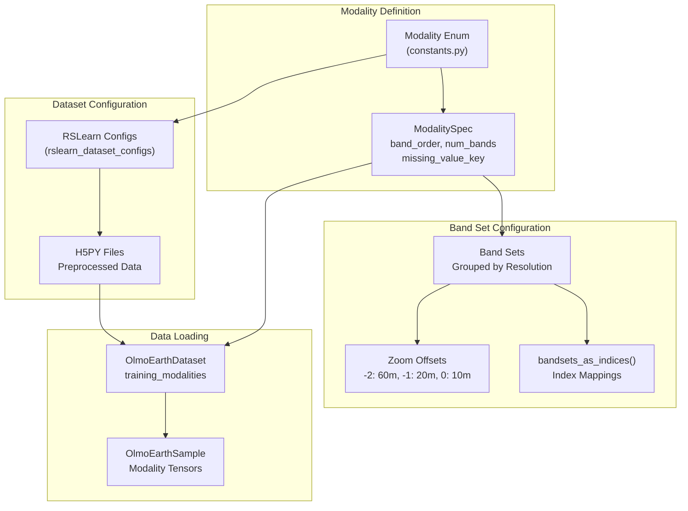
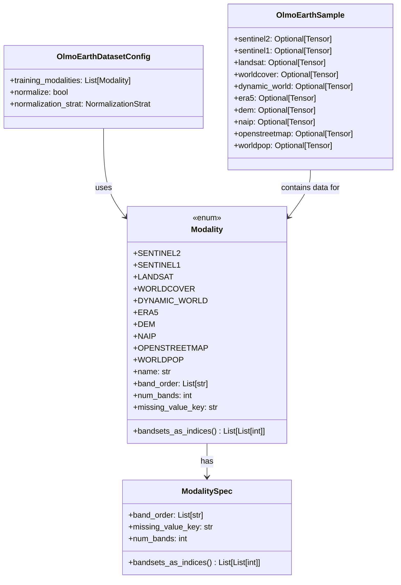
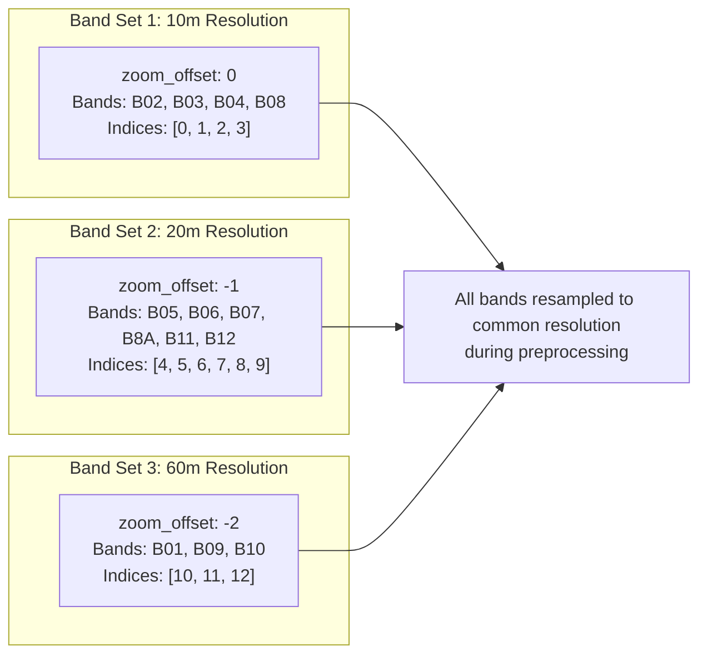
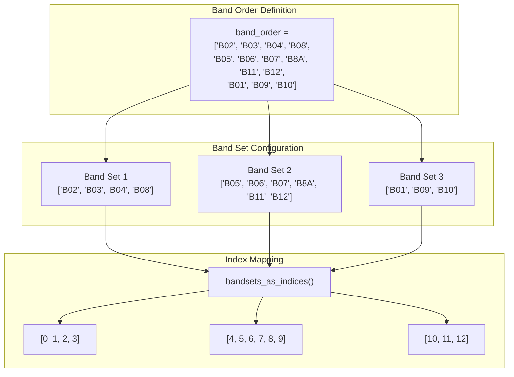
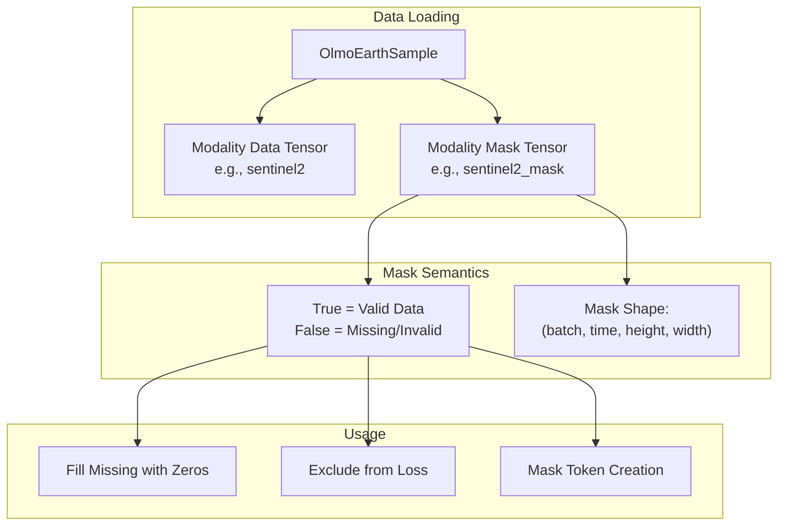
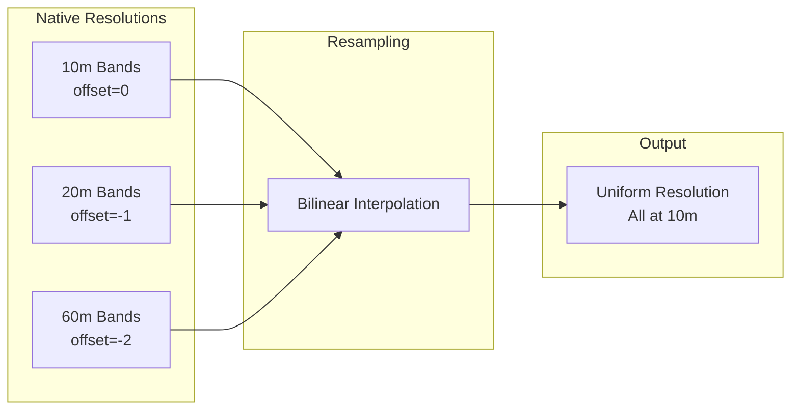

<!-- source: DeepWiki mcp.deepwiki.com · repo allenai/olmoearth_pretrain · page 10.2 Modality Specifications · fetched 2026-10-26 -->

# Modality Specifications

<details>
<summary>Relevant source files</summary>

The following files were used as context for generating this wiki page:

- [data/rslearn_dataset_configs/config_landsat.json](data/rslearn_dataset_configs/config_landsat.json)
- [data/rslearn_dataset_configs/config_naip.json](data/rslearn_dataset_configs/config_naip.json)
- [data/rslearn_dataset_configs/config_openstreetmap.json](data/rslearn_dataset_configs/config_openstreetmap.json)
- [data/rslearn_dataset_configs/config_sentinel1.json](data/rslearn_dataset_configs/config_sentinel1.json)
- [data/rslearn_dataset_configs/config_sentinel2.json](data/rslearn_dataset_configs/config_sentinel2.json)
- [data/rslearn_dataset_configs/config_worldcover.json](data/rslearn_dataset_configs/config_worldcover.json)
- [data/rslearn_dataset_configs/config_worldpop.json](data/rslearn_dataset_configs/config_worldpop.json)
- [tests/unit/data/test_constants.py](tests/unit/data/test_constants.py)

</details>


This document provides a comprehensive reference for all satellite data modalities supported by the OlmoEarth pretraining system. It specifies band orders, resolutions, data types, and configuration details for each modality.

For information about how modalities are loaded and processed during training, see [Data Loading and Preprocessing](). For normalization strategies applied to modalities, see [Normalization Strategies]().

## Purpose and Scope

This reference page documents the technical specifications of each satellite imagery modality supported by the OlmoEarth system. Each modality represents a different satellite sensor or derived data product, with specific:

- **Band orders**: The sequence in which spectral bands are stacked
- **Band sets**: Groupings of bands by native resolution
- **Data types**: Storage format (uint16, float32, etc.)
- **Resolution specifications**: Spatial resolution and zoom offsets
- **Missing value conventions**: How absent data is encoded

This page serves as a lookup reference for developers working with satellite data, configuring datasets, or adding new modalities.

## Modality System Architecture

The modality system in OlmoEarth is defined through the `Modality` enum and associated specifications, providing a standardized interface for multi-modal satellite data.



**Modality System Architecture**: This diagram shows how modality specifications flow from definition to data loading. The `Modality` enum defines available modalities with their `ModalitySpec`, which includes band orders and missing value conventions. Band sets group bands by resolution with zoom offsets. RSLearn configurations define how data is fetched and stored in H5PY files, which are then loaded by `OlmoEarthDataset` using modality specifications to create `OlmoEarthSample` objects.

Sources: [olmoearth_pretrain/data/constants.py](), [tests/unit/data/test_constants.py:1-57](), [data/rslearn_dataset_configs/config_sentinel2.json:1-579]()

## Core Modality Classes



**Modality Class Relationships**: The `Modality` enum provides named constants for each supported modality, each associated with a `ModalitySpec` that defines technical parameters. `OlmoEarthDatasetConfig` specifies which modalities to load during training, and `OlmoEarthSample` contains the actual tensor data for each modality.

Sources: [olmoearth_pretrain/data/constants.py](), [tests/unit/data/test_constants.py:1-57]()

## Sentinel-2

Sentinel-2 provides atmospherically corrected multispectral imagery with 13 spectral bands covering visible, near-infrared, and shortwave infrared wavelengths.

### Band Specifications

| Band | Name | Wavelength (nm) | Resolution | Band Set | Index |
|------|------|----------------|------------|----------|-------|
| B02 | Blue | 490 | 10m | 1 | 0 |
| B03 | Green | 560 | 10m | 1 | 1 |
| B04 | Red | 665 | 10m | 1 | 2 |
| B08 | NIR | 842 | 10m | 1 | 3 |
| B05 | Red Edge 1 | 705 | 20m | 2 | 4 |
| B06 | Red Edge 2 | 740 | 20m | 2 | 5 |
| B07 | Red Edge 3 | 783 | 20m | 2 | 6 |
| B8A | NIR Narrow | 865 | 20m | 2 | 7 |
| B11 | SWIR 1 | 1610 | 20m | 2 | 8 |
| B12 | SWIR 2 | 2190 | 20m | 2 | 9 |
| B01 | Coastal Aerosol | 443 | 60m | 3 | 10 |
| B09 | Water Vapor | 945 | 60m | 3 | 11 |
| B10 | Cirrus | 1375 | 60m | 3 | 12 |

### Technical Specifications

- **Total Bands**: 13
- **Data Type**: `uint16`
- **Band Order** (as stacked): `["B02", "B03", "B04", "B08", "B05", "B06", "B07", "B8A", "B11", "B12", "B01", "B09", "B10"]`
- **Modality Key**: `Modality.SENTINEL2` or string `"sentinel2"`
- **Missing Value Key**: `"sentinel2_mask"`

### Band Set Structure

Sentinel-2 bands are organized into three sets based on native resolution:



**Sentinel-2 Band Set Structure**: Bands are grouped by native resolution with corresponding zoom offsets. During preprocessing, all bands are resampled to a common resolution for uniform processing.

Sources: [tests/unit/data/test_constants.py:11-41](), [data/rslearn_dataset_configs/config_sentinel2.json:2-48]()

### Temporal Configuration

Sentinel-2 can be configured with multiple timesteps using monthly offset configurations:

| Config Name | Time Offset | Duration | Example Use Case |
|-------------|-------------|----------|------------------|
| `sentinel2_freq` | Variable | N/A | High-frequency sampling |
| `sentinel2_mo01` | -180d | 30d | 6 months before target |
| `sentinel2_mo02` | -150d | 30d | 5 months before target |
| `sentinel2_mo03` | -120d | 30d | 4 months before target |
| `sentinel2_mo04` | -90d | 30d | 3 months before target |
| `sentinel2_mo05` | -60d | 30d | 2 months before target |
| `sentinel2_mo06` | -30d | 30d | 1 month before target |
| `sentinel2_mo07` | 0d | 30d | Target month |
| `sentinel2_mo08` | +30d | 30d | 1 month after target |
| `sentinel2_mo09` | +60d | 30d | 2 months after target |
| `sentinel2_mo10` | +90d | 30d | 3 months after target |
| `sentinel2_mo11` | +120d | 30d | 4 months after target |
| `sentinel2_mo12` | +150d | 30d | 5 months after target |

Sources: [data/rslearn_dataset_configs/config_sentinel2.json:49-576]()

## Landsat

Landsat imagery combines data from Landsat 8 (OLI/TIRS) and Landsat 9, providing continuous Earth observation with 11 spectral bands.

### Band Specifications

| Band | Name | Wavelength (nm) | Resolution | Index |
|------|------|----------------|------------|-------|
| B8 | Panchromatic | 503-676 | 15m | 0 |
| B1 | Coastal Aerosol | 435-451 | 30m | 1 |
| B2 | Blue | 452-512 | 30m | 2 |
| B3 | Green | 533-590 | 30m | 3 |
| B4 | Red | 636-673 | 30m | 4 |
| B5 | NIR | 851-879 | 30m | 5 |
| B6 | SWIR 1 | 1566-1651 | 30m | 6 |
| B7 | SWIR 2 | 2107-2294 | 30m | 7 |
| B9 | Cirrus | 1363-1384 | 30m | 8 |
| B10 | TIR 1 | 10600-11190 | 100m | 9 |
| B11 | TIR 2 | 11500-12510 | 100m | 10 |

### Technical Specifications

- **Total Bands**: 11
- **Data Type**: `uint16`
- **Band Order** (as stacked): `["B8", "B1", "B2", "B3", "B4", "B5", "B6", "B7", "B9", "B10", "B11"]`
- **Modality Key**: `Modality.LANDSAT` or string `"landsat"`
- **Missing Value Key**: `"landsat_mask"`

Sources: [tests/unit/data/test_constants.py:27-41]()

### Temporal Configuration

Landsat can be configured with multiple timesteps using monthly offset configurations:

| Config Name | Time Offset | Duration | Example Use Case |
|-------------|-------------|----------|------------------|
| `landsat_freq` | Variable | N/A | High-frequency sampling |
| `landsat_mo01` | -180d | 30d | 6 months before target |
| `landsat_mo02` | -150d | 30d | 5 months before target |
| `landsat_mo03` | -120d | 30d | 4 months before target |
| `landsat_mo04` | -90d | 30d | 3 months before target |
| `landsat_mo05` | -60d | 30d | 2 months before target |
| `landsat_mo06` | -30d | 30d | 1 month before target |
| `landsat_mo07` | 0d | 30d | Target month |
| `landsat_mo08` | +30d | 30d | 1 month after target |
| `landsat_mo09` | +60d | 30d | 2 months after target |
| `landsat_mo10` | +90d | 30d | 3 months after target |
| `landsat_mo11` | +120d | 30d | 4 months after target |
| `landsat_mo12` | +150d | 30d | 5 months after target |

Sources: [data/rslearn_dataset_configs/config_landsat.json:43-576]()

## Other Supported Modalities

The system also supports additional modalities for specialized applications:

### Sentinel-1 SAR

Synthetic Aperture Radar data providing all-weather, day-night imaging capability.

- **Modality Key**: `Modality.SENTINEL1` or string `"sentinel1"`
- **Polarizations**: VV, VH
- **Data Type**: `float32`
- **Missing Value Key**: `"sentinel1_mask"`

### Temporal Configuration

Sentinel-1 can be configured with multiple timesteps using monthly offset configurations:

| Config Name | Time Offset | Duration | Example Use Case |
|-------------|-------------|----------|------------------|
| `sentinel1_freq` | Variable | N/A | High-frequency sampling |
| `sentinel1_mo01` | -180d | 30d | 6 months before target |
| `sentinel1_mo02` | -150d | 30d | 5 months before target |
| `sentinel1_mo03` | -120d | 30d | 4 months before target |
| `sentinel1_mo04` | -90d | 30d | 3 months before target |
| `sentinel1_mo05` | -60d | 30d | 2 months before target |
| `sentinel1_mo06` | -30d | 30d | 1 month before target |
| `sentinel1_mo07` | 0d | 30d | Target month |
| `sentinel1_mo08` | +30d | 30d | 1 month after target |
| `sentinel1_mo09` | +60d | 30d | 2 months after target |
| `sentinel1_mo10` | +90d | 30d | 3 months after target |
| `sentinel1_mo11` | +120d | 30d | 4 months after target |
| `sentinel1_mo12` | +150d | 30d | 5 months after target |

Sources: [data/rslearn_dataset_configs/config_sentinel1.json:1-576]()

### WorldCover

ESA WorldCover land cover classification map.

- **Modality Key**: `Modality.WORLDCOVER` or string `"worldcover"`
- **Classes**: 11 land cover classes
- **Resolution**: 10m
- **Data Type**: `uint8`
- **Missing Value Key**: `"worldcover_mask"`

Sources: [data/rslearn_dataset_configs/config_worldcover.json:1-22]()

### Dynamic World

Near-real-time land use/land cover data from Google.

- **Modality Key**: `Modality.DYNAMIC_WORLD` or string `"dynamic_world"`
- **Classes**: 9 land cover classes
- **Temporal Resolution**: Daily
- **Missing Value Key**: `"dynamic_world_mask"`

Sources: [olmoearth_pretrain/data/constants.py]()

### ERA5 Climate Data

ERA5 reanalysis climate variables.

- **Modality Key**: `Modality.ERA5` or string `"era5"`
- **Variables**: Temperature, precipitation, wind, etc.
- **Temporal Resolution**: Hourly
- **Missing Value Key**: `"era5_mask"`

Sources: [olmoearth_pretrain/data/constants.py]()

### Digital Elevation Model (DEM)

Terrain elevation data.

- **Modality Key**: `Modality.DEM` or string `"dem"`
- **Data Type**: `float32`
- **Resolution**: 30m (SRTM)
- **Missing Value Key**: `"dem_mask"`

Sources: [olmoearth_pretrain/data/constants.py]()

### NAIP

National Agriculture Imagery Program (NAIP) aerial imagery.

- **Modality Key**: `Modality.NAIP` or string `"naip"`
- **Bands**: Red, Green, Blue, Near-Infrared (IR)
- **Data Type**: `uint8`
- **Missing Value Key**: `"naip_mask"`

Sources: [data/rslearn_dataset_configs/config_naip.json:1-33]()

### OpenStreetMap

Vector data representing various geographic features from OpenStreetMap.

- **Modality Key**: `Modality.OPENSTREETMAP` or string `"openstreetmap"`
- **Categories**: Building, highway, river, power_plant, etc.
- **Data Type**: Varies by feature (e.g., Polygon, LineString, Point)
- **Missing Value Key**: `"openstreetmap_mask"`

Sources: [data/rslearn_dataset_configs/config_openstreetmap.json:1-256]()

### WorldPop

High-resolution population density maps.

- **Modality Key**: `Modality.WORLDPOP` or string `"worldpop"`
- **Bands**: 1 (population density)
- **Data Type**: `float32`
- **Missing Value Key**: `"worldpop_mask"`

Sources: [data/rslearn_dataset_configs/config_worldpop.json:1-33]()

## Band Set Indexing

The `bandsets_as_indices()` method converts band set groupings into index lists for efficient data access:



**Band Set Index Mapping**: The `bandsets_as_indices()` method maps band names to their indices in the stacked tensor, enabling efficient slicing and processing of band sets.

**Example Usage:**

```python
# Get band set indices for Sentinel-2
indices = Modality.SENTINEL2.bandsets_as_indices()
# Returns: [[0, 1, 2, 3], [4, 5, 6, 7, 8, 9], [10, 11, 12]]

# Access high-resolution bands (10m) from a tensor
tensor_10m = sentinel2_data[:, :, indices[0], :, :]

# Access medium-resolution bands (20m)
tensor_20m = sentinel2_data[:, :, indices[1], :, :]

# Access low-resolution bands (60m)
tensor_60m = sentinel2_data[:, :, indices[2], :, :]
```

Sources: [tests/unit/data/test_constants.py:50-57]()

## Missing Value Handling

Each modality has an associated mask key that indicates the presence or absence of valid data:



**Missing Value Mask System**: Each modality tensor is accompanied by a boolean mask indicating valid data locations. Missing regions are typically filled with zeros and excluded from loss computation via masking.

### Mask Key Convention

The missing value key follows the pattern: `"{modality_name}_mask"`

| Modality | Data Key | Mask Key |
|----------|----------|----------|
| Sentinel-2 | `sentinel2` | `sentinel2_mask` |
| Sentinel-1 | `sentinel1` | `sentinel1_mask` |
| Landsat | `landsat` | `landsat_mask` |
| WorldCover | `worldcover` | `worldcover_mask` |
| Dynamic World | `dynamic_world` | `dynamic_world_mask` |
| ERA5 | `era5` | `era5_mask` |
| DEM | `dem` | `dem_mask` |
| NAIP | `naip` | `naip_mask` |
| OpenStreetMap | `openstreetmap` | `openstreetmap_mask` |
| WorldPop | `worldpop` | `worldpop_mask` |

Sources: [olmoearth_pretrain/data/constants.py]()

## Working with Modalities in Code

### Accessing Modality Specifications

```python
from olmoearth_pretrain.data.constants import Modality

# Get Sentinel-2 specifications
s2_spec = Modality.SENTINEL2
print(f"Bands: {s2_spec.band_order}")
print(f"Total bands: {s2_spec.num_bands}")
print(f"Mask key: {s2_spec.missing_value_key}")

# Get band set indices
band_sets = s2_spec.bandsets_as_indices()
print(f"High-res bands: {band_sets[0]}")
```

### Configuring Dataset Modalities

```python
from olmoearth_pretrain.data.dataset import OlmoEarthDatasetConfig
from olmoearth_pretrain.data.constants import Modality

# Configure dataset with specific modalities
config = OlmoEarthDatasetConfig(
    training_modalities=[
        Modality.SENTINEL2,
        Modality.SENTINEL1,
        Modality.DEM
    ],
    normalize=True
)
```

### Accessing Modality Data from Samples

```python
# Load data from sample
sample = dataset[0]

# Access modality tensors
sentinel2_data = sample.sentinel2  # Shape: (T, C, H, W)
sentinel2_mask = sample.sentinel2_mask  # Shape: (T, H, W)

# Check if modality is present
if sample.sentinel2 is not None:
    # Process Sentinel-2 data
    pass
```

Sources: [olmoearth_pretrain/data/constants.py](), [tests/unit/data/test_constants.py:1-57]()

## Zoom Offset System

The zoom offset system manages multi-resolution bands within a single modality:

| Zoom Offset | Resolution Multiplier | Example (Base=10m) |
|-------------|----------------------|-------------------|
| 0 | 1× | 10m |
| -1 | 2× | 20m |
| -2 | 4× | 60m |

During preprocessing, bands are resampled to a common target resolution based on these zoom offsets. The system uses bilinear interpolation for upsampling lower-resolution bands to match the highest resolution in the modality.



**Zoom Offset Resampling**: During preprocessing, bands with negative zoom offsets are upsampled to match the highest resolution (offset=0) using bilinear interpolation.

Sources: [data/rslearn_dataset_configs/config_sentinel2.json:23-34]()

---

This reference guide provides the foundation for understanding how satellite modalities are structured and accessed in the OlmoEarth system. For implementation details on data loading and normalization, consult the related data pipeline documentation.

---

