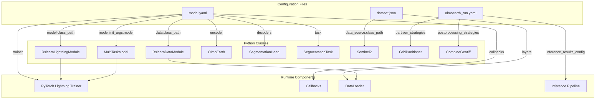
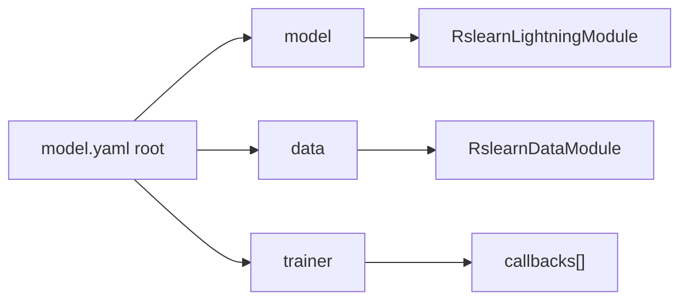
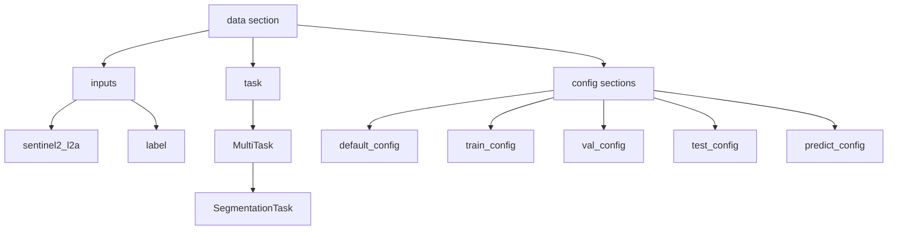
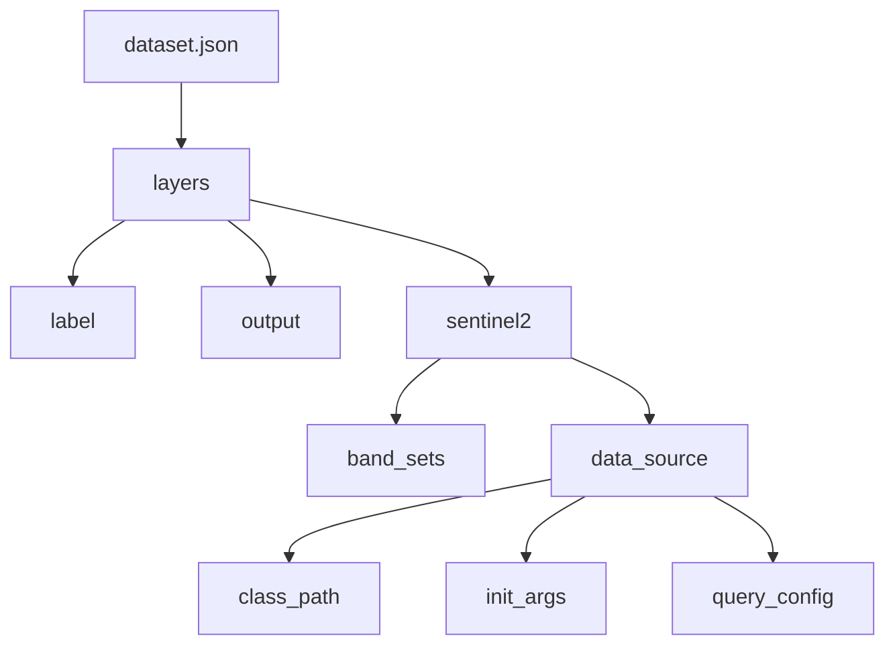
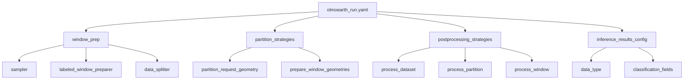
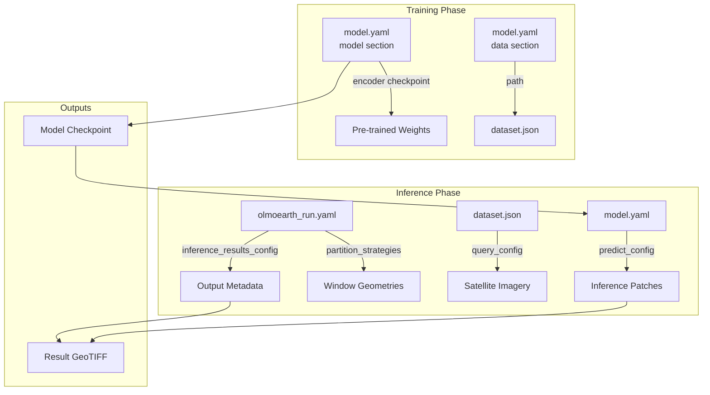

<!-- source: DeepWiki mcp.deepwiki.com · repo allenai/olmoearth_projects · page 10.1 Configuration Schema Reference · fetched 2026-10-26 -->

# Configuration Schema Reference

<details>
<summary>Relevant source files</summary>

The following files were used as context for generating this wiki page:

- [olmoearth_run_data/awf/dataset.json](olmoearth_run_data/awf/dataset.json)
- [olmoearth_run_data/awf/olmoearth_run.yaml](olmoearth_run_data/awf/olmoearth_run.yaml)
- [olmoearth_run_data/mozambique_lulc/dataset.json](olmoearth_run_data/mozambique_lulc/dataset.json)
- [olmoearth_run_data/mozambique_lulc/model.yaml](olmoearth_run_data/mozambique_lulc/model.yaml)
- [olmoearth_run_data/mozambique_lulc/olmoearth_run.yaml](olmoearth_run_data/mozambique_lulc/olmoearth_run.yaml)
- [olmoearth_run_data/nandi/dataset.json](olmoearth_run_data/nandi/dataset.json)
- [olmoearth_run_data/nandi/olmoearth_run.yaml](olmoearth_run_data/nandi/olmoearth_run.yaml)

</details>


This document provides a comprehensive reference for all YAML and JSON configuration files used in the olmoearth_projects repository. These configuration files control model training, data loading, inference pipelines, and output formats.

The system uses three primary configuration file types:
- **model.yaml**: Defines model architecture, training parameters, and data loading configuration for PyTorch Lightning training
- **dataset.json**: Specifies data sources, layer definitions, and satellite imagery query parameters
- **olmoearth_run.yaml**: Configures inference pipelines including partitioning strategies and post-processing

For information about how these configurations are used during training, see [Model Training](#5). For inference pipeline usage, see [olmoearth_run Pipeline](#7.1).

---

## Configuration System Overview

The following diagram shows how configuration files map to Python classes and system components:



**Sources:** [olmoearth_run_data/mozambique_lulc/model.yaml:1-278](), [olmoearth_run_data/mozambique_lulc/dataset.json:1-63](), [olmoearth_run_data/mozambique_lulc/olmoearth_run.yaml:1-81]()

---

## model.yaml Schema

The `model.yaml` file configures the complete training pipeline using PyTorch Lightning's CLI interface. It follows the [jsonargparse](https://jsonargparse.readthedocs.io) format with `class_path` and `init_args` structure.

### Root Structure



**Sources:** [olmoearth_run_data/mozambique_lulc/model.yaml:1-278]()

### Model Section

Defines the `RslearnLightningModule` and its nested model architecture.

| Field | Type | Description | Example |
|-------|------|-------------|---------|
| `class_path` | string | Fully qualified class path | `rslearn.train.lightning_module.RslearnLightningModule` |
| `init_args.model` | object | Nested model definition | See MultiTaskModel schema |
| `init_args.lr` | float | Initial learning rate | `0.0001` |
| `init_args.plateau` | boolean | Enable ReduceLROnPlateau scheduler | `true` |
| `init_args.plateau_factor` | float | LR reduction factor | `0.2` |
| `init_args.plateau_patience` | int | Epochs before LR reduction | `2` |
| `init_args.plateau_min_lr` | float | Minimum learning rate | `0` |
| `init_args.plateau_cooldown` | int | Cooldown epochs after LR reduction | `10` |

**Sources:** [olmoearth_run_data/mozambique_lulc/model.yaml:1-31]()

#### MultiTaskModel Schema

The `model.init_args.model` field typically uses `rslearn.models.multitask.MultiTaskModel`:

| Field | Type | Description |
|-------|------|-------------|
| `class_path` | string | `rslearn.models.multitask.MultiTaskModel` |
| `init_args.encoder` | list | List of encoder modules (typically one OlmoEarth encoder) |
| `init_args.decoders` | dict | Task-specific decoder pipelines keyed by task name |

**Sources:** [olmoearth_run_data/mozambique_lulc/model.yaml:4-25]()

#### OlmoEarth Encoder Configuration

```yaml
encoder:
  - class_path: rslearn.models.olmoearth_pretrain.model.OlmoEarth
    init_args:
      checkpoint_path: ${EXTRA_FILES_PATH}
      selector: ["encoder"]
      patch_size: 4
```

| Field | Type | Description |
|-------|------|-------------|
| `checkpoint_path` | string | Path to pre-trained checkpoint (supports environment variables) |
| `selector` | list[string] | Component selector for loading checkpoint |
| `patch_size` | int | Patch size for vision transformer (typically 4) |

**Sources:** [olmoearth_run_data/mozambique_lulc/model.yaml:8-12]()

#### Decoder Configuration

Decoders are organized by task name. Each decoder is a sequential list of modules:

```yaml
decoders:
  segment:
    - class_path: rslearn.models.upsample.Upsample
      init_args:
        scale_factor: 4
    - class_path: rslearn.models.conv.Conv
      init_args:
        in_channels: 768
        out_channels: 8
        kernel_size: 1
        activation:
          class_path: torch.nn.Identity
    - class_path: rslearn.train.tasks.segmentation.SegmentationHead
```

Common decoder modules:

| Module | Purpose | Key Parameters |
|--------|---------|----------------|
| `rslearn.models.upsample.Upsample` | Spatial upsampling | `scale_factor` |
| `rslearn.models.conv.Conv` | Convolution layer | `in_channels`, `out_channels`, `kernel_size`, `activation` |
| `rslearn.train.tasks.segmentation.SegmentationHead` | Task-specific head | None (infers from data) |

**Sources:** [olmoearth_run_data/mozambique_lulc/model.yaml:13-25]()

### Data Section

Configures the `RslearnDataModule` for data loading and preprocessing.



**Sources:** [olmoearth_run_data/mozambique_lulc/model.yaml:32-245]()

#### Core Data Parameters

| Field | Type | Description |
|-------|------|-------------|
| `class_path` | string | `rslearn.train.data_module.RslearnDataModule` |
| `init_args.path` | string | Path to dataset (supports environment variables like `${DATASET_PATH}`) |
| `init_args.batch_size` | int | Batch size for training/validation |
| `init_args.num_workers` | int | Number of data loading workers |

**Sources:** [olmoearth_run_data/mozambique_lulc/model.yaml:32-193]()

#### Inputs Configuration

The `inputs` dictionary defines data layers to load:

```yaml
inputs:
  sentinel2_l2a:
    data_type: "raster"
    layers: ["sentinel2"]
    bands: ["B02", "B03", "B04", "B08", "B05", "B06", "B07", "B8A", "B11", "B12", "B01", "B09"]
    passthrough: true
    dtype: FLOAT32
    load_all_item_groups: true
    load_all_layers: true
  label:
    data_type: "raster"
    layers: ["label_raster"]
    bands: ["label"]
    is_target: true
    dtype: INT32
```

| Field | Type | Description |
|-------|------|-------------|
| `data_type` | string | Data type: `"raster"`, `"vector"`, etc. |
| `layers` | list[string] | Layer names to load from dataset |
| `bands` | list[string] | Band names to extract |
| `passthrough` | boolean | Whether to pass data through without processing |
| `dtype` | string | Data type: `FLOAT32`, `INT32`, etc. |
| `load_all_item_groups` | boolean | Load all temporal groups |
| `load_all_layers` | boolean | Load all layer variants |
| `is_target` | boolean | Mark as target/label data |

**Sources:** [olmoearth_run_data/mozambique_lulc/model.yaml:36-50]()

#### Task Configuration

The `task` field defines the learning task and metrics:

```yaml
task:
  class_path: rslearn.train.tasks.multi_task.MultiTask
  init_args:
    tasks:
      segment:
        class_path: rslearn.train.tasks.segmentation.SegmentationTask
        init_args:
          num_classes: 8
          zero_is_invalid: true
          metric_kwargs:
            average: "micro"
```

**SegmentationTask Parameters:**

| Field | Type | Description |
|-------|------|-------------|
| `num_classes` | int | Number of output classes |
| `zero_is_invalid` | boolean | Treat class 0 as invalid/ignore |
| `metric_kwargs.average` | string | Averaging strategy: `"micro"`, `"macro"`, `"weighted"`, or `null` |
| `other_metrics` | dict | Additional per-class metrics |

**Sources:** [olmoearth_run_data/mozambique_lulc/model.yaml:51-188]()

#### Per-Class Metrics

Define additional metrics for individual classes using `other_metrics`:

```yaml
other_metrics:
  water_precision:
    class_path: rslearn.train.tasks.segmentation.SegmentationMetric
    init_args:
      metric:
        class_path: torchmetrics.classification.MulticlassPrecision
        init_args:
          num_classes: 8
          average: null
      class_idx: 1
```

| Field | Type | Description |
|-------|------|-------------|
| `metric.class_path` | string | Torchmetrics class path |
| `metric.init_args.num_classes` | int | Total number of classes |
| `metric.init_args.average` | null/string | Set to `null` for per-class metrics |
| `class_idx` | int | Index of class to extract |

**Sources:** [olmoearth_run_data/mozambique_lulc/model.yaml:62-188]()

#### Configuration Sections

Different configurations for train/val/test/predict stages:

| Section | Purpose | Key Fields |
|---------|---------|------------|
| `default_config` | Applied to all stages | `transforms` |
| `train_config` | Training stage | `transforms`, `groups`, `tags`, `patch_size` not used (full images) |
| `val_config` | Validation stage | `patch_size`, `groups`, `tags` |
| `test_config` | Test stage | `patch_size`, `groups`, `tags` |
| `predict_config` | Inference stage | `load_all_patches`, `patch_size`, `overlap_ratio`, `skip_targets`, `transforms` |

**Sources:** [olmoearth_run_data/mozambique_lulc/model.yaml:194-245]()

#### Transform Pipelines

Transforms are specified as lists of class instantiations:

```yaml
transforms:
  - class_path: rslearn.train.transforms.pad.Pad
    init_args:
      size: 31
      mode: "center"
      image_selectors: ["sentinel2_l2a", "target/segment/classes", "target/segment/valid"]
  - class_path: rslearn.train.transforms.crop.Crop
    init_args:
      crop_size: 16
      image_selectors: ["sentinel2_l2a", "target/segment/classes", "target/segment/valid"]
  - class_path: rslearn.models.olmoearth_pretrain.norm.OlmoEarthNormalize
    init_args:
      band_names:
        sentinel2_l2a: ["B02", "B03", "B04", "B08", "B05", "B06", "B07", "B8A", "B11", "B12", "B01", "B09"]
```

**Common Transforms:**

| Transform | Purpose | Key Parameters |
|-----------|---------|----------------|
| `rslearn.train.transforms.pad.Pad` | Pad images | `size` (pixels), `mode`, `image_selectors` |
| `rslearn.train.transforms.crop.Crop` | Random crop | `crop_size`, `image_selectors` |
| `rslearn.train.transforms.flip.Flip` | Random flip augmentation | `image_selectors` |
| `rslearn.models.olmoearth_pretrain.norm.OlmoEarthNormalize` | Normalize for OlmoEarth | `band_names` (dict mapping layer to band list) |

**Sources:** [olmoearth_run_data/mozambique_lulc/model.yaml:195-245]()

#### Predict Configuration

Special parameters for inference:

| Field | Type | Description |
|-------|------|-------------|
| `load_all_patches` | boolean | Load entire image as patches |
| `patch_size` | int | Size of inference patches |
| `overlap_ratio` | float | Overlap between patches (e.g., `0.25` = 25% overlap) |
| `skip_targets` | boolean | Skip loading target data |

**Sources:** [olmoearth_run_data/mozambique_lulc/model.yaml:236-245]()

### Trainer Section

Configures PyTorch Lightning `Trainer` and callbacks:

```yaml
trainer:
  max_epochs: 100
  default_root_dir: ${TRAINER_DATA_PATH}
  logger:
    class_path: lightning.pytorch.loggers.WandbLogger
    init_args:
      project: ${WANDB_PROJECT}
      name: ${WANDB_NAME}
      entity: ${WANDB_ENTITY}
  callbacks:
    - class_path: lightning.pytorch.callbacks.LearningRateMonitor
    - class_path: lightning.pytorch.callbacks.ModelCheckpoint
    - class_path: rslearn.train.callbacks.freeze_unfreeze.FreezeUnfreeze
    - class_path: rslearn.train.prediction_writer.RslearnWriter
```

**Sources:** [olmoearth_run_data/mozambique_lulc/model.yaml:246-278]()

#### Trainer Parameters

| Field | Type | Description |
|-------|------|-------------|
| `max_epochs` | int | Maximum training epochs |
| `default_root_dir` | string | Root directory for checkpoints and logs |
| `logger` | object | Logger configuration (typically WandbLogger) |

#### Callback Configurations

**LearningRateMonitor:**
```yaml
- class_path: lightning.pytorch.callbacks.LearningRateMonitor
  init_args:
    logging_interval: "epoch"
```

**ModelCheckpoint:**
```yaml
- class_path: lightning.pytorch.callbacks.ModelCheckpoint
  init_args:
    save_top_k: 1
    save_last: true
    monitor: val_loss
    mode: min
```

| Field | Description |
|-------|-------------|
| `save_top_k` | Number of best models to save |
| `save_last` | Whether to save last checkpoint |
| `monitor` | Metric to monitor |
| `mode` | `"min"` or `"max"` |

**FreezeUnfreeze:**
```yaml
- class_path: rslearn.train.callbacks.freeze_unfreeze.FreezeUnfreeze
  init_args:
    module_selector: ["model", "encoder", 0]
    unfreeze_at_epoch: 2
```

| Field | Description |
|-------|-------------|
| `module_selector` | Path to module to freeze/unfreeze |
| `unfreeze_at_epoch` | Epoch at which to unfreeze |

**RslearnWriter:**
```yaml
- class_path: rslearn.train.prediction_writer.RslearnWriter
  init_args:
    path: placeholder
    output_layer: ${PREDICTION_OUTPUT_LAYER}
    selector: ["segment"]
    merger:
      class_path: rslearn.train.prediction_writer.RasterMerger
      init_args:
        padding: 2
```

| Field | Description |
|-------|-------------|
| `path` | Output path for predictions |
| `output_layer` | Layer name for output |
| `selector` | Task selector |
| `merger` | Merger for combining predictions |

**Sources:** [olmoearth_run_data/mozambique_lulc/model.yaml:255-278]()

---

## dataset.json Schema

The `dataset.json` file defines data layers, their structure, and data source configurations. It uses a JSON format with nested dictionaries.

### Root Structure



**Sources:** [olmoearth_run_data/mozambique_lulc/dataset.json:1-63]()

### Layers Structure

Each layer defines a data source or output specification:

```json
{
  "layers": {
    "layer_name": {
      "type": "raster",
      "band_sets": [...],
      "data_source": {...}
    }
  }
}
```

| Field | Type | Description |
|-------|------|-------------|
| `type` | string | Layer type: `"raster"`, `"vector"`, etc. |
| `band_sets` | list | List of band set definitions |
| `data_source` | object | Optional data source configuration |

**Sources:** [olmoearth_run_data/mozambique_lulc/dataset.json:2-62]()

### Band Sets

Define the bands available in a layer:

```json
"band_sets": [
  {
    "bands": ["B01", "B02", "B03", "B04", "B05", "B06", "B07", "B08", "B8A", "B09", "B11", "B12"],
    "dtype": "uint16"
  }
]
```

| Field | Type | Description |
|-------|------|-------------|
| `bands` | list[string] | Band names |
| `dtype` | string | Data type: `"uint16"`, `"int32"`, `"float32"` |

**Sources:** [olmoearth_run_data/mozambique_lulc/dataset.json:26-43]()

### Data Source Configuration

Specifies how to acquire data from external sources:

```json
"data_source": {
  "class_path": "rslearn.data_sources.planetary_computer.Sentinel2",
  "ingest": false,
  "init_args": {
    "cache_dir": "cache/planetary_computer",
    "harmonize": true,
    "sort_by": "eo:cloud_cover"
  },
  "query_config": {
    "max_matches": 8,
    "min_matches": 8,
    "period_duration": "30d",
    "space_mode": "PER_PERIOD_MOSAIC"
  }
}
```

**Sources:** [olmoearth_run_data/mozambique_lulc/dataset.json:45-58]()

#### Data Source Parameters

| Field | Type | Description |
|-------|------|-------------|
| `class_path` | string | Python class for data source (e.g., `rslearn.data_sources.planetary_computer.Sentinel2`) |
| `ingest` | boolean | Whether to ingest data into dataset |
| `init_args` | object | Initialization arguments for data source class |
| `query_config` | object | Query configuration for temporal/spatial queries |

#### Sentinel-2 Init Args

| Field | Type | Description |
|-------|------|-------------|
| `cache_dir` | string | Directory for caching downloaded data |
| `harmonize` | boolean | Apply harmonization to Sentinel-2 data |
| `sort_by` | string | Property to sort results by (e.g., `"eo:cloud_cover"`) |

**Sources:** [olmoearth_run_data/mozambique_lulc/dataset.json:48-52]()

#### Query Configuration

| Field | Type | Description | Example Values |
|-------|------|-------------|----------------|
| `max_matches` | int | Maximum temporal images to return | `8`, `12` |
| `min_matches` | int | Minimum temporal images required | `8`, `12` |
| `period_duration` | string | Duration of each temporal period | `"30d"`, `"15d"` |
| `space_mode` | string | Spatial aggregation mode | `"PER_PERIOD_MOSAIC"`, `"SINGLE_MOSAIC"` |

**Space Mode Values:**
- `PER_PERIOD_MOSAIC`: Create one mosaic per temporal period
- `SINGLE_MOSAIC`: Create a single mosaic for entire time range

**Sources:** [olmoearth_run_data/mozambique_lulc/dataset.json:53-58](), [olmoearth_run_data/awf/dataset.json:53-58](), [olmoearth_run_data/nandi/dataset.json:53-58]()

### Label and Output Layers

Standard layers without data sources:

```json
"label": {
  "band_sets": [
    {
      "bands": ["category"],
      "dtype": "int32"
    }
  ],
  "type": "raster"
}
```

```json
"output": {
  "band_sets": [
    {
      "bands": ["output"],
      "dtype": "float32"
    }
  ],
  "type": "raster"
}
```

**Sources:** [olmoearth_run_data/mozambique_lulc/dataset.json:3-24]()

---

## olmoearth_run.yaml Schema

The `olmoearth_run.yaml` file configures the inference pipeline, including data preparation, partitioning strategies, post-processing, and output metadata.

### Root Structure



**Sources:** [olmoearth_run_data/mozambique_lulc/olmoearth_run.yaml:1-81](), [olmoearth_run_data/nandi/olmoearth_run.yaml:1-92](), [olmoearth_run_data/awf/olmoearth_run.yaml:1-89]()

### Window Preparation

Configures how to prepare training/inference windows:

```yaml
window_prep:
  sampler:
    class_path: olmoearth_run.runner.tools.samplers.noop_sampler.NoopSampler
  labeled_window_preparer:
    class_path: olmoearth_run.runner.tools.labeled_window_preparers.point_to_raster_window_preparer.PointToRasterWindowPreparer
    init_args:
      window_buffer: 31
      window_resolution: 10.0
      dtype: INT32
      nodata_value: 255
  data_splitter:
    class_path: olmoearth_run.runner.tools.data_splitters.spatial_data_splitter.SpatialDataSplitter
    init_args:
      train_prop: 0.75
      val_prop: 0.25
      test_prop: 0.0
      grid_size: 128
  label_layer: "label"
  group_name: "spatial_split"
  split_property: "split"
```

**Sources:** [olmoearth_run_data/mozambique_lulc/olmoearth_run.yaml:29-48]()

#### Window Prep Parameters

| Field | Type | Description |
|-------|------|-------------|
| `sampler.class_path` | string | Sampler class (typically `NoopSampler` for no sampling) |
| `labeled_window_preparer.class_path` | string | Window preparer class |
| `data_splitter.class_path` | string | Data splitting strategy class |
| `label_layer` | string | Name of label layer in dataset |
| `group_name` | string | Group name for organizing splits |
| `split_property` | string | Property name for split assignment |

#### PointToRasterWindowPreparer

| Field | Type | Description |
|-------|------|-------------|
| `window_buffer` | int | Buffer around point in pixels |
| `window_resolution` | float | Resolution in meters per pixel |
| `dtype` | string | Data type for output raster |
| `nodata_value` | int | Value to use for no-data pixels |

**Sources:** [olmoearth_run_data/mozambique_lulc/olmoearth_run.yaml:32-38]()

#### SpatialDataSplitter

| Field | Type | Description |
|-------|------|-------------|
| `train_prop` | float | Proportion for training (0.0-1.0) |
| `val_prop` | float | Proportion for validation (0.0-1.0) |
| `test_prop` | float | Proportion for testing (0.0-1.0) |
| `grid_size` | int | Grid cell size in pixels for spatial splitting |

**Sources:** [olmoearth_run_data/mozambique_lulc/olmoearth_run.yaml:39-45]()

### Partition Strategies

Define how to partition large geographic areas:

```yaml
partition_strategies:
  partition_request_geometry:
    class_path: olmoearth_run.runner.tools.partitioners.grid_partitioner.GridPartitioner
    init_args:
      grid_size: 0.25
  
  prepare_window_geometries:
    class_path: olmoearth_run.runner.tools.partitioners.grid_partitioner.GridPartitioner
    init_args:
      grid_size: 1024
      output_projection:
        class_path: rslearn.utils.geometry.Projection
        init_args:
          crs: EPSG:3857
          x_resolution: 10
          y_resolution: -10
      use_utm: true
```

**Sources:** [olmoearth_run_data/mozambique_lulc/olmoearth_run.yaml:50-66]()

#### GridPartitioner Parameters

| Field | Type | Description | Typical Values |
|-------|------|-------------|----------------|
| `grid_size` | float/int | Grid cell size in degrees (for geographic) or pixels (for projected) | `0.25`, `1.0` (degrees), `1024` (pixels) |
| `output_projection` | object | Projection specification for output | See Projection schema |
| `use_utm` | boolean | Automatically use appropriate UTM zone | `true`, `false` |

#### Projection Schema

| Field | Type | Description |
|-------|------|-------------|
| `crs` | string | Coordinate reference system (e.g., `EPSG:3857`, `EPSG:4326`) |
| `x_resolution` | float | X-axis resolution in CRS units |
| `y_resolution` | float | Y-axis resolution in CRS units (negative for north-up) |

**Sources:** [olmoearth_run_data/mozambique_lulc/olmoearth_run.yaml:60-65]()

### Post-processing Strategies

Define how to combine and process results at different levels:

```yaml
postprocessing_strategies:
  process_dataset:
    class_path: olmoearth_run.runner.tools.postprocessors.combine_geotiff.CombineGeotiff
    init_args:
      nodata_value: 255
  
  process_partition:
    class_path: olmoearth_run.runner.tools.postprocessors.combine_geotiff.CombineGeotiff
    init_args:
      nodata_value: 255
  
  process_window:
    class_path: olmoearth_run.runner.tools.postprocessors.noop_raster.NoopRaster
```

**Sources:** [olmoearth_run_data/mozambique_lulc/olmoearth_run.yaml:68-80]()

#### Post-processing Levels

| Level | Purpose | Typical Class |
|-------|---------|---------------|
| `process_window` | Process individual inference windows | `NoopRaster` (no processing) |
| `process_partition` | Combine windows within a partition | `CombineGeotiff` |
| `process_dataset` | Combine all partitions into final output | `CombineGeotiff` |

#### CombineGeotiff Parameters

| Field | Type | Description |
|-------|------|-------------|
| `nodata_value` | int | Value representing no-data pixels |

**Sources:** [olmoearth_run_data/mozambique_lulc/olmoearth_run.yaml:68-77]()

### Inference Results Configuration

Defines metadata for output rasters including classification schemes and visualization:

```yaml
inference_results_config:
  data_type: RASTER
  classification_fields:
    - property_name: segment
      band_index: 1
      allowed_values:
        - value: 0
          label: coffee
          color: [124, 67, 18]
        - value: 1
          label: grassland
          color: [169, 214, 146]
  detection_objects: null
  regression_fields: null
```

**Sources:** [olmoearth_run_data/nandi/olmoearth_run.yaml:54-92]()

#### Results Config Schema

| Field | Type | Description |
|-------|------|-------------|
| `data_type` | string | Output data type (typically `RASTER`) |
| `classification_fields` | list | List of classification field definitions |
| `detection_objects` | list/null | Object detection definitions (if applicable) |
| `regression_fields` | list/null | Regression field definitions (if applicable) |

#### Classification Field Schema

| Field | Type | Description |
|-------|------|-------------|
| `property_name` | string | Name of the classification property |
| `band_index` | int | Band index in output raster (1-indexed) |
| `allowed_values` | list | List of valid class definitions |

#### Allowed Value Schema

| Field | Type | Description |
|-------|------|-------------|
| `value` | int | Pixel value in output raster |
| `label` | string | Human-readable class label |
| `color` | list[int] | RGB color for visualization [R, G, B] where each component is 0-255 |

**Sources:** [olmoearth_run_data/nandi/olmoearth_run.yaml:56-90](), [olmoearth_run_data/awf/olmoearth_run.yaml:56-88](), [olmoearth_run_data/mozambique_lulc/olmoearth_run.yaml:1-27]()

---

## Configuration Schema Cross-Reference

The following diagram shows how different configuration schemas interact during training and inference:



**Sources:** All configuration files referenced above

---

## Environment Variables in Configuration

Configuration files support environment variable substitution using the `${VAR_NAME}` syntax:

| Variable | Usage | Description |
|----------|-------|-------------|
| `${EXTRA_FILES_PATH}` | `model.yaml` encoder checkpoint path | Path to OlmoEarth pre-trained weights |
| `${DATASET_PATH}` | `model.yaml` data path | Path to training dataset |
| `${NUM_WORKERS}` | `model.yaml` data loader | Number of data loading workers |
| `${TRAINER_DATA_PATH}` | `model.yaml` trainer root dir | Path for checkpoints and logs |
| `${WANDB_PROJECT}` | `model.yaml` logger | Weights & Biases project name |
| `${WANDB_NAME}` | `model.yaml` logger | Weights & Biases run name |
| `${WANDB_ENTITY}` | `model.yaml` logger | Weights & Biases entity |
| `${PREDICTION_OUTPUT_LAYER}` | `model.yaml` prediction writer | Output layer name for predictions |

**Sources:** [olmoearth_run_data/mozambique_lulc/model.yaml:10-272]()

---

## Common Configuration Patterns

### Pattern 1: Segmentation Task

Standard configuration for semantic segmentation:

```yaml
# model.yaml
model:
  init_args:
    model:
      encoder:
        - class_path: rslearn.models.olmoearth_pretrain.model.OlmoEarth
      decoders:
        segment:
          - class_path: rslearn.models.upsample.Upsample
          - class_path: rslearn.models.conv.Conv
          - class_path: rslearn.train.tasks.segmentation.SegmentationHead
data:
  init_args:
    task:
      tasks:
        segment:
          class_path: rslearn.train.tasks.segmentation.SegmentationTask
          init_args:
            num_classes: 8
```

**Sources:** [olmoearth_run_data/mozambique_lulc/model.yaml:1-59]()

### Pattern 2: Multi-Temporal Sentinel-2

Standard dataset configuration for time series:

```json
{
  "data_source": {
    "class_path": "rslearn.data_sources.planetary_computer.Sentinel2",
    "query_config": {
      "max_matches": 12,
      "min_matches": 12,
      "period_duration": "30d",
      "space_mode": "PER_PERIOD_MOSAIC"
    }
  }
}
```

**Sources:** [olmoearth_run_data/awf/dataset.json:45-58](), [olmoearth_run_data/nandi/dataset.json:45-58]()

### Pattern 3: Hierarchical Partitioning

Standard partitioning for large-area inference:

```yaml
partition_strategies:
  partition_request_geometry:
    class_path: olmoearth_run.runner.tools.partitioners.grid_partitioner.GridPartitioner
    init_args:
      grid_size: 1.0  # degrees
  
  prepare_window_geometries:
    class_path: olmoearth_run.runner.tools.partitioners.grid_partitioner.GridPartitioner
    init_args:
      grid_size: 1024  # pixels
      use_utm: true
```

**Sources:** [olmoearth_run_data/nandi/olmoearth_run.yaml:22-38](), [olmoearth_run_data/awf/olmoearth_run.yaml:22-38]()

---

## Validation and Error Handling

Configuration files are validated at runtime using the following mechanisms:

1. **Class Path Resolution**: All `class_path` fields must resolve to valid Python classes
2. **Type Checking**: Parameters are type-checked against class signatures
3. **Required Fields**: Missing required parameters raise errors during initialization
4. **Value Constraints**: Some fields have valid value constraints (e.g., `average` must be `"micro"`, `"macro"`, `"weighted"`, or `null`)

Common validation errors:

| Error Type | Cause | Solution |
|------------|-------|----------|
| `ModuleNotFoundError` | Invalid `class_path` | Verify class path and imports |
| `TypeError` | Invalid parameter type | Check parameter types in schema |
| `ValueError` | Invalid parameter value | Check allowed values for field |
| `KeyError` | Missing required field | Add required field to configuration |

**Sources:** All configuration files

---

