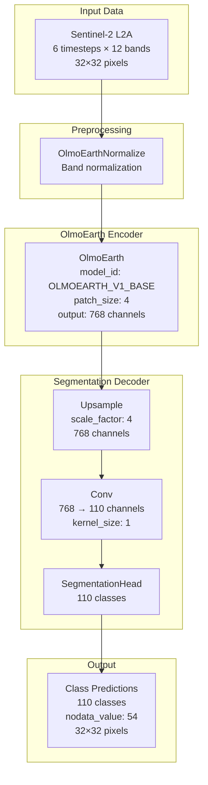
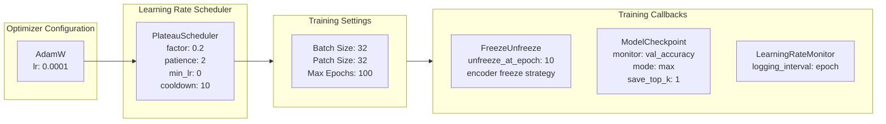
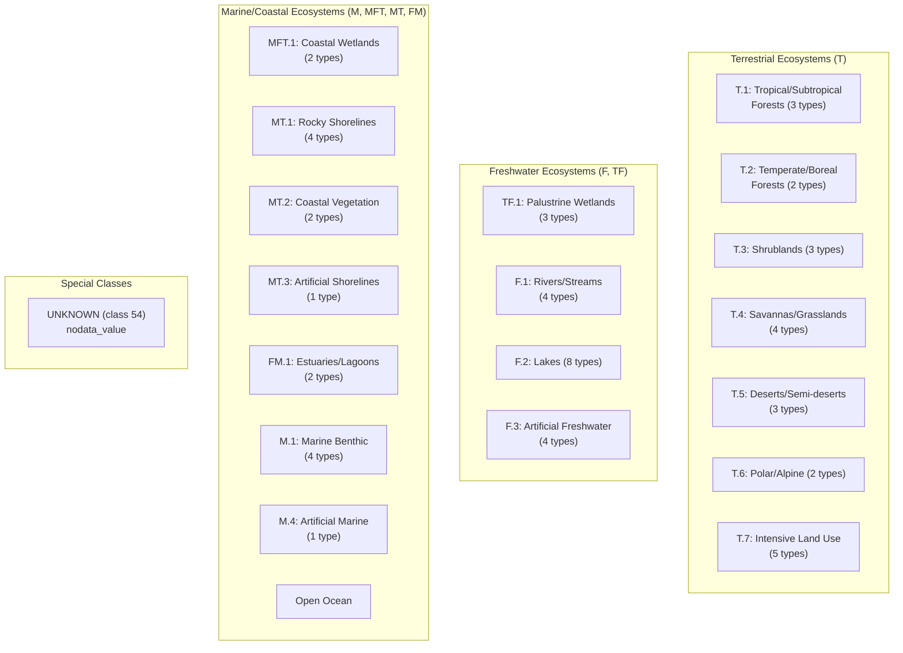
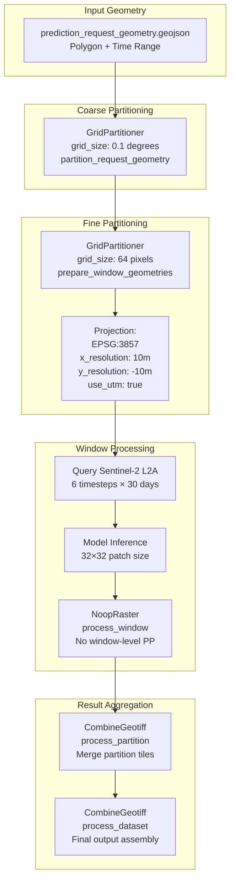
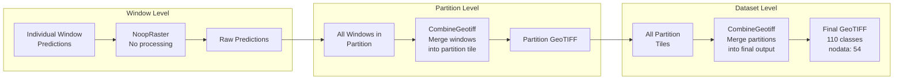
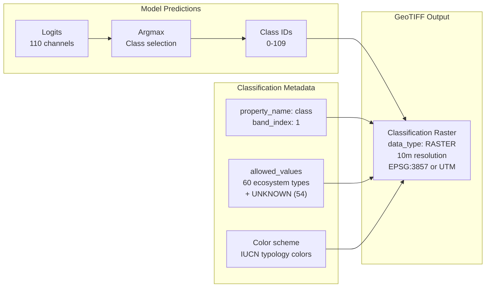

<!-- source: DeepWiki mcp.deepwiki.com · repo allenai/olmoearth_projects · page 6.5 Ecosystem Type Mapping Model · fetched 2026-10-26 -->

# Ecosystem Type Mapping Model

<details>
<summary>Relevant source files</summary>

The following files were used as context for generating this wiki page:

- [docs/ecosystem_type_mapping.md](docs/ecosystem_type_mapping.md)
- [olmoearth_run_data/ecosystem_type_mapping/model.yaml](olmoearth_run_data/ecosystem_type_mapping/model.yaml)
- [olmoearth_run_data/ecosystem_type_mapping/olmoearth_run.yaml](olmoearth_run_data/ecosystem_type_mapping/olmoearth_run.yaml)
- [olmoearth_run_data/ecosystem_type_mapping/prediction_request_geometry.geojson](olmoearth_run_data/ecosystem_type_mapping/prediction_request_geometry.geojson)
- [olmoearth_run_data/lfmc/model.yaml](olmoearth_run_data/lfmc/model.yaml)
- [olmoearth_run_data/lfmc/olmoearth_run.yaml](olmoearth_run_data/lfmc/olmoearth_run.yaml)
- [olmoearth_run_data/mozambique_lulc/dataset.json](olmoearth_run_data/mozambique_lulc/dataset.json)
- [olmoearth_run_data/mozambique_lulc/model.yaml](olmoearth_run_data/mozambique_lulc/model.yaml)
- [olmoearth_run_data/mozambique_lulc/olmoearth_run.yaml](olmoearth_run_data/mozambique_lulc/olmoearth_run.yaml)

</details>


This document describes the Ecosystem Type Mapping Model (OlmoEarth-v1-FT-EcosystemTypeMapping-Base), a fine-tuned model for classifying 60 different ecosystem types in the North Africa region. The model achieves 64.8% accuracy on its test set and uses the IUCN Global Ecosystem Typology classification scheme.

For information about other land cover models in this repository, see [Mozambique LULC Models](#6.1), [Nandi Crop Classification Model](#6.6), or [AWF Land Cover Model](#6.7). For the general training process, see [Fine-tuning Process](#5.3). For running inference, see [olmoearth_run Pipeline](#7.1).

**Sources:** [docs/ecosystem_type_mapping.md:1-37]()

---

## Model Overview

The Ecosystem Type Mapping Model is a segmentation model that classifies each 32x32 pixel crop of Sentinel-2 imagery into one of 60 ecosystem categories based on the [IUCN Global Ecosystem Typology](https://global-ecosystems.org/page/typology). The model processes six timesteps of Sentinel-2 L2A satellite imagery spanning 30-day mosaics over a 270-day period.

### Key Characteristics

| Property | Value |
|----------|-------|
| **Base Model** | OlmoEarth-v1-Base |
| **Task Type** | Multi-class segmentation |
| **Number of Classes** | 110 (60 active ecosystem types + unknown) |
| **Input Data** | Sentinel-2 L2A, 12 bands, 6 timesteps |
| **Temporal Range** | 270 days (6 × 30-day periods) |
| **Spatial Resolution** | 10m |
| **Processing Patch Size** | 32×32 pixels |
| **Test Accuracy** | 64.8% |
| **Geographic Region** | North Africa |
| **Model Checkpoint** | [HuggingFace](https://huggingface.co/allenai/OlmoEarth-v1-FT-EcosystemTypeMapping-Base/blob/main/model.ckpt) |

**Sources:** [docs/ecosystem_type_mapping.md:13-22](), [olmoearth_run_data/ecosystem_type_mapping/model.yaml:54-59]()

---

## Model Architecture

The architecture follows the standard fine-tuning pattern with an OlmoEarth encoder and a simple segmentation decoder.



### Architecture Components

**Encoder Configuration** [olmoearth_run_data/ecosystem_type_mapping/model.yaml:7-11]()
- Class: `rslearn.models.olmoearth_pretrain.model.OlmoEarth`
- Model ID: `OLMOEARTH_V1_BASE` (pre-trained foundation model)
- Patch size: 4 (downsampling factor)
- Output: 768-dimensional feature representations

**Decoder Configuration** [olmoearth_run_data/ecosystem_type_mapping/model.yaml:12-23]()
- **Upsample Layer**: Upsamples by 4× to restore original resolution
- **Convolution Layer**: 1×1 convolution from 768 to 110 channels
- **Segmentation Head**: `rslearn.train.tasks.segmentation.SegmentationHead`

**Task Configuration** [olmoearth_run_data/ecosystem_type_mapping/model.yaml:53-59]()
- Class: `rslearn.train.tasks.segmentation.SegmentationTask`
- Number of classes: 110 (though only 60 are actively used)
- Nodata value: 54 (UNKNOWN class)
- Metric: Micro-averaged accuracy

**Sources:** [olmoearth_run_data/ecosystem_type_mapping/model.yaml:1-111]()

---

## Training Configuration

### Input Data Specification

The model ingests six timesteps of Sentinel-2 L2A imagery, each representing a 30-day mosaic. The temporal sequence spans 270 days (6 × 30-day periods), with an additional 90-day buffer for periods with insufficient coverage.

**Sentinel-2 Configuration** [olmoearth_run_data/ecosystem_type_mapping/model.yaml:40-46]()
```yaml
sentinel2_l2a:
  data_type: "raster"
  layers: ["sentinel2", "sentinel2.1", "sentinel2.2", 
           "sentinel2.3", "sentinel2.4", "sentinel2.5"]
  bands: ["B02", "B03", "B04", "B08", "B05", "B06", 
          "B07", "B8A", "B11", "B12", "B01", "B09"]
  dtype: FLOAT32
```

| Band | Wavelength | Resolution | Purpose |
|------|------------|------------|---------|
| B01 | 443 nm (Coastal aerosol) | 60m | Atmospheric correction |
| B02 | 490 nm (Blue) | 10m | Water bodies, vegetation |
| B03 | 560 nm (Green) | 10m | Vegetation health |
| B04 | 665 nm (Red) | 10m | Chlorophyll absorption |
| B05 | 705 nm (Red Edge 1) | 20m | Vegetation stress |
| B06 | 740 nm (Red Edge 2) | 20m | Vegetation stress |
| B07 | 783 nm (Red Edge 3) | 20m | Vegetation stress |
| B08 | 842 nm (NIR) | 10m | Biomass content |
| B8A | 865 nm (Narrow NIR) | 20m | Water vapor |
| B09 | 945 nm (Water vapor) | 60m | Atmospheric correction |
| B11 | 1610 nm (SWIR 1) | 20m | Moisture content |
| B12 | 2190 nm (SWIR 2) | 20m | Moisture content |

**Sources:** [olmoearth_run_data/ecosystem_type_mapping/model.yaml:40-46](), [docs/ecosystem_type_mapping.md:15-17]()

### Training Hyperparameters



**Optimizer Configuration** [olmoearth_run_data/ecosystem_type_mapping/model.yaml:31-34]()
- Class: `rslearn.train.optimizer.AdamW`
- Learning rate: 0.0001

**Scheduler Configuration** [olmoearth_run_data/ecosystem_type_mapping/model.yaml:24-30]()
- Class: `rslearn.train.scheduler.PlateauScheduler`
- Factor: 0.2 (reduces LR by 80% on plateau)
- Patience: 2 epochs
- Cooldown: 10 epochs

**Freeze/Unfreeze Strategy** [olmoearth_run_data/ecosystem_type_mapping/model.yaml:103-106]()
- Encoder frozen for first 10 epochs
- Unfreezes at epoch 10 to fine-tune all layers
- Module selector: `["model", "encoder", 0]`

**Data Configuration** [olmoearth_run_data/ecosystem_type_mapping/model.yaml:60-80]()
- Batch size: 32
- Patch size: 32×32 pixels
- Training group: `["north_africa"]`
- Train/val/test splits by `split` tag

**Sources:** [olmoearth_run_data/ecosystem_type_mapping/model.yaml:24-111]()

---

## Training Data

The model is trained on expert-annotated ecosystem type data from the [Global Ecosystem Atlas](https://globalecosystemsatlas.org). The dataset uses the IUCN Global Ecosystem Typology classification scheme and covers the North Africa region.

### Data Preparation

**Window Preparation** [olmoearth_run_data/ecosystem_type_mapping/olmoearth_run.yaml:218-237]()
- Class: `olmoearth_run.runner.tools.labeled_window_preparers.point_to_raster_window_preparer.PointToRasterWindowPreparer`
- Window buffer: 31 pixels
- Window resolution: 10.0 meters
- Data type: FLOAT32
- Nodata value: 54 (UNKNOWN class)

**Data Splitting** [olmoearth_run_data/ecosystem_type_mapping/olmoearth_run.yaml:219-225]()
- Class: `olmoearth_run.runner.tools.data_splitters.spatial_data_splitter.SpatialDataSplitter`
- Grid size: 10.0 degrees
- Train proportion: 0.8 (80%)
- Validation proportion: 0.1 (10%)
- Test proportion: 0.1 (10%)

The dataset will be publicly released by Global Ecosystem Atlas in 2026.

**Sources:** [docs/ecosystem_type_mapping.md:24-27](), [olmoearth_run_data/ecosystem_type_mapping/olmoearth_run.yaml:218-237]()

---

## Ecosystem Classification Scheme

The model classifies 60 active ecosystem types following the IUCN Global Ecosystem Typology. The output has 110 classes total, with class 54 designated as UNKNOWN for missing or ambiguous data.

### Major Ecosystem Realms



### Ecosystem Type Mapping Table

The following table shows selected ecosystem types from each realm. The complete mapping with all 60 types and their color schemes is defined in [olmoearth_run_data/ecosystem_type_mapping/olmoearth_run.yaml:1-187]().

| Class ID | Ecosystem Type | IUCN Code | Realm |
|----------|----------------|-----------|-------|
| 0 | Tropical/Subtropical Lowland Rainforests | T.1.1 | Terrestrial |
| 1 | Tropical/Subtropical Dry Forests and Thickets | T.1.2 | Terrestrial |
| 6 | Trophic Savannas | T.4.1 | Terrestrial |
| 7 | Pyric Tussock Savannas | T.4.2 | Terrestrial |
| 11 | Hyper-arid Deserts | T.5.5 | Terrestrial |
| 13 | Annual Croplands | T.7.1 | Terrestrial |
| 16 | Urban and Industrial Ecosystems | T.7.4 | Terrestrial |
| 18 | Permanent Marshes | TF.1.3 | Freshwater |
| 21 | Permanent Lowland Rivers | F.1.2 | Freshwater |
| 25 | Large Permanent Freshwater Lakes | F.2.1 | Freshwater |
| 36 | Intertidal Forests and Shrublands | MFT.1.2 | Marine/Coastal |
| 38 | Rocky Shorelines | MT.1.1 | Marine/Coastal |
| 51 | Seagrass Meadows | M.1.1 | Marine |
| 52 | Photic Coral Reefs | M.1.3 | Marine |
| 54 | **UNKNOWN** | — | Special (nodata) |

**Sources:** [olmoearth_run_data/ecosystem_type_mapping/olmoearth_run.yaml:1-187]()

---

## Inference Configuration

### Partitioning Strategy

The inference pipeline uses hierarchical partitioning to efficiently process large geographic areas.



**Coarse Partitioning** [olmoearth_run_data/ecosystem_type_mapping/olmoearth_run.yaml:190-194]()
- Strategy: `partition_request_geometry`
- Class: `olmoearth_run.runner.tools.partitioners.grid_partitioner.GridPartitioner`
- Grid size: 0.1 degrees (~11 km at equator)
- Purpose: Divide large regions into manageable geographic tiles

**Fine Partitioning** [olmoearth_run_data/ecosystem_type_mapping/olmoearth_run.yaml:196-206]()
- Strategy: `prepare_window_geometries`
- Class: `olmoearth_run.runner.tools.partitioners.grid_partitioner.GridPartitioner`
- Grid size: 64 pixels (640m × 640m at 10m resolution)
- Output projection: EPSG:3857 (Web Mercator)
- Resolution: 10m × 10m
- UTM conversion: Enabled for more accurate local projections

**Sources:** [olmoearth_run_data/ecosystem_type_mapping/olmoearth_run.yaml:190-216]()

### Post-processing Pipeline



**Window Processing** [olmoearth_run_data/ecosystem_type_mapping/olmoearth_run.yaml:215-216]()
- Class: `olmoearth_run.runner.tools.postprocessors.noop_raster.NoopRaster`
- No window-level post-processing applied

**Partition Processing** [olmoearth_run_data/ecosystem_type_mapping/olmoearth_run.yaml:212-213]()
- Class: `olmoearth_run.runner.tools.postprocessors.combine_geotiff.CombineGeotiff`
- Merges all windows within a partition into a single GeoTIFF

**Dataset Processing** [olmoearth_run_data/ecosystem_type_mapping/olmoearth_run.yaml:209-210]()
- Class: `olmoearth_run.runner.tools.postprocessors.combine_geotiff.CombineGeotiff`
- Merges all partition tiles into the final output raster

**Sources:** [olmoearth_run_data/ecosystem_type_mapping/olmoearth_run.yaml:208-216]()

---

## Temporal Configuration

The model requires six timesteps of Sentinel-2 imagery spanning approximately 270 days. The inference system automatically handles temporal mosaic generation.

### Temporal Mosaic Strategy

**Start Time Usage** [docs/ecosystem_type_mapping.md:31-36]()
- The `oe_start_time` in the prediction request geometry defines the beginning of the 180-day primary time range
- Six 30-day periods (180 days total) are created from this start time
- An additional 90-day buffer precedes the start time for periods with insufficient coverage
- Total temporal range: 270 days (90-day buffer + 180-day primary)

**End Time Handling**
- The `oe_end_time` field is not used by the model
- Can be set to any value, typically 180 days after `oe_start_time`

**Example Time Configuration** [olmoearth_run_data/ecosystem_type_mapping/prediction_request_geometry.geojson:32-33]()
```json
{
  "properties": {
    "oe_start_time": "2025-01-01 08:00:00+00:00",
    "oe_end_time": "2025-08-05 07:00:00+00:00"
  }
}
```

This configuration results in:
- Buffer period: 2024-10-03 to 2025-01-01 (90 days)
- Primary period: 2025-01-01 to 2025-06-30 (180 days)
- Six 30-day mosaics centered on: Jan 16, Feb 15, Mar 17, Apr 16, May 16, Jun 15

**Sources:** [docs/ecosystem_type_mapping.md:31-36](), [olmoearth_run_data/ecosystem_type_mapping/prediction_request_geometry.geojson:1-39]()

---

## Output Format

The model produces classification rasters with the following characteristics:

### Output Specification



**Classification Field Configuration** [olmoearth_run_data/ecosystem_type_mapping/olmoearth_run.yaml:1-8]()
```yaml
inference_results_config:
  data_type: RASTER
  classification_fields:
    - property_name: class
      band_index: 1
      allowed_values: [60 ecosystem types with labels and colors]
```

| Property | Value |
|----------|-------|
| **Data Type** | RASTER |
| **Property Name** | `class` |
| **Band Index** | 1 (single-band classification) |
| **Value Range** | 0-59 (active classes) + 54 (UNKNOWN) |
| **Nodata Value** | 54 (UNKNOWN class) |
| **Spatial Resolution** | 10 meters |
| **Coordinate System** | EPSG:3857 or UTM (use_utm: true) |

**Sources:** [olmoearth_run_data/ecosystem_type_mapping/olmoearth_run.yaml:1-187]()

---

## Example Usage

### Prediction Request Geometry

To run inference, create a GeoJSON file with the area of interest and time range:

**Example** [olmoearth_run_data/ecosystem_type_mapping/prediction_request_geometry.geojson:1-39]()
```json
{
  "features": [
    {
      "geometry": {
        "coordinates": [[
          [15.030232213572674, 28.856258648812116],
          [15.030232213572674, 28.846640094401664],
          [15.041325166568527, 28.846640094401664],
          [15.041325166568527, 28.856258648812116],
          [15.030232213572674, 28.856258648812116]
        ]],
        "type": "Polygon"
      },
      "properties": {
        "oe_start_time": "2025-01-01 08:00:00+00:00",
        "oe_end_time": "2025-08-05 07:00:00+00:00"
      },
      "type": "Feature"
    }
  ],
  "type": "FeatureCollection"
}
```

This example covers a small region in Libya (~1.2 km × 1.2 km) with a 7-month time range starting January 2025.

**Sources:** [olmoearth_run_data/ecosystem_type_mapping/prediction_request_geometry.geojson:1-39]()

### Running Inference

For detailed instructions on running inference with this model, see the [olmoearth_run Pipeline](#7.1) documentation and the main README.

The general workflow:
1. Create `prediction_request_geometry.geojson` with your area and time range
2. Load model checkpoint: `OlmoEarth-v1-FT-EcosystemTypeMapping-Base`
3. Configure using `olmoearth_run_data/ecosystem_type_mapping/model.yaml`
4. Execute inference pipeline with partitioning strategy from `olmoearth_run.yaml`
5. Retrieve classified GeoTIFF with ecosystem type predictions

**Sources:** [docs/ecosystem_type_mapping.md:29-36]()

---

## Model Limitations

### Geographic Scope
- **Training Region:** Model is specifically trained for North Africa
- **Generalization:** Performance in other regions may vary significantly
- **Ecosystem Coverage:** The 60 ecosystem types may not cover all global ecosystems

### Temporal Constraints
- **Temporal Range:** Requires 270 days of observation (including 90-day buffer)
- **Cloud Coverage:** Performance degrades in regions with persistent cloud cover
- **Seasonal Variation:** Single time range may not capture full ecosystem dynamics

### Classification Challenges
- **Test Accuracy:** 64.8% indicates significant classification uncertainty
- **Class Imbalance:** Some ecosystem types may be underrepresented in training data
- **Transition Zones:** Ecosystem boundaries and ecotones may be misclassified
- **Mixed Pixels:** 10m resolution may contain multiple ecosystem types per pixel

### Data Dependencies
- **Sentinel-2 Availability:** Requires consistent Sentinel-2 coverage
- **Data Source:** Training data release pending (2026)
- **IUCN Schema:** Classification scheme may evolve with IUCN updates

**Sources:** [docs/ecosystem_type_mapping.md:22-27]()

---

