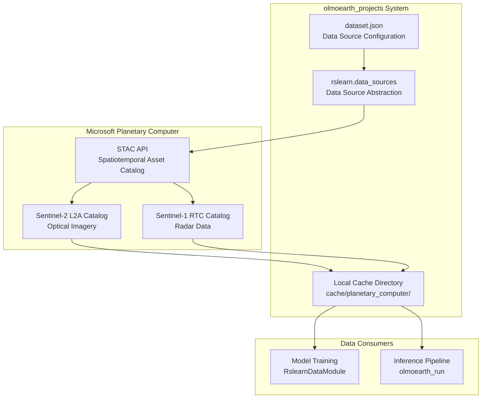
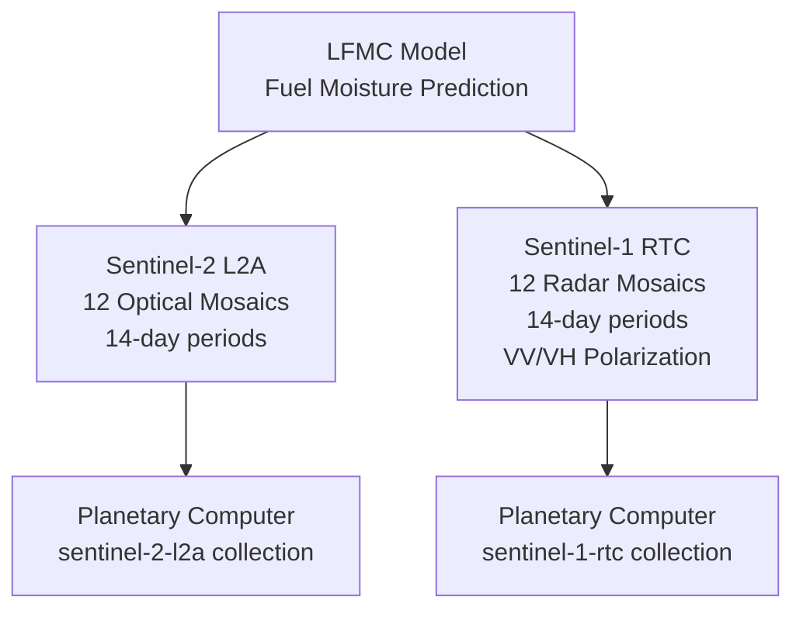
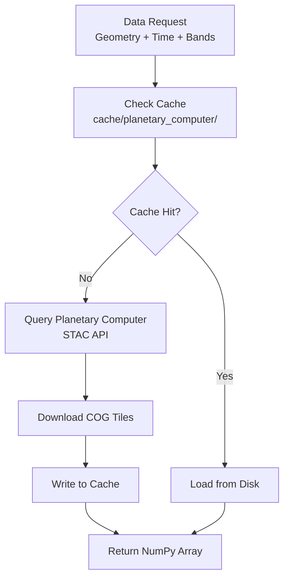
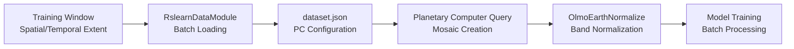
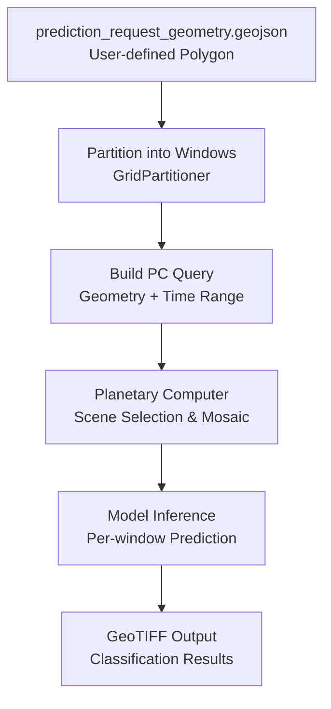

<!-- source: DeepWiki mcp.deepwiki.com · repo allenai/olmoearth_projects · page 8.2 Planetary Computer Integration · fetched 2026-10-26 -->

# Planetary Computer Integration

<details>
<summary>Relevant source files</summary>

The following files were used as context for generating this wiki page:

- [docs/forest_loss_driver.md](docs/forest_loss_driver.md)
- [docs/lfmc.md](docs/lfmc.md)
- [olmoearth_run_data/awf/dataset.json](olmoearth_run_data/awf/dataset.json)
- [olmoearth_run_data/forest_loss_driver/model.yaml](olmoearth_run_data/forest_loss_driver/model.yaml)
- [olmoearth_run_data/nandi/dataset.json](olmoearth_run_data/nandi/dataset.json)

</details>


## Purpose and Scope

This document describes how the olmoearth_projects system integrates with Microsoft Planetary Computer to access satellite imagery data. Planetary Computer serves as the primary data acquisition backend for both training and inference workflows, providing standardized access to Sentinel-2 and Sentinel-1 satellite datasets.

For details on Sentinel-2 band specifications and configurations, see [Sentinel-2 L2A Data](#8.1). For information on how this data flows through the training pipeline, see [Data Module and Transforms](#5.4).

## Overview

Microsoft Planetary Computer is a cloud-based API that provides access to petabytes of earth observation data, including Sentinel-2 L2A optical imagery and Sentinel-1 RTC radar data. The system integrates with Planetary Computer through the `rslearn` framework, which handles query construction, data retrieval, caching, and harmonization.



**Sources**: [olmoearth_run_data/awf/dataset.json:45-52](), [olmoearth_run_data/nandi/dataset.json:45-52](), [docs/lfmc.md:17-20]()

## Data Source Configuration

Planetary Computer integration is configured in `dataset.json` files through the `data_source` field of each layer definition. The configuration uses the `rslearn.data_sources.planetary_computer.Sentinel2` class for Sentinel-2 data access.

### Configuration Structure

| Parameter | Type | Description |
|-----------|------|-------------|
| `class_path` | string | Fully qualified class name for the data source |
| `ingest` | boolean | Whether to pre-ingest data (typically `false` for PC) |
| `init_args` | object | Initialization arguments for the data source class |
| `query_config` | object | Query behavior configuration |

### Initialization Arguments

The `init_args` object configures how the data source connects to and processes Planetary Computer data:

```json
{
  "cache_dir": "cache/planetary_computer",
  "harmonize": true,
  "sort_by": "eo:cloud_cover"
}
```

| Argument | Purpose |
|----------|---------|
| `cache_dir` | Local directory path for caching downloaded imagery tiles |
| `harmonize` | Enable cross-sensor radiometric harmonization for Sentinel-2 |
| `sort_by` | STAC property used to prioritize which scenes to select |

The `harmonize: true` setting applies offset corrections to ensure radiometric consistency between Sentinel-2A and Sentinel-2B satellites, critical for multi-temporal analysis.

**Sources**: [olmoearth_run_data/awf/dataset.json:48-52](), [olmoearth_run_data/nandi/dataset.json:48-52]()

## Query Configuration

The `query_config` object defines temporal mosaicking and scene selection behavior:

```json
{
  "max_matches": 12,
  "min_matches": 12,
  "period_duration": "30d",
  "space_mode": "PER_PERIOD_MOSAIC"
}
```

### Query Parameters

| Parameter | Type | Description |
|-----------|------|-------------|
| `max_matches` | integer | Maximum number of temporal composites to retrieve |
| `min_matches` | integer | Minimum required composites (query fails if not met) |
| `period_duration` | string | Duration of each temporal period (e.g., "30d", "14d") |
| `space_mode` | enum | Spatial aggregation strategy within each period |

### Space Mode Options

The `space_mode` parameter controls how multiple scenes within a temporal period are combined:

- **`PER_PERIOD_MOSAIC`**: Creates a single mosaic per period by selecting the best pixels from all available scenes based on the `sort_by` criterion. This is the most common mode, reducing cloud contamination by choosing clearest pixels.

For example, with `period_duration: "30d"` and `max_matches: 12`, the system queries for 12 temporal periods spanning 360 days (12 × 30), creating one cloud-optimized mosaic per 30-day period.

**Sources**: [olmoearth_run_data/awf/dataset.json:53-58](), [olmoearth_run_data/nandi/dataset.json:53-58]()

## Data Source Classes

### Sentinel-2 Data Source

The `rslearn.data_sources.planetary_computer.Sentinel2` class provides access to Sentinel-2 Level 2A surface reflectance data.


The Sentinel-2 data source:
1. Constructs STAC API queries from spatial and temporal extents
2. Filters scenes by cloud cover using `eo:cloud_cover` metadata
3. Applies harmonization offsets for cross-sensor consistency
4. Creates per-period mosaics by selecting best pixels
5. Downloads Cloud Optimized GeoTIFF (COG) tiles as needed
6. Caches downloaded data to avoid redundant API calls

**Sources**: [olmoearth_run_data/awf/dataset.json:45-52](), [docs/lfmc.md:17-20]()

### Sentinel-1 Data Source

For radar data, the system uses `rslearn.data_sources.planetary_computer.Sentinel1RTC`, which accesses Sentinel-1 Radiometrically Terrain Corrected (RTC) backscatter data. This is used in models like LFMC that benefit from all-weather observation capabilities.



The LFMC model demonstrates multi-sensor integration, querying both Sentinel-2 optical and Sentinel-1 radar data for the same temporal periods to capture complementary information.

**Sources**: [docs/lfmc.md:16-20]()

## Caching Architecture

The caching system improves performance and reduces redundant API calls during training and inference:



### Cache Organization

The cache directory structure is organized by:
- Collection name (e.g., `sentinel-2-l2a`)
- Spatial extent (bounding box hash)
- Temporal extent (date range)
- Query parameters (bands, resolution)

This ensures that identical queries across multiple training runs or inference requests reuse cached data without re-downloading.

**Sources**: [olmoearth_run_data/awf/dataset.json:49](), [olmoearth_run_data/nandi/dataset.json:49]()

## Integration Points

### Training Pipeline Integration

During model training, the `RslearnDataModule` loads windows from the rslearn dataset, which reference Planetary Computer as the data source:



**Sources**: [olmoearth_run_data/forest_loss_driver/model.yaml:43-50]()

### Inference Pipeline Integration

The `olmoearth_run` inference pipeline uses the same Planetary Computer integration but with on-demand querying for user-specified geometries:



The inference pipeline constructs queries dynamically based on the prediction request geometry's `oe_start_time` and `oe_end_time` properties, ensuring that predictions use the appropriate temporal data range.

**Sources**: [docs/forest_loss_driver.md:67-96]()

## Harmonization

Sentinel-2 harmonization addresses radiometric differences between Sentinel-2A and Sentinel-2B satellites. When `harmonize: true`, the data source applies offset corrections based on the [Sentinel-2 Radiometric Offset](https://planetarycomputer.microsoft.com/docs/tutorials/sentinel-2-radiometric-offsets) methodology.

| Band | Offset (DN) | Purpose |
|------|-------------|---------|
| B02 (Blue) | -1000 | Correct S2A/S2B differences |
| B03 (Green) | -1000 | Ensure temporal consistency |
| B04 (Red) | -1000 | Enable multi-temporal analysis |
| Other bands | 0 | No correction needed |

This correction is essential for time series analysis where scenes may come from different satellites. Without harmonization, temporal discontinuities would appear as the operational satellite switches between S2A and S2B.

**Sources**: [olmoearth_run_data/awf/dataset.json:50]()

## Example Configurations

### Standard 12-Timestep Configuration

Used by most land cover classification models:

```json
{
  "data_source": {
    "class_path": "rslearn.data_sources.planetary_computer.Sentinel2",
    "ingest": false,
    "init_args": {
      "cache_dir": "cache/planetary_computer",
      "harmonize": true,
      "sort_by": "eo:cloud_cover"
    },
    "query_config": {
      "max_matches": 12,
      "min_matches": 12,
      "period_duration": "30d",
      "space_mode": "PER_PERIOD_MOSAIC"
    }
  }
}
```

This configuration retrieves 12 monthly mosaics spanning one year, selecting the clearest pixels within each 30-day period.

**Sources**: [olmoearth_run_data/awf/dataset.json:45-59](), [olmoearth_run_data/nandi/dataset.json:45-59]()

### High-Frequency Configuration

Used by LFMC model for shorter temporal periods:

```json
{
  "query_config": {
    "max_matches": 12,
    "min_matches": 12,
    "period_duration": "14d",
    "space_mode": "PER_PERIOD_MOSAIC"
  }
}
```

This configuration creates 12 bi-weekly mosaics spanning 168 days, providing higher temporal resolution for monitoring rapidly changing conditions like vegetation moisture.

**Sources**: [docs/lfmc.md:32-35]()

## Error Handling

The Planetary Computer integration includes several error handling mechanisms:

| Condition | Behavior |
|-----------|----------|
| `min_matches` not met | Query fails with error, window skipped |
| No scenes in period | Period returns null, handled by downstream transforms |
| API rate limiting | Automatic retry with exponential backoff |
| Cache corruption | Re-download from Planetary Computer |
| Network timeout | Retry up to 3 times before failing |

These mechanisms ensure robustness during large-scale training and inference operations where thousands of queries may be executed.

**Sources**: [olmoearth_run_data/awf/dataset.json:54-55]()

## Performance Considerations

### Query Optimization

To minimize latency and API load:
1. **Batch processing**: Group nearby windows to reuse cached tiles
2. **Spatial clustering**: Process spatially adjacent areas sequentially
3. **Temporal alignment**: Use consistent period durations across queries
4. **Cache warmup**: Pre-populate cache for large inference jobs

### Bandwidth Management

Planetary Computer data access is bandwidth-intensive. Typical bandwidth requirements:

| Operation | Data Volume | Duration |
|-----------|-------------|----------|
| Single window (256×256, 12 timesteps) | ~50 MB | 2-5 seconds |
| Training batch (32 windows) | ~1.6 GB | 1-2 minutes |
| Large inference (1000 km²) | ~100 GB | 2-4 hours |

The caching system significantly reduces these requirements for repeated operations on the same geographic areas.

**Sources**: [olmoearth_run_data/awf/dataset.json](), [olmoearth_run_data/nandi/dataset.json]()

---

