# Page: Overview

# Overview

<details>
<summary>Relevant source files</summary>

The following files were used as context for generating this wiki page:

- [README.md](README.md)
- [panda/__init__.py](panda/__init__.py)
- [panda/panda_agent/__init__.py](panda/panda_agent/__init__.py)
- [panda/utils/file_utils.py](panda/utils/file_utils.py)
- [setup.py](setup.py)

</details>


Panda is an autonomous scientific research agent that implements an outer loop of planning and a dynamic inner loop that iterates through action and reflection over each step of the research plan [README.md:1-5]. It combines large language model (LLM) reasoning with an execution environment capable of running Python code, analyzing data, and synthesizing scientific reports.

The codebase is packaged as `panda` [setup.py:4-6] and provides multiple integration surfaces including a command-line interface [setup.py:25-29], a programmatic Python API [panda/__init__.py:4-9], and a Model Context Protocol (MCP) server interface [README.md:110-112].

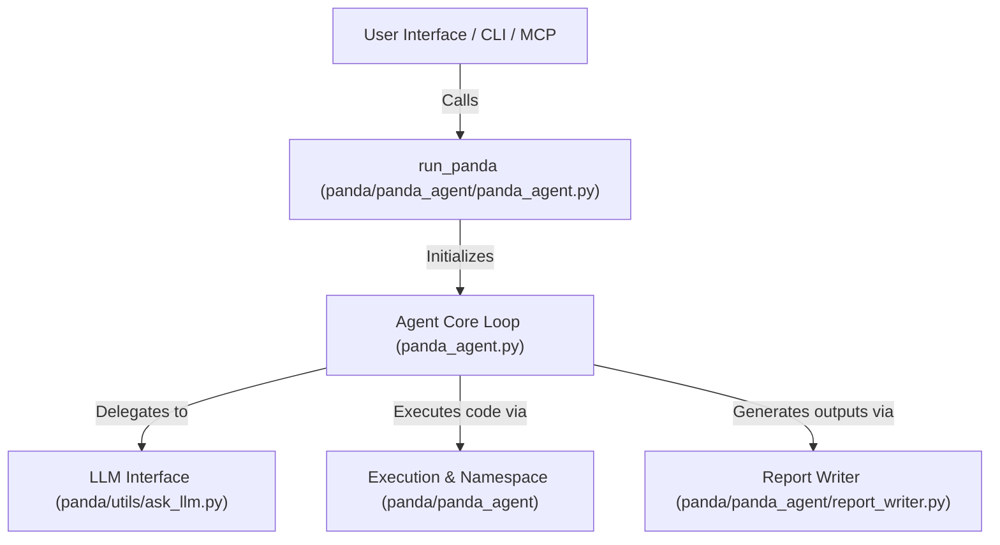
*Sources: [setup.py:25-29](), [README.md:1-112](), [panda/__init__.py:4-9]()*

---

## Getting Started & Installation

Panda can be installed locally via `pip` or managed globally using `uv` [README.md:25-37]. It requires setting appropriate API keys for the underlying LLMs (such as Anthropic, OpenAI, or Together AI) depending on the active configuration [README.md:13-16]. 

For detailed instructions on environment setup, dependencies defined in `setup.py`, and executing your first research task, see [Getting Started & Installation](#1.1).

*Sources: [setup.py:1-30](), [README.md:9-131]()*

---

## Package Structure & Public API

The `panda` package exposes a clean public API through its top-level initialization files (`panda/__init__.py` and `panda/panda_agent/__init__.py`) [panda/__init__.py:1-11, panda/panda_agent/__init__.py:1-7]. Consumers can import core agent functions like `run_panda`, utility functions like `call_llm` and `read_file_contents`, and report-generation routines directly from the package [panda/__init__.py:4-9, panda/panda_agent/__init__.py:2-6].

For a comprehensive catalog of re-exported symbols, modules, and import guidelines, see [Package Structure & Public API](#1.2).

*Sources: [panda/__init__.py:1-11](), [panda/panda_agent/__init__.py:1-6]() *

---

# Page: Getting Started & Installation

# Getting Started & Installation

<details>
<summary>Relevant source files</summary>

The following files were used as context for generating this wiki page:

- [LICENSE](LICENSE)
- [NOTICES.txt](NOTICES.txt)
- [README.md](README.md)
- [panda.jpg](panda.jpg)
- [setup.py](setup.py)

</details>


## Purpose and Scope
This page details the environment requirements, installation procedures (`pip` and `uv`), third-party dependency configurations specified in `setup.py`, API key management for multi-provider LLM routing, and execution pathways for running initial research tasks via the Command-Line Interface (CLI), Python API, or interactive shell.

---

## 1. Package Dependencies and `setup.py` Specification
Panda requires Python `>=3.7` [setup.py:20] and manages its runtime dependencies through `setup.py` [setup.py:4-30]. The installation automatically provisions necessary client libraries, timeout management utilities, and multi-provider LLM routers.

The core dependencies defined in `install_requires` [setup.py:8-16] include:
* `requests`: HTTP communication helper for remote resource retrieval.
* `openai`: OpenAI client interface.
* `pandas`: Tabular data manipulation engine leveraged by agent research workflows.
* `func_timeout`: Execution timeout handler controlling code execution safety limits.
* `litellm`: Unified LLM router supporting multiple providers (Anthropic, OpenAI, Together AI, etc.).
* `matplotlib`: Plotting library utilized for experiment visualization.
* `unidecode`: Character normalization utility for text cleaning (`utils.ask_llm.call_llm`) [setup.py:15].
* `mcp`: Model Context Protocol package for tool integrations [setup.py:16].

The package defines a console script entry point binding the `panda` executable command directly to `panda.run_panda:main` [setup.py:25-29].

```mermaid
graph TD
    A["CLI Entry Point: panda"] --> B["setup.py entry_points"]
    B --> C["panda.run_panda:main"]
    C --> D["Dependency Router: litellm"]
    C --> E["Timeout Enforcement: func_timeout"]
    C --> F["Data Engine: pandas"]
    
    sub:setup_deps ["Sources: setup.py:4-30"]
```
*Sources: [setup.py:4-30]()*

---

## 2. Installation Procedures

Panda can be installed locally via `pip` in a dedicated virtual environment or globally as a tool via `uv` [README.md:17-38].

### Option A: Local Development Environment (`conda` + `pip`)
Create a dedicated environment, clone the repository, and install the package in editable mode [README.md:20-25]:
```bash
git clone https://github.com/allenai/panda.git
cd panda
conda create -n panda python=3.10
conda activate panda
pip install -e .
```

### Option B: Global Tool Installation (`uv`)
To install the package globally using `uv` [README.md:36-37]:
```bash
uv tool install git+https://github.com/allenai/panda
```

```mermaid
graph TD
    A["Source Repository: panda.git"] --> B["Environment Setup: conda create"]
    B --> C["Editable Install: pip install -e ."]
    A --> D["Tool Install: uv tool install"]
    C --> E["Installed Panda Runtime"]
    D --> E
    
    sub:install_flow ["Sources: README.md:17-38"]
```
*Sources: [README.md:17-38]()*

---

## 3. API Keys and Environment Configuration
Panda relies on underlying Large Language Models configured via `panda_agent/config.py` [README.md:13]. Depending on the target model provider, specific environment variables must be exported before execution [README.md:15]:

* **Anthropic (Claude)**: Set `ANTHROPIC_API_KEY` (default model provider for `PANDA_LLM`).
* **OpenAI (GPT)**: Set `OPENAI_API_KEY`.
* **Together AI (Mistral / Llama)**: Set `TOGETHER_API_KEY`.

```mermaid
graph LR
    A["Panda Agent Runtime"] --> B["PANDA_LLM Config"]
    B --> C["ANTHROPIC_API_KEY"]
    B --> D["OPENAI_API_KEY"]
    B --> E["TOGETHER_API_KEY"]
    
    sub:env_config ["Sources: README.md:13-16"]
```
*Sources: [README.md:13-16]()*

---

## 4. Running Your First Task

Panda provides three primary execution interfaces: the Command-Line Interface (CLI), the interactive Python/IPython API, and background tool integration [README.md:27, 76, 111].

### Command-Line Interface (CLI)
Execute a quick test task directly from the command line utilizing `run_panda.py` [README.md:27]:
```bash
python run_panda.py "What is 1 + 1?" --force_report --outputs_dir "output"
```

### Interactive IPython Shell
Import the package inside an interactive session to execute research workflows programmatically [README.md:75-86]:
```python
import panda
result = panda.run_panda(task="What is 1 + 1?", force_report=True)
print(result)
```

The resulting dictionary structure returned by `run_panda()` provides status flags, execution summary paths, and token consumption metrics [README.md:88-92]:
```python
{
    'result_flag': 'done',
    'report_pathstem': 'output/experiment-20251111-095236/experiment',
    'summary': 'The research successfully determined that 1 + 1 equals 2...',
    'token_counts': [{'model': 'claude-sonnet-4-20250514', 'prompt_tokens': 54843, 'completion_tokens': 341, 'total_tokens': 55184}]
}
```

```mermaid
graph TD
    A["User Input Task"] --> B{"Execution Interface"}
    B -->|"CLI: run_panda.py"| C["panda.run_panda:main"]
    B -->|"Python API: run_panda()"| D["panda_agent.py:run_panda"]
    B -->|"MCP Tool"| E["panda.mcp_server"]
    C --> F["Agent Planning & Execution Loop"]
    D --> F
    E --> F
    F --> G["Artifact Generation: outputs_dir"]
    
    sub:execution_flow ["Sources: README.md:27, 75-112"]
```
*Sources: [README.md:27, 75-112]()*

---

# Page: Package Structure & Public API

# Package Structure & Public API

<details>
<summary>Relevant source files</summary>

The following files were used as context for generating this wiki page:

- [panda/__init__.py](panda/__init__.py)
- [panda/panda_agent/__init__.py](panda/panda_agent/__init__.py)
- [panda/utils/__init__.py](panda/utils/__init__.py)
- [panda/utils/file_utils.py](panda/utils/file_utils.py)

</details>


## Purpose and Scope
This page details the public API surface and internal modular organization of the `panda` codebase. It outlines what consumers and dependent modules can import directly from the package roots (`panda/__init__.py` [panda/__init__.py:1-18] and `panda_agent/__init__.py` [panda/panda_agent/__init__.py:1-7]), and documents the utility subsystems exposed via `panda/utils/__init__.py` [panda/utils/__init__.py:1-24].

---

## 1. Root Public API (`panda/__init__.py`)

The top-level package namespace acts as the primary entry point for consumers embedding Panda as a library. By importing from `panda`, developers gain direct access to core agent execution loops, debugging utilities, and fundamental LLM interfaces without needing to dig into internal submodules.

### Core Re-Exports
The root `__init__.py` performs relative imports from `.panda_agent` and `.utils` to expose the following public symbols:
*   `run_panda`: Main agent execution loop entry point [panda/__init__.py:4-4].
*   `restart`: Resets or resumes agent state [panda/__init__.py:4-4].
*   `py`: Python code execution helper [panda/__init__.py:4-4].
*   `test_panda`: Test suite runner for agent sanity checks [panda/__init__.py:4-4].
*   `write_report`: Generates final markdown/HTML reports [panda/__init__.py:4-4].
*   `build_system_prompt`: Constructs prompt structures for the LLM [panda/__init__.py:4-4].
*   `call_llm`, `call_llm_json`: LLM querying utilities [panda/__init__.py:9-9].
*   `jprint`: Pretty-printing utility for JSON structures [panda/__init__.py:9-9].
*   `read_file_contents`: File reading helper [panda/__init__.py:9-9].

### Diagram: Natural Language to Code Entity Space (Root API)

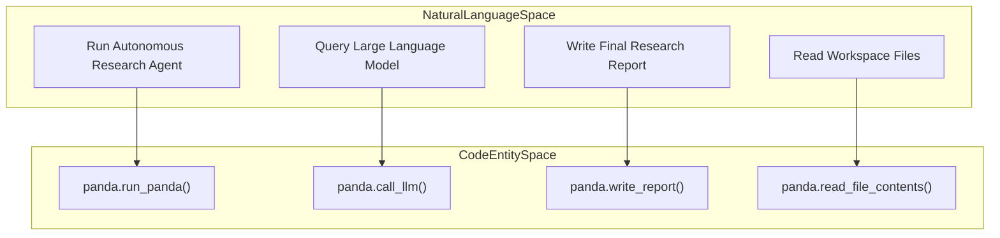
*Sources: [panda/__init__.py:1-17]()*

---

## 2. Agent Subpackage API (`panda_agent/__init__.py`)

The `panda_agent` subpackage isolates agent-specific orchestration logic, distinguishing it from general utilities. Its initializer module exposes routines required to drive the research loop and persist outputs.

### Exposed Symbols
*   `run_panda`: Initiates the plan-act-reflect cycle [panda/panda_agent/__init__.py:2-2].
*   `py`: Evaluates generated snippets [panda/panda_agent/__init__.py:2-2].
*   `restart`: State reset mechanism [panda/panda_agent/__init__.py:2-2].
*   `test_panda`: Verification helper [panda/panda_agent/__init__.py:2-2].
*   `build_system_prompt`: System prompt assembler [panda/panda_agent/__init__.py:2-2].
*   `write_report`: Compiles experiment outcomes into artifacts [panda/panda_agent/__init__.py:6-6].
*   `save_dialog`: Persists conversation/dialogue states [panda/panda_agent/__init__.py:6-6].
*   `get_dataframes`: Extracts tabular artifacts from execution context [panda/panda_agent/__init__.py:6-6].

*Sources: [panda/panda_agent/__init__.py:1-6]()*

---

## 3. Utilities Subpackage API (`panda/utils/__init__.py`)

The `panda/utils` package groups auxiliary libraries covering file I/O, string manipulation, LLM interaction wrappers, code parsing, and dataframe mapping.

### Subsystem Modules & Exports

| Submodule | Key Functions / Classes | Description |
| :--- | :--- | :--- |
| `file_utils.py` | `read_file_contents`, `file_exists`, `delete_file`, `download_file`, `copy_file`, `clear_directory`, `add_to_end_of_file` | Workspace file management, remote downloads, and cleanups [panda/utils/file_utils.py:15-126] |
| `utils.py` | `remove_html_markup`, `multiline_input`, `extract_html_from_string`, `extract_json_from_string`, `replace_special_chars_with_ascii` | Text normalization, HTML/JSON parsing helpers [panda/utils/__init__.py:5-7] |
| `mapping.py` | `llm_list`, `llm_list_json`, `map_dataframe`, `map_dataframe_json` | LLM-powered batch mapping over sequences and DataFrames [panda/utils/__init__.py:9-9] |
| `pyparser.py` | `parse_code`, `code_asks_for_user_input` | Abstract syntax tree analysis and safety checks on generated code [panda/utils/__init__.py:11-11] |
| `ask_llm.py` | `call_llm`, `call_llm_json`, `call_llm_multiple_choice`, `reset_token_counts`, `get_token_counts` | Core LLM routing layer with token tracking [panda/utils/__init__.py:13-13] |
| `logger.py` | `logger` | Centralized logging mechanism [panda/utils/__init__.py:15-15] |

### Diagram: Natural Language to Code Entity Space (File & Utility Operations)

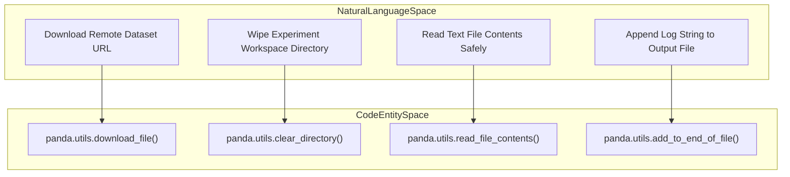
*Sources: [panda/utils/__init__.py:1-23](), [panda/utils/file_utils.py:1-127]()*

---

# Page: Agent Core

# Agent Core

<details>
<summary>Relevant source files</summary>

The following files were used as context for generating this wiki page:

- [README.md](README.md)
- [panda/panda_agent/panda_agent.py](panda/panda_agent/panda_agent.py)

</details>


The Agent Core subsystem forms the operational heart of Panda, implementing a hybrid control structure: an outer loop of planning and execution combined with an inner loop that iterates through action, reflection, and debugging for each step of a research plan. This module coordinates state management, prompt assembly, secure code execution, and experiment reporting.

For detailed breakdowns, refer to the child pages:
- Execution Loop and State Machine: [Execution Loop and State Machine](#2.1)
- Prompts and Subprompts: [Prompts and Subprompts](#2.2)
- Report Writing and Templates: [Report Writing and Templates](#2.3)
- Configuration: [Configuration](#2.4)

Sources: `[panda/panda_agent/panda_agent.py:1-161]()`, `[README.md:1-131]()`

---

## High-Level Architecture: Natural Language Space to Code Entity Space

The agent translates natural language user research goals into structured computational routines by cycling through distinct operational modes. The diagram below bridges the natural language conceptual space with the underlying codebase entities in `panda/panda_agent/panda_agent.py`.

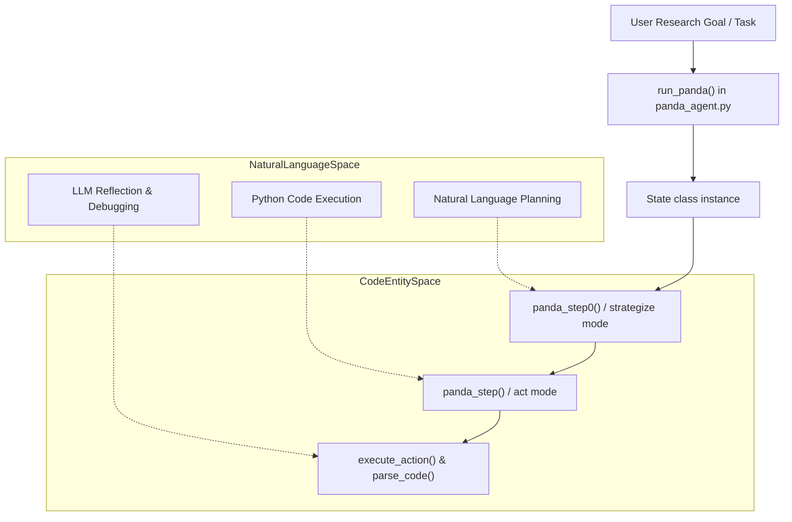

Sources: `[panda/panda_agent/panda_agent.py:7-11]`, `[panda/panda_agent/panda_agent.py:150-155]()`

---

## 2.1 Execution Loop and State Machine

The core execution engine coordinates task progression across multiple operational modes: `strategize`, `plan`, `act`, `reflect`, and `debug`. State variables, namespace scopes, and iteration guards are encapsulated within the `State` class defined at `[panda/panda_agent/panda_agent.py:150-155]()`.

For full technical specifications on execution loops, guards, code safety filters, and logging systems, see [Execution Loop and State Machine](#2.1).

### Operational State Machine

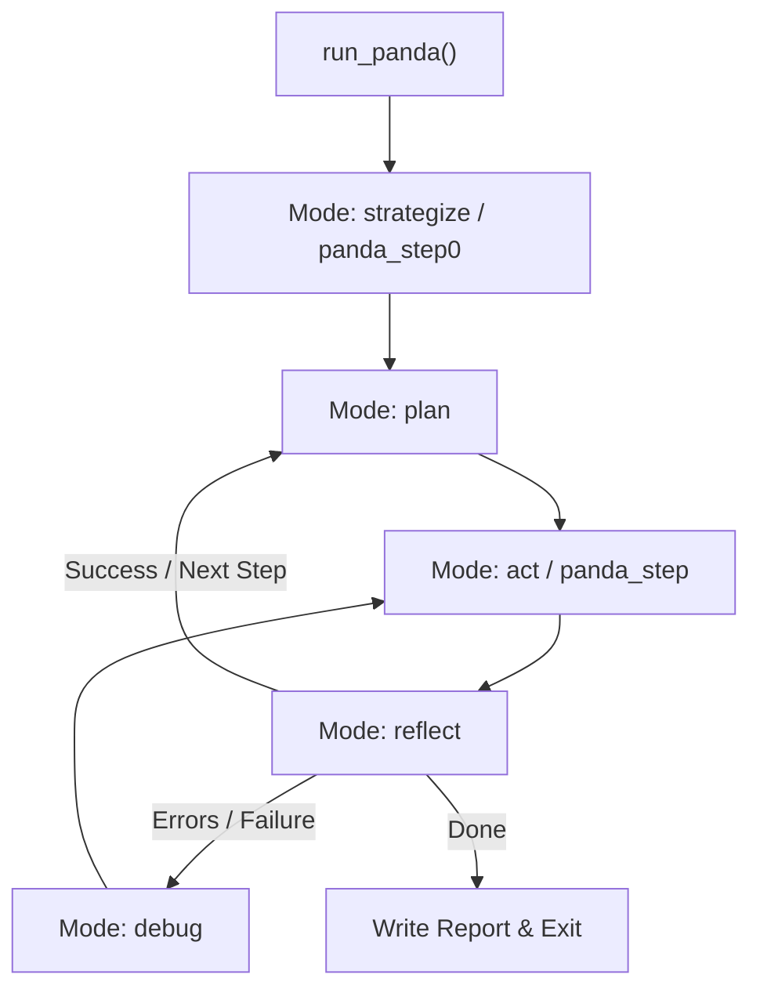

Sources: `[panda/panda_agent/panda_agent.py:150-155]()`

---

## 2.2 Prompts and Subprompts

Panda constructs dynamic LLM system prompts at runtime by combining a core system instruction template (`panda_agent_prompt.txt`) with specialized subprompts tailored to the agent's current operating mode. Additional contextual guidance can be optionally injected via `advice.txt`.

For details on prompt string interpolation, mode-specific subprompt assembly, and guidelines, see [Prompts and Subprompts](#2.2).

Sources: `[panda/panda_agent/panda_agent.py:48-48]`, `[panda/panda_agent/panda_agent.py:67-67]()`

---

## 2.3 Report Writing and Templates

Upon completion or abortion of a research run, `report_writer.py` aggregates execution traces, intermediate variables, dataframes, and generated code into structured artifacts. It renders final summaries into both HTML and plain text formats using internal templates.

For information on report layout, dataframe/dataset formatting helpers, and artifact persistence, see [Report Writing and Templates](#2.3).

Sources: `[panda/panda_agent/panda_agent.py:74-74]`, `[panda/panda_agent/panda_agent.py:85-85]()`

---

## 2.4 Configuration

Global constants governing LLM endpoint selection, model identifiers, execution timeouts, and retry policies are centralized in configuration modules. These parameters dictate fallback behaviors and resource limits across agent operations.

For a complete inventory of configuration variables, default LLM selections, and environment headers, see [Configuration](#2.4).

Sources: `[panda/panda_agent/panda_agent.py:64-64]()`

---

# Page: Execution Loop and State Machine

# Execution Loop and State Machine

<details>
<summary>Relevant source files</summary>

The following files were used as context for generating this wiki page:

- [panda/panda_agent/my_globals.py](panda/panda_agent/my_globals.py)
- [panda/panda_agent/panda_agent.py](panda/panda_agent/panda_agent.py)

</details>


## Purpose and Scope
This page provides a high-level overview of Panda's core execution loop, state management, and operating modes. The agent orchestrates autonomous research tasks by cycling through reasoning, planning, code execution, reflection, and debugging phases. 

For deep technical details on safe code sandboxing, namespaces, and security checks, see [Code Execution & Safety](#2.1.1). For details on stream redirection, trace generation, and UI integrations, see [Logging, Traces & NORA Output](#2.1.2).

---

## Core Loop and Functions

The entry point for executing research tasks is `run_panda()`, which initializes the runtime environment, sets up output directories, and invokes the iterative step function [panda/panda_agent/panda_agent.py:7-37](). The execution loop relies on step handlers such as `panda_step()` and initialization helpers like `panda_step0()` to drive the agent forward.

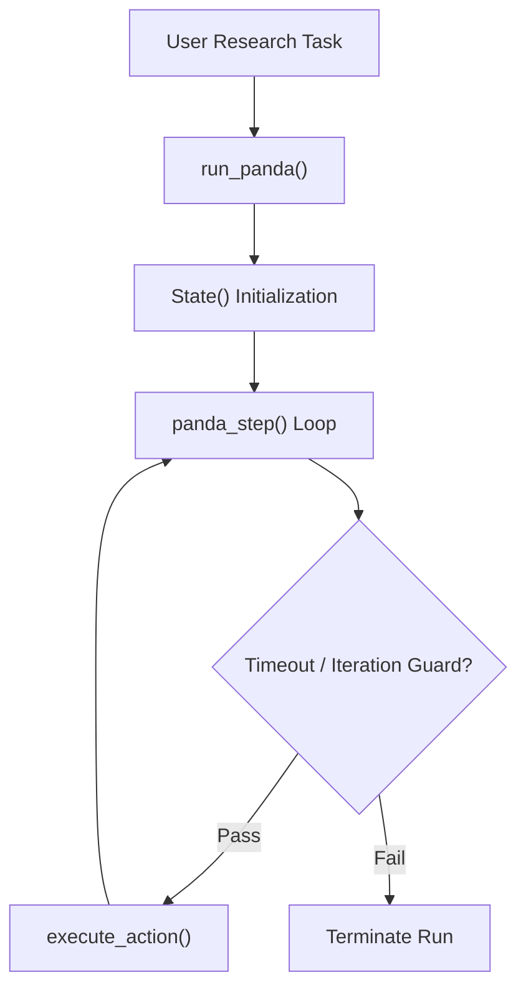
*Figure 1: Natural language tasks mapped to core Python execution entities.*

Sources: [panda/panda_agent/panda_agent.py:7-155]()

---

## Operating Modes

Panda dynamically shifts between several operating modes depending on the current phase of research. These modes dictate prompt assembly and expected agent behavior:

* **Strategize**: High-level formulation of research questions and investigation pathways.
* **Plan**: Decomposing research goals into structured, ordered steps.
* **Act**: Writing and executing Python code blocks within the persistent namespace.
* **Reflect**: Evaluating intermediate observations, tool outputs, and statistical results.
* **Debug**: Handling runtime exceptions, parse errors, or logic failures during execution.

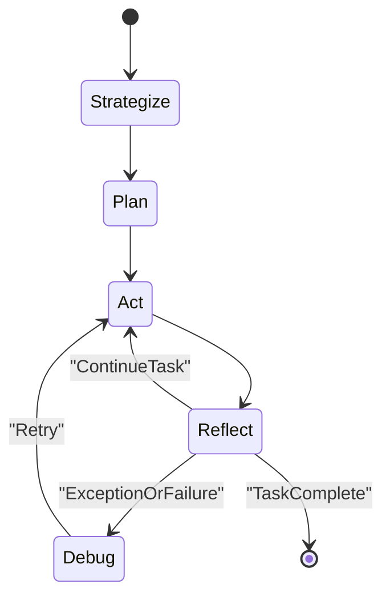
*Figure 2: State transitions across Panda agent modes.*

Sources: [panda/panda_agent/panda_agent.py:1-161]()

---

## The State Class

State management across iterations is handled by the `State` class [panda/panda_agent/panda_agent.py:150-155](). It maintains iteration counters, observation history, and the shared execution namespace where generated variables and pandas DataFrames reside.

```python
class State:
    def __init__(self, iteration=0, observations="", namespace=None):
        self.iteration = iteration
        self.observations = observations
        self.namespace = namespace or {}
```
*Code snippet: The `State` class definition [panda/panda_agent/panda_agent.py:150-155]().*

Sources: [panda/panda_agent/panda_agent.py:150-155](), [panda/panda_agent/my_globals.py:1-17]()

---

## Iteration and Timeout Guards

To prevent infinite loops or runaway processes during autonomous research, the execution loop enforces strict iteration limits and function timeouts. Using utilities like `func_timeout` [panda/panda_agent/panda_agent.py:47](), individual agent steps and code executions are constrained by configured time limits, triggering fallback or debugging paths when thresholds are exceeded.

Sources: [panda/panda_agent/panda_agent.py:47-155]()

---

## Related Child Pages

- [Code Execution & Safety](#2.1.1) — Details on `execute_action`, namespace execution, `parse_code`, dangerous pattern blocklists, and timeouts.
- [Logging, Traces & NORA Output](#2.1.2) — Details on `LoggerTee` stream redirection, trace files, and UI integration.

---

# Page: Code Execution & Safety

# Code Execution & Safety

<details>
<summary>Relevant source files</summary>

The following files were used as context for generating this wiki page:

- [panda/panda_agent/panda_agent.py](panda/panda_agent/panda_agent.py)
- [panda/utils/pyparser.py](panda/utils/pyparser.py)

</details>


This section covers the core mechanics of executing generated code within the Panda autonomous research agent. It details how code blocks are parsed, vetted against safety constraints and blocklists, checked for forbidden interactive user inputs, scoped within execution namespaces, and constrained by time limits.

---

## 1. Code Parsing and Extraction

Generated responses from Large Language Models often contain markdown code blocks or raw script sections. Panda uses an Abstract Syntax Tree (AST)-based parser to extract and segment executable code blocks cleanly before evaluation.

The primary parsing function is `parse_code(x)`, located in `panda/utils/pyparser.py`. It reads a string `x`, parses it into an AST module using `ast.parse(x)`, and traverses top-level statements to isolate discrete blocks based on starting and ending line numbers.

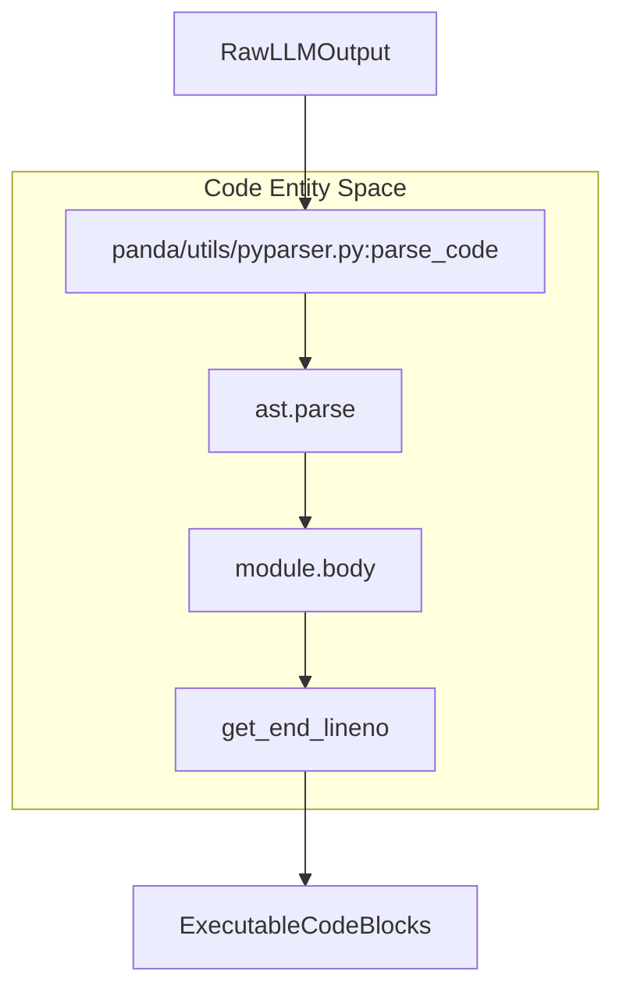
*Diagram: Natural language execution payload parsing flow mapping to code entities.*

**Sources:** `[panda/utils/pyparser.py:16-32]()`

---

## 2. Dangerous Pattern Blocklist

To prevent the agent from executing destructive, recursive, or resource-exhausting filesystem operations (such as infinite zipping or directory duplication loops), Panda evaluates code against a set of regex-based `dangerous_patterns`.

The blocklist explicitly prohibits:
- `shutil.make_archive`: Prevents recursive self-archiving loops common in certain LLM outputs.
- `zipfile.ZipFile`: Prevents manual archive generation that can inflate file system storage.
- `tarfile.open`: Prevents tar/gzip bundle creation.

```python
dangerous_patterns = [
    r"shutil\.make_archive",
    r"zipfile.ZipFile",
    r"tarfile\.open",
]
```

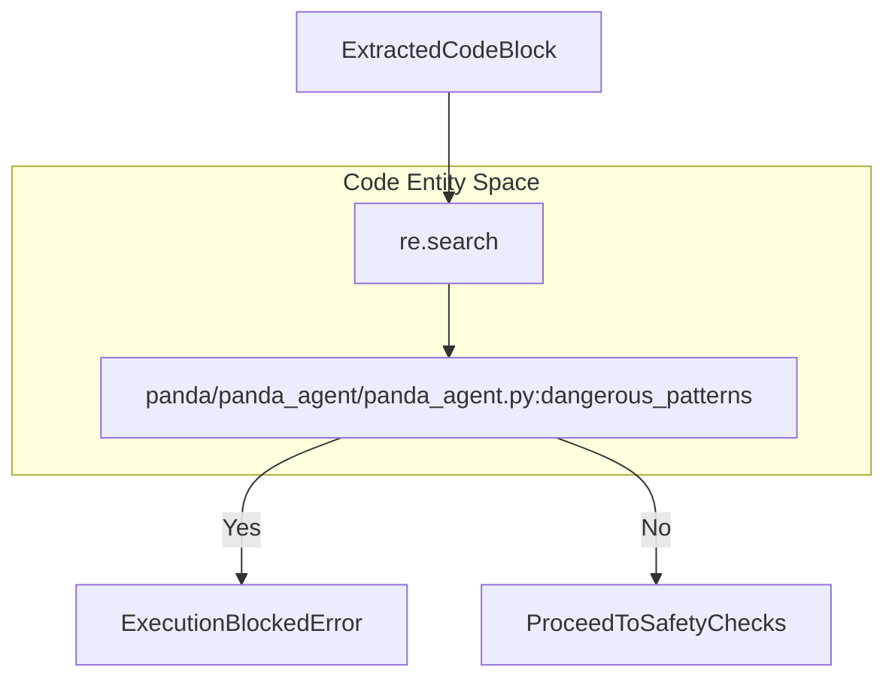
*Diagram: Safety verification flow checking dangerous patterns.*

**Sources:** `[panda/panda_agent/panda_agent.py:98-103]()`

---

## 3. User-Input Detection

Because Panda runs as a fully autonomous agent, any code that attempts to halt execution and wait for user prompts (`input()`, `getpass()`, or `sys.stdin.read()`) will cause the execution thread to hang. Panda detects and intercepts these patterns statically prior to running the code.

The check is implemented via `code_asks_for_user_input(code)` and the `InputDetector` visitor class in `panda/utils/pyparser.py`.

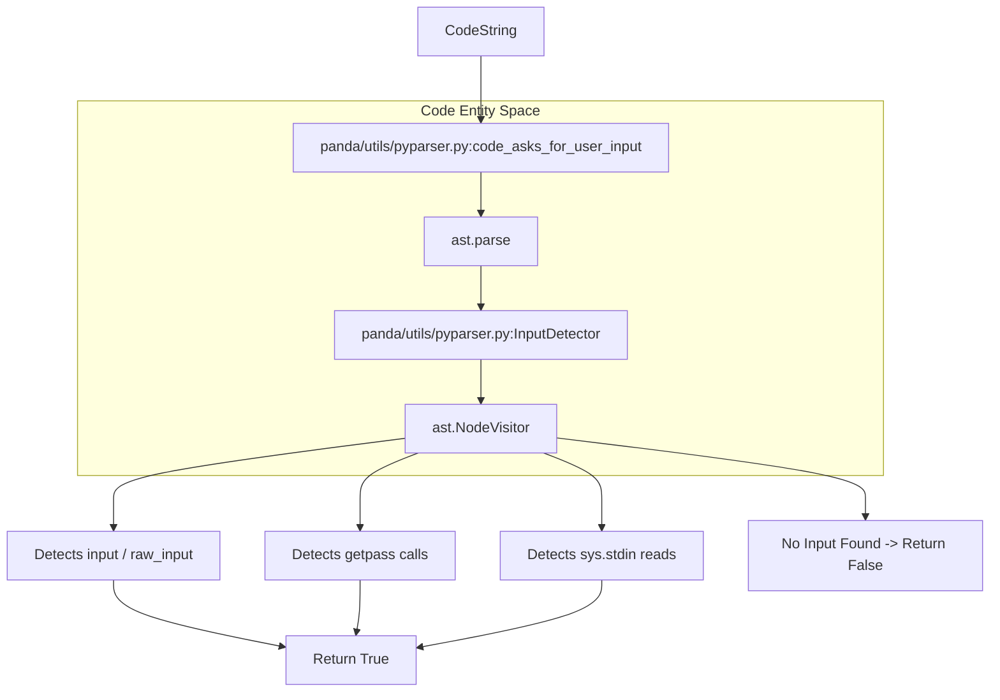
*Diagram: Static analysis data flow for user-input detection.*

`InputDetector` tracks:
- Module aliases (e.g., `import sys as s`, `import getpass`)
- Function names imported from `getpass`
- File handles defined by `open(...)` or `with open(...)` to ensure legitimate file reads are not flagged as `sys.stdin` reads.

**Sources:** `[panda/utils/pyparser.py:40-162]()`

---

## 4. Execution Namespace and State

Code execution takes place within a shared execution `State` object that persists variables and dataframes across iteration steps. The `State` class is defined in `panda/panda_agent/panda_agent.py`.

```python
class State:
    def __init__(self, iteration=0, observations="", namespace=None):
        self.iteration = iteration
        self.observations = observations
        self.namespace = namespace or {}
```

The `namespace` dictionary acts as the globals/locals scope passed directly into Python's built-in `exec()` function during action execution. This allows variables created in step $N$ (such as pandas DataFrames or trained models) to be accessed natively in step $N+1$.

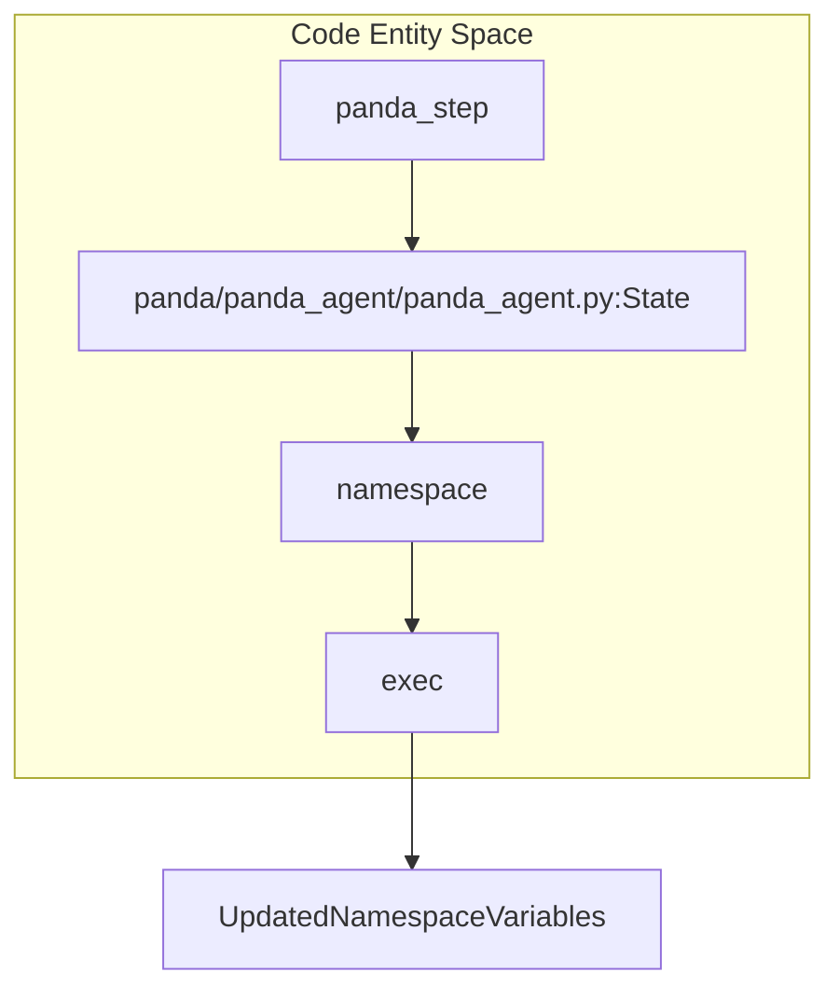
*Diagram: State variable propagation through execution cycles.*

**Sources:** `[panda/panda_agent/panda_agent.py:150-155]()`

---

## 5. Timeouts and Guardrails

To prevent infinite loops or long-hanging external library calls during action execution, Panda wraps code execution in timeout guards using `func_timeout`.

If a generated action block exceeds its allotted execution window, a `FunctionTimedOut` exception is raised, caught by the agent loop, and fed back to the LLM as an observation error so it can self-debug or adjust its approach in subsequent iterations.

**Sources:** `[panda/panda_agent/panda_agent.py:47]()`, `[panda/panda_agent/panda_agent.py:116-122]()`

---

# Page: Logging, Traces & NORA Output

# Logging, Traces & NORA Output

<details>
<summary>Relevant source files</summary>

The following files were used as context for generating this wiki page:

- [panda/panda_agent/panda_agent.py](panda/panda_agent/panda_agent.py)
- [panda/utils/logger.py](panda/utils/logger.py)

</details>


The purpose and scope of section 2.1.2 cover the output, logging, and user interface integration infrastructure of the Panda agent. This includes `LoggerTee` stream redirection for simultaneous console and file logging, the generation of trace files (`experiment-trace.txt` and `experiment-trace-long.txt`), UI integration via `print_to_nora` for the NORA platform, and the core `logger` utility.

---

## 1. Logger & Stream Redirection (`LoggerTee`)

Panda captures execution output and system traces using custom logging wrappers and stream redirection. The core logging utility is initialized in `panda/utils/logger.py`, setting up a dedicated `panda_logger` instance with a default message-only formatter (`logging.Formatter("%(message)s")`) [panda/utils/logger.py:8-26]().

To handle concurrent output streams (writing to both standard output/error and persistent trace files or UI buffers), Panda utilizes custom tee patterns and stream redirection utilities. 

```
+---------------------------------------------------------------------+
|                          Code Execution                             |
|              (print(), sys.stdout, sys.stderr)                      |
+---------------------------------------------------------------------+
                                   |
                                   v
+---------------------------------------------------------------------+
|                           LoggerTee                                 |
|               (Intercepts stdout/stderr streams)                    |
+---------------------------------------------------------------------+
         |                                           |
         v                                           v
+-----------------------+                 +---------------------------+
|    Original Stream    |                 |   Trace Files & UI        |
|  (sys.__stdout__)     |                 |  (print_to_nora, traces)  |
+-----------------------+                 +---------------------------+
```

Sources: [panda/utils/logger.py:1-44](), [panda/panda_agent/panda_agent.py:56-61]()

---

## 2. Trace Files & Output Artifacts

During an agent execution run, Panda records its progress across multiple trace files stored within the timestamped output directory (`output/experiment-<timestamp>/`) [panda/panda_agent/panda_agent.py:28-34]().

### Trace File Types
* **`experiment-trace.txt`**: A short, user-facing trace corresponding to what is printed via `print_to_user` [panda/panda_agent/panda_agent.py:33]().
* **`experiment-trace-long.txt`**: The full raw dialog history exchanged with the LLM [panda/panda_agent/panda_agent.py:34]().

### Data Flow for Traces and Dialogs
```
+-------------------------------------------------------------------------+
|                              run_panda()                                |
+-------------------------------------------------------------------------+
       |                                           |
       v                                           v
+---------------------------+               +-----------------------------+
|    print_to_user()        |               |   Dialog / LLM History      |
+---------------------------+               +-----------------------------+
       |                                           |
       v                                           v
+---------------------------+               +-----------------------------+
|  experiment-trace.txt     |               | experiment-trace-long.txt   |
+---------------------------+               +-----------------------------+
```

Sources: [panda/panda_agent/panda_agent.py:28-37]()

---

## 3. NORA UI Integration (`print_to_nora`)

Panda integrates with external user interfaces—specifically the NORA platform—through designated global variables and printing utilities [panda/panda_agent/panda_agent.py:120-121](). 

### Global UI State Variables
* `nora_thread_id`: Tracks the active thread identifier when executing within the NORA UI context [panda/panda_agent/panda_agent.py:120]().
* `nora_system_output`: Accumulates system output strings intended for presentation in the NORA interface [panda/panda_agent/panda_agent.py:121]().

When text is routed to the user interface, helper functions update these global buffers alongside standard output channels, enabling live streaming updates of research progress.

Sources: [panda/panda_agent/panda_agent.py:120-121]()

---

## 4. Quiet Logging Controls

To prevent verbose library logs (such as those from `litellm`) from corrupting MCP streams or terminal outputs, Panda provides `with_quiet_logging` [panda/utils/logger.py:33-44](). This context manager temporarily elevates the root logging level to `logging.ERROR` during critical LLM calls [panda/utils/logger.py:37-44]().

```
+---------------------------------------------------------------------+
|                     with_quiet_logging(fn, ...)                     |
+---------------------------------------------------------------------+
                                   |
                                   v
+---------------------------------------------------------------------+
|                Temporarily set root level to ERROR                  |
+---------------------------------------------------------------------+
                                   |
                                   v
+---------------------------------------------------------------------+
|                  Execute inner function (e.g., LLM)                 |
+---------------------------------------------------------------------+
                                   |
                                   v
+---------------------------------------------------------------------+
|                 Restore previous root logging level                 |
+---------------------------------------------------------------------+
```

Sources: [panda/utils/logger.py:33-44]()

---

# Page: Prompts and Subprompts

# Prompts and Subprompts

<details>
<summary>Relevant source files</summary>

The following files were used as context for generating this wiki page:

- [panda/panda_agent/advice.txt](panda/panda_agent/advice.txt)
- [panda/panda_agent/panda_agent_prompt.txt](panda/panda_agent/panda_agent_prompt.txt)
- [panda/panda_agent/panda_agent_subprompts.py](panda/panda_agent/panda_agent_subprompts.py)

</details>


## Purpose and Scope
This page details the prompt engineering and prompt management infrastructure of the Panda agent. It covers the master system prompt (`panda_agent_prompt.txt`), the modular subprompts assembled per execution mode (`panda_agent_subprompts.py`), and the domain-specific heuristic injections from `advice.txt`. These components bridge natural language instructions with underlying Python execution loops and tool functions.

Sources: `panda/panda_agent/panda_agent_prompt.txt:1-110`, `panda/panda_agent/panda_agent_subprompts.py:1-138`, `panda/panda_agent/advice.txt:1-14`

---

## 1. Master System Prompt (`panda_agent_prompt.txt`)

The core personality, high-level workflow, and built-in Python tool signatures are defined in `panda/panda_agent/panda_agent_prompt.txt`. This prompt establishes the agent as an autonomous research scientist capable of selecting strategies (`do` vs `plan`), breaking down tasks, generating Python code, and invoking built-in runtime utilities.

### Key Sections of the Master Prompt
1. **Persona & Strategy Selection**: Directs the agent to evaluate the task complexity and choose between a direct 1-step execution (`do`) or a multi-step structured approach (`plan`) [panda/panda_agent/panda_agent_prompt.txt:6-35]().
2. **Plan Generation & Execution**: Establishes JSON contracts for generating step-by-step plans and executing them through alternating ACTION-REFLECTION cycles [panda/panda_agent/panda_agent_prompt.txt:37-65]().
3. **Exposed Runtime Functions**: Documents built-in Python functions available inside the agent's execution namespace, notably `call_llm()` for recursive LLM querying and `write_report()` for artifact compilation [panda/panda_agent/panda_agent_prompt.txt:67-105]().

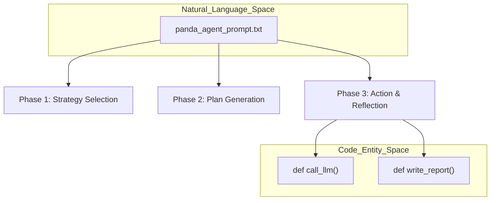
*Figure 1: Mapping natural language prompt instructions in `panda_agent_prompt.txt` to corresponding execution handlers.*

Sources: `panda/panda_agent/panda_agent_prompt.txt:1-110`

---

## 2. Subprompt Assembly per Mode (`panda_agent_subprompts.py`)

During the agent's state machine iterations, specific subprompts are dynamically appended to prompt the LLM for the exact JSON structure or action required by the current mode. These subprompts are stored as constants in `panda/panda_agent/panda_agent_subprompts.py`.

### Subprompt Constants & Mappings
- `STRATEGY_SUBPROMPT`: Instructs the agent to output a JSON payload choosing between `"do"` or `"plan"` [panda/panda_agent/panda_agent_subprompts.py:7-15]().
- `PLAN_SUBPROMPT`: Requests a JSON-structured list of natural language plan steps [panda/panda_agent/panda_agent_subprompts.py:83-88]().
- `REPLAN_SUBPROMPT`: Triggered upon reflection failure; forces the agent to generate a non-repeating revised plan from the current state [panda/panda_agent/panda_agent_subprompts.py:94-106]().
- `ACTION_SUBPROMPT`: Asks for Python code and a reasoning `thought` block encapsulated in JSON [panda/panda_agent/panda_agent_subprompts.py:112-117]().
- `CONTINUE_SUBPROMPT`: Used when a step is only partially completed, instructing the agent to write supplementary code [panda/panda_agent/panda_agent_subprompts.py:123-129]().
- `DEBUG_SUBPROMPT`: Injected when code execution encounters a software/runtime error, prompting the LLM to patch the code [panda/panda_agent/panda_agent_subprompts.py:135-138]().

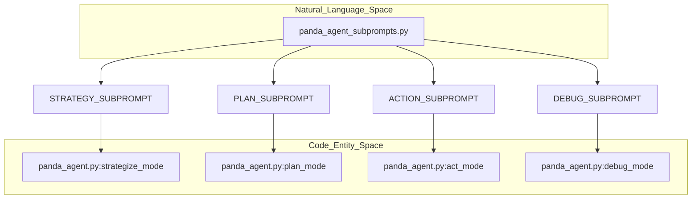
*Figure 2: Subprompt constants mapped to their respective agent execution mode functions.*

Sources: `panda/panda_agent/panda_agent_subprompts.py:1-138`

---

## 3. Heuristic Guidance (`advice.txt`)

The `advice.txt` file provides static domain advice injected into the agent's context to guide research behaviors, such as sample size thresholds for literature reviews [panda/panda_agent/advice.txt:1-13]().

```mermaid
graph TD
    AdviceFile["advice.txt"] --> Content["Ensure at least 10 papers collected"]
    Content --> AgentContext["Injected into System Context"]

    Sources: panda/panda_agent/advice.txt:1-14
```

Sources: `panda/panda_agent/advice.txt:1-14`

---

# Page: Report Writing and Templates

# Report Writing and Templates

<details>
<summary>Relevant source files</summary>

The following files were used as context for generating this wiki page:

- [panda/panda_agent/format_categories.py](panda/panda_agent/format_categories.py)
- [panda/panda_agent/format_dataset.py](panda/panda_agent/format_dataset.py)
- [panda/panda_agent/report_template.html](panda/panda_agent/report_template.html)
- [panda/panda_agent/report_template.txt](panda/panda_agent/report_template.txt)
- [panda/panda_agent/report_writer.py](panda/panda_agent/report_writer.py)
- [panda/utils/config.py](panda/utils/config.py)

</details>


## Purpose and Scope
This page details the report writing and artifact formatting subsystem in Panda, centered around `panda/panda_agent/report_writer.py` [panda/panda_agent/report_writer.py:1-486](), HTML/text templates (`report_template.html` [panda/panda_agent/report_template.html:1-97]() and `report_template.txt` [panda/panda_agent/report_template.txt:1-45]()), and dataset/category formatting helpers (`format_dataset.py` [panda/panda_agent/format_dataset.py:1-53]() and `format_categories.py` [panda/panda_agent/format_categories.py:1-116]()). This subsystem gathers conversation history, prompts the LLM section-by-section to synthesize experimental findings, formats numerical and categorical dataframes, and produces the final polished research report.

---

## 1. Report Generation Architecture and `report_writer.py`

The report writing pipeline is orchestrated by `write_report()` within `panda/panda_agent/report_writer.py` [panda/panda_agent/report_writer.py:104-108](). The agent reviews the conversation history to compile results and examples into structured JSON blocks using `GATHER_RESULTS_PROMPT` and `GATHER_EXAMPLES_PROMPT` [panda/panda_agent/report_writer.py:39-44](). 

It then walks through the mandatory report sections defined in `REPORT_PARTS`:
* `title`: Generates the report title [panda/panda_agent/report_writer.py:64-64]().
* `abstract`: Synthesizes goal, approach, findings, and significance, guarded by `CAUTION` instructions [panda/panda_agent/report_writer.py:65-65]().
* `introduction`: Describes motivation, overview, and main findings [panda/panda_agent/report_writer.py:66-66]().
* `approach`: Details the methodology used [panda/panda_agent/report_writer.py:67-67]().
* `results`: Summarizes experimental outcomes using the generated `RESULTS_JSON_STRUCTURE` [panda/panda_agent/report_writer.py:68-70]().
* `analysis`: Discusses results using `EXAMPLES_JSON_STRUCTURE` for concrete illustrations [panda/panda_agent/report_writer.py:74-75]().
* `conclusion`: Summarizes final takeaways under conservative constraints [panda/panda_agent/report_writer.py:89-89]().

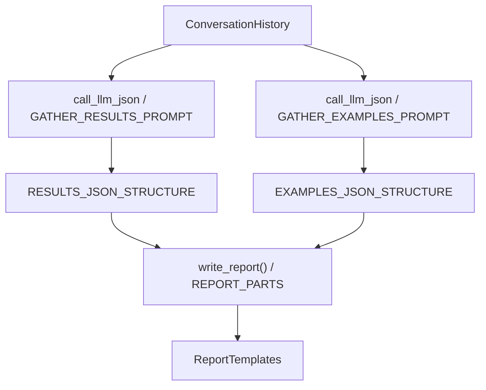
*Sources: [panda/panda_agent/report_writer.py:39-89]()*

---

## 2. Template System and Substitution

Templates are loaded upon initialization in `panda/panda_agent/report_writer.py` using Python's `string.Template` [panda/panda_agent/report_writer.py:8-33](). Two primary templates exist:
1. `report_template.html`: An HTML structure containing CSS styling, header metadata, semantic `<section>` tags for each report part, and slots for dataframes (`${html_all_dataframes}`) and notes (`${notes}`) [panda/panda_agent/report_template.html:1-97]().
2. `report_template.txt`: A plain-text layout providing structured headers and underlined section titles [panda/panda_agent/report_template.txt:1-45]().

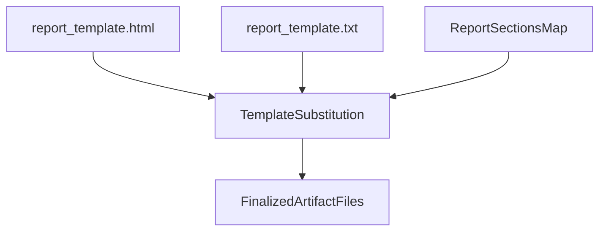
*Sources: [panda/panda_agent/report_writer.py:27-33](), [panda/panda_agent/report_template.html:1-97](), [panda/panda_agent/report_template.txt:1-45]()*

---

## 3. Dataset and Category Formatting Helpers

To embed structured experimental data into reports, Panda utilizes specialized formatting modules:

### Dataset Formatting (`format_dataset.py`)
The `dataset_table_only()` function inspects numeric columns via `get_numeric_columns()` to compute summary statistics (min, max, mean, variance) and renders the first five rows of a DataFrame [panda/panda_agent/format_dataset.py:22-53]().

### Categories Formatting (`format_categories.py`)
The `categories_table()` function wraps `categories_table_only()` and prepends a legend (`categories_table_legend()`) explaining category scores, adjusted Laplace scores, and signals [panda/panda_agent/format_categories.py:9-50](). It handles color-coded indicators for green (above average) and red (below average) categories [panda/panda_agent/format_categories.py:35-36]().

```mermaid
graph TD
    N["DataFrameInput"] --> P["format_dataset.py:dataset_table_only"]
    N --> Q["format_categories.py:categories_table"]
    P --> R["NumericSummariesAndHead"]
    Q --> S["LegendAndSignalSortedTable"]
```
*Sources: [panda/panda_agent/format_dataset.py:22-53](), [panda/panda_agent/format_categories.py:9-50]()*

---

## 4. End-to-End Report Generation Data Flow

The diagram below bridges natural language requirements with code execution entities across the report generation pipeline.

```mermaid
graph TD
    NL["UserResearchGoalAndConversation"] --> RW[panda/panda_agent/report_writer.py]
    subgraph "CodeEntitySpace"
        RW -->|Calls| GRP[GATHER_RESULTS_PROMPT]
        RW -->|Calls| GEP[GATHER_EXAMPLES_PROMPT]
        RW -->|Iterates| RP[REPORT_PARTS]
        RP -->|Substitutes| RT[report_template.html]
        RT -->|Appends| FC[format_categories.py:categories_table]
        RT -->|Appends| FD[format_dataset.py:dataset_table_only]
    end
    RT --> Output["experiment.html"]
```
*Sources: [panda/panda_agent/report_writer.py:39-89](), [panda/panda_agent/report_template.html:1-97](), [panda/panda_agent/format_categories.py:9-50](), [panda/panda_agent/format_dataset.py:22-44]()*

---

# Page: Configuration

# Configuration

<details>
<summary>Relevant source files</summary>

The following files were used as context for generating this wiki page:

- [panda/panda_agent/config.py](panda/panda_agent/config.py)
- [panda/panda_agent/report_writer.py](panda/panda_agent/report_writer.py)
- [panda/utils/config.py](panda/utils/config.py)

</details>


## Purpose and Scope
This page details the configuration parameters, environment variables, model choices, execution timeouts, and text formatting constants defined across `panda_agent/config.py` and `panda/utils/config.py`. These configuration files establish the runtime boundaries for autonomous agent loops, select underlying Large Language Models (LLMs) via LiteLLM and native endpoints, define safety retry limits, and handle environment credential resolution.

---

## 1. Agent Configuration (`panda_agent/config.py`)

The agent configuration module sets default operational parameters specifically tailored for the Panda agent execution loop, defining active LLM identifiers, system prompt file paths, iteration boundaries, and text display banners.

### LLM Choices and Role Aliases
Panda maps specific agent roles to modular LLM constants, defaulting primarily to Anthropic's Claude models [panda/panda_agent/config.py:4-13]():
- `PANDA_LLM`: The core model used by the main agent loop (`"claude-sonnet-4-6"`) [panda/panda_agent/config.py:5]().
- `REPORT_WRITER_LLM`: Configured to inherit `PANDA_LLM` for report generation tasks [panda/panda_agent/config.py:6]().
- `REPORT_TRANSLATOR_LLM`: Designed for HTML-to-text conversion pipelines [panda/panda_agent/config.py:7]().
- `SUPERPANDA_LLM`, `SUPERPANDA_REPORT_WRITER_LLM`, `ITERPANDA_LLM`, and `STEPPANDA_LLM`: Specialized variant entrypoints that default to `PANDA_LLM` [panda/panda_agent/config.py:9-13]().

### File Paths and Metadata
- `MODULE_DIR`: Resolves the absolute directory path containing `config.py` (`panda/panda_agent`) [panda/panda_agent/config.py:16]().
- `SYSTEM_PROMPT_FILE`: Points to the static system prompt definition file `panda_agent_prompt.txt` [panda/panda_agent/config.py:32]().
- `ADVICE_FILE`: Points to `advice.txt` for supplemental agent coaching [panda/panda_agent/config.py:34]().
- `VERSION`: Dynamically extracted from installed package metadata using `importlib.metadata.version('panda')` [panda/panda_agent/config.py:38-39]().

### Execution Limits and Guards
To prevent infinite agent loops and handle long-running experimental routines, `panda_agent/config.py` defines strict threshold constants [panda/panda_agent/config.py:43-50]():
- `MAX_RETRIES = 2`: Maximum retry attempts for standard operations [panda/panda_agent/config.py:44]().
- `MAX_EARLIER_STEP_RETRIES = 2`: Maximum retry depth when re-evaluating earlier execution steps [panda/panda_agent/config.py:45]().
- `MAX_ITERATIONS = 200`: Hard iteration cap on the plan-act-reflect loop to prevent runaway behavior [panda/panda_agent/config.py:46]().
- `EXPERIMENT_TIMEOUT = 40000`: Extended timeout threshold allocated for comprehensive experimental runs [panda/panda_agent/config.py:50]().

### Formatting Banners and Stream Markers
The module exposes static string markers used by logging and output streams to section off execution artifacts [panda/panda_agent/config.py:52-57]():
- `PANDA_HEADER`: Top-level execution wrapper divider [panda/panda_agent/config.py:52]().
- `SYSTEM_PROMPT_HEADER`: Delimits system prompt injection blocks [panda/panda_agent/config.py:53]().
- `GPT_HEADER`: Format string template for model interaction frames [panda/panda_agent/config.py:54]().
- `CODING_START`, `PYTHON_START`, `CODING_END`: Markers denoting execution blocks for dynamically evaluated Python interpreter environments [panda/panda_agent/config.py:55-57]().

Sources: [panda/panda_agent/config.py:1-58]()

---

## 2. Utility and Provider Configuration (`panda/utils/config.py`)

The utility configuration layer manages low-level provider API keys, fallback endpoints, model capability whitelists, and model-specific timeout thresholds.

### Environment Credentials
The module reads required and optional API keys directly from host environment variables, printing warnings to `sys.stderr` if missing keys restrict specific provider choices [panda/utils/config.py:7-25]():
- `OPENAI_API_KEY`: Required for OpenAI model execution [panda/utils/config.py:7]().
- `TOGETHER_API_KEY`: Required for Together AI hosted models (Mistral, Llama) [panda/utils/config.py:9]().
- `ANTHROPIC_API_KEY`: Required for Anthropic Claude integration [panda/utils/config.py:10]().
- `INFERD_TOKEN`: Authentication token for AI2 Inferd internal endpoints [panda/utils/config.py:13]().

### Model Names and Capability Whitelists
- `MODEL_NAMES`: Array of supported architecture keys including `'gpt4'`, `'gpt-4.1'`, `'llama'`, `'mistral'`, `'claude-3.5'`, and reasoning models like `'o1-mini'`, `'o3-mini'` [panda/utils/config.py:15]().
- `JSON_CAPABLE_MODEL_NAMES`: Subset whitelist of models verified for structured JSON generation [panda/utils/config.py:16]().

### API Endpoints and Model Mappings
- `OAI_ENDPOINT`: OpenAI chat completions URL (`https://api.openai.com/v1/chat/completions`) [panda/utils/config.py:28]().
- `OLMO_ENDPOINT`: AI2 Cirrascale endpoint for OLMo evaluation [panda/utils/config.py:32]().
- `TOGETHER_ENDPOINT`: Together AI completions endpoint [panda/utils/config.py:36]().
- Default model pointers: `DEFAULT_GPT4_MODEL` (`'gpt-4.1'`), `DEFAULT_GPT45_MODEL` (`'gpt-4.5-preview-2025-02-27'`), and `DEFAULT_CLAUDE_MODEL` (`'claude-sonnet-4-5-20250929'`) [panda/utils/config.py:49-54]().

### Retry Attempts and Timeouts
Provider request robustness is governed by explicit attempt limits and request timeouts [panda/utils/config.py:56-65]():
- `MAX_GPT_ATTEMPTS = 3`, `MAX_OLMO_ATTEMPTS = 3`, `MAX_LITELLM_ATTEMPTS = 3` [panda/utils/config.py:56-59]()
- `MAX_TOGETHER_ATTEMPTS = 6`: Compensates for higher flakiness on Together-hosted Llama models [panda/utils/config.py:58]()
- `TOGETHER_TIMEOUT = 30`, `OLMO_TIMEOUT = 60`, `GPT_TIMEOUT = 300`, `GPT45_TIMEOUT = 300`, `GPT_REASONING_TIMEOUT = 600` [panda/utils/config.py:61-65]()

Sources: [panda/utils/config.py:1-66]()

---

## 3. Configuration Architecture Diagrams

The following diagrams bridge the natural language design concepts of the Panda configuration layer to their concrete code entities.

```mermaid
graph TD
    subgraph "NaturalLanguageSpace"
        A["Core Agent LLM Selection"] --> B["Run Iteration Safety Guards"]
        C["Environment Credential Checks"] --> D["Provider Request Timeouts"]
    end

    subgraph "CodeEntitySpace"
        E["panda/panda_agent/config.py:PANDA_LLM"] --> F["panda/panda_agent/config.py:MAX_ITERATIONS"]
        G["panda/utils/config.py:OPENAI_API_KEY"] --> H["panda/utils/config.py:GPT_TIMEOUT"]
    end

    A --> E
    B --> F
    C --> G
    D --> H
```
Sources: [panda/panda_agent/config.py:4-46](), [panda/utils/config.py:7-65]()

```mermaid
graph TD
    subgraph "EnvironmentAndConfig"
        Env["HostEnvironment"] -->|os.environ.get| UtilCfg["panda/utils/config.py"]
        AgentCfg["panda/panda_agent/config.py"] -->|Defines Constants| Globals["Agent Runtime & Execution Loop"]
    end

    subgraph "ExecutionExecution"
        UtilCfg -->|Resolves Endpoints & Timeouts| LLMClient["panda/utils/ask_llm.py"]
        AgentCfg -->|Supplies Prompt Paths| PromptLoader["panda_agent/panda_step.py"]
    end
```
Sources: [panda/panda_agent/config.py:15-34](), [panda/utils/config.py:7-36]()

---

# Page: Entrypoints and Integrations

# Entrypoints and Integrations

<details>
<summary>Relevant source files</summary>

The following files were used as context for generating this wiki page:

- [panda/mcp_server.py](panda/mcp_server.py)
- [panda/run_panda.py](panda/run_panda.py)

</details>


Panda provides multiple integration surfaces to trigger and monitor autonomous research tasks. Whether operating in automated pipelines via shell commands, embedding research capabilities into Python applications, or interacting through IDE extensions via the Model Context Protocol (MCP), Panda exposes uniform entrypoints that delegate directly to the core agent loop.

```mermaid
graph TD
    sub5["User Interaction Space"]
    CLI["CLI Command\n\"panda --task\""]:::nl
    MCPClient["MCP Client / Cursor\n\"start_research\""]:::nl

    sub6["Code Entity Space"]
    RunPandaScript["panda/run_panda.py\nmain()"]:::code
    MCPServer["panda/mcp_server.py\nmcp = FastMCP"]:::code
    AgentCore["panda/panda_agent/__init__.py\nrun_panda()"]:::code

    CLI -->|Invokes| RunPandaScript
    MCPClient -->|RPC Call| MCPServer
    RunPandaScript -->|Calls| AgentCore
    MCPServer -->|Thread Target| AgentCore

    classDef nl fill:none,stroke:none;
    classDef code fill:none,stroke:none;
```
Sources: [panda/run_panda.py:21-54](), [panda/mcp_server.py:42-80]()

---

## 3.1. Command-Line Interface

The Command-Line Interface (CLI) serves as the primary mechanism for shell-based execution, batch job dispatching, and containerized deployments. Implemented via Python's `argparse`, the CLI script parses flags representing task instructions, background knowledge files, model selection paths, and output destinations, then delegates execution to the core package.

For full technical specifications regarding argument flags, file inputs, output structures, and result persistence, see [Command-Line Interface](#3.1).

Sources: [panda/run_panda.py:21-54]()

---

## 3.2. MCP Server

The Model Context Protocol (MCP) server integration exposes Panda as a set of remote-callable tools for AI-assisted development environments such as Cursor. Built on top of `FastMCP`, the server manages asynchronous execution threads, tracks job statuses in an in-memory dictionary, and streams log resources back to the client interface.

For details regarding tool definitions, threading models, status polling intervals, and client configuration via `mcp.json`, see [MCP Server](#3.2).

Sources: [panda/mcp_server.py:30-173]()

---

# Page: Command-Line Interface

# Command-Line Interface

<details>
<summary>Relevant source files</summary>

The following files were used as context for generating this wiki page:

- [README.md](README.md)
- [panda/run_panda.py](panda/run_panda.py)

</details>


## Purpose and Scope

The Command-Line Interface (CLI) for Panda provides a mechanism to initiate autonomous research tasks directly from the shell or via packaging tools like `uv` [panda/run_panda.py:1-19](). Implemented in `panda/run_panda.py`, the CLI module acts as a thin wrapper around the core execution engine, parsing argument configurations and delegating directly to `run_panda` [panda/run_panda.py:21-54](). This page documents the available `argparse` flags, file ingestion for tasks and background knowledge, and directory routing for experimental outputs and result summaries.

Sources: [panda/run_panda.py:1-54](), [README.md:1-66]()

---

## Command-Line Arguments and Flags

The CLI entrypoint exposes a set of configuration flags via `argparse.ArgumentParser` [panda/run_panda.py:26-38](). These parameters control model selection, execution directories, and task definition methods.

| Flag | Default | Description |
| :--- | :--- | :--- |
| `--version` | N/A | Prints the current Panda version defined by `VERSION` and exits [panda/run_panda.py:28-28](). |
| `--task` | `None` | Inline string containing the research or analysis question [panda/run_panda.py:29-29](). |
| `--task_file` | `None` | Path to a text file containing the research task [panda/run_panda.py:30-30](). |
| `--background_knowledge` | `None` | Inline string providing context or background for the task [panda/run_panda.py:31-31](). |
| `--background_knowledge_file`| `None` | Path to a text file containing background knowledge [panda/run_panda.py:32-32](). |
| `--force_report` | `False` | Forces Panda to generate a report under all circumstances [panda/run_panda.py:33-33](). |
| `--outputs_dir` | `"output"` | Root directory for storing all experiment artifact folders [panda/run_panda.py:34-34](). |
| `--experiment_subdir` | `None` | Specific subdirectory name for the experiment artifacts [panda/run_panda.py:35-35](). |
| `--result_file` | `None` | Path to a JSON file where the result summary will be written [panda/run_panda.py:36-36](). |
| `--model` | `PANDA_LLM` | Underlying LLM identifier to use, defaulting to `panda_agent.config.PANDA_LLM` [panda/run_panda.py:37-37](). |

Sources: [panda/run_panda.py:21-52](), [README.md:33-66]()

---

## Execution Flow and Argument Routing

When `run_panda.py` is invoked as a script, the `main()` function handles argument parsing and directly passes the resolved options into the core `run_panda()` function [panda/run_panda.py:26-51]().

```mermaid
graph TD
    CLIInput["\"Shell Invocation (panda or python -m panda.run_panda)\""] --> ArgParse["\"argparse.ArgumentParser (panda/run_panda.py:27)\""]
    ArgParse --> MainBlock["\"main() (panda/run_panda.py:26)\""]
    MainBlock --> RunPandaCall["\"run_panda(...) (panda/run_panda.py:41)\""]
    RunPandaCall --> PandaAgent["\"panda_agent module (panda/panda_agent/__init__.py)\""]

    sub-graph NaturalLanguageSpace
        CLIInput
    end

    sub-graph CodeEntitySpace
        ArgParse
        MainBlock
        RunPandaCall
        PandaAgent
    end
```
*Diagram 1: CLI to Agent Control Flow, bridging natural language execution commands to internal python entrypoints.*

Sources: [panda/run_panda.py:21-54]()

---

## Task and Background Data Handling

Panda supports two modes of input supply for tasks and contextual background knowledge:
1. **Inline Strings**: Passed directly via `--task` and `--background_knowledge` flags [panda/run_panda.py:29-31]().
2. **File Paths**: Pointing to flat text files via `--task_file` and `--background_knowledge_file`, allowing large prompts or multi-line specifications to be stored externally [panda/run_panda.py:30-32]().

```mermaid
graph TD
    TaskArg["\"--task\""] --> Ingestion["\"run_panda() parameter loading\""]
    TaskFileArg["\"--task_file\""] --> FileRead["\"File I/O read task content\""]
    FileRead --> Ingestion
    
    BGArg["\"--background_knowledge\""] --> Ingestion
    BGFFileArg["\"--background_knowledge_file\""] --> FileReadBG["\"File I/O read background\""]
    FileReadBG --> Ingestion

    Ingestion --> CoreLoop["\"Panda Execution Loop\""]

    sub-graph CodeEntitySpace
        TaskArg
        TaskFileArg
        TaskFileRead["\"FileRead\""]
        BGArg
        BGFFileArg
        Ingestion
        CoreLoop
    end
```
*Diagram 2: Ingestion pipeline showing how CLI parameters and file references converge into the core execution loop.*

Sources: [panda/run_panda.py:29-32](), [README.md:40-66]()

---

## Outputs and Result File Management

The CLI configuration manages output routing through two primary arguments:
* **`outputs_dir`**: Specifies the base directory (defaulting to `output`) where timestamped experimental run folders (e.g., `experiment-<date>-<time>/`) are created [panda/run_panda.py:34](), [README.md:108]().
* **`result_file`**: When provided via `--result_file`, Panda serializes the final execution summary dictionary (including metrics, status flags, token counts, and report pathstems) into a target JSON file [panda/run_panda.py:36](), [README.md:48](). If omitted, the summary is returned strictly through the API/CLI return value without writing an isolated JSON artifact to disk [README.md:48]().

Sources: [panda/run_panda.py:34-36](), [README.md:46-49]()

---

# Page: MCP Server

# MCP Server

<details>
<summary>Relevant source files</summary>

The following files were used as context for generating this wiki page:

- [mcp.json](mcp.json)
- [panda/mcp_server.py](panda/mcp_server.py)

</details>


## Purpose and Scope
The Model Context Protocol (MCP) server integration (`panda/mcp_server.py`) provides a standardized bridge between external LLM clients (such as Cursor or other MCP-compatible agents) and Panda's autonomous research capabilities. It exposes asynchronous research execution tools, job status polling, blocking wait mechanisms, log streaming resources, and a client configuration template (`mcp.json`).

Sources: [panda/mcp_server.py:1-43](), [mcp.json:1-17]()

---

## FastMCP Tools Architecture

The server is built on top of the `FastMCP` framework (`panda/mcp_server.py`), initializing an MCP server named `"panda"`. It registers several tool decorators and resources to manage research tasks.

### Core Tool Definitions

1. **`start_research(task: str, folder: str = CURSOR_EXPT_FOLDER) -> dict`**: Generates a unique UUID job identifier, marks the job as `running` in the global `_jobs` registry, and spawns a daemon thread running `_worker`. Returns the `job_id` immediately.
2. **`start_auto_research() -> dict`**: Automatically initiates a cursor-oriented research task using the workspace folder defined in the `WORKSPACE_FOLDER` environment variable (falling back to `"."` if unset). Spawns a background thread running `_worker2`.
3. **`get_research_status(job_id: str) -> dict`**: Queries the `_jobs` registry for the current state of a given job. Returns status flags (`running`, `done`, `error`, `not_found`), along with error messages or result summaries if available.
4. **`wait_research(job_id: str, poll_interval_s: int = 2, timeout_s: int = 1800) -> dict`**: A blocking polling loop that checks job progress every `poll_interval_s` until completion, error, or expiration of `timeout_s`.

```mermaid
graph TD
    Client["MCPClient"] -->|"start_research(task, folder)"| StartTool["start_research() panda/mcp_server.py:75-80"]
    Client -->|"get_research_status(job_id)"| StatusTool["get_research_status() panda/mcp_server.py:107-133"]
    Client -->|"wait_research(job_id)"| WaitTool["wait_research() panda/mcp_server.py:137-148"]
    Client -->|"start_auto_research()"| AutoTool["start_auto_research() panda/mcp_server.py:93-103"]
    
    StartTool -->|"UUID & Thread"| JobReg["_jobs Registry panda/mcp_server.py:53"]
    AutoTool -->|"UUID & Thread"| JobReg
    StatusTool -->|"Query"| JobReg
    WaitTool -->|"Poll Loop"| StatusTool
```
Sources: [panda/mcp_server.py:30-149]()

---

## Job Threading and Concurrency Model

Because MCP tool calls must respond promptly while Panda research tasks can run for extended periods, the server decouples invocation from execution using background worker threads and a global job state store.

### Global Job Registry and Workers
State is tracked via an in-memory dictionary `_jobs` mapping job IDs to payloads. Standard output from LiteLLM and Panda internal routines is redirected using `contextlib.redirect_stdout` inside worker threads to prevent polluting the MCP JSON-RPC transport stream.

```python
_jobs = {}  # job_id -> {"status": "...", "result": {...} or None, "error": str|None}
```

* **`_worker(job_id, task, folder)`**: Executes `panda.run_panda(task=task, force_report=True, outputs_dir=folder)` inside a stdout redirection context, updating `_jobs[job_id]` upon completion or exception.
* **`_worker2(job_id, workspace_folder)`**: Executes `panda.run_cursor_panda(workspace_folder=workspace_folder)` similarly.

```mermaid
graph TD
    SubStart["start_research() panda/mcp_server.py:75-80"] -->|"Spawns daemon thread"| Thread["threading.Thread panda/mcp_server.py:79"]
    Thread -->|"Executes _worker()"| Worker["_worker() panda/mcp_server.py:67-74"]
    Worker -->|"Redirects stdout"| IO["contextlib.redirect_stdout panda/mcp_server.py:69"]
    IO -->|"Calls"| RunPanda["panda.run_panda() panda/mcp_server.py:70"]
    RunPanda -->|"Success"| DoneState["_jobs status: done panda/mcp_server.py:71"]
    RunPanda -->|"Exception"| ErrorState["_jobs status: error panda/mcp_server.py:73"]
```
Sources: [panda/mcp_server.py:53-103]()

---

## MCP Logging Resource

The server also exposes an MCP resource for streaming logs directly into the agent interface:

* **`panda://run_panda.log`**: Reads up to the last ~5 KB of `RUN_PATH` (default `run_panda.log`) to provide lightweight tailing of agent activity inside client windows.

```mermaid
graph TD
    ClientResource["MCPClient Resource Request"] -->|"panda://run_panda.log"| ResourceFunc["panda_log() panda/mcp_server.py:155-173"]
    ResourceFunc -->|"Check file existence"| FileCheck["os.path.exists() panda/mcp_server.py:160"]
    FileCheck -->|"Exists"| TailFile["Read last 5KB panda/mcp_server.py:168-169"]
    FileCheck -->|"Missing"| DefaultMsg["Return 'Log file not yet created' panda/mcp_server.py:165"]
    TailFile -->|"Return Resource"| ResourceObj["Resource(mime_type='text/plain') panda/mcp_server.py:170-173"]
```
Sources: [panda/mcp_server.py:155-173]()

---

## Client Configuration (`mcp.json`)

Clients configure the Panda MCP server by declaring command execution paths, arguments, and required environment variables in an `mcp.json` file.

| Parameter | Configuration Value | Description |
| :--- | :--- | :--- |
| **Command** | `C:\...\python.exe` | Absolute path to the python interpreter in the `panda` virtual environment. |
| **Arguments** | `["-X", "dev", "-m", "panda.mcp_server"]` | Runs python in dev mode, executing the MCP server module. |
| **`AGENT_MODE`** | `async` | Sets agent execution mode. |
| **`PYTHONPATH`** | Repository root path | Ensures `panda` package is importable. |
| **API Keys** | `${env:OPENAI_API_KEY}`, etc. | Forwards required LLM provider keys from the host environment. |
| **`WORKSPACE_FOLDER`** | `${workspaceFolder}` | Sets the current workspace context for automated research runs. |

Sources: [mcp.json:1-17]()

---

# Page: Utilities Library

# Utilities Library

<details>
<summary>Relevant source files</summary>

The following files were used as context for generating this wiki page:

- [panda/utils/__init__.py](panda/utils/__init__.py)

</details>


The `panda/utils` package is a foundational library providing core subsystems for LLM communication, file I/O, text extraction, code parsing, logging, configuration, and LLM-powered data mapping [panda/utils/__init__.py:1-18](). These utility functions are consumed across the Panda agent framework to handle low-level tasks, interface with language models via litellm/openai, and process tabular data or code artifacts.

This parent page provides a high-level overview of the utility modules. For specific technical details, please refer to the child pages:
- [LLM Interface Layer](#4.1)
- [Text, Parsing and File Utilities](#4.2)
- [LLM-Powered Data Mapping](#4.3)

```mermaid
graph TD
    A["UtilitiesLibrary"] --> B["LLMInterfaceLayer"]
    A --> C["TextParsingAndFileUtilities"]
    A --> D["LLMPoweredDataMapping"]
    B --> E["panda/utils/ask_llm.py"]
    C --> F["panda/utils/file_utils.py"]
    C --> G["panda/utils/utils.py"]
    C --> H["panda/utils/pyparser.py"]
    D --> I["panda/utils/mapping.py"]
    J["CentralExports"] --> K["panda/utils/__init__.py"]
```
*Sources: [panda/utils/__init__.py:1-18]*

---

## 4.1 LLM Interface Layer

The LLM Interface Layer handles all interactions with language models, abstracting away provider-specific routing, caching, response formatting, token tracking, and payload truncation. It acts as the primary conduit for prompts sent by the Panda agent core.

For deep technical details, implementation specifics, and configuration parameters, see [LLM Interface Layer](#4.1).

*Sources: [panda/utils/__init__.py:13]*

---

## 4.2 Text, Parsing and File Utilities

This subsystem encompasses three distinct utility modules:
1. **`file_utils.py`**: Manages file I/O operations such as reading, checking existence, deletion, downloading, copying, directory clearing, and file appending [panda/utils/__init__.py:2-3]().
2. **`utils.py`**: Provides text cleaning, string extraction (JSON/HTML), similarity checks, and CLI helpers like multiline input [panda/utils/__init__.py:5-7]().
3. **`pyparser.py`**: Analyzes Python source code strings to detect syntax structures or check if code is attempting to block on user input [panda/utils/__init__.py:11]().

For deep technical details, implementation specifics, and configuration parameters, see [Text, Parsing and File Utilities](#4.2).

```mermaid
graph LR
    NLInput["RawTextOrFile"] -->|ProcessedBy| UtilsModule["panda/utils/utils.py"]
    CodeString["PythonSourceCode"] -->|ParsedBy| PyParser["panda/utils/pyparser.py"]
    FileSystem["DiskStorage"] -->|ManagedBy| FileUtils["panda/utils/file_utils.py"]
```
*Sources: [panda/utils/__init__.py:2-11]*

---

## 4.3 LLM-Powered Data Mapping

The data mapping subsystem bridges language models with tabular data structures (such as pandas DataFrames). It exposes high-level functions to apply LLMs iteratively over lists or dataframe columns—supporting both text outputs and structured JSON payloads or multiple-choice questions [panda/utils/__init__.py:9]().

For deep technical details, implementation specifics, and configuration parameters, see [LLM-Powered Data Mapping](#4.3).

*Sources: [panda/utils/__init__.py:9]*

---

# Page: LLM Interface Layer

# LLM Interface Layer

<details>
<summary>Relevant source files</summary>

The following files were used as context for generating this wiki page:

- [panda/utils/ask_llm.py](panda/utils/ask_llm.py)

</details>


## Purpose and Scope
The LLM Interface Layer, implemented in `panda/utils/ask_llm.py`, provides a unified abstraction for querying various Large Language Models (LLMs) within the Panda codebase [panda/utils/ask_llm.py:1-150]. It handles model routing between native OpenAI APIs and LiteLLM-supported models (such as Claude, Llama, and Mistral), token counting, JSON output parsing, multiple-choice resolution, retries, and string normalization [panda/utils/ask_llm.py:15-100].

Sources: [panda/utils/ask_llm.py:1-150]()

---

## Core Functions and Public API

The primary entry points exposed by the LLM interface layer handle text generation, structured JSON parsing, and constrained multiple-choice selections [panda/utils/ask_llm.py:55-150].

### `call_llm`
`call_llm(prompt, response_format={"type":"text"}, model=agent_config.PANDA_LLM, temperature=0, quiet=True)` serves as the foundational wrapper for sending prompts to configured LLMs [panda/utils/ask_llm.py:69]. It accepts text or message lists, applies model-specific routing, normalizes the output text using `unidecode`, and returns a plain string [panda/utils/ask_llm.py:69-100].

### `call_llm_json`
`call_llm_json(prompt, response_format={"type":"json_object"}, temperature=0, max_retries=3, model=agent_config.PANDA_LLM)` queries the LLM expecting a structured JSON payload [panda/utils/ask_llm.py:120]. It wraps `call_llm`, catches parsing exceptions, applies progressive retry strategies with fallback temperature adjustments, and extracts JSON structures using `extract_json_from_string` [panda/utils/ask_llm.py:120-136]. If max retries are exhausted, it raises `MaxRetriesExceeded` [panda/utils/ask_llm.py:136].

### `call_llm_multiple_choice`
`call_llm_multiple_choice(prompt, options, max_retries=3, model=agent_config.PANDA_LLM, quiet=True)` appends allowed answer options to the prompt and queries the model, handling formatting validation and unconstrained fallback parsing for non-GPT models [panda/utils/ask_llm.py:145-150].

```mermaid
graph TD
    A["Natural Language Prompt"] --> B["call_llm()"]
    B --> C{Model Type Check}
    C -->|GPT / OpenAI| D["call_gpt()"]
    C -->|LiteLLM / Claude / Llama| E["call_litellm()"]
    D --> F["unidecode(answer)"]
    E --> F
    F --> G["Return String Result"]
```
*Figure 1: Natural Language Space to Code Entity Space mapping for `call_llm` execution flow.*

Sources: [panda/utils/ask_llm.py:55-150]()

---

## Routing and Model Dispatch

The interface inspects the `model` string parameter to determine whether to route requests to the OpenAI client or to LiteLLM's `completion` function [panda/utils/ask_llm.py:69-96]. 

| Model Identifier / Prefix | Target Dispatch Function / Backend | Code Reference |
| :--- | :--- | :--- |
| `gpt4`, `gpt4.5`, `gpt*`, `o1`, `o3`, `o4` | OpenAI Client (`call_gpt`) | [panda/utils/ask_llm.py:76-82]() |
| `llama`, `meta` | LiteLLM (`call_litellm`) | [panda/utils/ask_llm.py:83-92]() |
| `mistral` | LiteLLM (`call_litellm`) | [panda/utils/ask_llm.py:85-92]() |
| `claude`, `claude-3.5` | LiteLLM (`call_litellm`) | [panda/utils/ask_llm.py:87-92]() |

If an unrecognized model string is passed, `call_llm` logs an error via `logger.error` and returns an error message string [panda/utils/ask_llm.py:93-95].

Sources: [panda/utils/ask_llm.py:69-96]()

---

## Token Tracking and Retry Mechanics

### Token Counts
Global token utilization statistics are tracked across LLM calls using the `token_counts` list, which records dictionary entries containing model names, prompt tokens, completion tokens, and total tokens [panda/utils/ask_llm.py:33-42]. This state can be reset using `reset_token_counts()` or queried via `get_token_counts()` [panda/utils/ask_llm.py:36-42].

### Error Handling & Retries
Both `call_llm_json` and `call_llm_multiple_choice` implement robust retry loops bounded by `max_retries` [panda/utils/ask_llm.py:120-136, 145-150]. 

```mermaid
graph TD
    A["call_llm_json()"] --> B["Attempt 0: call_llm()"]
    B --> C{JSON Valid?}
    C -->|Yes| D["Return Parsed JSON & String"]
    C -->|No| E["Log Warning & Increment Attempt"]
    E --> F{Attempt < max_retries?}
    F -->|Yes| G["Append extra_advice & Temperature = 0.7"]
    G --> B
    F -->|No| H["Raise MaxRetriesExceeded"]
```
*Figure 2: State machine and data flow for `call_llm_json` error recovery and retry execution.*

Sources: [panda/utils/ask_llm.py:33-46, 120-136, 145-150]()

---

# Page: Text, Parsing and File Utilities

# Text, Parsing and File Utilities

<details>
<summary>Relevant source files</summary>

The following files were used as context for generating this wiki page:

- [panda/__init__.py](panda/__init__.py)
- [panda/panda_agent/__init__.py](panda/panda_agent/__init__.py)
- [panda/utils/file_utils.py](panda/utils/file_utils.py)
- [panda/utils/pyparser.py](panda/utils/pyparser.py)
- [panda/utils/utils.py](panda/utils/utils.py)

</details>


## Purpose and Scope
This page details the core utility subsystems located under `panda/utils/`. These components provide foundational support for robustness across the agent framework: parsing unstructured Large Language Model (LLM) responses (handling markdown code fences, embedded JSON, and text formatting), executing AST-driven Python code parsing and safety inspection (`pyparser.py`), and performing reliable file system operations, remote resource downloading, and workspace management (`file_utils.py`).

---

## 1. Text Extraction and Normalization Utilities (`utils.py`)

The module `panda/utils/utils.py` contains utility functions designed to extract structured data (such as JSON, HTML, and code blocks) from raw LLM text outputs, clean markup, normalize line breaks, and sanitize special unicode characters [panda/utils/utils.py:9-200]().

### LLM Output Parsing and Extraction
LLMs frequently wrap JSON responses, HTML documents, or python code blocks in markdown fences. `utils.py` implements multi-strategy extraction helpers:
- `extract_json_from_string(text: str)`: [panda/utils/utils.py:9-51]() tries multiple extraction passes: scanning for explicit ```json ... ``` code fences [panda/utils/utils.py:22-32](), attempting direct `json.loads()` on the raw string [panda/utils/utils.py:34-38](), and applying a heuristic search for the outermost `{...}` or `[...]` boundaries [panda/utils/utils.py:40-49]().
- `extract_html_from_string(text)` [panda/utils/utils.py:55-63]() and `extract_txt_from_string(text)` [panda/utils/utils.py:66-77]() isolate ```html``` and ```text```/```txt``` blocks respectively.
- `extract_first_code_block(text)` [panda/utils/utils.py:82-96]() and `extract_code_blocks(text)` [panda/utils/utils.py:100-116]() use regular expressions (`r"```(?:\w*\n)?(.*?)```"`) to retrieve single or multiple code blocks.

```mermaid
graph TD
    A["RawLLMOutputText"] --> B["extract_json_from_string"]
    B --> C["CodeFenceMatch"]
    B --> D["DirectJSONParse"]
    B --> E["BracketHeuristicSearch"]
    C --> F["ParsedJSONObject"]
    D --> F
    E --> F
    
    style A fill:none,stroke:#000,stroke-width:1px
    style F fill:none,stroke:#000,stroke-width:1px
```
*Diagram 1: Text extraction pipeline mapping unstructured LLM text to parsed JSON data structures via `extract_json_from_string`.*

Sources: [panda/utils/utils.py:9-116]()

### Markup Stripping and Character Normalization
To clean text containing HTML elements or typographical anomalies:
- `remove_html_markup(html)`: Subclasses `html.parser.HTMLParser` via `HTMLStripper` [panda/utils/utils.py:120-133]() to extract visible text data and passes it through `normalize_newlines()` [panda/utils/utils.py:134-138]().
- `normalize_newlines(text)`: Collapses multiple consecutive blank lines down to a double newline using `re.sub(r'(\n\s*\n)+', '\n\n', text.strip())` [panda/utils/utils.py:142-144]().
- `replace_special_chars_with_ascii(text)`: Translates smart quotes, em dashes, and en dashes defined in `CUSTOM_REPLACEMENTS` [panda/utils/utils.py:175-184]() and normalizes remaining unicode characters using `unicodedata.normalize('NFKD', char)` [panda/utils/utils.py:186-200]().

Sources: [panda/utils/utils.py:120-200]()

---

## 2. Code Parsing and Safety Analysis (`pyparser.py`)

The module `panda/utils/pyparser.py` provides AST-based utilities to slice Python source code into logical execution blocks and inspect code for dangerous or interactive patterns (such as user-input requests) prior to execution in the agent loop [panda/utils/pyparser.py:8-162]().

### AST-Based Code Chunking (`parse_code`)
- `get_end_lineno(node)`: [panda/utils/pyparser.py:8-14]() recursively traverses child AST nodes to locate the maximum line number spanned by a compound statement.
- `parse_code(x)`: [panda/utils/pyparser.py:16-32]() parses raw python strings into an Abstract Syntax Tree using `ast.parse(x)` [panda/utils/pyparser.py:19](), iterating over top-level module bodies to extract discrete code blocks bounded by statement line numbers [panda/utils/pyparser.py:22-30]().

Sources: [panda/utils/pyparser.py:8-32]()

### Autonomous Safety Guards (`InputDetector`)
Because Panda operates as an autonomous background agent, executing code that blocks for user input causes deadlocks. `code_asks_for_user_input(code)` instantiates an `InputDetector` `ast.NodeVisitor` to detect input prompts [panda/utils/pyparser.py:40-162]().

- `InputDetector` tracks import aliases for `sys` and `getpass`, as well as file handle assignments (`open(...)`) [panda/utils/pyparser.py:49-106]().
- `visit_Call(node)` flags built-in calls to `input()`, `raw_input()`, `getpass()` functions, and `sys.stdin.read()` / `sys.stdin.readline()` calls while safely ignoring legitimate file handle reads [panda/utils/pyparser.py:139-162]().

```mermaid
graph TD
    A["RawPythonSourceCode"] --> B["code_asks_for_user_input"]
    B --> C["ast.parse"]
    C --> D["InputDetector"]
    D --> E["visit_Call"]
    E --> F{"Is input/getpass/sys.stdin?"}
    F -->|Yes| G["FlagFoundTrue"]
    F -->|No| H["FlagFoundFalse"]
    
    style A fill:none,stroke:#000,stroke-width:1px
    style G fill:none,stroke:#000,stroke-width:1px
    style H fill:none,stroke:#000,stroke-width:1px
```
*Diagram 2: AST safety check mapping raw Python source code through `code_asks_for_user_input` and `InputDetector` to block interactive execution.*

Sources: [panda/utils/pyparser.py:40-162]()

---

## 3. File System and I/O Operations (`file_utils.py`)

The module `panda/utils/file_utils.py` handles local and remote file input/output, directory cleanup, and safe file copying [panda/utils/file_utils.py:1-127]().

### File Reading, Writing, and Copying
- `read_file_contents(filename)`: Opens text files using UTF-8 encoding (`encoding="utf-8"`) and returns their string contents, logging an error via `logger.error` if a `FileNotFoundError` occurs [panda/utils/file_utils.py:15-31]().
- `file_exists(path)` and `delete_file(filepath)`: Wrap standard OS path checks and deletion operations [panda/utils/file_utils.py:44-50]().
- `copy_file(source_path, destination_path)`: Uses `shutil.copy2` to duplicate files while preserving metadata, with exception handling for permissions and missing files [panda/utils/file_utils.py:104-121]().
- `add_to_end_of_file(string, file)`: Appends text data to a target file with UTF-8 encoding [panda/utils/file_utils.py:124-127]().

Sources: [panda/utils/file_utils.py:15-50, 104-127]()

### Remote Downloads and Directory Management
- `download_file(url, filepath)`: Issues an HTTP GET request via `requests.get(url)`, checks response status codes with `response.raise_for_status()`, and writes binary content to `filepath` [panda/utils/file_utils.py:55-76]().
- `clear_directory(directory_path)`: Iterates over a target directory and removes all constituent files using `os.remove()`, logging actions or handling missing directories gracefully [panda/utils/file_utils.py:82-99]().

Sources: [panda/utils/file_utils.py:55-99]()

---

# Page: LLM-Powered Data Mapping

# LLM-Powered Data Mapping

<details>
<summary>Relevant source files</summary>

The following files were used as context for generating this wiki page:

- [panda/utils/mapping.py](panda/utils/mapping.py)

</details>


Purpose and scope: This section details `panda/utils/mapping.py`, which provides utilities for leveraging Large Language Models (LLMs) to generate structured lists, handle batching for large result sets, and map transformations over pandas DataFrames [panda/utils/mapping.py:1-133]().

---

## 1. Core Functions Overview

The mapping module acts as a bridge between high-level natural language queries and structured data containers (lists and pandas DataFrames). The primary entrypoints exposed by `panda/utils/mapping.py` include:

* `llm_list(prompt, temperature, quiet, n, model)`: Queries an LLM to retrieve a flat list of string items [panda/utils/mapping.py:13-38]().
* `llm_list_json(prompt, json_template, temperature, quiet, n, model)`: Queries an LLM to retrieve a structured list of JSON objects, automatically handling chunked batching for large requests [panda/utils/mapping.py:43-118]().
* `map_dataframe(...)`: Applies prompt templates over every row of a pandas DataFrame, storing results in a designated output column [panda/utils/mapping.py:123-133]().

Sources: `panda/utils/mapping.py`

---

## 2. List Generation and Batching Mechanics (`llm_list` & `llm_list_json`)

When generating lists via `llm_list`, the function delegates to `llm_list_json` using a predefined element schema (`{"number": INTEGER, "item": ITEM}`) [panda/utils/mapping.py:29-38](). 

`llm_list_json` implements a robust batching strategy controlled by `LIST_BATCH_SIZE = 10` [panda/utils/mapping.py:10,63-118](). If the requested number of items `n` exceeds this batch size, the system breaks the generation down into manageable iterative prompts, appending responses and catching potential JSON parsing or key errors gracefully to return partial results if necessary [panda/utils/mapping.py:70-118]().

### Natural Language to Code Mapping: List Generation Flow

```mermaid
graph TD
    A["UserPrompt"] --> B["llm_list_json"]
    B --> C{"Is n > LIST_BATCH_SIZE?"}
    C -- "Yes" --> D["BatchGeneration10Items"]
    C -- "No" --> E["SingleCallJSONQuery"]
    D --> F["call_llm_json"]
    E --> F
    F --> G["ParseResponseAnswerKey"]
    G --> H["ReturnStructuredItemList"]

    classDef default stroke:#000,fill:#fff;
```
Sources: `panda/utils/mapping.py`

---

## 3. Dataframe Mapping Architecture

The `map_dataframe` utility (extending through the module) is designed to operate destructively or non-destructively over tabular datasets (`pandas.DataFrame`), executing localized prompts per row and populating target columns [panda/utils/mapping.py:123-133]().

### Natural Language to Code Mapping: DataFrame Transformation Space

```mermaid
graph LR
    subgraph "NaturalLanguageSpace"
        NL1["RowPromptTemplate"]
        NL2["TargetColumnName"]
    end

    subgraph "CodeEntitySpace"
        DF["pandas.DataFrame"]
        MD["map_dataframe"]
        LLM["call_llm_json"]
    end

    NL1 --> MD
    NL2 --> MD
    DF --> MD
    MD --> LLM
    LLM -->|UpdatedDataFrame| DF

    classDef default stroke:#000,fill:#fff;
```
Sources: `panda/utils/mapping.py`

---

## Summary of Configuration Constants

| Constant / Parameter | Default Value | Description |
|----------------------|---------------|-------------|
| `LIST_BATCH_SIZE` | `10` | Maximum number of items requested per LLM batch call in `llm_list_json` [panda/utils/mapping.py:10]() |
| `temperature` | `0` | Default generation temperature for deterministic output [panda/utils/mapping.py:29,63]() |
| `model` | `agent_config.PANDA_LLM` | The underlying LLM model identifier used across mapping utilities [panda/utils/mapping.py:29,63]() |

Sources: `panda/utils/mapping.py`

---

# Page: Experiment Outputs

# Experiment Outputs

<details>
<summary>Relevant source files</summary>

The following files were used as context for generating this wiki page:

- [README.md](README.md)
- [output_demo/experiment-20260210-143138/experiment.txt](output_demo/experiment-20260210-143138/experiment.txt)

</details>


## Purpose and Scope

This page provides a high-level overview of the artifact layout and execution traces produced by autonomous research runs in `panda`. When an execution completes, Panda organizes all generated reports, Python source code, intermediate state data, and debugging traces into a structured, timestamped experiment directory. 

For deep technical details regarding specific file semantics and walkthroughs of bundled demo traces, refer to the child pages:
- [Artifact Types and Directory Layout](#5.1)
- [Reading Traces: output_demo Walkthrough](#5.2)

Sources: [README.md:96-108]()

---

## Experiment Output Architecture

When `run_panda()` is invoked, it sets up an output directory path based on the configured `outputs_dir` [README.md:108]() and the current system timestamp. Inside this directory, the agent writes various artifacts reflecting its reasoning process, executed code, and final research report.

```mermaid
graph TD
    A["run_panda() invocation"] --> B["Outputs Directory Creation"]
    B --> C["Experiment Report Generation"]
    B --> D["Code and Artifact Storage"]
    B --> E["Execution Tracing"]
    
    C --> F["experiment.txt"]
    C --> G["experiment.html"]
    
    D --> H["experiment.py"]
    D --> I["experiment-artifacts.py"]
    D --> J["experiment-done.txt"]
    
    E --> K["-trace.txt"]
    E --> L["-trace-long.txt"]
```
*Sources: [README.md:96-108]()*

---

## Bridging Natural Language Space to Code Entity Space

To connect user-facing research concepts with the underlying codebase entities that generate them, the diagram below maps natural language output categories to their corresponding Python modules and file generation routines.

```mermaid
graph TD
    NL_Report[""Research Report (HTML/Text)""] --> Code_Report[""panda_agent/report_writer.py""]
    NL_Trace[""Execution Trace Logs""] --> Code_Trace[""panda/utils/logger.py""]
    NL_Artifacts[""Generated Artifacts & Code""] --> Code_Artifacts[""panda_agent/panda_agent.py""]
    NL_Done[""Completion Status Flag""] --> Code_Done[""panda/run_panda.py""]
```
*Sources: [README.md:96-108]()*

---

## Overview of Child Pages

### 5.1 Artifact Types and Directory Layout
For details on individual file semantics, see [Artifact Types and Directory Layout](#5.1). This child page outlines the precise contents and generation conditions for:
- `experiment.txt` and `experiment.html`: The final synthesized research documents.
- `experiment.py`: The self-contained Python script executed by the agent during the run.
- `experiment-artifacts.py`: Serialized intermediate outputs, dataframes, or figures.
- `experiment-done.txt`: A sentinel flag indicating successful completion of the agent loop.

Sources: [README.md:96-108]()

### 5.2 Reading Traces: output_demo Walkthrough
For a step-by-step trace walkthrough, see [Reading Traces: output_demo Walkthrough](#5.2). This page inspects the bundled `output_demo/` directory to demonstrate how the agent transitions between modes (`strategize`, `plan`, `act`, `reflect`, `debug`) across execution iterations.

Sources: [README.md:7-8](), [output_demo/experiment-20260210-143138/experiment.txt:1-90]()

---

# Page: Artifact Types and Directory Layout

# Artifact Types and Directory Layout

<details>
<summary>Relevant source files</summary>

The following files were used as context for generating this wiki page:

- [.gitignore](.gitignore)
- [output_demo/experiment-20260210-143138/experiment-artifacts.py](output_demo/experiment-20260210-143138/experiment-artifacts.py)
- [output_demo/experiment-20260210-143138/experiment-done.txt](output_demo/experiment-20260210-143138/experiment-done.txt)
- [output_demo/experiment-20260210-143138/experiment.html](output_demo/experiment-20260210-143138/experiment.html)
- [output_demo/experiment-20260210-143138/experiment.py](output_demo/experiment-20260210-143138/experiment.py)

</details>


## Purpose and Scope

When Panda executes a research task, it creates a dedicated output directory timestamped per run (e.g., `output_demo/experiment-YYYYMMDD-HHMMSS/`) to store all generated code, intermediate states, serialized data, and final reports. This page details the semantics, generation mechanisms, and layout of these core artifacts: `experiment.py`, `experiment.html` (and accompanying text formats), `experiment-artifacts.py`, and the sentinel file `experiment-done.txt`.

Sources: `output_demo/experiment-20260210-143138/experiment-done.txt:1-2`

---

## Output Directory Layout

Each experimental run produces a standardized set of files inside its output directory. The table below outlines each artifact type, its naming convention, and its primary role within the Panda execution lifecycle.

| Artifact Name | Format | Primary Role / Description |
| :--- | :--- | :--- |
| `experiment.py` | Python Source | Consolidated, executable Python script accumulating code blocks successfully executed by the agent. |
| `experiment.html` | HTML Document | Academic-style generated report containing abstract, introduction, approach, and results. |
| `experiment-artifacts.py` | Python Source | Serialized data variables (e.g., `dataset`, `results`) extracted from the agent's Python namespace for inspection or downstream tasks. |
| `experiment-done.txt` | Text Sentinel | Completion flag containing the string `done` to indicate the experiment loop has successfully terminated. |

Sources: `output_demo/experiment-20260210-143138/experiment-done.txt:1-2`, `output_demo/experiment-20260210-143138/experiment.py:1-157`, `output_demo/experiment-20260210-143138/experiment.html:1-117`, `output_demo/experiment-20260210-143138/experiment-artifacts.py:1-11`

---

## Detailed Artifact Semantics

### 1. `experiment.py`
The `experiment.py` file represents the core computational trace of the agent. As Panda steps through its planning and execution loops, valid code blocks generated during the `act` or `debug` modes are appended sequentially into this script, separated by comment markers (`# ----------`). 
* In the demo run, it contains dataset initialization [output_demo/experiment-20260210-143138/experiment.py:3-24](), model querying loops utilizing `call_llm` [output_demo/experiment-20260210-143138/experiment.py:28-54](), metric evaluation via regular expressions [output_demo/experiment-20260210-143138/experiment.py:58-103](), and final formatted output summaries [output_demo/experiment-20260210-143138/experiment.py:107-146]().
* The script concludes by invoking report generation functions such as `write_report()` [output_demo/experiment-20260210-143138/experiment.py:150-155]().

Sources: `output_demo/experiment-20260210-143138/experiment.py:1-157`

### 2. `experiment.html`
The `experiment.html` file provides a publication-quality research report rendered from the agent's findings. It includes standard document metadata (title, author attribution to PANDA at Allen Institute for AI) [output_demo/experiment-20260210-143138/experiment.html:48-54](), an abstract section [output_demo/experiment-20260210-143138/experiment.html:56-63](), structured introduction and approach sections detailing parameters like random seeds and prompting strategies [output_demo/experiment-20260210-143138/experiment.html:66-106](), and structured result tables [output_demo/experiment-20260210-143138/experiment.html:108-117]().

Sources: `output_demo/experiment-20260210-143138/experiment.html:1-117`

### 3. `experiment-artifacts.py`
To prevent valuable empirical data from remaining trapped inside transient Python execution namespaces, Panda serializes primary variables (such as evaluation datasets and model prediction logs) into `experiment-artifacts.py`. 
* In the demo dataset, this file dumps lists containing problem dictionaries (`problem_id`, `num1`, `num2`, `problem`, `correct_answer`) [output_demo/experiment-20260210-143138/experiment-artifacts.py:2-2]() as well as execution results (`claude_response`, `claude_answer`, `is_correct`) [output_demo/experiment-20260210-143138/experiment-artifacts.py:7-7]().

Sources: `output_demo/experiment-20260210-143138/experiment-artifacts.py:1-11`

### 4. `experiment-done.txt`
Serving as a simple synchronization and monitoring sentinel, `experiment-done.txt` is written only when the agent finishes execution successfully. Its payload consists strictly of the string `done` followed by a newline. External harnesses and UI wrappers check for the existence of this file to determine if a background research thread has completed.

Sources: `output_demo/experiment-20260210-143138/experiment-done.txt:1-2`

---

## Artifact Lifecycle and Generation Flow

This diagram illustrates how raw agent actions and variable scopes map to the final disk artifacts.

```mermaid
graph TD
  A["panda_step()"] -->| "Appends valid code blocks" | B["experiment.py"]
  B -->| "Executes script in namespace" | C["Runtime Variables: dataset & results"]
  C -->| "Serializes variables" | D["experiment-artifacts.py"]
  B -->| "Invokes write_report()" | E["experiment.html"]
  F["Agent Loop Termination"] -->| "Writes sentinel" | G["experiment-done.txt"]

  subgraph "Code Entity Space"
    B
    C
    E
  end

  subgraph "Natural Language Space"
    E
  end
```

Sources: `output_demo/experiment-20260210-143138/experiment.py:1-157`, `output_demo/experiment-20260210-143138/experiment-artifacts.py:1-11`, `output_demo/experiment-20260210-143138/experiment.html:1-117`

---

## Natural Language to Code Entity Mapping

The following diagram bridges natural language report sections to the underlying code entities and generated artifact files responsible for their creation.

```mermaid
graph LR
  NL1["Abstract & Introduction Text"] -->| "Synthesized by agent LLM" | E1["experiment.html"]
  NL2["Approach & Methodology"] -->| "Captured from script blocks" | E2["experiment.py"]
  NL3["Evaluation Datasets"] -->| "Dumped via variable serialization" | E3["experiment-artifacts.py"]
  NL4["Completion Status"] -->| "Signaled by thread exit" | E4["experiment-done.txt"]

  subgraph "Natural Language Space"
    NL1
    NL2
    NL3
    NL4
  end

  subgraph "Code Entity Space"
    E1
    E2
    E3
    E4
  end
```

Sources: `output_demo/experiment-20260210-143138/experiment.html:48-106`, `output_demo/experiment-20260210-143138/experiment.py:3-103`, `output_demo/experiment-20260210-143138/experiment-artifacts.py:2-7`, `output_demo/experiment-20260210-143138/experiment-done.txt:1-2`

---

# Page: Reading Traces: output_demo Walkthrough

# Reading Traces: output_demo Walkthrough

<details>
<summary>Relevant source files</summary>

The following files were used as context for generating this wiki page:

- [output_demo/experiment-20260210-143138/experiment-trace-long.txt](output_demo/experiment-20260210-143138/experiment-trace-long.txt)
- [output_demo/experiment-20260210-143138/experiment-trace.txt](output_demo/experiment-20260210-143138/experiment-trace.txt)
- [output_demo/experiment-20260210-143138/experiment.txt](output_demo/experiment-20260210-143138/experiment.txt)

</details>


## Purpose and Scope

This page provides a technical walkthrough of the bundled demo run located in `output_demo/experiment-20260210-143138/`. By analyzing the trace logs (`experiment-trace-long.txt`, `experiment-trace.txt`) and final output (`experiment.txt`), this page illustrates the end-to-end execution of the Panda autonomous agent—from prompt initialization and strategy selection to Python code generation, interactive execution, evaluation, and report synthesis.

Sources: [output_demo/experiment-20260210-143138/experiment-trace-long.txt:1-139](), [output_demo/experiment-20260210-143138/experiment-trace.txt:1-228](), [output_demo/experiment-20260210-143138/experiment.txt:1-90]()

---

## 1. System Prompt and Strategy Initialization

The agent session initiates by loading a detailed system prompt that defines the autonomous research scientist persona, the execution phases, and available runtime utilities [output_demo/experiment-20260210-143138/experiment-trace-long.txt:1-118]. 

The top-level research task provided in the demo is:
> "How good is Claude at 2-digit addition? Use a dataset of 5 examples." [output_demo/experiment-20260210-143138/experiment-trace-long.txt:116-118]

During **Phase 1 (Pick a Strategy)**, the agent reflects on the task complexity and chooses between a `'do'` strategy (for single-step tasks) or a `'plan'` strategy (for multi-step structured research) [output_demo/experiment-20260210-143138/experiment-trace-long.txt:19-28]. For this task, the agent selects the `'plan'` strategy because evaluating model performance requires dataset generation, querying, and evaluation [output_demo/experiment-20260210-143138/experiment-trace.txt:1-10].

### Diagram: Strategy Initialization and Planning Flow

```mermaid
graph TD
    A["SystemPromptInit"] -->|DefineRole| B["TaskInput"]
    B -->|Task:2DigitAddition| C["Phase1Strategize"]
    C -->|EvaluateComplexity| D["StrategyDecision"]
    D -->|SelectedPlan| E["Phase2GeneratePlan"]
    E -->|Output5StepPlan| F["ExecutionLoop"]

    classDef default stroke:#000,fill:none;
```
Sources: [output_demo/experiment-20260210-143138/experiment-trace-long.txt:1-118](), [output_demo/experiment-20260210-143138/experiment-trace.txt:1-10]()

---

## 2. Plan Generation and Execution Workflow

Once the `'plan'` strategy is chosen, the agent generates a structured 5-step research plan [output_demo/experiment-20260210-143138/experiment-trace.txt:4-9]:

1. Generate a dataset of 5 two-digit addition problems with their correct answers [output_demo/experiment-20260210-143138/experiment-trace.txt:5]
2. Query Claude with each addition problem and collect its responses [output_demo/experiment-20260210-143138/experiment-trace.txt:6]
3. Evaluate Claude's responses by comparing them to the correct answers and calculate accuracy [output_demo/experiment-20260210-143138/experiment-trace.txt:7]
4. Display the results showing each problem, Claude's answer, correct answer, and overall accuracy statistics [output_demo/experiment-20260210-143138/experiment-trace.txt:8]
5. Write a report summarizing the findings [output_demo/experiment-20260210-143138/experiment-trace.txt:9]

Sources: [output_demo/experiment-20260210-143138/experiment-trace.txt:4-9]()

---

## 3. Code Execution and Environment Interaction

The execution phase alternates between generating Python code blocks (`Coding...`) and reflecting on the outputs (`Reflecting...`). 

### Step 1: Dataset Generation
The agent uses Python's `random` module with a fixed seed (`seed=42`) to generate two-digit operands ranging from 10 to 99, computing the ground-truth integer sums [output_demo/experiment-20260210-143138/experiment-trace.txt:17-33].

```python
import random
random.seed(42)
dataset = []
for i in range(5):
    num1 = random.randint(10, 99)
    num2 = random.randint(10, 99)
    correct_answer = num1 + num2
    dataset.append({
        'problem_id': i + 1,
        'num1': num1,
        'num2': num2,
        'problem': f"{num1} + {num2}",
        'correct_answer': correct_answer
    })
```
*Cited from: [output_demo/experiment-20260210-143138/experiment-trace.txt:17-33]()*

### Step 2: Querying the LLM via `call_llm`
In Step 2, the agent loops through the dataset and invokes the built-in `call_llm()` utility to query the specified model (`claude-sonnet-4-5-20250929`) at `temperature=0` [output_demo/experiment-20260210-143138/experiment-trace.txt:80-83].

```python
response = call_llm(prompt, model='claude-sonnet-4-5-20250929', temperature=0)
```
*Cited from: [output_demo/experiment-20260210-143138/experiment-trace.txt:83]()*

### Step 3: Response Evaluation via Regular Expressions
The agent parses Claude's text output using regular expressions (`re.findall(r'-?\d+', claude_response)`) to extract the numerical answer, comparing it against the stored `correct_answer` [output_demo/experiment-20260210-143138/experiment-trace.txt:149-159].

### Diagram: Natural Language Plan Steps to Python Entities

```mermaid
graph TD
    A["Step1DatasetGeneration"] -->|ExecutesCode| B["PythonModule_random"]
    B -->|Populates| C["MemoryVariable_dataset"]
    C -->|PassedTo| D["Step2QueryModel"]
    D -->|CallsFunction| E["Builtin_call_llm"]
    E -->|Model_claude-sonnet-4-5-20250929| F["MemoryVariable_results"]
    F -->|PassedTo| G["Step3EvaluateResponses"]
    G -->|ExecutesRegex| H["PythonModule_re"]
    H -->|CalculatesAccuracy| I["MetricsSummary"]

    classDef default stroke:#000,fill:none;
```
Sources: [output_demo/experiment-20260210-143138/experiment-trace.txt:17-160]()

---

## 4. Final Report Synthesis

After completing all execution steps, the agent invokes `write_report()` to compile conversational history and execution metrics into structured research reports (`experiment.txt` and `experiment.html`) [output_demo/experiment-20260210-143138/experiment-trace-long.txt:90-99].

The generated report contains:
- **Abstract**: High-level summary of the methodology, model evaluated, and 100% accuracy result [output_demo/experiment-20260210-143138/experiment.txt:13-17].
- **Introduction**: Contextualization of arithmetic evaluations in LLMs [output_demo/experiment-20260210-143138/experiment.txt:20-28].
- **Approach**: Details on dataset generation, prompt structuring, and evaluation parsing [output_demo/experiment-20260210-143138/experiment.txt:30-58].
- **Results**: Overall performance tables (Table 1) and granular problem-by-problem breakdowns (Table 2) [output_demo/experiment-20260210-143138/experiment.txt:60-90].

Sources: [output_demo/experiment-20260210-143138/experiment-trace-long.txt:90-99](), [output_demo/experiment-20260210-143138/experiment.txt:1-90]()

---

# Page: Glossary

# Glossary

<details>
<summary>Relevant source files</summary>

The following files were used as context for generating this wiki page:

- [README.md](README.md)
- [panda/panda_agent/config.py](panda/panda_agent/config.py)
- [panda/panda_agent/panda_agent.py](panda/panda_agent/panda_agent.py)
- [panda/utils/ask_llm.py](panda/utils/ask_llm.py)

</details>


## Purpose and Scope
This page defines Panda-specific terminology, core data structures, execution modes, result flags, and architectural components. It serves as a technical reference linking natural language concepts to concrete code entities within the codebase.

---

## 1. Execution Modes
Panda operates through distinct reasoning and execution phases within its control loop. These modes dictate prompt construction, agent behavior, and the transition of state.

- **`strategize`**: The initial assessment phase where Panda analyzes the task, background knowledge, and outlines high-level research objectives.
- **`plan`**: The phase where Panda generates or updates a sequential list of concrete steps (Python actions) to accomplish the research goal.
- **`act`**: The execution phase where generated Python code snippets are parsed and evaluated within the shared agent namespace.
- **`reflect`**: The evaluation phase where Panda reviews the output, standard error, and dataframes resulting from the `act` phase to determine if progress was made.
- **`debug`**: A corrective phase entered when code execution fails or encounters exceptions, allowing Panda to inspect stack traces and modify code.

```mermaid
graph TD
    A["Natural Language Task"] --> B["strategize mode"]
    B --> C["plan mode"]
    C --> D["act mode"]
    D --> E["reflect mode"]
    E -->|Error Encountered| F["debug mode"]
    F --> D
    E -->|Step Complete| C
    E -->|Research Finished| G["Done / Report"]

    classDef default font-family:monospace;
```
*Diagram 1: Natural Language to Code Entity Space mapping for agent execution modes.*

**Sources:** `[panda/panda_agent/panda_agent.py:1-161](), [README.md:1-131]()`

---

## 2. Result Flags
When `run_panda()` completes execution, it returns a status indicator dictating the outcome of the research run.

| Result Flag | Code Representation | Description |
| :--- | :--- | :--- |
| `done` | `"done"` | The research task completed successfully, and all planned objectives (including report generation) were achieved. |
| `abort` | `"abort"` | The agent encountered unrecoverable errors, exceeded maximum retries, or hit iteration limits without fulfilling the task. |
| `shortcut` | `"shortcut"` | The agent took an unapproved or truncated shortcut path (requires `allow_shortcuts=True` to avoid immediate abortion). |

**Sources:** `[README.md:88-96]()`

---

## 3. Advanced Agent Variants: SuperPanda & IterPanda
While standard Panda executes a linear plan-act-reflect loop, the codebase references advanced wrapper architectures for multi-agent coordination and iterative refinement:

- **`SuperPanda`**: An outer orchestration layer (referenced in optional extensions) that manages multiple Panda runs, aggregates independent research hypotheses, or synthesizes cross-experiment findings.
- **`IterPanda`**: An iterative variant designed to repeatedly refine research code or prompts over multiple outer-loop iterations based on quantitative scoring or evaluation feedback.

```mermaid
graph TD
    subgraph NaturalLanguageSpace
        NL["User Research Goal"]
    end
    subgraph CodeEntitySpace
        SP["run_superpanda()"]
        IP["run_iterpanda()"]
        RP["run_panda()"]
    end
    NL --> SP
    NL --> IP
    SP --> RP
    IP --> RP

    classDef default font-family:monospace;
```
*Diagram 2: Mapping high-level agent paradigms to underlying Python execution functions.*

**Sources:** `[panda/panda_agent/panda_agent.py:90-95](), [panda/panda_agent/config.py:9-13]()`

---

## 4. Core Runtime Concepts

### Namespace
The `namespace` is a persistent Python dictionary (`dict`) encapsulated within the `State` class that stores all variables, functions, imported modules, and dataframes created during code execution steps. It is passed directly into Python's built-in `exec()` function across steps.

```python
class State:
    def __init__(self, iteration=0, observations="", namespace=None):
        self.iteration = iteration
        self.observations = observations
        self.namespace = namespace or {}
```
*Defined at `[panda/panda_agent/panda_agent.py:150-155]()`.*

### LoggerTee
`LoggerTee` is a stream redirection utility that duplicates standard output and standard error streams, writing them simultaneously to the active terminal and persistent log files (`experiment-trace.txt` and `experiment-trace-long.txt`).

### report_pathstem
The `report_pathstem` is the base file path (e.g., `output/experiment-20251111-095236/experiment`) used to generate all run artifacts, including `experiment.txt`, `experiment.html`, `experiment.py`, and `experiment-artifacts.py`.

**Sources:** `[panda/panda_agent/panda_agent.py:28-36](), [panda/panda_agent/panda_agent.py:150-155](), [README.md:88-96]()`