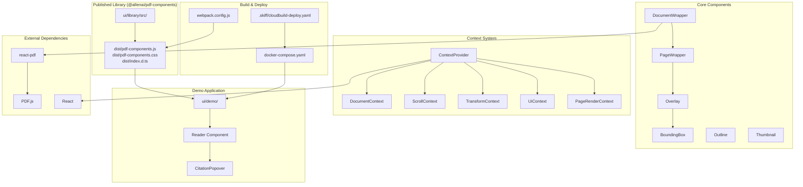
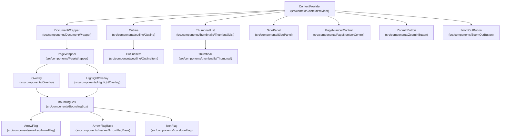
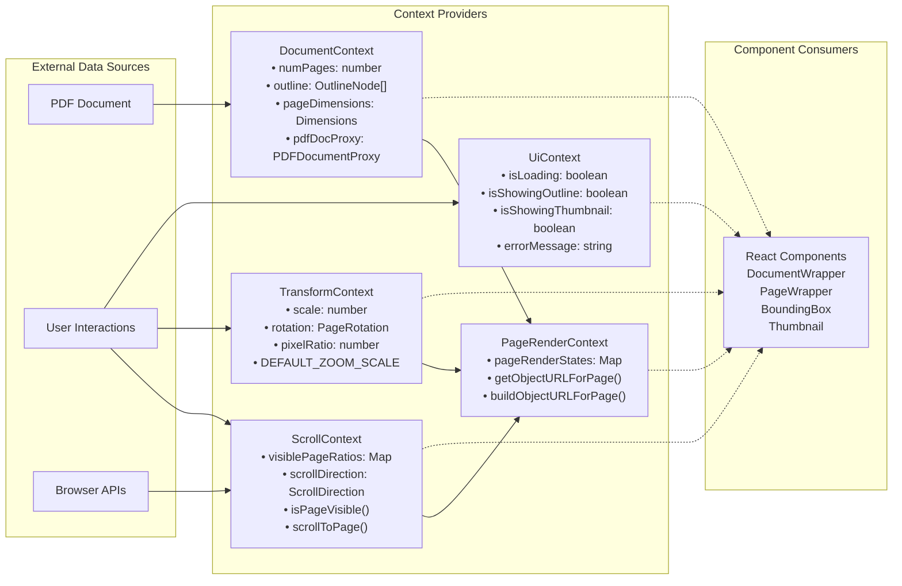
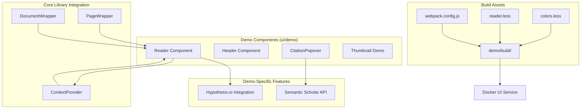
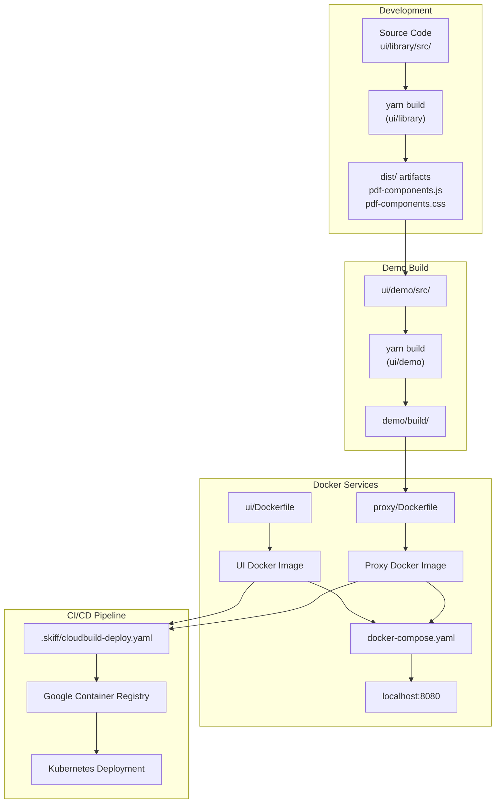

<!-- source: DeepWiki mcp.deepwiki.com · repo allenai/pdf-component-library · page 1 Overview · fetched 2026-10-26 -->

# Overview

Relevant source files

The following files were used as context for generating this wiki page:

- [.skiff/cloudbuild-deploy.yaml](.skiff/cloudbuild-deploy.yaml)
- [.skiff/util.libsonnet](.skiff/util.libsonnet)
- [README.md](README.md)
- [docker-compose.yaml](docker-compose.yaml)
- [ui/library/dist/index.d.ts](ui/library/dist/index.d.ts)
- [ui/library/dist/package.json](ui/library/dist/package.json)
- [ui/library/dist/pdf-components.css](ui/library/dist/pdf-components.css)
- [ui/library/dist/pdf-components.js](ui/library/dist/pdf-components.js)

This document provides a comprehensive overview of the PDF Component Library repository, a React-based system for displaying PDF documents with interactive features. The library is built on top of react-pdf and provides enhanced functionality for creating research-focused PDF reading experiences.

For information about the specific component APIs and usage patterns, see [Library API and Public Interface](#2.1). For details about the styling system, see [Styling System](#3). For build and deployment processes, see [Development and Build System](#5).

## System Purpose and Architecture

The PDF Component Library serves as a foundational system for building interactive PDF readers in React applications. It provides a layered rendering approach where PDF pages are displayed with multiple interactive layers: a background image layer, a transparent text selection layer, and an overlay layer for interactive elements like citations and highlights.

### High-Level System Architecture

**Sources**: [ui/library/dist/package.json:1-8](), [ui/library/dist/index.d.ts:7-43](), [docker-compose.yaml:1-25](), [.skiff/cloudbuild-deploy.yaml:1-93]()

## Core Library Components

The library exports a comprehensive set of React components organized into functional categories. The main entry point provides both individual components and a default export containing all functionality.

### Component Hierarchy and Relationships

**Sources**: [ui/library/dist/index.d.ts:44-113](), [ui/library/dist/index.d.ts:116-414]()

The `DocumentWrapper` serves as the primary container component that initializes PDF loading and sets up the rendering infrastructure. The `PageWrapper` handles individual page rendering with support for multiple render types defined in `RENDER_TYPE` constants (`MULTI_CANVAS` and `SINGLE_CANVAS`).

## Context System Architecture

The library implements a sophisticated React Context system for state management across the component hierarchy. The `ContextProvider` orchestrates five specialized contexts that manage different aspects of the PDF reading experience.

### Context Data Flow and Dependencies

**Sources**: [ui/library/dist/index.d.ts:424-447](), [ui/library/dist/index.d.ts:479-508](), [ui/library/dist/index.d.ts:510-526](), [ui/library/dist/index.d.ts:528-547](), [ui/library/dist/index.d.ts:450-477]()

The `ScrollContext` implements sophisticated visibility detection using `IntersectionObserver` APIs through the `VisibleEntriesDetector` class. The `PageRenderContext` manages canvas-based page image generation with priority queuing for visible pages, while the `DocumentContext` handles PDF.js integration for document loading and outline processing.

## Utility Systems and Helper Functions

The library includes several utility modules that provide core functionality for coordinate transformations, scroll management, and style calculations.

| Utility Module | Key Functions | Purpose |
|---|---|---|
| `src/utils/scroll` | `generatePageIdFromIndex()`, `scrollToId()`, `scrollToPdfPageIndex()` | Page navigation and scroll management |
| `src/utils/style` | `computeBoundingBoxStyle()`, `computePageStyle()`, `getPageHeight()` | CSS style calculations with rotation support |
| `src/utils/rotate` | `rotateClockwise()`, `rotateCounterClockwise()`, `isSideways()` | Page rotation transformations |
| `src/utils/format` | `PercentFormatter` | Number formatting utilities |

**Sources**: [ui/library/dist/index.d.ts:580-620](), [ui/library/dist/index.d.ts:622-629](), [ui/library/dist/index.d.ts:564-578](), [ui/library/dist/index.d.ts:549-551]()

## Demo Application Structure

The demo application located in `ui/demo/` serves as both a reference implementation and testing environment for the library components. It demonstrates integration patterns and advanced features like citation popovers.

### Demo Application Architecture

**Sources**: [docker-compose.yaml:8-13](), [README.md:27-35]()

## Build and Deployment Pipeline

The system uses a multi-stage build process with Docker containerization and Google Cloud Build for CI/CD automation.

### Build Process Flow

**Sources**: [docker-compose.yaml:1-25](), [.skiff/cloudbuild-deploy.yaml:4-85](), [README.md:40-51]()

The build system produces distributable npm packages through `npm pack` and supports local development through Docker Compose with volume mounting for hot reloading. The CI/CD pipeline automatically deploys to production environments using Google Cloud Build and Kubernetes orchestration.

---

