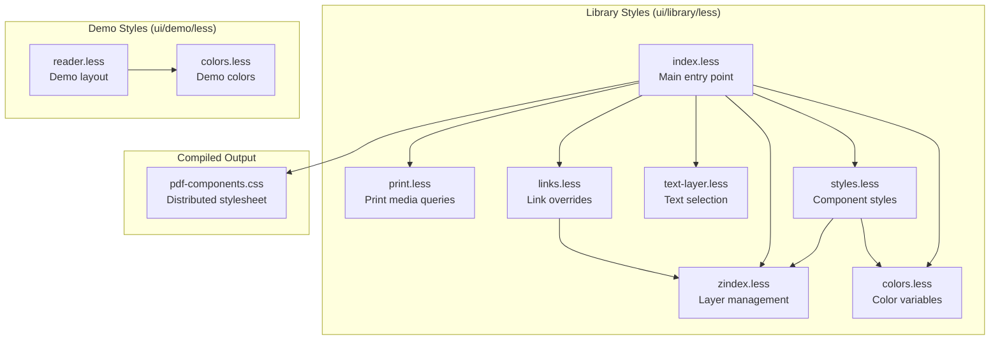
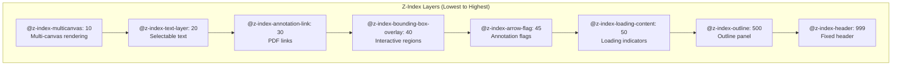
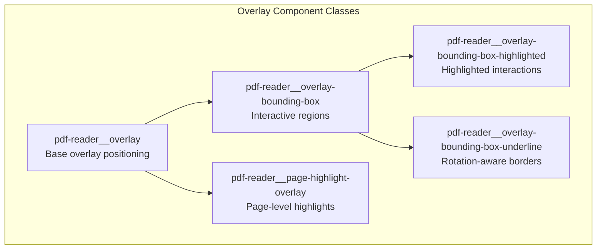

<!-- source: DeepWiki mcp.deepwiki.com · repo allenai/pdf-component-library · page 3 Styling System · fetched 2026-10-26 -->

# Styling System

<details>
<summary>Relevant source files</summary>

The following files were used as context for generating this wiki page:

- [ui/demo/less/colors.less](ui/demo/less/colors.less)
- [ui/demo/less/reader.less](ui/demo/less/reader.less)
- [ui/library/less/colors.less](ui/library/less/colors.less)
- [ui/library/less/index.less](ui/library/less/index.less)
- [ui/library/less/links.less](ui/library/less/links.less)
- [ui/library/less/print.less](ui/library/less/print.less)
- [ui/library/less/styles.less](ui/library/less/styles.less)
- [ui/library/less/text-layer.less](ui/library/less/text-layer.less)
- [ui/library/less/zindex.less](ui/library/less/zindex.less)

</details>


## Purpose and Scope

The Styling System provides the CSS architecture for both the core PDF Components Library and the demo application. It implements a modular Less-based approach with clearly defined color variables, z-index management, and component-specific styling patterns. The system handles PDF page rendering, interactive overlays, navigation components, and responsive design considerations.

For information about the React component architecture that uses these styles, see [Component Architecture](#2.2). For details about the build system that compiles these styles, see [Development and Build System](#5).

## Architecture Overview

The styling system is organized into separate Less modules that are compiled into distributable CSS. The library maintains its own styling independent of the demo application, allowing for clean separation of concerns.

### Less File Structure



Sources: [ui/library/less/index.less:1-7](), [ui/demo/less/reader.less:1-108](), [ui/demo/less/colors.less:1-7]()

## Color System

The styling system uses Less variables to maintain consistent color schemes across components. The library defines its own color palette while the demo application extends it with additional colors.

### Library Color Variables

| Variable | Value | Usage |
|----------|-------|-------|
| `@pdflib-page-background` | `#ffffff` | Page backgrounds, panels |
| `@pdflib-page-shadow` | `#000000` | Drop shadows |
| `@pdflib-highlight-background` | `#ccb300` | Text highlights |
| `@pdflib-grey-0` | `#d9dadb` | Light grey elements |
| `@pdflib-grey-3` | `#2E3743` | Dark grey text |
| `@initial-blue` | `#1857B6` | Primary interactive color |
| `@hover-active-blue` | `#5492EF` | Hover states |
| `@loading-outline-yellow` | `#F4D35E` | Loading indicators |

### Demo Color Extensions

The demo application adds supplementary colors for its specific UI needs:

```less
@white: #fff;
@grey: #d9dadb;
@blue: #1890ff;
@light-blue: #40a9ff;
```

Sources: [ui/library/less/colors.less:1-8](), [ui/demo/less/colors.less:1-7]()

## Z-Index Management

The system uses a centralized z-index hierarchy to ensure proper layering of PDF content, overlays, and UI elements. This prevents visual conflicts between different interactive elements.

### Z-Index Hierarchy



Sources: [ui/library/less/zindex.less:1-9]()

## Component Styling Patterns

### PDF Page Rendering

The `.pdf-reader__page` class provides the foundation for PDF page display with proper spacing, shadows, and background handling:

```less
.pdf-reader__page {
  background: @pdflib-page-background center center / cover no-repeat;
  margin: 24px;
  box-shadow: 0px 4px 14px fade(@pdflib-page-shadow, 20%);
  flex: 1 0 auto;
  position: relative;
}
```

The system handles different rendering modes through modifier classes:
- `.pdf-reader__page--render-type-single-canvas` - Single canvas rendering
- `.pdf-reader__page--render-type-multi-canvas` - Multi-canvas rendering
- `.pdf-reader__page--no-page-image` - Fallback when image unavailable
- `.pdf-reader__page--has-page-image` - When background image is loaded

Sources: [ui/library/less/styles.less:3-9](), [ui/library/less/styles.less:60-80](), [ui/library/less/styles.less:99-104]()

### Overlay System

Interactive overlays use absolute positioning with carefully managed z-indexes:



The bounding box system includes hover effects and rotation-aware styling:
- Rotation classes (`.rotate0`, `.rotate90`, `.rotate180`, `.rotate270`) adjust border placement
- Blend modes (`mix-blend-mode: screen`) create highlight effects
- Pointer events are selectively disabled for non-interactive overlays

Sources: [ui/library/less/styles.less:11-54](), [ui/library/less/styles.less:106-110]()

### Navigation Components

#### Thumbnails

Thumbnail styling includes opacity transitions to indicate current page visibility:

```less
.pdf-reader__thumbnail {
  opacity: .5;
  transition: opacity 400ms ease-in-out;
  
  &:hover {
    opacity: .75;
    transition-duration: 75ms;
  }
  
  &.pdf-reader__thumbnail--is-visible {
    opacity: 1;
    transition-duration: 200ms;
  }
}
```

#### Side Panels

The side panel system includes resizable handles with accessibility support:
- Drag handles appear on hover with opacity transitions
- Assistive input elements support keyboard navigation
- Resize zones provide 15px interaction areas

Sources: [ui/library/less/styles.less:152-189](), [ui/library/less/styles.less:191-301]()

## Text Layer Integration

The system includes comprehensive text layer styling adapted from react-pdf to handle text selection, highlighting, and rendering:

### Text Selection and Highlighting

```less
.textLayer .highlight {
  margin: -1px;
  padding: 1px;
  background-color: rgba(180, 0, 170, 1);
  border-radius: 4px;
}
```

The text layer supports:
- Transparent text rendering over background images
- Multi-part highlight styling (`.begin`, `.middle`, `.end`)
- Selection state management
- Browser-specific text alignment fixes

Sources: [ui/library/less/text-layer.less:7-82]()

## Responsive and Print Considerations

### Print Styles

The system includes comprehensive print media queries that:
- Hide scrollbars and interactive elements
- Remove margins and padding
- Ensure proper page breaks
- Hide non-essential UI components like headers

```less
@media print {
  .reader__header {
    display: none; 
  }
  
  .reader__page {
    margin: 0;  
  }
}
```

### Loading States

Visual feedback for asynchronous operations uses consistent styling:
- Loading outlines use `@loading-outline-yellow`
- Loading content overlays are positioned with proper z-indexing
- Image building states are indicated with outline styling

Sources: [ui/library/less/print.less:1-37](), [ui/library/less/styles.less:56-58](), [ui/library/less/styles.less:82-97]()

## Demo Application Styling

The demo application extends the library styles with layout-specific classes:

### Reader Layout

```less
.reader__main {
  background-color: @grey;
  display: flex;
  flex-direction: row;
  justify-content: center;
  position: relative;
}
```

### Interactive Elements

Demo-specific interactive elements include:
- Citation popovers with fixed sizing (`min-width: 270px`, `max-width: 310px`)
- Zoom controls with hover states
- Header controls with selection indicators
- Outline drawer positioning with fixed placement

Sources: [ui/demo/less/reader.less:1-46](), [ui/demo/less/reader.less:60-73]()

---

