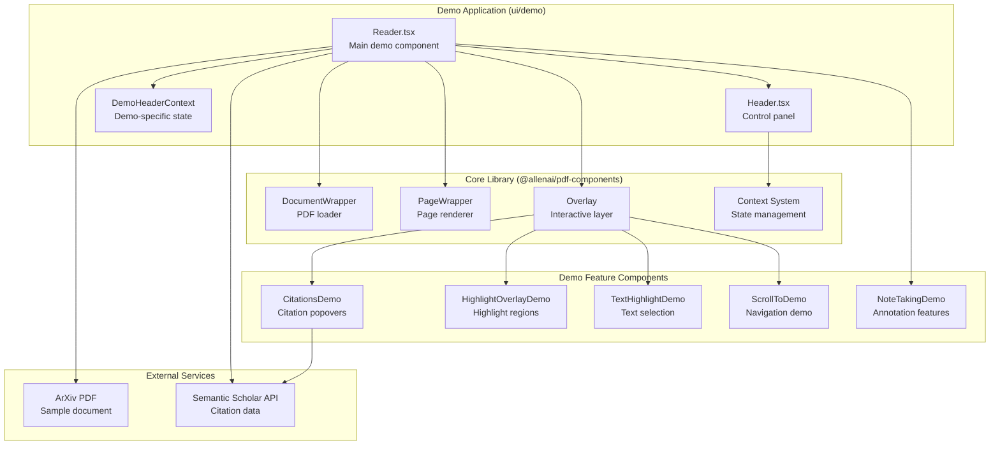
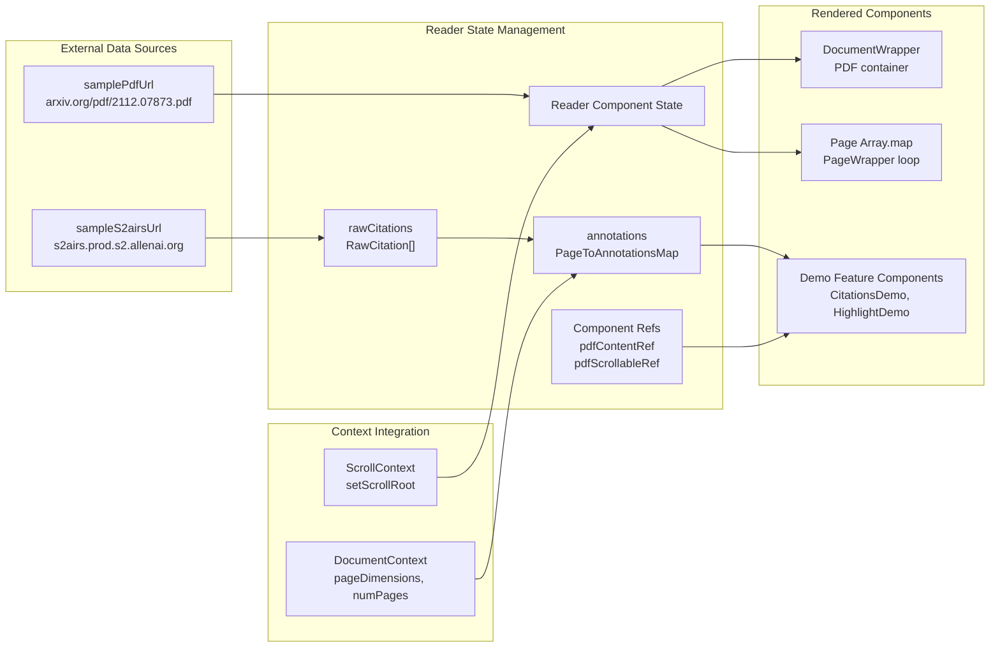
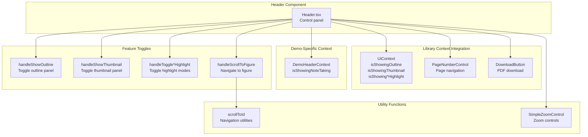
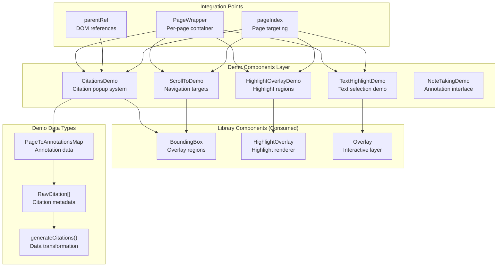
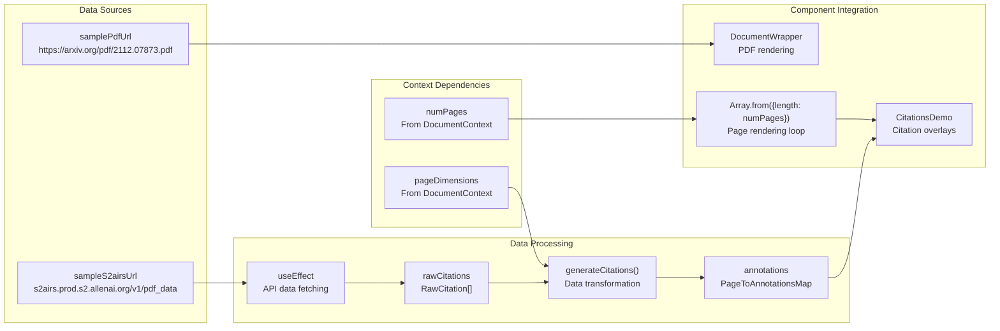
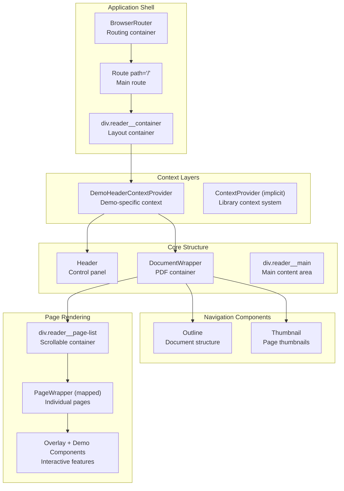

<!-- source: DeepWiki mcp.deepwiki.com · repo allenai/pdf-component-library · page 4 Demo Application · fetched 2026-10-26 -->

# Demo Application

Relevant source files

The following files were used as context for generating this wiki page:

- [ui/demo/components/Header.tsx](ui/demo/components/Header.tsx)
- [ui/demo/components/Reader.tsx](ui/demo/components/Reader.tsx)
- [ui/library/index.ts](ui/library/index.ts)

The demo application serves as a comprehensive showcase and testing environment for the PDF Component Library. It demonstrates the library's capabilities through a fully functional PDF reader that includes interactive features like citations, highlights, outline navigation, and thumbnails. The demo is located in [ui/demo/]() and provides both a usage example for developers and a testing platform for library features.

For information about the core library components being demonstrated, see [Core PDF Components Library](#2). For build and deployment details, see [Development and Build System](#5).

## Demo Application Architecture

The demo application is structured as a React application that consumes the `@allenai/pdf-components` library. It showcases advanced features through specialized demo components while maintaining the same architectural patterns as the core library.

**Demo Application Structure**

Sources: [ui/demo/components/Reader.tsx:1-106](), [ui/demo/components/Header.tsx:1-84]()

## Main Reader Component

The `Reader` component serves as the root of the demo application, orchestrating PDF loading, data fetching, and component rendering. It demonstrates integration patterns for consuming the PDF Component Library.

**Reader Component Data Flow**

The Reader component implements several key patterns:

| Pattern | Implementation | Purpose |
|---------|----------------|---------|
| Data Fetching | [ui/demo/components/Reader.tsx:43-54]() | Loads citation data from Semantic Scholar API |
| State Management | [ui/demo/components/Reader.tsx:28-31]() | Manages annotations and citations state |
| Context Integration | [ui/demo/components/Reader.tsx:26-27]() | Consumes library contexts for PDF metadata |
| Component Composition | [ui/demo/components/Reader.tsx:84-97]() | Renders pages with overlay demos |

Sources: [ui/demo/components/Reader.tsx:25-106]()

## Demo Header and Controls

The `Header` component provides a control panel that demonstrates various library features through toggle buttons and navigation controls. It showcases integration with both library contexts and demo-specific state.

**Header Control Integration**

The Header demonstrates key integration patterns:

- **Context Consumption**: [ui/demo/components/Header.tsx:13-23]() shows how to consume both library and demo contexts
- **Mutual Exclusion**: [ui/demo/components/Header.tsx:25-33]() implements logic to ensure only one panel is shown at a time
- **Feature Toggling**: [ui/demo/components/Header.tsx:35-41]() demonstrates toggle patterns for overlay features
- **Utility Integration**: [ui/demo/components/Header.tsx:43-49]() shows how to use library utilities like `scrollToId`

Sources: [ui/demo/components/Header.tsx:12-84](), [ui/library/index.ts:1-7]()

## Demo Feature Components

The demo application includes specialized components that showcase advanced library capabilities. Each component demonstrates specific integration patterns and use cases.

**Demo Component Architecture**

| Demo Component | Purpose | Key Integration |
|----------------|---------|-----------------|
| `CitationsDemo` | Shows citation popovers with external data | Uses `BoundingBox` with API data |
| `HighlightOverlayDemo` | Demonstrates highlight regions | Integrates with `HighlightOverlay` |
| `TextHighlightDemo` | Shows text selection features | Uses text selection APIs |
| `ScrollToDemo` | Navigation target demonstration | Creates scrollable targets |
| `NoteTakingDemo` | Annotation interface example | Separate annotation system |

Sources: [ui/demo/components/Reader.tsx:86-95](), [ui/demo/components/Reader.tsx:14-23]()

## Data Integration and External Services

The demo application demonstrates integration with external data sources, showing how to enhance PDF viewing with contextual information from APIs.

**External Data Integration Flow**

The data integration demonstrates several important patterns:

- **Conditional Fetching**: [ui/demo/components/Reader.tsx:44-47]() prevents duplicate API requests
- **Dependency Management**: [ui/demo/components/Reader.tsx:62-65]() waits for required context data
- **Data Transformation**: [ui/demo/components/Reader.tsx:67]() converts raw API data to component-ready format
- **Context Synchronization**: [ui/demo/components/Reader.tsx:54]() triggers updates based on PDF dimensions

Sources: [ui/demo/components/Reader.tsx:39-68]()

## Demo Application Usage Patterns

The demo application serves as a reference implementation for common integration patterns when using the PDF Component Library. It demonstrates best practices for component composition, state management, and feature integration.

**Component Composition Pattern**

This pattern demonstrates:
- **Context Nesting**: Demo contexts wrap library contexts appropriately
- **Component Hierarchy**: Proper parent-child relationships for PDF components
- **Reference Management**: DOM refs passed to components that need them
- **Conditional Rendering**: Components shown/hidden based on state

Sources: [ui/demo/components/Reader.tsx:70-105]()

---

