# Page: Overview

# Overview

<details>
<summary>Relevant source files</summary>

The following files were used as context for generating this wiki page:

- [.skiff/cloudbuild-deploy.yaml](.skiff/cloudbuild-deploy.yaml)
- [.skiff/util.libsonnet](.skiff/util.libsonnet)
- [README.md](README.md)
- [docker-compose.yaml](docker-compose.yaml)
- [ui/library/dist/index.d.ts](ui/library/dist/index.d.ts)
- [ui/library/dist/package.json](ui/library/dist/package.json)
- [ui/library/dist/pdf-components.css](ui/library/dist/pdf-components.css)
- [ui/library/dist/pdf-components.js](ui/library/dist/pdf-components.js)

</details>


This document provides a comprehensive overview of the PDF Component Library repository, a React-based system for displaying PDF documents with interactive features. The library is built on top of react-pdf and provides enhanced functionality for creating research-focused PDF reading experiences.

For information about the specific component APIs and usage patterns, see [Library API and Public Interface](#2.1). For details about the styling system, see [Styling System](#3). For build and deployment processes, see [Development and Build System](#5).

## System Purpose and Architecture

The PDF Component Library serves as a foundational system for building interactive PDF readers in React applications. It provides a layered rendering approach where PDF pages are displayed with multiple interactive layers: a background image layer, a transparent text selection layer, and an overlay layer for interactive elements like citations and highlights.

### High-Level System Architecture

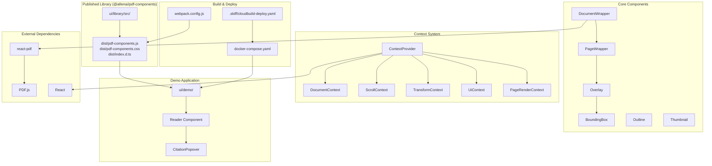

**Sources**: [ui/library/dist/package.json:1-8](), [ui/library/dist/index.d.ts:7-43](), [docker-compose.yaml:1-25](), [.skiff/cloudbuild-deploy.yaml:1-93]()

## Core Library Components

The library exports a comprehensive set of React components organized into functional categories. The main entry point provides both individual components and a default export containing all functionality.

### Component Hierarchy and Relationships

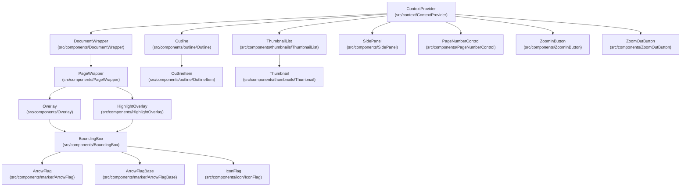

**Sources**: [ui/library/dist/index.d.ts:44-113](), [ui/library/dist/index.d.ts:116-414]()

The `DocumentWrapper` serves as the primary container component that initializes PDF loading and sets up the rendering infrastructure. The `PageWrapper` handles individual page rendering with support for multiple render types defined in `RENDER_TYPE` constants (`MULTI_CANVAS` and `SINGLE_CANVAS`).

## Context System Architecture

The library implements a sophisticated React Context system for state management across the component hierarchy. The `ContextProvider` orchestrates five specialized contexts that manage different aspects of the PDF reading experience.

### Context Data Flow and Dependencies

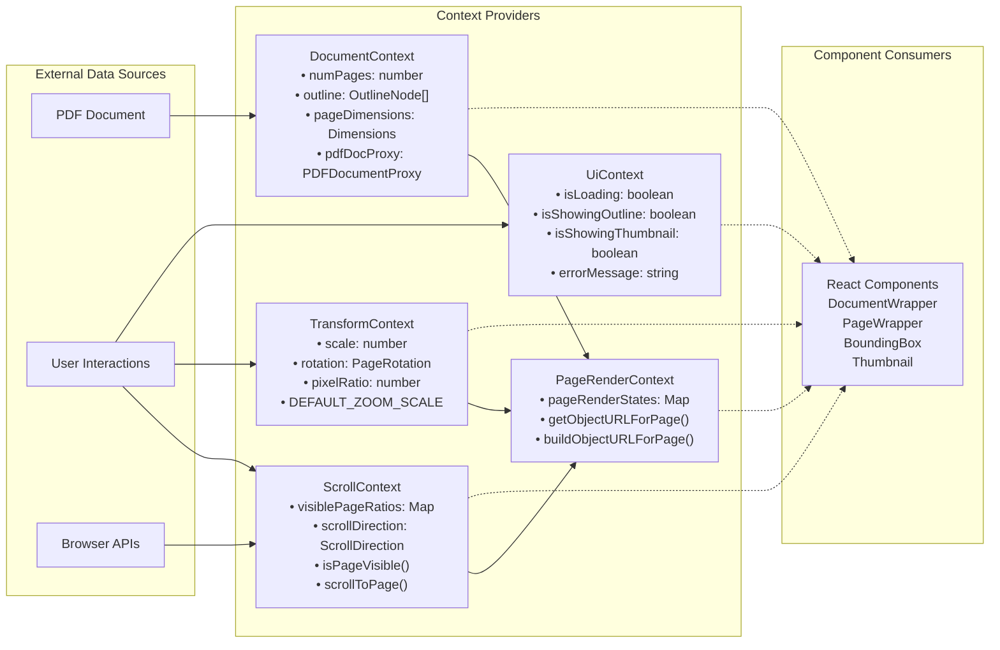

**Sources**: [ui/library/dist/index.d.ts:424-447](), [ui/library/dist/index.d.ts:479-508](), [ui/library/dist/index.d.ts:510-526](), [ui/library/dist/index.d.ts:528-547](), [ui/library/dist/index.d.ts:450-477]()

The `ScrollContext` implements sophisticated visibility detection using `IntersectionObserver` APIs through the `VisibleEntriesDetector` class. The `PageRenderContext` manages canvas-based page image generation with priority queuing for visible pages, while the `DocumentContext` handles PDF.js integration for document loading and outline processing.

## Utility Systems and Helper Functions

The library includes several utility modules that provide core functionality for coordinate transformations, scroll management, and style calculations.

| Utility Module | Key Functions | Purpose |
|---|---|---|
| `src/utils/scroll` | `generatePageIdFromIndex()`, `scrollToId()`, `scrollToPdfPageIndex()` | Page navigation and scroll management |
| `src/utils/style` | `computeBoundingBoxStyle()`, `computePageStyle()`, `getPageHeight()` | CSS style calculations with rotation support |
| `src/utils/rotate` | `rotateClockwise()`, `rotateCounterClockwise()`, `isSideways()` | Page rotation transformations |
| `src/utils/format` | `PercentFormatter` | Number formatting utilities |

**Sources**: [ui/library/dist/index.d.ts:580-620](), [ui/library/dist/index.d.ts:622-629](), [ui/library/dist/index.d.ts:564-578](), [ui/library/dist/index.d.ts:549-551]()

## Demo Application Structure

The demo application located in `ui/demo/` serves as both a reference implementation and testing environment for the library components. It demonstrates integration patterns and advanced features like citation popovers.

### Demo Application Architecture

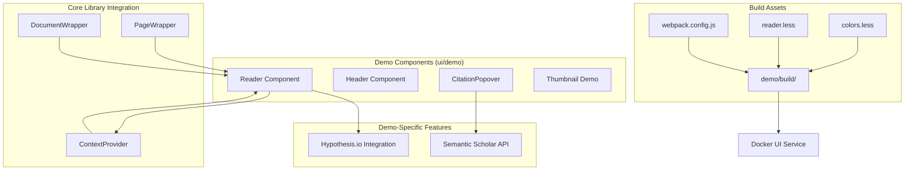

**Sources**: [docker-compose.yaml:8-13](), [README.md:27-35]()

## Build and Deployment Pipeline

The system uses a multi-stage build process with Docker containerization and Google Cloud Build for CI/CD automation.

### Build Process Flow

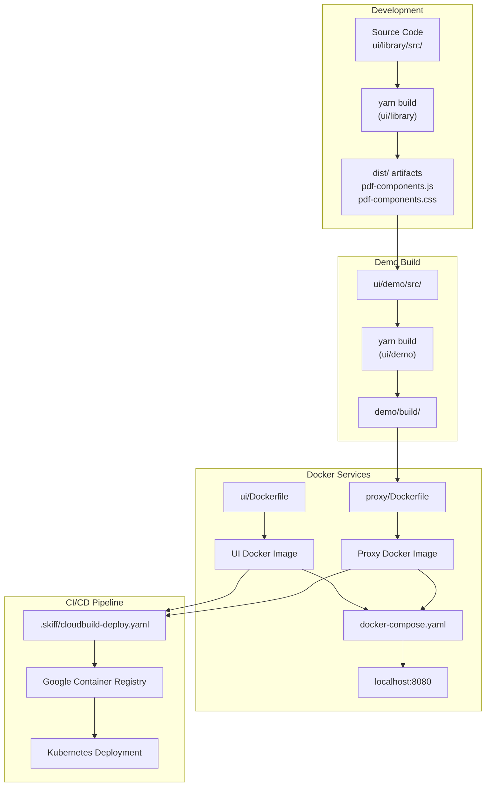

**Sources**: [docker-compose.yaml:1-25](), [.skiff/cloudbuild-deploy.yaml:4-85](), [README.md:40-51]()

The build system produces distributable npm packages through `npm pack` and supports local development through Docker Compose with volume mounting for hot reloading. The CI/CD pipeline automatically deploys to production environments using Google Cloud Build and Kubernetes orchestration.

---

# Page: Core PDF Components Library

# Core PDF Components Library

<details>
<summary>Relevant source files</summary>

The following files were used as context for generating this wiki page:

- [ui/library/dist/index.d.ts](ui/library/dist/index.d.ts)
- [ui/library/dist/package.json](ui/library/dist/package.json)
- [ui/library/dist/pdf-components.css](ui/library/dist/pdf-components.css)
- [ui/library/dist/pdf-components.js](ui/library/dist/pdf-components.js)

</details>


This document covers the `@allenai/pdf-components` library, which provides React components for displaying PDF documents with interactive features such as navigation, highlighting, annotations, and thumbnail views. The library is built on top of `react-pdf` and PDF.js to handle PDF rendering, while adding a comprehensive React-based UI layer with context-driven state management.

For information about how this library is used in practice, see the [Demo Application](#4). For build and deployment details, see [Development and Build System](#5).

## Library Overview and Public API

The PDF Components Library exports a comprehensive set of React components, contexts, utilities, and TypeScript types through its main entry point. The library is packaged as `@allenai/pdf-components` version 1.0.1 and provides both JavaScript bundle and TypeScript definitions.

### Core Component Exports

| Component Category | Components | Purpose |
|-------------------|------------|---------|
| **Document Rendering** | `DocumentWrapper`, `PageWrapper` | PDF document loading and page rendering |
| **Interactive Overlays** | `BoundingBox`, `Overlay`, `HighlightOverlay` | Interactive regions and annotations |
| **Navigation** | `Outline`, `OutlineItem`, `Thumbnail`, `ThumbnailList` | Document navigation and structure |
| **UI Controls** | `PageNumberControl`, `ZoomInButton`, `ZoomOutButton`, `SidePanel` | User interface controls |
| **Utility Components** | `DownloadButton`, `PrintButton`, `ArrowFlag`, `IconFlag` | Additional functionality |

### Context System Exports

| Context | Interface | Purpose |
|---------|-----------|---------|
| `ContextProvider` | `ContextProviderProps` | Top-level context orchestrator |
| `DocumentContext` | `IDocumentContext` | PDF document metadata and outline |
| `ScrollContext` | `IScrollContext` | Scroll position and visibility tracking |
| `TransformContext` | `ITransformContext` | Scale, rotation, and transformations |
| `UiContext` | `IUiContext` | UI state and loading indicators |
| `PageRenderContext` | `IPageRenderContext` | Page image rendering and caching |

### Utility Functions

The library exports utility functions for coordinate calculations (`computeBoundingBoxStyle`, `computePageStyle`), scroll management (`scrollToId`, `scrollToPdfPageIndex`), rotation handling (`rotateClockwise`, `rotateCounterClockwise`), and page dimension calculations (`getPageHeight`, `getPageWidth`).

**Sources:** [ui/library/dist/index.d.ts:7-43](), [ui/library/dist/package.json:1-8]()

## Core Architecture

The PDF Components Library follows a hierarchical component architecture with React Context for state management. The system is designed around a central `ContextProvider` that orchestrates multiple specialized contexts, feeding data to rendering components and interactive elements.

### Component and Context Architecture

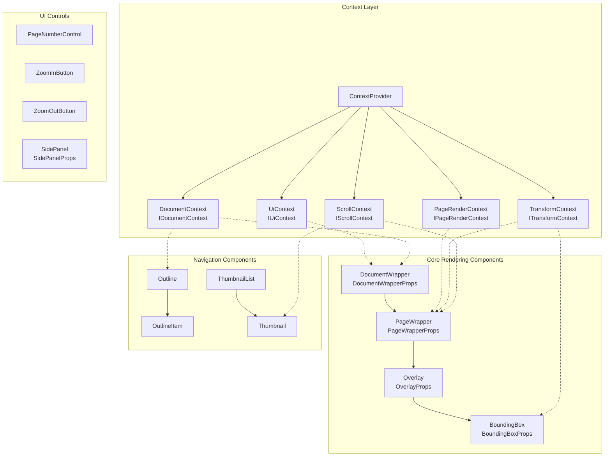

The architecture separates concerns into three layers: context management for state, core rendering for PDF display, and specialized components for navigation and UI controls. Data flows from the context layer down to components through React Context APIs.

**Sources:** [ui/library/dist/index.d.ts:31-36](), [ui/library/dist/index.d.ts:416-447]()

### PDF Rendering and State Management Flow

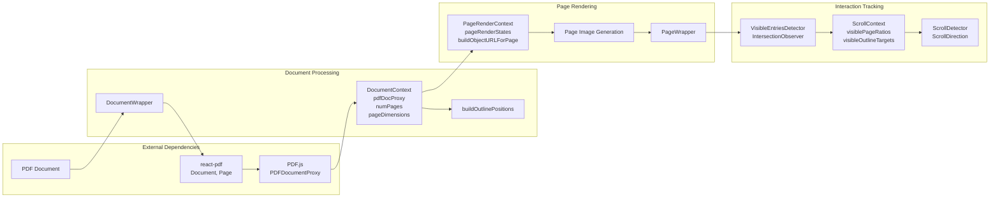

The system processes PDF documents through `react-pdf`, extracts metadata into `DocumentContext`, manages page rendering through `PageRenderContext`, and tracks user interactions via scroll and visibility detection systems.

**Sources:** [ui/library/dist/index.d.ts:130-138](), [ui/library/dist/index.d.ts:424-447](), [ui/library/dist/index.d.ts:450-476]()

## Context System Details

The library's state management relies on five specialized React contexts that handle different aspects of PDF viewing functionality. Each context provides both state and methods for updating that state.

### DocumentContext Interface

The `DocumentContext` manages PDF document metadata and outline information:

```typescript
interface IDocumentContext {
  numPages: number;
  numPagesLoaded: number;
  outline: Nullable<Array<OutlineNode>>;
  outlinePositions: Nullable<OutlinePositionsByPageNumberMap>;
  pageDimensions: Dimensions;
  pdfDocProxy?: pdfjs.PDFDocumentProxy;
  getOutlineTargets: (opts: OutlineTargetArgs) => OutlineTarget[];
  // ... setter methods
}
```

The context provides access to the PDF document proxy, page count, document outline structure, and methods for calculating outline target positions on pages.

### ScrollContext Interface

The `ScrollContext` handles scroll-based interactions and visibility tracking:

```typescript
interface IScrollContext {
  scrollDirection: Nullable<ScrollDirection>;
  visiblePageRatios: Map<number, VisibleEntryDetailType>;
  visibleOutlineTargets: Map<NodeDestination, VisibleEntryDetailType>;
  isPageVisible: (pageNumber: PageNumber) => boolean;
  scrollToPage: (pageNumber: PageNumber) => void;
  scrollToOutlineTarget: (dest: NodeDestination) => void;
  // ... other methods
}
```

This context uses `IntersectionObserver` through `VisibleEntriesDetector` to track which pages and outline targets are currently visible, providing methods for programmatic navigation.

### TransformContext Interface

The `TransformContext` manages document transformations:

```typescript
interface ITransformContext {
  pixelRatio: number;
  rotation: PageRotation;
  scale: number;
  zoomIncrementValue: number;
  // ... setter methods
}
```

It handles zoom levels (with `DEFAULT_ZOOM_SCALE = 1`), page rotation (using `PageRotation` enum), and device pixel ratio for high-DPI displays.

**Sources:** [ui/library/dist/index.d.ts:424-447](), [ui/library/dist/index.d.ts:479-507](), [ui/library/dist/index.d.ts:510-525]()

## Core Rendering Components

The library's rendering system is built around three primary components that handle PDF document loading, individual page rendering, and interactive overlays.

### DocumentWrapper Component

The `DocumentWrapper` serves as the root component for PDF rendering, accepting `DocumentWrapperProps` that extend `react-pdf`'s `DocumentProps`:

```typescript
type Props = {
  children?: React.ReactNode;
  renderType: RenderType; // MULTI_CANVAS | SINGLE_CANVAS
} & DocumentProps;
```

The component initializes the PDF worker, manages document loading lifecycle, handles loading and error states through `UiContext`, and triggers scroll observer resets when the document changes.

### PageWrapper Component

The `PageWrapper` renders individual PDF pages and manages their interactive overlays:

```typescript
type Props = {
  className?: string;
  loadingContentForBuildingImage?: React.ReactElement;
  children?: React.ReactElement<typeof HighlightOverlay | typeof Overlay>;
  renderType: RenderType;
} & PageProps;
```

The component accepts `pageIndex` (0-based), integrates with `PageRenderContext` for image generation, supports both multi-canvas and single-canvas rendering modes via `RENDER_TYPE`, and manages page loading states with custom loading indicators.

### BoundingBox Component

The `BoundingBox` component renders interactive rectangular regions on PDF pages:

```typescript
type Props = {
  className?: string;
  underlineClassName?: string;
  id?: string;
  isHighlighted?: boolean;
  onClick?: () => void;
  voiceOverLabel?: string;
} & BoundingBoxType; // includes top, left, height, width, page
```

The component uses `computeBoundingBoxStyle` to calculate positions accounting for page rotation and scale, applies different visual styles based on `isHighlighted` state, and supports custom click handlers and accessibility labels.

**Sources:** [ui/library/dist/index.d.ts:130-138](), [ui/library/dist/index.d.ts:242-263](), [ui/library/dist/index.d.ts:116-127]()

## Navigation and Interactive Components

The library provides comprehensive navigation capabilities through outline/table-of-contents functionality and thumbnail-based page navigation.

### Outline System

The outline system consists of `Outline` and `OutlineItem` components that render the PDF's table of contents:

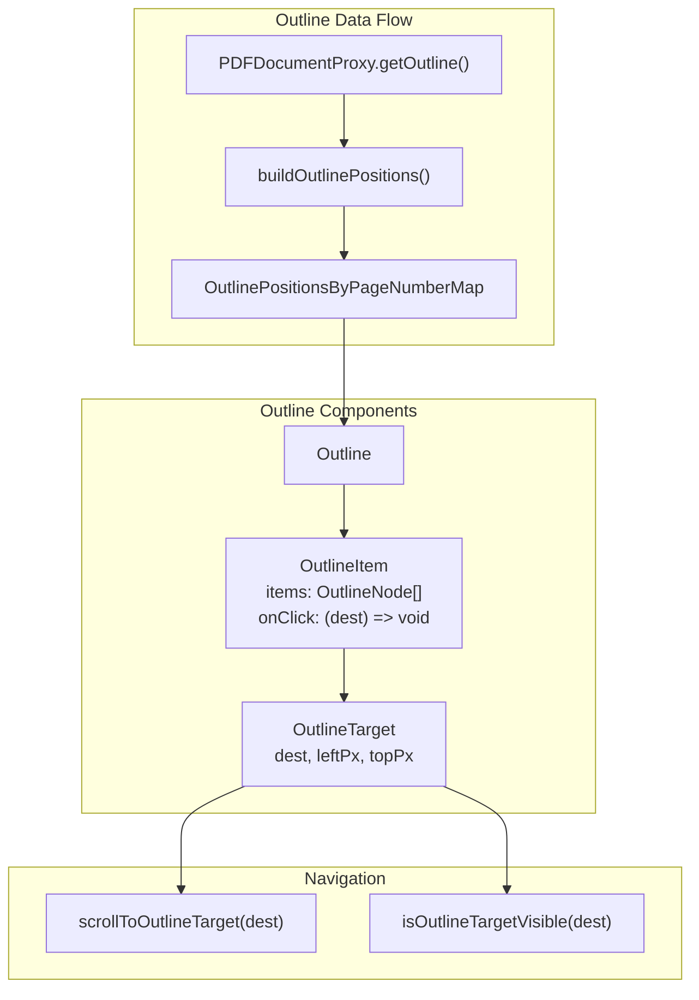

The `OutlineNode` type defines the structure with `title`, `dest` (destination), and nested `items`. The `buildOutlinePositions` function processes PDF destinations into pixel coordinates for navigation.

### Thumbnail System

The thumbnail system provides visual page navigation through `Thumbnail` and `ThumbnailList` components:

- `Thumbnail` component accepts `pageNumber: number` and renders a clickable page preview
- `ThumbnailList` manages collections of thumbnails with scroll synchronization
- Integration with `PageRenderContext` for generating thumbnail images
- Visual state management through CSS classes like `pdf-reader__thumbnail--is-visible`

### Interactive Overlays

The overlay system supports interactive annotations and highlights:

- `Overlay` component accepts `BoundingBox` elements as children
- `HighlightOverlay` specifically designed for text highlighting with `pageIndex: number`
- `ArrowFlag` and `IconFlag` components for annotation markers
- CSS-based visual states including hover effects and selection highlighting

**Sources:** [ui/library/dist/index.d.ts:209-222](), [ui/library/dist/index.d.ts:298-312](), [ui/library/dist/index.d.ts:155-163]()

## Utility Systems

The library includes several utility systems that support coordinate calculations, scroll management, and page transformations.

### Style and Coordinate Utilities

The style calculation system handles PDF coordinate transformations:

```typescript
// Core calculation functions
computeBoundingBoxStyle(boundingBoxSize: Size, pageDimensions: Dimensions, 
                      rotation: PageRotation, scale: number): Size;
computePageStyle(pageDimensions: Dimensions, rotation: PageRotation, scale: number): Size;
getPageHeight(pageDimensions: Dimensions, rotation: PageRotation): number;
getPageWidth(pageDimensions: Dimensions, rotation: PageRotation): number;
```

These functions account for page rotation using the `PageRotation` enum (0°, 90°, 180°, 270°) and apply scaling transformations for zoom functionality.

### Scroll Management Utilities

The scroll utilities provide programmatic navigation:

```typescript
// Navigation functions
generatePageIdFromIndex(pageIndex: number | string): string; // Returns "reader_pg_N"
scrollToId(id: string): void;
scrollToPdfPageIndex(pageIndex: number | string): void;
scrollToPosition(pageIndex: number, leftPoints: number, bottomPoints: number, 
                rotation?: PageRotation): void;
```

The `PAGE_NAV_TARGET_ID_ROOT = "reader_pg_"` constant defines the ID pattern for page elements, enabling smooth scrolling navigation.

### Rotation and Transformation Utilities

The rotation system provides page orientation management:

```typescript
// Rotation functions
rotateClockwise(rotation: PageRotation): PageRotation;
rotateCounterClockwise(rotation: PageRotation): PageRotation;
isSideways(rotation: PageRotation): boolean; // Tests for 90° or 270°
```

The `PageRotation` enum defines four rotation states, and utility functions handle rotation transformations while accounting for coordinate system changes.

### Visibility Detection

The library uses `VisibleEntriesDetector` class with `IntersectionObserver` to track element visibility:

- Monitors pages using `PAGE_NUMBER_SELECTOR` pattern
- Tracks outline targets using `OUTLINE_SELECTOR` pattern  
- Provides `VisibleEntryDetailType` with ratio and timestamp data
- Integrates with `ScrollContext` for real-time visibility updates

**Sources:** [ui/library/dist/index.d.ts:622-629](), [ui/library/dist/index.d.ts:580-620](), [ui/library/dist/index.d.ts:564-577](), [ui/library/dist/index.d.ts:631-656]()

---

# Page: Library API and Public Interface

# Library API and Public Interface

<details>
<summary>Relevant source files</summary>

The following files were used as context for generating this wiki page:

- [ui/demo/components/Header.tsx](ui/demo/components/Header.tsx)
- [ui/demo/components/Reader.tsx](ui/demo/components/Reader.tsx)
- [ui/library/dist/index.d.ts](ui/library/dist/index.d.ts)
- [ui/library/dist/package.json](ui/library/dist/package.json)
- [ui/library/dist/pdf-components.css](ui/library/dist/pdf-components.css)
- [ui/library/dist/pdf-components.js](ui/library/dist/pdf-components.js)
- [ui/library/index.ts](ui/library/index.ts)

</details>


This document covers the public API exported by the `@allenai/pdf-components` library, including all components, contexts, types, and utilities available to consuming applications. This is the primary interface that developers use to integrate PDF viewing capabilities into their React applications.

For information about the internal component architecture and how these public APIs are implemented, see [Component Architecture](#2.2). For details about the context system implementation, see [Context System](#2.3).

## API Overview

The library exports its public interface through a single entry point that provides four main categories of functionality:

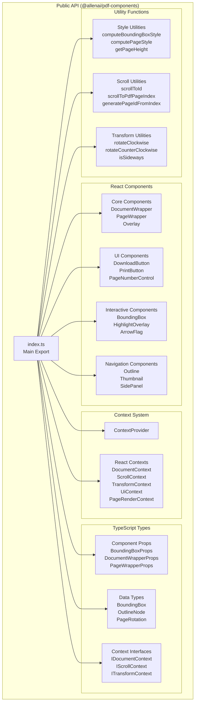

Sources: [ui/library/index.ts:1-179](), [ui/library/dist/index.d.ts:7-114]()

## Package Structure

The library is distributed as an NPM package with the following structure:

| File | Purpose |
|------|---------|
| `pdf-components.js` | Compiled JavaScript bundle |
| `pdf-components.css` | Compiled CSS styles |
| `index.d.ts` | TypeScript type definitions |
| `package.json` | Package metadata |

Sources: [ui/library/dist/package.json:1-9]()

## Core Component API

The library provides a hierarchical set of React components for PDF rendering and interaction:

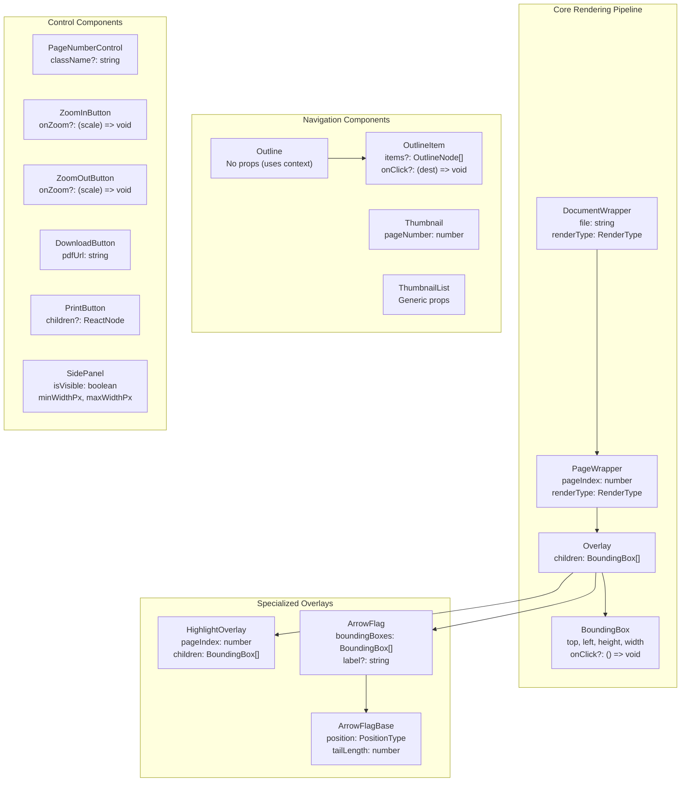

### Core Component Props

| Component | Key Props | Purpose |
|-----------|-----------|---------|
| `DocumentWrapper` | `file: string`, `renderType: RenderType` | PDF document container |
| `PageWrapper` | `pageIndex: number`, `renderType: RenderType` | Individual page renderer |
| `Overlay` | `children: ReactElement<BoundingBox>[]` | Interactive overlay container |
| `BoundingBox` | `top, left, height, width: number`, `onClick?: () => void` | Rectangular interactive region |

Sources: [ui/library/index.ts:7-25](), [ui/library/dist/index.d.ts:116-264]()

## Context System API

The library uses React Context to manage state across components. All contexts are accessed through the `ContextProvider`:

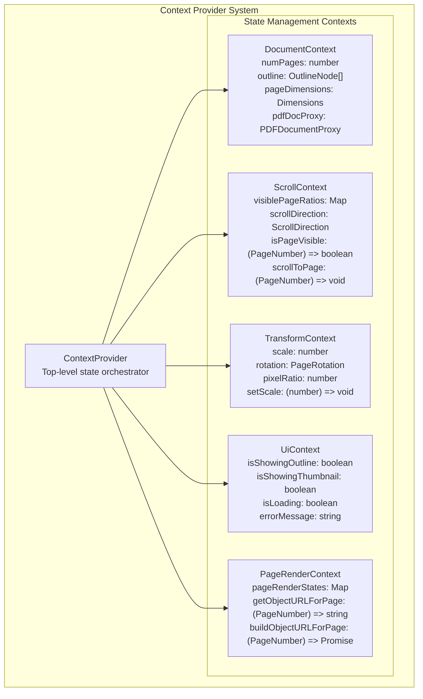

### Context Interface Types

| Context | Interface | Key Methods/Properties |
|---------|-----------|----------------------|
| DocumentContext | `IDocumentContext` | `numPages`, `outline`, `pageDimensions`, `getOutlineTargets()` |
| ScrollContext | `IScrollContext` | `visiblePageRatios`, `isPageVisible()`, `scrollToPage()` |
| TransformContext | `ITransformContext` | `scale`, `rotation`, `setScale()`, `setRotation()` |
| UiContext | `IUiContext` | `isShowingOutline`, `isLoading`, `errorMessage` |
| PageRenderContext | `IPageRenderContext` | `getObjectURLForPage()`, `buildObjectURLForPage()` |

Sources: [ui/library/index.ts:39-48](), [ui/library/dist/index.d.ts:416-547]()

## Type System

The library exports comprehensive TypeScript types for all public interfaces:

### Component Prop Types

```typescript
// Core component props
type DocumentWrapperProps = {
  children?: React.ReactNode;
  renderType: RenderType;
} & DocumentProps;

type PageWrapperProps = {
  className?: string;
  renderType: RenderType;
} & PageProps;

type BoundingBoxProps = {
  className?: string;
  isHighlighted?: boolean;
  onClick?: () => void;
} & BoundingBox;
```

### Data Types

| Type | Purpose | Key Properties |
|------|---------|----------------|
| `BoundingBox` | Rectangular region | `page: number`, `top, left, height, width: number` |
| `OutlineNode` | Document outline item | `title: string`, `dest: NodeDestination`, `items: OutlineNode[]` |
| `PageRotation` | Page rotation enum | `Rotate0`, `Rotate90`, `Rotate180`, `Rotate270` |
| `Dimensions` | Size measurements | `height: number`, `width: number` |
| `RenderType` | Rendering mode | `"single-canvas"` \| `"multi-canvas"` |

Sources: [ui/library/index.ts:65-93](), [ui/library/dist/index.d.ts:314-394]()

## Utility Functions API

The library provides utility functions for common PDF manipulation tasks:

### Style Computation Functions

| Function | Parameters | Return Type | Purpose |
|----------|------------|-------------|---------|
| `computeBoundingBoxStyle` | `boundingBoxSize, pageDimensions, rotation, scale` | `Size` | Calculate CSS styles for bounding boxes |
| `computePageStyle` | `pageDimensions, rotation, scale` | `Size` | Calculate CSS styles for pages |
| `getPageHeight` | `pageDimensions, rotation` | `number` | Get effective page height |
| `getPageWidth` | `pageDimensions, rotation` | `number` | Get effective page width |

### Scroll Navigation Functions

| Function | Parameters | Return Type | Purpose |
|----------|------------|-------------|---------|
| `scrollToId` | `id: string` | `void` | Scroll to element by ID |
| `scrollToPdfPageIndex` | `pageIndex: number` | `void` | Scroll to specific page |
| `generatePageIdFromIndex` | `pageIndex: number` | `string` | Generate page element ID |

### Transform Functions

| Function | Parameters | Return Type | Purpose |
|----------|------------|-------------|---------|
| `rotateClockwise` | `rotation: PageRotation` | `PageRotation` | Rotate 90° clockwise |
| `rotateCounterClockwise` | `rotation: PageRotation` | `PageRotation` | Rotate 90° counter-clockwise |
| `isSideways` | `rotation: PageRotation` | `boolean` | Check if rotated sideways |

Sources: [ui/library/index.ts:50-63](), [ui/library/dist/index.d.ts:549-629]()

## Constants and Enums

The library exports several important constants:

| Constant | Type | Values | Purpose |
|----------|------|--------|---------|
| `RENDER_TYPE` | Object | `SINGLE_CANVAS`, `MULTI_CANVAS` | PDF rendering modes |
| `POSITION` | Object | `LEFT`, `RIGHT` | Arrow flag positions |
| `DEFAULT_ZOOM_SCALE` | Number | `1.0` | Default zoom level |
| `PageRotation` | Enum | `Rotate0`, `Rotate90`, `Rotate180`, `Rotate270` | Page rotation angles |

Sources: [ui/library/index.ts:16, 44, 50-56]()

## Usage Pattern Example

Here's how the library is typically used in a consuming application:

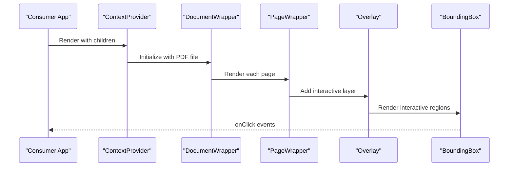

The typical integration pattern involves:

1. Wrapping the application with `ContextProvider`
2. Using `DocumentWrapper` to load a PDF file
3. Rendering pages with `PageWrapper`
4. Adding interactive overlays with `Overlay` and `BoundingBox`
5. Consuming context data through React hooks

Sources: [ui/demo/components/Reader.tsx:76-99](), [ui/demo/components/Header.tsx:1-84]()

---

# Page: Component Architecture

# Component Architecture

<details>
<summary>Relevant source files</summary>

The following files were used as context for generating this wiki page:

- [ui/library/src/components/DocumentWrapper.tsx](ui/library/src/components/DocumentWrapper.tsx)
- [ui/library/src/components/PageWrapper.tsx](ui/library/src/components/PageWrapper.tsx)
- [ui/library/src/components/outline/Outline.tsx](ui/library/src/components/outline/Outline.tsx)
- [ui/library/src/components/outline/OutlineItem.tsx](ui/library/src/components/outline/OutlineItem.tsx)
- [ui/library/src/context/ContextProvider.tsx](ui/library/src/context/ContextProvider.tsx)
- [ui/library/src/context/DocumentContext.ts](ui/library/src/context/DocumentContext.ts)

</details>


This document explains the component hierarchy and architectural patterns of the PDF Components Library. It covers how the `ContextProvider` orchestrates multiple React contexts, the relationship between core rendering components like `DocumentWrapper` and `PageWrapper`, and how supporting components integrate into the system.

For information about the individual context implementations and their state management responsibilities, see [Context System](#2.3). For details about specific rendering component implementations, see [Core Rendering Components](#2.4).

## Architecture Overview

The PDF Components Library uses a hierarchical component architecture built around React Context for state management. The system is designed with clear separation of concerns, where different contexts handle specific aspects of PDF rendering and interaction.

### Component Hierarchy Diagram

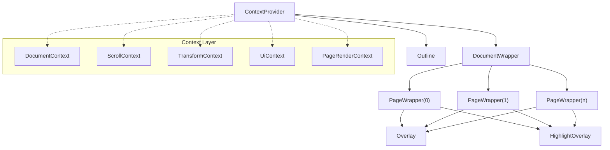

Sources: [ui/library/src/context/ContextProvider.tsx:13-38](), [ui/library/src/components/DocumentWrapper.tsx:20-117](), [ui/library/src/components/PageWrapper.tsx:33-130]()

## Context Orchestration

The `ContextProvider` component serves as the root orchestrator for all React contexts in the system. It creates and manages the lifecycle of five distinct contexts, each responsible for different aspects of the PDF viewing experience.

### Context Provider Implementation

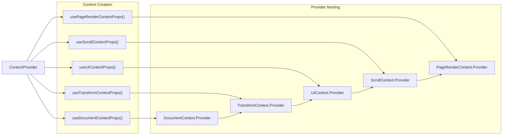

The `ContextProvider` creates context props using custom hooks and establishes dependencies between contexts. Notably, `PageRenderContext` depends on values from `DocumentContext`, `TransformContext`, and `ScrollContext`:

| Context | Dependencies | Purpose |
|---------|-------------|---------|
| `DocumentContext` | None | PDF document metadata, outline data |
| `TransformContext` | None | Scale, rotation, pixel ratio |
| `UiContext` | None | UI state, loading states |
| `ScrollContext` | None | Scroll position, page visibility |
| `PageRenderContext` | Document, Transform, Scroll | Page image rendering coordination |

Sources: [ui/library/src/context/ContextProvider.tsx:13-38](), [ui/library/src/context/ContextProvider.tsx:18-23]()

## Core Component Flow

The main component hierarchy follows a predictable pattern from document loading through individual page rendering.

### Document to Page Flow

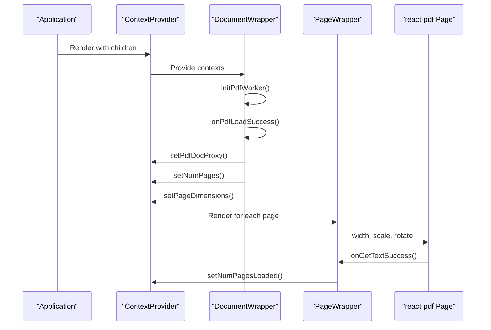

### DocumentWrapper Responsibilities

The `DocumentWrapper` component wraps react-pdf's `Document` component and handles:

- **PDF Worker Initialization**: Calls `initPdfWorker()` to set up PDF.js worker
- **Document Loading**: Manages `onPdfLoadSuccess`, `onPdfLoadError`, and `onSourceError` callbacks
- **Scale Synchronization**: Updates scroll position when scale changes to maintain user's view
- **Context Updates**: Sets document proxy, page count, and page dimensions in `DocumentContext`

Key implementation details:

```typescript
// Scale change handling
React.useEffect(() => {
  if (scale === lastScale) return;
  const zoomMultiplier = scale / lastScale;
  updateScrollPosition(zoomMultiplier);
  setLastScale(scale);
}, [scale, updateScrollPosition]);
```

Sources: [ui/library/src/components/DocumentWrapper.tsx:25-26](), [ui/library/src/components/DocumentWrapper.tsx:44-51](), [ui/library/src/components/DocumentWrapper.tsx:53-71]()

### PageWrapper Responsibilities

The `PageWrapper` component wraps react-pdf's `Page` component for individual pages and handles:

- **Page Styling**: Computes page dimensions, rotation, and background images
- **Outline Targets**: Renders clickable outline destination markers
- **Image Overlays**: Manages background images from `PageRenderContext`
- **Child Components**: Renders `HighlightOverlay` and `Overlay` children

The component uses multiple contexts to compute its display properties:

| Context Used | Data Retrieved | Usage |
|-------------|----------------|-------|
| `TransformContext` | `rotation`, `scale` | Page dimensions and styling |
| `DocumentContext` | `pageDimensions`, `getOutlineTargets` | Base dimensions and outline markers |
| `PageRenderContext` | `getObjectURLForPage`, `isBuildingObjectURLForPage` | Background image management |
| `UiContext` | `isLoading` | Loading state display |

Sources: [ui/library/src/components/PageWrapper.tsx:43-47](), [ui/library/src/components/PageWrapper.tsx:58-64](), [ui/library/src/components/PageWrapper.tsx:70-76]()

## Supporting Components

### Outline Component

The `Outline` component provides table of contents functionality by fetching outline data from the PDF and rendering navigable items.

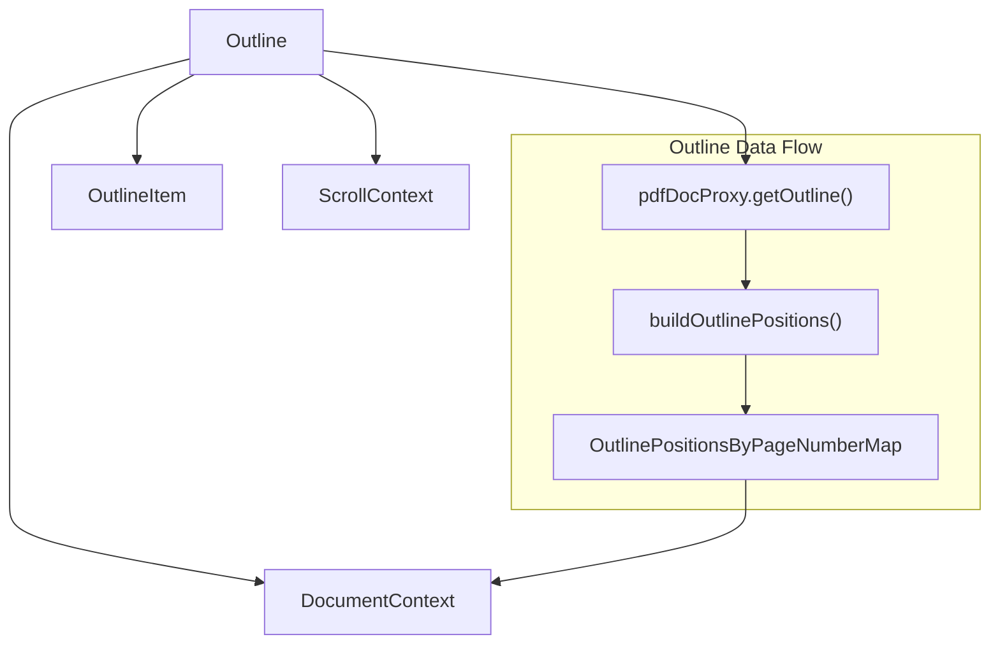

The outline fetching process:

1. **Check for existing outline**: Returns early if outline already loaded
2. **Fetch outline array**: Calls `pdfDocProxy.getOutline()`
3. **Build positions**: Calls `buildOutlinePositions()` to map outline items to page coordinates
4. **Update contexts**: Sets outline data and positions in `DocumentContext`
5. **Reset observers**: Calls `resetScrollObservers()` in `ScrollContext`

Sources: [ui/library/src/components/outline/Outline.tsx:13-34](), [ui/library/src/context/DocumentContext.ts:126-184]()

### OutlineItem Component

The `OutlineItem` component renders individual outline entries with visibility tracking and click handling:

- **Recursive Rendering**: Renders nested outline items recursively
- **Visibility Tracking**: Uses `ScrollContext.isOutlineTargetVisible()` for highlighting
- **Click Navigation**: Triggers scroll navigation through callback props

Sources: [ui/library/src/components/outline/OutlineItem.tsx:12-43]()

## Component-to-Code Entity Mapping

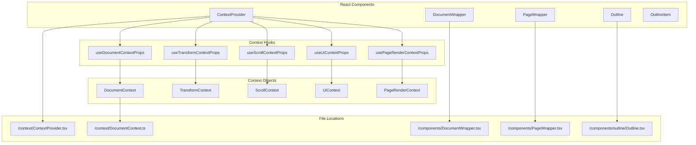

This mapping shows the relationship between React components, their corresponding files, and the context system they use. Each component is implemented in its own TypeScript file and consumes one or more contexts for state management.

Sources: [ui/library/src/context/ContextProvider.tsx:1-39](), [ui/library/src/components/DocumentWrapper.tsx:1-118](), [ui/library/src/components/PageWrapper.tsx:1-131](), [ui/library/src/components/outline/Outline.tsx:1-54](), [ui/library/src/context/DocumentContext.ts:1-201]()

---

# Page: Context System

# Context System

<details>
<summary>Relevant source files</summary>

The following files were used as context for generating this wiki page:

- [ui/library/src/components/ZoomInButton.tsx](ui/library/src/components/ZoomInButton.tsx)
- [ui/library/src/components/ZoomOutButton.tsx](ui/library/src/components/ZoomOutButton.tsx)
- [ui/library/src/components/types/page.ts](ui/library/src/components/types/page.ts)
- [ui/library/src/context/ContextProvider.tsx](ui/library/src/context/ContextProvider.tsx)
- [ui/library/src/context/DocumentContext.ts](ui/library/src/context/DocumentContext.ts)
- [ui/library/src/context/PageRenderContext.ts](ui/library/src/context/PageRenderContext.ts)
- [ui/library/src/context/ScrollContext.ts](ui/library/src/context/ScrollContext.ts)
- [ui/library/src/context/TransformContext.ts](ui/library/src/context/TransformContext.ts)
- [ui/library/src/utils/format.ts](ui/library/src/utils/format.ts)
- [ui/library/test/context/ContextProvider.test.tsx](ui/library/test/context/ContextProvider.test.tsx)
- [ui/library/test/context/PageRenderContext.test.tsx](ui/library/test/context/PageRenderContext.test.tsx)
- [ui/library/test/context/ScrollContext.test.tsx](ui/library/test/context/ScrollContext.test.tsx)

</details>


## Purpose and Scope

The Context System provides a comprehensive React Context architecture that manages all state across the PDF Component Library. It consists of five specialized contexts that handle different aspects of PDF viewing functionality: scroll tracking, page rendering, document metadata, transformations, and UI state. This system enables components throughout the library to access and modify shared state without prop drilling.

For information about the components that consume these contexts, see [Core Rendering Components](#2.4). For details about the public API and how external applications use these contexts, see [Library API and Public Interface](#2.1).

## Context Architecture Overview

The context system is organized around five specialized contexts that are orchestrated by a central `ContextProvider`. Each context manages a specific domain of functionality while maintaining dependencies with other contexts.

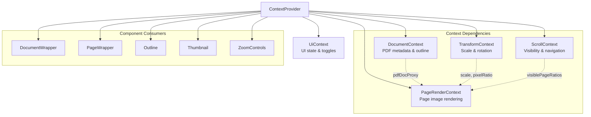

**Sources:** [ui/library/src/context/ContextProvider.tsx:1-38](), [ui/library/test/context/ContextProvider.test.tsx:1-87]()

## ScrollContext

The `ScrollContext` manages scroll-related state and provides navigation functionality throughout the PDF viewer. It tracks visible pages, outline targets, scroll direction, and provides methods for programmatic navigation.

### ScrollContext Interface and State

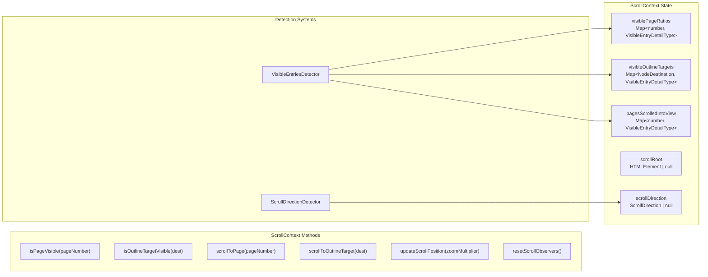

The `ScrollContext` uses two key detection systems:
- `VisibleEntriesDetector` with `IntersectionObserver` API to track element visibility
- `ScrollDirectionDetector` to monitor scroll events and direction changes

Key constants and selectors used:
- `PAGE_NUMBER_SELECTOR`: `.pdf-reader__page[data-page-number]`
- `OUTLINE_SELECTOR`: `.pdf-reader__page__outline-target`
- `DEFAULT_PAGE_SCROLLED_INTO_VIEW_THRESHOLD`: `0.1`

**Sources:** [ui/library/src/context/ScrollContext.ts:1-322](), [ui/library/test/context/ScrollContext.test.tsx:1-123]()

## PageRenderContext

The `PageRenderContext` manages the asynchronous rendering of PDF pages into image objects. It coordinates page rendering priority based on visibility and maintains a cache of rendered page images.

### Page Rendering State Management

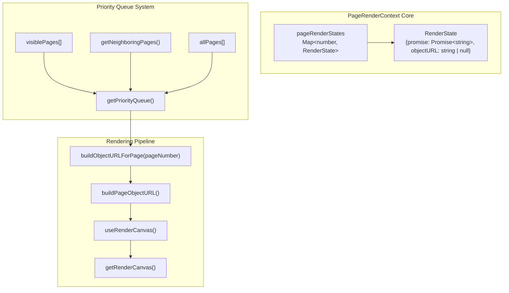

The rendering system implements several key optimizations:
- **Shared Canvas Rendering**: Uses a single `HTMLCanvasElement` with promise queuing
- **Priority-Based Rendering**: Visible pages → neighboring pages → all pages
- **Memory Management**: Revokes old `objectURL`s when scale changes
- **Scale Boost**: Renders at `2x` scale for better quality (`SCALE_BOOST = 2`)

**Sources:** [ui/library/src/context/PageRenderContext.ts:1-304](), [ui/library/test/context/PageRenderContext.test.tsx:1-81]()

## DocumentContext

The `DocumentContext` manages PDF document metadata, structure, and outline information. It provides access to the PDF document proxy and handles outline target positioning calculations.

### Document State and Outline Processing

```mermaid
graph TD
    subgraph "DocumentContext State"
        NP["numPages: number"]
        NPL["numPagesLoaded: number"]
        OUT["outline: OutlineNode[] | null"]
        OP["outlinePositions<br/>Map&lt;number, OutlinePosition[]>"]
        PD["pageDimensions: Dimensions"]
        PDF["pdfDocProxy: PDFDocumentProxy"]
    end
    
    subgraph "Outline Processing"
        BOP["buildOutlinePositions()"]
        GD["getDestination()"]
        GOT["getOutlineTargets()"]
        CTP["calculateTargetPosition()"]
    end
    
    subgraph "Outline Data Types"
        ON["OutlineNode<br/>{dest: string, items: OutlineNode[]}"]
        OPos["OutlinePosition<br/>{pageNumber, dest, leftPoint, bottomPoint}"]
        OT["OutlineTarget<br/>{dest, leftPx, topPx}"]
    end
    
    PDF --> BOP
    OUT --> BOP
    BOP --> GD
    GD --> OPos
    OPos --> OP
    OP --> GOT
    GOT --> CTP
    CTP --> OT
```

The outline processing system performs depth-first search through outline items and converts PDF coordinate destinations into pixel positions for rendering overlay targets.

**Sources:** [ui/library/src/context/DocumentContext.ts:1-201]()

## TransformContext

The `TransformContext` manages coordinate transformations including scale (zoom), rotation, and pixel ratio adjustments. It provides the foundation for responsive PDF rendering across different devices and zoom levels.

### Transform State and Properties

| Property | Type | Default | Purpose |
|----------|------|---------|---------|
| `scale` | `number` | `1.0` | Current zoom level |
| `rotation` | `PageRotation` | `Rotate0` | Page rotation state |
| `pixelRatio` | `number` | `window.devicePixelRatio` | Device pixel density |
| `zoomIncrementValue` | `number` | `0.2` | Zoom step size |

The context provides setter methods for each property and is consumed by zoom controls and page rendering components to maintain consistent transformations across the application.

**Sources:** [ui/library/src/context/TransformContext.ts:1-56](), [ui/library/src/components/ZoomInButton.tsx:1-49](), [ui/library/src/components/ZoomOutButton.tsx:1-47]()

## ContextProvider Orchestration

The `ContextProvider` component serves as the central orchestrator that instantiates all contexts and manages their interdependencies. It follows a specific nesting order to ensure proper data flow.

### Context Provider Structure

```mermaid
graph TD
    subgraph "ContextProvider Implementation"
        CP["ContextProvider"]
        
        subgraph "Hook Calls"
            UDC["useDocumentContextProps()"]
            UTC["useTransformContextProps()"]
            UUC["useUiContextProps()"]
            USC["useScrollContextProps()"]
            UPC["usePageRenderContextProps({<br/>  pdfDocProxy,<br/>  pixelRatio,<br/>  scale,<br/>  visiblePageRatios<br/>})"]
        end
        
        subgraph "Provider Nesting"
            DCP["DocumentContext.Provider"]
            TCP["TransformContext.Provider"]
            UCP["UiContext.Provider"]
            SCP["ScrollContext.Provider"]
            PCP["PageRenderContext.Provider"]
        end
    end
    
    CP --> UDC
    CP --> UTC
    CP --> UUC
    CP --> USC
    CP --> UPC
    
    DCP --> TCP
    TCP --> UCP
    UCP --> SCP
    SCP --> PCP
    
    UDC --> DCP
    UTC --> TCP
    UUC --> UCP
    USC --> SCP
    UPC --> PCP
```

The `PageRenderContext` is the most dependent context, requiring properties from `DocumentContext`, `TransformContext`, and `ScrollContext`. This dependency is explicitly managed in the `ContextProvider` by passing these values to `usePageRenderContextProps`.

**Sources:** [ui/library/src/context/ContextProvider.tsx:1-38]()

## State Flow and Context Dependencies

The context system implements a unidirectional data flow with specific dependency relationships between contexts.

### Context Dependency Graph

```mermaid
graph LR
    subgraph "Independent Contexts"
        DC["DocumentContext<br/>• PDF loading<br/>• Outline data<br/>• Page dimensions"]
        TC["TransformContext<br/>• Scale/zoom<br/>• Rotation<br/>• Pixel ratio"]
        UC["UiContext<br/>• UI toggles<br/>• Loading states"]
    end
    
    subgraph "Observer-Dependent Context"
        SC["ScrollContext<br/>• Visible pages<br/>• Scroll direction<br/>• Navigation"]
    end
    
    subgraph "Multi-Dependent Context"
        PRC["PageRenderContext<br/>• Page images<br/>• Render queue<br/>• Object URLs"]
    end
    
    DC -->|"pdfDocProxy"| PRC
    TC -->|"scale, pixelRatio"| PRC
    SC -->|"visiblePageRatios"| PRC
    
    SC -.->|"DOM observers"| DOM["DOM Elements"]
    DOM -.->|"intersection events"| SC
```

This dependency structure ensures that:
1. **Independent contexts** can be used standalone
2. **ScrollContext** depends only on DOM observations
3. **PageRenderContext** aggregates data from multiple contexts for optimal rendering

**Sources:** [ui/library/src/context/ContextProvider.tsx:18-23](), [ui/library/src/context/PageRenderContext.ts:44-54]()

---

# Page: Core Rendering Components

# Core Rendering Components

<details>
<summary>Relevant source files</summary>

The following files were used as context for generating this wiki page:

- [ui/library/dist/index.d.ts](ui/library/dist/index.d.ts)
- [ui/library/dist/package.json](ui/library/dist/package.json)
- [ui/library/dist/pdf-components.css](ui/library/dist/pdf-components.css)
- [ui/library/dist/pdf-components.js](ui/library/dist/pdf-components.js)
- [ui/library/src/components/DocumentWrapper.tsx](ui/library/src/components/DocumentWrapper.tsx)
- [ui/library/src/components/PageWrapper.tsx](ui/library/src/components/PageWrapper.tsx)
- [ui/library/src/components/outline/Outline.tsx](ui/library/src/components/outline/Outline.tsx)
- [ui/library/src/components/outline/OutlineItem.tsx](ui/library/src/components/outline/OutlineItem.tsx)

</details>


This document covers the primary components responsible for PDF document rendering and display within the PDF Components Library. These components form the foundation of the PDF viewing experience, handling document loading, individual page rendering, and document structure navigation.

For information about interactive elements and navigation features, see [Interactive and Navigation Components](#2.5). For details about the context system that manages state across these components, see [Context System](#2.3).

## Purpose and Scope

The core rendering components include three main elements:

- **DocumentWrapper**: Manages PDF document loading, initialization, and high-level document operations
- **PageWrapper**: Handles individual page rendering with support for different render modes and overlay content
- **Outline**: Provides document structure navigation through table of contents functionality

These components work together to transform PDF documents into interactive React components, leveraging the react-pdf library while adding enhanced functionality for overlays, navigation, and responsive scaling.

## DocumentWrapper Component

The `DocumentWrapper` component serves as the primary interface for loading and managing PDF documents. It wraps react-pdf's `Document` component while providing additional functionality for state management and error handling.

```mermaid
graph TD
    DW["DocumentWrapper"] --> RPD["react-pdf Document"]
    DW --> DC["DocumentContext"]
    DW --> SC["ScrollContext"] 
    DW --> TC["TransformContext"]
    DW --> UC["UiContext"]
    
    DW --> PWI["PDF Worker Init"]
    DW --> EDH["Error & Loading Handler"]
    DW --> SPU["Scroll Position Updates"]
    
    RPD --> PDF["PDF.js Engine"]
    DC --> |"setNumPages, setPageDimensions"| DW
    TC --> |"scale, rotation"| DW
    SC --> |"updateScrollPosition"| DW
    UC --> |"setIsLoading, setErrorMessage"| DW
```

**Key Responsibilities:**

- **PDF Worker Initialization**: Calls `initPdfWorker()` to set up the PDF.js worker thread
- **Document Loading**: Handles PDF document loading with comprehensive error handling
- **Page Dimensions**: Extracts and stores page dimensions from the first page for layout calculations
- **Scale Management**: Monitors scale changes and updates scroll position to maintain user's current view
- **Context Integration**: Updates multiple context providers with document-level state

**Core Methods:**

- `onPdfLoadSuccess`: Processes successful PDF loading by setting page count, dimensions, and PDF document proxy
- `onSourceError`/`onPdfLoadError`: Unified error handling for various failure scenarios
- `onItemClicked`: Handles navigation to internal PDF destinations

Sources: [ui/library/src/components/DocumentWrapper.tsx:1-118]()

## PageWrapper Component  

The `PageWrapper` component manages individual page rendering with support for multiple render types and overlay content. It provides a flexible foundation for displaying PDF pages with interactive elements.

```mermaid
graph TD
    PW["PageWrapper"] --> RP["react-pdf Page"]
    PW --> OV["Overlay Content"]
    PW --> PT["Page Targets"]
    
    subgraph "Context Dependencies"
        DC2["DocumentContext"] --> |"pageDimensions, getOutlineTargets"| PW
        TC2["TransformContext"] --> |"scale, rotation"| PW
        PRC["PageRenderContext"] --> |"getObjectURLForPage"| PW
        UC2["UiContext"] --> |"isLoading"| PW
    end
    
    subgraph "Render Types"
        RT1["SINGLE_CANVAS"]
        RT2["MULTI_CANVAS"]
    end
    
    subgraph "Page Elements"
        PI["Page Image"] --> |"backgroundImage"| PW
        TL["Text Layer"] --> RP
        AL["Annotation Layer"] --> RP
        OT["Outline Targets"] --> PT
    end
    
    PW --> RT1
    PW --> RT2
```

**Render Type Support:**

The component supports two distinct render modes defined in `RENDER_TYPE`:

- **SINGLE_CANVAS**: Uses a single canvas element for page rendering
- **MULTI_CANVAS**: Uses multiple canvas elements with enhanced text layer handling

**Key Features:**

- **Dynamic Styling**: Calculates page dimensions accounting for rotation and scale using `computePageStyle()`
- **Image Overlay**: Supports background images via `getObjectURLForPage()` from PageRenderContext
- **Outline Targets**: Renders invisible positioning elements for document outline navigation
- **Loading States**: Shows building indicators when page images are being generated

**Style Management:**

The component uses several utility functions for layout calculations:
- `computePageStyle()`: Calculates page container dimensions
- `getPageWidth()`: Determines page width accounting for rotation
- `generatePageIdFromIndex()`: Creates unique page identifiers for navigation

Sources: [ui/library/src/components/PageWrapper.tsx:1-131]()

## Outline Component

The `Outline` component provides document structure navigation by rendering a hierarchical table of contents. It fetches outline data from the PDF document and manages outline positioning for smooth navigation.

```mermaid
graph TD
    O["Outline"] --> OI["OutlineItem"]
    O --> DC3["DocumentContext"]
    O --> SC2["ScrollContext"]
    
    subgraph "Outline Data Flow"
        PDF2["pdfDocProxy"] --> |"getOutline()"| OA["Outline Array"]
        OA --> |"buildOutlinePositions()"| OP["Outline Positions"]
        OP --> |"setOutlinePositions()"| DC3
    end
    
    subgraph "Navigation Handling"
        OI --> |"onClick"| CH["Click Handler"]
        CH --> |"scrollToOutlineTarget()"| SC2
        SC2 --> |"smooth scroll"| DOM["DOM Element"]
    end
    
    subgraph "Recursive Structure"
        OI --> OI2["Child OutlineItem"]
        OI2 --> OI3["Nested OutlineItem"]
    end
    
    O --> |"resetScrollObservers()"| SC2
```

**Outline Processing Pipeline:**

1. **Data Fetching**: Calls `pdfDocProxy.getOutline()` to retrieve outline structure
2. **Position Building**: Uses `buildOutlinePositions()` to calculate precise positioning data
3. **Observer Reset**: Triggers `resetScrollObservers()` to update intersection observers
4. **Navigation**: Provides click handlers that call `scrollToOutlineTarget()`

**OutlineItem Integration:**

The `Outline` component renders `OutlineItem` components recursively to handle nested document structures. Each outline item:

- Displays the outline title as a clickable link
- Maintains visibility state based on scroll position via `isOutlineTargetVisible()`
- Handles click events to navigate to the corresponding document section
- Recursively renders child outline items for hierarchical structures

Sources: [ui/library/src/components/outline/Outline.tsx:1-54](), [ui/library/src/components/outline/OutlineItem.tsx:1-44]()

## Component Integration and Data Flow

The core rendering components work together through the context system to provide a cohesive PDF viewing experience. The following diagram illustrates the primary data flows and component relationships:

```mermaid
graph TB
    subgraph "Context Layer"
        DC4["DocumentContext"]
        SC3["ScrollContext"] 
        TC3["TransformContext"]
        PRC2["PageRenderContext"]
        UC3["UiContext"]
    end
    
    subgraph "Core Components"
        DW2["DocumentWrapper"]
        PW2["PageWrapper"]
        O2["Outline"]
    end
    
    subgraph "React-PDF Integration"
        DOC["Document"]
        PAGE["Page"]
    end
    
    subgraph "PDF.js Engine"
        WORKER["PDF Worker"]
        PROXY["PDFDocumentProxy"]
    end
    
    DW2 --> DOC
    PW2 --> PAGE
    DOC --> PROXY
    PAGE --> PROXY
    
    DW2 -.-> DC4
    DW2 -.-> SC3
    DW2 -.-> TC3
    DW2 -.-> UC3
    
    PW2 -.-> DC4
    PW2 -.-> TC3
    PW2 -.-> PRC2
    PW2 -.-> UC3
    
    O2 -.-> DC4
    O2 -.-> SC3
    
    PROXY --> WORKER
```

**Key Integration Points:**

- **Document Loading**: `DocumentWrapper` initializes the PDF document and populates `DocumentContext` with essential data
- **Page Rendering**: `PageWrapper` consumes context data to render individual pages with proper scaling and positioning
- **Navigation**: `Outline` uses document data to build navigation structure and integrates with `ScrollContext` for smooth scrolling
- **State Synchronization**: All components share state through React contexts, ensuring consistent behavior across the application

The components leverage the context system extensively, avoiding direct prop passing and enabling flexible composition patterns for consuming applications.

Sources: [ui/library/src/components/DocumentWrapper.tsx:27-31](), [ui/library/src/components/PageWrapper.tsx:43-47](), [ui/library/src/components/outline/Outline.tsx:9-11]()

---

# Page: Interactive and Navigation Components

# Interactive and Navigation Components

<details>
<summary>Relevant source files</summary>

The following files were used as context for generating this wiki page:

- [ui/demo/components/Thumbnail.tsx](ui/demo/components/Thumbnail.tsx)
- [ui/library/src/components/BoundingBox.tsx](ui/library/src/components/BoundingBox.tsx)
- [ui/library/src/components/thumbnails/Thumbnail.tsx](ui/library/src/components/thumbnails/Thumbnail.tsx)
- [ui/library/src/components/thumbnails/ThumbnailList.tsx](ui/library/src/components/thumbnails/ThumbnailList.tsx)
- [ui/library/src/context/UiContext.ts](ui/library/src/context/UiContext.ts)
- [ui/library/test/components/BoundingBox.test.tsx](ui/library/test/components/BoundingBox.test.tsx)

</details>


This document covers the interactive overlay and navigation components within the PDF Component Library that enable user interaction with PDF documents. These components provide clickable regions, thumbnail navigation, and UI state management for enhanced document viewing experiences.

For information about the core document rendering components, see [Core Rendering Components](#2.4). For details about the context system that manages state for these components, see [Context System](#2.3).

## Overview

The interactive and navigation components consist of two main systems:

- **BoundingBox component** - Creates interactive rectangular regions overlaid on PDF pages for highlighting, clicking, and annotation features
- **Thumbnail navigation system** - Provides miniature page previews for quick document navigation and visual page identification

These components integrate closely with the context system to respond to user interactions, document transformations, and navigation state changes.

## Component Architecture

```mermaid
graph TD
    subgraph "Interactive Components"
        BB["BoundingBox"]
        TH["Thumbnail"]
        TL["ThumbnailList"]
    end
    
    subgraph "Context Dependencies"
        DC["DocumentContext"]
        TC["TransformContext"]
        SC["ScrollContext"]
        PRC["PageRenderContext"]
        UC["UiContext"]
    end
    
    subgraph "Demo Integration"
        DT["Demo Thumbnail (Drawer)"]
    end
    
    BB --> DC
    BB --> TC
    TH --> SC  
    TH --> PRC
    TL --> DC
    TL --> TH
    DT --> UC
    DT --> TL
    
    UC -.-> TH
    UC -.-> TL
```

**Sources:** [ui/library/src/components/BoundingBox.tsx:1-69](), [ui/library/src/components/thumbnails/Thumbnail.tsx:1-57](), [ui/library/src/components/thumbnails/ThumbnailList.tsx:1-23](), [ui/library/src/context/UiContext.ts:1-71]()

## BoundingBox Component

The `BoundingBox` component creates interactive rectangular overlays positioned on PDF pages. It handles coordinate transformations based on page rotation and scaling, making it suitable for annotations, highlights, and clickable regions.

### Core Functionality

| Property | Type | Purpose |
|----------|------|---------|
| `top`, `left`, `height`, `width` | number | Defines the rectangular bounds |
| `onClick` | function | Handles click interactions |
| `isHighlighted` | boolean | Controls visual highlighting state |
| `className` | string | Custom styling classes |

The component renders two DOM elements: an underline div and the main interactive div, both positioned using the `computeBoundingBoxStyle` utility function.

```mermaid
graph LR
    subgraph "BoundingBox Rendering"
        BB["BoundingBox Component"]
        UL["Underline Div"]
        MD["Main Div"]
        CBS["computeBoundingBoxStyle()"]
    end
    
    subgraph "Context Inputs"
        PD["pageDimensions"]
        ROT["rotation"]
        SC["scale"]
    end
    
    BB --> UL
    BB --> MD
    BB --> CBS
    CBS --> PD
    CBS --> ROT
    CBS --> SC
    
    PD --> DC
    ROT --> TC
    SC --> TC
```

**Sources:** [ui/library/src/components/BoundingBox.tsx:18-68](), [ui/library/test/components/BoundingBox.test.tsx:12-202]()

### Coordinate Transformation

The BoundingBox handles complex coordinate transformations for different page orientations:

- **Rotation support**: 0°, 90°, 180°, 270° rotations with automatic coordinate adjustment
- **Scaling support**: Proportional scaling of position and dimensions based on zoom level
- **Dynamic recalculation**: Responds to context changes via React hooks

The transformation logic is encapsulated in the `getBoundingBoxStyle` callback that recomputes positioning when `pageDimensions`, `rotation`, or `scale` change.

**Sources:** [ui/library/src/components/BoundingBox.tsx:40-46](), [ui/library/test/components/BoundingBox.test.tsx:37-189]()

## Thumbnail Navigation System

The thumbnail system provides visual navigation through page previews, allowing users to quickly jump to specific pages and see their current position within the document.

### Thumbnail Component

The `Thumbnail` component represents a single page thumbnail with navigation functionality:

```mermaid
graph TD
    subgraph "Thumbnail Component Flow"
        T["Thumbnail"]
        GOU["getObjectURLForPage()"]
        IMG["Image Element"]
        CLICK["onClick Handler"]
        STP["scrollToPage()"]
    end
    
    subgraph "State Management"
        VPR["visiblePageRatios"]
        GMVE["getMaxVisibleElement()"]
        MVPN["maxVisiblePageNumber"]
    end
    
    subgraph "Visual States"
        VIS["isThumbnailVisible"]
        CSS["CSS Classes"]
    end
    
    T --> GOU
    GOU --> IMG
    T --> CLICK
    CLICK --> STP
    
    VPR --> GMVE
    GMVE --> MVPN
    MVPN --> VIS
    VIS --> CSS
```

**Sources:** [ui/library/src/components/thumbnails/Thumbnail.tsx:13-56]()

### Key Features

1. **Page Image Rendering**: Uses `PageRenderContext.getObjectURLForPage()` to obtain rendered page images
2. **Navigation**: Implements `ScrollContext.scrollToPage()` for programmatic navigation
3. **Visual State**: Highlights the currently most visible page using `getMaxVisibleElement` utility
4. **Accessibility**: Includes ARIA labels and semantic HTML structure

### ThumbnailList Component

The `ThumbnailList` component generates thumbnails for all pages in the document:

```javascript
// Simplified structure from ThumbnailList.tsx
Array.from({ length: numPages }).map((_, pageIndex) => (
  <li key={pageIndex + 1} className="pdf-reader__thumbnail-list__item">
    <Thumbnail pageNumber={pageIndex + 1} />
  </li>
))
```

**Sources:** [ui/library/src/components/thumbnails/ThumbnailList.tsx:8-22]()

## UI State Management

The `UiContext` manages visibility and interaction states for navigation components:

| State Property | Purpose |
|----------------|---------|
| `isShowingThumbnail` | Controls thumbnail panel visibility |
| `isShowingOutline` | Controls document outline visibility |
| `isShowingHighlightOverlay` | Controls highlight overlay display |
| `isShowingTextHighlight` | Controls text highlighting features |

```mermaid
graph TB
    subgraph "UiContext State"
        UC["UiContext"]
        IST["isShowingThumbnail"]
        ISO["isShowingOutline"]
        ISHO["isShowingHighlightOverlay"]
        ISTH["isShowingTextHighlight"]
    end
    
    subgraph "State Setters"
        SIST["setIsShowingThumbnail"]
        SISO["setIsShowingOutline"]
        SISHO["setIsShowingHighlightOverlay"]
        SISTH["setIsShowingTextHighlight"]
    end
    
    subgraph "Components"
        TL["ThumbnailList"]
        DT["Demo Thumbnail"]
        BB["BoundingBox"]
    end
    
    UC --> IST
    UC --> ISO
    UC --> ISHO
    UC --> ISTH
    
    IST --> SIST
    ISO --> SISO
    ISHO --> SISHO
    ISTH --> SISTH
    
    IST -.-> TL
    IST -.-> DT
    ISHO -.-> BB
```

**Sources:** [ui/library/src/context/UiContext.ts:6-70]()

## Integration Patterns

### Demo Application Integration

The demo application shows how to integrate thumbnails using Ant Design components:

```typescript
// From ui/demo/components/Thumbnail.tsx
export const Thumbnail: React.FunctionComponent<Props> = ({ parentRef }: Props) => {
  const { isShowingThumbnail, setIsShowingThumbnail } = React.useContext(UiContext);
  
  return (
    <Drawer
      title="Thumbnail"
      placement="left"
      visible={isShowingThumbnail}
      onClose={handleHideThumbnail}
      getContainer={parentRef.current}>
      <ThumbnailList />
    </Drawer>
  );
};
```

This pattern demonstrates:
- Context-driven visibility control
- Container-based mounting for layout control
- Clean separation between library and UI framework components

**Sources:** [ui/demo/components/Thumbnail.tsx:9-31]()

### Interaction Flow

```mermaid
sequenceDiagram
    participant U as User
    participant T as Thumbnail
    participant SC as ScrollContext
    participant PRC as PageRenderContext
    participant UC as UiContext
    
    U->>UC: Toggle thumbnail visibility
    UC->>T: Update isShowingThumbnail
    T->>PRC: Request page images
    PRC->>T: Return object URLs
    T->>T: Render thumbnail images
    U->>T: Click thumbnail
    T->>SC: scrollToPage(pageNumber)
    SC->>T: Update visiblePageRatios
    T->>T: Update visual state
```

**Sources:** [ui/library/src/components/thumbnails/Thumbnail.tsx:13-56](), [ui/library/src/context/UiContext.ts:6-70]()

## Testing and Validation

The BoundingBox component includes comprehensive tests for coordinate transformations:

- **Rotation testing**: Validates correct positioning for all four rotation states (0°, 90°, 180°, 270°)
- **Scale testing**: Ensures proper scaling of dimensions and positions
- **Interaction testing**: Verifies click handlers and event propagation

The test suite uses mock contexts to isolate component behavior and validate style calculations independently.

**Sources:** [ui/library/test/components/BoundingBox.test.tsx:12-202]()

---

# Page: Utility Systems

# Utility Systems

<details>
<summary>Relevant source files</summary>

The following files were used as context for generating this wiki page:

- [ui/library/src/components/PageNumberControl.tsx](ui/library/src/components/PageNumberControl.tsx)
- [ui/library/src/components/types/outline.ts](ui/library/src/components/types/outline.ts)
- [ui/library/src/utils/MaxVisibleElement.ts](ui/library/src/utils/MaxVisibleElement.ts)
- [ui/library/src/utils/ScrollDirectionDetector.ts](ui/library/src/utils/ScrollDirectionDetector.ts)
- [ui/library/src/utils/VisibleEntriesDetector.ts](ui/library/src/utils/VisibleEntriesDetector.ts)
- [ui/library/src/utils/scroll.ts](ui/library/src/utils/scroll.ts)
- [ui/library/test/utils/VisibleEntriesDetector.test.ts](ui/library/test/utils/VisibleEntriesDetector.test.ts)
- [ui/library/test/utils/scroll.test.ts](ui/library/test/utils/scroll.test.ts)
- [ui/library/test/utils/scrollDirectionDetector.test.ts](ui/library/test/utils/scrollDirectionDetector.test.ts)

</details>


The utility systems provide foundational infrastructure for scroll management, visibility tracking, and coordinate transformations within the PDF Component Library. These systems handle low-level operations that support user interactions such as navigation, page tracking, and position-based scrolling.

This document covers the core utility classes and functions that manage scroll behavior, detect element visibility, and perform coordinate calculations. For information about the components that consume these utilities, see [Interactive and Navigation Components](#2.5). For details about the context system that coordinates state management, see [Context System](#2.3).

## Scroll Management System

The scroll management system provides programmatic control over PDF document navigation through a collection of utilities in [ui/library/src/utils/scroll.ts](). These utilities handle scrolling to specific pages, positions within pages, and coordinate transformations between PDF coordinate space and browser pixels.

### Core Scroll Functions

The system provides several key functions for navigation:

| Function | Purpose | Parameters |
|----------|---------|------------|
| `scrollToPdfPageIndex` | Navigate to a specific page | `pageIndex: number \| string` |
| `scrollToPosition` | Navigate to coordinates within a page | `pageIndex`, `leftPoints`, `bottomPoints`, `rotation` |
| `scrollToId` | Scroll to DOM element by ID | `id: string` |

```mermaid
flowchart TD
    subgraph "Scroll Management System"
        STP["scrollToPdfPageIndex()"]
        STPos["scrollToPosition()"]
        STI["scrollToId()"]
        GPI["generatePageIdFromIndex()"]
        GSP["getScrollParent()"]
        GPP["getPagePropertiesInPixels()"]
        CTP["calculateTopPx()"]
    end
    
    subgraph "Consumer Components"
        PNC["PageNumberControl"]
        OUT["Outline"]
        THU["Thumbnail"]
    end
    
    subgraph "Browser APIs"
        SIV["scrollIntoView()"]
        SCT["scrollTo()"]
        GCS["getComputedStyle()"]
    end
    
    PNC --> STP
    OUT --> STPos
    THU --> STP
    
    STP --> GPI
    STP --> STI
    STPos --> GPI
    STPos --> GSP
    STPos --> GPP
    STPos --> CTP
    
    STI --> SIV
    GSP --> SCT
    GPP --> GCS
```

Sources: [ui/library/src/utils/scroll.ts:1-196](), [ui/library/src/components/PageNumberControl.tsx:1-100]()

### Page Identification and Navigation

The system uses a consistent naming scheme for page elements through `generatePageIdFromIndex()`, which creates DOM IDs following the pattern `reader_pg_{pageIndex}`. This enables reliable navigation and element lookup across the application.

The `scrollToPosition()` function handles complex coordinate transformations when navigating to specific positions within PDF pages. It accounts for:
- Page rotation states (0°, 90°, 180°, 270°)
- PDF point-to-pixel conversions using standard PDF dimensions (612×792 points)
- Page margins and layout offsets
- Scrollable parent container detection

Sources: [ui/library/src/utils/scroll.ts:13-28](), [ui/library/src/utils/scroll.ts:37-101]()

## Visibility Detection System

The visibility detection system uses the `VisibleEntriesDetector` class to track which PDF pages and elements are currently visible in the viewport. This system powers navigation components, page number displays, and thumbnail highlighting.

### VisibleEntriesDetector Architecture

```mermaid
classDiagram
    class VisibleEntriesDetector {
        -_root: Element
        -_observer: IntersectionObserver
        -_lastVisibleEntries: Map~TEntry, VisibleEntryDetailType~
        -_setVisibleEntries: SetVisibleEntriesCallback
        -_onVisibleEntriesChange: onVisibleEntriesChangeCallback
        +constructor(root, threshold, callbacks)
        +observeNodes(selector: string)
        +destroy()
    }
    
    class VisibleEntryDetailType {
        +ratio: number
        +timestamp: number
    }
    
    class IntersectionObserver {
        +observe(element)
        +disconnect()
    }
    
    VisibleEntriesDetector --> IntersectionObserver
    VisibleEntriesDetector --> VisibleEntryDetailType
```

The detector uses the IntersectionObserver API with configurable thresholds (default: 101 thresholds from 0% to 100% visibility) and a 50px root margin for optimal performance. When visibility changes occur, the system:

1. Filters entries into visible and hidden collections
2. Calls the `onVisibleEntriesChange` callback to process changes
3. Updates the internal state with new visibility ratios
4. Notifies consumers through the `setVisibleEntries` callback

Sources: [ui/library/src/utils/VisibleEntriesDetector.ts:1-78](), [ui/library/test/utils/VisibleEntriesDetector.test.ts:1-149]()

### Scroll Direction Detection

The `ScrollDirectionDetector` class tracks scroll direction changes and provides threshold-based detection for UI responsiveness. It monitors both direction changes and whether sufficient scroll distance has occurred in a given direction.

```mermaid
stateDiagram-v2
    [*] --> Initialized
    Initialized --> ScrollDown: scrollTop increases
    Initialized --> ScrollUp: scrollTop decreases
    ScrollDown --> ScrollUp: direction change
    ScrollUp --> ScrollDown: direction change
    ScrollDown --> ThresholdReached: scroll distance >= threshold
    ScrollUp --> ThresholdReached: scroll distance >= threshold
    ThresholdReached --> ScrollDown: continue scrolling down
    ThresholdReached --> ScrollUp: continue scrolling up
```

Key features of the scroll direction detector:
- Tracks current scroll direction (`ScrollDirection.UP` or `ScrollDirection.DOWN`)
- Monitors top position state (`isAtTop` boolean)
- Optional threshold detection for triggering UI changes after significant scroll
- Handles both window and element scroll events

Sources: [ui/library/src/utils/ScrollDirectionDetector.ts:1-95](), [ui/library/test/utils/scrollDirectionDetector.test.ts:1-404]()

## Coordinate Transformation Utilities

The system provides utilities for converting between PDF coordinate space and browser pixel coordinates, accounting for scaling, rotation, and viewport positioning.

### Coordinate Systems

The PDF component library works with multiple coordinate systems:

| System | Origin | Units | Usage |
|--------|--------|-------|-------|
| PDF Points | Bottom-left | Points (1/72 inch) | PDF.js native coordinates |
| Browser Pixels | Top-left | Pixels | DOM positioning and scrolling |
| Page Layout | Variable | Pixels | Rendered page with margins |

The `calculateTargetPosition()` function converts PDF point coordinates to pixel coordinates for a given page:

```mermaid
flowchart LR
    subgraph "PDF Coordinates"
        PP["leftPoint, bottomPoint<br/>(PDF Points)"]
    end
    
    subgraph "Transformation"
        CT["calculateTargetPosition()"]
        PD["pageDimensions"]
        SC["scale"]
        ROT["rotation"]
    end
    
    subgraph "Browser Coordinates"
        PX["leftPx, topPx<br/>(Pixels)"]
    end
    
    PP --> CT
    PD --> CT
    SC --> CT
    ROT --> CT
    CT --> PX
```

The transformation accounts for:
- Standard PDF page dimensions (612×792 points)
- Current zoom scale factor
- Page rotation state
- Coordinate system origin differences (bottom-left vs top-left)

Sources: [ui/library/src/utils/scroll.ts:174-195](), [ui/library/src/components/types/outline.ts:19-41]()

## Navigation Support Utilities

### Maximum Visible Element Detection

The `getMaxVisibleElement()` utility identifies which page has the highest visibility ratio, enabling accurate current page detection for navigation controls.

```mermaid
flowchart TD
    subgraph "Input"
        VER["visiblePageRatios<br/>Map&lt;number, VisibleEntryDetailType&gt;"]
    end
    
    subgraph "Processing"
        GMV["getMaxVisibleElement()"]
        ITE["Iterate entries"]
        CMP["Compare ratios"]
    end
    
    subgraph "Output"
        MAX["maxVisiblePageNumber<br/>number | null"]
    end
    
    VER --> GMV
    GMV --> ITE
    ITE --> CMP
    CMP --> MAX
```

This utility is used by `PageNumberControl` to update the current page display as users scroll through the document. The algorithm iterates through all visible pages and returns the page number with the highest visibility ratio.

Sources: [ui/library/src/utils/MaxVisibleElement.ts:1-19](), [ui/library/src/components/PageNumberControl.tsx:34-39]()

### Scrollable Parent Detection

The `getScrollParent()` function traverses the DOM hierarchy to find the nearest scrollable ancestor element. This is essential for applying scroll operations to the correct container, especially in complex layouts with nested scrollable regions.

The function checks for:
- Sufficient scroll height (minimum 50px to avoid Firefox inline container bugs)
- Non-hidden overflow styles (`overflow`, `overflowX`, `overflowY`)
- Document element fallback for top-level scrolling

Sources: [ui/library/src/utils/scroll.ts:103-124](), [ui/library/test/utils/scroll.test.ts:194-203]()

---

# Page: Styling System

# Styling System

<details>
<summary>Relevant source files</summary>

The following files were used as context for generating this wiki page:

- [ui/demo/less/colors.less](ui/demo/less/colors.less)
- [ui/demo/less/reader.less](ui/demo/less/reader.less)
- [ui/library/less/colors.less](ui/library/less/colors.less)
- [ui/library/less/index.less](ui/library/less/index.less)
- [ui/library/less/links.less](ui/library/less/links.less)
- [ui/library/less/print.less](ui/library/less/print.less)
- [ui/library/less/styles.less](ui/library/less/styles.less)
- [ui/library/less/text-layer.less](ui/library/less/text-layer.less)
- [ui/library/less/zindex.less](ui/library/less/zindex.less)

</details>


## Purpose and Scope

The Styling System provides the CSS architecture for both the core PDF Components Library and the demo application. It implements a modular Less-based approach with clearly defined color variables, z-index management, and component-specific styling patterns. The system handles PDF page rendering, interactive overlays, navigation components, and responsive design considerations.

For information about the React component architecture that uses these styles, see [Component Architecture](#2.2). For details about the build system that compiles these styles, see [Development and Build System](#5).

## Architecture Overview

The styling system is organized into separate Less modules that are compiled into distributable CSS. The library maintains its own styling independent of the demo application, allowing for clean separation of concerns.

### Less File Structure

```mermaid
graph TD
    subgraph "Library Styles (ui/library/less)"
        INDEX["index.less<br/>Main entry point"]
        COLORS["colors.less<br/>Color variables"]
        STYLES["styles.less<br/>Component styles"]
        ZINDEX["zindex.less<br/>Layer management"]
        TEXTLAYER["text-layer.less<br/>Text selection"]
        LINKS["links.less<br/>Link overrides"]
        PRINT["print.less<br/>Print media queries"]
    end
    
    subgraph "Demo Styles (ui/demo/less)"
        READER["reader.less<br/>Demo layout"]
        DEMO_COLORS["colors.less<br/>Demo colors"]
    end
    
    subgraph "Compiled Output"
        CSS["pdf-components.css<br/>Distributed stylesheet"]
    end
    
    INDEX --> COLORS
    INDEX --> STYLES
    INDEX --> ZINDEX
    INDEX --> TEXTLAYER
    INDEX --> LINKS
    INDEX --> PRINT
    
    STYLES --> COLORS
    STYLES --> ZINDEX
    LINKS --> ZINDEX
    
    INDEX --> CSS
    READER --> DEMO_COLORS
```

Sources: [ui/library/less/index.less:1-7](), [ui/demo/less/reader.less:1-108](), [ui/demo/less/colors.less:1-7]()

## Color System

The styling system uses Less variables to maintain consistent color schemes across components. The library defines its own color palette while the demo application extends it with additional colors.

### Library Color Variables

| Variable | Value | Usage |
|----------|-------|-------|
| `@pdflib-page-background` | `#ffffff` | Page backgrounds, panels |
| `@pdflib-page-shadow` | `#000000` | Drop shadows |
| `@pdflib-highlight-background` | `#ccb300` | Text highlights |
| `@pdflib-grey-0` | `#d9dadb` | Light grey elements |
| `@pdflib-grey-3` | `#2E3743` | Dark grey text |
| `@initial-blue` | `#1857B6` | Primary interactive color |
| `@hover-active-blue` | `#5492EF` | Hover states |
| `@loading-outline-yellow` | `#F4D35E` | Loading indicators |

### Demo Color Extensions

The demo application adds supplementary colors for its specific UI needs:

```less
@white: #fff;
@grey: #d9dadb;
@blue: #1890ff;
@light-blue: #40a9ff;
```

Sources: [ui/library/less/colors.less:1-8](), [ui/demo/less/colors.less:1-7]()

## Z-Index Management

The system uses a centralized z-index hierarchy to ensure proper layering of PDF content, overlays, and UI elements. This prevents visual conflicts between different interactive elements.

### Z-Index Hierarchy

```mermaid
graph TB
    subgraph "Z-Index Layers (Lowest to Highest)"
        A["@z-index-multicanvas: 10<br/>Multi-canvas rendering"]
        B["@z-index-text-layer: 20<br/>Selectable text"]
        C["@z-index-annotation-link: 30<br/>PDF links"]
        D["@z-index-bounding-box-overlay: 40<br/>Interactive regions"]
        E["@z-index-arrow-flag: 45<br/>Annotation flags"]
        F["@z-index-loading-content: 50<br/>Loading indicators"]
        G["@z-index-outline: 500<br/>Outline panel"]
        H["@z-index-header: 999<br/>Fixed header"]
    end
    
    A --> B
    B --> C
    C --> D
    D --> E
    E --> F
    F --> G
    G --> H
```

Sources: [ui/library/less/zindex.less:1-9]()

## Component Styling Patterns

### PDF Page Rendering

The `.pdf-reader__page` class provides the foundation for PDF page display with proper spacing, shadows, and background handling:

```less
.pdf-reader__page {
  background: @pdflib-page-background center center / cover no-repeat;
  margin: 24px;
  box-shadow: 0px 4px 14px fade(@pdflib-page-shadow, 20%);
  flex: 1 0 auto;
  position: relative;
}
```

The system handles different rendering modes through modifier classes:
- `.pdf-reader__page--render-type-single-canvas` - Single canvas rendering
- `.pdf-reader__page--render-type-multi-canvas` - Multi-canvas rendering
- `.pdf-reader__page--no-page-image` - Fallback when image unavailable
- `.pdf-reader__page--has-page-image` - When background image is loaded

Sources: [ui/library/less/styles.less:3-9](), [ui/library/less/styles.less:60-80](), [ui/library/less/styles.less:99-104]()

### Overlay System

Interactive overlays use absolute positioning with carefully managed z-indexes:

```mermaid
graph TD
    subgraph "Overlay Component Classes"
        BASE["pdf-reader__overlay<br/>Base overlay positioning"]
        BBOX["pdf-reader__overlay-bounding-box<br/>Interactive regions"]
        HIGH["pdf-reader__overlay-bounding-box-highlighted<br/>Highlighted interactions"]
        UNDER["pdf-reader__overlay-bounding-box-underline<br/>Rotation-aware borders"]
        PAGE_HIGH["pdf-reader__page-highlight-overlay<br/>Page-level highlights"]
    end
    
    BASE --> BBOX
    BASE --> PAGE_HIGH
    BBOX --> HIGH
    BBOX --> UNDER
```

The bounding box system includes hover effects and rotation-aware styling:
- Rotation classes (`.rotate0`, `.rotate90`, `.rotate180`, `.rotate270`) adjust border placement
- Blend modes (`mix-blend-mode: screen`) create highlight effects
- Pointer events are selectively disabled for non-interactive overlays

Sources: [ui/library/less/styles.less:11-54](), [ui/library/less/styles.less:106-110]()

### Navigation Components

#### Thumbnails

Thumbnail styling includes opacity transitions to indicate current page visibility:

```less
.pdf-reader__thumbnail {
  opacity: .5;
  transition: opacity 400ms ease-in-out;
  
  &:hover {
    opacity: .75;
    transition-duration: 75ms;
  }
  
  &.pdf-reader__thumbnail--is-visible {
    opacity: 1;
    transition-duration: 200ms;
  }
}
```

#### Side Panels

The side panel system includes resizable handles with accessibility support:
- Drag handles appear on hover with opacity transitions
- Assistive input elements support keyboard navigation
- Resize zones provide 15px interaction areas

Sources: [ui/library/less/styles.less:152-189](), [ui/library/less/styles.less:191-301]()

## Text Layer Integration

The system includes comprehensive text layer styling adapted from react-pdf to handle text selection, highlighting, and rendering:

### Text Selection and Highlighting

```less
.textLayer .highlight {
  margin: -1px;
  padding: 1px;
  background-color: rgba(180, 0, 170, 1);
  border-radius: 4px;
}
```

The text layer supports:
- Transparent text rendering over background images
- Multi-part highlight styling (`.begin`, `.middle`, `.end`)
- Selection state management
- Browser-specific text alignment fixes

Sources: [ui/library/less/text-layer.less:7-82]()

## Responsive and Print Considerations

### Print Styles

The system includes comprehensive print media queries that:
- Hide scrollbars and interactive elements
- Remove margins and padding
- Ensure proper page breaks
- Hide non-essential UI components like headers

```less
@media print {
  .reader__header {
    display: none; 
  }
  
  .reader__page {
    margin: 0;  
  }
}
```

### Loading States

Visual feedback for asynchronous operations uses consistent styling:
- Loading outlines use `@loading-outline-yellow`
- Loading content overlays are positioned with proper z-indexing
- Image building states are indicated with outline styling

Sources: [ui/library/less/print.less:1-37](), [ui/library/less/styles.less:56-58](), [ui/library/less/styles.less:82-97]()

## Demo Application Styling

The demo application extends the library styles with layout-specific classes:

### Reader Layout

```less
.reader__main {
  background-color: @grey;
  display: flex;
  flex-direction: row;
  justify-content: center;
  position: relative;
}
```

### Interactive Elements

Demo-specific interactive elements include:
- Citation popovers with fixed sizing (`min-width: 270px`, `max-width: 310px`)
- Zoom controls with hover states
- Header controls with selection indicators
- Outline drawer positioning with fixed placement

Sources: [ui/demo/less/reader.less:1-46](), [ui/demo/less/reader.less:60-73]()

---

# Page: Demo Application

# Demo Application

<details>
<summary>Relevant source files</summary>

The following files were used as context for generating this wiki page:

- [ui/demo/components/Header.tsx](ui/demo/components/Header.tsx)
- [ui/demo/components/Reader.tsx](ui/demo/components/Reader.tsx)
- [ui/library/index.ts](ui/library/index.ts)

</details>


The demo application serves as a comprehensive showcase and testing environment for the PDF Component Library. It demonstrates the library's capabilities through a fully functional PDF reader that includes interactive features like citations, highlights, outline navigation, and thumbnails. The demo is located in [ui/demo/]() and provides both a usage example for developers and a testing platform for library features.

For information about the core library components being demonstrated, see [Core PDF Components Library](#2). For build and deployment details, see [Development and Build System](#5).

## Demo Application Architecture

The demo application is structured as a React application that consumes the `@allenai/pdf-components` library. It showcases advanced features through specialized demo components while maintaining the same architectural patterns as the core library.

**Demo Application Structure**
```mermaid
graph TD
    subgraph "Demo Application (ui/demo)"
        Reader["Reader.tsx<br/>Main demo component"]
        Header["Header.tsx<br/>Control panel"]
        DemoContext["DemoHeaderContext<br/>Demo-specific state"]
    end
    
    subgraph "Demo Feature Components"
        CitationsDemo["CitationsDemo<br/>Citation popovers"]
        HighlightDemo["HighlightOverlayDemo<br/>Highlight regions"]
        TextHighlightDemo["TextHighlightDemo<br/>Text selection"]
        ScrollToDemo["ScrollToDemo<br/>Navigation demo"]
        NoteTakingDemo["NoteTakingDemo<br/>Annotation features"]
    end
    
    subgraph "Core Library (@allenai/pdf-components)"
        DocumentWrapper["DocumentWrapper<br/>PDF loader"]
        PageWrapper["PageWrapper<br/>Page renderer"]
        Overlay["Overlay<br/>Interactive layer"]
        Contexts["Context System<br/>State management"]
    end
    
    subgraph "External Services"
        ArxivPDF["ArXiv PDF<br/>Sample document"]
        S2API["Semantic Scholar API<br/>Citation data"]
    end
    
    Reader --> Header
    Reader --> DemoContext
    Reader --> DocumentWrapper
    Reader --> PageWrapper
    Reader --> Overlay
    
    Overlay --> CitationsDemo
    Overlay --> HighlightDemo
    Overlay --> TextHighlightDemo
    Overlay --> ScrollToDemo
    
    Reader --> NoteTakingDemo
    Header --> Contexts
    
    Reader --> ArxivPDF
    Reader --> S2API
    
    CitationsDemo --> S2API
```

Sources: [ui/demo/components/Reader.tsx:1-106](), [ui/demo/components/Header.tsx:1-84]()

## Main Reader Component

The `Reader` component serves as the root of the demo application, orchestrating PDF loading, data fetching, and component rendering. It demonstrates integration patterns for consuming the PDF Component Library.

**Reader Component Data Flow**
```mermaid
graph LR
    subgraph "External Data Sources"
        PDF["samplePdfUrl<br/>arxiv.org/pdf/2112.07873.pdf"]
        API["sampleS2airsUrl<br/>s2airs.prod.s2.allenai.org"]
    end
    
    subgraph "Reader State Management"
        State["Reader Component State"]
        Annotations["annotations<br/>PageToAnnotationsMap"]
        RawCitations["rawCitations<br/>RawCitation[]"]
        Refs["Component Refs<br/>pdfContentRef<br/>pdfScrollableRef"]
    end
    
    subgraph "Context Integration"
        DocumentContext["DocumentContext<br/>pageDimensions, numPages"]
        ScrollContext["ScrollContext<br/>setScrollRoot"]
    end
    
    subgraph "Rendered Components"
        DocumentWrapper["DocumentWrapper<br/>PDF container"]
        PageLoop["Page Array.map<br/>PageWrapper loop"]
        DemoComponents["Demo Feature Components<br/>CitationsDemo, HighlightDemo"]
    end
    
    PDF --> State
    API --> RawCitations
    RawCitations --> Annotations
    DocumentContext --> Annotations
    
    State --> DocumentWrapper
    State --> PageLoop
    Annotations --> DemoComponents
    Refs --> DemoComponents
    
    ScrollContext --> State
```

The Reader component implements several key patterns:

| Pattern | Implementation | Purpose |
|---------|----------------|---------|
| Data Fetching | [ui/demo/components/Reader.tsx:43-54]() | Loads citation data from Semantic Scholar API |
| State Management | [ui/demo/components/Reader.tsx:28-31]() | Manages annotations and citations state |
| Context Integration | [ui/demo/components/Reader.tsx:26-27]() | Consumes library contexts for PDF metadata |
| Component Composition | [ui/demo/components/Reader.tsx:84-97]() | Renders pages with overlay demos |

Sources: [ui/demo/components/Reader.tsx:25-106]()

## Demo Header and Controls

The `Header` component provides a control panel that demonstrates various library features through toggle buttons and navigation controls. It showcases integration with both library contexts and demo-specific state.

**Header Control Integration**
```mermaid
graph TD
    subgraph "Header Component"
        HeaderControls["Header.tsx<br/>Control panel"]
    end
    
    subgraph "Library Context Integration"
        UiContext["UiContext<br/>isShowingOutline<br/>isShowingThumbnail<br/>isShowing*Highlight"]
        PageNumberControl["PageNumberControl<br/>Page navigation"]
        DownloadButton["DownloadButton<br/>PDF download"]
    end
    
    subgraph "Demo-Specific Context"
        DemoHeaderContext["DemoHeaderContext<br/>isShowingNoteTaking"]
    end
    
    subgraph "Utility Functions"
        ScrollUtils["scrollToId<br/>Navigation utilities"]
        SimpleZoomControl["SimpleZoomControl<br/>Zoom controls"]
    end
    
    subgraph "Feature Toggles"
        OutlineToggle["handleShowOutline<br/>Toggle outline panel"]
        ThumbnailToggle["handleShowThumbnail<br/>Toggle thumbnail panel"]
        HighlightToggles["handleToggle*Highlight<br/>Toggle highlight modes"]
        ScrollToDemo["handleScrollToFigure<br/>Navigate to figure"]
    end
    
    HeaderControls --> UiContext
    HeaderControls --> DemoHeaderContext
    HeaderControls --> PageNumberControl
    HeaderControls --> DownloadButton
    HeaderControls --> SimpleZoomControl
    
    HeaderControls --> OutlineToggle
    HeaderControls --> ThumbnailToggle
    HeaderControls --> HighlightToggles
    HeaderControls --> ScrollToDemo
    
    ScrollToDemo --> ScrollUtils
```

The Header demonstrates key integration patterns:

- **Context Consumption**: [ui/demo/components/Header.tsx:13-23]() shows how to consume both library and demo contexts
- **Mutual Exclusion**: [ui/demo/components/Header.tsx:25-33]() implements logic to ensure only one panel is shown at a time
- **Feature Toggling**: [ui/demo/components/Header.tsx:35-41]() demonstrates toggle patterns for overlay features
- **Utility Integration**: [ui/demo/components/Header.tsx:43-49]() shows how to use library utilities like `scrollToId`

Sources: [ui/demo/components/Header.tsx:12-84](), [ui/library/index.ts:1-7]()

## Demo Feature Components

The demo application includes specialized components that showcase advanced library capabilities. Each component demonstrates specific integration patterns and use cases.

**Demo Component Architecture**
```mermaid
graph TD
    subgraph "Demo Components Layer"
        CitationsDemo["CitationsDemo<br/>Citation popup system"]
        HighlightOverlayDemo["HighlightOverlayDemo<br/>Highlight regions"]
        TextHighlightDemo["TextHighlightDemo<br/>Text selection demo"]
        ScrollToDemo["ScrollToDemo<br/>Navigation targets"]
        NoteTakingDemo["NoteTakingDemo<br/>Annotation interface"]
    end
    
    subgraph "Library Components (Consumed)"
        BoundingBox["BoundingBox<br/>Overlay regions"]
        HighlightOverlay["HighlightOverlay<br/>Highlight renderer"]
        Overlay["Overlay<br/>Interactive layer"]
    end
    
    subgraph "Demo Data Types"
        Annotations["PageToAnnotationsMap<br/>Annotation data"]
        RawCitation["RawCitation[]<br/>Citation metadata"]
        GeneratedCitations["generateCitations()<br/>Data transformation"]
    end
    
    subgraph "Integration Points"
        PageWrapper["PageWrapper<br/>Per-page container"]
        Refs["parentRef<br/>DOM references"]
        PageIndex["pageIndex<br/>Page targeting"]
    end
    
    CitationsDemo --> BoundingBox
    HighlightOverlayDemo --> HighlightOverlay
    TextHighlightDemo --> Overlay
    ScrollToDemo --> BoundingBox
    
    CitationsDemo --> Annotations
    Annotations --> RawCitation
    RawCitation --> GeneratedCitations
    
    PageWrapper --> CitationsDemo
    PageWrapper --> HighlightOverlayDemo
    PageWrapper --> TextHighlightDemo
    PageWrapper --> ScrollToDemo
    
    Refs --> CitationsDemo
    PageIndex --> CitationsDemo
    PageIndex --> HighlightOverlayDemo
    PageIndex --> TextHighlightDemo
    PageIndex --> ScrollToDemo
```

| Demo Component | Purpose | Key Integration |
|----------------|---------|-----------------|
| `CitationsDemo` | Shows citation popovers with external data | Uses `BoundingBox` with API data |
| `HighlightOverlayDemo` | Demonstrates highlight regions | Integrates with `HighlightOverlay` |
| `TextHighlightDemo` | Shows text selection features | Uses text selection APIs |
| `ScrollToDemo` | Navigation target demonstration | Creates scrollable targets |
| `NoteTakingDemo` | Annotation interface example | Separate annotation system |

Sources: [ui/demo/components/Reader.tsx:86-95](), [ui/demo/components/Reader.tsx:14-23]()

## Data Integration and External Services

The demo application demonstrates integration with external data sources, showing how to enhance PDF viewing with contextual information from APIs.

**External Data Integration Flow**
```mermaid
graph LR
    subgraph "Data Sources"
        ArxivPDF["samplePdfUrl<br/>https://arxiv.org/pdf/2112.07873.pdf"]
        S2API["sampleS2airsUrl<br/>s2airs.prod.s2.allenai.org/v1/pdf_data"]
    end
    
    subgraph "Data Processing"
        FetchEffect["useEffect<br/>API data fetching"]
        RawCitations["rawCitations<br/>RawCitation[]"]
        GenerateCitations["generateCitations()<br/>Data transformation"]
        Annotations["annotations<br/>PageToAnnotationsMap"]
    end
    
    subgraph "Context Dependencies"
        PageDimensions["pageDimensions<br/>From DocumentContext"]
        NumPages["numPages<br/>From DocumentContext"]
    end
    
    subgraph "Component Integration"
        DocumentWrapper["DocumentWrapper<br/>PDF rendering"]
        CitationsDemo["CitationsDemo<br/>Citation overlays"]
        PageLoop["Array.from({length: numPages})<br/>Page rendering loop"]
    end
    
    ArxivPDF --> DocumentWrapper
    S2API --> FetchEffect
    FetchEffect --> RawCitations
    RawCitations --> GenerateCitations
    PageDimensions --> GenerateCitations
    GenerateCitations --> Annotations
    
    Annotations --> CitationsDemo
    NumPages --> PageLoop
    PageLoop --> CitationsDemo
```

The data integration demonstrates several important patterns:

- **Conditional Fetching**: [ui/demo/components/Reader.tsx:44-47]() prevents duplicate API requests
- **Dependency Management**: [ui/demo/components/Reader.tsx:62-65]() waits for required context data
- **Data Transformation**: [ui/demo/components/Reader.tsx:67]() converts raw API data to component-ready format
- **Context Synchronization**: [ui/demo/components/Reader.tsx:54]() triggers updates based on PDF dimensions

Sources: [ui/demo/components/Reader.tsx:39-68]()

## Demo Application Usage Patterns

The demo application serves as a reference implementation for common integration patterns when using the PDF Component Library. It demonstrates best practices for component composition, state management, and feature integration.

**Component Composition Pattern**
```mermaid
graph TD
    subgraph "Application Shell"
        BrowserRouter["BrowserRouter<br/>Routing container"]
        Route["Route path='/'<br/>Main route"]
        ReaderContainer["div.reader__container<br/>Layout container"]
    end
    
    subgraph "Context Layers"
        DemoHeaderContextProvider["DemoHeaderContextProvider<br/>Demo-specific context"]
        LibraryContextProvider["ContextProvider (implicit)<br/>Library context system"]
    end
    
    subgraph "Core Structure"
        Header["Header<br/>Control panel"]
        DocumentWrapper["DocumentWrapper<br/>PDF container"]
        MainContent["div.reader__main<br/>Main content area"]
    end
    
    subgraph "Navigation Components"
        Outline["Outline<br/>Document structure"]
        Thumbnail["Thumbnail<br/>Page thumbnails"]
    end
    
    subgraph "Page Rendering"
        PageList["div.reader__page-list<br/>Scrollable container"]
        PageWrapperLoop["PageWrapper (mapped)<br/>Individual pages"]
        OverlaySystem["Overlay + Demo Components<br/>Interactive features"]
    end
    
    BrowserRouter --> Route
    Route --> ReaderContainer
    ReaderContainer --> DemoHeaderContextProvider
    DemoHeaderContextProvider --> Header
    DemoHeaderContextProvider --> DocumentWrapper
    
    DocumentWrapper --> Outline
    DocumentWrapper --> Thumbnail
    DocumentWrapper --> PageList
    PageList --> PageWrapperLoop
    PageWrapperLoop --> OverlaySystem
```

This pattern demonstrates:
- **Context Nesting**: Demo contexts wrap library contexts appropriately
- **Component Hierarchy**: Proper parent-child relationships for PDF components
- **Reference Management**: DOM refs passed to components that need them
- **Conditional Rendering**: Components shown/hidden based on state

Sources: [ui/demo/components/Reader.tsx:70-105]()

---

# Page: Demo Architecture and Components

# Demo Architecture and Components

<details>
<summary>Relevant source files</summary>

The following files were used as context for generating this wiki page:

- [ui/demo/components/Header.tsx](ui/demo/components/Header.tsx)
- [ui/demo/components/HighlightOverlayDemo.tsx](ui/demo/components/HighlightOverlayDemo.tsx)
- [ui/demo/components/Outline.tsx](ui/demo/components/Outline.tsx)
- [ui/demo/components/Reader.tsx](ui/demo/components/Reader.tsx)
- [ui/demo/components/ScrollToDemo.tsx](ui/demo/components/ScrollToDemo.tsx)
- [ui/demo/components/SimpleZoomControl.tsx](ui/demo/components/SimpleZoomControl.tsx)
- [ui/demo/components/TextHighlightDemo.tsx](ui/demo/components/TextHighlightDemo.tsx)
- [ui/demo/index.tsx](ui/demo/index.tsx)
- [ui/library/index.ts](ui/library/index.ts)

</details>


This document covers the architecture and implementation of the demonstration application that showcases the PDF Component Library's capabilities. The demo serves as both a functional example and a testing environment for the library components.

For information about the core library components themselves, see [Core PDF Components Library](#2). For details about the build and deployment system, see [Development and Build System](#5).

## Demo Application Overview

The demo application is a React-based PDF reader that demonstrates key features of the PDF Component Library. It loads a sample academic paper and provides interactive capabilities including outline navigation, thumbnail previews, text highlighting, citation popovers, and annotation tools.

### Demo Application Structure

```mermaid
graph TD
    subgraph "Demo Entry Point"
        INDEX["index.tsx<br/>ReactDOM.render"]
        APP["App Component<br/>ContextProvider wrapper"]
    end
    
    subgraph "Main Demo Components"
        READER["Reader.tsx<br/>Main PDF interface"]
        HEADER["Header.tsx<br/>Navigation controls"]
        OUTLINE_DEMO["Outline.tsx<br/>Drawer with PdfOutline"]
        THUMBNAIL_DEMO["Thumbnail.tsx<br/>Page thumbnail viewer"]
    end
    
    subgraph "Demo-specific Overlays"
        CITE_DEMO["CitationsDemo<br/>Citation popovers"]
        HIGHLIGHT_DEMO["HighlightOverlayDemo<br/>Overlay highlights"]
        TEXT_DEMO["TextHighlightDemo<br/>Text highlights"]
        SCROLL_DEMO["ScrollToDemo<br/>Scroll target example"]
        NOTE_DEMO["NoteTakingDemo<br/>Note-taking interface"]
    end
    
    subgraph "Context Systems"
        LIB_CONTEXT["@allenai/pdf-components<br/>Library contexts"]
        DEMO_CONTEXT["DemoHeaderContext<br/>Demo-specific state"]
    end
    
    INDEX --> APP
    APP --> READER
    READER --> HEADER
    READER --> OUTLINE_DEMO
    READER --> THUMBNAIL_DEMO
    READER --> CITE_DEMO
    READER --> HIGHLIGHT_DEMO
    READER --> TEXT_DEMO
    READER --> SCROLL_DEMO
    READER --> NOTE_DEMO
    
    LIB_CONTEXT -.-> READER
    DEMO_CONTEXT -.-> HEADER
    DEMO_CONTEXT -.-> NOTE_DEMO
```

Sources: [ui/demo/index.tsx:1-22](), [ui/demo/components/Reader.tsx:1-107]()

## Main Reader Component Architecture

The `Reader` component serves as the primary orchestrator for the demo application, integrating the PDF Component Library with demo-specific features and external data sources.

### Reader Component Structure

```mermaid
graph TD
    subgraph "Reader Component State"
        READER_STATE["Reader State<br/>annotations: PageToAnnotationsMap<br/>rawCitations: RawCitation[]"]
        PDF_REFS["React Refs<br/>pdfContentRef<br/>pdfScrollableRef"]
    end
    
    subgraph "External Data Integration"
        PDF_URL["samplePdfUrl<br/>https://arxiv.org/pdf/2112.07873.pdf"]
        S2AIRS_API["sampleS2airsUrl<br/>s2airs.prod.s2.allenai.org API"]
        CITATIONS_DATA["Citations Data<br/>generateCitations()"]
    end
    
    subgraph "Core Library Integration"
        DOC_WRAPPER["DocumentWrapper<br/>RENDER_TYPE.SINGLE_CANVAS"]
        PAGE_WRAPPER["PageWrapper[]<br/>Array of pages with overlays"]
        OVERLAY_SYSTEM["Overlay<br/>Contains demo components"]
    end
    
    subgraph "Demo Components Rendering"
        OUTLINE_RENDER["Outline<br/>parentRef={pdfContentRef}"]
        THUMBNAIL_RENDER["Thumbnail<br/>parentRef={pdfContentRef}"]
        DEMO_OVERLAYS["Demo Overlays<br/>HighlightOverlayDemo<br/>TextHighlightDemo<br/>CitationsDemo<br/>ScrollToDemo"]
    end
    
    READER_STATE --> CITATIONS_DATA
    PDF_URL --> DOC_WRAPPER
    S2AIRS_API --> READER_STATE
    CITATIONS_DATA --> DEMO_OVERLAYS
    
    DOC_WRAPPER --> PAGE_WRAPPER
    PAGE_WRAPPER --> OVERLAY_SYSTEM
    OVERLAY_SYSTEM --> DEMO_OVERLAYS
    
    PDF_REFS --> OUTLINE_RENDER
    PDF_REFS --> THUMBNAIL_RENDER
    PDF_REFS --> DEMO_OVERLAYS
```

The `Reader` component implements several key responsibilities:

| Responsibility | Implementation |
|---|---|
| PDF Loading | Uses `DocumentWrapper` with `RENDER_TYPE.SINGLE_CANVAS` |
| External Data | Fetches citation data from Semantic Scholar API |
| Page Rendering | Maps over `numPages` to create `PageWrapper` instances |
| Overlay Management | Embeds demo components within `Overlay` components |
| Reference Management | Maintains refs for scrollable regions and content containers |

Sources: [ui/demo/components/Reader.tsx:25-106]()

### Data Flow and Effects

```mermaid
graph LR
    subgraph "Initialization Effects"
        MOUNT["Component Mount<br/>setScrollRoot(null)"]
        PDF_LOAD["PDF Load<br/>pageDimensions available"]
        API_FETCH["API Fetch<br/>fetch(sampleS2airsUrl)"]
    end
    
    subgraph "Data Processing"
        RAW_CITATIONS["rawCitations<br/>RawCitation[]"]
        GENERATE["generateCitations()<br/>annotations.ts"]
        ANNOTATIONS["annotations<br/>PageToAnnotationsMap"]
    end
    
    subgraph "Component Updates"
        STATE_UPDATE["State Updates<br/>setAnnotations()"]
        RENDER_TRIGGER["Re-render<br/>Demo components"]
    end
    
    MOUNT --> PDF_LOAD
    PDF_LOAD --> API_FETCH
    API_FETCH --> RAW_CITATIONS
    RAW_CITATIONS --> GENERATE
    GENERATE --> ANNOTATIONS
    ANNOTATIONS --> STATE_UPDATE
    STATE_UPDATE --> RENDER_TRIGGER
```

Sources: [ui/demo/components/Reader.tsx:43-68]()

## Demo-specific Components

The demo application includes several custom components that extend the library's functionality and demonstrate advanced usage patterns.

### Header Component Architecture

```mermaid
graph TD
    subgraph "Header Controls"
        PAGE_CTRL["PageNumberControl<br/>@allenai/pdf-components"]
        ZOOM_CTRL["SimpleZoomControl<br/>Custom zoom display"]
        OUTLINE_BTN["Outline Button<br/>Toggle outline drawer"]
        THUMB_BTN["Thumbnail Button<br/>Toggle thumbnail panel"]
        HIGHLIGHT_BTNS["Highlight Controls<br/>Overlay & Text toggles"]
        SCROLL_BTN["Scroll Button<br/>scrollToId() demo"]
        NOTE_BTN["Note Taking Button<br/>Toggle note interface"]
        DOWNLOAD_BTN["DownloadButton<br/>@allenai/pdf-components"]
    end
    
    subgraph "Context Integration"
        UI_CONTEXT["UiContext<br/>Library state management"]
        DEMO_CONTEXT["DemoHeaderContext<br/>Demo-specific state"]
    end
    
    subgraph "State Management"
        UI_STATE["UI State<br/>isShowingOutline<br/>isShowingThumbnail<br/>isShowingHighlightOverlay<br/>isShowingTextHighlight"]
        DEMO_STATE["Demo State<br/>isShowingNoteTaking"]
    end
    
    UI_CONTEXT --> UI_STATE
    DEMO_CONTEXT --> DEMO_STATE
    
    UI_STATE -.-> OUTLINE_BTN
    UI_STATE -.-> THUMB_BTN
    UI_STATE -.-> HIGHLIGHT_BTNS
    DEMO_STATE -.-> NOTE_BTN
    
    PAGE_CTRL --> HEADER_CTRL
    ZOOM_CTRL --> HEADER_CTRL
    OUTLINE_BTN --> HEADER_CTRL
    THUMB_BTN --> HEADER_CTRL
    HIGHLIGHT_BTNS --> HEADER_CTRL
    SCROLL_BTN --> HEADER_CTRL
    NOTE_BTN --> HEADER_CTRL
    DOWNLOAD_BTN --> HEADER_CTRL
    
    subgraph "Header Component"
        HEADER_CTRL["Header.tsx<br/>reader__header"]
    end
```

The `Header` component demonstrates integration patterns between library components and custom controls:

| Control Type | Implementation | Context Used |
|---|---|---|
| Page Navigation | `PageNumberControl` from library | `UiContext` |
| Zoom Control | Custom `SimpleZoomControl` | `TransformContext` |
| Panel Toggles | Custom buttons with state management | `UiContext` |
| Demo Features | Custom demo-specific buttons | `DemoHeaderContext` |

Sources: [ui/demo/components/Header.tsx:1-84]()

### Demo Overlay Components

The demo includes several overlay components that showcase different ways to use the library's `BoundingBox` and `Overlay` systems:

```mermaid
graph TD
    subgraph "Overlay Component Types"
        TEXT_HIGHLIGHT["TextHighlightDemo<br/>BoundingBox with isHighlighted=true"]
        HIGHLIGHT_OVERLAY["HighlightOverlayDemo<br/>HighlightOverlay wrapper"]
        CITATIONS["CitationsDemo<br/>Citation popovers"]
        SCROLL_TARGET["ScrollToDemo<br/>Scroll target with ID"]
    end
    
    subgraph "Library Components Used"
        BBOX["BoundingBox<br/>@allenai/pdf-components"]
        H_OVERLAY["HighlightOverlay<br/>@allenai/pdf-components"]
        LIB_OVERLAY["Overlay<br/>@allenai/pdf-components"]
    end
    
    subgraph "Rendering Logic"
        PAGE_FILTER["Page Filtering<br/>prop.page === pageIndex"]
        CONDITIONAL["Conditional Rendering<br/>Based on UI context"]
        BBOX_PROPS["BoundingBox Props<br/>Static coordinate arrays"]
    end
    
    TEXT_HIGHLIGHT --> BBOX
    HIGHLIGHT_OVERLAY --> H_OVERLAY
    H_OVERLAY --> BBOX
    SCROLL_TARGET --> BBOX
    
    PAGE_FILTER --> TEXT_HIGHLIGHT
    PAGE_FILTER --> HIGHLIGHT_OVERLAY
    PAGE_FILTER --> SCROLL_TARGET
    
    CONDITIONAL --> TEXT_HIGHLIGHT
    CONDITIONAL --> HIGHLIGHT_OVERLAY
    
    BBOX_PROPS --> TEXT_HIGHLIGHT
    BBOX_PROPS --> HIGHLIGHT_OVERLAY
    BBOX_PROPS --> SCROLL_TARGET
    
    LIB_OVERLAY --> TEXT_HIGHLIGHT
    LIB_OVERLAY --> HIGHLIGHT_OVERLAY
    LIB_OVERLAY --> CITATIONS
    LIB_OVERLAY --> SCROLL_TARGET
```

Each demo overlay component follows a similar pattern:

1. **Context Integration**: Uses `UiContext` for conditional rendering
2. **Page Filtering**: Only renders elements for the appropriate page
3. **Static Data**: Uses hardcoded bounding box coordinates for demonstration
4. **Library Integration**: Wraps library components with demo-specific styling

Sources: [ui/demo/components/TextHighlightDemo.tsx:1-85](), [ui/demo/components/HighlightOverlayDemo.tsx:1-94](), [ui/demo/components/ScrollToDemo.tsx:1-32]()

## Context Integration

The demo application integrates both library contexts and demo-specific contexts to manage state across the application.

### Context Usage Pattern

```mermaid
graph TD
    subgraph "Application Root"
        CONTEXT_PROVIDER["ContextProvider<br/>@allenai/pdf-components"]
        DEMO_HEADER_PROVIDER["DemoHeaderContextProvider<br/>Demo-specific context"]
    end
    
    subgraph "Library Contexts"
        DOC_CONTEXT["DocumentContext<br/>pageDimensions, numPages"]
        SCROLL_CONTEXT["ScrollContext<br/>setScrollRoot"]
        UI_CONTEXT["UiContext<br/>Panel visibility state"]
        TRANSFORM_CONTEXT["TransformContext<br/>scale for zoom controls"]
    end
    
    subgraph "Demo Context"
        DEMO_CONTEXT["DemoHeaderContext<br/>isShowingNoteTaking"]
    end
    
    subgraph "Component Consumption"
        READER_COMP["Reader Component<br/>Uses DocumentContext & ScrollContext"]
        HEADER_COMP["Header Component<br/>Uses UiContext & DemoHeaderContext"]
        ZOOM_COMP["SimpleZoomControl<br/>Uses TransformContext"]
        OVERLAY_COMPS["Demo Overlays<br/>Use UiContext for visibility"]
    end
    
    CONTEXT_PROVIDER --> DOC_CONTEXT
    CONTEXT_PROVIDER --> SCROLL_CONTEXT
    CONTEXT_PROVIDER --> UI_CONTEXT
    CONTEXT_PROVIDER --> TRANSFORM_CONTEXT
    
    DEMO_HEADER_PROVIDER --> DEMO_CONTEXT
    
    DOC_CONTEXT --> READER_COMP
    SCROLL_CONTEXT --> READER_COMP
    UI_CONTEXT --> HEADER_COMP
    UI_CONTEXT --> OVERLAY_COMPS
    DEMO_CONTEXT --> HEADER_COMP
    TRANSFORM_CONTEXT --> ZOOM_COMP
```

### Context State Management

| Context | State Variables | Used By |
|---|---|---|
| `DocumentContext` | `pageDimensions`, `numPages` | `Reader` for page rendering |
| `ScrollContext` | `setScrollRoot` | `Reader` for scroll management |
| `UiContext` | `isShowingOutline`, `isShowingThumbnail`, etc. | `Header`, demo overlays |
| `TransformContext` | `scale` | `SimpleZoomControl` |
| `DemoHeaderContext` | `isShowingNoteTaking` | `Header`, `NoteTakingDemo` |

Sources: [ui/demo/index.tsx:13-18](), [ui/demo/components/Reader.tsx:26-27](), [ui/demo/components/Header.tsx:13-23](), [ui/demo/components/SimpleZoomControl.tsx:6-7]()

## Router and Navigation Structure

The demo application uses React Router to handle navigation, though the current implementation primarily uses a single route structure.

### Router Configuration

```mermaid
graph TD
    subgraph "Router Hierarchy"
        BROWSER_ROUTER["BrowserRouter<br/>Top-level router"]
        ROUTE_PATH["Route path='/'<br/>Main route"]
        READER_COMPONENT["Reader Component<br/>Main application"]
    end
    
    subgraph "Internal Navigation"
        SCROLL_UTILS["scrollToId()<br/>Programmatic scrolling"]
        PAGE_NAV["PageNumberControl<br/>Page-based navigation"]
        OUTLINE_NAV["Outline Navigation<br/>Document structure"]
        THUMB_NAV["Thumbnail Navigation<br/>Visual page selection"]
    end
    
    BROWSER_ROUTER --> ROUTE_PATH
    ROUTE_PATH --> READER_COMPONENT
    
    READER_COMPONENT --> SCROLL_UTILS
    READER_COMPONENT --> PAGE_NAV
    READER_COMPONENT --> OUTLINE_NAV
    READER_COMPONENT --> THUMB_NAV
```

The demo uses a simple routing structure with internal navigation handled by the PDF Component Library's built-in navigation utilities rather than complex route-based navigation.

Sources: [ui/demo/index.tsx:13-18](), [ui/demo/components/Reader.tsx:71-104]()

---

# Page: Citation and Interactive Features

# Citation and Interactive Features

<details>
<summary>Relevant source files</summary>

The following files were used as context for generating this wiki page:

- [ui/demo/components/CitationPopover.tsx](ui/demo/components/CitationPopover.tsx)
- [ui/demo/components/HighlightOverlayDemo.tsx](ui/demo/components/HighlightOverlayDemo.tsx)
- [ui/demo/components/Outline.tsx](ui/demo/components/Outline.tsx)
- [ui/demo/components/ScrollToDemo.tsx](ui/demo/components/ScrollToDemo.tsx)
- [ui/demo/components/SimpleZoomControl.tsx](ui/demo/components/SimpleZoomControl.tsx)
- [ui/demo/components/TextHighlightDemo.tsx](ui/demo/components/TextHighlightDemo.tsx)
- [ui/demo/index.tsx](ui/demo/index.tsx)
- [ui/demo/types/annotations.ts](ui/demo/types/annotations.ts)
- [ui/demo/types/citations.ts](ui/demo/types/citations.ts)

</details>


This document covers the interactive demonstration features implemented in the demo application, with a primary focus on the citation popover system that integrates with the Semantic Scholar API. It also documents other interactive demo components that showcase advanced usage patterns of the PDF Component Library.

For information about the core PDF components and rendering system, see [Core PDF Components Library](#2). For details about the demo application architecture, see [Demo Architecture and Components](#4.1).

## Citation System Architecture

The citation system demonstrates how to create interactive overlays that provide contextual information about references in academic papers. The system processes raw citation data and renders clickable bounding boxes that display detailed paper metadata when activated.

```mermaid
graph TB
    subgraph "Citation Data Processing"
        RawCitations["RawCitation[]<br/>S2airs format"]
        GenCitations["generateCitations()<br/>annotations.ts"]
        PageMap["PageToAnnotationsMap<br/>Map<number, Annotations>"]
        Citations["Citation[]<br/>UI model objects"]
    end
    
    subgraph "UI Components"
        CitationPopover["CitationPopover<br/>components/CitationPopover.tsx"]
        BoundingBox["BoundingBox<br/>@allenai/pdf-components"]
        AntPopover["Popover<br/>antd library"]
    end
    
    subgraph "External API"
        SemanticScholar["Semantic Scholar API<br/>graph/v1/paper/{paperId}"]
        CitationPaper["CitationPaper<br/>paper metadata"]
    end
    
    subgraph "Rendering Context"
        ParentRef["parentRef<br/>ScrollContainer"]
        PageWrapper["PageWrapper<br/>PDF page renderer"]
    end
    
    RawCitations --> GenCitations
    GenCitations --> PageMap
    PageMap --> Citations
    Citations --> CitationPopover
    CitationPopover --> BoundingBox
    CitationPopover --> AntPopover
    CitationPopover --> SemanticScholar
    SemanticScholar --> CitationPaper
    ParentRef --> CitationPopover
    PageWrapper --> CitationPopover
```

**Citation System Component Flow**

The citation system transforms raw S2airs format data into interactive UI elements that provide rich contextual information about referenced papers.

Sources: [ui/demo/components/CitationPopover.tsx:1-129](), [ui/demo/types/citations.ts:1-66](), [ui/demo/types/annotations.ts:1-50]()

## Citation Data Flow and API Integration

The citation popover implements a lazy-loading pattern that fetches paper metadata only when users interact with citation elements. This approach optimizes performance while providing comprehensive citation details.

```mermaid
sequenceDiagram
    participant User
    participant CitationPopover
    participant BoundingBox
    participant SemanticScholarAPI
    participant AntPopover
    
    User->>BoundingBox: "Click citation"
    BoundingBox->>CitationPopover: "trigger='click'"
    CitationPopover->>CitationPopover: "handleVisibleChange(true)"
    CitationPopover->>CitationPopover: "setIsLoading(true)"
    CitationPopover->>SemanticScholarAPI: "fetch paper metadata"
    Note over CitationPopover,SemanticScholarAPI: "GET /graph/v1/paper/{paperId}?fields=abstract,authors,title,year"
    SemanticScholarAPI-->>CitationPopover: "paper data"
    CitationPopover->>CitationPopover: "setPaper(citationPaper)"
    CitationPopover->>CitationPopover: "setIsLoading(false)"
    CitationPopover->>AntPopover: "renderPopoverContent()"
    AntPopover-->>User: "Display paper details"
```

**Citation Interaction Flow**

The system fetches paper metadata on-demand when users click citation bounding boxes, providing immediate visual feedback through loading states.

Sources: [ui/demo/components/CitationPopover.tsx:20-45](), [ui/demo/components/CitationPopover.tsx:97-104]()

## Citation Data Models and Processing

The citation system defines a clear data transformation pipeline from raw S2airs format to UI-ready models:

| Type | Purpose | Key Fields |
|------|---------|------------|
| `RawCitation` | S2airs format input | `citedPaperId`, `mentions[]` |
| `RawMention` | Raw mention data | `boundingBoxes[]` |
| `Citation` | UI model | `id`, `boundingBox`, `paperId`, `paper` |
| `CitationPaper` | API response model | `abstract`, `authors`, `title`, `url`, `year` |
| `Author` | Author metadata | `id`, `name`, `url` |

The `generateCitations` function processes raw citation data by:
1. Iterating through raw citations and mentions
2. Scaling bounding boxes using `scaleRawBoundingBox` 
3. Creating `Citation` objects with unique identifiers
4. Organizing citations by page index in `PageToAnnotationsMap`

Sources: [ui/demo/types/citations.ts:3-36](), [ui/demo/types/annotations.ts:14-39]()

## Interactive Demo Features Architecture

Beyond citations, the demo application includes several interactive components that demonstrate different usage patterns of the PDF Component Library:

```mermaid
graph LR
    subgraph "Navigation Features"
        Outline["Outline<br/>components/Outline.tsx"]
        PdfOutline["PdfOutline<br/>@allenai/pdf-components"]
        AntDrawer["Drawer<br/>antd"]
    end
    
    subgraph "Zoom Controls"
        SimpleZoomControl["SimpleZoomControl<br/>components/SimpleZoomControl.tsx"]
        ZoomInButton["ZoomInButton<br/>@allenai/pdf-components"]
        ZoomOutButton["ZoomOutButton<br/>@allenai/pdf-components"]
        TransformContext["TransformContext<br/>scale state"]
    end
    
    subgraph "Highlight Demos"
        TextHighlightDemo["TextHighlightDemo<br/>components/TextHighlightDemo.tsx"]
        HighlightOverlayDemo["HighlightOverlayDemo<br/>components/HighlightOverlayDemo.tsx"]
        HighlightOverlay["HighlightOverlay<br/>@allenai/pdf-components"]
        BoundingBoxes["BoundingBox[]<br/>highlight regions"]
    end
    
    subgraph "Scroll Features"
        ScrollToDemo["ScrollToDemo<br/>components/ScrollToDemo.tsx"]
        TargetBoundingBox["BoundingBox<br/>id='demoFigure'"]
    end
    
    subgraph "Context Integration"
        UiContext["UiContext<br/>demo toggles"]
        ShowOutline["isShowingOutline"]
        ShowHighlight["isShowingTextHighlight"]
        ShowOverlay["isShowingHighlightOverlay"]
    end
    
    Outline --> PdfOutline
    Outline --> AntDrawer
    SimpleZoomControl --> ZoomInButton
    SimpleZoomControl --> ZoomOutButton
    SimpleZoomControl --> TransformContext
    TextHighlightDemo --> BoundingBoxes
    HighlightOverlayDemo --> HighlightOverlay
    HighlightOverlayDemo --> BoundingBoxes
    ScrollToDemo --> TargetBoundingBox
    UiContext --> ShowOutline
    UiContext --> ShowHighlight
    UiContext --> ShowOverlay
    ShowOutline --> Outline
    ShowHighlight --> TextHighlightDemo
    ShowOverlay --> HighlightOverlayDemo
```

**Interactive Demo Components Architecture**

Each demo component integrates with the PDF Component Library's context system to provide toggleable interactive features.

Sources: [ui/demo/components/Outline.tsx:1-32](), [ui/demo/components/SimpleZoomControl.tsx:1-21](), [ui/demo/components/TextHighlightDemo.tsx:1-84](), [ui/demo/components/HighlightOverlayDemo.tsx:1-94](), [ui/demo/components/ScrollToDemo.tsx:1-32]()

## Highlight and Overlay System Implementation

The demo includes two distinct highlighting approaches that demonstrate different visual patterns:

### Text Highlighting Demo
- Uses `BoundingBox` components with `isHighlighted={true}`
- Renders individual highlighted regions across multiple pages
- Controlled by `UiContext.isShowingTextHighlight`
- Applies styling via `reader__sample-text-highlight__bbox` class

### Highlight Overlay Demo  
- Uses `HighlightOverlay` wrapper component
- Groups multiple `BoundingBox` elements for coordinated highlighting
- Controlled by `UiContext.isShowingHighlightOverlay`
- Demonstrates paragraph-level highlighting patterns

Both approaches use hardcoded bounding box coordinates for demonstration purposes, showing how real applications might position highlights based on text analysis or user selections.

Sources: [ui/demo/components/TextHighlightDemo.tsx:17-81](), [ui/demo/components/HighlightOverlayDemo.tsx:17-93]()

## Popover Container Management

The citation popover and outline drawer both use container reference patterns to ensure proper positioning within the scrollable PDF content area:

```typescript
// CitationPopover container mounting
getPopupContainer={() => parentRef.current}

// Outline drawer container mounting  
getContainer={parentRef.current}
```

This approach prevents popovers from being clipped by scroll containers and ensures they appear within the correct coordinate space relative to the PDF content.

Sources: [ui/demo/components/CitationPopover.tsx:114](), [ui/demo/components/Outline.tsx:26]()

## URL Generation and External Links

The citation system generates Semantic Scholar URLs for papers and authors using utility functions:

- `makePaperUrl(paperId)` - Creates paper detail URLs
- `makeAuthors(rawAuthors)` - Transforms author data with profile URLs
- Links open in new tabs with `target="_blank" rel="noreferrer"`

This demonstrates how to integrate external academic resources into PDF viewing experiences.

Sources: [ui/demo/types/citations.ts:52-65](), [ui/demo/components/CitationPopover.tsx:47-56]()

---

# Page: Development and Build System

# Development and Build System

<details>
<summary>Relevant source files</summary>

The following files were used as context for generating this wiki page:

- [.github/workflows/ci.yml](.github/workflows/ci.yml)
- [.skiff/cloudbuild-deploy.yaml](.skiff/cloudbuild-deploy.yaml)
- [.skiff/util.libsonnet](.skiff/util.libsonnet)
- [README.md](README.md)
- [docker-compose.yaml](docker-compose.yaml)
- [ui/demo/package.json](ui/demo/package.json)
- [ui/demo/yarn.lock](ui/demo/yarn.lock)
- [ui/library/package.json](ui/library/package.json)
- [ui/library/webpack.config.js](ui/library/webpack.config.js)
- [ui/library/yarn.lock](ui/library/yarn.lock)

</details>


This document covers the build system, development workflow, CI/CD pipeline, and deployment infrastructure for the PDF Component Library. The system manages two main artifacts: the `@allenai/pdf-components` library package and its demonstration application.

For information about the library's components and architecture, see [Core PDF Components Library](#2). For styling and UI concerns, see [Styling System](#3).

## Build System Architecture

The project uses a multi-package build system with Webpack as the primary bundler for both the library and demo application.

### Build System Overview

```mermaid
graph TB
    subgraph "Source Code"
        A[ui/library/index.ts]
        B[ui/library/src/**/*.tsx]
        C[ui/demo/src/**/*.tsx]
        D[ui/library/**/*.less]
    end
    
    subgraph "Build Tools"
        E[webpack.config.js]
        F[TypeScript Compiler]
        G[Less Compiler]
        H[dts-bundle]
    end
    
    subgraph "Build Artifacts"
        I[ui/library/dist/pdf-components.js]
        J[ui/library/dist/pdf-components.css]
        K[ui/library/dist/index.d.ts]
        L[ui/demo/build/]
    end
    
    subgraph "Package Distribution"
        M[NPM Package]
        N[Docker Images]
    end
    
    A --> E
    B --> E
    C --> E
    D --> G
    E --> F
    E --> G
    E --> H
    F --> I
    G --> J
    H --> K
    E --> L
    I --> M
    J --> M
    K --> M
    L --> N
```

**Sources:** [ui/library/webpack.config.js](), [ui/library/package.json:6-13](), [ui/demo/package.json:6-13]()

### Library Build Configuration

The library uses a specialized Webpack configuration that produces UMP (Universal Module Definition) bundles for distribution:

| Configuration | Purpose | Output |
|---------------|---------|---------|
| Entry Point | [ui/library/index.ts]() | Main library export |
| Output Format | UMD with externals | `pdf-components.js` |
| CSS Extraction | MiniCssExtractPlugin | `pdf-components.css` |
| Type Definitions | dts-bundle | `index.d.ts` |

The build process implements external dependencies for `react`, `react-dom`, and `react-pdf` to avoid bundling peer dependencies [ui/library/webpack.config.js:65-79]().

**Sources:** [ui/library/webpack.config.js](), [ui/library/package.json:66-70]()

## Development Workflow

### Local Development Setup

The development workflow uses yarn linking to connect the library and demo application during development:

```mermaid
graph LR
    subgraph "Development Process"
        A[yarn_install_demo]
        B[yarn_link_react]
        C[yarn_install_library] 
        D[yarn_link_react_lib]
        E[yarn_build_library]
        F[yarn_link_lib]
        G[yarn_link_demo]
        H[yarn_start_demo]
    end
    
    A --> B
    B --> C
    C --> D
    D --> E
    E --> F
    F --> G
    G --> H
```

**Sources:** [.github/workflows/ci.yml:16-39](), [ui/library/package.json:8-9](), [ui/demo/package.json:8-9]()

### Development Scripts

| Script | Location | Purpose |
|--------|----------|---------|
| `yarn start` | ui/demo | Webpack dev server with HMR |
| `yarn build` | ui/library | Build library for distribution |
| `yarn build` | ui/demo | Build demo application |
| `yarn link:lib` | ui/library | Create symlink for local development |
| `yarn link:react` | Both packages | Link React dependencies |

**Sources:** [ui/library/package.json:6-13](), [ui/demo/package.json:6-13]()

## Library Build Process

### Webpack Build Pipeline

```mermaid
graph TD
    subgraph "Library Build Steps"
        A[entry_index_ts]
        B[ts_loader]
        C[less_loader]
        D[MiniCssExtractPlugin]
        E[DtsBundlePlugin]
        F[RemovePlugin]
    end
    
    subgraph "Output Artifacts"
        G[pdf_components_js]
        H[pdf_components_css] 
        I[index_d_ts]
        J[npm_pack]
    end
    
    A --> B
    A --> C
    B --> G
    C --> D
    D --> H
    B --> E
    E --> I
    F --> G
    G --> J
    H --> J
    I --> J
```

The library build process executes several specialized plugins:

- **RemovePlugin**: Cleans `dist/` directory while preserving `package.json` and `LICENSE` [ui/library/webpack.config.js:36-47]()
- **MiniCssExtractPlugin**: Extracts CSS into separate `pdf-components.css` file [ui/library/webpack.config.js:48-50]()
- **DtsBundlePlugin**: Custom plugin that bundles TypeScript definitions using `dts-bundle` [ui/library/webpack.config.js:83-95]()

**Sources:** [ui/library/webpack.config.js](), [ui/library/package.json:7]()

### TypeScript Compilation

The library uses `ts-loader` for TypeScript compilation with the following configuration:
- Target: ES5 for browser compatibility
- Module: UMD for universal distribution  
- Declaration files generated to `tmp/` then bundled to `dist/index.d.ts`

**Sources:** [ui/library/webpack.config.js:24-28]()

## Demo Application Build

The demo application uses a standard React application build configuration:

```mermaid
graph LR
    subgraph "Demo Build"
        A[webpack_serve]
        B[HtmlWebpackPlugin]
        C[CleanWebpackPlugin]
        D[CopyWebpackPlugin]
    end
    
    subgraph "Development"
        E[webpack_dev_server]
        F[hot_module_replacement]
    end
    
    subgraph "Production"
        G[static_assets]
        H[optimized_bundle]
    end
    
    A --> E
    A --> G
    E --> F
    G --> H
    B --> H
    C --> H
    D --> H
```

**Sources:** [ui/demo/package.json:12](), [ui/demo/webpack.config.js]()

## CI/CD Pipeline

### GitHub Actions Workflow

The CI pipeline implements a comprehensive build and test process:

```mermaid
graph TD
    subgraph "CI Pipeline Steps"
        A[checkout_repository]
        B[setup_node_12_22_6]
        C[install_demo_dependencies]
        D[create_react_links]
        E[install_library_dependencies]
        F[link_library_to_react]
        G[build_library]
        H[create_library_link]
        I[link_demo_to_library]
        J[build_demo]
        K[test_library]
        L[test_demo]
        M[lint_library]
        N[lint_demo]
    end
    
    A --> B
    B --> C
    C --> D
    D --> E
    E --> F
    F --> G
    G --> H
    H --> I
    I --> J
    J --> K
    K --> L
    L --> M
    M --> N
```

The workflow implements the following verification steps:
- **Dependency Installation**: Installs dependencies for both packages [.github/workflows/ci.yml:16-24]()
- **Yarn Linking**: Creates symlinks between packages for integration testing [.github/workflows/ci.yml:19-36]()
- **Build Verification**: Ensures both library and demo build successfully [.github/workflows/ci.yml:28-39]()
- **Test Execution**: Runs test suites for both packages [.github/workflows/ci.yml:40-45]()
- **Code Quality**: Executes ESLint on both codebases [.github/workflows/ci.yml:46-51]()

**Sources:** [.github/workflows/ci.yml]()

### Build Environment

The CI environment uses:
- Node.js version 12.22.6 [.github/workflows/ci.yml:14]()
- Yarn package manager
- 5-minute timeout for reliability [.github/workflows/ci.yml:6]()

**Sources:** [.github/workflows/ci.yml:6-14]()

## Deployment System

### Docker-Based Deployment

```mermaid
graph TD
    subgraph "Docker Services"
        A[ui_service]
        B[proxy_service]
        C[sonar_service]
    end
    
    subgraph "Build Process"
        D[ui_build]
        E[ui_compile]
        F[proxy_build]
        G[proxy_push]
    end
    
    subgraph "Kubernetes Deployment"
        H[config_generation]
        I[rudder_deploy]
        J[gcr_io_images]
    end
    
    A --> D
    D --> E
    E --> F
    F --> G
    G --> H
    H --> I
    I --> J
    B --> F
```

**Sources:** [docker-compose.yaml](), [.skiff/cloudbuild-deploy.yaml]()

### Google Cloud Build Pipeline

The deployment pipeline uses Google Cloud Build with the following stages:

| Stage | Purpose | Artifacts |
|-------|---------|-----------|
| `ui.build` | Build UI Docker image | `gcr.io/$PROJECT_ID/$REPO_NAME-ui` |
| `ui.compile` | Compile production assets | `/workspace/proxy/dist` |
| `proxy.build` | Build proxy Docker image | `gcr.io/$PROJECT_ID/$REPO_NAME-proxy` |
| `config` | Generate Kubernetes config | `webapp.yaml` |
| `deploy` | Deploy to Kubernetes | Live application |

**Sources:** [.skiff/cloudbuild-deploy.yaml:5-77]()

### Container Configuration

The Docker setup includes:
- **UI Service**: Node.js application with volume mounts for development [docker-compose.yaml:8-15]()
- **Proxy Service**: Nginx proxy for routing traffic [docker-compose.yaml:16-21]()
- **Volume Management**: Persistent node_modules volumes [docker-compose.yaml:22-24]()

**Sources:** [docker-compose.yaml]()

## Package Management

### NPM Package Distribution

The library generates an NPM package through the build process:

```mermaid
graph LR
    subgraph "Package Generation"
        A[yarn_build]
        B[webpack_bundle]
        C[css_extraction]
        D[types_bundling]
        E[npm_pack]
    end
    
    subgraph "Package Contents"
        F[pdf_components_js]
        G[pdf_components_css]
        H[index_d_ts]
        I[package_json]
    end
    
    A --> B
    A --> C
    A --> D
    B --> F
    C --> G
    D --> H
    E --> I
    F --> E
    G --> E
    H --> E
```

The build script creates a distributable package: `cd dist && npm pack` [ui/library/package.json:7]().

**Sources:** [ui/library/package.json:7](), [ui/library/webpack.config.js:54-64]()

### Dependency Management

The project uses peer dependencies to avoid version conflicts:

| Dependency | Version | Purpose |
|------------|----------|---------|
| `react` | ^16.8.0 | Core React library |
| `react-dom` | ^16.8.0 | React DOM rendering |
| `react-pdf` | 6.0.0-beta.2 | PDF rendering engine |

**Sources:** [ui/library/package.json:66-70](), [ui/demo/package.json:20-32]()