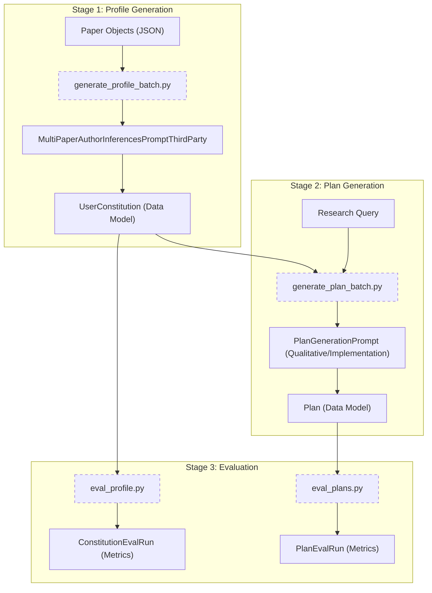
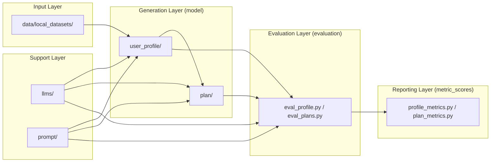

<!-- source: DeepWiki mcp.deepwiki.com · repo allenai/personalized-scholarqa-eval · page 1.2 Repository Structure · fetched 2026-10-26 -->

# Repository Structure

Relevant source files

The following files were used as context for generating this wiki page:

- [README.md](README.md)
- [__init__.py](__init__.py)
- [data/__init__.py](data/__init__.py)

This page provides a technical map of the `personalized-scholarqa-eval` repository. The framework is organized into discrete layers for data modeling, large language model (LLM) abstraction, prompt management, and the two-stage generation/evaluation pipeline.

## High-Level Data Flow

The repository operates in a two-stage pipeline: first inferring user preferences from research artifacts, and then applying those preferences to research planning.

### System Architecture and Code Entity Mapping
The following diagram maps the conceptual stages of the pipeline to the specific Python modules and classes that implement them.

**Diagram: Pipeline to Code Entity Mapping**

**Sources:** [README.md:100-141](), [data/__init__.py:1-20]()

---

## Directory Breakdown

### `data/`
This directory serves as the foundation of the repository, containing the schemas for all entities used in the system. It handles the serialization and deserialization of research papers, user profiles, and personalized plans.

*   **Key Files:**
    *   `paper_data.py`: Defines `Paper` and `PaperSnippet` classes [data/__init__.py:2]().
    *   `profile_data.py`: Contains the `UserConstitution` (the "profile"), `AtomicInference`, and `HighLevelInference` models [data/__init__.py:1]().
    *   `plan_data.py`: Defines the `Plan` and `PlanRequirement` models used for personalized research trajectories [data/__init__.py:4]().
    *   `dataset_loader.py`: Responsible for loading local datasets and Hugging Face caches.

**Sources:** [data/__init__.py:1-20](), [README.md:148-148]()

### `llms/`
A provider-agnostic abstraction layer for interacting with various LLM APIs. This allows the rest of the codebase to remain decoupled from specific API implementations like OpenAI or Anthropic.

*   **Key Files:**
    *   `base.py`: Defines the `LLM` abstract base class and `Retriever` interfaces.
    *   `model_factory.py`: Implements the factory pattern to instantiate specific models based on environment variables.
    *   `gpt.py`, `claude.py`, `gemini.py`, `litellm.py`: Concrete implementations for different providers.

**Sources:** [README.md:150-150]()

### `model/`
Contains the core logic for the two primary generation tasks.

*   **`model/user_profile/`**: Logic for "Constitution" generation. It takes a collection of papers and generates a structured profile of a researcher's style and preferences [README.md:153-153]().
*   **`model/plan/`**: Logic for "Plan" generation. It takes a user profile and a query to generate a personalized research plan [README.md:154-154]().

**Sources:** [README.md:152-154]()

### `prompt/`
A centralized repository for all prompt templates. This ensures that prompt engineering is decoupled from the execution logic.

*   **Key Components:**
    *   `template.py`: Houses the `Prompt` base class and specific templates like `PlanGenerationPromptQualitative` and `MultiPaperAuthorInferencesPromptThirdParty`.
    *   `user_prediction_prompts/`: Contains few-shot examples and templates specifically for the simulation/qualitative evaluation branch.

**Sources:** [README.md:155-155]()

### `evaluation/`
The evaluation engine of the framework. It implements LLM-as-a-judge rubrics to score the outputs of the `model/` directory.

*   **Key Modules:**
    *   `eval_profile.py`: Implements `ProfileEvaluator` to score constitutions on specificity and accuracy.
    *   `eval_plans.py`: Implements `PersonalizedPlanEvaluator` for A/B testing personalized vs. non-personalized plans.
    *   `predict_user_data.py`: Logic for simulating user preferences based on qualitative interview data.
    *   `metrics.py`: Defines the data structures for storing evaluation results (e.g., `ConstitutionEvalRun`, `PlanEvalRun`).

**Sources:** [README.md:149-149]()

### `metric_scores/`
Post-processing utilities that aggregate raw evaluation data into human-readable summaries and visualizations.

*   **Key Modules:**
    *   `profile_metrics.py` & `plan_metrics.py`: Aggregate results from the `evaluation/` outputs into summary tables.
    *   `simulation_plot.py`: Generates matplotlib visualizations for the qualitative simulation experiments.

**Sources:** [README.md:151-151]()

### `scripts/`
Entry points for the system. These shell scripts orchestrate the execution of the Python modules with the correct CLI arguments and environment configurations.

*   `generate.sh`: Chains profile generation and plan generation [README.md:100-114]().
*   `eval_profile.sh` & `eval_plan.sh`: Runs the respective evaluation and metric aggregation modules [README.md:116-132]().
*   `simulation.sh`: Orchestrates the qualitative simulation pipeline [README.md:134-141]().

**Sources:** [README.md:156-156]()

---

## Technical Data Flow Diagram

The following diagram illustrates how data moves through the directory structure, from raw input to final metric reports.

**Diagram: Directory Interaction and Data Flow**

**Sources:** [README.md:86-94](), [README.md:100-141](), [README.md:148-156]()

---

