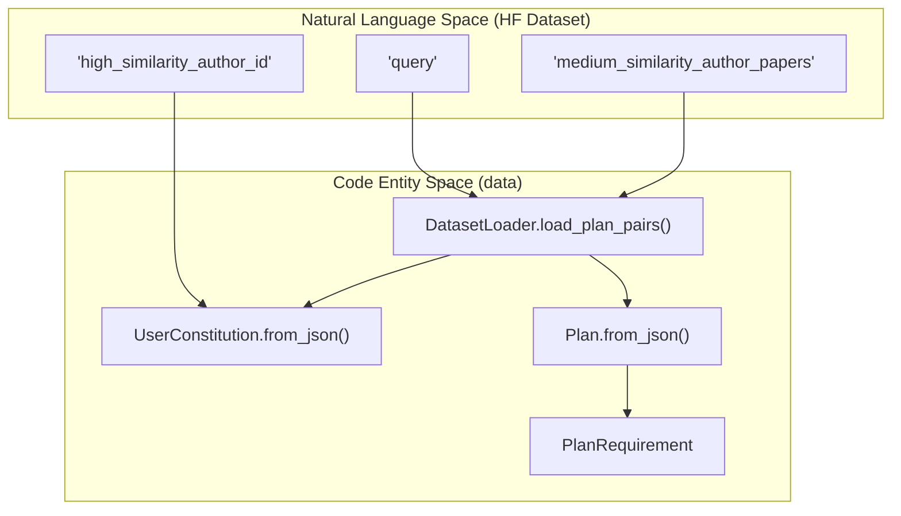
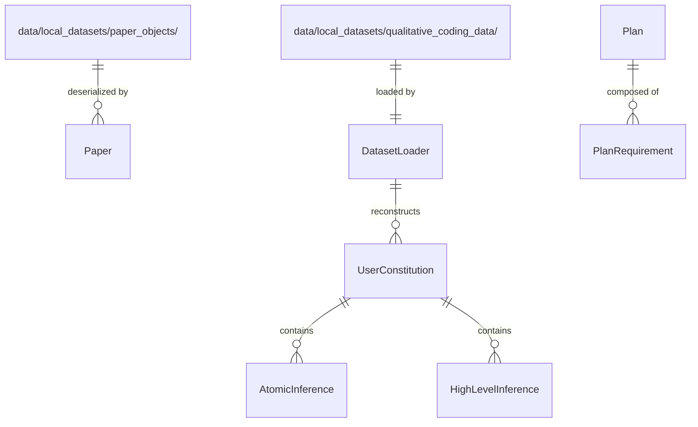

<!-- source: DeepWiki mcp.deepwiki.com · repo allenai/personalized-scholarqa-eval · page 2 Data Layer · fetched 2026-10-26 -->

# Data Layer

Relevant source files

The following files were used as context for generating this wiki page:

- [data/__init__.py](data/__init__.py)
- [data/dataset_loader.py](data/dataset_loader.py)

The **Data Layer** serves as the foundation for the Personalized ScholarQA Evaluation framework, providing a structured representation of academic users, their research profiles, and the plans generated for them. It manages the lifecycle of data from raw Hugging Face datasets and local paper corpora to complex, serialized dataclasses that represent LLM-inferred user constitutions.

The layer is organized into three primary components:
1.  **Core Data Models**: Python dataclasses that define the schema for all entities (Papers, Users, Constitutions, Plans).
2.  **Dataset Loader**: A utility class for ingesting data and mapping relationships between authors of varying similarity tiers.
3.  **Local Storage**: The physical layout of paper objects and qualitative coding data used during evaluation and simulation.

## Core Data Models
The system relies on a hierarchy of dataclasses defined in the `data/` package. These models include built-in serialization methods (`to_json` and `from_json`) to facilitate persistence across the generation and evaluation pipelines.

At the heart of the profile generation is the `UserConstitution`, which aggregates `AtomicInference` and `HighLevelInference` objects derived from a user's publication history. The planning phase utilizes `Plan` and `PlanRequirement` models to represent how a system intends to answer a query based on a specific user profile.

| Entity Class | Responsibility | Source |
| :--- | :--- | :--- |
| `UserConstitution` | Container for inferred user knowledge, styles, and research positions. | [data/profile_data.py:114-114]() |
| `AtomicInference` | A single low-level insight derived from a specific paper snippet. | [data/profile_data.py:53-53]() |
| `HighLevelInference` | A synthesized research theme derived from multiple atomic inferences. | [data/profile_data.py:73-73]() |
| `Plan` | A structured sequence of actions/requirements to satisfy a user query. | [data/plan_data.py:34-34]() |
| `Paper` | Metadata and content representation for an academic publication. | [data/paper_data.py:7-7]() |

For a detailed reference of all attributes and the inference hierarchy, see **[Core Data Models](#2.1)**.

**Sources:** [data/__init__.py:1-20](), [data/profile_data.py:1-160](), [data/plan_data.py:1-60]()

## Dataset Loader
The `DatasetLoader` class is the primary interface for accessing the evaluation corpus. It wraps Hugging Face `datasets` and provides specialized methods for the framework's unique requirements, such as handling author similarity tiers.

### Author Similarity Tiers
The evaluation framework uses three tiers of authors—**high**, **medium**, and **low** similarity—to test how well profiles generalize or specialize. The `DatasetLoader` maps these tiers to specific author IDs and paper collections.

### Data Flow Diagram
The following diagram illustrates how the `DatasetLoader` bridges the "Natural Language Space" of the raw datasets to the "Code Entity Space" of the internal models.

"Dataset Loader Mapping"

For details on similarity tier loading and simulation data reconstruction, see **[Dataset Loader](#2.2)**.

**Sources:** [data/dataset_loader.py:8-154]()

## Local Datasets and Qualitative Coding Data
The framework expects a specific directory structure under `data/local_datasets/` to store the underlying corpus and cached evaluation data.

*   **`paper_objects/`**: Contains serialized `Paper` objects used as the source for profile generation.
*   **`qualitative_coding_data/`**: A cached Hugging Face dataset containing the ground-truth annotations for the simulation evaluation branch.
*   **`simulated_profile_inputs/`**: Data used to drive the `predict_user_data.py` pipeline.

### Entity Relationship Diagram
This diagram shows the relationship between local storage files and the classes that manage them.

"Local Storage to Entity Mapping"

For information on dataset manifest files and the Arrow caching mechanism, see **[Local Datasets and Qualitative Coding Data](#2.3)**.

**Sources:** [data/dataset_loader.py:155-160](), [data/paper_data.py:1-30]()

---

