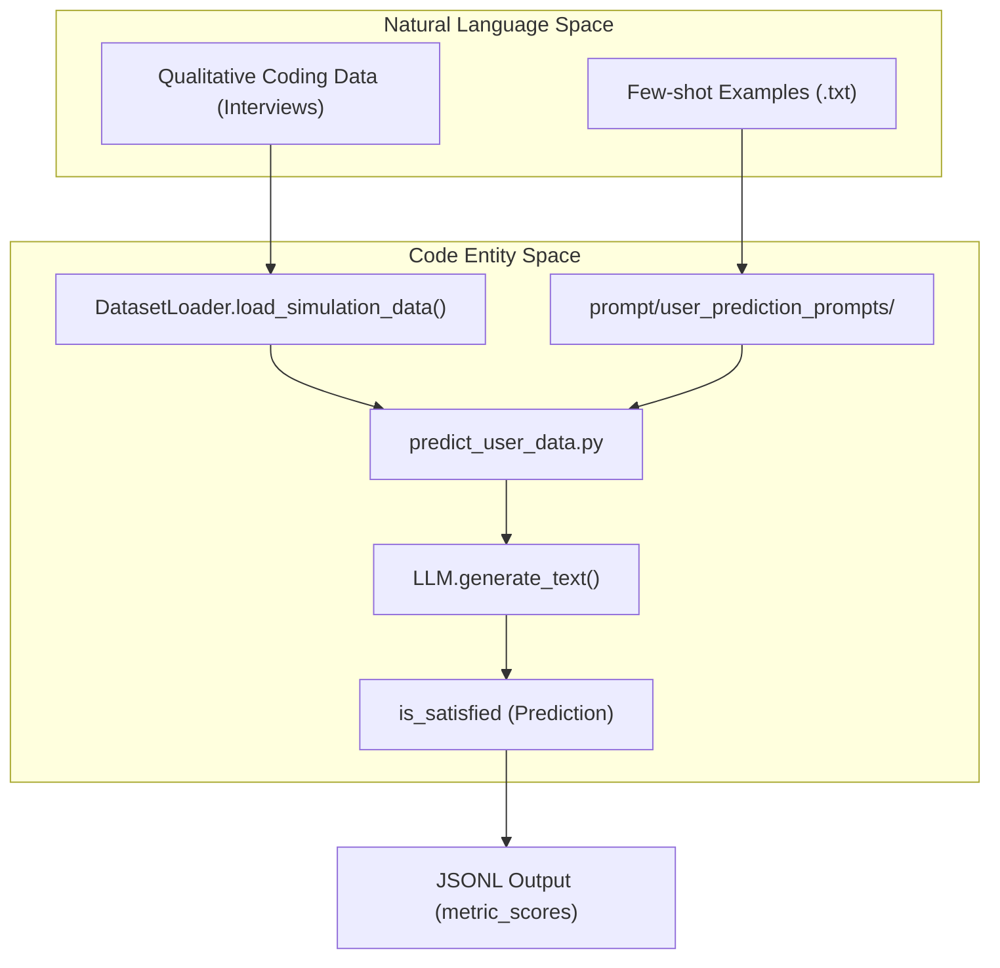
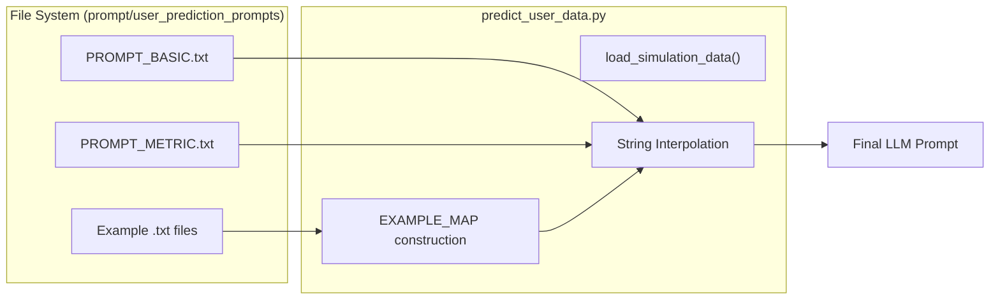

<!-- source: DeepWiki mcp.deepwiki.com · repo allenai/personalized-scholarqa-eval · page 6.3 Simulation Evaluation (User Prediction) · fetched 2026-10-26 -->

# Simulation Evaluation (User Prediction)

Relevant source files

The following files were used as context for generating this wiki page:

- [README.md](README.md)
- [data/dataset_loader.py](data/dataset_loader.py)
- [data/local_datasets/qualitative_coding_data/all_text/dataset_dict.json](data/local_datasets/qualitative_coding_data/all_text/dataset_dict.json)
- [data/local_datasets/qualitative_coding_data/all_text/train/cache-00db1cfd048ad1d3.arrow](data/local_datasets/qualitative_coding_data/all_text/train/cache-00db1cfd048ad1d3.arrow)

The simulation evaluation pipeline is designed to assess the reliability of LLM judges in predicting real-world user preferences. By utilizing data derived from qualitative user interviews, this pipeline tests whether an LLM can accurately simulate a human's judgment across three distinct stages of the research process: profile generation, planning, and response generation.

## Overview and Data Flow

The pipeline, implemented in `evaluation/predict_user_data.py`, loads qualitative coding data, constructs specialized prompts using few-shot examples, and invokes an LLM to predict if specific qualitative metrics (e.g., whether a profile is "overgeneral" or a response is "uninformative") are satisfied.

### Data Flow Diagram

The following diagram illustrates the flow from the raw qualitative dataset to the final JSONL predictions.

"Simulation Evaluation Data Flow"

Sources: [evaluation/predict_user_data.py:1-20](), [data/dataset_loader.py:155-156](), [prompt/user_prediction_prompts/plan/PROMPT_BASIC.txt]()

---

## The Evaluation Splits and Metrics

The simulation covers three primary splits, each targeting a different artifact of the Personalized ScholarQA system. Each split has a corresponding set of metric codes that the LLM judge attempts to predict.

| Split | Description | Metric Codes |
| :--- | :--- | :--- |
| **Profile** | Evaluating the inferred user constitution. | `KEYWORD`, `OVERGENERAL`, `NEGATION` |
| **Plan** | Evaluating the personalized research plan. | `GENERAL`, `NARROW`, `OFFTOPIC` |
| **Response** | Evaluating the final generated research report. | `UNINFORMATIVE`, `STYLE`, `FAILED` |

### System Logic and Metric Mapping
The system maps internal metric codes to human-readable descriptions using a `DESCRIPTION_MAP` and `METRIC_MAP` defined within the prediction logic. This allows the LLM to understand the semantic meaning of the qualitative code it is judging.

Sources: [evaluation/predict_user_data.py:22-68]()

---

## Prompt Construction

The pipeline uses a two-tiered prompting strategy to guide the LLM judge. Prompts are built by combining instructions, the specific content being evaluated (e.g., a profile snippet), and few-shot examples retrieved from the filesystem.

### Prompt Components

1.  **`PROMPT_BASIC`**: The foundational instruction set for the judge.
2.  **`PROMPT_METRIC`**: A metric-specific prompt that defines what "satisfied" means for a particular code (e.g., what constitutes an "Overgeneral" profile).
3.  **Few-Shot Examples**: Loaded from `prompt/user_prediction_prompts/{split}/` as `.txt` files, providing context for the LLM.

"Prompt Assembly Logic"

Sources: [evaluation/predict_user_data.py:70-110](), [prompt/user_prediction_prompts/profile/PROMPT_BASIC.txt]()

---

## Implementation Details

### Key Functions

*   **`DatasetLoader.load_simulation_data()`**: Loads the qualitative coding dataset from `data/local_datasets/qualitative_coding_data/`. This dataset contains the ground-truth labels from human interviews.
*   **`main()` loop**: Iterates through the three splits (profile, plan, response). For each split, it identifies the relevant metrics and samples examples for the LLM to predict.
*   **LLM Judge Invocation**: Calls `model.generate_text()` with the assembled prompt. The system expects a binary "Yes/No" or "Satisfied/Not Satisfied" style response, which is then parsed.

### Execution Flow
The pipeline is typically executed via the `scripts/simulation.sh` script, which sets environment variables and paths for the evaluation.

1.  **Initialize LLM**: The `ModelFactory` creates a model instance (e.g., GPT-4o or Claude 3.5 Sonnet).
2.  **Load Data**: `DatasetLoader` fetches the `train` split of the qualitative data.
3.  **Predict**: The script iterates through every row in the dataset, constructs the prompt, and queries the LLM.
4.  **Output**: Results are written to a JSONL file in the specified output directory, containing the original data and the LLM's `is_satisfied` prediction.

Sources: [evaluation/predict_user_data.py:112-180](), [scripts/simulation.sh:1-15](), [data/dataset_loader.py:155-156]()

---

## Output Structure

The output JSONL files are used by `metric_scores/simulation_plot.py` to generate accuracy visualizations. Each entry includes:
*   `split`: The evaluation category (profile/plan/response).
*   `metric`: The qualitative code being tested.
*   `text`: The content the LLM judged.
*   `prediction`: The LLM's boolean output.
*   `ground_truth`: The actual label from the qualitative coding.

Sources: [evaluation/predict_user_data.py:175-185](), [metric_scores/simulation_plot.py:10-30]()

---

