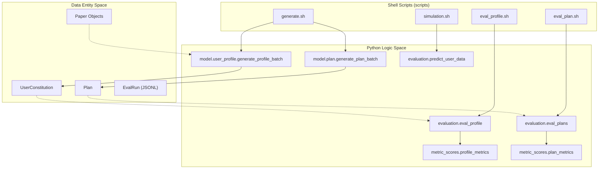
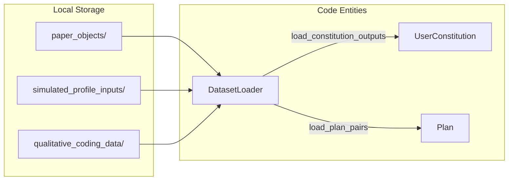

<!-- source: DeepWiki mcp.deepwiki.com · repo allenai/personalized-scholarqa-eval · page 8 Scripts and Workflow Orchestration · fetched 2026-10-26 -->

# Scripts and Workflow Orchestration

Relevant source files

The following files were used as context for generating this wiki page:

- [README.md](README.md)
- [data/dataset_loader.py](data/dataset_loader.py)

This page serves as a high-level reference for the shell scripts located in the `scripts/` directory. These scripts orchestrate the end-to-end workflow of the Personalized ScholarQA Evaluation framework, spanning from initial user profile generation to final simulation plotting.

The framework follows a structured pipeline where outputs from one stage (e.g., profiles) serve as inputs for the next (e.g., personalized plans), eventually culminating in LLM-as-a-judge evaluations and metric aggregation.

### Workflow Overview

The orchestration logic is designed to bridge the gap between raw data (papers and queries) and structured evaluation metrics. The following diagram illustrates how the shell scripts interact with the core Python modules and data entities.

**System Orchestration Flow**

Sources: [README.md:98-143](), [scripts/generate.sh:1-35](), [scripts/eval_profile.sh:1-15]()

---

### Core Scripts

#### 1. Generation Orchestration (`generate.sh`)
This script handles the two-stage generation pipeline. It first triggers `generate_profile_batch.py` to create `UserConstitution` objects from paper collections, then triggers `generate_plan_batch.py` to create personalized and non-personalized `Plan` objects.

*   **Primary Inputs**: `paper_dir` (directory of JSON paper objects), `data_input_dir` (input dataset).
*   **Primary Outputs**: `profile_output_dir`, `plan_output_dir`.

For details on CLI arguments like `model_type` and `num_inferences`, see [Generation Scripts](#8.1).

#### 2. Profile Evaluation (`eval_profile.sh`)
Orchestrates the evaluation of generated user profiles. It runs the `ProfileEvaluator` to score the `UserConstitution` objects on dimensions like specificity and accuracy, then calls `profile_metrics.py` to aggregate these into human-readable tables.

*   **Logic Mapping**: Maps to `evaluation.eval_profile` [evaluation/eval_profile.py:1-50]() and `metric_scores.profile_metrics` [metric_scores/profile_metrics.py:1-40]().

For details on scoring rubrics and output formats, see [Evaluation Scripts](#8.2).

#### 3. Plan Evaluation (`eval_plan.sh`)
Orchestrates the evaluation of personalized plans. It utilizes the `PersonalizedPlanEvaluator` to perform A/B testing between personalized and generic plans, followed by metric aggregation via `plan_metrics.py`.

*   **Logic Mapping**: Maps to `evaluation.eval_plans` [evaluation/eval_plans.py:1-60]() and `metric_scores.plan_metrics` [metric_scores/plan_metrics.py:1-50]().

For details on personalization strategy scoring, see [Evaluation Scripts](#8.2).

#### 4. Simulation Evaluation (`simulation.sh`)
Handles the qualitative simulation pipeline. It uses LLM judges to predict user preferences based on qualitative interview data, mapping results to specific error codes (e.g., `OVERGENERAL`, `OFFTOPIC`).

*   **Logic Mapping**: Maps to `evaluation.predict_user_data` [evaluation/predict_user_data.py:1-80]() and `metric_scores.simulation_plot` [metric_scores/simulation_plot.py:1-100]().

For details on the few-shot prompts and accuracy plotting, see [Evaluation Scripts](#8.2).

---

### Directory Conventions and Data Flow

The scripts assume a specific layout in `data/local_datasets/` to function correctly. The `DatasetLoader` class is the primary utility used by these scripts to resolve paths and load entities.

**Data Mapping Diagram**

Sources: [data/dataset_loader.py:70-95](), [data/dataset_loader.py:134-153](), [README.md:86-94]()

| Script | Input Code Entity | Output Code Entity | Primary Directory |
| :--- | :--- | :--- | :--- |
| `generate.sh` | `NewPaper` | `UserConstitution`, `Plan` | `data/local_datasets/paper_objects` |
| `eval_profile.sh` | `UserConstitution` | `ConstitutionEvalRun` | `profile_output_dir` |
| `eval_plan.sh` | `Plan` | `PlanEvalRun` | `plan_output_dir` |
| `simulation.sh` | `SimulationData` | `is_satisfied` (JSONL) | `qualitative_coding_data` |

Sources: [README.md:100-143](), [data/dataset_loader.py:8-155]()

---

