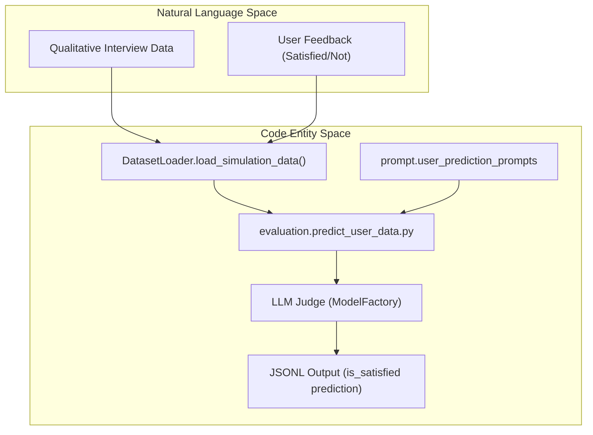
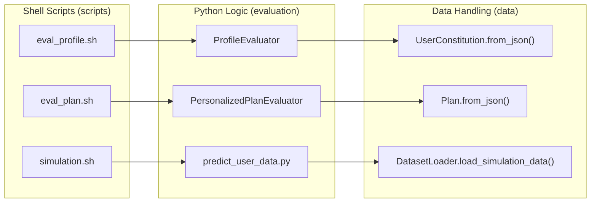

<!-- source: DeepWiki mcp.deepwiki.com · repo allenai/personalized-scholarqa-eval · page 8.2 Evaluation Scripts · fetched 2026-10-26 -->

# Evaluation Scripts

Relevant source files

The following files were used as context for generating this wiki page:

- [README.md](README.md)
- [data/dataset_loader.py](data/dataset_loader.py)

This page provides a technical deep dive into the shell scripts used to orchestrate the evaluation of user profiles, personalized plans, and LLM-based user simulations. These scripts wrap Python modules to handle batch processing, metric aggregation, and output persistence.

## 1. Overview of Evaluation Orchestration

The evaluation framework is divided into three primary workflows, each managed by a dedicated shell script:
1.  **Profile Evaluation** (`scripts/eval_profile.sh`): Validates inferred user constitutions against source papers for accuracy and specificity.
2.  **Plan Evaluation** (`scripts/eval_plan.sh`): Compares personalized search plans against generic plans using LLM-as-a-judge.
3.  **Simulation Evaluation** (`scripts/simulation.sh`): Runs qualitative user-prediction experiments to determine if LLMs can simulate real researcher preferences.

### System Mapping: Shell to Python

| Shell Script | Primary Python Module | Metric Aggregation Module |
| :--- | :--- | :--- |
| `eval_profile.sh` | `evaluation.eval_profile` | `metric_scores.profile_metrics` |
| `eval_plan.sh` | `evaluation.eval_plans` | `metric_scores.plan_metrics` |
| `simulation.sh` | `evaluation.predict_user_data` | `metric_scores.simulation_plot` |

**Sources:** [README.md:116-141](), [scripts/eval_profile.sh:10-11](), [scripts/eval_plan.sh:10-11](), [scripts/simulation.sh:10-11]()

---

## 2. Profile Evaluation (`scripts/eval_profile.sh`)

This script evaluates the quality of generated `UserConstitution` objects. It measures how well the inferred research styles, knowledge, and writing preferences align with the actual papers provided as input.

### Execution Flow
1.  **`evaluation.eval_profile`**: Calls `ProfileEvaluator` to score constitutions across multiple dimensions: specificity, relevance, accuracy, and coverage [evaluation/eval_profile.py:25-50]().
2.  **`metric_scores.profile_metrics`**: Processes the resulting `ConstitutionEvalRun` JSONL files to generate summary tables [metric_scores/profile_metrics.py:10-25]().

### Script Arguments
- `profile_dir`: Path where generated profiles (constitutions) are stored.
- `input_dir`: Path to the input dataset containing author paper lists.
- `output_dir`: Path to save evaluation scores.
- `model_name`: The LLM identifier (e.g., `gpt-4o`).
- `limit`: (Optional) Maximum number of profiles to evaluate.

### Implementation Detail
The script initializes a `DatasetLoader` to fetch `UserConstitution` objects using `load_constitution_outputs` [data/dataset_loader.py:70-95](). It then passes these to the `ProfileEvaluator`, which uses specific rubrics like `SPECIFICITY_PROMPT` and `CITATION_EVAL_PROMPT` to generate scores [evaluation/eval_profile.py:55-80]().

**Sources:** [scripts/eval_profile.sh:1-12](), [data/dataset_loader.py:70-95](), [README.md:118-124]()

---

## 3. Plan Evaluation (`scripts/eval_plan.sh`)

This script evaluates `Plan` objects, focusing on the delta between a "normal" (generic) plan and a "personalized" plan generated for the same query and user.

### Execution Flow
1.  **`evaluation.eval_plans`**: Uses `PersonalizedPlanEvaluator` to perform A/B testing between plan pairs [evaluation/eval_plans.py:30-60]().
2.  **`metric_scores.plan_metrics`**: Aggregates the `PlanEvalRun` results to calculate the percentage of time the personalized plan was preferred [metric_scores/plan_metrics.py:15-30]().

### Script Arguments
- `profile_dir`: Path to the user profiles used for personalization.
- `input_dir`: Path to the evaluation queries.
- `output_dir`: Path to save plan comparison scores.
- `model_name`: The LLM identifier.
- `limit`: (Optional) Maximum number of plans to evaluate.

### Implementation Detail
The script relies on `DatasetLoader.load_plan_pairs` to reconstruct the relationship between a query, the generic plan, and the personalized plan [data/dataset_loader.py:134-153](). The evaluator uses `PLAN_JUDGE_PROMPT_PERSONALIZATION` to determine which plan better incorporates the user's research constraints [evaluation/eval_plans.py:85-110]().

**Sources:** [scripts/eval_plan.sh:1-12](), [data/dataset_loader.py:134-153](), [README.md:127-133]()

---

## 4. Simulation Evaluation (`scripts/simulation.sh`)

The simulation script evaluates the system's ability to predict user preferences based on qualitative interview data. It tests the LLM's capacity to identify if a specific research need (e.g., "narrow scope") is satisfied by a given profile or plan.

### Data Flow: Natural Language to Code Entity
The following diagram illustrates how raw simulation inputs are transformed into code objects during the `simulation.sh` run.

**Simulation Data Reconstruction**

**Sources:** [data/dataset_loader.py:155-160](), [evaluation/predict_user_data.py:10-40](), [scripts/simulation.sh:1-12]()

### Script Arguments
- `model_name`: LLM identifier (e.g., `claude-3-5-sonnet`).
- `model_type`: Provider type (e.g., `anthropic`).
- `num_examples`: Number of qualitative examples to process.
- `prompt_dir`: Path to few-shot prediction templates (e.g., `prompt/user_prediction_prompts/`).
- `output_dir`: Path for simulation results.
- `input_dir`: Path to the `qualitative_coding_data`.

### Metric Codes
The simulation tracks specific failure modes and preferences using codes mapped in `metric_scores/simulation_plot.py`:
- `KEYWORD`: Keyword-based preference.
- `OVERGENERAL`: Plan is too broad.
- `STYLE`: Writing style mismatch.

**Sources:** [scripts/simulation.sh:1-12](), [metric_scores/simulation_plot.py:20-45](), [README.md:136-141]()

---

## 5. Summary of Logic Flow

The following diagram bridges the shell script execution to the internal Python class hierarchy.

**Evaluation Script Execution Logic**

**Sources:** [evaluation/eval_profile.py:20-30](), [evaluation/eval_plans.py:25-35](), [data/dataset_loader.py:70-155](), [scripts/eval_profile.sh:1-12](), [scripts/eval_plan.sh:1-12]()

---

