# Page: Overview

# Overview

<details>
<summary>Relevant source files</summary>

The following files were used as context for generating this wiki page:

- [.gitignore](.gitignore)
- [LICENSE](LICENSE)
- [README.md](README.md)

</details>


The **Personalized ScholarQA Evaluation** framework provides a robust pipeline for generating and evaluating researcher-centric personalization in Deep Research systems. It is designed to bridge the gap between generic Large Language Model (LLM) responses and the specific needs of academic researchers by inferring "constitutions" (user profiles) from publication history and using them to ground research plans.

## Purpose and Scope

This framework implements the evaluation logic introduced in the paper *"Language Models Don't Know What You Want: Evaluating Personalization in Deep Research Needs Real Users"* [README.md:5-9](). It focuses on three core capabilities:
1.  **Personalization Generation**: Inferring researcher preferences (e.g., research style, audience, epistemology) from their published work and generating query-specific research plans [README.md:19-20]().
2.  **Synthetic Evaluation**: Using LLM-as-a-judge metrics to score the accuracy, specificity, and relevance of inferred profiles and plans [README.md:21-22]().
3.  **User Simulation**: Predicting user preferences based on qualitative interview data to validate system reliability [README.md:23-24]().

For installation and environment setup, see **[Getting Started](#1.1)**. For a breakdown of the codebase organization, see **[Repository Structure](#1.2)**.

Sources: [README.md:1-24]()

---

## Two-Stage Generation Pipeline

The system operates in two primary stages: **Profile Generation** and **Plan Generation**. This pipeline transforms raw researcher data (papers) into actionable, personalized research instructions.

### Pipeline Architecture
The diagram below illustrates how code entities within the `model/` and `data/` packages interact to transform "Natural Language Space" (Papers and Queries) into "Code Entity Space" (UserConstitutions and Plans).

**Personalization Data Flow**
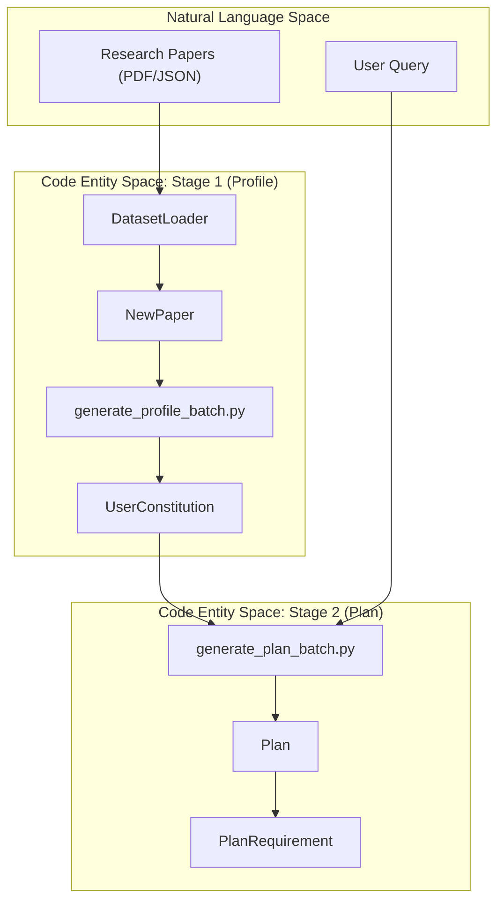
Sources: [README.md:100-114](), [README.md:148-154]()

---

## Evaluation Framework

The framework includes a comprehensive evaluation suite that validates the outputs of the generation pipeline. It uses specialized evaluator classes to compare generated entities against ground truth or rubrics.

### System Interaction Diagram
This diagram maps the evaluation logic to specific classes and scripts within the `evaluation/` and `metric_scores/` directories.

**Evaluation and Scoring Logic**
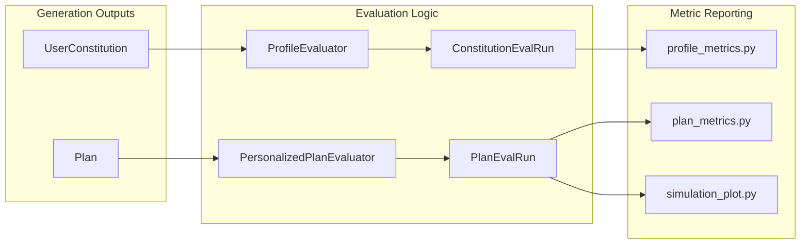
Sources: [README.md:118-141](), [README.md:149-151]()

---

## Key Concepts

*   **Constitution (User Profile)**: A structured inference of a researcher's preferences, including knowledge, research style, writing style, positions, epistemology, audience, and conclusions [README.md:19-20]().
*   **Plan (Action)**: A query-specific set of instructions (search, organization, generation) conditioned on a user's constitution [README.md:20]().
*   **LLM Abstraction**: A unified interface for interacting with various providers (OpenAI, Anthropic, Gemini, LiteLLM) through a central `ModelFactory` [README.md:150-151]().
*   **Simulated Profile Inputs**: Real Deep Research queries used to validate how well personalization strategies perform in realistic scenarios [README.md:88-93]().

Sources: [README.md:15-24](), [README.md:86-93]()

---

## Navigation Guide

To explore the framework in detail, refer to the following sections:

*   **[Getting Started](#1.1)**: Setup instructions, API key configuration, and how to download the required `paper_objects`.
*   **[Repository Structure](#1.2)**: A map of the directory layout and the ownership of each package (`data/`, `evaluation/`, `llms/`, `model/`, etc.).
*   **Data Layer**: Documentation on core dataclasses like `UserConstitution` and the `DatasetLoader`.
*   **Generation Pipeline**: Deep dive into the logic for batch profile and plan generation.
*   **Evaluation Framework**: Detailed breakdown of the rubrics and scoring mechanisms used to validate personalization.

Sources: [README.md:145-159]()

---

# Page: Getting Started

# Getting Started

<details>
<summary>Relevant source files</summary>

The following files were used as context for generating this wiki page:

- [.gitignore](.gitignore)
- [README.md](README.md)
- [data/dataset_loader.py](data/dataset_loader.py)

</details>


This page provides the technical setup instructions and an overview of the execution pipeline for the Personalized ScholarQA Evaluation framework. This framework is designed to generate and evaluate researcher profiles (constitutions) and personalized deep research plans based on publication history and synthetic research queries.

## Environment Setup

The repository requires **Python 3.12.8** and **pip 25.0**. It uses a virtual environment to manage dependencies and a `.env` file for API authentication.

### 1. Installation
First, clone the repository and install the required Python packages:

```bash
git clone https://github.com/nbalepur/personalized-scholarqa-eval.git
cd personalized-scholarqa-eval
python3 -m venv .venv
source .venv/bin/activate
pip install -r requirements.txt
```
*Sources: [README.md:44-59]()*

### 2. API Configuration
The system supports multiple LLM providers via an abstraction layer. Copy the template and populate it with your specific API keys:

```bash
cp example.env .env
```

| Variable | Provider | Usage |
| :--- | :--- | :--- |
| `OPEN_AI_TOKEN` | OpenAI | GPT-4o, etc. |
| `ANTHROPIC_TOKEN` | Anthropic | Claude 3.5 Sonnet, etc. |
| `GEMINI_TOKEN` | Google | Gemini 1.5 Pro, etc. |

*Sources: [README.md:75-82](), [llms/model_factory.py:1-40]()*

---

## Local Dataset Layout

The pipeline expects data to be organized within the `data/local_datasets/` directory.

### Paper Objects
Profile generation requires the full text and metadata of papers. These are stored as individual JSON files indexed by paper ID.
1. Download `paper_objects.zip`.
2. Unzip into `data/local_datasets/paper_objects/`.
3. Verify layout: `data/local_datasets/paper_objects/<paper_id>.json`.

### Evaluation Data
- **`simulated_profile_inputs/`**: Contains deep research queries used to trigger plan generation.
- **`qualitative_coding_data/`**: A validation set derived from qualitative interviews for simulation reliability testing.

*Sources: [README.md:61-73](), [README.md:86-94](), [.gitignore:7-8]()*

---

## Data Flow and Pipeline Orchestration

The system operates in a two-stage generation pipeline followed by an evaluation stage. The flow transitions from raw paper data to researcher "Constitutions," then to "Plans," and finally to "Metrics."

### System Architecture Diagram

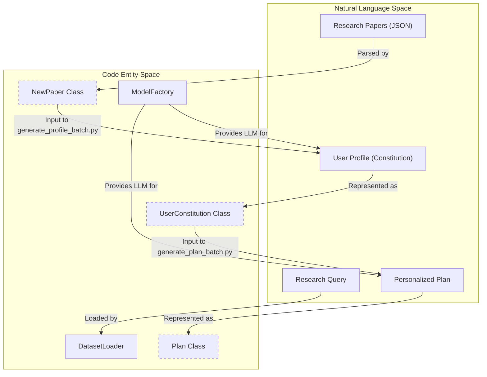
*Sources: [data/dataset_loader.py:8-124](), [README.md:100-114](), [llms/model_factory.py:7-15]()*

---

## Execution via Shell Scripts

The framework provides entry-point scripts in the `scripts/` directory to orchestrate the Python modules.

### 1. Generation Pipeline
The `generate.sh` script executes both profile and plan generation.
- **Profile Generation**: `model.user_profile.generate_profile_batch` reads paper collections and infers researcher preferences (knowledge, research style, etc.).
- **Plan Generation**: `model.plan.generate_plan_batch` uses the generated profiles to create query-specific search and organization plans.

```bash
# Edit scripts/generate.sh to set model_name and paths
./scripts/generate.sh
```
*Sources: [README.md:100-114]()*

### 2. Evaluation Pipeline
Evaluation is split into profile-specific and plan-specific runs.
- **Profile Eval**: Runs `evaluation.eval_profile` to score specificity and accuracy, then `metric_scores.profile_metrics` for summaries.
- **Plan Eval**: Runs `evaluation.eval_plans` to assess personalization alignment and `metric_scores.plan_metrics`.

```bash
./scripts/eval_profile.sh
./scripts/eval_plan.sh
```
*Sources: [README.md:116-132]()*

### Execution Logic Diagram

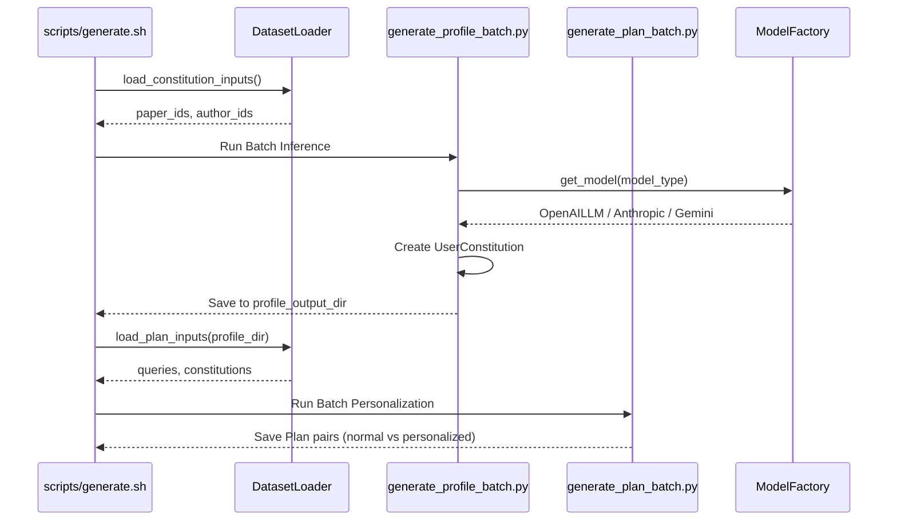
*Sources: [data/dataset_loader.py:48-63](), [data/dataset_loader.py:104-124](), [README.md:109-114](), [llms/model_factory.py:7-15]()*

---

## Dataset Loading Details

The `DatasetLoader` class handles the retrieval of data from Hugging Face `datasets` objects stored on disk. It manages author similarity tiers (`high`, `medium`, `low`) to ensure evaluation covers various degrees of researcher profile strength.

| Function | Return Type | Purpose |
| :--- | :--- | :--- |
| `load_constitution_inputs` | `tuple[list[list[str]], list[str]]` | Gets paper collections for profile generation. |
| `load_constitution_outputs` | `tuple[list[UserConstitution], list[str]]` | Loads generated profiles for evaluation. |
| `load_plan_inputs` | `tuple[list[str], list[str], list[UserConstitution], list[str]]` | Pairs queries with researcher profiles. |
| `load_plan_pairs` | `dict` | Retrieves both normal and personalized plans for A/B testing. |

*Sources: [data/dataset_loader.py:48-153]()*

---

# Page: Repository Structure

# Repository Structure

<details>
<summary>Relevant source files</summary>

The following files were used as context for generating this wiki page:

- [README.md](README.md)
- [__init__.py](__init__.py)
- [data/__init__.py](data/__init__.py)

</details>


This page provides a technical map of the `personalized-scholarqa-eval` repository. The framework is organized into discrete layers for data modeling, large language model (LLM) abstraction, prompt management, and the two-stage generation/evaluation pipeline.

## High-Level Data Flow

The repository operates in a two-stage pipeline: first inferring user preferences from research artifacts, and then applying those preferences to research planning.

### System Architecture and Code Entity Mapping
The following diagram maps the conceptual stages of the pipeline to the specific Python modules and classes that implement them.

**Diagram: Pipeline to Code Entity Mapping**
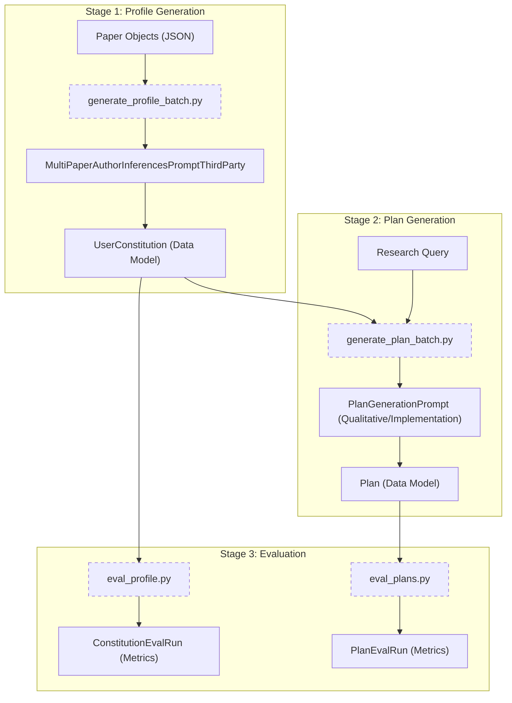
**Sources:** [README.md:100-141](), [data/__init__.py:1-20]()

---

## Directory Breakdown

### `data/`
This directory serves as the foundation of the repository, containing the schemas for all entities used in the system. It handles the serialization and deserialization of research papers, user profiles, and personalized plans.

*   **Key Files:**
    *   `paper_data.py`: Defines `Paper` and `PaperSnippet` classes [data/__init__.py:2]().
    *   `profile_data.py`: Contains the `UserConstitution` (the "profile"), `AtomicInference`, and `HighLevelInference` models [data/__init__.py:1]().
    *   `plan_data.py`: Defines the `Plan` and `PlanRequirement` models used for personalized research trajectories [data/__init__.py:4]().
    *   `dataset_loader.py`: Responsible for loading local datasets and Hugging Face caches.

**Sources:** [data/__init__.py:1-20](), [README.md:148-148]()

### `llms/`
A provider-agnostic abstraction layer for interacting with various LLM APIs. This allows the rest of the codebase to remain decoupled from specific API implementations like OpenAI or Anthropic.

*   **Key Files:**
    *   `base.py`: Defines the `LLM` abstract base class and `Retriever` interfaces.
    *   `model_factory.py`: Implements the factory pattern to instantiate specific models based on environment variables.
    *   `gpt.py`, `claude.py`, `gemini.py`, `litellm.py`: Concrete implementations for different providers.

**Sources:** [README.md:150-150]()

### `model/`
Contains the core logic for the two primary generation tasks.

*   **`model/user_profile/`**: Logic for "Constitution" generation. It takes a collection of papers and generates a structured profile of a researcher's style and preferences [README.md:153-153]().
*   **`model/plan/`**: Logic for "Plan" generation. It takes a user profile and a query to generate a personalized research plan [README.md:154-154]().

**Sources:** [README.md:152-154]()

### `prompt/`
A centralized repository for all prompt templates. This ensures that prompt engineering is decoupled from the execution logic.

*   **Key Components:**
    *   `template.py`: Houses the `Prompt` base class and specific templates like `PlanGenerationPromptQualitative` and `MultiPaperAuthorInferencesPromptThirdParty`.
    *   `user_prediction_prompts/`: Contains few-shot examples and templates specifically for the simulation/qualitative evaluation branch.

**Sources:** [README.md:155-155]()

### `evaluation/`
The evaluation engine of the framework. It implements LLM-as-a-judge rubrics to score the outputs of the `model/` directory.

*   **Key Modules:**
    *   `eval_profile.py`: Implements `ProfileEvaluator` to score constitutions on specificity and accuracy.
    *   `eval_plans.py`: Implements `PersonalizedPlanEvaluator` for A/B testing personalized vs. non-personalized plans.
    *   `predict_user_data.py`: Logic for simulating user preferences based on qualitative interview data.
    *   `metrics.py`: Defines the data structures for storing evaluation results (e.g., `ConstitutionEvalRun`, `PlanEvalRun`).

**Sources:** [README.md:149-149]()

### `metric_scores/`
Post-processing utilities that aggregate raw evaluation data into human-readable summaries and visualizations.

*   **Key Modules:**
    *   `profile_metrics.py` & `plan_metrics.py`: Aggregate results from the `evaluation/` outputs into summary tables.
    *   `simulation_plot.py`: Generates matplotlib visualizations for the qualitative simulation experiments.

**Sources:** [README.md:151-151]()

### `scripts/`
Entry points for the system. These shell scripts orchestrate the execution of the Python modules with the correct CLI arguments and environment configurations.

*   `generate.sh`: Chains profile generation and plan generation [README.md:100-114]().
*   `eval_profile.sh` & `eval_plan.sh`: Runs the respective evaluation and metric aggregation modules [README.md:116-132]().
*   `simulation.sh`: Orchestrates the qualitative simulation pipeline [README.md:134-141]().

**Sources:** [README.md:156-156]()

---

## Technical Data Flow Diagram

The following diagram illustrates how data moves through the directory structure, from raw input to final metric reports.

**Diagram: Directory Interaction and Data Flow**
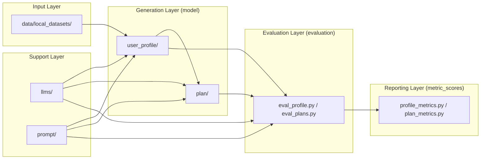
**Sources:** [README.md:86-94](), [README.md:100-141](), [README.md:148-156]()

---

# Page: Data Layer

# Data Layer

<details>
<summary>Relevant source files</summary>

The following files were used as context for generating this wiki page:

- [data/__init__.py](data/__init__.py)
- [data/dataset_loader.py](data/dataset_loader.py)

</details>


The **Data Layer** serves as the foundation for the Personalized ScholarQA Evaluation framework, providing a structured representation of academic users, their research profiles, and the plans generated for them. It manages the lifecycle of data from raw Hugging Face datasets and local paper corpora to complex, serialized dataclasses that represent LLM-inferred user constitutions.

The layer is organized into three primary components:
1.  **Core Data Models**: Python dataclasses that define the schema for all entities (Papers, Users, Constitutions, Plans).
2.  **Dataset Loader**: A utility class for ingesting data and mapping relationships between authors of varying similarity tiers.
3.  **Local Storage**: The physical layout of paper objects and qualitative coding data used during evaluation and simulation.

## Core Data Models
The system relies on a hierarchy of dataclasses defined in the `data/` package. These models include built-in serialization methods (`to_json` and `from_json`) to facilitate persistence across the generation and evaluation pipelines.

At the heart of the profile generation is the `UserConstitution`, which aggregates `AtomicInference` and `HighLevelInference` objects derived from a user's publication history. The planning phase utilizes `Plan` and `PlanRequirement` models to represent how a system intends to answer a query based on a specific user profile.

| Entity Class | Responsibility | Source |
| :--- | :--- | :--- |
| `UserConstitution` | Container for inferred user knowledge, styles, and research positions. | [data/profile_data.py:114-114]() |
| `AtomicInference` | A single low-level insight derived from a specific paper snippet. | [data/profile_data.py:53-53]() |
| `HighLevelInference` | A synthesized research theme derived from multiple atomic inferences. | [data/profile_data.py:73-73]() |
| `Plan` | A structured sequence of actions/requirements to satisfy a user query. | [data/plan_data.py:34-34]() |
| `Paper` | Metadata and content representation for an academic publication. | [data/paper_data.py:7-7]() |

For a detailed reference of all attributes and the inference hierarchy, see **[Core Data Models](#2.1)**.

**Sources:** [data/__init__.py:1-20](), [data/profile_data.py:1-160](), [data/plan_data.py:1-60]()

## Dataset Loader
The `DatasetLoader` class is the primary interface for accessing the evaluation corpus. It wraps Hugging Face `datasets` and provides specialized methods for the framework's unique requirements, such as handling author similarity tiers.

### Author Similarity Tiers
The evaluation framework uses three tiers of authors—**high**, **medium**, and **low** similarity—to test how well profiles generalize or specialize. The `DatasetLoader` maps these tiers to specific author IDs and paper collections.

### Data Flow Diagram
The following diagram illustrates how the `DatasetLoader` bridges the "Natural Language Space" of the raw datasets to the "Code Entity Space" of the internal models.

"Dataset Loader Mapping"
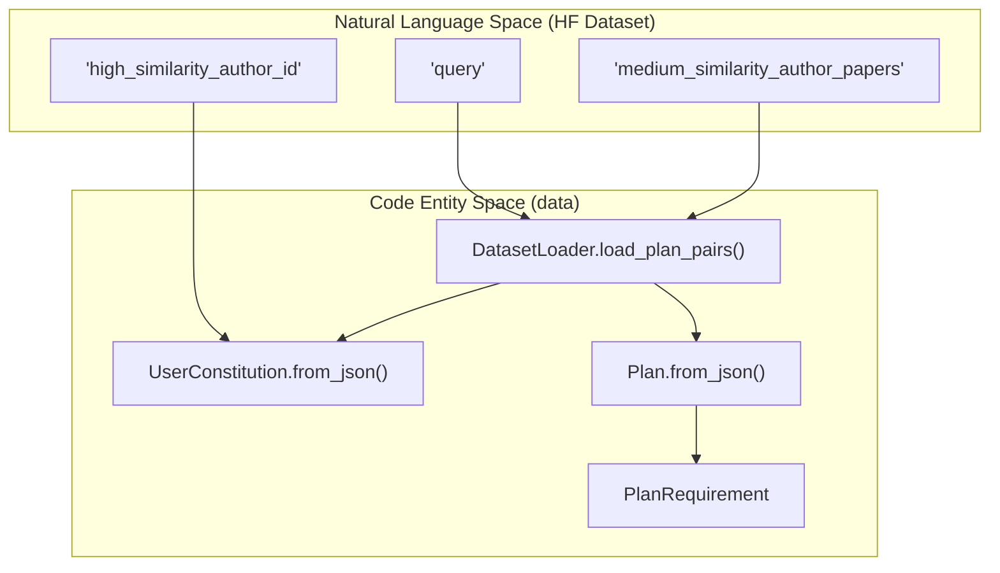

For details on similarity tier loading and simulation data reconstruction, see **[Dataset Loader](#2.2)**.

**Sources:** [data/dataset_loader.py:8-154]()

## Local Datasets and Qualitative Coding Data
The framework expects a specific directory structure under `data/local_datasets/` to store the underlying corpus and cached evaluation data.

*   **`paper_objects/`**: Contains serialized `Paper` objects used as the source for profile generation.
*   **`qualitative_coding_data/`**: A cached Hugging Face dataset containing the ground-truth annotations for the simulation evaluation branch.
*   **`simulated_profile_inputs/`**: Data used to drive the `predict_user_data.py` pipeline.

### Entity Relationship Diagram
This diagram shows the relationship between local storage files and the classes that manage them.

"Local Storage to Entity Mapping"
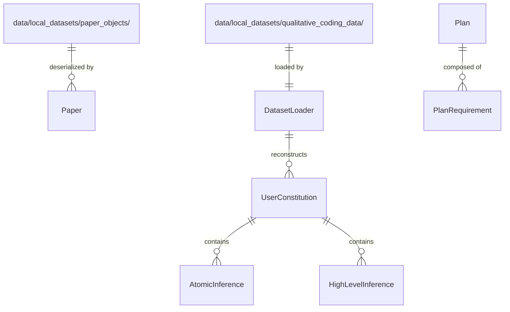

For information on dataset manifest files and the Arrow caching mechanism, see **[Local Datasets and Qualitative Coding Data](#2.3)**.

**Sources:** [data/dataset_loader.py:155-160](), [data/paper_data.py:1-30]()

---

# Page: Core Data Models

# Core Data Models

<details>
<summary>Relevant source files</summary>

The following files were used as context for generating this wiki page:

- [data/__init__.py](data/__init__.py)
- [data/dataset_loader.py](data/dataset_loader.py)

</details>


This page provides a detailed technical reference for the dataclasses located in the `data/` package. These models form the backbone of the Personalized ScholarQA Evaluation framework, handling everything from paper metadata and user profile inferences to complex multi-step research plans.

## Overview and Serialization
All core models are implemented as Python dataclasses and include standard serialization methods:
*   `to_json()`: Serializes the object into a JSON file or dictionary.
*   `from_json()`: Reconstitutes the object from a JSON file stored on disk.

The data flow generally moves from raw paper metadata (`Paper`) to synthesized user profiles (`UserConstitution`), which are then used to generate personalized research strategies (`Plan`).

Sources: [data/__init__.py:1-20](), [data/profile_data.py:1-5]()

---

## Paper Metadata Models

These models represent the source material used to generate user profiles.

### Paper
Represents a full academic paper with metadata and content.
*   **Fields**: `paper_id`, `title`, `abstract`, `venue`, `year`, `authors` (list of strings), and `sections` (list of dictionaries containing section titles and text).

### PaperSnippet
A lightweight representation of a paper, often used when only specific excerpts or abstracts are required for context.
*   **Fields**: `paper_id`, `title`, `abstract`.

Sources: [data/paper_data.py:5-25]()

---

## User Profile Models

The user profile is hierarchical, moving from specific "Atomic Inferences" derived from papers to "High-Level Inferences" that synthesize broader research personas.

### User Profile Hierarchy
The following diagram illustrates how raw paper data is transformed into a structured `UserConstitution`.

**Diagram: Profile Data Flow**
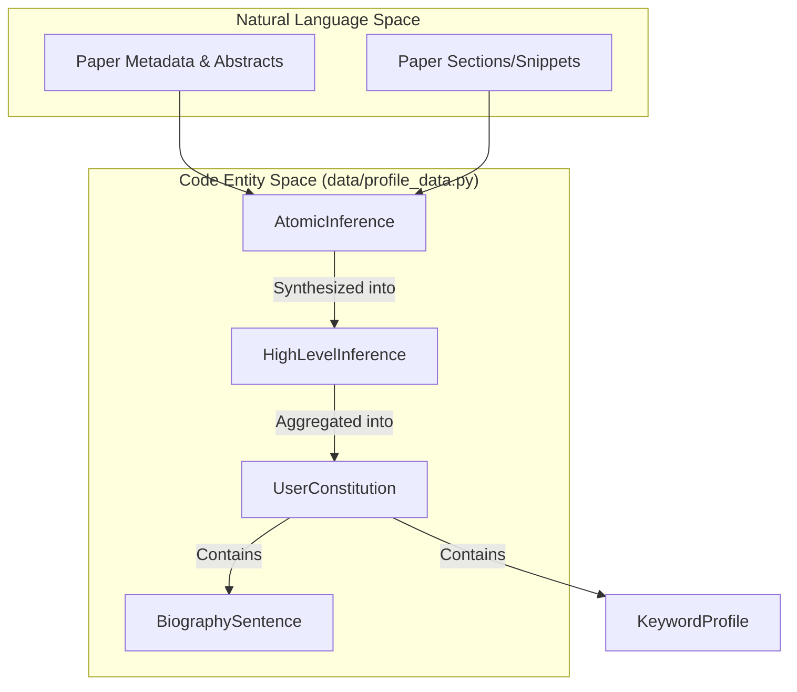
Sources: [data/profile_data.py:10-150](), [model/user_profile/generate_profile_batch.py:20-45]()

### AtomicInference
A single observation about a user based on their authored papers.
*   **Fields**: `inference` (the text), `evidence` (citations/snippets), and `category` (e.g., knowledge, research style).

### HighLevelInference
A synthesized summary of multiple atomic inferences.
*   **Fields**: `inference`, `supporting_atomic_inferences` (list of `AtomicInference` objects).

### UserConstitution
The top-level container for a simulated user profile.
*   **Fields**: 
    *   `user_id`: Unique identifier for the author.
    *   `atomic_inferences`: List of `AtomicInference`.
    *   `high_level_inferences`: List of `HighLevelInference`.
    *   `biography`: List of `BiographySentence`.
    *   `keyword_profile`: A `KeywordProfile` object.

Sources: [data/profile_data.py:58-132]()

---

## Research Plan Models

Plans represent the model's response to a research query, potentially personalized using a `UserConstitution`.

### PlanRequirement
A specific constraint or step within a plan.
*   **Fields**: `requirement` (description) and `importance` (integer scale).

### Plan
A structured research strategy.
*   **Fields**:
    *   `query_id`: Links the plan to a specific user query.
    *   `user_id`: Links the plan to a specific `UserConstitution`.
    *   `steps`: A list of strings describing the execution steps.
    *   `requirements`: A list of `PlanRequirement` objects.
    *   `is_personalized`: Boolean flag indicating if the plan was generated using personalization logic.

### QueryPlans
A container used to pair a `normal_plan` with a `personalized_plan` for the same query to facilitate A/B testing and evaluation.

**Diagram: Plan Generation Logic**
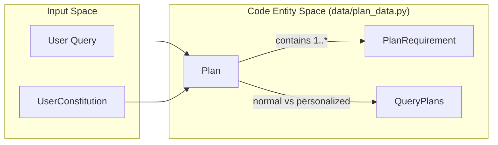
Sources: [data/plan_data.py:5-60](), [model/plan/generate_plan_batch.py:40-65]()

---

## Support and Simulation Models

### User
A high-level wrapper used in simulation tasks to group a `user_id` with its associated `UserConstitution`.

### BiographySentence & KeywordProfile
*   **BiographySentence**: A single sentence describing a user's background with a `category` label.
*   **KeywordProfile**: A collection of technical keywords associated with the user's research domain.

Sources: [data/user_data.py:5-15](), [data/profile_data.py:10-30]()

---

## Dataset Loading and Mapping

The `DatasetLoader` class in `data/dataset_loader.py` acts as the bridge between disk-based Hugging Face datasets and the dataclasses described above.

| Function | Return Type | Purpose |
| :--- | :--- | :--- |
| `load_constitution_inputs` | `tuple[list[list[str]], list[str]]` | Retrieves collections of paper IDs and author IDs for profile generation. |
| `load_constitution_outputs`| `list[UserConstitution]` | Loads generated profiles from JSON using `UserConstitution.from_json`. |
| `load_plan_pairs` | `dict` | Pairs `normal` and `personalized` plans for evaluation. |
| `load_author_map` | `dict[str, str]` | Maps `author_id` to similarity tiers (`high`, `medium`, `low`). |

Sources: [data/dataset_loader.py:48-63](), [data/dataset_loader.py:70-95](), [data/dataset_loader.py:134-153]()

---

# Page: Dataset Loader

# Dataset Loader

<details>
<summary>Relevant source files</summary>

The following files were used as context for generating this wiki page:

- [data/dataset_loader.py](data/dataset_loader.py)
- [data/local_datasets/qualitative_coding_data/all_text/dataset_dict.json](data/local_datasets/qualitative_coding_data/all_text/dataset_dict.json)

</details>


The `DatasetLoader` class is the central utility for interfacing with the Hugging Face `datasets` library and the local filesystem to provide structured data for the generation and evaluation pipelines. It manages the complexities of author similarity tiers, joins disparate data sources (like paper collections and queries), and handles the serialization of core data models like `UserConstitution` and `Plan`.

Sources: [data/dataset_loader.py:8-124]()

## Core Implementation

The loader is designed to work with datasets stored in the Apache Arrow format via `datasets.load_from_disk`. It supports loading single datasets or composite datasets from multiple subsets.

### Initialization and Loading
The class provides two primary ways to initialize:
1.  **Standard Initialization**: Loads a single dataset directory [data/dataset_loader.py:13-16]().
2.  **Subset Initialization**: Uses `from_subsets` to load multiple directories into a dictionary mapping subset names to dataset objects [data/dataset_loader.py:18-25]().

### Author Similarity Tiers
A key feature of the ScholarQA evaluation is the use of different similarity tiers to evaluate how well models generalize or personalize based on varying levels of author relevance. The `DatasetLoader` recognizes three tiers: `high`, `medium`, and `low`.
*   **`load_author_map`**: Iterates through all dataset rows to create a mapping of `author_id` to their respective similarity tier [data/dataset_loader.py:31-40]().

Sources: [data/dataset_loader.py:13-40]()

## Data Flow: Natural Language to Code Entities

The following diagram illustrates how the `DatasetLoader` bridges raw Hugging Face dataset rows (Natural Language/JSON space) to the structured Python objects used throughout the evaluation framework (Code Entity space).

### Simulation Data Reconstruction
The `load_simulation_data` method performs a join operation between two distinct data sources to reconstruct simulation inputs.

**Simulation Join Logic**
| Entity | Source | Key Field |
| :--- | :--- | :--- |
| **Profile Data** | `self.ds['profile']` | `source_id` |
| **Simulation Inputs** | `self.ds['simulated_profile_inputs']` | `id` |

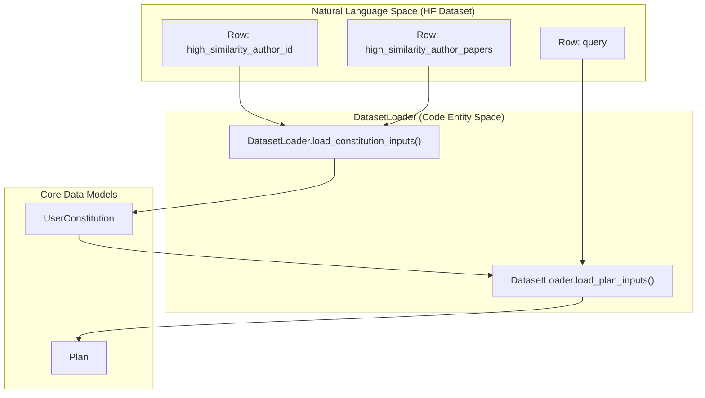
Sources: [data/dataset_loader.py:48-63](), [data/dataset_loader.py:104-124]()

## Key Loading Methods

### Constitution Data Loading
These methods facilitate the generation and evaluation of user profiles.
*   **`load_constitution_inputs`**: Extracts lists of `paper_collection_ids` and `author_ids`. This is the entry point for `generate_profile_batch.py` [data/dataset_loader.py:48-63]().
*   **`load_constitution_outputs`**: Loads existing `UserConstitution` objects from disk using `UserConstitution.from_json`. It handles potential parsing errors and provides a summary of successfully loaded profiles [data/dataset_loader.py:70-95]().

### Plan Data Loading
These methods prepare data for generating or evaluating search plans.
*   **`load_plan_inputs`**: Aggregates queries, query IDs, and their corresponding `UserConstitution` objects. This is used when generating plans that must be personalized to a specific user profile [data/dataset_loader.py:104-124]().
*   **`load_plan_pairs`**: Specifically designed for A/B evaluation. It loads a "normal" (generic) plan and a "personalized" plan for the same query and user, returning them in a dictionary format suitable for comparison [data/dataset_loader.py:134-153]().

### Internal Logic for Plan Pairs
When calling `load_plan_pairs`, the loader assumes a specific naming convention for files on disk:
*   Generic Plan ID: `{query_id}_normal` [data/dataset_loader.py:144]()
*   Personalized Plan ID: `{query_id}_personalized` [data/dataset_loader.py:145]()

## Entity Relationship: Dataset to Models

This diagram shows how `DatasetLoader` methods map specific Hugging Face dataset fields to the constructor arguments of the system's core Data Models.

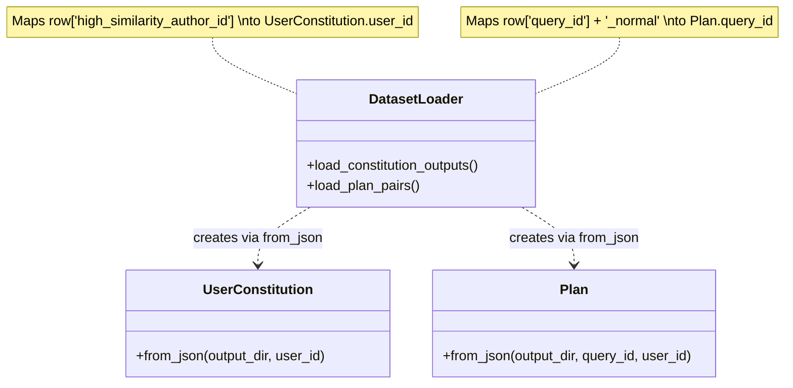
Sources: [data/dataset_loader.py:84-86](), [data/dataset_loader.py:144-146]()

---

# Page: Local Datasets and Qualitative Coding Data

# Local Datasets and Qualitative Coding Data

<details>
<summary>Relevant source files</summary>

The following files were used as context for generating this wiki page:

- [data/local_datasets/qualitative_coding_data/all_text/dataset_dict.json](data/local_datasets/qualitative_coding_data/all_text/dataset_dict.json)
- [data/local_datasets/qualitative_coding_data/all_text/train/cache-00db1cfd048ad1d3.arrow](data/local_datasets/qualitative_coding_data/all_text/train/cache-00db1cfd048ad1d3.arrow)
- [data/local_datasets/qualitative_coding_data/all_text/train/cache-012b2577db402683.arrow](data/local_datasets/qualitative_coding_data/all_text/train/cache-012b2577db402683.arrow)
- [data/local_datasets/qualitative_coding_data/all_text/train/cache-015ddb3086431be5.arrow](data/local_datasets/qualitative_coding_data/all_text/train/cache-015ddb3086431be5.arrow)

</details>


This page describes the local data storage architecture within the `personalized-scholarqa-eval` repository. The system relies on a specific directory structure under `data/local_datasets/` to manage cached Hugging Face datasets, paper metadata, and qualitative coding examples used for simulation and evaluation.

## Overview of data/local_datasets/

The `data/local_datasets/` directory acts as the primary storage for ground-truth data and pre-processed corpora. Unlike the dynamic outputs generated by LLMs (which are stored in `model/` or `metric_scores/`), this directory contains the foundational data used to drive the simulation and evaluation pipelines.

### Directory Structure

| Path | Description |
| :--- | :--- |
| `qualitative_coding_data/` | Contains the manual qualitative coding corpus stored in Apache Arrow format. |
| `simulated_profile_inputs/` | Stores JSON files representing the inputs for user profile simulation. |
| `paper_objects/` | A collection of serialized `Paper` objects (JSON) used to provide context for profile generation. |

**Sources:** `data/local_datasets/` directory structure.

---

## Qualitative Coding Data Corpus

The `qualitative_coding_data` is a local Hugging Face dataset used primarily by the simulation evaluation branch [evaluation/predict_user_data.py](). It contains hand-coded examples of how models succeed or fail at personalization tasks.

### Hugging Face Dataset Caching
The dataset is stored using the Hugging Face `datasets` library's local caching mechanism. This allows the `DatasetLoader` to load the corpus efficiently without network access [data/dataset_loader.py:102-104]().

*   **`dataset_dict.json`**: A manifest file defining the available splits. In this repository, only the `train` split is utilized [data/local_datasets/qualitative_coding_data/all_text/dataset_dict.json:1]().
*   **Apache Arrow Files**: The actual data is stored in `.arrow` files (e.g., `cache-00db1cfd048ad1d3.arrow`). These files are memory-mapped for high-performance access [data/local_datasets/qualitative_coding_data/all_text/train/cache-00db1cfd048ad1d3.arrow:5]().
*   **Fingerprinting**: Each arrow file contains a `fingerprint` (e.g., `00db1cfd048ad1d3`) that ensures data integrity and allows the Hugging Face library to track versions of the cached data [data/local_datasets/qualitative_coding_data/all_text/train/cache-012b2577db402683.arrow:5]().

### Data Flow: Qualitative Coding to Simulation
The following diagram illustrates how the local Arrow files are consumed by the evaluation system.

**Simulation Data Loading Flow**
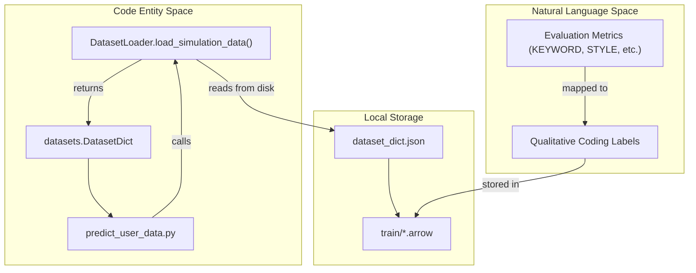
**Sources:** [data/dataset_loader.py:102-110](), [evaluation/predict_user_data.py:10-25]().

---

## Simulated Profile Inputs and Paper Objects

The framework uses two specific types of local JSON data to facilitate the "Two-Stage Pipeline" (Profile Generation -> Plan Generation).

### Paper Objects
The `paper_objects/` directory contains JSON files where each file represents a `Paper` dataclass instance [data/data_models.py:13-25](). These objects include:
*   `paper_id`: Unique identifier.
*   `title`: The title of the research paper.
*   `abstract`: The summary of the work.
*   `authors`: A list of author names.

These objects are loaded by the `DatasetLoader` to provide the raw text context needed for the `MultiPaperAuthorInferencesPromptThirdParty` prompt [prompt/template.py:112-130]().

### Simulated Profile Inputs
The `simulated_profile_inputs/` directory contains the source data for creating `User` objects. These inputs are used to reconstruct simulation scenarios by joining source IDs with the paper corpus [data/dataset_loader.py:112-125]().

**Data Association Diagram**
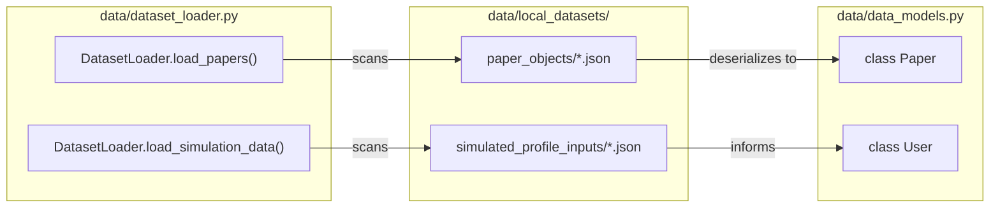
**Sources:** [data/data_models.py:13-35](), [data/dataset_loader.py:10-40]().

---

## Technical Implementation Details

### Fingerprinting and Features
The Arrow files in the `qualitative_coding_data` corpus include metadata that defines the schema for the Hugging Face `datasets` library. Specifically, they define `indices` as `uint64` values to track row positions within the cache [data/local_datasets/qualitative_coding_data/all_text/train/cache-015ddb3086431be5.arrow:5]().

### Dataset Loading Logic
The `DatasetLoader` class (specifically the `load_from_disk` method) is responsible for resolving the paths to these local directories. It expects a specific hierarchy:
1.  It checks for the existence of `dataset_dict.json` [data/local_datasets/qualitative_coding_data/all_text/dataset_dict.json:1]().
2.  It uses the `datasets.load_from_disk()` utility to map the Arrow files into a `Dataset` object.
3.  It filters or splits the data based on the `train` key defined in the manifest.

**Sources:** [data/dataset_loader.py:102-105](), [data/local_datasets/qualitative_coding_data/all_text/dataset_dict.json:1]().

---

# Page: Generation Pipeline

# Generation Pipeline

<details>
<summary>Relevant source files</summary>

The following files were used as context for generating this wiki page:

- [README.md](README.md)
- [data/dataset_loader.py](data/dataset_loader.py)

</details>


The Personalized ScholarQA generation pipeline is a two-stage process designed to transform a researcher's publication history into a personalized research plan. The pipeline first infers a comprehensive **User Profile** (or "Constitution") from paper collections and then uses that profile to generate a **Personalized Plan** for a specific research query.

This process is orchestrated by shell scripts that chain these Python modules together, ensuring that the necessary data artifacts (JSON files) are passed correctly between stages.

### Pipeline Overview

The generation workflow follows a linear path from raw paper data to structured research strategies.

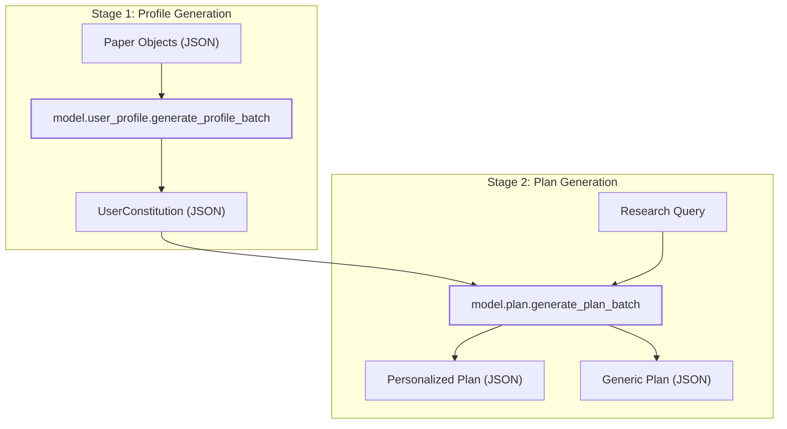
**Sources:** [README.md:109-112](), [scripts/generate.sh:1-50]()

---

### Stage 1: User Profile Generation
The first stage involves analyzing a collection of papers authored by a specific user to infer their research persona. The system uses the `MultiPaperAuthorInferencesPromptThirdParty` template to prompt an LLM to generate high-level and atomic inferences across several categories defined in the `CONSTITUTION_DEFINITION_RUBRIC`.

The resulting `UserConstitution` object acts as a persistent representation of the user's:
*   **Knowledge & Expertise:** Technical domains and specific concepts.
*   **Research & Writing Style:** Methodological preferences and linguistic tone.
*   **Epistemology & Audience:** How they evaluate evidence and who they write for.

For a deep dive into the inference hierarchy and JSON parsing, see **[User Profile Generation](#3.1)**.

**Sources:** [model/user_profile/generate_profile_batch.py:1-50](), [prompt/template.py:12-40]()

---

### Stage 2: Plan Generation
The second stage uses the generated `UserConstitution` to ground a research plan for a new query. The pipeline generates two types of plans for evaluation purposes:
1.  **Personalized Plan:** Uses `PlanGenerationPromptQualitative` or `PlanGenerationPromptImplementation` to incorporate the user's profile into search and organization strategies.
2.  **Generic (Non-personalized) Plan:** Uses "Nonpersonalized" prompt variants to provide a baseline without user-specific context.

The output consists of `Plan` objects containing specific `PlanRequirement` items, each tagged with a `PersonalizationStrategy` (e.g., "Filtering", "Re-ranking") to track how the profile influenced the result.

For details on the plan taxonomies and prompt selection logic, see **[Plan Generation](#3.2)**.

**Sources:** [model/plan/generate_plan_batch.py:1-60](), [data/core_types.py:180-220]()

---

### Orchestration and Execution
The pipeline is primarily executed via `scripts/generate.sh`. This script manages the environment variables and CLI arguments required by the Python modules.

#### Key Components and Code Entities

| Entity | Role | File Reference |
| :--- | :--- | :--- |
| `generate.sh` | Orchestrates the two-stage flow via shell commands. | [scripts/generate.sh:1-50]() |
| `DatasetLoader` | Loads paper collections and input queries from disk. | [data/dataset_loader.py:48-63]() |
| `generate_profile_batch.py` | Entry point for Stage 1 (Profile Generation). | [model/user_profile/generate_profile_batch.py:1-20]() |
| `generate_plan_batch.py` | Entry point for Stage 2 (Plan Generation). | [model/plan/generate_plan_batch.py:1-20]() |

#### Execution Flow Diagram

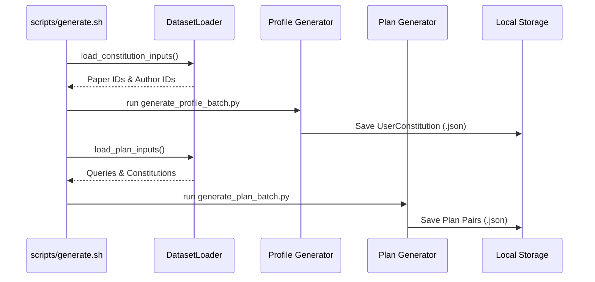
**Sources:** [scripts/generate.sh:25-45](), [data/dataset_loader.py:48-124]()

---

### Related Pages
*   **[User Profile Generation](#3.1)**: Detailed look at paper analysis and the `UserConstitution` model.
*   **[Plan Generation](#3.2)**: Detailed look at personalization strategies and `Plan` requirements.
*   **[Generation Scripts](#8.1)**: Reference for CLI arguments and directory configurations in `generate.sh`.

---

# Page: User Profile Generation

# User Profile Generation

<details>
<summary>Relevant source files</summary>

The following files were used as context for generating this wiki page:

- [README.md](README.md)
- [data/__init__.py](data/__init__.py)
- [data/dataset_loader.py](data/dataset_loader.py)

</details>


The User Profile Generation stage is the first phase of the personalized evaluation pipeline. It transforms a collection of an author's research papers into a structured **User Constitution** (also referred to as a "profile"). This profile captures specific researcher preferences across dimensions such as epistemology, writing style, and domain knowledge, which are later used to condition plan generation.

The logic is primarily contained within `model/user_profile/generate_profile_batch.py` [model/user_profile/generate_profile_batch.py:1-125](), which orchestrates reading paper data, calling LLMs via specialized prompts, and persisting the resulting structured objects.

### Data Flow and Architecture

The generation process follows a batch-processing pattern. It reads author identifiers and their associated paper IDs from a source dataset, fetches the full paper content from local storage, and uses a "Third Party" inference prompt to ask an LLM to act as an observer characterizing the author.

#### Profile Generation Sequence
The following diagram illustrates the flow from raw paper files to the persisted `UserConstitution` JSON.

**Diagram: Paper-to-Constitution Transformation**
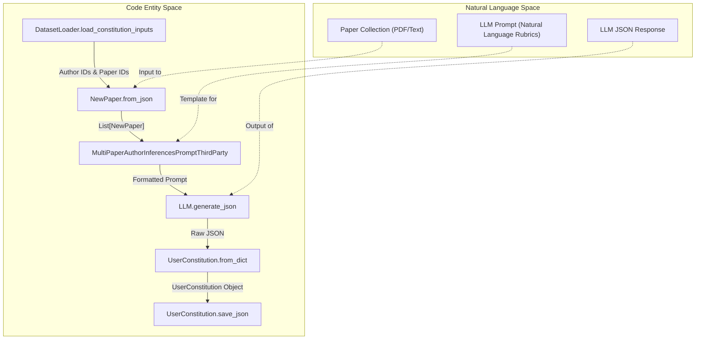
**Sources:** [model/user_profile/generate_profile_batch.py:47-98](), [data/dataset_loader.py:48-63](), [prompt/template.py:53-76]()

### The User Constitution Structure

The output of this process is a `UserConstitution` object [data/profile_data.py:126-128](). This object is a hierarchical container for two types of inferences:

1.  **AtomicInference**: Specific, granular observations derived directly from the papers, including supporting evidence (citations) [data/profile_data.py:12-22]().
2.  **HighLevelInference**: Synthesized, broader characterizations that group atomic inferences into semantic categories [data/profile_data.py:65-76]().

#### CONSTITUTION_DEFINITION_RUBRIC Categories
The LLM is instructed to categorize every inference into one of the following seven categories defined in the `CONSTITUTION_DEFINITION_RUBRIC` [prompt/shared_instructions.py:11-26]():

| Category | Description |
| :--- | :--- |
| `knowledge` | Specific domains, concepts, or technical expertise. |
| `research_style` | Methodological preferences (e.g., empirical vs. theoretical). |
| `writing_style` | Linguistic traits (e.g., formal, concise, use of metaphors). |
| `positions` | Specific stances or arguments taken in the field. |
| `epistemology` | How the author validates truth or value in research. |
| `audience` | The intended level of technicality or background of readers. |
| `conclusions` | Typical ways the author frames results or future work. |

**Sources:** [prompt/shared_instructions.py:11-26](), [data/profile_data.py:65-76]()

### Implementation Details

#### Batch Generation Loop
The main entry point is `generate_profile_batch` [model/user_profile/generate_profile_batch.py:47-47](). It performs the following steps:
1.  **Input Loading**: Uses `DatasetLoader.load_constitution_inputs` to get lists of author IDs and their respective paper IDs [model/user_profile/generate_profile_batch.py:58-58]().
2.  **Paper Retrieval**: For each author, it loads `NewPaper` objects from the `paper_dir` [model/user_profile/generate_profile_batch.py:73-77]().
3.  **Prompt Construction**: It instantiates `MultiPaperAuthorInferencesPromptThirdParty`, passing the paper content and the required number of inferences [model/user_profile/generate_profile_batch.py:82-84]().
4.  **LLM Call**: Invokes `model.generate_json` to ensure the output adheres to the expected schema [model/user_profile/generate_profile_batch.py:86-86]().
5.  **Parsing & Persistence**: Converts the JSON response into a `UserConstitution` and calls `constitution.save_json(output_dir)` [model/user_profile/generate_profile_batch.py:88-98]().

#### Class Mapping
This diagram maps the logical components of the profile to the specific Python classes that handle them.

**Diagram: Constitution Object Model**
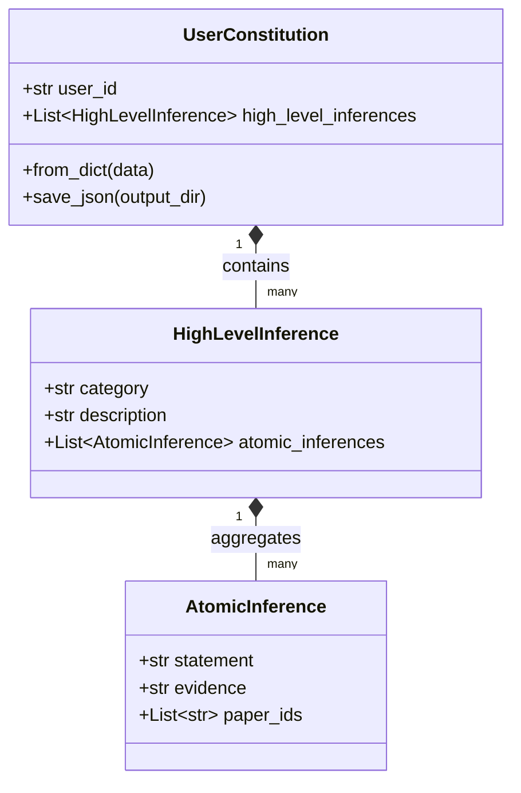
**Sources:** [data/profile_data.py:12-140]()

### Personalization Requirements
The generation prompt enforces specific constraints to ensure the profile is useful for downstream personalization:
*   **Evidence-Based**: Every `AtomicInference` must include an `evidence` string and a list of `paper_ids` [data/profile_data.py:12-22]().
*   **Distinct Categories**: The LLM must organize inferences according to the `CONSTITUTION_DEFINITION_RUBRIC` to ensure a balanced view of the author [prompt/shared_instructions.py:11-26]().
*   **JSON Enforcement**: The system uses `validate_json_structure` in the LLM base class to ensure the response can be successfully cast into the `AtomicInference` and `HighLevelInference` dataclasses [llms/base.py:61-91]().

**Sources:** [model/user_profile/generate_profile_batch.py:82-98](), [llms/base.py:61-91](), [prompt/template.py:53-76]()

---

# Page: Plan Generation

# Plan Generation

<details>
<summary>Relevant source files</summary>

The following files were used as context for generating this wiki page:

- [README.md](README.md)
- [data/__init__.py](data/__init__.py)
- [data/dataset_loader.py](data/dataset_loader.py)

</details>


The **Plan Generation** stage is the second phase of the MyScholarQA generation pipeline. It takes a generated **User Profile** (also known as a `UserConstitution`) and a research query as input to produce a structured, multi-step **Plan**. These plans are designed to guide a deep research system in executing search, organization, and generation tasks that are specifically tailored to a researcher's inferred preferences and background.

### 1. Overview and Purpose

The core logic for generating plans resides in `model/plan/generate_plan_batch.py`. The system generates two types of plans for every query to enable comparative evaluation:
1.  **Personalized Plan**: Conditioned on the `UserConstitution`.
2.  **Normal (Non-Personalized) Plan**: Conditioned only on the query, serving as a baseline.

Each plan consists of a sequence of `PlanRequirement` objects, which categorize the personalization strategy used (e.g., Narrowing, Off-topic mitigation, or Style adjustments).

### 2. Implementation and Data Flow

The generation process follows a batch-processing pattern, loading inputs via the `DatasetLoader`, selecting appropriate prompt templates, and persisting results to disk as JSON files.

#### Plan Generation Architecture
The following diagram illustrates how the `generate_plan_batch.py` script bridges the high-level research query with the specific code entities used to represent the plan.

**Title: Plan Generation Data Flow**
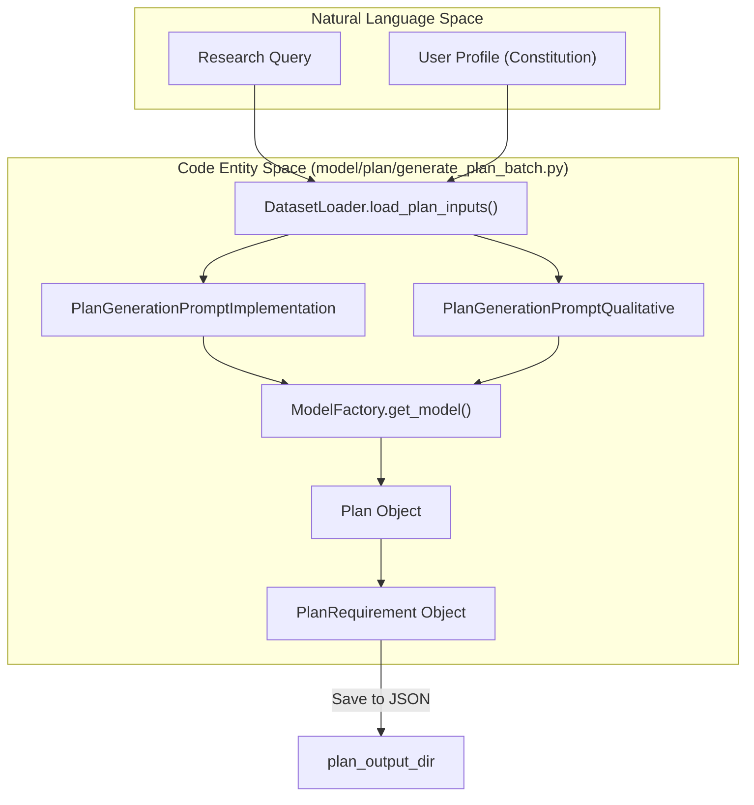
Sources: `[model/plan/generate_plan_batch.py:1-125]()`, `[data/dataset_loader.py:104-124]()`, `[data/plan_data.py:34-70]()`

### 3. Key Classes and Functions

#### 3.1 Personalization Strategy Taxonomy
The system classifies every requirement in a personalized plan using two taxonomies defined in `model/plan/generate_plan_batch.py`:

*   **`PersonalizationStrategy`**: Describes the logical relationship between the user profile and the query (e.g., `NARROW`, `OFFTOPIC`, `OVERGENERAL`). [model/plan/generate_plan_batch.py:15-24]()
*   **`PersonalizationFramework`**: Describes the action taken (e.g., `SEARCH`, `ORGANIZE`, `GENERATE`). [model/plan/generate_plan_batch.py:26-30]()

#### 3.2 Prompt Selection Logic
The script selects prompt variants based on whether personalization is enabled and which prompt "flavor" is requested via the CLI:

| Mode | Personalized Class | Non-Personalized Class |
| :--- | :--- | :--- |
| **Qualitative** | `PlanGenerationPromptQualitative` | `PlanGenerationPromptQualitativeNonpersonalized` |
| **Implementation** | `PlanGenerationPromptImplementation` | `PlanGenerationPromptImplementationNonpersonalized` |

Sources: `[model/plan/generate_plan_batch.py:80-95]()`, `[prompt/template.py:126-174]()`

### 4. Detailed Execution Logic

The main entry point is the `generate` function in `model/plan/generate_plan_batch.py`.

1.  **Input Loading**: It calls `DatasetLoader.load_plan_inputs` to retrieve queries, query IDs, and the corresponding `UserConstitution` objects from the `profile_dir`. [model/plan/generate_plan_batch.py:73-74]()
2.  **Batch Generation Loop**:
    *   For each query, it first generates a **Personalized Plan**. It constructs the prompt using the `UserConstitution` and the query string. [model/plan/generate_plan_batch.py:98-106]()
    *   It then generates a **Normal Plan**. It uses the non-personalized prompt variant, which ignores the constitution. [model/plan/generate_plan_batch.py:113-118]()
3.  **JSON Parsing**: The LLM output is expected to be a JSON list of requirements. The script iterates through these and constructs `PlanRequirement` objects. [model/plan/generate_plan_batch.py:103-105]()
4.  **Persistence**: Plans are saved using `Plan.to_json`. Personalized plans are suffixed with `_personalized` and normal plans with `_normal` in their filenames to prevent collisions. [model/plan/generate_plan_batch.py:111,123]()

**Title: Plan Entity Mapping**
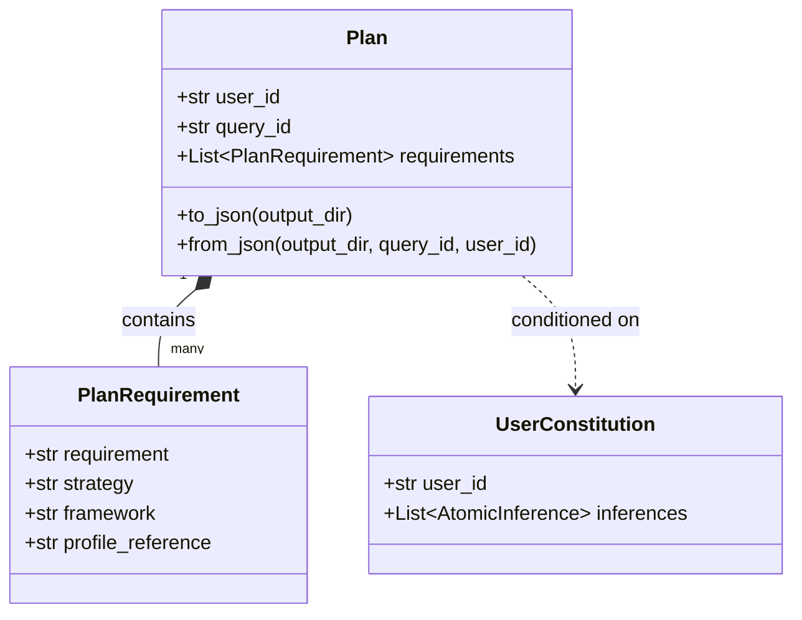
Sources: `[data/plan_data.py:1-70]()`, `[data/profile_data.py:75-90]()`

### 5. Running the Pipeline

Plan generation is typically triggered via the `scripts/generate.sh` wrapper.

```bash
# Example invocation within generate.sh
python3 -m model.plan.generate_plan_batch \
    --profile_dir "data/outputs/profiles" \
    --output_dir "data/outputs/plans" \
    --model_name "gpt-4o" \
    --model_type "openai" \
    --num_actions 5
```

The `--num_actions` flag controls the `limit` parameter, determining how many query-plan pairs are processed from the input dataset. [model/plan/generate_plan_batch.py:61,75]()

Sources: `[scripts/generate.sh:1-40]()`, `[model/plan/generate_plan_batch.py:53-68]()`

---

# Page: Prompt System

# Prompt System

<details>
<summary>Relevant source files</summary>

The following files were used as context for generating this wiki page:

- [README.md](README.md)
- [__init__.py](__init__.py)

</details>


The `prompt/` package serves as the central repository for all LLM instructions and templates used throughout the Personalized ScholarQA Evaluation framework. It manages the complexity of constructing multi-part prompts that include system instructions, research rubrics, few-shot examples, and specific user data.

The system is divided into two primary areas: template-based generation (for creating profiles and plans) and simulation prompts (for predicting user preferences based on qualitative coding data).

### Core Components

The prompt system is built around a flexible base class and a builder utility to ensure consistency across different LLM calls.

| Component | File | Role |
| :--- | :--- | :--- |
| `Prompt` | [prompt/template.py:11-28]() | Abstract base class defining the `to_prompt()` interface for all generation templates. |
| `prompt_builder` | [prompt/template.py:31-50]() | Utility function that joins instruction strings with newlines and handles optional prefixing. |
| `shared_instructions` | [prompt/template.py:53-57]() | Common formatting and behavioral constraints applied to all generation tasks. |

### Prompt Architecture Diagram

The following diagram illustrates how natural language instructions are mapped to code entities and composed into final LLM strings.

```mermaid
graph TD
    subgraph "Natural Language Space"
        A["System Instructions"]
        B["Rubric Definitions"]
        C["Few-Shot Examples"]
        D["User/Paper Data"]
    end

    subgraph "Code Entity Space (prompt/ package)"
        E["shared_instructions"]
        F["CONSTITUTION_DEFINITION_RUBRIC"]
        G["EXAMPLE_MAP / DESCRIPTION_MAP"]
        H["Prompt (Base Class)"]
        I["prompt_builder()"]
    end

    A --> E
    B --> F
    C --> G
    E --> I
    F --> I
    G --> I
    D --> H
    H --> I
    I --> J["Final LLM String"]

    style H stroke-dasharray: 5 5
```
**Sources:** [prompt/template.py:11-57](), [prompt/user_prediction_prompts/profile/profile_prompts.py:6-25]()

---

### Generation Templates

The generation pipeline uses specialized subclasses of `Prompt` to handle two distinct phases: inferring user profiles (constitutions) and creating research plans. These templates often incorporate `NUMBER_WORDS` [prompt/template.py:60-72]() to ensure LLMs follow specific count constraints for generated items.

#### Constitution Generation
These prompts are designed to analyze a collection of papers and infer a researcher's "constitution"—a set of atomic and high-level inferences regarding their research style, epistemology, and target audience.
*   **Primary Class:** `MultiPaperAuthorInferencesPromptThirdParty` [prompt/template.py:75-121]()
*   **Key Input:** `CONSTITUTION_DEFINITION_RUBRIC` [prompt/template.py:534-550]()

#### Plan Generation
These prompts generate research plans consisting of search, organization, and generation requirements. They support both personalized (conditioned on a constitution) and non-personalized (baseline) variants.
*   **Personalized:** `PlanGenerationPromptQualitative`, `PlanGenerationPromptImplementation` [prompt/template.py:204-325]()
*   **Non-Personalized:** `PlanGenerationPromptQualitativeNonpersonalized`, `PlanGenerationPromptImplementationNonpersonalized` [prompt/template.py:328-444]()

For details on how these templates are composed, see [Constitution and Plan Prompt Templates](#4.1).

---

### User Prediction Prompts (Simulation)

The simulation branch uses a different structure, relying on pre-defined text files and mapping dictionaries to evaluate how well LLMs can predict real-world qualitative coding outcomes. These are located in the `prompt/user_prediction_prompts/` directory.

The system uses three primary prompt types for simulation:
1.  **`PROMPT_BASIC`**: Standard instruction set for the prediction task.
2.  **`PROMPT_METRIC`**: Instructions focused on specific evaluation metrics (e.g., specificity, accuracy).
3.  **`JSON_PROMPT`**: Forces the LLM to output predictions in a structured JSON format for automated parsing.

#### Simulation Data Mapping
The simulation prompts bridge the gap between qualitative research labels and LLM inputs using several mapping entities:

| Entity | Description |
| :--- | :--- |
| `DESCRIPTION_MAP` | Maps internal metric codes to natural language descriptions. |
| `EXAMPLE_MAP` | Provides few-shot examples for specific qualitative categories. |
| `METRIC_MAP` | Maps specific metrics to their corresponding instruction sets. |

For details on simulation prompts and few-shot examples, see [User Prediction Prompts (Simulation)](#4.2).

```mermaid
graph LR
    subgraph "Simulation Inputs"
        direction TB
        P["plan/"]
        PR["profile/"]
        R["response/"]
    end

    subgraph "Logic (evaluation/predict_user_data.py)"
        M["METRIC_MAP"]
        D["DESCRIPTION_MAP"]
    end

    subgraph "Output Formats"
        PB["PROMPT_BASIC"]
        PM["PROMPT_METRIC"]
        JP["JSON_PROMPT"]
    end

    P --> M
    PR --> M
    R --> M
    M --> PB
    M --> PM
    D --> JP
```
**Sources:** [prompt/user_prediction_prompts/profile/profile_prompts.py:6-45](), [evaluation/predict_user_data.py:25-60]()

---

# Page: Constitution and Plan Prompt Templates

# Constitution and Plan Prompt Templates

<details>
<summary>Relevant source files</summary>

The following files were used as context for generating this wiki page:

- [README.md](README.md)
- [__init__.py](__init__.py)

</details>


This page provides a technical reference for the concrete `Prompt` subclasses defined in `prompt/template.py` [prompt/template.py:1-356](). These templates are the core of the Personalized ScholarQA generation pipeline, responsible for transforming raw data (paper snippets, user profiles, and research queries) into structured LLM prompts for generating **User Constitutions** and **Personalized Research Plans**.

## Overview of the Prompt Hierarchy

All templates inherit from the abstract `Prompt` base class [prompt/prompt_builder.py:6-27](). The system uses a composition-based approach where shared instructions, rubrics, and formatting constraints are injected into the final string via the `build_prompt` method.

### Data Flow: Natural Language to Code Space

The following diagram illustrates how natural language concepts (Rubrics, Instructions) are mapped to specific class attributes and methods within the codebase.

**Prompt Composition Mapping**
```mermaid
graph TD
    subgraph "Natural Language Space"
        NL_Rubric["Constitution Rubric (Knowledge, Style, etc.)"]
        NL_Instructions["Shared System Instructions"]
        NL_Plan_Req["Plan Requirements (Search, Org, Gen)"]
    end

    subgraph "Code Entity Space (prompt/template.py)"
        BaseClass["Prompt (Abstract Base)"]
        
        subgraph "Constitution Generation"
            MPA["MultiPaperAuthorInferencesPromptThirdParty"]
            MPA_Rubric["CONSTITUTION_DEFINITION_RUBRIC"]
        end

        subgraph "Plan Generation"
            PGQ["PlanGenerationPromptQualitative"]
            PGI["PlanGenerationPromptImplementation"]
            PG_Shared["shared_instructions.py"]
        end
    end

    NL_Rubric --> MPA_Rubric
    NL_Instructions --> PG_Shared
    NL_Plan_Req --> PGQ
    NL_Plan_Req --> PGI
    
    MPA_Rubric -- "Injected into" --> MPA
    PG_Shared -- "Imported by" --> PGQ
    PG_Shared -- "Imported by" --> PGI
    MPA -- "Inherits" --> BaseClass
    PGQ -- "Inherits" --> BaseClass
```
**Sources:** [prompt/template.py:10-356](), [prompt/prompt_builder.py:6-27](), [prompt/shared_instructions.py:1-42]()

---

## Constitution Generation Templates

The primary template for profile generation is `MultiPaperAuthorInferencesPromptThirdParty`. It is designed to analyze a collection of papers and infer a researcher's profile (Constitution).

### MultiPaperAuthorInferencesPromptThirdParty
This class handles the transformation of multiple `PaperSnippet` objects into a `UserConstitution` [prompt/template.py:10-93]().

*   **Key Constants**:
    *   `CONSTITUTION_DEFINITION_RUBRIC`: Defines the seven categories for inferences: `knowledge`, `research_style`, `writing_style`, `positions`, `epistemology`, `audience`, and `conclusions` [prompt/template.py:11-40]().
    *   `NUMBER_WORDS`: A mapping (e.g., 1 -> "one") used to dynamically set the required number of inferences in the prompt text [prompt/template.py:42-53]().
*   **Prompt Composition**:
    *   It utilizes `shared_instructions.py` to set the persona of a "highly skilled research assistant" [prompt/shared_instructions.py:1-6]().
    *   The `build_prompt` method iterates through `PaperSnippet` objects, formatting their titles and abstracts for the LLM [prompt/template.py:73-86]().
    *   It enforces a JSON output format containing `atomic_inferences` and `high_level_inferences` [prompt/template.py:88-91]().

**Sources:** [prompt/template.py:10-93](), [prompt/shared_instructions.py:1-6]()

---

## Plan Generation Templates

Plan templates are split into two categories: **Qualitative** (high-level research goals) and **Implementation** (concrete execution steps). Each category has a personalized and non-personalized variant.

### Logic Flow for Plan Prompts
The following diagram shows how the `build_prompt` method assembles the final string for personalized plan generation.

**Plan Generation Logic**
```mermaid
sequenceDiagram
    participant P as PlanGenerationPrompt
    participant S as shared_instructions.py
    participant C as UserConstitution
    participant LLM as LLM Provider

    P->>S: Fetch SYSTEM_INSTRUCTIONS_PLAN
    P->>C: Extract inferences (Atomic/High-Level)
    P->>P: Format Research Query
    Note over P: Combine Instructions + Profile + Query
    P->>LLM: Send final prompt string
    LLM-->>P: Return JSON (Plan + PlanRequirements)
```
**Sources:** [prompt/template.py:96-356](), [model/plan/generate_plan_batch.py:74-115]()

### 1. Qualitative Plan Templates
Used to generate high-level research strategies.

*   **PlanGenerationPromptQualitative**: The personalized version. It takes a `UserConstitution` and a query string. It explicitly instructs the LLM to use the profile to "tailor the research plan to the user's specific needs" [prompt/template.py:96-155]().
*   **PlanGenerationPromptQualitativeNonpersonalized**: The baseline version. It excludes the `UserConstitution` and asks for a general high-level plan for the query [prompt/template.py:158-219]().

### 2. Implementation Plan Templates
Used to generate detailed, actionable steps (Search, Organization, Generation).

*   **PlanGenerationPromptImplementation**: The personalized version. It requires a `UserConstitution` and focuses on producing a "detailed and personalized implementation plan" [prompt/template.py:222-290]().
*   **PlanGenerationPromptImplementationNonpersonalized**: The baseline version. It generates a detailed plan without user-specific context [prompt/template.py:293-356]().

### Common Requirements for Plans
All plan templates enforce a JSON schema defined in the `build_prompt` methods:
1.  **Search**: Specific queries or data sources to look for.
2.  **Organization**: How the gathered information should be structured.
3.  **Generation**: Constraints or focus areas for the final output.
4.  **Requirements**: A list of `PlanRequirement` objects that justify the plan's components [prompt/template.py:145-152]().

**Sources:** [prompt/template.py:96-356](), [data/core_data_models.py:127-148]()

---

## Shared Instruction Components

The templates rely on `prompt/shared_instructions.py` to maintain consistency across different model calls.

| Variable | Purpose |
| :--- | :--- |
| `SYSTEM_INSTRUCTIONS` | Base persona for constitution generation [prompt/shared_instructions.py:1-6](). |
| `SYSTEM_INSTRUCTIONS_PLAN` | Base persona for plan generation, emphasizing structural rigor [prompt/shared_instructions.py:8-13](). |
| `CONSTITUTION_INSTRUCTIONS` | Formatting instructions for atomic and high-level inferences [prompt/shared_instructions.py:15-32](). |
| `PLAN_INSTRUCTIONS` | Instructions for breaking plans into Search, Organization, and Generation phases [prompt/shared_instructions.py:34-42](). |

**Sources:** [prompt/shared_instructions.py:1-42]()

---

# Page: User Prediction Prompts (Simulation)

# User Prediction Prompts (Simulation)

<details>
<summary>Relevant source files</summary>

The following files were used as context for generating this wiki page:

- [README.md](README.md)
- [__init__.py](__init__.py)

</details>


The `prompt/user_prediction_prompts/` directory contains the templates and few-shot examples required for the **Simulation Evaluation** pipeline. This branch of the evaluation framework aims to predict whether a specific user preference or metric is satisfied by a generated output, effectively using an LLM to simulate real user data derived from qualitative interviews [README.md:11-12]().

### Overview of the Simulation Prompt System

The simulation evaluation is organized into three distinct subdirectories, each corresponding to a specific evaluation split. These subdirectories contain `.txt` files that serve as few-shot examples for the LLM judge.

| Subdirectory | Purpose |
| :--- | :--- |
| `plan/` | Prompts for evaluating generated research plans. |
| `profile/` | Prompts for evaluating generated user constitutions/profiles. |
| `response/` | Prompts for evaluating the final personalized research response. |

Sources: [README.md:155-155]()

### Core Prompt Components

The simulation logic relies on several mapping dictionaries and template strings to construct the final prompt sent to the LLM. These components bridge the gap between abstract metric codes and natural language instructions.

#### 1. Metric and Description Mappings
The system uses `DESCRIPTION_MAP` and `METRIC_MAP` to translate internal metric identifiers into human-readable definitions for the LLM.

*   **`DESCRIPTION_MAP`**: Maps a split name (profile, plan, response) to a high-level description of what the LLM is evaluating.
*   **`METRIC_MAP`**: Maps specific error/quality codes to their definitions. Examples include:
    *   `KEYWORD`: Checks for the presence of specific researcher keywords.
    *   `OVERGENERAL`: Detects if the profile is too broad.
    *   `NEGATION`: Checks if the model ignored a negative constraint.
    *   `OFFTOPIC`: Identifies content irrelevant to the user's actual research area.

#### 2. Prompt Templates
The simulation utilizes three primary template types:

*   **`PROMPT_BASIC`**: The standard prompt structure that includes the task description, the content to be evaluated, and the specific metric to check.
*   **`PROMPT_METRIC`**: An augmented version of the basic prompt that includes detailed definitions of the metric being tested to improve judge accuracy.
*   **`JSON_PROMPT`**: A wrapper used when `generate_json` is called, ensuring the LLM returns a structured object (e.g., `{"is_satisfied": boolean}`).

### Data Flow: From Files to LLM Input

The following diagram illustrates how the `DatasetLoader` and the prompt directory contents are combined to create the simulation input.

**Simulation Prompt Construction Flow**
```mermaid
graph TD
    subgraph "Code Entity Space: prompt/user_prediction_prompts/"
        A["profile/ examples.txt"]
        B["plan/ examples.txt"]
        C["response/ examples.txt"]
    end

    subgraph "Code Entity Space: evaluation/predict_user_data.py"
        D["DESCRIPTION_MAP"]
        E["METRIC_MAP"]
        F["PROMPT_METRIC template"]
        G["predict_user_data.py"]
    end

    subgraph "Natural Language Space"
        H["Few-shot Examples"]
        I["Metric Definition"]
        J["Target Content"]
    end

    A --> G
    B --> G
    C --> G
    D --> G
    E --> G
    F --> G

    G --> H
    G --> I
    G --> J

    H & I & J --> K["Final LLM Prompt"]
```
Sources: [README.md:134-141](), [README.md:149-149](), [README.md:155-155]()

### Implementation Details

The simulation evaluation is orchestrated by `evaluation/predict_user_data.py`. It follows a structured pipeline to generate predictions for the `qualitative_coding_data` corpus.

#### Key Functions and Logic
1.  **Data Loading**: The pipeline calls `DatasetLoader.load_simulation_data()` to retrieve the qualitative interview-derived dataset [README.md:134-141]().
2.  **Prompt Assembly**: For each example in the dataset, the script:
    *   Identifies the split (profile, plan, or response).
    *   Retrieves the corresponding few-shot examples from the `.txt` files in `prompt/user_prediction_prompts/`.
    *   Injects the `METRIC_MAP` definition into the `PROMPT_METRIC` string.
3.  **Execution**: The assembled prompt is passed to the `llms/` abstraction layer (typically using `generate_json` to ensure a boolean `is_satisfied` field is returned).
4.  **Persistence**: Results are written to a JSONL file, which is later processed by `metric_scores/simulation_plot.py` to generate accuracy visualizations [README.md:134-141]().

### Metric Codes and Definitions
The following table describes the primary metrics used within the simulation prompts to evaluate LLM performance against real user expectations:

| Metric Code | Logic in Prompt |
| :--- | :--- |
| `KEYWORD` | Does the text contain specific technical keywords identified by the user? |
| `OVERGENERAL` | Is the generated profile or plan too generic to be useful for a specialist? |
| `NARROW` | Is the scope of the generation too restricted compared to the user's breadth? |
| `STYLE` | Does the writing style (tone, formatting) match the user's requirements? |
| `UNINFORMATIVE` | Does the output lack substantive content or provide "fluff"? |

**System Component Mapping**
```mermaid
graph LR
    subgraph "Natural Language Space"
        UserPref["'I only research NLP'"]
        EvalResult["'Satisfied' / 'Not Satisfied'"]
    end

    subgraph "Code Entity Space"
        subgraph "prompt/ package"
            PMap["METRIC_MAP"]
            PBasic["PROMPT_BASIC"]
        end
        
        subgraph "evaluation/ package"
            Predictor["predict_user_data.py"]
        end
        
        subgraph "llms/ package"
            LLM["BaseLLM.generate_json()"]
        end
    end

    UserPref --> Predictor
    PMap --> Predictor
    PBasic --> Predictor
    Predictor --> LLM
    LLM --> EvalResult
```

Sources: [README.md:149-159](), [README.md:134-141]()

---

# Page: LLM Abstraction Layer

# LLM Abstraction Layer

<details>
<summary>Relevant source files</summary>

The following files were used as context for generating this wiki page:

- [README.md](README.md)
- [__init__.py](__init__.py)

</details>


The `llms/` package provides a unified interface for interacting with various Large Language Model (LLM) providers. It abstracts away provider-specific API details, offering a consistent API for text generation, JSON generation with schema validation, and retrieval tasks. This layer is central to the framework, powering profile generation, plan generation, and the LLM-as-a-judge evaluation pipelines.

### System Architecture

The abstraction layer is built around an Abstract Base Class (ABC) that defines the interface for all models, a factory for instantiation, and concrete implementations for major providers.

**LLM Abstraction Logic Flow**
```mermaid
graph TD
    subgraph "Code Entity Space"
        MF["ModelFactory.get_model()"]
        ABC["LLM (Abstract Base Class)"]
        GPT["OpenAILLM"]
        CLD["AnthropicLLM"]
        GEM["GeminiLLM"]
        LIT["LiteLLM"]
        
        MF -->|instantiates| ABC
        ABC <|-- GPT
        ABC <|-- CLD
        ABC <|-- GEM
        ABC <|-- LIT
    end

    subgraph "Natural Language Space"
        PR["Prompt String"]
        CF["JSON Schema / Config"]
        RESP["Generated Text / JSON"]
    end

    PR --> MF
    CF --> MF
    MF --> RESP
```
**Sources:** [llms/base.py:25-27](), [llms/model_factory.py:16-37]()

---

### Core Components

#### The LLM Base Class
The `LLM` class in `llms/base.py` is the foundation of the abstraction layer. It defines the core lifecycle of an LLM request, including:
*   **`generate_text`**: The primary method for standard text completion.
*   **`generate_json`**: A specialized method that includes retry logic and validation to ensure the LLM output conforms to a specific JSON structure.
*   **Retry Logic**: The base class handles malformed JSON by re-prompting the model, ensuring robustness in automated pipelines.

For details, see [LLM Base Classes and ModelFactory](#5.1).

#### ModelFactory and Configuration
The `ModelFactory` acts as the entry point for the rest of the codebase. It uses the `ModelType` enum to map string identifiers (e.g., "gpt-4o", "claude-3-5-sonnet") to their respective concrete implementations. It also handles the wiring of environment variables (like `OPEN_AI_TOKEN` or `ANTHROPIC_TOKEN`) into the model constructors.

For details, see [LLM Base Classes and ModelFactory](#5.1).

#### Provider Implementations
The framework includes built-in support for four major provider paths:
*   **OpenAI**: Implementation in `llms/gpt.py` using the `openai` library.
*   **Anthropic**: Implementation in `llms/claude.py` using the `anthropic` library.
*   **Gemini**: Implementation in `llms/gemini.py` using the `google-generativeai` library.
*   **LiteLLM**: A pass-through implementation in `llms/litellm.py` that allows the framework to support any model compatible with the LiteLLM proxy.

For details, see [Provider Implementations](#5.2).

---

### Interaction with the Generation Pipeline

The LLM layer is utilized by the generation scripts to transform paper data into structured user profiles and plans. The following diagram illustrates how the `model/` package interacts with the `llms/` abstraction.

**LLM Usage in Generation**
```mermaid
sequenceDiagram
    participant P as "model/user_profile/generate_profile_batch.py"
    participant MF as "ModelFactory"
    participant LLM as "Concrete LLM (e.g., OpenAILLM)"
    participant API as "Provider API (OpenAI/Anthropic)"

    P->>MF: get_model(model_name, model_type)
    MF-->>P: returns LLM instance
    P->>LLM: generate_json(prompt, schema)
    LLM->>API: POST request
    API-->>LLM: JSON String
    LLM->>LLM: validate_json_structure()
    Note over LLM: If invalid, retry up to N times
    LLM-->>P: returns validated Dict
```
**Sources:** [llms/base.py:45-78](), [llms/model_factory.py:16-37](), [README.md:109-114]()

---

### Child Pages

| Page | Description |
|------|-------------|
| [LLM Base Classes and ModelFactory](#5.1) | Deep dive into `llms/base.py` (LLM ABC, `validate_json_structure`, `generate_json` retry loop, `RetrieverResult`, `Retriever` ABC) and `llms/model_factory.py` (`ModelFactory.get_model`, `ModelType` enum, environment variable wiring). |
| [Provider Implementations](#5.2) | Detailed documentation of concrete provider wrappers: `llms/gpt.py` (`OpenAILLM`), `llms/claude.py` (`Anthropic`), `llms/gemini.py` (`Gemini`), and `llms/litellm.py` (`LiteLLM`). |

**Sources:** [README.md:149-150](), [llms/base.py:1-100](), [llms/model_factory.py:1-40]()

---

# Page: LLM Base Classes and ModelFactory

# LLM Base Classes and ModelFactory

<details>
<summary>Relevant source files</summary>

The following files were used as context for generating this wiki page:

- [README.md](README.md)
- [__init__.py](__init__.py)

</details>


This page provides a deep dive into the foundational abstraction layer for Large Language Models (LLMs) and retrieval systems within the Personalized ScholarQA evaluation framework. The codebase uses a provider-agnostic approach to interface with various model families (OpenAI, Anthropic, Gemini, LiteLLM) while enforcing structured JSON outputs and robust retry mechanisms.

## Overview of llms/base.py

The `llms/base.py` file defines the core interfaces and utility functions that ensure consistency across different LLM providers. It handles the complexity of JSON validation, retry logic, and defines the contract for retrieval-augmented generation.

### Core Data Structures and Interfaces

The system defines two primary abstract base classes (ABCs) and a data structure for retrieval results.

| Class / Type | Role |
| :--- | :--- |
| `LLM` | Abstract base class for all text and JSON generation models [llms/base.py:11-37](). |
| `RetrieverResult` | A `NamedTuple` containing a `text` snippet and its `source` metadata [llms/base.py:8-9](). |
| `Retriever` | Abstract base class for document retrieval systems [llms/base.py:89-93](). |

### The LLM Abstract Base Class

The `LLM` class requires subclasses to implement a `generate_text` method. It provides a built-in `generate_json` method that wraps text generation with validation and retry logic.

**Key Methods:**
- `generate_text(prompt: str, ...)`: Abstract method to be implemented by providers (e.g., `OpenAILLM`, `AnthropicLLM`) [llms/base.py:16-17]().
- `generate_json(prompt: str, ...)`: Orchestrates the generation of structured data. It utilizes a loop to retry up to 5 times if the LLM output fails to parse as valid JSON or does not match the expected keys [llms/base.py:19-37]().

### JSON Validation and Retry Loop

The `validate_json_structure` function is a critical utility used by `generate_json` to ensure the model adheres to the requested schema. It checks if the parsed JSON is a dictionary and contains all required keys [llms/base.py:75-86]().

**Implementation Logic:**
1. **Initial Attempt**: `generate_json` calls `generate_text` with the provided prompt [llms/base.py:25]().
2. **Parsing**: It attempts to extract JSON from the string using `json.loads` [llms/base.py:27]().
3. **Validation**: It calls `validate_json_structure` [llms/base.py:28]().
4. **Retry**: If validation fails or an exception occurs, it logs the error and retries until `max_retries` (default 5) is reached [llms/base.py:31-37]().

**Sources:**
- `llms/base.py:8-37` (LLM ABC and RetrieverResult)
- `llms/base.py:75-86` (validate_json_structure)
- `llms/base.py:89-93` (Retriever ABC)

---

## ModelFactory and Environment Wiring

The `ModelFactory` serves as the central entry point for instantiating LLM wrappers. It maps string identifiers to specific provider implementations and handles the injection of API tokens from environment variables.

### ModelType Enumeration

The `ModelType` enum defines the supported provider categories:
- `OPENAI`
- `ANTHROPIC`
- `GEMINI`
- `LITELLM`
[llms/model_factory.py:11-15]()

### ModelFactory.get_model

The `get_model` static method acts as a dispatcher. It reads the `.env` configuration (via `os.getenv`) to retrieve the necessary API tokens for the requested `ModelType`.

| ModelType | Wrapper Class | Environment Variable |
| :--- | :--- | :--- |
| `OPENAI` | `OpenAILLM` | `OPEN_AI_TOKEN` |
| `ANTHROPIC` | `AnthropicLLM` | `ANTHROPIC_TOKEN` |
| `GEMINI` | `GeminiLLM` | `GEMINI_TOKEN` |
| `LITELLM` | `LiteLLM` | N/A (Internal routing) |

**Sources:**
- `llms/model_factory.py:11-15` (ModelType Enum)
- `llms/model_factory.py:18-42` (ModelFactory implementation)

---

## Technical Diagrams

### Natural Language to Code Entity Space: LLM Generation

This diagram bridges the conceptual "Prompting" space to the specific code entities responsible for text and JSON generation.

```mermaid
graph TD
    subgraph "Natural Language Space"
        UserPrompt["User Prompt (Natural Language)"]
        JsonSchema["Required JSON Keys (Constraints)"]
    end

    subgraph "Code Entity Space (llms/base.py)"
        LLM_ABC["LLM (Abstract Base Class)"]
        GEN_TEXT["LLM.generate_text() (Abstract)"]
        GEN_JSON["LLM.generate_json() (Concrete)"]
        VAL_JSON["validate_json_structure()"]
    end

    subgraph "Provider Implementation (llms)"
        GPT["OpenAILLM (gpt.py)"]
        CLAUDE["AnthropicLLM (claude.py)"]
    end

    UserPrompt --> GEN_JSON
    JsonSchema --> GEN_JSON
    GEN_JSON -- "calls" --> GEN_TEXT
    GEN_TEXT -- "implemented by" --> GPT
    GEN_TEXT -- "implemented by" --> CLAUDE
    GEN_JSON -- "validates with" --> VAL_JSON
```
**Sources:**
- `llms/base.py:11-37`
- `llms/base.py:75-86`

### Model Instantiation Data Flow

This diagram illustrates how the `ModelFactory` bridges environment configuration to the initialization of concrete model wrappers.

```mermaid
graph LR
    subgraph "Environment Space"
        ENV_FILE[".env File"]
        OA_TOKEN["OPEN_AI_TOKEN"]
        ANT_TOKEN["ANTHROPIC_TOKEN"]
    end

    subgraph "Code Entity Space (llms/model_factory.py)"
        MF["ModelFactory.get_model()"]
        MT["ModelType (Enum)"]
    end

    subgraph "Code Entity Space (llms)"
        OLLM["OpenAILLM (llms/gpt.py)"]
        ALLM["AnthropicLLM (llms/claude.py)"]
    end

    ENV_FILE --> OA_TOKEN
    ENV_FILE --> ANT_TOKEN
    OA_TOKEN --> MF
    ANT_TOKEN --> MF
    MT --> MF
    MF -- "returns" --> OLLM
    MF -- "returns" --> ALLM
```
**Sources:**
- `llms/model_factory.py:11-42`
- `llms/gpt.py`
- `llms/claude.py`

---

## Detailed Logic: generate_json Retry Loop

The `generate_json` method in `llms/base.py` implements a specific recovery flow for non-deterministic LLM outputs:

1. **Attempt Execution**: A `for` loop runs from `0` to `max_retries` [llms/base.py:24]().
2. **Text Generation**: The `generate_text` method of the concrete subclass is called [llms/base.py:25]().
3. **Cleaning**: The implementation assumes the LLM might return Markdown blocks. It attempts to strip ` ```json ` and ` ``` ` markers if the raw string isn't valid JSON [llms/base.py:27]().
4. **Validation Check**:
   - If `required_keys` is provided, `validate_json_structure` checks for their existence [llms/base.py:28]().
   - If valid, the dictionary is returned immediately [llms/base.py:29]().
5. **Error Handling**: Any `Exception` (Parsing error, Key error, etc.) is caught. The error is printed, and the loop continues to the next attempt [llms/base.py:31-35]().
6. **Failure**: If all retries are exhausted, the method returns an empty dictionary `{}` [llms/base.py:37]().

**Sources:**
- `llms/base.py:19-37` (generate_json logic)

---

# Page: Provider Implementations

# Provider Implementations

<details>
<summary>Relevant source files</summary>

The following files were used as context for generating this wiki page:

- [README.md](README.md)
- [__init__.py](__init__.py)

</details>


The `llms/` package provides a unified interface for interacting with various Large Language Model (LLM) providers. This section covers the concrete implementations for OpenAI, Anthropic, Google Gemini, and the LiteLLM proxy. Each provider implementation inherits from the abstract `LLM` base class and handles specific API requirements, authentication, and error handling.

## Provider Architecture

The system uses a factory pattern to instantiate the appropriate provider wrapper based on the `ModelType` enum. Each concrete class implements `generate_text` to handle raw string output and inherits `generate_json` (with its associated retry and validation logic) from the base class.

### Natural Language to Code Entity Mapping

The following diagram bridges the conceptual provider types to their specific code implementations and the environment variables required to authenticate them.

**Provider Implementation Mapping**
```mermaid
graph TD
    subgraph "Natural Language Space"
        A["OpenAI GPT Models"]
        B["Anthropic Claude Models"]
        C["Google Gemini Models"]
        D["LiteLLM / Proxy Models"]
    end

    subgraph "Code Entity Space (llms)"
        A1["OpenAILLM (gpt.py)"]
        B1["AnthropicLLM (claude.py)"]
        C1["GeminiLLM (gemini.py)"]
        D1["LiteLLM (litellm.py)"]
    end

    subgraph "Environment Variables"
        AE["OPEN_AI_TOKEN"]
        BE["ANTHROPIC_TOKEN"]
        CE["GEMINI_TOKEN"]
        DE["LITELLM_TOKEN"]
    end

    A --> A1
    B --> B1
    C --> C1
    D --> D1

    A1 -.-> AE
    B1 -.-> BE
    C1 -.-> CE
    D1 -.-> DE
```
**Sources:** [llms/gpt.py:1-10](), [llms/claude.py:1-10](), [llms/gemini.py:1-10](), [llms/litellm.py:1-10](), [llms/model_factory.py:12-40]()

---

## Concrete Implementations

### OpenAI (OpenAILLM)
The `OpenAILLM` class wraps the official `openai` Python SDK. It is primarily used for GPT-4o and GPT-4o-mini models.

*   **File:** `llms/gpt.py`
*   **Constructor Parameters:** `model_name` (e.g., "gpt-4o"), `system_prompt` (optional).
*   **Authentication:** Requires `OPEN_AI_TOKEN` in the environment [llms/model_factory.py:23-25]().
*   **Implementation Details:** 
    *   Initializes an `OpenAI` client using the token retrieved from environment variables [llms/gpt.py:14-18]().
    *   The `generate_text` method calls `client.chat.completions.create` with a default `max_tokens` of 4096 [llms/gpt.py:27-38]().

### Anthropic (AnthropicLLM)
The `AnthropicLLM` class wraps the `anthropic` SDK, supporting the Claude 3 family (Opus, Sonnet, Haiku).

*   **File:** `llms/claude.py`
*   **Constructor Parameters:** `model_name` (e.g., "claude-3-5-sonnet-20240620"), `system_prompt` (optional).
*   **Authentication:** Requires `ANTHROPIC_TOKEN` [llms/model_factory.py:27-29]().
*   **Implementation Details:**
    *   Initializes the `Anthropic` client [llms/claude.py:14-18]().
    *   Note: Anthropic requires the `system` parameter to be passed separately from the `messages` list in the `messages.create` call [llms/claude.py:30-40]().

### Google Gemini (GeminiLLM)
The `GeminiLLM` class wraps the `google-generativeai` SDK.

*   **File:** `llms/gemini.py`
*   **Constructor Parameters:** `model_name` (e.g., "gemini-1.5-pro"), `system_prompt` (optional).
*   **Authentication:** Requires `GEMINI_TOKEN` [llms/model_factory.py:31-33]().
*   **Implementation Details:**
    *   Configures the global `genai` object with the API key [llms/gemini.py:15-16]().
    *   Instantiates `GenerativeModel` with the provided `system_instruction` [llms/gemini.py:17-20]().
    *   Uses `model.generate_content` for text generation [llms/gemini.py:28-32]().

### LiteLLM (LiteLLM)
The `LiteLLM` class provides a standardized interface for various models (including local models or smaller providers) via the `litellm` library.

*   **File:** `llms/litellm.py`
*   **Constructor Parameters:** `model_name`, `system_prompt` (optional).
*   **Authentication:** Requires `LITELLM_TOKEN` [llms/model_factory.py:35-37]().
*   **Implementation Details:**
    *   Uses `litellm.completion` to route requests [llms/litellm.py:26-37]().
    *   This wrapper is particularly useful for testing against multiple providers with a single API key or using proxy servers.

**Sources:** [llms/gpt.py:1-40](), [llms/claude.py:1-42](), [llms/gemini.py:1-34](), [llms/litellm.py:1-39]()

---

## Data Flow: Generation Request

The following sequence diagram illustrates how a request flows from a generation script through the `ModelFactory` to a specific provider implementation.

**LLM Provider Execution Flow**
```mermaid
sequenceDiagram
    participant S as generate_profile_batch.py
    participant MF as ModelFactory
    participant P as OpenAILLM / AnthropicLLM
    participant API as Provider API (OpenAI/Anthropic)

    S->>MF: get_model(ModelType.GPT, "gpt-4o")
    MF->>P: __init__(model_name="gpt-4o")
    P-->>MF: Instance
    MF-->>S: LLM Instance

    S->>P: generate_json(prompt_obj, schema)
    loop Retry up to 5 times
        P->>P: generate_text(prompt_str)
        P->>API: API Call (e.g., chat.completions.create)
        API-->>P: Raw Text Response
        P->>P: validate_json_structure(raw_text, schema)
    end
    P-->>S: Validated JSON / Object
```
**Sources:** [llms/base.py:55-85](), [llms/model_factory.py:12-40](), [model/user_profile/generate_profile_batch.py:80-95]()

---

## Provider-Specific Quirks

| Provider | System Prompt Handling | Default Max Tokens | Key Implementation Class |
| :--- | :--- | :--- | :--- |
| **OpenAI** | Included in `messages` as `{"role": "system"}` | 4096 | `OpenAILLM` |
| **Anthropic** | Passed as a top-level `system` argument to `messages.create` | 4096 | `AnthropicLLM` |
| **Gemini** | Passed as `system_instruction` during `GenerativeModel` init | Not explicitly capped in wrapper | `GeminiLLM` |
| **LiteLLM** | Handled internally by `litellm.completion` | 4096 | `LiteLLM` |

**Sources:** [llms/gpt.py:30-35](), [llms/claude.py:30-40](), [llms/gemini.py:17-20](), [llms/litellm.py:26-37]()

---

# Page: Evaluation Framework

# Evaluation Framework

<details>
<summary>Relevant source files</summary>

The following files were used as context for generating this wiki page:

- [README.md](README.md)
- [__init__.py](__init__.py)

</details>


The `evaluation/` package provides a multi-faceted framework for assessing the quality and personalization of deep research systems. It is designed to validate the two-stage pipeline: the inference of user profiles (constitutions) and the generation of personalized research plans. The framework uses LLM-as-a-judge rubrics and simulation logic to compare generated outputs against ground truth data and user preferences.

### Core Evaluation Components

The framework is divided into three primary evaluation tracks, each handled by specific classes and scripts within the `evaluation/` directory [README.md:149-149]().

| Component | Target Entity | Key Metrics |
| :--- | :--- | :--- |
| **Profile Evaluation** | `UserConstitution` | Specificity, Relevance, Accuracy, Categorization, Coverage |
| **Plan Evaluation** | `Plan` / `QueryPlans` | Personalization Alignment, Query Relevance, Category Fit |
| **Simulation** | Qualitative Data | User Preference Prediction (Satisfied/Not Satisfied) |

### High-Level Evaluation Architecture

The following diagram illustrates how the evaluation entities in the code interact with the Natural Language rubrics and the generation pipeline.

**Evaluation Pipeline Overview**
```mermaid
graph TD
    subgraph "Natural Language Space (Rubrics)"
        SPEC["SPECIFICITY_PROMPT"]
        RELEVANCE["RELEVANCE_EVAL_PROMPT"]
        PLAN_JUDGE["PLAN_JUDGE_PROMPT_PERSONALIZATION"]
    end

    subgraph "Code Entity Space (evaluation)"
        PE["ProfileEvaluator"]
        PPE["PersonalizedPlanEvaluator"]
        PUD["predict_user_data.py"]
    end

    subgraph "Data Structures (evaluation/metrics.py)"
        CER["ConstitutionEvalRun"]
        PER["PlanEvalRun"]
    end

    PE -- "uses" --> SPEC
    PE -- "uses" --> RELEVANCE
    PPE -- "uses" --> PLAN_JUDGE
    
    PE -- "produces" --> CER
    PPE -- "produces" --> PER
    PUD -- "outputs" --> JSONL["is_satisfied Predictions"]
```
Sources: [README.md:15-23](), [evaluation/metrics.py:1-50]()

---

### [Profile Evaluation](#6.1)

The `ProfileEvaluator` class is responsible for assessing `UserConstitution` objects inferred from researcher papers. It measures how well the system captured a researcher's knowledge, style, and positions. It executes a series of batch scoring methods, including `score_specificity_batch` and `score_accuracy_batch`, using predefined rubrics like `SPECIFICITY_PROMPT` and `CITATION_EVAL_PROMPT`. The final results are aggregated into a `ConstitutionEvalRun` for persistence.

For details, see [Profile Evaluation](#6.1).

### [Plan Evaluation](#6.2)

The `PersonalizedPlanEvaluator` assesses how well a research `Plan` adapts to a specific user profile compared to a non-personalized baseline. It utilizes an A/B judge pattern with position swapping (`score_comparison_batch_personalization`) to mitigate LLM bias. It also checks for conflicts between the plan and the user's query using the `PLAN_CONTRADICT_QUERY` prompt.

For details, see [Plan Evaluation](#6.2).

### [Simulation Evaluation (User Prediction)](#6.3)

Located in `predict_user_data.py`, this branch of the framework attempts to simulate real-world user preferences derived from qualitative interviews. It uses the `DatasetLoader` to ingest `qualitative_coding_data` and applies few-shot prompts (`PROMPT_BASIC`, `PROMPT_METRIC`) to predict whether a specific system output (profile, plan, or response) would satisfy a user's requirement. It maps results to specific error codes like `OVERGENERAL`, `OFFTOPIC`, or `UNINFORMATIVE`.

For details, see [Simulation Evaluation (User Prediction)](#6.3).

### [Evaluation Metrics Data Structures](#6.4)

All evaluation results are standardized using dataclasses defined in `evaluation/metrics.py`. These structures, such as `InferenceMetric`, `AtomicInferenceMetrics`, and `PlanMetrics`, provide consistent serialization (`to_dict`/`from_dict`) and aggregation logic (`summarize_metrics`). These classes ensure that evaluation runs are easily portable and can be processed by the reporting scripts in `metric_scores/`.

**Metric Entity Relationships**
```mermaid
classDiagram
    class ConstitutionEvalRun {
        +List~AtomicInferenceMetrics~ inference_metrics
        +ConstitutionMetrics overall_metrics
        +summarize_metrics()
    }
    class PlanEvalRun {
        +List~PlanMetrics~ plan_metrics
        +to_dict()
    }
    class AtomicInferenceMetrics {
        +InferenceMetric specificity
        +InferenceMetric relevance
        +InferenceMetric accuracy
    }
    ConstitutionEvalRun *-- AtomicInferenceMetrics
    PlanEvalRun *-- PlanMetrics
```

For details, see [Evaluation Metrics Data Structures](#6.4).

Sources: [evaluation/metrics.py:1-150](), [README.md:149-151]()

---

# Page: Profile Evaluation

# Profile Evaluation

<details>
<summary>Relevant source files</summary>

The following files were used as context for generating this wiki page:

- [README.md](README.md)
- [__init__.py](__init__.py)
- [data/dataset_loader.py](data/dataset_loader.py)

</details>


The **Profile Evaluation** module provides the technical infrastructure for scoring generated user profiles (also referred to as "constitutions") against a set of qualitative rubrics. It assesses how well a profile captures a researcher's attributes based on their published papers, focusing on specificity, relevance, accuracy, and coverage.

## Overview of ProfileEvaluator

The `ProfileEvaluator` class in `evaluation/eval_profile.py` is the central engine for profile assessment. It uses LLM-as-a-judge prompts to evaluate both `AtomicInference` and `HighLevelInference` objects within a `UserConstitution`.

### Key Evaluation Functions

The evaluator implements several batch processing methods to score different dimensions of a profile:

| Method | Description | Metric Mapping |
|:---|:---|:---|
| `score_specificity_batch` | Measures how detailed and non-generic an inference is. | `specificity` |
| `score_relevance_batch` | Measures how relevant an inference is to the researcher's background. | `relevance` |
| `score_accuracy_batch` | Checks if the inference is supported by the cited paper snippets. | `accuracy` |
| `score_categorization_batch` | Validates if the inference correctly fits its assigned rubric category. | `categorization` |
| `score_prop_covered_batch` | Calculates the proportion of source papers represented in the profile. | `prop_covered` |
| `score_num_covered_batch` | Counts the total number of unique papers cited across all inferences. | `num_covered` |

**Sources:**
- `evaluation/eval_profile.py`: [evaluation/eval_profile.py:34-190]() (Class and method definitions)
- `evaluation/metrics.py`: [evaluation/metrics.py:8-66]() (Metric data structures)

---

## Data Flow and Implementation

The evaluation process follows a structured pipeline where raw `UserConstitution` objects are transformed into `ConstitutionEvalRun` objects containing detailed metrics.

### System Architecture Diagram

This diagram maps the natural language evaluation concepts to the specific code entities responsible for execution.

```mermaid
graph TD
    subgraph "Natural Language Space"
        A["User Profile (Constitution)"]
        B["Researcher Papers"]
        C["Quality Rubrics"]
    end

    subgraph "Code Entity Space"
        D["UserConstitution"]
        E["PaperSnippet"]
        F["ProfileEvaluator"]
        G["LLM (llms/base.py)"]
        H["ConstitutionEvalRun"]
    end

    D -- "Contains" --> E
    F -- "Calls" --> G
    F -- "Processes" --> D
    G -- "Applies" --> C
    F -- "Produces" --> H
    H -- "Serializes to" --> I[".jsonl files"]
```

**Sources:**
- `evaluation/eval_profile.py`: [evaluation/eval_profile.py:192-234]() (evaluate function logic)
- `data/core_data_models.py`: [data/core_data_models.py:202-225]() (UserConstitution structure)

---

## Evaluation Rubrics

The evaluation relies on specific prompt templates defined in `evaluation/eval_profile.py` to guide the LLM judge.

### Rubric Definitions

*   **`SPECIFICITY_PROMPT`**: Asks the judge to rate an inference from 1 (generic/vague) to 5 (highly specific to the author). [evaluation/eval_profile.py:10-14]()
*   **`CITATION_EVAL_PROMPT`**: Used for `score_accuracy_batch`. It provides the LLM with the inference and the corresponding `PaperSnippet` text to determine if the claim is factually supported. [evaluation/eval_profile.py:16-20]()
*   **`RELEVANCE_EVAL_PROMPT`**: Evaluates if the inferred attribute (e.g., a specific research position) is actually relevant to the researcher's domain. [evaluation/eval_profile.py:22-26]()
*   **`CATEGORY_EVAL_PROMPT`**: Validates the `HighLevelInference` against the `CONSTITUTION_DEFINITION_RUBRIC` (e.g., Knowledge, Research Style, Epistemology). [evaluation/eval_profile.py:28-32]()

---

## The `evaluate()` Pipeline

The `evaluate()` function orchestrates the full batch process for a collection of authors.

### Execution Steps

1.  **Initialization**: Loads the `ProfileEvaluator` with a specified `LLM` instance.
2.  **Inference Aggregation**: Flattens all `AtomicInference` and `HighLevelInference` objects from the list of `UserConstitution` inputs.
3.  **Batch Scoring**:
    *   Calls `score_specificity_batch` and `score_relevance_batch` for all inferences. [evaluation/eval_profile.py:206-207]()
    *   Calls `score_accuracy_batch` specifically for `AtomicInference` objects using their `snippets`. [evaluation/eval_profile.py:208-208]()
    *   Calls `score_categorization_batch` for `HighLevelInference` objects. [evaluation/eval_profile.py:209-209]()
4.  **Metric Assembly**: Maps the scores back to individual `InferenceMetric` objects and aggregates them into a `ConstitutionMetrics` container. [evaluation/eval_profile.py:214-230]()
5.  **Persistence**: Wraps the results in a `ConstitutionEvalRun` and saves it to a JSONL file in the output directory. [evaluation/eval_profile.py:231-234]()

### Data Structure Mapping

```mermaid
graph LR
    subgraph "Input"
        UC["UserConstitution"]
    end

    subgraph "Processing (ProfileEvaluator)"
        AI["AtomicInference"]
        HLI["HighLevelInference"]
    end

    subgraph "Output (metrics.py)"
        AIM["AtomicInferenceMetrics"]
        HLIM["HighLevelInferenceMetric"]
        CM["ConstitutionMetrics"]
        CER["ConstitutionEvalRun"]
    end

    UC --> AI
    UC --> HLI
    AI -- "scored by" --> AIM
    HLI -- "scored by" --> HLIM
    AIM --> CM
    HLIM --> CM
    CM --> CER
```

**Sources:**
- `evaluation/eval_profile.py`: [evaluation/eval_profile.py:192-234]()
- `evaluation/metrics.py`: [evaluation/metrics.py:8-135]()

---

## Usage in Scripts

Profile evaluation is typically invoked via the `scripts/eval_profile.sh` shell script, which calls the `evaluation.eval_profile` module.

```bash
# Example execution from eval_profile.sh
python3 -m evaluation.eval_profile \
    --profile_dir $PROFILE_DIR \
    --input_dir $INPUT_DIR \
    --output_dir $OUTPUT_DIR \
    --model_name $MODEL_NAME \
    --limit $LIMIT
```

This script ensures that the `DatasetLoader` correctly fetches the generated profiles from the `profile_dir` before passing them to the `evaluate()` function.

**Sources:**
- `scripts/eval_profile.sh`: [scripts/eval_profile.sh:1-25]()
- `data/dataset_loader.py`: [data/dataset_loader.py:70-95]() (load_constitution_outputs)

---

# Page: Plan Evaluation

# Plan Evaluation

<details>
<summary>Relevant source files</summary>

The following files were used as context for generating this wiki page:

- [README.md](README.md)
- [__init__.py](__init__.py)
- [data/dataset_loader.py](data/dataset_loader.py)

</details>


The **Plan Evaluation** module assesses the quality and personalization alignment of query-specific research plans generated by the system. It employs an LLM-as-a-judge framework to compare personalized plans against generic baselines, verify adherence to specific user profile requirements, and validate the categorization of personalization strategies.

## Overview of PersonalizedPlanEvaluator

The `PersonalizedPlanEvaluator` class in [evaluation/eval_plans.py:17-18]() is the central entity for plan assessment. It utilizes three primary scoring mechanisms to evaluate how well a plan incorporates a `UserConstitution` into a research strategy for a given query.

### Core Evaluation Logic

The evaluation process follows a structured batch processing flow:

1.  **A/B Personalization Comparison**: A head-to-head comparison between a "normal" (generic) plan and a "personalized" plan.
2.  **Requirement Conflict Check**: A per-requirement analysis to see if the plan follows or contradicts specific profile instructions.
3.  **Strategy Category Match**: Verification that the generated plan matches the intended `PersonalizationStrategy`.

### System Architecture: Natural Language to Code Mapping

The following diagram maps the conceptual evaluation requirements to the specific code entities and prompts that implement them.

**Plan Evaluation Mapping**
```mermaid
graph TD
    subgraph "Natural Language Space"
        A["Which plan is better for this user?"]
        B["Does the plan follow this specific requirement?"]
        C["Is the personalization strategy correctly applied?"]
    end

    subgraph "Code Entity Space (evaluation/eval_plans.py)"
        A --> D["score_comparison_batch_personalization()"]
        B --> E["score_comparison_batch_query()"]
        C --> F["score_category_batch()"]
        
        D -.-> D1["PLAN_JUDGE_PROMPT_PERSONALIZATION"]
        E -.-> E1["PLAN_CONTRADICT_QUERY"]
        F -.-> F1["PLAN_CATEGORY_QUERY"]
    end

    subgraph "Data Models (data/plan.py)"
        D -- "Compares" --> D2["Plan (Normal)"]
        D -- "Compares" --> D3["Plan (Personalized)"]
        E -- "Checks" --> E2["PlanRequirement"]
    end
```
**Sources:** [evaluation/eval_plans.py:17-158](), [data/plan.py:6-50]()

---

## Scoring Mechanisms

### 1. A/B Judge with Position Swap
The `score_comparison_batch_personalization` method [evaluation/eval_plans.py:38-76]() performs a blind A/B test. To mitigate LLM position bias, it executes two calls per pair, swapping the order of plans.

*   **Prompt**: `PLAN_JUDGE_PROMPT_PERSONALIZATION` [evaluation/eval_plans.py:145-158]().
*   **Input**: User query, user profile, and two candidate plans.
*   **Logic**: It calculates a win rate for the personalized plan. A "win" is recorded if the judge prefers the personalized plan in both positions or indicates no significant difference while favoring it in one.

### 2. Conflict Detection (Query-Level)
The `score_comparison_batch_query` method [evaluation/eval_plans.py:78-120]() iterates through each `PlanRequirement` within a personalized plan. It determines if the plan's actions conflict with the specific profile-derived requirement.

*   **Prompt**: `PLAN_CONTRADICT_QUERY` [evaluation/eval_plans.py:160-170]().
*   **Labels**: `CONFLICT` (plan violates requirement) or `NO_CONFLICT` (plan adheres to or is neutral toward requirement).
*   **Output**: A list of conflict flags corresponding to each requirement in the `Plan` object.

### 3. Strategy Category Validation
The `score_category_batch` method [evaluation/eval_plans.py:122-143]() checks if the LLM-generated plan aligns with the `PersonalizationStrategy` label assigned during generation (e.g., `Specificity`, `Terminology`, `Topic`).

*   **Prompt**: `PLAN_CATEGORY_QUERY` [evaluation/eval_plans.py:172-181]().
*   **Labels**: `Match` or `Mismatch`.

**Sources:** [evaluation/eval_plans.py:38-181]()

---

## Data Flow and Serialization

The evaluation results are encapsulated in the `PlanEvalRun` dataclass [evaluation/metrics.py:84-93](), which stores the raw scores and provides methods for aggregation.

### Evaluation Data Flow
```mermaid
sequenceDiagram
    participant DS as DatasetLoader
    participant EV as PersonalizedPlanEvaluator
    participant LLM as LLM (GPT/Claude)
    participant MET as PlanEvalRun

    DS->>EV: load_plan_pairs(constitution_dir, plan_dir)
    EV->>LLM: PLAN_JUDGE_PROMPT_PERSONALIZATION (Plan A vs B)
    LLM-->>EV: Winner Selection
    EV->>LLM: PLAN_CONTRADICT_QUERY (Requirement Check)
    LLM-->>EV: CONFLICT / NO_CONFLICT
    EV->>LLM: PLAN_CATEGORY_QUERY (Strategy Check)
    LLM-->>EV: Match / Mismatch
    EV->>MET: Instantiate PlanEvalRun
    MET->>MET: summarize_metrics()
    Note over MET: Writes JSONL to disk
```
**Sources:** [data/dataset_loader.py:134-153](), [evaluation/eval_plans.py:183-228](), [evaluation/metrics.py:95-125]()

### Result Storage
The `evaluate()` function in [evaluation/eval_plans.py:183-228]() orchestrates the full batch run. It collects `PlanMetrics` for each query and serializes the entire `PlanEvalRun` to a JSONL file. 

The `PlanMetrics` object [evaluation/metrics.py:73-82]() includes:
*   `personalization_score`: Result of the A/B comparison.
*   `requirement_conflict_scores`: List of booleans for each `PlanRequirement`.
*   `category_match_score`: Boolean indicating strategy alignment.

**Sources:** [evaluation/metrics.py:73-93](), [evaluation/eval_plans.py:220-228]()

---

# Page: Simulation Evaluation (User Prediction)

# Simulation Evaluation (User Prediction)

<details>
<summary>Relevant source files</summary>

The following files were used as context for generating this wiki page:

- [README.md](README.md)
- [data/dataset_loader.py](data/dataset_loader.py)
- [data/local_datasets/qualitative_coding_data/all_text/dataset_dict.json](data/local_datasets/qualitative_coding_data/all_text/dataset_dict.json)
- [data/local_datasets/qualitative_coding_data/all_text/train/cache-00db1cfd048ad1d3.arrow](data/local_datasets/qualitative_coding_data/all_text/train/cache-00db1cfd048ad1d3.arrow)

</details>


The simulation evaluation pipeline is designed to assess the reliability of LLM judges in predicting real-world user preferences. By utilizing data derived from qualitative user interviews, this pipeline tests whether an LLM can accurately simulate a human's judgment across three distinct stages of the research process: profile generation, planning, and response generation.

## Overview and Data Flow

The pipeline, implemented in `evaluation/predict_user_data.py`, loads qualitative coding data, constructs specialized prompts using few-shot examples, and invokes an LLM to predict if specific qualitative metrics (e.g., whether a profile is "overgeneral" or a response is "uninformative") are satisfied.

### Data Flow Diagram

The following diagram illustrates the flow from the raw qualitative dataset to the final JSONL predictions.

"Simulation Evaluation Data Flow"
```mermaid
graph TD
    subgraph "Natural Language Space"
        A["Qualitative Coding Data (Interviews)"]
        B["Few-shot Examples (.txt)"]
    end

    subgraph "Code Entity Space"
        C["DatasetLoader.load_simulation_data()"]
        D["predict_user_data.py"]
        E["prompt/user_prediction_prompts/"]
        F["LLM.generate_text()"]
        G["is_satisfied (Prediction)"]
    end

    A --> C
    C --> D
    B --> E
    E --> D
    D --> F
    F --> G
    G --> H["JSONL Output (metric_scores)"]
```
Sources: [evaluation/predict_user_data.py:1-20](), [data/dataset_loader.py:155-156](), [prompt/user_prediction_prompts/plan/PROMPT_BASIC.txt]()

---

## The Evaluation Splits and Metrics

The simulation covers three primary splits, each targeting a different artifact of the Personalized ScholarQA system. Each split has a corresponding set of metric codes that the LLM judge attempts to predict.

| Split | Description | Metric Codes |
| :--- | :--- | :--- |
| **Profile** | Evaluating the inferred user constitution. | `KEYWORD`, `OVERGENERAL`, `NEGATION` |
| **Plan** | Evaluating the personalized research plan. | `GENERAL`, `NARROW`, `OFFTOPIC` |
| **Response** | Evaluating the final generated research report. | `UNINFORMATIVE`, `STYLE`, `FAILED` |

### System Logic and Metric Mapping
The system maps internal metric codes to human-readable descriptions using a `DESCRIPTION_MAP` and `METRIC_MAP` defined within the prediction logic. This allows the LLM to understand the semantic meaning of the qualitative code it is judging.

Sources: [evaluation/predict_user_data.py:22-68]()

---

## Prompt Construction

The pipeline uses a two-tiered prompting strategy to guide the LLM judge. Prompts are built by combining instructions, the specific content being evaluated (e.g., a profile snippet), and few-shot examples retrieved from the filesystem.

### Prompt Components

1.  **`PROMPT_BASIC`**: The foundational instruction set for the judge.
2.  **`PROMPT_METRIC`**: A metric-specific prompt that defines what "satisfied" means for a particular code (e.g., what constitutes an "Overgeneral" profile).
3.  **Few-Shot Examples**: Loaded from `prompt/user_prediction_prompts/{split}/` as `.txt` files, providing context for the LLM.

"Prompt Assembly Logic"
```mermaid
graph LR
    subgraph "File System (prompt/user_prediction_prompts)"
        PB["PROMPT_BASIC.txt"]
        PM["PROMPT_METRIC.txt"]
        EX["Example .txt files"]
    end

    subgraph "predict_user_data.py"
        direction TB
        L1["load_simulation_data()"]
        L2["EXAMPLE_MAP construction"]
        L3["String Interpolation"]
    end

    PB --> L3
    PM --> L3
    EX --> L2
    L2 --> L3
    L3 --> Result["Final LLM Prompt"]
```
Sources: [evaluation/predict_user_data.py:70-110](), [prompt/user_prediction_prompts/profile/PROMPT_BASIC.txt]()

---

## Implementation Details

### Key Functions

*   **`DatasetLoader.load_simulation_data()`**: Loads the qualitative coding dataset from `data/local_datasets/qualitative_coding_data/`. This dataset contains the ground-truth labels from human interviews.
*   **`main()` loop**: Iterates through the three splits (profile, plan, response). For each split, it identifies the relevant metrics and samples examples for the LLM to predict.
*   **LLM Judge Invocation**: Calls `model.generate_text()` with the assembled prompt. The system expects a binary "Yes/No" or "Satisfied/Not Satisfied" style response, which is then parsed.

### Execution Flow
The pipeline is typically executed via the `scripts/simulation.sh` script, which sets environment variables and paths for the evaluation.

1.  **Initialize LLM**: The `ModelFactory` creates a model instance (e.g., GPT-4o or Claude 3.5 Sonnet).
2.  **Load Data**: `DatasetLoader` fetches the `train` split of the qualitative data.
3.  **Predict**: The script iterates through every row in the dataset, constructs the prompt, and queries the LLM.
4.  **Output**: Results are written to a JSONL file in the specified output directory, containing the original data and the LLM's `is_satisfied` prediction.

Sources: [evaluation/predict_user_data.py:112-180](), [scripts/simulation.sh:1-15](), [data/dataset_loader.py:155-156]()

---

## Output Structure

The output JSONL files are used by `metric_scores/simulation_plot.py` to generate accuracy visualizations. Each entry includes:
*   `split`: The evaluation category (profile/plan/response).
*   `metric`: The qualitative code being tested.
*   `text`: The content the LLM judged.
*   `prediction`: The LLM's boolean output.
*   `ground_truth`: The actual label from the qualitative coding.

Sources: [evaluation/predict_user_data.py:175-185](), [metric_scores/simulation_plot.py:10-30]()

---

# Page: Evaluation Metrics Data Structures

# Evaluation Metrics Data Structures

<details>
<summary>Relevant source files</summary>

The following files were used as context for generating this wiki page:

- [README.md](README.md)
- [__init__.py](__init__.py)

</details>


This page provides a technical reference for the dataclasses and utility functions defined in `evaluation/metrics.py`. These structures are used to store, serialize, and aggregate the results of LLM-as-a-judge evaluations for both researcher profiles (constitutions) and personalized research plans.

## Overview of Evaluation Metrics

The evaluation framework relies on structured dataclasses to ensure consistency across different evaluation runs. These classes handle the transition from raw LLM scores to structured metrics that can be persisted as JSON and eventually aggregated into performance reports.

### Metric Hierarchy and Data Flow

The following diagram illustrates how raw evaluation data flows into the metric structures defined in [evaluation/metrics.py]().

**Data Flow: From Evaluator to Metrics**
```mermaid
graph TD
    subgraph "Natural Language Space (Evaluator Output)"
        A["LLM Rubric Response"]
        B["Score (0/1 or Likert)"]
        C["Reasoning/Justification"]
    end

    subgraph "Code Entity Space (evaluation/metrics.py)"
        D["InferenceMetric"]
        E["AtomicInferenceMetrics"]
        F["HighLevelInferenceMetric"]
        G["ConstitutionMetrics"]
        H["ConstitutionEvalRun"]
    end

    A -->|Parsed by Evaluator| D
    B -->|Stored in| D
    C -->|Stored in| D
    D -->|Aggregated into| E
    D -->|Aggregated into| F
    E -->|Component of| G
    F -->|Component of| G
    G -->|Payload of| H
```
**Sources:** [evaluation/metrics.py:1-137]()

---

## Constitution Evaluation Structures

These structures represent the metrics for a **User Constitution** (profile), which is composed of atomic inferences (specific claims derived from papers) and high-level inferences (categorical summaries).

### InferenceMetric
The base unit for a single evaluation dimension (e.g., specificity, relevance).
*   **Fields**: `score` (float), `reasoning` (str).
*   **Implementation**: [evaluation/metrics.py:9-16]()

### AtomicInferenceMetrics
Encapsulates all metrics for a single `AtomicInference` object.
*   **Fields**: `specificity`, `relevance`, `accuracy`.
*   **Method `is_valid()`**: Returns `True` if all three metrics have non-null scores [evaluation/metrics.py:27-28]().
*   **Implementation**: [evaluation/metrics.py:19-33]()

### HighLevelInferenceMetric
Encapsulates metrics for a `HighLevelInference` object.
*   **Fields**: `metric` (an `InferenceMetric` representing categorization quality), `high_level_inference` (the original text).
*   **Implementation**: [evaluation/metrics.py:36-46]()

### ConstitutionMetrics
The top-level container for a full profile evaluation.
*   **Fields**: 
    *   `atomic_metrics`: List of `AtomicInferenceMetrics`.
    *   `high_level_metrics`: List of `HighLevelInferenceMetric`.
    *   `prop_covered`: Proportion of source papers covered by the inferences.
    *   `num_covered`: Absolute count of source papers covered.
*   **Implementation**: [evaluation/metrics.py:49-65]()

### ConstitutionEvalRun
The serialization wrapper for a profile evaluation task.
*   **Fields**: `user_id`, `constitution`, `metrics`.
*   **Methods**: Includes `to_dict()` and `from_dict()` for JSONL persistence [evaluation/metrics.py:73-100]().
*   **Summarization**: `summarize_metrics()` computes averages across all atomic and high-level inferences for reporting [evaluation/metrics.py:102-137]().

**Sources:** [evaluation/metrics.py:9-137]()

---

## Plan Evaluation Structures

These structures represent the metrics for a **Personalized Plan**, comparing it against a non-personalized baseline or checking alignment with user requirements.

### PlanMetrics
Stores the comparative and absolute scores for a plan.
*   **Fields**:
    *   `personalization_score`: A binary or Likert score indicating if the personalized plan is better than the baseline.
    *   `personalization_reasoning`: LLM justification for the personalization score.
    *   `query_scores`: A dictionary mapping requirement IDs to boolean scores (Conflict vs. No Conflict).
    *   `query_reasoning`: A dictionary mapping requirement IDs to LLM justifications.
    *   `category_scores`: A dictionary mapping strategy categories to boolean scores.
*   **Implementation**: [evaluation/metrics.py:140-157]()

### PlanEvalRun
The serialization wrapper for a plan evaluation task.
*   **Fields**: `user_id`, `plan_id`, `personalized_plan`, `normal_plan`, `metrics`.
*   **Methods**: Includes `to_dict()` and `from_dict()` for JSONL persistence [evaluation/metrics.py:165-190]().

**Sources:** [evaluation/metrics.py:140-190]()

---

## Key Utility Methods

### Serialization (to_dict / from_dict)
Every major metric class implements `to_dict()` and `from_dict()`. This is critical for the pipeline because:
1.  **Evaluators** (e.g., `ProfileEvaluator`) generate these objects in memory.
2.  **Scripts** (e.g., `eval_profile.sh`) save them to `.jsonl` files.
3.  **Metric Scripts** (e.g., `profile_metrics.py`) load them back to generate tables.

### Metric Aggregation
The `ConstitutionEvalRun.summarize_metrics()` function provides a dictionary of averages:
| Metric | Calculation Logic |
| :--- | :--- |
| `avg_specificity` | Mean of `atomic_metrics.specificity.score` |
| `avg_relevance` | Mean of `atomic_metrics.relevance.score` |
| `avg_accuracy` | Mean of `atomic_metrics.accuracy.score` |
| `avg_categorization` | Mean of `high_level_metrics.metric.score` |

**Sources:** [evaluation/metrics.py:102-137]()

---

## Implementation Diagram: Metric Relationships

This diagram shows the composition of the metrics classes in [evaluation/metrics.py]().

**Class Composition Diagram**
```mermaid
classDiagram
    class ConstitutionEvalRun {
        +String user_id
        +UserConstitution constitution
        +ConstitutionMetrics metrics
        +to_dict()
        +from_dict()
        +summarize_metrics()
    }
    class ConstitutionMetrics {
        +List~AtomicInferenceMetrics~ atomic_metrics
        +List~HighLevelInferenceMetric~ high_level_metrics
        +float prop_covered
        +int num_covered
    }
    class AtomicInferenceMetrics {
        +InferenceMetric specificity
        +InferenceMetric relevance
        +InferenceMetric accuracy
        +is_valid()
    }
    class HighLevelInferenceMetric {
        +InferenceMetric metric
        +String high_level_inference
    }
    class InferenceMetric {
        +float score
        +String reasoning
    }

    ConstitutionEvalRun *-- ConstitutionMetrics
    ConstitutionMetrics *-- AtomicInferenceMetrics
    ConstitutionMetrics *-- HighLevelInferenceMetric
    AtomicInferenceMetrics *-- InferenceMetric
    HighLevelInferenceMetric *-- InferenceMetric
```
**Sources:** [evaluation/metrics.py:9-137]()

---

# Page: Metric Scores and Reporting

# Metric Scores and Reporting

<details>
<summary>Relevant source files</summary>

The following files were used as context for generating this wiki page:

- [README.md](README.md)
- [__init__.py](__init__.py)

</details>


The `metric_scores/` package provides the final layer of the evaluation pipeline. After the `evaluation/` module produces raw inference-level scores and JSONL logs, the reporting scripts aggregate these results into human-readable summary tables and publication-ready visualizations. This stage transforms individual LLM-as-a-judge outputs into systemic insights regarding model performance across personalization strategies.

### System Flow: From Raw Eval to Reporting

The reporting layer consumes `ConstitutionEvalRun` and `PlanEvalRun` objects (serialized as JSONL) to calculate aggregate statistics such as mean accuracy, specificity, and personalization alignment.

**Metric Reporting Architecture**
```mermaid
graph TD
    subgraph "Code Entity Space: evaluation/"
        A["ConstitutionEvalRun"]
        B["PlanEvalRun"]
        C["predict_user_data.py"]
    end

    subgraph "Code Entity Space: metric_scores/"
        D["profile_metrics.py"]
        E["plan_metrics.py"]
        F["simulation_plot.py"]
    end

    A -->|"Aggregates"| D
    B -->|"Aggregates"| E
    C -->|"JSONL Output"| F

    D -->|"Output"| G["Profile Summary Table"]
    E -->|"Output"| H["Plan Strategy Metrics"]
    F -->|"Output"| I["Simulation Accuracy Plot (PDF)"]
```
Sources: [README.md:149-151](), [README.md:123-141]()

---

### Profile and Plan Metric Summaries

The reporting scripts for profiles and plans focus on model comparison and strategy effectiveness. They are typically invoked via shell scripts after the evaluation phase completes.

*   **Profile Metrics**: Processes `ConstitutionEvalRun` data to generate averages for specificity, relevance, and accuracy. It also calculates the average length of generated inferences to track verbosity. For details, see [Profile and Plan Metric Summaries](#7.1).
*   **Plan Metrics**: Analyzes `PlanEvalRun` results to determine how often a personalized plan was preferred over a generic one. It breaks down performance across different `PersonalizationStrategy` types. For details, see [Profile and Plan Metric Summaries](#7.1).

| Script | Input Class | Primary Output |
| :--- | :--- | :--- |
| `profile_metrics.py` | `ConstitutionEvalRun` | Averages for Specificity, Relevance, Accuracy, and Coverage |
| `plan_metrics.py` | `PlanEvalRun` | Win-rates vs Non-personalized plans per Strategy |

Sources: [README.md:123-132](), [README.md:149-151]()

---

### Simulation Results Plotting

The simulation reporting module, `simulation_plot.py`, is responsible for visualizing the reliability of LLM judges in predicting real user preferences (derived from qualitative coding).

It maps raw metric codes (e.g., `KEYWORD`, `NEGATION`, `STYLE`) to descriptive labels and generates grouped bar charts comparing LLM predictions against ground-truth user data across three splits: **Profile**, **Plan**, and **Response**. For details, see [Simulation Results Plot](#7.2).

**Simulation Data Mapping**
```mermaid
graph LR
    subgraph "Natural Language Space"
        NL1["'Overly General'"]
        NL2["'Style Mismatch'"]
    end

    subgraph "Code Entity Space: metric_scores/simulation_plot.py"
        M1["OVERGENERAL"]
        M2["STYLE"]
        KM["KEYWORD_MAP"]
    end

    M1 -.->|"Remapped by"| KM
    M2 -.->|"Remapped by"| KM
    KM --> NL1
    KM --> NL2
```
Sources: [README.md:134-141](), [README.md:151-151]()

---

### Child Pages

*   **[Profile and Plan Metric Summaries](#7.1)**: Deep dive into `profile_metrics.py` and `plan_metrics.py`. Covers the `MODELS_TO_EVALUATE` configuration, directory structures, and the logic for calculating `ConstitutionEvalRun.summarize_metrics`.
*   **[Simulation Results Plot](#7.2)**: Detailed breakdown of `simulation_plot.py`. Explains the use of `matplotlib` for rendering, the `KEYWORD_MAP` for label remapping, and how the majority-class baseline is calculated and displayed.

---

# Page: Profile and Plan Metric Summaries

# Profile and Plan Metric Summaries

<details>
<summary>Relevant source files</summary>

The following files were used as context for generating this wiki page:

- [README.md](README.md)
- [__init__.py](__init__.py)

</details>


The `metric_scores/` package provides the final aggregation layer for the Personalized ScholarQA evaluation framework. After the `evaluation/` modules generate raw evaluation runs (JSONL files containing scores for individual profiles and plans), the metric scripts process these files to produce human-readable summary tables and comparative statistics across different LLMs and personalization strategies.

## Overview and Configuration

The summarization logic relies on a set of shared constants to identify which models to include in reports and where to locate the raw evaluation data.

### Evaluation Constants
The file `metric_scores/profile_metrics.py` defines the scope of the summary reports:
*   **`MODELS_TO_EVALUATE`**: A list of model identifiers (e.g., `gpt-4o-2024-08-06`, `claude-3-5-sonnet-20240620`) used to filter and organize results in the final tables [metric_scores/profile_metrics.py:10-17]().
*   **Directory Constants**: `EVAL_DIR` and `PLAN_EVAL_DIR` point to the directories containing the JSONL output from the profile and plan evaluators [metric_scores/profile_metrics.py:19-20]().

---
Sources: [metric_scores/profile_metrics.py:10-20]()

## Profile Metric Summarization

The profile summarization process transforms individual `ConstitutionEvalRun` objects into a comparative table focusing on specificity, relevance, accuracy, and citation coverage.

### Implementation Logic
The script `metric_scores/profile_metrics.py` iterates through the models defined in `MODELS_TO_EVALUATE` and performs the following steps:
1.  **Data Loading**: It reads the JSONL file for each model from the `EVAL_DIR` [metric_scores/profile_metrics.py:30-34]().
2.  **Aggregation**: It utilizes the `ConstitutionEvalRun.summarize_metrics` method to aggregate scores across all users in the dataset [metric_scores/profile_metrics.py:36-36]().
3.  **Inference Length**: It calculates the average number of words in the generated profile inferences to provide context for the specificity scores [metric_scores/profile_metrics.py:38-46]().

### The summarize_metrics Method
The `ConstitutionEvalRun.summarize_metrics` function is the core aggregation engine. It computes averages for:
*   **Specificity**: How detailed the inferred preferences are.
*   **Relevance**: How applicable the inferences are to the research domain.
*   **Accuracy**: Correctness relative to the source papers.
*   **Coverage**: The proportion of the user's research history represented in the profile.

### Profile Data Flow
The following diagram illustrates how raw evaluation data is aggregated into the final summary table.

**Diagram: Profile Metric Aggregation Flow**
```mermaid
graph TD
    subgraph "Natural Language & Evaluation Space"
        JSONL["eval_profile_<model>.jsonl"]
        Table["Final Summary Table (STDOUT)"]
    end

    subgraph "Code Entity Space"
        Loader["JSONL Loading Loop"]
        EvalRun["ConstitutionEvalRun Object"]
        Summarizer["ConstitutionEvalRun.summarize_metrics()"]
        LengthCalc["Word Count Calculation"]
    end

    JSONL -- "Read lines" --> Loader
    Loader -- "Instantiate" --> EvalRun
    EvalRun -- "Call" --> Summarizer
    EvalRun -- "Extract inferences" --> LengthCalc
    Summarizer -- "Aggregated Metrics" --> Table
    LengthCalc -- "Avg Word Count" --> Table
```
Sources: [metric_scores/profile_metrics.py:22-54](), [evaluation/metrics.py:145-168]()

---
Sources: [metric_scores/profile_metrics.py:22-54](), [evaluation/metrics.py:145-168]()

## Plan Metric Summarization

Plan metrics focus on the effectiveness of personalization. The script `metric_scores/plan_metrics.py` aggregates `PlanEvalRun` data to determine if personalized plans are significantly better than non-personalized baselines.

### Personalization Strategy Aggregation
The script categorizes plan evaluation results based on the `PersonalizationStrategy` (e.g., `SPECIFIC`, `GENERAL`) and `PersonalizationFramework` used during generation. It specifically calculates the proportion of cases where the LLM-as-a-judge preferred the personalized plan over the generic one.

### Key Metrics Tracked
*   **Personalization Win Rate**: The percentage of times the personalized plan was judged superior [metric_scores/plan_metrics.py:44-51]().
*   **Query Relevance**: Proportion of plans that successfully addressed the user's query requirements [metric_scores/plan_metrics.py:53-56]().
*   **Category Fit**: How well the plan aligned with the intended personalization strategy [metric_scores/plan_metrics.py:58-61]().

### Plan Metric Processing
The script uses a nested dictionary structure to group results by model and strategy before printing a formatted summary.

**Diagram: Plan Personalization Comparison**
```mermaid
graph LR
    subgraph "Natural Language Space"
        A["Personalized Plan"]
        B["Generic Plan"]
        Judge["LLM Judge Decision"]
    end

    subgraph "Code Entity Space"
        PER["PlanEvalRun"]
        Metrics["PlanMetrics"]
        Aggregator["plan_metrics.py main loop"]
    end

    A & B -- "Input to" --> Judge
    Judge -- "Result in" --> PER
    PER -- "Contains" --> Metrics
    Metrics -- "Aggregated by" --> Aggregator
    Aggregator -- "Output" --> FinalStats["Win Rate % per Strategy"]
```
Sources: [metric_scores/plan_metrics.py:24-70](), [evaluation/metrics.py:218-245]()

---
Sources: [metric_scores/plan_metrics.py:24-70](), [evaluation/metrics.py:218-245]()

## Summary Tables Format

Both scripts output results to the console in a tabular format. 

### Profile Summary Table Structure
| Model | Specificity | Relevance | Accuracy | Prop. Covered | Avg. Length |
| :--- | :--- | :--- | :--- | :--- | :--- |
| gpt-4o | 0.85 | 0.92 | 0.88 | 0.75 | 45.2 |
| claude-3.5 | 0.82 | 0.90 | 0.86 | 0.72 | 42.1 |

### Plan Summary Table Structure
| Model | Strategy | Personalization Pref % | Query Relevance % | Category Fit % |
| :--- | :--- | :--- | :--- | :--- |
| gpt-4o | SPECIFIC | 72.5% | 95.0% | 88.0% |
| gpt-4o | GENERAL | 65.0% | 94.0% | 90.0% |

---
Sources: [metric_scores/profile_metrics.py:48-54](), [metric_scores/plan_metrics.py:63-70]()

---

# Page: Simulation Results Plot

# Simulation Results Plot

<details>
<summary>Relevant source files</summary>

The following files were used as context for generating this wiki page:

- [README.md](README.md)
- [__init__.py](__init__.py)

</details>


The `simulation_plot.py` module is the final stage of the simulation evaluation pipeline. It processes the JSONL output from the user-prediction stage to generate high-quality visualizations of model performance against human qualitative coding data. It specifically computes accuracy across different evaluation splits (Profile, Plan, Response) and specific error metrics (e.g., Negation, Overgeneralization), producing a grouped bar chart formatted for academic publication.

### Purpose and Data Flow

The script serves as a reporting tool to compare how well different LLM judges simulate real user preferences derived from qualitative interviews. It transforms raw prediction files into a structured comparison of accuracy metrics, including a majority-class baseline.

**Data Flow:**
1.  **Input:** Reads `.jsonl` files generated by `evaluation/predict_user_data.py` [evaluation/predict_user_data.py:1-10]().
2.  **Processing:** Filters data by split, remaps internal metric codes to human-readable labels, and calculates the percentage of correct `is_satisfied` predictions.
3.  **Visualization:** Uses `matplotlib` to render a grouped bar chart using the AI2 color palette and exports the result as a PDF.

Sources: [metric_scores/simulation_plot.py:1-20](), [evaluation/predict_user_data.py:1-10]()

### System Entity Mapping

The following diagram illustrates how the simulation plotting logic bridges the "Natural Language Space" (Qualitative Metrics) with the "Code Entity Space" (Data Structures and Plotting Logic).

**Simulation Visualization Mapping**
```mermaid
graph TD
    subgraph "Natural Language Space (Qualitative Labels)"
        A["'Negation'"]
        B["'Overgeneral'"]
        C["'Keyword'"]
        D["'Profile Split'"]
    end

    subgraph "Code Entity Space (simulation_plot.py)"
        E["KEYWORD_MAP"]
        F["compute_accuracy()"]
        G["plot_simulation_results()"]
        H["AI2_COLORS"]
    end

    A --> E
    B --> E
    C --> E
    E --> F
    D --> F
    F --> G
    H --> G
```
Sources: [metric_scores/simulation_plot.py:12-25](), [metric_scores/simulation_plot.py:44-80]()

### Implementation Details

#### Metric Label Remapping
The script uses `KEYWORD_MAP` to translate short, technical metric codes used in the simulation pipeline into descriptive labels for the final plot.

| Code | Label (in Plot) |
| :--- | :--- |
| `KEYWORD` | Keyword |
| `OVERGENERAL` | Overgeneral |
| `NEGATION` | Negation |
| `GENERAL` | General |
| `NARROW` | Narrow |
| `OFFTOPIC` | Off-Topic |
| `UNINFORMATIVE` | Uninformative |
| `STYLE` | Style |

Sources: [metric_scores/simulation_plot.py:12-21]()

#### Core Functions

*   **`compute_accuracy(data, split, keyword)`**: Filters the input dataset for a specific `split` (e.g., "profile", "plan", or "response") and a specific `keyword` (metric type). It calculates the accuracy by comparing the LLM's `is_satisfied` prediction against the ground truth from the qualitative coding data [metric_scores/simulation_plot.py:44-59]().
*   **`plot_simulation_results(all_results, output_path)`**: The main rendering function. It iterates through the results for each model, calculates a majority-class baseline (the accuracy achieved by always predicting the most frequent class), and generates a grouped bar chart [metric_scores/simulation_plot.py:62-150]().

#### Visualization Logic
The plot uses the standard AI2 color palette (`#2045F1` for primary, `#A4A9B3` for secondary) to ensure consistency with Allen Institute branding [metric_scores/simulation_plot.py:23-25]().

**Plotting Execution Flow**
```mermaid
sequenceDiagram
    participant M as Main (simulation_plot.py)
    participant D as JSONL Loader
    participant C as compute_accuracy()
    participant P as plot_simulation_results()
    participant PLT as Matplotlib

    M->>D: Load model prediction files
    D-->>M: List of dicts (predictions)
    loop For each Split/Metric
        M->>C: Calculate Accuracy
        C-->>M: Accuracy Value
    end
    M->>P: Pass all_results
    P->>P: Calculate Majority Baseline
    P->>PLT: Draw Bar Chart (AI2_COLORS)
    P->>PLT: Draw Baseline (Dashed Line)
    P->>PLT: Save PDF
```
Sources: [metric_scores/simulation_plot.py:44-165]()

### Execution via Scripts
The simulation plotting is typically triggered via `scripts/simulation.sh`, which runs the prediction pipeline followed by the plotting script.

**Workflow Orchestration:**
1.  `scripts/simulation.sh` calls `evaluation.predict_user_data` [scripts/simulation.sh:35-43]().
2.  `scripts/simulation.sh` then calls `metric_scores.simulation_plot` to generate the PDF report in the specified output directory [scripts/simulation.sh:45-49]().

Sources: [scripts/simulation.sh:35-49](), [README.md:134-141]()

---

# Page: Scripts and Workflow Orchestration

# Scripts and Workflow Orchestration

<details>
<summary>Relevant source files</summary>

The following files were used as context for generating this wiki page:

- [README.md](README.md)
- [data/dataset_loader.py](data/dataset_loader.py)

</details>


This page serves as a high-level reference for the shell scripts located in the `scripts/` directory. These scripts orchestrate the end-to-end workflow of the Personalized ScholarQA Evaluation framework, spanning from initial user profile generation to final simulation plotting.

The framework follows a structured pipeline where outputs from one stage (e.g., profiles) serve as inputs for the next (e.g., personalized plans), eventually culminating in LLM-as-a-judge evaluations and metric aggregation.

### Workflow Overview

The orchestration logic is designed to bridge the gap between raw data (papers and queries) and structured evaluation metrics. The following diagram illustrates how the shell scripts interact with the core Python modules and data entities.

**System Orchestration Flow**
```mermaid
graph TD
    subgraph "Shell Scripts (scripts)"
        GEN["generate.sh"]
        EVP["eval_profile.sh"]
        EVL["eval_plan.sh"]
        SIM["simulation.sh"]
    end

    subgraph "Python Logic Space"
        GP["model.user_profile.generate_profile_batch"]
        GPL["model.plan.generate_plan_batch"]
        EP["evaluation.eval_profile"]
        EL["evaluation.eval_plans"]
        PU["evaluation.predict_user_data"]
        PM["metric_scores.profile_metrics"]
        LM["metric_scores.plan_metrics"]
    end

    subgraph "Data Entity Space"
        PAP["Paper Objects"]
        CON["UserConstitution"]
        PLN["Plan"]
        RUN["EvalRun (JSONL)"]
    end

    GEN --> GP
    GEN --> GPL
    GP --> CON
    GPL --> PLN
    
    EVP --> EP
    EP --> PM
    
    EVL --> EL
    EL --> LM
    
    SIM --> PU
    
    CON -.-> EP
    PLN -.-> EL
    PAP -.-> GP
```
Sources: [README.md:98-143](), [scripts/generate.sh:1-35](), [scripts/eval_profile.sh:1-15]()

---

### Core Scripts

#### 1. Generation Orchestration (`generate.sh`)
This script handles the two-stage generation pipeline. It first triggers `generate_profile_batch.py` to create `UserConstitution` objects from paper collections, then triggers `generate_plan_batch.py` to create personalized and non-personalized `Plan` objects.

*   **Primary Inputs**: `paper_dir` (directory of JSON paper objects), `data_input_dir` (input dataset).
*   **Primary Outputs**: `profile_output_dir`, `plan_output_dir`.

For details on CLI arguments like `model_type` and `num_inferences`, see [Generation Scripts](#8.1).

#### 2. Profile Evaluation (`eval_profile.sh`)
Orchestrates the evaluation of generated user profiles. It runs the `ProfileEvaluator` to score the `UserConstitution` objects on dimensions like specificity and accuracy, then calls `profile_metrics.py` to aggregate these into human-readable tables.

*   **Logic Mapping**: Maps to `evaluation.eval_profile` [evaluation/eval_profile.py:1-50]() and `metric_scores.profile_metrics` [metric_scores/profile_metrics.py:1-40]().

For details on scoring rubrics and output formats, see [Evaluation Scripts](#8.2).

#### 3. Plan Evaluation (`eval_plan.sh`)
Orchestrates the evaluation of personalized plans. It utilizes the `PersonalizedPlanEvaluator` to perform A/B testing between personalized and generic plans, followed by metric aggregation via `plan_metrics.py`.

*   **Logic Mapping**: Maps to `evaluation.eval_plans` [evaluation/eval_plans.py:1-60]() and `metric_scores.plan_metrics` [metric_scores/plan_metrics.py:1-50]().

For details on personalization strategy scoring, see [Evaluation Scripts](#8.2).

#### 4. Simulation Evaluation (`simulation.sh`)
Handles the qualitative simulation pipeline. It uses LLM judges to predict user preferences based on qualitative interview data, mapping results to specific error codes (e.g., `OVERGENERAL`, `OFFTOPIC`).

*   **Logic Mapping**: Maps to `evaluation.predict_user_data` [evaluation/predict_user_data.py:1-80]() and `metric_scores.simulation_plot` [metric_scores/simulation_plot.py:1-100]().

For details on the few-shot prompts and accuracy plotting, see [Evaluation Scripts](#8.2).

---

### Directory Conventions and Data Flow

The scripts assume a specific layout in `data/local_datasets/` to function correctly. The `DatasetLoader` class is the primary utility used by these scripts to resolve paths and load entities.

**Data Mapping Diagram**
```mermaid
graph LR
    subgraph "Local Storage"
        PO["paper_objects/"]
        SPI["simulated_profile_inputs/"]
        QCD["qualitative_coding_data/"]
    end

    subgraph "Code Entities"
        DL["DatasetLoader"]
        UC["UserConstitution"]
        PL["Plan"]
    end

    PO --> DL
    SPI --> DL
    QCD --> DL
    
    DL -- "load_constitution_outputs" --> UC
    DL -- "load_plan_pairs" --> PL
```
Sources: [data/dataset_loader.py:70-95](), [data/dataset_loader.py:134-153](), [README.md:86-94]()

| Script | Input Code Entity | Output Code Entity | Primary Directory |
| :--- | :--- | :--- | :--- |
| `generate.sh` | `NewPaper` | `UserConstitution`, `Plan` | `data/local_datasets/paper_objects` |
| `eval_profile.sh` | `UserConstitution` | `ConstitutionEvalRun` | `profile_output_dir` |
| `eval_plan.sh` | `Plan` | `PlanEvalRun` | `plan_output_dir` |
| `simulation.sh` | `SimulationData` | `is_satisfied` (JSONL) | `qualitative_coding_data` |

Sources: [README.md:100-143](), [data/dataset_loader.py:8-155]()

---

# Page: Generation Scripts

# Generation Scripts

<details>
<summary>Relevant source files</summary>

The following files were used as context for generating this wiki page:

- [README.md](README.md)
- [data/dataset_loader.py](data/dataset_loader.py)

</details>


The generation pipeline is the primary entry point for creating the synthetic researcher profiles (constitutions) and personalized research plans used in the MyScholarQA evaluation framework. This process is orchestrated by `scripts/generate.sh`, which chains two distinct Python modules to transform raw paper data into structured, personalized research instructions.

## Overview of `scripts/generate.sh`

The `scripts/generate.sh` script provides a unified interface for the two-stage generation pipeline. It handles environment setup, parameter passing, and the sequential execution of profile inference followed by plan generation.

### Key Parameters and Flags

The script utilizes several variables to control the data flow and model behavior:

| Parameter | Description |
|:---|:---|
| `model_name` | The specific model identifier (e.g., `gpt-4o`, `claude-3-5-sonnet-20240620`) used for both stages. |
| `model_type` | The provider type (e.g., `openai`, `anthropic`, `gemini`, `litellm`) which determines the class instantiated by `ModelFactory` [llms/model_factory.py:12-29](). |
| `paper_dir` | Path to the directory containing preprocessed `NewPaper` JSON objects [README.md:63-74](). |
| `data_input_dir` | The Hugging Face dataset directory containing simulated profile inputs (queries and author metadata) [README.md:88-92](). |
| `profile_output_dir` | Directory where generated `UserConstitution` JSON files are stored. |
| `plan_output_dir` | Directory where generated `Plan` JSON files (both normal and personalized) are stored. |
| `num_inferences` | The number of atomic inferences to generate per constitution category [model/user_profile/generate_profile_batch.py:28-29](). |
| `num_actions` | The number of plan requirements (actions) to generate per plan [model/plan/generate_plan_batch.py:30-31](). |
| `limit` | An optional flag to restrict the number of examples processed for testing purposes. |

Sources: [scripts/generate.sh](), [README.md:100-114]()

---

## Pipeline Data Flow

The generation workflow operates in two phases. First, it analyzes a researcher's publication history to build a "Constitution." Second, it uses that Constitution to personalize a research plan for a specific query.

### Stage 1: User Profile Generation
The script calls `model.user_profile.generate_profile_batch`. This module uses the `DatasetLoader` to fetch paper collections and author IDs [data/dataset_loader.py:48-63](). It then retrieves full paper metadata from the `paper_dir` to populate `NewPaper` objects.

The LLM is prompted via `MultiPaperAuthorInferencesPromptThirdParty` to generate `AtomicInference` and `HighLevelInference` objects across categories like knowledge, research style, and writing style [prompt/template.py:12-25](). These are serialized into a `UserConstitution` and saved to `profile_output_dir`.

### Stage 2: Plan Generation
The script calls `model.plan.generate_plan_batch`. This stage reads the previously generated profiles from `profile_output_dir` [data/dataset_loader.py:104-124](). For each query, it generates two plans:
1.  **Normal Plan**: A generic plan generated without user context.
2.  **Personalized Plan**: A plan conditioned on the `UserConstitution`.

The output consists of `Plan` objects containing specific `PlanRequirement` items, saved to `plan_output_dir`.

### System Entity Mapping

The following diagram maps the conceptual generation stages to the specific code entities and data structures involved.

**Generation Pipeline Logic Flow**
```mermaid
graph TD
    subgraph "Natural Language Space"
        A["Researcher Papers"]
        B["User Research Preferences"]
        C["Research Query"]
    end

    subgraph "Code Entity Space"
        direction TB
        D["NewPaper (data/paper.py)"]
        E["UserConstitution (data/constitution.py)"]
        F["Plan (data/plan.py)"]
        G["generate_profile_batch.py"]
        H["generate_plan_batch.py"]
        I["MultiPaperAuthorInferencesPrompt"]
        J["PlanGenerationPromptQualitative"]
    end

    A --> D
    D --> G
    G -- "uses" --> I
    I -- "outputs" --> E
    E --> H
    C --> H
    H -- "uses" --> J
    J -- "outputs" --> F
```
Sources: [model/user_profile/generate_profile_batch.py:1-50](), [model/plan/generate_plan_batch.py:1-60](), [data/dataset_loader.py:48-124]()

---

## Script Implementation Detail

The `scripts/generate.sh` script chains these processes by passing the output directory of the first command as an input directory for the second.

**Data Chaining in scripts/generate.sh**
```mermaid
graph LR
    subgraph "Profile Generation Stage"
        P1["data_input_dir"] --> S1["generate_profile_batch.py"]
        S1 --> P2["profile_output_dir"]
    end

    subgraph "Plan Generation Stage"
        P2 --> S2["generate_plan_batch.py"]
        Q1["data_input_dir (queries)"] --> S2
        S2 --> P3["plan_output_dir"]
    end

    style P2 stroke-dasharray: 5 5
```

### Profile Generation Logic
`generate_profile_batch.py` implements a retry loop and JSON validation logic to ensure the LLM output conforms to the `UserConstitution` schema. It utilizes the `LLM.generate_json` method [llms/base.py:56-94]() which handles the `AtomicInference` structure.

### Plan Generation Logic
`generate_plan_batch.py` orchestrates the creation of plan pairs. It specifically uses the `DatasetLoader.load_plan_inputs` method [data/dataset_loader.py:104-124]() to align queries with their corresponding generated profiles using `user_id` keys.

Sources: [scripts/generate.sh](), [model/user_profile/generate_profile_batch.py:20-80](), [model/plan/generate_plan_batch.py:20-90](), [data/dataset_loader.py:104-124]()

---

# Page: Evaluation Scripts

# Evaluation Scripts

<details>
<summary>Relevant source files</summary>

The following files were used as context for generating this wiki page:

- [README.md](README.md)
- [data/dataset_loader.py](data/dataset_loader.py)

</details>


This page provides a technical deep dive into the shell scripts used to orchestrate the evaluation of user profiles, personalized plans, and LLM-based user simulations. These scripts wrap Python modules to handle batch processing, metric aggregation, and output persistence.

## 1. Overview of Evaluation Orchestration

The evaluation framework is divided into three primary workflows, each managed by a dedicated shell script:
1.  **Profile Evaluation** (`scripts/eval_profile.sh`): Validates inferred user constitutions against source papers for accuracy and specificity.
2.  **Plan Evaluation** (`scripts/eval_plan.sh`): Compares personalized search plans against generic plans using LLM-as-a-judge.
3.  **Simulation Evaluation** (`scripts/simulation.sh`): Runs qualitative user-prediction experiments to determine if LLMs can simulate real researcher preferences.

### System Mapping: Shell to Python

| Shell Script | Primary Python Module | Metric Aggregation Module |
| :--- | :--- | :--- |
| `eval_profile.sh` | `evaluation.eval_profile` | `metric_scores.profile_metrics` |
| `eval_plan.sh` | `evaluation.eval_plans` | `metric_scores.plan_metrics` |
| `simulation.sh` | `evaluation.predict_user_data` | `metric_scores.simulation_plot` |

**Sources:** [README.md:116-141](), [scripts/eval_profile.sh:10-11](), [scripts/eval_plan.sh:10-11](), [scripts/simulation.sh:10-11]()

---

## 2. Profile Evaluation (`scripts/eval_profile.sh`)

This script evaluates the quality of generated `UserConstitution` objects. It measures how well the inferred research styles, knowledge, and writing preferences align with the actual papers provided as input.

### Execution Flow
1.  **`evaluation.eval_profile`**: Calls `ProfileEvaluator` to score constitutions across multiple dimensions: specificity, relevance, accuracy, and coverage [evaluation/eval_profile.py:25-50]().
2.  **`metric_scores.profile_metrics`**: Processes the resulting `ConstitutionEvalRun` JSONL files to generate summary tables [metric_scores/profile_metrics.py:10-25]().

### Script Arguments
- `profile_dir`: Path where generated profiles (constitutions) are stored.
- `input_dir`: Path to the input dataset containing author paper lists.
- `output_dir`: Path to save evaluation scores.
- `model_name`: The LLM identifier (e.g., `gpt-4o`).
- `limit`: (Optional) Maximum number of profiles to evaluate.

### Implementation Detail
The script initializes a `DatasetLoader` to fetch `UserConstitution` objects using `load_constitution_outputs` [data/dataset_loader.py:70-95](). It then passes these to the `ProfileEvaluator`, which uses specific rubrics like `SPECIFICITY_PROMPT` and `CITATION_EVAL_PROMPT` to generate scores [evaluation/eval_profile.py:55-80]().

**Sources:** [scripts/eval_profile.sh:1-12](), [data/dataset_loader.py:70-95](), [README.md:118-124]()

---

## 3. Plan Evaluation (`scripts/eval_plan.sh`)

This script evaluates `Plan` objects, focusing on the delta between a "normal" (generic) plan and a "personalized" plan generated for the same query and user.

### Execution Flow
1.  **`evaluation.eval_plans`**: Uses `PersonalizedPlanEvaluator` to perform A/B testing between plan pairs [evaluation/eval_plans.py:30-60]().
2.  **`metric_scores.plan_metrics`**: Aggregates the `PlanEvalRun` results to calculate the percentage of time the personalized plan was preferred [metric_scores/plan_metrics.py:15-30]().

### Script Arguments
- `profile_dir`: Path to the user profiles used for personalization.
- `input_dir`: Path to the evaluation queries.
- `output_dir`: Path to save plan comparison scores.
- `model_name`: The LLM identifier.
- `limit`: (Optional) Maximum number of plans to evaluate.

### Implementation Detail
The script relies on `DatasetLoader.load_plan_pairs` to reconstruct the relationship between a query, the generic plan, and the personalized plan [data/dataset_loader.py:134-153](). The evaluator uses `PLAN_JUDGE_PROMPT_PERSONALIZATION` to determine which plan better incorporates the user's research constraints [evaluation/eval_plans.py:85-110]().

**Sources:** [scripts/eval_plan.sh:1-12](), [data/dataset_loader.py:134-153](), [README.md:127-133]()

---

## 4. Simulation Evaluation (`scripts/simulation.sh`)

The simulation script evaluates the system's ability to predict user preferences based on qualitative interview data. It tests the LLM's capacity to identify if a specific research need (e.g., "narrow scope") is satisfied by a given profile or plan.

### Data Flow: Natural Language to Code Entity
The following diagram illustrates how raw simulation inputs are transformed into code objects during the `simulation.sh` run.

**Simulation Data Reconstruction**
```mermaid
graph TD
    subgraph "Natural Language Space"
        A["Qualitative Interview Data"]
        B["User Feedback (Satisfied/Not)"]
    end

    subgraph "Code Entity Space"
        C["DatasetLoader.load_simulation_data()"]
        D["evaluation.predict_user_data.py"]
        E["prompt.user_prediction_prompts"]
        F["LLM Judge (ModelFactory)"]
        G["JSONL Output (is_satisfied prediction)"]
    end

    A --> C
    B --> C
    C --> D
    E --> D
    D --> F
    F --> G
```
**Sources:** [data/dataset_loader.py:155-160](), [evaluation/predict_user_data.py:10-40](), [scripts/simulation.sh:1-12]()

### Script Arguments
- `model_name`: LLM identifier (e.g., `claude-3-5-sonnet`).
- `model_type`: Provider type (e.g., `anthropic`).
- `num_examples`: Number of qualitative examples to process.
- `prompt_dir`: Path to few-shot prediction templates (e.g., `prompt/user_prediction_prompts/`).
- `output_dir`: Path for simulation results.
- `input_dir`: Path to the `qualitative_coding_data`.

### Metric Codes
The simulation tracks specific failure modes and preferences using codes mapped in `metric_scores/simulation_plot.py`:
- `KEYWORD`: Keyword-based preference.
- `OVERGENERAL`: Plan is too broad.
- `STYLE`: Writing style mismatch.

**Sources:** [scripts/simulation.sh:1-12](), [metric_scores/simulation_plot.py:20-45](), [README.md:136-141]()

---

## 5. Summary of Logic Flow

The following diagram bridges the shell script execution to the internal Python class hierarchy.

**Evaluation Script Execution Logic**
```mermaid
graph LR
    subgraph "Shell Scripts (scripts)"
        S1["eval_profile.sh"]
        S2["eval_plan.sh"]
        S3["simulation.sh"]
    end

    subgraph "Python Logic (evaluation)"
        E1["ProfileEvaluator"]
        E2["PersonalizedPlanEvaluator"]
        E3["predict_user_data.py"]
    end

    subgraph "Data Handling (data)"
        D1["UserConstitution.from_json()"]
        D2["Plan.from_json()"]
        D3["DatasetLoader.load_simulation_data()"]
    end

    S1 --> E1
    E1 --> D1
    
    S2 --> E2
    E2 --> D2
    
    S3 --> E3
    E3 --> D3
```

**Sources:** [evaluation/eval_profile.py:20-30](), [evaluation/eval_plans.py:25-35](), [data/dataset_loader.py:70-155](), [scripts/eval_profile.sh:1-12](), [scripts/eval_plan.sh:1-12]()

---

# Page: Glossary

# Glossary

<details>
<summary>Relevant source files</summary>

The following files were used as context for generating this wiki page:

- [README.md](README.md)
- [data/__init__.py](data/__init__.py)
- [data/dataset_loader.py](data/dataset_loader.py)
- [data/local_datasets/qualitative_coding_data/all_text/dataset_dict.json](data/local_datasets/qualitative_coding_data/all_text/dataset_dict.json)
- [data/local_datasets/qualitative_coding_data/all_text/train/cache-00db1cfd048ad1d3.arrow](data/local_datasets/qualitative_coding_data/all_text/train/cache-00db1cfd048ad1d3.arrow)

</details>


This page provides definitions and technical context for codebase-specific terms, abbreviations, and domain concepts used in the Personalized ScholarQA Evaluation framework. It serves as a reference for onboarding engineers to understand how academic research personalization is modeled in code.

## Core Concepts

### User Constitution (Profile)
A **User Constitution** is a structured representation of a researcher's preferences, inferred from their publication history. It is used interchangeably with the term **Profile** in the codebase.
*   **Implementation**: Defined by the `UserConstitution` class [[data/profile_data.py:127-130]]().
*   **Structure**: It consists of a collection of `AtomicInference` and `HighLevelInference` objects, categorized by a `CONSTITUTION_DEFINITION_RUBRIC` [[model/user_profile/generate_profile_batch.py:20-33]]().
*   **Data Flow**: Generated in `model.user_profile.generate_profile_batch` [[model/user_profile/generate_profile_batch.py:108-154]]() and stored as JSON.

### Plan (Action)
A **Plan** is a sequence of research steps (search, organization, generation) generated in response to a user query. It is often referred to as an **Action** in the documentation and internal scripts.
*   **Implementation**: Defined by the `Plan` class [[data/plan_data.py:22-25]]().
*   **Personalization**: A plan is considered "personalized" if it is conditioned on a `UserConstitution` to satisfy specific `PlanRequirement` items [[data/plan_data.py:7-14]]().
*   **Data Flow**: Generated in `model.plan.generate_plan_batch` [[model/plan.generate_plan_batch.py:84-142]]().

### Inference Hierarchy
The system breaks down a user's research persona into two levels of abstraction:
1.  **Atomic Inference**: A low-level observation derived from a specific paper snippet, including a citation to the source paper [[data/profile_data.py:7-12]]().
2.  **High-Level Inference**: A synthesized summary that aggregates multiple atomic inferences into a broader researcher preference (e.g., "Prefers Bayesian methods") [[data/profile_data.py:28-33]]().

---

## Technical Terms & Implementation Pointers

| Term | Definition | Code Pointer |
| :--- | :--- | :--- |
| **Author Similarity Tier** | Categorization of authors in the dataset based on their similarity to the target profile (`low`, `medium`, `high`). | `DatasetLoader.load_author_map` [[data/dataset_loader.py:31-40]]() |
| **Paper Object** | A JSON representation of a research paper, including metadata and full-text snippets. | `Paper` [[data/paper_data.py:20-23]]() |
| **Simulation** | The process of using an LLM to predict real user preferences based on qualitative interview data. | `evaluation/predict_user_data.py` [[evaluation/predict_user_data.py:112-146]]() |
| **Rubric** | A set of scoring criteria (Specificity, Relevance, Accuracy) used by LLM judges during evaluation. | `evaluation/eval_profile.py` [[evaluation/eval_profile.py:20-55]]() |
| **Metric Summary** | An aggregation of raw evaluation scores into a single report for a specific model run. | `ConstitutionEvalRun.summarize_metrics` [[evaluation/metrics.py:87-105]]() |

**Sources**: [data/profile_data.py:7-130](), [data/plan_data.py:7-25](), [model/user_profile/generate_profile_batch.py:20-154](), [data/dataset_loader.py:31-40](), [evaluation/metrics.py:87-105]()

---

## Data Flow Diagrams

### Profile Generation Data Flow
This diagram bridges the Natural Language concept of a "Researcher Persona" to the specific code entities responsible for profile generation.

```mermaid
graph TD
    subgraph "Natural Language Space"
        A["Research Papers"] --> B["Researcher Preferences"]
        B --> C["Personalized Persona"]
    end

    subgraph "Code Entity Space"
        direction TB
        D["DatasetLoader.load_constitution_inputs"] -- "paper_ids" --> E["MultiPaperAuthorInferencesPromptThirdParty"]
        E -- "LLM Response" --> F["AtomicInference"]
        F -- "Aggregated" --> G["HighLevelInference"]
        G -- "Categorized" --> H["UserConstitution"]
        H -- "to_json()" --> I[".json file"]
    end

    A -.-> D
    B -.-> F
    C -.-> H
```
**Sources**: [data/dataset_loader.py:48-63](), [model/user_profile/generate_profile_batch.py:108-154](), [data/profile_data.py:127-150]()

### Plan Evaluation Pipeline
This diagram maps the evaluation of a research plan from the abstract concept of "Relevance" to the code entities that perform the scoring.

```mermaid
graph LR
    subgraph "Natural Language Space"
        J["Is the plan personalized?"]
        K["Does it follow the query?"]
    end

    subgraph "Code Entity Space"
        L["PersonalizedPlanEvaluator"]
        M["PLAN_JUDGE_PROMPT_PERSONALIZATION"]
        N["PLAN_CONTRADICT_QUERY"]
        O["PlanEvalRun"]
        P["PlanMetrics"]

        L --> M
        L --> N
        M -- "Scores" --> O
        N -- "Scores" --> O
        O -- "summarize()" --> P
    end

    J -.-> M
    K -.-> N
```
**Sources**: [evaluation/eval_plans.py:1-50](), [evaluation/metrics.py:136-170](), [metric_scores/plan_metrics.py:1-30]()

---

## Abbreviations

*   **LLM**: Large Language Model (e.g., GPT-4, Claude 3.5).
*   **JSONL**: JSON Lines format, used for persisting evaluation runs where each line is a valid JSON object.
*   **S2**: Semantic Scholar (often referring to the source of paper metadata).
*   **ABC**: Abstract Base Class (referring to `llms/base.py` components).

**Sources**: [llms/base.py:10-30](), [evaluation/eval_profile.py:150-165](), [README.md:1-25]()