# Page: Overview

# Overview

<details>
<summary>Relevant source files</summary>

The following files were used as context for generating this wiki page:

- [README.md](README.md)
- [pier/__init__.py](pier/__init__.py)
- [pier/cli.py](pier/cli.py)

</details>


## Purpose and Scope

Pier is an interactive workspace manager for coding agents (such as Claude Code, Codex, Gemini CLI, OpenHands, and Aider) built on top of [Harbor](https://github.com/laude-institute/harbor) [README.md:1-3](). It provides developers with a streamlined way to launch, manage, and interact with containerized or host-managed coding environments, execute tasks, capture agent trajectories, and run automated verifiers [README.md:1-3]().

This page serves as a high-level architectural overview of Pier. For detailed installation guides, quickstart workflows, and core structural concepts, refer to the child pages:
- For installation and execution workflows, see [Getting Started](#1.1).
- For workspace structures, session tracking, and execution modes, see [Core Concepts: Workspaces, Sessions, Modes](#1.2).

Sources: [`README.md:1-3`]()

---

## High-Level Architecture

Pier's architecture bridges user-facing command-line operations with Harbor's container execution and agent integration layer. The system is structured around several primary code modules and state stores:

1. **CLI Layer (`pier/cli.py`)**: Handles user commands (`start`, `exec`, `verify`, `capture`, `traces`, etc.) via Click [pier/cli.py:1-34]().
2. **Session and Workspace Management (`pier/cli.py`)**: Manages local workspace directories, `.pier/session.json` state files, and the global workspace index at `~/.pier/index.json` [pier/cli.py:38-173]().
3. **Harbor Bridge (`pier/harbor_bridge.py`)**: Manages container runtimes, docker-compose overrides, agent installations, and result assembly [pier/cli.py:36-36]().

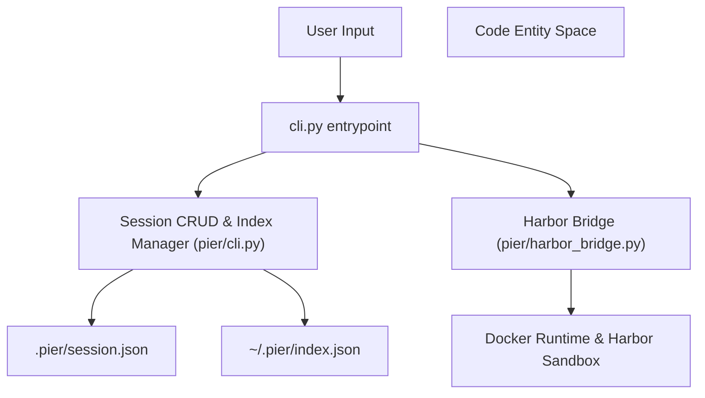
Sources: [`pier/cli.py:1-173`](), [`README.md:1-3`](), [`pier/__init__.py:1-2`]()

---

## Child Pages

For deeper technical dives, please refer to the following child sections:

- **[Getting Started](#1.1)**: Covers installation commands via `uv tool install`, dependencies, Python version requirements, and standard quickstart workflows including container initialization, execution, and verification [README.md:5-96]().
- **[Core Concepts: Workspaces, Sessions, Modes](#1.2)**: Explains the internal layout of the `.pier` directory, `session.json` schema, the global index tracking mechanism, and the behavioral differences between container mode, host mode, and task-free execution [README.md:28-36](), [pier/cli.py:38-173]().

Sources: [`README.md:5-96`](), [`pier/cli.py:38-173`]()

---

# Page: Getting Started

# Getting Started

<details>
<summary>Relevant source files</summary>

The following files were used as context for generating this wiki page:

- [README.md](README.md)
- [pyproject.toml](pyproject.toml)
- [uv.lock](uv.lock)

</details>


## Purpose and Scope

This page covers the foundational requirements and quickstart workflows for **Pier**, an interactive workspace manager for coding agents built on top of [Harbor](https://github.com/laude-institute/harbor) [README.md:1-3](). It outlines Python version constraints, package dependencies, installation procedures, and primary execution workflows including workspace initialization (`pier start`), interactive/non-interactive execution (`pier exec`), task verification (`pier verify`), and trajectory capture (`pier capture`).

Sources: `README.md:1-3`, `pyproject.toml:1-12`

---

## Installation and Prerequisites

Pier requires Python 3.12 or newer [pyproject.toml:8]() and relies on [Click](https://palletsprojects.com/p/click) for command-line parsing alongside core libraries from Harbor [pyproject.toml:9-12](). 

### System Requirements
- **Python**: `>=3.12` [pyproject.toml:8]()
- **Docker**: Required for containerized workspace isolation and agent execution (optional if using host-only mode via `--host`) [README.md:28-36]()
- **Package Manager**: `uv` recommended for tool installation

### Installing Pier
The standard installation method uses `uv` to install directly from the repository [README.md:8-9]():

```bash
uv tool install git+https://github.com/allenai/pier
```

The package defines its console script entry point in `pyproject.toml` pointing directly to the Click command group `cli` defined in `pier/cli.py`:

```toml
[project.scripts]
pier = "pier.cli:cli"
```

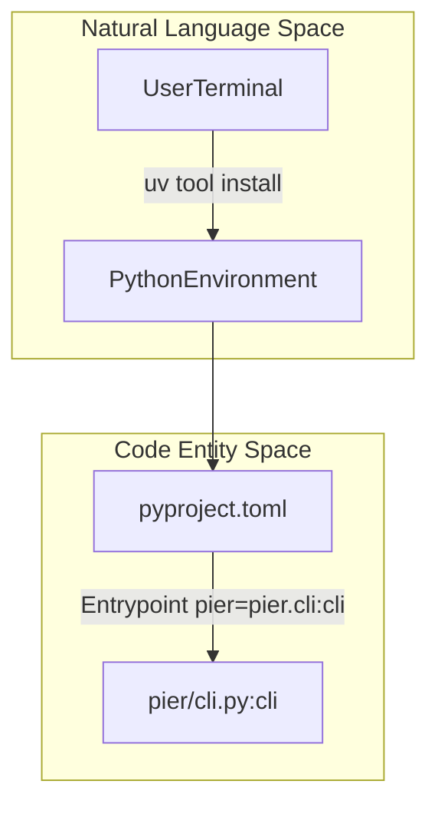
Sources: `pyproject.toml:5-24`, `README.md:5-10`

---

## Quickstart Workflows

Once installed, Pier operates through a series of workspace lifecycle commands. Workspaces can be instantiated either from a bare Docker image or from an existing Harbor benchmark task [README.md:18-30]().

### 1. Starting a Workspace
Create and enter a workspace directory using `pier start` [README.md:15]():

```bash
# From a base image (task-free mode):
pier start -d ./workspace --image ubuntu:24.04 --agent claude-code \
  -e ANTHROPIC_API_KEY=$ANTHROPIC_API_KEY
cd ./workspace

# From a Harbor task:
pier start ./tasks/my-task -d ./workspace --agent claude-code \
  -e ANTHROPIC_API_KEY=$ANTHROPIC_API_KEY
cd ./workspace

# Host mode (without container isolation):
pier start ./tasks/my-task --host -d ./workspace
cd ./workspace
```

Parameters accepted by `pier start` include:
- `--agent`: Installs and configures a supported coding agent [README.md:34]().
- `--image`: Specifies the base Docker image (task-free mode) [README.md:35]().
- `--host`: Skips container creation and runs directly on the host [README.md:154]().
- `-e` / `--env-file`: Manages container-level environment variables [README.md:150-151]().

Sources: `README.md:13-38`, `README.md:127-154`

### 2. Execution and Interaction
Interact with the running container or agent using `pier exec` [README.md:45-46]():

```bash
# Run the registered agent interactively
pier exec claude

# Drop into a container shell
pier exec bash

# Non-interactive script execution
pier exec -- claude -p "Read .task/instruction.md and do the task" --dangerously-skip-permissions

# Run background services
pier exec -d -- quarto preview --port 8888 --host 0.0.0.0 --no-browse
```

Sources: `README.md:39-57`

### 3. Verification and Trajectory Capture
For Harbor tasks, validate results using the test harness [README.md:61-65]():

```bash
pier verify
```

For task-free environments, extract and capture the trajectory manually [README.md:67-72]():

```bash
pier capture
pier traces -o trace.tar.gz
pier view
pier summarize
```

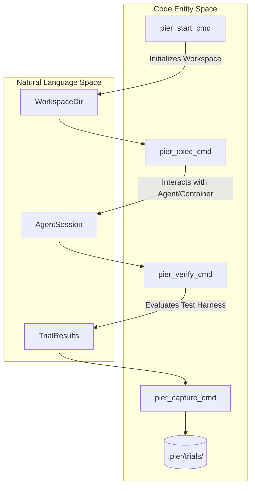
Sources: `README.md:59-84`, `README.md:105-126`

---

# Page: Core Concepts: Workspaces, Sessions, Modes

# Core Concepts: Workspaces, Sessions, Modes

<details>
<summary>Relevant source files</summary>

The following files were used as context for generating this wiki page:

- [README.md](README.md)
- [pier/cli.py](pier/cli.py)

</details>


## Purpose and Scope

This section documents the foundational architecture of Pier workspaces, session persistence structures, global indexing mechanisms, and execution modes (`container`, `host`, and `task-free`). It covers how metadata is stored within workspace-local `.pier/` directories and the global index registry, detailing the functions responsible for session lifecycle management and workspace resolution.

Sources: `[pier/cli.py:38-173]`, `[README.md:1-154]`

---

## Workspace Layout and `.pier` Metadata

When a workspace is initialized via `pier start`, Pier creates a hidden `.pier/` directory at the root of the workspace path defined by `PIER_DIR` `[pier/cli.py:38]`. This directory encapsulates all operational state required to bridge Pier commands with underlying container runtimes or host sessions.

```
workspace/
├── .pier/
│   ├── session.json       # Active runtime state and configuration
│   └── trials/            # Captured trial results and trajectories
└── <project_files>
```

The core metadata artifact is `session.json`, managed via `_session_json_path(workspace)` `[pier/cli.py:54]`. It stores configuration parameters such as the active coding agent, container identifiers, environment variables, Harbor task paths, and bind-mount specifications.

- `_pier_dir(workspace)`: Resolves the `.pier` subdirectory for a given workspace `[pier/cli.py:50-51]`.
- `_save_session(workspace, data)`: Serializes runtime configuration dictionaries into `session.json` with indentation and registers the workspace globally `[pier/cli.py:58-63]`.
- `_load_session(workspace)`: Reads and parses `session.json`, raising a `click.ClickException` if no active session is found `[pier/cli.py:64-73]`.

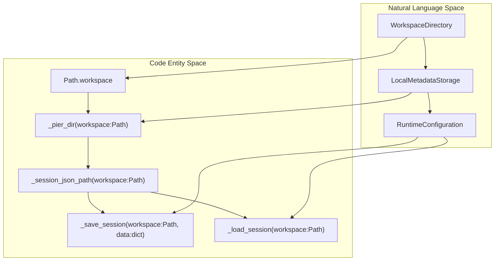

Sources: `[pier/cli.py:38-74]`

---

## Global Index Registry (`~/.pier/index.json`)

To support multi-workspace discovery and global operations like `pier list` or auto-selection, Pier maintains a global registry located at `INDEX_PATH` (`~/.pier/index.json`) `[pier/cli.py:41]`. 

The global index keeps track of all active workspace paths across the host system. The index subsystem implements automatic health checks and stale entry pruning:

- `_index_load()`: Reads the global index file, supporting legacy dictionary formats and modern JSON lists `[pier/cli.py:150-159]`.
- `_index_save(index)`: Writes the sorted, deduplicated list of absolute workspace paths to `INDEX_PATH` `[pier/cli.py:161-163]`.
- `_index_register(workspace)`: Appends a newly initialized workspace path to the index `[pier/cli.py:166-172]`.
- `_all_workspaces()`: Iterates over registered index entries, validating that `session.json` still exists for each. Stale entries where session metadata is missing or corrupted are automatically pruned from the index `[pier/cli.py:75-98]`.

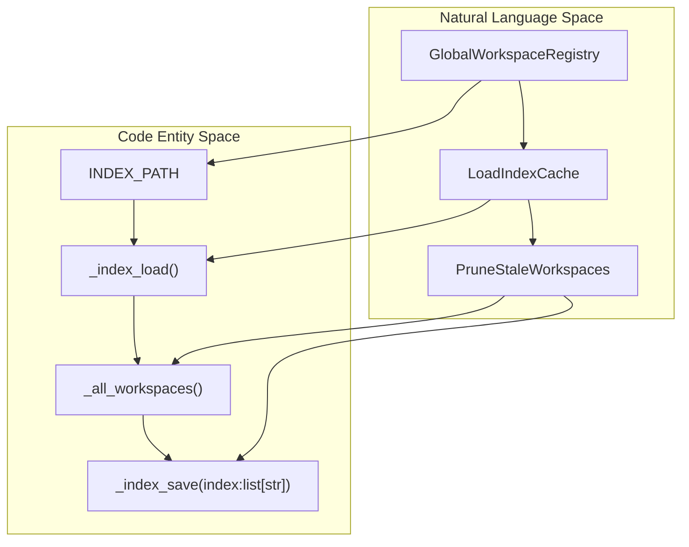

Sources: `[pier/cli.py:41-98], [pier/cli.py:150-173]`

---

## Execution Modes: Container vs. Host vs. Task-free

Pier supports three primary execution paradigms depending on how `pier start` is invoked:

1. **Container Mode (Harbor Task)**: Launched with a Harbor task path (e.g., `pier start ./tasks/my-task`) `[README.md:24]`. Pier builds or pulls the task's Dockerfile, mounts the workspace, installs the requested agent (`--agent`), and executes commands inside an isolated container runtime via `pier exec`.
2. **Task-free Container Mode**: Launched with an arbitrary base image using `-d . --image <image>` (`[README.md:19]`). This bypasses Harbor task definitions, providing a generic container workspace with optional port exposure (`--ports`) and volume mounts (`--mounts-json`) `[README.md:148-149]`.
3. **Host Mode**: Triggered with the `--host` flag (`[README.md:28]`). Bypasses container creation entirely, running the workspace locally on the host machine. Skills are installed locally via `pier skills` (`[README.md:31]`), and agents run natively.

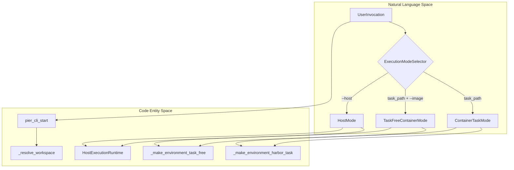

Sources: `[README.md:18-32]`, `[pier/cli.py:110-143]`

---

## Session Resolution and Workspace Discovery Data Flow

When executing CLI commands (such as `pier exec`, `pier verify`, or `pier capture`), Pier must determine which workspace context applies. This is handled by a set of resolution functions that inspect explicit paths, current working directory ancestry, or fall back to the global index.

- `_find_workspace_from_cwd()`: Walks upward from `Path.cwd()` searching for the nearest parent directory containing `.pier/session.json` `[pier/cli.py:101-107]`.
- `_resolve_workspace(workspace_arg)`: Resolves a workspace using an explicit argument, working directory ancestry, or auto-selecting if exactly one workspace is registered globally `[pier/cli.py:110-135]`.
- `_resolve_workspace_from_cwd_only()`: Restricts resolution strictly to the current working directory ancestry, raising an error if the user is not inside a workspace `[pier/cli.py:137-143]`.

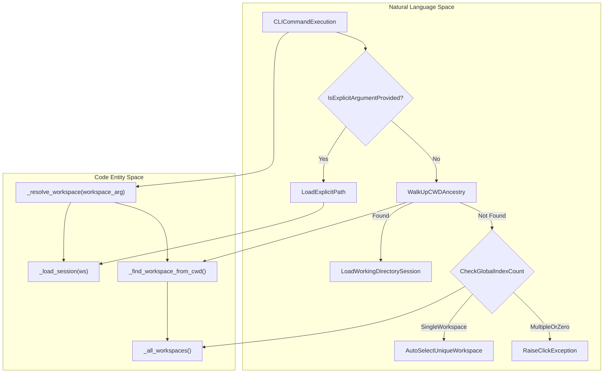

Sources: `[pier/cli.py:101-143]`

---

# Page: CLI Reference and Command Layer

# CLI Reference and Command Layer

<details>
<summary>Relevant source files</summary>

The following files were used as context for generating this wiki page:

- [README.md](README.md)
- [pier/cli.py](pier/cli.py)

</details>


## Purpose and Scope

The CLI reference and command layer, rooted in `pier/cli.py`, provides the Click-based command-line interface for Pier [pier/cli.py:1-34]. It acts as the primary user-facing orchestration layer over Harbor and local container runtimes, handling workspace initialization, session state management via `.pier/session.json` and `~/.pier/index.json`, process execution, and agent trajectory capture [pier/cli.py:38-144]. 

As a parent page, this section introduces the high-level command groups. Detailed technical breakdowns for specific command behaviors, option parsers, and runtime flags are delegated to the child pages.

Sources: [pier/cli.py:1-144](), [README.md:1-35]()

### Diagram: Natural Language CLI Space to Code Entities

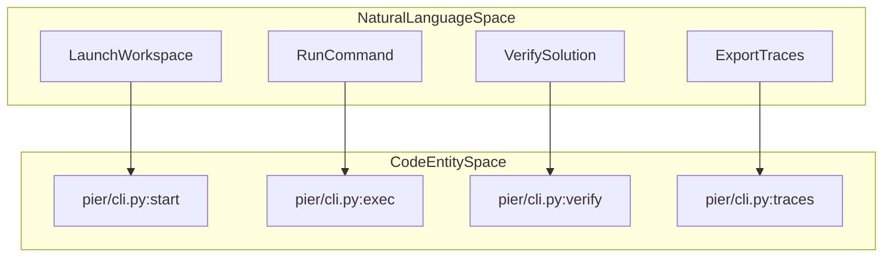
Sources: [pier/cli.py:1-17](), [README.md:105-154]()

---

## 2.1 Workspace Lifecycle Commands (`start`, `stop`, `list`)

Workspace lifecycle commands manage the creation, persistence, restoration, and teardown of Pier workspaces. When invoking `pier start`, the CLI resolves the task specification (local path, git remote reference, or task-free image mode), builds or restarts container instances, and initializes the local session metadata under the `.pier/` directory [pier/cli.py:50-73]. `pier stop` handles container teardown and state preservation, while `pier list` queries active sessions using the global index cache [pier/cli.py:75-98].

For complete details on option parsing, container restart logic, and index pruning, see [Workspace Lifecycle Commands (start, stop, list)](#2.1).

Sources: [pier/cli.py:50-144](), [README.md:126-154]()

---

## 2.2 Execution and Verification (`exec`, `verify`, `capture`)

The execution and verification layer handles command dispatch inside active workspaces. `pier exec` routes commands to either the running Docker container or the host environment, injecting configured environment variables and PATH prefixes [pier/cli.py:8-9]. `pier verify` triggers test runners (such as Harbor verifiers) and extracts rewards, while `pier capture` packages agent interaction trajectories into structured trial directories [pier/cli.py:4-9].

For deep dives into container versus host execution modes, log teeing via `script(1)`, and reward extraction, see [Execution and Verification (exec, verify, capture)](#2.2).

Sources: [pier/cli.py:1-9](), [README.md:39-72]()

---

## 2.3 Trace, View and Summarize Commands

Post-execution analytics and inspection are managed through trace exporting, dashboard launching, and AI summarization. `pier traces` allows listing and tarball export of captured trial trajectories from `.pier/trials/`. `pier view` spins up a web dashboard, and `pier summarize` invokes Harbor summarizers to generate natural language evaluations of agent performance [pier/cli.py:5-11].

For details on trace bundle structures and dashboard integration, see [Trace, View and Summarize Commands](#2.3).

Sources: [pier/cli.py:5-11](), [README.md:74-81]()

---

## 2.4 Skills Management

Pier supports the installation and composition of specialized agent capabilities via skill bundles. The `pier skills` subcommand installs task skills into host-mode agents or merges multiple skill directories using `pier skills compose` [pier/cli.py:14-15]. These skills are defined via `SKILL.md` specifications and injected directly into containerized or host-based coding agents during workspace startup [README.md:28-34].

For specifications on skill bundle composition and agent injection vectors, see [Skills Management](#2.4).

Sources: [pier/cli.py:14-16](), [README.md:28-34]()

### Diagram: Command Execution and State Resolution Flow

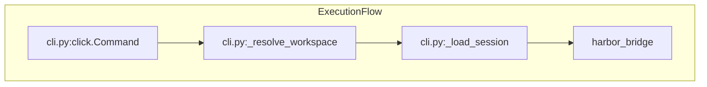
Sources: [pier/cli.py:34-144](), [pier/cli.py:2164]()

---

# Page: Workspace Lifecycle Commands (start, stop, list)

# Workspace Lifecycle Commands (start, stop, list)

<details>
<summary>Relevant source files</summary>

The following files were used as context for generating this wiki page:

- [pier/cli.py](pier/cli.py)
- [pier/tests/test_pier_cli.py](pier/tests/test_pier_cli.py)

</details>


## Purpose and Scope

This page details the implementation, data flow, option parsing, and state management for workspace lifecycle commands in `pier`: `start`, `stop`, and `list`. It covers how workspaces are initialized locally or cloned from remote repositories, how session state is persisted (`session.json` and the global `index.json`), how workspaces are automatically resolved from the file system or current working directory, and how container teardown and stale index pruning are handled.

Sources: `[pier/cli.py:1-17](), [pier/tests/test_pier_cli.py:1-16]()`

---

## Session Persistence and Global Index

The `pier` workspace manager tracks active sessions using a dual-layer persistence model:
1. **Workspace-local state**: Each workspace contains a `.pier/session.json` file that stores metadata about the running session (e.g., execution mode, task directory, container IDs, ports, and timestamps) `[pier/cli.py:38-63](), [pier/tests/test_pier_cli.py:80-91]()`.
2. **Global index cache**: A user-level index stored at `~/.pier/index.json` maintains a registry of all active workspace paths across the system, enabling rapid enumeration via `pier list` `[pier/cli.py:41](), [pier/cli.py:146-172]()`.

### Key Functions

* `_pier_dir(workspace: Path)`: Returns the `.pier` subdirectory for a given workspace path `[pier/cli.py:50-51]()`.
* `_session_json_path(workspace: Path)`: Returns the full path to `session.json` inside a workspace `[pier/cli.py:54-55]()`.
* `_save_session(workspace: Path, data: dict)`: Serializes session dictionaries into `session.json` (with indentation) and registers the workspace in the global index `[pier/cli.py:58-63]()`.
* `_load_session(workspace: Path)`: Reads and parses `session.json`, raising a `click.ClickException` if no active session is found `[pier/cli.py:65-73]()`.
* `_index_load()`, `_index_save()`, and `_index_register()`: Manage the global `index.json` registry file with robust fallback and deduplication logic `[pier/cli.py:150-172]()`.

Sources: `[pier/cli.py:38-172](), [pier/tests/test_pier_cli.py:80-91]()`

---

## Workspace Resolution Logic

Commands that operate on existing workspaces (`stop`, `exec`, `verify`, etc.) must locate the correct session context. `pier` implements an automated resolution hierarchy inside `_resolve_workspace()`:

1. **Explicit Argument**: If a workspace path argument is provided, it resolves and loads that specific session `[pier/cli.py:115-117]()`.
2. **Current Working Directory Ancestry**: If no argument is given, it walks up the directory tree from `cwd` searching for a `.pier/session.json` file using `_find_workspace_from_cwd()` `[pier/cli.py:101-107](), [pier/cli.py:119-122]()`.
3. **Auto-Selection**: If exactly one workspace is registered globally in `index.json`, it falls back to selecting that workspace automatically `[pier/cli.py:124-134]()`. If multiple workspaces exist without an explicit path or matching ancestry, a `click.ClickException` is raised `[pier/cli.py:128-133]().

### Diagram: Session Resolution and CRUD Flow

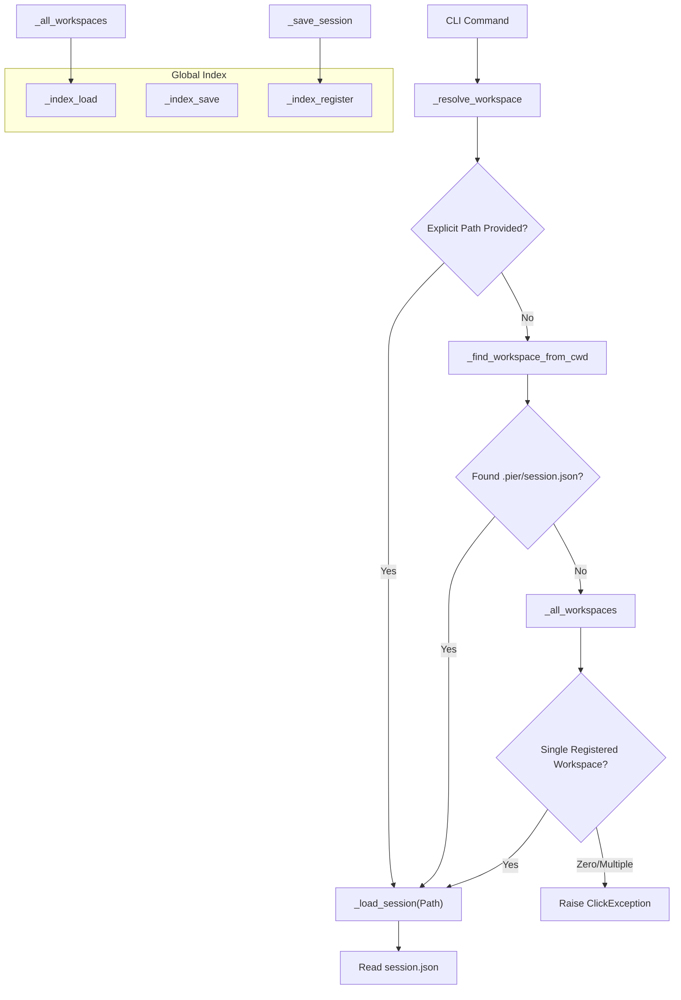

Sources: `[pier/cli.py:75-144]()`

---

## The `pier start` Command

The `pier start` command initializes a workspace for a specified task or launches a task-free container environment `[pier/cli.py:6-7]()`.

### Task Path Resolution and Remote Cloning
* **Remote References**: URLs (such as GitHub repositories) must include a fragment specifier pointing to the task path (e.g., `https://github.com/org/repo#tasks/my-task`) `[pier/tests/test_pier_cli.py:120-125]()`. Remote tasks are downloaded via `pier.harbor_bridge.download_task` `[pier/tests/test_pier_cli.py:127-145]()`.
* **Local Tasks**: Local task directories require explicit option flags (such as `-d`) to configure workspace targets properly `[pier/tests/test_pier_cli.py:178-183]()`.
* **Defaults**: Remote tasks default their local workspace creation target to `./<task-name>` `[pier/tests/test_pier_cli.py:186-203]()`.

### Execution Modes
* **Host Mode (`--host`)**: Sets up local environment configuration without container isolation `[pier/tests/test_pier_cli.py:70-77](), [pier/tests/test_pier_cli.py:128-145]()`.
* **Container Mode (Default)**: Delegates environment and container provisioning to `pier.harbor_bridge.start_environment` `[pier/tests/test_pier_cli.py:150-170]()`.
* **Task-Free Mode**: Launched via `pier start -d . --image ` to spin up an interactive container without a predefined task structure `[pier/cli.py:7]()`.

Sources: `[pier/cli.py:6-7](), [pier/tests/test_pier_cli.py:120-204]()`

---

## Workspace Lifecycle Management (`stop` and `list`)

### Teardown via `pier stop`
The `pier stop` command tears down active container environments associated with a workspace. It resolves the target workspace context, invokes underlying Harbor/Docker teardown routines, and cleans up active execution states.

### Enumeration and Pruning via `pier list`
The `pier list` command calls `_all_workspaces()`, which iterates through registered paths in the global index `[pier/cli.py:75-99]()`. 
* **Stale Index Pruning**: During iteration, `_all_workspaces()` checks whether each registered workspace's `session.json` is still accessible and valid `[pier/cli.py:78-92]()`. If any workspace directory has been deleted or its session file is corrupted (`json.JSONDecodeError` or `OSError`), the entry is automatically pruned from the active index list and `_index_save()` updates `~/.pier/index.json` `[pier/cli.py:78](), [pier/cli.py:91-97]()`.

### Diagram: Workspace Lifecycle State Transitions

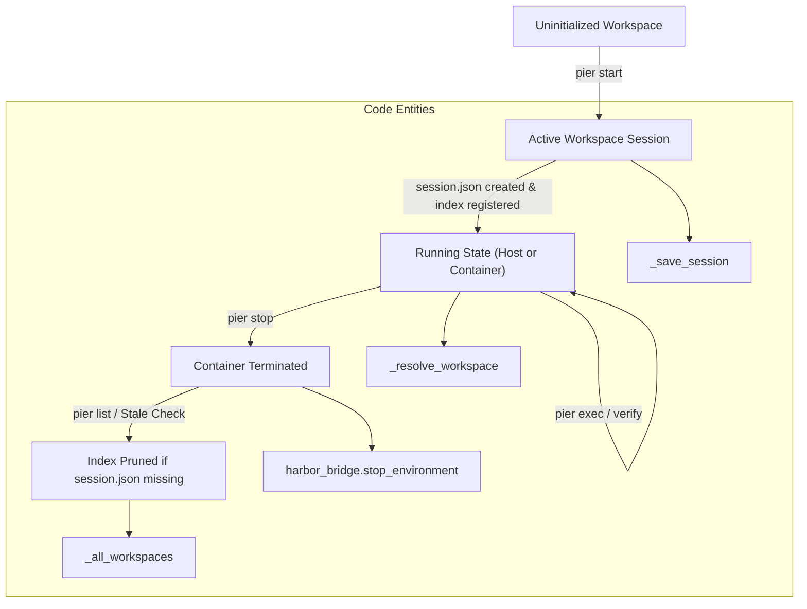

Sources: `[pier/cli.py:75-99](), [pier/tests/test_pier_cli.py:1-15](), [pier/tests/test_pier_cli.py:80-91]()`

---

# Page: Execution and Verification (exec, verify, capture)

# Execution and Verification (exec, verify, capture)

<details>
<summary>Relevant source files</summary>

The following files were used as context for generating this wiki page:

- [pier/cli.py](pier/cli.py)
- [pier/tests/test_pier_cli.py](pier/tests/test_pier_cli.py)
- [pier/trajectory.py](pier/trajectory.py)

</details>


## Purpose and Scope

This page details the implementation, data flow, and operational mechanics of the `pier exec`, `pier verify`, and `pier capture` CLI commands within the `pier` interactive workspace manager [pier/cli.py:1-17](). It covers workspace session resolution [pier/cli.py:110-144](), container versus host execution paths, log capture mechanisms, verifier execution, reward extraction, and trial trajectory assembly [pier/trajectory.py:1-99]().

Sources: `pier/cli.py:1-17`, `pier/cli.py:110-144`, `pier/trajectory.py:1-100`

---

## Session Context Resolution

Before any execution, verification, or capture command runs, `pier` must locate the active workspace and load its session metadata from `workspace/.pier/session.json` [pier/cli.py:54-73]().

### Key Functions

- `_resolve_workspace(workspace_arg: str | None)`: Resolves the workspace from an explicit path argument, upward directory traversal from the current working directory (`cwd`), or auto-selection if a single workspace is registered in the global index [pier/cli.py:110-135]().
- `_load_session(workspace: Path)`: Reads and parses `session.json`, raising a `click.ClickException` if no active session exists [pier/cli.py:65-73]().

```
Sources: `pier/cli.py:50-144`
```

---

## Command Execution (`pier exec`)

The `pier exec` command dispatches arbitrary shell commands within the established workspace context. Execution behavior diverges based on the session mode defined in `session.json` (`container` vs. `host`) [pier/tests/test_pier_cli.py:50-78]().

### Container Mode vs. Host Mode

1. **Container Mode**: Commands are executed inside the running Docker container managed by `harbor_bridge`. Files and environment variables configured in the workspace session (including extra mounts, ports, and injected skill bundles) are preserved [pier/tests/test_pier_cli.py:50-67]().
2. **Host Mode**: Commands run directly on the host machine within the workspace directory, utilizing the local environment and PATH [pier/tests/test_pier_cli.py:70-78]().

```
Sources: `pier/cli.py:1-17`, `pier/tests/test_pier_cli.py:50-78`
```

---

## Verification and Reward Extraction (`pier verify`)

The `pier verify` command triggers the evaluation harness for the active task. It executes task verification scripts (such as `test.sh`) and processes the resulting output into standardized reward structures.

### Trajectory Assembly (`pier.trajectory`)

Upon completion of verification, `pier` invokes `assemble_trial` from `pier/trajectory.py` to write Harbor-compatible trial directories [pier/trajectory.py:29-40](). This ensures that downstream tools like `pier view` and `pier summarize` can parse the trial outputs [pier/trajectory.py:1-15]().

```
Sources: `pier/trajectory.py:1-100`
```

---

## Natural Language Space to Code Entity Space: Execution & Verification Architecture

The following diagram associates high-level user operations with their corresponding backend functions and data structures in the codebase.

```mermaid
graph TD
    sub5 ["Natural Language Space"]
        sub5_start["Run command in workspace"] --> sub5_exec["pier exec"]
        sub5_verify["Run task verifier"] --> sub5_ver_cmd["pier verify"]
        sub5_capture["Extract agent trajectory"] --> sub5_cap_cmd["pier capture"]

    sub6 ["Code Entity Space"]
        sub5_exec --> pier_cli_py_exec["pier.cli.exec"]
        sub5_ver_cmd --> pier_cli_py_verify["pier.cli.verify"]
        sub5_cap_cmd --> pier_cli_py_capture["pier.cli.capture"]
        
        pier_cli_py_exec --> resolve_ws["pier.cli._resolve_workspace"]
        pier_cli_py_verify --> resolve_ws
        pier_cli_py_capture --> resolve_ws
        
        resolve_ws --> load_sess["pier.cli._load_session"]
        pier_cli_py_verify --> traj_assemble["pier.trajectory.assemble_trial"]
        traj_assemble --> harbor_res["pier.harbor_bridge.build_trial_result_json"]
```

Sources: `pier/cli.py:1-17`, `pier/cli.py:110-144`, `pier/trajectory.py:29-74`

---

## Data Flow: Verification and Trial Trajectory Assembly

The data flow for `pier verify` involves reading session state, executing the verifier via the Harbor bridge, gathering rewards, and writing structured JSON results.

```mermaid
graph TD
    sub7 ["Execution & Verification Flow"]
        start_verify["User runs pier verify"] --> resolve_ws_node["Call pier.cli._resolve_workspace"]
        resolve_ws_node --> load_session_node["Read workspace/.pier/session.json"]
        load_session_node --> harbor_run_verify["Invoke harbor_bridge verifier run"]
        harbor_run_verify --> extract_reward["Extract reward metrics (reward.json / reward.txt)"]
        extract_reward --> call_assemble["Call pier.trajectory.assemble_trial"]
        
        sub8 ["Code Entities"]
        call_assemble --> assemble_func["pier.trajectory.assemble_trial"]
        assemble_func --> build_result["pier.harbor_bridge.build_trial_result_json"]
        assemble_func --> write_config["pier.harbor_bridge.write_trial_config_json"]
        assemble_func --> write_files["Write result.json, config.json, verifier/reward.json"]
```

Sources: `pier/cli.py:110-144`, `pier/trajectory.py:29-100`

---

# Page: Trace, View and Summarize Commands

# Trace, View and Summarize Commands

<details>
<summary>Relevant source files</summary>

The following files were used as context for generating this wiki page:

- [pier/cli.py](pier/cli.py)
- [pier/harbor_bridge.py](pier/harbor_bridge.py)

</details>


## Purpose and Scope

This leaf page details the implementation and data flow for the trace management, visualization, and summarization command group in `pier`. These commands (`capture`, `traces`, `view`, and `summarize`) allow developers and coding agents to inspect workspace execution histories, export trace tarballs, launch interactive web dashboards for trial trajectories, and generate AI-driven summaries of trial results via Harbor's underlying summarizer integration.

Sources: `[pier/cli.py:4-13](), [pier/harbor_bridge.py:1-21]()`

---

## 2.3.1 Trajectory Capture (`pier capture`)

The `pier capture` command extracts and packages the agent's execution trajectory, session metadata, and trial results associated with the active workspace. It bridges runtime state maintained inside the container or host mode session into structured artifacts stored under the workspace `.pier` directory or Harbor trial directories.

During execution, logs and terminal interactions are recorded (often via `script(1)` tee capture mechanisms). `capture` gathers these streams, pairs them with `session.json` metadata `[pier/cli.py:54-61]()`, and prepares them for export or visualization.

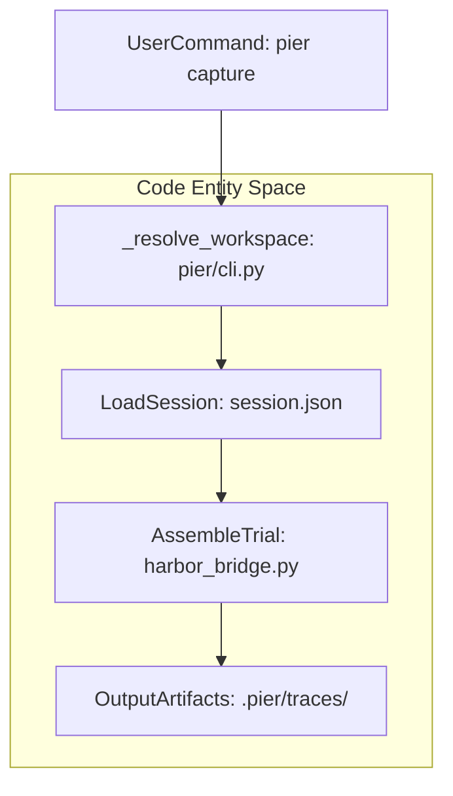

Sources: `[pier/cli.py:54-61](), [pier/harbor_bridge.py:1-21]()`

---

## 2.3.2 Trace Management and Export (`pier traces`)

The `pier traces` command group provides utilities to list locally available captured traces or export them into portable tarballs (`.tar.gz`). This is critical for sharing debugging logs, submitting agent benchmark results, or archiving runs.

### Key Operations
- **Listing**: Scans registered workspace indexes `[pier/cli.py:75-99]()` and local trace storage to display session IDs, timestamps, tasks, and status summaries.
- **Exporting**: Compresses trial trajectories, logs, configuration files (`config.json`), and results (`result.json`) into a single archive tarball for external distribution.

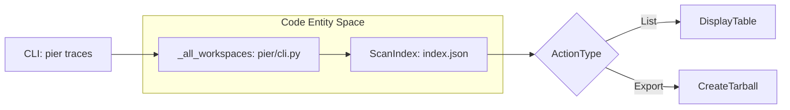

Sources: `[pier/cli.py:75-99](), [pier/cli.py:150-172]()`

---

## 2.3.3 Web Dashboard Visualization (`pier view`)

The `pier view` command launches an interactive web dashboard for inspecting trial trajectories. By interfacing with Harbor's visualization layers through `pier/harbor_bridge.py`, it renders step-by-step agent actions, tool calls, terminal outputs, and reward metrics in a browser interface.

The command resolves the active workspace context `[pier/cli.py:110-135]()`, locates the corresponding Harbor trial directory, and spins up the viewing server.

Sources: `[pier/cli.py:110-135](), [pier/harbor_bridge.py:1-21]()`

---

## 2.3.4 AI Summarization (`pier summarize`)

The `pier summarize` command invokes the Harbor summarizer subsystem to produce an automated natural-language summary of trial outcomes, error analyses, and agent performance metrics. 

### Data Flow
1. Resolves the current workspace and loads `session.json` `[pier/cli.py:65-73]()`.
2. Locates the trial results and trajectory artifacts.
3. Passes trajectory payloads to the Harbor summarizer bridge.
4. Outputs the generated markdown summary to the terminal or saves it within the workspace artifacts.

Sources: `[pier/cli.py:65-73](), [pier/harbor_bridge.py:1-21]()`

---

# Page: Skills Management

# Skills Management

<details>
<summary>Relevant source files</summary>

The following files were used as context for generating this wiki page:

- [pier/SKILL.md](pier/SKILL.md)
- [pier/cli.py](pier/cli.py)

</details>


## Purpose and Scope

Skills Management within `pier` enables the packaging, composition, and injection of reusable task capabilities and agent instructions into coding agent environments. Skill bundles are directory structures containing metadata and instructions (such as `SKILL.md`) that can be merged using composition commands and injected into either containerized or host-mode workspaces during session initialization.

Sources: `[pier/cli.py:14-17](), [pier/SKILL.md:1-83]()`

---

## 1. Skill Bundles and `SKILL.md` Structure

A skill bundle represents an encapsulated set of instructions or capabilities for coding agents. At the root of a skill bundle or task directory, `SKILL.md` defines frontmatter metadata (`name`, `description`) alongside markdown documentation detailing usage patterns, commands, and workflows.

*   **Frontmatter**: Contains metadata parsed by agent registries or discovery mechanisms (`name`, `description`) [pier/SKILL.md:1-4]().
*   **Body**: Outlines instructions, installation commands, operating modes (container vs. host), and workflow steps [pier/SKILL.md:6-83]().
*   **Task Integration**: In `pier`, task assets like instructions, context directories, skills, and examples are bundled together and mirrored into local workspaces or container environments [pier/SKILL.md:21]().

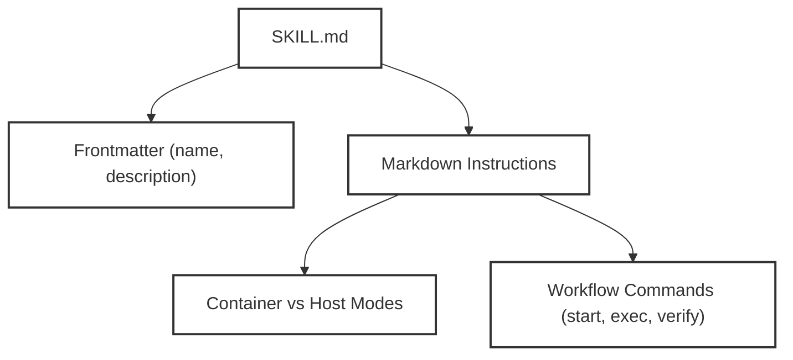
*Figure 1: Skill bundle structure mapping metadata and documentation content.*

Sources: `[pier/SKILL.md:1-83]()`

---

## 2. Composing Skills (`pier skills compose`)

The `pier` CLI provides commands for managing and merging skill bundles. Specifically, `pier skills compose` merges multiple skill bundles into a single output directory, allowing complex agent capabilities to be constructed dynamically from modular components [pier/cli.py:15]().

*   **Command Definition**: `pier skills compose -o <dir> <bundles>...` merges specified source skill bundles into the target directory `dir` [pier/cli.py:15]().
*   **Host Installation**: `pier skills` installs task skills directly in host mode for native agent consumption [pier/cli.py:14]().

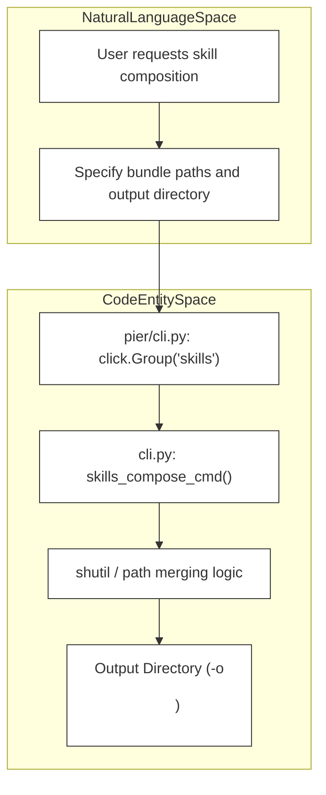
*Figure 2: Bridging natural language composition requests to code execution in `pier/cli.py`.*

Sources: `[pier/cli.py:14-15]()`

---

## 3. Injection into Container and Host Agents

When initializing a workspace using `pier start`, skill bundles can be injected into the agent configuration via the `--skill <path>` flag [pier/cli.py:16](). Depending on the execution mode, these skills are mounted or copied into the container or host agent's context path.

*   **Container Mode**: Task files, including injected skills, are streamed or bind-mounted into the Docker container runtime. The container environment isolates the execution while sharing the local workspace [pier/SKILL.md:18]().
*   **Host Mode**: Skills are made available locally within the workspace directory structure (`.pier/` or task assets), allowing native tools and host-installed agents to access them directly without Docker virtualization [pier/SKILL.md:19]().

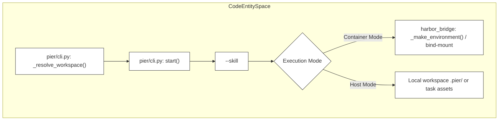
*Figure 3: Data flow for skill injection during workspace startup (`pier start`).*

Sources: `[pier/cli.py:16](), [pier/SKILL.md:18-21]()`

---

# Page: Harbor Bridge and Container Runtime

# Harbor Bridge and Container Runtime

<details>
<summary>Relevant source files</summary>

The following files were used as context for generating this wiki page:

- [pier/harbor_bridge.py](pier/harbor_bridge.py)

</details>


This page provides an architectural overview of `pier/harbor_bridge.py`, the isolation layer that encapsulates all interactions between Pier and the underlying [Harbor](https://github.com/allenai/harbor) workspace environment and Docker container runtimes [pier/harbor_bridge.py:1-5](). 

As a parent page, this document outlines high-level responsibilities such as container lifecycle management, compose patching, agent configuration, result assembly, and environment variable handling. Detailed technical specifications are delegated to dedicated child pages.

Sources: `pier/harbor_bridge.py:1-21`

---

## Architecture and Bridge Overview

Pier acts as an interactive workspace manager, delegating heavy container orchestration, task building, and trial execution to Harbor. To maintain decoupling, `pier/harbor_bridge.py` serves as the sole adapter importing Harbor modules. 

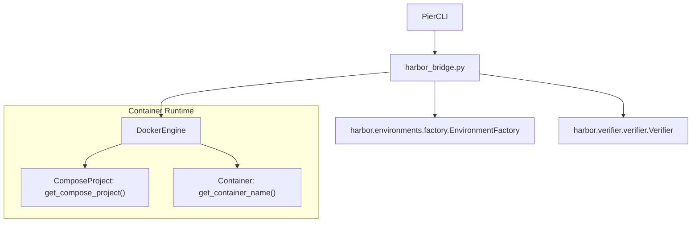
*Figure 1: Bridge architecture mapping Pier commands to Harbor components and Docker entities.*

Sources: `pier/harbor_bridge.py:1-21`, `pier/harbor_bridge.py:45-62`

---

## 3.1. Environment Lifecycle and Compose Overrides

The container and environment lifecycle is managed through dynamic Docker compose configuration, workdir extraction, and bind-mount orchestration. Pier inspects target task Dockerfiles to determine work directories [pier/harbor_bridge.py:107-116] and injects custom overrides to secure session metadata.

For full details on `_make_environment()`, compose path patching, `docker-compose-pier.json` generation, mounts, ports, `.pier` tmpfs hiding, and `WORKDIR` parsing, see [Environment Lifecycle and Compose Overrides](#3.1).

Sources: `pier/harbor_bridge.py:107-202`

---

## 3.2. Agent Installation and Log Capture

Pier supports running various coding agents inside containerized or host environments. It handles agent bootstrapping, config directory environment variables (such as `CLAUDE_CONFIG_DIR` and `CODEX_HOME`), interactive session recording using `script(1)` tee capture, and post-run command execution.

For detailed documentation on the agent registry, `setup_agent()`, stream capture, and hook execution, see [Agent Installation and Log Capture](#3.2).

Sources: `pier/harbor_bridge.py:1-38`

---

## 3.3. Trial Results and Trajectory Assembly

Once an execution session completes, Pier gathers trial artifacts, trajectory logs, and verifier outputs. It uses helpers like `assemble_trial()` to parse `result.json` and `config.json`, validate against the `TrialResult` schema, track agent token usage, and establish robust fallback paths if structured logs are missing.

For deep dives into trial assembly routines, result schemas, and metrics extraction, see [Trial Results and Trajectory Assembly](#3.3).

Sources: `pier/harbor_bridge.py:1-38`

---

## 3.4. Secrets and Environment Variable Handling

Security and credential management are critical when spawning agents in shared or remote containers. Pier sanitizes and resolves environment key-values using `sanitize_env_kv()` and `resolve_env_kv()`, injects secure templated secrets into `session.json`, and supports arbitrary `.env` file ingestion.

For comprehensive coverage of environment sanitization, secrets templating, and configuration parsing, see [Secrets and Environment Variable Handling](#3.4).

Sources: `pier/harbor_bridge.py:23-38`

---

## Container Runtime Flow

The following diagram bridges the natural language concepts of task preparation and container execution to their concrete code entities within `pier/harbor_bridge.py`.

```mermaid
graph TD
  TaskDir["TaskDirectory"] -->| "get_container_workdir()" | WorkDir["ContainerWorkDir"]
  TaskDir -->| "extract_image_workdir()" | Workspace["WorkspacePath"]
  Workspace -->| "_write_mounts_compose()" | Compose["DockerComposeOverride"]
  Compose -->| "is_environment_running()" | Container["DockerContainer"]
```
*Figure 2: Execution flow from task directory structures to running Docker containers.*

Sources: `pier/harbor_bridge.py:64-158`, `pier/harbor_bridge.py:179-202`

---

# Page: Environment Lifecycle and Compose Overrides

# Environment Lifecycle and Compose Overrides

<details>
<summary>Relevant source files</summary>

The following files were used as context for generating this wiki page:

- [pier/harbor_bridge.py](pier/harbor_bridge.py)
- [pier/tests/test_harbor_bridge.py](pier/tests/test_harbor_bridge.py)

</details>


## Purpose and Scope

This page documents the container environment lifecycle management and Docker Compose override generation implemented in `pier/harbor_bridge.py`. It details how Pier interacts with Harbor and Docker to construct isolated environments, parse task Dockerfiles for `WORKDIR` definitions, extract initial image files into workspaces, patch Docker Compose files, hide session-private directories (`.pier`) using `tmpfs`, and expose requested host ports.

Sources: [pier/harbor_bridge.py:1-21]()

---

## 1. Container Naming and Environment Status Checks

Pier relies on Harbor's session ID conventions to map sessions to Docker Compose projects and containers. Harbor lowercases session IDs and replaces dots with dashes [pier/harbor_bridge.py:45-51](). 

The primary service container is always named using the format `{project}-main-1` [pier/harbor_bridge.py:54-62](). Pier exposes helper functions to query container and environment status:
- `get_compose_project(harbor_session_id)`: Derives the Docker Compose project string [pier/harbor_bridge.py:45-51]().
- `get_container_name(harbor_session_id)`: Returns the primary container identifier [pier/harbor_bridge.py:54-62]().
- `is_environment_running(harbor_session_id)`: Executes `docker ps` with Compose project labels to verify if containers are actively running [pier/harbor_bridge.py:64-82]().
- `does_environment_exist(harbor_session_id)`: Queries all containers (running or stopped) associated with the project label [pier/harbor_bridge.py:84-100]().

### Container Status Verification Flow

```mermaid
graph TD
    Start["Check Environment Status"] --> Call1["is_environment_running(harbor_session_id)"]
    Start --> Call2["does_environment_exist(harbor_session_id)"]
    Call1 --> SubProc1["subprocess.run(docker ps --filter status=running)"]
    Call2 --> SubProc2["subprocess.run(docker ps -aq --filter status=running)"]
    SubProc1 --> Return1["Return bool(running containers)"]
    SubProc2 --> Return2["Return bool(any containers)"]
```
Sources: [pier/harbor_bridge.py:45-100]()

---

## 2. Dockerfile WORKDIR Parsing and Image Extraction

To determine where source code and assets reside inside the container, Pier parses the task's `Dockerfile` to locate the container working directory [pier/harbor_bridge.py:107-121]().

### `_get_dockerfile_workdir` and `extract_image_workdir`
- `_get_dockerfile_workdir(environment_dir)` reads the `Dockerfile` from the bottom up, matching case-insensitive `WORKDIR` declarations, defaulting to `/app` if absent [pier/harbor_bridge.py:107-116]().
- `extract_image_workdir(task_dir, workspace)` builds the task image (`hb__{task_dir.name}`), provisions a temporary container via `docker create`, and copies the contents of `{workdir}/.` out into the host workspace [pier/harbor_bridge.py:123-158](). This ensures the workspace is prepopulated with any files generated by `COPY`, `ADD`, or `RUN` instructions in the Dockerfile before Pier mounts or overlays its own assets [pier/harbor_bridge.py:123-130]().

Sources: [pier/harbor_bridge.py:107-158]()

---

## 3. Compose Overrides and `docker-compose-pier.json`

Harbor handles the primary workspace bind mount, but Pier applies custom overrides via `_write_mounts_compose()` to inject auxiliary settings [pier/harbor_bridge.py:179-202]().

### `_write_mounts_compose` Implementation Details
The function writes a `docker-compose-pier.json` file inside the trial directory containing:
1. **Tmpfs Hiding**: Mounts a `tmpfs` volume over `{container_workdir}/.pier` to hide Pier session data from the containerized agent [pier/harbor_bridge.py:188-200]().
2. **Bind Mounts**: Optionally includes workspace bind-mount mappings when `include_bind_mount=True` [pier/harbor_bridge.py:184-201]().
3. **Port Forwarding**: Maps host ports to container ports when a `ports` list is provided [pier/harbor_bridge.py:186-199]().
4. **Task Instruction Copying**: Copies `instruction.md` into `workspace/.task/` when a `task_dir` is supplied, allowing agents to discover tasks without exposing tests or `task.toml` [pier/harbor_bridge.py:190-196]().

Sources: [pier/harbor_bridge.py:179-202](), [pier/tests/test_harbor_bridge.py:60-154]()

---

## 4. Architectural Data Flow: Natural Language to Code Entities

The following diagram bridges natural language concepts of environment lifecycle operations to their exact code implementations in `pier/harbor_bridge.py`.

### Architecture Mapping Diagram

```mermaid
graph TD
    subgraph "NaturalLanguageSpace"
        NL_Workdir["Parse Dockerfile Working Directory"]
        NL_ImageExt["Extract Container WORKDIR Files to Workspace"]
        NL_Compose["Write Compose Overrides and Tmpfs Mounts"]
        NL_Check["Check Running Containers"]
    end

    subgraph "CodeEntitySpace"
        CE_Workdir["_get_dockerfile_workdir(environment_dir: Path)"]
        CE_ImageExt["extract_image_workdir(task_dir: Path, workspace: Path)"]
        CE_Compose["_write_mounts_compose(trial_dir: Path, workspace_dir: Path, container_workdir: str, ...)"]
        CE_Check["is_environment_running(harbor_session_id: str)"]
    end

    NL_Workdir --> CE_Workdir
    NL_ImageExt --> CE_ImageExt
    NL_Compose --> CE_Compose
    NL_Check --> CE_Check
```
Sources: [pier/harbor_bridge.py:45-202]()

---

# Page: Agent Installation and Log Capture

# Agent Installation and Log Capture

<details>
<summary>Relevant source files</summary>

The following files were used as context for generating this wiki page:

- [DEVELOPER.md](DEVELOPER.md)
- [pier/harbor_bridge.py](pier/harbor_bridge.py)
- [pier/tests/test_agent_integration.py](pier/tests/test_agent_integration.py)

</details>


## Purpose and Scope

This page details the implementation of agent installation, environment configuration, terminal recording, and artifact collection within Pier. By acting as a bridge to Harbor, Pier ensures that agent binaries, configuration states, and execution logs survive container teardowns through structured bind mounts and environment variable overrides.

Sources:
- `DEVELOPER.md:26-110`
- `pier/harbor_bridge.py:1-202`

---

## Agent Registry and Harbor Integration

Pier relies on Harbor's underlying environment and agent management abstractions to discover and install coding agents inside containers. Binary-to-agent mappings and version commands are resolved dynamically via Harbor's registry (`get_binary_agent_map()`).

```mermaid
graph TD
    A["UserWorkspace"] --> B["HarborBridge"]
    B --> C["EnvironmentFactory"]
    C --> D["TaskEnvironment"]
    D --> E["setup_agent"]

    classDef default stroke:#000,fill:#fff;
```
*Figure 1: Agent Setup and Bridge Architecture*

Sources:
- `DEVELOPER.md:70-85`
- `pier/harbor_bridge.py:1-50`

---

## Config-Dir Environment Variables

To ensure that stateful agents (such as Claude Code and Codex) persist their session history and configuration across container runs, Pier injects specific log-capture environment variables derived from Harbor's `EnvironmentPaths`.

These variables point to paths within the container that are bind-mounted back to the host at `workspace/.pier/_harbor/agent/`.

```mermaid
graph TD
    subgraph ContainerSpace
        A["AgentProcess"] -->|Reads/Writes| B["CLAUDE_CONFIG_DIR"]
        A -->|Reads/Writes| C["CODEX_HOME"]
        B --> D["/logs/agent/sessions"]
        C --> D
    end
    subgraph HostSpace
        D -->|BindMount| E["workspace/.pier/_harbor/agent/"]
    end

    classDef default stroke:#000,fill:#fff;
```
*Figure 2: Config-Dir Environment Mapping to Code Entities*

Key environment variables handled by Pier include:
- `CLAUDE_CONFIG_DIR`: Points to session logs and project histories.
- `CODEX_HOME`: Directs Codex configuration and state storage.
- User-supplied `-e` overrides take precedence via dictionary `setdefault` patterns.

Sources:
- `DEVELOPER.md:41-45`
- `pier/tests/test_agent_integration.py:110-116`

---

## Terminal Session Recording via `script(1)` Tee Capture

When a user executes an agent via `pier exec`, Pier attempts to auto-detect the agent command by matching it against Harbor's known binary maps. If matched, the execution is wrapped using the POSIX `script(1)` utility (`script -q -c`).

```mermaid
graph TD
    A["pier_exec"] --> B["DetectAgentCommand"]
    B -->|Match Found| C["WrapWithScriptCmd"]
    B -->|No Match| D["RunRawCommand"]
    C --> E["RecordTerminalOutput"]
    E --> F["WorkspaceAgentDir"]

    classDef default stroke:#000,fill:#fff;
```
*Figure 3: Execution and Tee Capture Flow*

This wrapping records full TTY behaviors (such as color codes, cursor movements, and interactive prompts) directly to a timestamped session directory:

`workspace/.pier/_harbor/agent/exec/<timestamp>/<agent-name>.txt`

Sources:
- `DEVELOPER.md:33-40`
- `pier/tests/test_agent_integration.py:99-108`

---

## Post-Run Commands and Artifact Collection

Certain agents require explicit post-run commands to serialize structured session trajectories or export logs before the container environment is torn down. Pier mirrors these behaviors after the agent exits while the container remains active:

- **Gemini CLI**: Copies temporary session files to designated trajectory targets.
- **Hermes**: Executes session export commands to generate `.jsonl` summaries.

Sources:
- `DEVELOPER.md:86-97`
- `pier/harbor_bridge.py:1-21`

---

# Page: Trial Results and Trajectory Assembly

# Trial Results and Trajectory Assembly

<details>
<summary>Relevant source files</summary>

The following files were used as context for generating this wiki page:

- [pier/harbor_bridge.py](pier/harbor_bridge.py)
- [pier/tests/test_trajectory.py](pier/tests/test_trajectory.py)
- [pier/trajectory.py](pier/trajectory.py)

</details>


## Purpose and Scope

This page documents the trajectory assembly subsystem implemented in `pier/trajectory.py`. The subsystem is responsible for packaging task verification outputs, agent metadata, usage statistics, and configuration files into a standardized, Harbor-compatible trial directory structure. This ensures that downstream workspace analysis commands—such as `pier view` and `pier summarize`—can process `pier` outputs natively.

Sources: [pier/trajectory.py:1-15]()

---

## Trial Directory Layout

When `assemble_trial()` runs, it initializes a target trial directory (`trial_dir`) with a distinct layout separating agent execution artifacts, verifier outputs, and execution metadata.

```
trial_dir/
├── agent/            # Agent interaction logs and trajectory data
├── verifier/         # Test outputs, stdout/stderr, and reward.json
├── artifacts/        # General session artifacts
├── result.json       # Consolidated TrialResult schema (Harbor or fallback)
└── config.json       # TrialConfig metadata for Harbor parsing
```

The standard subdirectories are created immediately upon invocation [pier/trajectory.py:54-57]():
- `agent/`: Stores agent-specific trajectories, context logs, and state checkpoints.
- `verifier/`: Contains automated test runner logs (`test-stdout.txt`) and reward evaluations (`reward.json`).
- `artifacts/`: Houses miscellaneous outputs generated during the trial execution.

Sources: [pier/trajectory.py:54-57](), [pier/tests/test_trajectory.py:33-43]()

---

## Implementation of `assemble_trial`

The core entry point for trajectory packaging is `assemble_trial()` in `pier/trajectory.py`. It accepts paths, trial metadata, reward dictionaries, and optional execution timestamps, constructing both `result.json` and `config.json`.

```
Title: "Trial Assembly Control Flow"
graph TD
    A["assemble_trial(trial_dir, task_dir, ...)" __internal] --> B["trial_dir.mkdir(parents=True)" __internal]
    B --> C["Create subdirs: agent/, verifier/, artifacts/" __internal]
    C --> D{"harbor_bridge.build_trial_result_json()" __internal}
    D -- Success --> E["Write Harbor TrialResult to result.json" __internal]
    D -- Exception / Fallback --> F["Construct Fallback Dict Schema" __internal]
    F --> G["Write Fallback JSON to result.json" __internal]
    E --> H["harbor_bridge.write_trial_config_json()" __internal]
    G --> H
    H --> I{"verifier/reward.json exists?" __internal}
    I -- No --> J["Write reward dict to verifier/reward.json" __internal]
    I -- Yes --> K["Preserve existing reward file" __internal]
```
Sources: [pier/trajectory.py:29-99](), [pier/harbor_bridge.py:1-21]()

The function manages timing defaults using UTC timestamps [pier/trajectory.py:59-61]() and writes the verifier reward payload safely if it does not already exist [pier/trajectory.py:97-99]().

Sources: [pier/trajectory.py:29-99]()

---

## TrialResult Schema and Configuration Generation

The subsystem writes two critical metadata files: `config.json` and `result.json`.

### 1. `config.json`
Generated via `harbor_bridge.write_trial_config_json()`, `config.json` represents the `TrialConfig` specification expected by Harbor [pier/trajectory.py:94](). Tests verify that this configuration is successfully parsed back into Harbor's model definitions [pier/tests/test_trajectory.py:44-65]().

### 2. `result.json`
`result.json` captures trial outcomes. The assembler first attempts to use Harbor's native `build_trial_result_json()` utility [pier/trajectory.py:65-74](). If Harbor is unavailable or if the task directory structure lacks complete metadata (such as during retroactive captures), it gracefully catches the exception and falls back to a structural dictionary format [pier/trajectory.py:75-90]().

```
Title: "Result JSON Generation and Fallback Path"
graph TD
    A["harbor_bridge.build_trial_result_json()" __internal] --> B{Raised Exception?}
    B -- No --> C["Use Harbor TrialResult JSON string" __internal]
    B -- Yes --> D["Build minimal fallback dict: task_name, trial_name, reward, rewards, started_at, finished_at" __internal]
    D --> E["Conditionally add agent_info and agent_context" __internal]
    E --> F["Serialize via json.dumps(..., indent=2)" __internal]
    C --> G["Write to result.json" __internal]
    F --> G
```
Sources: [pier/trajectory.py:64-91](), [pier/tests/test_trajectory.py:87-154]()

The fallback dictionary includes:
- `task_name`: The task reference string [pier/trajectory.py:79]()
- `trial_name`: The session or trial identifier [pier/trajectory.py:80]()
- `reward`: The primary scalar reward value (`reward.get("reward")`) [pier/trajectory.py:81]()
- `rewards`: The full reward dictionary [pier/trajectory.py:82]()
- `started_at` / `finished_at`: ISO-formatted timestamps [pier/trajectory.py:83-84]()
- `agent_info` & `agent_context`: Optional metadata containing agent name and usage tokens/costs if supplied [pier/trajectory.py:86-89]()

Sources: [pier/trajectory.py:64-91](), [pier/tests/test_trajectory.py:126-154]()

---

## Agent Context and Usage Tracking

Agent context dictionaries (such as token counts and cost metrics) are integrated into the trial results. When provided via `agent_context`, these metrics flow directly into Harbor's trial reporting schema or are preserved within the fallback `agent_context` key inside `result.json` [pier/trajectory.py:39-89](). 

If an existing `verifier/reward.json` file is present in the `trial_dir` (e.g., written during container execution by Harbor's test runner), `assemble_trial` leaves it intact to prevent overwriting authoritative container-generated scores [pier/trajectory.py:96-99]().

Sources: [pier/trajectory.py:39-99](), [pier/tests/test_trajectory.py:75-85]()

---

# Page: Secrets and Environment Variable Handling

# Secrets and Environment Variable Handling

<details>
<summary>Relevant source files</summary>

The following files were used as context for generating this wiki page:

- [pier/harbor_bridge.py](pier/harbor_bridge.py)
- [pier/tests/test_pier_cli.py](pier/tests/test_pier_cli.py)

</details>


## Purpose and Scope
This page details how `pier` manages environment variables, sanitizes key-value pairs (`sanitize_env_kv`), resolves runtime configurations (`resolve_env_kv`), templates secrets into `session.json`, and parses `.env` files for workspace execution. All environment and container runtime configurations are isolated within the Harbor bridge layer [pier/harbor_bridge.py:1-21]().

---

## Environment Variable Resolution and Sanitization
`pier` processes external environment variables and user-supplied configuration through dedicated normalization and resolution pipelines before injecting them into container or host sessions. 

- **Sanitization (`sanitize_env_kv`)**: Ensures that environment key-value pairs adhere to strict formatting rules, stripping unsafe characters or invalid identifiers before container execution or serialization into `session.json`.
- **Resolution (`resolve_env_kv`)**: Evaluates dynamic references, pulling values from the host system environment, explicit command-line overrides, or specified `.env` files.

### Environment Resolution Flow
The following diagram maps natural language descriptions of the environment processing pipeline to the corresponding code entities in `pier/harbor_bridge.py` [pier/harbor_bridge.py:1-202]().

```mermaid
graph TD
    subgraph "Natural Language Space"
        A["Load Environment Files"] --> B["Sanitize Key-Value Pairs"]
        B --> C["Resolve Dynamic Secrets"]
        C --> D["Inject into Session and Container"]
    end
    subgraph "Code Entity Space"
        E["load_env_file()"] --> F["sanitize_env_kv()"]
        F --> G["resolve_env_kv()"]
        G --> H["_write_mounts_compose()"]
    end
    A --> E
    B --> F
    C --> G
    D --> H
```
Sources: [pier/harbor_bridge.py:1-202]()

---

## Templating Secrets in `session.json`
When a workspace session is initialized via `pier start` or associated commands, configuration details including environment parameters are persisted inside `workspace/.pier/session.json`. 

- Secrets and custom environment mappings configured via CLI flags or `.env` files are captured in session dictionaries (such as `extra_env` entries visible in test helpers [pier/tests/test_pier_cli.py:50-68]()).
- Before writing to `session.json`, sensitive variables are processed to prevent plain-text leakage in shared indices or unencrypted workspace traces, utilizing safe resolution pathways defined in [pier/harbor_bridge.py:1-202]().

### Secret Templating Data Flow
The sequence below illustrates how environment variables and secret files are parsed, templated, and stored.

```mermaid
sequenceDiagram
    participant User as "User / CLI"
    participant Bridge as "pier/harbor_bridge.py"
    participant Session as "session.json"
    participant Docker as "Docker Compose"

    User->>Bridge: "Provide --env-file or extra_env"
    Bridge->>Bridge: "Call sanitize_env_kv() & resolve_env_kv()"
    Bridge->>Session: "Write templated secrets to workspace/.pier/session.json"
    Bridge->>Docker: "Apply environment configuration via compose overrides"
```
Sources: [pier/harbor_bridge.py:1-202](), [pier/tests/test_pier_cli.py:50-68]()

---

## Env-File Support and Override Parsing
`pier` supports loading environment configurations directly from `.env` files using standard parsing rules. 

- When an env-file is provided, lines are read, stripped of comments, split on `=` delimiters, and passed through `sanitize_env_kv()`.
- These variables supplement the container or host environment during execution.
- Compose overrides generated by functions like `_write_mounts_compose` [pier/harbor_bridge.py:179-202]() ensure that temporary directories (such as `.pier/`) are properly isolated using `tmpfs` [pier/harbor_bridge.py:200-200](), protecting internal session tokens and secret mounts from agent inspection inside the container.

Sources: [pier/harbor_bridge.py:179-202]()

---

# Page: Testing and Development Infrastructure

# Testing and Development Infrastructure

<details>
<summary>Relevant source files</summary>

The following files were used as context for generating this wiki page:

- [Makefile](Makefile)
- [pier/tests/__init__.py](pier/tests/__init__.py)

</details>


## Purpose and Scope
This page provides a high-level overview of the testing suites, development tooling, build pipelines, and continuous integration (CI) infrastructure used in `pier`. The codebase relies on `uv` for environment and dependency management, `pytest` for testing, `ruff` for linting and formatting, and `mypy` for static type checking, all orchestrated via a centralized `Makefile`. 

For detailed information on specific test categories or build configurations, refer to the following child pages:
- Unit testing patterns and fixtures: [Unit Test Suites](#4.1)
- Containerized and agent integration tests: [Docker and Agent Integration Tests](#4.2)
- Packaging, dependency locking, and CI pipelines: [Build, Tooling and CI](#4.3)

```mermaid
graph TD
    A["Developer Environment"] --> B["Makefile Targets"]
    B --> C["uv run --extra dev pytest"]
    B --> D["uv ruff check ."]
    B --> E["uv mypy pier"]
    
    subgraph "Code Entity Space"
    C
    D
    E
    end
```
Sources: [Makefile:1-20]()

---

## 4.1 Unit Test Suites
Unit tests validate core CLI behaviors and internal Harbor bridge orchestration logic without necessarily requiring a live Docker daemon or external agent binaries. These tests typically leverage `typer.testing.CliRunner` for CLI invocation checks and mock external Harbor interactions via fixtures.

For detailed breakdowns of test patterns, mocking strategies, and test layout, see [Unit Test Suites](#4.1).

```mermaid
graph TD
    A["Unit Testing Layer"] --> B["test_pier_cli.py"]
    A --> C["test_harbor_bridge.py"]
    B --> D["CliRunner Invocation"]
    C --> E["Harbor Bridge Mocking"]
```
Sources: [Makefile:5-7]()

---

## 4.2 Docker and Agent Integration Tests
Integration tests verify end-to-end container lifecycles, volume mounts, agent configuration injections, and execution verifications. These tests are isolated using specific pytest markers (such as `docker_integration`) and can be enabled via environment variables like `PIER_RUN_DOCKER_INTEGRATION`, `PIER_TEST_IMAGE`, and `PIER_TEST_AGENTS`.

For setup instructions, container requirements, and test marker details, see [Docker and Agent Integration Tests](#4.2).

Sources: [Makefile:5-7]()

---

## 4.3 Build, Tooling and CI
Development workflows and CI checks are standardized using standard Python packaging definitions (`pyproject.toml`), dependency locking (`uv.lock`), pre-commit hooks, and GitHub Actions matrices. The project root `Makefile` exposes standardized developer entrypoints for executing tests, linters, formatters, and typecheckers in a unified manner.

For details on packaging metadata, tool configurations, and CI workflow definitions, see [Build, Tooling and CI](#4.3).

```mermaid
graph TD
    A["Build and CI Pipeline"] --> B["pyproject.toml & uv.lock"]
    A --> C["Makefile check target"]
    C --> D["Makefile lint target"]
    C --> E["Makefile typecheck target"]
    C --> F["Makefile test target"]
```
Sources: [Makefile:1-20]()

---

# Page: Unit Test Suites

# Unit Test Suites

<details>
<summary>Relevant source files</summary>

The following files were used as context for generating this wiki page:

- [pier/tests/test_harbor_bridge.py](pier/tests/test_harbor_bridge.py)
- [pier/tests/test_pier_cli.py](pier/tests/test_pier_cli.py)
- [pier/tests/test_trajectory.py](pier/tests/test_trajectory.py)

</details>


## Purpose and Scope
This page documents the unit testing infrastructure and patterns used across `pier`, specifically covering `pier/tests/test_pier_cli.py`, `pier/tests/test_harbor_bridge.py`, and related modules like `pier/tests/test_trajectory.py`. The test suite is engineered to run quickly without requiring active Docker daemons or external network calls by leveraging Click's testing utilities, localized filesystem fixtures, and comprehensive unit-level mocking of Harbor integration layers.

Sources: [pier/tests/test_pier_cli.py:1-48](), [pier/tests/test_harbor_bridge.py:1-25](), [pier/tests/test_trajectory.py:1-10]()

---

## 1. CLI Testing Architecture (`test_pier_cli.py`)

The CLI test suite uses `click.testing.CliRunner` to invoke commands programmatically within isolated execution contexts [pier/tests/test_pier_cli.py:12-19](). Network interactions (such as fetching remote task definitions) and container orchestration routines (such as spawning Docker environments) are intercepted using `unittest.mock.patch` [pier/tests/test_pier_cli.py:6-7]().

### Key Fixtures
- `runner`: Returns an instance of `CliRunner()` used to execute commands against the main `cli` entry point [pier/tests/test_pier_cli.py:17-19]().
- `index_path`: Redirects the global workspace registration index (`INDEX_PATH`) to a temporary file using `monkeypatch` [pier/tests/test_pier_cli.py:22-28]().
- `task_dir`: Generates a minimal self-contained task directory structure containing `task.toml`, `instruction.md`, verifier scripts, and environment guides [pier/tests/test_pier_cli.py:30-47]().

```mermaid
graph TD
    sub5["User Intent Space"]
    sub6["Code Entity Space"]

    sub5 -->| "Invoke CLI Command" | sub6
    
    sub6 --> A["cli(pier.cli)"]
    A --> B["CliRunner.invoke(cli, args)"]
    B --> C["download_task(pier.harbor_bridge)"]
    B --> D["start_environment(pier.harbor_bridge)"]
    
    C -.->| "Mocked via patch" | E["task_dir Fixture(pier/tests/test_pier_cli.py)"]
    D -.->| "Mocked via patch" | F["Session State(session.json)"]

    style A fill:#fff,stroke:#000,stroke-width:1px
    style B fill:#fff,stroke:#000,stroke-width:1px
    style C fill:#fff,stroke:#000,stroke-width:1px
    style D fill:#fff,stroke:#000,stroke-width:1px
```
*Figure 1: Mapping CLI test execution paths to underlying mock functions.*

Sources: [pier/tests/test_pier_cli.py:17-48](), [pier/tests/test_pier_cli.py:127-168]()

---

## 2. Bridge Helper Unit Tests (`test_harbor_bridge.py` & `test_trajectory.py`)

Unit tests for `harbor_bridge` helpers validate lower-level data parsing, Dockerfile instruction translation, and compose configuration synthesis without interacting with runtime environments [pier/tests/test_harbor_bridge.py:1-2](). Similarly, trial trajectory compilation is tested in `test_trajectory.py` [pier/tests/test_trajectory.py:1-9]().

### Dockerfile Workdir Parsing (`TestGetDockerfileWorkdir`)
Tests verify that container work directories are correctly extracted from `Dockerfile` contents, respecting multi-stage overrides and case-insensitivity [pier/tests/test_harbor_bridge.py:27-58]().

### Compose Override Generation (`TestWriteMountsCompose`)
Tests ensure that bind mounts, temporary file systems (`tmpfs`), and port exposures are correctly serialized into `docker-compose-pier.json` [pier/tests/test_harbor_bridge.py:60-155]().

```mermaid
graph TD
    sub3["Natural Language Space"]
    sub4["Code Entity Space"]

    sub3 -->| "Parse Dockerfile WORKDIR" | sub4
    sub3 -->| "Generate Compose Overrides" | sub4

    sub4 --> G["_get_dockerfile_workdir(pier.harbor_bridge)"]
    sub4 --> H["_write_mounts_compose(pier.harbor_bridge)"]
    sub4 --> I["assemble_trial(pier.trajectory)"]
    
    G --> J["Dockerfile Path(Path)"]
    H --> K["docker-compose-pier.json(Path)"]
    I --> L["result.json & config.json(Path)"]

    style G fill:#fff,stroke:#000,stroke-width:1px
    style H fill:#fff,stroke:#000,stroke-width:1px
    style I fill:#fff,stroke:#000,stroke-width:1px
```
*Figure 2: Mapping bridge configuration helpers to target artifact generation.*

Sources: [pier/tests/test_harbor_bridge.py:27-155](), [pier/tests/test_trajectory.py:11-86]()

---

## 3. Synthetic Task and Trial Patterns

To test interactions dependent on Harbor models (`TrialConfig`, `TrialResult`), tests construct synthetic layouts on the fly using `tmp_path` [pier/tests/test_harbor_bridge.py:156-175]().

- `_make_task_dir`: Initializes a minimal structure that satisfies Harbor's `Task._validate_tests` requirements by supplying a dummy `tests/test.sh` file with execution permissions [pier/tests/test_harbor_bridge.py:156-175]().
- Fallback Handling: Tests in `TestResultJsonHarbor` ensure that if Harbor's metadata generation fails, `assemble_trial` gracefully falls back to a standardized fallback schema while still creating valid trial configurations [pier/tests/test_trajectory.py:87-172]().

Sources: [pier/tests/test_harbor_bridge.py:156-175](), [pier/tests/test_trajectory.py:87-172]()

---

# Page: Docker and Agent Integration Tests

# Docker and Agent Integration Tests

<details>
<summary>Relevant source files</summary>

The following files were used as context for generating this wiki page:

- [DEVELOPER.md](DEVELOPER.md)
- [pier/tests/test_agent_integration.py](pier/tests/test_agent_integration.py)
- [pier/tests/test_docker_integration.py](pier/tests/test_docker_integration.py)

</details>


This page documents the architecture, execution flow, environment variables, and test harness implementation for Pier's Docker-backed integration test suites (`pier/tests/test_docker_integration.py` and `pier/tests/test_agent_integration.py`). These tests validate the end-to-end container lifecycle, bind-mount synchronization, agent execution, script-based tee log capture, and verifier reward generation.

---

## Integration Test Environment and Skip Criteria

Both integration suites depend on a working Docker daemon and are separated from unit tests to avoid requiring container runtimes in standard CI pipelines. 

For general container tests (`test_docker_integration.py`), availability is checked dynamically via `_check_docker()`, which executes `docker info` with a timeout [pier/tests/test_docker_integration.py:32-44](). The test module applies `pytestmark` to skip execution on Windows platforms or when Docker is unreachable [pier/tests/test_docker_integration.py:47-52]().

For agent integration tests (`test_agent_integration.py`), execution requires the explicit environment variable `PIER_RUN_DOCKER_INTEGRATION=1` in addition to checking for `docker` on the system path using `shutil.which("docker")` [pier/tests/test_agent_integration.py:14-27]().

Sources: [pier/tests/test_docker_integration.py:29-52](), [pier/tests/test_agent_integration.py:14-27]()

---

## Parameterization and Test Agents

The agent integration suite (`test_agent_integration.py`) defines a representative matrix of coding agents in `ALL_AGENT_CASES`:
* `claude-code` (`claude`) — exercises the Claude-specific interactive setup path and config directory mapping.
* `codex` (`codex`) — exercises NVM-installed CLIs.
* `gemini-cli` (`gemini`) — exercises NVM-installed CLIs and post-run artifact collection.
* `kimi-cli` (`kimi`) — exercises `~/.local/bin` installations on plain base images.

[pier/tests/test_agent_integration.py:29-40]()

Users can filter which agents are tested by supplying a comma-separated list to the `PIER_TEST_AGENTS` environment variable, parsed by `_selected_agent_cases()` [pier/tests/test_agent_integration.py:43-50](). The base container image can also be overridden using `PIER_TEST_IMAGE` (defaulting to `ubuntu:24.04`) [pier/tests/test_agent_integration.py:30-30]().

Sources: [pier/tests/test_agent_integration.py:29-50]()

---

## Diagram 1: Integration Test Execution & Environment Routing

The following diagram bridges natural language configuration controls to the underlying Python test functions and shell execution commands.

```mermaid
graph TD
    sub5["Natural Language Space"]
    sub5_config["Docker Agent Integration Suite"]
    sub5_agents["Selected Agent Filter"]
    sub5_img["Base Container Image Override"]

    sub6["Code Entity Space"]
    sub6_check["_check_docker()"]
    sub6_mark["pytestmark (docker_integration)"]
    sub6_cases["_selected_agent_cases()"]
    sub6_run["_run()"]
    sub6_test["test_task_free_agent_install_and_exec()"]

    sub5_config --> sub6_mark
    sub5_config --> sub6_check
    sub5_agents --> sub6_cases
    sub5_img --> sub6_test
    sub6_cases --> sub6_test
    sub6_test --> sub6_run

    sub6_mark -->|"pier/tests/test_agent_integration.py:14-14"| sub6_test
    sub6_check -->|"pier/tests/test_docker_integration.py:32-44"| sub6_mark
    sub6_cases -->|"pier/tests/test_agent_integration.py:43-50"| sub6_test
    sub6_run -->|"pier/tests/test_agent_integration.py:52-59"| sub6_test
```

Sources: [pier/tests/test_docker_integration.py:32-52](), [pier/tests/test_agent_integration.py:14-60]()

---

## Fixture Infrastructure and Container Lifecycles

`test_docker_integration.py` establishes standard testing fixtures:
* `runner`: Instantiates a `click.testing.CliRunner()` instance for invoking CLI commands [pier/tests/test_docker_integration.py:60-64]().
* `index_path`: Temporarily overrides `pier.cli.INDEX_PATH` with a localized `index.json` under `tmp_path` [pier/tests/test_docker_integration.py:68-71]().
* `task_dir`: Generates a minimal task definition including a `task.toml` metadata file, `instruction.md`, an `environment/Dockerfile` with a marker file (`.image-marker`), a skill bundle under `environment/skills/greet/SKILL.md`, and a verifier script (`tests/test.sh`) that inspects `/app/hello.txt` to write rewards to `/logs/verifier/reward.txt` [pier/tests/test_docker_integration.py:75-110]().

Container teardown and container name resolution are handled by helper utilities `_cleanup_container()` and `_get_container_name()`, which read `session.json` to locate the active Harbor session ID (`harbor_session_id`) and invoke `stop_environment()` [pier/tests/test_docker_integration.py:118-136](). Workspaces are initialized via `_start_workspace()` executing `pier start` [pier/tests/test_docker_integration.py:138-146]().

Sources: [pier/tests/test_docker_integration.py:60-146]()

---

## End-to-End Container & Verifier Checks

The `TestContainerLifecycle` suite exercises core container operations:
1. **Instruction Readability**: Asserts that `instruction.md` is correctly mounted and readable at `/app/.task/instruction.md` inside the running container, verifying file status and discoverability via `find` [pier/tests/test_docker_integration.py:156-195]().
2. **Workspace Synchronization**: Confirms that files created on the host workspace (or generated during image build via `RUN echo 'image built' > /app/.image-marker`) synchronize properly across the bind-mount boundary [pier/tests/test_docker_integration.py:199-214]().

Sources: [pier/tests/test_docker_integration.py:98-110](), [pier/tests/test_docker_integration.py:153-198]()

---

## Agent Install, Execution, and Log Capture Smoke Tests

`test_task_free_agent_install_and_exec()` runs task-free container sessions with requested agent configurations (`--agent <name> -f`) [pier/tests/test_agent_integration.py:63-83](). The test verifies:
* Session metadata records the correct agent list and image name in `workspace/.pier/session.json` [pier/tests/test_agent_integration.py:88-91]().
* The agent CLI responds successfully to version probes executed via `pier exec` [pier/tests/test_agent_integration.py:92-97]().
* Output is tee'd via `script(1)` to `.pier/_harbor/agent/exec/<timestamp>/<agent>.txt` [pier/tests/test_agent_integration.py:99-108]().
* Log-capture environment variables (such as `CLAUDE_CONFIG_DIR`) are injected into the container environment pointing to `/logs/agent/` [pier/tests/test_agent_integration.py:110-116]().

Sources: [pier/tests/test_agent_integration.py:63-119]()

---

## Diagram 2: Agent Log Capture & Container Bridge

The diagram below connects agent execution primitives and log storage paths in the codebase to their corresponding system architecture roles.

```mermaid
graph TD
    sub7["Natural Language Space"]
    sub7_exec["pier exec agent command"]
    sub7_tee["Terminal Tee Recording"]
    sub7_config["Config Directory Isolation"]

    sub8["Code Entity Space"]
    sub8_test["test_task_free_agent_install_and_exec()"]
    sub8_dir["workspace/.pier/_harbor/agent/exec/"]
    sub8_env["CLAUDE_CONFIG_DIR / CODEX_HOME"]
    sub8_script["script -q -c wrapper"]

    sub7_exec --> sub8_test
    sub7_tee --> sub8_script
    sub7_config --> sub8_env

    sub8_test -->|"pier/tests/test_agent_integration.py:63-120"| sub8_dir
    sub8_script -->|"DEVELOPER.md:35-39"| sub8_dir
    sub8_env -->|"DEVELOPER.md:41-44"| sub8_dir
```

Sources: [pier/tests/test_agent_integration.py:63-119](), [DEVELOPER.md:26-62]()

---

# Page: Build, Tooling and CI

# Build, Tooling and CI

<details>
<summary>Relevant source files</summary>

The following files were used as context for generating this wiki page:

- [.github/workflows/ci.yml](.github/workflows/ci.yml)
- [.gitignore](.gitignore)
- [.mise.toml](.mise.toml)
- [.pre-commit-config.yaml](.pre-commit-config.yaml)
- [LICENSE](LICENSE)
- [Makefile](Makefile)
- [pyproject.toml](pyproject.toml)
- [uv.lock](uv.lock)

</details>


## Purpose and Scope
This page covers the packaging structure, dependency management, development workflows, local tooling automation, and Continuous Integration (CI) pipelines for the `pier` codebase. It details how the project is defined in `pyproject.toml`, locked via `uv.lock`, automated through `Makefile` and `mise`, validated via `pre-commit` and `ruff`/`mypy`, and tested across platforms and container runtimes using GitHub Actions.

---

## 4.3.1 Packaging, Entrypoints, and Dependencies

The `pier` project relies on modern Python packaging standards defined in `pyproject.toml` and deterministic dependency resolution via `uv.lock`.

### Build System and Project Metadata
The build system uses standard `setuptools` with `setuptools.build_meta` [pyproject.toml:1-3](). The project metadata specifies Python `>=3.12` and primary runtime dependencies including `click` and `harbor>=0.6.5` [pyproject.toml:5-12](). 

Optional development dependencies are grouped under the `dev` extra, incorporating testing, linting, type checking, and pre-commit hooks [pyproject.toml:14-20]().

### Console Scripts and Entrypoints
The package defines a console script entry point mapping the `pier` command to the Click CLI group `pier.cli:cli` [pyproject.toml:22-23]():
```toml
[project.scripts]
pier = "pier.cli:cli"
```

### Type Checking and Mypy Overrides
Static type checking is configured via `mypy`. Because external libraries like `harbor` may lack inline type annotations or stub files, `pyproject.toml` includes module-level overrides to ignore missing imports for `harbor` and its submodules [pyproject.toml:38-42]().

```mermaid
graph TD
    subgraph "Packaging Space"
        PT["pyproject.toml"]
        UVL["uv.lock"]
        SS["pier = pier.cli:cli"]
    end
    subgraph "Execution Space"
        CLI["pier.cli:cli"]
        HARBOR["harbor>=0.6.5"]
    end
    PT --> SS
    SS --> CLI
    PT --> UVL
    PT --> HARBOR
```
*Figure: Packaging structure bridging metadata configuration to runtime CLI entrypoints.*

Sources: `pyproject.toml` [pyproject.toml:1-42](), `uv.lock` [uv.lock:1-11]()

---

## 4.3.2 Development Tooling and Makefile Targets

Local development orchestration is streamlined through a `Makefile`, `mise`, and `pre-commit`.

### Makefile Automation
The `Makefile` defines standard development targets using `uv run --extra dev` (`UV := uv run --extra dev`) [Makefile:1-3]():
- `make test`: Executes the pytest suite across discovered test paths [Makefile:5-7]().
- `make lint`: Runs `ruff check` and checks code formatting without modifications [Makefile:8-11]().
- `make format`: Automatically fixes lint errors and formats code via `ruff` [Makefile:12-15]().
- `make typecheck`: Runs `mypy` against the `pier` package [Makefile:16-18]().
- `make check`: Concurrently executes linting, type checking, and testing via parallel make jobs [Makefile:19-20]().

### Environment Provisioning with Mise
Local environments are managed using `.mise.toml`, which pins Python to `3.14`, locks `uv` to the latest version, configures a local `.venv` virtual environment path, and establishes the `.uv-cache` directory [.mise.toml:1-7]().

### Pre-commit Hooks
Code hygiene is enforced prior to commits using `.pre-commit-config.yaml`, which runs the `ruff` linter (with automatic fixing enabled) and `ruff-format` formatter [.pre-commit-config.yaml:1-7]().

```mermaid
graph TD
    subgraph "Tooling Configuration"
        MISE[".mise.toml"]
        PRECOMMIT[".pre-commit-config.yaml"]
        MAKE["Makefile"]
    end
    subgraph "Validation Entities"
        RUFF["ruff check / ruff format"]
        MYPY["mypy pier"]
        PYTEST["pytest"]
    end
    MISE -->|"provisions"| MAKE
    PRECOMMIT -->|"hooks"| RUFF
    MAKE -->|"target: test"| PYTEST
    MAKE -->|"target: lint"| RUFF
    MAKE -->|"target: typecheck"| MYPY
```
*Figure: Development tooling and validation workflow.*

Sources: `Makefile` [Makefile:1-20](), `.mise.toml` [.mise.toml:1-7](), `.pre-commit-config.yaml` [.pre-commit-config.yaml:1-7]()

---

## 4.3.3 Continuous Integration (CI) and GitHub Actions Matrix

Continuous integration is defined in `.github/workflows/ci.yml` and consists of two primary jobs: `test` and `agent-integration`.

### Test Job and OS/Python Matrix
The `test` job executes across a matrix of operating systems and Python versions [.github/workflows/ci.yml:8-15]():
- **Operating Systems**: `ubuntu-latest`, `windows-latest` [.github/workflows/ci.yml:10-18]().
- **Python Versions**: `3.12`, `3.13`, `3.14` (with Windows targeting `3.14`) [.github/workflows/ci.yml:15-18]().

Steps include checking out the repository, setting up `uv` and Python, running pytest with dev extras (`uv run --extra dev pytest -rs`), and executing `make lint` and `make typecheck` on Linux with Python 3.14 [.github/workflows/ci.yml:19-28]().

### Agent Integration Job
The `agent-integration` job runs on `ubuntu-latest` with a 45-minute timeout [.github/workflows/ci.yml:29-31](). It exercises containerized agent workflows using a matrix of representative coding agents [.github/workflows/ci.yml:32-39]():
- `claude-code`: Validates Pier's Claude-specific interactive setup path [.github/workflows/ci.yml:36]().
- `codex` & `gemini-cli`: Validates NVM-installed CLI families [.github/workflows/ci.yml:37]().
- `kimi-cli`: Validates `~/.local/bin` installations on clean base images [.github/workflows/ci.yml:38]().

The job executes `pier/tests/test_agent_integration.py` with environment variables enabling Docker integration checks (`PIER_RUN_DOCKER_INTEGRATION="1"`, `PIER_TEST_IMAGE="ubuntu:24.04"`) [.github/workflows/ci.yml:47-51]().

```mermaid
graph TD
    subgraph "CI Pipeline Entity Space"
        CI_YML[".github/workflows/ci.yml"]
        TEST_JOB["test job: matrix OS/Python"]
        INT_JOB["agent-integration job: Docker"]
        PYTEST_UNIT["pytest (unit suites)"]
        PYTEST_INT["pier/tests/test_agent_integration.py"]
    end
    CI_YML --> TEST_JOB
    CI_YML --> INT_JOB
    TEST_JOB --> PYTEST_UNIT
    INT_JOB --> PYTEST_INT
```
*Figure: GitHub Actions workflow structure and test job execution.*

Sources: `.github/workflows/ci.yml` [.github/workflows/ci.yml:1-51]()

---

# Page: Glossary

# Glossary

<details>
<summary>Relevant source files</summary>

The following files were used as context for generating this wiki page:

- [README.md](README.md)
- [pier/cli.py](pier/cli.py)
- [pier/harbor_bridge.py](pier/harbor_bridge.py)
- [pier/trajectory.py](pier/trajectory.py)

</details>


## Purpose and Scope

This glossary defines core terminology used across `pier` and its underlying `Harbor` engine. It provides technical definitions, data structures, behavioral patterns, and exact code pointers for key concepts such as workspaces, session configuration files, Harbor identifiers, execution modes, trial directories, reward extraction, skill bundles, and capture mechanisms.

Sources:
- `pier/cli.py:1-2165`
- `pier/harbor_bridge.py:1-1304`
- `pier/trajectory.py:1-100`

---

## Core Entities and Data Structures

### Workspace and `.pier/` Directory
A **workspace** is a local directory containing the source files being modified by a coding agent or user. Every active workspace contains a hidden `.pier/` directory managed by `pier` [pier/cli.py:38](). The `.pier/` directory holds session state, trial artifacts, and temporary metadata required to interface with the container runtime or host execution environment.

Sources:
- `pier/cli.py:38-73`
- `README.md:1-154`

### `session.json`
`session.json` is the per-workspace state file stored at `<workspace>/.pier/session.json` [pier/cli.py:54-55](). It serializes configuration parameters including the active agent name, container status, environment variables, base image reference, task reference, and Harbor session mapping. It is read via `_load_session()` [pier/cli.py:65-73]() and written via `_save_session()` [pier/cli.py:58-63]().

Sources:
- `pier/cli.py:54-73`

### Harbor Session ID
The **Harbor session ID** is a unique identifier generated for a container or host execution run. It determines the underlying Docker Compose project name via `get_compose_project()` [pier/harbor_bridge.py:45-51](), which lowercases the session identifier and replaces dots with dashes. The primary container name is derived as `{project}-main-1` [pier/harbor_bridge.py:54-61]().

Sources:
- `pier/harbor_bridge.py:45-82`

### Trial Directory and Trajectory
A **trial directory** is a structured output folder (typically stored under `.pier/trials/`) containing the results of a verification run or an explicit capture action. A **trajectory** captures the sequence of agent interactions, tool outputs, costs, and execution metadata. It is assembled by `assemble_trial()` [pier/trajectory.py:29-99](), writing out `result.json`, `config.json`, and reward metrics.

Sources:
- `pier/trajectory.py:1-100`
- `README.md:105-125`

---

## Execution Modes and Components

### Task-Free Mode
**Task-free mode** is an operational mode where `pier start` is invoked without a Harbor benchmark task reference (e.g., using `--image` on an arbitrary directory) [README.md:18-20,132-134](). In this mode, no task definition or `task.toml` is present; the workspace relies purely on the base Docker image and manual or semi-automated agent invocation.

Sources:
- `README.md:18-35,132-135`

### Verifier and Reward
The **verifier** is the testing subsystem (typically wrapping Harbor's verification runner and scripts like `test.sh`) that evaluates the correctness of the workspace implementation [README.md:61-65,88-89](). The **reward** is the numerical or structured score returned by the verifier (e.g., `{"reward": 1.0}`), stored in `verifier/reward.json` [pier/trajectory.py:48,96-99]().

Sources:
- `pier/harbor_bridge.py:1-21`
- `pier/trajectory.py:1-100`
- `README.md:59-72`

### Skill Bundle and Skills Compose
A **skill bundle** is a collection of instructions and tools (`SKILL.md` and related assets) that can be injected into a coding agent. `pier skills compose` merges multiple skill bundles into a single composite directory for agent consumption [README.md:14-16,11-17]().

Sources:
- `pier/cli.py:1-17`
- `README.md:14-34`

### Compose Override
A **compose override** is a dynamically generated Docker Compose configuration file (written by `_write_mounts_compose()` [pier/harbor_bridge.py:179-202]()) that patches Harbor's default container settings. It injects a `tmpfs` mount over `.pier/` to hide pier session data from the container, configures workspace bind mounts, and maps requested ports [pier/harbor_bridge.py:179-202]().

Sources:
- `pier/harbor_bridge.py:179-202`

### Tee Capture
**Tee capture** refers to stream interception (using tools like `script(1)` or pipe redirection) to capture agent stdout, stderr, and user inputs into log files for trajectory analysis and post-run extraction.

Sources:
- `README.md:1-154`

---

## Architectural Mapping Diagrams

### Diagram 1: Workspace State and Session Management
This diagram maps natural language workspace concepts to the internal Python functions and file entities in `pier/cli.py`.

```mermaid
graph TD
    A["NaturalLanguageWorkspace"] --> B["WorkspaceDirectory"]
    B --> C["HiddenPierFolder[\".pier/\"]"]
    C --> D["SessionConfigFile[\"session.json\"]"]
    
    subgraph CodeEntitySpace
        D --> E["_load_session()"]
        D --> F["_save_session()"]
        B --> G["_find_workspace_from_cwd()"]
        H["_all_workspaces()"] --> I["_index_load()"]
    end

    A -.->|Managed by| E
    A -.->|Managed by| F
```

Sources:
- `pier/cli.py:38-144`

### Diagram 2: Trial Assembly and Trajectory Flow
This diagram illustrates how raw execution artifacts are converted into a standardized Harbor trial structure via `trajectory.py` and `harbor_bridge.py`.

```mermaid
graph TD
    A["ExecutionRun[\"pier verify\"]"] --> B["RawContainerOutputs"]
    B --> C["VerifierReward[\"reward.json\"]"]
    B --> D["AgentLogsAndArtifacts"]
    
    subgraph CodeEntitySpace
        C --> E["assemble_trial()"]
        D --> E
        E --> F["build_trial_result_json()"]
        E --> G["write_trial_config_json()"]
        F --> H["TrialResultOutput[\"result.json\"]"]
        G --> I["TrialConfigOutput[\"config.json\"]"]
    end
```

Sources:
- `pier/trajectory.py:29-100`
- `pier/harbor_bridge.py:1-21`